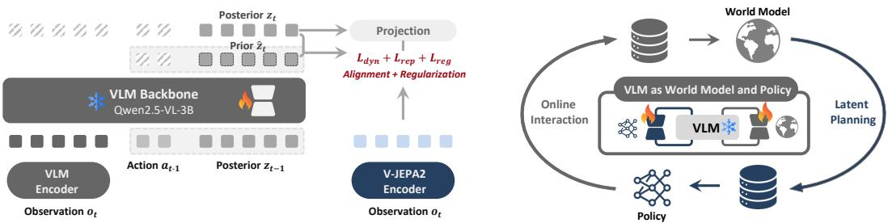
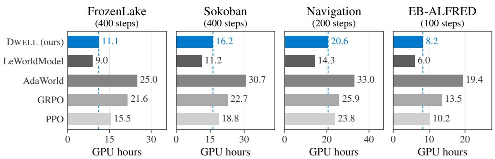
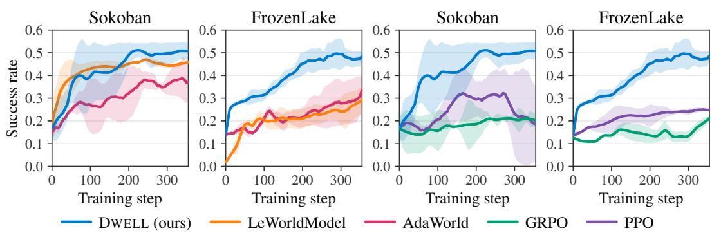
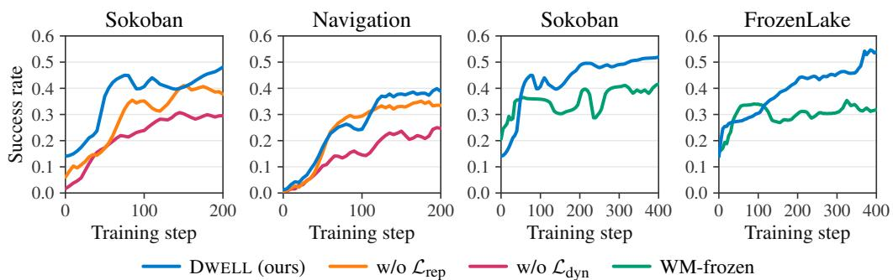

# VISION-LANGUAGE AGENTS CAN LEARN IN THEIR OWN LATENT WORLDS

Haoxi Li1, Sikai Bai1, Jianfei Ma2, Qinglin Hou3, Xiaocheng Lu1, Tao Han1, Jie Zhang1,†, Song Guo1,†

1Department of Computer Science and Engineering, HKUST, Hong Kong, China

2School of Computing, National University of Singapore, Singapore

3Department of Computer Science, University of Southern California, Los Angeles, USA

†Corresponding authors

## ABSTRACT

Learning from experience is essential for building the next generation of agents that continually expand their capabilities. Pretrained vision-language models (VLMs) already internalize rich world knowledge, yet this knowledge is rarely leveraged to drive policy improvement through online interaction. Realizing this potential efficiently remains challenging, as policy updates shift the agent’s interaction distribution, requiring the world model to adapt accordingly, while continually updating large pretrained models is computationally expensive. To address this challenge, we introduce DWELL, a model-based reinforcement learning (RL) framework that reframes a VLM as a recurrent latent transition operator, endowing it with the ability to predict, adjust, and act in latent space. Leveraging the VLM’s own representations and its dual role as both world model and policy, the agent continually learns from real interactions to anticipate and evaluate action outcomes, and from latent imagination to improve its behavior. Across five interactive visual environments, DWELL achieves the strongest overall performance among trainable methods while substantially reducing the compute required for imagination, showing that effective world models for VLM agents need not reconstruct the future—they need to predict futures that are useful for action. Our code is publicly available at https://github.com/Tom111-lhx/Dwell.

## 1 INTRODUCTION

AI agents (OpenAI, 2026; Team et al., 2026) have acquired broad capabilities through large-scale pretraining on human-generated data (Brown et al., 2020; Hoffmann et al., 2022) and post-training with human demonstrations and preference feedback (Ziegler et al., 2019; Ouyang et al., 2022). Extending this progress beyond the limits of human-provided data (Villalobos et al., 2024) motivates agents that continually learn from experience generated through their own interactions with the environment (Silver & Sutton, 2025). Recent work (Wang et al., 2026; Li et al., 2026) has taken steps in this direction by using reinforcement learning (RL) to improve agents’ multi-step decision-making with environmental feedback. However, the substantial environment interaction often required by model-free approaches can make experience collection a bottleneck to scaling (Janner et al., 2019; Chandra et al., 2025). This raises a central question: how can agents achieve greater policy improvementfrom limited real experience?

World models offer a way to learn more from real experience by predicting action outcomes and generating imagined trajectories for policy learning. For vision-language model (VLM) agents, models that synthesize observations have already served as training environments across embodied and web tasks (Zhu et al., 2026; Fang et al., 2025). In contrast, imagination in a compact latent space avoids reconstructing observations at every predicted step (Hafner et al., 2019; 2023), while predictive representation learning can emphasize predictable structure over incidental visual detail (Assran et al., 2023; Maes et al., 2026). Pretrained VLMs already encode rich world knowledge, suggesting that their own representations could support latent imagination for policy learning.

Accurate prediction alone does not guarantee compatibility: a world model’s latent states may not be readily usable by a VLM policy, even when they faithfully capture action outcomes (Assran et al., 2025; Chen et al., 2026). A further difficulty arises as policy updates shift the agent’s interaction distribution toward states and actions poorly covered by the world model’s training data (Janner et al., 2019). In these regions, errors in predicted transitions and rewards can bias subsequent policy updates, so gains in imagination may not translate into better behavior in the environment (Liu et al., 2026). Adapting to this evolving distribution can also be computationally expensive when it requires repeated updates to a large pretrained VLM. Together, these challenges motivate a shared representational basis for prediction and decision-making, coupled with efficient, continual correction of transition and reward predictions from real interaction.

We introduce DWELL, a model-based RL framework that enables VLMs to predict, adjust, and act in their own latent space. By recasting the VLM as a recurrent latent transition operator, we equip it to reason about the state of the world from interaction history and improve its behavior through latent imagination. Following the joint-embedding principle (Assran et al., 2023), our method draws on the VLM’s rich world knowledge to actively infer a state representation in an abstract and compact space, rather than focusing on every detail of the observation. Exploiting the VLM’s dual role as a world model and policy, we instantiate both components using separate lightweight LoRA adapters (Hu et al., 2022) on the same VLM backbone, allowing independent, parameter-efficient adaptation while sharing a common representation interface. Together, recurrence and duality provide a unified framework for modeling and acting in dynamic environments through online learning.

We conduct comprehensive experiments across five interactive visual environments spanning spatial planning, embodied navigation, manipulation, and long-horizon household tasks. under the reported training protocol, DWELL achieves the superior performance among trainable methods, while substantially reducing the computational cost of imagination relative to a world-model baseline that reconstructs observations. In summary, the main contributions of the paper are as follows:

• Learning and acting in a shared latent world. We recast a pretrained VLM as a recurrent latent transition operator, unifying world modeling and policy learning through a common belief interface.

• Online policy improvement through latent imagination. We develop a learning loop in which real interactions continually refine the world and reward models, while imagined trajectories guide policy improvement.

• Empirical gains in performance and efficiency. Our proposed method achieves strong overall performance among the evaluated trainable baselines under the reported training settings, while reducing imagination cost relative to a world model that synthesizes observations.

## 2 METHOD

A self-evolving agent should anticipate the consequences of its actions and use feedback from interaction to continually refine its predictions and behavior. Although VLMs have acquired rich world knowledge, they tend to be brittle when exposed to dynamic environments or when learning from experience. Our method, DWELL, anchors a VLM as a recurrent latent transition operator, morphing a static perceiver into an active predictor. Given streams of observations and actions from online interaction, it infers the most explainable states in the VLM’s own latent space, which can in turn be used for model-based planning in the absence of feedback. This cycle of interaction, refinement, and improvement enables the agent to continuously expand its understanding of the environment while adapting its actions accordingly.

Interaction Setting. We model this online interaction as a partially observable Markov decision process (POMDP) Astr˚ om (1965); Kaelbling et al. (1998), defined by a tuple¨ $( S , \mathcal { A } , \mathcal { O } , T , R , Z , \gamma )$ where $s , { \mathcal { A } }$ , and O correspond to the state, action, and observation spaces. At each step $t ,$ the agent takes an action $a _ { t } \sim \pi _ { \theta } ( a _ { t } | b _ { t } )$ based on its belief $b _ { t } ,$ a sufficient statistic computed from the history $h _ { t } = \left( o _ { 0 } , a _ { 0 } , \ldots , o _ { t - 1 } , a _ { t - 1 } , o _ { t } \right)$ . The environment then transitions to a hidden state $s _ { t + 1 } \sim T ( s _ { t + 1 } \mid s _ { t } , a _ { t } )$ and emits a visual observation $o _ { t + 1 } \sim Z ( o _ { t + 1 } \mid s _ { t + 1 } , a _ { t } )$ and reward $r _ { t + 1 } = R ( s _ { t } , a _ { t } , s _ { t + 1 } )$ . Since the state is unobserved, the VLM agent must form a belief over it and learns a policy $\pi _ { \theta }$ to maximize the expected cumulative discounted return:

$$
\mathcal { I } ( \theta ) = \mathbb { E } _ { \pi _ { \theta } , T , Z } \left[ \sum _ { t = 0 } ^ { \infty } \gamma ^ { t } R ( s _ { t } , a _ { t } , s _ { t + 1 } ) \right] ,\tag{1}
$$

where $\gamma \in [ 0 , 1 )$ is the discount factor. The belief $b _ { t }$ upon which the agent acts is updated deterministically as $b _ { t } = \tau ( b _ { t - 1 } , a _ { t - 1 } , o _ { t } )$ using a belief update function τ given an initial belief $b _ { 0 } .$ . Depending on the model specification, the belief can take either a probabilistic or deterministic form.

## 2.1 RECURRENCE AND DUALITY: A COMMON INTERFACE

Recurrent Latent Model. Learning from experience requires connecting two sources of state information: what the agent observes and what it can anticipate from its actions. Let $\nu ( o _ { t } )$ denote the ordered sequence of visual tokens extracted by the VLM from observation $o _ { t } .$ , and $\mathbf { z } _ { t } \in \mathbb { R } ^ { K \times D }$ represents the agent’s latent state, comprising K slots of dimension D. Given the previous state $\mathbf { z } _ { t - 1 }$ and action $a _ { t - 1 }$ , we define two recurrent updates:

$$
\begin{array} { r l } & { \mathbf { z } _ { t } = \Sigma _ { \phi } \big ( \mathbf { z } _ { t - 1 } , a _ { t - 1 } , \nu ( o _ { t } ) \big ) , } \\ & { \widehat { \mathbf { z } } _ { t } = \Psi _ { \phi } \big ( \mathbf { z } _ { t - 1 } , a _ { t - 1 } \big ) . } \end{array}\tag{2}
$$

The observation-conditioned update $\Sigma _ { \phi }$ incorporates the realized outcome of $a _ { t - 1 }$ into the agent’s evolving belief, whereas the action-conditioned predictor $\Psi _ { \phi }$ anticipates that outcome without access to $o _ { t }$ . We refer to their outputs as the posterior state $\mathbf { z } _ { t }$ and the prior state $\widehat { \mathbf { z } } _ { t }$ , respectively. Here, these two terms distinguish the information available to each update: both states are deterministic latent representations rather than probability distributions.

Conceptually, if we follow a joint embedding predictive architecture (JEPA) (Assran et al., 2023), our formulation generalizes it by allowing the incorporation of historical information. This can be seen by removing $\mathbf { z } _ { t - 1 }$ and $a _ { t - 1 }$ from the posterior and setting $\Sigma _ { \phi } = I$ . When the observation alone is not a sufficient statistic, our formulation induces better representations while improving the separability of the latent states by anchoring their representations to the observation. Compared with reconstruction-based methods, ours operates in the latent space without focusing on every detail of the observation, thereby improving computational efficiency.

VLM as World Model and Policy. We instantiate the world model and policy using separate LoRA adapters (Hu et al., 2022) on a shared, frozen pretrained VLM backbone. Within the world model, posterior inference $\Sigma _ { \phi }$ and prior prediction $\Psi _ { \phi }$ share the same trainable parameters ϕ, whereas the policy $\pi _ { \theta }$ uses a distinct set of adapter parameters θ. This separation supports independent, parameterefficient adaptation of prediction and decision-making while keeping the pretrained backbone fixed.

The latent slots retain their ordering across updates, providing a common interface for transition prediction, reward evaluation, and action selection. The policy $\pi _ { \theta }$ conditions on posterior states during real interaction and on predicted states during latent imagination. Thus, predicted states can be passed directly to the next state transition and decision without decoding them into the raw observation and re-encoding them. Initialization and parameterization are detailed in Appendix A.7.

## 2.2 DYNAMICS, REPRESENTATION, AND REWARD LEARNING

Learning a world model improves sample efficiency, enables planning and foresight, and enhances adaptability to environmental changes. The central questions are: (1) what state representation a good world model requires; and (2) how to make reliable predictions into the future to guide action selection. When faced with complex or high-dimensional observations, a naive approach is to optimize for reconstruction fidelity in the original space. However, this can be problematic, as it focuses too much on information that is redundant or irrelevant to solving the task, while also being computationally inefficient. VLMs can internalize rich knowledge in their latent space, providing us with a good starting point to build upon. We can leverage this internalized knowledge by operating in a compact latent space while attending only to the information most relevant to decision-making.

Dynamics Learning. When explicit feedback is absent, the world model needs to make reliable predictions into the future for planning and foresight. The posterior, in contrast, infers the states that best explain the current observation given the history, providing a natural learning target for the prior and thereby equipping the VLM with the ability to predict and adjust.

  
Figure 1: Overview of DWELL. Left: The VLM learns a recurrent latent world by matching action-conditioned priors to observation-conditioned posteriors, while grounding the latent states with a frozen V-JEPA2 encoder. Right: The same VLM backbone serves as both world model and policy, alternating online interaction with latent planning for policy improvement.

Given sequences $\tau = ( a _ { t } , o _ { t + 1 } , a _ { t + 1 } , o _ { t + 2 } , \ldots , o _ { t + T } )$ from a replay buffer ${ \mathcal { D } } ,$ we learn the prior by:

$$
\mathcal { L } _ { \mathrm { d y n } } ( \phi ) = \mathbb { E } _ { \tau \sim \mathcal { D } } \left[ \sum _ { k = 1 } ^ { T } \Vert \widehat { \mathbf { z } } _ { t + k } - \mathrm { s g } ( \mathbf { z } _ { t + k } ) \Vert _ { \mathrm { F } } ^ { 2 } \right] ,\tag{3}
$$

where sg denotes stop-gradient.

Representation Learning. However, agreement between the posterior and prior alone does not establish their connection to observations; they can freely minimize the error while capturing no useful information for decision-making. While we can anchor the posterior to the VLM’s visual encoder, a representation that is well-suited for supervised learning may not readily transfer to online learning. Therefore, we turn to frozen pretrained visual encoders $\mathbf { e } _ { t } = \mathrm { E } ( o _ { t } )$ such as V-JEPA2 through a learned slot-wise projection $\Gamma _ { \phi }$ for posterior learning:

$$
\mathcal { L } _ { \mathrm { r e p } } ( \phi ) = \mathbb { E } _ { \tau \sim \mathcal { D } } \left[ \sum _ { k = 1 } ^ { T } \mathbf { d } ( \Gamma _ { \phi } ( \mathbf { z } _ { t + k } ) , \mathrm { s g } ( \mathbf { e } _ { t + k } ) ) \right] ,\tag{4}
$$

where, for d, we use the averaged cosine distance over corresponding slots. Notably, despite the projection, learning remains in a compact representation space rather than the raw observation space, akin to JEPA, thereby avoiding expensive reconstruction.

Reward Learning. Although it is straightforward to learn the reward from the posterior, planning in the latent space with the prior presents a gap, which widens as the planning horizon increases due to compounding errors. For this reason, we propose to learn the reward from a pure prior lookahead given the future actions $a _ { t : t + L }$ , starting from a posterior $\mathbf { z } _ { t } .$ . We denote this compositional mapping as $\Pi ( \mathbf { z } _ { t } , a _ { t : t + L } ; L )$ , which results in a trailing prior $\widehat { \mathbf { z } } _ { t + L + 1 }$ . This prior combines two ends: the history encoded in the posterior and the future actions, from which we predict the reward $\widehat { r } _ { t + L + 1 } = R _ { \omega } ( \widehat { \mathbf { z } } _ { t + L + 1 } )$ . Over the trajectory, we sample a lookahead horizon up to the maximum length T and apply Π at $t _ { k } : = t + \lfloor k - L - 1 \rfloor$ for a given trailing step $t +$ k:

$$
\mathcal { L } _ { \mathrm { r e w } } ( \omega ) = \mathbb { E } _ { \tau \sim \mathcal { D } , L \sim [ T ] } \left[ \sum _ { k = 1 } ^ { T } \ell _ { r } \left( R _ { \omega } ( \Pi ( \mathbf { z } _ { t _ { k } } , a _ { t _ { k } : t _ { k } + L } ; L ) ) , r _ { t + k } \right) \right] ,\tag{5}
$$

where $\ell _ { r }$ is the mean squared error for continuous rewards and the cross-entropy loss for discrete ones. This approach balances long-horizon reward prediction in the latent space with the use of historical information, providing a spectrum of stable learning for model-based planning. Notably, when $L = 0 .$ , it reduces to per-step prediction, which accounts for only one action at a time; when $L \geq T$ , the prior is decoupled from the posterior and makes predictions on its own, ignoring any historical information.

Putting it all together, with an auxiliary regularizer (Maes et al., 2026) to discourage representation collapse, the objective for learning the world model is:

$$
\mathcal { T } _ { \mathrm { W M } } = \mathcal { L } _ { \mathrm { d y n } } + \alpha \mathcal { L } _ { \mathrm { r e p } } + \beta \mathcal { L } _ { \mathrm { r e w } } + \eta \mathcal { L } _ { \mathrm { r e g } } ,\tag{6}
$$

where $\alpha , \beta ,$ and η indicate the relative strength of each term.

## 2.3 MODEL-BASED LATENT PLANNING.

A world model is a mirror of reality, allowing us to simulate without constant interaction with the environment. Planning with a world model requires anticipating future rewards to identify better actions, which can be compactly represented by a value function. However, the interleaved nature of the world model and value function necessitates a reliable initial value estimate to be backpropagated during planning, especially at the beginning of training.

Bridge the Gap. Learning to predict a state does not yet establish how much future reward it yields. With finite imagination, early policy updates also depend on value estimates that have not yet been fitted to task returns. We therefore warm up the critic on real experience using the n-step return $G _ { t } ^ { ( n ) }$ before allowing it to guide policy improvement, while keeping the actor and world model fixed.

Planning with World Model. Starting from a posterior state $\widehat { \mathbf { z } } _ { 0 } = \mathbf { z } _ { t }$ obtained by unrolling Eq. 2, we generate a batch B of imagined experiences $\{ a _ { h - 1 } , \widehat { \mathbf { z } } _ { h } , \widehat { r } _ { h } \} _ { h = 1 } ^ { H }$ of length H using the prior and the current policy $\pi _ { \theta } \colon$

$$
\begin{array} { r } { a _ { h - 1 } \sim \pi _ { \boldsymbol { \theta } } ( \cdot \mid \widehat { \mathbf z } _ { h - 1 } ) , \quad \widehat { \mathbf z } _ { h } = \Psi _ { \boldsymbol { \phi } } ( \widehat { \mathbf z } _ { h - 1 } , a _ { h - 1 } ) , \quad \widehat { \boldsymbol { r } } _ { h } = R _ { \omega } ( \widehat { \mathbf z } _ { h } ) , \quad \forall h \in [ H ] . } \end{array}\tag{7}
$$

Given the imagined batch $B ,$ in principle, we can use any actor-critic algorithm to learn both the value function and the policy. To improve sample efficiency and reduce variance, we adopt PPO (Schulman et al., 2017) to update both.

Close the Loop: Iterative Online Learning. The learned policy returns to the real environment, reflecting the world model’s predictions, to collect new experiences and revise its beliefs. This cycle of alternating between interaction and learning, which subsumes the interplay between the world model and the policy and is centered around the VLM, enables continual adaptation and learning from experience at the boundary between the known and the unknown, the history and the future. Through this process, the agent improves its behavior iteratively through trial and error, as summarized in Algorithm 1.

## 3 EXPERIMENTS

We evaluate DWELL across diverse interactive visual environments to examine whether latent imagination improves task performance and learning efficiency while remaining computationally practical.

## 3.1 EXPERIMENTAL SETUP

Environments. We evaluate on five interactive visual environments spanning complementary decision-making regimes: SOKOBAN, FROZENLAKE, NAVIGATION, PRIMITIVESKILL, and EB-ALFRED. SOKOBAN (Schrader, 2018) and FROZENLAKE (Towers et al., 2024) test spatial reasoning and multi-step planning in discrete visual environments; NAVIGATION (Yang et al., 2025; Kolve et al., 2017) evaluates embodied navigation from first-person observations; PRIMITIVESKILL (Tao et al., 2024; Nasiriany et al., 2022) tests visually grounded manipulation; and EB-ALFRED (Yang et al., 2025) extends the evaluation to long-horizon compositional embodied tasks. Together, these environments cover increasingly complex forms of partial observability, action consequence prediction, and long-horizon decision making. We use task success rate as the primary metric and, unless otherwise specified, report the mean and standard deviation over three independent training seeds.

Baselines. We use Qwen2.5-VL-3B (Bai et al., 2023) as the unified VLM backbone for al trainable agent methods. We compare DWELL against model-free online RL with PPO (Schulman et al., 2017) and GRPO (Guo et al., 2025), which optimize the policy directly from environmental feedback without imagined experience. For model-based RL, we adapt LEWORLDMODEL to our online agent setting by connecting its learned latent dynamics to the same VLM policy and online interaction pipeline; the adaptation is detailed in Appendix A.2. We additionally report strong off-the-shelf VLMs as reference points without online adaptation.

Table 1: Overall performance across five interactive visual environments. All trainable methods use Qwen2. $5 - \mathrm { V } \mathrm { L } - 3 \mathrm { B }$ as the VLM backbone and are trained under the same environmental feedback and interaction budget. Off-the-shelf VLMs are evaluated without online adaptation. Bold indicates the best performance among trainable methods.
<table><tr><td rowspan="2">Model/Method</td><td rowspan="2"></td><td rowspan="2">Sokoban FrozenLake</td><td colspan="3">Navigation</td><td colspan="5">PrimitiveSkill</td><td rowspan="2">EB-ALFRED Overall</td><td rowspan="2"></td></tr><tr><td>Base</td><td>Common Average</td><td></td><td>Place</td><td>Stack</td><td>Drawer</td><td>Align</td><td>Average</td></tr><tr><td colspan="10">Open-Source VLMs</td><td></td><td></td><td></td></tr><tr><td>Qwen2.5-VL-72B (Bai et al., 2023)</td><td>0.20</td><td>0.44</td><td>0.70</td><td>0.77</td><td>0.74</td><td>1.00</td><td>0.50</td><td>0.00</td><td>1.00</td><td>0.63</td><td>0.39</td><td>0.48</td></tr><tr><td>Qwen2.5-VL-7B (Bai et al., 2023)</td><td>0.14</td><td>0.14</td><td>0.33</td><td>0.38</td><td>0.35</td><td>0.00</td><td>0.00</td><td>0.00</td><td>0.75</td><td>0.19</td><td>0.47</td><td>0.26</td></tr><tr><td>Qwen2.5-VL-3B (Bai et al., 2023)</td><td>0.13</td><td>0.14</td><td>0.20</td><td>0.26</td><td>0.23</td><td>0.00</td><td>0.00</td><td>0.00</td><td>0.00</td><td>0.00</td><td>0.01</td><td>0.10</td></tr><tr><td>VLM-R1-3B (Shen et al., 2025)</td><td>0.16</td><td>0.15</td><td>0.33</td><td>0.34</td><td>0.34</td><td>0.00</td><td>0.00</td><td>0.00</td><td>0.00</td><td>0.00</td><td>0.02</td><td>0.13</td></tr><tr><td colspan="10">Proprietary VLMs</td><td></td><td></td><td></td></tr><tr><td>GPT-4o (Hurst et al., 2024)</td><td></td><td>0.43 0.54</td><td>0.75</td><td>0.69</td><td>0.72</td><td>0.50</td><td>0.63</td><td>0.00</td><td>0.88</td><td>0.50</td><td>0.56</td><td>0.55</td></tr><tr><td>Claude 4.5 Sonnet Anthropic (2025)</td><td>0.31</td><td>0.80</td><td>0.67</td><td>0.67</td><td>0.67</td><td>0.63</td><td>0.50</td><td>0.00</td><td>1.00</td><td>0.53</td><td>0.71</td><td>0.60</td></tr><tr><td colspan="10">Model-Free Online RL (Backbone: Qwen2.5-VL-3B)</td><td></td><td></td><td></td></tr><tr><td>PPO (Schulman et al., 2017)</td><td></td><td></td><td></td><td></td><td>0.28</td><td>0</td><td>0</td><td>0</td><td> $0 . 2 9 _ { \pm 0 . 5 0 8 }$ </td><td>0.07</td><td> $0 . 0 6 _ { \pm 0 . 0 3 4 }$ </td><td>0.18</td></tr><tr><td>GRPO (Guo et al., 2025)</td><td> $\begin{array} { r } { \left. \begin{array} { l } { 0 . 2 9 _ { \pm 0 . 1 2 5 } } \\ { 0 . 2 1 _ { \pm 0 . 0 4 0 } } \\ { 0 . 2 1 _ { \pm 0 . 0 4 0 } } \end{array} \right| \begin{array} { l } { 0 . 2 2 _ { \pm 0 . 0 3 6 } } \\ { 0 . 1 9 _ { \pm 0 . 0 5 2 } } \end{array} \left| 0 . 2 8 _ { \pm 0 . 0 7 2 } \begin{array} { l } { 0 . 2 7 _ { \pm 0 . 0 2 6 } } \\ { 0 . 7 4 _ { \pm 0 . 1 0 0 } } \end{array} \right. } \end{array}$ </td><td></td><td></td><td></td><td>0.73</td><td>0</td><td>0</td><td>0</td><td> $0 . 6 7 _ { \pm 0 . 5 7 8 }$ </td><td>0.17</td><td> $0 . 1 0 _ { \pm 0 . 0 2 6 }$ </td><td>0.28</td></tr><tr><td colspan="10">Model-Based RL (Backbone: Qwen2.5-VL-3B)</td><td rowspan="2"></td></tr><tr><td>LeWorldModel (Maes et al., 2026)</td><td></td><td></td><td> $0 . 4 4 _ { \pm 0 . 0 2 1 } \mid 0 . 2 9 _ { \pm 0 . 0 6 1 } \mid 0 . 3 0 _ { \pm 0 . 0 3 7 } 0 . 2 8 _ { \pm 0 . 0 4 9 3 }$ </td><td></td><td>0.29</td><td> $\begin{array} { r l r l } { 0 } & { { } } & { 0 . 1 7 _ { \pm 0 . 2 8 9 } } \end{array}$ </td><td></td><td>0</td><td>0</td><td>0.04</td><td> $0 . 1 3 _ { \pm 0 . 0 3 0 }$ </td><td>0.24</td></tr><tr><td>DWELL</td><td></td><td>0.53±0.012 0.51±0.021</td><td>0.37±0.036 0.40±0.0208</td><td></td><td>0.39</td><td> $0 . 3 3 _ { \pm 0 . 2 8 8 } 0 . 2 1 _ { \pm 0 . 2 5 9 }$ </td><td></td><td>0</td><td> $0 . 2 9 _ { \pm 0 . 5 0 8 }$ </td><td>0.28</td><td> $0 . 1 8 _ { \pm 0 . 0 4 8 }$ </td><td>0.38</td></tr></table>

Implementation Details. We keep the VLM backbone frozen and equip the policy and world model with separate trainable LoRA adapters. We use a frozen V-JEPA2 (Assran et al., 2025) encoder as the default visual target for representation grounding. We use LoRA rank $r = 3 2$ with scaling factor α = 64. Full hyperparameters and environment-specific configurations are provided in Appendix A.4.

## 3.2 OVERALL PERFORMANCE

Results. As shown in Table 1, DWELL achieves the best overall performance among trainable methods, substantially improving the same Qwen2.5-VL-3B initialization. The gains are most evident on SOKOBAN, FROZENLAKE, and the long-horizon EB-ALFRED tasks, where successful decisions depend strongly on anticipating how current actions alter future states. This pattern supports our central hypothesis that action-conditioned latent imagination can turn limited real experience into useful additional training experience.

The benefit is task dependent rather than uniform. Model-free GRPO remains stronger on NAVIGA-TION and slightly better on PRIMITIVESKILL. We attribute this difference to two distinct regimes: in navigation, immediate visual observations often provide strong action cues, reducing the marginal benefit of explicit future-state prediction; in contact-rich manipulation, useful imagination requires finer-grained dynamics that are harder to preserve in a compact latent rollout. In contrast, DWELL consistently improves over the adapted LEWORLDMODEL baseline, suggesting that effective modelbased learning depends not only on learning latent dynamics, but also on making predicted states directly usable by the VLM policy. We examine the efficiency of these gains and the role of each component below.

## 3.3 LEARNING AND COMPUTATIONAL EFFICIENCY

We next study whether the gains of DWELL can be obtained efficiently, both in terms of learning from online interaction and the computation required to support imagination. Figure 2 reports learning curves under the same training protocol. For the model-based comparison, we additionally include ADAWORLD (Gao et al., 2025), an adaptable generative world model based on latent actions, as a representative visual-generation-based world model. We adapt its official implementation to our evaluation setting; implementation details are provided in Appendix A.2.

  
Figure 3: Computational Efficiency. End-to-end GPU-hours required to reach the reported training step on FROZENLAKE, SOKOBAN, NAVIGATION, and EB-ALFRED. GPU-hours include all computation incurred during online training, including world-model updates, imagined rollouts, and policy/value optimization. All methods are evaluated under the same environment-specific training schedule and hardware configuration.

  
Figure 2: Learning Efficiency. Success rate throughout training on SOKOBAN and FROZENLAKE. Left: comparison with model-based approaches. Right: comparison with model-free approaches.

Learning Efficiency. Across both SOKOBAN and FROZENLAKE, DWELL reaches higher success rates than the alternative model-based approaches. The advantage is particularly clear on FROZEN-LAKE, where the competing methods improve only gradually while DWELL continues to benefit from interaction. These results suggest that recurrent latent imagination provides useful additional learning signal from experience already collected, rather than relying solely on new environment rollouts.

Computational Efficiency. We further measure the end-to-end GPU-hours required to reach the final training step used in each environment, including all GPU computation incurred by online training, such as world-model updates, imagined rollouts, and policy/value optimization. As shown in Figure 3, LEWORLDMODEL remains the least expensive approach due to its compact latent dynamics. Nevertheless, DWELL consistently requires substantially less computation than ADAWORLD, reducing GPU-hours by approximately 38–58% across the four evaluated environments. It also incurs lower total compute than PPO and GRPO under the same training schedule. Taken together with the performance results in Table 1, these findings indicate that DWELL achieves a favorable performance–compute trade-off: it retains the efficiency of latent-space imagination while avoiding the considerably higher cost of generating future visual observations.

## 3.4 ABLATION STUDIES

We ablate two aspects of DWELL that are central to learning from latent imagination: the supervision used to construct predictive latent states and the continual adaptation of the world model during online policy learning.

  
Figure 4: Ablation Studies. Left: effect of removing the representation-grounding objective $\mathcal { L } _ { \mathrm { r e p } }$ or the predictive dynamics objective $\mathcal { L } _ { \mathrm { d y n } }$ . Right: effect of freezing the world model after initialization instead of continually updating it with newly collected experience. Predictive dynamics provide the primary supervision for useful latent imagination, while representation grounding and continual world-model adaptation further improve policy learning.

Role of the World Model Objectives. As shown in Figure 4, removing either predictive dynamics learning or representation grounding degrades performance on both SOKOBAN and NAVIGATION. The degradation is substantially larger without $\mathcal { L } _ { \mathrm { d y n } }$ , indicating that direct supervision of actionconditioned future states is essential for producing useful imagined trajectories. Removing $\mathcal { L } _ { \mathrm { r e p } }$ yields a smaller but consistent drop, showing that predictive consistency alone is insufficient and benefits from anchoring the latent state to perceptually meaningful visual representations. Together, the two objectives play complementary roles: $\mathcal { L } _ { \mathrm { d y n } }$ learns how the state evolves under actions, whereas $\mathcal { L } _ { \mathrm { r e p } }$ constrains what information the state should preserve.

Effect of Online World Model Adaptation. We further freeze the world model after its initial fitting and continue policy optimization with the resulting fixed dynamics. The frozen model remains competitive early in training, but its performance quickly saturates on both SOKOBAN and FROZENLAKE, whereas the full DWELL continues to improve as additional interaction is collected. This behavior is consistent with a policy-induced distribution shift: as the policy changes, it visits state–action regions that are increasingly different from those used to fit the initial model. Continually refreshing the world model with newly collected experience therefore keeps imagined trajectories aligned with the evolving policy distribution and enables sustained policy improvement.

## 4 RELATED WORK

Latent World Models for Behavior Learning. Model-based RL has long used learned dynamics to augment real experience with prediction and planning. Dreamer learns policies from trajectories imagined in a compact latent state space, while TD-MPC and its successors optimize behavior with decoder-free latent world models (Hafner et al., 2019; 2023; Hansen et al., 2024). More recent predictive-representation approaches replace observation reconstruction with latent prediction, enabling action-conditioned planning or policy learning directly in representation space (Assran et al., 2025; Bagatella et al., 2026). These methods establish that control need not operate on reconstructed observations. Our focus is complementary: we study how such a latent learning interface can be built into a VLM agent, so that the representations used for real decisions also form the state space of imagined policy learning.

World Models for Agent Learning. Generative world models have recently become practical training environments for large-model agents. In embodied settings, video world models synthesize action-conditioned futures for VLA policy optimization (Zhu et al., 2026; Jia et al., 2026), while learned web simulators generate interaction experience for self-improvement in browser agents (Fang et al., 2025; Ding et al., 2026). A common design is to adapt the simulator to policy behavior and then hold it fixed while optimizing the policy. This separation makes model-generated experience reusable, but the simulator cannot incorporate new evidence arising during the subsequent policy updates. World-VLA-Loop (Liu et al., 2026) takes a step toward closing this loop by iteratively adding new policy rollouts to world-model training; however, policy learning still proceeds through autoregressively generated visual observations and inherits their long-horizon drift. DWELL instead uses the VLM’s predicted beliefs themselves as the interaction states: policy learning requires neither future-image generation nor re-encoding, and the latent world is refreshed from newly collected real experience throughout training.

World Modeling within VLM Agents. A parallel line of work develops world-modeling capabilities inside the agent itself. VLM representations can provide semantically informed state features for control, and explicit state estimation and transition reasoning can improve multi-turn visual decisionmaking (Chen et al., 2024; Wang et al., 2026). Other approaches incorporate future prediction more directly into action learning: VLA-JEPA uses latent state prediction to learn action-relevant representations, and unified world–action models jointly predict observations and actions (Sun et al., 2026; Cen et al., 2025). In these methods, world modeling primarily shapes the representation, reasoning process, or action predictor. DWELL gives the predicted state a different operational role: it is the state on which the policy continues to act and learn. A single frozen VLM backbone therefore supports two trainable roles through separate adapters: one learns action-conditioned latent dynamics, while the other learns the policy, and real interaction continually supervises both the predicted dynamics and their task outcomes.

## 5 LIMITATION AND DISCUSSION

When Does Latent Imagination Help? The benefit of latent imagination is not uniform across the evaluated tasks. While DWELL shows clear gains on SOKOBAN, FROZENLAKE, and EB-ALFRED, its advantage is smaller on NAVIGATION and PRIMITIVESKILL. This pattern is consistent with the hypothesis that imagination is most useful when predicted future states provide information beyond what is already available from the current observation, whereas its benefit may diminish when action selection is largely observation-driven or depends on dynamics that are difficult to capture compactly. A natural next step is therefore to make imagination selective, allowing the agent to decide when and how far to imagine rather than applying a fixed rollout horizon uniformly across states and tasks.

What Must a Latent World Preserve? Operating directly in a compact latent space avoids the cost of reconstructing future observations, but introduces a fundamental trade-off between abstraction and decision sufficiency. Representations that discard visually incidental details may also remove fine-grained dynamics that later become relevant for control, particularly in contact-rich interaction. Moreover, errors in latent transitions and reward prediction can accumulate during planning, making long-horizon rollouts increasingly unreliable. Our current deterministic latent dynamics do not explicitly represent such uncertainty, leaving the policy unable to distinguish a confident prediction from an ambiguous one. These limitations suggest that stronger latent world models may need to learn not only what is predictable, but what must be preserved for downstream decisions, together with uncertainty estimates that determine how far imagined experience should be trusted.

Scope and Scalability. Our current evidence is limited to a single VLM backbone and five simulated interactive visual environments, and therefore does not yet establish how the same design scales with model capacity, richer action spaces, or real-world interaction. In addition, although the latent world is represented within the VLM, its representation is grounded using a frozen pretrained visual encoder; whether equally useful predictive structure can emerge solely from interaction remains an open question. Latent imagination is also not computationally free: while DWELL substantially reduces end-to-end GPU-hours relative to a generative world model, simpler latent dynamics remain cheaper, revealing a performance–compute trade-off rather than an absolute efficiency advantage. Extending this framework to larger VLMs, transferable world representations, and persistent learning across tasks and environments would be important steps toward agents that continually refine a shared model of their experience.

## 6 CONCLUSION

We presented DWELL, a model-based RL framework that enables VLM agents to learn from experience in their own latent worlds. Rather than treating the world model as a separate simulator that reconstructs future observations, DWELL recasts the VLM as a recurrent latent transition operator and uses a shared representational interface for prediction, value estimation, and action. By interleaving real interaction with latent imagination, the agent can reuse limited environmental experience to improve its policy without generating future observations explicitly. Across diverse interactive visual environments, DWELL achieves strong overall performance under controlled interaction budgets while substantially reducing the computational cost of imagination relative to generative world models. Taken together, these results suggest that a useful world model need not reproduce the world itself; it needs to predict a future that the agent can directly act and learn upon.

## REFERENCES

Anthropic. Introducing claude sonnet 4.5, 2025.

Mahmoud Assran, Quentin Duval, Ishan Misra, Piotr Bojanowski, Pascal Vincent, Michael Rabbat, Yann LeCun, and Nicolas Ballas. Self-supervised learning from images with a joint-embedding predictive architecture. In 2023 IEEE/CVF Conference on Computer Vision and Pattern Recognition (CVPR), pp. 15619–15629. IEEE, 2023.

Mido Assran, Adrien Bardes, David Fan, Quentin Garrido, Russell Howes, Matthew Muckley, Ammar Rizvi, Claire Roberts, Koustuv Sinha, Artem Zholus, et al. V-jepa 2: Self-supervised video models enable understanding, prediction and planning. arXiv preprint arXiv:2506.09985, 2025.

Karl Johan Astr ˚ om. Optimal control of markov processes with incomplete state information i. ¨ Journal ofmathematical analysis and applications, 10:174–205, 1965.

Marco Bagatella, Matteo Pirotta, Ahmed Touati, Alessandro Lazaric, and Andrea Tirinzoni. Td-jepa: Latent-predictive representations for zero-shot reinforcement learning. In International Conference on Learning Representations, volume 2026, pp. 36211–36244, 2026.

Jinze Bai, Shuai Bai, Shusheng Yang, Shijie Wang, Sinan Tan, Peng Wang, Junyang Lin, Chang Zhou, and Jingren Zhou. Qwen-vl: A versatile vision-language model for understanding, localization, text reading, and beyond. arXiv preprint arXiv:2308.12966, 2023.

Randall Balestriero and Yann LeCun. Lejepa: Provable and scalable self-supervised learning without the heuristics. arXiv preprint arXiv:2511.08544, 2025.

Adrien Bardes, Jean Ponce, and Yann LeCun. Vicreg: Variance-invariance-covariance regularization for self-supervised learning. arXiv preprint arXiv:2105.04906, 2021.

Tom Brown, Benjamin Mann, Nick Ryder, Melanie Subbiah, Jared D Kaplan, Prafulla Dhariwal, Arvind Neelakantan, Pranav Shyam, Girish Sastry, Amanda Askell, et al. Language models are few-shot learners. Advances in neural information processing systems, 33:1877–1901, 2020.

Jun Cen, Chaohui Yu, Hangjie Yuan, Yuming Jiang, Siteng Huang, Jiayan Guo, Xin Li, Yibing Song, Hao Luo, Fan Wang, et al. Worldvla: Towards autoregressive action world model. arXiv preprint arXiv:2506.21539, 2025.

Akshay L Chandra, Iman Nematollahi, Chenguang Huang, Tim Welschehold, Wolfram Burgard, and Abhinav Valada. Diwa: Diffusion policy adaptation with world models. arXiv preprint arXiv:2508.03645, 2025.

Delong Chen, Mustafa Shukor, Theo Moutakanni, Willy Chung, Lei Yu, Tejaswi Kasarla, Allen Bolourchi, Yann LeCun, and Pascale Fung. Vl-jepa: Joint embedding predictive architecture for vision-language. In International Conference on Learning Representations, volume 2026, pp. 89791–89807, 2026.

William Chen, Oier Mees, Aviral Kumar, and Sergey Levine. Vision-language models provide promptable representations for reinforcement learning. arXiv preprint arXiv:2402.02651, 2024.

Hang Ding, Peidong Liu, Junqiao Wang, Ziwei Ji, Meng Cao, Rongzhao Zhang, Lynn Ai, Eric Yang, Tianyu Shi, and Lei Yu. Dynaweb: Model-based reinforcement learning of web agents. arXiv preprint arXiv:2601.22149, 2026.

Tianqing Fang, Hongming Zhang, Zhisong Zhang, Kaixin Ma, Wenhao Yu, Haitao Mi, and Dong Yu. Webevolver: Enhancing web agent self-improvement with co-evolving world model. In Proceedings of the 2025 Conference on Empirical Methods in Natural Language Processing, pp. 8970–8986, 2025.

Shenyuan Gao, Siyuan Zhou, Yilun Du, Jun Zhang, and Chuang Gan. Adaworld: Learning adaptable world models with latent actions. arXiv preprint arXiv:2503.18938, 2025.

Daya Guo, Dejian Yang, Haowei Zhang, Junxiao Song, Peiyi Wang, Qihao Zhu, Runxin Xu, Ruoyu Zhang, Shirong Ma, Xiao Bi, et al. Deepseek-r1: Incentivizing reasoning capability in llms via reinforcement learning. arXiv preprint arXiv:2501.12948, 2025.

Danijar Hafner, Timothy Lillicrap, Jimmy Ba, and Mohammad Norouzi. Dream to control: Learning behaviors by latent imagination. arXiv preprint arXiv:1912.01603, 2019.

Danijar Hafner, Jurgis Pasukonis, Jimmy Ba, and Timothy Lillicrap. Mastering diverse domains through world models. arXiv preprint arXiv:2301.04104, 2023.

Nick Hansen, Hao Su, and Xiaolong Wang. Td-mpc2: Scalable, robust world models for continuous control. In International Conference on Learning Representations, volume 2024, pp. 47376–47405, 2024.

Jordan Hoffmann, Sebastian Borgeaud, Arthur Mensch, Elena Buchatskaya, Trevor Cai, Eliza Rutherford, Diego de Las Casas, Lisa Anne Hendricks, Johannes Welbl, Aidan Clark, et al. Training compute-optimal large language models. arXiv preprint arXiv:2203.15556, 2022.

Edward J Hu, yelong shen, Phillip Wallis, Zeyuan Allen-Zhu, Yuanzhi Li, Shean Wang, Lu Wang, and Weizhu Chen. LoRA: Low-rank adaptation of large language models. In International Conference on Learning Representations, 2022. URL https://openreview.net/forum? id=nZeVKeeFYf9.

Aaron Hurst, Adam Lerer, Adam P Goucher, Adam Perelman, Aditya Ramesh, Aidan Clark, AJ Ostrow, Akila Welihinda, Alan Hayes, Alec Radford, et al. Gpt-4o system card. arXiv preprint arXiv:2410.21276, 2024.

Michael Janner, Justin Fu, Marvin Zhang, and Sergey Levine. When to trust your model: Model-based policy optimization. Advances in neural information processing systems, 32, 2019.

Emily Yue-Ting Jia, Weiduo Yuan, Tianheng Shi, Vitor Guizilini, Jiageng Mao, and Yue Wang. Dreamplan: Efficient reinforcement fine-tuning of vision-language planners via video world models. arXiv preprint arXiv:2603.16860, 2026.

Leslie Pack Kaelbling, Michael L Littman, and Anthony R Cassandra. Planning and acting in partially observable stochastic domains. Artificial intelligence, 101(1-2):99–134, 1998.

Eric Kolve, Roozbeh Mottaghi, Winson Han, Eli VanderBilt, Luca Weihs, Alvaro Herrasti, Matt Deitke, Kiana Ehsani, Daniel Gordon, Yuke Zhu, et al. Ai2-thor: An interactive 3d environment for visual ai. arXiv preprint arXiv:1712.05474, 2017.

Haoxi Li, Qinglin Hou, Jianfei Ma, Jinxiang Lai, Tao Han, Sikai Bai, Jingcai Guo, Jie Zhang, and Song Guo. What you think is what you see: Driving exploration in vlm agents via visual-linguistic curiosity. arXiv preprint arXiv:2605.03782, 2026.

Xiaokang Liu, Zechen Bai, Hai Ci, Kevin Yuchen Ma, and Mike Zheng Shou. World-vla-loop: Closed-loop learning of video world model and vla policy. arXiv preprint arXiv:2602.06508, 2026.

Lucas Maes, Quentin Le Lidec, Damien Scieur, Yann LeCun, and Randall Balestriero. Leworldmodel: Stable end-to-end joint-embedding predictive architecture from pixels. arXiv preprint arXiv:2603.19312, 2026.

Soroush Nasiriany, Huihan Liu, and Yuke Zhu. Augmenting reinforcement learning with behavior primitives for diverse manipulation tasks. In 2022 International Conference on Robotics and Automation (ICRA), pp. 7477–7484. IEEE, 2022.

OpenAI. GPT-6 Astra System Card, September 2026. URL https://deploymentsafety. openai.com/gpt-6-astra/gpt-6-astra.pdf.

Long Ouyang, Jeffrey Wu, Xu Jiang, Diogo Almeida, Carroll Wainwright, Pamela Mishkin, Chong Zhang, Sandhini Agarwal, Katarina Slama, Alex Ray, et al. Training language models to follow instructions with human feedback. Advances in neural information processing systems, 35:27730– 27744, 2022.

Max-Philipp B. Schrader. gym-sokoban. https://github.com/mpSchrader/ gym-sokoban, 2018.

John Schulman, Philipp Moritz, Sergey Levine, Michael Jordan, and Pieter Abbeel. High-dimensional continuous control using generalized advantage estimation. arXiv preprint arXiv:1506.02438, 2015.

John Schulman, Filip Wolski, Prafulla Dhariwal, Alec Radford, and Oleg Klimov. Proximal policy optimization algorithms. arXiv preprint arXiv:1707.06347, 2017.

Haozhan Shen, Peng Liu, Jingcheng Li, Chunxin Fang, Yibo Ma, Jiajia Liao, Qiaoli Shen, Zilun Zhang, Kangjia Zhao, Qianqian Zhang, et al. Vlm-r1: A stable and generalizable r1-style large vision-language model. arXiv preprint arXiv:2504.07615, 2025.

David Silver and Richard S Sutton. Welcome to the era of experience. Google AI, 1(11):6, 2025.

Jingwen Sun, Wenyao Zhang, Zekun Qi, Shaojie Ren, Zezhi Liu, Hanxin Zhu, Guangzhong Sun, Xin Jin, and Zhibo Chen. Vla-jepa: Enhancing vision-language-action model with latent world model. In European Conference on Computer Vision, pp. 478–497. Springer, 2026.

Stone Tao, Fanbo Xiang, Arth Shukla, Yuzhe Qin, Xander Hinrichsen, Xiaodi Yuan, Chen Bao, Xinsong Lin, Yulin Liu, Tse-kai Chan, et al. Maniskill3: Gpu parallelized robotics simulation and rendering for generalizable embodied ai. arXiv preprint arXiv:2410.00425, 2024.

Kimi Team, Tongtong Bai, Yifan Bai, Yiping Bao, Jianfeng Cai, Xinyuan Cai, Peizhou Cao, Yuxuan Cao, Ziwei Chai, Y Charles, et al. Kimi k3: Open frontier intelligence. arXiv preprint arXiv:2607.24653, 2026.

Mark Towers, Ariel Kwiatkowski, Jordan Terry, John U Balis, Gianluca De Cola, Tristan Deleu, Manuel Goulao, Andreas Kallinteris, Markus Krimmel, Arjun KG, et al. Gymnasium: A standard˜ interface for reinforcement learning environments. arXiv preprint arXiv:2407.17032, 2024.

Pablo Villalobos, Anson Ho, Jaime Sevilla, Tamay Besiroglu, Lennart Heim, and Marius Hobbhahn. Position: Will we run out of data? limits of llm scaling based on human-generated data. In Forty-first International Conference on Machine Learning, 2024.

Kangrui Wang, Pingyue Zhang, Zihan Wang, Yaning Gao, Linjie Li, Qineng Wang, Hanyang Chen, Yiping Lu, Zhengyuan Yang, Lijuan Wang, et al. Vagen: Reinforcing world model reasoning for multi-turn vlm agents. Advances in Neural Information Processing Systems, 38:172871–172933, 2026.

Rui Yang, Hanyang Chen, Junyu Zhang, Mark Zhao, Cheng Qian, Kangrui Wang, Qineng Wang, Teja Venkat Koripella, Marziyeh Movahedi, Manling Li, et al. Embodiedbench: Comprehensive benchmarking multi-modal large language models for vision-driven embodied agents. In International Conference on Machine Learning, pp. 70576–70631. PMLR, 2025.

Fangqi Zhu, Zhengyang Yan, Zicong Hong, Quanxin Shou, Xiao Ma, and Song Guo. Wmpo: World model-based policy optimization for vision-language-action models. In International Conference on Learning Representations, volume 2026, pp. 62486–62502, 2026.

Daniel M Ziegler, Nisan Stiennon, Jeffrey Wu, Tom B Brown, Alec Radford, Dario Amodei, Paul Christiano, and Geoffrey Irving. Fine-tuning language models from human preferences. arXiv preprint arXiv:1909.08593, 2019.

## A APPENDIX

## A.1 ALGORITHM

Algorithm 1 DWELL   
Require: posterior $\Sigma _ { \phi }$ and prior $\Psi _ { \phi } ;$ reward model $R _ { \omega } \mathbf { ; }$ ; actor $\pi _ { \boldsymbol { \theta } } ;$ critic $V _ { \psi } ;$ ; planning horizon $H ;$   
world model updates $N ;$ latent imaginations $L ;$ PPO epochs $E$   
1: Prefill $\mathcal { D }$ with a random policy   
2: Pretrain world model using Eq. 6   
3: Warm up $V _ { \psi }$ using n-step return $G _ { t } ^ { ( n ) }$ as in Eq. 9   
4: while not converged do   
5: ▷ Online Interaction   
6: for time step $t = 1 , \dots , T$ do   
7: Observe $o _ { t }$ and infer posterior state $\begin{array} { r l } { \sum _ { \phi } \left( \mathbf { z } _ { t - 1 } , a _ { t - 1 } , \nu \left( o _ { t } \right) \right) } & { { } } \end{array}$   
8: Execute $\pi _ { \boldsymbol { \theta } } \big ( a _ { t } | \mathbf { z } _ { t } \big )$ in the environment, receive $o _ { t + 1 } .$ , reward $r _ { t + 1 } .$ , and termination $d _ { t + 1 }$   
9: Tokenize the transition $\left( o _ { t } , a _ { t } , o _ { t + 1 } , r _ { t + 1 } , d _ { t + 1 } \right)$ and append it to the replay buffer $\mathcal { D }$   
10: end for   
11: ▷ World Model Learning   
12: for iteration $n = 1 , 2 , \ldots , N$ do   
13: Compute loss function as in Eq. 6   
$\mathcal { T } _ { \mathrm { W M } } = \mathcal { L } _ { \mathrm { d y n } } + \alpha \mathcal { L } _ { \mathrm { r e p } } + \beta \mathcal { L } _ { \mathrm { r e w } } + \eta \mathcal { L } _ { \mathrm { r e g } } .$   
14: Update world model $( \phi , \omega )$ with $\nabla _ { \phi , \omega } \mathcal { T } _ { \mathrm { W M } } ( \phi , \omega )$   
15: end for   
16: ▷ Model-based Latent Planning   
17: Freeze $( \phi , \omega )$ , snapshot $\theta _ { \mathrm { o l d } }  \breve { \theta } ,$ , and initialize imagined batch $B \gets \emptyset$   
18: for imagination $l \dot { = } 1 , \dots , L$ do   
19: Initialize a batch of $B$ posteriors $\mathbf { z } _ { 0 }$ from $\tau \sim \mathcal { D } , | \tau | > H$ via $t \sim \mathrm { U n i f } \{ 0 , \dots , | \tau | -$   
$H - 1 \}$ posterior steps   
20: Unroll the prior model for H steps over the batch following Eq. 7 and store them in $\boldsymbol { B }$   
21: end for   
22: ▷ Actor-Critic Learning   
23: Compute advantages $\widehat { A } _ { h }$ and λ-returns $\widehat { G } _ { h } ^ { \lambda }$ for $\boldsymbol { B }$ using Eq. 10   
24: for epoch $e = 1 , \ldots , E$ do   
25: Shuffle B into minibatches   
26: for each minibatch do   
27: Jointly update actor and critic via $\nabla _ { \boldsymbol { \theta } , \boldsymbol { \psi } } \mathcal { I } ( \boldsymbol { \theta } , \boldsymbol { \psi } )$ following Eq. 12   
28: end for   
29: end for   
30: end while

## A.2 BASELINE

All trainable methods use the same Qwen2.5-VL-3B initialization, environment wrappers, action vocabulary, train/evaluation splits, real-interaction budget, and evaluation seeds. PPO and GRPO optimize the environment reward directly. For LEWORLDMODEL, we retain its latent-dynamics objective but adapt its predicted latent state to the same actor–critic interface used by DWELL through a learned state mapping. This mapping only reconciles representation shape and action indexing; it does not expose observations, rewards, or labels that are unavailable to the other methods. Before policy optimization, LEWORLDMODEL uses the same actor/critic initialization stages as DWELL: behavior cloning is applied only in environments for which it is listed in Table $^ { 5 , }$ and the critic is warmed up on the same real-replay return targets. Reward scales, action mappings, termination rules, PPO clipping and GAE conventions, update budgets, and evaluation intervals are matched environment by environment. The methods differ only in the learned world-model representation and the mechanism used to produce imagined transitions. Hyperparameters are selected without access to the evaluation levels, and no evaluation trajectory is used for training, replay, warm-up, or model selection. ADAWORLD is adapted under the same interaction, optimization, and evaluation budgets while retaining its native generative world-model objective.

Table 2: Effect of the shared latent interface. We compare the default DWELL, where predicted latent states are consumed directly by the policy, with a bridged variant that maps world-model states into a separate policy latent space through a learned adapter. Results are success rates averaged over three training seeds.
<table><tr><td>Variant</td><td>Sokoban</td><td>FrozenLake</td><td>Navigation</td></tr><tr><td>DWELL (Shared)</td><td> $0 . 5 3 { \scriptstyle \pm 0 . 0 1 2 }$ </td><td> $0 . 5 1 { \scriptstyle \pm 0 . 0 2 1 }$ </td><td>0.39</td></tr><tr><td>Bridged Latent Interface</td><td> $0 . 3 8 { \scriptstyle \pm 0 . 1 3 8 }$ </td><td> $0 . 4 2 _ { \pm 0 . 0 9 7 }$ </td><td> $0 . 3 1 { \scriptstyle \pm 0 . 0 1 7 }$ </td></tr></table>

Table 3: Environment settings. Horizon is the maximum number of training / evaluation decisions. PrimitiveSkill observations also include task-state text; each episode has three language turns with at most two primitive commands per turn (at most six in total), and its 64 evaluation episodes cover four tasks (16 each).
<table><tr><td>Environment</td><td>Observation</td><td>Actions</td><td>Horizon</td><td>Eval. episodes</td></tr><tr><td>Sokoban</td><td>top-down RGB, 6 × 6, one box</td><td>4 moves</td><td>25/25</td><td>256</td></tr><tr><td>FrozenLake</td><td>top-down RGB, 4×4</td><td>4 moves</td><td>25/25</td><td>128</td></tr><tr><td>Navigation</td><td>first-person RGB, instruction</td><td>8 motions</td><td>30/10</td><td>120</td></tr><tr><td>PrimitiveSkill</td><td>RGB, instruction</td><td>3 parameterized skills</td><td>3/3 turns</td><td>64</td></tr><tr><td>EB-ALFRED</td><td>first-person RGB, instruction</td><td>162 skills</td><td>30/30</td><td>20</td></tr></table>

## A.3 ADDITIONAL ABLATION STUDY RESULTS

Shared latent interface. A central design choice in DWELL is that the world model and policy operate on the same latent state interface: predicted states can therefore be consumed directly by the policy without an additional representation conversion. To isolate the effect of this design, we construct a bridged variant in which the world model retains its own latent representation and a lightweight learned adapter maps predicted states into a policy-specific latent space before action selection. All other components, including the VLM backbone, world-model objectives, policy optimization, imagination horizon, and online training schedule, are kept unchanged.

As shown in Table 2, separating the prediction and decision spaces consistently degrades performance across all three evaluated environments. The drop is most pronounced on SOKOBAN, while similar degradations are observed on FROZENLAKE and NAVIGATION. These results provide evidence that the benefit of DWELL does not arise solely from learning latent dynamics: making imagined states directly compatible with the policy’s decision representation also facilitates learning from imagined experience.

## A.4 ENVIRONMENT SETTINGS

Table 3 reports one environment decision per step. A PrimitiveSkill language turn may contain at most two sequential primitive commands; we therefore report both turns and the corresponding maximum number of executed primitives. PrimitiveSkill comprises four tasks (Place, Stack, Drawer, and Align), with 16 held-out episodes per task.

## A.5 REWARD ASSIGNMENT

Rewards enter training in two ways. Model-free baselines optimize the real task reward directly. DWELL does not insert the real environment reward into imagined trajectories: real transitions supervise the feedback head, and imagined rewards are read from that head on predicted latent states. The calibrated threshold or floor is selected on a training-only calibration split and frozen before evaluation. For EB-ALFRED, the final ranked reward checkpoint gives

Table 4: Reward assignment. p is the predicted success probability, τ a calibrated threshold, $\widetilde { p }$ a damped version of $p ,$ and t the imagination step. For PrimitiveSkill, the step reward is a 0.1 format reward plus $\Delta s ,$ the increase in the highest completed task stage, and the feedback head also predicts the stage.
<table><tr><td rowspan="2"></td><td colspan="2">Real reward</td><td colspan="3">DWELL in imagination</td></tr><tr><td>Environment Success</td><td>Step</td><td>Label</td><td>Reward</td><td>Episode end</td></tr><tr><td>Sokoban</td><td>+10</td><td>-0.1</td><td>binary</td><td> $1 . 1 \mathbf { 1 } [ p \geq \tau ] - 0 . 0 1$ </td><td> $p \geq \tau$ </td></tr><tr><td>FrozenLake</td><td>+10</td><td>0</td><td>3-class</td><td> $0 . 1 1 [ p _ { \mathrm { g o a l } } \geq 0 . 5 ]$ </td><td>goal or hole</td></tr><tr><td>Navigation</td><td>+10</td><td>0</td><td>binary</td><td> $1 . 1 p - 0 . 1$ </td><td>cutoff at H</td></tr><tr><td>PrimitiveSkill</td><td>+1</td><td>0.1 + ∆s</td><td>binary, stage</td><td> $1 . 1 p - 0 . 1$ </td><td>success or H</td></tr><tr><td>EB-ALFRED</td><td>+1</td><td>-0.1</td><td>binary</td><td> $1 . 1 \bar { \tilde { p } } \mathbf { 1 } [ t = H ] - 0 . 1$ </td><td>cutoff at H</td></tr></table>

$$
c = 0 . 3 3 5 7 1 3 2 0 7 7 , \qquad { \widetilde { p } } = 0 . 1 p + 0 . 9 ~ \mathrm { c l i p } \left( { \frac { p - c } { 1 - c } } , 0 , 1 \right) .
$$

For Sokoban, the calibrated termination threshold is $\tau = 0 . 4 9 6 8 7 6 8 0 6 0$ (reported as 0.497 in the main text).

Offline replay sampling. For every environment, the offline episode set is fixed before optimization, uses training-only seeds, and is disjoint from all evaluation levels and seeds. Episodes are sampled uniformly at random without replacement when the fixed offline subset is formed, and replay episodes and valid within-episode windows are sampled uniformly during training; no reward-, success-, or difficulty-prioritized sampling is used. Collection policy and replay sampling are distinct: Sokoban and FrozenLake use random collection, whereas Navigation uses goal-directed, noisy goal-directed, and random collection in a 3:2:1 ratio and EB-ALFRED uses scripted, noisy-scripted, and random collection in a 4:1:1 ratio.

PrimitiveSkill protocol. The recommended complete PrimitiveSkill setting is: 20,000 offline episodes (5,000 per task), random collection, 5,000 world-model steps with batch size 4 and learning rate $1 0 ^ { - 4 }$ , truncated-BPTT window 3, open-loop horizon 3 with weight 0.25, $\lambda _ { e p } / \lambda _ { v a r } =$ $0 . 0 5 / 0 . 0 0 5$ , an MLP(128) feedback head trained on horizons $_ { 1 - 3 }$ with batch size 256 and learning rate $\mathrm { i 0 ^ { - 4 } }$ , no behavior-cloning warm-up, critic learning rate $1 0 ^ { - 4 }$ with 40/1,000 minimum/maximum warm-up updates, sampled imagination with 64 × 1 start-state/sequence batches and horizon 3, two PPO epochs with minibatch size 16, actor learning rate $1 0 ^ { - 6 }$ , clip/target-KL 0.2/0.02, entropy weight 0.01, discount/GAE 0.99/0.95, world-model refresh every 20 actor updates using batch size 1 and learning rate $1 0 ^ { - 6 }$ , four new real episodes every four updates, replay caps 20,000/10,000, 200 accepted actor updates, evaluation every 20 updates, and one NVIDIA H20 (96 GB) per run.

## A.6 KEY HYPERPARAMETERS

Table 5 lists the settings that define DWELL’s training pipeline in each environment. Three protocol details matter for reading the results. (i) Imagined actions are sampled from the current policy throughout latent rollouts. (ii) In SOKOBAN and FROZENLAKE, the training-step axis counts accepted actor updates: a candidate update is rolled back (actor, critic, and optimizer state) if action-ranking accuracy on held-out real transitions falls below the acceptance threshold. (iii) EB-ALFRED initializes the actor by behavior cloning on successful scripted demonstrations and retains a behavior-cloning term during PPO.

Offline data for Navigation mixes goal-directed, noisy goal-directed, and random episodes; for EB-ALFRED, scripted, noisy scripted, and random episodes in the ratio 4:1:1.

Table 5: Key hyperparameters of DWELL.
<table><tr><td>Setting</td><td>Sokoban</td><td>FrozenLake</td><td>Navigation</td><td>EB-ALFRED</td></tr><tr><td>Backbone and latent state</td><td colspan="4"></td></tr><tr><td>VLM backbone</td><td colspan="4">Qwen2.5-VL-3B-Instruct (frozen)</td></tr><tr><td>LoRA rank / α / dropout</td><td colspan="4"></td></tr><tr><td>Latent slots K / width D</td><td colspan="4">36/ 2048</td></tr><tr><td>Visual teacher E</td><td colspan="4"> $\mathtt { v j e p a 2 - v i t g - f p c 6 4 - 3 8 4 - s s v 2 \ ( f r o z e n ) }$ </td></tr><tr><td colspan="5">World-model fitting</td></tr><tr><td>Offline episodes</td><td>5,000</td><td>5,000</td><td>5,000</td><td>300</td></tr><tr><td>Collection policy</td><td>mixed</td><td>mixed</td><td>mixed</td><td>mixed</td></tr><tr><td>Steps / batch</td><td colspan="2">2,000 / 4</td><td colspan="2">5,000 /4</td></tr><tr><td>Learning rate</td><td colspan="2"> $1 0 ^ { - 5 }$ </td><td colspan="2"> $1 0 ^ { - 4 }$ </td></tr><tr><td>Truncated-BPTT window</td><td colspan="4">2</td></tr><tr><td>Open-loop horizon / weight</td><td colspan="4"></td></tr><tr><td>Prior / posterior / delta weight</td><td colspan="4">0.5 / 0.1 / 0.25</td></tr><tr><td>Regularizer  $\mathcal { L } _ { \mathrm { r e g } }$  weight</td><td colspan="4"></td></tr><tr><td>Feedback head</td><td colspan="4"></td></tr><tr><td>Architecture</td><td colspan="4">linear</td></tr><tr><td>Logged-action horizons H</td><td colspan="4"></td></tr><tr><td>Batch / learning rate</td><td colspan="4">1-8</td></tr><tr><td>Actor and critic initialization</td><td colspan="4"></td></tr><tr><td>Behavior-cloning steps</td><td colspan="4">0</td></tr><tr><td>Critic learning rate</td><td colspan="2"> $3 \times 1 0 ^ { - 5 }$ </td><td colspan="2"> $1 0 ^ { - 4 }$ </td></tr><tr><td>Critic updates (min / max)</td><td colspan="2">20 /100</td><td colspan="2">50/200 200 / 1,000</td></tr><tr><td>Imagined PPO</td><td colspan="4"></td></tr><tr><td>Imagination horizon H</td><td colspan="4"></td></tr><tr><td>Start states × sequences</td><td> $3 2 \times 1 6  { \mathrm { ~ \textrm ~ { ~ ~ } ~ } } 3 2 \times 1 6$ </td><td>8× 64</td><td></td><td>15 64 × 1</td></tr><tr><td>Epochs / minibatch</td><td>2/64</td><td></td><td>2/ 16</td><td></td></tr><tr><td>Actor learning rate</td><td> $2 \times 1 0 ^ { - 6 } \quad 2 \times 1 0 ^ { - 6 }$ </td><td></td><td colspan="2"> $1 0 ^ { - 6 }$ </td></tr><tr><td>Critic learning rate</td><td> $3 \times 1 0 ^ { - 5 }$ </td><td></td><td> $1 0 ^ { - 4 }$ </td><td> $2 \times 1 0 ^ { - 6 }$ </td></tr><tr><td></td><td>0.1/0.01</td><td></td><td colspan="2"></td></tr><tr><td>Clip € / target KL</td><td>0.005</td><td></td><td>0.1 / 0.02 0.01</td><td>0.2 / 0.02</td></tr><tr><td>Entropy weight η Behavior-cloning weight</td><td colspan="4"></td></tr><tr><td>Discount γ / GAE λ</td><td colspan="4">0</td></tr><tr><td>Acceptance: top-1 / pairwise / tolerance</td><td colspan="4">0.60 / 0.60 / 0.05</td></tr><tr><td></td><td colspan="4"></td></tr><tr><td>Online schedule</td><td colspan="4">refreshed every 50</td></tr><tr><td>World model during PPO</td><td></td><td>refreshed every 20  $1 / 1 0 ^ { - 6 }$ </td><td></td><td>frozen</td></tr><tr><td>Refresh batch / learning rate</td><td> $1 6 / 1 0 ^ { - 6 }$ </td><td></td><td colspan="2"></td></tr><tr><td>New real episodes</td><td>1 per update</td><td>800 / 800</td><td colspan="2">4 per 4 updates</td></tr><tr><td>Replay: offline / online cap</td><td colspan="4">800/ 800 400</td></tr><tr><td>Accepted actor updates</td><td colspan="4">400</td></tr><tr><td>Evaluation interval</td><td colspan="4">10</td></tr><tr><td>GPU / GPUs per run</td><td colspan="4">H20/8</td></tr></table>

## A.7 WORLD MODEL LEARNING

## A.7.1 REGULARIZATION

To prevent representational collapse, we apply an auxiliary regularizer $\mathcal { L } _ { \diamond }$ to all valid posterior representations. Following SIGReg-style regularization (Balestriero & LeCun, 2025), we encourage

random one-dimensional projections of the latent distribution to match a standard Gaussian using the Epps–Pulley statistic, together with a VICReg-style variance floor (Bardes et al., 2021). Specifically,

$$
\mathcal { L } _ { \mathrm { r e g } } = \lambda _ { \mathrm { e p } } \frac { 1 } { M } \sum _ { m = 1 } ^ { M } \int e ^ { - s ^ { 2 } } \left| \hat { \varphi } _ { m } ( s ) - e ^ { - s ^ { 2 } / 2 } \right| ^ { 2 } \mathrm { d } s + \lambda _ { \mathrm { v a r } } \frac { 1 } { D } \sum _ { d = 1 } ^ { D } \operatorname* { m a x } ( 0 , 1 - \mathrm { s t d } _ { d } ) ,\tag{8}
$$

where $\hat { \varphi } _ { m }$ denotes the empirical characteristic function along the m-th random projection, and st $\mathrm { d } _ { d }$ is the empirical standard deviation of the d-th latent dimension over valid posterior slots. We use $\lambda _ { \mathrm { e p } } = 0 . 0 5$ and $\lambda _ { \mathrm { v a r } } = 0 . 0 0 5$

## A.8 REWARD AND TERMINATION LEARNING

Both the reward model and the terminal predictor are lightweight MLPs that take the latent state as input, using mean pooling to aggregate the latent slots. The output layer of the reward model depends on the type of task reward: for continuous rewards, we model the reward using a Gaussian distribution with constant variance, whereas for sparse rewards or rewards that can be represented as discrete events, we instead use a categorical distribution. The terminal predictor outputs a Bernoull distribution. Once the termination is predicted, we define the continuation as $c _ { h } = 1 - \widehat { d } _ { h }$

## A.9 ACTOR-CRITIC LEARNING

## A.9.1 CRITIC WARM-UP

Consider a real trajectory segment $\tau = \{ a _ { t - 1 } , o _ { t } , r _ { t } , d _ { t } \} _ { t = 1 } ^ { T }$ , we infer states $\mathbf { z } _ { 1 : T }$ from the posterior and compute n-step return $G _ { t } ^ { ( n ) }$ as:

$$
\begin{array} { l } { G _ { T } ^ { ( n ) } = V _ { \psi } ( \mathbf { z } _ { T } ) , } \\ { G _ { t } ^ { ( n ) } = r _ { t + 1 } + \gamma ( 1 - d _ { t + 1 } ) G _ { t + 1 } ^ { ( n ) } , \quad t = T - 1 , \dots , 0 , } \end{array}\tag{9}
$$

which are used as targets for critic warm-up to provide a good starting point for policy improvement.

## A.9.2 MODEL-BASED LATENT PLANNING

Although any actor-critic algorithm can be used for model-based planning, we adopt PPO (Schulman et al., 2017) to train both the actor and critic, as it allows the same batch to be reused multiple times, thereby improving sample efficiency.

Critic Learning Given a batch of imagined trajectories $B ,$ we use generalized advantage estimation (Schulman et al., 2015) to estimate both advantage and λ-return simultaneously, reducing variance in both policy gradient and TD targets for stable learning. Set $\widehat { A } _ { H } = 0$ and compute backwards over $h = H - 1 , \ldots , 0 \colon$

$$
\begin{array} { r l } & { \delta _ { h } = \widehat { r } _ { h + 1 } + \gamma c _ { h + 1 } V _ { \psi } ( \widehat { \mathbf { z } } _ { h + 1 } ) - V _ { \psi } ( \widehat { \mathbf { z } } _ { h } ) , } \\ & { \widehat { A } _ { h } = \delta _ { h } + \gamma \lambda c _ { h + 1 } \widehat { A } _ { h + 1 } , } \\ & { G _ { h } ^ { \lambda } = \widehat { A } _ { h } + V _ { \psi } ( \widehat { \mathbf { z } } _ { h } ) . } \end{array}\tag{10}
$$

We then fit the critic to these targets to capture long-term rewards alongside the policy gradient.

Actor Learning We snapshot the actor $\pi _ { \theta }$ as the sampling policy for PPO and denote it as $\pi _ { \mathrm { o l d } }$ from which we can define the importance ratio:

$$
\rho _ { h } ( \theta ) = \frac { \pi _ { \theta } ( a _ { h } \mid \widehat { \mathbf { z } } _ { h } ) } { \pi _ { \mathrm { o l d } } ( a _ { h } \mid \widehat { \mathbf { z } } _ { h } ) } .\tag{11}
$$

In summary, we have the overall objective for policy improvement:

$$
\begin{array} { r l } & { \mathcal { I } ( \theta , \psi ) = \mathbb { E } _ { \boldsymbol { \mathcal { B } } } \Big [ - \operatorname* { m i n } \Big ( \rho _ { h } ( \theta ) \widehat { A } _ { h } , \mathrm { c l i p } ( \rho _ { h } ( \theta ) , 1 - \epsilon , 1 + \epsilon ) \widehat { A } _ { h } \Big ) } \\ & { \quad \quad \quad \quad + \left. \beta \big ( V _ { \psi } ( \widehat { \mathbf { z } } _ { h } ) - G _ { h } ^ { \lambda } \big ) ^ { 2 } - \eta \mathcal { H } \big ( \pi _ { \theta } ( \cdot \mid \widehat { \mathbf { z } } _ { h } ) \big ) \right] . } \end{array}\tag{12}
$$

Here, ϵ is the clipping parameter, $\beta$ the value loss coefficient, and η the entropy coefficient.