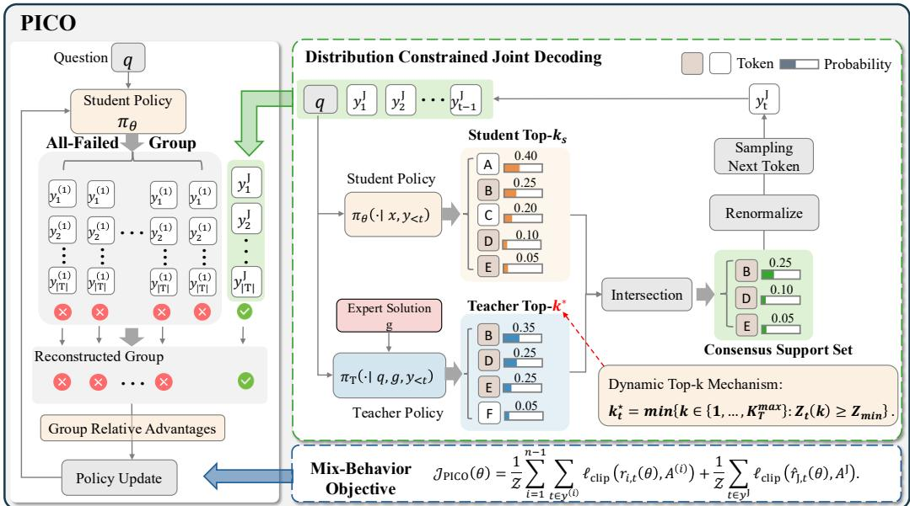
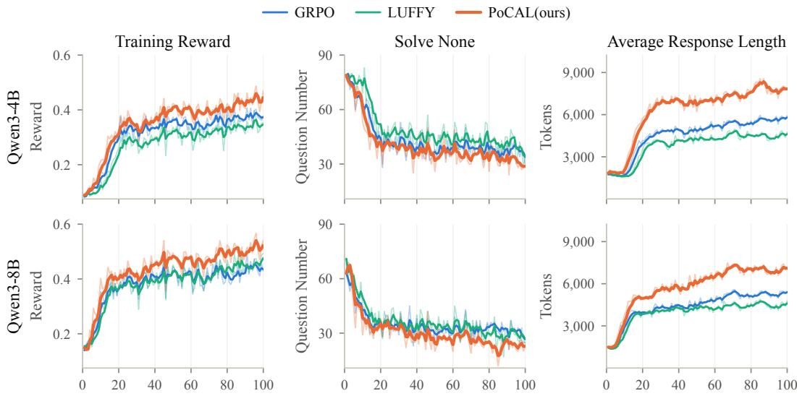
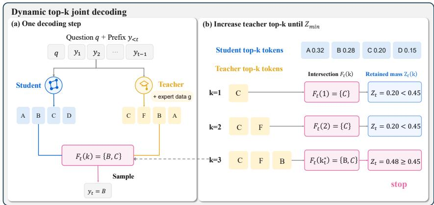
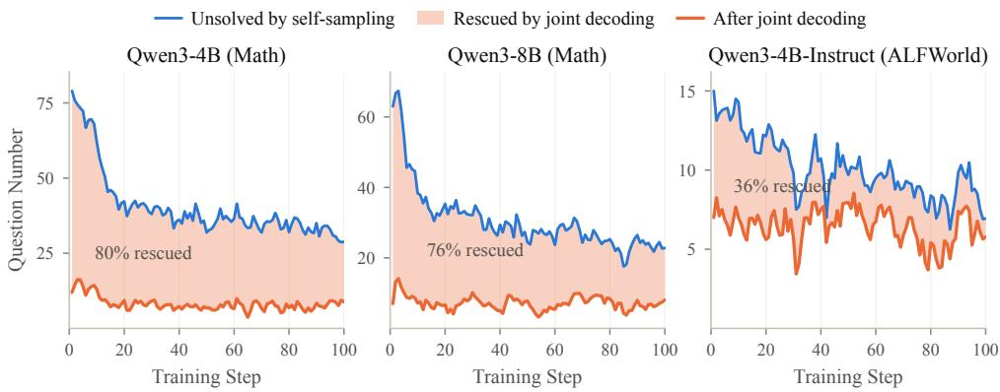
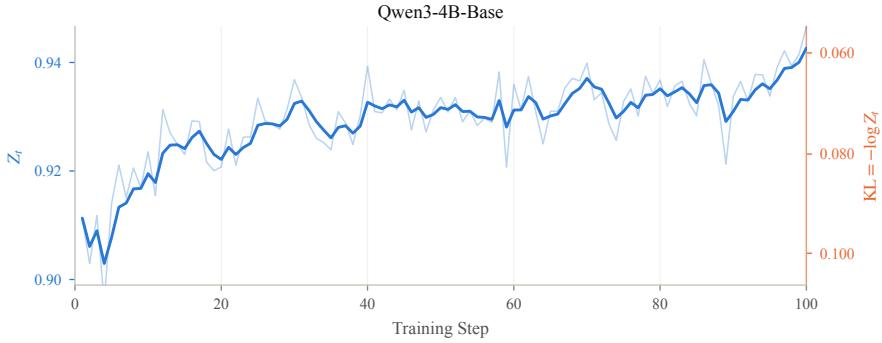

# WHEN ALL ROLLOUTS FAIL: POLICY-COMPATIBLE JOINT DECODING FOR HARD-PROBLEM REASONING

Zehao Wang1,2 Hanzhu Chen2 Runquan Gui1,2 Zhe Wang1 Lin Yang3∗

1 University of Science and Technology of China 2 Tencent

3 Shanghai Artificial Intelligence Laboratory

## ABSTRACT

Reinforcement Learning with Verifiable Rewards (RLVR) derives its learning signal from binary rewards via on-policy exploration and becomes a powerful paradigm for improving the reasoning of large language models. Yet it faces a learning cliff on problems beyond model’s current ability: when every rollout fails, the samples reveal nothing about a correct solution, and group-relative estimators (e.g., GRPO, RLOO) collapse the update to zero advantage. Expert trajectories offer a remedy, but they are incompatible with the current policy and often lie in the student’s low-probability regions, so the surviving updates demand large parameter shifts and decay into surface-level imitation rather than transferable reasoning. We argue that a useful learning signal on hard problems must be both verifiably correct and sufficiently compatible with the current policy. We propose Policy-Compatible Reinforcement Learning (PICO), which performs distribution-constrained joint decoding: expert data guides decoding at the token level while preserving the student’s relative token probabilities, and a dynamic top-k mechanism confines the sampling distribution under a finite divergence budget, yielding trajectories that are verified and policy-compatible by construction. These trajectories are optimized jointly with on-policy rollouts under a mixed-behavior objective that mitigates their distribution mismatch via importance sampling. Experiments across reasoning diverse datasets and agentic benchmarks demonstrate that PICO consistently outperforms standard RLVR and prior off-policy baselines.

## 1 INTRODUCTION

Reinforcement learning with verifiable rewards (RLVR) has emerged as a prominent paradigm for post-training large language models (LLMs)(Guo et al., 2025; Jaech et al., 2024; Team et al., 2025), demonstrating strong effectiveness in enhancing reasoning capabilities across domains such as math ematics, coding, and agentic tasks(Dong et al., 2026a; Zhang et al., 2025a). RLVR enables LLMs to learn directly from verifiable reward feedback on trajectories generated through on-policy exploration, yielding substantial and generalizable performance gains(Zhu et al., 2025; Shenfeld et al., 2026). However, this reliance on successful exploration creates a learning cliff on challenging problems beyond the model’s current capabilities: when all sampled rollouts fail, the policy receives no positive reward signal(Agrawal et al., 2026; Zhang et al., 2025b; Yue et al., 2025). This issue is particularly acute for methods based on group-relative advantage estimation (e.g., GRPO)(Yu et al., 2026; Zhang et al., 2026c), as all-zero-reward groups cause the estimated advantages to collapse to zero, leaving no informative learning signal to drive futher improvement on these problems.

A natural remedy is to leverage expert data, which offer a promising way to overcome this exploration bottleneck and are increasingly used to supplement online RL training. Typically generated by human experts or stronger models, expert trajectories expose the student to high-quality reasoning paths and provide informative learning signals. Yet these trajectories are not necessarily compatible with the current policy and often fall within low-probability regions under its distribution. Existing methods utilize such trajectories in three main ways. Some use them as supervised fine-tuning (SFT)

targets alongside RL training(Ma et al., 2026; Fu et al., 2026; Zhang et al., 2026b). When these trajectories lie in low-probability regions under the current policy, directly fitting them can induce excessive policy drift and result in surface-level imitation rather than transferable reasoning(Yan et al., 2025). Other approaches incorporate expert trajectories into rollout groups as off-policy samples to recover informative learning signals(Yan et al., 2025; Dong et al., 2026b). The distributional mismatch between these off-policy trajectories and on-policy rollouts can distort the resulting learning signals and destabilize optimization(Agrawal et al., 2026; Setlur et al., 2026; Shenfeld et al., 2026). A further line of work(Huang et al., 2026; Qu et al., 2026; Zhang et al., 2026a;d) leverages expert trajectories indirectly, using them to construct prefixes or hints that guide subsequent exploration and generation. Although the resulting continuations are generated by the current policy, they are conditioned on intermediate states that the policy may not be able to reach on its own from the original prompt(Ross et al., 2011; Qu et al., 2026; Agrawal et al., 2026). This creates privileged-context dependence: once the guidance is removed, the model may struggle to reproduce the full reasoning process. Collectively, these limitations reveal a fundamental trade-off: an effective learning signal on challenging problems must comefrom trajectories that are both verifiably correct and sufficiently compatible with the current student policy. Although expert data can provide verifiably correct trajectories, naively incorporating them may sacrifice policy compatibility by pulling the policy toward behaviors that lie far outside its current distribution, ultimately undermining stable and effective policy improvement.

To address this challenge, we propose Policy-Compatible Reinforcement Learning (PICO), which uses distribution-constrained joint decoding to recover positive learning signals from off-policy trajectories while explicitly controlling the induced distribution shift. Specifically, joint decoding constructs the next-token candidate set by intersecting high-probability tokens predicted by a teacher conditioned on expert data with those predicted by the student, thereby restricting sampling to candidates favored by both models. In this way, the teacher provides token-level guidance to improve rollout accuracy, while sampling according to the student’s relative probabilities preserves its own preferences. To further constrain the joint sampling distribution within a finite divergence budget, we introduce a dynamic top-k mechanism that adaptively adjusts the teacher’s candidate set. Finally, the resulting trajectories verified for correctness are optimized alongside on-policy rollouts through a mixed-behavior objective.

As illustrated in Figure 1, PICO activates joint decoding only for all-failure groups, preserving standard on-policy optimization whenever student exploration already yields positive rewards. Figure 4 further shows that joint decoding recovers verified, positive-reward trajectories in up to 80% of allfailure groups, thereby restoring informative learning signals where standard on-policy sampling yields none. Extensive experiments across mathematics and general reasoning benchmarks demonstrate that PICO consistently outperforms standard RLVR and existing expert-guided baselines. Further evaluations on agentic tasks establish its generalizability beyond conventional reasoning settings. Comprehensive ablation studies validate the effectiveness of its key components and confirm the importance of explicitly controlling the trade-off between rollout quality and student-policy proximity. In summary, our main contributions are threefold:

• We identify a fundamental trade-off between rollout quality and student-policy proximity when incorporating offline expert information into RLVR.

• We introduce PICO, which combines distribution-constrained joint decoding with failuretriggered mixed-behavior optimization to generate and learn from verified, policycompatible trajectories.

• Extensive experiments on mathematics, general reasoning, and agentic tasks demonstrate the effectiveness and generalizability of PICO.

## 2 PRELIMINARIES

Reinforcement Learning with Verifiable Rewards. Let D denote a training distribution over queries $x \in \mathcal { X }$ Given a query x, the policy $\pi _ { \theta }$ generates a response $y = ( y _ { 1 } , \dotsc , y _ { T } )$ autoregressively, where $T$ is the response length. Let $a ( y )$ denote the answer extracted from y and $a ^ { \star } ( x )$ the ground-truth answer to x. The verifier assigns the binary reward $R ( x , y ) = 1 \{ a ( y ) = a ^ { \star } ( x ) \}$ The RLVR objective maximizes the expected verifier reward(Guo et al., 2025):

$$
J ( \theta ) = \mathbb { E } _ { x \sim \mathcal { D } } \mathbb { E } _ { y \sim \pi _ { \theta } ( \cdot | x ) } \left[ R ( x , y ) \right] .\tag{1}
$$

  
Figure 1: Overview of PICO. Given an all-incorrect rollout group sampled from the student policy, PICO generates a verified joint trajectory to replace one failed rollout for mixed-behavior policy optimization. The joint trajectory is generated token by token through distribution-constrained joint decoding, which intersects the teacher and student top-k candidate sets.

Group Relative Policy Optimization. To optimize this objective, policy-gradient methods are commonly employed(Schulman et al., 2017). Among them, Group Relative Policy Optimization (GRPO) (Shao et al., 2024) is a representative approach that converts binary rewards into relative advantages within each rollout group without requiring a separately trained value model. For each query x, the behavior policy $\pi _ { \mathrm { o l d } }$ generates a group of trajectories $\{ y ^ { ( i ) } \} _ { i = 1 } ^ { n }$ , which are scored to obtain rewards $\{ R ^ { ( i ) } \} _ { i = 1 } ^ { n }$ . The advantage of each trajectory is then computed by standardizing its reward within the group:

$$
A ^ { ( i ) } = \frac { R ^ { ( i ) } - \mathrm { m e a n } \big ( \{ R ^ { ( j ) } \} _ { j = 1 } ^ { n } \big ) } { \mathrm { s t d } \big ( \{ R ^ { ( j ) } \} _ { j = 1 } ^ { n } \big ) } .\tag{2}
$$

Recent work(Liu et al., 2025b) suggests that the standard deviation term in the advantage calculation may introduce bias into policy optimization. The policy is updated by optimizing the clipped, KLregularized surrogate averaged over training problems:

$$
\mathcal { I } _ { \mathrm { G R P O } } ( \theta ) = \mathbb { E } _ { x \sim \mathcal { D } } \left[ \frac { 1 } { \mathcal { Z } } \sum _ { i = 1 } ^ { n } \sum _ { t = 1 } ^ { | y ^ { ( i ) } | } \operatorname* { m i n } \Bigl ( r _ { i , t } ( \theta ) A ^ { ( i ) } , \exp ( r _ { i , t } ( \theta ) , 1 - \epsilon , 1 + \epsilon ) A ^ { ( i ) } \Bigr ) - \beta \mathcal { L } _ { \mathrm { K L } } ( \theta ) \right]\tag{3}
$$

Here, $\begin{array} { r } { \mathcal { Z } = \sum _ { i = 1 } ^ { n } | y ^ { ( i ) } | } \end{array}$ is the total number of response tokens in the rollout group, and $r _ { i , t } ( \theta ) =$ $\pi _ { \boldsymbol { \theta } } ( y _ { t } ^ { ( i ) } \mid x , y _ { < t } ^ { ( i ) } ) / \pi _ { \mathrm { o l d } } ( y _ { t } ^ { ( i ) } \mid x , y _ { < t } ^ { ( i ) } )$ is the importance-sampling ratio. The clipping operation limits excessively large policy updates, while the KL term softly constrains $\pi _ { \theta }$ to remain close to the reference policy $\pi _ { \mathrm { r e f } }$ . In practice, this KL penalty can be downweighted or omitted when larger policy shifts are desired(Yan et al., 2025; Zhang et al., 2025b).

## 3 METHOD

In this section, we detail the design and implementation of PICO. As illustrated in Figure 1 and Algorithm 1, the framework consists of two components: distribution-constrained joint decoding and mixed-behavior policy optimization. First, distribution-constrained joint decoding combines the token-level preferences of the teacher and student to generate rollouts, with a dynamic top-k mechanism adaptively balancing teacher guidance and distribution shift. Second, mixed-behavior policy optimization learns from the resulting trajectories using importance-sampling (IS) ratios to account for the mismatch between the joint-decoding policy and the student policy.

## 3.1 DISTRIBUTION-CONSTRAINED JOINT DECODING

To improve the reliability of sampled trajectories, we employ a teacher–student joint-decoding strategy that restricts token selection to candidates jointly favored by both models. We first construct a consensus support set and then optimize a behavior policy over this set, thereby balancing rollout quality against proximity to the student policy.

Consensus Support Set. Given a query x, privileged expert guidance g available only to the teacher, and a shared generated prefix $y _ { < t }$ , the next-token distributions of the student and the teacher models are defined as

$$
p _ { t } ( v ) = \pi _ { \mathrm { o l d } } ( v \mid x , y _ { < t } ) , \qquad q _ { t } ( v ) = \pi _ { \mathrm { T } } ( v \mid x , g , y _ { < t } ) ,\tag{4}
$$

where v denotes a token in the shared vocabulary. Both models condition on the same generated prefix, while only the teacher has access to $g .$ Thus, the privileged guidance is neither exposed to the student nor appended to its rollout context; it influences generation only through the teacher’s token-level predictions.

At each decoding step, we construct the consensus support set by intersecting the top-k sets of the two models:

$$
F _ { t } = \mathrm { T o p K } ( q _ { t } , k _ { \mathrm { T } } ) \cap \mathrm { T o p K } ( p _ { t } , k _ { \mathrm { S } } ) ,\tag{5}
$$

where $k _ { \mathrm { T } }$ and $k _ { \mathrm { { S } } }$ denote the teacher and student cutoffs, respectively. By retaining only tokens supported by both models, $F _ { t }$ filters out predictions that are implausible under either distribution. The teacher contributes privileged information through candidate selection, while the student continues to determine which of the retained tokens are compatible with its current policy.

Joint-Decoding Policy Optimization. Based on a nonempty candidate set $F _ { t }$ , the remaining challenge is to assign sampling probabilities within this set. The resulting behavior policy must balance two competing objectives. On the one hand, it should assign greater probability to tokens favored by the teacher so that privileged guidance can improve rollout quality. On the other hand, it should remain close to the rollout-time student distribution, thereby keeping the joint trajectory compatible to student optimization.

We quantify these objectives using the expected teacher confidence $\mathbb { E } _ { v \sim \mu } [ q _ { t } ( v ) ]$ and the reverse KL divergence $D _ { \mathrm { K L } } ( \mu \| p _ { t } )$ , respectively. This yields the following joint-decoding objective:

$$
\mu _ { t } ^ { \lambda } = \arg \operatorname* { m i n } _ { \mu \in \Delta ( F _ { t } ) } \left[ D _ { \mathrm { K L } } ( \mu \Vert p _ { t } ) - \lambda \mathbb { E } _ { v \sim \mu } [ q _ { t } ( v ) ] \right] ,\tag{6}
$$

where $\Delta ( F _ { t } )$ is the set of probability distributions supported on $F _ { t }$ , and $\lambda \geq 0$ controls the tradeoff between teacher guidance and proximity to the student policy. A smaller λ better preserves the student’s relative token preferences within $F _ { t }$ , whereas a larger λ gives greater influence to the teacher. We describe how to obtain this target behavior policy in Section 3.2.

## 3.2 DYNAMIC TOP-k JOINT DECODING

Closed-Form Behavior Policy. For a nonempty support set $F _ { t }$ , the optimization problem in Eq. equation 6 admits the following closed-form solution:

$$
\mu _ { t } ^ { \lambda } ( v ) = { \frac { p _ { t } ( v ) \exp ( \lambda q _ { t } ( v ) ) \mathbf { 1 } \{ v \in F _ { t } \} } { C _ { t } ( \lambda ) } } , \qquad C _ { t } ( \lambda ) = \sum _ { u \in F _ { t } } p _ { t } ( u ) \exp ( \lambda q _ { t } ( u ) ) ,\tag{7}
$$

where $C _ { t } ( \lambda )$ is the normalizing constant. The solution incorporates teacher guidance through two complementary mechanisms: $F _ { t }$ imposes a hard support constraint by retaining only tokens selected by both models, while $\exp ( \lambda q _ { t } ( v ) )$ softly reweights the student probabilities within this support. The distribution shifts induced by support restriction and soft reweighting can be separated exactly.

Proposition 1 (KL divergence decomposition). Let $\begin{array} { r } { Z _ { t } = \sum _ { v \in F _ { t } } p _ { t } ( v ) } \end{array}$ denote the student probability mass retained by $F _ { t } ,$ , and let $\mu _ { t } ^ { 0 }$ denote the policy in $E q .$ . equation 7 at $\lambda = 0$ . Then

$$
D _ { \mathrm { K L } } ( \mu _ { t } ^ { \lambda } \| p _ { t } ) = - \log Z _ { t } + D _ { \mathrm { K L } } ( \mu _ { t } ^ { \lambda } \| \mu _ { t } ^ { 0 } ) \geq - \log Z _ { t } .\tag{8}
$$

The lower bound is attained at $\lambda = 0 ,$ for which $\mu _ { t } ^ { \lambda } = \mu _ { t } ^ { 0 } .$

The first term, − log $Z _ { t }$ , measures the shift caused by restricting the sampling support to $F _ { t }$ , whereas the second term measures the additional shift introduced by soft teacher reweighting. Therefore, for a fixed support set $F _ { t }$ , the distribution shift is minimized at $\lambda \ : = \ : 0$ . Empirically, we find that the support constraint alone achieves sufficient rollout accuracy, making additional teacher-based reweighting unnecessary. We therefore set $\lambda = 0$ and obtain our final hard joint-decoding policy:

$$
\mu _ { t } ^ { \mathrm { H } } ( v ) = \mu _ { t } ^ { 0 } ( v ) = { \frac { p _ { t } ( v ) \mathbf { 1 } \{ v \in F _ { t } \} } { Z _ { t } } } .\tag{9}
$$

This policy preserves the student’s relative token probabilities within $F _ { t }$ , while the teacher continues to guide generation through support selection. The derivation of Eq. equation 7 and the proof of Proposition 1 are provided in AppendixA.1.

Dynamic Top-k Selection. Under hard joint decoding, the per-step divergence is determined exactly by the retained student probability mass, $D _ { \mathrm { K L } } ( \mu _ { t } ^ { \mathrm { H } } | | p _ { t } ) = - \log Z _ { t }$ . Therefore, imposing $Z _ { t } \geq Z _ { \operatorname* { m i n } }$ guarantees $D _ { \mathrm { K L } } ( \mu _ { t } ^ { \mathrm { H } } | | \boldsymbol { \hat { p _ { t } } } ) \leq - \log Z _ { \mathrm { m i n } }$ . To enforce this constraint adaptively, we fix the student cutoff $K _ { \mathrm { S } }$ and, for each candidate teacher cutoff $k ,$ define

$$
F _ { t } ( k ) = \mathrm { T o p K } ( q _ { t } , k ) \cap \mathrm { T o p K } ( p _ { t } , K _ { \mathrm { S } } ) , \qquad Z _ { t } ( k ) = \sum _ { v \in F _ { t } ( k ) } p _ { t } ( v ) .\tag{10}
$$

We select the smallest teacher cutoff whose consensus support retains at least $Z _ { \mathrm { m i n } }$ student probability mass:

$$
k _ { t } ^ { \star } = \operatorname* { m i n } \left\{ k \in \left\{ 1 , \dots , K _ { \mathrm { T } } ^ { \operatorname* { m a x } } \right\} : Z _ { t } ( k ) \geq Z _ { \operatorname* { m i n } } \right\} .\tag{11}
$$

In practice, we increase k from 1 to $K _ { \mathsf { T } } ^ { \mathrm { m a x } }$ and stop at the first value satisfying the retained- mass constraint. We then set $F _ { t } = F _ { t } ( k _ { t } ^ { \star } )$ ) and $Z _ { t } = Z _ { t } ( k _ { t } ^ { \star } ) \mathrm { I } $ f no feasible cutoff exists, we fall back to the student policy by setting $\mu _ { t } = p _ { t }$ for that decoding step.

## 3.3 MIXED-BEHAVIOR POLICY OPTIMIZATION

Failure-Triggered Group Reconstruction. Following the GRPO procedure described in Section $^ { 2 , }$ we invoke joint decoding only when all n trajectories in a rollout group are incorrect. we sample one additional trajectory $y ^ { \mathrm { J } }$ using the hard joint-decoding policy. If $\dot { \boldsymbol { y } } ^ { \mathrm { J } }$ passes verification, it replaces one incorrect trajectory in the original group. Without loss of generality, let $y ^ { ( n ) }$ be the replaced trajectory. The resulting mixed-behavior group and its reward set are

$$
\widetilde G = \{ y ^ { ( 1 ) } , \ldots , y ^ { ( n - 1 ) } , y ^ { \mathrm { J } } \} , \qquad \widetilde { \mathcal { R } } = \{ R ^ { ( 1 ) } , \ldots , R ^ { ( n - 1 ) } , R ^ { \mathrm { J } } \} .\tag{12}
$$

For a successfully reconstructed group, the advantage of each trajectory is computed as

$$
A ^ { ( i ) } = \widetilde { R } ^ { ( i ) } - \mathrm { m e a n } \Big ( \widetilde { \mathcal { R } } \Big ) ,\tag{13}
$$

where $\widetilde { R } ^ { ( i ) } = R ^ { ( i ) }$ for $i < n , \widetilde { R } ^ { ( n ) } = R ^ { \mathrm { J } }$ , and $A ^ { \mathrm { J } } : = A ^ { ( n ) }$ . The verified joint trajectory thus restores reward variation to a group that would otherwise provide no group-relative learning signal.

Mixed-Behavior Policy Optimization. The reconstructed group contains $n { - } 1$ trajectories sampled from $\pi _ { \mathrm { o l d } }$ and one trajectory sampled from the joint behavior policy. We optimize the student using the following clipped surrogate objective, averaged over training problems:

$$
\begin{array} { r } { \mathcal { T } _ { \mathrm { P I C O } ( \theta ) } = \mathbb { E } _ { x \sim \mathcal { D } } \Bigg [ \frac { 1 } { \mathcal { Z } } \Bigg ( \underbrace { \sum _ { i = 1 } ^ { n - 1 } \sum _ { t = 1 } ^ { | y ^ { ( i ) } | } \operatorname* { m i n } \Big ( r _ { i , t } ( \theta ) A ^ { ( i ) } , \exp ( r _ { i , t } ( \theta ) , 1 - \epsilon , 1 + \epsilon ) A ^ { ( i ) } \Big ) } _ { \mathrm { s u d e n t u a j e c t o r i e s } } } \\ { + \underbrace { \sum _ { t = 1 } ^ { | y ^ { y } | } \operatorname* { m i n } \big ( \widehat { r } _ { \mathrm { J } , t } ( \theta ) A ^ { \mathrm { J } } , \exp ( \widehat { r } _ { \mathrm { J } , t } ( \theta ) , 1 - \epsilon , 1 + \epsilon ) A ^ { \mathrm { J } } \big ) } _ { \mathrm { t h } , \mathrm { t e r m } ( \widehat { r } _ { \mathrm { J } , t } ( \theta ) , 1 - \epsilon , 1 + \epsilon ) A ^ { \mathrm { J } } \big ) } \Bigg ) \Bigg ] , } \end{array}\tag{14}
$$

where $\begin{array} { r } { \mathcal { Z } = \sum _ { i = 1 } ^ { n - 1 } | y ^ { ( i ) } | + | y ^ { \mathrm { J } } | } \end{array}$ is the total number of response tokens in the reconstructed group and $\widehat { r } _ { \mathrm { J } , t } ( \theta )$ is the off-policy importance ratio for the joint trajectory

$$
\widehat { r } _ { \mathrm { J } , t } ( \theta ) = \frac { \pi _ { \theta } \big ( y _ { t } ^ { \mathrm { J } } \mid x , y _ { < t } ^ { \mathrm { J } } \big ) } { \mu _ { t } \big ( y _ { t } ^ { \mathrm { J } } \big ) } = Z _ { t } \frac { \pi _ { \theta } \big ( y _ { t } ^ { \mathrm { J } } \mid x , y _ { < t } ^ { \mathrm { J } } \big ) } { \pi _ { \mathrm { o l d } } \big ( y _ { t } ^ { \mathrm { J } } \mid x , y _ { < t } ^ { \mathrm { J } } \big ) } .\tag{15}
$$

At a fallback step, $\mu _ { t } = p _ { t }$ and $Z _ { t } = 1 , \mathrm { s o } \widehat { r } _ { \mathrm { J } , t } ( \theta )$ reduces to the standard policy ratio. This importance ratio accounts for the token-level behavior-policy mismatch introduced by joint decoding.

  
Figure 2: Training dynamics of Qwen3-4B-Base and Qwen3-8B-Base. We report the training reward, solve-none question number, and average response length throughout training.

## 4 EXPERIMENTS

## 4.1 EXPERIMENTAL SETUP

Models and Datasets. In our main experiments, we consider three student policies with different model scales and instruction-tuning configurations: Qwen3-4B-Base, Qwen3-8B-Base, and Qwen3- 4B-Instruct(Yang et al., 2025). We use Qwen3-4B-Instruct specifically for the agentic-task experiments. Across all settings, Qwen3-4B-Instruct, conditioned on expert solutions, serves as the teacher model. For mathematical and general reasoning tasks, we use DAPO-Math-17K(Yu et al., 2026) as the training set, which contains a large collection of challenging problems paired with high-quality expert demonstrations. For agentic tasks, we conduct experiments on ALFWorld and ScienceWorld, two widely used interactive reasoning benchmarks.

Baselines. We compare PICO against GRPO and three representative off-policy methods , as well as a self-distillation baseline. Specifically, LUFFY(Yan et al., 2025) combines on-policy rollouts with off-policy demonstrations through mixed-policy GRPO and regularized policy shaping; Prefix-RFT(Huang et al., 2026) constructs hybrid trajectories by pairing prefixes sampled from expert demonstrations with policy-generated continuations; and ReLIFT(Ma et al., 2026) interleaves reinforcement learning with targeted online supervised fine-tuning on challenging problems. We additionally compare with RLRT(Kim et al., 2026), a self-distillation method that uses reversed teacher signals to emphasize student-preferred tokens in verified successful trajectories.

Training Details. For a fair comparison, we use the same training configuration for all RL methods. We remove the KL regularization term by setting $\beta = 0$ and omit standard-deviation normalization in the advantage computation to avoid implicitly reweighting problems according to their withingroup reward variance. We fix the total rollout group size at 8 for every query. For PICO and all off-policy baselines, each mixed group consists of 7 on-policy trajectories and 1 off-policy trajectory. We use a global training batch size of 128, a PPO mini-batch size of 64, and a maximum response length of 20,480 tokens. Following DAPO, we adopt asymmetric clipping with $\epsilon _ { \mathrm { h i g h } } = 0 . 2 8$ and $\epsilon _ { \mathrm { l o w } } = 0 . 2 0$ . The complete training configuration is provided in Appendix C.1.

Evaluations. Following prior work, we evaluate primarily on four widely used and challenging mathematical reasoning benchmarks: AIME 2025, AIME 2026, HMMT 2026, and MATH-500. During evaluation, we set the sampling temperature to 0.6 and the maximum response length to 20,480 tokens. To reduce the effect of sampling variance, we independently sample 16 responses for each problem and report the average accuracy across these samples (avg@16). To assess out-ofdistribution generalization beyond the mathematics-focused training domain, we additionally evaluate on GPQA-Diamond and Humanity’s Last Exam (HLE). Appendix C.2 provides additional information about the evaluation benchmarks.

Table 1: Overall performance on in-domain and out-of-domain benchmarks, reported as avg@16. Bold and underlined values indicate the best and second-best results, respectively. $\bigtriangleup$ denotes the absolute performance gain of our method over GRPO. Pass@k results are reported in Table 4.
<table><tr><td rowspan="2">Method</td><td colspan="4">In-domain (%)</td><td colspan="2">Out-of-domain (%)</td><td rowspan="2">Avg.</td></tr><tr><td>AIME25</td><td>AIME26</td><td>HMMT26</td><td>MATH500</td><td>GPQA-D</td><td>HLE</td></tr><tr><td colspan="8">Qwen3-4B-Base</td></tr><tr><td>Base</td><td>6.9</td><td>8.1</td><td>3.6</td><td>67.8</td><td>23.5</td><td>3.0</td><td>18.8</td></tr><tr><td>GRPO</td><td>21.7</td><td>14.4</td><td>10.0</td><td>84.6</td><td>34.3</td><td>2.2</td><td>27.9</td></tr><tr><td>LUFFY</td><td>22.1</td><td>18.1</td><td>14.0</td><td>84.2</td><td>36.6</td><td>3.8</td><td>29.8</td></tr><tr><td>Prefix-RFT</td><td>15.4</td><td>12.1</td><td>7.9</td><td>79.8</td><td>34.3</td><td>3.4</td><td>25.5</td></tr><tr><td>ReLIFT</td><td>10.6</td><td>10.2</td><td>6.8</td><td>76.2</td><td>31.5</td><td>3.8</td><td>23.2</td></tr><tr><td>RLRT</td><td>18.5</td><td>19.8</td><td>15.9</td><td>83.8</td><td>34.7</td><td>4.2</td><td>29.5</td></tr><tr><td>PICO</td><td>23.1</td><td>22.3</td><td>15.9</td><td>87.6</td><td>37.7</td><td>5.2</td><td>32.0</td></tr><tr><td>△</td><td>+1.4</td><td>+7.9</td><td>+5.9</td><td>+3.0</td><td>+3.4</td><td>+3.0</td><td>+4.1</td></tr><tr><td colspan="8">Qwen3-8B-Base</td></tr><tr><td>Base</td><td>10.2</td><td>7.5</td><td>4.4</td><td>74.8</td><td>30.1</td><td>4.4</td><td>21.9</td></tr><tr><td>GRPO</td><td>22.7</td><td>18.9</td><td>14.6</td><td>86.4</td><td>44.4</td><td>3.8</td><td>31.8</td></tr><tr><td>LUFFY</td><td>24.4</td><td>21.9</td><td>14.9</td><td>88.2</td><td>46.7</td><td>5.2</td><td>33.6</td></tr><tr><td>Prefix-RFT</td><td>23.9</td><td>21.0</td><td>12.1</td><td>85.8</td><td>42.6</td><td>3.4</td><td>31.5</td></tr><tr><td>ReLIFT</td><td>21.7</td><td>21.0</td><td>14.8</td><td>87.8</td><td>41.1</td><td>3.8</td><td>31.7</td></tr><tr><td>RLRT</td><td>18.8</td><td>21.9</td><td>15.9</td><td>84.4</td><td>45.7</td><td>4.6</td><td>31.9</td></tr><tr><td>PICO</td><td>25.6</td><td>23.3</td><td>18.9</td><td>90.4</td><td>48.8</td><td>5.6</td><td>35.4</td></tr><tr><td>△</td><td>+2.9</td><td>+4.4</td><td>+4.3</td><td>+4.0</td><td>+4.4</td><td>+1.8</td><td>+3.6</td></tr></table>

## 4.2 MAIN RESULTS

Performance Comparison. As shown in Table 1, PICO consistently achieves the strongest overall performance across both model scales. It improves the average score over GRPO by 4.1 percentage points with Qwen3-4B-Base and by 3.6 points with Qwen3-8B-Base, while outperforming the strongest competing method by 2.2 and 1.8 points, respectively. The gains are particularly pronounced on challenging benchmarks such as AIME26 and HMMT26, supporting our claim that PICO enables effective learning from difficult problems that frequently produce all-incorrect rollout groups. Moreover, the consistent improvements on GPQA-Diamond and HLE demonstrate that the learned reasoning capability generalizes beyond the mathematics-focused training distribution. Since the teacher is unavailable during evaluation, these gains reflect improvements internalized by the student rather than reliance on privileged guidance.

Training Dynamics. Figure 2 shows that PICO maintains higher training rewards and consistently fewer solve-none questions than GRPO and LUFFY across both model scales. While the baselines tend to plateau after the initial stage, PICO continues to improve, indicating that failure-triggered joint decoding converts otherwise uninformative all-incorrect groups into useful learning signals. PICO also produces longer responses, which, together with the higher verified rewards and lower solve-none counts, suggests more sustained reasoning on difficult problems. Overall, these results show that PICO improves difficult-problem exploration without compromising training stability. Additional analyses in Appendix B.2 and Fig.4 show that joint decoding consistently rescues questions for which all student self-sampled trajectories fail, thereby restoring effective learning signals for otherwise uninformative groups.

## 4.3 AGENTIC TASKS

We conduct the agentic-task experiments using Qwen3-4B-Instruct as both the student policy and the teacher providing token-level guidance. As shown in Table 2, PICO consistently outperforms all baselines across ALFWorld and ScienceWorld, achieving the highest average success rate of 74.3%. Compared with GRPO, PICO improves the average performance by 6.8 percentage points, demonstrating its effectiveness in interactive environments characterized by long-horizon decisionmaking and sparse rewards. It also surpasses the off-policy RL method LUFFY and the prefixguided method Prefix-RFT by 4.9 and 5.2 points on average, respectively, further validating the effectiveness of token-level joint guidance for agentic reasoning.

Table 2: Performance on agentic reasoning benchmarks based on Qwen3-4B-Instruct. Bold and underlined values indicate the best and second-best results, respectively. △ denotes the absolute performance gains, in percentage points, of our method over GRPO.
<table><tr><td rowspan="2">Method</td><td colspan="2">ALFWorld (%)</td><td rowspan="2">ScienceWorld (%)</td><td rowspan="2">Avg.</td></tr><tr><td>Seen</td><td>Unseen</td></tr><tr><td></td><td></td><td>Qwen3-4B-Instruct</td><td></td><td></td></tr><tr><td>GRPO</td><td>80.7</td><td>71.6</td><td>50.3</td><td>67.5</td></tr><tr><td>LUFFY</td><td>81.4</td><td>74.6</td><td>52.1</td><td>69.4</td></tr><tr><td>Prefix-RFT</td><td>82.1</td><td>72.4</td><td>52.9</td><td>69.1</td></tr><tr><td>PICO</td><td>88.6</td><td>79.1</td><td>55.3</td><td>74.3</td></tr><tr><td>△</td><td>+7.9</td><td>+7.5</td><td>+5.0</td><td>+6.8</td></tr></table>

Table 3: Ablation study of PICO on four mathematical reasoning benchmarks using Qwen3-4B-Base. “w/o Joint Decoding” directly generates responses from the teacher policy. The fixed-k variants replace the dynamic top-k mechanism with a fixed teacher candidate-set size. “w/o IS Ratio” removes the importance-sampling ratio from policy optimization. Bold and underlined values indicate the best and second-best results, respectively.
<table><tr><td>Method / Variant</td><td>AIME25</td><td>AIME26</td><td>HMMT26</td><td>MATH500</td><td>Avg.</td></tr><tr><td colspan="6">Qwen3-4B-Base</td></tr><tr><td>GRPO</td><td>21.7</td><td>14.4</td><td>10.0</td><td>84.6</td><td>32.7</td></tr><tr><td>PICO</td><td>23.1</td><td>22.3</td><td>15.9</td><td>87.6</td><td>37.2</td></tr><tr><td>w/o Joint Decoding w/o Dynamic Top-k</td><td>20.6</td><td>16.9</td><td>14.1</td><td>83.6</td><td>33.8</td></tr><tr><td>Fixed k = 5</td><td>23.3</td><td>16.9</td><td>12.7</td><td>84.2</td><td></td></tr><tr><td>Fixed k = 10</td><td>23.1</td><td>22.1</td><td>13.4</td><td>84.8</td><td>34.3</td></tr><tr><td>Fixed k = 20</td><td>21.7</td><td>18.3</td><td>17.1</td><td>84.0</td><td>35.9 35.3</td></tr><tr><td></td><td></td><td></td><td></td><td></td><td></td></tr><tr><td>w/o Off-Policy IS Ratio</td><td>21.7</td><td>19.4</td><td>15.2</td><td>84.8</td><td>35.3</td></tr></table>

## 4.4 ABLATION STUDY

We analyze the contribution of each component of PICO. As shown in Table 3, the results highlight the importance of maintaining compatibility between guided trajectories and the student policy. Directly sampling from the teacher without joint decoding introduces the largest behavior mismatch and yields the weakest ablation result, reducing the average score from 37.2% to 33.8%. The fixed-k variants further reveal a trade-off between teacher guidance and student compatibility. Increasing k retains more student-compatible tokens but weakens the selectivity of teacher guidance, potentially reducing rollout accuracy. As long as the candidate set remains sufficiently accurate, increasing k improves learning, as evidenced by the gain from k = 5 to k = 10. However, further increasing k to 20 weakens teacher guidance and slightly reduces performance, making k = 10 the best fixed setting. In contrast, our dynamic top-k strategy adapts the candidate set at each decoding step according to the retained student probability mass, achieving a better balance and the highest average score of 37.2%. Finally, removing the off-policy importance-sampling ratio reduces performance to 35.3%, confirming the importance of explicitly accounting for the remaining behavior-policy mismatch during optimization.

## 5 RELATED WORK

## 5.1 ON- AND OFF-POLICY LEARNING

Recent studies show that on-policy optimization is fundamentally bounded by the current policy’s exploration capacity, often causing learning to stall on challenging problems (Yue et al., 2025). To overcome this exploration bottleneck, a growing line of work incorporates off-policy expert trajectories into RLVR training(Dong et al., 2026b; Liu et al., 2025a). LUFFY(Yan et al., 2025) combines expert demonstrations with on-policy rollouts through mixed-policy optimization, while ReLIFT(Ma et al., 2026) interleaves reinforcement learning with supervised fine-tuning on highquality solutions to challenging problems. SRFT and Chord further unifies supervised learning from expert demonstrations and reinforcement learning from self-generated rollouts within a single training stage(Fu et al., 2026; Zhang et al., 2026b). However, because expert trajectories may lie in low-probability regions under the current student policy, directly optimizing on them can induce substantial distribution mismatch, potentially leading to excessive policy drift and unstable optimization (Agrawal et al., 2026; Setlur et al., 2026; Zheng et al., 2026; Yang et al., 2026). In contrast, PICO uses expert trajectories to guide distribution-constrained joint decoding, producing successful rollouts that remain compatible with the student policy.

## 5.2 EXPERT-GUIDED EXPLORATION AND DECODING

Rather than directly optimizing on off-policy demonstrations, another line of work uses expert information to guide rollout generation(Jiang et al., 2026; Zhang et al., 2025b; Liu et al., 2026). Prefix-RFT(Huang et al., 2026) conditions rollouts on prefixes sampled from expert demonstrations, while BREAD and StepHint use expert-derived prefixes or intermediate hints to steer exploration toward promising reasoning states(Zhang et al., 2026d;a). OC-GRPO(Agrawal et al., 2026) further applies importance sampling ratio to account for the mismatch between guided rollouts and the original unguided policy. Although these methods facilitate successful exploration, injecting guidance into the rollout context may teach the student to continue from expert-induced states without learning how to reach those states independently from the original prompt(Qu et al., 2026; Ross et al., 2011; Zhang et al., 2026c). A related line of work combines or contrasts the token distributions of models with different capabilities to steer generation toward higher-quality outputs(Liu et al., 2021; Li et al., 2023; Dekoninck et al., 2024). The effectiveness of these methods motivates us to incorporate teacher guidance at the token level. Accordingly, PICO employs distribution-constrained joint decoding to construct policy-compatible trajectories.

## 6 CONCLUSION

In this work, we introduced PICO, a policy-compatible reinforcement learning framework for overcoming the exploration bottleneck of RLVR on challenging problems. PICO leverages expert data to generate verified trajectories while controlling their deviation from the student policy, and selectively incorporates these trajectories into all-failure groups to restore informative learning signals. Extensive experiments across mathematical reasoning, general reasoning, and agentic tasks demonstrate that PICO consistently outperforms standard RLVR and representative expert-guided baselines across different model scales, without requiring teacher guidance at inference time. Ablation studies further validate the effectiveness of each component. Overall, our results highlight policy compatibility as a key principle for effectively incorporating expert knowledge into RLVR, providing a practical approach to improving models beyond the limits of unaided on-policy exploration.

## REFERENCES

Priyank Agrawal, Ankur Samanta, Shervin Ghasemlou, Boris Vidolov, Jalaj Bhandari, Kavosh Asadi, Daniel Jiang, and Aditya Modi. Off-context grpo: Learning to reason on hard problems using privileged information. arXiv preprint arXiv:2607.19313, 2026.

Jasper Dekoninck, Marc Fischer, Luca Beurer-Kellner, and Martin Vechev. Controlled text generation via language model arithmetic. In International Conference on Learning Representations, volume 2024, pp. 35011–35038, 2024.

Guanting Dong, Hangyu Mao, Kai Ma, Licheng Bao, Yifei Chen, Zhongyuan Wang, Zhongxia Chen, Jiazhen Du, Huiyang Wang, Fuzheng Zhang, et al. Agentic reinforced policy optimization. In International Conference on Learning Representations, volume 2026, pp. 16981–17017, 2026a.

Yihong Dong, Xue Jiang, Yongding Tao, Huanyu Liu, Kechi Zhang, Lili Mou, Rongyu Cao, Yingwei Ma, Jue Chen, Binhua Li, et al. Rl-plus: Countering capability boundary collapse of llms in reinforcement learning with hybrid-policy optimization. In Proceedings ofthe 64th Annual Meeting ofthe Associationfor Computational Linguistics (Volume 1: Long Papers), pp. 43029–43053, 2026b.

Yuqian Fu, Tinghong Chen, Jiajun Chai, Xihuai Wang, Songjun Tu, Guojun Yin, Wei Lin, Qichao Zhang, Yuanheng Zhu, and Dongbin Zhao. Srft: A single-stage method with supervised and reinforcement fine-tuning for reasoning. In International Conference on Learning Representations, volume 2026, pp. 102430–102459, 2026.

Daya Guo, Dejian Yang, Haowei Zhang, Junxiao Song, Peiyi Wang, Qihao Zhu, Runxin Xu, Ruoyu Zhang, Shirong Ma, Xiao Bi, et al. Deepseek-r1: Incentivizing reasoning capability in llms via reinforcement learning. arXiv preprint arXiv:2501.12948, 2025.

Zeyu Huang, Tianhao Cheng, Zihan Qiu, Zili Wang, Xu Yinghui, Edoardo Ponti, and Ivan Titov. Blending supervised and reinforcement fine-tuning with prefix sampling. In Forty-third International Conference on Machine Learning, 2026. URL https://openreview.net/forum? id=MgtyPYrC4h.

Aaron Jaech, Adam Kalai, Adam Lerer, Adam Richardson, Ahmed El-Kishky, Aiden Low, Alec Helyar, Aleksander Madry, Alex Beutel, Alex Carney, et al. Openai o1 system card. arXiv preprint arXiv:2412.16720, 2024.

Zishang Jiang, Jinyi Han, Xinyi Wang, Sihang Jiang, Zhaoqian Dai, Ma Shuguang, Fei Yu, Jiaqing Liang, Yanghua Xiao, et al. Selective expert guidance for effective and diverse exploration in reinforcement learning of llms. In International Conference on Learning Representations, volume 2026, pp. 62980–63006, 2026.

Jeonghye Kim, Jiwon Jeon, Dongsheng Li, and Yuqing Yang. Rebellious student: Reversing teacher signals for reasoning exploration with self-distilled rlvr. arXiv preprint arXiv:2605.10781, 2026.

Xiang Lisa Li, Ari Holtzman, Daniel Fried, Percy Liang, Jason Eisner, Tatsunori B Hashimoto, Luke Zettlemoyer, and Mike Lewis. Contrastive decoding: Open-ended text generation as optimization. In Proceedings ofthe 61st annual meeting ofthe associationfor computational linguistics (volume 1: Long papers), pp. 12286–12312, 2023.

Alisa Liu, Maarten Sap, Ximing Lu, Swabha Swayamdipta, Chandra Bhagavatula, Noah A Smith, and Yejin Choi. Dexperts: Decoding-time controlled text generation with experts and anti-experts. In Proceedings of the 59th Annual Meeting of the Association for Computational Linguistics and the 11th International Joint Conference on Natural Language Processing (Volume 1: Long Papers), pp. 6691–6706, 2021.

Yihao Liu, Shuocheng Li, Lang Cao, Yuhang Xie, Mengyu Zhou, Haoyu Dong, Xiaojun Ma, Shi Han, and Dongmei Zhang. Superrl: Reinforcement learning with supervision to boost language model reasoning. arXiv preprint arXiv:2506.01096, 2025a.

Zeyuan Liu, Jeonghye Kim, Xufang Luo, Dongsheng Li, and Yuqing Yang. Exploratory memoryaugmented llm agent via hybrid on-and off-policy optimization. In International Conference on Learning Representations, volume 2026, pp. 111799–111820, 2026.

Zichen Liu, Changyu Chen, Wenjun Li, Penghui Qi, Tianyu Pang, Chao Du, Wee Sun Lee, and Min Lin. Understanding r1-zero-like training: A critical perspective. arXiv preprint arXiv:2503.20783, 2025b.

Lu Ma, Hao Liang, Meiyi Qiang, Lexiang Tang, Xiaochen Ma, Zhen Wong, Junbo Niu, Chengyu Shen, Runming He, Yanhao Li, et al. Learning what reinforcement learning can’t: Interleaved online fine-tuning for hardest questions. In International Conference on Learning Representations, volume 2026, pp. 80802–80821, 2026.

Yuxiao Qu, Amrith Setlur, Virginia Smith, Ruslan Salakhutdinov, and Aviral Kumar. Pope: Learning to reason on hard problems via privileged on-policy exploration. arXiv preprint arXiv:2601.18779, 2026.

Stephane Ross, Geoffrey Gordon, and Drew Bagnell. A reduction of imitation learning and struc-´ tured prediction to no-regret online learning. In Proceedings of the fourteenth international conference on artificial intelligence and statistics, pp. 627–635. JMLR Workshop and Conference Proceedings, 2011.

John Schulman, Filip Wolski, Prafulla Dhariwal, Alec Radford, and Oleg Klimov. Proximal policy optimization algorithms. arXiv preprint arXiv:1707.06347, 2017.

Amrith Setlur, Zijian Wang, Andrew Cohen, Paria Rashidinejad, and Sang Michael Xie. Reuse your flops: Scaling rl on hard problems by conditioning on very off-policy prefixes. arXiv preprint arXiv:2601.18795, 2026.

Zhihong Shao, Peiyi Wang, Qihao Zhu, Runxin Xu, Junxiao Song, Xiao Bi, Haowei Zhang, Mingchuan Zhang, YK Li, Yang Wu, et al. Deepseekmath: Pushing the limits of mathematical reasoning in open language models. arXiv preprint arXiv:2402.03300, 2024.

Idan Shenfeld, Jyothish Pari, and Pulkit Agrawal. Rl’s razor: Why online reinforcement learning forgets less. In International Conference on Learning Representations, volume 2026, pp. 59839– 59864, 2026.

Kimi Team, Angang Du, Bofei Gao, Bowei Xing, Changjiu Jiang, Cheng Chen, Cheng Li, Chenjun Xiao, Chenzhuang Du, Chonghua Liao, et al. Kimi k1. 5: Scaling reinforcement learning with llms. arXiv preprint arXiv:2501.12599, 2025.

Jianhao Yan, Yafu Li, Zican Hu, Zhi Wang, Ganqu Cui, Xiaoye Qu, Yu Cheng, and Yue Zhang. Learning to reason under off-policy guidance. In The Thirty-ninth Annual Conference on Neural Information Processing Systems, 2025. URL https://openreview.net/forum?id= vO8LLoNWWk.

An Yang, Anfeng Li, Baosong Yang, Beichen Zhang, Binyuan Hui, Bo Zheng, Bowen Yu, Chang Gao, Chengen Huang, Chenxu Lv, et al. Qwen3 technical report. arXiv preprint arXiv:2505.09388, 2025.

Zhihe Yang, Xufang Luo, Zilong Wang, Dongqi Han, Zhiyuan He, Dongsheng Li, and Yunjian Xu. Do not let low-probability tokens over-dominate in rl for llms. In C. Vondrick, B. Hariharan, C. Raffel, L. Pinto, D. Yang, and A. Faust (eds.), International Conference on Learning Representations, volume 2026, pp. 117072–117101, 2026. URL https://proceedings.iclr.cc/paper\_files/paper/2026/file/ be0e41aa31bb4bc7e882035d82f2d781-Paper-Conference.pdf.

Qiying Yu, Zheng Zhang, Ruofei Zhu, Yufeng Yuan, Xiaochen Zuo, Yu Yue, Weinan Dai, Tiantian Fan, Gaohong Liu, Lingjun Liu, et al. Dapo: An open-source llm reinforcement learning system at scale. Advances in Neural Information Processing Systems, 38:113222–113244, 2026.

Yang Yue, Zhiqi Chen, Rui Lu, Andrew Zhao, Zhaokai Wang, Yang Yue, Shiji Song, and Gao Huang. Does reinforcement learning really incentivize reasoning capacity in LLMs beyond the base model? In The Thirty-ninth Annual Conference on Neural Information Processing Systems, 2025. URL https://openreview.net/forum?id=4OsgYD7em5.

Guibin Zhang, Hejia Geng, Xiaohang Yu, Zhenfei Yin, Zaibin Zhang, Zelin Tan, Heng Zhou, Zhongzhi Li, Xiangyuan Xue, Yijiang Li, et al. The landscape of agentic reinforcement learning for llms: A survey. arXiv preprint arXiv:2509.02547, 2025a.

Kaiyi Zhang, Ang Lv, Jinpeng Li, Yongbo Wang, Feng Wang, Haoyuan Hu, and Rui Yan. Stephint: Multi-level stepwise hints enhance reinforcement learning to reason. In Proceedings of the 64th Annual Meeting of the Association for Computational Linguistics (Volume 1: Long Papers), pp. 37846–37864, 2026a.

Wenhao Zhang, Yuexiang Xie, Yuchang Sun, Yanxi Chen, Guoyin Wang, Yaliang Li, Bolin Ding, and Jingren Zhou. On-policy rl meets off-policy experts: Harmonizing supervised fine-tuning and reinforcement learning via dynamic weighting. In International Conference on Learning Representations, volume 2026, pp. 120693–120726, 2026b.

Xiaoying Zhang, Yipeng Zhang, Hao Sun, Kaituo Feng, Chaochao Lu, Chao Yang, and Helen Meng. Critique-grpo: Advancing llm reasoning with natural language and numerical feedback. arXiv preprint arXiv:2506.03106, 2025b.

Xichen Zhang, Sitong Wu, Yinghao Zhu, Haoru Tan, Shaozuo Yu, Ziyi He, and Jiaya Jia. Scafgrpo: Scaffolded group relative policy optimization for enhancing llm reasoning. In International Conference on Learning Representations, volume 2026, pp. 131946–131974, 2026c.

Xuechen Zhang, Zijian Huang, Yingcong Li, Chenshun Ni, Jiasi Chen, and Samet Oymak. Bread: Branched rollouts from expert anchors bridge sft & rl for reasoning. Advances in Neural Information Processing Systems, 38:96726–96752, 2026d.

Haizhong Zheng, Jiawei Zhao, and Beidi Chen. Prosperity before collapse: How far can off-policy rl reach with stale data on llms? In International Conference on Learning Representations, volume 2026, pp. 82657–82679, 2026.

Hanqing Zhu, Zhenyu Zhang, Hanxian Huang, DiJia Su, Zechun Liu, Jiawei Zhao, Igor Fedorov, Hamed Pirsiavash, Zhizhou Sha, Jinwon Lee, et al. The path not taken: Rlvr provably learns off the principals. arXiv preprint arXiv:2511.08567, 2025.

## AI USE STATEMENT

In this work, we used generative AI tools to assist in the writing of proofs and with translation. We did not use generative AI tools to formulate mathematical claims, provide critical ingredients for proving mathematical claims, propose or refine hypotheses, design or provide feedback on research methodology or experiments, implement methods, support qualitative or thematic data analysis, or interpret results. Generating synthetic datasets, developing theoretical models or conceptual frameworks, and cleaning or reformatting datasets were not applicable to this work. Additionally, we used generative AI tools to create or modify scientific figures or images, draft parts of the manuscript, support brainstorming, and source or search for information. We have reviewed all AI-assisted work. In particular, the authors manually verified every step of the AI-assisted proofs; checked translations against the original text to preserve their technical meaning; inspected AI-assisted figures and im ages for consistency with the underlying results; and carefully reviewed and revised all AI-assisted manuscript text. Ideas and information obtained through AI-assisted brainstorming or search were treated only as preliminary suggestions and were independently validated through manual literature review and consultation of the original sources. We take responsibility for the final content of this work, including text, claims, or artifacts produced with the aid of generative AI.

## ETHICS STATEMENT

This work does not involve human subjects, personally identifiable or sensitive information, or the collection and release of new datasets. All experiments are conducted using publicly available models, datasets, and benchmarks for research purposes. Our method focuses on improving reinforcement learning with verifiable rewards and is not designed for high-risk or directly harmful applications.

## REPRODUCIBILITY STATEMENT

To support reproducibility, Section 3 provides a complete specification of the proposed method, while Section 4.1 summarizes the main experimental setup. Appendix C provides further details on the training procedure, benchmark construction, data processing, and evaluation configurations, with the complete training hyperparameters reported in Tables 5 and 6. All prompts used for training and evaluation are provided in Appendix D.

## A METHODOLOGICAL SUPPLEMENTS

## A.1 THEORETICAL PROOFS

This section provides the derivations underlying the joint-decoding policy and makes explicit the guarantees induced by the retained-mass constraint. We assume that the student and teacher share a tokenizer and vocabulary V. Since $p _ { t }$ is obtained from a softmax distribution, we have $p _ { t } ( v ) > 0$ for every $v \in \mathcal V$ . We also assume a fixed tie-breaking rule for top-k selection, so the selected sets are nested as k increases. The retained-mass threshold satisfies $Z _ { \mathrm { m i n } } ~ \in ~ ( 0 , 1 ]$ . All token-level statements below are conditioned on a fixed query, privileged guidance, and generated prefix; we suppress this conditioning when it is clear from context.

## A.1.1 OPTIMIZATION PROBLEM FORMULATION AND CLOSED-FORM SOLUTION

For a nonempty consensus set $F _ { t }$ , Eq. equation 6 can be written as

$$
\operatorname* { m i n } _ { \mu \in \Delta ( F _ { t } ) } \sum _ { v \in F _ { t } } \mu ( v ) \log \frac { \mu ( v ) } { p _ { t } ( v ) } - \lambda \sum _ { v \in F _ { t } } \mu ( v ) q _ { t } ( v ) .\tag{16}
$$

Introducing a Lagrange multiplier η for the normalization constraint gives

$$
\mathcal { L } ( \mu , \eta ) = \sum _ { v \in F _ { t } } \mu ( v ) \log \frac { \mu ( v ) } { p _ { t } ( v ) } - \lambda \sum _ { v \in F _ { t } } \mu ( v ) q _ { t } ( v ) + \eta \left( \sum _ { v \in F _ { t } } \mu ( v ) - 1 \right) .\tag{17}
$$

At the optimum, stationarity with respect to each $\mu ( v )$ yields

$$
\log { \frac { \mu ( v ) } { p _ { t } ( v ) } } + 1 - \lambda q _ { t } ( v ) + \eta = 0 ,\tag{18}
$$

and hence

$$
\mu ( v ) = p _ { t } ( v ) \exp ( \lambda q _ { t } ( v ) - 1 - \eta ) .\tag{19}
$$

Normalizing over $F _ { t }$ gives

$$
\mu _ { t } ^ { \lambda } ( v ) = \frac { p _ { t } ( v ) \exp ( \lambda q _ { t } ( v ) ) \mathbf { 1 } \{ v \in F _ { t } \} } { \sum _ { u \in F _ { t } } p _ { t } ( u ) \exp ( \lambda q _ { t } ( u ) ) } ,\tag{20}
$$

which is $\operatorname { E q . }$ equation 7. The KL term is strictly convex in µ on $\Delta ( F _ { t } )$ , while the teacher-confidence term is linear; therefore, this stationary point is the unique global minimizer.

## A.1.2 PROOF OF THE KL DECOMPOSITION

Let $\begin{array} { r } { Z _ { t } = \sum _ { v \in F _ { t } } p _ { t } ( v ) } \end{array}$ and define the student distribution conditioned on the consensus support as

$$
\mu _ { t } ^ { 0 } ( v ) = \frac { p _ { t } ( v ) \mathbf { 1 } \{ v \in F _ { t } \} } { Z _ { t } } .\tag{21}
$$

For any distribution $\mu$ supported on $F _ { t }$

$$
\begin{array} { r l } {  { D _ { \mathrm { K L } } ( \mu \| p _ { t } ) = \displaystyle \sum _ { v \in F _ { t } } \mu ( v ) \log \frac { \mu ( v ) } { p _ { t } ( v ) } } } \\ & { = \displaystyle \sum _ { v \in F _ { t } } \mu ( v ) \log \frac { \mu ( v ) } { p _ { t } ( v ) / Z _ { t } } - \log Z _ { t } } \\ & { = D _ { \mathrm { K L } } ( \mu \| \mu _ { t } ^ { 0 } ) - \log Z _ { t } . } \end{array}\tag{22}
$$

Substituting $\mu = \mu _ { t } ^ { \lambda }$ proves Proposition 1. Since KL divergence is nonnegative, the minimum divergence over all distributions supported on $F _ { t } \ \mathrm { i s } - \log Z _ { t }$ , attained uniquely by $\mu _ { t } ^ { 0 }$ . Thus, once the support has been fixed, soft teacher reweighting cannot decrease the distribution shift from the student; for every $\lambda > 0 .$ , it increases the shift strictly unless $q _ { t }$ is constant on $F _ { t }$

This last statement can also be seen directly. Let $m _ { t } ( \lambda ) = \mathbb { E } _ { v \sim \mu _ { t } ^ { \lambda } } [ q _ { t } ( v ) ]$ . Standard properties of exponential families give

$$
\frac { d } { d \lambda } m _ { t } ( \lambda ) = \operatorname { V a r } _ { v \sim \mu _ { t } ^ { \lambda } } [ q _ { t } ( v ) ] \geq 0 ,\tag{23}
$$

and

$$
\frac { d } { d \lambda } D _ { \mathrm { K L } } ( \mu _ { t } ^ { \lambda } | | \mu _ { t } ^ { 0 } ) = \lambda \operatorname { V a r } _ { v \sim \mu _ { t } ^ { \lambda } } [ q _ { t } ( v ) ] \geq 0 .\tag{24}
$$

Consequently, if $q _ { t }$ is nonconstant on $F _ { t } ,$ , the expected teacher confidence is strictly increasing on $[ 0 , \infty )$ , while the additional KL cost is strictly increasing on $( 0 , \infty )$ and has its unique minimum at $\lambda = 0 .$ . Our hard policy selects this minimum-shift endpoint and uses the teacher only to determine the support.

Trajectory-level consequence. The per-token retained-mass constraint also controls the divergence of the complete autoregressive behavior policy. This is formalized below.

Proposition 2 (Trajectory-level KL bound). Let $\mu ^ { \mathrm { J } } ( y \mid x , g )$ be the autoregressive joint-decoding policy and let $\pi _ { \mathrm { o l d } } ( y \mid x )$ be the rollout-time student policy. Ifevery guided step satisfies $Z _ { t } \geq Z _ { \operatorname* { m i n } }$ every infeasible step falls back to $p _ { t }$ , and generation has horizon $\dot { T } _ { \mathrm { m a x } }$ , then

$$
D _ { \mathrm { K L } } \big ( \mu ^ { \mathrm { J } } ( \cdot \mid x , g ) \| \pi _ { \mathrm { o l d } } ( \cdot \mid x ) \big ) \leq T _ { \mathrm { m a x } } \big ( - \log Z _ { \mathrm { m i n } } \big ) .\tag{25}
$$

Here, variable-length responses are represented on the fixed horizon by treating the end-of-sequence state as absorbing and setting the two policies equal after termination. More precisely, the $d i -$ vergence equals the expected cumulative per-step cost $\begin{array} { r } { \mathbb { E } _ { y \sim \mu ^ { \mathrm { J } } } [ \sum _ { t = 1 } ^ { T _ { \operatorname* { m a x } } } - \log Z _ { t } ] } \end{array}$ , where $Z _ { t } ~ = ~ 1$ at fallback and post-termination steps.

Proof. By the chain rule for KL divergence between autoregressive distributions,

$$
\begin{array} { r l } {  { D _ { \mathrm { K L } } ( \mu ^ { \boldsymbol { \mathsf { J } } } \| \boldsymbol { \pi } _ { \mathrm { o l d } } ) = \mathbb { E } _ { \boldsymbol { y } \sim \mu ^ { \boldsymbol { \mathsf { J } } } } [ \sum _ { t = 1 } ^ { T _ { \operatorname* { m a x } } } D _ { \mathrm { K L } } ( \mu _ { t } ( \cdot \mid \boldsymbol { y } _ { < t } ) \| p _ { t } ( \cdot \mid \boldsymbol { y } _ { < t } ) ) ] } } \\ & { = \mathbb { E } _ { \boldsymbol { y } \sim \mu ^ { \boldsymbol { \mathsf { J } } } } [ \sum _ { t = 1 } ^ { T _ { \operatorname* { m a x } } } - \log Z _ { t } ] . } \end{array}\tag{26}
$$

The second equality follows from Eq. equation 22 at $\mu = \mu _ { t } ^ { 0 } . \mathrm { A }$ fallback step has $\mu _ { t } = p _ { t }$ and therefore contributes zero. At every guided step, $Z _ { t } \ge Z _ { \operatorname* { m i n } }$ implies − log $Z _ { t } \stackrel { \triangledown } { \le } - \log Z _ { \mathrm { m i n } }$ . Summing over the horizon gives Eq. equation 25. 口

## A.1.3 IMPORTANCE-SAMPLING CORRECTION

At a fixed prefix $h _ { t } = ( x , y _ { < t } )$ , for any sampled token $v \in F _ { t } ( h _ { t } )$ , the hard policy satisfies

$$
\frac { \pi _ { \theta } ( v ) } { \mu _ { t } ^ { \mathrm { H } } ( v ) } = Z _ { t } \frac { \pi _ { \theta } ( v ) } { p _ { t } ( v ) } ,\tag{27}
$$

which gives Eq. equation 15. The factor $Z _ { t }$ exactly corrects the renormalization of the student probabilities on $F _ { t }$ . More formally, for any bounded token-level quantity $f ,$

$$
\mathbb { E } _ { { v } \sim \mu _ { t } ^ { \mathrm { H } } } \left[ \frac { \pi _ { \theta } ( \boldsymbol { v } ) } { \mu _ { t } ^ { \mathrm { H } } ( \boldsymbol { v } ) } f ( \boldsymbol { v } ) \right] = \sum _ { \boldsymbol { v } \in F _ { t } } \pi _ { \theta } ( \boldsymbol { v } ) f ( \boldsymbol { v } ) .\tag{28}
$$

Thus, conditional on the prefix, the action-level correction is exact on the retained support. As with any hard-support behavior policy, it cannot recover contributions from tokens outside $F _ { t }$ . At data collection, when $\pi _ { \boldsymbol { \theta } } = p _ { t }$ , the magnitude of the omitted contribution is bounded by

$$
\begin{array} { r } { \Big | \mathbb { E } _ { v \sim p _ { t } } [ f ( v ) ] - \mathbb { E } _ { v \sim \mu _ { t } ^ { \mathrm { H } } } [ Z _ { t } f ( v ) ] \Big | \le \| f \| _ { \infty } ( 1 - Z _ { t } ) \le \| f \| _ { \infty } ( 1 - Z _ { \operatorname* { m i n } } ) . } \end{array}\tag{29}
$$

For the rollout-time student, the retained-mass constraint therefore controls both the KL shift and the residual support truncation. Moreover, at data collection the IS factor is the token-independent constant $Z _ { t } ,$ avoiding the additional within-step weight variance that would arise from soft teacher reweighting.

Equation equation 28 is a conditional, action-level identity; it does not convert prefixes sampled under $\mu ^ { \mathrm { J } }$ into prefixes sampled under $\pi _ { \theta }$ . A fully trajectory-corrected estimator would require cumulative importance ratios and target-policy absolute continuity, $\pi _ { \boldsymbol { \theta } } \ll \mu ^ { \mathrm { J } }$ , over complete trajectories. This condition fails whenever the hard support restriction removes a token to which $\pi _ { \theta }$ assigns positive probability. In addition, PPO clipping deliberately introduces bias into the surrogate. ${ \mathrm { A c } } \cdot$ cordingly, Eq. equation 14 should be understood as a mixed-behavior surrogate with exact per-token probability ratios on sampled actions, rather than an unbiased estimator of the original on-policy RLVR objective.

## A.2 ALGORITHMIC PROCEDURE

Algorithm 1 gives the complete failure-triggered training procedure. The teacher is frozen throughout training, and $\pi _ { \mathrm { o l d } }$ is held fixed during rollout collection for a policy update. The privileged guidance $g ( x )$ is supplied only to the teacher; the student always evaluates the original query and the jointly generated response prefix.

## B ADDITIONAL EXPERIMENTAL RESULTS

## B.1 PASS@k RESULTS

As shown in Table 4, PICO substantially improves Pass@16 across both model scales. Compared with GRPO, it raises the average Pass@16 by 8.8 percentage points on Qwen3-4B-Base and 10.8 points on Qwen3-8B-Base. With the 4B model, PICO achieves the best average result of 43.3%, outperforming the strongest baseline by 6.6 points. With the 8B model, it reaches 45.5% and matches the best baseline. These gains indicate that PICO improves not only average single-sample accuracy but also the likelihood of discovering at least one correct solution under repeated sampling, supporting its effectiveness in expanding successful exploration on difficult problems.

Algorithm 1 PICO: Policy-Compatible Reinforcement Learning Framework   
Require: Training set $\mathcal { D } = \{ ( x , g _ { x } ) \}$ ; student πθ; teacher $\pi _ { \mathrm { T } } ;$ verifier R; batch size B; group size n; $K _ { \mathrm { S } } i$   
$K _ { \mathrm { T } } ^ { \mathrm { m a x } } ; Z _ { \mathrm { m i n } } ; \mathsf { \bar { T } } _ { \mathrm { m a x } } ; \epsilon _ { \mathrm { l o w } } ; \epsilon _ { \mathrm { h i g h } }$   
1: function JOINTDECODE(x, gx, πold, πT)   
2: $y  ( )$   
3: while y is not terminated and $| y | < T _ { \operatorname* { m a x } }$ do   
4: $p _ { t }  \pi _ { \mathrm { o l d } } ( \cdot \mid x , y ) , \quad q _ { t }  \pi _ { \mathrm { T } } ( \cdot \mid x , g _ { x } , y )$   
5: $\mathbf { \bar { \rho } } _ { F _ { t } ( k ) } \gets \mathrm { T o p K } ( q _ { t } , k ) \stackrel { \cdot } { \cap } \mathrm { T o p K } ( p _ { t } , K _ { \mathrm { S } } )$   
6: $\begin{array} { r } { Z _ { t } ( k ) \gets \sum _ { v \in F _ { t } ( k ) } p _ { t } ( v ) , \quad k = 1 , \ldots , K _ { \mathrm { T } } ^ { \operatorname* { m a x } } } \end{array}$   
7: ${ \mathrm { ~ } } \quad \quad \quad \quad \quad \quad \quad \quad \quad \quad \quad \quad \quad \quad \quad \quad \quad \quad \quad \quad \quad \quad \quad \quad \quad \quad \quad \quad \quad \quad \quad \quad \quad \quad \quad \quad \quad \quad \quad \quad \quad \quad \quad \quad \quad \quad \quad \quad \quad \quad \quad \quad \quad \quad \quad \quad \quad \quad \quad \quad \quad \quad \quad \quad \quad \quad \quad \quad \quad \quad \quad \quad \quad \quad \quad \quad \quad \quad \quad \quad \quad \quad \quad \quad \quad \quad \quad \quad \quad \quad \quad \quad \quad \quad \quad \quad \quad \quad \quad \quad \quad \quad \quad \quad \quad \quad \quad \quad \quad \quad \quad \quad \quad \quad \quad \quad \quad \quad \quad \quad \quad \quad \quad \quad \quad \quad \quad \quad \quad \quad \quad \quad \quad \quad \quad \quad \quad \quad \quad \quad \quad \quad \quad \quad \quad \quad \quad \quad \quad \quad \quad \quad \quad \quad \quad \quad \quad \quad \quad \quad \quad \quad \quad \quad \quad \quad \quad \quad \quad \quad \quad \quad \quad \quad \quad \quad \quad \quad \quad \quad \quad \quad \quad \quad \quad \quad \quad \quad \quad \quad \quad \quad \quad \quad \quad \quad \quad \quad \quad \quad \quad \quad \quad \quad \quad \quad \quad \quad \quad \quad \quad \quad \quad \quad \quad \quad \quad \quad \quad \quad \quad \quad \quad \quad \quad \quad \quad \quad \quad \quad \quad \quad \quad \quad \quad \quad \quad \quad \quad \quad \quad \quad \quad \quad \quad \quad \quad \quad \quad \quad \quad \quad \quad \quad \quad \quad \quad \quad \quad \quad \quad \quad \quad \quad \quad \quad \quad \quad \quad \quad \quad \quad \quad \quad \quad \quad \quad \quad \quad \quad \quad \quad \quad \quad \quad \quad \quad \quad \quad \quad \quad \quad \quad \quad \quad \quad \quad \quad \quad \quad \quad \quad \quad \quad \quad \quad \quad \quad \quad \quad \quad \quad \quad \quad \quad \quad \quad \quad \quad \quad \quad \quad \quad \quad \quad \quad \quad \quad \quad \quad \quad \quad \quad \quad \quad \quad \quad \quad \quad \quad \quad \quad \quad \quad \quad \quad \quad \quad \quad \quad \quad \quad \quad \quad \quad \ c o r \ c o r \ c o r \ c o r \ c o r \ c o r \ c o r \ c o r i n \ c o r i n \ c o r i n \ c o r i n \ c o r i n \ c o$   
8: $\mathbf { i f } \ K _ { t } \neq \emptyset \ \mathbf { t h e n }$   
9: $k _ { t } ^ { \star } \gets \operatorname* { m i n } { \cal K } _ { t }$ ▷ dynamic top-k   
10: $\begin{array} { r } { \check { F _ { t } } \gets F _ { t } ( k _ { t } ^ { \star } ) , \quad Z _ { t } \gets Z _ { t } ( k _ { t } ^ { \star } ) } \end{array}$   
11: $\mu _ { t } ( v )  { \frac { p _ { t } ( v ) \mathbf { 1 } \{ v \in F _ { t } \} } { \mathrm { Z } } }$ ▷ preserve student preferences   
$Z _ { t }$   
12: else   
13: $\mu _ { t }  p _ { t }$   
14: end if   
15: Sample $y _ { t } \sim \mu _ { t }$ and append yt to y   
16: end while   
17: return y and $\{ \mu _ { t } \} _ { t = 1 } ^ { | y | }$   
18: end function   
19: Define $\ell ( \rho , A ) \gets \operatorname* { m i n } \{ \rho A , \ : \mathrm { c l i p } ( \rho , 1 - \epsilon _ { \mathrm { l o w } } , 1 + \epsilon _ { \mathrm { h i g h } } ) A \}$   
20: for all $B \in$ MiniBatches(D, B) do   
21: $\pi _ { \mathrm { o l d } }  \pi _ { \theta }$   
22: for all $( x , g _ { x } ) \in B$ do   
23: Sample $\{ y _ { x } ^ { ( i ) } \} _ { i = 1 } ^ { n } \sim \pi _ { \mathrm { o l d } } ( \cdot \mid x )$   
24: $r _ { x } ^ { ( i ) }  R ( x , y _ { x } ^ { ( i ) } ) , \quad b _ { x , i , t }  \pi _ { \mathrm { o l d } } ( \cdot \mid x , y _ { x , < t } ^ { ( i ) } )$   
25: $\begin{array} { r } { \mathbf { i f } \sum _ { i = 1 } ^ { n } r _ { x } ^ { ( i ) } = 0 } \end{array}$ then ▷ trigger on an all-failed group   
26: $( y ^ { \mathrm { J } } , \{ \mu _ { t } \} ) \gets \mathrm { J o I N T D E C O D E } ( x , g _ { x } , \pi _ { \mathrm { o l d } } , \pi _ { \mathrm { T } } )$   
27: if $R ( x , y ^ { \mathrm { J } } ) = 1$ then   
28: Replace $( y _ { x } ^ { ( n ) } , r _ { x } ^ { ( n ) } , b _ { x , n , t } )$ with $( y ^ { \mathrm { J } } , 1 , \mu _ { t } )$ ▷ replace onefailed rollout   
29: end if   
30: end if   
31: $A _ { x } ^ { ( i ) }  r _ { x } ^ { ( i ) } - \frac { 1 } { n } \sum _ { j = 1 } ^ { n } r _ { x } ^ { ( j ) } , \quad i = 1 , \dots , n$   
32: end for   
33: $\rho _ { x , i , t } ( \theta ) \gets \frac { \pi _ { \theta } ( y _ { x , t } ^ { ( i ) } \mid x , y _ { x , < t } ^ { ( i ) } ) } { b _ { x , i , t } ( y _ { x , t } ^ { ( i ) } ) }$ ▷ token-level IS correction   
34: $\begin{array} { r } { \mathcal { Z } _ { B }  \sum _ { x \in B } \sum _ { i = 1 } ^ { n } | y _ { x } ^ { ( i ) } | } \end{array}$   
35: Update θ by maximizing $\mathcal { I } _ { \mathcal { B } } ( \boldsymbol { \theta } ) = \frac { 1 } { \mathcal { Z } _ { \mathcal { B } } } \sum _ { \boldsymbol { x } \in \mathcal { B } } \sum _ { i = 1 } ^ { n } \sum _ { t = 1 } ^ { | \boldsymbol { y } _ { \boldsymbol { x } } ^ { ( i ) } | } \ell \Big ( \rho _ { \boldsymbol { x } , i , t } ( \boldsymbol { \theta } ) , A _ { \boldsymbol { x } } ^ { ( i ) } \Big )$   
36: end for

## B.2 TRAINING CURVES

Question Rescue through Joint Decoding. Figure 4 directly illustrates how joint decoding recovers learning signals from questions that are entirely unsolved by student self-sampling. Across training, joint decoding rescues approximately 80% and 76% of these questions for Qwen3-4B and Qwen3- 8B on mathematical reasoning tasks, respectively, substantially reducing the number of all-incorrect groups. It also rescues 36% of the failed questions on ALFWorld, despite the greater difficulty of long-horizon interaction. These results confirm that joint decoding enables the policy to obtain successful trajectories on problems beyond the reach of its current self-exploration, thereby converting otherwise uninformative groups into effective training signals.

Behavior-Policy Divergence. Figure 5 shows that the retained student probability mass $Z _ { t }$ remains consistently high throughout training, increasing from approximately 0.91 to 0.94. Correspondingly, the induced token-level KL divergence, $- \log \bar { Z } _ { t }$ , decreases from roughly 0.10 to 0.06. This trend indicates that dynamic top-k joint decoding preserves most of the student probability mass and be-

  
Figure 3: Illustration of dynamic top-k joint decoding. At each decoding step, the student and teacher policies produce their respective top-k token sets, whose intersection defines the candidate set $F _ { t } ( k )$ . The teacher-side value of k is progressively increased until the retained student probability mass Z (k) reaches the prescribed threshold $Z _ { \mathrm { m i n } }$ . The next token is then sampled from the student distribution restricted to the resulting candidate set.

Table 4: Pass@16 performance on three mathematical reasoning benchmarks. Bold and underlined values indicate the best and second-best results, respectively. $\bigtriangleup$ denotes the absolute performance gains, in percentage points, of our method over GRPO.
<table><tr><td>Method</td><td>AIME25</td><td>AIME26</td><td>HMMT26</td><td>Avg.</td></tr><tr><td colspan="5">Qwen3-4B-Base</td></tr><tr><td>Base</td><td>26.7</td><td>16.7</td><td>18.2</td><td>20.5</td></tr><tr><td>GRPO</td><td>33.3</td><td>40.0</td><td>30.3</td><td>34.5</td></tr><tr><td>LUFFY</td><td>40.0</td><td>40.0</td><td>27.3</td><td>35.8</td></tr><tr><td>Prefix-RFT</td><td>40.0</td><td>36.7</td><td>24.2</td><td>33.6</td></tr><tr><td>ReLIFT</td><td>40.0</td><td>23.3</td><td>24.2</td><td>29.2</td></tr><tr><td>RLRT</td><td>36.7</td><td>40.0</td><td>33.3</td><td>36.7</td></tr><tr><td>PICO</td><td>46.7</td><td>50.0</td><td>33.3</td><td>43.3</td></tr><tr><td>△</td><td>+13.4</td><td>+10.0</td><td>+3.0</td><td>+8.8</td></tr><tr><td colspan="5">Qwen3-8B-Base</td></tr><tr><td>Base</td><td>33.3</td><td>23.3</td><td>18.2</td><td>24.9</td></tr><tr><td>GRPO</td><td>36.7</td><td>40.0</td><td>27.3</td><td>34.7</td></tr><tr><td>LUFFY</td><td>43.3</td><td>46.7</td><td>27.3</td><td>39.1</td></tr><tr><td>Prefix-RFT</td><td>46.7</td><td>40.0</td><td>30.3</td><td>39.0</td></tr><tr><td>ReLIFT</td><td>50.0</td><td>46.7</td><td>30.3</td><td>42.3</td></tr><tr><td>RLRT</td><td>50.0</td><td>53.3</td><td>33.3</td><td>45.5</td></tr><tr><td>PICO</td><td>50.0</td><td>53.3</td><td>33.3</td><td>45.5</td></tr><tr><td>△</td><td>+13.3</td><td>+13.3</td><td>+6.0</td><td>+10.8</td></tr></table>

comes increasingly compatible with the evolving student policy, thereby providing teacher guidance without introducing a large behavior-policy shift.

  
Figure 4: Dynamics of question rescue during training. The blue curves show the number of ques tions remaining unsolved through student self-sampling, while the orange curves show the number remaining unsolved after distribution-constrained joint decoding. The shaded regions represent questions successfully rescued by joint decoding. Results are reported for Qwen3-4B-Base and Qwen3-8B-Base on mathematical reasoning tasks, and Qwen3-4B-Instruct on ALFWorld.

  
Figure 5: Evolution of the normalization term $Z _ { t }$ and the corresponding KL divergence, KL = − log $Z _ { t }$ , during training with Qwen3-4B-Base. The light blue curve shows the raw measurements, while the dark blue curve shows the smoothed trend.

## C EXPERIMENTAL DETAILS

We build all methods on top of the verl framework. For mathematical reasoning, we use Qwen3- 4B-Base and Qwen3-8B-Base as the student policies. For a fair comparison, all reasoning methods are trained on the same DAPO-Math-17K corpus (Yu et al., 2026) using a shared hyperparameter configuration. For the agentic experiments, we train Qwen3-4B-Instruct separately on ALFWorld and ScienceWorld. Across all settings, Qwen3-4B-Instruct serves as the teacher and conditions on expert solutions to provide token-level guidance. All experiments are conducted on four NVIDIA H20 GPUs. Training either Qwen3-4B-Base or Qwen3-8B-Base on DAPO-Math-17K takes approximately 1.5–2 days, while training Qwen3-4B-Instruct for each agentic task takes approximately 1 day.

## C.1 TRAINING DETAILS

Training Efficiency. As shown in Table 7, PICO increases the average time per training step from 28.3 to 43.6 minutes due to the additional teacher-guided decoding. This additional computation, however, improves rollout utilization from 57.2% to 91.9%, allowing substantially more sampled groups to provide effective learning signals. The utilization-per-time ratio also remains comparable to that of GRPO (2.11 vs. 2.01 percentage points per minute). Thus, PICO introduces a clear wallclock overhead, but recovers considerably more useful training samples from each rollout batch.

Table 5: Implementation and hyperparameter configuration for mathematical reasoning experiments.
<table><tr><td>Hyperparameter</td><td>Value</td></tr><tr><td colspan="2">Common (shared by all methods)</td></tr><tr><td>Optimizer</td><td>AdamW</td></tr><tr><td>Learning rate</td><td>1e-6</td></tr><tr><td>Global training batch size</td><td>128</td></tr><tr><td>PPO mini-batch size</td><td>64</td></tr><tr><td>Rollout group size</td><td>8</td></tr><tr><td>Mixed-group composition</td><td>7 on-policy trajectories + 1 joint/off-policy trajectory</td></tr><tr><td>Maximum prompt length</td><td>2048</td></tr><tr><td>Maximum response length</td><td>20480</td></tr><tr><td>KL coefficient β</td><td>0</td></tr><tr><td>Entropy coefficient</td><td>0</td></tr><tr><td>PPO clipping  $( \epsilon _ { \mathrm { l o w } } , \epsilon _ { \mathrm { h i g h } } )$ </td><td>(0.20,0.28)</td></tr><tr><td>Advantage normalization</td><td>disabled</td></tr><tr><td>Loss aggregation</td><td>token-level</td></tr><tr><td>Temperature</td><td>1.0</td></tr><tr><td colspan="2">PICO configuration</td></tr><tr><td>Joint-decoding policy</td><td>Hard joint policy (λ = 0)</td></tr><tr><td>Joint-decoding trigger</td><td>All rollouts fail</td></tr><tr><td>Joint-decoding response length</td><td>10240</td></tr><tr><td>Student cutoff  $K \mathrm { s }$ </td><td>50</td></tr><tr><td>Maximum teacher cutoff  $K _ { \mathrm { T } } ^ { \mathrm { m a x } }$ </td><td>20</td></tr><tr><td>Retained-mass threshold  $Z _ { \mathrm { m i n } }$ </td><td>0.8</td></tr></table>

## C.2 EVALUATION DETAILS

Mathematical Reasoning Benchmarks. We evaluate mathematical reasoning on AIME 2025, AIME 2026, HMMT 2026, and MATH500. AIME 2025 and AIME 2026 each contain 30 problems drawn from the corresponding AIME I and AIME II competitions. These problems require exact numerical answers and cover algebra, geometry, combinatorics, and number theory. HMMT 2026 contains 33 problems from the February 2026 Harvard–MIT Mathematics Tournament and provides a complementary evaluation of advanced competition-level mathematical reasoning. MATH-500 is a widely used subset of the MATH test set comprising 500 problems across seven mathematical subjects and a range of difficulty levels. Compared with the recent competition benchmarks, MATH-500 provides broader coverage of mathematical topics and evaluates performance on a larger and more diverse problem set. Since our reasoning models are trained on DAPO-Math-17K, we treat these three competition-mathematics benchmarks as in-domain evaluations.

Out-of-domain Reasoning Benchmarks. We evaluate cross-domain generalization on GPQA-Diamond and Humanity’s Last Exam (HLE). GPQA-Diamond contains 198 expert-written, graduate-level multiple-choice questions, primarily covering physics, chemistry, and biology. The full HLE benchmark comprises 2,500 expert-level questions spanning more than 100 academic and professional subjects. We use its text-only subset, which contains 500 questions and excludes items that require multimodal inputs. These benchmarks differ substantially from the mathematicsfocused training distribution and therefore assess whether the reasoning capabilities acquired during training transfer to previously unseen domains.

Agentic Benchmarks. We evaluate agentic reasoning on ALFWorld and ScienceWorld using Qwen3-4B-Instruct. ALFWorld is a text-based interactive benchmark in which an agent must complete household tasks by interpreting observations and executing sequences of admissible actions. Following the standard evaluation protocol, we evaluate on 140 task instances from the valid-seen split and 134 task instances from the valid-unseen split. ScienceWorld is an interactive text environment centered on elementary-science reasoning. It comprises 30 task types across 10 scientific topics, instantiated into 1,819 task variations. These tasks require the agent to explore the environment, manipulate objects, and complete multi-step scientific procedures. For both benchmarks, each rollout corresponds to a complete interaction episode, and we use the environment-provided task-completion signal to determine success.

Table 6: Implementation and hyperparameter configuration for agentic experiments.
<table><tr><td>Hyperparameter</td><td>Value</td></tr><tr><td>Common optimization configuration</td><td></td></tr><tr><td>Optimizer</td><td>AdamW</td></tr><tr><td>Learning rate</td><td>1e-6</td></tr><tr><td>Global training batch size</td><td>16</td></tr><tr><td>PPO mini-batch size</td><td>16</td></tr><tr><td>Rollout group size</td><td>8</td></tr><tr><td>Mixed-group composition</td><td>7 on-policy episodes + 1 joint/off-policy episode</td></tr><tr><td>Maximum prompt length</td><td>8192</td></tr><tr><td>Maximum response length per turn</td><td>4096</td></tr><tr><td>Maximum episode steps</td><td>20</td></tr><tr><td>KL coefficient  $\beta$ </td><td>0 0</td></tr><tr><td>Entropy coefficient</td><td></td></tr><tr><td>PPO clipping  $( \epsilon _ { \mathrm { l o w } } , \epsilon _ { \mathrm { h i g h } } )$ </td><td>(0.20,0.28)</td></tr><tr><td>Advantage normalization</td><td>Disabled</td></tr><tr><td>Loss aggregation</td><td>Seq-mean-token-mean</td></tr><tr><td>Sampling temperature</td><td>1</td></tr><tr><td colspan="2">PICO configuration</td></tr><tr><td>Joint-decoding policy</td><td>Hard joint policy  $( \lambda = 0 )$ </td></tr><tr><td>Joint-decoding trigger</td><td>All student episodes in the rollout group fail</td></tr><tr><td>Joint-decoding response length</td><td>2048</td></tr><tr><td>Student cutoff  $K _ { \mathrm { { S } } }$ </td><td>50</td></tr><tr><td>Maximum teacher cutoff  $K _ { \mathrm { T } } ^ { \mathrm { m a x } }$ </td><td>20</td></tr><tr><td>Retained-mass threshold  $Z _ { \mathrm { m i n } }$ </td><td>0.8</td></tr></table>

Table 7: Comparison of training efficiency for Qwen3-4B-Base on DAPO-Math-17K. All experiments use Qwen3-4B-Base and four NVIDIA H20 GPUs. Time per step is averaged over all policy-update steps. Rollout utilization is the percentage of sampled rollout groups with non-zero group-relative advantages. Utilization/time is calculated as rollout utilization divided by average time per step and is reported in percentage points per minute (higher is better).
<table><tr><td>Method</td><td>Time/step (min)</td><td>Rollout Utilization (%)</td><td>Utilization/time</td></tr><tr><td>GRPO</td><td>28.3</td><td>57.2</td><td>2.01</td></tr><tr><td>PICO</td><td>43.6</td><td>91.9</td><td>2.11</td></tr></table>

Evaluation Hyperparameters. For all reasoning benchmarks, we independently sample 16 responses per problem and report both avg@16 and pass@16. We use a sampling temperature of 0.6, top-p of 1, top-k of −1, and a maximum response length of 20,480 tokens. We apply the same prompt template, answer extractor, and verifier to all methods. For ALFWorld and Science-World, we use a sampling temperature of 1 and a maximum of 20 interaction steps per episode. We evaluate each task instance over 8 episode(s) and report the mean episode success rate. During all evaluations, the student operates independently from the original task input without expert solutions, teacher predictions, or joint decoding.

Mathematical Reasoning Prompt   
You are a helpful assistant. Please reason step by step, and put   
your final answer within \boxed{}.   
{problem}   
Teacher Prompt   
You are an expert mathematician. Use the mathematical reasoning   
provided in <private\_guidance> to help solve the problem. Write one   
complete, self-contained solution in a natural step-by-step   
problem-solving style. Include the necessary equations,   
intermediate conclusions, and justifications, fill in any missing   
steps, and ensure that the final result is mathematically correct.   
Present only the direct solution and put the final answer within   
\boxed{}.   
<problem>   
{question}   
</problem>   
<private\_guidance>   
{prefix}   
</private\_guidance>   
## Solution:

## D PROMPTS

we present the prompts used for mathematical reasoning and agentic tasks. The student prompt contains only the original task information and the interaction context available under the target policy. The teacher receives the same task context together with privileged guidance derived from off-policy data. For mathematical reasoning, this guidance is an expert solution associated with the training problem. For ALFWorld, it is a known-correct expert trajectory, which the teacher aligns with the current observation and action history to identify a suitable next action. The off-policy data is never included in the student’s prompt or generated context. Instead, the teacher uses it only to produce token-level predictions during joint decoding, while the student distribution determines the relative sampling probabilities over the retained candidate tokens. This design incorporates information from successful off-policy solutions without training the student directly on their full trajectories or exposing privileged information at inference time.

## D.1 MATHEMATICAL REASONING PROMPT

## D.2 ALFWORLD PROMPTS

## ALFWorld Reasoning Prompt

<System Prompt>   
You are acting in ALFWorld TextWorld. Choose exactly one command   
from the provided admissible commands on each turn. You may reason   
briefly inside <think>...</think> before acting. Call the env\_step   
tool with that exact command. Do not output a final   
natural-language answer.   
<User Prompt>   
### Task   
{task\_text}   
### Current Observation   
{observation}   
### History Actions   
{history\_actions}   
### Admissible Commands   
{admissible\_commands}   
### Instructions   
- Think briefly about the current state inside <think>...</think>   
tags.   
- Select exactly one command and execute it through the env\_step   
tool.   
- The command must exactly match one item from Admissible Commands.   
- Follow the ALFWorld TextWorld command style, such as ‘go to   
dresser 1‘, ‘take mug 1 from cabinet 3‘, or ‘use desklamp 1‘.   
- Treat the official observation and admissible-command list as the   
source of truth.   
- Do not output explanations or a final natural-language answer.   
### Output Format   
<think>   
[Brief reasoning about the current state and next command.]   
</think>   
<tool\_call>   
{{"name": "env\_step", "arguments": {{"command": "[one admissible   
command]"}}}}   
</tool\_call>

ALFWorld Teacher Prompt   
<System Prompt>   
You are acting in ALFWorld TextWorld. Choose exactly one command   
from the provided admissible commands on each turn. You may reason   
briefly inside <think>...</think> before acting. Call the env\_step   
tool with that exact command. Do not output a final   
natural-language answer.   
<User Prompt>   
### Task   
{task\_text}   
### Current Observation   
{observation}   
### History Actions   
{history\_actions}   
### Expert Guidance   
The following expert trajectory is a known-correct solution for the   
task and is provided in full from the initial state:   
{expert\_trajectory}   
Use the expert trajectory as private guidance. Locate the current   
progress by aligning History Actions and Current Observation with   
the trajectory, and identify the next action along the   
corresponding solution path. Object names may differ from those in   
the expert trajectory, so match entities and actions by their   
semantic roles. Do not copy an expert action when it conflicts with   
the current observation or is absent from Admissible Commands.   
### Admissible Commands   
{admissible\_commands}   
### Instructions   
- Think briefly about the current state inside <think>...</think>   
tags.   
- Select exactly one command and execute it through the env\_step   
tool.   
- The command must exactly match one item from Admissible Commands.   
- Follow the ALFWorld TextWorld command style, such as ‘go to   
dresser 1‘, ‘take mug 1 from cabinet 3‘, or ‘use desklamp 1‘.   
- Treat the official observation and admissible-command list as the   
source of truth.   
- Do not output explanations or a final natural-language answer.   
### Output Format   
<think>   
[Brief reasoning about the current state and next command.]   
</think>   
<tool\_call>   
{{"name": "env\_step", "arguments": {{"command": "[one admissible   
command]"}}}}   
</tool\_call>