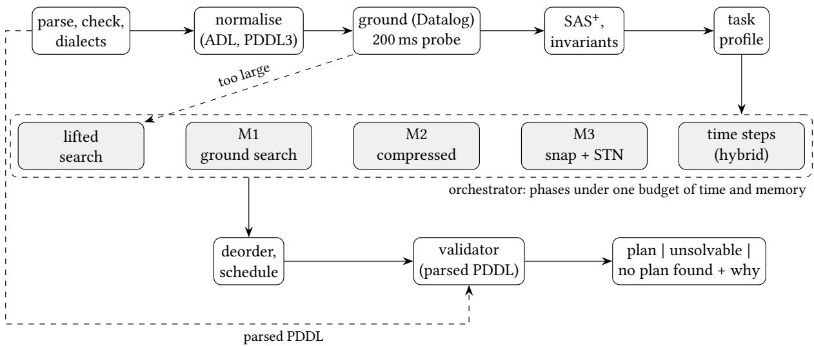
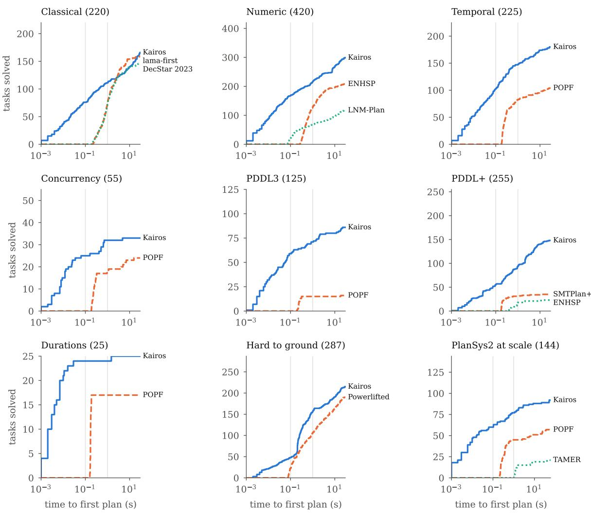

# Kairos: Semantics-Aware Orchestration of Planning Engines across Classical, Numeric, Temporal and Hybrid PDDL

FRANCISCO MARTÍN RICO<sup>∗</sup>, Intelligent Robotics Lab, Universidad Rey Juan Carlos, Spain ESTHER AGUADO GONZÁLEZ, Intelligent Robotics Lab, Universidad Rey Juan Carlos, Spain FRANCISCO MIGUEL MORENO OLIVO, Intelligent Robotics Lab, Universidad Rey Juan Carlos, Spain RODRIGO PÉREZ RODRÍGUEZ, Intelligent Robotics Lab, Universidad Rey Juan Carlos, Spain JOSÉ MIGUEL GUERRERO HERNÁNDEZ, Intelligent Robotics Lab, Universidad Rey Juan Carlos, Spain FRANCISCO JAVIER RODRÍGUEZ LERA, Robotics Group, Universidad de León, Spain

Background: Planning at run time, as in robots that re-plan while they act, needs a planner that reads the PDDL its users write (durative actions, numeric resources, time windows, continuous change), answers quickly, and delivers only plans that a model-based validator accepts. Specialised planners are strong on individual fragments of PDDL, but they difer in coverage, latency and in what their failures mean, so a system that plans repeatedly must pick one and inherit its gaps.

Methods: Kairos profiles each task (numeric fragment, temporal structure, size) to decide which of five engines apply (ground heuristic search, compressed and snap-action temporal search, time steps for hybrid dynamics, lifted search) and schedules them under one budget of time and memory. Every candidate plan is checked against the parsed PDDL by a validator independent of the planner’s transformations. Unsolvable is reported only when a search whose exhaustion is a proof exhausts its space; otherwise the answer is no plan found, with an explanation.

Results: On 1 756 tasks from nine comparative suites, Kairos solves more tasks at the full limits (30 s, and 60 s for PlanSys2 at scale) than the strongest evaluated planner of each suite, with the largest diferences on numeric, temporal, PDDL3 and PDDL+ planning; it also solves the most tasks at 100 ms and 1 s under the reported protocol. Resampling over domains, the gain is above zero in six of the nine suites, while on classical planning against LAMA it is within the noise at 30 s. A further 450 feature-oriented tasks and 26 one-feature probes show that Kairos handles all seventeen features probed, where no other planner evaluated handles more than eight. Ablations identify compressed temporal search and the novelty fallback as major contributors, and a comparison with VAL traces every disagreement to a PDDL+ convention or to a documented VAL defect. Conclusions: Selecting engines from the semantics of the task, under a shared budget and with validation of every plan, can combine broad PDDL coverage with competitive latency on the suites evaluated, and separating validated plans, proofs of unsolvability and inconclusive searches makes the meaning of each answer explicit. Planner and benchmark are open source.

JAIR Associate Editor:

<sup>∗</sup>Corresponding Author.

Authors’ Contact Information: Francisco Martín Rico, francisco.rico@urjc.es, Intelligent Robotics Lab, Universidad Rey Juan Carlos, Fuenlabrada, Madrid, Spain; Esther Aguado González, esther.aguado@urjc.es, Intelligent Robotics Lab, Universidad Rey Juan Carlos, Fuenlabrada, Madrid, Spain; Francisco Miguel Moreno Olivo, franciscom.moreno@urjc.es, Intelligent Robotics Lab, Universidad Rey Juan Carlos, Fuenlabrada, Madrid, Spain; Rodrigo Pérez Rodríguez, rodrigo.perez@urjc.es, Intelligent Robotics Lab, Universidad Rey Juan Carlos, Fuenlabrada, Madrid, Spain; José Miguel Guerrero Hernández, josemiguel.guerrero@urjc.es, Intelligent Robotics Lab, Universidad Rey Juan Carlos, Fuenlabrada, Madrid, Spain; Francisco Javier Rodríguez Lera, fjrodl@unileon.es, Robotics Group, Universidad de León, León, Spain.

## JAIR Reference Format:

Francisco Martín Rico, Esther Aguado González, Francisco Miguel Moreno Olivo, Rodrigo Pérez Rodríguez, José Miguel Guerrero Hernández, and Francisco Javier Rodríguez Lera. 2027. Kairos: Semantics-Aware Orchestration of Planning Engines across Classical, Numeric, Temporal and Hybrid PDDL. Journal ofArtificial Intelligence Research 4, Article 6 (August 2027), 32 pages. doi: 10.1613/jair.1.xxxxx

## 1 Introduction

Automated planning gives an autonomous system the ability to decide what to do next from a model of its actions and a goal. Its most common input language, PDDL (McDermott et al. 1998), which inherited its core from STRIPS (Fikes and Nilsson 1971), has grown over almost three decades into a family that describes durative actions, numeric resources, time windows, preferences and continuous change (Edelkamp and Hofmann 2004; Fox and Long 2006, 2003; A. E. Gerevini et al. 2009; Kovacs 2011), and the planners that read it have become fast and reliable on each of these fragments. In robotics, planning is increasingly done on line: frameworks such as PlanSys2 (Martín et al. 2021), ROSPlan (Cashmore, Fox, Long, Magazzeni, et al. 2015) or Unified Planning (Micheli et al. 2025) write a PDDL problem from the robot’s current knowledge, call a planner, execute and monitor the plan, and call the planner again when something fails.

Planning on line puts three demands on the planner that ofline evaluation tends to separate.

• Coverage of the language. A robot domain mixes durative actions, batteries and other numeric resources, time windows and sometimes continuous change. Rewriting it to fit a planner is error-prone, and has to be redone each time the model changes.

• Latency. The planner runs inside the robot’s control loop, on its own computer, often to re-plan after a failure. An answer in tens of milliseconds is worth more than a better plan in a minute.

• Trust. An invalid plan sends a robot to execute an impossible action, and a planner that gives up without a reason leaves the designer guessing.

Today these demands are met one fragment at a time: each planner covers part of PDDL (Section 3), so systems pick one planner and inherit its gaps.

Planning with large language models (LLMs) addresses a diferent question: LLMs are not reliable plan generators on their own, and the approaches that produce correct plans use them to write or refine a PDDL model for a symbolic planner, or pair them with a sound verifier (Kambhampati et al. 2024; Valmeekam et al. 2023). This article studies the planner and its guarantees on given models; how the models are obtained is out of its scope. Kairos (καιρός)<sup>1</sup> is the system that implements and tests the approach.

This article asks whether a single system can cover the PDDL family, from STRIPS to PDDL+, by choosing among heterogeneous engines for each task, while staying as fast as the specialised planners on their own fragments and stating precisely what each of its answers guarantees. The approach rests on three principles, which organise the article and its discussion:

(1) Semantic applicability precedes algorithm selection. Portfolios usually choose among configurations by expected performance. Here, the semantics of the task (its numeric fragment, its temporal structure, its size) first decides which transformations and engines are applicable at all, and which of them are worth trying first even though they may be incomplete; only then are time and memory shared among them.

(2) Soundness, completeness and performance are separate properties of each engine. Temporal compression can be sound without being complete; a search can end without proving anything; a plan can be valid under a numerical model without being certified. The meaning of each answer is derived from the properties of the engine that produced it, not assumed.

(3) Heterogeneity need not cost responsiveness. Covering many fragments could impose a large overhead against specialised planners; we test, on the suites evaluated, whether it does.

Kairos is a feature-aware, budgeted portfolio that realises these principles, and the contributions of the article are:

(1) A task profile that decides which engines apply, including a check of temporal simplicity by value (Section 5). It lets compressed temporal search run on most robotic domains, which a check by variable sends to the slower snap-action search; we prove that compression is sound and show, with a counterexample, that it is not complete, so its exhaustion is never taken as a proof.

(2) An orchestration offive engines under one budget (Sections 6 and 7): which engine runs, with which share of time and memory, and when grounding hands over to lifted search, all decided from the task and from the measured memory, never from domain names.

(3) Answers with stated guarantees (Section 8): every plan passes a validator that is independent of the planner’s transformations; unsolvable is reported only after the exhaustion of a search for which exhaustion is a proof, and otherwise the planner answers no plan found and explains why.

(4) An open benchmark (Section 11) of public tasks pinned by commit and checksum, new families for features that no public collection covers, each with unsolvable instances so that wrong answers can be counted, and one-feature probes that measure what each planner supports.

Most search techniques inside Kairos come from earlier planners, which we cite where they are used; Appendix B states what Kairos computes and where it difers. The novelty lies in how they are selected and combined under a shared budget, in the temporal profile that makes the fast engine applicable, and in the contract of the answers. The experiments (Section 12) measure each of these: coverage and latency against the best planner of each fragment, the support of each planner, an ablation of the engines and components, the agreement of the validator with VAL (Howey et al. 2004), and the answers on tasks without a plan.

The rest of the article is organised as follows. Section 2 gives the preliminaries and Section 3 the related work. Sections 4 to 9 describe the planner: architecture, task profile, engines, orchestration, answers and validation. Section 10 describes the implementation and the platform, Section 11 the benchmark, and Section 12 the experiments. Section 13 works through two examples, and Section 14 discusses the limitations.

## 2 Preliminaries

PDDL and its fragments. We use the standard family: STRIPS with types and the ADL features of the first PDDL, namely conditional efects and quantified and disjunctive preconditions; numeric fluents and durative actions with duration inequalities and continuous efects, from PDDL 2.1; derived predicates and timed initial literals, from PDDL 2.2; preferences and trajectory constraints, from PDDL 3; object fluents, from PDDL 3.1; and processes and events, from PDDL+. Timed initial fluents are the numeric counterpart of timed initial literals. We follow the semantics of PDDL 2.1 for temporal plans: happenings at the same instant are evaluated on the state before them, interfering happenings must be separated by �, and over-all conditions hold on the open interval of an action. For PDDL+ we follow Fox and Long (2006): processes change fluents continuously while their conditions hold, and events fire as soon as theirs become true.

Temporal simplicity. Cushing et al. (2007) call a temporal task temporally simple when it can be solved without concurrency, i.e. by a sequence of actions that do not overlap; such tasks can be solved by compressing each durative action into an instantaneous one and scheduling the sequential plan afterwards. Tasks with required concurrency (an action needs another to be running) need search over start and end snap actions, as in CRIKEY and POPF (Coles, Coles, Fox, et al. 2010), with a simple temporal network (STN) (Dechter et al. 1991) to keep the partial plan schedulable.

Notation. A ground $S \mathrm { A } S ^ { + }$ task has finite-domain variables �, numeric variables �, actions � and axioms. For an action �, $p r e ( a )$ is its precondition and $e f f ( a )$ its efects; for a durative action, $p r e _ { _ { \mathsf { H } } } , p r e _ { _ { \ominus } } , p r e _ { _ { + } }$ are its start, over-all and end conditions, and $e f f _ { \mathrm { { t } } } , e f f .$ its start and end efects.

## 3 Related Work

Planners and what they cover. Classical planning is dominated by heuristic search over a grounded task: FF (Hofmann and Nebel 2001), Fast Downward (Helmert 2006) and LAMA (Richter and Westphal 2010), with novelty-based search such as BFWS (Lipovetzky and Gefner 2017, 2012). Lifted planners such as Powerlifted (Corrêa et al. 2020) avoid grounding for tasks with millions of actions. Numeric planners extend relaxation heuristics to numbers: Metric-FF (Hofmann 2003) and ENHSP with numeric subgoaling (Scala et al. 2016, 2020); ENHSP also plans with PDDL+ processes and events. Temporal planners follow two families: forward search over snap actions with an STN or an LP, as POPF and, after it, OPTIC (Benton et al. 2012) and COLIN (Coles, Coles, Fox, et al. 2012) do, and search over compressed or temporal states, as TFD (Eyerich et al. 2009) and LPG (A. Gerevini et al. 2003) do; NextFLAP (Sapena et al. 2024) adds numeric constraints solved with SMT. Hybrid planners discretise time and validate, as UPMurphi, DiNo (Della Penna et al. 2009; Piotrowski et al. 2016) and ENHSP do, or compile to SMT, as SMTPlan+ does (Cashmore, Fox, Long, and Magazzeni 2016).

What each of these planners accepts is usually documented per requirement flag, and documentation and behaviour do not always agree. Table 1 therefore reports operational support, measured on one-feature tasks (Section 12.3 gives the method and what it does not show). No planner other than Kairos handles more than eight of the seventeen features probed: classical planners stop at numbers and time, numeric ones at durative actions, temporal ones at derived predicates, object fluents or processes, and hybrid ones at ADL and PDDL3. Several planners also crash on, or return invalid plans for, features that they declare.

Algorithm selection, portfolio scheduling and orchestration. Three related ideas should be told apart. Algorithm selection chooses, per instance, the component expected to perform best, from features of the instance (Cenamor et al. 2016; Kerschke et al. 2019; Xu et al. 2008); the choice may already be restricted to the components that apply. Portfolio scheduling divides a budget among several components, statically (Helmert et al. 2011; Seipp et al. 2015) or per instance; planning portfolios such as Fast Downward Stone Soup and IBaCoP schedule configurations of planners for the same fragment, so that every component can, in principle, solve every task, and the schedule is optimised or learned for expected coverage. Kairos builds on both, and its schedules are a performance question in the usual sense, set by hand (Section 7). What it adds, which we call semantics-aware orchestration, is that across fragments the semantics of the task does more than restrict the choice: it excludes engines that cannot represent the task (a classical planner cannot read durative actions), it recommends engines that may be faster but are incomplete (compressed search for tasks simple by value, Section 5), and, through the properties of each engine, it decides what a failure means. These decisions are taken from the task’s semantics, not learned.

Unified interfaces. Unified Planning ofers one API over many planners, each with its own coverage; it is complementary to Kairos, which could be one of its engines.

Planning with large language models. The LLM-based approaches that guarantee correct plans translate the problem into PDDL for a symbolic planner (Guan et al. 2023; Liu et al. 2023), synthesise generalised plans checked on PDDL tasks (Silver et al. 2024), or pair the LLM with external verifiers (Kambhampati et al. 2024); they rely on a planner or a validator for PDDL, a role that Kairos can fill but that this article does not evaluate.

In contrast to these approaches, Kairos difers from portfolios in what is selected and why: its engines cover diferent fragments, so applicability is decided by the task’s semantics (its fragment and temporal profile) before performance is considered; and the engines share one pipeline, one validator and one memory budget, so that a phase can hand over to another (grounding to lifted search) when the measured memory requires it. It difers from the single-fragment planners in handling every feature of Table 1 with one contract for its answers, and from unified interfaces in that this contract is enforced inside the planner. Table 2 summarises the diferences in design.

<table><tr><td>Feature</td><td>LAMA P.lifted M-FF ENHSP POPF</td><td></td><td></td><td></td><td></td><td>OPTIC</td><td></td><td></td><td>TFD LPG-td NextFLAP SMTPlan+ Kairos</td><td></td><td></td></tr><tr><td>conditional effects</td><td></td><td></td><td></td><td></td><td></td><td></td><td></td><td></td><td></td><td></td><td></td></tr><tr><td>quantified preconditions</td><td></td><td></td><td></td><td></td><td></td><td></td><td></td><td></td><td></td><td></td><td></td></tr><tr><td>disjunctive preconditions</td><td></td><td></td><td></td><td></td><td></td><td></td><td></td><td></td><td></td><td></td><td></td></tr><tr><td>derived predicates</td><td></td><td></td><td></td><td></td><td></td><td></td><td></td><td></td><td></td><td></td><td></td></tr><tr><td>numeric fluents</td><td></td><td></td><td></td><td></td><td></td><td></td><td></td><td></td><td></td><td></td><td></td></tr><tr><td>non-linear numeric conditions</td><td></td><td></td><td></td><td></td><td></td><td></td><td></td><td></td><td></td><td></td><td></td></tr><tr><td>object fluents</td><td></td><td></td><td></td><td></td><td></td><td></td><td></td><td></td><td></td><td></td><td></td></tr><tr><td>durative actions</td><td></td><td></td><td></td><td></td><td></td><td></td><td></td><td></td><td></td><td></td><td></td></tr><tr><td>required concurrency</td><td>X</td><td></td><td></td><td></td><td></td><td></td><td></td><td></td><td></td><td></td><td></td></tr><tr><td>duration inequalities</td><td>X</td><td></td><td></td><td></td><td></td><td></td><td></td><td></td><td></td><td></td><td></td></tr><tr><td>timed initial literals</td><td>X</td><td></td><td></td><td></td><td></td><td></td><td></td><td></td><td></td><td></td><td></td></tr><tr><td>timed initial fluents</td><td>X</td><td></td><td></td><td></td><td></td><td></td><td></td><td></td><td></td><td></td><td></td></tr><tr><td>linear continuous effects</td><td></td><td></td><td></td><td></td><td></td><td></td><td></td><td></td><td></td><td></td><td></td></tr><tr><td>processes and events</td><td></td><td></td><td></td><td></td><td></td><td></td><td></td><td></td><td></td><td></td><td></td></tr><tr><td>non-linear continuous change</td><td></td><td></td><td></td><td></td><td></td><td></td><td></td><td></td><td></td><td></td><td></td></tr><tr><td>preferences</td><td></td><td></td><td></td><td></td><td></td><td></td><td></td><td></td><td></td><td></td><td></td></tr><tr><td>trajectory constraints</td><td>X</td><td></td><td></td><td></td><td></td><td></td><td></td><td></td><td></td><td></td><td></td></tr><tr><td>supported</td><td>4</td><td></td><td>4</td><td>8</td><td>8</td><td></td><td></td><td></td><td></td><td></td><td>17</td></tr></table>

Table 1. PDDL feature support, measured by execution rather than by declaration (Section 12.3). P.lifted: Powerlifted; M-FF: Metric-FF. Each planner ran, for 10 s, on 26 trivial tasks in the style of the IPC domains: one per feature, plus a variant with durative actions of each non-temporal one. $\checkmark :$ it solved the feature’s task with a plan that the validator accepts (for preferences, one that satisfies the preference). : partial or doubtful: it crashed or returned an invalid plan on the feature’s task, or solved only another task that uses the feature. ✗: it rejected every task that uses the feature, or gave no answer. Symbols difer in shape as well as colour.

<table><tr><td>System</td><td>Fragments</td><td>Components</td><td>Budget</td><td>Validator</td><td>Unsolvable</td></tr><tr><td>FD Stone Soup, IBaCoP</td><td>classical</td><td>configurations</td><td>time</td><td>no</td><td>some</td></tr><tr><td>OPTIC, POPF</td><td>temporal, numeric</td><td>one planner</td><td></td><td>no</td><td>no</td></tr><tr><td>ENHSP</td><td>numeric, PDDL+</td><td>configurations</td><td></td><td>built in</td><td>some</td></tr><tr><td>Unified Planning</td><td>per engine</td><td>external planners</td><td></td><td>yes</td><td>per engine</td></tr><tr><td>Kairos</td><td>all of Table 1</td><td>five engines</td><td>time, memory</td><td>yes</td><td>per engine</td></tr></table>

Table 2. Design diferences with the closest systems. Budget: what the components share; Validator: whether the system validates plans itself; Unsolvable: which answers of unsolvability are proofs (Kairos: Table 3).

## 4 Architecture

Figure 1 shows the pipeline. Each stage receives an immutable structure and produces another, so stages are tested in isolation, and there is no global state: two planning requests in two threads share nothing.

Front end. A hand-written parser reads PDDL 3.1 and PDDL+ and common dialects (ENHSP’s global constraints, SMTPlan’s syntax), with diagnostics that point to file, line and column and suggest close names. Normalisation compiles quantifiers, disjunctive preconditions and trajectory constraints into derived predicates, conditional efects and monitoring automata.

  
Fig. 1. The pipeline of Kairos. The orchestrator runs phases over the engines that the task profile allows, all under one budget of time and memory; grounding hands over to the lifted engine when it does not fit. The validator reads the parsed PDDL, not the planner’s task.

Grounding and the budget. Grounding is a Datalog fixpoint; each relation reserves memory in a shared budget before it grows, so grounding stops cleanly at the limit instead of being killed. The ground task becomes a SAS<sup>+</sup> task with numeric variables through invariant synthesis, in the spirit of Fast Downward’s translator. States are bit-packed and stored once, in fixed blocks that are never reallocated. Search structures (state registry, open lists, novelty tables, landmark bitsets) account for their memory in the same budget.

## 5 The Task Profile

The profile decides which engines apply. It records the numeric fragment (none, simple, linear, non-linear), whether the task has derived predicates, timed initial literals or fluents, duration inequalities, continuous efects, processes or events, the size of the ground task, and whether the temporal part is simple. Temporal simplicity has the largest efect on speed, because compressed search (M2) is much faster than snap-action search (M3) when it applies.

A check by variable marks a durative action as possibly requiring concurrency when it changes a variable at start and again at end, and another action reads that variable. Under this check, every move of a robot appears to require concurrency: (at start (not (at ?r ?from))) and (at end (at ?r ?to)) leave the robot at no location while it moves, and other actions read the robot’s location. Yet no action needs the robot to be at no location. Checking the values that are read, rather than the variables, removes these false alarms.

Definition 1 (Transient value). Let � be a durative action and � ∈ � a variable. The value � of� is transient for � ifef (�) assigns � := � and ef (�) assigns � a diferent value; that is, � = � holds only while � runs. For a numeric variable �, � lowers � transiently ifef (�) decreases � and ef (�) increases it back (and symmetrically for raises).

Definition 2 (Simple by value). A temporal task is simple by value if it has no timed initial literals or fluents and, for every durative action �:

(1) for every value � of� transient $f o r d ,$ no condition ofanother action or axiom reads $v = x , v \neq w$ with � $\neq x ,$ or compares � with another variable;

(2) for every numeric variable that � lowers (raises) transiently, every condition ofother actions on it is a lower (upper) bound, and no efect copies its value.

Definition 3 (Compression). Let � be a durative action with a fixed duration $\delta ,$ and let � be the values that its unconditional start efects assign. Its compression <sup>¯</sup>� is the instantaneous action whose precondition is $p r e _ { \mathsf { t } } ( d ) \wedge p r e _ {  } ( d ) | _ { S } \wedge p r e _ { \mathsf { \tau } _ { + } } ( d ) | _ { S }$ , where $c | _ { S }$ is � with every literal that � satisfies removed, every numeric term rewritten through the numeric start efects (a battery drained at start must still be non-negative), and the whole precondition made unsatisfiable $i f S$ contradicts a literal; and whose efect applies ef (�) and then ef (�), the end winning on a variable that both assign, with ?duration replaced by � everywhere. Its cost is � under a time metric. The compression ofa task replaces each durative action by its compression; a duration given by bounds is fixed first, to the bound that the efects need, or one action per bound when they depend on it.

A sequential plan of the compression is turned into a temporal one by an STN over the happenings: each step’s end follows its start by $\delta ,$ and each happening follows by � the last earlier happening that writes what it reads or writes, or reads what it writes, and by 0 those whose over-all conditions it must not break; the earliest times give the schedule. Resources changed only by constant increases and decreases are first left out of these orderings, and a step keeps that freedom only if the prefix of the plan validates.

Proposition 1. Let a temporal task have fixed durations, no timed initial literals orfluents, no continuous efects, processes or events, and no conditional efects at start. Then every sequential plan ofits compression can be scheduled into a valid temporal plan.

Proof. Execute the compressed actions in order, each durative action from its start to its end before the next one starts, and each instantaneous action � after the previous happening. No two actions overlap, so every happening is evaluated in the state that the compressed action saw: the start conditions in the state before the action, the over-all and end conditions in the state after the start efects (which the compression requires unless the start achieves them), and the end efects after the start efects, as in the compression. The STN keeps every ordering between happenings that read and write the same variable, so the earliest schedule evaluates each happening in a state that agrees with the sequential one on what it reads; the freedom left to resources is kept only when the validator accepts it, and every scheduled plan is validated before it is returned, with the sequential schedule as the fallback. □

The hypotheses are those under which the sequential execution reproduces the compressed action: timed literals and continuous change would make the state depend on when the action runs, and a conditional start efect would change, after the compression’s check, what the end conditions read. M2 is applied only to tasks without timed literals, and to tasks whose continuous efects can be fixed in advance; in the other cases every plan is still validated before it is returned, so a violation of the hypotheses can cost a plan but never deliver an invalid one.

The converse does not hold: a task simple by value may need actions to overlap.

Example 1. Two robots prepare to lift a table. prepare(r1, r2) lasts 10 time units, sets (grip r1) at start and needs (grip r2) at end; prepare(r2, r1) is symmetric, and the goal is that both end. No value is transient (each grip stays set), so the task is simple by value. Every plan in which each action starts before the other ends is valid, but no sequential plan exists: whichever action runs first ends before the other grips. The compression has no plan, and exhausting it says nothing about the task. Appendix C gives the PDDL.

Simple by value therefore only selects the faster engine; it is not a completeness criterion. When M2 runs out of states without a plan, Kairos does not answer unsolvable: it tries the relaxation below and, if that does not prove that there is no plan, M3 searches the time left (on Example 1, M3 finds it in milliseconds).

Proposition 2. Let the task without times be the snap-action task ofM3 with time reduced to the order ofthe happenings: start and end happenings in any order, the over-all conditions of the running actions and the global constraints checked whenever time advances, an action with an over-all condition and a duration surely above zero not ending in the instant it starts, the timed initial literals in any order that keeps their own, and the goal required after all of them. If no durative action overlaps itself and the task has no continuous efects, processes, events or duration-dependent efects with non-fixed durations, then a task whose task without times has no path to the goal has no plan.

Proofsketch. Every valid temporal plan, read as its sequence of happenings with an advance between distinct instants, is a path to the goal of the task without times: each happening is applicable in the state that the plan reaches there, the over-all conditions hold at every instant inside their intervals, and the timed literals occur in their order. Durations, the separation and interference are only dropped, so the relaxation keeps every plan; a search that exhausts it, under the hypotheses of Proposition 3, therefore shows that the task has no plan. □ The proposition does not need the task without times to be finite, only that a search proves it has no path to the goal. Its propositional part is finite (each durative action adds two happenings and one running flag), but numeric fluents may make its state space unbounded, so a search of it need not terminate and need not be cheap. Kairos searches it with a complete configuration of M1 (eager greedy search with $h ^ { \mathrm { F F } } )$ , within a quarter of the remaining time; only the exhaustion of its open list is taken as a proof, under the hypotheses of Proposition 3, and otherwise the attempt proves nothing.

The check is linear in the size of the durative actions: readers are counted per value, variable and fluent instead of compared per pair (on a task with 12 480 durative actions, from 7.7 s to 118 ms). Under it, match-cellar, turn-and-open and temporal-machine-shop of IPC 2011 require concurrency, while the other nine temporal domains of IPC 2011 and all temporal domains shipped with PlanSys2 are simple; under the check by variable, all of PlanSys2’s domains would go to M3. Section 12.4 measures what M2 adds by running each engine alone on the temporal suites.

## 6 Engines

Kairos has five engines, each for a diferent fragment or size of task: M1 for classical and numeric tasks on the ground task, M2 for temporal tasks that are simple by value, M3 for tasks that may require concurrency, a time-step engine for hybrid dynamics, and a lifted engine for tasks too large to ground. All of them share the front end, the validator and the memory budget.

M1: heuristic search on the ground task. (Appendix B gives the definitions.) Lazy and eager greedy best-first search and weighted A<sup>∗</sup>, with FD-style alternation of open lists, preferred operators boosted on progress, $h ^ { \mathrm { F F } }$ with numeric subgoaling, LAMA landmarks with reasonable orderings (Hofmann, Porteous, et al. 2004), and a novelty queue partitioned by unachieved goals and landmarks as in BFWS, with numeric features. The anytime driver follows LAMA: restarts of weighted A<sup>∗</sup> with decreasing weights, pruned by the incumbent’s cost. Two additions matter in the experiments. Projection of unread numeric variables: a numeric variable that no condition, duration, efect value, axiom or goal reads (an accumulated cost) is reset to its initial value in every registered state, so that states that difer only in accumulated cost are merged; when it was introduced in development, coverage of the classical suite rose from 117 to 140 of 220 (Section 12.4). Incremental goals: on tasks with 20 or more propositional goals, the closest pending goal in the relaxation is reached by a short, bounded search that keeps the goals already achieved, which turns plateaus that grow with the number of agents into a sequence of small searches.

M2: compression and rescheduling. For tasks simple by value (Section 5), each durative action becomes an instantaneous one, M1 searches the compressed task, and a post-processor orders happenings (not whole actions) by last writers and readers and computes the earliest schedule. Resources that are only increased and decreased by constants do not order happenings by themselves, so concurrent use of a shared capacity is kept whenever the resulting plan validates. To spread work among agents, a preferred operator is replaced by its applicable variant with another argument that finishes earliest in a partial schedule.

M3: snap actions over an STN. For tasks that may require concurrency, as in POPF: start and end snap actions, a partial order from last writers and readers, and an incremental STN (Cesta and Oddi 1996) that rejects inconsistent extensions and undoes without copying. A timed initial literal constrains only the happenings that interfere with it; deadlines from literals that become false for good prune states from which a goal cannot be reached in time in a temporal relaxation. The search’s � is the makespan of the partial plan, so restarts reduce makespan. States are memoised by logical state with the first (or an earlier-ending) partial plan that reached them (Coles and Coles 2016).

Time steps for hybrid dynamics. Tasks with processes, events, non-linear continuous efects, or durations that must lie strictly between their bounds become a discrete task with wait actions, as in discretise-and-validate planners such as UPMurphi and DiNo (Della Penna et al. 2009; Piotrowski et al. 2016). A short wait advances 0.1 s, a step chosen to balance the precision of the plans against the depth of the search; a long wait advances to just before some numeric condition (of a precondition, event, goal, process, global constraint or over-all condition) changes truth value, so that a long stretch costs one step. Events are forced: when one is applicable, only events are. Process efects are integrated with RK4 at each step. Every plan that the search reaches is validated in continuous time (Section 9), and a goal state whose plan does not validate is not a goal. Non-linear conditions enter the relaxed graph linearised around the current state.

Lifted search. For classical tasks whose grounding does not fit the budget, a lifted engine in the line of Powerlifted computes successors by joins over the state, with a lazy lifted $\boldsymbol { h } ^ { \mathrm { F F } }$ , a width-1 novelty queue and a preferred-operator queue. Its relaxed exploration is semi-naive with a fixed join order and projects partial joins onto the variables still read, which avoids the quadratic growth of naive rule evaluation (drive-truck in logistics: from $1 7 5 0 ^ { 2 }$ to 1750 combinations per layer). Successor lists reserve budget before growing.

## 7 Orchestration

The orchestrator turns the profile into a list of phases, each an engine with a task, a search configuration and a share of the remaining time (Algorithm 1). To build it, the orchestrator makes three kinds of decision, with a diferent status. First, hard applicability constraints exclude the engines that cannot represent the task’s fragment: M1 for durative actions, the snap-action engines for processes and events, the lifted engine for anything but classical tasks. Second, semantic search guidance prefers strategies that may be faster but are possibly incomplete: a task simple by value goes to compressed search first, which does not make compressed search complete (Example 1), so its failure is never a proof and M3 follows. Third, heuristic scheduling shares time and memory among the selected phases, set by hand and not optimised (below). Keeping the three apart prevents an engine that does not apply from being confused with a search that did not succeed.

How the shares were set. The shares and thresholds were set by hand during development on the public suites, by inspecting where each phase found its first plans, and then fixed; no per-domain tuning is possible, since the orchestrator never sees domain names. For instance, LAMA gives no first plan after 25 s on the classical suite, so the last 15% for novelty costs it nothing, while novelty solves within 2.5 s tasks LAMA misses in 30 s. We did not optimise the shares, and the current implementation has no option to vary them one by one; their sensitivity is left for future work (Section 14).

Algorithm 1 Phases chosen from the profile (one thread).   
1: ground with a 200 ms probe; if it does not fit, give the lifted engine min(5%, 1 s), then ground fully   
2: if grounding fails, or the ground task uses more than 1/4 of the memory limit then   
return lifted engine with the remaining budget   
4: end if   
5: if ≥ 20 propositional goals then   
6: phase: incremental goals (half of the time)   
7: end if   
8: if no durative actions, processes or events then   
9: if numeric then   
10: lazy LAMA (25%), then LAMA with novelty   
11: else   
12: lazy LAMA (85%), then eager search with novelty   
13: end if   
14: else if processes, events, non-linear change or duration inequalities then   
15: time steps: four configurations of short and long waits (2%, 5%, 10%, rest)   
16: else if simple by value and fixed durations then   
17: M2 for the first plan, then the M3 portfolio with � = makespan (also if M2 runs out of states)   
18: else   
19: M3 portfolio: lazy LAMA (20%), eager LAMA (37.5% of the rest), LAMA with novelty   
20: end if   
21: with several threads: the same phases concurrently, each with the global budget

Memory. The budget measures the process’s memory, so all phases share one limit. A ground search typically needs about three times the memory of its task; hence the quarter-of-the-limit rule above, which hands over to the lifted engine before the ground search runs out of memory.

## 8 Answers and Guarantees

A run ends with one of: a validated plan (with its cost, and whether it is proven optimal); unsolvable; no plan found with the reason; or an error in the input, with its location. Table 3 states what each answer means for each fragment.

Proposition 3. Consider a complete search configuration of M1: one that inserts every generated successor into an open list it eventually empties, except for states eliminated by the mechanisms (b) and (c) below. These are the greedy best-first searches, lazy and eager, with or without novelty and preferred-operator queues (every successor also enters the regular queue), and the weighted A<sup>∗</sup> restarts; the incremental-goals phase is not, and its failure is never taken as exhaustion. Assume that (a) successor generation is complete: every action of the ground task applicable in a state yields its successor; (b) a state is discarded as a dead end only ifthe goal is unreachable in the relaxation of Appendix B, which over-approximates reachability; (c) duplicate detection merges only states that agree on every variable that some condition, efect, duration, axiom or goal reads. Ifa complete configuration ofM1 exhausts its open list in a search started from the initial state, then the task has no plan. For the lifted engine, the same holds up to a collision of its 128-bit state keys.

Journal of Artificial Intelligence Research, Vol. 4, Article 6. Publication date: August 2027.

<table><tr><td>Fragment</td><td>Engines</td><td>Unsolvable only when</td><td>Optimality</td></tr><tr><td>classical, numeric (no M1, lifted time)</td><td></td><td>M1 or the lifted engine ex- proven when a restart prun- (Prop. 3)</td><td>hausts the reachable space ing by cost exhausts (Prop. 4)</td></tr><tr><td>temporal, simple by M2, M3 value, fixed durations</td><td></td><td>no path to the goal (Prop. 2); mises makespan never from M2 (Example 1)</td><td>the task without times has not pursued: search opti-</td></tr><tr><td>temporal with required M3 concurrency or timed lit- erals</td><td></td><td>the task without times has not plan cost no path to the goal (Prop. 2); never from M3 (memoisa- tion is incomplete)</td><td></td></tr><tr><td>duration continuous PDDL+</td><td>inequalities, time steps effects,</td><td>never: no plan found</td><td>not plan cost</td></tr><tr><td>any</td><td>any</td><td>or grounding proves a goal unreachable even ignoring deletes</td><td></td></tr></table>

Table 3. What unsolvable and optimal mean, per fragment. Every returned plan has passed the validator (Section 9), under the semantics and tolerances stated there.

Proofsketch (full proof in Appendix A). Successor generation is complete (every applicable action yields its successor) and duplicate detection merges only equal states. Two reductions could hide a plan. (i) Dead ends reported by the heuristics: a state is reported as a dead end only if the goal is unreachable in its relaxation, and the relaxation over-approximates reachability (Appendix B): facts are never lost, a linear condition is reached by any constant change that moves it the right way, and any change that depends on the state, or of a variable of a non-linear condition, reaches its condition at least once; property-based tests check that no dead end is reported on states with a plan in fully explored spaces. The lifted engine detects duplicates by a 128-bit key without comparing states, so for it the statement holds up to a key collision (Appendix A). (ii) Projection of unread numeric variables: two states that difer only in variables that nothing reads have the same applicable actions, the same successors up to those variables, and the same goal status, so merging them preserves reachability of the goal. A variable that starts undefined is never projected, since whether it is defined decides applicability. Exhaustion then visits every reachable state up to this equivalence, none of which is a goal. □

Hypothesis (a) rests on grounding, which keeps every action that is reachable in the delete relaxation; (b) on the relaxation over-approximating reachability (Appendix B); (c) on the projection above. The proposition is about what exhaustion means, not about termination: with numeric variables the reachable space may be infinite, and a search that ends by time or memory proves nothing and is reported as such.

Proposition 4. Let the task have no durative actions, and let every action have a constant, non-negative cost: its change ofa linear metric that is minimised, made ofconstant increases and decreases outside conditional efects, or 1 without a metric. Ifa restart ofM1 with a plan ofcost � in hand exhausts its open list, then � is optimal.

Proofsketch. The restarts are weighted A<sup>∗</sup> searches that reopen a closed state reached with a lower � and discard a successor only when $g \geq C$ or when it is a dead end in the sense of Proposition 3. With non-negative costs, every prefix of a plan cheaper than � costs less than �, so none of its states is discarded by the bound; dead ends have no plan; and merging states that difer only in unread variables keeps the cheapest � of each class through reopening. Exhaustion therefore visits every state of every plan cheaper than �, none of which ends in a goal. The heuristic only orders the search, so its admissibility is not needed. □

6:12 • Martín Rico et al.   
\$ kairos deliver.pddl no-corridor.pddl   
note: the goal needs atoms that no action can reach   
(in cup office) can never be reached:   
drop adds it, but needs (at ?r - robot office), which never holds   
move adds it, but needs (connected ?x - room office), which never holds   
no action adds it, and the initial state does not have it   
kairos: unsolvable (exhausted)   
\$ kairos cellar.pddl long-fuse.pddl   
note: engine M3 found no plan; as POPF, it keeps one partial plan per state,   
so this is strong evidence but not a proof   
note: no plan: the engines that apply ran out of states (19 states) before   
the time limit, so more time does not help; none of them is complete for   
this task, so a plan may still exist (see the note before).   
kairos: no plan found (exhausted)  
Fig. 2. Two answers without a plan (stderr). Top: a delivery task whose goal room is not connected; the chain of reasons ends at a static fact. Botom: a fuse that takes 6 s to mend while each match burns for 5 s; M3 exhausts its space, which proves nothing, so the answer is no plan found, with the reason.

The proof holds for any weight, though in practice the restart that exhausts is the last one, with weight 1. It does not apply to temporal tasks, where costs are durations and their sum is not the makespan, so Kairos never reports a makespan as optimal; nor to metrics outside the form above, for which Kairos searches with unit costs, does not prune, and says so.

The incremental goals, the time-step engine and M3 are incomplete, and their failure is never reported as unsolvable. Neither is a time-out, nor exhausting M2 (Example 1).

Explanations. When there is no plan, Kairos says why: which engine gave up and whether its exhaustion proves anything; that grounding exceeded the memory limit and which option raises it; or, when the goal is unreachable even without deletes, which goal facts, the chain of actions that would achieve them, and the first precondition that no action achieves. Figure 2 shows two real outputs.

## 9 Validation

Independence. The validator is independent of the search and of the planner’s transformations, but not of its reading ofPDDL: it shares the parser and the semantic checks with the planner, and nothing after them. It evaluates the parsed domain and problem, not the normalised, ground or compressed task, so a bug in normalisation, grounding, compression or scheduling cannot validate its own plans; a misreading of the input by the parser would afect both. Comparing with VAL, which shares nothing with Kairos, addresses that remaining dependence (Section 12.5). Every plan is validated before it is returned; a plan that fails is an internal error and is never delivered.

Table 4 summarises what a validated plan means; the paragraphs below give the details.

Semantics. Sequential and temporal plans follow VAL’s semantics: happenings at the same instant (within a tolerance) are evaluated on the state before them, with deletes before adds; interfering happenings in the same instant are an error, and closer than � = 0.001 a warning (VAL does not require it either); over-all conditions are checked on the open interval; durations are checked with a tolerance of 0.001, the precision of plan files.

<table><tr><td>Fragment</td><td>A validated plan is</td></tr><tr><td>classical, numeric (no time) temporal</td><td>valid under the semantics of PDDL, as parsed, in floating point valid under the semantics of PDDL 2.1, with e = 0.001 and a duration</td></tr><tr><td></td><td>tolerance of 0.001</td></tr><tr><td>PDDL+, linear change</td><td>valid under ENHSP&#x27;s convention for steps at the same instant, with exact integration up to floating point</td></tr><tr><td>non-linear dynamics</td><td>accepted by a numerical integration (RK4, steps of 0.01 s, bisection on watched conditions); not certified</td></tr></table>

Table 4. What validation guarantees for each fragment. Validity refers to the PDDL model; it does not imply that the plan can be executed by a physical system.

PDDL3 trajectory constraints are checked on the sequence of states, and the metric counts preference violations. For PDDL+ plans we follow the convention of ENHSP’s plans, where steps written at the same instant apply in the order written: a step that switches a pump of and a step that needs it of can share an instant. This lets an action depend on the immediate efect of another one at the same instant, which matters in PDDL+: with a separation between them, the processes that are active would keep changing fluents in between, and the second action would see values that the first one did not leave. VAL evaluates both steps on the state before them and rejects such a plan, which under its semantics would need an � between them (Section 12.5).

Continuous change and its limits. Linear continuous efects are integrated exactly between happenings. Nonlinear dynamics and processes are integrated numerically with fourth-order Runge–Kutta in steps of 0.01 s; when a watched condition (of a process, an event, a global constraint or an over-all condition) changes truth value within a step, bisection locates the instant, and events fire there, in cascades of at most 1000 rounds. Conditions of processes and events are compared with a relative tolerance of $1 0 ^ { - 1 2 }$ (rounding only), not the tolerance of actions, so that two events on either side of a threshold do not both fire. This is a numerical validation, not a certified one: a condition that becomes true and false again within one step, or a tangency, can be missed. Conditions that oscillate without time passing (Zeno behaviour) are detected after eight consecutive bisections shorter than 1% of the step, and are then sampled at every step instead of located. For the fragments with linear change the verdict is exact up to floating point; for non-linear ones it holds under the step and tolerances above. The step is fixed in the current implementation, so the sensitivity of the verdicts to it is not measured here (Section 14).

Why not VAL. VAL is the reference, and we compare against it (Section 12.5). We did not reuse it, for three reasons. Coverage: its latest release (2021) rejects object fluents as a syntax error and stops on non-linear continuous change (“diferential equations of this nature are not handled”) while exiting with status 0, so a caller that trusts the exit status accepts an unchecked plan; it also rejects some valid PDDL, such as a single numeric efect not wrapped in and. Integration: Kairos validates every plan before delivering it, so validation must be a library call that shares nothing mutable, needs no files and does not throw; VAL is a command. Diagnostics: the validator reports the failing step, its line in the plan file, the condition and the values that falsify it, e.g. (>= (battery r1) 10): $5 ~ > = ~ 1 0$ is false.

## 10 Implementation and Platform

Software. Kairos is about 36 000 lines of $C + + 2 0$ , plus 19 000 of tests, under the Apache 2.0 license. It has no dependencies beyond the C++ standard library and threads, and in particular it does not depend on ROS: it builds with standard CMake (cmake -S . -B build and cmake –build build; CMake 3.22 or later, and a C++20 compiler such as GCC 11 or later) and installs a CMake package, so that another project links it with find\_package(kairos). Each stage of Figure 1 is an internal library; the public library exports only an API that is stable within a major version.

A library and a program. Kairos is meant to be used in two ways. As a library, a program plans in its own thread (Planner::solve) or starts an anytime search in a thread of the library (Planner::start) and receives each better plan through a callback, waits for the first one, or stops the search; no exception crosses the API, and every answer carries its status and diagnostics. This is how a robot’s executive embeds it, without the cost of starting a process or writing files. As a program, the command kairos DOMAIN PROBLEM writes plans in IPC, POPF or JSON format, with an exit code for each kind of answer, and kairos validate and kairos check validate plans and PDDL on their own; this is how it runs in planning pipelines and in the experiments of this article.

Integration. Kairos is also distributed as ROS 2, conda, Python and planutils packages, which contain the same library and program, and it is the default planner of PlanSys2. The source code, the benchmark, the scripts that produce every table and figure of this article, and the raw results are public (Appendix E).

Testing. The test suite has 979 tests: unit tests of every stage, property-based tests of the heuristics on fully explored state spaces (admissibility where claimed, no false dead ends), equivalence of the normalised and the original tasks on random walks, and end-to-end planning with validation. Continuous integration runs them under address, undefined-behaviour and thread sanitizers, with fuzzing of the parser, inside a 512 MB memory cgroup, with a line coverage of at least 90%, and builds the ROS 2 packages for every target.

Experimental platform. The experiments ran on an Intel Core Ultra 9 285H (6 performance cores up to 5.4 GHz, 8 eficient cores up to 4.5 GHz, 2 low-power cores; 24 MiB L3) with 60 GB of RAM, under Ubuntu 26.04 with Linux 7.1. Kairos was built with GCC 15.2 (-O3, release). The other planners run in containers: planutils 0.10.25 (OPTIC, TFD, POPF, LPG-td, Metric-FF, ENHSP-2020, LAMA, SMTPlan+, VAL) and builds from source at pinned commits (the IPC 2023 classical winners Scorpion Maidu, Levitron, Fast Downward Stone Soup 2023 and DecStar with their agile configurations, lama-first, Dual-BFWS, LNM-Plan, the current ENHSP, NextFLAP, Powerlifted), and TAMER and Aries through Unified Planning. Commits and container recipes are in the online appendix.

## 11 Benchmark

The benchmark is a repository of its own. Each suite is a list of files of public collections pinned by commit and SHA-256, with a script that downloads exactly them (Table 5).

New suites. PlanSys2 at scale takes the eight domains shipped with PlanSys2, unchanged, and generates problems at six sizes from about 10 to 20 000 objects, three seeds each. The generator builds each problem together with a reference plan, by a scripted walk of each agent through the problem (no planner is involved), and the plan is validated, so every problem is solvable by construction. The reference plans only certify solvability: they are neither used by any planner nor used to select problems, and the sizes and seeds are fixed in advance, so no problem was kept or dropped according to how a planner did on it. The feature bank has, for each of the 28 features the planner lists, up to six families of public problems that use it, five tasks each from easy to hard, and new families where none exists (object fluents, timed initial fluents, a robotic warehouse with up to 400 robots). The feature bank is not one of the comparative suites: lama-first, OPTIC, POPF and ENHSP also ran it, but they reject or fail on between 56% and 87% of its tasks, since most of its features are outside what they read, so a count of solved tasks would compare coverage of the language rather than performance. It serves to check Kairos’s answers per feature, in particular on the tasks without a plan (Section 12.6). Unsolvable instances are built so that their unsolvability has a short argument (a resource that cannot reach a threshold, a deadline before the earliest arrival, a goal behind a fact no action adds), which serves as their oracle; Section 12.6 reports the answers on them.

<table><tr><td>Suite</td><td>Tasks</td><td>Content</td></tr><tr><td>Classical</td><td>220</td><td>IPC 1998–2023, 10 per domain</td></tr><tr><td>Numeric</td><td>420</td><td>IPC 2002, 2023, 2026, 10 per domain</td></tr><tr><td>Temporal</td><td>225</td><td>IPC 2002–2014, 5 per domain</td></tr><tr><td>Concurrency</td><td>55</td><td>required concurrency; temporal numeric</td></tr><tr><td>PDDL3</td><td>125</td><td>IPC 2006 preferences and constraints</td></tr><tr><td>PDDL+</td><td>255</td><td>hybrid domains; SMTPlan benchmarks</td></tr><tr><td>Durations</td><td>25</td><td>durations strictly between bounds (new)</td></tr><tr><td>Hard to ground</td><td>287</td><td>lifted planning benchmarks</td></tr><tr><td>PlanSys2 at scale</td><td>144</td><td>8 robot domains, 10–20 000 objects (new)</td></tr><tr><td>Per feature</td><td>450</td><td>28 features, with unsolvable tasks (new)</td></tr><tr><td>Probes</td><td>26</td><td>one feature each, for Table 1 (new)</td></tr></table>

Table 5. Benchmark suites: 2 232 tasks in three groups. The nine comparative suites (1 756 tasks, from Classical to PlanSys2 at scale) are run by every planner that reads them (Tables 6 and 7); the feature bank (450 tasks) checks Kairos’s answers per feature, including the tasks without a plan of Section 12.6, and is not compared; the 26 probes serve only Table 1.

Probes. The 26 probes cover the 17 features listed in Table 1: one task per feature (17), plus a durative-action variant for each of the nine non-temporal features (9), to accommodate planners that only support durative actions. The probes are trivial tasks following the style of IPC domains: they are typed, use parameterized actions, and contain a fixed fact in the initial state and a single fact in the goal.

## 12 Experimental Evaluation

We answer five questions. Q1: Does Kairos match or beat the best planner of each fragment in coverage, at short and long limits? Q2: Which features does each planner support in practice? Q3: What does each component and the orchestration contribute? Q4: Does the validator agree with VAL, and how fast is it? Q5: Are the answers on unsolvable tasks correct?

## 12.1 Method

The platform and the versions of all planners are those of Section 10.

Limits and protocol. 30 s of wall time and 3 GB of memory per task, enforced by a cgroup (PlanSys2 at scale: 60 s and 2 GB; results with diferent limits are never mixed). Each run is limited to one CPU; eight runs proceed at a time, and runs are not pinned to a core, so on this hybrid processor a run may be scheduled on a slower core. This introduces timing variability that may afect planners diferently, depending on how the operating system schedules their runs; it is the main reason why we compare at three limits and over domains rather than on single times. Each configuration ran once per task. Kairos runs with one thread (the command uses up to four by default).

Clock. Times are wall times from the start of the planner’s process to its first plan (for the 100 ms and 1 s columns) or to the end of the run, measured inside the container, so that the container’s start is not counted, and not corrected: the cold start of the Apptainer images in which planutils packages POPF, SMTPlan+ and ENHSP-2020 (0.08–0.19 s on a one-action task) is counted, and the counts without it are given in parentheses in Table 12. Process start, parsing and grounding count for every planner. For planners that stop at their first plan (the agile configurations, lama-first, POPF, ENHSP, Metric-FF, LNM-Plan, DecStar, Dual-BFWS, SMTPlan+, Powerlifted, TAMER) this is their first-plan time; anytime planners that do not report it get “–” in the short columns. Kairos reports the time of its first validated plan, leaving out its process start (about 5 ms), since this overhead is not incurred when Kairos is used as a library by another program.

Validation and quality. Every plan of every planner is checked by Kairos’s validator, and an invalid plan counts as unsolved (Section 12.5 checks this validator against VAL). Quality is the IPC score at the limit: for each task, the best cost among the planners that solved it divided by the planner’s own cost.

Statistics. Tasks of one domain are correlated, so we resample domains, not tasks: for the diference in solved tasks between Kairos and the best other planner of each suite, a 95% bootstrap interval (10 000 resamples) and a two-sided sign test over the domains where they difer. These account for the variation across domains, not for run-to-run timing variability, since each configuration ran once per task; we report them as descriptive comparisons per suite, not as a global test of superiority.

Versions. Kairos is release 1.0.6. The other planners ran on the same machine, with the same limits and the same scripts.

## 12.2 Q1: Coverage and latency

Table 6 and Figure 3 summarise the results. At the limit, Kairos solves the most tasks on every suite; at 100 ms and 1 s it solves the most among the planners that report a first-plan time (anytime planners that do not report it, such as LAMA, LPG-td, TFD and OPTIC, have no entry there). At the limit, the diferences are smallest on classical tasks (166 against LAMA’s 160) and largest on the numeric (299 against ENHSP’s 208), PDDL3, PDDL+ and PlanSys2 suites. At short limits, within 100 ms no planner built on Fast Downward’s translator solves any classical task, while Kairos solves 76 of 220, and 168 of the 420 numeric ones. The curves show why: the other planners start to solve tasks after 0.1–0.3 s, the time of their front ends, while Kairos solves its first tasks in about a millisecond.

The short limits must be read with care. The 100 ms results measure end-to-end performance under the protocol of Section 12.1, not isolated algorithmic speed: they include the front end of each planner, the cold start of the Apptainer images of three planners (0.08–0.19 s, which the parenthesised counts of Table 12 remove), and they leave out the 5 ms of Kairos’s own process start. On the 1 s and full-limit columns these diferences are small relative to the limit, and the conclusions of this section rest mainly on them; the 100 ms column shows what an application that embeds the library obtains, which is the use Kairos is designed for.

Table 7 accounts for the correlation within domains. The gains are significant $( p < 0 . 0 1$ , interval above zero) on the numeric, temporal, PDDL+, hard-to-ground and PlanSys2 suites, and the interval is above zero on PDDL3 $( p \ : = \ : 0 . 0 8 )$ . Against LAMA on classical tasks, the gain at 30 s (+6, [−7, +17]) is within the noise; there, the advantage lies in latency: at 1 s, 111 tasks against lama-first’s 75. On the concurrency and durations suites, with eleven and five domains, the sign test cannot reach significance.

As for Kairos’s own latency, Table 8 gives the distribution of its first-plan times. The median is below 0.15 s on every suite but PDDL+ (0.31 s) and hard to ground (0.28 s), and below 15 ms on the concurrency, durations and PlanSys2 suites.

Plan quality can be compared across planners only where all of them report the same metric, the classical and numeric suites (Table 9). Kairos has the highest IPC score on both, marginally on classical tasks (154.5 against LAMA’s 152.5) and widely on numeric ones (292.7 against ENHSP’s 166.5). Per solved task, LAMA’s classical plans are slightly better (0.95 against 0.93 on average), and Kairos’s numeric plans better than ENHSP’s (0.98 against 0.80): the gain in score on classical tasks comes from solving more, not from better plans.

<table><tr><td>Suite (tasks)</td><td>Planner</td><td>100 ms</td><td>1s</td><td>limit</td></tr><tr><td>Classical (220)</td><td>Kairos</td><td>76</td><td>111</td><td>166</td></tr><tr><td></td><td>LAMA (anytime)</td><td>一</td><td>一</td><td>160</td></tr><tr><td></td><td>lama-first</td><td>0</td><td>75</td><td>159</td></tr><tr><td></td><td>Dual-BFWS</td><td>57</td><td>88</td><td>133</td></tr><tr><td>Numeric (420)</td><td>Kairos</td><td>168</td><td>216</td><td>299</td></tr><tr><td></td><td>ENHSP</td><td>0</td><td>128</td><td>208</td></tr><tr><td></td><td>LNM-Plan</td><td>22</td><td>69</td><td>117</td></tr><tr><td>Temporal (225)</td><td>Kairos</td><td>102</td><td>147</td><td>180</td></tr><tr><td></td><td>LPG-td</td><td>一</td><td>一</td><td>125</td></tr><tr><td></td><td>POPF</td><td>0</td><td>82</td><td>104</td></tr><tr><td>Concurrency (55)</td><td>Kairos</td><td>25</td><td>32</td><td>33</td></tr><tr><td></td><td>POPF</td><td>0</td><td>18</td><td>24</td></tr><tr><td></td><td>TFD</td><td>一</td><td>一</td><td>24</td></tr><tr><td>PDDL3 (125)</td><td>Kairos</td><td>59</td><td>71</td><td>86</td></tr><tr><td></td><td>OPTIC</td><td>一</td><td>一</td><td>45</td></tr><tr><td>PDDL+ (255)</td><td>Kairos</td><td>55</td><td>94</td><td>148</td></tr><tr><td></td><td>SMTPlan+</td><td>0</td><td>31</td><td>35</td></tr><tr><td></td><td>ENHSP</td><td>0</td><td>18</td><td>23</td></tr><tr><td>Durations (25)</td><td>Kairos</td><td>24</td><td>24</td><td>25</td></tr><tr><td></td><td>POPF</td><td>0</td><td>17</td><td>17</td></tr><tr><td>Hard to ground (287)</td><td>Kairos</td><td>48</td><td>156</td><td>215</td></tr><tr><td></td><td>Powerlifted</td><td>22</td><td>106</td><td>190</td></tr><tr><td>PlanSys2 at scale (144)</td><td>Kairos</td><td>60</td><td>77</td><td>92</td></tr><tr><td></td><td>TFD</td><td>一</td><td>一</td><td>58</td></tr><tr><td></td><td>POPF</td><td>0</td><td>45</td><td>57</td></tr></table>

Table 6. Tasks solved with a valid plan within 100 ms, 1 s and the limit, with uncorrected times; per suite, Kairos and the best other planners. Every planner, with the counts without the start-up of Apptainer, is in Table 12.

Where Kairos loses. Another planner solves more tasks of a domain in 34 of the 291 domains (Table 13 in the appendix). The largest gaps are in rubiks-cube and parking (LAMA), counters, ext-plant-watering, sailing-wind and ztalloc (ENHSP), floor-tile and storage (LPG-td), turn-and-open (TFD), storage with preferences (OPTIC) and chasing cars (ENHSP).

## 12.3 Q2: Support

Table 1 (Section 3) answers Q2. Under the operational criterion of the probes, Kairos handles all 17 features, and no other planner handles more than eight. The doubtful cells are of three kinds, each checked by hand on the planner’s output: crashes on a feature the planner declares (OPTIC and POPF on disjunctive preconditions; OPTIC on continuous efects), invalid plans (OPTIC and POPF start both actions of a sometime-before constraint at the same instant; NextFLAP starts an action at the instant a timed literal makes its condition true; TFD ignores the start condition of a conditional efect), and features solved only inside another task (NextFLAP’s durative actions). Uncaught exceptions with which NextFLAP rejects an input count as rejections.

  
Fig. 3. Tasks solved against time to the first plan (log scale), per suite: Kairos and the two best other planners that report their first plan. Grey lines at 100 ms and 1 s.

A probe shows that a planner reads a feature and handles it correctly on one small task; it does not show that every use of the feature, or every combination with others, is supported. Combinations are exercised by the other suites (the feature bank mixes, for instance, object fluents with durative actions and numeric resources with timed initial fluents, and the PlanSys2 suite mixes durative actions, numeric resources and negative preconditions), where every plan is validated; Table 1 should be read as a lower bound on what each planner cannot do, not as a certificate of full support.

<table><tr><td>Suite</td><td>Best other</td><td>∆ solved</td><td>95% interval</td><td>domains + / −</td><td>sign test p</td></tr><tr><td>Classical</td><td>LAMA</td><td>+6</td><td>[-7, +17]</td><td>10 / 3</td><td>0.092</td></tr><tr><td>Numeric</td><td>ENHSP</td><td>+91</td><td> $\left[ + 4 0 , + 1 4 3 \right]$ </td><td>24 /6</td><td>0.001</td></tr><tr><td>Temporal</td><td>LPG-td</td><td>+55</td><td>[+31, +80]</td><td>24 / 6</td><td>0.001</td></tr><tr><td>Concurrency</td><td>POPF</td><td>+9</td><td>[-1, +22]</td><td>3/ 1</td><td>0.625</td></tr><tr><td>PDDL3</td><td>OPTIC</td><td>+41</td><td>[+15, +67]</td><td>15 / 6</td><td>0.078</td></tr><tr><td>PDDL+</td><td>SMTPlan+</td><td>+113</td><td>[+73, +155]</td><td>22 / 0</td><td>&lt;0.001</td></tr><tr><td>Durations</td><td>POPF</td><td>+8</td><td>[+0, +16]</td><td>2/0</td><td>0.500</td></tr><tr><td>Hard to ground</td><td>Powerlifted</td><td>+25</td><td>[+11, +39]</td><td>20 / 2</td><td>&lt;0.001</td></tr><tr><td>PlanSys2 at scale</td><td>TFD</td><td>+34</td><td>[+18, +51]</td><td>13 / 0</td><td>&lt;0.001</td></tr></table>

Table 7. Diference in tasks solved at the limit between Kairos and the best other planner, with a bootstrap interval over domains, the domains where each solves more, and a two-sided sign test over those domains.

<table><tr><td>Suite</td><td>solved</td><td>p50 (s)</td><td>p90 (s)</td><td>p99 (s)</td></tr><tr><td>Classical</td><td>166</td><td>0.145</td><td>17.09</td><td>28.46</td></tr><tr><td>Numeric</td><td>299</td><td>0.053</td><td>9.94</td><td>25.52</td></tr><tr><td>Temporal</td><td>180</td><td>0.061</td><td>3.76</td><td>26.08</td></tr><tr><td>Concurrency</td><td>33</td><td>0.012</td><td>0.65</td><td>4.77</td></tr><tr><td>PDDL3</td><td>86</td><td>0.026</td><td>2.04</td><td>22.40</td></tr><tr><td>PDDL+</td><td>148</td><td>0.307</td><td>6.58</td><td>20.65</td></tr><tr><td>Durations</td><td>25</td><td>0.003</td><td>0.02</td><td>1.49</td></tr><tr><td>Hard to ground</td><td>215</td><td>0.282</td><td>11.40</td><td>23.04</td></tr><tr><td>PlanSys2 at scale</td><td>92</td><td>0.010</td><td>1.77</td><td>51.65</td></tr></table>

Table 8. Time to Kairos’s first plan over the tasks it solves: median and 90th and 99th percentiles.

## 12.4 Q3: Ablation

Table 10 runs Kairos against variants with one engine or one configuration alone. Compressed search is what makes the temporal suites fast: M2 alone solves almost what the full planner solves on the temporal suite (179 against 180), while M3 alone, the POPF-like engine, solves 124, and 49 instead of 102 within 100 ms. On the concurrency suite the profile sends the tasks to M3, and M3 alone matches the full planner, while M2 alone solves 5. These rows also isolate the profile: M3 alone is what a classification that sends every temporal task to M3 gives (a check by variable does so on all of PlanSys2’s domains, Section 5), and M2 alone what one that sends every task to M2 gives; the profile keeps the speed of the first on the temporal suite and the coverage of the second on the concurrency suite. The novelty fallback adds 9 classical tasks (157 to 166) and 27 numeric ones (272 to 299) at the limit; plain lazy FF solves 139 and 265. On the numeric suite, lazy FF alone is a little faster at short limits (172 and 220 against 168 and 216): there, the breadth of the portfolio costs some latency. The incremental goals matter for latency on PlanSys2 at scale (77 against 66 tasks within 1 s, 60 against 55 within 100 ms), not for coverage at the limit (92 against 94).

One component cannot be switched of from the command, and we report it separately because its evidence is of a diferent kind: when projecting unread numeric variables was added during development, the classical suite went from 117 to 140 tasks and the numeric suite from 253 to 289. These are measurements of two development versions that difer in that change, not a controlled ablation of the released planner, and other components of those versions difer from it.

<table><tr><td>Suite</td><td>Planner</td><td>IPC score</td><td>tasks with a cost</td></tr><tr><td>Classical</td><td>Kairos</td><td>154.5</td><td>166</td></tr><tr><td>Classical</td><td>LAMA</td><td>152.5</td><td>160</td></tr><tr><td>Classical</td><td>lama-first</td><td>127.4</td><td>159</td></tr><tr><td>Classical</td><td>Scorpion Maidu</td><td>148.1</td><td>154</td></tr><tr><td>Classical</td><td>Scorpion Maidu agile</td><td>113.4</td><td>142</td></tr><tr><td>Classical</td><td>Levitron</td><td>149.5</td><td>156</td></tr><tr><td>Classical</td><td>Levitron agile</td><td>112.7</td><td>141</td></tr><tr><td>Classical</td><td>FDSS 2023</td><td>149.7</td><td>157</td></tr><tr><td>Classical</td><td>FDSS 2023 agile</td><td>110.6</td><td>142</td></tr><tr><td>Classical</td><td>DecStar 2023</td><td>108.8</td><td>146</td></tr><tr><td>Classical</td><td>Dual-BFWS</td><td>108.1</td><td>133</td></tr><tr><td>Numeric</td><td>Kairos</td><td>292.7</td><td>299</td></tr><tr><td>Numeric</td><td>ENHSP</td><td>166.5</td><td>208</td></tr><tr><td>Numeric</td><td>ENHSP-2020</td><td>83.4</td><td>103</td></tr><tr><td>Numeric</td><td>LNM-Plan</td><td>93.1</td><td>117</td></tr><tr><td>Numeric</td><td>Metric-FF</td><td>45.5</td><td>57</td></tr></table>

Table 9. Quality at the limit (IPC score) on the suites where all planners report the problem’s metric.

<table><tr><td>Suite</td><td>Variant</td><td>100 ms</td><td>1s</td><td>limit</td></tr><tr><td>Temporal</td><td>full</td><td>102</td><td>147</td><td>180</td></tr><tr><td></td><td>M2 only</td><td>101</td><td>146</td><td>179</td></tr><tr><td></td><td>M3 only</td><td>49</td><td>86</td><td>124</td></tr><tr><td>Concurrency</td><td>full</td><td>25</td><td>32</td><td>33</td></tr><tr><td></td><td>M2 only</td><td>5</td><td>5</td><td>5</td></tr><tr><td></td><td>M3 only</td><td>25</td><td>32</td><td>33</td></tr><tr><td>Classical</td><td>full</td><td>76</td><td>111</td><td>166</td></tr><tr><td></td><td>LAMA, no novelty fallback</td><td>69</td><td>105</td><td>157</td></tr><tr><td></td><td>lazy FF</td><td>74</td><td>106</td><td>139</td></tr><tr><td>Numeric</td><td>full</td><td>168</td><td>216</td><td>299</td></tr><tr><td></td><td>LAMA, no novelty fallback</td><td>165</td><td>212</td><td>272</td></tr><tr><td></td><td>lazy FF</td><td>172</td><td>220</td><td>265</td></tr><tr><td>PlanSys2 at scale</td><td>full</td><td>60</td><td>77</td><td>92</td></tr><tr><td></td><td>no incremental goals</td><td>55</td><td>66</td><td>94</td></tr></table>

Table 10. Ablation: Kairos against variants that run one engine or one search configuration alone (–engine, –search), same limits and protocol.

## 12.5 Q4: Agreement with VAL

We ran Kairos’s validator and VAL on the last plan of every run of Kairos above (1 567 plans, all of them valid for Kairos’s validator) and on its broken variants: a step removed, when the plan has more than one step (1 514), and a timed step moved one unit earlier, when some step is timed at 1 or later (506); 3 587 plans in all. VAL decides

<table><tr><td>Task (family)</td><td>Kairos</td><td>lama-first</td><td>OPTIC</td><td>POPF</td><td>ENHSP</td></tr><tr><td>object-fluents/delivery</td><td>unsolvable</td><td>error</td><td>error</td><td>error</td><td>error</td></tr><tr><td>object-fluents/delivery-time</td><td>unsolvable</td><td>error</td><td>error</td><td>error</td><td>error</td></tr><tr><td>object-fluents/elevator</td><td>unsolvable</td><td>error</td><td>error</td><td>error</td><td>error</td></tr><tr><td>object-fluents/keys</td><td>unsolvable</td><td>error</td><td>error</td><td>error</td><td>error</td></tr><tr><td>timed-initial-fluents/charger</td><td>unsolvable</td><td>error</td><td>error</td><td>error</td><td>error</td></tr><tr><td>timed-initial-fluents/market</td><td>unsolvable</td><td>error</td><td>error</td><td>error</td><td>error</td></tr><tr><td>timed-initial-fluents/traffic</td><td>no plan found</td><td>error</td><td>error</td><td>error</td><td>error</td></tr><tr><td>warehouse/capacity</td><td>unsolvable</td><td>error</td><td>error</td><td>error</td><td>error</td></tr><tr><td>warehouse/cells</td><td>unsolvable</td><td>error</td><td>error</td><td>error</td><td>error</td></tr><tr><td>warehouse/free</td><td>unsolvable</td><td>error</td><td>error</td><td>error</td><td>error</td></tr><tr><td>warehouse/time</td><td>unsolvable</td><td>error</td><td>error</td><td>error</td><td>error</td></tr></table>

Table 11. Answers on the eleven generated tasks of the feature bank that have no plan. “error”: the planner rejected the task (none of them supports object fluents, timed initial fluents or the warehouse’s features).

3 045 of them. It cannot decide the other 542: on 288 it stops with a parse or type-checking error (object fluents, PDDL+ dialects, some IPC 2023 numeric domains), on 42 with “validator failed” or “not handled” on dynamics it does not support, and 212 are PDDL+ plans whose processes run on after the last action, which VAL’s plan format, where a plan ends at its last happening, cannot express. On the 3 045 the two validators agree on 3 024 verdicts. Each of the 21 disagreements was checked by hand; the instances and plans are in the online appendix:

• 13 are the PDDL+ convention of Section 9: plans of SMTPlan’s car domain, in the PDDL+ suite and in the feature bank, in which two decelerate steps share an instant. Each reads and decreases the acceleration, so VAL rejects them as mutex; applied in order, as ENHSP writes plans, they are valid. These are diferences of convention, not errors of either validator.

• 5 are broken variants that VAL accepts although a step’s strict numeric precondition is false: in four variants of petri-net (IPC 2026) and one of sugar (IPC 2023) with a step removed, VAL applies a later step whose precondition (> (value ?p1) 0) (petri-net) or (> (in-storage ?l ?b) 0) (sugar) is 0 > 0.

• 3 are plans that VAL rejects with trajectory constraints of tpp (IPC 2006, instances 13 and 15, the latter also in a variant with a step moved): VAL reports a sometime-before constraint whose antecedent (> (stored ?g) 0) it takes as satisfied at time 0, where the problem sets (stored ?g) to 0 and the plans first store those goods at times 2 699 (instance 13) and 8 053 (instance 15).

Run as commands, Kairos’s validator takes 1.4 ms per plan in the median (99th percentile 71 ms) and VAL 3.0 ms (146 ms).

On the 51 plans of the probes (the 26 plans, 20 variants with a step removed and 5 with a step moved), VAL cannot decide five: it rejects the four with object fluents as a syntax error and stops on non-linear change. The two validators agree on 45 of the other 46. The exception is the PDDL+ convention again: Kairos’s plan switches a pump of and checks the tank at the same instant, valid when steps apply in order (ENHSP’s reading) and invalid when both are evaluated on the state before them (VAL’s). In development, Kairos’s validator also agreed with VAL on all 515 plans of POPF on PlanSys2 and IPC temporal problems and their broken variants

## 12.6 Q5: Tasks without a plan

Table 11 shows the answers on the eleven tasks of the feature bank built without a plan. Kairos answers unsolvable on ten of them: four by grounding, three by the exhaustion of M1 (Proposition 3) and three by the task without times (Proposition 2); on the eleventh, a timed-initial-fluent task, M3 and the task without times prove nothing and the answer is no plan found. The other planners reject these tasks. Outside the feature bank, Kairos answered unsolvable once more, by grounding, on a settlers task of IPC 2023 whose goal has a fact that no action adds: eleven unsolvable answers in all, each with a short argument for the absence of a plan. Over the whole benchmark, no planner gave a wrong answer in the feature bank (a plan for a task without one, or unsolvable for one with a plan), and Kairos never answered unsolvable on a task that another planner solved.<sup>2</sup>

## 13 Case Studies

Required concurrency. A fuse must be mended in the light of a match: the match gives light only while it burns (5 s), and mending (2 s) needs light over all its duration. The profile finds the transient value and sends the task to M3:

[orchestrator] engine M3: (light-match m1) sets (light) only while it runs,

and other actions can use that

[orchestrator] engine M3: 3 durative actions as snap actions, 0 timed initial literals 0.000: (light-match m1) [5.000]

0.000: (mend-fuse f1) [2.000]

kairos: parse 0.1 ms, normalize 0.1 ms, ground 0.1 ms, sas 0.1 ms, search 1.0 ms, total 1.5 ms, first plan 0.9 ms

Mending starts with the match: its over-all condition holds on the open interval (0, 2), after the match’s start efect. With a 6 s fuse the task has no plan, and the answer is the one at the bottom of Figure 2.

Processes and events. A pump fills a tank at 1 unit/s while it runs; an event spills it at level 10; the goal is a full tank (level ≥ 5) without spilling. The profile sends the task to the time-step engine:

[orchestrator] PDDL+: 1 processes and 1 events, steps of 0.1 s

[orchestrator] search: lama-novelty, lama, then both with long waits (auto)

0.000: (pump-on r1) [0.000]

5.000: (pump-off r1) [0.000]

5.000: (check r1) [0.000]

5.000: @PlanEND

kairos: ... total 2.2 ms, first plan 1.1 ms

A long wait crosses the five seconds in one step, stopping just before the goal’s condition becomes true. The validator integrates the process in continuous time and checks that the event never fires.

## 14 Limitations and Scope of the Conclusions

What the guarantees cover. On temporal tasks, Kairos proves unsolvability only by grounding or by the task without times (Proposition 2); M2, M3 and the time-step engine are incomplete, and their failure is reported as no plan found. M3’s memoisation by logical state can discard a partial plan with a better temporal profile, which also limits makespan improvement. The proofs of Propositions 3 and 4 rest on properties of the implementation (complete successor generation, an over-approximating relaxation, exact duplicate detection) that are tested, by property-based tests on fully explored spaces, but not verified formally; the error found in the non-linear relaxation shows that such tests can miss a case.

What validity means. A validated plan is valid with respect to the PDDL model under the semantics of Table 4. For non-linear dynamics the validation is numerical, not certified, and the sensitivity of its verdicts to the integration step has not been measured. For PDDL+, Kairos adopts ENHSP’s convention for steps at the same instant, which VAL does not share (Section 12.5); the plans are valid under that convention. None of this says that a plan can be executed by a physical system.

What the experiments support. The comparison covers nine suites, the planners and versions of Section 10, one run per task, and a hybrid processor without pinning to cores. Comparisons at three limits and over domains reduce, but do not remove, the noise this adds. The 100 ms results include asymmetries in start-up accounting (Section 12) and should be read as end-to-end performance under this protocol. The orchestration shares were selected by hand during development, using public suites that also appear in the evaluation. Although the policy uses few coarse parameters and no domain-specific tuning, this introduces a potential development-set bias and the robustness of these settings on an independent collection of domains has not been established; neither has their sensitivity been measured. Feature support is operational: a probe shows that one small task with the feature is handled, not that the feature is supported in every combination. Finally, the relaxations ignore resource consumption in some cases (a vehicle without fuel far from a station), and grounding memory limits tasks such as assembly with many interchangeable parts.

## 15 Conclusion

We set out to test three principles on a planner for the PDDL family. Semantic applicability precedes algorithm selection: deciding from the task’s semantics which engines apply lets compressed temporal search run on most robotic domains, which a check by variable would send to the slower snap-action search, while tasks that need overlap still reach the snap-action engine; the ablation shows that the profile keeps the speed of the first and the coverage of the second. Soundness, completeness and performance are separate properties: deriving the meaning of each answer from the engine that produced it gives three kinds of answer, a validated plan, a proof of unsolvability and an inconclusive search, and the counterexample of Example 1 shows why the distinction must be made per engine and not assumed; every returned plan is validated against the parsed PDDL, independently of the planner’s transformations, although for non-linear dynamics the validation remains numerical rather than certified. Heterogeneity need not cost responsiveness: on the nine comparative suites, under our protocol, Kairos solves more tasks than the strongest evaluated planner of each suite at the full limits (30 s, and 60 s for PlanSys2 at scale), and the most among the planners that report a first plan at 100 ms and 1 s; on classical planning the gain over LAMA at 30 s is not significant. These results are limited to the suites, planners, versions and protocol evaluated (Section 14). Future work includes a temporal state identity that keeps temporal profiles, numeric and disjunctive landmarks, certified validation of non-linear dynamics, a sensitivity study of the orchestration shares, an engine for Unified Planning, and the use of Kairos as both planner and critic in loops where a language model writes or repairs PDDL models

## Acknowledgments

This work was supported by the Spanish Ministry of Science, Innovation and Universities and the State Research Agency (AEI) under the Knowledge Generation Projects program, through the projects CONEC-TALO (2025 call, PID2025-171682OB-C32) and AURORAS (2024 call, PID2024-161761OB-C22 funded by MI-CIU/AEI/10.13039/501100011033 and by ERDF/EU), and by the Community of Madrid through the project iRoboCity2030-CM (TEC-2024/TEC-62).

## References

J. Benton, A. Coles, and A. Coles. 2012. “Temporal Planning with Preferences and Time-Dependent Continuous Costs.” In: Proceedings ofthe International Conference on Automated Planning and Scheduling (ICAPS) (ICAPS’12). AAAI Press, 2–10. doi:10.1609/icaps.v22i1.13509.

M. Cashmore, M. Fox, D. Long, and D. Magazzeni. 2016. “A Compilation of the Full PDDL+ Language into SMT.” In: Proceedings ofthe International Conference on Automated Planning and Scheduling (ICAPS). doi:10.1609/icaps.v26i1.13755.

M. Cashmore, M. Fox, D. Long, D. Magazzeni, B. Ridder, A. Carrera, N. Palomeras, N. Hurtós, and M. Carreras. 2015. “ROSPlan: Planning in the Robot Operating System.” In: Proceedings of the International Conference on Automated Planning and Scheduling (ICAPS). Vol. 25, 333–341. doi:10.1609/icaps.v25i1.13699.

I. Cenamor, T. de la Rosa, and F. Fernández. Aug. 2016. “The IBaCoP Planning System: Instance-Based Configured Portfolios.” Journal of Artificial Intelligence Research, 56, (Aug. 2016), 657–691. doi:10.1613/jair.5080.

A. Cesta and A. Oddi. 1996. “Gaining Eficiency and Flexibility in the Simple Temporal Problem.” In: Proceedings of the 3rd Workshop on Temporal Representation and Reasoning (TIME) (TIME’96). IEEE Computer Society, USA, 45–50. isbn: 0818675284. doi:10.1109/TIME.1996.555676.

A. Coles and A. Coles. 2016. “Have I Been Here Before? State Memoization in Temporal Planning.” In: Proceedings ofthe International Conference on Automated Planning and Scheduling (ICAPS). doi:10.1609/icaps.v26i1.13772.

A. Coles, A. Coles, M. Fox, and D. Long. May 2012. “COLIN: Planning with Continuous Linear Numeric Change.” Journal ofArtificial Intelligence Research, 44, 1, (May 2012), 1–96. doi:10.1613/jair.3608.

A. Coles, A. Coles, M. Fox, and D. Long. 2010. “Forward-Chaining Partial-Order Planning.” In: Proceedings ofthe International Conference on Automated Planning and Scheduling (ICAPS). doi:10.1609/icaps.v20i1.13403.

A. B. Corrêa, F. Pommerening, M. Helmert, and G. Francès. 2020. “Lifted Successor Generation Using Query Optimization Techniques.” In: Proceedings ofthe International Conference on Automated Planning and Scheduling (ICAPS). doi:10.1609/icaps.v30i1.6648.

W. Cushing, S. Kambhampati, Mausam, and D. S. Weld. 2007. “When is Temporal Planning Really Temporal?” In: Proceedings ofthe 20th International Joint Conference on Artificial Intelligence (IJCAI) (IJCAI’07). Morgan Kaufmann Publishers Inc., San Francisco, CA, USA, 1852–1859.

R. Dechter, I. Meiri, and J. Pearl. 1991. “Temporal Constraint Networks.” Artificial Intelligence, 49, 1–3, 61–95. doi:10.1016/0004-3702(91)90006-6.

G. Della Penna, D. Magazzeni, F. Mercorio, and B. Intrigila. 2009. “UPMurphi: A Tool for Universal Planning on PDDL+ Problems.” In: Proceedings ofthe International Conference on Automated Planning and Scheduling (ICAPS). doi:10.1609/icaps.v19i1.13352.

S. Edelkamp and J. Hofmann. 2004. PDDL2.2: The Language for the Classical Part ofthe 4th International Planning Competition. Tech. rep. 195. Albert-Ludwigs-Universität Freiburg, Institut für Informatik.

P. Eyerich, R. Mattmüller, and G. Röger. 2009. “Using the Context-Enhanced Additive Heuristic for Temporal and Numeric Planning.” In: Proceedings of the International Conference on Automated Planning and Scheduling (ICAPS). doi:10.1609/icaps.v19i1.13373.

R. E. Fikes and N. J. Nilsson. 1971. “STRIPS: A New Approach to the Application of Theorem Proving to Problem Solving.” Artificial Intelligence, 2, 3–4, 189–208. doi:10.1016/0004-3702(71)90010-5.

M. Fox and D. Long. Oct. 2006. “Modelling Mixed Discrete-Continuous Domains for Planning.” Journal of Artificial Intelligence Research, 27, (Oct. 2006), 235–297. doi:10.1613/jair.2044.

M. Fox and D. Long. Dec. 2003. “PDDL2.1: An Extension to PDDL for Expressing Temporal Planning Domains.” Journal of Artificial Intelligence Research, 20, (Dec. 2003), 61–124. doi:10.1613/jair.1129.

A. Gerevini, A. Saetti, and I. Serina. Dec. 2003. “Planning Through Stochastic Local Search and Temporal Action Graphs in LPG.” Journal of Artificial Intelligence Research, 20, (Dec. 2003), 239–290. doi:10.1613/jair.1183.

A. E. Gerevini, P. Haslum, D. Long, A. Saetti, and Y. Dimopoulos. Apr. 2009. “Deterministic Planning in the Fifth International Planning Competition: PDDL3 and Experimental Evaluation of the Planners.” Artificial Intelligence, 173, 5–6, (Apr. 2009), 619–668. doi:10.1016/j.artin t.2008.10.012.

L. Guan, K. Valmeekam, S. Sreedharan, and S. Kambhampati. 2023. “Leveraging Pre-trained Large Language Models to Construct and Utilize World Models for Model-based Task Planning.” In: Proceedings of the 37th International Conference on Neural Information Processing Systems (NeurIPS) (NIPS’23). Curran Associates Inc., Red Hook, NY, USA.

M. Helmert. 2006. “The Fast Downward Planning System.” Journal ofArtificial Intelligence Research, 26, 191–246. doi:10.1613/JAIR.1705.

M. Helmert, G. Röger, and E. Karpas. 2011. “Fast Downward Stone Soup: A Baseline for Building Planner Portfolios.” In: ICAPS Workshop on Planning and Learning (PAL).

J. Hofmann. 2003. “The Metric-FF Planning System: Translating “Ignoring Delete Lists” to Numeric State Variables.” Journal ofArtificial Intelligence Research, 20, 291–341. doi:10.1613/JAIR.1144.

J. Hofmann and B. Nebel. May 2001. “The FF Planning System: Fast Plan Generation Through Heuristic Search.” Journal ofArtificial Intelligence Research, 14, 1, (May 2001), 253–302. doi:10.1613/JAIR.855.

J. Hofmann, J. Porteous, and L. Sebastia. Nov. 2004. “Ordered Landmarks in Planning.” Journal ofArtificial Intelligence Research, 22, (Nov. 2004), 215–278. doi:10.1613/jair.1492.

R. Howey, D. Long, and M. Fox. Nov. 2004. “VAL: Automatic Plan Validation, Continuous Efects and Mixed Initiative Planning Using PDDL.” In: Proceedings ofthe 16th IEEE International Conference on Tools with Artificial Intelligence (ICTAI). IEEE Computer Society, Boca Raton, FL, USA, (Nov. 2004), 294–301. isbn: 0-7695-2236-X. doi:10.1109/ICTAI.2004.120.

S. Kambhampati, K. Valmeekam, L. Guan, M. Verma, K. Stechly, S. Bhambri, L. Saldyt, and A. Murthy. 2024. “Position: LLMs Can’t Plan, But Can Help Planning in LLM-Modulo Frameworks.” In: Proceedings ofthe 41st International Conference on Machine Learning (ICML) (ICML’24). JMLR.org.

P. Kerschke, H. H. Hoos, F. Neumann, and H. Trautmann. Mar. 2019. “Automated Algorithm Selection: Survey and Perspectives.” Evolutionary Computation, 27, 1, (Mar. 2019), 3–45. doi:10.1162/evco\_a\_00242.

D. L. Kovacs. 2011. Complete BNF Description ofPDDL 3.1. Unpublished manuscript from the IPC-2011 website. (2011). http://www.plg.inf.uc3 m.es/ipc2011-deterministic/Resources?action=AttachFile&do=view&target=kovacs-pddl-3.1-2011.pdf.

N. Lipovetzky and H. Gefner. 2017. “Best-First Width Search: Exploration and Exploitation in Classical Planning.” In: Proceedings of the AAAI Conference on Artificial Intelligence. doi:10.1609/aaai.v31i1.11027.

N. Lipovetzky and H. Gefner. 2012. “Width and Serialization of Classical Planning Problems.” In: Proceedings ofthe 20th European Conference on Artificial Intelligence (ECAI) (ECAI’12). IOS Press, Amsterdam, The Netherlands, 540–545. isbn: 9781614990970.

B. Liu, Y. Jiang, X. Zhang, Q. Liu, S. Zhang, J. Biswas, and P. Stone. 2023. LLM+P: Empowering Large Language Models with Optimal Planning Proficiency. arXiv:2304.11477. (2023). doi:10.48550/arXiv.2304.11477.

F. Martín, J. Ginés Clavero, V. Matellán, and F. J. Rodríguez. 2021. “PlanSys2: A Planning System Framework for ROS2.” In: IEEE/RSJInternational Conference on Intelligent Robots and Systems (IROS). doi:10.1109/IROS51168.2021.9636544.

D. McDermott, M. Ghallab, A. Howe, C. Knoblock, A. Ram, M. Veloso, D. Weld, and D. Wilkins. 1998. PDDL – The Planning Domain Definition Language. Tech. rep. CVC TR-98-003/DCS TR-1165. Yale Center for Computational Vision and Control.

A. Micheli, A. Bit-Monnot, G. Röger, E. Scala, A. Valentini, L. Framba, A. Rovetta, A. Trapasso, L. Bonassi, A. E. Gerevini, L. Iocchi, F. Ingrand, U. Köckemann, F. Patrizi, A. Saetti, I. Serina, and S. Stock. 2025. “Unified Planning: Modeling, Manipulating and Solving AI Planning Problems in Python.” SoftwareX, 29, 102012. doi:10.1016/j.softx.2024.102012.

W. Piotrowski, M. Fox, D. Long, D. Magazzeni, and F. Mercorio. 2016. “Heuristic Planning for PDDL+ Domains.” In: Proceedings ofthe 25th International Joint Conference on Artificial Intelligence (IJCAI) (IJCAI’16). AAAI Press, 3213–3219. isbn: 9781577357704.

S. Richter and M. Westphal. 2010. “The LAMA Planner: Guiding Cost-Based Anytime Planning with Landmarks.” Journal of Artificial Intelligence Research, 39, 127–177. doi:10.1613/jair.2972.

O. Sapena, E. Onaindia, and E. Marzal. May 2024. “A Hybrid Approach for Expressive Numeric and Temporal Planning with Control Parameters.” Expert Systems with Applications, 242, C, (May 2024), 122820. doi:10.1016/j.eswa.2023.122820.

E. Scala, P. Haslum, S. Thiébaux, and M. Ramírez. 2016. “Interval-Based Relaxation for General Numeric Planning.” In: Proceedings ofthe 22nd European Conference on Artificial Intelligence (ECAI) (ECAI’16). IOS Press, Amsterdam, The Netherlands, 655–663. isbn: 9781614996712. doi:10.3233/978-1-61499-672-9-655.

E. Scala, P. Haslum, S. Thiébaux, and M. Ramírez. Aug. 2020. “Subgoaling Techniques for Satisficing and Optimal Numeric Planning.” Journal of Artificial Intelligence Research, 68, (Aug. 2020), 691–752. doi:10.1613/jair.1.11875.

J. Seipp, S. Sievers, M. Helmert, and F. Hutter. 2015. “Automatic Configuration of Sequential Planning Portfolios.” In: Proceedings of the AAAI Conference on Artificial Intelligence. doi:10.1609/aaai.v29i1.9640.

T. Silver, S. Dan, K. Srinivas, J. B. Tenenbaum, L. Kaelbling, and M. Katz. 2024. “Generalized Planning in PDDL Domains with Pretrained Large Language Models.” In: Proceedings ofthe 38th AAAI Conference on Artificial Intelligence (AAAI) (AAAI’24/IAAI’24/EAAI’24). AAAI Press. isbn: 978-1-57735-887-9. doi:10.1609/aaai.v38i18.30006.

K. Valmeekam, M. Marquez, S. Sreedharan, and S. Kambhampati. 2023. “On the Planning Abilities of Large Language Models: A Critical Investigation.” In: Proceedings ofthe 37th International Conference on Neural Information Processing Systems (NeurIPS) (NIPS’23). Curran Associates Inc., Red Hook, NY, USA.

L. Xu, F. Hutter, H. H. Hoos, and K. Leyton-Brown. July 2008. “SATzilla: Portfolio-based Algorithm Selection for SAT.” Journal ofArtificial Intelligence Research, 32, (July 2008), 565–606. doi:10.1613/jair.2490.

## A Proofs

The proofs concern the complete search configurations of Proposition 3; the incomplete phases (incremental goals, M2, M3, time steps) never report their failure as a proof, so no proof is needed for them.

Proposition 3. Let $S _ { 0 }$ be the initial state, succ(�) the states reached from � by one applicable action, and ∼ the equivalence that ignores the values of the projected numeric variables �: those that no precondition, efect value, duration, axiom or goal reads, and that are defined in $S _ { 0 }$

(a) ∼ is a bisimulation for applicability and goals. $\mathrm { ~ I f ~ } s \sim \ s ^ { \prime } ,$ the two states agree on every variable that a precondition, an axiom or the goal reads, so the same actions are applicable, the same axioms fire and both or neither are goals. For an applicable $^ { a , }$ its efects on variables outside $P$ compute their values from variables outside � (efects on � are never read), so $s u c c _ { a } ( s ) \sim s u c c _ { a } ( s ^ { \prime } )$ . A variable undefined in $S _ { 0 }$ is excluded from � because an efect that changes an undefined fluent makes an action inapplicable, so definedness is read.

(b) The search visits every reachable class. The registry stores one representative per class (it resets � to its initial values). An expanded state generates all its applicable actions (the successor generator is a decision tree over all preconditions, followed by the checks of negations, numeric conditions and object comparisons). A generated state is discarded only if its class was seen before, or if a heuristic reports it as a dead end. The heuristics report a dead end only when the goal is unreachable in their relaxation (delete relaxation with numeric subgoaling, Appendix B), which over-approximates reachability: a fact once reached stays reached; a linear condition is reached through any constant change that moves it the right way, and through any state-dependent change or any change of a variable of a non-linear condition at least once; the caps on repetitions bound the cost of reaching a condition, never whether it is reached. So if the relaxation cannot reach the goal from �, every condition left unreached is a fact that no action adds or a linear condition that every change moves the wrong way by a constant, and no plan from � exists. Hence, when the open list is empty, every class reachable from $S _ { 0 }$ through states that are not dead ends has been expanded.

(c) Conclusion. If a plan existed, its states would form a path of classes from $S _ { 0 }$ to a goal class, none of which is a dead end; by (b) all of them would have been generated and the goal class tested, and the search would have returned the plan. So exhaustion proves that no plan exists. The lifted engine satisfies (b) in the same way, with two diferences. Its successors are all the groundings that satisfy the preconditions, computed by joins. Its dead ends come from a relaxed exploration that stops when a layer adds no fact; when that exploration exceeds its caps it falls back to the goal count, which reports no dead ends, and when the budget runs out the search stops and its end is not taken as exhaustion. And duplicates are detected by a 128-bit key of the state (two independent 64-bit hashes of its atoms) without comparing the states, so the proof holds up to a collision of the key, whose probability for � states is below $n ^ { 2 } / 2 ^ { 1 2 9 }$ (below $1 0 ^ { - 2 2 }$ for $1 0 ^ { 8 }$ states). □

Proposition 1. Given in the main text. The scheduler is not needed for soundness: the sequential schedule is valid on its own, and the earliest schedule is kept only when the validator accepts it.

Proposition 2. Given in the main text. The relaxation needs that no durative action overlaps itself, as in POPF, since the snap task runs one instance of each at a time; with continuous efects, processes, events or efects that depend on a non-fixed duration it is not a relaxation, and Kairos does not use it.

## B Heuristics and Search of M1

The components of M1 come from FF, LAMA, Fast Downward and BFWS; this appendix states what Kairos computes, so that its behaviour can be reproduced, and marks what difers from those planners. A ground task is $\Pi = \left. V , N , A , s _ { 0 } , G , c \right.$ : finite-domain variables �, numeric variables �, actions � with conditions on � ∪ � and efects that assign values of � and increase, decrease or assign numeric expressions, the initial state $s _ { 0 } ,$ the goal � and non-negative costs �.

Relaxed exploration and $h ^ { \mathrm { F F } }$ . Facts are relaxed as in FF (an achieved value is never lost). A linear numeric condition $e \geq 0 \left( \mathrm { o r } e > 0 \right)$ is a node of the exploration, reached through any action that changes � by $\Delta > 0$ in the current state, counted $k = \lceil g a p / \Delta \rceil$ times $( \mathrm { o r } \lfloor g a p / \Delta \rfloor + 1$ for a strict condition), with additive cost �(�) · �: this is numeric subgoaling in the style of Metric-FF and ENHSP, with Δ evaluated in the state being evaluated. When Δ depends on the state and does not help there, the action counts once. The relaxed plan is extracted backward from the goal, and $\begin{array} { r } { h ^ { \mathrm { F F } } ( s ) = \sum _ { a } c ( a ) \cdot t \bar { ( a ) } } \end{array}$ , where �(�) is the largest number of repetitions that any condition of the relaxed plan needs from �.

When the relaxation reports a dead end. A state is a dead end when the goal node is not reached. The exploration is an over-approximation of reachability: a fact, once reached, stays reached; a linear condition is reached by any contributor whose constant change moves it the right way; a contributor whose change depends on the state (a non-constant expression, a scaling, an undefined value), and any contributor that changes a variable of a non-linear condition, reaches that condition at least once, whatever the sign of its change in the current state; a clock action that moves nothing now counts $1 0 ^ { 6 }$ times, which is far but finite; inequalities ≠, object comparisons and derived atoms read through numbers count as satisfied. The caps bound costs, never reachability: when a condition would need more than $1 0 ^ { 9 }$ repetitions of a contributor (an increment of 1 towards $2 \cdot 1 0 ^ { 9 } )$ , the condition is reached with the cost of $1 0 ^ { 9 }$ repetitions, which underestimates the distance but keeps the state alive; the cap can make the heuristic less informed, never report a dead end. The only conditions that can stay unreached are therefore linear ones that every contributor moves the wrong way by a constant, or facts that no action adds, and both are unreachable in the task. Non-linear conditions are linearised at each state as their tangent (gradient by finite diferences) to count repetitions. A tangent can have zero gradient $( \texttt { x * y } > = \texttt { 4 }$ at the origin) and show no contributor helping; it is the rule above, that any contributor that changes a variable of a non-linear condition reaches it at least once, that keeps such a condition reachable and prevents a false dead end.

Landmarks. Fact landmarks are found backwards from the goal as in LAMA’s RHW generation, without disjunctive landmarks: the first achievers of a landmark are those reachable in the relaxation without it, and the facts shared by the conditions of all of them are landmarks before it. Orderings are greedy-necessary, plus reasonable orderings detected by the interference test of Fast Downward; reasonable orderings that form a cycle are dropped. Numeric conditions are crossed but never become landmarks. The landmark heuristic is path-dependent: a landmark is reached once it holds in some state of the path (the intersection over the paths that reach a state), and is future if it was not reached, or was reached but is false now and is a goal or greedy-necessarily before an unreached landmark, or was reached before one of its reasonable parents. $h ^ { \mathrm { L M } } ( s )$ is the sum, over future landmarks, of the cost of their cheapest achiever (the count with unit costs).

Novelty. The features of a state are its facts, one per finite-domain variable, and one per numeric variable holding its exact value (undefined is one more value), as in Panino. States are partitioned by $\langle \# g ( s ) , h ^ { \mathrm { L M } } ( s ) \rangle$ where $\# g$ is the number of unachieved goals (by #� alone when there are no landmarks), as in BFWS. The width $w ( s )$ is 1 if some feature of � was never seen in its partition, 2 if some pair was never seen, and 3 otherwise. With more than 128 features only pairs that contain a feature changed from the parent are checked, as in BFWS; seen tuples are kept as 64-bit hashes, and above 64 MB of pairs the width falls back to {1, 3}. The tables are never reset within a search. Diferences from BFWS(f5): novelty is one more queue of the alternation below, ordered by $\langle { w , h ^ { \mathrm { F F } } } \rangle$ , not a lexicographic key over all queues, and numeric values are features without discretisation.

Search and open lists. The first plan is searched by greedy best-first search, lazy (deferred evaluation, one entry per operator with the parent’s value) or eager. Each heuristic has one queue with every entry and one with the entries reached by preferred operators (the union of the preferred operators of all heuristics: the actions of the relaxed plan applicable in the state, and those that achieve a future landmark). The queue with the lowest priority counter is popped and its counter increased by 1; when some heuristic improves on its best value, the preferred queues and the novelty queue get a boost of 1000, as in Fast Downward. The configurations are: ff, lazy with $\bar { h } ^ { \mathrm { F F } } ;$ lama, lazy with $h ^ { \mathrm { F F } }$ and $h ^ { \mathrm { L M } }$ ; eager-lama, the same, eager; novel $\mathsf { t y } ,$ eager with $h ^ { \mathrm { F F } }$ and the novelty queue; lama-novelty, eager with both heuristics and the novelty queue. As in LAMA, the first search uses unit costs when the costs difer (cost plus one when some cost is zero). After the first plan, restarts of weighted $\mathsf { A } ^ { * }$ with weights 5, 3, 2 and 1, with reopening and without novelty, each prune by the incumbent’s cost; with pruning, the last weight repeats until a search exhausts its open list (Proposition 4).

## C The Lifted-Table Task

```lisp
(:requirements :strips :typing :durative-actions :negative-preconditions)
(:types robot)
(:predicates (partner ?r ?other - robot) (grip-active ?r - robot)
(ready ?r - robot))
(:durative-action prepare-lift
:parameters (?r ?other - robot)
:duration (= ?duration 10)
:condition (and (at start (partner ?r ?other))
(at start (not (grip-active ?r)))
(at end (grip-active ?other)))
:effect (and (at start (grip-active ?r))
(at end (ready ?r)))))
```

```lisp
(define (problem table-preparation-two-robots)
(:domain table-preparation)
(:objects r1 r2 - robot)
(:init (partner r1 r2) (partner r2 r1))
(:goal (and (ready r1) (ready r2))))
```

M2 runs out of its four states, so a planner that took this as a proof would answer unsolvable. The validator accepts the plan 0.000: (prepare-lift r1 r2) [10], 1.000: (prepare-lift r2 r1) [10] (makespan 11), and Kairos returns 0.000: (prepare-lift r1 r2) [10], 0.000: (prepare-lift r2 r1) [10] (makespan 10), found by M3 after M2 runs out of states. The task is in the test suite of Kairos.

## D Full Tables

Table 12. Tasks solved within 100 ms, 1 s and the limit, by every planner, with uncorrected times; in parentheses, the counts without the start-up of planutils’s Apptainer images. “of �”: a run on a subset of the suite.

<table><tr><td>Suite</td><td>Planner</td><td>100 ms</td><td>1s</td><td>limit</td></tr><tr><td>Classical</td><td>Kairos</td><td>76</td><td>111</td><td>166</td></tr><tr><td></td><td>LAMA</td><td>一</td><td>一</td><td>160</td></tr><tr><td></td><td>lama-first</td><td>0</td><td>75</td><td>159</td></tr><tr><td></td><td>Scorpion Maidu</td><td>一</td><td>一</td><td>154</td></tr><tr><td></td><td>Scorpion Maidu agile</td><td>0</td><td>73</td><td>142</td></tr><tr><td></td><td>Levitron</td><td>一</td><td>一</td><td>156</td></tr><tr><td></td><td>Levitron agile</td><td>0</td><td>80</td><td>141</td></tr><tr><td></td><td>FDSS 2023</td><td>一</td><td>一</td><td>157</td></tr><tr><td></td><td>FDSS 2023 agile</td><td>0</td><td>73</td><td>142</td></tr><tr><td></td><td>DecStar 2023</td><td>0</td><td>72</td><td>146</td></tr><tr><td></td><td>Dual-BFWS</td><td>57</td><td>88</td><td>133</td></tr><tr><td>Numeric</td><td>Kairos</td><td>168</td><td>216</td><td>299</td></tr><tr><td></td><td>ENHSP</td><td>0</td><td>128</td><td>208</td></tr><tr><td></td><td>ENHSP-2020</td><td>0</td><td>37</td><td>103 (0, 41)</td></tr><tr><td></td><td>LNM-Plan</td><td>22</td><td>69</td><td>117</td></tr><tr><td></td><td>Metric-FF</td><td>46</td><td>51</td><td>57</td></tr><tr><td>Temporal</td><td>Kairos</td><td>102</td><td>147</td><td>180</td></tr><tr><td></td><td>POPF</td><td>0</td><td>82</td><td>104 (53, 84)</td></tr><tr><td></td><td>OPTIC</td><td>一</td><td>一</td><td>107</td></tr><tr><td></td><td>TFD</td><td></td><td></td><td>110</td></tr><tr><td></td><td>LPG-td</td><td>一</td><td>一</td><td>125</td></tr><tr><td></td><td>NextFLAP</td><td>一</td><td>1</td><td>80</td></tr><tr><td>Concurrency</td><td>Kairos</td><td>25</td><td>32</td><td>33</td></tr><tr><td></td><td>POPF</td><td>0</td><td>18</td><td>24 (14, 19)</td></tr><tr><td></td><td>OPTIC</td><td>一</td><td>一</td><td>17</td></tr><tr><td></td><td>TFD</td><td>一</td><td></td><td>24</td></tr><tr><td></td><td>LPG-td</td><td>一</td><td>一</td><td>0</td></tr><tr><td>PDDL3</td><td>NextFLAP</td><td>一</td><td>一</td><td>2</td></tr><tr><td></td><td>Kairos</td><td>59</td><td>71</td><td>86</td></tr><tr><td></td><td>POPF</td><td>0</td><td>15</td><td>16 (13, 15)</td></tr><tr><td></td><td>OPTIC</td><td>一</td><td>一</td><td>45</td></tr><tr><td>PDDL+</td><td>NextFLAP</td><td>一</td><td>一</td><td>10</td></tr><tr><td></td><td>Kairos</td><td>55</td><td>94</td><td>148</td></tr><tr><td></td><td>ENHSP</td><td>0</td><td>18</td><td>23</td></tr><tr><td>Durations</td><td>SMTPlan+</td><td>0</td><td>31</td><td>35 (25, 31)</td></tr><tr><td></td><td>Kairos</td><td>24</td><td>24</td><td>25</td></tr><tr><td></td><td>POPF</td><td>0</td><td>17</td><td>17 (17, 17)</td></tr><tr><td></td><td>OPTIC NextFLAP</td><td>一</td><td>一</td><td>5</td></tr><tr><td>Hard to ground</td><td></td><td>一</td><td>一</td><td>5</td></tr><tr><td></td><td>Kairos Powerlifted</td><td>48</td><td>156</td><td>215</td></tr><tr><td>PlanSys2 at scale</td><td></td><td>22</td><td>106</td><td>190</td></tr><tr><td></td><td>Kairos</td><td>60</td><td>77</td><td>92</td></tr><tr><td></td><td>POPF</td><td>0</td><td>45</td><td>57 (23, 45)</td></tr><tr><td></td><td>OPTIC</td><td>一</td><td>一</td><td>57</td></tr><tr><td></td><td>TFD</td><td>一</td><td>一</td><td>58</td></tr><tr><td></td><td>TAMER</td><td>0</td><td>0</td><td>21</td></tr><tr><td></td><td>Aries</td><td>一</td><td>一</td><td>9</td></tr></table>

Table 13. Domains where another planner solves more tasks than Kairos (at the limit).
<table><tr><td>Suite</td><td>Domain</td><td>Kairos</td><td>Better</td></tr><tr><td>Classical</td><td>ipc-2000/blocks-strips-typed</td><td>9/10</td><td>Levitron 10, Scorpion Maidu 10</td></tr><tr><td>Classical</td><td>ipc-2002/depots-strips-automatic</td><td>9/10</td><td>Levitron 10, Scorpion Maidu 10, Dual- BFWS 10</td></tr><tr><td>Classical</td><td>ipc-2004/pipesworld-no-tankage-nontempo ral-strips</td><td>9/10</td><td>Dual-BFWS 10</td></tr><tr><td>Classical</td><td>ipc-2006/trucks-propositional-strips</td><td>5/10</td><td>FDSS 2023 6, Levitron 6, Scorpion Maidu 6, Scorpion Maidu agile 6, Levitron agile 6</td></tr><tr><td>Classical</td><td>ipc-2011/parking-sequential-satisficing</td><td>7/10</td><td>LAMA 10, lama-first 10, FDSS 2023 8, Lev- itron 9, Scorpion Maidu 9, Dual-BFWS 10</td></tr><tr><td>Classical</td><td>ipc2023/folding</td><td>2/10</td><td>LAMA 3, lama-first 3, Levitron 3, Scor-</td></tr><tr><td>Classical</td><td>ipc2023/ricochet-robots</td><td>2/10</td><td>pion Maidu 3 DecStar 2023 3</td></tr><tr><td>Classical</td><td>ipc2023/rubiks-cube</td><td>7/10</td><td>LAMA 10, lama-first 10, DecStar 2023 10</td></tr><tr><td>Numeric</td><td>ipc-2002/settlers-numeric-automatic</td><td>1/10</td><td>Metric-FF 3</td></tr><tr><td>Numeric</td><td>ipc2023-numeric/counters</td><td>6/10</td><td>ENHSP 10</td></tr><tr><td>Numeric</td><td>ipc2023-numeric/ext-plant-watering</td><td>5/10</td><td>ENHSP 10</td></tr><tr><td>Numeric</td><td>ipc2023-numeric/fo-sailing</td><td>0/10</td><td>ENHSP 7, LNM-Plan 7</td></tr><tr><td>Numeric</td><td>ipc2026-numeric/sailing-wind-opt</td><td>4/10</td><td>ENHSP 10</td></tr><tr><td>Numeric</td><td>ipc2026-numeric/sailing-wind-sat</td><td>0/10</td><td>ENHSP 1</td></tr><tr><td>Numeric</td><td>ipc2026-numeric/ztalloc-sum</td><td>1/10</td><td>ENHSP 4</td></tr><tr><td>Temporal</td><td>ipc-2002/rovers-time-automatic</td><td>4/5</td><td>LPG-td 5, TFD 5</td></tr><tr><td>Temporal</td><td>ipc-2004/satellite-time-time-windows-strips</td><td>2/5</td><td>LPG-td 3</td></tr><tr><td>Temporal</td><td>ipc-2006/pathways-metric-time</td><td>2/5</td><td>LPG-td 3</td></tr><tr><td>Temporal</td><td>ipc-2006/storage-time</td><td>3/5</td><td>LPG-td 4</td></tr><tr><td>Temporal</td><td>ipc-2008/parc-printer-temporal-satisficing-</td><td>3/5</td><td>TFD 4</td></tr><tr><td>Temporal</td><td>strips ipc-2011/floor-tile-temporal-satisficing</td><td>3/5</td><td>LPG-td 4</td></tr><tr><td>Temporal</td><td>ipc-2014/floor-tile-temporal-satisficing</td><td>2/5</td><td>LPG-td 5</td></tr><tr><td>Concurrency</td><td>ipc-2011/temporal-machine-shop-temporal-</td><td>0/5</td><td>POPF 1</td></tr><tr><td>Concurrency</td><td>satisficing ipc-2011/turn-and-open-temporal-satisficin g</td><td>2/5</td><td>TFD 5</td></tr><tr><td>Concurrency</td><td>ipc-2014/turn-and-open-temporal-satisficin</td><td>2/5</td><td>TFD 3</td></tr><tr><td>PDDL3</td><td>g ipc-2006/pipesworld-metric-time-constraint</td><td>0/5</td><td>OPTIC 1</td></tr><tr><td>PDDL3</td><td>S ipc-2006/pipesworld-preferences-complex</td><td>2/5</td><td>OPTIC 3, POPF 4, NextFLAP 3</td></tr><tr><td>PDDL3</td><td>ipc-2006/storage-preferences-complex</td><td>1/5</td><td>OPTIC 4</td></tr><tr><td>PDDL3</td><td>ipc-2006/storage-preferences-qualitative</td><td>1/5</td><td>OPTIC 4</td></tr><tr><td>PDDL3</td><td>ipc-2006/storage-preferences-simple-ground ed-preferences</td><td>3/5</td><td>OPTIC 4</td></tr><tr><td>PDDL3</td><td>ipc-2006/trucks-preferences-complex</td><td>4/5</td><td>OPTIC 5</td></tr><tr><td>PDDL+</td><td>pddlplus/chasing_cars/CCy</td><td>1/6</td><td>ENHSP 5</td></tr><tr><td>Hard to ground</td><td>htg/labyrinth/SAT</td><td>0/5</td><td>Powerlifted 3</td></tr><tr><td>Hard to ground</td><td>htg/pipesworld-tankage-nosplit</td><td>4/5</td><td>Powerlifted 5</td></tr></table>

## E Online Resources

The planner (https://github.com/PlanSys2/kairos, Apache 2.0) and the benchmark (https://github.com/PlanSys2/ kairos-benchmarks, Apache 2.0 for our problems and code). The directory papers/jair2026 of the benchmark repository holds the scripts as they were run, the raw results of every run of every planner, Kairos’s plans, the container recipes of the other planners with their pinned commits, and the comparison with VAL of Section 12.5, with the plan, domain and problem of each disagreement. Running bench/paper\_tables.py there regenerates the tables of this article from those results.

## F Reproducibility Checklist for JAIR

All articles:

(1) All claims investigated in this work are clearly stated. [yes]

(2) Clear explanations are given how the work reported substantiates the claims. [yes]

(3) Limitations or technical assumptions are stated clearly and explicitly. [yes]

(4) Conceptual outlines and/or pseudo-code descriptions of the AI methods introduced in this work are provided, and important implementation details are discussed. [yes]

(5) Motivation is provided for all design choices, including algorithms, implementation choices, parameters, data sets and experimental protocols beyond metrics. [partially: the orchestration shares were set by hand; their sensitivity is left for future work]

## Articles containing theoretical contributions:

Does this paper make theoretical contributions? [yes]

(1) All assumptions and restrictions are stated clearly and formally. [yes]

(2) All novel claims are stated formally (e.g., in theorem statements). [yes]

(3) Proofs of all non-trivial claims are provided in suficient detail to permit verification by readers with a reasonable degree of expertise. [partially: Propositions 1 and 3 are proved, the latter in Appendix A; Propositions 2 and 4 have proof sketches; the hypotheses of Propositions 3 and 4 are properties of the implementation that are tested but not verified formally; the completeness of compression is refuted by Example 1]

(4) Complex formalism, such as definitions or proofs, is motivated and explained clearly. [yes]

(5) The use of mathematical notation and formalism serves the purpose of enhancing clarity and precision. [yes]

(6) Appropriate citations are given for all non-trivial theoretical tools and techniques. [yes]

## Articles reporting on computational experiments:

Does this paper include computational experiments? [yes]

(1) All source code required for conducting experiments is included in an online appendix or will be made publicly available upon publication of the paper. [yes]

(2) The source code comes with a license that allows free usage for reproducibility purposes. [yes]

(3) The source code comes with a license that allows free usage for research purposes in general. [yes]

(4) Raw, unaggregated data from all experiments is included in an online appendix or will be made publicly available upon publication of the paper. [yes]

(5) The unaggregated data comes with a license that allows free usage for reproducibility purposes. [yes]

(6) The unaggregated data comes with a license that allows free usage for research purposes in general. [yes]

(7) If an algorithm depends on randomness, then the method used for generating random numbers and for setting seeds is described in a way suficient to allow replication of results. [yes: with one thread Kairos is deterministic; generators take a seed]

(8) The execution environment for experiments is described. [yes]

(9) The evaluation metrics used in experiments are clearly explained and their choice is explicitly motivated. [yes]

(10) The number of algorithm runs used to compute each result is reported. [yes]

(11) Reported results have not been “cherry-picked”. [yes]

(12) Analysis of results goes beyond single-dimensional summaries of performance. [yes]

(13) All (hyper-) parameter settings for the algorithms/methods used in experiments have been reported, along with the rationale or method for determining them. [partially: all settings are reported; the orchestration shares were set by hand during development (Section 7)]

(14) The number and range of (hyper-) parameter settings explored prior to conducting final experiments have been indicated, along with the efort spent on (hyper-) parameter optimisation. [partially: the shares were set by inspection, without a search over settings; Section 7]

(15) Appropriately chosen statistical hypothesis tests are used to establish statistical significance in the presence of noise efects. [yes]

## Articles using data sets:

Does this work rely on one or more data sets? [yes]

(1) All newly introduced data sets are included in an online appendix or will be made publicly available upon publication of the paper. [yes]

(2) The newly introduced data set comes with a license that allows free usage for reproducibility purposes. [yes]

(3) The newly introduced data set comes with a license that allows free usage for research purposes in general. [yes]

(4) All data sets drawn from the literature or other public sources are accompanied by appropriate citations. [yes]

(5) All data sets drawn from the existing literature are publicly available. [yes]

(6) All new data sets and data sets that are not publicly available are described in detail. [yes]

(7) All methods used for preprocessing, augmenting, batching or splitting data sets are described in detail. [yes]