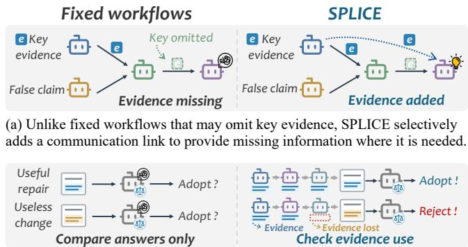
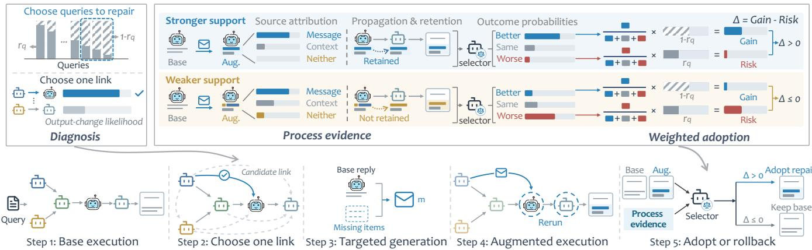
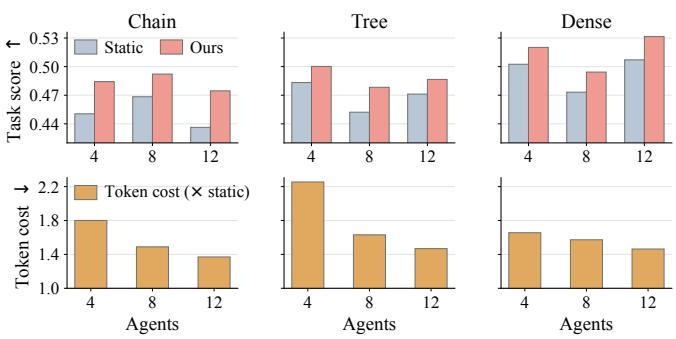
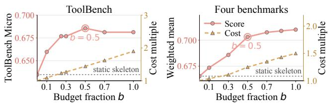

# Locating and Closing Information Gaps in Multi-Agent Systems

Yaxin Gong1,2, Chongming Gao1, Gangyi Zhang2, Chenxiao Fan1, Leyang Shen3,

Jiakai Wang2, Dong Wang2, Yang Liu2, Haoyan Liu1, Xinting Hu1

1 University of Science and Technology of China

2 Qwen Business Unit of Alibaba 3 National University of Singapore

gyx2022@mail.ustc.edu.cn

## Abstract

Multi-step Web tasks often require several LLM agents to gather and combine evidence. The communication graph of a fixed workflow restricts which agents can read each other’s outputs: evidence retrieved by one agent may never reach the agent that needs it, leaving an information gap and an incomplete or incorrect answer. Adding a connection can deliver the missing evidence, but can also lead the receiver to adopt an incorrect upstream conclusion that displaces a correct answer; the final output alone does not separate the two. We propose Selective Probing and Link Insertion for Closing information gaps in multi-agent Execution (SPLICE), which locates information gaps per query and decides what to adopt after adding an edge. After the original workflow runs, SPLICE uses the query and node outputs to locate a possible gap, adds one directed edge from a source to a receiver to deliver the relevant evidence, and re-executes the receiver and afected downstream nodes, producing a candidate answer. The adoption decision reads both the final answers of the two runs and the process changes the edit caused inside the workflow: how far the receiver moved, where its new content came from, and whether the change reached the final an swer. A selector trained on these process features chooses between adopting the candidate answer and retaining the original. On five benchmarks, SPLICE raises the task score on Web tool use by 8.0% and the mean score on four reasoning and planning benchmarks by 5.7% relative to the static skeleton, at 1.25 to 1.44× the skeleton’s cost, and transfers zero-shot to four unseen backbones.

## CCS Concepts

• Computing methodologies → Multi-agent systems; • Information systems → Information retrieval.

## Keywords

Multi-Agent Systems, Agentic Search, Evidence Grounding, Large Language Models

## 1 Introduction

A growing share of complex requests on the Web cannot be answered from any single source, but require evidence gathered across multiple services, interfaces, and pages[6, 15]. Such multi-step information seeking is increasingly carried out by pipelines of specialised LLM agents, each responsible for one stage of retrieval or tool use [1, 32], which outperform single agents on many tasks [21, 43]. Together these stages form a harness that gathers and analyses Web content. The pipeline’s communication graph determines which agents can read each other’s outputs; the quality of the final answer

  
(b) Comparing final answers alone cannot tell whether a candidate reflects the delivered evidence or an unrelated rewrite. SPLICE instead examines how evidence from the added link is used to shape the receiver's reply and the final answer, then decides whether to adopt the repair.

Figure 1: Comparison between existing fixed workflows (left) and our proposed SPLICE (right).

therefore depends on whether the evidence gathered across these stages is grounded in the agent that has to act on it.

Consider a request to plan a cross-border trip. One agent looks up flights, another checks visa rules, and a third assembles the itinerary. The flight agent retrieves a route with a stop in a third country, but the visa agent never receives this detail and applies the rules for a direct flight. The final itinerary omits a required transit visa (Figure 1(a), left). In a fixed workflow, an agent reads only the outputs of its direct predecessors [8], even though the evidence it needs varies by query. The relevant evidence is already available elsewhere in the workflow but absent from the context of the agent that needs it. We call this an information gap (§3.2).

A natural fix is to add a communication edge, deliver the evidence an upstream agent holds to the receiver, and re-execute the afected downstream nodes [8, 12, 26, 43] (Figure 1(a), right). Adding an edge, however, is not enough on its own. The inserted message can supply the missing fact or lead the receiver to copy an incorrect upstream conclusion and overwrite a correct answer [7, 37]; the final output alone does not separate the two (Figure 1(b), left). The answer produced by the edit and the re-execution—hereafter the candidate answer—therefore cannot be adopted automatically; whether to adopt the candidate answer or retain the original must be decided after observing what the edit did inside the workflow.

We draw inspiration from dendritic spine turnover: during learning, new synaptic connections form, and subsequent local activity helps determine which are stabilised or retracted [10, 35]. Following this “form, then select by observed activity” principle, this paper proposes Selective Probing and Link Insertion for Closing information gaps in multi-agent Execution (SPLICE). After the original workflow runs, SPLICE uses the query and node outputs to locate an information gap, adds one directed edge from a source to a receiver, sends the relevant evidence, and re-executes the afected downstream nodes, producing a candidate answer. The agents stay unchanged; the original answer is retained, and SPLICE chooses between the candidate answer and the original by reading how outputs changed between the original run and the trial.

SPLICE decides where to add an edge through two levels of diagnosis. At the query level, a regressor predicts the base score each question would receive under the static skeleton, and the trial budget goes to the questions with the largest predicted room for improvement. At the edge level, SPLICE scores each candidate edge by whether adding it will change the final output, and adds the highest-scoring edge. The inserted message is not a relay of the upstream answer; it grounds the Web evidence that the source agent holds but the receiver’s context lacks, closing the information gap.

After the edit, SPLICE chooses between the candidate answer and the original. The two final answers do not separate several outcomes: the inserted message is never used by the receiver, it is used but the revision owes nothing to it, or the revision is absorbed downstream. SPLICE’s process-conditioned selection therefore reads both the final answers and the process changes the edit caused inside the workflow (Figure 1(b), right): how far the receiver moved, where its new content came from (the message, the existing context, or neither), and whether the change appears in the final answer. A selector trained on these process features chooses between adopting the candidate answer and retaining the original.

Our contributions are as follows.

• We identify and characterise the information gap in multi-agent workflows, and propose SPLICE, a method that locates it per query, closes it with one directed edge, and rolls back when verification is unfavourable.

• We make the adoption decision from how outputs change inside the workflow between the original run and the trial, which judges what to keep more reliably than comparing final answers alone.

• On five benchmarks SPLICE raises Web tool use by 8.0% and the mean of four reasoning benchmarks by 5.7% relative to the static skeleton, composes with the workflows of two published systems and a generic chain, and transfers zero-shot to four backbones.

## 2 Related Work

We review prior work along two lines that bear directly on this paper: how the communication topology among agents is designed and adjusted [34], and how, once a modification produces a candidate answer, a choice is made among candidates.

## 2.1 Multi-Agent Communication Topology

Early multi-agent systems adopted a variety of fixed topologies for inter-agent collaboration: CAMEL [14] introduced communicative agents that cooperate through role-playing, AutoGen [33] gen eralised this paradigm to multi-agent dialogues, LLM-Debate [5] leveraged a multi-agent argumentation mechanism to correct hallucinations, and Generative Agents [19] and AgentVerse [3] facilitated collaboration by simulating social environments or orchestrating expert groups, with MetaGPT [11] and ChatDev [20] further instantiating these fixed role divisions on software development pipelines. As interaction patterns grew more complex, subsequent work began to model agents explicitly as nodes in a graph and communication channels as edges, optimising these graph structures to improve collaboration [24]: GPTswarm [47], DyLAN [16], G-Designer [43] and MACNET [21] each optimise the communication topology from a diferent angle. Building on this graph-based view, further work makes finer-grained edits to the graph structure— MOC [8] uniformly expands the range of upstream outputs each agent can read, AgentPrune [42] and AgentDropout [31] remove edges judged redundant to improve eficiency, and G-Safeguard [29] intervenes topologically to block malicious propagation. More recently, DATS [12], AFlow [44], MaAS [41], MASS [46], Codebook Agent [39] and Nexa [27] begin to decide the topology per query rather than committing one graph for the entire dataset. None of these methods, however, revisits the decision after observing what the modified workflow produces: once an edge is added, its output is used as the final answer. In this work we add an edge per query, run a trial, and decide whether to adopt the candidate answer or retain the original from how outputs change inside the workflow between the base run and the trial.

## 2.2 Selecting Among Candidate Outputs

When a modification produces a candidate answer, deciding whether to adopt it is a selection problem. The most basic approach places the original answer in a candidate pool and picks the best: selfconsistency [30] takes a majority vote over multiple samples, Self-Refine [18] and Reflexion [25] let the model reflect on and revise its own answer, and multi-agent debate [5] converges through multiple rounds of discussion. More refined selection mechanisms have since been proposed: Oracle Gap [13] decomposes selector net gain into recoverable headroom, verification signal quality, and harm to already-correct answers; TrajSelector [38] scores each reasoning step from the sampler’s own latent representations and aggregates those scores to pick a trajectory, generative verifiers [45] score candidates at the token level, MAS-ProVe [28] studies how well process verification actually works across multi-agent frameworks, and Best-of-Evidence [40] keeps the candidate pool fixed while spending a limited budget on the evidence actions that could change the choice; Consilience [2] calibrates a conformal guarantee on each proposed communication action, and DoVer [17] verifies failure hypotheses through active intervention. We compare against the last four of these decision rules on a shared candidate pool in Table 1. TrajSelector reads the sampler’s latent representations, which the API backbones used here do not expose, so it is not among the arms we run. A related line of work addresses harmful messages. G-Safeguard [29] targets harm from an external adversary that constitutes a detectable distribution shift; in normal collaboration, however, a message can be fluent and well-reasoned yet wrong, and this kind of harm from honest agents has never been managed as an intrinsic property of collaboration. In all of the selection methods above, candidates are produced by independent sampling or answer-level revision, and the original answer enters the choice alongside the other candidates. Our candidates come from a per-query edge addition and a trial; the original answer is the default returned when the candidate is not adopted; and the adoption decision reads how outputs change inside the workflow between the base run and the trial, not only the final answers.

## 3 Preliminaries

This section sets up the notation used throughout the paper. We cast a multi-agent workflow as a directed graph and then define candidate edges, information gaps, and trials in turn.

## 3.1 Multi-Agent Workflows as Graphs

We adopt the graph formulation of multi-agent workflows used in prior work [8, 42, 43]. A workflow is a directed acyclic graph $G = ( V , E )$ in which each node $v _ { i } \in V$ is an LLM agent assigned a subtask $x _ { i } ,$ , and each edge $( v _ { i } , v _ { j } ) \in E$ means that the output of $v _ { i }$ is readable by $v _ { j } .$ . Given a query � from a query set $\scriptstyle Q ,$ nodes execute in topological order: node $v _ { j }$ produces an answer $a _ { j }$ conditioned on �, on its own subtask $x _ { j }$ , and on the outputs of its in-neighbours $N ^ { - } ( v _ { j } ) = \{ v _ { i } : ( v _ { i } , v _ { j } ) \in E \}$ . A designated terminal node emits the final output ${ \hat { y } } _ { q } ,$ whose task score we write $r _ { q } = \mathrm { S c o r e } ( \hat { y } _ { q } , y _ { q } ^ { \star } ) \in$ [0, 1], where $y _ { q } ^ { \star }$ is the reference answer. We call the collection of all node answers in one execution its trace, $\tau _ { q } = ( a _ { 1 } , \dots , a _ { | V | } , \hat { y } _ { q } )$

Under this formulation, what $v _ { j }$ reads from upstream is exactly the concatenation of the answers of the nodes in $N ^ { - } ( v _ { j } )$ , placed in its prompt [8]. Two properties are worth stating explicitly, because the problem we study follows from them. First, the query � is visible to every node, while the intermediate products the nodes derive from it travel only along $E ;$ the visibility we refer to throughout is therefore the visibility of these inter-node products, which is fixed at design time and does not vary with the query. Second, a node forwards its own answer �� rather than the upstream material it read; a piece of evidence that an upstream node derives therefore either reaches $v _ { j }$ in compressed form, having been rewritten at every hop along the way, or does not reach it at all when the two sit on branches that the skeleton never connects.

## 3.2 Communication Rewiring

Candidate edges. Index the nodes by a topological order of $G ,$ so that $i < j$ implies $v _ { j }$ is not an ancestor of $v _ { i } .$ The candidate edge set

$$
{ \cal C } = \left\{ ( v _ { i } \longrightarrow v _ { j } ) : i < j , v _ { i } \notin N ^ { - } ( v _ { j } ) \right\}\tag{1}
$$

collects the forward edges missing from the skeleton, each of which would hand material from an upstream node �� (the source) directly to $v _ { j }$ (the receiver) without creating a cycle. Two kinds of source qualify: nodes that already reach $v _ { j }$ indirectly, and nodes on a parallel branch that reach it not at all. C is determined by the skeleton alone and is the same for every query; what varies across queries is which of its edges is worth opening.

Information gaps. The candidate set collects every pathway that could be opened, but only some of its edges correspond to a piece of evidence that is actually missing. For a query � and a candidate edge $( v _ { i } \to v _ { j } ) \in C _ { : }$ we say the pair constitutes an information gap on � when the source answer $a _ { i }$ carries evidence that $v _ { j }$ needs to answer but that is absent from its upstream input $\textstyle \bigcup _ { v _ { l } \in N ^ { - } ( v _ { j } ) } a _ { l }$ and that $v _ { j }$ does not recover from � on its own. Since � is visible to every node, the gap is the evidence that the source derived and that the receiver can neither read nor reproduce; the definition is structural, stating that this evidence exists at the source and is missing at the receiver. The cross-border example in §1 belongs to the second kind of source in (1), where source and receiver sit on parallel branches. Membership is defined with reference to the reference answer $y _ { q } ^ { \star }$ and is unobservable at deployment, where §4.1 supplies the ranking proxy used in its place.

Trials. Opening a candidate $e = ( v _ { i }  v _ { j } )$ and sending a message � along it yields the rewired graph � ⊕ $( e , m ) = ( V , E \cup \{ e \} )$ , in which $v _ { j }$ reads � in addition to its original inputs. Only � and its descendants need to be re-executed, producing a trial trace $\tau _ { q } ( e , m )$ a candidate output $\hat { y } _ { q } ( e , m )$ and its score $r _ { q } ( e , m )$

Gain. The score change of a trial relative to the base run is $g _ { q } ( e , m ) = r _ { q } ( e , m ) - r _ { q } .$ . Because scores lie in [0, 1],

$$
- r _ { q } \ \leq \ g _ { q } ( e , m ) \ \leq \ 1 - r _ { q } .\tag{2}
$$

We call a modification beneficial (B), neutral (S) or harmful (W) according to whether $g > 0 , g = 0 \mathrm { o r } g < 0$

Rewiring policies and blind commit. A rewiring policy makes three choices on each query: whether to trial, $t _ { q } \in \{ 0 , 1 \}$ ; which edges to trial, $S _ { q } \subseteq C$ , together with their messages; and, after the trial, an adoption decision $d _ { q } \in S _ { q } \cup \{ \bot \}$ , where ⊥ denotes retaining the original answer $\hat { y } _ { q }$ . The policy space of rewiring strategies introduced in $\ S 1$ can now be formalised through two properties.

Definition 1 (Selectivity, retractability, blind commit). A policy is selective if $( t _ { q } , S _ { q } )$ varies with �, and retractable if $d _ { q }$ is a function of the trial trace $\tau _ { q } ( e , m )$ that can take the value ⊥. A policy is a blind commit if its decision does not depend on anything observed after the trial, which takes one of two forms: a no-trial commit with $t _ { q } = 0$ that modifies the graph and returns the modified output as the final answer (predicted topologies such as G-Designer, Nexa and MaAS fall here), and a post-trial commit with $t _ { q } = 1$ but $d _ { q } \neq \perp$ for every query, which adopts unconditionally after every trial.

## 4 Method

SPLICE intervenes after the workflow has executed (Figure 2). For each selected query, diagnosis picks one candidate edge and runs a single trial; at most $B = b \left| Q \right|$ | queries are trialled, where $b \in ( 0 , 1 ]$ is the budget fraction. The goal is to maximise the total score gain across all trialled queries, counting retention of the original answer as zero gain. All decisions before the trial rely only on the base trace $\tau _ { q } ;$ only the adoption decision may use the trial trace. This section is organised in two parts: diagnosis and targeted generation decide where to intervene and what to send; process-conditioned selection then decides, for each trialled query, whether to adopt the candidate answer or retain the original $\hat { y } _ { q }$

## 4.1 Diagnosis and Targeted Generation

Query-level diagnosis: whether to repair. By Eq. (2), a trial can win at most the headroom $1 - r _ { q } $ , which can be estimated before the trial. We fit the base score with a regressor $\hat { r } _ { q } = f _ { \omega } ( \psi ( \tau _ { q } ) )$ whose features $\psi$ read only the base trace: whether the base output failed to parse, surface statistics of the answer, and the agreement between the terminal node’s answer and the final output. None of these touches gold, and $f _ { \omega }$ is fitted on the training split only (§5.1). We then set $t _ { q } = 1$ for the � queries with the largest $1 - \hat { r } _ { q } ^ { } .$

  
Figure 2: Overview of SPLICE. The four sub-decisions are made in one timeline: diagnosis selects which queries are worth a trial and which candidate edge to open, targeted generation writes the message that edge carries, and the trial is then executed. Only afterwards does verification read the resulting execution and decide whether to adopt the candidate answer or retain the original ${ \hat { y } } _ { q } .$ The top half of the figure shows the core mechanism behind each step.

Edge-level diagnosis: where to rewire. Within a selected query we pick one edge from C by ranking edges with a gold-free estimate of the propagation probability

$$
\rho _ { q , e } = { \cal P } \big ( \hat { y } _ { q } ( e , m ) \neq \hat { y } _ { q } \big | \tau _ { q } , e \big ) ,\tag{3}
$$

the probability that the trial changes the final output. It is estimated by a light classifier $h _ { \eta }$ whose features include the receiver’s distance to the terminal node, the agreement between the terminal answer and the final output, and surface statistics of the receiver’s answer. Its training label is whether the final output changed, observable directly after a trial without gold; $h _ { \eta }$ is fitted on the training split only. At deployment every feature of $h _ { \eta }$ is computed from the base trace $\tau _ { q }$ available before the trial.

$S _ { q }$ takes the single edge with the largest $\rho _ { q , e }$

Targeted generation: what to send. Instead of forwarding the source’s answer �� verbatim, we have the source organise its content against the receiver’s gap. Let Items(·) be a deterministic extractor returning the entities and numbers in a text; the gap of receiver $v _ { j { \mathrm { : } } }$

$$
M _ { q , j } = \operatorname { I t e m s } ( x _ { j } ) \setminus \bigcup _ { v _ { l } \in N ^ { - } ( v _ { j } ) } \operatorname { I t e m s } ( a _ { l } ) ,\tag{4}
$$

contains the items its subtask mentions but none of its parents’ outputs cover. $M _ { q , j }$ tells the generator which items to foreground. The message is then

$$
m = { \mathrm { G e n } } { \left( a _ { i } , M _ { q , j } \right) } .\tag{5}
$$

## 4.2 Process-Conditioned Selection

An inserted message can be present in the receiver’s input yet unused, can be used without producing a revision that owes anything to it, or can move the receiver only to have the change absorbed downstream. At the level of the final answer all three can look alike, yet they mean very diferent things. The adoption decision therefore reads the change the edit caused inside the workflow between the base run and the trial.

Process evidence. After a trial, the base trace $\tau _ { q }$ and the trial trace $\tau _ { q } ( e , m )$ form a pair, from which we read three groups of measurements. The first is how far the receiver moved: what its revision added, dropped, and how large it was. The second is where the revision came from: added content attributed to what the message supplied, to what the receiver already had, or to neither. The third is whether it survived: how far the change travelled toward the terminal node and whether the message’s content is still in the final answer. We write these as the process evidence $\phi _ { q , e } = \phi ( \tau _ { q } , \tau _ { q } ( e , m ) )$ ; the full list of fields is given in Appendix A.4.

Selector. We implement the adoption decision as a three-class language-model selector �� (� $| \ z _ { q , e } ) , \ c \ \in \ \{ \mathrm { B } , \mathrm { S } , \mathrm { W } \}$ , whose input $z _ { q , e } = ( q , x _ { j } , G , \hat { r } _ { q } , \hat { y } _ { q } , \hat { y } _ { q } ( e , m ) , \hat { \phi _ { q , e } } )$ contains the query, the receiver’s subtask, the workflow structure, the predicted base score, the base and candidate outputs, and the process evidence. Training labels $c ^ { \star } = \mathrm { s i g n } ( g _ { q } ( e , m ) )$ are derived from reference answers; no gold is used at inference. The selector is initialised by supervised fine-tuning, which gives the reference policy $\pi _ { \mathrm { r e f } } ,$ , and then refined by direct preference optimisation [23] on pairs $( c ^ { \star } , c ^ { - } )$ with $c ^ { - } \neq c ^ { \star }$

$$
\begin{array} { r } { \mathcal { L } ( \theta ) = - \mathbb { E } \Big [ \log \sigma \Big ( \beta \log \frac { \pi _ { \theta } ( c ^ { \star } \mid z ) } { \pi _ { \mathrm { r e f } } ( c ^ { \star } \mid z ) } - \beta \log \frac { \pi _ { \theta } ( c ^ { - } \mid z ) } { \pi _ { \mathrm { r e f } } ( c ^ { - } \mid z ) } \Big ) \Big ] . } \end{array}\tag{6}
$$

Weighted adoption. The selector scores three outcomes; the deployment action is binary, adopt the candidate answer or retain the original $\hat { y } _ { q }$ . At deployment the selector yields $\hat { p } _ { \mathrm { b } } = \pi _ { \boldsymbol { \theta } } ( \mathrm { B } \mid z _ { q , e } )$ and $\hat { p } _ { \mathrm { h } } = \pi _ { \theta } ( \mathrm { ~ W ~ } | ~ z _ { q , e } )$ for each trialled edge. The adoption margin is $\Delta _ { q , e } = \hat { p } _ { \mathrm { b } } \big ( 1 - \hat { r } _ { q } \big ) - \hat { p } _ { \mathrm { h } } \hat { r } _ { q } ,$ weighting a potential gain against the headroom $1 - \hat { r } _ { q }$ and a potential loss against the score $\hat { r } _ { q }$ already in hand. The better the original answer, the stronger the evidence needed to adopt the candidate. Neutral outcomes carry no weight

Table 1: End-to-end results on five benchmarks. Net is the per-question fix−harm rate (%). Best values per column are bolded.
<table><tr><td></td><td colspan="4">ToolBench (n=230)</td><td colspan="4">Four benchmarks (n=2,142)</td><td colspan="3">Total</td></tr><tr><td>Method</td><td>Micro</td><td>Served</td><td>Net %</td><td>Cost</td><td>MuSiQue</td><td>DROP</td><td>2Wiki</td><td>PlanCraft</td><td>Mean</td><td>Net %</td><td>Cost</td></tr><tr><td>Static</td><td>0.6347</td><td>0.3957</td><td></td><td>1.00×</td><td>0.4257</td><td>0.6734</td><td>0.7614</td><td>0.6988</td><td>0.6654</td><td></td><td>1.00 ×</td></tr><tr><td>Always</td><td>0.6514↑.0167</td><td>0.3435 ↓.0522</td><td>+2.6</td><td>1.75×</td><td>0.4184 ↓.0073</td><td>0.7015 ↑.0281</td><td>0.7649 ↑.0035</td><td>0.6842 ↓.0146</td><td>0.6725 ↑.0071</td><td>+2.0</td><td>1.71 ×</td></tr><tr><td>Random</td><td>0.6384 ↑.0037</td><td>0.3870 ↓.0087</td><td>+0.9</td><td>1.67×</td><td>0.4343 ↑.0086</td><td>0.7004 ↑.0270</td><td>0.7607 ↓.0007</td><td>0.6491 ↓.0497</td><td>0.6678 ↑.0024</td><td>+1.9</td><td>1.71 ×</td></tr><tr><td>Self-cons.</td><td>0.6282 ↓.0065</td><td>0.3609 |.0348</td><td>-1.7</td><td>3.00×</td><td>0.4346 ↑.0089</td><td>0.6874↑.0140</td><td>0.7627 ↑.0013</td><td>0.6813 ↓.0175</td><td>0.6692 ↑.0038</td><td>-0.1</td><td>3.00×</td></tr><tr><td>Judge</td><td>0.6624 ↑.0277</td><td>0.4304 ↑.0348</td><td>+6.1</td><td>2.67×</td><td>0.4418 ↑.0161</td><td>0.6985 ↑.0251</td><td>0.7717 ↑.0103</td><td>0.6871 ↓.0117</td><td>0.6781 ↑.0127</td><td>+3.1</td><td>1.88×</td></tr><tr><td>Regressor</td><td>0.6572 ↑.0225</td><td>0.4304 ↑.0348</td><td>+4.3</td><td>2.35×</td><td>0.4322 ↑.0065</td><td>0.7011 ↑.0277</td><td>0.7624 ↑.0010</td><td>0.7281 ↑.0292</td><td>0.6808 ↑.0154</td><td>+4.4</td><td>1.75×</td></tr><tr><td>MOC</td><td>0.6598 ↑.0251</td><td>0.4304↑.0348</td><td>+5.2</td><td>1.75×</td><td>0.4475 ↑.0218</td><td>0.7218 ↑.0484</td><td>0.7602 ↓.0012</td><td>0.6871 ↓.0117</td><td>0.6831 ↑.0177</td><td>+4.7</td><td>1.71 ×</td></tr><tr><td>Nexa</td><td>0.6514 ↑.0167</td><td>0.3435 ↓.0522</td><td>+2.6</td><td>1.09×</td><td>0.4314 ↑.0057</td><td>0.6954 ↑.0220</td><td>0.7643 ↑.0029</td><td>0.7105 ↑.0117</td><td>0.6766 ↑.0112</td><td>+2.5</td><td>1.42×</td></tr><tr><td>Nexa + rb.</td><td>0.6613 ↑.0266</td><td>0.4130 ↑.0174</td><td>+5.2</td><td>1.09×</td><td>0.4388 ↑.0131</td><td>0.7006 ↑.0272</td><td>0.7666 ↑.0052</td><td>0.7193 ↑.0205</td><td>0.6818 ↑.0164</td><td>+3.8</td><td>1.45×</td></tr><tr><td>MAS-ProVe</td><td>0.6580 ↑.0233</td><td>0.4391 ↑.0435</td><td>+4.3</td><td>2.71×</td><td>0.4363 ↑.0106</td><td>0.7170 ↑.0436</td><td>0.7569 ↓.0045</td><td>0.7485 ↑.0497</td><td>0.6883 ↑.0229</td><td>+5.0</td><td>1.81 ×</td></tr><tr><td>Best-of-Evid.</td><td>0.6419 ↑.0072</td><td>0.4043 ↑.0087</td><td>+1.7</td><td>1.85×</td><td>0.4276 ↑.0019</td><td>0.7132 ↑.0398</td><td>0.7634 ↑.0020</td><td>0.7047 ↑.0058</td><td>0.6807 ↑.0153</td><td>+3.1</td><td>1.41 ×</td></tr><tr><td>DoVer</td><td>0.6419↑.0072</td><td>0.4130 ↑.0174</td><td>+0.9</td><td>1.33×</td><td>0.4384 ↑.0127</td><td>0.6843 ↑.0109</td><td>0.7689 ↑.0075</td><td>0.6988</td><td>0.6737 ↑.0083</td><td>+0.8</td><td>1.03×</td></tr><tr><td>Consilience</td><td>0.6401 ↑.0054</td><td>0.3957</td><td>+0.9</td><td>2.71×</td><td>0.4337 ↑.0080</td><td>0.7125 ↑.0391</td><td>0.7638 ↑.0024</td><td>0.7368 ↑.0380</td><td>0.6868 ↑.0214</td><td>+4.4</td><td>1.81 ×</td></tr><tr><td>SPLICE (b=0.3)</td><td>0.6769 ↑.0422</td><td>0.4304 ↑.0348</td><td>+7.0</td><td>1.27×</td><td>0.4575 ↑.0318</td><td>0.6858 ↑.0124</td><td>0.7633 ↑.0019</td><td>0.7632 ↑.0643</td><td>0.6858 ↑.0204</td><td>+4.7</td><td>1.11×</td></tr><tr><td>SPLICE (b=0.5)</td><td>0.6856 ↑.0509 0.6813 ↑.0466</td><td>0.4478 ↑.0522 0.4391 ↑.0435</td><td>+8.7</td><td>1.44×</td><td>0.4612 ↑.0355</td><td>0.7158 ↑.0424</td><td>0.7760 ↑.0146</td><td>0.7778 ↑.0789 0.7836 ↑.0848</td><td>0.7031 ↑.0377</td><td>+5.3</td><td>1.25 ×</td></tr><tr><td>SPLICE (full)</td><td></td><td></td><td>+7.8</td><td>1.90×</td><td>0.4662 ↑.0405</td><td>0.7272 ↑.0538</td><td>0.7799 ↑.0185</td><td></td><td>0.7101 ↑.0446</td><td>+7.5</td><td>1.50×</td></tr></table>

on either end. The decision is

$$
\begin{array} { r } { d _ { q } = \left\{ \begin{array} { l l } { \arg \operatorname* { m a x } _ { e \in S _ { q } } \Delta _ { q , e } } & { \mathrm { i f ~ } \operatorname* { m a x } _ { e \in S _ { q } } \Delta _ { q , e } > 0 , } \\ { \bot } & { \mathrm { o t h e r w i s e } . } \end{array} \right. } \end{array}\tag{7}
$$

## 5 Experiments

We organise our evaluation around four research questions.

• RQ1: Does the full method beat the static skeleton and baselines?

• RQ2: What does each component contribute?

• RQ3: Does SPLICE locate the information gap it sets out to close?

• RQ4: Does it generalise across host workflows, backbones and skeleton scales?

## 5.1 Experimental Setup

Datasets and evaluation. ToolBench [22] is the primary workload (Table 2) and matches the Web-tool-use track adopted by broader agent-evaluation suites: agents issue tool calls through the Stable-ToolBench [9] virtual API server, which replays archived responses so the same request yields the same result on any day, and paired diferences therefore reflect the communication repair rather than service availability. PlanCraft is scored by executing the crafting sequence against the benchmark’s recipe library. Rollback is scoped to the output layer and does not undo executed tool calls. Each dataset is split at the question level; all learned components are fitted on the training split only, and every reported number comes from a single evaluation on the test split. The mean over the four reasoning and planning benchmarks is weighted by test-set size, and the individual benchmark scores show how improvements vary across question answering and planning. Appendix A.1 gives skeleton structures and split details.

Table 2: Datasets and evaluation. Micro grades each required API by call and content; Served is the fraction of fully-scored requests; Token F1 and Plan success score the other four benchmarks against reference answers.
<table><tr><td>Dataset</td><td>Task</td><td>Metric</td><td>Train Test</td><td></td></tr><tr><td>ToolBench</td><td>Web tool use</td><td>Micro (Served)</td><td>535</td><td>230</td></tr><tr><td>MuSiQue</td><td>Multi-hop QA</td><td>Token F1</td><td>1,680</td><td>360</td></tr><tr><td>DROP</td><td>Discrete reasoning</td><td>Token F1</td><td>3,360</td><td>720</td></tr><tr><td>2WikiMultihopQA Multi-hop QA</td><td></td><td>Token F1</td><td>3,360</td><td>720</td></tr><tr><td>PlanCraft</td><td>Embodied planning</td><td>Plan success</td><td>1,596 342</td><td></td></tr></table>

Baselines. We compare against five generic controls: Always, which adds all candidate edges at once; Random, which opens one at random; Self-consistency [30]; a tuned LLM Judge; and a gain Regressor. We also compare against the published systems MOC [8] and Nexa [27], together with Nexa + rollback, which attaches our rollback step to the graph Nexa predicts, and against four published selection rules—MAS-ProVe [28], Best-of-Evidence [40], Consilience [2] and DoVer [17]—all on the same skeletons, questions and splits, each running its own procedure (details in Appendix A.5).

Implementation. All workflow nodes run on gpt-4o-mini; the adoption selector is a local Qwen2.5-7B-Instruct [36] trained with DPO. We report three budget fractions � ∈ {0.3, 0.5, 1.0}. Intervals are 95% question-paired bootstrap CIs; cost is a dollar multiple over the static skeleton, with the selector charged at its public hosted rate (4.9% of the total). Appendices A.3 and A give full details.

## 5.2 End-to-End Performance (RQ1)

The full method is ahead on both workloads. At �=0.5 it reaches 0.6856 Micro on ToolBench and a weighted mean of 0.7031 on the four benchmarks, +0.0509 and +0.0377 over the static skeleton, and its paired diference against every competitor (Table 14) stays above zero. The half budget is a favourable operating point: it buys most of the gain at 1.44× the cost on ToolBench and 1.25× on the four benchmarks, trading a small amount of score for a lower cost than the full budget. Opening edges without selection gives a diferent picture: Always and Random fix about as many questions as they harm, a net rate of only +2.0% and +1.9% on the four benchmarks, so the gain comes from where to intervene.

Table 3: Query-level diagnosis calibration on ToolBench (�=230). Bins are quintiles of predicted base score $\hat { r } _ { q } .$
<table><tr><td></td><td>Q1 (low)</td><td>Q2</td><td>Q3</td><td>Q4</td><td>Q5 (high)</td><td>All</td></tr><tr><td>Predicted</td><td>0.392</td><td>0.548</td><td>0.651</td><td>0.736</td><td>0.847</td><td>0.635</td></tr><tr><td>Actual</td><td>0.388</td><td>0.542</td><td>0.648</td><td>0.740</td><td>0.856</td><td>0.635</td></tr><tr><td>Trialled</td><td>100%</td><td>100%</td><td>50%</td><td>0%</td><td>0%</td><td>50%</td></tr></table>

The two calibers diverge in a way that is itself informative. Always and Nexa raise Micro by 0.0167 yet lose 0.0522 on Served: opening an edge unconditionally displaces answers that were already complete. The same efect appears between our own budget settings. The half budget both serves more requests (0.4478 against 0.4391) and scores higher on Micro (0.6856 against 0.6813) than the full budget, so the extra trials the full budget buys crowd out some responses that needed no repair at all.

Attaching rollback to an existing method captures part ofthe gain but does not close it: Nexa + rollback reaches 0.6613 on ToolBench, still 0.0243 below the full method, and trails it by 0.0213 on the four benchmarks. Targeted diagnosis and process-conditioned selection add value beyond attaching rollback to a predicted graph.

The gains hold under a diferent family of scoring rules from ToolBench’s Micro. MuSiQue, DROP and 2WikiMultihopQA are scored by standard token F1, and PlanCraft by an executable verifier that steps through the recipe inventory, and the weighted mean gain across them is +0.0377 at �=0.5. The same method that helps on the Micro metric also helps under these separate rules, so the improvement comes from the communication repair rather than from a fit to one scoring signal. On ToolBench, §5.4 audits the same questions against the API responses the workflow received.

## 5.3 Component Contribution (RQ2)

We verify each component along the four layers of locating.

Layer 1: Query-level locating. Table 3 bins the 230 test questions into quintiles by predicted base score $\hat { r } _ { q }$ and reports the mean predicted score, the mean actual score and the fraction trialled at budget �=0.5. Predicted and actual scores track closely. The budget concentrates entirely on the two lowest quintiles, which are trialled at 100%, while the two highest quintiles are skipped entirely. Table 4 corroborates this: removing diagnosis altogether raises cost without raising the score, and replacing the predicted score with a constant, a parse-failure flag or answer length all fall significantly below the full diagnosis.

Layer 2: Edge-level locating. On the same 535 training queries, the edge selected by $\rho ,$ which is the edge the full method uses, produces an output change on 115 questions, of which 70 improve and 45 worsen, a fix ratio of 0.61. A randomly chosen edge produces a change on 96 questions, 44 improving and 52 worsening, a fix ratio of 0.46. The edge diagnosis thus selects edges that are not merely more likely to change the output but more likely to change it for the better. In the ablation table, random edge selection falls −0.0202 behind the full method, and ranking edges by a predicted-gain head falls −0.0185 behind it: $\rho$ selects better edges than a direct gain forecast, since the gain depends on what the receiver does with the message and is only measurable after the trial.

Table 4: Component ablation on ToolBench with the four locating layers varied in turn. Δ is relative to Full (�=0.5); the intervals are 95% paired bootstrap CIs over questions.
<table><tr><td>Configuration</td><td>Score</td><td>Δ</td><td></td><td>Net % Cost</td></tr><tr><td>Static skeleton</td><td>0.6347</td><td></td><td></td><td>1.00 ×</td></tr><tr><td>w/o diagnosis</td><td>0.6813-.0043</td><td>+.0073 -.0162</td><td></td><td>+7.8 1.90×</td></tr><tr><td>Î = constant</td><td>0.6718-.0138</td><td>-.0054 -.0296</td><td></td><td>+6.1 1.44×</td></tr><tr><td>î = parse failure</td><td>0.6648-.0208</td><td>-.0146 -.0401</td><td>+3.51.44×</td><td></td></tr><tr><td>f = length</td><td>0.6642-.0214</td><td>-.0147 -.0410</td><td>+3.51.44×</td><td></td></tr><tr><td>edge = random</td><td>0.6654-.0202</td><td>-.0137 -.0392</td><td>+4.31.44×</td><td></td></tr><tr><td>edge = predicted gain</td><td>0.6671-.0185</td><td>-.0021 -.0372</td><td></td><td>+4.31.44 ×</td></tr><tr><td>w/ verbatim forward</td><td>0.6732-.0124</td><td>-.0050 -.0285</td><td>+5.2 1.44×</td><td></td></tr><tr><td>w/ untargeted msg</td><td>0.6749-.0107</td><td>-.0038 -.0258</td><td>+6.1 1.44×</td><td></td></tr><tr><td>w/ key fact removed</td><td>0.6745-.0111</td><td>-.0052 -.0246</td><td>+5.2 1.44×</td><td></td></tr><tr><td>w/ length-matched filler</td><td>0.6697 -.0159-0082</td><td>-.0351</td><td>+5.2 1.44×</td><td></td></tr><tr><td>w/o message (re-run)</td><td>0.6665 -.0191-01312</td><td>-.0375</td><td>+4.31.44×</td><td></td></tr><tr><td>w/ self-revision (matched budget) 0.6689</td><td></td><td>9-.0167 -.0012 -.0349</td><td>+4.3 1.44×</td><td></td></tr><tr><td>w/o rollback</td><td>0.6727-.0129</td><td>-.0052 -.0307</td><td>+6.1 1.44×</td><td></td></tr><tr><td>adopt by  $\hat { p } _ { \mathrm { b } } - \hat { p } _ { \mathrm { h } }$ </td><td>0.6738-.0118</td><td>-.0041 -.0290</td><td>+6.1 1.44×</td><td></td></tr><tr><td>adopt by predicted gain</td><td>0.6789-.0067</td><td>1-.0005 -.0160</td><td>+7.01.44×</td><td></td></tr><tr><td>w/ benefit head only</td><td>0.6634-.0222</td><td>-.0157 -.0427</td><td>+3.51.44 ×</td><td></td></tr><tr><td>w/o process evidence</td><td>0.6709-.0147</td><td>-.0071 -.0334</td><td>+5.2 1.44×</td><td></td></tr><tr><td>w/ shuffled process</td><td>0.6699 -.0157</td><td>-.0081 -.0351</td><td>+5.21.44×</td><td></td></tr><tr><td>w/ raw-trace selector</td><td>0.6772-.0084</td><td>-.0019 -.0221</td><td>+6.1 1.44×</td><td></td></tr><tr><td>w/o attribution</td><td>0.6780-.0076</td><td>-.0012 -.0210</td><td>+6.1 1.44×</td><td></td></tr><tr><td>attribution only</td><td>0.6760-.0096</td><td>-.0028 -.0238</td><td>+5.2 1.44×</td><td></td></tr><tr><td>w/ SFT selector</td><td>0.6818-.0038</td><td>+.0081 -.0160</td><td>+7.81.44×</td><td></td></tr><tr><td>Full (b=0.5)</td><td>0.6856</td><td></td><td></td><td>+8.7 1.44×</td></tr></table>

Layer 3: Message-level locating. The message ablations form a ladder that holds the edge and the re-execution fixed and varies only what is sent. At the bottom, re-running the same nodes with no edge and no message at the same 1.44× budget scores 0.6665. Opening the edge with length-matched filler adds 0.0032. Removing only the key factual statement while keeping the rest of the message intact gives 0.6745, and the complete message gives 0.6856. Of the 0.0159 separating filler from the full method, roughly seven tenths is carried by that single factual statement, confirming that the message locates a specific piece of missing evidence. On the same queries, 115 answers change when a targeted message is delivered against 68 without one, so the adoption rule has 69% more candidates to choose among. Spending the same 1.44× budget on receiver selfrevision with the same selector, rather than on a targeted message, reaches 0.6689, so at matched cost the gain comes from delivering the located evidence rather than from the extra computation alone. Appendix A.8 reproduces two archived edges, one a ToolBench edge carrying an API payload downstream.

Layer 4: Process-evidence verification. Removing process evidence entirely costs −0.0147, and shufling it costs −0.0157, confirming that the features carry a real signal. The attribution group isolates the most diagnostic layer: removing it alone costs −0.0076, so knowing whether new content originated from the message or from the receiver’s own resampling has independent value for the adoption decision. A selector reading the same base and trial traces as raw text, with the same model, training data, and candidate pool but without the hand-computed attribution features, reaches 0.6772 and trails the full method by −0.0084, so the explicit process-attribution features add adoption value on top of access to the same trace. Adopting by the unweighted diference $\hat { p } _ { b } - \hat { p } _ { h }$ falls behind the asymmetric default by −0.0118 (CI clear of zero), showing that weighting a candidate against the headroom on one side and the score already in hand on the other is doing work. Replacing the selector altogether with a predicted-gain regressor costs −0.0067 (CI [−.0160, −.0005]), so the three-class process-conditioned selector improves adoption beyond a direct gain forecast on top of the same adoption rule. These results support combining process evidence with the predicted base score when deciding whether to adopt a repair. The process features help distinguish beneficial from harmful changes, while the base score determines their relative weights: a higher predicted score increases the penalty for potential harm and reduces the weight assigned to potential improvement.

Table 5: Gap-hit precision@1 on the held-out ToolBench test set, with two judges supplying the gap labels and � compared against three heuristic edge-selection rules.
<table><tr><td>Edge selection rule</td><td>Precision@1</td><td>95% CI</td></tr><tr><td>Random reachable edge</td><td>0.41</td><td>[.34, .48]</td></tr><tr><td>Terminal-distance (nearest)</td><td>0.49</td><td>[.42, .56]</td></tr><tr><td>Content coverage</td><td>0.55</td><td>[.48, .62]</td></tr><tr><td>ρ (SPLICE)</td><td>0.67</td><td>[.60, .74]</td></tr></table>

Table 6: Gap-localisation audit on �=120 adopted repairs, independently scored by two judges across four conditions whose joint rate is reported in the bold row.
<table><tr><td>Condition</td><td>DeepSeek-v4-pro</td><td>Claude-opus-4-6</td></tr><tr><td>Source holds the fact</td><td>0.88 [.82,.93]</td><td>0.86 [.79,.91]</td></tr><tr><td>Receiver lacked the fact</td><td>0.91 [.85,.95]</td><td>0.89 [.83,.94]</td></tr><tr><td>Message delivered the fact</td><td>0.85 [.78,.90]</td><td>0.83 [.76,.89]</td></tr><tr><td>Revision used the fact</td><td>0.82 [.75,.88]</td><td>0.80 [.72,.86]</td></tr><tr><td>All four hold</td><td>0.74 [.66,.81]</td><td>0.71 [.63,.79]</td></tr></table>

## 5.4 Gap Localisation (RQ3)

Pre-trial gap-hit precision. We first test whether the edge selector locates real gaps before any trial. On the held-out test set, two judges label for each question which candidate edges correspond to a true information gap, a source-held fact absent from the receiver’s upstream context and not recovered from �; we take this as ground truth and measure how often each rule’s top-ranked edge is a true gap (Table 5). Ranking by � reaches a precision@1 of 0.67, above random reachable edges (0.41), the terminal-distance heuristic (0.49) and content coverage (0.55): the pre-trial selector favours real gaps over edges that merely change the output.

Table 7: Evidence support on the held-out ToolBench test set (�=230); the first three rows sum to one, and the judging protocol is detailed in Appendix A.10.
<table><tr><td>Measure</td><td>Static</td><td>SPLICE</td></tr><tr><td>Fact-support rate</td><td>0.71 [.65,.77]</td><td>0.83 [.78,.88]</td></tr><tr><td>Partially-supported rate</td><td>0.11 [.07,.15]</td><td>0.08 [.05,.12]</td></tr><tr><td>Unsupported-claim rate</td><td>0.18 [.13,.23]</td><td>0.09 [.06,.13]</td></tr><tr><td>Task completion rate</td><td>0.63 [.57,.70]</td><td>0.74 [.68,.80]</td></tr></table>

Table 8: A held-out ToolBench case where SPLICE closes an API-payload gap: the UUID returned at node 0 reaches the terminal only after the added edge delivers it. Full archived exchange in Appendix A.8.
<table><tr><td>Checkpoint</td><td>Archived observation</td></tr><tr><td>Node 0 return</td><td>API payload: u* + captcha PNG.</td></tr><tr><td>Terminal input</td><td>Parents (nodes 1-2): no payload and no  $u ^ { * } .$ </td></tr><tr><td>Repair</td><td>Open 0→3: deliver payload to terminal.</td></tr><tr><td>Answer</td><td>Static: “no API results”; SPLICE: u* + image.</td></tr></table>

Post-adoption gap audit. We then audit whether an adopted edge closes a real gap. Two judges unrelated to the workflow backbone and the selector independently label a random sample of 120 adopted repairs against four conditions: the source holds the fact, the receiver lacked it, the message delivered it, and the revision used it (Table 6). All four conditions hold on 0.74 and 0.71 of the sample under the two judges, with substantial agreement (Cohen’s �=0.77). The audit separates an output change from a closed gap: the majority of adopted repairs carry a fact the source already held and the receiver lacked, deliver it, and use it in the corrected answer.

Across the 28,560 edges of the ofline probe pool, 613 (2.1%) satisfy all four conditions, split almost evenly between sources on a parallel branch the skeleton never connects (315) and distantancestor sources whose content was rewritten away hop by hop (298); both are gaps a fixed topology cannot cover. Appendix A.8 reproduces one closed gap of each kind verbatim.

Evidence support. The audit so far reads the workflow trace; we close RQ3 at the answer level by checking whether the content a closed gap introduces is itself grounded in an API response. On the 230 held-out test questions, two judges read the API responses the workflow actually received and verify each concrete claim, a number, name, date or URL, against them, labelling each as supported, partially supported or unsupported (three rates summing to one; Table 7). SPLICE raises the fact-support rate from 0.71 to 0.83 and the task completion rate from 0.63 to 0.74, and lowers the unsupported-claim rate from 0.18 to 0.09. The gain therefore lands on claims that an API response backs rather than on answer specificity alone, so the improvement reflects evidence support rather than longer or more detailed answers.

Table 8 makes the answer-level audit concrete: the repaired answer reuses the value returned at node 0, while the static terminal had no access to any API result.

Table 9: Composability on three host workflows; � compares SPLICE against each host’s own static output.
<table><tr><td>Host</td><td>Bench</td><td>Static</td><td>Always</td><td>SPLICE</td><td>p</td></tr><tr><td>Chain</td><td>ToolBench</td><td>0.4222</td><td> $0 . 4 6 0 4 \uparrow . 0 3 8 2$ </td><td> $0 . 4 8 3 2 \uparrow . 0 6 1 0$ </td><td>0.0003</td></tr><tr><td>AgentPrune [42]</td><td>ToolBench</td><td>0.4180</td><td> $0 . 4 4 2 8 \uparrow . 0 2 4 8$ </td><td> $0 . 4 7 1 3 \uparrow . 0 5 3 3$ </td><td>0.0003</td></tr><tr><td>G-Designer [43]</td><td>ToolBench</td><td>0.3995</td><td> $0 . 4 2 1 2 \uparrow . 0 2 1 7$ </td><td> $0 . 4 4 3 3 \uparrow . 0 4 3 8$ </td><td>0.0008</td></tr><tr><td>Chain</td><td>2Wiki</td><td>0.6009</td><td> $0 . 5 9 4 2 \scriptstyle \downarrow . 0 0 6 7$ </td><td> $0 . 6 2 4 2 \uparrow . 0 2 3 3$ </td><td>0.0828</td></tr><tr><td>AgentPrune</td><td>2Wiki</td><td>0.5616</td><td> $0 . 5 7 2 8 \uparrow . 0 1 1 2$ </td><td> $0 . 6 0 7 6 \uparrow . 0 4 6 0$ </td><td>0.0276</td></tr><tr><td>G-Designer</td><td>2Wiki</td><td>0.6625</td><td> $0 . 6 6 8 9 \uparrow . 0 0 6 4$ </td><td> $0 . 6 8 3 3 \uparrow . 0 2 0 8$ </td><td>0.0100</td></tr></table>

Table 10: Backbone transfer on DROP, 2Wiki and PlanCraft, with the selector fitted once on gpt-4o-mini and reused on four unseen backbones with no retraining.
<table><tr><td>Backbone</td><td>Static</td><td>Always</td><td>SPLICE</td><td>95% CI</td><td>p</td></tr><tr><td>Kimi-K2.6</td><td>0.7150</td><td>0.7436</td><td>0.7652 ↑.0502</td><td>[.026, .076]</td><td> $1 . 3 \times 1 0 ^ { - 4 }$ </td></tr><tr><td>DeepSeek-V3.2 [4]</td><td>0.7245</td><td>0.7167</td><td> $0 . 7 7 5 8 \uparrow . 0 5 1 3$ </td><td>[.030, .076]</td><td> $1 . 2 \times 1 0 ^ { - 5 }$ </td></tr><tr><td>Qwen3.7-Max</td><td>0.8355</td><td>0.8406</td><td> $0 . 8 6 7 3 \uparrow . 0 3 1 7$ </td><td>[.014, .052]</td><td> $1 . 2 \times 1 0 ^ { - 3 }$ </td></tr><tr><td>Qwen3.6-Plus</td><td>0.7636</td><td>0.7714</td><td>0.7921 ↑.0284</td><td>[.012, .047]</td><td> $1 . 7 \times 1 0 ^ { - 3 }$ </td></tr></table>

  
Figure 3: Skeleton scan on DROP across three topology families (Chain, Tree, Dense) and three agent scales (4, 8, 12).

## 5.5 Generalisation and Boundaries (RQ4)

Composability. SPLICE adds value on top of existing workflows (Table 9). Across six host-by-benchmark cells it improves on each host’s own output: by +0.044 to +0.061 on the three ToolBench hosts $( p \leq 0 . 0 0 0 8 )$ and by +0.021 to +0.046 on the three 2Wiki hosts. The 2Wiki-Chain cell is the informative one: its candidate pool is net negative, so opening every edge (Always) loses 0.0067, while SPLICE still gains +0.0233 because rollback keeps the harmful edits out. Per-query diagnosis and rollback thus act as a layer on top of an existing orchestration rather than a replacement for its topology.

Backbone, scale and budget. The method holds as the setting changes. The selector is fitted once on gpt-4o-mini and never retrained, yet transfers to four unseen backbones with gains of +0.028 to +0.051 (Table 10, all $ { p } \leq 2 \times 1 0 ^ { - 3 } )$ , so the gain does not fade as the backbone grows stronger. Across nine topologies and scales the direction is positive throughout (Figure 3), as the number of candidate edges |C| ranges from 2 to 55 and the gains run from +0.0154 to +0.0383. The budget sweep separates the two workloads: ToolBench Micro rises monotonically with � up to a peak at $b { = } 0 . 5$ and declines at $b { = } 1 . 0 ,$ while the four reasoning and planning benchmarks rise and then saturate for $b \geq 0 . 5 ( \mathrm { F i g u r e } ~ 4 )$ , so the operating point $b { = } 0 . 5$ sits on the knee for both workloads at matched cost.

  
Figure 4: Score and cost against the trial-budget fraction � on ToolBench and the four reasoning and planning benchmarks.

The gain is positive across all nine topologies and scales, and its size follows how much the terminal structure lets a local edit move. The candidate count does not determine the gain monotonically: the smallest pool (|C|=2) and the largest one (|C|=55) both improve, while the nine gains interleave between +0.0154 and +0.0383 rather than rising with |C|. SPLICE therefore buys better gap localisation rather than a larger candidate pool or additional trials per query. The size of each gain tracks the room the terminal structure leaves for a single rewritten edge to move the final answer, as the per-cell counts in Figure 3 show across chain and tree families alike.

## 6 Conclusion and Future Work

When multiple LLM agents collaborate on Web content, the quality of the final answer depends on whether each cross-agent transfer of evidence reaches the party that needs it. We proposed SPLICE, which after the original workflow has executed locates an information gap per query, closes it with one directed edge, re-executes the afected downstream nodes, and chooses between the candidate answer and the original from how outputs change inside the workflow between the base run and the trial. Across five benchmarks SPLICE raises the task score on Web tool use by 8.0% and the mean on four reasoning and planning benchmarks by 5.7% relative to the static skeleton at 1.25 to 1.44× its cost, composes with the workflows of two published systems and a generic chain, and transfers zero-shot to four unseen backbones. Intervention analysis and ablations together show that the final answer alone cannot say what should be kept; the adoption decision has to read the process trace an edit leaves inside the workflow between the original run and the trial.

As Web agent pipelines scale to more sources and longer tool-use chains, cross-agent evidence transfer becomes the reliability pivot of collaborative systems. The present work operates with a single gap and one real trial per query. Pushing process evidence from agent replies down to pages, documents, and entities, and extending the method from read-only Web to writing and transactional APIs, are natural next steps: in these settings cross-source corroboration can tighten gap identification, and single-edge repair can grow into multi-step repair in which process features replace a real trial as a cheaper adoption criterion. We plan to pursue these directions toward Web multi-agent systems in which diagnosis, repair, and verification run through the full collaboration lifecycle, providing a more reliable foundation for increasingly complex Web mining and information integration tasks.

## References

[1] Akari Asai, Zeqiu Wu, Yizhong Wang, Avirup Sil, and Hannaneh Hajishirzi. 2024. Self-RAG: Learning to Retrieve, Generate, and Critique through Self-Reflection. In The Twelfth International Conference on Learning Representations.

[2] Abhijith Babu, Ramneet Kaur, Vishal Pramanik, Olivera Kotevska, Nathaniel D. Bastian, Susmit Jha, Sunny Raj, Yanzhao Wu, Sumit Kumar Jha, and Anirban Roy. 2026. Consilience: Conformally Calibrated Communication Control for Hidden-Profile Multi-Agent Reasoning. arXiv:2608.20564

[3] Weize Chen, Yusheng Su, Jingwei Zuo, Cheng Yang, Chenfei Yuan, Chi-Min Chan, Heyang Yu, Yaxi Lu, Yi-Hsin Hung, Chen Qian, Yujia Qin, Xin Cong, Ruobing Xie, Zhiyuan Liu, Maosong Sun, and Jie Zhou. 2024. AgentVerse: Facilitating Multi-Agent Collaboration and Exploring Emergent Behaviors. In International Conference on Learning Representations.

[4] DeepSeek-AI, Aixin Liu, Aoxue Mei, Bangcai Lin, Bing Xue, et al. 2025. DeepSeek-V3.2: Pushing the Frontier of Open Large Language Models. arXiv:2512.02556

[5] Yilun Du, Shuang Li, Antonio Torralba, Joshua B. Tenenbaum, and Igor Mordatch. 2024. Improving Factuality and Reasoning in Language Models through Multiagent Debate. In Proceedings ofthe 41st International Conference on Machine Learning.

[6] Yaxin Gong, Chongming Gao, Chenxiao Fan, Haoyan Liu, et al. 2026. Breaking User-Centric Agency: A Tri-Party Framework for Agent-Based Recommendation. arXiv:2603.10673

[7] Yaxin Gong, Gangyi Zhang, Chongming Gao, Leyang Shen, Chenxiao Fan, Jiakai Wang, Dong Wang, Yang Liu, Wenjie Wang, and Xiangnan He. 2026. When Upstream Messages Override Correct Answers: A Controlled Study of Multi Agent LLM Collaboration. arXiv:2609.36855

[8] Yao Guan, Lin Wang, Zhihui Lu, Ziyi Wang, Wenzhu Yan, and Qiang Duan. 2026. MOC: Multi-Order Communication in LLM-based Multi-Agent Systems. In Proceedings of the 43rd International Conference on Machine Learning.

[9] Zhicheng Guo, Sijie Cheng, Hao Wang, Shihao Liang, Yujia Qin, Peng Li, Zhiyuan Liu, Maosong Sun, and Yang Liu. 2024. StableToolBench: Towards Stable Large-Scale Benchmarking on Tool Learning of Large Language Models. In Findings of the Association for Computational Linguistics: ACL 2024.

[10] Travis C. Hill and Karen Zito. 2013. LTP-induced long-term stabilization of individual nascent dendritic spines. The Journal of Neuroscience 33, 2 (2013), 678–686.

[11] Sirui Hong, Mingchen Zhuge, Jonathan Chen, Xiawu Zheng, Yuheng Cheng, et al. 2024. MetaGPT: Meta Programming for A Multi-Agent Collaborative Framework. In The Twelfth International Conference on Learning Representations.

[12] Yunsong Hong. 2026. Learning How Much to Collaborate: Dificulty-Aware Topology Selection for Multi-Agent Code Generation. arXiv:2609.13890

[13] Jie Hu. 2026. Oracle Gap and Signal Fidelity: A Fixed-Pool Diagnostic for Test-Time Collaboration. arXiv:2607.17531

[14] Guohao Li, Hasan Hammoud, Hani Itani, Dmitrii Khizbullin, and Bernard Ghanem. 2023. CAMEL: Communicative Agents for "Mind" Exploration of Large Language Model Society. In Advances in Neural Information Processing Systems.

[15] Xiao Liu, Hao Yu, Hanchen Zhang, Yifan Xu, Xuanyu Lei, et al. 2024. AgentBench: Evaluating LLMs as Agents. In The Twelfth International Conference on Learning Representations.

[16] Zijun Liu, Yanzhe Zhang, Peng Li, Yang Liu, and Diyi Yang. 2024. A Dynamic LLM-Powered Agent Network for Task-Oriented Agent Collaboration. In First Conference on Language Modeling.

[17] Ming Ma, Jue Zhang, Fangkai Yang, Yu Kang, Qingwei Lin, Saravan Rajmohan, and Dongmei Zhang. 2026. DoVer: Intervention-Driven Auto Debugging for LLM Multi-Agent Systems. In International Conference on Learning Representations.

[18] Aman Madaan, Niket Tandon, Prakhar Gupta, Skyler Hallinan, Luyu Gao, Sarah Wiegrefe, Uri Alon, Nouha Dziri, Shrimai Prabhumoye, Yiming Yang, Shashank Gupta, Bodhisattwa Prasad Majumder, Katherine Hermann, Sean Welleck, Amir Yazdanbakhsh, and Peter Clark. 2023. Self-Refine: Iterative Refinement with Self-Feedback. In Advances in Neural Information Processing Systems.

[19] Joon Sung Park, Joseph O’Brien, Carrie Jun Cai, Meredith Ringel Morris, Percy Liang, and Michael S. Bernstein. 2023. Generative Agents: Interactive Simulacra of Human Behavior. In Proceedings of the 36th Annual ACM Symposium on User Interface Software and Technology.

[20] Chen Qian, Wei Liu, Hongzhang Liu, Nuo Chen, Yufan Dang, et al. 2024. ChatDev: Communicative Agents for Software Development. Association for Computational Linguistics, Bangkok, Thailand.

[21] Chen Qian, Zihao Xie, YiFei Wang, Wei Liu, Kunlun Zhu, Hanchen Xia, Yufan Dang, Zhuoyun Du, Weize Chen, Cheng Yang, Zhiyuan Liu, and Maosong Sun. 2025. Scaling Large Language Model-based Multi-Agent Collaboration. In International Conference on Learning Representations.

[22] Yujia Qin, Shihao Liang, Yining Ye, Kunlun Zhu, Lan Yan, et al. 2024. ToolLLM: Facilitating Large Language Models to Master 16000+ Real-world APIs. In The Twelfth International Conference on Learning Representations.

[23] Rafael Rafailov, Archit Sharma, Eric Mitchell, Christopher D Manning, Stefano Ermon, and Chelsea Finn. 2023. Direct Preference Optimization: Your Language Model is Secretly a Reward Model. In Advances in Neural Information Processing

Systems.

[24] Xu Shen, Yixin Liu, Yiwei Dai, Yili Wang, Rui Miao, Yue Tan, Shirui Pan, and Xin Wang. 2025. Understanding the Information Propagation Efects of Commu nication Topologies in LLM-based Multi-Agent Systems. In Proceedings of the 2025 Conference on Empirical Methods in Natural Language Processing.

[25] Noah Shinn, Federico Cassano, Ashwin Gopinath, Karthik Narasimhan, and Shunyu Yao. 2023. Reflexion: language agents with verbal reinforcement learning. In Advances in Neural Information Processing Systems.

[26] Jinwei Su, Qizhen Lan, Yinghui Xia, Lifan Sun, Weiyou Tian, Tianyu Shi, and Lewei He. 2026. Dificulty-Aware Agentic Orchestration for Query-Specific Multi-Agent Workflows. In Proceedings ofthe ACM Web Conference 2026.

[27] Nurbek Tastan, Alex Iacob, Lorenzo Sani, Meghdad Kurmanji, Nicholas D. Lane, Samuel Horvath, and Karthik Nandakumar. 2026. Response-Conditioned Parallel to-Sequential Orchestration for Multi-Agent Systems. arXiv:2605.15573

[28] Vishal Venkataramani, Haizhou Shi, Zixuan Ke, Austin Xu, Xiaoxiao He, Yingbo Zhou, Semih Yavuz, Hao Wang, and Shafiq Joty. 2026. MAS-ProVe: Understanding the Process Verification of Multi-Agent Systems. In Proceedings ofthe 43rd International Conference on Machine Learning.

[29] Shilong Wang, Guibin Zhang, Miao Yu, Guancheng Wan, Fanci Meng, Chongye Guo, Kun Wang, and Yang Wang. 2025. G-Safeguard: A Topology-Guided Security Lens and Treatment on LLM-based Multi-agent Systems. In Proceedings ofthe 63rd Annual Meeting ofthe Association for Computational Linguistics (Volume 1: Long Papers).

[30] Xuezhi Wang, Jason Wei, Dale Schuurmans, Quoc V Le, Ed H. Chi, Sharan Narang, Aakanksha Chowdhery, and Denny Zhou. 2023. Self-Consistency Improves Chain of Thought Reasoning in Language Models. In The Eleventh International Conference on Learning Representations.

[31] Zhexuan Wang, Yutong Wang, Xuebo Liu, Liang Ding, Miao Zhang, Jie Liu, and Min Zhang. 2025. AgentDropout: Dynamic Agent Elimination for Token-Eficient and High-Performance LLM-Based Multi-Agent Collaboration. In Proceedings of the 63rd Annual Meeting of the Association for Computational Linguistics (Volume 1: Long Papers).

[32] Jialong Wu, Wenbiao Yin, Yong Jiang, Zhenglin Wang, Zekun Xi, Runnan Fang, Linhai Zhang, Yulan He, Deyu Zhou, Pengjun Xie, and Fei Huang. 2025. Web-Walker: Benchmarking LLMs in Web Traversal. In Proceedings of the 63rd Annual Meeting of the Association for Computational Linguistics (Volume 1: Long Papers).

[33] Qingyun Wu, Gagan Bansal, Jieyu Zhang, Yiran Wu, Beibin Li, Erkang Zhu, Li Jiang, Xiaoyun Zhang, Shaokun Zhang, Jiale Liu, Ahmed Hassan Awadallah, Ryen W White, Doug Burger, and Chi Wang. 2024. AutoGen: Enabling Next-Gen LLM Applications via Multi-Agent Conversations. In First Conference on Language Modeling.

[34] Tongtong Wu, Yanming Li, Ziye Tang, Chen Jiang, Linhao Luo, Guilin Qi, Shirui Pan, and Gholamreza Hafari. 2026. CARD: Towards Conditional Design of Multi-agent Topological Structures. In International Conference on Learning Representations.

[35] T. Xu, X. Yu, A. J. Perlik, W. F. Tobin, J. A. Zweig, K. Tennant, T. Jones, and Y. Zuo. 2009. Rapid formation and selective stabilization of synapses for enduring motor memories. Nature 462, 7275 (2009), 915–919.

[36] An Yang, Baosong Yang, Beichen Zhang, Binyuan Hui, Bo Zheng, Bowen Yu, et al. 2025. Qwen2.5 Technical Report. arXiv:2412.15115

[37] Chih-Hsuan Yang, Anjir Ahmed Chowdhury, Cheng-Hau Yang, Weijian Zheng, Fernando Llorente, Xiaolong Ma, Xinyang Li, Eliu A. Huerta, Ian T. Foster, and Rajeev Thakur. 2026. Wrong but Useful: Trajectory Value Beyond Answer Correctness in Multi-Agent Messages. arXiv:2608.14375

[38] Bin Yu, Xinming Wang, Shijie Lian, Haotian Li, Changti Wu, Ruina Hu, Bailing Wang, Yuliang Wei, and Kai Chen. 2025. TrajSelector: Harnessing Latent Representations for Eficient and Efective Best-of-N in Large Reasoning Model. arXiv:2510.16449

[39] Jinxi Yu, Yubei Li, Eric Hanchen Jiang, Zhi Zhang, Dong Liu, Wenxiao Zhao, Levina Li, Kai-Wei Chang, and Ying Nian Wu. 2026. Codebook Agent: Amortized Topology Design for LLM Multi-Agent Systems. arXiv:2609.02264

[40] Cenwei Zhang, Teng Fang, Yuxia Wang, Derek Li, Bryan Dai, and Lei You. 2026. Best-of-Evidence: Best-of-N Selection under Partial Verification. arXiv:2607.20950

[41] Guibin Zhang, Luyang Niu, Junfeng Fang, Kun Wang, Lei Bai, and Xiang Wang. 2025. Multi-agent Architecture Search via Agentic Supernet. In Proceedings of the 42nd International Conference on Machine Learning.

[42] Guibin Zhang, Yanwei Yue, Zhixun Li, Sukwon Yun, Guancheng Wan, Kun Wang, Dawei Cheng, Jefrey Yu, and Tianlong Chen. 2025. Cut the Crap: An Economical Communication Pipeline for LLM-based Multi-Agent Systems. In International Conference on Learning Representations

[43] Guibin Zhang, Yanwei Yue, Xiangguo Sun, Guancheng Wan, Miao Yu, Junfeng Fang, Kun Wang, Tianlong Chen, and Dawei Cheng. 2025. G-Designer: Architecting Multi-agent Communication Topologies via Graph Neural Networks. In Proceedings of the 42nd International Conference on Machine Learning.

[44] Jiayi Zhang, Jinyu Xiang, Zhaoyang Yu, Fengwei Teng, XiongHui Chen, Jiaqi Chen, Mingchen Zhuge, Xin Cheng, Sirui Hong, Jinlin Wang, Bingnan Zheng, Bang Liu, Yuyu Luo, and Chenglin Wu. 2025. AFlow: Automating Agentic

Workflow Generation. In International Conference on Learning Representations.

[45] Lunjun Zhang, Arian Hosseini, Hritik Bansal, Mehran Kazemi, Aviral Kumar, and Rishabh Agarwal. 2025. Generative Verifiers: Reward Modeling as Next-Token Prediction. In The Thirteenth International Conference on Learning Representations.

[46] Han Zhou, Xingchen Wan, Ruoxi Sun, Hamid Palangi, Shariq Iqbal, Ivan Vulić, Anna Korhonen, and Sercan Arik. 2026. Multi-Agent Design: Optimizing Agents with Better Prompts and Topologies. In International Conference on Learning Representations.

[47] Mingchen Zhuge, Wenyi Wang, Louis Kirsch, Francesco Faccio, Dmitrii Khizbullin, and Jürgen Schmidhuber. 2024. GPTSwarm: Language Agents as Op timizable Graphs. In Proceedings ofthe 41st International Conference on Machine Learning.

## A Reproducibility and Supplementary Tables A.1 Data and splits

Table 2 in the main text lists the datasets and splits. Splits are taken over questions rather than edges so that the candidates of a question never straddle a boundary. ToolBench had no split field in the archive, so we added one with the same 70/15/15 ratio under a fixed seed and froze it before any evaluation; its validation and test portions are then evaluated as a single held-out split of 230 requests, and every quantity that the other benchmarks select on validation is selected within the ToolBench training split instead.

Plan execution on PlanCraft. The inventory is parsed from the item–count lines of the prompt, and the crafting sequence is read from the workflow’s final answer as a list of item names. The checker executes that sequence one step at a time against the benchmark’s own recipe library: for each item it reads the recipe, counting required quantities from the occurrences of each key in the pattern for shaped recipes and from the ingredient list for shapeless ones, then consumes the ingredients and adds the product when the inventory holds enough. A plan scores 1 when every step is executed this way and the target item ends up in the inventory. For the infeasible instances a reachability search over the same library establishes that no sequence produces the target, and the workflow must report the task as impossible. A final answer from which no crafting sequence can be parsed scores 0, the same convention the other benchmarks use for unparsable output.

ToolBench contributes all 765 solvable requests in the six subsets of StableToolBench. Both skeletons are four-node workflows, three sub-task nodes and one aggregator, and the candidate edges are the forward edges missing from the skeleton. Tool-enabled nodes first issue tool calls and then generate their outputs from the returned API content. Table 11 lists every skeleton as an adjacency list (receiver:{sources}; nodes with no incoming edge omitted), with the |C| column counting the candidate edges Eq. (1) admits on that skeleton. The scan families name the generator rather than the shape of each instance: the parallel-spine generator (Chain) degenerates to a diamond at �=4 and becomes parallel chains that merge at the terminal for �∈{8, 12}, and the density-sampled generator (Dense) degenerates to a linear chain at �=4 and acquires multiple ancestors per node as � grows.

On the four reasoning benchmarks the skeletons admit three candidate edges (two on PlanCraft). At deployment the method selects and executes one edge per question; the edge is chosen by � before any candidate is executed, so no candidate-execution information leaks into the selection. The ofline probe pool executes two edges per question across all 14,280 questions—the two ranked first by the receiver’s distance to the terminal—giving 14,280 × 2 = 28,560 executed edges; the learned components are fit on the training split alone. Always opens all candidate edges of each question in one execution.

Table 11: Skeletons as adjacency lists.
<table><tr><td>Skeleton</td><td>Adjacency list</td><td>IC1</td></tr><tr><td>Main experiments</td><td></td><td></td></tr><tr><td>MuSiQue (most frequent) 1:{0}; 2:{1}; 3:{2}</td><td></td><td>3</td></tr><tr><td>DROP, 2Wiki</td><td>1:{0}; 3:{1,2}</td><td>3</td></tr><tr><td>PlanCraft, ToolBench</td><td>1:{0}; 2:{0}; 3:{1,2}</td><td>2</td></tr><tr><td>Skeleton scan (Figure 3)</td><td></td><td></td></tr><tr><td>Chain-4</td><td>1:{0}; 2:{0}; 3:{1,2}</td><td>2</td></tr><tr><td>Chain-8</td><td>1:{0}; 2:{0}; 3:{0}; 4:{1}; 5:{2}; 6:{3}; 7:{4,5,6}</td><td>19</td></tr><tr><td>Chain-12</td><td>1:{0}; 2:{0}; 3:{0}; 4:{1}; 5:{2}; 6:{3}; 7:{4}; 8:{5}; 9:{6}; 10:{7}; 11:{8,9,10}</td><td>53</td></tr><tr><td>Tree-4</td><td>3:{0,1,2}</td><td>3</td></tr><tr><td>Tree-8</td><td>4:{0}; 5:{1,2}; 6:{3,4,5}; 7:{6}</td><td>21</td></tr><tr><td>Tree-12</td><td>7:{0,1}; 8:{2,3}; 9:{4,5}; 10:{6,7}; 11:{8,9,10}</td><td>55</td></tr><tr><td>Dense-4</td><td>1:{0}; 2:{1}; 3:{2}</td><td>3</td></tr><tr><td>Dense-8</td><td>1:{0}; 2:{1}; 3:{2}; 4:{3}; 5:{4}; 6:{5}; 7:{5,6}</td><td>20</td></tr><tr><td>Dense-12</td><td>1:{0}; 2:{1}; 3:{0,2}; 4:{3}; 5:{4}; 6:{5}; 7:{1,5,6}; 8:{0,1,7}; 9:{0,8}; 10:{0,1,6,9}; 11:{10}</td><td>46</td></tr></table>

## A.2 Decisive-edge filter

This filter is defined on the ofline probe pool (§A.1), which executes two candidate edges per question on all 14,280 questions of the four benchmarks, train, validation and test, giving 28,560 executed edges. Learned components are fit on the training split alone; the pool carries no end-to-end score. Of the 28,560 edges, 20,106 produce a final answer that is byte-identical to the baseline: adopting and rolling back score the same, an identity transformation under any policy. The remaining 8,454 are the decisive edges and form the training and evaluation unit for the selector. End-to-end task scores are reported on the test split (Table 2) and are unafected by this filter; only the adopt, fix and harm counts are restricted, and those are absolute counts over the 5,143 questions of the pool whose output can change. Including the non-decisive edges in selector accuracy would only dilute diferences between arms with samples that carry no decision, and the filter is the same identity transformation for every strategy we compare.

Table 12: Token-level cost decomposition on the four reasoning and planning benchmarks (per-question token counts and multiples relative to the static skeleton).
<table><tr><td>Configuration</td><td>Tokens / question</td><td>Multiple</td></tr><tr><td>Static skeleton</td><td>4,509</td><td>1.00×</td></tr><tr><td>Diag.+Sel., b=0.3</td><td>5,059</td><td>1.12×</td></tr><tr><td>Diag.+Sel., b=0.5</td><td>5,426</td><td>1.20×</td></tr><tr><td>Nexa</td><td>6,718</td><td>1.49×</td></tr><tr><td>Ours, b=0.5</td><td>5,652</td><td>1.25×</td></tr><tr><td>Always / random / no selector</td><td>7,998</td><td>1.77×</td></tr><tr><td>Selector only / gain regressor</td><td>8,174</td><td>1.81×</td></tr><tr><td>Tuned LLM judge</td><td>8,928</td><td>1.98×</td></tr><tr><td>Ours, b=1.0</td><td>6,795</td><td>1.51×</td></tr><tr><td>self-consistency</td><td>13,527</td><td>3.00×</td></tr></table>

Table 13: The process-evidence block $\phi _ { q , e } .$
<table><tr><td>Field</td><td>Definition</td><td>Range</td></tr><tr><td colspan="3">Paired text</td></tr><tr><td>Message</td><td>content delivered along edge</td><td>text</td></tr><tr><td>Receiver before</td><td>receiver answer in τq</td><td>text</td></tr><tr><td>Receiver after</td><td>receiver answer in  $\tau _ { q } ( e , m )$ </td><td>text</td></tr><tr><td colspan="3">How far the receiver moved</td></tr><tr><td>Revised</td><td>receiver&#x27;s answer changed</td><td>{0, 1}</td></tr><tr><td>Added</td><td>min(|A|, 60)/60</td><td>[0,1]</td></tr><tr><td>Dropped</td><td>min(|D|, 60)/60</td><td>[0, 1]</td></tr><tr><td>Churn</td><td>|A ∪ D| over the union of both answers</td><td>[0,1]</td></tr><tr><td colspan="3">Where the revision came from</td></tr><tr><td>From message</td><td>|A∩(M\P)|/|A|</td><td>[0,1]</td></tr><tr><td>From prior context</td><td>|A∩P|/|A|</td><td>[0, 1]</td></tr><tr><td>From neither</td><td>|A\(M∪P)|/|A|</td><td>[0,1]</td></tr><tr><td>Numbers from message</td><td> $\left| A _ { n } \cap M _ { n } \right| / \left| A _ { n } \right|$ </td><td>[0,1]</td></tr><tr><td>Numbers from neither</td><td> $| A _ { n }  ( M _ { n } \cup P _ { n } ) | / | A _ { n } |$ </td><td>[0,1]</td></tr><tr><td>Number conflict</td><td> $A _ { n } , M _ { n } \neq 0 { \mathrm { ~ a n d } } A _ { n } \cap M _ { n } = \emptyset$ </td><td>{0, 1}</td></tr><tr><td>Displaced prior</td><td> $\left| D \cap P \right| / \left| D \right|$ </td><td>[0, 1]</td></tr><tr><td>Message novelty</td><td> $\vert M \backslash P \vert / \vert M \vert$ </td><td>[0,1]</td></tr><tr><td colspan="3">Whether the revision survived</td></tr><tr><td>Propagation reach</td><td>share of downstream nodes whose output moved</td><td>[0,1]</td></tr><tr><td>Survived to output</td><td>|A∩ (M\ P)| in final answer / |A|</td><td>[0,1]</td></tr><tr><td>Final carries message</td><td>(M \ P) present in final answer</td><td>{0, 1}</td></tr><tr><td>Final changed</td><td>final outputs differ</td><td>{0, 1}</td></tr></table>

## A.3 Selector implementation

The adoption selector is a 7B model trained with DPO on preference pairs (training labels are derived from reference answers). Its input contains the question, the original answer, the candidate answer produced by the trial, and the process-evidence block recorded during that trial. It scores three outcomes, beneficial, neutral and harmful, and the action taken at deployment is binary, to adopt the candidate answer or to retain the original. It is trained on the train ing split only, with the validation split used for checkpoint selection. Both stages train a LoRA adapter with the backbone weights frozen, at rank $1 6 , \alpha = 3 2$ and dropout 0.08, applied to the seven attention and feed-forward projections; preference optimisation continues on the same adapter weights, and the reference policy is the frozen supervised one. At inference, no reference answer is used: headroom enters as �ˆ, never as the true �, and the selector input contains no gold. Inference runs locally rather than through an external API, taking roughly 0.3 s per question on a single GPU and is already priced into the cost column reported in §5.1.

## A.4 Process-evidence fields

Table 13 lists the evidence block in full, in the three groups of §4.2. Write � for the content words the receiver added and � for those it dropped, � for the content words of the delivered message, and � for those of the receiver’s pre-existing context, that is, the outputs of its parents in the original graph; content words are normalised tokens longer than three characters, and numbers are extracted separately as their own sets, with a subscript � marking the quantities read over numbers alone and the three paired texts truncated to 300 characters. Every quantity is computed from the two archived traces, none reads a reference answer, and the rendering is identical at training and inference time. The ablations in §5.3 remove the block entirely in w/o process evidence and, in w/shufled process, pair each query with another query’s block while leaving the block itself intact, keeping format and length statistics of the input unchanged.

## A.5 Baselines

All methods are deployed on the same workflow skeletons and face the same questions and the same splits, and each published method runs its own decision procedure as described in its paper.

Always adds all of a question’s candidate edges at once and re-executes the receivers and their descendants once, rather than trialling single edges separately and selecting among the results; Random opens one at random; Self-consistency spends the budget on re-running the workflow and voting; Judge is a tuned gpt-4omini that compares the base and candidate final answers for each candidate edge and decides whether to adopt; Regressor regresses the gain from the same features and adopts the candidate with the highest positive predicted gain. MOC widens the receptive field uniformly, with no per-question decision and no rollback. Nexa predicts a sparse communication graph per question after the base execution, with its threshold tuned on the validation split, and cannot withdraw it; Nexa + rollback attaches our adoption step to the same predicted graph. MAS-ProVe is a study across verifier types, verification granularities and context scopes rather than a single rule; we instantiate the configuration it reports as strongest on multi-agent reasoning, a learned process verifier at agent-level granularity taking the terminal agent’s context as input. Consilience calibrates an acceptance threshold on the validation split and falls back to no intervention below it. DoVer localises failed base runs without gold and intervenes only there, keeping a change only when the trace shows it reached the final output. Best-of-Evidence votes over the pool at zero budget and spends its budget on the questions whose vote is closest.

## A.6 Evaluation protocol

The splits are disjoint at the question level, and no ground-truth � ever enters a prompt. The training split fits every learned component, the validation split is used only for checkpoint selection, and the test split is evaluated exactly once. On ToolBench, which has no separate validation split, checkpoint selection is performed within the training split. Hyperparameters were fixed once in advance (SFT: 3 epochs at lr $2 \times 1 0 ^ { - 5 }$ ; DPO: 3 epochs at lr $5 \times 1 0 ^ { - 6 }$ , �=0.1; a rank-16 LoRA adapter in both stages) and were never revisited against the test split; the adoption threshold is fixed at zero and needs no tuning. The split seed is fixed and a leak audit confirms no overlap between test and training files. The test splits contain 2,142 questions on the four benchmarks and 230 on ToolBench, with 1,225 decisive edges in the former (5,950 for fitting and 1,279 for validation). We exclude the base-versus-candidate similarity of the final outputs from the propagation classifier $h _ { \eta } ,$ since that quantity encodes the label it is meant to predict.

## A.7 Paired diferences against every competitor

Table 14 reports the paired diference between SPLICE and every competitor on both workloads under 95% paired-bootstrap confidence intervals computed over questions.

Table 14: Paired diferences against every competitor.
<table><tr><td rowspan="2">VS.</td><td colspan="2">ToolBench (n=230)</td><td colspan="2">Four bench. (n=2,142)</td></tr><tr><td>b=0.5</td><td>Full</td><td>b=0.5</td><td>Full</td></tr><tr><td>Static</td><td> $+ . 0 5 0 9 _ { + . 0 2 8 0 } ^ { + . 0 7 5 8 }$ </td><td>+.0466+.0225225 0+.0227</td><td>+.0377+.04522 +.0304</td><td> $+ . 0 4 4 7 _ { + . 0 3 6 9 } ^ { + . 0 5 2 4 }$ </td></tr><tr><td>Always</td><td>+.0342+.05545 +.0135</td><td>+.0299+.0499 +.0101</td><td>+.0307 +.0377 +.0238</td><td>+.0376 +.0457 +.0297</td></tr><tr><td>Random</td><td>+.0472+.07199 +.0215</td><td>+.0429+.0678 +.0174</td><td>+.0354+ 1+.0422 +.0290</td><td>+.0423 2+.0489 +.0354</td></tr><tr><td>Self-cons.</td><td>+.0574+.0349 +.0308</td><td>+.0531 1+.0810 +.0265</td><td>+.0339+.0414 +.0266</td><td>+.0408+.0485 +.0332</td></tr><tr><td>Judge</td><td>+.0232+.094 +.0074</td><td>+.0189+.0346 +.0062</td><td>+.0250+.0308 +.0189</td><td> $+ . 0 3 1 9 _ { + . 0 2 5 3 } ^ { + . 0 3 8 4 }$ </td></tr><tr><td>Regressor</td><td>+.0284+.0106 +.0104</td><td>+.0241 +.0418 +.0077</td><td>+.0223+.0279 +.0164</td><td> $\underline { { + . 0 2 9 2 _ { + . 0 2 2 7 } ^ { + . 0 3 5 4 } } }$ </td></tr><tr><td>MOC</td><td>+.0258+.037 +.0089</td><td>+.0215+.0382 +.0069</td><td>+.0201 +.0262 +.0139</td><td>+.0270+.042 +.0198</td></tr><tr><td>Nexa</td><td>+.0342+.05535 +.0135</td><td>+.0299+.0499 +.0101</td><td>+.0265+ +.0324 +.0205</td><td>+.0335 +.0400 +.0269</td></tr><tr><td>Nexa + rb.</td><td>+.0243 +.0455 +.0036</td><td>+.0200+ +.0400 +.0002</td><td>+.0213+.0272 +.0153</td><td>+.0283+ +.0348 +.0217</td></tr><tr><td>MAS-ProVe</td><td>+.0276+.0055 +.0094</td><td>+.0233+.00 +.0075</td><td>+.0149+.0198 +.0100</td><td>+.0218+.0270</td></tr><tr><td>Best-of-Evid.</td><td>+.0437 7+.0674 +.0198</td><td>+.0394+.033 +.0157</td><td>+.0224+.02811 +.0167</td><td>+.0165  $+ . 0 2 9 3 _ { + . 0 2 2 9 } ^ { + . 0 3 5 7 }$ </td></tr><tr><td>DoVer</td><td> $+ . 0 4 3 7 _ { + . 0 1 9 8 } ^ { + . 0 6 7 4 }$ </td><td> $+ . 0 3 9 4 _ { + . 0 1 5 7 } ^ { + . 0 6 3 3 }$ </td><td>+.0294+.0320 +.0228</td><td> $+ . 0 3 6 3 _ { + . 0 2 9 2 } ^ { + . 0 4 3 2 }$ </td></tr><tr><td>Consilience</td><td> $+ . 0 4 5 5 _ { + . 0 2 1 0 } ^ { + . 0 7 0 0 }$ </td><td> $+ . 0 4 1 2 _ { + . 0 1 6 9 } ^ { + . 0 6 5 9 }$ </td><td> $+ . 0 1 6 4 _ { + . 0 1 0 9 } ^ { + . 0 2 1 9 }$ </td><td> $+ . 0 2 3 3 _ { + . 0 1 7 6 } ^ { + . 0 2 9 0 }$ </td></tr></table>

## A.8 Verifiable instances of a closed gap

We illustrate two gap types with archived cases from PlanCraft and ToolBench. Each case identifies a source-held fact missing from the receiver’s upstream context and shows how delivering it changes the receiver’s reply and the final answer. The PlanCraft case connects parallel branches; the ToolBench case bypasses intermediate nodes that omitted an API payload.

A recipe one branch away (PlanCraft, 1 → 2). The skeleton is $0  \{ 1 , 2 \}  3 \colon$ node 1 expands the recipe tree and node 2 analyses the inventory gap, with no edge between them. For the target cracked\_stone\_bricks, node 1 produced the recipe, “cracked\_stone\_bricks (craftable intermediate) ⌞ stone\_bricks (raw material)”. Node 2, reconstructing the recipe on its own, added a requirement that the recipe does not contain: “known crafting recipe: cracked\_stone\_bricks are obtained by smelting stone\_bricks in a furnace . . . stone\_bricks: 1 (enough)”, then failed the furnace check, and the workflow answered IMPOSSIBLE. With the edge opened, node 2 reads the recipe and writes “required direct ingredient: stone\_bricks . . . stone\_bricks: 1 (available, count suficient)”; the final answer becomes “Craft cracked\_stone\_bricks from stone\_bricks in inventory”. The single fact that moved along the edge is which ingredients the recipe actually requires.

An API payload that never reached the synthesiser (ToolBench, 0 → 3). This instance is from the test split, and it shows how the gap takes the form of a retrieved Web payload rather than a derived fact. The ToolBench workflow runs in two stages: the execution node first issues the tool calls and receives the live API responses, and the terminal node then synthesises a reply from those responses. Asked to generate a captcha image and a UUID and then verify the captcha, node 0 called the captcha service and recorded its return, including the server-generated identifier “2961c533-b254-4d48-8a0a-234ca85ef250” and the base64 PNG of the captcha image. The terminal node’s upstream input is the concatenation of nodes 1 and $2 \mathit { \ ' } _ { s }$ answers and does not include node 0’s retrieved payload; since the identifier is minted by the service and cannot be reproduced from $q ,$ the terminal answered “I currently don’t have access to any API results to generate a captcha image or UUID”. With 0 → 3 opened, the terminal reads the payload and answers “I generated a captcha image and UUID for yourfriend: the UUID is “2961c533-b254-4d48- 8a0a-234ca85ef250” and the captcha image is provided as a base64 PNG data URL”. The fact that moved along the edge is the API return itself: a value the source node retrieved from the Web service and the synthesiser had no other way to obtain.

## A.9 A trial the selector rejected

This test-split instance illustrates a trial whose candidate answer reads as more polished but which the selector correctly rejects. The task asks for short-URL creation through two tools (bitly and URL Link Shortener). In the static workflow, node 0 reports two upstream issues verbatim: a missing access token for bitly and incomplete URL arguments for URL Link Shortener, and the terminal answers “. . . for creating short URLs for your social media posts using the bitly tool, the requests failed due to a missing access token. To proceed with Bitly, you will need to provide a valid access token for authentication.” With 0 → 3 opened, the message from node 0 conveys API failure information to the terminal. The terminal, however, omits this failure information and rewrites the response into a smooth tutorial that no longer mentions the failures: “you can use the bitly tool to generate short URLs for each post . . . use bitly to create short URLs for your social media posts to track engagement efectively.” The process evidence records that the corrective content in the message does not survive to the final answer (prov\_msg\_reached\_final=0), that 76% of the new content is traceable neither to the message nor to the receiver’s prior context (prov\_added\_invented=0.76), and that the receiver rewrote roughly 69% of its answer (prov\_receiver\_churn=0.69). Against a predicted base score $\hat { r } _ { q } { = } 0 . 9 4 ,$ the selector returns $\hat { p } _ { b } { = } 0 . 3 7$ and $\hat { p } _ { h } { = } 0 . 0 6 ,$ , giving $\Delta = 0 . 3 7 \left( 1 \mathrm { - } 0 . 9 4 \right) - 0 . 0 6 \cdot 0 . 9 4 = - 0 . 0 3 4 2 < 0 ;$ SPLICE therefore retains the original answer. Against the reference labels this trial would have cost −1.00 in task score, and the threeclass process evidence shows the receiver rewrote without using the message.

## A.10 Evidence-support protocol

On the 230 held-out ToolBench questions, two independent judges (DeepSeek-v4-pro and Claude-opus-4-6), distinct from the workflow backbone and selector, receive the question, one candidate answer, and the API response bodies replayed by StableToolBench during that execution. Each concrete claim (a number, name, date, or URL) is labelled supported if a response matches it, partially supported if a response is related but does not fully match, and unsupported if no response backs it. The three rates are computed over all claims and sum to one; task completion separately measures whether each answer fulfils the request. Judges are blind to method identity. Reported results average the two judges, with 95% bootstrap intervals. A manual re-check of a random subsample yields 0.90 per-claim agreement between human and judge labels.