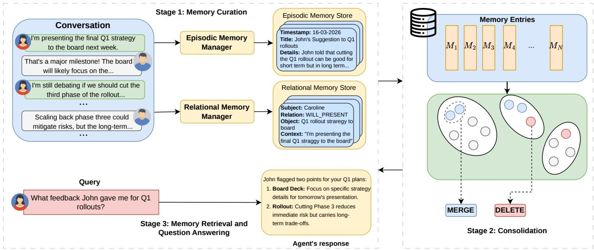
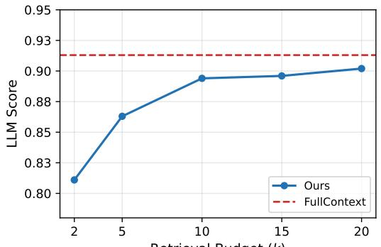

# Long-Term Agent Memory through Complementary Curation and Consolidation

Abhishek Gupta Dongge Han Daniel Madrigal Diaz Wei-Ning Chen Mayukh Das Victor Rühle Saravan Rajmohan Microsoft

## Abstract

Long-horizon dialogue agents require effective memory systems to recall facts, events, and relationships from interaction histories. In this work, we propose a hybrid-memory architecture comprising episodic memories and structured relational memories and a consolidation mechanism which improves efficiency. We conduct an empirical study across two benchmarks: LoCoMo and LongMemEval-S. Our experiments demonstrate that the two memory types are consistently complementary, combining both outperforms state-of-the-art memory frameworks and achieves 90.2% accuracy on LoCoMo and 85.5% on LongMemEval-S.

## 1 Introduction

Recent advances in large language models (LLMs) have enabled agentic capability of sustaining multiturn interactions (Wang et al., 2024; Hu et al., 2025). However, their ability to recall, integrate, and reason over long interaction histories remains fundamentally limited. These limitations have motivated the development of long-term memory systems that explicitly store and retrieve learning from past interactions (Zhang et al., 2025). By enabling selective access to historical experience, these mechanisms mitigate the need for massive context windows, fostering more coherent and efficient agent behavior.

Prior work on agentic memories can be primarily categorized into two types. Parametric memory (Wei et al., 2025; Wang et al., 2025; Li et al., 2025) embeds knowledge directly into model parameters through training, enabling low-latency inference; however, encoding is computationally expensive, frequent updates are infeasible, and unconstrained modifications may induce hallucination. In contrast, non-parametric memory (Chhikara et al., 2025; Rasmussen et al., 2025; Nan et al., 2025) leverages external memory systems that store and retrieve information on demand, offering scalability and adaptability without training, though at the expense of additional retrieval latency.

In this work, we focus on the latter approach, and propose a hybrid memory system of episodic memory which stores distinct events from the interactions, preserving the temporal ordering and contextual richness, and structured relational memory which extracts entity specific tuples from dialogues, making implicit connections between people, places, and facts explicit and enabling relational inference across sessions. These two representations reflect fundamentally different assumptions about what makes memory useful: episodic memory preserves narrative context and sequence, while structured relational memory prioritizes compact, queryable relational structure. Furthermore, we introduce an offline memory consolidation mechanism that selectively merges related or redundant memories and removes conflicting or outdated entries, enabling scalable and efficient longterm memory management.

We evaluate our system on two long-horizon dialogue benchmarks, LoCoMo (Maharana et al., 2024) and LongMemEval-S (Wu et al., 2025).

Our empirical results demonstrate that episodic and structured relational memory together deliver strong empirical performance, with our hybrid system outperforming state-of-the-art baseline methods on both benchmarks. Our memory consolidation method further shows effective compression of the memory store by 16.34% without much loss in performance. Moreover, on the LoCoMo benchmark, the consolidated system improves accuracy on both single-hop and multi-hop QA tasks.

## 2 Related Work

Recent work on long-term memory includes virtual context management: MEMORYOS (Kang et al., 2025), MEMGPT (Packer et al., 2023), and

  
Figure 1: Architecture Overview. Stage 1 (Memory Curation): The Episodic Memory Manager stores timestamped summaries, while the Relational Memory Manager extracts structured knowledge triplets with conversational context. Stage 2 (Consolidation): Memory entries are clustered based on semantic similarity, with memories merged or deleted to maintain efficiency. Stage 3 (Memory Retrieval and QA): Given a user query, relevant memories are retrieved from both episodic and relational stores to generate contextually grounded responses.

READAGENT (Lee et al., 2024) page information between a context window and external storage to handle inputs that exceed the model’s attention span. A second line of work extracts and maintains salient content across sessions: MEM0 (Chhikara et al., 2025) applies per-turn CRUD operations over extracted facts, A-MEM (Xu et al., 2026) organizes memories as evolving Zettelkasten notes with adaptive linking, and H-MEM (Sun and Zeng, 2025) adds hierarchical indexing for scalable routing. ZEP (Rasmussen et al., 2025) builds a temporal graph to support structured multi-hop traversal, while NEMORI (Nan et al., 2025) forms coherent episodes through adaptive distillation.

Our work differs in two ways. First, we combine episodic memory with a lightweight relational tuple store retrieved by semantic similarity and grounded with timestamps and source context, leveraging complementary narrative and entity-relation memories. Second, our offline consolidation phase merges redundant memories, improving efficiency without much loss in accuracy. A detailed comparison is provided in Appendix E.

## 3 Method

Hybrid memory operates in three phases: an offline curation phase that processes each conversation session, an offline consolidation phase, and a final retrieval-and-generation phase that responds to user queries. Figure 1 presents an overview of our proposed memory system.

## 3.1 Memory Curation

Both memory stores are populated at session granularity: after each conversation session concludes, we run curation over its transcript.

Episodic Memory. For each session, we create holistic episodic memories using an LLM. As shown in Figure 1, each entry contains three fields: a short title identifying the episode, a one-sentence summary distilling its key point, and a details paragraph preserving the narrative context, including the event and any relevant background. Each episodic record is additionally annotated with the session timestamp. The prompt for episodic memory curation is shown in Appendix A.

Structured Relational Memory. We observe that conversations naturally express persistent facts about entities and their relationships, including who someone is, what they do, who they are connected to. These relationships are better represented as structured relational tuples. To this end, we prompt an LLM to extract entity-relation tuples from the dialogues. Each tuple is stored as (e, r, o, t, c). As shown in Figure 1, e is the entity, r the relation label, o the object, t the timestamp, and c the source context which captures the richer context from which the tuple was extracted. The contextual description c provides provenance: it records not just what the tuple asserts but in what context it was mentioned, which is important for preserving nuance that structured extraction inevitably loses, such as the speaker’s intent, the circumstances under which a fact was stated, and additional details. The timestamp t additionally grounds each triplet temporally, addressing a common failure mode of relation-based memory where relational facts are stored without any record of when they were true. The prompt for relational memory curation is shown in Appendix B.

## 3.2 Memory Consolidation

As interactions accumulate, the memory store grows monotonically, increasing storage costs, retrieval overhead, and introduction of noise. To address this, we introduce a periodic clustering-based consolidation mechanism that groups semantically similar memories using HDBSCAN (Campello et al., 2013), enabling the merging of evolving concepts, resolution of conflicting information, and de-duplication of redundant entries across sessions. As shown in Figure 1, all memories in a cluster are fed to an LLM which then decides whether to merge or delete memories. Formally, let $\mathcal { M } = \{ m _ { 1 } , m _ { 2 } , . . . , m _ { N } \}$ denote the set of stored memory items accumulated from user interactions, where each memory m<sub>i</sub> is represented by a semantic embedding $\mathbf { e } _ { i } \in \mathbb { R } ^ { d }$ and associated metadata (e.g., timestamp, type). We perform unsupervised clustering over M, yielding a set of clusters

$$
\mathcal { C } = \{ C _ { 1 } , C _ { 2 } , \ldots , C _ { K } \} , \quad C _ { k } \subseteq \mathcal { M } ,\tag{1}
$$

where each cluster $C _ { k }$ groups semantically similar memories corresponding to an evolving concept. For each cluster $C _ { k }$ , we apply a consolidation operator Φ(·) that maps the cluster to a reduced memory set, $\Phi ( C _ { k } ) \to \mathcal { M } _ { k } ^ { \prime }$ , via the following operations.

• MERGE: merging memories in $C _ { k }$ that are redundant or complementary into a single piece of consolidated memory, preserving salient information while reducing duplication:

$$
\tilde { \mathcal { M } } _ { k } = \mathrm { m e r g e } ( C _ { k } )\tag{2}
$$

• DELETE: removing a piece of memory $m _ { i } \in$ $C _ { k }$ that is outdated, conflicting, or superseded:

$$
\mathcal { M } _ { k } ^ { \prime } = \tilde { \mathcal { M } } _ { k } \setminus \{ m _ { i } \}\tag{3}
$$

After applying both operations, the consolidated memory store is defined as

$$
\mathcal { M } ^ { \prime } = \bigcup _ { k = 1 } ^ { K } \mathcal { M } _ { k } ^ { \prime }\tag{4}
$$

yielding a compact, denoised memory set.

## 3.3 Memory Retrieval & Question Answering

At query time, we perform independent top-k semantic similarity searches over the episodic memory and structured relational memory stores separately. For episodic memory, each episode’s details field is indexed, yielding one vector per episode. For structured relational memory, each tuple is indexed as a natural-language string concatenating its components (e.g., “Subject, Relation, Object”), yielding one vector per triplet. The two stores are searched independently, returning the top-k episodes from episodic memory and the top-2k tuples from structured relational memory. The episodic memories are more verbose than relational tuples, so within the same budget approximately twice as many relational entries can be retrieved. We set k = 10 since performance plateaus beyond this value (see the budget analysis in Section 5.2).

## 4 Experiments

We evaluate our framework on two long-horizon dialogue benchmarks: LOCOMO (Maharana et al., 2024), featuring 1,540 QA pairs from 10 distinct dialogues across four reasoning categories: Single-Hop, Multi-Hop, Temporal, and Opendomain. On average, the conversations in Lo-CoMo span multiple sessions with 24K tokens; and LONGMEMEVAL-S (Wu et al., 2025), a substantially more challenging evaluation setting, comprising 500 meticulously curated questions embedded within synthetic but realistic chat histories that average 115K tokens per question.

## 4.1 Experiment Setup

Baselines. We compare with state-of-the-art memory frameworks, including FULLCONTEXT (all sessions placed in context) RAG-4096 (sessions chunked into 4096 token segments), LANG-MEM (Chase, 2022), MEM0 (Chhikara et al., 2025), ZEP (Rasmussen et al., 2025), and NEMORI (Nan et al., 2025).

Implementation. We report results where memory curation, consolidation and answer generation are backed by gpt-4.1-mini and gpt-4o-mini models. We use text-embedding-3-small for vector embedding and retrieval. For clustering we have used UMAP (McInnes et al., 2018) for dimension reduction and density based HDB-SCAN (Campello et al., 2013) for clustering. Detailed hyperparameters are in Appendix C.

<table><tr><td rowspan="2">Model</td><td rowspan="2">Method</td><td colspan="3">Single-Hop</td><td colspan="3">Multi-Hop</td><td colspan="3">Open Domain</td><td colspan="3">Temporal</td><td colspan="3">Overall</td></tr><tr><td>F1</td><td>BLEU</td><td>LLM Score</td><td>F1</td><td>BLEU</td><td>LLM Score</td><td>F1</td><td>BLEU</td><td>LLM Score</td><td>F1</td><td>BLEU</td><td>LLM Score</td><td>F1</td><td>BLEU</td><td>LLM Score</td></tr><tr><td rowspan="9">p--mni</td><td>FullContext</td><td>0.294</td><td>0.220</td><td>0.804</td><td>0.247</td><td>0.168</td><td>0.532</td><td>0.192</td><td>0.146</td><td>0.604</td><td>0.386</td><td>0.269</td><td>0.903</td><td>0.328</td><td>0.232</td><td>0.790</td></tr><tr><td>LangMem</td><td>0.388</td><td>0.331</td><td>0.614</td><td>0.335</td><td>0.239</td><td>0.524</td><td>0.294</td><td>0.235</td><td>0.476</td><td>0.319</td><td>0.262</td><td>0.249</td><td>0.358</td><td>0.294</td><td>0.513</td></tr><tr><td>Mem0</td><td>0.444</td><td>0.377</td><td>0.681</td><td>0.343</td><td>0.252</td><td>0.603</td><td>0.271</td><td>0.194</td><td>0.406</td><td>0.444</td><td>0.376</td><td>0.504</td><td>0.415</td><td>0.342</td><td>0.613</td></tr><tr><td>RAG</td><td>0.222</td><td>0.186</td><td>0.320</td><td>0.186</td><td>0.117</td><td>0.313</td><td>0.190</td><td>0.135</td><td>0.326</td><td>0.195</td><td>0.157</td><td>0.237</td><td>0.208</td><td>0.164</td><td>0.302</td></tr><tr><td>Zep</td><td>0.397</td><td>0.337</td><td>0.632</td><td>0.275</td><td>0.193</td><td>0.505</td><td>0.229</td><td>0.157</td><td>0.396</td><td>0.448</td><td>0.381</td><td>0.589</td><td>0.375</td><td>0.309</td><td>0.585</td></tr><tr><td>Nemori</td><td>0.544</td><td>0.432</td><td>0.821</td><td>0.365</td><td>0.256</td><td>0.653</td><td>0.208</td><td>0.151</td><td>0.448</td><td>0.567</td><td>0.466</td><td>0.710</td><td>0.495</td><td>0.385</td><td>0.744</td></tr><tr><td>Ours</td><td>0.297</td><td>0.223</td><td>0.765</td><td>0.410</td><td>0.296</td><td>0.813</td><td>0.201</td><td>0.164</td><td>0.645</td><td>0.410</td><td>0.296</td><td>0.888</td><td>0.377</td><td>0.274</td><td>0.835</td></tr><tr><td>+ CONSOLIDATION</td><td>0.304</td><td>0.271</td><td>0.797</td><td>0.428</td><td>0.316</td><td>0.764</td><td>0.182</td><td>0.143</td><td>0.625</td><td>0.391</td><td>0.281</td><td>0.875</td><td>0.370</td><td>0.230</td><td>0.823</td></tr><tr><td>FullContext</td><td>0.325</td><td>0.246</td><td>0.893</td><td>|0.334</td><td>0.217</td><td>0.878</td><td>|0.267</td><td>0.225</td><td>0.781</td><td>|0.407</td><td>0.290</td><td>0.948</td><td>0.368</td><td>0.263</td><td>0.913</td></tr><tr><td rowspan="9">p-&#x27;-nı</td><td></td><td>0.510</td><td>0.436</td><td>0.845</td><td>0.415</td><td>0.325</td><td>0.710</td><td>0.328</td><td>0.264</td><td>0.590</td><td>0.485</td><td>0.409</td><td>0.508</td><td>0.476</td><td>0.400</td><td>0.734</td></tr><tr><td>LangMem Mem0</td><td>0.486</td><td>0.420</td><td>0.714</td><td>0.401</td><td>0.303</td><td>0.682</td><td>0.237</td><td>0.177</td><td>0.479</td><td>0.392</td><td>0.332</td><td>0.569</td><td>0.435</td><td>0.365</td><td>0.663</td></tr><tr><td>RAG</td><td>0.258</td><td>0.220</td><td>0.359</td><td>0.201</td><td>0.128</td><td>0.317</td><td>0.179</td><td>0.139</td><td>0.288</td><td>0.223</td><td>0.191</td><td>0.274</td><td>0.235</td><td>0.192</td><td>0.329</td></tr><tr><td>Zep</td><td>0.455</td><td>0.400</td><td>0.669</td><td>0.305</td><td>0.204</td><td>0.537</td><td>0.242</td><td>0.193</td><td>0.438</td><td>0.239</td><td>0.200</td><td>0.602</td><td>0.369</td><td>0.309</td><td>0.616</td></tr><tr><td>Nemori</td><td>0.588</td><td>0.515</td><td>0.849</td><td>0.417</td><td>0.319</td><td>0.751</td><td>0.258</td><td>0.193</td><td>0.510</td><td>0.577</td><td>0.502</td><td>0.776</td><td>0.534</td><td>0.456</td><td>0.794</td></tr><tr><td>Ours</td><td>0.298</td><td>0.223</td><td>0.858</td><td>0.312</td><td>0.199</td><td>0.872</td><td>0.249</td><td>0.205</td><td>0.697</td><td>0.400</td><td>0.282</td><td>0.952</td><td>0.354</td><td>0.249</td><td>0.902</td></tr><tr><td>+ CONSOLIDATION</td><td>0.298</td><td>0.223</td><td>0.861</td><td>0.309</td><td>0.208</td><td>0.878</td><td>0.248</td><td>0.203</td><td>0.666</td><td>0.391</td><td>0.275</td><td>0.934</td><td>0.348</td><td>0.246</td><td>0.892</td></tr><tr><td></td><td></td><td></td><td></td><td></td><td></td><td></td><td></td><td></td><td></td><td></td><td></td><td></td><td></td><td></td><td></td></tr></table>

Table 1: Performance on the LoCoMo dataset using LLM-as-a-judge, F1 and BLEU scores. Baselines LangMem, Mem0, RAG, Zep and Nemori were taken from (Nan et al., 2025). Bold indicates the best among memory methods.
<table><tr><td>Question Type</td><td>Full-context (101K tokens)</td><td>Nemori (3.7–4.8K tokens)</td><td>Ours (3–6.9K tokens)</td></tr><tr><td>single-session-preference</td><td>0.167</td><td>0.867</td><td>0.500</td></tr><tr><td>single-session-assistant</td><td>0.982</td><td>0.929</td><td>0.982</td></tr><tr><td>temporal-reasoning</td><td>0.602</td><td>0.722</td><td>0.858</td></tr><tr><td>multi-session</td><td>0.511</td><td>0.556</td><td>0.801</td></tr><tr><td>knowledge-update</td><td>0.769</td><td>0.795</td><td>0.902</td></tr><tr><td>single-session-user</td><td>0.857</td><td>0.900</td><td>0.953</td></tr><tr><td>Average</td><td>0.656</td><td>0.746</td><td>0.855</td></tr></table>

Table 2: Detailed performance comparison on LongMemEval-S (gpt-4.1-mini) across question types.

<table><tr><td>Method</td><td>LLM Score</td><td>Tokens</td></tr><tr><td>FullContext</td><td>0.790</td><td>21,788</td></tr><tr><td>RAG-4096</td><td>0.302</td><td>3,430</td></tr><tr><td>LangMem</td><td>0.513</td><td>125</td></tr><tr><td>Zep</td><td>0.585</td><td>2,247</td></tr><tr><td>Mem0</td><td>0.613</td><td>1,027</td></tr><tr><td>Nemori</td><td>0.744</td><td>2,745</td></tr><tr><td>Ours</td><td>0.835</td><td>2,738</td></tr></table>

Table 3: Performance and efficiency comparison on LoCoMo dataset with gpt-4o-mini.

## 4.2 Results

Main Results. Table 1 shows the performance on the LoCoMo benchmark. Our system consistently outperforms all baselines when using gpt-4o-mini, achieving a score of 83.5%. Notably, this surpasses the FullContext baseline, empirically validating that the addition of long context can lead to performance degradation. With gpt-4.1-mini, our approach reaches 90.2%, a significant 6.7% absolute improvement over the gpt-4o-mini results. While this score is slightly below the FullContext performance of 91.3%, our system remains highly competitive while utilizing 87% fewer tokens.

The most significant gains are observed in Multi-Hop and Temporal reasoning tasks, which directly reflect the strengths of our dual-memory setup.

Episodic memory preserves interactions as a timestamped timeline, allowing the model to track the order of events for temporal questions. Meanwhile, structured relational memories capture complex entity-relation dependencies, facilitating effective multi-hop inference over distinct facts. Appendix D provides an ablation study on the contribution of each component. The results demonstrate that the most substantial improvements (+6.3 points in Multi-Hop and +6.8 points in Temporal reasoning on gpt-4o-mini) emerge due to interaction between the two memory types.

Table 2 presents the results for the LongMemEval-S benchmark. Our method attains an overall score of 85.5%, consistently surpassing both the FULLCONTEXT baseline and NEMORI across nearly all evaluation categories.

Efficiency. In Table 3, we compare our system against the baselines in terms of the average number of tokens consumed per question. Our approach uses comparable tokens to NEMORI, while achieving a 9.1 point improvement in accuracy. Furthermore, as in Table 5, our consolidation method reduces the size of the memory store by 16.34% with only 1% degradation in performance, demonstrating effective memory compression without much loss in accuracy.

  
Retrieval Budget (k) Figure 2: Effect of retrieval budget k on LLM Score with gpt-4.1-mini. Performance plateaus at k=10.

## 5 Analysis and Ablations

We analyse the sensitivity of the system to its two main hyperparameters and its robustness across backbone LLMs. The contribution of each individual memory type is reported in Appendix D. All experiments in this section use LoCoMo.

## 5.1 Generalization Across Models

To assess robustness across backbones, we additionally evaluate a stronger proprietary model (gpt-5.4) and a smaller open-weight model (Qwen3-8B), shown in Table 4.

<table><tr><td>Model</td><td>Overall</td><td>S-Hop</td><td>M-Hop</td><td>Open</td><td>Temp.</td></tr><tr><td>gpt-5.4</td><td>0.906</td><td>0.865</td><td>0.903</td><td>0.729</td><td>0.941</td></tr><tr><td>gpt-4.1-mini</td><td>0.902</td><td>0.858</td><td>0.872</td><td>0.697</td><td>0.952</td></tr><tr><td>gpt-4o-mini</td><td>0.835</td><td>0.765</td><td>0.813</td><td>0.645</td><td>0.888</td></tr><tr><td>Qwen3-8B</td><td>0.762</td><td>0.748</td><td>0.629</td><td>0.552</td><td>0.841</td></tr></table>

Table 4: Performance of our framework with different backbone LLMs on LoCoMo.

The proposed memory system generalizes across backbones of varying capacity. Notably, gpt-4.1-mini performs comparably to gpt-5.4, supporting our claim that the primary challenge lies in designing an effective memory system rather than relying on increased model capacity. The open-weight Qwen3-8B backbone, despite being substantially smaller, still attains 76.2% overall accuracy, confirming that our method is not restricted to stronger models.

## 5.2 Effect of Retrieval Budget

To study how much retrieved evidence the system needs, we vary the number of retrieved memories k (both episodic and relational) and report overall LLM Score with gpt-4.1-mini in Figure 2.

Performance increases sharply from k=2 to k=10 and then plateaus, with diminishing returns of <1 point between k=10 and k=20. Notably, even at k=2 the system retains 0.811 score, indicating that retrieval is reasonably precise rather than relying on a large budget.

## 5.3 Effect of Consolidation Cluster Size

We conduct a sensitivity analysis on the primary clustering hyperparameter, min\_cluster\_size (mcs), which controls the minimum number of memory points required to form a cluster. We evaluate mcs∈ {2, 5, 10, 20} with gpt-4.1-mini in Table 5.

<table><tr><td>mcs</td><td>Compression</td><td>LLM Score</td><td>Clusters</td></tr><tr><td>2</td><td>30.9%</td><td>0.876</td><td>2208</td></tr><tr><td>5</td><td>21.7%</td><td>0.896</td><td>693</td></tr><tr><td>10</td><td>16.3%</td><td>0.892</td><td>325</td></tr><tr><td>20</td><td>9.6%</td><td>0.898</td><td>144</td></tr></table>

Table 5: Effect of min\_cluster\_size on consolidation.

Performance is largely stable for mcs∈ [5, 20], with LLM Score ranging from 0.892–0.898, all within 1 point of the no-consolidation baseline (0.902). At mcs= 2, performance drops by 2.6 points, which we attribute to over-aggressive consolidation where small groups of similar embeddings are prematurely merged. As mcs increases, memory compression decreases monotonically from 30.9% to 9.6%, while the number of clusters (and corresponding LLM consolidation calls) is reduced by up to 15×. This highlights a favorable trade-off: moderate cluster sizes (mcs∈ [5, 10]) achieve meaningful compression (16–22%) with negligible accuracy loss.

## 6 Conclusion

We presented a Hybrid memory system for agents that curates and retrieves both episodic memory and structured relational memory, and conducted an empirical study across LoCoMo and LongMemEval-S. Our results demonstrate strong performance combining both memory types, and improved efficiency with memory consolidation without much loss in performance.

## 7 Limitations

While our proposed memory system demonstrates strong performance, several areas remain for further refinement. First, our current evaluation focuses exclusively on textual conversational data. Although the system is modality agnostic, extending it to support non-textual modalities such as vision and audio remains an important direction for future work. Second, our experiments reveal that memory curation quality can vary substantially across different backbone LLMs, as observed shifting from gpt-4.1-mini to gpt-4o-mini resulted in a 6.7 percentage point drop. This sensitivity reflects a broader challenge faced by existing agentic memory systems, where memory curation and consolidation are inherently influenced by modelspecific reasoning and representation biases. Developing memory mechanisms that are robust and consistent across diverse model families remains an open and important research problem.

## References

Ricardo J.G.B. Campello, Davoud Moulavi, and Joerg Sander. 2013. Density-based clustering based on hierarchical density estimates. In Pacific-Asia Conference on Knowledge Discovery and Data Mining.

Harrison Chase. 2022. LangChain. Accessed: 2025-07- 20.

Prateek Chhikara, Dev Khant, Saket Aryan, Taranjeet Singh, and Deshraj Yadav. 2025. Mem0: Building production-ready ai agents with scalable long-term memory. arXiv preprint arXiv:2504.19413.

Maarten Grootendorst. 2022. BERTopic: Neural topic modeling with a class-based tf-idf procedure. arXiv preprint arXiv:2203.05794.

Xueyu Hu, Tao Xiong, Biao Yi, Zishu Wei, Ruixuan Xiao, Yurun Chen, Jiasheng Ye, Meiling Tao, Xiangxin Zhou, Ziyu Zhao, and Others. 2025. OS agents: A survey on MLLM-based agents for computer, phone and browser use. In Proceedings ofthe 63rd Annual Meeting ofthe Associationfor Computational Linguistics (Volume 1: Long Papers), pages 7436–7465, Vienna, Austria. Association for Computational Linguistics.

Jiazheng Kang, Mingming Ji, Zhe Zhao, and Ting Bai. 2025. Memory OS of AI agent. In Proceedings ofthe 2025 Conference on Empirical Methods in Natural Language Processing, pages 25961–25970, Suzhou, China. Association for Computational Linguistics.

Kuang-Huei Lee, Xinyun Chen, Hiroki Furuta, John Canny, and Ian Fischer. 2024. A human-inspired reading agent with gist memory of very long contexts. In International Conference on Machine Learning, volume 235 of Proceedings of Machine Learning Research, pages 26396–26415. PMLR.

Jiaang Li, Quan Wang, Zhongnan Wang, Yongdong Zhang, and Zhendong Mao. 2025. ELDER: enhancing lifelong model editing with mixture-of-LoRA. In Proceedings of the AAAI Conference on Artificial Intelligence, volume 39 of AAAI’25/IAAI’25/EAAI’25, pages 24440–24448. AAAI Press.

Adyasha Maharana, Dong-Ho Lee, Sergey Tulyakov, Mohit Bansal, Francesco Barbieri, and Yuwei Fang. 2024. Evaluating very long-term conversational memory of llm agents. In Proceedings of the 62nd Annual Meeting ofthe Associationfor Computational Linguistics (Volume 1: Long Papers), pages 13851– 13870.

Leland McInnes, John Healy, and James Melville. 2018. Umap: Uniform manifold approximation and projection for dimension reduction. arXiv preprint arXiv:1802.03426.

Jiayan Nan, Wenquan Ma, Wenlong Wu, and Yize Chen. 2025. Nemori: Self-organizing agent memory inspired by cognitive science. arXiv preprint arXiv:2508.03341.

Charles Packer, Sarah Wooders, Kevin Lin, Vivian Fang, Shishir G. Patil, Ion Stoica, and Joseph E. Gonzalez. 2023. MemGPT: Towards llms as operating systems. arXiv preprint arXiv:2310.08560.

Preston Rasmussen, Pavlo Paliychuk, Travis Beauvais, Jack Ryan, and Daniel Chalef. 2025. Zep: a temporal knowledge graph architecture for agent memory. arXiv preprint arXiv:2501.13956.

Haoran Sun and Shaoning Zeng. 2025. Hierarchical memory for high-efficiency long-term reasoning in llm agents. arXiv preprint arXiv:2507.22925.

Lei Wang, Chen Ma, Xueyang Feng, Zeyu Zhang, Hao Yang, Jingsen Zhang, Zhiyuan Chen, Jiakai Tang, Xu Chen, Yankai Lin, Wayne Xin Zhao, Zhewei Wei, and Jirong Wen. 2024. A survey on large language model based autonomous agents. Frontiers ofComputer Science, 18(6):186345.

Yu Wang, Xinshuang Liu, Xiusi Chen, Sean O’Brien, Junda Wu, and Julian J. McAuley. 2025. Selfupdatable large language models by integrating context into model parameters. In International Conference on Learning Representations.

Rubin Wei, Jiaqi Cao, Jiarui Wang, Jushi Kai, Qipeng Guo, Bowen Zhou, and Zhouhan Lin. 2025. Mlp memory: A retriever-pretrained memory for large language models. arXiv preprint arXiv:2508.01832.

Di Wu, Hongwei Wang, Wenhao Yu, Yuwei Zhang, Kai-Wei Chang, and Dong Yu. 2025. LongMemEval: Benchmarking chat assistants on long-term interactive memory. In International Conference on Learning Representations, volume 2025, pages 86809– 86836.

Wujiang Xu, Zujie Liang, Kai Mei, Hang Gao, Juntao Tan, and Yongfeng Zhang. 2026. A-mem: Agentic memory for llm agents. Advances in Neural Information Processing Systems, 38:17577–17604.

Zeyu Zhang, Quanyu Dai, Xiaohe Bo, Chen Ma, Rui Li, Xu Chen, Jieming Zhu, Zhenhua Dong, and Ji-Rong Wen. 2025. A survey on the memory mechanism of large language model-based agents. ACM Transactions on Information Systems, 43(6):1–47.

## A Prompt used for Episodic Memory Curation

Role: You are an Episodic Memory Curator. Your job is to extract HOLISTIC episodes from conversations capturing complete narratives rather than fragmented facts.

TASK: Extract CONSOLIDATED episodic memories from the conversation below. Focus on creating coherent, comprehensive episodes that capture the full context of events.

Current Date: {session\_date}

CONVERSATION: {session\_text}

## EXTRACTION RULES:

## 1. WHAT TO CAPTURE (be exhaustive):

• Events: meetings, trips, celebrations, appointments, activities.

• Plans and scheduled activities (with exact dates if mentioned).

• Preferences, opinions, and subjective feelings (e.g., “X loves hiking”).

• Biographical facts: family details, careers, hobbies, pets.

• Specific quantities: counts, frequencies, durations.

• Advice given, specific phrases, exact quotes worth remembering.

• Relationships between people mentioned.

• Past events mentioned (e.g., “last year we saw X”).

• NOT: Casual greetings or meta-conversation.

## 2. TEMPORAL PRECISION (CRITICAL):

• The “Current Date” is WHEN THIS CONVERSATION HAPPENED.

• For relative expressions, show your arithmetic explicitly:

– “last Saturday” → count back to most recent Saturday before Current Date.

– “next month” → the calendar month after Current Date’s month.

– “yesterday” → Current Date minus 1 day.

• Use YYYY-MM-DD, YYYY-MM, or YYYY format. If no info, use null.

## 3. DETAIL PRESERVATION (CRITICAL):

• Capture EXACT names, numbers, places, titles, and species.

• Preserve exact sentiments and verbatim frequencies.

• Prefer granular episodes over fewer big ones.

## 4. MEDIA INFORMATION

• Preserve full caption text; record visible text (signs, posters).

• Describe specific objects, scenes, or people visible in the image.

## 5. OUTPUT FORMAT: Return a JSON array of objects with this exact structure:

```json
{
"title": "Short descriptive title (3-7 words)",
"summary": "One-sentence description",
"details": "Concise specifics. Names, numbers, quotes.",
"timestamp": "ISO date string (YYYY-MM-DD, YYYY-MM, YYYY) or null"
}
```

## B Prompt used for Relational Memory Curation

Role: You are an expert Relational Memories Curator. Extract ALL meaningful facts from this conversation as triplets.

TASK: Extract relational memories from the conversation below.

Current Date: {session\_date}   
CONVERSATION: {session\_text}

## EXTRACTION RULES:

## 1. WHAT TO EXTRACT (be exhaustive)

• Events: meetings, trips, celebrations, appointments, activities.

• Plans and scheduled activities (with exact dates if mentioned).

• Preferences, opinions, and subjective feelings (e.g., “X loves hiking”).

• Biographical facts: family details, careers, hobbies, pets.

• Specific quantities: counts, frequencies, durations.

• Advice given, specific phrases, exact quotes worth remembering.

• Relationships between people mentioned.

• Past events mentioned (e.g., “last year we saw X”).

• NOT: Casual greetings or meta-conversation.

## 2. ENTITY RULES:

• RESOLVE PRONOUNS: Map “I”, “me”, “my” to the speaker’s actual name. Map “you”, “your” to the other person’s name.

• VERIFY ACCURACY: If the text says “my dog Luna and my cat Oliver”, then Luna=dog, Oliver=cat. Do NOT swap species/names.

## 3. TEMPORAL PRECISION (CRITICAL — show your date math):

• Current Date is WHEN THIS CONVERSATION HAPPENED.

• For ALL relative time references, resolve to absolute dates with explicit arithmetic:

– “last Saturday” → find the Saturday before Current Date → specific YYYY-MM-DD

– “next month” → month after Current Date’s month → YYYY-MM

– “last year” → Current Date year - 1 → YYYY

– “yesterday” → Current Date - 1 day → YYYY-MM-DD

– “10 years ago” → Current Date year - 10 → YYYY

– “two weekends ago” → Current Date - 14 days → find that weekend → YYYY-MM-DD

• ALWAYS try to infer a date — even an approximate month/year is better than null.

## 4. PERSISTENCE FILTERING:

• KEEP: Everything from categories 1a-1j above.

• DISCARD ONLY: Pure greetings (“Hey!”, “Hi!”), meta-conversation (“tell me more”), and filler.

• When in doubt, KEEP IT — it’s better to have an extra triplet than to miss one.

5. OUTPUT FORMAT (JSON List): Return a JSON list where each object follows this exact structure:

```json
{
"subject": "Canonical Entity Name",
"relation": "predicate_snake_case",
"object": "Specific value (names, numbers, adjectives)",
"when": "YYYY-MM-DD or YYYY-MM or YYYY or null",
"context": "source text for grounding",
}
```

## OUTPUT JSON ONLY (No markdown, no explanation)

## C Implementation details

The consolidation pipeline follows a two-phase architecture inspired by BERTopic (Grootendorst, 2022). In the first phase, all stored memories with their pre-computed 1536-dimensional embeddings produced by OpenAI’s text-embedding-3-small model are projected into a lower-dimensional space using UMAP (McInnes et al., 2018) with cosine distance, 10 neighbors, 5 target components, and minimum distance of zero. The reduced representations are then clustered using HDBSCAN (Campello et al., 2013) with Euclidean distance, Excess of Mass cluster selection, minimum cluster size of 10, and minimum samples of 1.

## D Memory Component Analysis

To understand the contributions of each component, we evaluate the episodic-only, relational-only, full hybrid, and consolidated variants on LoCoMo. Results are shown in Table 6.

<table><tr><td>Component</td><td>Overall</td><td>S-Hop</td><td>M-Hop</td><td>Open</td><td>Temp.</td></tr><tr><td>gpt-4o-mini</td><td></td><td></td><td></td><td></td><td></td></tr><tr><td>Episodic only</td><td>0.776</td><td>0.765</td><td>0.710</td><td>0.645</td><td>0.820</td></tr><tr><td>Relational only</td><td>0.730</td><td>0.680</td><td>0.750</td><td>0.572</td><td>0.757</td></tr><tr><td>Ours</td><td>0.835</td><td>0.765</td><td>0.813</td><td>0.645</td><td>0.888</td></tr><tr><td>+ Consolidation</td><td>0.823</td><td>0.797</td><td>0.764</td><td>0.625</td><td>0.875</td></tr><tr><td>gpt-4.1-mini</td><td></td><td></td><td></td><td></td><td></td></tr><tr><td>Episodic only</td><td>0.871</td><td>0.822</td><td>0.847</td><td>0.687</td><td>0.918</td></tr><tr><td>Relational only</td><td>0.837</td><td>0.781</td><td>0.831</td><td>0.625</td><td>0.882</td></tr><tr><td>Ours</td><td>0.902</td><td>0.858</td><td>0.872</td><td>0.697</td><td>0.952</td></tr><tr><td>+ Consolidation</td><td>0.892</td><td>0.861</td><td>0.878</td><td>0.666</td><td>0.934</td></tr></table>

Table 6: Memory component ablation on LoCoMo with gpt-4o-mini and gpt-4.1-mini.

The combined system consistently outperforms either single memory type. Substantial gains over the stronger individual component appear on Multi-Hop (+6.3 points with gpt-4o-mini, +2.5 points with gpt-4.1-mini) and Temporal (+6.8 points with gpt-4o-mini, +3.4 points with gpt-4.1-mini), where the two memory types are complementary. On Single-Hop and Open-Domain, the hybrid matches the best single component with gpt-4o-mini and further improves performance by 3.6 and 1.0 points, respectively, with gpt-4.1-mini.

## E Extended Comparison with Prior Work

Prior memory systems differ from ours along three axes: representation, curation strategy, and operational cost. We summarize the key contrasts below.

Representation. Zep (Rasmussen et al., 2025) maintains a temporal knowledge graph with entity nodes, fact edges, and validity intervals, enabling graph traversal at the cost of entity resolution, edge deduplication, and conflict detection. A-Mem (Xu et al., 2026) organizes memories as Zettelkastenstyle notes with evolving links between entries, while H-Mem (Sun and Zeng, 2025) relies on hierarchical indexing for routing. In contrast, we use two complementary flat stores: episodic records that preserve narrative context and relational tuples retrieved by semantic similarity. This sacrifices native graph traversal but avoids the overhead of graph construction and hierarchy maintenance.

Curation strategy. Mem0 (Chhikara et al., 2025) processes each turn individually with add/update/delete/no-op operations, which fragments inter-turn context. Nemori (Nan et al., 2025) adaptively distills semantic knowledge based on prediction error against an anticipatory schema, focusing on what to store. Our method instead targets how memory should be represented: we perform a single session-level curation pass that produces episodic and relational entries, and we apply offline clustering-based consolidation to merge redundant memories and remove outdated ones.

Operational cost. Turnwise systems such as Mem0 and A-Mem scale LLM calls linearly with conversation length, and dynamic retrieval schemes incur additional LLM rounds at query time. Our session-level curation amortizes extraction across many turns, and a fixed top-k retrieval avoids extra LLM calls. Consolidation runs offline and can be triggered infrequently (e.g., every 10-20 sessions), keeping long-horizon operation tractable while preserving QA accuracy.