# MEMSTEER: TURNING USER HISTORIES INTO SUPERVISION FOR AGENT MEMORY OPTIMIZATION

Jie Huang1,2∗ Cuiling Lan2 Qize Yu1 Xiulian Peng2 Yan Lu2

1Peking University 2Microsoft Research Asia

## ABSTRACT

An effective agent memory system should adapt to a user’s history and task requirements. Human-annotated supervision can guide this adaptation by providing feedback for evaluating and improving memory designs. Yet suitable labels are rarely available for new user histories, and manually constructing QA pairs and supporting evidence is costly. We introduce MemSteer, which turns unlabeled user histories into question–answer (QA) supervision with supporting evidence for memory-design optimization. MemSteer constructs an evidence-grounded answer plan that specifies how facts across related records jointly support a reference answer. The plan guides question generation, while source-grounded auditing and blind answer recovery check the resulting annotations. To study the utility of this supervision, we develop MemSteer-Opt, which combines QA-based design evaluation with evidence-guided failure diagnosis to revise memory store, retrieval, and context construction without updating model parameters. Experiments on ATM-Bench and RHELM show that this supervision is competitive with official-QA-guided optimization. Relative to Base-BM25, MemSteer-Opt improves ATM-Bench Question Score by 13.4 points and RHELM accuracy by 4.1 and 6.6 points without and with external data, respectively. The supervision also benefits two existing optimizers on ATM-Bench, while new-user experiments demonstrate continued design optimization using supervision generated from the target histories.

## 1 INTRODUCTION

Agents that assist users over time need to draw on information accumulated across conversations, emails, and documents. An external memory system supports this process by storing and organizing the user’s history and retrieving relevant context for the agent. Storage granularity, retrieval strategy, and answer-context construction shape how effectively the agent can use that history. User histories differ in their content, modalities, and organization, so a memory design effective for one user may be less suitable for another. This motivates adapting memory designs to user histories.

Recent methods such as MemEvolve, ALMA, and M⋆ optimize memory designs using downstream task feedback (Zhang et al., 2025; Xiong et al., 2026; Pan et al., 2026). While executable tasks can provide feedback through their outcomes, personal records and interactions often lack an explicit signal for assessing memory quality. Annotated question–answer (QA) pairs can

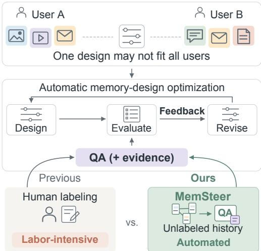  
Figure 1: Motivation for MemSteer. User histories vary in data characteristics, so one memory design may not suit every user. Automatic design adaptation through iterative optimization requires feedback on memory performance. MemSteer supports this optimization by automatically generating QA–evidence supervision from unlabeled histories, avoiding laborintensive manual labeling.

supply this signal (Pan et al., 2026), but constructing questions, reference answers, and supporting evidence for each new history is costly. This motivates our question (Figure 1): Can unlabeled user histories guide memory-design optimization?

Generating QA from the history itself offers a potential source of this feedback. Within agent memory, MemBuilder uses synthetic QA rewards to train memory-construction policies (Shen et al., 2026), while MemMA uses QA probes to repair stored memories (Lin et al., 2026). We instead investigate whether history-derived QA can provide reliable feedback for evaluating and improving memory-system designs. For memory-design optimization, reference answers determine how candidate designs are evaluated, while source evidence can help diagnose unsuccessful responses. Unsupported answers or mismatched evidence can misdirect design selection and later revisions.

We propose MemSteer, a framework that turns unlabeled user histories into source-grounded QA– evidence supervision for memory-design optimization (Figure 2). It brings together related source records and specifies how their facts jointly support a reference answer. The resulting evidencegrounded answer plan guides question generation. Source-grounded auditing checks the generated QA for evidence support and consistency, while blind answer recovery assesses whether the reference answer can be recovered from the sampled records.

To investigate the utility of MemSteer’s generated supervision, we develop MemSteer-Opt, an evidence-guided memory-design optimizer. It uses source evidence and execution traces to iden tify whether incorrect responses stem from storage, retrieval, or answer generation, then proposes targeted design revisions and evaluates them using QA performance. Starting from a basic memory system, we use MemSteer-Opt to optimize memory representations, retrieval strategies, and context construction. We further supply the generated QA to M⋆ and MemEvolve (Pan et al., 2026; Zhang et al., 2025), allowing each framework to optimize within its own design space.

Our contributions are threefold:

• Memory-design optimization from unlabeled histories. MemSteer constructs QA–evidence supervision from unlabeled user histories for evaluating and improving memory designs without updating model parameters.

• Evidence-grounded answer planning and verification. We construct answer plans that make explicit how source facts jointly support a reference answer for question generation. Sourcegrounded verification checks the resulting annotations.

• Empirical validation across optimizers and user histories. Experiments with MemSteer-Opt on ATM-Bench and RHELM (Mei et al., 2026b; Zhang et al., 2026) show that generated supervision improves memory designs and is competitive with the Official-QA reference. Further experiments demonstrate its utility for two existing optimizers on ATM-Bench and for continued optimization on new user histories.

## 2 RELATED WORK

Memory-design optimization. Applications differ in what agents need to remember and how they use past information, making memory design an application-specific engineering challenge (Xiong et al., 2026; Pan et al., 2026). Recent work therefore explores automatic memory-design optimization to accommodate these requirements while reducing reliance on manual design. ALMA searche over code-based memory designs using task success and interaction logs as feedback (Xiong et al., 2026). MemEvolve introduces a dual-level process that evolves both experience memory and its underlying architecture (Zhang et al., 2025). M⋆ searches over memory programs by jointly refining their schema, logic, and instructions through task feedback and reflective code evolution (Pan et al., 2026). At a narrower level, CluE refines memory-extraction prompts using downstream feedback across heterogeneous tasks (Yang et al., 2026). These methods optimize memory designs using feedback from downstream tasks. In many personal-memory applications, however, user records and everyday interactions do not naturally yield success-or-failure signals to guide memory-design optimization. We therefore investigate how these histories can be turned into supervisionfor memorydesign optimization.

Synthetic queries and QA for training and evaluation. Outside agent memory, synthetic data has been used to reduce annotation requirements for model training and system evaluation. Promptagator generates query–document pairs to train task-specific dense retrievers (Dai et al., 2022). Alberti et al. (2019) generate QA by selecting answers, formulating questions, and filtering pairs through answer-recovery consistency before training reading-comprehension models. For structured synthesis, GraphGen samples knowledge-graph subgraphs to construct atomic, aggregated, and multi-hop QA for supervised fine-tuning (Chen et al., 2025). For evaluation, DataMorgana constructs corpus-specific RAG benchmarks with configurable user and question categories (Filice et al., 2025), while Ragas uses graph relationships to synthesize multi-hop test questions (Ragas, 2026). The usefulness of synthetic questions has also been studied directly: Yue et al. (2022) learn a question value estimator to select examples that improve target-domain QA performance, rather than relying only on generation or answer-model scores. We ask whether synthetic QA can provide effective feedback for memory-design optimization.

Synthetic supervision for agent memory. Generated QA has also been incorporated into memory learning and refinement. MemBuilder and CMI-Mem generate QA pairs from current sessions and retrieved memories, then use answering accuracy as a reward signal to train LLMs to construct and update memories via reinforcement learning (Shen et al., 2026; Wang et al., 2026). MemMA generates QA probes from each session and its historical context, then uses answering failures to repair the memory bank (Lin et al., 2026). MemMA also examines how the choice of probe generator affects repair outcomes. MemSteer instead uses generated QA pairs with source-grounded evidence to guide memory-design optimization, rather than to train memory models or repair stored memories. This turns user histories into a source of feedback for memory-design optimization without requiring manually annotated QA for the target history.

## 3 METHOD

## 3.1 OVERVIEW

Histories from different users vary in content and structure, so a memory design effective for one user may be less suitable for another. Given unlabeled user histories H, our goal is to improve agent memory designs without manually annotating QA pairs for those histories. To this end, MemSteer constructs QA–evidence supervision:

$$
\mathcal { D } _ { H } = \{ ( q _ { i } , a _ { i } , E _ { i } ) \} _ { i = 1 } ^ { N } ,\tag{1}
$$

where $q _ { i }$ is a question about the history, $a _ { i }$ is its reference answer, and $E _ { i }$ identifies the selected source records, with source-span citations providing provenance for the supporting facts. Reference answers provide a criterion for evaluating memory designs, while evidence annotations support the diagnosis of unsuccessful responses.

We describe the supervision construction process in Section 3.2. To assess the effectiveness of this supervision for memory-design optimization, we develop MemSteer-Opt, which evaluates candidate designs and uses evidence-guided feedback to propose iterative revisions (Section 3.3). The generated supervision can also be supplied to existing optimizers, allowing each to retain its own design space and optimization procedure.

## 3.2 CONSTRUCTING QA–EVIDENCE SUPERVISION

MemSteer constructs QA–evidence annotations by selecting related source records, establishing how their facts support an answer, and generating and verifying the corresponding question.

Graph-guided material preparation. We organize each user’s history as a graph of source records, preserving original text, identifiers, and source-provided structural metadata. Edges connect records sharing a conversation, occupying adjacent document sections, explicitly referencing one another, or having sufficient lexical overlap. Path-based expansion from a seed samples a connected subgraph, whose records form a context-budgeted material bundle B with source-span references for identifying jointly supporting facts and evidence records.

Evidence-grounded answer planning and question generation. Given a material bundle $B ,$ an LLM-based planner constructs an evidence-grounded answer plan that specifies what the question should ask and its reference answer a, identifies supporting facts with source-span citations, and describes each selected evidence record’s contribution and operations needed to combine facts.

(a) Constructing QA–evidence supervision  
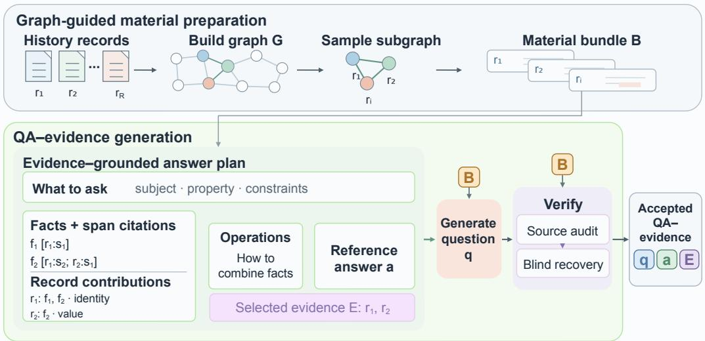

(b) Using the generated supervision to optimize memory design  
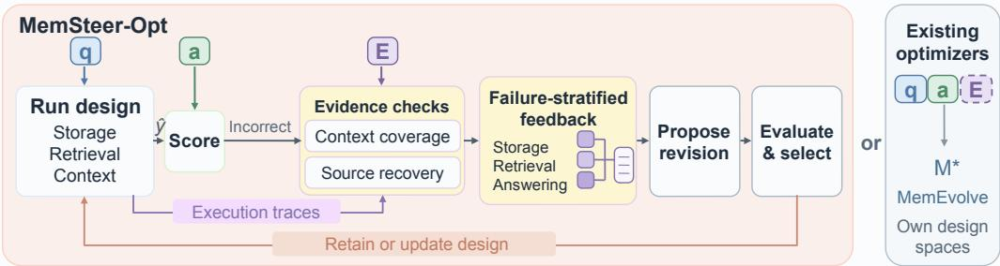  
Figure 2: Overview of MemSteer. (a) MemSteer turns unlabeled user histories into QA–evidence supervision through evidence-grounded answer planning, question generation, and source-grounded verification. (b) The resulting supervision supports the evaluation and refinement of memory designs with either MemSteer-Opt, our evidence-guided optimizer, or existing memory-design optimizers. Dashed E denotes optional evidence input.

Answer plans that fail programmatic checks of structural consistency and provenance coverage are rejected before question generation. Given the answer plan and material bundle B, a question generator produces a standalone question.

Source-grounded verification. We verify each candidate through a semantic audit followed by blind answer recovery. Given the material bundle B, the answer plan, and the generated question, an LLM reviewer returns structured verification judgments with supporting rationales. These judgments assess answer support and question–plan consistency, with separate assessments of each fact’s source support and each evidence record’s stated contribution. A candidate proceeds only if all required judgments are supported.

Given only the question, its answer type, and the source records in B, an LLM-based blind reader returns an answer with source citations. A candidate passes only if the reader declares the question answerable, its answer exactly matches the reference after type-specific normalization, and its citations cover every selected evidence record. Normalization rules are detailed in Appendix A.4.

We partition the generated QA–evidence annotations into disjoint training and validation sets, using the former to generate revision proposals and the latter to select memory designs.

## 3.3 MEMSTEER-OPT: EVIDENCE-GUIDED MEMORY-DESIGN OPTIMIZATION

MemSteer-Opt uses the generated QA–evidence supervision to evaluate memory designs and turn observed failures into feedback for iterative revisions.

Design space and evaluation. Starting from a basic memory system, MemSteer-Opt iteratively optimizes how historical records are organized into memory units and indexed, how relevant records are retrieved, and how retrieved records are assembled into the context supplied to the answerer. We represent these storage, retrieval, and context-construction choices as a memory design $d = { \left( s , r , c \right) }$

Under design $d ,$ the system constructs a memory $M _ { d }$ from the user’s historical records H:

$$
M _ { d } = { \mathrm { S t o r e } } _ { s } ( H ) .
$$

For each question $q _ { i } ,$ it retrieves information from $M _ { d } .$ , assembles the answer context $X _ { d , i }$ , and generates a response $\hat { a } _ { d , i } \colon$

$$
X _ { d , i } = \operatorname { C o n t e x t } _ { c } ( \operatorname { R e t r i e v e } _ { r } ( q _ { i } , M _ { d } ) ) , \qquad { \hat { a } } _ { d , i } = \operatorname { A n s w e r } ( q _ { i } , X _ { d , i } ) .\tag{2}
$$

We evaluate each prediction $\hat { a } _ { d , i }$ against its reference answer $a _ { i }$ under a fixed scoring protocol, yielding a binary correctness score $y _ { d , i } \in \{ 0 , 1 \}$ }. We score a design d by its accuracy on the same validation set as $\begin{array} { r } { A ( d ) = \frac { 1 } { N _ { \mathrm { v a l } } } \sum _ { i = 1 } ^ { N _ { \mathrm { v a l } } } y _ { d , i } , } \end{array}$ where $N _ { \mathrm { v a l } }$ is the number of validation questions. We use this binary validation accuracy for design selection; final benchmark scores follow the corresponding evaluation protocols (Appendix $_ { \mathrm { A . 4 ) } }$ . We hold the answering model, its instruction prompt, and the final context budget fixed across designs.

Evidence-guided diagnosis and sampling. Beyond scoring candidate designs, we use the automatically constructed evidence annotations to build targeted feedback for revising memory designs.

(i) Evidence-guided diagnosis. For each incorrect training-set response, we use its evidence annotations to check whether the required source records and cited passages are fully available in the final answer context. If so, we label an answering failure. For missing evidence, we use the annotated source IDs to check whether the current memory system can recover the corresponding records. We assign a storage failure if any missing record is unrecoverable, and a retrieval failure if all missing records are recoverable.

(ii) Failure-stratified sampling. To cover different failure modes within the proposer’s input-context budget, we sample cases separately from each observed failure category. Each sampled case includes the question, its reference answer and annotated source evidence, together with the current system’s response and diagnostic results. Together with the current design and revision history, these cases form the input to the design proposer.

Feedback-guided revision and selection. Given this feedback, an LLM-based design proposer proposes a revised design $d ^ { \prime } .$ , using the diagnosed failures to guide changes to storage, retrieval, or context construction. It also provides a rationale for the proposed changes. We rebuild the memory under each valid candidate and evaluate its accuracy on the fixed validation set. We replace the current design $d _ { t }$ with $d ^ { \prime }$ only if $A ( d ^ { \prime } ) > A ( d _ { t } )$ ; otherwise, we retain $d _ { t } .$ After accepting a revision, we rerun the updated system on the training set to refresh the failure diagnoses and sampled feedback for the next iteration.

Supervision for existing memory-design optimizers. Beyond MemSteer-Opt, we use the generated supervision to guide existing memory-design optimizers within their own design spaces. Generated questions and reference answers supply task feedback for evaluating and refining memory designs; source evidence can additionally support feedback when the optimizer’s interface accommodates it. This tests whether the supervision remains useful across optimization frameworks.

## 4 EXPERIMENTS

We address four questions: Q1 (§4.2): Can generated supervision guide memory-design optimization? Q2 (§4.3): Can optimized memory designs transfer and adapt? Q3 (§4.4): Which supervision construction choices matter? Q4 (§4.5): Does evidence-guided feedback improve optimization?

## 4.1 EXPERIMENTAL SETUP

Benchmarks and evaluation. ATM-Bench (Mei et al., 2026b) is a multimodal personal-memory QA benchmark built from approximately four years of personal records. Its corpus contains 11,034 email, image, and video records. Unless otherwise specified, we follow the ATM-Bench scoring protocol and evaluate performance on its 1,013-question main set and 31-question hard multi-hop set. RHELM (Zhang et al., 2026) covers 21,142 interaction records from ten personas, evaluated with and without external data sources. Benchmark selection is discussed in Appendix A.1.

Optimizers and protocol. MemSteer-Opt starts from a basic record-level retrieve-and-read system, which we refer to as Base-BM25: it indexes source text and metadata and uses the original question for BM25 (Robertson & Zaragoza, 2009) retrieval. Retrieved content is assembled in ranked order within a fixed context budget and passed to a fixed answering model. M⋆ (Pan et al., 2026) and MemEvolve (Zhang et al., 2025) retain their own starting systems and design spaces.

MemSteer uses our generated QA–evidence supervision for both training and validation while official QA is used only for testing. MemSteer-Opt runs 20 reflective evolution iterations per setting.

Models and metrics. On ATM-Bench, DeepSeek-V4-Flash (DeepSeek-AI, 2026) serves as the answerer, open-answer judge (Zheng et al., 2023), and design proposer, matching the answerer and judge used by the corresponding leaderboard configurations (Mei et al., 2026a).

We report Question Score (QS) and evidence recall at 10 (R@10).

On RHELM, we follow the official protocol, using GPT-4.1-mini (OpenAI, 2025) for answering and evaluation and reporting overall accuracy, separately with and without external data. We include existing memory systems as performance references; their configurations and additional results are detailed in Appendix A.2 and Appendix B.3.

## 4.2 CAN GENERATED SUPERVISION GUIDE MEMORY-DESIGN OPTIMIZATION?

Tables 1 and 2 compare MemSteer-generated supervision with official annotations (Official-QA) on ATM-Bench and RHELM; the ATM comparison also includes two external optimizers. Official-QA uses 600 of the 1,013 official ATM items and 788 of the 1,305 RHELM items for training and validation. These items remain in its evaluation sets, whereas MemSteer uses no evaluation items for training. The final RHELM MemSteer configuration uses 788 generated training items and is evaluated on all 1,305 official QA items.

Based on Tables 1 and 2, we make the following observations.

Generated supervision improves memory designs. With MemSteer supervision, MemSteer-Opt raises QS from 54.9 to 68.3 on ATM-Bench and from 8.2 to 29.1 on Hard, alongside gains in evidence recall (Table 1). On RHELM, MemSteer improves over Base-BM25 by 4.1 accuracy points without external data and 6.6 points with it (Table 2).

Generated supervision is competitive with the human-annotated reference. On ATM-Bench, MemSteer scores marginally higher than Official-QA across all four metrics, including QS margins of 1.1 points on the main set and 1.3 points on Hard. On RHELM, MemSteer remains 0.1 and 0.8 accuracy points below Official-QA without and with external data, respectively.

The supervision also benefits existing optimizers. From their own starting systems, M⋆ and MemEvolve gain 6.0 and 18.6 main-set QS points with MemSteer supervision, compared with 4.4 and 18.6 points with Official-QA. Thus, the supervision’s utility is not limited to MemSteer-Opt. The benefit is not uniform: on Hard, MemEvolve obtains smaller gains than with Official-QA, and its R@10 decreases by 0.1 points.

The optimized designs are competitive with existing memory systems. On ATM-Bench, MemSteer-Opt achieves the highest QS among the non-oracle systems using DeepSeek-V4 as the answerer. On RHELM with external data, MemSteer reaches 39.9 accuracy, compared with 33.9 for the strongest listed RAG, long-context, or memory-system baseline. Without external data, it remains competitive with the strongest listed baseline, RAG with k=50.

Table 1: ATM-Bench results across memory systems and supervision sources (%). “+” denotes optimization from each optimizer’s start; arrows show point changes. Bold scores mark the best per metric, excluding Oracle. Oracle uses gold evidence. †Official-QA training items are included in evaluation.
<table><tr><td></td><td colspan="2">Full (1,013)</td><td colspan="2">Hard (31)</td></tr><tr><td>Method</td><td>QS</td><td>R@10</td><td>QS</td><td>R@10</td></tr><tr><td colspan="5">Existing memory systems (DeepSeek-V4)</td></tr><tr><td>Memexa A-Mem</td><td>65.3</td><td>78.9</td><td>16.7</td><td></td></tr><tr><td>MemPalace</td><td></td><td></td><td></td><td>38.5</td></tr><tr><td></td><td>一</td><td></td><td>13.6</td><td>28.9</td></tr><tr><td>HippoRAG2</td><td></td><td></td><td>12.3 46.2</td><td>32.2</td></tr><tr><td colspan="5">Oracle (gold evidence) 71.8</td></tr><tr><td>Our optimizer: MemSteer-Opt Base-BM25</td><td></td><td>61.7</td><td>8.2</td><td>10.0</td></tr><tr><td>+ Official-QA†</td><td>54.9 67.3</td><td>83.5</td><td>27.9</td><td>42.2</td></tr><tr><td>+ MemSteer</td><td>68.3</td><td>84.1</td><td>29.1</td><td>43.6</td></tr><tr><td></td><td>↑13.4</td><td>↑22.4</td><td>↑20.9</td><td>↑33.6</td></tr><tr><td colspan="5">External optimizers</td></tr><tr><td>M* start</td><td>47.4</td><td>55.2</td><td>1.9</td><td>13.6</td></tr><tr><td>+ Official-QA†</td><td>51.8</td><td>69.4</td><td>9.5</td><td>26.0</td></tr><tr><td>+ MemSteer</td><td>53.4 ↑6.0</td><td>69.8 ↑14.6</td><td>12.9 ↑11.0</td><td>25.6 ↑12.0</td></tr><tr><td>MemEvolve start</td><td>35.1</td><td>41.3</td><td>7.1</td><td>18.7</td></tr><tr><td>+ Official-QA†</td><td>53.7</td><td>63.8</td><td>11.4</td><td>21.6</td></tr><tr><td>+ MemSteer</td><td>53.7</td><td>63.7</td><td>9.5</td><td>18.6</td></tr><tr><td></td><td>↑18.6</td><td>↑22.4</td><td>↑2.3</td><td>↓0.1</td></tr></table>

Table 2: RHELM results (accuracy, %). w/o: conversation records only; w/: conversation records plus emails and documents. We use GPT-4.1-mini in MemSteer-Opt and other optimized memory systems.
<table><tr><td>Method</td><td>w/o</td><td>w/</td></tr><tr><td>Existing methods (GPT-4.1-mini)</td><td></td><td></td></tr><tr><td>RAG (k=20)</td><td>23.5</td><td>25.1</td></tr><tr><td>RAG (k=50)</td><td>28.9</td><td>32.6</td></tr><tr><td>Hybrid (k=5)</td><td>16.7</td><td>17.6</td></tr><tr><td>Hybrid (k=20)</td><td>24.8</td><td>26.0</td></tr><tr><td>Hybrid (k=50)</td><td>27.8</td><td>29.6</td></tr><tr><td>MemGPT</td><td>13.9</td><td>17.3</td></tr><tr><td>Mem0</td><td>21.1</td><td>28.9</td></tr><tr><td>MemU</td><td>23.1</td><td>33.6</td></tr><tr><td>Long-Context Models (1M)</td><td></td><td></td></tr><tr><td>Gemini-2.5-Flash-Lite</td><td>16.0</td><td>17.3</td></tr><tr><td>Qwen-2.5-14B-Instruct</td><td>15.3</td><td>8.1</td></tr><tr><td>GPT-4.1-mini</td><td>24.0</td><td>33.9</td></tr><tr><td>Our optimizer: MemSteer-Opt</td><td></td><td></td></tr><tr><td>Base-BM25</td><td>22.3</td><td>33.3</td></tr><tr><td>+ Official-QA†</td><td>26.5</td><td>40.7</td></tr><tr><td>+ MemSteer</td><td>26.4</td><td>39.9</td></tr><tr><td></td><td>↑4.1</td><td>↑6.6</td></tr><tr><td>Transferred ATM-Bench design ATM-Bench-evolved(frozen)</td><td></td><td></td></tr><tr><td>+ Official-QA†</td><td>26.4</td><td>38.6</td></tr><tr><td></td><td>31.5</td><td>42.9</td></tr><tr><td>+ MemSteer</td><td>30.6 ↑4.2</td><td>42.8 ↑4.2</td></tr></table>

## 4.3 CAN OPTIMIZED MEMORY DESIGNS TRANSFER AND ADAPT?

We test design reuse across benchmarks and continued optimization for users, respectively.

Cross-benchmark transfer. We freeze the design optimized with generated ATM-Bench QA and apply it to RHELM records without target-domain optimization. ATM-Bench-evolved(frozen) outperforms Base-BM25 by 4.1 and 5.3 accuracy points without and with external data, respectively (Table 2). These results suggest that some of the design improvements learned on ATM-Bench remain useful on RHELM without target-domain optimization. When further optimized using either RHELM Official-QA or QA generated from RHELM histories, the transferred design achieves further gains. Generated supervision achieves performance close to the Official-QA reference without requiring manually annotated target-domain QA for optimization.

Cross-user transfer and continuation. We apply a frozen design optimized on six RHELM users to Martin Keller and David R. Ellis, who are excluded from the sourceuser pool. We then continue optimization from this shared design using QA–evidence supervision generated from each target user’s history, reserving official QA for evaluation (Appendix A.3).

Direct transfer helps David slightly but reduces Martin’s accuracy (Table 3). Personal continuation improves both transferred designs, especially for Martin, suggesting that target-history supervision can support adaptation beyond a shared design.

Table 3: RHELM cross-user accuracy (%, with external data). Martin and David are outside the sixuser pool; personal continuation adapts its shared design using target-history-generated supervision. Source-user scores pool evaluation questions.
<table><tr><td>Evaluation users</td><td>Base-BM25</td><td>6-user design</td><td>Personal continuation</td></tr><tr><td>Source users (6)</td><td>31.5</td><td>34.3</td><td>一</td></tr><tr><td>Martin Keller</td><td>41.2</td><td>37.7</td><td>44.3</td></tr><tr><td>David R. Ellis</td><td>37.3</td><td>38.6</td><td>39.2</td></tr></table>

## 4.4 WHAT MAKES QA–EVIDENCE SUPERVISION EFFECTIVE?

We first compare QA-generation methods and the effect of verification on supervision quality and downstream utility. We then examine two generator design choices: constructing an explicit evidence-grounded answer plan and separating its construction from question generation.

QA-generation ablations. Table 4 compares heuristic synthesis that randomly selects records to form a material bundle (Naive-QA), Ragas multi-hop generation (Ragas, 2026) (Ragas-QA), and MemSteer, each with and without verification. Checks denote our sourcegrounded verification (§3.2).

For this comparison, QA quality is assessed using four criteria: premise support, question clarity, answer support, and evidence support. For each judge, a question receives 1 only when all four criteria are supported, and 0 otherwise. The QA quality score is the mean of these binary scores, expressed as a percentage. We evaluate QA quality using two inde-

Table 4: QA-generation methods and verification on ATM-Bench. QA quality scores are reported for two judges (DS-V4F: DeepSeek-V4-Flash); Avg. is their mean. QS measures downstream utility; Kept is the percentage of candidates retained after verification (“–”: no filtering).
<table><tr><td></td><td colspan="2">QS</td><td colspan="3">QA quality (%)</td><td>Kept</td></tr><tr><td>Method</td><td>Full</td><td>Hard</td><td>GPT-5- mini</td><td>DS-V4F</td><td>Avg.</td><td>(%)</td></tr><tr><td>Naive-QA</td><td>54.2</td><td>5.3</td><td>63.3</td><td>63.8</td><td>63.5</td><td></td></tr><tr><td>+ checks</td><td>64.8</td><td>24.4</td><td>77.8</td><td>77.0</td><td>77.4</td><td>21.2</td></tr><tr><td>Ragas-QA</td><td>63.0</td><td>23.3</td><td>73.5</td><td>69.3</td><td>71.4</td><td></td></tr><tr><td>+ checks</td><td>65.1</td><td>20.7</td><td>84.3</td><td>80.8</td><td>82.5</td><td>42.1</td></tr><tr><td>MemSteer</td><td>65.2</td><td>22.0</td><td>83.5</td><td>67.3</td><td>75.4</td><td></td></tr><tr><td>w/o checks</td><td></td><td>29.1</td><td>94.3</td><td>87.5</td><td>90.9</td><td>47.9</td></tr><tr><td>MemSteer</td><td>68.3</td><td></td><td></td><td></td><td></td><td></td></tr></table>

pendent LLMs—GPT-5-mini (OpenAI, n.d.) and DeepSeek-V4-Flash—and their average to see whether the trends are consistent.

We make the following observations. (i) MemSteer outperforms Naive-QA and Ragas-QA, even when both baselines use our checks, in downstream QS and in QA quality assessed by both judges. (ii) Our checks improve QA quality across all three generation methods and downstream QS in most settings, except Ragas-QA on Hard. Naive-QA’s lowest retention indicates that a larger fraction of its candidates fail the verification criteria.

(iii) QA quality scores from GPT-5-mini and DeepSeek-V4-Flash show broadly consistent trends across generation methods and generally align with downstream QS. This supports using the QA quality score as a useful indicator of supervision quality.

Evidence-grounded answer planning and staged generation. We test whether constructing an evidence-grounded answer plan improves QA quality over direct generation, and whether programmatically checking the plan before a separate question-generation call provides further gains over joint generation. Table 5 compares three generation procedures on the same 600 tasks, holding

Table 5: Generated QA quality evaluation. q denotes a question.
<table><tr><td>Generation</td><td>Quality (%)</td><td>Tokens/q (k)</td></tr><tr><td>Direct QA</td><td>67.8</td><td>64.0</td></tr><tr><td>Joint Plan-Q</td><td>73.1</td><td>68.2</td></tr><tr><td>Two-stage Plan-Q</td><td>85.9</td><td>105.1</td></tr></table>

source records, question types, evidence-count requirements, and the DeepSeek-V4-Flash generator fixed. Direct QA jointly generates the question, answer, and evidence in one call, without an intermediate answer plan. Joint Plan–Q first produces an evidence-grounded answer plan and then the question within the same response. Two-stage Plan–Q constructs the answer plan, applies programmatic structural and provenance checks, and generates the question in a separate call using the accepted answer plan and source records.

All three use the same GPT-4.1-mini filter, which sees the QA, evidence and source material but not our detailed evidence-grounded answer plan. This shared filter is used only for the generation comparison, rather than the full MemSteer verification pipeline. For QA passing this filter, a separate, blinded GPT-4.1 review assesses QA quality with four criteria as used in Table 4.

Joint Plan–Q improves QA quality over Direct QA, although both use one call, supporting explicit evidence-grounded answer planning. Two-stage Plan–Q improves quality further with programmatic plan checks before separate question generation, but has the highest per-question token cost.

Training-question budget. Increasing the budget from 100 to 200 questions yields the largest performance gains in the evaluated sweep. Beyond 200, retrieval recall largely plateaus, while QS improves overall on both ATM-Bench and ATM-Bench-Hard (Appendix B.2).

## 4.5 DOES EVIDENCE-GUIDED FEEDBACK IMPROVE OPTIMIZATION?

We test whether explicit failure diagnosis improves on raw-evidence feedback and whether failurestratified sampling further improves memory-design optimization. All four feedback conditions use MemSteer-generated QA–evidence supervision and start from Base-BM25 (Figure 3).

Base-BM25 Random-30 Random-30 + Gold evidence Random-30 + Diagnosis Diagnosis + stratified sampling (ours)

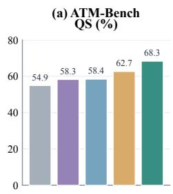

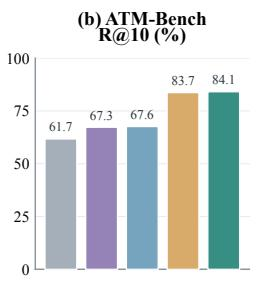

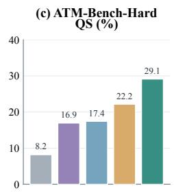

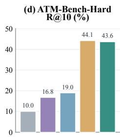  
Figure 3: Attribution and sampling ablation on ATM-Bench and ATM-Bench-Hard. Bars report QS and R@10 (%). Optimized conditions use MemSteer-generated supervision and start from Base-BM25; Diagnosis + stratified sampling is the full MemSteer-Opt configuration.

We compare four ways to construct feedback from unsuccessful cases. Random-30 randomly samples up to 30 scored failures per round and gives the design proposer their questions, reference answers, predictions, scores, retrieval traces, and answer-context excerpts. Random-30 + Gold evidence retains the random sampling and adds required-evidence IDs and gold-record excerpts, but no failure attribution. Random-30 + Diagnosis further adds evidence-grounded failure attribution while retaining random sampling. Diagnosis + stratified sampling (ours) keeps the diagnostic feedback and samples up to ten cases per failure category, preventing frequent failure types from exhausting the feedback budget. Appendix A.5 details the feedback fields, while Appendix B.5 shows an accepted architectural trajectory.

We make the following observations. (i) Adding gold evidence provides only limited improvement over trace-based feedback. (ii) Explicit failure attribution yields larger gains, particularly in evidence retrieval, supporting the use of stage-level diagnostic feedback rather than raw evidence alone. (iii) Combining diagnosis with stratified sampling achieves the highest downstream QS, although diagnosis with random sampling yields higher evidence recall on Hard.

## 5 CONCLUSION

We presented MemSteer, a framework for constructing QA–evidence supervision from unlabeled user histories and using it to guide memory-design optimization. Rather than requiring manually annotated QA for each new history, MemSteer derives reference answers and supporting evidence from the records themselves. These annotations serve complementary purposes: reference answers support the evaluation of candidate memory designs, while source evidence helps diagnose unsuccessful responses and guide revisions. We instantiate this approach in MemSteer-Opt and also use the generated supervision with existing optimizers that retain their own design spaces. Experiments on ATM-Bench and RHELM show that generated supervision improves memory designs, achieves performance competitive with the Official-QA reference, and supports continued adaptation to new user histories.

## ETHICS STATEMENT

Our experiments use released benchmark data under their published terms, without collecting new personal data or conducting human-subjects studies. Source records are processed through third party LLM APIs, and generated QA may reveal sensitive information by combining facts across records. Deployment on personal histories should therefore require informed user consent and ap propriate privacy safeguards. MemSteer is intended to improve memory systems for users, not to enable unauthorized profiling.

## REPRODUCIBILITY STATEMENT

Section 3.2 specifies the supervision-construction pipeline (graph-guided material preparation, evidence-grounded answer planning, question generation, and source-grounded verification), and Section 3.3 specifies the design space, evaluation protocol, evidence-guided diagnosis, and acceptance rule of MemSteer-Opt. Section 4.1 describes the benchmarks, baselines, iteration budget, and model roles. Appendix A documents additional experimental details, including evaluation populations and feedback inputs; Appendix B reports further experimental results. Because the pipeline depends on remote LLM APIs, exact outputs may vary with model nondeterminism and provider updates; we therefore report the model identities used for each role.

## LLM USAGE

LLMs perform evidence-grounded answer planning, question generation, source-grounded auditing, and blind answer recovery in MemSteer. They also propose design revisions in MemSteer-Opt, act as fixed answerers and answer judges, and perform shared filtering and post hoc QA-quality evaluation. We use DeepSeek-V4-Flash, GPT-4.1-mini, GPT-4.1, and GPT-5-mini across these roles (Section 4.1). In preparing this paper, we also used LLM assistants for language editing and coding assistance. The authors reviewed all such output and take full responsibility for this paper.

## REFERENCES

Chris Alberti, Daniel Andor, Emily Pitler, Jacob Devlin, and Michael Collins. Synthetic QA corpora generation with roundtrip consistency. arXiv preprint arXiv:1906.05416, 2019. URL https: //arxiv.org/abs/1906.05416.

Anthropic. System card: Claude Opus 4.5. Anthropic system card, November 2025, 2025. URL https://www.anthropic.com/claude-opus-4-5-system-card.

Akari Asai, Zeqiu Wu, Yizhong Wang, Avirup Sil, and Hannaneh Hajishirzi. Self-RAG: Learning to retrieve, generate, and critique through self-reflection. arXiv preprint arXiv:2310.11511, 2023. URL https://arxiv.org/abs/2310.11511.

Shuai Bai, Yuxuan Cai, Ruizhe Chen, Keqin Chen, et al. Qwen3-VL technical report. arXiv preprint arXiv:2511.21631, 2025. URL https://arxiv.org/abs/2511.21631.

Jiale Chang and Yuxiang Ren. ScrapMem: A bio-inspired framework for on-device personalized agent memory via optical forgetting. arXiv preprint arXiv:2605.03804, 2026. URL https: //arxiv.org/abs/2605.03804.

Jianlyu Chen, Shitao Xiao, Peitian Zhang, Kun Luo, Defu Lian, and Zheng Liu. M3-Embedding: Multi-linguality, multi-functionality, multi-granularity text embeddings through self-knowledge distillation. In Findings of the Association for Computational Linguistics: ACL 2024, pp. 2318– 2335. Association for Computational Linguistics, 2024. doi: 10.18653/v1/2024.findings-acl.137. URL https://aclanthology.org/2024.findings-acl.137/.

Zihong Chen, Wanli Jiang, Jinzhe Li, Zhonghang Yuan, Huanjun Kong, Wanli Ouyang, and Nanqing Dong. GraphGen: Enhancing supervised fine-tuning for LLMs with knowledge-driven synthetic data generation. arXiv preprint arXiv:2505.20416, 2025. URL https://arxiv.org/abs/ 2505.20416.

Prateek Chhikara, Dev Khant, Saket Aryan, Taranjeet Singh, and Deshraj Yadav. Mem0: Building production-ready AI agents with scalable long-term memory. arXiv preprint arXiv:2504.19413, 2025. URL https://arxiv.org/abs/2504.19413.

Gheorghe Comanici, Eric Bieber, Mike Schaekermann, Ice Pasupat, et al. Gemini 2.5: Pushing the frontier with advanced reasoning, multimodality, long context, and next generation agentic capabilities. arXiv preprint arXiv:2507.06261, 2025. URL https://arxiv.org/abs/2507. 06261.

Zhuyun Dai, Vincent Y. Zhao, Ji Ma, Yi Luan, Jianmo Ni, Jing Lu, Anton Bakalov, Kelvin Guu, Keith B. Hall, and Ming-Wei Chang. Promptagator: Few-shot dense retrieval from 8 examples. arXiv preprint arXiv:2209.11755, 2022. URL https://arxiv.org/abs/2209.11755.

DeepSeek-AI. DeepSeek-V4: Towards highly efficient million-token context intelligence. arXiv preprint arXiv:2606.19348, 2026. URL https://arxiv.org/abs/2606.19348.

Simone Filice, Guy Horowitz, David Carmel, Zohar Karnin, Liane Lewin-Eytan, and Yoelle Maarek. Generating diverse Q&A benchmarks for RAG evaluation with DataMorgana. arXiv preprint arXiv:2501.12789, 2025. URL https://arxiv.org/abs/2501.12789.

Luyu Gao, Xueguang Ma, Jimmy Lin, and Jamie Callan. Precise zero-shot dense retrieval without relevance labels. In Proceedings ofthe 61st Annual Meeting ofthe Associationfor Computational Linguistics (Volume 1: Long Papers), pp. 1762–1777. Association for Computational Linguistics, 2023. doi: 10.18653/v1/2023.acl-long.99. URL https://aclanthology.org/2023. acl-long.99/.

Bernal Jimenez Guti´ errez, Yiheng Shu, Weijian Qi, Sizhe Zhou, and Yu Su. From RAG to memory:´ Non-parametric continual learning for large language models. arXiv preprint arXiv:2502.14802, 2025. URL https://arxiv.org/abs/2502.14802.

Zexue He, Yu Wang, Churan Zhi, Yuanzhe Hu, Tzu-Ping Chen, Lang Yin, Ze Chen, Tong Arthur Wu, Siru Ouyang, Zihan Wang, Jiaxin Pei, Julian McAuley, Yejin Choi, and Alex Pentland. MemoryArena: Benchmarking agent memory in interdependent multi-session agentic tasks. arXiv preprint arXiv:2602.16313, 2026. URL https://arxiv.org/abs/2602.16313.

Jiazheng Kang, Mingming Ji, Zhe Zhao, and Ting Bai. Memory OS of AI agent. arXiv preprint arXiv:2506.06326, 2025. URL https://arxiv.org/abs/2506.06326.

labazhou2024. Memexa: A traceable personal memory layer. GitHub repository, 2026. URL https://github.com/labazhou2024/memexa. Accessed September 24, 2026.

Minhua Lin, Zhiwei Zhang, Hanqing Lu, Hui Liu, Xianfeng Tang, Qi He, Xiang Zhang, and Suhang Wang. MemMA: Coordinating the memory cycle through multi-agent reasoning and in-situ selfevolution. arXiv preprint arXiv:2603.18718, 2026. URL https://arxiv.org/abs/2603. 18718v2. Version 2.

Adyasha Maharana, Dong-Ho Lee, Sergey Tulyakov, Mohit Bansal, Francesco Barbieri, and Yuwei Fang. Evaluating very long-term conversational memory of LLM agents. arXiv preprint arXiv:2402.17753, 2024. URL https://arxiv.org/abs/2402.17753v1. Version 1; no dataset-size claim is based on this early version.

Jingbiao Mei, Jinghong Chen, Guangyu Yang, Xinyu Hou, Margaret Li, and Bill Byrne. ATM-Bench live leaderboard. https://atmbench.github.io/leaderboard.html, 2026a. Accessed 2026-09-24.

Jingbiao Mei, Jinghong Chen, Guangyu Yang, Xinyu Hou, Margaret Li, and Bill Byrne. According to me: Long-term personalized referential memory QA. arXiv preprint arXiv:2603.01990, 2026b. URL https://arxiv.org/abs/2603.01990.

MemPalace. MemPalace: Local-first AI memory. GitHub repository, 2026. URL https:// github.com/MemPalace/mempalace. Accessed September 24, 2026.

NevaMind AI. MemU: Personal memory across agents. GitHub repository, 2025. URL https: //github.com/NevaMind-AI/memU. Accessed September 24, 2026.

OpenAI. Introducing GPT-4.1 in the API. OpenAI blog, April 14, 2025, 2025. URL https: //openai.com/index/gpt-4-1/.

OpenAI. GPT-5 Mini. OpenAI API documentation, n.d. URL https://developers. openai.com/api/docs/models/gpt-5-mini. Accessed September 26, 2026.

Charles Packer, Sarah Wooders, Kevin Lin, Vivian Fang, Shishir G. Patil, Ion Stoica, and Joseph E. Gonzalez. MemGPT: Towards LLMs as operating systems. arXiv preprint arXiv:2310.08560, 2023. URL https://arxiv.org/abs/2310.08560.

Wenbo Pan, Shujie Liu, Xiangyang Zhou, Shiwei Zhang, Wanlu Shi, Mirror Xu, and Xiaohua Jia. M⋆: Every task deserves its own memory harness. arXiv preprint arXiv:2604.11811, 2026. URL https://arxiv.org/abs/2604.11811v2. Version 2.

Ragas. Testset generation for RAG. Ragas documentation, 2026. URL https://docs.ragas. io/en/stable/concepts/test\_data\_generation/rag/. Continuously updated documentation; accessed September 9, 2026. Year denotes access, not first publication.

Stephen Robertson and Hugo Zaragoza. The probabilistic relevance framework: BM25 and beyond. Foundations and Trends in Information Retrieval, 3(4):333–389, 2009. doi: 10.1561/1500000019.

Zhiyu Shen, Ziming Wu, Fuming Lai, Shaobing Lian, and Yanghui Rao. MemBuilder: Reinforcing LLMs for long-term memory construction via attributed dense rewards. arXiv preprint arXiv:2601.05488, 2026. URL https://arxiv.org/abs/2601.05488v4. Version 4.

Yubo Wang, Qiuyu Zhao, Zenghui Sun, Shichao Dong, Jinsong Lan, Xiaoyong Zhu, Haoyang Li, Bo Zheng, and Lei Chen. CMI-Mem: Toward generalizable long-term memory management via CMI-augmented reinforcement learning. arXiv preprint arXiv:2607.20553, 2026. URL https: //arxiv.org/abs/2607.20553v2. Version 2.

Di Wu, Hongwei Wang, Wenhao Yu, Yuwei Zhang, Kai-Wei Chang, and Dong Yu. LongMemEval: Benchmarking chat assistants on long-term interactive memory. arXiv preprint arXiv:2410.10813, 2024. URL https://arxiv.org/abs/2410.10813v1. Construction details consulted in version 1.

Yiming Xiong, Shengran Hu, and Jeff Clune. Learning to continually learn via meta-learning agentic memory designs. arXiv preprint arXiv:2602.07755, 2026. URL https://arxiv.org/abs/ 2602.07755v1. Version 1.

Wujiang Xu, Zujie Liang, Kai Mei, Hang Gao, Juntao Tan, and Yongfeng Zhang. A-MEM: Agentic memory for LLM agents. arXiv preprint arXiv:2502.12110, 2025. URL https://arxiv. org/abs/2502.12110.

An Yang, Bowen Yu, Chengyuan Li, Dayiheng Liu, Fei Huang, et al. Qwen2.5-1M technical report. arXiv preprint arXiv:2501.15383, 2025. URL https://arxiv.org/abs/2501.15383.

Yuqing Yang, Tengxiao Liu, Wang Bill Zhu, Taiwei Shi, Linxin Song, and Robin Jia. Self-evolving LLM memory extraction across heterogeneous tasks. arXiv preprint arXiv:2604.11610, 2026. URL https://arxiv.org/abs/2604.11610.

Xiang Yue, Ziyu Yao, and Huan Sun. Synthetic question value estimation for domain adaptation of question answering. In Proceedings of the 60th Annual Meeting of the Association for Computational Linguistics (Volume 1: Long Papers), pp. 1340–1351. Association for Computational Linguistics, 2022. doi: 10.18653/v1/2022.acl-long.95. URL https://aclanthology.org/ 2022.acl-long.95/.

Guibin Zhang, Haotian Ren, Chong Zhan, Zhenhong Zhou, Junhao Wang, He Zhu, Wangchunshu Zhou, and Shuicheng Yan. MemEvolve: Meta-evolution of agent memory systems. arXiv preprint arXiv:2512.18746, 2025. URL https://arxiv.org/abs/2512.18746.

Han Zhang, Zihao Tang, Xin Yu, Xiao Liu, Yeyun Gong, Haizhen Huang, Yan Lu, Weiwei Deng, Feng Sun, Qi Zhang, and Hanfang Yang. Beyond static dialogues: Benchmarking realistic, heterogeneous, and evolving long-term memory. arXiv preprint arXiv:2605.31086, 2026. URL https://arxiv.org/abs/2605.31086.

Lianmin Zheng, Wei-Lin Chiang, Ying Sheng, Siyuan Zhuang, Zhanghao Wu, Yonghao Zhuang, Zi Lin, Zhuohan Li, Dacheng Li, Eric P. Xing, Hao Zhang, Joseph E. Gonzalez, and Ion Stoica. Judging LLM-as-a-judge with MT-Bench and Chatbot Arena. arXiv preprint arXiv:2306.05685, 2023. URL https://arxiv.org/abs/2306.05685v4. Version 4.

## A ADDITIONAL EXPERIMENTAL DETAILS

## A.1 BENCHMARK SELECTION

We prioritize ATM-Bench (Mei et al., 2026b) and RHELM (Zhang et al., 2026) because recent work characterizes performance on LoCoMo (Maharana et al., 2024) and LongMemEval (Wu et al., 2024) as near-saturated in conversational-memory QA settings (He et al., 2026). ATM-Bench combines real-world images, videos, and emails, whereas RHELM couples evolving simulated user dialogues with external textual sources such as emails and documents.

## A.2 REFERENCE SYSTEMS

Table 1 compares DeepSeek-V4-based Memexa (labazhou2024, 2026), A-Mem (Xu et al., 2025), MemPalace (MemPalace, 2026), and HippoRAG2 (Gutierrez et al., 2025) on ATM-Bench (Mei´ et al., 2026a).

Table 2 includes the RHELM reference results (Zhang et al., 2026) for RAG $( k \in \{ 2 0 , 5 0 \} )$ , Hybrid $( k \in \{ 5 , 2 0 , 5 0 \} )$ , MemGPT (Packer et al., 2023), Mem0 (Chhikara et al., 2025), and MemU (Neva-Mind AI, 2025), all using GPT-4.1-mini as the answering model. Hybrid combines dense retrieval with BM25 through reciprocal rank fusion. The same table reports 1M-context inference with Gemini-2.5-Flash-Lite (Comanici et al., 2025), Qwen-2.5-14B-Instruct (1M) (Yang et al., 2025), and GPT-4.1-mini (OpenAI, 2025). The Base-BM25, optimized, and transferred-design rows follow the protocols in Sections 4.1 and 4.3.

Appendix Table 8 additionally reports RAG with GPT-4.1 (OpenAI, 2025), Gemini-2.5-Pro (Comanici et al., 2025), and Claude-Opus-4.5 (Anthropic, 2025), all at k = 20.

Native Qwen3-VL/GPT-5-mini results, including ATM-RAG (Mei et al., 2026b), Self-RAG (Asai et al., 2023), ScrapMem (Chang & Ren, 2026), and MemoryOS (Kang et al., 2025), are included in Appendix Table 7.

## A.3 EVALUATION POPULATIONS

The training split drives failure attribution and revision proposals, whereas validation is used to accept revisions and select the final design. MemSteer uses generated QA–evidence supervision for these processes, without using benchmark evaluation questions. The Official-QA reference instead uses official QA for training and validation; these items remain included in evaluation.

On ATM-Bench, both the Official-QA and MemSteer conditions use 400 training items and a fixed 200-item validation set; the former uses official QA and the latter uses QA–evidence supervision generated from the records. Evaluation covers all 1,013 official QA items, including the 600 items used for Official-QA training and validation. ATM-Bench-Hard, the 31-question hard multi-hop subset, is reported separately. Leaderboard references also use the full 1,013-item population.

RHELM contains 1,305 official QA items from ten personas and is evaluated on the full official set, both with and without external data sources. The Official-QA reference uses 524 official items for training and 264 for validation; these items remain included in evaluation. The final MemSteer configuration uses 788 generated QA–evidence items for training, without using official QA for training or design selection. In the six-user setting, four personas provide training supervision, two provide validation supervision, and the remaining four are held out (Table 9). For personal continuation, MemSteer generates 421 supervision items from Martin Keller’s history, split into 282 training and 139 validation items, and evaluates the continued design on 228 official questions. For David R. Ellis, it generates 337 supervision items, split into 223 training and 114 validation items, and evaluates on 158 official questions.

## A.4 EVALUATION METRICS

On ATM-Bench, Question Score (QS) uses exact match for numerical items, Jaccard partial credit for list items, and judge scores for open-ended items. R@10 averages the fraction of gold evidence records among the top-10 retrieved records over questions.

Blind answer agreement. Blind answer recovery checks type-normalized exact agreement: normalized text equality, set equality for lists, and exact value-and-unit agreement for numerical answers.

Boolean answers are matched exactly. Evidence coverage is checked at the record level, requiring citations to every selected evidence record.

Design-selection accuracy. Validation accuracy guides revision acceptance and design selection. Predictions identical to their reference answers are scored as correct; other responses receive a binary correctness judgment from a fixed LLM judge. Final ATM-Bench evaluation uses Question Score (QS), which includes partial credit for list questions. Final RHELM evaluation reports overall accuracy, computed as the mean of binary correctness judgments from the official evaluator.

## A.5 FEEDBACK INPUTS

Gold evidence denotes the reference source evidence in MemSteer-generated QA–evidence supervision, not human-annotated evidence. For Random-30, each sampled case includes the question, reference answer, prediction and score, ranked retrieved-record IDs, IDs actually delivered to the answer. Gold evidence remains unmarked in Random-30, even if it appears in the context. Random-30 + Gold evidence adds required-evidence IDs and gold-record excerpts without programmatic failure attribution. Random-30 + Diagnosis retains random sampling and additionally provides failure-stage labels, missing-evidence IDs, evidence checks, and memory-lookup results. Diagnosis + stratified sampling uses the same diagnostic information but organizes examples by failure category before allocating the feedback budget.

## B MORE EXPERIMENTAL RESULTS

## B.1 ATM-BENCH REFERENCE AND OPTIMIZATION RESULTS

Table 6 reorganizes the DeepSeek-V4-Flash-evaluated results from Table 1 .

Table 6: Performance on ATM-Bench and ATM-Bench-Hard (%). DeepSeek-V4-Flash is used for answer generation and as the judge for open-ended answers. Arrows indicate percentagepoint changes relative to the corresponding initial design: Base-BM25 for MemSteer-Opt and the respective starting systems for the external optimizers. Bold and underlined values indicate the best and second-best results per metric, excluding the oracle, which uses gold evidence. †Official-QA training items are included in evaluation.
<table><tr><td rowspan="2">Method</td><td rowspan="2">Backbone</td><td rowspan="2">Supervision</td><td colspan="2">ATM-Bench</td><td colspan="2">ATM-Bench-Hard</td></tr><tr><td>QS↑</td><td>R@10↑|</td><td>QS↑</td><td>R@10↑</td></tr><tr><td colspan="7">Reference memory systems</td></tr><tr><td>Memexa</td><td>DeepSeek-V4</td><td>None</td><td>65.3</td><td>78.9</td><td></td><td></td></tr><tr><td>A-Mem</td><td>DeepSeek-V4</td><td>None</td><td></td><td></td><td>16.7</td><td>38.5</td></tr><tr><td>MemPalace</td><td>DeepSeek-V4</td><td>None</td><td>一</td><td></td><td>13.6</td><td>28.9</td></tr><tr><td>HippoRAG2</td><td>DeepSeek-V4</td><td>None</td><td></td><td></td><td>12.3</td><td>32.2</td></tr><tr><td colspan="7">Base starting system and oracle</td></tr><tr><td>Base-BM25</td><td>DeepSeek-V4</td><td>一</td><td>54.9</td><td>61.7</td><td>8.2</td><td>10.0</td></tr><tr><td>Oracle</td><td>DeepSeek-V4</td><td></td><td>71.8</td><td></td><td>46.2</td><td></td></tr><tr><td colspan="7">MemSteer-Opt (Ours) across supervision sources</td></tr><tr><td>MemSteer-Opt</td><td>DeepSeek-V4</td><td>Official-QA†</td><td>67.3</td><td>83.5</td><td>27.9</td><td>42.2</td></tr><tr><td>MemSteer-Opt</td><td>DeepSeek-V4</td><td>MemSteer</td><td>68.3 ↑13.4</td><td>84.1 ↑22.4</td><td>29.1 ↑20.9</td><td>43.6 ↑33.6</td></tr><tr><td>External optimizers</td><td></td><td></td><td></td><td></td><td></td><td></td></tr><tr><td colspan="7"></td></tr><tr><td>M* start</td><td>DeepSeek-V4</td><td></td><td>47.4</td><td>55.2</td><td>1.9</td><td>13.6</td></tr><tr><td>M*</td><td>DeepSeek-V4</td><td>Official-QA†</td><td>51.8</td><td>69.4</td><td>9.5</td><td>26.0</td></tr><tr><td>M*</td><td>DeepSeek-V4</td><td>MemSteer</td><td>53.4 ↑6.0</td><td>69.8 ↑14.6</td><td>12.9 ↑11.0</td><td>25.6 ↑12.0</td></tr><tr><td>MemEvolve start</td><td>DeepSeek-V4</td><td></td><td>35.1</td><td>41.3</td><td>7.1</td><td>18.7</td></tr><tr><td>MemEvolve</td><td>DeepSeek-V4</td><td>Official-QA†</td><td>53.7</td><td>63.8</td><td>11.4</td><td>21.6</td></tr><tr><td>MemEvolve</td><td>DeepSeek-V4</td><td>MemSteer</td><td>53.7</td><td>63.7</td><td>9.5</td><td>18.6</td></tr><tr><td></td><td></td><td></td><td>↑18.6</td><td>↑22.4</td><td>↑2.3</td><td>↓0.1</td></tr></table>

Table 7: Performance on ATM-Bench and ATM-Bench-Hard (%). MemSteer-Opt uses DeepSeek-V4-Flash for answer generation. Open-ended answers are evaluated by the official GPT-5- mini judge. All MemSteer-Opt runs start from Base-BM25. Green arrows indicate percentagepoint improvements over Base-BM25. Bold and underlined values indicate the best and second-best results per metric among the MemSteer-Opt variants, respectively. The oracle uses gold evidence. †Official-QA training items are included in evaluation.
<table><tr><td rowspan="2">Method</td><td rowspan="2">Backbone</td><td rowspan="2">Supervision</td><td colspan="2">ATM-Bench</td><td colspan="2">ATM-Bench-Hard</td></tr><tr><td>QS↑</td><td>R@10↑|</td><td>QS↑</td><td>R@10↑</td></tr><tr><td colspan="7">Reference memory systems</td></tr><tr><td>MemPalace</td><td>Qwen3-VL-2B/8B</td><td>None</td><td>56.8</td><td>76.4</td><td>9.7</td><td>28.3</td></tr><tr><td>ATM-RAG</td><td>Qwen3-VL-2B/8B</td><td>None</td><td>51.0</td><td>68.7</td><td>13.8</td><td>30.4</td></tr><tr><td>Self-RAG</td><td>Qwen3-VL-2B/8B</td><td>None</td><td>50.3</td><td>68.7</td><td></td><td></td></tr><tr><td>ScrapMem</td><td>Qwen3-VL-2B/8B</td><td>None</td><td>48.4</td><td>66.1</td><td></td><td></td></tr><tr><td>MemoryOS</td><td>Qwen3-VL-2B/8B</td><td>None</td><td>47.2</td><td>59.2</td><td>13.7</td><td>32.7</td></tr><tr><td>A-Mem</td><td>Qwen3-VL-2B/8B</td><td>None</td><td>44.8</td><td>66.4</td><td>9.9</td><td>31.7</td></tr><tr><td>Mem0</td><td>Qwen3-VL-2B/8B</td><td>None</td><td>43.5</td><td>61.9</td><td>9.2</td><td>23.7</td></tr><tr><td colspan="7">Base starting system</td></tr><tr><td>Base-BM25</td><td>DeepSeek-V4</td><td>一</td><td>55.1</td><td>61.7</td><td>5.4</td><td>10.0</td></tr><tr><td>Oracle</td><td>DeepSeek-V4</td><td></td><td>71.6</td><td></td><td>39.5</td><td></td></tr><tr><td colspan="7">MemSteer-Opt (Ours) across supervision sources</td></tr><tr><td>MemSteer-Opt</td><td>DeepSeek-V4</td><td>Naive-QA</td><td>54.1</td><td>60.6</td><td>5.4</td><td>16.7</td></tr><tr><td>MemSteer-Opt</td><td>DeepSeek-V4</td><td>Naive-QA + checks</td><td>65.4 ↑10.4</td><td>82.0 ↑20.3</td><td>25.6 ↑20.2</td><td>43.2 ↑33.2</td></tr><tr><td>MemSteer-Opt</td><td>DeepSeek-V4</td><td>Ragas-QA</td><td>63.5 ↑8.4</td><td>83.5 ↑21.8</td><td>23.3 ↑17.9</td><td>42.1 ↑32.1</td></tr><tr><td>MemSteer-Opt</td><td>DeepSeek-V4</td><td>Official-QA†</td><td>69.6 ↑14.5</td><td>83.2 ↑21.5</td><td>24.3 ↑18.9</td><td>42.3 ↑32.3</td></tr><tr><td>MemSteer-Opt</td><td>DeepSeek-V4</td><td>MemSteer</td><td>69.2 ↑14.2</td><td>84.1 ↑22.4</td><td>27.5 ↑22.1</td><td>43.8 ↑33.8</td></tr></table>

For MemSteer-Opt, we retested the full QA pipeline using GPT-5-mini judge. Table 7 provides the complementary GPT-5-mini evaluation. Note that variability in LLM-generated retrieval queries can therefore yield small differences in R@10 with Table 6. The native reference rows come from the ATM-Bench leaderboard (Mei et al., 2026a), use Qwen3-VL backbones (Bai et al., 2025), and report QS from the official GPT-5-mini (OpenAI, n.d.) judge. Here, 2B/8B denotes the memory-processing and answering model sizes, respectively.

## B.2 EFFECT OF SUPERVISION BUDGET

We augment the existing pool of generated QA–evidence pairs with an additional batch of generated data. From the expanded pool, we randomly sample supervision for five settings containing 100, 200, 300, 400, or 500 training questions, respectively. In each setting, training and validation account for approximately 60% and 40% of the sampled supervision. All runs start from the same Base-BM25 design, with training questions used to guide design revisions and validation questions used for design selection. Figure 4 reports the resulting performance on ATM-Bench and ATM-Bench-Hard.

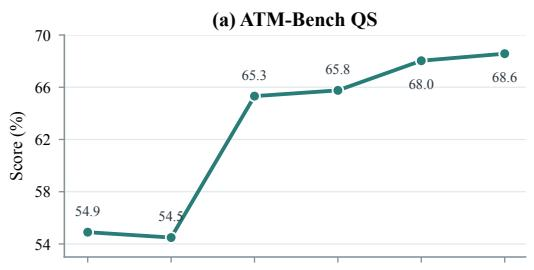

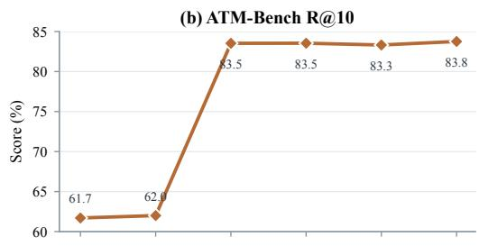

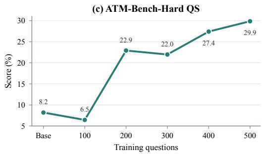

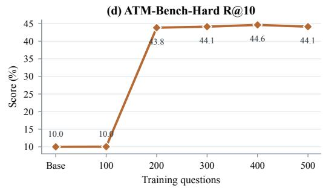  
Figure 4: Effect of the supervision budget on ATM-Bench and ATM-Bench-Hard (%). All runs start from the same Base-BM25 design, shown as Base at zero training questions. The horizontal axis indicates the number of training questions; the validation set scales proportionally to maintain an approximately 60:40 training-to-validation split.

Table 8: RHELM accuracy (%) by question type, with and without external data sources. FC, TP, AG, HL, and MI denote fact, temporal, aggregation, hallucination, and misleading questions, respectively; EX covers attachments and emails, and MX denotes mixed-context questions. Avg reports overall accuracy across evaluation questions. All memory-framework methods and our systems use GPT-4.1-mini for answer generation. ATM-Bench-evolved (frozen) transfers the ATM-Bench-optimized memory design without further optimization on RHELM; its + Official-QA and + MemSteer variants continue optimization on RHELM using the corresponding supervision. Base-BM25+Official-QA and Base-BM25+MemSteer instead initialize optimization from Base-BM25. Bold and underlined values indicate the best and second-best results per column, respectively. †Official-QA training and validation items are included in evaluation.
<table><tr><td rowspan="2">Model</td><td colspan="7">Without External Data Sources</td><td colspan="9">With External Data Sources</td></tr><tr><td>FC</td><td>TP</td><td>AG</td><td>HL</td><td>MI</td><td>EX</td><td>|MX</td><td>Avg</td><td>FC</td><td>TP</td><td>AG</td><td>HL</td><td>MI</td><td>EX</td><td>MX</td><td>Avg</td></tr><tr><td colspan="10">RAG Baselines</td><td></td><td></td><td></td><td></td><td></td><td></td><td></td><td></td></tr><tr><td>GPT-4.1-mini (k = 5)</td><td>35.8</td><td>17.3</td><td>17.7</td><td>15.2</td><td>3.1</td><td>8.0</td><td>10.0</td><td>16.3</td><td>34.8</td><td>14.1</td><td>19.3</td><td>11.7</td><td>3.1</td><td>16.9</td><td>12.4</td><td>17.5</td></tr><tr><td>GPT-4.1-mini (k = 20)</td><td>44.0</td><td>32.4</td><td>31.8</td><td>18.3</td><td>3.1</td><td>12.1</td><td>12.9</td><td>23.5</td><td>42.5</td><td>28.7</td><td>30.7</td><td>13.2</td><td>3.1</td><td>28.5</td><td>13.8</td><td>25.1</td></tr><tr><td>GPT-4.1-mini (k = 50)</td><td>59.9</td><td>41.6</td><td>40.1</td><td>15.7</td><td>1.5</td><td>12.9</td><td>16.7</td><td>28.9</td><td>54.6</td><td>39.5</td><td>38.0</td><td>11.2</td><td>1.5</td><td>38.6</td><td>22.4</td><td>32.6</td></tr><tr><td>Hybrid (k = 5)</td><td>34.3</td><td>20.5</td><td>14.1</td><td>19.8</td><td>1.5</td><td>8.0</td><td>10.5</td><td>16.7</td><td>31.9</td><td>19.5</td><td>14.1</td><td>19.3</td><td>1.5</td><td>16.1</td><td>10.5</td><td>17.6</td></tr><tr><td>Hybrid (k = 20)</td><td>47.3</td><td>35.7</td><td>31.8</td><td>19.3</td><td>3.1</td><td>10.4</td><td>15.2</td><td>24.8</td><td>45.9</td><td>30.8</td><td>26.6</td><td>16.8</td><td>4.6</td><td>26.9</td><td>15.7</td><td>26.0</td></tr><tr><td>Hybrid (k = 50)</td><td>56.5</td><td>41.1</td><td>35.9</td><td>15.2</td><td>3.1</td><td>13.7</td><td>16.7</td><td>27.8</td><td>53.1</td><td>37.8</td><td>33.9</td><td>8.6</td><td>3.1</td><td>33.3</td><td>18.6</td><td>29.6</td></tr><tr><td>GPT-4.1 (k = 20)</td><td>51.7</td><td>34.1</td><td>35.9</td><td>23.9</td><td>7.7</td><td>16.1</td><td>17.6</td><td>28.2</td><td>50.2</td><td>29.2</td><td>32.3</td><td>19.8</td><td>6.2</td><td>32.5</td><td>19.5</td><td>29.5</td></tr><tr><td>Gemini-2.5-Pro (k = 20)</td><td>45.4</td><td>35.1</td><td>27.1</td><td>66.0</td><td>23.1</td><td>12.4</td><td>18.1</td><td>32.6</td><td>43.0</td><td>31.9</td><td>26.0</td><td>64.5</td><td>26.2</td><td>31.3</td><td>20.5</td><td>35.5</td></tr><tr><td>Claude-Opus-4.5 (k = 20)</td><td>50.7</td><td>37.8</td><td>33.3</td><td>68.0</td><td>47.7</td><td>13.7</td><td>16.2</td><td>36.2</td><td>50.2</td><td>30.8</td><td>31.8</td><td>60.9</td><td>41.5</td><td>33.7</td><td>21.0</td><td>38.1</td></tr><tr><td colspan="10">Long-Context Models (1M)</td><td colspan="7"></td></tr><tr><td>Gemini-2.5-Flash-Lite</td><td>33.2</td><td>22.7</td><td>15.2</td><td>17.3</td><td>0.0</td><td>9.5</td><td>5.6</td><td>16.0</td><td>31.7</td><td>14.1</td><td>23.4</td><td>7.6</td><td>0.0</td><td>19.0</td><td>13.1</td><td>17.3</td></tr><tr><td>Qwen-2.5-14B-Instruct</td><td>29.5</td><td>15.1</td><td>29.7</td><td>3.1</td><td>0.0</td><td>11.7</td><td>9.1</td><td>15.3</td><td>16.9</td><td>7.0</td><td>15.6</td><td>1.0</td><td>0.0</td><td>5.2</td><td>6.2</td><td>8.1</td></tr><tr><td>GPT-4.1-mini</td><td>55.1</td><td>31.9</td><td>40.1</td><td>4.1</td><td>1.5</td><td>11.2</td><td>12.4</td><td>24.0</td><td>49.3</td><td>27.0</td><td>33.9</td><td>2.0</td><td>1.5</td><td>43.4</td><td>0.3</td><td>33.9</td></tr><tr><td colspan="10">Memory Frameworks (GPT-4.1-mini)</td><td colspan="7"></td></tr><tr><td>MemGPT</td><td>31.9</td><td>18.4</td><td>22.9</td><td>0.5</td><td>0.0</td><td>7.6</td><td>8.1</td><td>13.9</td><td>27.5</td><td>14.6</td><td>28.7</td><td>1.5</td><td>1.5</td><td>18.9</td><td>17.1</td><td>17.3</td></tr><tr><td>Mem0</td><td>41.6</td><td>31.4</td><td>28.1</td><td>10.7</td><td>3.1</td><td>10.8</td><td>13.3</td><td>21.1</td><td>46.4</td><td>29.2</td><td>27.1</td><td>10.2</td><td>3.1</td><td>31.3</td><td>35.7</td><td>28.9</td></tr><tr><td>MemU</td><td>49.3</td><td>32.4</td><td>33.9</td><td>8.6</td><td>4.6</td><td>12.0</td><td>11.4</td><td>23.1</td><td>54.6</td><td>36.2</td><td>35.4</td><td>10.2</td><td>3.1</td><td>36.5</td><td>36.7</td><td>33.6</td></tr><tr><td>Base-BM25</td><td>50.2</td><td>25.9</td><td>30.2</td><td>6.1</td><td>3.1</td><td>11.2</td><td>18.6</td><td>22.3</td><td>47.3</td><td>21.6</td><td>27.1</td><td>10.7</td><td>3.1</td><td>45.8</td><td>51.4</td><td>33.3</td></tr><tr><td>Base-BM25+Official-QA†</td><td>58.5</td><td>26.5</td><td>36.5</td><td>19.8</td><td>3.1</td><td>9.6</td><td>19.5</td><td>26.5</td><td>54.6</td><td>23.8</td><td>37.5</td><td>21.3</td><td>4.6</td><td>53.4</td><td>59.0</td><td>40.7</td></tr><tr><td>Base-BM25+MemSteer</td><td>53.6</td><td>27.0</td><td>39.1</td><td>16.8</td><td>4.6</td><td>12.4</td><td>19.5</td><td>26.4</td><td>48.8</td><td>28.1</td><td>37.0</td><td>23.4</td><td>6.2</td><td>52.2</td><td>55.7</td><td>39.9</td></tr><tr><td>ATM-Bench-evolved(frozen)</td><td>64.3</td><td>29.2</td><td>33.3</td><td>9.1</td><td>3.1</td><td>13.7</td><td>19.0</td><td>26.4</td><td>59.4</td><td>28.6</td><td>33.9</td><td>10.7</td><td>3.1</td><td>52.6</td><td>51.9</td><td>38.6</td></tr><tr><td>ATM-Bench-evolved + Official-QA†</td><td>60.4</td><td>47.6</td><td>39.1</td><td>24.9</td><td>3.1</td><td>12.0</td><td>20.0</td><td>31.5</td><td>56.0</td><td>43.2</td><td>39.1</td><td>16.2</td><td>4.6</td><td>58.6</td><td>51.4</td><td>42.9</td></tr><tr><td>ATM-Bench-evolved + MemSteer</td><td>58.5</td><td>46.5</td><td>39.1</td><td>21.8</td><td>3.1</td><td>12.0</td><td>20.0</td><td>30.6</td><td>55.6</td><td>43.2</td><td>35.9</td><td>18.8</td><td>3.1</td><td>59.0</td><td>51.4</td><td>42.8</td></tr></table>

Table 9: Per-persona accuracy on RHELM with external data sources (%). (a) Six-user optimization: roles indicate participation in training, validation, or neither (held-out). (b) Ten-user optimization: all personas participate as training and validation, with Official-QA or MemSteer supervision. N is the number of evaluation questions; parentheses show percentage-point changes from Base-BM25. Group summaries pool evaluation questions from the six source users (training and validation) or the four held-out users; Overall (pooled) pools all 1,305 questions. †Official-QA training and validation items are included in evaluation.  
(a) Six-user optimization setting
<table><tr><td>Persona</td><td>Role</td><td>N</td><td>Base-BM25</td><td>Shared design</td></tr><tr><td>Jonas Richter</td><td>Training</td><td>106</td><td>25.5</td><td>33.0 (+7.5)</td></tr><tr><td>David Reyes</td><td>Training</td><td>132</td><td>34.8</td><td>37.1 (+2.3)</td></tr><tr><td>Dr. Elias Romero</td><td>Training</td><td>122</td><td>31.1</td><td>31.1 (+0.0)</td></tr><tr><td>Justice Arvind P. Mehra</td><td>Training</td><td>123</td><td>33.3</td><td>34.1 (+0.8)</td></tr><tr><td>Elena Morales</td><td>Validation</td><td>87</td><td>35.6</td><td>39.1 (+3.5)</td></tr><tr><td>Dr. Elena Markovic</td><td>Validation</td><td>109</td><td>28.4</td><td>32.1 (+3.7)</td></tr><tr><td>Dr. Alastair McEwan</td><td>Held-out</td><td>96</td><td>30.2</td><td>34.4 (+4.2)</td></tr><tr><td>Dr. Marcus Ellison</td><td>Held-out</td><td>144</td><td>27.1</td><td>27.8 (+0.7)</td></tr><tr><td>Martin Keller</td><td>Held-out</td><td>228</td><td>41.2</td><td>37.7 (−3.5)</td></tr><tr><td>David R. Ellis</td><td>Held-out</td><td>158</td><td>37.3</td><td>38.6 (+1.3)</td></tr><tr><td>Source users (6)</td><td></td><td>679</td><td>31.5</td><td>34.3 (+2.8)</td></tr><tr><td>Held-out users (4)</td><td></td><td>626</td><td>35.3</td><td>35.1 (−0.2)</td></tr><tr><td>Overall (pooled)</td><td></td><td>1,305</td><td>33.3</td><td>34.7 (+1.4)</td></tr></table>

(b) Ten-user optimization setting
<table><tr><td>Persona</td><td>N</td><td>Base-BM25</td><td>Official-QA†</td><td>MemSteer</td></tr><tr><td>Jonas Richter</td><td>106</td><td>25.5</td><td>37.7 (+12.2)</td><td>40.6 (+15.1)</td></tr><tr><td>David Reyes</td><td>132</td><td>34.8</td><td>36.4 (+1.6)</td><td>37.9 (+3.1)</td></tr><tr><td>Dr. Elias Romero</td><td>122</td><td>31.1</td><td>41.0 (+9.9)</td><td>34.4 (+3.3)</td></tr><tr><td>Justice Arvind P. Mehra</td><td>123</td><td>33.3</td><td>39.8 (+6.5)</td><td>39.8 (+6.5)</td></tr><tr><td>Elena Morales</td><td>87</td><td>35.6</td><td>47.1 (+11.5)</td><td>42.5 (+6.9)</td></tr><tr><td>Dr. Elena Markovic</td><td>109</td><td>28.4</td><td>38.5 (+10.1)</td><td>37.6 (+9.2)</td></tr><tr><td>Dr. Alastair McEwan</td><td>96</td><td>30.2</td><td>39.6 (+9.4)</td><td>37.5 (+7.3)</td></tr><tr><td>Dr. Marcus Ellison</td><td>144</td><td>27.1</td><td>41.7 (+14.6)</td><td>38.2 (+11.1)</td></tr><tr><td>Martin Keller</td><td>228</td><td>41.2</td><td>42.5 (+1.3)</td><td>43.0 (+1.8)</td></tr><tr><td>David R. Ellis</td><td>158</td><td>37.3</td><td>41.8 (+4.5)</td><td>44.3 (+7.0)</td></tr><tr><td>Overall (pooled)</td><td>1,305</td><td>33.3</td><td>40.7 (+7.4)</td><td>39.9 (+6.6)</td></tr></table>

Performance remains close to Base-BM25 at the smallest question budget, with the largest gains occurring between the 100- and 200-question settings. Beyond this point, QS on ATM-Bench generally improves, while R@10 remains largely stable on both benchmarks. ATM-Bench-Hard shows small fluctuations in QS, with a test set of only 31 questions.

## B.3 FULL RHELM RESULTS

Table 8 reports RHELM results by question type, with and without external data sources. It also includes baselines using other answer models and long-context models for reference, rather than as controlled comparisons with the GPT-4.1-mini systems in Table 2.

## B.4 PER-PERSONA RESULTS

Table 9 reports per-persona results for shared memory designs under two optimization settings, complementing the shared and continued designs compared in Table 3. In the six-user setting, four personas provide training supervision and two provide validation supervision; the remaining four are held out from optimization. In the ten-user setting, all personas participate in optimization. Official-QA uses 40% of each persona’s official QA for training and 20% for validation, whereas MemSteer uses QA–evidence supervision generated from user histories and reserves official QA for evaluation.

Transfer of the six-user shared design. Table 9(a) shows that the shared design improves pooled accuracy on the six source users from 31.5% to 34.3%. However, this improvement does not carry over in aggregate to the four users held out from optimization. These results highlight heterogeneous transfer across users: a design optimized on the source users does not necessarily benefit other users. This makes the target-user continuation valuable, as studied in Table 3.

Generated versus official supervision in the ten-user setting. Table 9(b) shows that MemSteer improves over Base-BM25 for all ten personas, raising pooled accuracy from 33.3% to 39.9%. Its overall accuracy is 0.8 points below the 40.7% obtained with Official-QA supervision. Note that MemSteer reserves official QA for evaluation, whereas the Official-QA results include questions used for training or validation. Thus, history-generated supervision provides an effective alternative for optimizing a shared memory design without relying on official QA for training or design selection.

## B.5 EXAMPLE ACCEPTED ARCHITECTURE TRAJECTORY

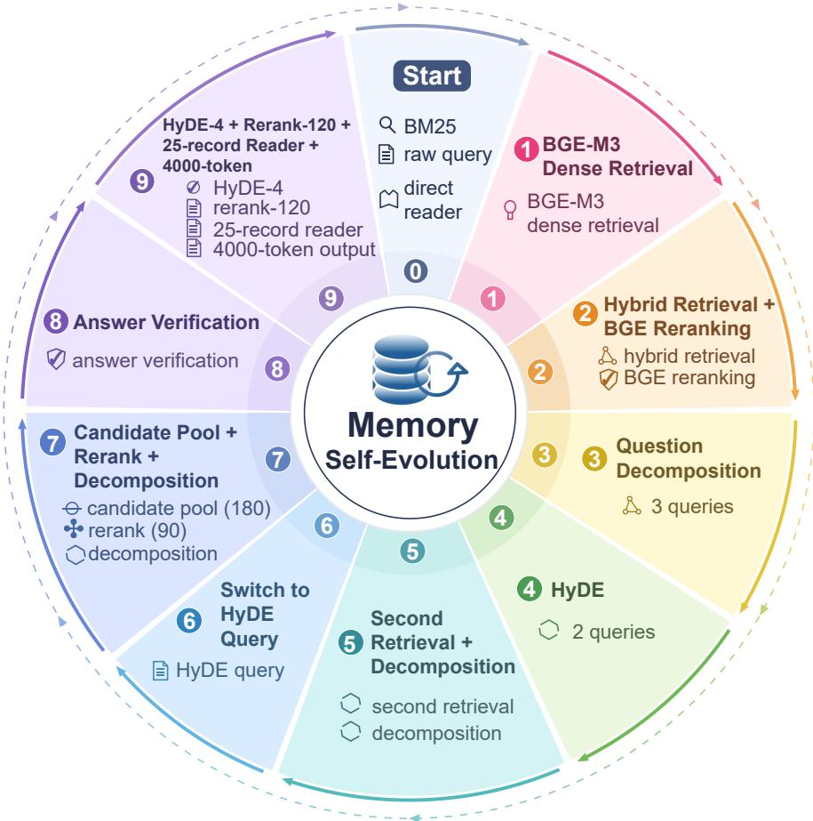  
Figure 5: Accepted memory-design optimization trajectory on ATM-Bench, starting from Base-BM25 and comprising nine accepted revisions. Numbered badges and colored arrows indicate the revision order.

Figure 5 traces one accepted memory-design optimization trajectory on ATM-Bench. Starting from Base-BM25 with raw queries and a direct reader, revisions add BGE-M3 (Chen et al., 2024) dense retrieval; hybrid retrieval with BGE reranking; question decomposition; HyDE (Gao et al., 2023) and a second retrieval stage; HyDE queries; a 180-candidate pool with 90 reranked items; and answer verification. The final design uses four HyDE queries, reranks 120 candidates, reads 25 records, and permits a 4,000-token output. The sequence moves from retrieval representation and ranking to multi-query context construction and answer validation.

## C LIMITATIONS

MemSteer’s supervision is generated and verified by LLMs without human certification, so errors or biases shared across answer planning, source-grounded auditing, and blind answer recovery can pass verification undetected. Blind answer recovery checks whether the reference answer is recoverable from the sampled records and every selected evidence record is cited; it does not establish that each record is necessary. Generated questions follow the distribution of the history rather than users actual information needs. MemSteer-Opt explores a constrained, largely retrieval-centric design space. Finally, our evaluation covers two benchmarks, one of which (RHELM) consists of synthetic personas, so evidence on real, heterogeneous user histories remains limited.