# Multistatic ISAC with Deep Learning-Based Clutter Suppression for 5G and Beyond

Yalin E. Sagduyu, Tugba Erpek, and Sastry Kompella

Nexcepta, Gaithersburg, MD, USA

Abstract—Integrated sensing and communications (ISAC) systems using 5G and beyond signals of opportunity enable joint wireless sensing and communication using shared infrastructure and spectrum resources. While multistatic ISAC can increase sensing coverage with spatially distributed receivers, dense and dynamic clutter can significantly degrade bistatic range and Doppler estimation, leading to errors in target localization and velocity estimation. This paper presents a multistatic ISAC framework with clutter suppression for high-fidelity estimation of target position and velocity. Distributed clutter is modeled with randomly located scatterers with varying Doppler spreads and radar cross sections to capture dense and dynamic clutter effects. A broad range of conventional signal processing baselines are evaluated for clutter suppression, showing limited robustness under strong clutter conditions. To address this limitation, deep learning-based clutter suppression methods are introduced to improve robustness against dense and dynamic clutter by employing residual and attention-enhanced deep neural network architectures that directly enhance target responses from cluttercontaminated observations. These methods substantially outperform conventional approaches in target position and velocity estimation across diverse clutter conditions in multistatic ISAC.

Index Terms—ISAC, multistatic, deep learning, 5G, 6G, localization, velocity estimation, clutter suppression.

## I. INTRODUCTION

Integrated sensing and communications (ISAC) is a key technology for next-generation wireless networks that repurposes communication signals for sensing using shared spectrum and infrastructure [1]. An important advantage of ISAC is the ability to exploit signals ofopportunity, such as commercial 5G NR signals, for target sensing and detection [2]–[4]. In particular, 5G NR positioning reference signals (PRS) provide structured pilot patterns that can be effectively repurposed for passive sensing without dedicated radar transmitters and support persistent low-cost sensing over large areas [5]. The ISAC capabilities are particularly important for mission-critical applications such as intelligence, surveillance, and reconnaissance (ISR), border monitoring, and counter-unmanned aerial systems (counter-UAS), which require robust sensing, localization, and tracking in complex environments.

Monostatic ISAC systems employ co-located transmitters and receivers, which simplifies synchronization and signal processing but limits sensing coverage and geometric diversity [6]–[10]. In contrast, multistatic ISAC systems use spatially distributed receivers observing reflections from a common transmitter, enabling improved spatial diversity, wider coverage, enhanced target observability, and more accurate localization [11], [12]. Despite these advantages, multistatic ISAC sensing remains challenging in dense clutter environments, where delayed and Doppler-shifted clutter reflections can overlap with target returns in bistatic range-Doppler space. Since clutter characteristics can vary across spatially distributed receivers, clutter can significantly degrade target localization and velocity estimation performance [13], [14].

In this paper, we study multistatic ISAC with 5G NR PRS in clutter environments for bistatic range-Doppler estimation, two-dimensional (2D) target localization, and velocity estimation using spatially distributed receivers. A multistatic sensing framework based on cross-ambiguity-function (CAF) processing and nonlinear multilateration is adopted. The clutter is introduced using distributed scatterers with randomized locations, radar cross sections (RCSs), and Doppler spreads to capture diverse clutter conditions including highly dynamic clutter with significant Doppler overlap with target returns. We show that conventional signal processing-based clutter suppression methods can only provide partial improvement and their effectiveness drops under dense or dynamic clutter conditions that degrade multistatic ISAC performance.

To improve robustness, we introduce deep learning (DL)- based clutter suppression methods to directly enhance target responses from clutter-contaminated observations. The first method employs a residual U-Net architecture for targetenhanced residual estimation, while the second method introduces directional convolutional processing and attention-gated feature fusion to further improve clutter suppression, target enhancement, and multistatic sensing performance. We show that the proposed residual and attention-aware DL methods substantially outperform conventional clutter suppression approaches across a wide range of clutter conditions, achieving significantly improved bistatic range-Doppler estimation, target localization, and velocity estimation performance.

The remainder of the paper is organized as follows. Sec. II presents signal and clutter models. Sec. III describes position and velocity estimation. Sec. IV discusses conventional clutter suppression. Sec. V presents DL-based clutter suppression. Section V evaluates performance. Sec. VII concludes the paper.

## II. MULTISTATIC ISAC SIGNAL AND CLUTTER MODEL

We consider an illuminator (base station) that transmits 5G NR PRS and M = 3 distributed receivers that cooperatively process the reflected signals for 2D sensing, as shown in

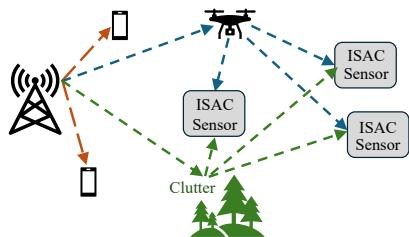  
Fig. 1: Multistatic ISAC in clutter environment.

Fig. 1. 5G numerology 0 is assumed as in [11] with subcarrier spacing $\Delta f = 1 5$ kHz, FFT size $N = 1 0 2 4$ , carrier frequency $f _ { c } = 2 . 5$ GHz, and sampling rate $f _ { s } = 1 5 . 3 6 ~ \mathrm { M H z }$ . The PRS spans $K _ { \mathrm { R B } } = 7 6$ resource blocks and follows the 3GPP TS 38.211 generation procedure using QPSK Gold sequences [15]. Resource allocation uses a comb structure with spacing $K _ { \mathrm { c o m b } } { = } 2$ and offset $k _ { \mathrm { o f f s e t } } = 0$ , excluding the DC subcarrier. Each NR slot contains 14 OFDM symbols, including $L _ { \mathrm { P R S } } { = } 2$ PRS symbols. Consecutive PRS transmissions across multiple slots produce K=128 coherent slow-time sensing observations.

For receiver $m \in \{ 1 , 2 , 3 \}$ , the bistatic propagation length is

$$
B _ { m } ( \mathbf { p } ) = \| \mathbf { p } - \mathbf { t } \| + \| \mathbf { p } - \mathbf { r } _ { m } \| ,\tag{1}
$$

where t is the transmitter location, ${ \bf r } _ { m }$ is the receiver m position, p and v are target position and velocity (all in $\mathbb { R } ^ { 2 } )$

The associated bistatic radial velocity at receiver m is

$$
v _ { m } ( \mathbf { p } , \mathbf { v } ) = \mathbf { v } ^ { \top } \left( { \frac { \mathbf { p } - \mathbf { t } } { \left\| \mathbf { p } - \mathbf { t } \right\| } } + { \frac { \mathbf { p } - \mathbf { r } _ { m } } { \left\| \mathbf { p } - \mathbf { r } _ { m } \right\| } } \right) ,\tag{2}
$$

where $( \cdot ) ^ { \top }$ denotes transpose. This represents the projection of the target velocity vector v onto the bistatic observation direction associated with receiver m. The resulting Doppler shift at receiver m is

$$
f _ { d , m } = \frac { f _ { c } } { c } v _ { m } ( \mathbf { p } , \mathbf { v } ) ,\tag{3}
$$

where c is the speed of light. The sensing region contains $N _ { c }$ randomly distributed clutter scatterers. The q-th clutter scatterer with RCS $\sigma _ { q } ^ { ( c ) }$ is located at $\mathbf { c } _ { q } \in \mathbb { R } ^ { 2 }$ . The clutter RCS values are modeled as independent log-uniform random variables whose scale is controlled by the clutter-strength parameter $\alpha _ { c } ,$ with larger $\alpha _ { c }$ corresponding to stronger clutter returns. Each scatterer contributes a receiver-dependent Doppler component

$$
f _ { m , q } ^ { ( c ) } \sim { \cal N } ( 0 , \sigma _ { f , c } ^ { 2 } ) ,\tag{4}
$$

where $f _ { m , q } ^ { ( c ) }$ is a zero-mean Gaussian random variable with variance $\sigma _ { f , c } ^ { 2 }$ and $\sigma _ { f , c }$ controls the clutter Doppler spread. Larger $\sigma _ { f , c }$ yields more dynamic clutter, while larger $N _ { c }$ yields denser clutter. The received signal at receiver m is the superposition of the target echo, clutter reflections, and noise:

$$
\begin{array} { l } { { \displaystyle y _ { m } [ n ] = \alpha _ { m } s [ n - \tau _ { m } ] e ^ { j 2 \pi f _ { d , m } n T _ { s } } } } \\ { { \displaystyle \quad \quad + \sum _ { q = 1 } ^ { N _ { c } } \beta _ { m , q } s [ n - \tau _ { m , q } ^ { ( c ) } ] e ^ { j 2 \pi f _ { m , q } ^ { ( c ) } n T _ { s } } + w _ { m } [ n ] , } } \end{array}\tag{5}
$$

where $s [ n ]$ denotes the transmitted PRS waveform, $T _ { s } = 1 / f _ { s }$ is the sampling interval, $\tau _ { m }$ and $\tau _ { m , q } ^ { ( c ) }$ denote the target and clutter propagation delays, respectively, $\alpha _ { m }$ and $\beta _ { m , q }$ are their reflection coefficients, and $w _ { m } [ n ] \sim \mathcal { C N } ( 0 , \sigma _ { n } ^ { 2 } )$ is additive white Gaussian noise. The reflection coefficients account for bistatic propagation loss, antenna gains, carrier wavelength, and target and clutter RCS. With a narrowband approximation, the echo amplitude for a scatterer at location x is modeled as

$$
\gamma ( \mathbf { x } ) = \frac { \sqrt { P _ { T } G _ { T } G _ { R } } \lambda \sqrt { \sigma } } { ( 4 \pi ) ^ { 3 / 2 } R _ { \mathrm { t x } } R _ { \mathrm { r x } } } ,\tag{6}
$$

where $P _ { T }$ is transmit power, $G _ { T }$ and $G _ { R }$ are transmit and receive antenna gains, $\lambda { = } c / f _ { c }$ is the carrier wavelength, $R _ { \mathrm { t x } }$ and $R _ { \mathrm { r x } }$ are the transmitter-to-scatterer and scatterer-to-receiver distances, and σ is the RCS. Before CAF processing, the direct path is estimated and removed from the received signal.

## III. TARGET LOCALIZATION AND VELOCITY ESTIMATION

Each sensing receiver correlates the received samples with the known PRS reference sequence. Let $0 \leq k \leq K - 1$ denote the slow-time PRS observation index, t denote the midpoint time of the k-th PRS symbol, and $s _ { k } [ n ] , 0 \leq n \leq N - 1$ , denote the associated cyclic-prefix (CP)-free PRS reference symbol. For delay bin $0 \leq d \leq D - 1$ , the correlation output is

$$
C _ { m } ( k , d ) = \sum _ { n = 0 } ^ { N - 1 } y _ { m } [ n _ { k } ^ { \mathrm { c p } } + d + n ] s _ { k } ^ { * } [ n ]\tag{7}
$$

at receiver m, where $n _ { k } ^ { \mathrm { c p } }$ is the starting sample index of the CP-free PRS region for observation k and $( \cdot ) ^ { * }$ is the complex conjugate. The resulting matrix $\mathbf { C } _ { m } \in \mathbb { C } ^ { K \times D }$ represents the slow-time delay-response for clutter mitigation and Doppler analysis. Following clutter suppression (see Secs. IV-V), coherent integration is applied over the slow-time dimension using a Doppler grid with $N _ { f } = 4 0 1$ frequency bins over [−400, 400] Hz. Using a Hann window $W [ k ]$ , the CAF is

$$
\mathrm { C A F } _ { m } ( d , f ) = \sum _ { k = 0 } ^ { K - 1 } W [ k ] C _ { m } ( k , d ) e ^ { - j 2 \pi f t _ { k } }\tag{8}
$$

for receiver m at Doppler frequency f. The magnitude response $| \mathrm { C A F } _ { m } ( d , f ) |$ produces the bistatic range-Doppler map. Target detection uses two-dimensional cell-averaging constant false alarm rate (CA-CFAR) on the CAF magnitude response. Threepoint parabolic interpolation around the detected cell is applied in delay and Doppler dimensions to refine bistatic range and radial velocity estimates $\hat { B } _ { m }$ and $\hat { v } _ { m }$ . Target localization jointly fits the bistatic range measurements from all receivers. Each bistatic measurement defines an ellipse with foci located at the transmitter and the corresponding receiver position. When

$$
\epsilon _ { m } ( { \bf p } ) = \| { \bf p } - \bf t \| + \| { \bf p } - { \bf r } _ { \mathit { m } } \| - \hat { B } _ { m }\tag{9}
$$

is the bistatic residual associated with receiver $m ,$ the estimated target position is determined from solving

$$
\hat { \mathbf { p } } = \arg \operatorname* { m i n } _ { \mathbf { p } } \sum _ { m = 1 } ^ { M } \left( \epsilon _ { m } ( \mathbf { p } ) \right) ^ { 2 } .\tag{10}
$$

Because the bistatic constraints are nonlinear, a trust-region reflective least-squares solver with multiple randomized initialization points is employed. The solution yielding the minimum aggregate residual error is selected as the final estimate.

After estimating target position, the bistatic radial velocity relations become linear in the Cartesian velocity vector. Define

$$
\mathbf { u } _ { m } = \frac { \hat { \mathbf { p } } - \mathbf { t } } { \Vert \hat { \mathbf { p } } - \mathbf { t } \Vert } + \frac { \hat { \mathbf { p } } - \mathbf { r } _ { m } } { \Vert \hat { \mathbf { p } } - \mathbf { r } _ { m } \Vert } ,\tag{11}
$$

as the bistatic observation direction for receiver m. Stacking these vectors forms the observation matrix $\mathbf { U } \in \mathbb { R } ^ { M \times 2 }$ , while the estimated radial velocities are collected into

$$
\begin{array} { r } { \hat { \mathbf { v } } _ { \mathrm { r } } = [ \hat { v } _ { 1 } , \dots , \hat { v } _ { M } ] ^ { \top } . } \end{array}\tag{12}
$$

The Cartesian velocity is estimated using ridge-regularized least squares (with a small regularization parameter ε>0)

$$
\hat { \mathbf { v } } = \left( \mathbf { U } ^ { \top } \mathbf { U } + \varepsilon \mathbf { I } \right) ^ { - 1 } \mathbf { U } ^ { \top } \hat { \mathbf { v } } _ { \mathrm { r } } ,\tag{13}
$$

where I is the identity matrix. The target speed is given by ∥vˆ∥ and the heading angle is computed using atan $2 ( \hat { v } _ { y } , \hat { v } _ { x } )$

## IV. BASELINES FOR CLUTTER SUPPRESSION

We next compare a broad set of conventional clutter suppression methods operating on the slow-time delay correlation matrix $\mathbf { C } _ { m }$ . They suppress clutter using techniques like temporal differencing, subspace projection, Doppler-domain filtering, adaptive prediction, and smooth-component estimation. After clutter suppression, the resulting correlation matrices are used for CAF computation and bistatic range-Doppler estimation.

1) No Clutter Suppression (NCS): NCS skips clutter mitigation and computes the CAF from the correlation matrix $\mathbf { C } _ { m } .$

2) Current-Reference Subtraction (CUR) : CUR serves as a coherent reference-based clutter suppression benchmark. Let $\mathbf { C } _ { m } ^ { \mathrm { c u r } }$ denote the current clutter-contaminated correlation matrix and $\mathbf { C } _ { m } ^ { \mathrm { r e f } }$ denote the clutter-only reference correlation matrix for receiver m. A global clutter phase offset $\phi _ { m }$ is estimated from dominant clutter components in the reference and current observations. The current observation is phase-aligned prior to subtraction, yielding the clutter-suppressed correlation matrix

$$
\mathbf { C } _ { m } ^ { \mathrm { C U R } } = e ^ { - j \phi _ { m } } \mathbf { C } _ { m } ^ { \mathrm { c u r } } - \mathbf { C } _ { m } ^ { \mathrm { r e f } } .\tag{14}
$$

The clutter-suppressed matrix $\mathbf { C } _ { m } ^ { \mathrm { { C U R } } }$ is used for CAF computation according to (8) to estimate bistatic range and Doppler.

3) Space-Projection Adaptive Difference (SP-AD): SP-AD suppresses slowly varying clutter by differencing adjacent slow-time snapshots prior to CAF processing.

4) Rank-One Slow-Time Projection (SP-R1): SP-R1 models clutter as a dominant rank-one slow-time component and removes the strongest singular mode before Doppler processing.

5) DPSS Band-Stop Filtering (DPSS): Discrete prolate spheroidal sequences (DPSS) model clutter as a low-Doppler process and aim to suppress clutter by projecting the signal onto the orthogonal complement of a DPSS clutter subspace.

6) Clutter Map Temporal Doppler Filtering (CMTD): CMTD suppresses near-zero-Doppler clutter using FFT-based slow-time notch filtering centered near zero frequency.

7) Total Variation High-Pass Filtering (TVHP): TVHP models clutter as a temporally smooth component and removes smooth clutter responses using total-variation regularization.

8) Rolling-Median High-Pass Filtering (RMHP): RMHP suppresses clutter using a sliding-window median filter along the slow-time dimension to remove slowly varying clutter responses while preserving localized target peaks.

9) Wavelet High-Pass Filtering (WHP): WHP applies Haar wavelet decomposition along slow time and reconstructs the signal using high-frequency detail components.

10) Adaptive Least Mean Squares (LMS) Residual Filtering (ALMS): ALMS applies adaptive LMS prediction along slow time and uses the prediction residual for clutter suppression.

11) Polynomial High-Pass Filtering (POLYHP): POLYHP models clutter as a slowly varying low-order polynomial along slow time and removes the estimated polynomial component.

## V. DEEP LEARNING-BASED CLUTTER SUPPRESSION

In addition to signal processing-based clutter suppression methods, we introduce two supervised DL methods that operate directly on the slow-time delay correlation matrix $\mathbf { C } \in \bar { \mathbb { C } } ^ { K \times D }$ obtained from matched filtering. The objective is to learn a nonlinear mapping that suppresses clutter while preserving target responses required for accurate bistatic range-Doppler estimation. Training data are generated from the multistatic ISAC signal and clutter model described previously. Each training realization contains random receiver geometries, target positions, target velocities, clutter densities, clutter RCSs, clutter Doppler spreads, and noise realizations. The training input is the clutter-contaminated matched-filter matrix

$$
\begin{array} { r } { { \bf C } _ { \mathrm { r a w } } = { \bf C } _ { \mathrm { t a r g e t } } + { \bf C } _ { \mathrm { c l u t t e r } } + { \bf N } , } \end{array}\tag{15}
$$

where $\mathbf { C } _ { \mathrm { t a r g e t } }$ and $\mathbf { C } _ { \mathrm { c l u t t e r } }$ denote the target-only and clutteronly correlation matrices, respectively, and N denotes the additive noise. The desired output is $\mathbf { C } _ { \mathrm { t a r g e t } }$

Next, we present two DL-based clutter suppression (DLCS) methods that estimate $\mathbf { C } _ { \mathrm { t a r g e t } }$ from $\mathbf { C } _ { \mathrm { r a w } } .$ . The estimated targetonly correlation matrix is subsequently used in (8) in place of $\mathbf { C } _ { m }$ for range-Doppler estimation.

## A. Residual U-Net-based DLCS

The first DL method, DLCS-1, employs a supervised residual U-Net architecture that directly estimates the target-only matched-filter response from clutter-corrupted observations.

1) Input Representation: The input is given by

$$
\mathbf { X } = [ \mathbf { C } _ { \mathrm { r a w } } ^ { ( \mathrm { I } ) } , \mathbf { C } _ { \mathrm { r a w } } ^ { ( \mathrm { Q } ) } ] ,\tag{16}
$$

where $\mathbf { C } _ { \mathrm { r a w } } ^ { ( \mathrm { I } ) }$ and $\mathbf { C } _ { \mathrm { r a w } } ^ { \mathrm { ( Q ) } }$ are the in-phase and quadrature components of the complex-valued correlation matrix, respectively, and are normalized using the root-mean-square (RMS) magnitude of the input tensor before being passed to the network.

2) Network Architecture: The network follows an encoderdecoder U-Net structure with skip connections. The encoder consists of repeated convolutional blocks that progressively extract hierarchical clutter and target features while reducing spatial resolution through max-pooling operations. Each convolutional block contains $3 \times 3$ convolutional layers, batch normalization, and rectified linear unit (ReLU) activations.

The feature tensor $\mathbf { F } ^ { ( \ell ) }$ at layer ℓ is encoded as

$$
\mathbf { F } ^ { ( \ell + 1 ) } = \operatorname { R e L U } \left( \operatorname { B N } \left( \operatorname { C o n v } ( \mathbf { F } ^ { ( \ell ) } ) \right) \right) ,\tag{17}
$$

where Conv(·) denotes convolution and BN(·) denotes batch normalization. The decoder progressively reconstructs a targetenhanced residual map using bilinear upsampling and skipconnected encoder features. Skip connections preserve fine spatial structures corresponding to localized target peaks in the range-Doppler domain. The final output layer is a $1 \times 1$ convolution that produces a two-channel estimate

$$
\begin{array} { r } { \hat { \mathbf { Y } } = [ \hat { \mathbf { C } } _ { \mathrm { t a r g e t } } ^ { ( \mathrm { I } ) } , \hat { \mathbf { C } } _ { \mathrm { t a r g e t } } ^ { ( \mathrm { Q } ) } ] , } \end{array}\tag{18}
$$

where $\hat { \mathbf { C } } _ { \mathrm { t a r g e t } } ^ { ( \mathrm { I } ) }$ and $\hat { \mathbf { C } } _ { \mathrm { t a r g e t } } ^ { ( \mathrm { Q } ) }$ denote the predicted in-phase and quadrature components of the target-only correlation matrix.

3) Training Objective: The network is trained using a residual reconstruction loss composed of mean-squared error and sparsity regularization:

$$
\mathcal { L } _ { \mathrm { { D L C S } } } = \left. \hat { \mathbf { C } } _ { \mathrm { t a r g e t } } - \mathbf { C } _ { \mathrm { t a r g e t } } \right. _ { 2 } ^ { 2 } + \lambda _ { 1 } \left. \hat { \mathbf { C } } _ { \mathrm { t a r g e t } } \right. _ { 1 } ,\tag{19}
$$

where $\lambda _ { 1 } > 0$ controls sparsity regularization. The $\ell _ { 2 }$ term encourages accurate target reconstruction. The $\ell _ { 1 }$ term promotes sparse target responses and suppresses residual clutter artifacts.

4) Optimization: The network parameters are optimized using the AdamW optimizer with a learning rate $\eta _ { \mathrm { D L C S } } = 1 0 ^ { - 3 }$ and a weight-decay regularization coefficient $\lambda _ { \mathrm { w d } } ~ = ~ 1 0 ^ { - 5 }$ Mini-batch training is used with random clutter and target realizations. Gradient clipping is applied to stabilize optimization:

$$
\begin{array} { r } { \| \nabla _ { \theta } \mathcal { L } \| _ { 2 } \leq \gamma _ { \mathrm { m a x } } , } \end{array}\tag{20}
$$

where θ denotes the trainable network parameters and the clipping threshold $\gamma _ { \mathrm { m a x } }$ is 5. After training, the output $\hat { \mathbf { C } } _ { \mathrm { t a r g e t } }$ is processed in the CAF and range-Doppler estimation stages.

## B. Attention-Gated Anisotropic DLCS

The second DL method, DLCS-2, extends the residual U-Net architecture through anisotropic convolutional processing and attention-gated skip connections designed specifically for clutter-dominated range-Doppler maps.

1) Multi-Channel Input Representation: Instead of using only real and imaginary channels, the network exploits four complementary input representations:

$$
\mathbf { X } = [ \mathbf { C } _ { \mathrm { r a w } } ^ { \mathrm { ( I ) } } , \mathbf { C } _ { \mathrm { r a w } } ^ { \mathrm { ( Q ) } } , | \mathbf { C } _ { \mathrm { r a w } } | , \log ( 1 + | \mathbf { C } _ { \mathrm { r a w } } | ) ] .\tag{21}
$$

The magnitude channel explicitly captures target energy distributions, while the logarithmic channel compresses dynamic range and improves representation of weak target responses in strong clutter environments.

2) Anisotropic Convolutional Encoder: The encoder uses anisotropic convolutional blocks that separately model slowtime and delay-domain structures. Each anisotropic block contains standard $3 \times 3$ convolutions, elongated $( 5 \times 1 )$ convolutions, elongated $( 1 \times 5 )$ convolutions, batch normalization, and ReLU nonlinearities. The $( 5 \times 1 )$ kernels learn slowtime Doppler structures and clutter trajectories, whereas the $( 1 \times 5 )$ kernels learn range-domain correlations and delayspread clutter structures. Let F denote an intermediate feature map. An anisotropic block computes $\mathbf { F } _ { \mathrm { s t } } = \mathrm { C o n v } _ { 5 \times 1 } ( \mathbf { F } )$ and $\mathbf { F } _ { \mathrm { r g } } { \mathbf { \Omega } } = { \mathrm { C o n v } } _ { 1 \times 5 } ( \mathbf { F } )$ , followed by nonlinear feature fusion. This directional processing better distinguishes between target signatures and clutter structures that exhibit different geometric behavior across delay and slow-time dimensions.

3) Attention-Gated Skip Connections: The decoder incorporates attention-gated skip connections to suppress clutterdominated encoder activations before feature fusion. Let S denote the encoder skip feature map and G denote the decoder gating feature map. The attention mask is computed as $\mathbf { A } =$ $\sigma \left( \psi \left( \phi ( \mathbf { S } ) + \theta ( \mathbf { G } ) \right) \right)$ , where $\phi ( \cdot ) , \theta ( \cdot )$ , and $\psi ( \cdot )$ are learned convolutional transformations and $\sigma ( \cdot )$ is the sigmoid activation function. The refined skip feature becomes $\mathbf { S } _ { \mathrm { a t t } } = \mathbf { A } \odot \mathbf { S }$ where $\odot$ denotes elementwise multiplication. This mechanism suppresses clutter-dominated feature activations while preserving target-dominant spatial structures by emphasizing features consistent with the decoder’s target-relevant context.

4) Decoder Structure: The decoder reconstructs the targetenhanced residual map through bilinear upsampling and feature concatenation with the attention-refined skip features. Each decoder stage employs anisotropic convolutional blocks similar to those used in the encoder. Anisotropic convolutions employ direction-dependent convolution kernels with unequal spatial support across dimensions. Kernels of size $5 \times 1$ and $1 \times 5$ are used to separately model slow-time Doppler structures and delay-domain correlations, respectively. The final output layer generates a two-channel estimate of the target residual:

$$
\begin{array} { r } { \hat { \mathbf { Y } } = [ \hat { \mathbf { C } } _ { \mathrm { t a r g e t } } ^ { ( \mathrm { I } ) } , \hat { \mathbf { C } } _ { \mathrm { t a r g e t } } ^ { ( \mathrm { Q } ) } ] . } \end{array}\tag{22}
$$

5) Loss Function: The network is trained using a combination of reconstruction and sparsity losses:

$$
\begin{array} { r } { \mathcal { L } _ { \mathrm { A t t n } } = \left. \hat { \mathbf { C } } _ { \mathrm { t a r g e t } } - \mathbf { C } _ { \mathrm { t a r g e t } } \right. _ { 2 } ^ { 2 } + \lambda _ { s } \left. \hat { \mathbf { C } } _ { \mathrm { t a r g e t } } \right. _ { 1 } } \\ { + \lambda _ { \mathrm { T V } } \mathrm { T V } ( \hat { \mathbf { C } } _ { \mathrm { t a r g e t } } ) , \quad \quad } \end{array}\tag{23}
$$

where $\lambda _ { s }$ controls sparsity regularization and $\lambda _ { \mathrm { T V } }$ controls total-variation regularization. The total-variation term promotes spatial smoothness while preserving localized target peaks.

6) Optimization and Training: Training is performed using the AdamW optimizer with mini-batch gradient descent. Gradient clipping and weight decay are applied to improve optimization stability and generalization performance. After training, the network output is directly processed using CAFbased range-Doppler estimation and bistatic localization.

## VI. PERFORMANCE EVALUATION

For the numerical results, we assume a transmit power of 40 dBm, transmit and receive antenna gains of 10 dBi, a target RCS of $4 ~ \mathrm { m ^ { 2 } }$ , and a noise variance of $1 0 ^ { - 3 }$ . All DL models were trained using NVIDIA RTX PRO 6000 Blackwell GPUs.

TABLE I: Per-receiver bistatic range and radial-velocity estimation results.
<table><tr><td>Method</td><td>RX</td><td> $\overline { { B _ { \mathrm { t r u e } } } }$ </td><td> $\overline { { B _ { \mathrm { e s t } } } }$ </td><td> $\underline { { \boldsymbol { B } _ { \mathrm { e r r } } } }$ </td><td>vtrue</td><td>vest</td><td> $\underline { { { v } _ { \mathrm { e r r } } } }$ </td></tr><tr><td>NCS</td><td>1</td><td>331.16</td><td>293.11</td><td>-38.05</td><td>-25.61</td><td>-2.17</td><td>23.44</td></tr><tr><td>NCS</td><td>2</td><td>422.90</td><td>292.80</td><td>-130.09</td><td>-13.86</td><td>5.82</td><td>19.69</td></tr><tr><td>NCS</td><td>3</td><td>533.39</td><td>312.32</td><td>-221.07</td><td>-49.05</td><td>6.85</td><td>55.91</td></tr><tr><td>RMHP</td><td>1</td><td>331.16</td><td>331.75</td><td>0.58</td><td>-25.61</td><td>-25.61</td><td>-0.00</td></tr><tr><td>RMHP</td><td>2</td><td>422.90</td><td>429.64</td><td>6.74</td><td>-13.86</td><td>-13.88</td><td>-0.01</td></tr><tr><td>RMHP</td><td>3</td><td>533.39</td><td>312.53</td><td>-220.85</td><td>-49.05</td><td>7.04</td><td>56.10</td></tr><tr><td>DLCS-1</td><td>1</td><td>331.16</td><td>331.85</td><td>0.68</td><td>-25.61</td><td>-25.61</td><td>-0.00</td></tr><tr><td>DLCS-1</td><td>2</td><td>422.90</td><td>429.51</td><td>6.61</td><td>-13.86</td><td>-13.86</td><td>0.00</td></tr><tr><td>DLCS-1</td><td>3</td><td>533.39</td><td>527.51</td><td>-5.88</td><td>-49.05</td><td>-46.70</td><td>2.36</td></tr></table>

TABLE II: Localization and velocity estimation errors.
<table><tr><td>Method</td><td>RMS B Error (m)</td><td>Position Error (m)</td><td>Speed Error (m/s)</td><td>Angle Error (deg)</td></tr><tr><td>NCS</td><td>149.715</td><td>114.985</td><td>22.184</td><td>114.065</td></tr><tr><td>RMHP</td><td>127.570</td><td>158.673</td><td>9.509</td><td>156.948</td></tr><tr><td>DLCS-1</td><td>5.122</td><td>4.462</td><td>0.445</td><td>0.045</td></tr></table>

The DLCS-1 and DLCS-2 architectures contain 1,885,186 and 12,398,789 trainable parameters, respectively. Let $N _ { \mathrm { t r a i n } }$ and $N _ { \mathrm { t e s t } }$ denote the numbers of training and test samples, respectively, and let $N _ { \mathrm { e p o c h } }$ denote the number of training epochs. For each sample, the transmitter and receiver geometry, target position and velocity, clutter scatterer locations, and additive noise realizations are randomly generated. Clutter effects are controlled by the values of $N _ { c } , \ \alpha _ { c } ,$ and $\sigma _ { f , c } .$ . The training and test data are generated independently, with clutter density, strength, and Doppler spread randomized during training.

We first consider a moderate training setting of $N _ { \mathrm { t r a i n } } { = } 5 0 0$ and $N _ { \mathrm { e p o c h } } = 2 0 0$ under a strong clutter environment with $N _ { c } { = } 4 0 , \alpha _ { c } { = } 1$ , and $\sigma _ { f , c } = 3 0$ Hz. For a randomly selected test sample $( N _ { \mathrm { t e s t } } { = } 1 )$ , Tables I and II compare DLCS-1 with NCS and RMHP. NCS produces severe bistatic-range and radialvelocity estimation errors, leading to large localization and velocity estimation errors, as shown in Figs. 2 and 3. RMHP, the strongest conventional baseline, improves the estimates by suppressing slowly varying clutter, but fails to accurately recover the target response for the other receivers, causing large localization and velocity-estimation errors. DLCS-1 accurately estimates bistatic range and radial velocity for all receivers, achieving a position error of 4.462 m and speed and angle estimation errors of only 0.445 m/s and $0 . 0 4 5 ^ { \circ }$ , respectively.

The range-Doppler maps in Fig. 4 further illustrate these performance differences. For NCS and RMHP, clutter obscures the target response, causing large estimation errors. In contrast, DLCS-1 produces cleaner range-Doppler maps with localized target peaks closely aligned with the true target locations. As a result, DLCS-1 achieves highly accurate velocity estimation (Fig. 2) and target localization (Fig. 3).

Next, we increase the number of test samples to $N _ { \mathrm { t e s t } } =$ 2000 and statistically compare DLCS-1 with conventional clutter-suppression baselines under different clutter settings specified by $N _ { c } , \alpha _ { c } ,$ , and $\sigma _ { f , c } .$ . For each clutter case, the success rate is defined as the percentage of trials with position error below $T = 1 0$ m, and $\eta _ { \mathrm { s u c c } }$ is computed as the normalized success rate relative to the reference method CUR of Sec. IV-2.

As shown in Table III, DLCS-1 consistently achieves a higher normalized success rate $\eta _ { \mathrm { s u c c } }$ than all non-reference clutter-suppression methods across all clutter environments. Conventional methods degrade significantly under dense and dynamic clutter. RMHP is the strongest conventional baseline, yet remains substantially outperformed by DLCS-1.

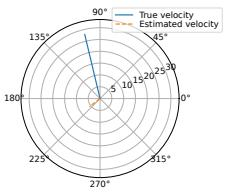  
(a) NCS

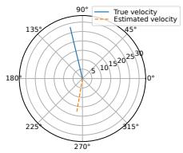  
(b) RMHP

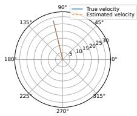  
(c) DLCS-1

Fig. 2: Velocity estimation results.  
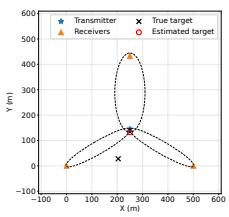  
(a) NCS

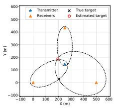  
(b) RMHP

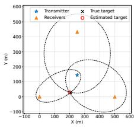  
(c) DLCS-1  
Fig. 3: Target localization results.

Table IV compares $\eta _ { \mathrm { s u c c } }$ of DLCS-1 and DLCS-2 for different clutter and training configurations. As $N _ { \mathrm { t r a i n } }$ and $N _ { \mathrm { e p o c h } }$ increase to 5000 and 500, respectively, DLCS-2 approaches the performance of the reference method while consistently outperforming DLCS-1 across all clutter settings.

Fig. 5 shows $\eta _ { \mathrm { s u c c } }$ as a function of position error threshold T. Across all $T$ and clutter settings, the DLCS methods, trained with $N _ { \mathrm { t r a i n } } = 5 0 0 0$ and $N _ { \mathrm { e p o c h } } = 5 0 0$ , consistently outperform NCS and RMHP. DLCS-2 achieves the best performance, followed closely by DLCS-1, demonstrating the effectiveness of DL-based clutter suppression in multistatic ISAC.

## VII. CONCLUSION

In this paper, we studied clutter suppression in multistatic ISAC using 5G NR PRS for bistatic range-Doppler estimation, target localization, and velocity estimation in dense and dynamic clutter environments. We showed that clutter can severely degrade sensing accuracy of multistatic ISAC and that conventional signal processing methods for clutter suppression provide only limited gains under challenging clutter conditions. To improve robustness of multistatic ISAC against clutter, we introduced DL-based clutter suppression methods to directly enhance target responses from clutter-corrupted observations. These methods substantially improve clutter suppression and reduce sensing errors relative to conventional approaches across diverse clutter conditions in multistatic ISAC.

## REFERENCES

[1] N. Gonzalez-Prelcic, M. F. Keskin, O. Kaltiokallio, M. Valkama ´ et al., “The integrated sensing and communication revolution for 6G: Vision, techniques, and applications,” Proceedings of the IEEE, 2024.

[2] N. K. Nataraja, S. Sharma, K. Ali, F. Bai et al., “Integrated sensing and communication (ISAC) for vehicles: Bistatic radar with 5G-NR signals,” IEEE Transactions on Vehicular Technology, 2024.

TABLE III: Normalized success rate $\eta _ { \mathrm { s u c c } }$ for different clutter-suppression methods.
<table><tr><td> $\overline { { N _ { c } } }$ </td><td> $\alpha _ { c }$ </td><td> $\sigma _ { f , c }$ </td><td>NCS</td><td>SP-AD</td><td>SP-R1</td><td>DPSS</td><td>CMTD</td><td>TVHP</td><td>RMHP</td><td>WHP</td><td>ALMS</td><td>POLYHP</td><td>DLCS-1</td></tr><tr><td>40</td><td></td><td>30 Hz</td><td>1.72%</td><td>24.30%</td><td>1.72%</td><td>2.62%</td><td>1.72%</td><td>18.41%</td><td>25.70%</td><td>10.56%</td><td>10.23%</td><td>2.62%</td><td>62.77%</td></tr><tr><td>40</td><td>21</td><td>30 Hz</td><td>2.86%</td><td>35.27%</td><td>3.03%</td><td>5.16%</td><td>3.52%</td><td>29.46%</td><td>35.11%</td><td>18.74%</td><td>17.92%</td><td>5.65%</td><td>74.39%</td></tr><tr><td>20</td><td>2</td><td>30 Hz</td><td>2.85%</td><td>36.92%</td><td>3.83%</td><td>5.62%</td><td>3.26%</td><td>28.61%</td><td>40.18%</td><td>22.00%</td><td>19.89%</td><td>5.62%</td><td>72.21%</td></tr><tr><td>20</td><td>1</td><td>30 Hz</td><td>5.46%</td><td>46.70%</td><td>6.68%</td><td>10.35%</td><td>6.03%</td><td>38.30%</td><td>48.17%</td><td>32.19%</td><td>29.99%</td><td>10.51%</td><td>80.93%</td></tr><tr><td>40</td><td>1</td><td>10 Hz</td><td>2.29%</td><td>65.90%</td><td>5.40%</td><td>29.84%</td><td>4.09%</td><td>59.93%</td><td>85.61%</td><td>54.62%</td><td>46.85%</td><td>2.62%</td><td>90.27%</td></tr><tr><td>20</td><td>1</td><td>10 Hz</td><td>4.97%</td><td>73.94%</td><td>11.64%</td><td>46.42%</td><td>9.77%</td><td>65.55%</td><td>89.98%</td><td>68.08%</td><td>62.87%</td><td>43.08%</td><td>94.22%</td></tr></table>

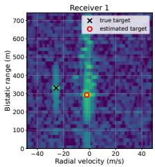

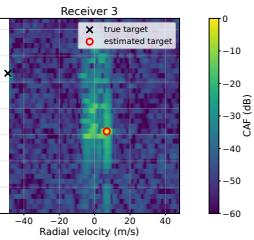

(a) NCS  
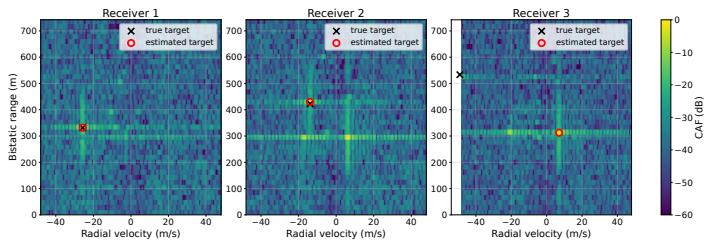

(b) RMHP  
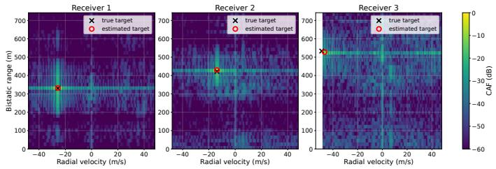  
(c) DLCS-1  
Fig. 4: Bistatic range-Doppler maps.

TABLE IV: Normalized success rate comparison of DLCS-1 and DLCS-2.
<table><tr><td> $\overline { { N _ { c } } }$ </td><td> $\alpha _ { c }$ </td><td> $\underline { { \sigma _ { f , c } } }$ </td><td> $\overline { { N _ { \mathrm { t r a i n } } } }$ </td><td> $\overline { { N _ { \mathrm { e p o c h } } } }$ </td><td>DLCS-1</td><td>DLCS-2</td></tr><tr><td rowspan="2">40</td><td rowspan="2">2</td><td rowspan="2">30 Hz</td><td>500</td><td>200</td><td>62.77%</td><td>66.61%</td></tr><tr><td>5000</td><td>500</td><td>71.19%</td><td>72.42%</td></tr><tr><td rowspan="2">40</td><td rowspan="2">1</td><td rowspan="2">30 Hz</td><td>500</td><td>200</td><td>74.39%</td><td>78.48%</td></tr><tr><td>5000</td><td>500</td><td>80.44%</td><td>84.29%</td></tr><tr><td rowspan="2">20</td><td rowspan="2">2</td><td rowspan="2">30 Hz</td><td>500</td><td>200</td><td>72.21%</td><td>74.16%</td></tr><tr><td>5000</td><td>500</td><td>76.69%</td><td>78.24%</td></tr><tr><td rowspan="2">20</td><td rowspan="2">1</td><td rowspan="2">30 Hz</td><td>500</td><td>200</td><td></td><td></td></tr><tr><td>5000</td><td></td><td>80.93%</td><td>88.18%</td></tr><tr><td rowspan="2">40</td><td rowspan="2">1</td><td rowspan="2">10 Hz</td><td></td><td>500</td><td>87.61%</td><td>92.42%</td></tr><tr><td>500</td><td>200</td><td>90.27%</td><td>90.52%</td></tr><tr><td rowspan="2">20</td><td rowspan="2">1</td><td rowspan="2">10 Hz</td><td>5000</td><td>500</td><td>95.59%</td><td>95.67%</td></tr><tr><td>500 5000</td><td>200 500</td><td>94.22% 98.70%</td><td>98.05% 99.41%</td></tr></table>

[3] M. Wypich, R. Maksymiuk, and T. P. Zielinski, “5G-based passive radar utilizing channel response estimated via reference signals,” IEEE Transactions on Radar Systems, 2025.

[4] S. Blandino, N. Golmie, A. Sahoo, T. Nguyen et al., “Detecting airborne objects with 5G NR radars,” in IEEE Military Communications Conference (MILCOM), 2025.

[5] Z. Wei, Y. Wang, L. Ma, S. Yang et al., “5G PRS-based sensing: A sensing reference signal approach for joint sensing and communication system,” IEEE Transactions on Vehicular Technology, 2022.

[6] S. Lu, F. Liu, and L. Hanzo, “The degrees-of-freedom in monostatic

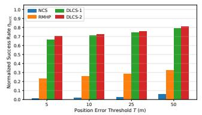

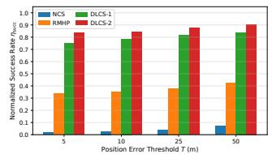

$\mathrm { ( a ) } \ N _ { c } = 4 0 , \alpha _ { c } = 2 , \sigma _ { f , c } = 3 0 \ \mathrm { H z } .$ (b) $N _ { c } = 4 0 , \alpha _ { c } = 1 , \sigma _ { f , c } = 3 0 \ \mathrm { H z } .$  
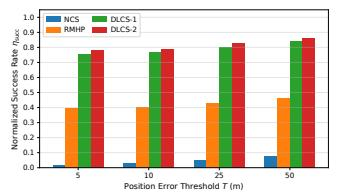

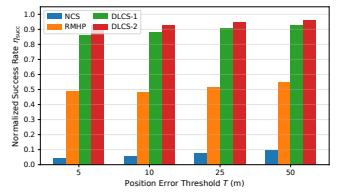

$\mathrm { ( c ) } \ N _ { c } = 2 0 , \alpha _ { c } = 2 , \sigma _ { f , c } = 3 0 \ \mathrm { H z } .$ (d) $N _ { c } = 2 0 , \alpha _ { c } = 1 , \sigma _ { f , c } = 3 0 \ \mathrm { H z }$  
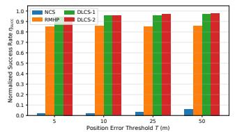

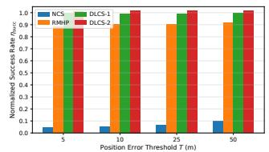  
(e) $N _ { c } = 4 0 , \alpha _ { c } = 1 , \sigma _ { f , c } = 1 0 \ \mathrm { H z } .$ (f) $N _ { c } = 2 0 , \alpha _ { c } = 1 , \sigma _ { f , c } = 1 0 \mathrm { ~ H ~ }$ z.  
Fig. 5: Normalized success rate ηsucc versus position error threshold T (m).

ISAC channels: NLoS exploitation vs. reduction,” IEEE Transactions on Vehicular Technology, 2022.

[7] Y. E. Sagduyu, T. Erpek, A. Yener, and S. Ulukus, “Joint sensing and semantic communications with multi-task deep learning,” IEEE Communications Magazine, 2024.

[8] Y. E. Sagduyu, T. Erpek, A. Yener, and S. Ulukus, “Will 6G be semantic communications? Opportunities and challenges from task oriented and secure communications to integrated sensing,” IEEE Network, 2024.

[9] U. Demir, K. Davaslioglu, Y. E. Sagduyu, T. Erpek et al., “I-SCOUT: Integrated sensing and communications to uncover moving targets in NextG networks,” in IEEE MILCOM, 2024.

[10] M. F. Keskin, M. M. Mojahedian, J. O. Lacruz, C. Marcus et al., “Fundamental trade-offs in monostatic ISAC: A holistic investigation towards 6G,” IEEE Transactions on Wireless Communications, 2025.

[11] Y. E. Sagduyu, K. Davaslioglu, T. Erpek, S. Kompella et al., “MULTI-SCOUT: Multistatic integrated sensing and communications in 5G and beyond for moving target detection, positioning, and tracking,” in IEEE MILCOM, 2025.

[12] Y. Yang, Z. Li, J. Zhao, Q. Wu et al., “Cooperative multi-static ISAC networks: A unified design framework for active and passive sensing,” IEEE Transactions on Wireless Communications, 2025.

[13] H. Luo, Y. Wang, D. Luo, J. Zhao et al., “Integrated sensing and communications in clutter environment,” IEEE Transactions on Wireless Communications, 2024.

[14] R. Liu, P. Li, M. Li, and A. L. Swindlehurst, “Clutter-aware integrated sensing and communication: Models, methods, and future directions,” Proceedings of the IEEE, 2026.

[15] 3GPP, “NR: physical channels and modulation,” 3rd Generation Partnership Project, Technical Specification (TS) 38.211, 2024, ver. 18.2.0.