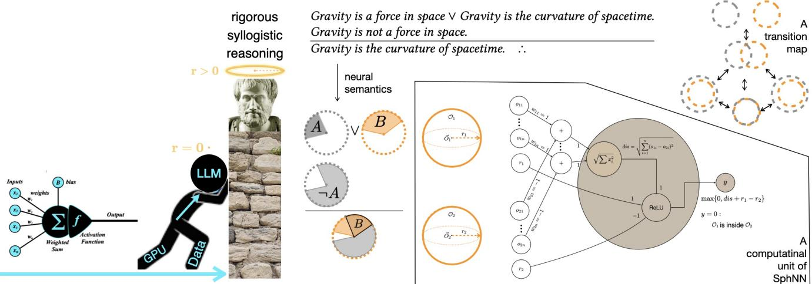
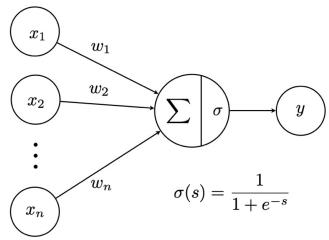
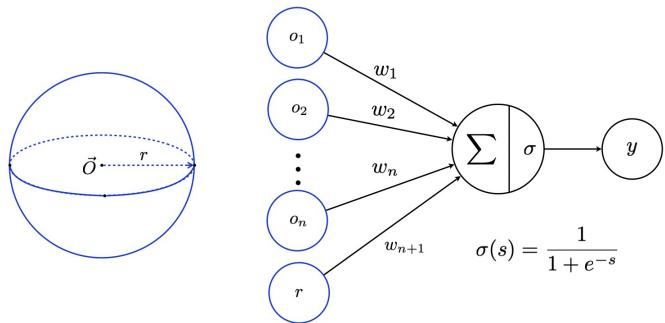
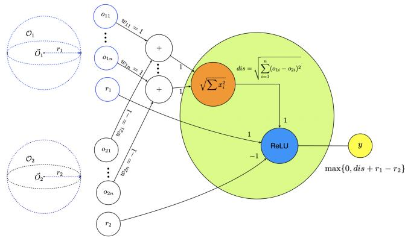
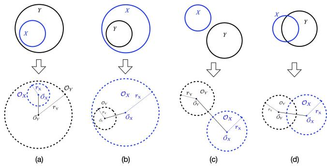
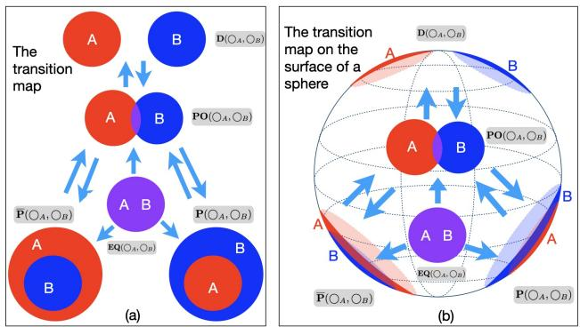
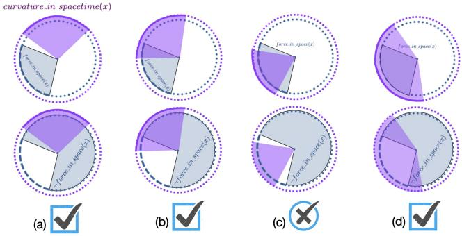

# Non-Zero Radius: The Missing Component of Neural Networks

Tiansi Dong1,2, Mateja Jamnik1, Pietro Liò1

1Computer Lab, The University of Cambridge

2The Alan Turing Institute

Cambridge & London, United Kingdom {td540,mj201,pl219}@cam.ac.uk, tdong@turing.ac.uk

  
Figure 1: Large language models (LLMs) still struggle with reliable logical reasoning. Conventional neural networks represent concepts as vectors, which can be viewed as spheres of zero radius. Sphere Neural Networks (SphNNs) represent concepts as spherical regions with non-zero radii. These regions and their geometric transformations, guided by a transition map, enable symbolic-level Aristotelian syllogistic reasoning without training data.

## Abstract

Inspired by the analogy between the all-or-none activation of bio logical neurons and the true-false of logic circuits, McCulloch and Pitts proposed a mathematical model of the biological neuron in 1943 with the aim of simulating logical reasoning. Although Norbert Wiener considered the model overly simplistic at the time, it later became a building block of modern neural networks, including large language models. Despite their remarkable empirical success, however, conventional neural networks remain largely black-box systems and struggle with reliable symbolic reasoning. Viewing vectors as spheres of zero radius, we relax the zero-radius constraint and represent concepts as spheres with non-zero radii. We argue that sphere-based representations can capture additional features of biological cognition, including representing spatial concepts as regions and reasoning through model construction and inspection. Building on sphere embeddings, we introduce Sphere Neural Networks (SphNNs), which use a transition map to achieve symbolic-level Aristotelian syllogistic reasoning without training data, thereby taking an initial step toward the original goal of McCulloch and

Pitts. We suggest that the zero-radius constraint may reflect an aspect of the oversimplification identified by Wiener and may limit conventional neural networks’ capacity for symbolic-level logical reasoning.

## CCS Concepts

• Theory of computation → Constructive mathematics; Logic.

ACM Reference Format:

Tiansi Dong1,2, Mateja Jamnik1, Pietro Liò1. 2026. Non-Zero Radius: The Missing Component of Neural Networks . In ACM AI Summit 2026 (AI Summit ’26), August 31-September 02, 2026, Atlanta, GA, USA. ACM, New York, NY, USA, 5 pages. https://doi.org/10.1145/3806096.3844817

## 1 Introduction

On February 19, 2026, Demis Hassabis, Co-Founder and CEO of Google DeepMind, suggested the following test of Artificial General Intelligence (AGI): “One way we maybe would test that is you could imagine training a foundation model with a knowledge cutof of something like 1911 and then see if it could come up with general relativity like Einstein did in 1915.” Passing this test would require, among other abilities, basic logical inference such as the following:

  
Figure 2: The input of a traditional perceptron is a vector.

Reasoning of the form $ { ^ { \ast } } \mathrm { A v } \mathrm { B . } \lnot \mathrm { A . } \therefore \mathrm { B ^ { \ast } }$ is known as a disjunctive syllogism. As a foundational form of logical deduction, Aristotelian syllogistic reasoning dominated the study of logic for more than two millennia, and prominent psychologists have regarded it as a microcosm of human rational intelligence [32]. It is ubiquitous in everyday life and underpins reasoning across a wide range of real-world domains, including education [3], business [28], medical decision-making [67], and legal judgement [10, 13].

Observing that biological neurons exhibit an “all-or-none” firing behaviour analogous to the operation of logical circuits, Warren S. McCulloch and Walter Pitts proposed the first mathematical model of neural information processing in 1943 [44]. The paper has only three references: Principia Mathematica [66], The Logical Syntax of Language [9], and Principles of Theoretical Logic [26]. McCulloch and Pitts linked neural activity to formal logic. Syllogistic reasoning provides a basic test of this connection.

At that time, Warren S. McCulloch was an established neuroscientist and psychiatrist, while Walter Pitts was a remarkably gifted young autodidact. After publishing their seminal paper, both became associated with MIT. Norbert Wiener regarded their neural model as overly simplistic, but he also recognised Pitts’s extraordinary talent and invited him to participate in his doctoral seminar, providing an opportunity to further develop the mathematical model. Unfortunately, tensions that arose during the collaboration between McCulloch and Wiener eventually strained Pitts’s relationship with Wiener as well. Pitts withdrew increasingly from academic life and struggled with alcoholism in his later years. He died at age 45, leaving behind a profound legacy as a pioneer of computational neuroscience and artificial intelligence [59]. What, exactly, was oversimplified? As illustrated in Figure 1, extending point representations to spheres enables symbolic-level syllogistic reasoning. Could the missing element in the original model be the radius?

## 2 The McCulloch–Pitts’ Model Falls Short of Symbolic-Level Syllogistic Reasoning

The simple mathematical neuron proposed by McCulloch and Pitts laid the foundation for connectionist approaches to artificial intelligence. Building upon this framework, Rosenblatt introduced the perceptron [55] (Figure 2), which subsequently became the fundamental computational unit of modern neural networks. Over the following decades, perceptron-based architectures evolved into increasingly sophisticated models, including multilayer neural networks [56], Convolutional Neural Networks (CNNs)[37, 41], Recurrent Neural Networks (RNNs)[4, 40], Transformer architectures [65], and, more recently, Large Language Models (LLMs) [24, 27, 30, 50, 53]. Despite their impressive performance across diverse tasks (as in, e.g., [1, 58, 63]), conventional neural networks still face fundamental challenges in logical reasoning, make errors in simple abstract reasoning [18, 39], and provide correct answers with incorrect explanations [11, 68]. It remains unclear whether LLMs truly reason [8, 51].

Several studies have explored the syllogistic reasoning performance of LLMs [18, 39, 67]. Among the evaluated PaLM 2 [24] and Llama 2 [27] models, PaLM 2-Small outperformed PaLM 2-Large, showing that syllogistic reasoning accuracy did not increase consistently with model size [18]. Additionally, LLMs in the PaLM 2 family and GPT-3.5 [53] may achieve above-chance performance in familiar situations but exhibit numerous imperfections in abstract reasoning, including syllogisms [39]; Mistral LLMs [30, 50], Gemma LLMs [21], Llama-3 LLMs [48], and BioMistral LLMs [38] achieved average zero-shot accuracies of 70% on generalised modus ponens and 23% on disjunctive syllogism, and both zero- and few-shot LLMs are sensitive to surface-level lexical variations [67]. The evaluated LLMs fall short of the reliability required for high-stakes biomedical applications, let alone attaining the rigour of symbolic-level reasoning. These findings highlight persistent limitations in conventional neural networks’ logical reasoning [17].

## 3 Mental Model Construction with Regions

Beyond the “all-or-none” principle, spatial cognition ofers another source of inspiration: Tolman’s pioneering behavioural experiments demonstrated that rats form cognitive maps of their environment [62]. In these cognitive maps, spatial objects are represented as regions, while spatial hierarchies are naturally captured by nested regions, allowing explicit representation of parent–child relationships [12, 45, 46, 61]. Subsequent advances in neuroscience identified a zoo of spatial cells in the hippocampus, including grid cells, place cells, and boundary cells [42, 52, 57, 60]. More recently, evidence suggests that mental spatial representations also encode positions in abstract dimensions of experience, constructing cognitive spaces for domain-general reasoning. Geometric accounts of these cognitive spaces represent properties and concepts as convex regions [6, 64].

Empirical evidence strongly supports the view that rational reasoning proceeds through model construction and inspection [23, 31, 33, 34, 36]: What we have is a procedure to represent and integrate in our mind the content ofpremises by means ofmodels comparable to schematic pictures ofthe situation. We then read the conclusions ofthese models [47]. In mental model theory, reasoning proceeds through model construction, model inspection, and model variation [31]. In the model variation phase, people try to construct alternative models to refute the conclusion. If a counter-model is found (the premises are true and the conclusion is false), the inference is invalid. The preferred mental model theory argues that people construct a preferred and simplified model in mind, in a deterministic manner, initially setting aside other possibilities [34, 54] – In this account, initial model construction is deterministic [54]. Sub sequent models are generated by local transformations following the principle of minimal changes [19, 20, 25, 35], with transitions represented by a neighbourhood graph [14, 22].

  
Figure 3: The input of a diameter-limited perceptron is restricted inside a sphere with the centre $\vec { O }$ and the radius �.

  
Figure 4: A non-monotonic activation function signals whether $O _ { 1 }$ is inside $O _ { 2 }$

## 4 Vectors are Zero-Radius Spheres

One extension of McCulloch-Pitts’ model was the diameter-limited perceptron whose input signals $\vec { x } _ { i }$ are restricted within a certain fixed diameter [49, p.12]: Each $\vec { x } _ { 1 } , \ldots , \vec { x } _ { n }$ is located within a sphere.

We further elaborate on this idea by explicitly defining this sphere, whose existence is consistent with convex regions in mental representation [6], and also with McCulloch-Pitts’ model: vectors are special spheres with zero radius. This extends conventional neural networks to Sphere Neural Networks (SphNNs) [15, 16]. The input of a SphNN is the input domain of a diameter-limited perceptron $\left[ o _ { 1 } , \ldots , o _ { n } , r \right]$ , where $\left[ o _ { 1 } , \ldots , o _ { n } \right]$ is the central vector $\vec { O }$ and $r \geq 0$ is the radius, such that $\| \vec { x } _ { i } - \vec { O } \| \leq r \left( 1 \leq i \leq n \right)$

Biological neurons can be distinguished through their output encodings [5]: one type of neuron outputs frequency signals, sim ulated by perceptron [2, 49], the other type of neurons outputs spatial or place encoding, for example, neurons in the visual cortex [5], whose output indicates the degree of matching between the input stimuli and the receptive field. The non-zero-radius ex tension provides a geometric model of receptive-field matching. We may represent the input stimuli and the receptive field as two spheres $O _ { 1 }$ and $O _ { 2 } ,$ with the non-monotonic activation function $\begin{array} { r } { \Delta ( O _ { 1 } , O _ { 2 } ) \triangleq \operatorname* { m a x } \{ 0 , \sqrt { \sum _ { i = 1 } ^ { n } ( o _ { 1 i } - o _ { 2 i } ) ^ { 2 } } + r _ { 1 } - r _ { 2 } \} , } \end{array}$ , as illustrated in Figure 4. When $\Delta ( O _ { 1 } , O _ { 2 } ) = 0 , O _ { 1 }$ is contained in $O _ { 2 } ;$ ; when $r _ { 1 } = r _ { 2 }$ , the larger $\Delta ( O _ { 1 } , O _ { 2 } )$ is, the farther apart the centres of $O _ { 1 }$ and $O _ { 2 }$ are.

  
Figure 5: Set relations: (a) $X \subseteq Y ,$ , (b) $Y \subseteq X ,$ (c) $X \cap Y = \emptyset ,$ and ( $1 ) X \cap Y \neq \emptyset \land X \nsubseteq Y \land Y \nsubseteq X .$

## 5 Representing Set-Theoretic Relations and Syllogistic Statements as Sphere Relations

Spherical regions with non-zero radius can explicitly embed settheoretic relations in the vector space. Given two sets � and �, we embed them as two spheres $O _ { X }$ (with the centre ${ \vec { O } } _ { X }$ and the radius $r _ { X } )$ and $O _ { Y }$ (with the centre �®� and the radius $r _ { Y } )$ , respectively. We assume that each concept denotes a set. � being a subset of $Y \left( X \subseteq Y \right)$ is represented as $O _ { X }$ being part of $O _ { Y ; }$ , written as $\mathbf { P } ( O _ { X } , O _ { Y } )$ , defined as $\mathbf { P } ( O _ { X } , O _ { Y } ) \ \triangleq \ \| { \vec { O } } _ { X } { \vec { O } } _ { Y } \| + r _ { X } \ \leq \ r _ { Y } ; \ X$ disjoint from � $\ P \ C \cap Y \ = \varnothing )$ is represented as $O _ { X }$ being disconnected from $O _ { Y }$ , written as $\mathbf { D } ( O _ { X } , O _ { Y } )$ , defined as ${ \bf D } ( O _ { X } , O _ { Y } ) \triangleq$ $\| \vec { O } _ { X } \vec { O } _ { Y } \| > r _ { X } + r _ { Y } . O _ { X }$ partially overlapping $O _ { Y }$ is defined by $\mathbf { P O } ( O _ { X } , O _ { Y } ) \triangleq \neg \mathbf { P } ( O _ { X } , O _ { Y } ) \land \neg \mathbf { P } ( O _ { Y } , O _ { X } ) \land \neg \mathbf { D } ( O _ { X } , O _ { Y } )$ , as illustrated in Figure 5.

Aristotelian syllogistic reasoning [29] involves two premises and a conclusion using three terms, for example:

Some Greeks are rich.

No Philosophers are rich.

Some Greeks are not Philosophers. ∴

The common concept rich in the premises establishes the relation between Greeks and Philosophers. The four statement forms are: (1) universal afirmative: all � are �; (2) particular afirmative: some � are �; (3) universal negative: no � are �; (4) particular negative: some � are not �. Four relations in Aristotelian syllogistic statements can be explicitly embedded as follows: All X are Y is embedded as $\mathbf { P } ( O _ { X } , O _ { Y } )$ ; No X are Y is embedded as $\mathbf { D } ( O _ { X } , O _ { Y } )$ ; Some X are Y is embedded $\mathfrak { u } \mathfrak { s } \neg \mathbf { D } ( O _ { X } , O _ { Y } )$ ; and Some X are not Y is embedded as $\lnot { \bf P } ( O _ { X } , O _ { Y } ) \ [ 1 6 ]$

## 6 Symbolic-Level Neural Reasoning through Map-guided Model Construction without Training

The central notion of logical reasoning, from the origin of logic research till now, is the notion of “following from”, or more formally, “logical consequence from the premises”: what can we know from the premises? [43]. A logical argument can be satisfiable, unsatisfiable, valid, or invalid. Being satisfiable means there is a case in which both the premises and the conclusion are true. Being valid means the conclusion is true in every case its premises are true [29]. An argument is valid if and only if its premises together with the negation of its conclusion are unsatisfiable. These notations can be interpreted in terms of sphere configurations as follows: A syllogistic argument is satisfiable if and only if we can construct a sphere configuration that satisfies both the premises and the conclusion; otherwise, it is unsatisfiable. A syllogistic argument is invalid if and only if we can construct a sphere configuration that satisfies the premises and the negation of the conclusion; otherwise, it is valid. In continuous space, we can realise the construction by transforming the current sphere configuration towards the target.

  
Figure 6: The neighbourhood transition map in (a) �-dimensional space and (b) on the surface of a sphere.

During the transformation of a sphere from disconnecting with another sphere to being part of it, the two spheres shall first partially overlap with each other. The being-partially-overlapped relation is a neighbour of the disconnecting with relation. Integrating all neigh bourhood transitions together, we have a transition map for all possible neighbourhood transitions, as illustrated in Figure 6(a). Rather than being trained on data, SphNNs are equipped with this transition map. To continue the example above, SphNNs first translate the premises and the conclusion into the sphere configuration:

$$
\begin{array} { r l } & { \neg \mathbf { D } ( O _ { \mathrm { G r e e k s } } , O _ { \mathrm { r i c h } } ) . } \\ & { \mathbf { D } ( O _ { \mathrm { P h i l o s o p h e r s } } , O _ { \mathrm { r i c h } } ) . } \\ & { \neg \mathbf { P } ( O _ { \mathrm { G r e e k s } } , O _ { \mathrm { P h i l o s o p h e r s } } ) . \quad \cdot . } \end{array}
$$

To test whether the argument is valid, SphNN tries to construct a counterexample: a configuration of O k , $O _ { \mathrm { P h i l o s o p h e r s } }$ , and $O _ { \mathrm { r i c h } } , \mathrm { s a t i s f y i n g \ - n ( \bar { O } _ { G r e e k s } , \bar { O } _ { r i c h } ) , D ( \bar { O } _ { P h i l o s o p h e r s } , \bar { O } _ { r i c h } ) }$ and $\mathbf { P } ( O _ { \mathrm { G r e e k s } } , O _ { \mathrm { P h i l o s o p h e r s } } )$ . Then, SphNN begins its construction process: it creates three coinciding spheres, fixes OPhilosophers, moves $O _ { \mathrm { { r i c h } } }$ away from $O _ { \mathrm { P h i l o s o p h e r s } }$ till the two spheres disconnect from each other, and moves $O _ { \mathrm { G r e e k s } }$ inside OPhilosophers. This causes $O _ { \mathrm { G r e e k s } }$ to disconnect from $O _ { \mathrm { { r i c h } } }$ , which contradicts the first condition and the global loss is greater than 0. The complete construction process is a well-designed, gradual descent procedure that guarantees that for any satisfiable set of syllogistic constraints, SphNN constructs a satisfying sphere configuration in one epoch [15, 16]. By this guarantee, if SphNN completes one epoch without constructing a counterexample, it concludes that the argument is valid.

  
Figure 7: Embedding a set as arcs allows the embedding of its complement also to be an arc.

## 7 Summary and Outlook

The vector representations used in conventional neural networks can be understood as a degenerate case of SphNN sphere representations in which every radius is zero. This restriction collapses regions into points, eliminating the geometric relations required to define the transition map. Consequently, this representation lacks the region-based transition mechanism used by SphNNs for syllogistic inference, while conventional neural networks typically learn to approximate such reasoning from training data. From this perspective, the McCulloch–Pitts model imposes a fundamental oversimplification: setting all radii to zero. SphNNs restore this missing structure, thereby enabling logical transitions to be encoded directly in the model rather than learned indirectly from examples. Geometrically, a sphere in a given universe can be understood as the set of all points whose distances to a fixed point (the centre of the sphere) do not exceed a constant value (the radius). If the universe is a circle, spheres become arcs. The two first-order expressions ∀� � ����\_��\_����� (�) and ∀� ���������\_��\_��������� (�) define two sets: the set of all forces in space, and the set of all curvation in spacetime. We can embed them as two spheres on a circle, so their complements are arcs as well. To reason with disjunctive syllogism, we shall define the transition map on the surface of a sphere, as shown in Figure 6(b), so that SphNNs can update the arc configuration of sets or their complements and construct arc configurations for the additional 16 types of syllogistic-style reasoning [7], including disjunctive syllogistic reasoning – Figure 7 illustrates three correct target configurations (only Figure 7(c) is incorrect). The zero-radius restriction might be a neglected barrier to AGI, and removing it brings AI closer to symbolic-level rational reasoning.

## References

[1] J. Abramson, J. Adler, J. Dunger, and et al. 2024. Accurate structure prediction of biomolecular interactions with AlphaFold 3. Nature 630 (2024), 493 – 500.

[2] James A. Anderson. 1995. An introduction to neural networks. MIT Press, Cam bridge, Mass.

[3] Denisa Ardelean. 2015. How Do Primary School Pupils Think? Syllogistic Reasoning in Primary School Children. Procedia - Social and Behavioral Sciences 203 (2015), 57–62. International Conference EPC-TKS 2015.

[4] Jose A. Arjona-Medina, Michael Gillhofer, Michael Widrich, Thomas Unterthiner, Johannes Brandstetter, and Sepp Hochreiter. 2019. RUDDER: Return Decomposi tion for Delayed Rewards. In NeurIPS, H. Wallach, H. Larochelle, A. Beygelzimer, F. d'Alché-Buc, E. Fox, and R. Garnett (Eds.), Vol. 32. Curran Associates, Inc.

[5] Dana H. Ballard. 1986. Cortical connections and parallel processing: Structure and function. Behavioral and Brain Sciences 9, 1 (1986), 67–90.

[6] Jacob L. S. Bellmund, Peter Gärdenfors, Edvard I. Moser, and Christian F. Doeller. 2018. Navigating cognition: Spatial codes for human thinking. Science 362, 6415 (2018). doi:10.1126/science.aat6766

[7] Gregor Betz, Christian Voigt, and Kyle Richardson. 2021. Critical Thinking for Language Models. In Proceedings of the 14th International Conference on Computational Semantics (IWCS). Association for Computational Linguistics, Groningen, The Netherlands (online), 63–75.

[8] C. Biever. 2023. The easy intelligence tests that AI chatbots fails. Nature 619 (2023), 686–689.

[9] Rudolf Carnap. 1937. The Logical Syntax of Language. Routledge, London.

[10] Axel Constant. 2023. A Bayesian model of legal syllogistic reasoning. Artificial Intelligence and Law 32 (04 2023), 1–22. doi:10.1007/s10506-023-09357-8

[11] Antonia Creswell, Murray Shanahan, and Irina Higgins. 2023. Selection-Inference: Exploiting Large Language Models for Interpretable Logical Reasoning. In ICLR.

[12] E. Davis. 1981. Organizing spatial knowledge. (1981). Department of Computer Science, Yale University, Research Rep. 193.

[13] Wentao Deng, Jiahuan Pei, Keyi Kong, Zhe Chen, Furu Wei, Yujun Li, Zhaochun Ren, Zhumin Chen, and Pengjie Ren. 2023. Syllogistic Reasoning for Legal Judgment Analysis. In EMNLP. Singapore.

[14] T. Dong. 2008. A Comment on RCC: from RCC to RCC++. Journal ofPhilosophical Logic 37, 4 (2008), 319–352.

[15] Tiansi Dong, Mateja Jamnik, and Pietro Liò. 2024. Sphere Neural-Networks for Rational Reasoning. arXiv preprint arXiv:2403.15297 (2024).

[16] Tiansi Dong, Mateja Jamnik, and Pietro Liò. 2025. Neural Reasoning for Sure Through Constructing Explainable Models. In AAAI.

[17] Tiansi Dong, Mateja Jamnik, and Pietro Liò. 2026. Data-driven Machine Learning Cannot Reach Symbolic-level Logical Reasoning – The Limit of the Scaling Law. arXiv:2606.26454 [cs.AI]

[18] Tiwalayo Eisape, MH Tessler, Ishita Dasgupta, Fei Sha, Sjoerd van Steenkiste, and Tal Linzen. 2024. A Systematic Comparison of Syllogistic Reasoning in Humans and Language Models. In NAACL.

[19] Peter Gädenfors. 1990. The Dynamics of Belief Systems: Foundations vs. Coherence Theories. Revue Internationale de Philosophie 44, 172 (1) (1990), 24–46.

[20] P. Gärdenfors. 1988. Knowledge in Flux. Modelling the Dymanics of Epistemic States. MIT Press.

[21] Team Gemma and Deepmind Google. 2024. Gemma: Open Models Based on Gemini Research and Technology. arXiv:2403.08295 [cs.CL]

[22] J. M. Gooday and A. G. Cohn. 1994. Conceptual Neighbourhoods in Spatial and Temporal Reasoning. In Proceedings ECAI-94 Workshop on Spatial and Temporal Reasoning. Rodríguez, R.

[24] Google. 2023. PaLM 2 Technical Report. (2023). arXiv:2305.10403 [cs.CL]

[23] Geofrey Goodwin and Phil Johnson-Laird. 2005. Reasoning About Relations. Psychological review 112 (05 2005), 468–93.

[25] Gilbert Harman. 1986. Change in View: Principles of Reasoning. Cambridge, MA, USA: MIT Press.

[26] David Hilbert and Wilhelm Ackermann. 1938. Grundzüge der theoretischen Logik (2., verbesserte aufl. ed.). Springer, Berlin.

[27] et. al. Hugo Touvron. 2023. Llama 2: Open Foundation and Fine-Tuned Chat Models. arXiv:2307.09288 [cs.CL]

[28] Paramaswari Jaganathan, Siti Mayr, and Florence Nagaratnam. 2014. Rhetorical Syllogism in the English and the German Language of Automobile Advertising. Gema Online Journal ofLanguage Studies 151 (02 2014), 151–169

[29] R. Jefrey. 1981. Formal logic: Its scope and limits (2nd ed.). New York, NY.

[30] Albert Q. Jiang, Alexandre Sablayrolles, Arthur Mensch, Chris Bamford, Devendra Singh Chaplot, Diego de las Casas, Florian Bressand, Gianna Lengyel, Guillaume Lample, Lucile Saulnier, Lélio Renard Lavaud, Marie-Anne Lachaux, Pierre Stock, Teven Le Scao, Thibaut Lavril, Thomas Wang, Timothée Lacroix, and William El Sayed. 2023. Mistral 7B. (2023). arXiv:2310.06825 [cs.CL]

[31] P. N. Johnson-Laird and R. M. J. Byrne. 1991. Deduction. Lawrence Erlbaum Associates, Inc.

[32] S. Khemlani. 2021. Psychological theories of syllogistic reasoning. In Handbook ofRationality, M. Knauf and W. Spohn (Eds.). MIT Press, Cambridge, MA, USA.

[33] Markus Knauf. 2009. A Neuro-Cognitive Theory of Deductive Relational Reasoning with Mental Models and Visual Images. Spatial Cognition & Computation 9, 2 (2009), 109–137.

[34] Markus Knauf. 2013. Space to Reason. MIT Press.

[35] Markus Knauf, Leandra Bucher, Antje Krumnack, and Jelica Nejasmic. 2013. Spatial belief revision. Journal of Cognitive Psychology 25, 2 (2013), 147–156.

[36] M. Knauf, T. Fangmeier, C. C. Ruf, and P. N. Johnson-Laird. 2003. Reasoning, models, and images: behavioral measures and cortical activity. Journal of Cognitive Neuroscience 15, 4 (2003), 559–573.

[37] Alex Krizhevsky, Ilya Sutskever, and Geofrey E Hinton. 2012. ImageNet Classification with Deep Convolutional Neural Networks. In Advances in Neural Information Processing Systems, F. Pereira, C.J. Burges, L. Bottou, and K.Q. Wein berger (Eds.), Vol. 25. Curran Associates, Inc.

[38] Yanis Labrak, Adrien Bazoge, Emmanuel Morin, Pierre-Antoine Gourraud, Mick ael Rouvier, and Richard Dufour. 2024. BioMistral: A Collection of Open-Source

Pretrained Large Language Models for Medical Domains. In Findings of ACL 2024, Lun-Wei Ku, Andre Martins, and Vivek Srikumar (Eds.). 5848–5864.

[39] Andrew K Lampinen, Ishita Dasgupta, Stephanie C Y Chan, Hannah R Sheahan, Antonia Creswell, Dharshan Kumaran, James L McClelland, and Felix Hill. 2024. Language models, like humans, show content efects on reasoning tasks. PNAS Nexus 3, 7 (2024).

[40] Yann LeCun, Yoshua Bengio, and Geofrey E. Hinton. 2015. Deep learning. Nature 521, 7553 (2015).

[41] Yann LeCun, L’eon Bottou, Yoshua Bengio, and Patrick Hafner. 1998. Gradientbased learning applied to document recognition. Proc. IEEE 86, 11 (1998), 2278–2324.

[42] C. Lever, S. Burton, A. Jeewajee, J. O’Keefe, and N. Burgess. 2009. Boundary vector cells in the subiculum of the hippocampal formation. The Journal ofneuroscience 29, 31 (2009), 9771–9777.

[43] Alex Malpass and Marianna Antonutti Marfori. 2017. The History ofPhilosophical and Formal Logic: From Aristotle to Tarski. Bloomsbury Academic.

[44] Warren S. McCulloch and Walter Pitts. 1943. A Logical Calculus of the Ideas Immanent in Nervous Activity. Bulletin of Mathematical Biophysics 5 (1943), 115–133.

[45] D. McDermott. 1981. Finding objects with given spatial properties. Technical Report. Department of Computer Science, Yale University. Research Rep. 195..

[46] T. P. McNamara. 1986. Mental Representation of Spatial Relations. Cognitive Psychology 18 (1986), 87–121.

[47] Hugo Mercier and Dan Sperber. 2018. The Enigma ofReason. Penguin.

[48] MetaAI. 2024. The Llama 3 Herd of Models. (2024). arXiv:2407.21783 [cs.AI]

[49] Marvin Minsky and Seymour Papert. 1988. Perceptrons. MIT Press.

[50] AI Team Mistral. 2023. Mixtral of experts- a high quality sparse mixture-of experts. (2023). https://mistral.ai/news/mixtral-of-experts

[51] Melanie Mitchell. 2023. How do we know how smart AI systems are? Science 381, 6654 (2023), adj5957.

[52] J. O’Keefe and L. Nadel. 1978. Expert systemsThe Hippocampus as a Cognitive Map. Clarendon Press.

[53] OpenAI. 2023. GPT-3.5. (2023). https://platform.openai.com/docs/models

[54] Marco Ragni and Markus Knauf. 2013. A Theory and a Computational Model of Spatial Reasoning With Preferred Mental Models. Psychological review 120 (06 2013), 561–588.

[55] Frank Rosenblatt. 1958. The Perceptron: A Probabilistic Model for Information Storage and Organization in the Brain. Psychological Review (1958).

[56] D. E. Rumelhart, G. E. Hinton, and R. J. Williams. 1986. Learning Internal Representations by Error Propagation. In Parallel Distributed Processing: Explorations in the Microstructure ofCognition, Vol. 1, David E. Rumelhart, James L. McClelland, and CORPORATE PDP Research Group (Eds.). MIT Press, 318–362.

[57] F. Savelli, D. Yoganarasimha, and JJ. Knierim. 2008. Influence ofboundary removal on the spatial representations of the medial entorhinal cortex. Hippocampus 18, 12 (2008), 1270–1282.

[58] Julian Schrittwieser, Ioannis Antonoglou, Thomas Hubert, Karen Simonyan, Laurent Sifre, Simon Schmitt, Arthur Guez, Edward Lockhart, Demis Hassabis, Thore Graepel, Timothy Lillicrap, and David Silver. 2020. Mastering Atari, Go, chess and shogi by planning with a learned model. Nature 588 (2020), 604—-609.

[59] Neil R. Smalheiser. 2000. Walter Pitts. Perspectives in Biology and Medicine 43, 2 (2000), 217–226.

[60] Trygve Solstad, Charlotte N., BoccaraEmilio Kropf, May-Britt Moserand, and Edvard I. Moser. 2008. Representation of Geometric Borders in the Entorhinal Cortex. Science 322 (2008), 1865–1868.

[61] A. Stevens and P. Coupe. 1978. Distortions in judged spatial relations. Cognitive Psychology 10 (1978), 422–437.

[62] E. C. Tolman. 1948. Cognitive Maps in Rats and Men. The Psychological Review 55, 4 (1948), 189–208.

[63] Trieu H. Trinh, Yuhuai Wu, Quoc V. Le, He He, and Thang Luong. 2024. Solving olympiad geometry without human demonstrations. Nature 625 (2024), 476 – 482.

[64] Barbara Tversky. 2019. Mind in Motion. Basic Books, New York, USA.

[65] Ashish Vaswani, Noam Shazeer, Niki Parmar, Jakob Uszkoreit, Llion Jones, Aidan N Gomez, Ł ukasz Kaiser, and Illia Polosukhin. 2017. Attention is All you Need. In Advances in Neural Information Processing Systems, I. Guyon, U. Von Luxburg, S. Bengio, H. Wallach, R. Fergus, S. Vishwanathan, and R. Garnett (Eds.), Vol. 30. Curran Associates, Inc.

[66] Alfred North Whitehead and Bertrand Russell. 1925–1927. Principia Mathematica. Cambridge University Press.

[67] Magdalena Wysocka, Danilo Carvalho, Oskar Wysocki, Marco Valentino, and Andre Freitas. 2025. SylloBio-NLI: Evaluating Large Language Models on Biomedical Syllogistic Reasoning. arXiv:2410.14399 (2025). https://arxiv.org/abs/2410.14399

[68] Eric Zelikman, Yuhuai Wu, Jesse Mu, and Noah Goodman. 2022. STaR: Bootstrapping Reasoning With Reasoning. In NeurIPS, Alice H. Oh, Alekh Agarwal, Danielle Belgrave, and Kyunghyun Cho (Eds.).

Received 30 June 2026; revised ; accepted