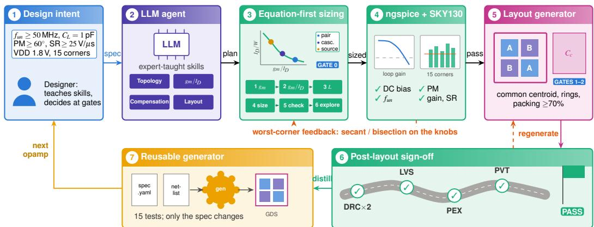
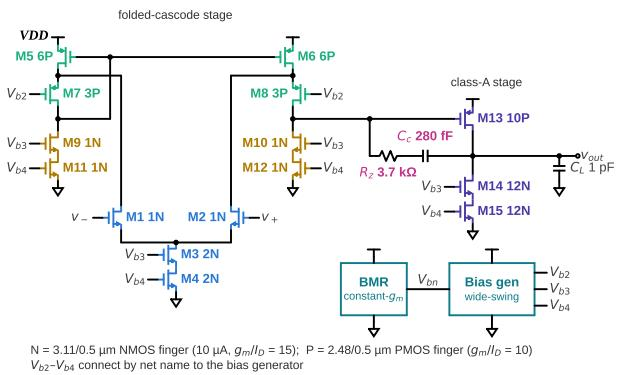
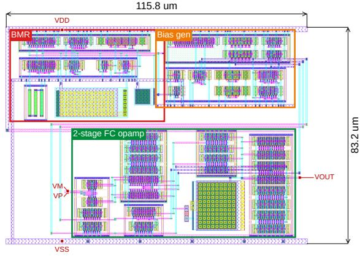

# OPERA: OPamp Design by an Expert-Taught Reasoning Agent, from Specifications to Layout

Vishal Saxena

ECE Dept., University of Delaware

Newark, DE, USA

vsaxena@udel.edu

Soumyajit Mandal

Instr. Div., Brookhaven National Laboratory

Upton, NY, USA

smandal@bnl.gov

Abstract—Analog flows from specifications to a signed-off layout rarely run without manual iteration. Recent large language model (LLM) agents size circuits with optimizer loops over the device dimensions and stop at the schematic. We present OPERA (OPamp design by an Expert-taught Reasoning Agent), in which a general-purpose LLM agent designs CMOS opamps from specifications to post-layout sign-off with open-source tools. First, the designer teaches the agent the $g _ { m } / I _ { D }$ method: map the specifications to transconductances and minimum currents, choose $g _ { m } / I _ { D }$ per device role from characterized lookup tables, and size from equations, leaving a few knobs to search and an explainable design. Second, the agent learns the gLayout framework and taught layout practice, and writes a reusable layout generator that closes the layout and extraction loop at designer-approved gates. In SKY130, the agent designed a shared constant-gm bias and six opamps (5T, folded-cascode and telescopic OTAs; Miller, folded-cascode and telescopic twostage) for $f _ { u n } \ge 5 0$ MHz, PM $\geq 6 0 ^ { \circ }$ , SR 25 V/µs into 1 pF and a minimum dc gain of 30 to 60 dB. All six layouts are DRC-clean and LVS-matched, and their extracted netlists meet every target at all 15 PVT corners $( f _ { u n } \ge 5 3 . 7$ MHz, PM 62.1◦, $\dot { \mathbf { S } } \mathbf { R } \geq \bar { 2 } 7 . 9$ V/µs). The benchmark netlists are released at https://github.com/AMPICLab/AMPICBench.

Index Terms—Analog design automation, AI agents, large language models, automated layout generation, operational amplifier.

## I. INTRODUCTION

An analog block reaches tape-out only after two nested loops close: the designer sizes, compensates and re-simulates the circuit until it meets its specifications over process, voltage and temperature (PVT), then draws, verifies and extracts the layout, and returns to the schematic when parasitics or layout adjustments move the results. Automating both loops end to end remains a long-standing goal of analog designers and EDA developers.

LLM-based flows now generate topologies and netlists [1]– [3], port amplifiers across processes [4] and assist layout [5]– [7], alongside algorithmic layout tools such as ALIGN [8] and MAGICAL [9]. For sizing, most flows place an optimizer in a loop: the LLM proposes or narrows a search space, and Bayesian optimization, trust-region search or the LLM itself iterates over the device dimensions [10]–[13]. These loops spend many simulations rediscovering what a designer knows from first principles, usually run at the typical corner, and stop at the schematic.

A designer instead maps the specifications to transconductances, picks the $g _ { m } / I _ { D }$ value for each device from its role, sizes from equations and lookup tables, and tunes a handful of knobs whose effect is understood. This paper asks whether an LLM agent can be taught to design this way, in both the schematic and the layout loop, and whether the result holds up over PVT after extraction. We focus on single-ended opamps (or OTAs) and a small set of specifications: unity-gain frequency, phase margin, gain, and slew rate into a fixed load. The two-stage opamps are restricted to a Class-A output stage. The contributions are:

1) OPERA, an agent flow from specifications to post-layout PVT sign-off with open-source tools, directed and taught by us (i.e., the designer) at defined gates (Section II).

2) Equation-first sizing with per-role $g _ { m } / I _ { D }$ , leaving a few knobs instead of tuning each transistor (Section III).

3) Agent-learned, designer-taught layout distilled into a reusable generator that closes the layout and extraction loop (Section IV).

4) A SKY130 case study of six opamps with post-layout PVT results and an optimizer comparison (Section V).

## II. THE OPERA FLOW

Fig. 1 depicts our end-to-end flow. The agent is a generalpurpose LLM (Claude, Anthropic) in a Linux sandbox with shell, file and simulation tools, without training or finetuning. It uses open-source tools, i.e., ngspice [14], Magic and Netgen [15], KLayout [16], SchemDraw [17], the open SKY130 models [18], and gLayout [6], [19]. We as the designer do not edit netlists or layouts; each design starts from one directive, such as “design a Folded-cascode OTA for 50 dB gain, $f _ { u n } \ge 5 0$ MHz for a 1 pF load, and $\mathrm { S R } { > } 2 5 V / \mu s$ for minimum static power consumption.” The designer’s lessons are kept in five skill files (sizing, compensation, gated layout flow, SKY130 layout rules, opamp layout guidelines).

## A. Designer-taught skills and decision gates

We used Claude’s Opus 5.5 model for the LLM teaching phase and skill development, then switched to the lower-tokencost Sonnet 5.5 model to run the iterative loops. Table I lists what the designer taught through plain language, lecture slides, short recipes and worked examples. Each lesson became a skill file of rules and checks that later sessions reload. The designer intervenes only at defined gates: the per-role $g _ { m } / I _ { D }$ choices, any sizing change, any accepted corner failure and, in layout, the unit fingering (gate 1) and the floorplan (gate 2). At each gate the agent presents two or three simulated options.

  
Fig. 1. The OPERA flow. (1) The designer gives the specifications, teaches skills and decides at the gates. (2) A general-purpose LLM agent applies th taught skills and (3) sizes the circuit with the six-step $g _ { m } / I _ { D }$ flow (specifications to $g _ { m }$ and minimum currents, per-role $g _ { m } / \bar { I _ { D } } , \bar { L } ,$ sizing from tables, checks, trade-offs), leaving a few knobs. (4) Simulation over 15 PVT corners returns worst-corner feedback to those knobs. $( 5 )$ The layout generator builds the cell after the unit and floorplan gates, and (6) DRC in two decks, LVS, extraction and post-layout PVT simulation sign it off or trigger regeneration. (7) Eac signed-off cell is distilled into a reusable, tested generator that the next opamp reuses.

TABLE I  
SKILLS TAUGHT BY THE DESIGNER
<table><tr><td>Skill</td><td>Taught by the designer</td><td>Used by the agent as</td></tr><tr><td>Topology</td><td>Signal path, gain and pole nodes, Headroom budget per stack stack headroom, replica bias, folding currents</td><td></td></tr><tr><td>gm/ID</td><td>Six-step flow: specs to  $g _ { m }$  currents,  $g _ { m } / I _ { D }$  check, explore</td><td>and Density, fτ, gmro from tables; per role, L, size, sizes from equations; worst- corner knob iteration</td></tr><tr><td>Compensation</td><td>gm2/gm1,  $C _ { c } ,$  Rz placement</td><td>Two-stage Miller recipe: m = Starting Cc, Rz, m; one knob per specification</td></tr><tr><td>Layout</td><td>terdigitation, dummies; rings per and packing checkers stage; packing ≥70%; short par- asitics sensitive nodes</td><td>Floorplans; common centroid, in- Generator templates; matching</td></tr></table>

## III. EQUATION-FIRST SIZING

## A. Characterization

The agent studied the author’s lecture slides [20] and the $g _ { m } / I _ { D }$ literature [21], then characterized the SKY130 low-Vth devices at the planned finger width (3.11 µm NMOS, 2.48 µm PMOS), and built lookup tables of current density, $f _ { T } , g _ { m } r _ { o } .$ and capacitance against $g _ { m } / I _ { D }$ for several L at five process corners.

## B. The $g _ { m } / I _ { D }$ Design Flow

The designer taught the agent the six steps designers follow [21] (Fig. 1, panel 3):

1) Specifications to $g _ { m }$ and currents. Gain-bandwidth or unitygain frequency $( f _ { u n } )$ sets $g _ { m 1 } = 2 \pi f _ { u n } \cdot C _ { L }$ for singlestage, and $g _ { m 1 } = 2 \pi f _ { u n } \cdot C _ { c }$ for two-stage amplifier; the phase margin sets $g _ { m 2 }$ through the non-dominant pole, and the slew rate sets the minimum currents. The first stage slews by steering its tail current into the compensating capacitance, so $I _ { t a i l } \geq \mathbf { S } \mathbf { R } \cdot C _ { L }$ in a single-stage and

$I _ { t a i l } \ge \mathrm { S R } \cdot C _ { c }$ in a two-stage amplifier. In a folded-cascode (FC) stage, folding branches must carry at least $I _ { t a i l }$ , and a class-A output stage must sink at least $\mathrm { S R } \left( C _ { L } + C _ { c } \right)$ For 50 MHz and $2 5 ~ \mathrm { V / \mu s }$ into 1 pF, a single stage needs $g _ { m 1 } \geq 3 1 4 ~ \mu \mathrm { S }$ and $I _ { t a i l } \ge 2 5 ~ \mu \mathrm { A } ;$ as $g _ { m 1 } = ( g _ { m } / I _ { D } ) _ { 1 } I _ { t a i l } / 2$ $\mathrm { S R } / f _ { u n } = 4 \pi / ( g _ { m } / I _ { D } ) _ { 1 }$ caps $\left( g _ { m } / I _ { D } \right) _ { 1 }$ at 25.

2) $g _ { m } / I _ { D }$ per device role. High for the input pair $( g _ { m }$ per current, noise, offset), low for mirrors and current sources (for matching, as $\sigma _ { \Delta I / I } \propto \left( g _ { m } / I _ { D } \right) \sigma _ { V _ { T } } .$ , noise and area considerations), moderate to high for cascodes (headroom), and capped where a device’s $f _ { T }$ sets a signal-path pole. Devices that copy a current share $g _ { m } / I _ { D }$ and L, so the copy holds over corners.

3) Channel length. L follows from the gain budget $( g _ { m } r _ { o }$ against $g _ { m } / I _ { D } )$ , traded against $f _ { T }$ and matching.

4) Sizing from the tables. $I _ { D } = g _ { m } / ( g _ { m } / I _ { D } )$ , or the branch current, and $W = I _ { D } / ( I _ { D } / W )$ , rounded to whole fingers. About a dozen continuous widths, lengths and currents reduce to a few knobs: the $g _ { m } / I _ { D }$ of each role, the branch currents and, in a two-stage amplifier, $m = { g _ { m 2 } } / { g _ { m 1 } } , C _ { c }$ and $R _ { z } .$

5) Checks and iteration. Headroom $( V _ { D , s a t } \approx 2 / ( g _ { m } / I _ { D } ) )$ and pole estimates come first. The equations using the characterization tables predicted gain and power within 2% but overestimate the phase margin by about $1 8 ^ { \circ }$ , so stability closes in simulation, one knob per specification at the worst corner, with secant updates for continuous knobs and bisection for integer ones.

6) Trade-offs. Design charts (power, gain, swing, $f _ { T }$ against $g _ { m } / I _ { D } )$ yield two or three candidates for a gate.

## C. Compensation recipe

For two-stage amplifiers the agent applies the designer’s recipe, based on the two-pole Miller model,

$$
\mathrm { P M } \approx 9 0 ^ { \circ } - \tan ^ { - 1 } \left( \frac { C _ { 2 } } { m C _ { c } } \right) - \tan ^ { - 1 } \left( \frac { 1 } { m } \right) ,\tag{1}
$$

with $m = g _ { m 2 } / g _ { m 1 }$ . With $R _ { z } = 1 / g _ { m 2 }$ the zero term of (1) vanishes and $6 0 ^ { \circ }$ needs m $; C _ { c } / C _ { 2 } \ge 1 . 7 3 ;$ a larger $R _ { z }$ moves the zero into the left half plane just above $f _ { u n } ;$ the third pole $1 / ( 2 \pi R _ { z } C _ { 1 } )$ must stay well above $f _ { u n }$ . The agent uses (1) for starting values and knob directions and closes the phase margin in simulation.

## IV. CLOSING THE LAYOUT AND EXTRACTION LOOP

## A. Learning the layout framework

The agent learned gLayout [6] from its examples and documentation and found its gaps by running DRC on small pieces: gLayout’s layer names were offset by one from SKY130, so the agent wrote an explicit layer map and routes every net as a Manhattan path with via stacks. It then wrote a row generator for matched transistor arrays and uses Magic’s PDK generators for resistors and MIM capacitors.

## B. Taught layout practice and gates

The designer taught layout from examples and know-how (Table I). For a two-stage opamp: the input pair as a twodimensional common centroid; the load mirror and tail interdigitated with dummies; each stage in its own guard rings; the Miller capacitor between the second-stage PMOS and NMOS rings, low-impedance plate on the output; and the nulling resistor between the stages, so high-impedance nodes stay short. At gate 1 the agent proposes unit fingerings and simulates each over the corners, since finger widths move binned models more than parasitics do; at gate 2 it compares two or three floorplans by area, utilization and routing cost; gate 3 is the full layout and its verification.

## C. A reusable layout generator

The agent then distilled its hand-scripted layouts into a generator for the two-stage family. Its inputs are the reference netlist and a layout intent file recording the designer’s decisions: unit sizes, matched-set patterns, passive placement and pin edges. One command regenerates the cell and reports PASS only if Magic and KLayout DRC are clean, Netgen LVS matches, the layout satisfies every item of the intent file, the matching and packing checks pass, and the extracted netlist meets the design targets over the corners. Finished blocks (bias, reference, opamp) are then assembled hierarchically: each block exposes its rails and pins as a fixed contract, neighbouring blocks abut and share supply rails, the remaining nets are routed and the flat cell is re-verified with DRC, LVS and extraction.

## V. CASE STUDY

## A. Specifications and shared bias

All amplifiers target open-loop $f _ { u n } \ge 5 0$ MHz with $C _ { L } =$ $1 \mathrm { p F }$ in a loop-gain analysis [24] testbench similar to Spectre’s stb analysis, $\mathrm { P M } \geq 6 0 ^ { \circ }$ , SR 25 V/µs for a 0.7-to-1.1- V follower step (20–80%), and a minimum DC gain $A _ { 0 }$ of 30 dB (5T), 50 dB (FC and telescopic OTAs) or 60 dB (twostage opamps), $\mathrm { V D D } = 1 . 8 \mathrm { ~ V ~ }$ and $V _ { C M } = 0 . 9 \mathrm { ~ V ~ }$ (testbenches and netlists released as a benchmark [25]), biased on chip by a $\mathrm { c o n s t a n t } { - } g _ { m }$ beta-multiplier reference (BMR) feeding a wide-swing cascode bias [26], [27]. As the BMR transconductance tracks $1 / R ,$ the agent chose an n+ diffusion resistor (+1435 ppm/K) over high-resistance poly. The short-channel BMR [20] provides a 20.0 µA reference at tt (19.1 to 21.3 over corners), with loop PM 72.4 to 74.6◦.

TABLE II  
COMPARISON WITH LLM-BASED ANALOG DESIGN FLOWS. ✓ YES, PARTLY, ✗ NO.
<table><tr><td>Work</td><td>Topo.</td><td> $\mathbf { S i z e } ^ { b } \mathbf { \Pi } _ { \mathbf { I _ { D } } } ^ { \mathbf { g _ { m } / } }$ </td><td></td><td>Comp. PVT Layout</td><td></td><td></td><td>off</td><td>gen.</td><td>Sign- Reus. Taught skills</td></tr><tr><td>AnalogCoder [1]</td><td>V</td><td>L</td><td>x</td><td>X</td><td>X</td><td>X</td><td>×</td><td>x</td><td>x</td></tr><tr><td>ADO-LLM [10]</td><td>x</td><td>0</td><td>×</td><td>x</td><td>x</td><td>×</td><td>x</td><td>x</td><td>x</td></tr><tr><td>LEDRO [12]</td><td>x</td><td>0</td><td>x</td><td>x</td><td>x</td><td>x</td><td>x</td><td>x</td><td>x</td></tr><tr><td>AutoSizer [13]</td><td>x</td><td>0</td><td>x</td><td>x</td><td>x</td><td>x</td><td>x</td><td>×</td><td>x</td></tr><tr><td>Artisan [22]</td><td>L</td><td>E</td><td>V</td><td>O</td><td>x</td><td>x</td><td>x</td><td>x</td><td>x</td></tr><tr><td>AmpAgent [4]</td><td>O</td><td>E</td><td>X</td><td>o</td><td>x</td><td>x</td><td>x</td><td>x</td><td>x</td></tr><tr><td>EEsizer [11]</td><td>x</td><td>L</td><td>×</td><td>x</td><td>x</td><td>x</td><td>x</td><td>x</td><td>x</td></tr><tr><td>White-box [23]</td><td>X</td><td>L</td><td>J</td><td>o</td><td>o</td><td>x</td><td>x</td><td>x</td><td>x</td></tr><tr><td>AnalogAg. [3]</td><td>o</td><td>0</td><td>x</td><td>x</td><td>x</td><td>x</td><td>x</td><td>x</td><td>x</td></tr><tr><td>LayoutCop. [5]</td><td>x</td><td>x</td><td>×</td><td>x</td><td>x</td><td></td><td>0</td><td>x</td><td>x</td></tr><tr><td>Glayout NL [6]</td><td>x</td><td>x</td><td>x</td><td>x</td><td>x</td><td>√</td><td>o</td><td>o</td><td>x</td></tr><tr><td>ACDC [7]</td><td>O</td><td>x</td><td>x</td><td>x</td><td>x</td><td>x</td><td>x</td><td>x</td><td>x</td></tr><tr><td>OPERA (ours)</td><td>oª</td><td>E</td><td> $\checkmark$ </td><td></td><td> $\checkmark$ </td><td></td><td>L</td><td></td><td></td></tr></table>

From published descriptions. aTopologies chosen by the designer and taught to the agent. in Topo.: from literature or code generation. $^ b \mathrm { O : }$ optimizer loop; L: LLM-driven iteration; E: equations, then a few knobs. cDRC, LVS and extraction over PVT.

TABLE III  
OPAMP RESULTS OVER 15 PVT CORNERS (SCHEMATIC, $C _ { L } { = } 1 \ \mathrm { P F } ,$ VDD=1.8 V, VCM=0.9 V, ON-CHIP BIAS)
<table><tr><td>Circuit</td><td></td><td>Knobsa</td><td>A0 (dB)</td><td> $\mathbf { f } _ { \mathbf { u n } }$   $\left( \mathbf { M H z } \right)$ </td><td>PM (°)</td><td>SRb (V/μs)</td><td>IDD (μA)</td></tr><tr><td>S1</td><td>5T OTA</td><td>n</td><td>31.1-31.8</td><td>68.1–76.0</td><td>82.4–84.1</td><td>35.4</td><td>126-144</td></tr><tr><td>S1</td><td>FC OTA</td><td>n1,n2</td><td>51.1–53.0</td><td>66.5–77.4</td><td>67.6–72.6</td><td>33.2</td><td>282-358</td></tr><tr><td>S1</td><td>Telescopic</td><td>n</td><td>51.9–55.0</td><td>96.6–115.2</td><td>71.2–77.9</td><td>41.4</td><td>243-307</td></tr><tr><td>S2</td><td>Miller</td><td>n,m,Cc,Rz</td><td>60.8–64.0</td><td>82.2–100.8</td><td>69.1–75.7</td><td>46.1</td><td>338-422</td></tr><tr><td>S2</td><td>FC 2-stage</td><td>n,m,Cc,Rz</td><td>63.2–68.2</td><td>57.5–72.8</td><td>70.2–78.9</td><td>28.6</td><td>330-424</td></tr><tr><td>S2</td><td></td><td>Tele. 2-stage n,m, Cc,Rz</td><td>68.7-78.0</td><td>75.5–95.8</td><td>66.8–75.6</td><td>27.1</td><td>330-423</td></tr></table>

S1 single-stage; S2 two-stage, class-A output. ${ a } _ { n : }$ pair fingers, n1/n2: pair/folding fingers. bWorst edge, $0 . 7 \mathrm { - } 1 . 1 \mathrm { ~ V ~ }$ step, 20–80%. Shading: worst-corner margin. IDD includes the bias. Corners: tt, ff, ss, fs, sf at $0 / 2 7 / 7 0 ^ { \circ } \mathrm { C } . \ A _ { 0 }$ targets: 30, 50, 50, 60, 60, 60 dB.

## B. Schematic results

The agent designed six topologies from the designer’s Cadence starting points in SKY130 PDK: 5T, folded-cascode (FC) and telescopic OTAs (the latter with a replica half-circuit for its cascode bias), a Miller opamp, and an FC or telescopic stage followed by a class-A stage. Fig. 2(a) shows the FC twostage. Table III lists the knobs and the results over 15 corners. Every design meets $f _ { u n } \ge 5 0 ~ \mathrm { M H z } , ~ \mathrm { P M } \ge 6 0 ^ { \circ } , \mathrm { S R } \ge 2 5 ~ \mathrm { V } / \mu \mathrm { s }$ and its $A _ { 0 }$ target at every corner. The lowest slew rates, 27.1 and 28.6 V/µs, are in the two-stage opamps with cascode first stages, set by the first-stage current charging $C _ { c } .$ . One limit remains: at $\mathrm { f s } , 7 0 ^ { \circ } \mathrm { C }$ the weakest cascode is 23 to 63 mV into triode in five designs, yet all targets are met.

## C. Comparison with Optimizer Search

AutoSizer [13] draws its optimizer from a pool that includes Bayesian optimization and simulates only the typical corner.

  
(a)

  
(b)  
Fig. 2. Two-stage opamp with a folded-cascode first stage and a class-A second stage, designed $\boldsymbol { \mathrm { b y } }$ OPERA. (a) Schematic drawn by the agent from its sized netlist, devices colored by role; labels are finger counts. (b) Its automatically generated layout; DRC/LVS clean and meets specs in all corners.

TABLE IV  
RUNS TO FIRST PASSING DESIGN: PASSING SEEDS (MEDIAN RUNS)
<table><tr><td colspan="2"></td><td>OPERAa</td><td colspan="2">Protocol A (spec)</td><td colspan="2">Protocol B (sat.)</td></tr><tr><td></td><td>Circuit</td><td>A/B</td><td>Random</td><td>TPE</td><td>Random</td><td>TPE</td></tr><tr><td>S1</td><td>5T OTA</td><td>54 / 54</td><td>5/5 (58)</td><td>5/5 (48)</td><td>5/5 (76)</td><td>5/5 (48)</td></tr><tr><td>S1</td><td>FC OTA</td><td>30 / 59</td><td>3/3 (250)</td><td>3/3 (129)</td><td>1/3 (368)</td><td>1/3 (32)</td></tr><tr><td>S1</td><td>Telescopic</td><td>30 / 59</td><td>3/3 (35)</td><td>3/3 (45)</td><td>2/3 (258)</td><td>2/3 (41)</td></tr><tr><td>S2</td><td>Miller</td><td>30 / 53</td><td>3/3 (40)</td><td>3/3 (204)</td><td>3/3 (40)</td><td>2/3 (181)</td></tr><tr><td>S2</td><td>FC 2-stage</td><td>30 / 55</td><td>2/3 (281)</td><td>3/3 (141)</td><td>0/3</td><td>0/3</td></tr><tr><td>S2</td><td>Tele. 2-stage</td><td>30 / 55</td><td>3/3 (217)</td><td>3/3 (166)</td><td>1/3 (352)</td><td>0/3</td></tr></table>

aRuns under protocol A / B. Shading: pass rate.

To see how such optimizers fare over PVT, random search and the tree-structured Parzen estimator (TPE) [28], a Bayesian method, in Optuna [29], sized the same six circuits with the same bias, testbenches and 15 corners (3 seeds, 5 for the 5T; 500-run cap). It uses the first-campaign spec (no gain target). The cost is ngspice runs, a candidate stops at its first failing corner, and a pass means all 15 corners; OPERA is counted the same way on its stored sweeps. Protocol A is the specification plus the OPERA $\operatorname { I _ { D D } ; }$ ; B adds a worst saturation margin $\geq$ 50 mV $( 5 \mathrm { T } \colon \geq 0 )$ . Under A, TPE passes every circuit in 45 to 204 runs (median) against 30 (54 for the 5T) for OPERA, but with margins down to 169 mV. Under B it passes 5 of 15 runs on the five larger circuits and never on the FC and telescopic two-stage designs, where OPERA needs 55 (Table IV).

## D. Layout results

Fig. 2(b) shows the FC two-stage layout, and Table V summarizes the six layouts and the bias cell. All six are DRC clean in both decks and LVS matched, and their extracted netlists meet every target at all 15 corners. Extraction lowers $f _ { u n }$ by 2 to $7 \%$ and PM by 1 to $8 ^ { \circ }$ , and moves $A _ { 0 }$ by 0.1 dB at most. Three first extractions missed the PM (FC 57.2, telescopic 53.3, FC two-stage $5 9 . 4 ^ { \circ } ) ;$ shorter source L (FC, 1.0 µm), shorter cascode L (telescopic, 0.6 µm) and $R _ { z } = 3 . 7$ kΩ (FC two-stage) fixed them. Layout area utilization is 57 to 89%. Telescopic layouts hold the bias replica in the same arrays as the devices it copies; pairs, sources and cascodes are centroided, single-unit devices are not.

TABLE V  
LAYOUTS AND POST-LAYOUT RESULTS (SKY130, EXTRACTED R AND C, IDEAL $R _ { z }$ AND $C _ { c } ,$ 15 CORNERS)
<table><tr><td>Cell</td><td>Area (µm2)</td><td>Util.</td><td>DRCa LVS</td><td> $\mathbf { A _ { 0 } } \ ( \mathrm { d B } )$  PEX</td><td> $\mathbf { P M } \left( ^ { \circ } \right)$  PEX</td><td> ${ { \bf { f } } _ { { \bf { u n } } } } \left( { \bf { M H z } } \right)$  PEX</td><td>SR (V/μs)</td></tr><tr><td>S1 5T OTA</td><td>496</td><td>89.2%</td><td>0/0✓</td><td>31.1-31.8</td><td>81.8–83.5</td><td>66.5–74.3</td><td>34.3</td></tr><tr><td>S1 FC OTA</td><td>3482</td><td>69.0%</td><td>0/0√</td><td>51.0–53.0</td><td>63.5–68.6</td><td>63.5–74.0</td><td>31.5</td></tr><tr><td>S1 Telescopic</td><td>3015</td><td>86.8%</td><td>0/0√</td><td>51.9–54.9</td><td>66.2–72.9</td><td>92.4–109.9</td><td>41.4</td></tr><tr><td>S2 Miller</td><td>2356</td><td>78.3%</td><td>0/0✓</td><td>60.8-64.0</td><td>64.6–71.0</td><td>78.8–95.6</td><td>46.1</td></tr><tr><td>S2 FC 2-stagec</td><td>3570</td><td>66.9%</td><td>0/0√</td><td>63.2–68.3</td><td>62.1–70.7</td><td>53.7–68.0</td><td>27.9</td></tr><tr><td>S2 Tele. 2-stage</td><td>2893</td><td>57.3%</td><td>0/0√</td><td>68.5–78.0</td><td>63.1–72.7</td><td>71.1–89.5</td><td>30.5</td></tr><tr><td>B BMR</td><td>1092</td><td>76.5%</td><td>0/0√</td><td></td><td>61.2  $- 6 5 . 5 ^ { b }$ </td><td>52.8–81.2b</td><td></td></tr></table>

B bias cell. cArea and utilization of Fig. 2(b); PEX is from the final layout (2688 µm2, 59.7%). Ranges: 5 process corners at $0 / 2 7 / 7 0 ^ { \circ } \mathrm { C } ;$ SR: worst edge.

## VI. COMPARISON WITH PRIOR WORK

Table II positions this work. LEDRO [12] and Auto-Sizer [13] use the LLM to steer an optimizer over the device dimensions; Artisan [22] and [23] give the LLM $g _ { m } / I _ { D }$ data, but it still chooses each width. In OPERA the designer teaches the $g _ { m } / I _ { D }$ flow, so the agent sizes from equations and searches a few knobs. Layout agents [5]–[7] do not close the loop through extraction and PVT; OPERA does, and leaves a reusable generator. Its scope, one designer and one generator family, keeps results traceable, and extending to more designers and families is the next step.

## VII. CONCLUSION

OPERA shows that a general-purpose LLM agent, taught the $g _ { m } / I _ { D }$ flow and layout practice by a designer, can take CMOS opamps from specifications to post-layout sign-off with open-source tools. In SKY130, six opamps on a shared constant-gm bias meet their dc-gain targets, $f _ { u n } \ge 5 0$ MHz, $\mathrm { S R } \geq 2 5 \ \mathrm { V } / \mu \mathrm { s }$ and $6 0 ^ { \circ }$ of phase margin (for two-stage) at all 15 PVT corners, in schematic and in extracted layouts. The benchmark circuit netlists are available at [25].

## REFERENCES

[1] Y. Lai, S. Lee, G. Chen, S. Poddar, M. Hu, D. Z. Pan, and P. Luo, “AnalogCoder: Analog circuit design via training-free code generation,” in Proc. AAAI Conf. Artificial Intelligence, vol. 39, no. 1, 2025, pp. 379–387.

[2] J. Gao, W. Cao, J. Yang, and X. Zhang, “AnalogGenie: A generative engine for automatic discovery of analog circuit topologies,” in Proc. Int. Conf. Learning Representations (ICLR), 2025.

[3] Z. Bao, Z. Lin, J. Wang, J. Hu, Y. Gao, Y. Wu, X. Li, and X. Xu, “AnalogAgent: Self-improving analog circuit design automation with LLM agents,” arXiv:2603.23910, 2026.

[4] C. Liu, W. Chen, A. Peng, Y. Du, L. Du, and J. Yang, “AmpAgent: An LLM-based multi-agent system for multi-stage amplifier schematic design from literature for process and performance porting,” arXiv:2409.14739, 2024.

[5] B. Liu, H. Zhang, X. Gao, Z. Kong, X. Tang, Y. Lin, R. Wang, and R. Huang, “LayoutCopilot: An LLM-powered multi-agent collaborative framework for interactive analog layout design,” arXiv:2406.18873, 2024.

[6] A. Hammoud, C. Goyal, S. Pathen, A. Dai, A. Li, G. Kielian, and M. Saligane, “Human language to analog layout using Glayout layout automation,” Google Research publication, 2024.

[7] Y. Esfandiari, J. Rego, A. Meyer, J. Gallagher, and M. Levy, “LLMs for analog circuit design continuum (ACDC),” arXiv:2512.09199, 2025.

[8] K. Kunal, M. Madhusudan, A. K. Sharma, W. Xu, S. M. Burns, R. Harjani, J. Hu, D. A. Kirkpatrick, and S. S. Sapatnekar, “ALIGN: Open-source analog layout automation from the ground up,” in Proc. ACM/IEEE Design Automation Conf. (DAC), 2019.

[9] B. Xu, K. Zhu, M. Liu, Y. Lin, S. Li, X. Tang, N. Sun, and D. Z. Pan, “MAGICAL: Toward fully automated analog IC layout leveraging human and machine intelligence,” in Proc. IEEE/ACM Int. Conf. Computer-Aided Design (ICCAD), 2019, pp. 1–8.

[10] Y. Yin, Y. Wang, B. Xu, and P. Li, “ADO-LLM: Analog design Bayesian optimization with in-context learning of large language models,” in Proc. IEEE/ACM Int. Conf. Computer-Aided Design (ICCAD), 2024.

[11] C. Liu and D. Chitnis, “EEsizer: LLM-based AI agent for sizing of analog and mixed signal circuit,” arXiv:2509.25510, 2025.

[12] D. V. Kochar, H. Wang, A. P. Chandrakasan, and X. Zhang, “LEDRO: LLM-enhanced design space reduction and optimization for analog circuits,” 2024.

[13] X. Yu, D. Torbunov, S. Mandal, and Y. Ren, “AutoSizer: Automatic sizing of analog and mixed-signal circuits via large language model (LLM) agents,” 2026, to appear at ICML 2026.

[14] H. Vogt, G. Atkinson, and P. Nenzi, “Ngspice user’s manual, version 42,” https://ngspice.sourceforge.io, 2024.

[15] R. T. Edwards, “Magic VLSI layout tool and netgen LVS,” http: //opencircuitdesign.com.

[16] M. Köfferlein, “KLayout: GDS2 and OASIS viewer and editor,” https: //www.klayout.de.

[17] C. J. Delker, “SchemDraw: Electrical circuit schematic drawing in Python,” https://github.com/cdelker/schemdraw, 2026, version 0.23, MIT license.

[18] SkyWater Technology and Google, “SkyWater SKY130 open source process design kit,” https://github.com/google/skywater-pdk, 2020.

[19] “OpenFASoC: Fully open-source autonomous SoC synthesis using customizable cell-based synthesizable analog circuits,” https://github.com/ idea-fasoc/OpenFASOC, includes the gLayout generator.

[20] V. Saxena, “CPEG 424/624: Analog integrated circuit design,” Course website, University of Delaware, Spring, 2020, accessed: Oct. 27, 2026. [Online]. Available: https://www.eecis.udel.edu/\~vsaxena/courses/ eleg624/f20/eleg624.htm

[21] P. G. A. Jespers and B. Murmann, Systematic Design of Analog CMOS Circuits Using Pre-Computed Lookup Tables. Cambridge University Press, 2017.

[22] Z. Chen, J. Huang, Y. Liu, F. Yang, L. Shang, D. Zhou, and X. Zeng, “Artisan: Automated operational amplifier design via domain-specific large language model,” in Proc. ACM/IEEE Design Automation Conf. (DAC), 2024.

[23] J. Chen, S. Li, and X. He, “White-box reasoning: Synergizing LLM strategy and gm/Id data for automated analog circuit design,” 2025.

[24] M. Tian, V. Visvanathan, J. Hantgan, and K. Kundert, “Striving for small-signal stability,” IEEE Circuits and Devices Magazine, vol. 17, no. 1, pp. 31–41, 2001.

[25] V. Saxena, “AMPICBench: Analog Circuit Benchmarks for Sizing, Simulation, and Layout Tools,” Oct. 2026. [Online]. Available: https://github.com/ampiclab/AMPICBench

[26] R. J. Baker, CMOS: Circuit Design, Layout, and Simulation, 4th ed. Wiley-IEEE Press, 2019.

[27] V. Saxena and R. J. Baker, “Indirect Feedback Compensation of CMOS Op-Amps,” in Proceedings of the IEEE/EDS Workshop on Microelectronics and Electron Devices (WMED), 2006, pp. 3–4.

[28] J. Bergstra, R. Bardenet, Y. Bengio, and B. Kégl, “Algorithms for hyperparameter optimization,” in Advances in Neural Information Processing Systems (NIPS), vol. 24, 2011, pp. 2546–2554.

[29] T. Akiba, S. Sano, T. Yanase, T. Ohta, and M. Koyama, “Optuna: A next-generation hyperparameter optimization framework,” in Proc. ACM SIGKDD Int. Conf. Knowledge Discovery & Data Mining, 2019, pp. 2623–2631.