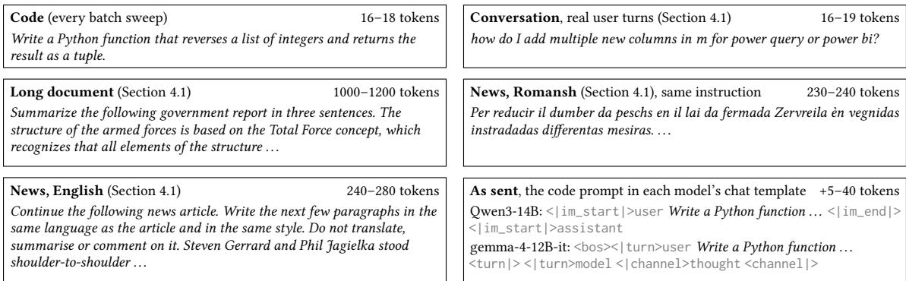
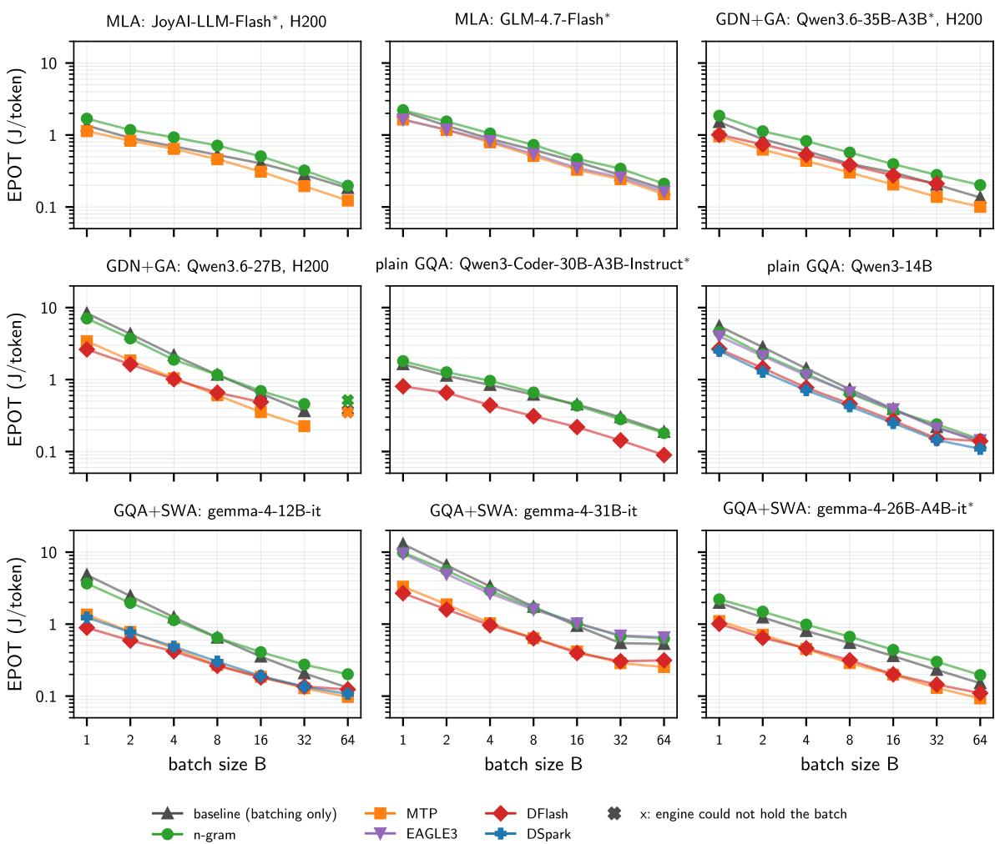
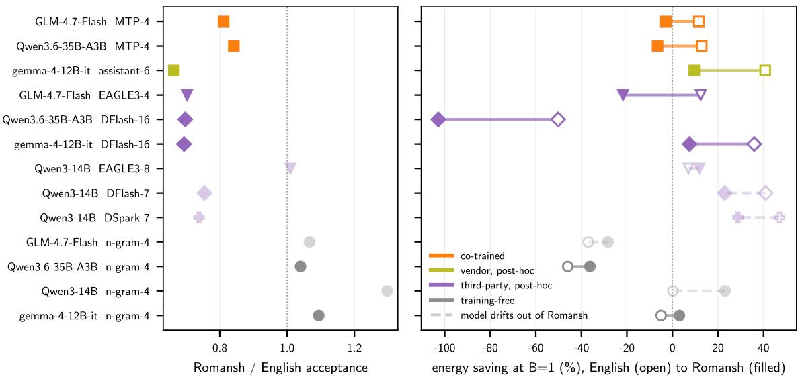
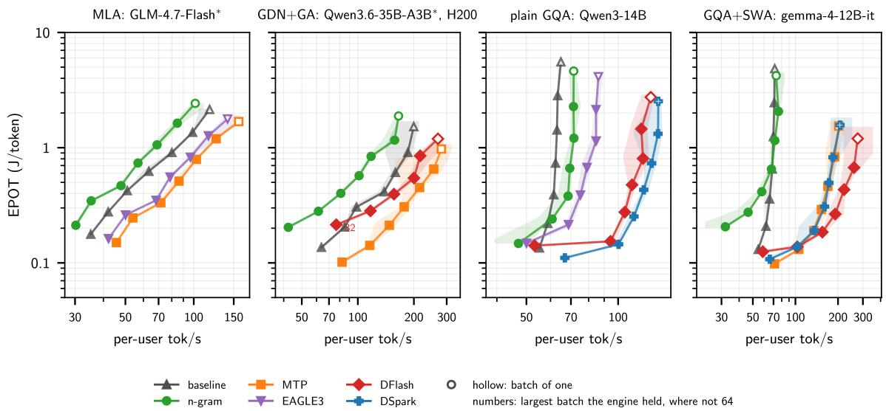
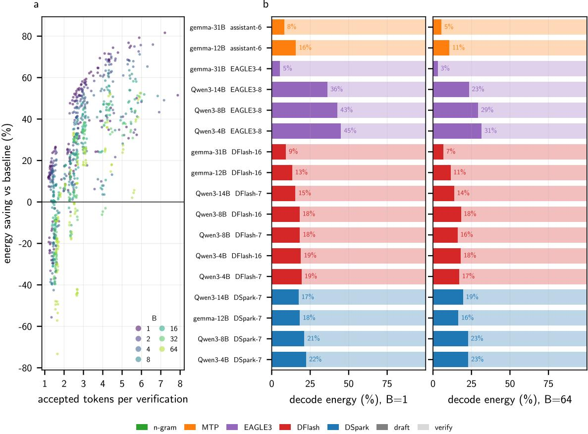
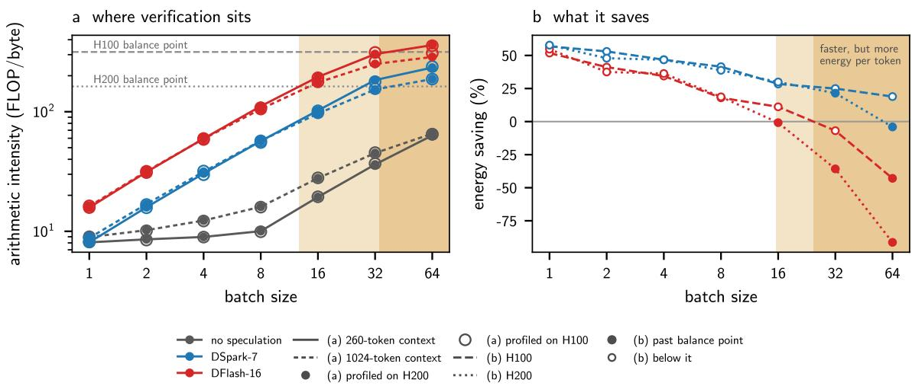

# Only Accepted Tokens Count: An Energy Accounting of Speculative Decoding Under Latency Targets

BOLE MA, Erlangen National High Performance Computing Center, Germany

AYESHA AFZAL, Erlangen National High Performance Computing Center, Germany

JAN EITZINGER, Erlangen National High Performance Computing Center, Germany

HARALD KOESTLER, Erlangen National High Performance Computing Center, Germany

GERHARD WELLEIN, Erlangen National High Performance Computing Center, Germany

Large language model serving is limited by facility power. Energy per token determines how many tokens a datacenter can serve, while a latency target bounds how quickly each user receives them. During decode, every weight is read from memory for every generated token. Batching amortizes this read across users but makes no individual user faster. Speculative decoding does: a drafter proposes several future tokens, and the target model verifies them in a single forward pass that reuses the same weight read. Because every drafted token must be verified whether or not it is accepted, the energy speculation saves depends on how many drafted tokens are accepted.

This saving is hard to pin down. It varies across target models from different attention families and across drafting schemes, and it depends on the text being served. Every drafter we evaluate accepts fewer tokens on conversation than on code, and every trained drafter accepts fewer on Romansh, a low-resource language, than on English.

We measure speculative decoding under production serving conditions (SGLang, CUDA graphs enabled) on H100 and H200 GPUs, at batch sizes up to 64 across 5 corpora. On dense models, verification, not drafting, dominates the energy cost. The saving shrinks as the batch grows, because batching has already shared the weight read that speculation would divide among the accepted tokens. At large batch sizes, block drafters push verification past the balance point between arithmetic and memory traffic into the compute-bound regime, where the saving becomes a loss, and a drafter with low acceptance raises energy per token. Meeting a tighter latency target with speculation then costs additional energy. Larger batches lower energy per token without speculation. Speculation adds to that saving only when acceptance is high, and on the model we tested it leaves little headroom for latency-preserving DVFS.

Additional Key Words and Phrases: speculative decoding, energy efficiency, LLM inference, attention, GPU

## 1 Introduction

Language model serving is limited by facility power. NVIDIA presents its Vera Rubin systems against a fixed facility power budget and names performance per watt the defining metric of AI infrastructure [20, 27], and from the operator side SemiAnalysis reports that OpenAI is limited by datacenter power rather than by budget or floor space, which makes tokens per megawatt the quantity it buys [36]. Tokens per megawatt is energy per token inverted, so every joule a serving configuration saves per token is capacity a power-limited facility gains [2]. The same comparisons already mix systems served with and without speculative decoding [36], which is the setting whose energy this paper measures

Energy is not the only target. A service is also held to latency objectives that its users feel: the time to the first token of a response, and the time between the tokens that follow. A service that saves energy by streaming tokens more slowly loses its users, so the configuration an operator wants is one that meets both targets at once. Choosing the lowest-energy configuration that still meets a latency objective is the framing of cluster-level energy managers such as

DynamoLLM [37]; this paper asks the same question of speculative decoding. The first token has several levers, among them prefix caching [45] and running prefill on separate machines [29]. The time between tokens is set by decode alone.

Decode generates text one token per forward pass. Every pass reads all of the model's weights to produce a single token, so the machine spends its time moving bytes while its arithmetic units wait on memory, and both the energy per token and the time between tokens follow the bytes.

That makes meeting both targets plausible. Reading a byte from off-chip memory costs far more energy than an arithmetic operation on it: on a GH200, a Hopper GPU like ours, a byte read from HBM costs about 93 pJ and a 16-bit tensor-core operation about 0.5 pJ [4], so a pass that produces more tokens per weight read should lower energy per token, and if those tokens belong to one user, such a pass should shorten the time between that user's tokens as well.

Batching is the first candidate. Running many sequences together reads the weights once and amortises that read, so energy per token falls and throughput rises. Batching does nothing for any individual user. On the dense models we measured, the time between a user's tokens grows by 9 to 34% from a batch of 1 to 32. On the Mixture-of-Experts models it grows 2.5 to 4.0 times, because each added request routes to the experts chosen for its tokens and adds their weights to the read.

The time-between-tokens objective is written in that quantity. When the objective is tight enough, no batch size meets it, and speculative decoding becomes the only remaining lever. A drafter proposes several tokens at low cost, the model verifies them in one pass, and the accepted ones are produced for the cost of a single weight read. On our models speculation shortens the mean time between tokens at single stream by 1.3 to 4.3× (Table 4). Without speculation, an objective of 25 ms per token is missed at every batch we ran by gemma-4-31B-it, the largest dense model, and an objective of 10 ms by 4 of our 11 models; speculation brings every one of them under the objective.

The remaining question is the energy cost of speculation. Where batching has already amortised the weight read, there is less for a drafter to recover, and the drafter still has to be paid for.

This paper measures that trade. We run 5 published drafting schemes against 11 models spanning 4 attention designs, sweeping the number of tokens verified per step and the batch. For every model, scheme and batch we also run a non-speculative baseline, the same model served at the same batch size without speculative decoding, and we add hardware performance counters for the roofline and a draft and verify split measured by removing the draft. The paper contributes (1) a paired energy measurement of speculative decoding as production engines serve it; (2) a mechanism, from the draft and verify split and from hardware-counter rooflines on two GPUs that show where verification crosses the balance point and the saving ends; (3) guidance on the choice of drafter and the number of drafted tokens across batch and GPU; and (4) measurement pitfalls that change the reported saving without any sign in the result file, among them a CUDA-graph bias of up to 39 percentage points on Mixture-of-Experts models.

## 2 Background: Decode, Speculation, and Draft Cost

On an H100 the balance point between arithmetic and memory sits near 316 operations per byte, and on an H200 near 163, from the tensor-core rates and memory bandwidths we measure (Section 3), while a decode step at single stream executes about 10 operations per byte, including the padded work of tensor-core tiles (Section 9). Decode runs more than an order of magnitude below the balance point, so the arithmetic units are mostly idle and the energy of a token follows the bytes that produced it and the time spent moving them.

Speculation raises the arithmetic done per byte by giving each weight read several tokens of the same request to process. A drafter proposes k tokens and the model being served, the target model of the speculative-decoding literature, checks all of them in one pass, a small matrix product rather than a vector product. The model keeps the drafted tokens Manuscript submitted to ACM

up to the first one it disagrees with and adds one token that it predicts itself. A rejected token was still drafted and still carried through verification, so the drafter's work on that token and its share of the pass return nothing. At single stream that share costs little, because the extra tokens ride along on a weight read that dominates the step. At serving batch the pass is already doing useful work for every request, and the share spent on rejected tokens displaces useful work. The quantity that matters is therefore the number of tokens accepted per verification, set against the cost of every drafted token, and not the fraction of drafted tokens that is accepted: only the accepted tokens divide the weight read.

We compare 5 drafting schemes: n-gram lookup, multi-token-prediction (MTP) heads, EAGLE3 [23], DFlash [7] and DSpark [8]. They differ in where the drafter comes from, and therefore in what a draft costs. Training-free n-gram drafting matches the recent context against itself and runs no network; SGLang, the engine we measure, matches on the host [45] and vLLM on the GPU [39], and either way its GPU cost is verifying the tree of candidates it proposes. The trained drafters come in two kinds. A draft head (the MTP heads, EAGLE3, and gemma's assistant, described below) is one or a few extra layers that read the hidden state of the model and predict the next token, so one pass of the head costs a small fraction of a pass of the model. A head drafts one token per pass and each pass waits for the previous one, so a draft of k tokens takes k small passes run in sequence. A block drafter (DFlash and DSpark) is a separate small network that drafts a whole block of tokens in one pass. The block has a fixed size set in training, counting the last accepted token that opens it: 16 tokens for the z-lab DFlash drafters, and 7 tokens for DeepSpec's DFlash and DSpark drafters [7, 8].

A drafter trained together with its model is co-trained, as are the MTP heads shipped with Qwen3.6, GLM-4.7-Flash and JoyAI-LLM-Flash. A drafter trained after its model is post-hoc, and its training comes either from the model's vendor or from a third party. Gemma 4 ships a vendor post-hoc draft head, trained by Google, which its authors call an assistant [17]; the engine serves it through its MTP path, so the figures list it under MTP. The EAGLE3, DFlash and DSpark checkpoints we use are third-party post-hoc drafters. Every scheme sends the last accepted token through the verification pass together with the drafted ones, so the model verifies one token more per request and step than the drafter proposes; for a block drafter this number equals the block size. Table 1 lists the number of tokens each drafter has verified per step, and the figures append it to the name of the drafter: DFlash-16 verifies 16 tokens per request and step.

## 3 Measurement

The 11 models span 4 attention families: plain grouped-query attention (GQA: Qwen3-4B, Qwen3-8B, Qwen3-14B and Qwen3-Coder-30B-A3B-Instruct), grouped-query attention with sliding-window layers (GQA+SWA: gemma-4-12B-it, gemma-4-26B-A4B-it and gemma-4-31B-it), multi-head latent attention (MLA: GLM-4.7-Flash and JoyAI-LLM-Flash), and state-space hybrids that interleave Gated DeltaNet layers with gated attention (GDN+GA: Qwen3.6-27B and Qwen3.6-35B-A3B). Of the 11 models, 5 are Mixture-of-Experts models, marked with asterisks in Table 1. Every run uses one NVIDIA H100 SXM5 with 94 GB of HBM2e and a 700 W power limit, on which we measure a memory bandwidth of 2.28 TB/s and a BF16 tensor-core rate of 719 TFLOP/s. Of the 11 models, 3 run their batch sweeps on an H200 with 141 GB of HBM3e (4.44 TB/s and 722 TFLOP/s measured) instead: JoyAI-LLM-Flash, whose weights alone fill the H100's memory, and the two Qwen3.6 hybrids, which the H100 cannot hold at large batch (Section 6); Section 9 repeats Qwen3-4B on the H200 as well. Every run generates 512 tokens per request: a batch of B is B requests submitted together and decoded to that length, with no further arrivals. Each batch is drawn from a pool of 96 distinct prompts for its task and sent through the chat template of each model with its default settings (Figure 1), so Qwen3, Qwen3.6 and GLM-4.7-Flash generate thinking text, and their results describe that text. The code pool feeds every batch sweep; Section 4.1 repeats Manuscript submitted to ACM the sweeps on conversation and long documents and serves English and Romansh news at batches of 1 and 16. Energy comes from the cumulative energy counter built into the GPU (nvmlDeviceGetTotalEnergyConsumption), read at 10 Hz; the energy of a generation is the difference between two readings. The counter covers the GPU board only, not the host processor, host memory, network or cooling, which favours n-gram drafting, whose matching runs on the host. Weights and the key-value cache are BF16, decoding is greedy, each cell runs at least 3 seeds, and each model uses one SGLang build (0.5.12 or newer) under CUDA 13.2. Every speculative run is compared with a non-speculative baseline run: the same model served without speculative decoding, at the same batch size, with the same prompt pool, generation length, GPU and engine settings. The energy saving is the fraction by which the energy per token of the speculative run falls below that of this baseline run, so a difference in serving configuration cannot be reported as a difference in scheme. Acceptance is ragged: within one batch each request keeps the accepted prefix and rolls back the rest. Verification is not. The engine's default, which every measurement here uses, verifies the full number of tokens for every request whatever its drafter proposed, so the verification pass has the same shape at every step. DSpark also offers confidence-scheduled verification, a non-default mode that verifies fewer tokens for some requests, chosen with a cost table measured on the GPU [8]. On the H100 the table prices an extra verified token at a small fraction of a percent of a step, so the mode verifies the full number of tokens at every batch. Acceptance is then unchanged at every batch and the saving at serving batch falls by a few points, so all results use the default mode. Each drafter verifies the number of tokens it was released with, so that number differs across schemes (Table 1). A block drafter verifies its trained block, and the engine does not accept a shorter one. Where a block drafter and a head share a model, the block drafter therefore also verifies more tokens per request, and the comparisons in Section 6 include that difference. DeepSpec's DSpark drafter for gemma-4-12B-it has no implementation in the serving engine, because its layers are Gemma-4 layers rather than the Qwen3 layers the engine's DSpark drafter builds. We wrote that implementation from the DeepSpec reference code; at a batch of 1 it reproduces the baseline's greedy output token for token.

  
Fig. 1. One prompt from each pool, with the section that uses it and the range of its median length in tokens across the models tokenizers, and the code prompt as two models receive it after their chat templates, template tokens in grey.

The counter updates more slowly than a single draft or verify phase lasts, so we never divide energy between phases by time; every energy number is a total over a whole generation, and the draft's share comes from removing the draft (Section 8). Production engines capture the decode step in CUDA graphs wherever shapes allow, so deployments run with capture enabled, not in eager mode. Capture and speculation both exist to amortise kernel launches. A non-speculative decode step is the most launch-bound thing the engine does, while a speculative step already carries Manuscript submitted to ACM

Table 1. Drafters per model, given as the number of tokens each verifies per request and step and marked by who trained it (c with the model, v by the model's vendor afterwards, as Google's assistant for the gemma models, t by a third party), with the GPU each model's batch sweep runs on, and asterisks marking Mixture-of-Experts models.
<table><tr><td>family</td><td>model</td><td>GPU</td><td>n-gram</td><td>MTP head</td><td>EAGLE3</td><td>DFlash</td><td>DSpark</td></tr><tr><td>GQA</td><td>Qwen3-4B</td><td>H100</td><td>4</td><td></td><td>8t</td><td>16t, 7t</td><td>7t</td></tr><tr><td></td><td>Qwen3-8B</td><td>H100</td><td>4</td><td></td><td>8 t</td><td>16t, 7t</td><td>7t</td></tr><tr><td></td><td>Qwen3-14B</td><td>H100</td><td>4</td><td></td><td>8 t</td><td>7t</td><td>7t</td></tr><tr><td></td><td>Qwen3-Coder-30B-A3B-Instruct*</td><td>H100</td><td>4</td><td></td><td></td><td>16t</td><td></td></tr><tr><td>GQA+SWA</td><td>gemma-4-12B-it</td><td>H100</td><td>4</td><td>6V</td><td></td><td>16t</td><td>7t</td></tr><tr><td></td><td>gemma-4-26B-A4B-it*</td><td>H100</td><td>4</td><td>6V</td><td>1</td><td>16t</td><td></td></tr><tr><td></td><td>gemma-4-31B-it</td><td>H100</td><td>4</td><td>6V</td><td>4t</td><td>16t</td><td></td></tr><tr><td>MLA</td><td>GLM-4.7-Flash*</td><td>H100</td><td>4</td><td>4c</td><td>4t</td><td>一</td><td></td></tr><tr><td></td><td>JoyAI-LLM-Flash*</td><td>H200</td><td>4</td><td>4c</td><td></td><td></td><td></td></tr><tr><td>GDN+GA</td><td>Qwen3.6-27B</td><td>H200</td><td>4</td><td>4c</td><td></td><td>16t</td><td></td></tr><tr><td></td><td>Qwen3.6-35B-A3B*</td><td>H200</td><td>4</td><td>4c</td><td></td><td>16t</td><td></td></tr></table>

many tokens of work per launch, so capture helps the baseline more than it helps the speculative run and leaves speculation with less to recover. Measuring with capture disabled therefore credits speculation with an overhead it never removed.

We measured that credit by re-running the baseline and the speculative run with capture enabled. The credit is not a constant and cannot be transferred between models, because it tracks how launch-bound the baseline is. The credit splits by architecture: on every dense model it is under 10 percentage points, and on every Mixture-of-Experts model it is 19 to 39 points at single stream (Table 3). Mixture-of-Experts decode issues many small per-expert kernels and is the most launch-bound baseline in the study. With the launches removed, a Mixture-of-Experts step costs what its experts cost to read, and every token in the step routes to the experts chosen for it, whether it belongs to another request or is another drafted token. Verifying a draft then reads more expert weights even for a single request. Because the credit differs between schemes, capture can also change which scheme saves the most energy: at single stream on Qwen3.6-35B-A3B and gemma-4-26B-A4B-it, DFlash saves the most with capture disabled and the draft head saves the most with capture enabled, and n-gram drafting, which saves energy on every model with capture disabled, costs energy on every Mixture-of-Experts model it runs on with capture enabled. Independent work reaches the same conclusion about Mixture-of-Experts decode being launch-bound rather than arithmetic-bound, for an unrelated set of optimisations [34].

We therefore report every saving, batch sweep, latency and energy split with capture enabled (Table 2), and use capture disabled only for the hardware-counter roofline (Section 9). Graph replay launches the same kernels, so the arithmetic and memory traffic each kernel performs does not depend on capture.

## 4 What Speculation Saves, and Where the Saving Ends

At single stream every model has a scheme that saves energy, and the largest saving per model, taken over its schemes, has a median of 54% of decode energy (Table 2). The one scheme that costs energy at single stream is n-gram drafting on the Mixture-of-Experts models. N-gram drafting accepts too few tokens to pay for the expert weights each extra verified token reads (Section 3), while on the dense models the same drafter saves energy.

The saving then decays as batch grows (Figure 2), because batching has already amortised the weight read that the drafter would divide. This decay holds for the short contexts we serve; at long contexts the key-value cache keeps large-batch decode memory-bound, and the speedup from speculation can grow with batch [33].

Manuscript submitted to ACM

Table 2. Largest energy saving among the schemes (%) per model and batch with CUDA graph capture enabled, on the GPU given in Table 1, as the median over repeated runs ± half their range, the scheme that achieves it (DF DFlash, DS DSpark, MTP an MTP head or gemma's assistant), and a dash where no speculative run held the batch
<table><tr><td>family</td><td>model</td><td>B=1</td><td>B=2</td><td>B=4</td><td>B=8</td><td>B=16</td><td>B=32</td><td>B=64</td></tr><tr><td>GDN+GA</td><td> $\mathsf { Q w e n 3 . 6 - 2 7 B }$ </td><td>+65 ±5 DF</td><td> $+ 6 1 \pm 2 \mathrm { ~ D F }$ </td><td> $+ 5 4 \pm 1 \mathrm { ~ D F }$ </td><td> $+ 4 8 \pm 1 \mathrm { M T P }$ </td><td> $+ 4 5 { \pm } 1 \ \mathrm { M T P }$ </td><td> $+ 3 8 { \pm } 1 \mathrm { { M T P } }$ </td><td></td></tr><tr><td></td><td> $\mathtt { Q w e n 3 . 6 - 3 5 B - A 3 B }$ </td><td> $+ 3 8 { \pm } 4 \mathrm { M T P }$ </td><td> $+ 3 1 { \pm } 8 \mathrm { M T P }$ </td><td> $+ 2 6 { \pm } 2 \mathrm { M T P }$ </td><td> $+ 2 5 { \pm } 2 \ \mathrm { M T P }$ </td><td> $+ 3 1 { \pm } 3 \mathrm { M T P }$ </td><td> $+ 3 1 { \pm } 1 \ \mathrm { M T P }$ </td><td> $+ 2 5 { \pm } 1 \ \mathrm { M T P }$ </td></tr><tr><td>GQA</td><td> $\mathsf { Q w e n 3 - 1 4 B }$ </td><td> $+ 5 4 { \pm } 1 \mathrm { D S }$ </td><td>+53 ±3 DS</td><td> $+ 4 9 { \pm } 2 \mathrm { D } S$ </td><td> $+ 4 1 \pm 1 \mathrm { ~ D S ~ }$ </td><td> $+ 3 5 { \pm } 1 \ \mathrm { D S }$ </td><td> $+ 3 4 { \pm } 0 \mathrm { \ D S }$ </td><td> $+ 1 8 \pm 1 \mathrm { D S }$ </td></tr><tr><td></td><td> $\scriptstyle { 0 w e n 3 - 4 B }$ </td><td> $+ 5 6 { \pm } 5 \mathrm { D S }$ </td><td> $+ 5 3 { \pm } 4 \mathrm { D S }$ </td><td> $+ 4 8 \pm 1 \mathrm { D S }$ </td><td> $+ 4 1 \pm 1 \mathrm { ~ D S ~ }$ </td><td> $+ 2 9 { \pm } 2 \mathrm { D } S$ </td><td> $+ 2 5 { \pm } 1 \ \mathrm { D S }$ </td><td> $+ 1 9 { \pm } 1 \mathrm { D S }$ </td></tr><tr><td></td><td> $_ { \sf Q w e n 3 - 8 B }$ </td><td> $+ 6 2 \pm 3 \mathrm { D S }$ </td><td> $+ 5 5 { \pm } 3 \mathrm { D S }$ </td><td> $+ 5 0 { \scriptstyle \pm 2 } \mathrm { D S }$ </td><td> $+ 4 1 \pm 2 \mathrm { D S }$ </td><td> $+ 3 7 \pm 1 \mathrm { D S }$ </td><td> $+ 3 4 { \pm } 0 \mathrm { \ D S }$ </td><td> $+ 2 4 \pm 1 \mathrm { D S }$ </td></tr><tr><td></td><td> $\mathtt { \bar { Q } w e n 3 - C o d e r - 3 0 B - A 3 B - I n s t r u c t }$ </td><td> $+ 3 2 \pm 1 0 \ \mathrm { D F }$ </td><td> $+ 3 5 \pm 5 \mathrm { D F }$ </td><td> $+ 4 1 \pm 1 0 \mathrm { ~ D F }$ </td><td> $+ 4 8 \pm 7 \mathrm { ~ D F }$ </td><td> $+ 4 9 \pm 3 \mathrm { D F }$ </td><td> $+ 5 1 \pm 1 \ \mathrm { D F }$ </td><td> $+ 5 1 \pm 2 \mathrm { ~ D F }$ </td></tr><tr><td>GQA+SWA</td><td> $\mathtt { g e m m a - } 4 \mathrm { - } 1 2 \mathsf { B - i t }$ </td><td> $+ 7 5 { \pm } 7 \mathrm { D F }$ </td><td> $+ 7 3 { \pm } 4 \mathrm { D F }$ </td><td>+65 ±1 DF</td><td> $+ 5 9 { \scriptstyle \pm 3 } \mathrm { ~ D F }$ </td><td> $+ 4 9 { \pm } 1 \mathrm { D F }$ </td><td> $+ 3 7 { \pm } 1 \mathrm { \ A T P }$ </td><td> $+ 2 5 { \pm } 1 \ \mathrm { M T P }$ </td></tr><tr><td></td><td> $\mathtt { g e m m a - } 4 \mathtt { - } 2 6 \mathsf { B - } \mathsf { A } 4 \mathsf { B - } \mathtt { i t }$ </td><td> $+ 3 9 { \pm } 3 \mathrm { M T P }$ </td><td> $+ 4 1 \pm 7 \mathrm { ~ D F }$ </td><td> $+ 4 2 \pm 1 \ \mathrm { M T P }$ </td><td> $+ 4 7 { \pm } 2 \mathrm { M T P }$ </td><td> $+ 4 5 { \pm } 1 \ \mathrm { M T P }$ </td><td> $+ 4 2 \pm 2 \ \mathrm { M T P }$ </td><td> $+ 3 6 \pm 1 \ \mathrm { M T P }$ </td></tr><tr><td></td><td> $\bar { \mathsf { g e m m a } } - 4 - 3 1 \mathsf { B } - \mathrm { i t }$ </td><td> $+ 7 7 \pm 4 \mathrm { D F }$ </td><td> $+ 7 5 { \pm } 3 \mathrm { D F }$ </td><td>+68 ±2 DF</td><td> $+ 6 2 \pm 1 \ \mathrm { M T P }$ </td><td> $+ 5 8 { \pm } 2 \mathrm { D F }$ </td><td> $+ 4 7 { \pm } 0 \ \mathrm { M T P }$ </td><td> $+ 5 2 { \pm } 1 \mathrm { \ A T P }$ </td></tr><tr><td>MLA</td><td> $\mathtt { G L M - 4 } \bot \mathtt { - F l a s h }$ </td><td> $+ 2 2 \pm 1 \ \mathrm { M T P }$ </td><td> $+ 1 2 \pm 1 \ \mathrm { M T P }$ </td><td> $+ 1 2 { \scriptstyle \pm 0 } \mathrm { M T P }$ </td><td> $+ 1 8 { \pm } 2 \mathrm { M T P }$ </td><td> $+ 2 2 \pm 1 \ \mathrm { M T P }$ </td><td> $+ 1 2 \pm 0 \ \mathrm { M T P }$ </td><td> $+ 1 5 { \pm } 1 \ \mathrm { M T P }$ </td></tr><tr><td></td><td> $\mathtt { J o y A I - L L M - F I a s h }$ </td><td> $+ 1 5 { \pm } 6 \ \mathrm { M T P }$ </td><td> $+ 6 { \pm } 7 \ \mathrm { M T P }$ </td><td> $+ 5 { \pm } 3 \mathrm { M T P }$ </td><td> $+ 1 4 \pm 1 \ \mathrm { M T P }$ </td><td> $+ 2 3 { \pm } 0 \ \mathrm { M T P }$ </td><td> $+ 3 0 { \scriptstyle \pm 0 } \mathrm { M T P }$ </td><td> $+ 3 3 { \pm } 1 \ \mathrm { M T P }$ </td></tr></table>

Table 3. Energy per output token of the non-speculative baseline and of the scheme with the largest saving with capture enabled, with CUDA graph capture off and on, and the saving each pair yields as the median of per-seed savings over three seeds with every speculative run paired to the baseline of the same seed and capture state, from a separate campaign run on the H100 except for JoyAl-LLM-Flash on the H200, so the Qwen3.6 rows differ from Table 2.
<table><tr><td></td><td></td><td colspan="2">baseline (J/token)</td><td colspan="2">speculative (J/token)</td><td colspan="2">saving (%)</td></tr><tr><td>model</td><td>scheme</td><td>off</td><td>on</td><td>off</td><td>on</td><td>off</td><td>on</td></tr><tr><td>B=1</td><td></td><td></td><td></td><td></td><td></td><td></td><td></td></tr><tr><td> $\mathsf { g e m m a } - 4 - 3 1 \mathsf { B } - \mathrm { i } \mathrm { t }$ </td><td>DFlash</td><td>12.80</td><td>12.65</td><td>2.96</td><td>2.91</td><td>+77</td><td>+77</td></tr><tr><td>gemma-4-12B-it</td><td>DFlash</td><td>6.33</td><td>4.92</td><td>1.50</td><td>1.23</td><td>+76</td><td>+75</td></tr><tr><td>Qwen3.6-27B</td><td>DFlash</td><td>11.60</td><td>10.51</td><td>3.43</td><td>3.04</td><td>+71</td><td>+71</td></tr><tr><td>Qwen3-8B</td><td>DSpark</td><td>3.79</td><td>3.10</td><td>1.60</td><td>1.23</td><td>+57</td><td>+60</td></tr><tr><td>Qwen3-4B</td><td>DSpark</td><td>2.88</td><td>1.77</td><td>1.23</td><td>0.757</td><td>+57</td><td>+57</td></tr><tr><td>Qwen3-14B</td><td>DSpark</td><td>5.73</td><td>5.64</td><td>2.48</td><td>2.61</td><td>+57</td><td>+54</td></tr><tr><td>gemma-4-26B-A4B-it</td><td>MTP</td><td>5.10</td><td>1.95</td><td>2.15</td><td>1.20</td><td>+58</td><td>+39</td></tr><tr><td>Qwen3-Coder-30B-A3B-Instruct</td><td>DFlash</td><td>5.32</td><td>1.60</td><td>1.51</td><td>1.12</td><td>+71</td><td>+32</td></tr><tr><td>Qwen3.6-35B-A3B</td><td>MTP</td><td>6.13</td><td>1.55</td><td>2.63</td><td>1.12</td><td>+56</td><td>+30</td></tr><tr><td>GLM-4.7-Flash</td><td>MTP</td><td>8.02</td><td>2.12</td><td>4.48</td><td>1.73</td><td>+44</td><td>+19</td></tr><tr><td>JoyAI-LLM-Flash</td><td>MTP</td><td>6.20</td><td>1.37</td><td>3.29</td><td>1.13</td><td>+47</td><td>+18</td></tr><tr><td>B=64</td><td></td><td></td><td></td><td></td><td></td><td></td><td></td></tr><tr><td>gemma-4-31B-it</td><td>MTP</td><td>0.531</td><td>0.521</td><td>0.255</td><td>0.254</td><td>+52</td><td>+51</td></tr><tr><td>Qwen3-Coder-30B-A3B-Instruct</td><td>DFlash</td><td>0.192</td><td>0.192</td><td>0.108</td><td>0.104</td><td>+43</td><td>+46</td></tr><tr><td>gemma-4-26B-A4B-it</td><td>MTP</td><td>0.157</td><td>0.150</td><td>0.099</td><td>0.097</td><td>+38</td><td>+35</td></tr><tr><td>JoyAI-LLM-Flash</td><td>MTP</td><td>0.247</td><td>0.182</td><td>0.159</td><td>0.121</td><td>+35</td><td>+33</td></tr><tr><td>gemma-4-12B-it</td><td>MTP</td><td>0.139</td><td>0.134</td><td>0.105</td><td>0.098</td><td>+24</td><td>+27</td></tr><tr><td>Qwen3-8B</td><td>DSpark</td><td>0.085</td><td>0.081</td><td>0.066</td><td>0.063</td><td>+23</td><td>+22</td></tr><tr><td>Qwen3-14B</td><td>DSpark</td><td>0.137</td><td>0.136</td><td>0.111</td><td>0.110</td><td>+19</td><td>+20</td></tr><tr><td>Qwen3-4B</td><td>DSpark</td><td>0.063</td><td>0.052</td><td>0.053</td><td>0.042</td><td>+16</td><td>+19</td></tr><tr><td> $\mathtt { G L M - 4 } \mathtt { . 7 - F l a s h }$ </td><td>MTP</td><td>0.229</td><td>0.180</td><td>0.161</td><td>0.153</td><td>+31</td><td>+15</td></tr></table>

At a serving batch of 64, the scheme with the largest saving on each model still saves energy on every model we could run there, by 15 to 52% (Table 2). Not every scheme saves energy at that batch: the n-gram drafter costs energy on every model we report it on except Qwen3-Coder-30B-A3B-Instruct. On the dense Qwen3 models, the models closest to the two dense grouped-query models of Fernandez et al. [15], DFlash-16 costs energy on Qwen3-4B and Qwen3-8B, and EAGLE3 and DFlash-7 cost energy on Qwen3-14B, which reproduces the sign change they report for two such Manuscript submitted to ACM

  
Fig. 2. Energy per output token against batch with CUDA graph capture enabled for 9 of the 11 models, grouped by attention family and labelled where the panel ran on the H200, with the non-speculative baseline in grey, asterisks marking Mixture-of-Experts models, crosses at batches the engine ran below the requested concurrency, and lines that stop short ending where the engine could not start.

models, while DSpark on all three saves 18 to 24%. The spread across models at fixed batch is wider than the spread across schemes on most single models, so the model determines the saving more than the drafting scheme does.

All batch claims stop at 64, because beyond that our prompt pool could not fill a batch with distinct prompts, and duplicate prompts share a cached prefix, so such a batch would measure prefix reuse rather than batching.

## 4.1 Does the Served Text Change the Answer?

A drafter predicts text, so the served content changes what it can recover. Structured, repetitive text is the favourable case: EAGLE reports its largest speedups on code and attributes them to fixed templates [22]. On the Spec-Bench cross-task benchmark, drafting by lookup in the prompt does best where the output copies the input, as in summarisation, and almost every method gains least on translation [42]. We ran the whole batch sweep on a code pool, a long-document Manuscript submitted to ACM pool and real conversational turns, with every speculative run compared with a non-speculative baseline run on the same pool at the same batch size, and with each pool built to avoid the duplicate-prompt problem above.

Conversation is harder to predict than code for every drafter: every scheme on every model accepts fewer tokens per verification on conversation, the training-free n-gram drafter included. How much a drafter loses follows how it was trained. The co-trained MTP heads lose little, and on GLM-4.7-Flash the largest saving, from its MTP head, is the same on both pools. The post-hoc drafters lose more, and the most specialised loses most: the DFlash drafter trained for Qwen3-Coder-30B-A3B-Instruct accepts 2.0 to 3.0 tokens per verification on conversation against 5.9 on code, and at a batch of 64 it saves 51% of decode energy on code and costs energy on conversation. Across models, the largest saving per model at a batch of 64 is a median of 11 percentage points lower on conversation than on code. On long documents, where the answer copies from the prompt, n-gram acceptance on the gemma models is higher than on code, as Spec-Bench reports for lookup drafting

The scheme that saves the most energy can change with the text, because a drafter that accepts fewer tokens still pays for the same number of verified tokens: the engine verifies the full number of tokens for every request, whatever that request accepts (Section 3). On gemma-4-12B-it and gemma-4-31B-it, the two schemes that save the most are the DFlash drafter, which verifies 16 tokens per request and step, and the assistant, which verifies 6 tokens. On code the DFlash drafter saves the most at a batch of 1 to 4 and the assistant at a batch of 32 and 64, the change with batch that Section 6 explains. On conversation the DFlash drafter accepts 3.3 to 3.4 tokens per verification, and the assistant accepts 3.3 to 3.5 tokens: both drafters accept about as many tokens, the DFlash drafter still verifies 16 tokens per request, and the assistant saves the most at every batch.

Spec-Bench attributes the weak translation speedups to thin multilingual data in pretraining [42], without separating how the drafter was trained from how the model was trained. A language outside the drafters' training data separates how the drafter was trained from how the model was trained, and there are two common explanations: that block drafters are fragile, and that what matters is when and on what data a drafter was trained. We served matched news prompts in English and in Romansh, a low-resource language. No model lists Romansh among its supported languages [17, 19, 31, 32, 44], and no post-hoc drafter's published training set contains it: those sets are English instruction and chat data, and the z-lab DFlash recipe adds Spanish, French, German, Italian and Japanese [7, 8, 38]. Every model nevertheless writes Romansh, so some reached their pretraining, and a co-trained head saw what its model saw. Each model was asked to continue the article in the article's language, and only the responses that stayed in Romansh, judged by the rate of Romansh function words that Italian and the other neighbouring languages lack, are scored: 7 to 11 responses per model and drafter at a batch of 1 (Figure 3).

On the 3 models where drafters of different origin serve the same model, the outcome follows when each drafter was trained, not how it drafts or who trained it. GLM-4.7-Flash and Qwen3.6-35B-A3B each ship a co-trained MTP head and are also served by a post-hoc drafter, EAGLE3 on GLM-4.7-Flash and DFlash on Qwen3.6-35B-A3B. On both, the head keeps 81 to 84% of its English accepted length in Romansh, and the post-hoc drafter 70%. With capture enabled these two Mixture-of-Experts models save little at single stream even in English, so in Romansh every drafter on them costs energy, in particular post-hoc drafters cost the most. On GLM-4.7-Flash the MTP head and the EAGLE3 drafter both verify 4 tokens, and EAGLE3 drafts token by token, so drafting a block at once is not the cause. On gemma-4-12B-it, the assistant Google trained keeps no more of its English accepted length than the third-party DFlash drafter, 66 to 69% and both lose most of their saving: trained after its model, the assistant behaves as a post-hoc drafter even though the model's vendor trained it. Qwen3-14B's DeepSpec drafters keep most of their accepted length, but the model drifts out

Manuscript submitted to ACM

  
Fig. 3. Romansh-to-English acceptance ratio and energy saving at a batch of 1, one row per model and drafter labelled with the number of tokens it verifies per step, coloured by how the drafter was trained, and drawn light where the model does not answer consistently in Romansh.

of Romansh into Italian on 23 to 27% of its responses, which leaves it the smallest clean sample. A post-hoc drafter therefore needs to be re-measured on the text it will serve.

## 5 How Much Batching Does It Replace?

Every saving in the sections above compares a speculative run with a non-speculative baseline run at the same batch size, so both runs serve the same number of requests at once. That comparison shows what the drafter changes when the load is fixed. A deployment can also lower energy per token without a drafter, by raising the batch size of the non-speculative baseline. This section therefore compares runs at different batch sizes: for a speculative run at a given batch size, we find the smallest batch size at which the baseline uses no more energy per token than that speculative run. On each model, the speculative run is the scheme with the lowest energy per token at that batch size, and the baseline batch sizes are the ones we ran, 1 to 64 in powers of 2.

A speculative run serving one request uses as little energy per token as the baseline serving 2 to 8 requests, depending on the model. Against a speculative run serving 32 requests, the baseline needs at least 64 requests on every model, and on 5 of the 11 models the baseline serving 64 requests, the largest batch size we ran, still uses more energy per token than the speculative run serving 32. The batch size cannot be raised past what latency permits, and that limit is what motivates speculation.

Putting speed and energy on the same axes shows why the substitution is partial (Figure 4). As the batch of the baseline grows, its trace falls almost vertically: raising the batch size cuts energy per token by more than an order of magnitude. On the dense models each user is served at close to the same rate throughout; on the Mixture-of-Experts models the trace also leans left, because each added request adds expert reads to every step and slows every user. Speculation moves the trace to the right instead, raising per-user speed at single stream by 1.3 to 4.3×. On dense models the two levers are close to perpendicular. Batching is the energy lever and costs little latency; speculation is the latency lever, and the energy it also buys is the part that decays with batch. For a service that is not latency-constrained, batching is the cheaper way to reduce energy; for one that is, speculation provides the per-user speed that batching cannot, and on a Mixture-of-Experts model it also recovers speed that batching gives up

  
Fig. 4. Energy per token against per-user throughput with CUDA graph capture enabled, one panel per attention family, with each trace running from a batch of 1 (hollow marker) to a batch of 64 or to the batch given in its label, shaded over the range of its three seeds.

Table 4 gives the mean time between tokens behind Figure 4. Under an objective of 25 ms per token, the lowest-energy configuration that meets it within the batches we ran uses 18 to 69% less energy per token with speculation than without on 10 of the 11 models, and gemma-4-31B-it meets it only with speculation. The time is a mean over each generation; per-token percentiles need timestamps that our runs do not record.

Lowering the GPU clock through dynamic voltage and frequency scaling (DVFS) offers a third lever, one that keeps latency where the step waits on memory. We locked the SM clock of an H200 at 1500, 1200 and 900 MHz for Qwen3-8B on the code pool, ran with three seeds per batch, and compared each lock with the default power limit. Without speculation the baseline step runs near the top clock while it waits on memory, so the 1500 MHz lock costs 3 to 7% of throughput and lowers energy per token by 4 to 11% at every batch. With DSpark-7 or DFlash-16 at a batch of 16 or more, the GPU already runs at between 1450 and 1700 MHz under the default limit, so the same lock removes little clock and saves no energy. The 1200 MHz lock lowers energy for every configuration but also lowers throughput. The up to 32% that clock locking recovers on the H200 in [3, 26] comes from the lock that minimises energy, on other models and without CUDA graph capture.

## 6 Which Drafter, and Does It Change With Batch?

The drafter that saves the most energy at single stream is not the drafter that saves the most at serving batch. At single stream a block drafter leads on 7 of the 9 models that have a block drafter (Table 2), and on all 9 models with capture disabled, because block drafters accept the most tokens per verification. On every model that also has a draft head, a co-trained MTP head on the Qwen3.6 models and the assistant on the gemma models, the head saves the most energy at Manuscript submitted to ACM

Table 4. Mean time between output tokens per user in milliseconds with CUDA graph capture enabled on the code pool, for the non-speculative baseline and for the speculative scheme with the shortest time at each batch, with a dash where the engine did not hold the batch and a dagger where prefill time is not subtracted.
<table><tr><td rowspan="2">model</td><td colspan="3">baseline (ms)</td><td colspan="3">fastest speculative scheme (ms)</td></tr><tr><td>B=1</td><td>B=32</td><td>B=64</td><td>B=1</td><td>B=32</td><td>B=64</td></tr><tr><td>GLM-4.7-Flash</td><td>8.2</td><td>23.4</td><td>28.0</td><td>6.2 MTP</td><td>18.2 MTP</td><td>21.5 MTP</td></tr><tr><td>JoyAI-LLM-Flash†</td><td>4.2</td><td>15.4</td><td>20.1</td><td>3.0 MTP</td><td>10.8 MTP</td><td>13.6 MTP</td></tr><tr><td>Qwen3-14B</td><td>15.4</td><td>16.9</td><td>17.9</td><td>7.3 DS</td><td>9.8 DS</td><td>14.7 DS</td></tr><tr><td>Qwen3-4B</td><td>5.7</td><td>6.8</td><td>7.7</td><td>2.7 DS</td><td>4.3 DS</td><td>6.0 DS</td></tr><tr><td>Qwen3-8B</td><td>9.4</td><td>10.2</td><td>11.3</td><td>3.8 DS</td><td>6.2 DS</td><td>8.7 DS</td></tr><tr><td>Qwen3-Coder-30B-A3B-Instruct</td><td>5.3</td><td>21.4</td><td>25.6</td><td>3.1 DF</td><td>9.8 DF</td><td>12.2 DF</td></tr><tr><td>Qwen3.6-27B</td><td>15.1</td><td>20.3</td><td></td><td>6.0 DF</td><td>11.5 MTP</td><td></td></tr><tr><td>Qwen3.6-35B-A3B</td><td>4.4</td><td>11.2</td><td>14.5</td><td>3.4MTP</td><td>8.3 MTP</td><td>11.4 MTP</td></tr><tr><td>gemma-4-12B-it</td><td>13.9</td><td>16.0</td><td>18.1</td><td>3.5 DF</td><td>9.3 MTP</td><td>13.8 MTP</td></tr><tr><td>gemma-4-26B-A4B-it</td><td>6.1</td><td>16.7</td><td>20.0</td><td>3.5 DF</td><td>9.5 MTP</td><td>13.5 MTP</td></tr><tr><td>gemma-4-31B-it</td><td>33.2</td><td>38.3</td><td>56.6</td><td>7.8 DF</td><td>19.0 MTP</td><td>28.9 MTP</td></tr></table>

the largest batch the model runs. On Qwen3.6-27B, gemma-4-12B-it and gemma-4-31B-it the head takes over between a batch of 8 and a batch of 32, on gemma-4-31B-it with DFlash leading again at a batch of 16; on Qwen3.6-35B-A3B it saves the most at every batch, and on gemma-4-26B-A4B-it at every batch except 2.

The cost that grows with batch is the number of tokens verified. A block drafter proposes all its tokens in one pass: the z-lab DFlash drafters propose 15 tokens, so the model verifies 16 tokens per request and step. The draft heads on these models, the MTP heads and the assistant, propose one token per pass and stop after 3 to 5 tokens, so the model verifies 4 to 6 tokens per request and step. The model verifies every proposed token for every request, accepted or not. Rejected tokens cost little at single stream, where the step waits on memory, and add compute at serving batch (Section 2), so a drafter that proposes more tokens per step adds more of that compute. The draft itself does not grow with batch (Section 8). The head starts to save the most energy at the batch where the energy of verifying 16 tokens instead of 4 to 6 tokens exceeds the energy saved by the extra tokens the block drafter gets accepted.

We modified the engine so that the n-gram drafter can serve the two state-space hybrids, Qwen3.6-27B and Qwen3.6- 35B-A3B. A hybrid layer carries a recurrent state, and after each verification the engine must advance that state to the last accepted token. The MTP and DFlash code paths of the engine perform this step, but the n-gram path does not, so the state stops advancing after the first verification and the output becomes incoherent within the first few words. With the step added to the n-gram path, n-gram text departs from the baseline text no earlier than MTP text does. On the models without a recurrent state, n-gram text departs from the baseline text no earlier than the texts of two baseline runs depart from each other.

On the hybrids, n-gram drafting then follows the trend it shows on the models without a recurrent state (Figure 2). On the dense Qwen3.6-27B it saves energy up to a batch of 4, 12% at a batch of 1, breaks even at a batch of 8 and costs energy from a batch of 16. On the Mixture-of-Experts Qwen3.6-35B-A3B it costs energy at every batch (Section 4).

Among block drafters, the drafter that proposes fewer tokens per pass saves more energy. Qwen3-4B and Qwen3-8B each have two DFlash drafters, trained by different groups. The DeepSpec drafter proposes 6 tokens per pass, so the model verifies 7 tokens per request and step; the z-lab drafter proposes 15 tokens, so the model verifies 16 tokens. The drafter that proposes 6 tokens saves more energy at every batch we measured, and its margin grows with batch. The model verifies the 9 extra tokens for every request, and at large batch the extra accepted tokens no longer cover the compute those 9 tokens add.

Memory can also cap the batch, independent of energy. On a state-space hybrid, rolling back a rejected draft is not a matter of discarding cache entries: the recurrent state has already absorbed the rejected tokens, so the engine keeps a copy of that state after every drafted token of every request, and restores the one that matches the accepted prefix. The buffer grows with the number of drafted tokens times the batch. On Qwen3.6-27B on the H100, DFlash-16 fails to start at a batch of 16, which the baseline runs, rather than running slowly; at that batch the rollback buffer alone is about 10 times the size of the drafter's weights. The H200's larger memory moves the ceiling but does not remove it: DFlash-16 still fails to start at the largest batches on both hybrids, while the co-trained MTP head, which verifies 4 tokens, holds Qwen3.6-35B-A3B at a batch of 64. A deployment on a recurrent architecture should budget memory for the number of drafted tokens, not only for the weights of the drafter.

## 6.1 How Many Tokens Should a Draft Hold?

The same argument sets the number of tokens to draft. Drafting more tokens per verification helps when they are accepted, because more tokens come out of one weight read, and wastes draft compute when they are not. Acceptance falls off as the draft runs further ahead of the model, so there is an interior optimum.

Batch moves that optimum downward, because the verify pass already carries many tokens while each drafted token is still verified for every request.

We swept the number of tokens the n-gram drafter proposes from 1 to 32 tokens at 4 batch sizes on gemma-4-31B-it, Qwen3-Coder-30B-A3B-Instruct and gemma-4-26B-A4B-it. On gemma-4-31B-it, the dense model of the three models, drafting more tokens saves more energy at single stream, but from a batch of 4 requests 4 drafted tokens save the most energy, and at serving batch every number of drafted tokens costs energy, 32 tokens the most. On the two Mixture-of-Experts models every number of drafted tokens costs energy already at single stream, and the loss grows with the number of tokens, because each verified token reads the experts chosen for that token (Section 3). On all three models the least costly choice at a batch of 64 is 4 tokens. For the n-gram drafter, and for the two DFlash drafters of Section 6, over-drafting, not under-drafting, is the failure mode, and a number of drafted tokens tuned at single stream on a dense model should be cut when the batch is raised.

## 7 Which Metric Predicts the Energy Ranking?

Acceptance, the number of drafted tokens the model keeps per verification, is the obvious metric. Drafter training optimises acceptance, and every drafter release reports it. Acceptance alone does not tell which drafter uses less energy, because that drafter changes with batch while acceptance does not. For any one drafter, acceptance changes little from a batch of 1 to a batch of 64. Block drafters accept more tokens than draft heads in every matched comparison we measured, at every batch. Yet on all 5 models that have both, the head uses less energy at the largest batch, because the block drafter also verifies more tokens (Section 6); acceptance counts only the tokens kept.

Once the batch is fixed, acceptance does predict the saving (Figure 5a). At every batch the saving rises with the number of accepted tokens per verification, the quantity that divides the weight read. The acceptance needed to break even rises with batch, because batching has already amortised the weight read that a drafter would otherwise divide. At a fixed batch, the scheme that accepts more also uses less energy in 287 of 332 pairs of schemes on the same model; the pairs share models and baselines, so they are not independent tests. In all but one of the 45 pairs where it does not, the scheme that accepts more also verifies more tokens per request, most often a block drafter against a draft head. The remaining pair is EAGLE3 on Qwen3-8B at single stream, which drafts 7 tokens in 7 sequential passes.

  
Fig. 5. Energy saving against accepted tokens per verification for every model, scheme and batch that has a baseline run at the same batch size, coloured by batch (a), and the share of decode energy spent drafting and verifying at B=1 and B=64 with capture enabled for every dense model and scheme, measured by removing the draft (b).

## 8 Where the Energy Goes

Verification takes most of decode energy on every dense model and scheme, at single stream and at a batch of 64 (Figure 5b). We measure the split with capture enabled by removing the draft. The speculative run is repeated with the drafter's passes skipped after the first step and the first step's draft verified at every following step, so verification keeps its number of tokens and shape. An engine setting fixes how many drafted tokens each step accepts in both runs, so they run the same steps over the same contexts, and the difference in their decode energy is the energy of the draft. On a dense model the tokens verified in place of a draft do not matter: on Qwen3-8B, verifying random or repeated tokens instead changes the energy by under 3%

No drafter takes more than 45% of decode energy, and a block drafter takes at most 23%, so the cost of running the drafter is the smaller lever: halving the cost of a block drafter would lower decode energy by at most 12%. The share follows how many sequential passes a drafter runs and how large each pass is next to a pass of the model. EAGLE3 on Qwen3 runs 7 passes per draft and takes the largest share, while a block drafter runs one pass per block. On gemma-4-31B-it, the largest dense model, the passes of every drafter are small next to those of the model, and every share is small. The share stays close to constant or falls from single stream to a batch of 64, because verification grows with the batch at least as fast as the draft does.

  
Fig. 6. Arithmetic intensity of a decode step on Qwen3-4B against batch, with the balance point of each GPU as a horizontal line (a), and the energy saving of the same drafters with capture enabled on each GPU, filled where the step at that batch is past the balance point of that GPU (b), shaded in (a) from the batch at which the DFlash-16 step crosses each balance point and in (b) from the batch at which its saving turns negative on each GPU.

Phase markers emitted by the host, the usual way to split the two phases, need capture disabled and do not give this split on the gemma models (Section 10). With capture disabled, the markers credit the gemma-4-12B-it assistant at a batch of 64 with a larger share of decode energy than removing the draft measures.

On the Mixture-of-Experts models the subtraction does not hold, because each verified token is routed to the experts chosen for that token. On GLM-4.7-Flash, verifying random or repeated tokens in place of the reused draft changes the energy of the verify-only run by up to 52%. On these models the cost of verification depends on which tokens are drafted and not only on how many, so we do not report their split.

## 9 Does Speculation Reach the Compute-Bound Regime?

The standard explanation of speculation is a roofline shift: the step is said to move toward the regime where the machine's arithmetic units are the limit rather than its memory. If that were happening, energy per token would fall for a structural reason, and the effect would grow with the number of tokens verified.

We measured the operating point with hardware counters rather than inferring it, taking executed arithmetic intensity as measured arithmetic, including the padded work of tensor-core tiles, over measured memory traffic for a whole decode step, on an H100 and on an H200. The counters capture the first decode steps after the prompt, so the context is set by the prompt length: we use prompts of 1024 tokens and of about 260 tokens, the average context over a 512-token generation from our code prompts

The number of verified tokens alone moves the operating point little: at single stream every scheme on every model sits within a few per cent of where its baseline sits. Combined with batch, it moves the operating point a long way. Arithmetic intensity is a property of the step and not of the GPU, and the same step measures close to the same on Manuscript submitted to ACM

both (Figure 6a). With 260-token contexts, a DFlash-16 step on Qwen3-4B reaches the balance point of the H100 at a batch of 32 and that of the H200 at 16. DSpark-7, which verifies fewer than half as many tokens, stays below the H100's balance point at every batch and passes the balance point of the H200 from a batch of 32. The baseline stays far below both balance points at every batch. The number of verified tokens sets the crossing, not the drafter: the n-gram drafter verifying 16 tokens passes the balance point of the H200 at a batch of 16, as DFlash-16 does, while verifying 4 tokens, as in our panels, it stays below it up to a batch of 64. Longer contexts lower the intensity at a given batch, because each request's context has to be read as well, which adds more memory traffic than arithmetic.

Below the balance point, the n-gram drafter and the assistant on gemma-4-12B-it run below the memory roof from a batch of 1, because attention over their drafted tokens runs in slow kernels, while DSpark runs close to it.

Reaching the compute-bound regime is not a gain in energy; it marks where the saving ends (Figure 6b). Past the balance point, every verified token costs arithmetic time that the weight read no longer hides, and most verified tokens are rejected: DFlash-16 accepts under 3 of the 16 tokens it verifies per request. On both GPUs and for both drafters, the saving changes sign within one doubling of the batch at which the step reaches that GPU's balance point. DFlash-16 stops saving between batches of 16 and 32 on the H100 and at 16 on the H200. DSpark-7 still saves energy at a batch of 64 on the H100, where its step stays below the balance point, and costs energy on the H200, where its step passes the balance point. A GPU with more memory bandwidth per unit of arithmetic reaches the compute-bound regime at a smaller batch and loses the saving there, so a number of drafted tokens tuned on one GPU does not carry over to a GPU with a different balance point. The H200 also changes the energy of the baseline itself, through its memory and power behaviour, so the balance point explains where the saving changes sign, not its size.

## 10 Measurement Pitfalls

Speculative decoding energy is easy to mismeasure, and the failures share one form: the run succeeds, the result file is well formed, the number is plausible, and nothing in it shows that the configuration differed from the one requested.

Besides the capture bias of Section 3, the following conditions produce the same failure. The serving engine resolves concurrency separately for the baseline and the speculative run, so the batch that ran can differ from the batch requested, and the result file stores the requested batch and the batch that ran in different fields. A batch larger than the prompt pool repeats prompts that share a cache prefix (Section 4). A prompt sent to an instruction-tuned model without its chat template changes the text being predicted and moves the reported saving in either direction: without the template, n-gram drafting on the gemma models reports savings up to 117 percentage points higher, and the MTP head on JoyAI-LLM-Flash up to 12 points lower. A profiler window that opens while requests are still being admitted includes prefill, which the decode analysis excludes. Phase markers emitted by the host record when the host enters a phase, not when the GPU runs it, so they can book GPU work of verification to drafting (Section 8). A result writer that matches each appended row to the file's existing header discards, without warning, any column the header lacks, including the column that records the condition a row was measured under. Result rows that do not name the GPU can mix H100 and H200 runs. The same requested batch can then run in full on one GPU and below the requested concurrency on the other GPU: the MTP head on Qwen3.6-27B at a batch of 16 holds 12 requests on the H100 and saves a fraction of what it saves on the H200, which holds all 16 requests.

Holding the generation length fixed keeps the baseline and the speculative run on the same token count, but a run that continues past the end of the model's answer starts a new turn and repeats text. That repetition does not cancel within the pair. The baseline pays the same per token whatever it generates, while a drafter predicts repeated text cheaply, so acceptance rises once the answer has ended. With the end-of-sequence token honoured, every model answers our code prompts in a median of more than 700 tokens, so the 512 tokens of every run stay inside the answer.

A speculative run can produce broken text while its result row looks normal, as n-gram does on the state-space hybrids without the engine fix (Section 6). Taken at face value, those runs would show n-gram matching or beating the co-trained head on Qwen3.6-27B up to a batch of 8.

Each condition above shows only outside the reported metric: in the generated text, the count of distinct outputs, the engine log or the profiled kernel count. The minimum audit confirms the workload, the concurrency and the measurement window, and reports the capture mode and the GPU with every number.

Our measurements have limits: latency is the mean time between tokens, the counter covers the GPU board only, prompts are short, batches stop at 64, heads and block drafters differ in the number of tokens they verify, only the n-gram drafter has its number of drafted tokens swept, and the roofline covers Qwen3-4B.

## 11 Related Work

Drafting schemes. Speculative decoding was introduced with a separate, smaller network as the drafter [21]. The drafters in wide use remove that separate network: Medusa [6] attaches parallel heads, EAGLE and EAGLE-3 draft over the hidden features of the model [22, 23], and several recent checkpoints ship multi-token-prediction heads trained jointly with the model [12]. Block drafters emit a whole block in one pass, and the checkpoints we use are of that family [8, 13, 43]. All of this work is evaluated in accepted length and wall-clock speedup. We ask what the same drafters cost in joules, which orders them differently once the batch is non-trivial. Serving systems tune the number of drafted tokens in closed loop against throughput [24].

Energy measurement. Roofline analysis explains why decode is memory-bound [41], and phase-attributed energy benchmarks exist for the prefill and decode split [10, 28], and for power-capped operation [26]. Two studies are closer to ours: decode energy has been measured across attention mechanisms with hardware counters, without speculation [9], and the energy savings of speculative strategies have been surveyed on older dense models [14]. None separates draft from verify energy, and that split determines whether a drafter pays for itself.

Positioning. Closest to this work, Fernandez et al. [15] measure speculative decoding's energy on two dense groupedquery models with a single drafter at fixed draft length. We measure across 4 attention families and 5 schemes, vary the number of drafted tokens, and decompose the energy. The same comparison of schemes has been measured in time on a production engine [25] and in throughput by a dedicated benchmark [1]; neither reports joules. An analytic roofline treatment of architecture-dependent speculation predicts several of the effects we measure [16], and SpecLA [40] builds verification kernels for linear-attention states; we measure the energy of speculation on such models. That Mixture-of-Experts models gain more from speculation than dense ones is an established result [11, 18]; we show that the launch-bound decode behind that gain also makes their speculative energy the most sensitive to graph capture.

Language and task. With a separate small drafter, speculative decoding is less effective in low-resource languages, and distilling that drafter on the target language generalises poorly [30, 35]. Pretraining a drafter on broad data helps most on out-of-domain and multilingual text [5]. None of these compares, on one model, the different drafters that production engines ship for it, and none measures energy.

Manuscript submitted to ACM

## 12 Conclusion

Speculation shortens the time between output tokens, which batching does not, and under a tight enough objective no batch size meets it without speculation, so a service in that regime chooses speculation to meet its objective rather than on energy grounds.

Speculation is most valuable for energy where a latency target rules out a larger batch size, and least valuable where the batch size can still grow, because there the drafter competes with batching, a lever that needs no extra model and costs only cache memory and per-user latency. Most services value time between output tokens above energy per token, and they should run speculation and tune the drafter and the number of drafted tokens to the batch. Where energy per token is the binding constraint, for instance under a facility power limit, a service should raise the batch size first and then check whether a drafter still reduces energy.

Three findings carry beyond our models. A draft long enough to push verification past the GPU's balance point loses its saving there, and that point depends on the GPU, so the same drafter at the same batch can save energy on one GPU and cost energy on another with more memory bandwidth. The drafter that saves the most energy at single stream is often not the drafter that saves the most at serving batch, and acceptance, which changes little with batch, does not show the change. Each condition in Section 10 changed a reported number in this study, and none was visible in the energy number.

## References

[1] Talor Abramovich, Maor Ashkenazi, Izzy Putterman, Benjamin Chislett, Tiyasa Mitra, Bita Darvish Rouhani, Ran Zilberstein, and Yonatan Geifman 2026. SPEED-Bench: A Unified and Diverse Benchmark for Speculative Decoding. arXiv:2604.09557 [cs.LG]

[2] Ayesha Afzal, Georg Hager, and Gerhard Wellein. 2026. Wattlytics: A Web Platform for Co-Optimizing Performance, Energy, and TCO in HPC Clusters. arXiv:2604.08182

[3] Ayesha Afzal, Markus Manfred Li, and Michael Panzlaff. 2026. Modeling and Chasing the Energy-Efficiency Sweet Spots in Modern GPUs. In Parallel Processing and Applied Mathematics (PPAM). arXiv:2607.00819.

[4] Oscar Antepara, Zhengji Zhao, Brian Austin, Nan Ding, Leonid Oliker, Nicholas J. Wright, and Samuel Williams. 2025. Benchmark-driven Models for Energy Analysis and Attribution of GPU-Accelerated Supercomputing. In Proceedings of the International Conference for High Performance Computing, Networking, Storage and Analysis (SC '25). 888–904. doi:10.1145/3712285.3759815

[5] Fengxiang Bie, Yuqing Jian, Yifan Yu, Zhongzhu Zhou, Zelei Shao, Ben Athiwaratkun, Shuaiwen Leon Song, Chenfeng Xu, Xiaoxia Wu, and Tianyi Zhang. 2026. Osprey: Target-agnostic Pre-training Makes Stronger Drafters in Speculative Decoding. arXiv preprint arXiv:2609.09338 (2026).

[6] Tianle Cai, Yuhong Li, Zhengyang Geng, Hongwu Peng, Jason D. Lee, Deming Chen, and Tri Dao. 2024. MEDUSA: Simple LLM inference acceleration framework with multiple decoding heads. In Proceedings of the 41st International Conference on Machine Learning (Vienna, Austria) (ICML'24) JMLR.org, Article 203, 27 pages.

[7] Jian Chen, Yesheng Liang, and Zhijian Liu. 2026. DFlash: Block Diffusion for Flash Speculative Decoding. arXiv preprint arXiv:2602.06036 (2026).

[8] Xin Cheng, Xingkai Yu, Chenze Shao, Jiashi Li, Yunfan Xiong, et al. 2026. DSpark: Confidence-Scheduled Speculative Decoding with Semi-Autoregressive Generation. arXiv:2607.05147 [cs.LG]

[9] Molka Chkir, Syed Muhammad Danish, Jos Höll, and Arghavan Asad. 2026. Understanding the Energy Scaling of Large Language Model Inference Across Context Lengths and Attention Architectures. arXiv:2608.25096 [cs.LG]

[10] Jae-Won Chung, Ruofan Wu, Jeff J. Ma, and Mosharaf Chowdhury. 2026. Where Do the Joules Go? Diagnosing Inference Energy Consumption. arXiv:2601.22076 [cs.LG]https://arxiv.org/abs/2601.22076

[11] Cohere. 2026. Why Mixture-of-Experts Models Get More From Speculative Decoding. https://cohere.com/blog/mixture-of-experts-models-getmore-from-speculative-decoding

[12] DeepSeek-AI. 2024. DeepSeek-V3 Technical Report. arXiv preprint arXiv:2412.19437 (2024).

[13] DeepSeek-AI. 2026. dspark\_qwen3\_14b\_block7 (DeepSpec DSpark drafter for Qwen3-14B). https://huggingface.co/deepseek-ai/dspark\_qwen3\_14b block7.

[14] Rohit Dutta, Paramita Koley, Soham Poddar, Janardan Misra, Sanjay Podder, Naveen Balani, Saptarshi Ghosh, and Niloy Ganguly. 2026. Benchmarking the Energy Savings with Speculative Decoding Strategies. In Findings of the Association for Computational Linguistics: EACL 2026, Vera Demberg Kentaro Inui, and Lluís Marquez (Eds.). Association for Computational Linguistics, Rabat, Morocco, 4737–4748. doi:10.18653/v1/2026.findings-eacl.249

[15] Jared Fernandez, Clara Na, Vashisth Tiwari, Yonatan Bisk, Sasha Luccioni, and Emma Strubell. 2025. Energy Considerations of Large Language Model Inference and Efficiency Optimizations. arXiv:2504.17674 [cs.LG]

Manuscript submitted to ACM

[16] Fergus Finn. 2026. The Economics of Speculative Decoding / Adaptive Speculation (blog series). https://fergusfinn.com/blog/adaptive-speculation/. [17] Gemma Team. 2026. Gemma 4 Technical Report. arXiv preprint arXiv:2607.02770 (2026)

[18] Zongle Huang, Lei Zhu, Zongyuan Zhan, Ting Hu, Weikai Mao, Xianzhi Yu, Yongpan Liu, and Tianyu Zhang. 2025. MoESD: Unveil Speculative Decoding's Potential for Accelerating Sparse MoE. In Advances in Neural Information Processing Systems (NeurIPS).

[19] JD Open Source. 2026. JoyAI-LLM-Flash model card. https://huggingface.co/jdopensource/JoyAI-LLM-Flash.

[20] Jeffrey Kampman. 2026. Hot Chips 2026: Nvidia Touts Benefits of Its DSX MaxLPS Site Power Management Approach. https: //www.tomshardware.com/tech-industry/data-centers/hot-chips-2026-nvidia-touts-benefits-of-its-dsx-maxlps-site-power-managementapproach-tech-allows-for-more-compute-from-fixed-data-center-power-budgets. Tom's Hardware.

[21] Yaniv Leviathan, Matan Kalman, and Yossi Matias. 2023. Fast inference from transformers via speculative decoding. In Proceedings of the 40th International Conference on Machine Learning (Honolulu, Hawaii, USA) (ICML'23). JMLR.org, Article 795, 13 pages.

[22] Yuhui Li, Fangyun Wei, Chao Zhang, and Hongyang Zhang. 2024. EAGLE: speculative sampling requires rethinking feature uncertainty. In Proceedings of the 41st International Conference on Machine Learning (Vienna, Austria) (ICML'24). JMLR.org, Article 1162, 14 pages.

[23] Yuhui Li, Fangyun Wei, Chao Zhang, and Hongyang Zhang. 2025. EAGLE-3: Scaling up Inference Acceleration of Large Language Models via Training-Time Test. In Advances in Neural Information Processing Systems (NeurIPS). arXiv:2503.01840 [cs.CL]

[24] Xiaoxuan Liu, Jongseok Park, Langxiang Hu, Woosuk Kwon, Zhuohan Li, Chen Zhang, Kuntai Du, Xiangxi Mo, Kaichao You, Alvin Cheung, Zhijie Deng, Ion Stoica, and Hao Zhang. 2024. TurboSpec: Closed-loop Speculation Control System for Optimizing LLM Serving Goodput. arXiv:2406.14066 [cs.DC]

[25] Xiaoxuan Liu, Jiaxiang Yu, Jongseok Park, Ion Stoica, and Alvin Cheung. 2026. Speculative Decoding: Performance or Illusion? arXiv:2601.11580 [cs.CL]

[26] Bole Ma, Ayesha Afzal, Jan Eitzinger, and Gerhard Wellein. 2026. The Illusion of Power Capping in LLM Decode: A Phase-Aware Energy Characterisation Across Attention Architectures. In Parallel Processing and Applied Mathematics (PPAM). arXiv:2605.11999 [cs.DC]

[27] Kibibi Moseley, Kristen Perez, and Pawini Mahajan. 2026. Scaling Token Factory Revenue and AI Efficiency by Maximizing Performance per Watt. https://developer.nvidia.com/blog/scaling-token-factory-revenue-and-ai-efficiency-by-maximizing-performance-per-watt/. NVIDIA Technical Blog.

[28] Chenxu Niu, Wei Zhang, Jie Li, Yongjian Zhao, Tongyang Wang, Xi Wang, and Yong Chen. 2025. TokenPowerBench: Benchmarking the Power Consumption of LLM Inference. arXiv:2512.03024 [cs.LG] https://arxiv.org/abs/2512.03024

[29] Pratyush Patel, Esha Choukse, Chaojie Zhang, Iñigo Goiri, Aashaka Shah, Saeed Maleki, and Ricardo Bianchini. 2024. Splitwise: Efficient Generative LLM Inference Using Phase Splitting. In Proceedings of the 51st International Symposium on Computer Architecture (ISCA).

[30] Nirajan Paudel, Michael Ginn, Luc De Nardi, and Alexis Palmer. 2026. Speculative Decoding and the Curse of Multilinguality. arXiv preprint arXiv:2605.30580 (2026).

[31] Qwen Team. 2026. Qwen3.6-35B-A3B model card. https://huggingface.co/Qwen/Qwen3.6-35B-A3B.

[32] Qwen Team, Alibaba. 2025. Qwen3 Technical Report. arXiv:2505.09388 [cs.CL]

[33] Ranajoy Sadhukhan, Jian Chen, Zhuoming Chen, Vashisth Tiwari, Ruihang Lai, Jinyuan Shi, Ian En-Hsu Yen, Avner May, Tianqi Chen, and Beidi Chen. 2025. MagicDec: Breaking the Latency-Throughput Tradeoff for Long Context Generation with Speculative Decoding. In International Conference on Learning Representations (ICLR), Y. Yue, A. Garg, N. Peng, F. Sha, and R. Yu (Eds.), Vol. 2025. 6835–6850. https://proceedings.iclr.cc/ paper\_files/paper/2025/file/13f972adf12bdf886583d48cd528002f-Paper-Conference.pdf

[34] Gokulakannan Sakthivel, Jerry Wu, Amogh Rajendra, and Giriprasad Radhakrishnan. 2026. Launch-Bound and Substitutable: Why Three Inference Optimizations Fail to Pay Off in Mixture-of-Experts Models. arXiv:2608.26612 [cs.LG

[35] Jameson Sandler, Ahmet Üstün, Marco Romanelli, Sara Hooker, and Ferdinando Fioretto. 2025. The Disparate Impacts of Speculative Decoding arXiv preprint arXiv:2510.02128 (2025).

[36] Bryan Shan, Myron Xie, Jordan Nanos, et al. 2026. OpenAI Jalapeño: Better Than Nvidia Blackwell. https://newsletter.semianalysis.com/p/openaijalapeno-better-than-nvidia. SemiAnalysis

[37] Jovan Stojkovic, Chaojie Zhang, Íñigo Goiri, Josep Torrellas, and Esha Choukse. 2025. DynamoLLM: Designing LLM Inference Clusters for Performance and Energy Efficiency. In 2025 IEEE International Symposium on High Performance Computer Architecture (HPCA). 1348-1362. doi:10. 1109/HPCA61900.2025.00102

[38] Thoughtworks. 2026. GLM-4.7-Flash-Eagle3. https://huggingface.co/thoughtworks/GLM-4.7-Flash-Eagle3.

[39] vLLM Team. 2026. vllm.v1.spec\_decode.ngram\_proposer\_gpu: GPU-Accelerated N-gram Proposer. https://docs.vllm.ai/en/stable/api/vllm/v1/spec\_ decode/ngram\_proposer\_gpu/. vLLM documentation.

[40] Zhibin Wang et al. 2026. SpecLA: Efficient Speculative Decoding for Linear-Attention Models. arXiv:2607.16673.

[41] Samuel Williams, Andrew Waterman, and David Patterson. 2009. Roofline: An Insightful Visual Performance Model for Multicore Architectures. Commun. ACM 52, 4 (2009), 65–76. doi:10.1145/1498765.1498785

[42] Heming Xia, Zhe Yang, Qingxiu Dong, Peiyi Wang, Yongqi Li, Tao Ge, Tianyu Liu, Wenjie Li, and Zhifang Sui. 2024. Unlocking Efficiency in Large Language Model Inference: A Comprehensive Survey of Speculative Decoding. In Findings of the Association for Computational Linguistics: ACL 2024.

[43] z-lab. 2026. DFlash block-diffusion draft checkpoints for Qwen3, Qwen3.6 and Gemma 4. https://huggingface.co/z-lab.

[44] Z.ai. 2026. GLM-4.7-Flash model card. https://huggingface.co/zai-org/GLM-4.7-Flash

Manuscript submitted to ACM

[45] Lianmin Zheng, Liangsheng Yin, Zhiqiang Xie, Chuyue Sun, Jeff Huang, Cody Hao Yu, Shiyi Cao, Christos Kozyrakis, Ion Stoica, Joseph E. Gonzalez, Clark Barrett, and Ying Sheng. 2024. SGLang: Efficient Execution of Structured Language Model Programs. In Advances in Neural Information Processing Systems (NeurIPS). doi:10.52202/079017-2000