# PCM: A Proof-Carrying Message Protocol for Verifiable Multi-Agent Communication

Bravish Ghosh Cygnux Labs research@cygnuxlabs.com

## Abstract

When one AI agent tells another that “the tests passed” or “a person approved this refund”, the receiver has only the sender’s word. A2A and MCP authenticate the channel, but the sender is the party in doubt. A prompt-injected agent can launder fabricated facts and authority through a multi-agent system. We present Proof-Carrying Messages (PCM), a protocol in which each claim carries evidence: records from an append-only Merkle log that the agent cannot write, with inclusion proofs, signed by an attesting signer the agent cannot control. Receivers check messages offline and give each claim a three-valued result: proven, unproven or failed. A claim that rests only on the agent’s own report is never proven. Authority travels as grant chains rooted in a recorded human approval, and the chains can only narrow. We specify four claim types, a typed caveat algebra, replay rules that survive restarts, and “strict readings” that make independent verifiers agree, and we prove the resulting security properties. On a pre-specified benchmark of 926 messages from real runs, 712 of them lies in 16 classes, PCM accepts 10 lies, all of them stale evidence (1.4%, 95% CI 0.8–2.6%). Plain A2A accepts all 712, and models of six deployed protocols accept 504–712. Two independent verifiers agree on all 926 verdicts, and verification takes ≈1 ms.

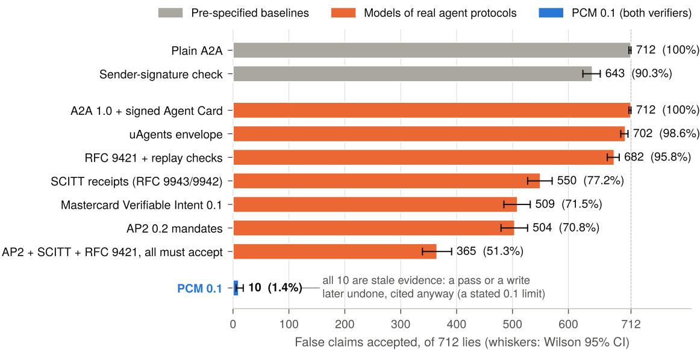  
Figure 1: How many false claims does a receiving agent accept? The 712 lies come from real signer runs and span 16 classes of content, evidence, delivery, authority and encoding lies (Section 12). Grey: pre-specified baselines. Orange: specification-faithful models of six deployed agent protocols, and three of them stacked. Blue: PCM 0.1, whose 10 false accepts are all stale evidence, a record of an event that really happened and was later undone (Section 13).

## 1 Introduction

Large language model (LLM) agents increasingly work in teams. A planning agent delegates to a coding agent, a customer-service agent asks a payments agent to issue a refund, and a research agent hands results to a writing agent. Protocols such as Google’s Agent2Agent (A2A) [1] and Anthropic’s Model Context Protocol (MCP) [2] have standardised how such messages are framed, addressed and transported. What they leave open is the question every receiving agent faces: should I believe what this message says happened?

Consider agent A asking agent B to refund \$120 on order 81. Alongside the request, A asserts three facts:

(i) “alice approved refunds up to \$200 for this order”;

(ii) “the refund tests passed”; and

(iii) “I fetched the order from api.example.com”.

B has only A’s word for each. If A was prompt-injected [20, 29], if a hallucination turned a failed tool call into a reported success, or if another process sends the message in A’s name, B pays out anyway. Authenticating the channel does not help: TLS, mTLS, a signed A2A Agent Card or an RFC 9421 HTTP signature [4] all prove who sent the message, and the sender is the very party whose claims are in doubt. A lying agent that signs with its own key signs its own lie.

The problem is sharper for LLM agents than for conventional services, for three reasons. First, an agent’s behaviour is driven by untrusted text, so any agent that reads a web page, an email or a tool result may be steered by an adversary [14, 20, 38]. Second, LLMs are known to report tool outcomes that did not occur [5], so even an uncompromised agent’s self-report is weak evidence. Third, multi-agent pipelines compose: a single false claim accepted at one hop becomes a premise for every agent downstream, and authority granted to one agent is easily re-presented by another [24, 32]. What is missing is not a better transport but a way for the content of a message to carry its own justification.

Our approach. We take our cue from proof-carrying code [26, 27]. There the producer of untrusted code ships a proof of a safety property, and the consumer checks it with a small checker instead of trusting the producer. Proof-Carrying Messages (PCM) apply the same shape to agent communication. The “proof” is not a formal derivation but cryptographic evidence that an event was recorded by a party other than the agent:

1. The agent’s tool calls go through an attesting signer, a service the agent cannot control. It holds every key, decides policy, and records each call in an append-only Merkle log that the agent cannot write. Calls that matter run through an attesting gateway or executor, which records the result itself.

2. When the agent sends a message, the signer signs it as the calling run, and the message carries the log records that back each claim, with RFC 9162 inclusion proofs [23] under a signed checkpoint.

3. The receiver checks the signature, the proofs and the records offline, against keys it pins, and gives each claim one of three results: proven, unproven or failed.

Authority is handled in the same spirit. A request travels with a grant chain whose root exists only because a named person approved its exact terms, and each later link can only narrow its parent under a fixed, typed implication table. No agent ever holds a signing key. The signer checks each delegation before signing it, and the receiver checks the whole chain again.

Why this is not straightforward. Signing log entries is old technology. The difficulty lies in the semantics that sit between a record and a claim, and in making those semantics identical across implementations. Building PCM, and attacking it with a benchmark, surfaced several classes of subtle failure (Sections 9 and 10):

• Self-reported success. A tool result the agent’s own process reported is the agent’s word. Unless the verifier reads the record’s tier from fields the signer sets, a T1 report is indistinguishable from an attested T2 execution.

• Names the agent chose. An agent names its own calls. A person’s approval of a call called refund-81-approved says nothing about what the call was; it may have been a read\_file. Binding an approval to what was actually decided needs a three-record linkage and an explicit “covers” check.

• Two readers, two answers. 0127.0.0.1 is 87.0.0.1 to inet\_aton and 127.0.0.1 to the macOS resolver; http://a.example\@b.example/ has a different host for a browser and for a generic URL parser; pytest \$’\”;true #’ is one command to Python’s shlex and two to sh; 1e400 is infinity to one JSON parser and an error to another. Each such gap let one verifier prove what another refused, or let a sender prove a claim that was false.

## Contributions.

1. A protocol (Sections 4 to 8). PCM 0.1 specifies a closed message envelope signed by an attesting signer; content-addressed intent schemas; evidence as Merkle-proven log records with HMAC-committed, selectively opened arguments; four claim types with exact threevalued checkers; a typed caveat algebra for person-rooted, attenuating grant chains; and replay rules that survive restarts in bounded memory.

2. A three-valued semantics that separates doubt from falsity (Section 5). A claim is proven only on records written by a party other than the agent. It is unproven when the evidence is absent, is only the agent’s word, shows less than the claim (an attempt, not a connection), or cannot be matched with certainty. It is failed when it is malformed or contradicted. The verdict lattice lets receivers act on what is proven and treat the rest as testimony.

3. Security properties with proofs (Section 9): origin authenticity, evidence soundness, T1 non-elevation, authority attenuation, and at-most-once acceptance across restarts, under stated assumptions. We also give a catalogue of 29 attacks, mistakes and trust assumptions, each with the rule that closes or bounds it.

4. Determinism by construction (Section 10). This is a methodology for security protocols whose verdicts depend on parsing. Wherever implementations disagree, PCM adopts the strict reading every verifier can apply alike, and a claim outside it becomes unproven with an actionable explanation. 187 conformance vectors pin the result.

5. PCM-Lies, a benchmark of false inter-agent claims (Section 12). It contains 926 messages from real signer runs (real pytest suites, HTTP fetches, file writes and human approvals), with 712 lies in 16 classes, labelled from ground truth rather than by any verifier. On it we compare PCM with plain A2A, a sender-signature check and specification-faithful models of six deployed protocols: A2A 1.0 with signed Agent Cards, Fetch.ai uAgents, RFC 9421 with replay checks, SCITT receipts, AP2 mandates and Mastercard Verifiable Intent.

6. Open artefacts: the specification, JSON Schemas, the frozen tool registry, 187 vectors, an independent standalone verifier, the reference implementation (Tracekit 1.5.0 [19]) and the benchmark, all under the MIT licence.

Headline results. PCM accepts 10 of 712 lies (1.4%; 95% CI 0.8–2.6%), and all 10 are of one kind, stale evidence: a suite passed, the code changed and the suite failed, and the sender cites the pass. Every other lie, 702 of 712, is either rejected (626) or explicitly flagged accept-unproven (76), across the claim, evidence, authority, delivery, encoding and message scopes. All 72 claims backed only by the agent’s own report are unproven. Two independent verifiers, written separately, agree on the verdict and reason class of all 926 messages. The deployed protocols we model accept 70.8–100% of the same lies; stacking AP2, SCITT and RFC 9421 still accepts 51.3%. A PCM message is 1.9–11.7 KB at the median (4.2–6.1 KB with one claim) and verifies in 0.8–1.2 ms at the median.

What PCM does not do. PCM does not make a compromised agent honest: a prompt-injected agent can still ask for anything its grants allow, and the grant, not the agent, sets the limit. PCM authenticates the signer’s records, so the signer is the trusted computing base. A claim says that something happened, not that it still holds. We state these limits precisely in Sections 3 and 13 and show that they explain every remaining error in the evaluation.

Roadmap. Section 2 gives background. Section 3 fixes the system and threat model, and Section 4 gives a protocol overview. Section 5 formalises claims and verdicts, Section 6 details the four claim types, Section 7 covers grants, and Section 8 gives the verification and replay algorithms. Section 9 states and proves security properties, Section 10 presents determinism by construction, Section 11 describes the implementation, and Section 12 evaluates PCM. Section 13 discusses limitations, Section 14 relates PCM to prior work, and Section 15 concludes.

## 2 Background

Agent protocols. A2A [1] defines how agents discover each other (through an Agent Card, which A2A 1.0 lets the card’s owner sign as a JWS), exchange messages made of typed parts, and manage long-running tasks. MCP [2] connects a model to tools and resources. Both carry content and can run over authenticated transports. Neither defines a way for the receiver of a message to check, independently of the sender, a statement about what the sender did. ANP signs requests with RFC 9421 HTTP Message Signatures [4] under the sender’s DID key, adds a time window and a nonce cache, and states explicitly that authentication alone does not imply business authority. In the payments domain, AP2 [3] and Mastercard’s Verifiable Intent [25] carry signed mandates: SD-JWT credentials that record who authorised a purchase, under which constraints and until when.

Transparency logs. Certificate Transparency (CT) [22, 23] introduced append-only Merkle logs whose operators sign a checkpoint (a tree size and root hash). Any party can verify that a leaf is in the tree with an inclusion proof of $\lceil \log _ { 2 } n \rceil$ hashes. Leaves are hashed as $\mathsf { S } \mathsf { H A 2 5 6 } ( 0 \mathbf { x } 0 0 \parallel \ell )$ and interior nodes as $\mathsf { S H A 2 5 6 } ( 0 \mathbf { x } 0 1 \parallel a \parallel b )$ , which separates the two domains. The C2SP specifications fix a text format for signed notes [12], for checkpoints [10] and for witness cosignatures [11]. A witness cosigns a checkpoint only if it is consistent with every checkpoint the witness saw before, which makes a log that shows different histories to different parties detectable. SCITT (RFC 9943, with COSE Receipts, RFC 9942) [7, 33] generalises this to signed statements about supply-chain artefacts.

Canonical JSON. The JSON Canonicalization Scheme (JCS, RFC 8785) [30] maps a JSON value to a unique byte string: object members sorted by UTF-16 code units, numbers in the ECMAScript shortest round-trip form, and minimal string escaping. PCM hashes and signs only JCS bytes, so two implementations that parse the same value sign and verify the same bytes.

Capability tokens. Macaroons [6], Biscuit [8] and UCAN [36] are bearer or holder-of-key credentials that a holder can attenuate offline by adding caveats. Biscuit expresses caveats and policies in Datalog. In all three, the delegating party holds the key that attenuates.

Proof-carrying code and provenance. Proof-carrying code [26, 27] ships a machine-checkable proof with untrusted code, so that a small trusted checker replaces trust in the producer. Supplychain provenance frameworks such as in-toto [34] and SLSA [28] sign statements about build steps. SLSA in particular holds that provenance should be generated by the build platform, not by the build’s own (possibly compromised) steps. PCM’s T1/T2 distinction (Section 5) is the per-claim analogue of that principle.

Running example. Throughout, agent A (identity uid:990101) sends agent B (uid:990102) the intent refund.request with arguments {"amount": 12000, "order": 81} (amounts are integer cents). The message carries a root grant that alice (uid:990001) approved, amount <= 20000 and order == 81 for one hour and not delegable, together with an approved\_by claim that cites her approval. Every example in this paper is taken from a conformance vector produced by the reference implementation’s real signer (Section A).

## 3 System and Threat Model

## 3.1 Parties

Table 1 lists the parties. An agent is any program that calls tools and sends messages; PCM never trusts it. A run is one session of an agent within a log. It has an identifier and a tenant (an isolation unit within one log), and the signer binds it to the transport identity that registered it, written scheme:subject, for example uid:990101 or an mTLS SPIFFE ID. The attesting signer is a service the agent reaches over an authenticated channel. It keeps the run’s events in an append-only Merkle log and signs, with its log key, the log’s checkpoints, PCM messages and PCM grants. The receiver pins the log keys it trusts in a trust document and keeps replay state.

## 3.2 Adversary

We consider an adversary that fully controls the sending agent. It may be a prompt-injected LLM, a hallucinating LLM, malicious code in the agent’s process, or another process that holds the agent’s credential. The adversary

• composes arbitrary message bodies, claims, evidence selections and grant chains, and may submit any body to the signer for signing;

• reports arbitrary T1 tool results, chooses the identifiers (tool\_use\_id) of its own calls, and names tools as it likes;

• writes any file the agent can write, including test-runner configuration in its working directory;

• records, replays, reorders, drops and redirects messages on the network, and sends messages to any receiver;

Table 1: Parties in PCM and what each is trusted for. “Writes” lists what enters the log or the message on that party’s authority.
<table><tr><td>Party</td><td>Role</td><td>Writes</td><td>Trusted?</td></tr><tr><td>Agent (sender)</td><td>Calls tools, composes the message body</td><td>from, to, intent, claims, grants, payload; T1 tool results</td><td>X</td></tr><tr><td>Attesting signer</td><td>Holds keys, decides policy, appends records, signs messages, grants and checkpoints</td><td>id, ts, nonce, sig; record seq, √ (TCB) source, tier; approvals; effects</td><td></td></tr><tr><td>Attesting gateway / executor</td><td>Runs a tool call on the agent&#x27;s behalf and reports the result</td><td>T2 tool results (marked by the signer from the authenticated caller)</td><td>√(per tool class)</td></tr><tr><td>Observer</td><td>Egress proxy or kernel sensor that reports network effects</td><td>effect.observed records</td><td>L</td></tr><tr><td>Person</td><td>Human approver named in the signer&#x27;s approvals</td><td>approval answers</td><td>√(for what they approve)</td></tr><tr><td>Witness</td><td>configuration Cosigns checkpoints consistent cosignatures with its view</td><td></td><td>optional</td></tr><tr><td>Receiver</td><td>Verifies, keeps replay state, decides to act</td><td>nothing</td><td></td></tr></table>

• operates other agents, other runs, other tenants and even other signers, whose keys a receiver may also pin;

• reads every message, grant and evidence record it has ever been sent.

The adversary does not control the signer, its keys or its log; cannot make a T2 executor or an observer report something that did not happen; and cannot impersonate a configured person to the signer. These are trust assumptions about the deployment, and we make them explicit as Assumption 2 below. A signer-bug variant, in which the signer signs grants it should have refused, is evaluated separately (Section 12).

## 3.3 Goals

G1 Origin. A receiver accepts a message only if an honest signer signed that exact body, as the run that appears in from.

G2 Evidence soundness. A claim is proven only if the sender’s run contains signer-appended records, written by a party other than the agent, that establish exactly what the claim states.

G3 No self-attestation. No combination of the agent’s own reports (T1) makes a claim proven.

G4 Attenuated authority. Any authority a message presents is no wider than what a configured person approved: never widened at a delegation step, never past its expiry, and never moved to another tenant or log.

G5 Freshness of delivery. A receiver acts on each message at most once, including across restarts and replicas, and only if the message is addressed to it.

G6 Determinism. Any two conforming verifiers return the same verdict, claim results and conformance fields on the same inputs.

G7 Honest progress. Honest senders who follow the specification get their claims proven and their messages accepted.

## 3.4 Non-goals

PCM does not (N1) make the agent’s intentions trustworthy, since a compromised agent may send any request its grants allow; (N2) prove that a state is current, since a claim is existential, “a call happened”, and a later event can undo it; (N3) prove absence, since the sender chooses which records to disclose; (N4) provide confidentiality, which TLS does; or (N5) protect against a compromised signer or a leaked log key (Section 9.6).

## 3.5 Assumptions

Assumption 1 (Cryptography). Ed25519 with the strict verification rules of Section 8.1 is existentially unforgeable under chosen-message attack (EUF-CMA). SHA-256 is collision-resistant. HMAC-SHA256 is a binding commitment when keyed by a uniformly random 32-byte salt.

Assumption 2 (Honest signer). The signer for each pinned log (i) signs a message only as the calling run, and sets id, ts and nonce itself; (ii) assigns each record’s seq and ts as it appends it; (iii) sets a record’s top-level source/tier to gateway/T2 only for results reported by an authenticated attesting gateway or executor; (iv) writes approval and approval.request records only from authenticated answers and its own requests, and effect.observed only from observer reports; (v) issues a root grant only under Section 7.3’s conditions and a child only under Section 7.4’s; and (vi) never lets an agent read its keys or write its log.

Assumption 3 (Honest attesting parties). An attesting gateway or executor records a call under a tool name that the frozen placement table maps to class k only if the tool it ran is of class k, and records ok only if the call succeeded.

Assumption 4 (Clocks and receivers). The clocks of signer and receiver agree within the receiver’s replay window. A receiver keeps one replay state per identity, shared by all replicas that answer for that identity.

Assumption 2 makes the signer the trusted computing base, much as a CT log operator, a SLSA build platform or a hardware root of trust is trusted in its own setting. Section 9.6 analyses what follows if it fails. We note that the assumption is operational: a deployment satisfies it by running the signer as a different user, on a different host or in a different trust domain from the agents it records.

## 4 Protocol Overview

Figure 2 shows a PCM deployment. Agent A runs inside its own process with no access to signing keys. Each tool call first goes to the signer, which records a policy.decision and answers allow, flag, ask or deny. A call that needs a person’s answer (ask) produces an approval.request record and then an approval record. Calls that the deployment routes through an attesting executor or gateway are run there, and the executor reports the result to the signer over its own authenticated channel, so the signer marks the tool.result record as T2. Calls the agent runs itself are reported by the agent, and the signer marks them T1. Observers report network effects. All of these become records in the log. Each record is a JSON event whose hash is ${ \mathsf { H } } ( e ) = " { \mathsf { s h a } } 2 5 6 : "$ ∥ hex(SHA256(JCS(e))), and whose seq is its leaf index.

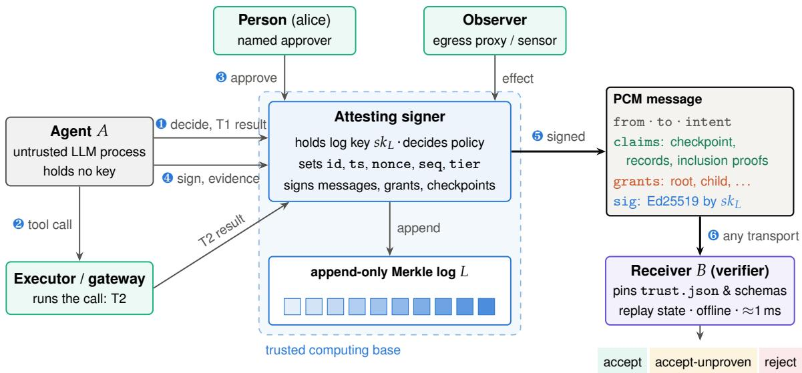  
Figure 2: PCM architecture. ❶–❸: every tool call of agent A is decided and recorded by the attesting signer. Results come from the agent’s own process (T1) or from an attesting executor or gateway (T2); approvals come from named people; network effects come from observers. ❹: when A sends a message, it asks the signer to sign the body as its run, and for records with inclusion proofs. ❺–❻: the receiver verifies everything offline against keys it pins. The agent never holds a key.

To send a message, A composes the body (from, to, intent, optional claims, grants and payload) and asks the signer to sign it. The signer refuses unless from is exactly the calling run’s identity, run and tenant; it sets pcm, id, ts and nonce from its own clock and randomness, signs, and (in Tracekit) records that it signed (Section 8.1). For each claim, A fetches from the signer the records it wants to disclose, each with an inclusion proof under the latest checkpoint, and places them in the claim’s evidence before signing, so that the message signature covers them too.

## 4.1 The envelope

Figure 3 shows the message structure. The envelope is a closed JSON object of media type application/vnd.pcm+json, parsed strictly: valid UTF-8, no duplicate names, integers within $\pm ( 2 ^ { 5 3 } - 1 )$ , no lone surrogates, nesting at most 128 deep, and no number that rounds to no finite IEEE 754 double. A text that fails any of these is bad-input and is refused before any check. Identifiers, timestamps and digests follow fixed ASCII patterns. A timestamp has exactly six fractional digits, so timestamps compare correctly as strings, and the replay check refuses a timestamp that names no real time (for example, month 13). Integer fields must be JSON integers: true, 0.0 and "0" are not the integer 0.

## 4.2 Intents and content-addressed schemas

An intent is a schema reference and typed arguments. Both sides hold a copy of the schema document, a small closed JSON object that types each argument field (string, int, money in minor units of a currency, id with a pattern, enum, bool, time). It may also list the claim types the intent requires, demand a grant, and name the tool the intent stands for. On the wire a schema is named name@H(document):

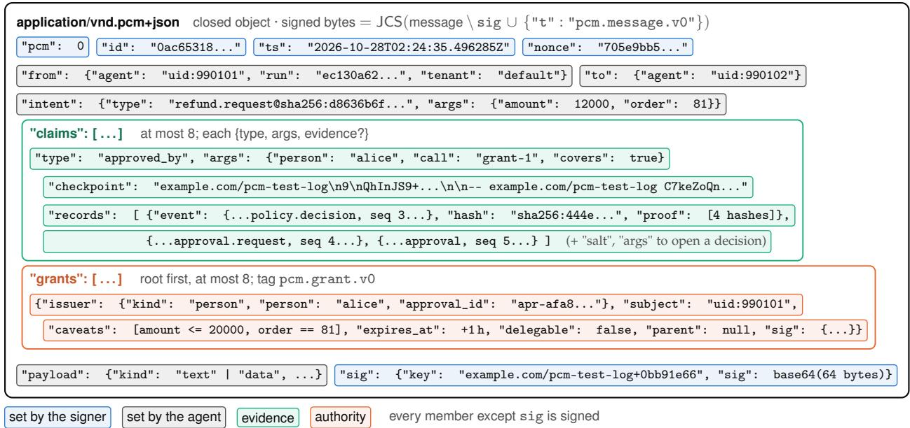  
Figure 3: Anatomy of a PCM message, from the conformance vector accept-approved-by. Every object is closed (an unknown member makes the envelope invalid). The signature covers the JCS encoding of every member except sig, together with the domain-separation tag. Evidence and grants are therefore bound to the message, and nothing can be added after signing.

so an edited document is a different schema. Argument matching is strict and performs no conversions: 120.0, true and "120" are not integers, every member must be a declared field, and every non-optional field must be present.

## 4.3 Claims, evidence and grants at a glance

A claim is a typed statement about the sender’s own run: tests\_passed{suite}, approved\_by{person, call, covers?}, reached\_host{host} or file\_written{path, digest}. Its optional evidence is a C2SP checkpoint note signed by the log key together with 1–16 records of the sender’s run, each with its hash and RFC 9162 inclusion proof. A record of a policy.decision may also carry an opening, a salt and the arguments, which opens the HMAC commitment to the call’s arguments that the signer stored instead of the arguments themselves (Section 5.3). A grant states that a subject may send an intent within typed caveats until a time. The chain is root first, and the root’s issuer is a person (Section 7).

## 4.4 Outcomes

The verifier returns a structured result (Algorithm 2): signature, replay, schema and grant subresults, one result per claim, and a verdict. A accept means that everything required is proven. A accept-unproven means that nothing failed but something rests on the sender’s word, and a receiver should treat it as testimony. A reject must never be acted on. The result also names any checks the caller skipped (no replay state, no receiver identity); a non-empty skipped marks an audit result that must not drive action.

## 5 Formal Model of Claims and Verdicts

This section fixes the objects a verifier reasons about and the three-valued semantics of claims.   
Later sections instantiate it for each claim type (Section 6) and for grants (Section 7).

## 5.1 Notation and primitives

JCS(v) is the RFC 8785 encoding of a JSON value v, and $\mathsf { H } ( v ) = \mathsf { \ " { s h a } } 2 5 6 : \mathsf { \ " { u } } \left| \left| \mathrm { h e x } \bigl ( \mathsf { S } \mathsf { H A } 2 5 6 \bigl ( \mathsf { J C S } ( v ) \bigr ) \bigr ) \right. \right.$ A signature scheme $\big ( \mathsf { K G } , \mathsf { S i g } , \mathsf { V f } \big )$ is Ed25519 with the strict verification rules of Section 8.1. For a closed object o with a sig member, the signed bytes under tag t are

$$
\begin{array} { r l r } { \mathrm { b y t e s } _ { t } ( o ) } & { = \mathrm { J C S } \big ( ( o \setminus \{ \mathsf { s i g } \} ) \cup \{ ^ { \mathsf { n } } \mathsf { t } ^ { \mathsf { n } } : t \} \big ) , } & { \quad t \in \big \{ \mathtt { p c m } . \mathsf { m e s s a g e } . \mathsf { v } 0 , \mathtt { p c m } . \mathsf { g r a n t } . \mathsf { v } 0 \big \} . } \end{array}
$$

Because messages and grants are closed objects without a $" \mathtt { t } ^ { \mathfrak { n } }$ member on the wire, a "t" member makes the envelope invalid. The tag therefore cannot be supplied by the sender, and a signature under one tag never verifies under the other (vector reject-grant-signature-as-message).

## 5.2 Logs, records and evidence

Definition 1 (Log, record, run). A log L is a sequence of records $r _ { 0 } , r _ { 1 } , \ldots$ . appended by $L ^ { \prime } \mathrm { s }$ signer, where $r _ { i } . { \mathsf { s e q } } = i .$ . Each record carries a tenant, a run\_id, a type (such as policy.decision, tool.result, approval, approval.request or effect.observed), a data object, and (for tool.result) top-level source and tier fields. The run $\rho = ( { \tt r u n } , { \tt t e n a n t } )$ of L is the subsequence of records with that run and tenant. The leaf hash of $r _ { i }$ is $\ell _ { i } = { \mathsf { S H A 2 5 6 } } ( 0 \mathbf { x } 0 0 \parallel \mathsf { b y t e s } ( \mathsf { H } ( r _ { i } ) ) )$ , and the Merkle tree head at size n is ${ \mathsf { M T H } } ( \ell _ { 0 } . . \ell _ { n - 1 } )$ as defined in RFC 9162.

Definition 2 (Checkpoint). A checkpoint is a C2SP signed note whose text is exactly three lines, an origin, a decimal tree size n and a base64 root $R ,$ followed by 1–64 signature lines. It is valid $f o r \mathtt { a }$ trust document $\tau$ and a message m when: (i) every line is well formed, including lines of unpinned keys; (ii) the Ed25519 log key that $\tau$ pins under the origin’s name has a valid line; (iii) the origin equals the log name in m.sig.key; and (iv) at least T .witnesses\_required pinned witnesses have valid cosignatures over cosignature/v1\ntime $t \backslash { \mathfrak { n } } \parallel$ text.

Definition 3 (Evidence item). An evidence item is $E = ( \kappa , \langle ( e _ { j } , h _ { j } , \pi _ { j } , o _ { j } ) \rangle _ { j = 1 } ^ { k } )$ with checkpoint $\kappa ,$ $1 \leq k \leq 1 6 ,$ , event $e _ { j } ,$ claimed hash $h _ { j } ,$ inclusion proof $\pi _ { j }$ (at most 64 hashes) and optional opening $o _ { j }$ . E verifies for message $m ,$ written $\mathsf { E v O K } ( E , m , T )$ , iff κ is valid for $\tau$ and $m ,$ and for every $j \colon$

(E1) ${ \sf H } ( e _ { j } ) = h _ { j } ;$

(E2) every entry of $\pi _ { j }$ is canonical base64, and $\pi _ { j }$ proves leaf ${ \mathsf { S H A 2 5 6 } } ( 0 \mathbf { x } 0 0 \parallel h _ { j } )$ at index $e _ { j }$ .seq in the tree $( n , R ) { \dot { } }$ of $\kappa ;$

(E3) no earlier $j ^ { \prime } < j$ has $e _ { j ^ { \prime } } . \mathbf { s e q } = e _ { j } . \mathbf { s e q }$ (a record is listed once);

(E4) $e _ { j } . { \mathrm { t e n a n t } } = m .$ .from.tenant and $e _ { j } . \mathtt { r u n \_ i d } = m . \mathtt { f r o m \_ r u n } ;$

(E5) $e _ { j }$ validates against the event schema of the evidence profile (tracekit.event.v2);

(E6) if $o _ { j }$ is present, it has both salt and args, $e _ { j } . \tt t y p e \mathrm { ~ = ~ } p o l i c y$ .decision, and the opening verifies (Definition 4).

Condition (E3) matters more than it appears. Without it, a sender could list one decision twice, once opened and once not, and make the checker’s answer depend on the order of the list. Condition (E4) binds evidence to the sender’s own run and tenant, because run identifiers are chosen by clients and are unique only within a log and tenant. The origin check in the checkpoint definition binds evidence to the log that signed the message (Section 9.5, items 1 and 18).

## 5.3 Committed arguments and openings

A signer that never stores tool arguments in clear records, in each policy.decision, a commitment

$$
\mathtt { a r g s \_ c o m m i t m e n t } = \mathfrak { v } _ { \mathrm { h m a c \_ s h a 2 5 6 } ; \ \mathfrak { n } } \rVert \operatorname { h e x } \left( \mathrm { H M A C } _ { s } \left( \mathrm { A S C I I } ( \mathrm { H } ( \{ \mathfrak { \Omega } ^ { \mathfrak { n } } \mathfrak { t o o l } \mathfrak { n } : t o o l , \mathfrak { \Omega } ^ { \mathfrak { n } } \mathrm { a r g s } ^ { \mathfrak { n } } : a r g s \} ) ) ) \right) \right)
$$

with a fresh 32-byte salt s. The signer gives s only to the run’s own agent.

Definition 4 (Opening). An opening $o = \left( s , a \right)$ of a decision record e verifies iff the recomputed commitment from e.data.tool, a and s equals e.data.args\_commitment, compared in constant time. Only the arguments of opened decisions are visible to a claim checker.

Openings give PCM selective disclosure: a sender reveals the arguments of exactly the decisions that a claim needs, and every other decision in the disclosed evidence stays hidden behind its commitment (Section 13.5).

## 5.4 Who wrote a record: tiers

The central distinction in PCM is between records whose content the agent determined and records whose content someone else determined.

Definition 5 (Attested record). A record e is attested iff either (a) its type is approval, approval.request or effect.observed: records that only the signer writes, from authenticated answers, its own requests and observer reports; or (b) e.type = tool.result with top-level $e . \mathsf { s o u r c e } = \mathsf { " g a t e w a y " }$ and $e . \mathsf { t i e r } = \mathsf { u n c } _ { 2 } \mathsf { u }$ . Any other tool.result is T1: the agent’s own report.

The tier is read from top-level fields that the signer sets from the authenticated caller, and never from data, which the reporting party fills. An agent that writes "tier": "T2" into its own result’s data changes nothing.

## 5.5 Three-valued claim semantics

Let $\mathbb { R } = \{ { \mathsf { f a i l e d } } \prec { \mathsf { u n p r o v e n } } \prec { \mathsf { p r o v e n } } \}$ , totally ordered, and let F denote the maximum $( ^ { \prime \prime } \mathrm { b e s t ~ o f ~ ' ' } )$ over a set of candidates, with $\sqcup \varnothing = { \mathrm { f a i l e d } }$

Definition 6 (Claim checker). For each claim type τ, PCM fixes (i) an argument table, (ii) a predicate $\mathsf { M a l f o r m e d } _ { \tau } ( a r g s )$ , and (iii) a function Check $\tau ( a r g s , E , m ) \ \in \ \mathbb { R }$ over the records of a verifying evidence item. The result of a claim $c = ( \tau , a r g s , E ^ { ? } )$ in message m is

$$
\mathsf { R e s } ( c ) = \left\{ \begin{array} { l l } { \mathsf { f a i l e d } } & { \mathrm { i f ~ } a r g s \mathsf { \ e a i l s ~ i t s ~ t a b l e , ~ o r ~ M a l f o r m e d } _ { \tau } ( a r g s ) ; } \\ { \mathsf { u n p r o v e n } } & { \mathrm { e l s e ~ i f ~ } c \mathrm { ~ c a r r i e s ~ n o ~ e v i d e n c e ~ ( o r ~ t h e ~ v e r i f i e r ~ i s ~ L e v e l ~ 1 ) } ; } \\ { \mathsf { f a i l e d } } & { \mathrm { e l s e ~ i f - E v O K } ( E , m , T ) ; } \\ { \mathsf { C h e c k } _ { \tau } ( a r g s , E , m ) } & { \mathrm { o t h e r w i s e } . } \end{array} \right.
$$

The ordering of the cases is deliberate. A malformed claim, such as pytest || true or a relative path, is failed with or without evidence, at every conformance level, so a sender cannot downgrade a provably bad claim to unproven by omitting its evidence.

The informal reading of the three values is:

• proven: the evidence verifies, and an attested record in it says what the claim says.

Algorithm 1 Ran(match, k) over the records E of one verified evidence item   
1: cands ← {failed} ▷ “no call in the evidence . . .   
2: for all d ∈ E with an opening, d.type = policy.decision, opened args an object do   
3: if d.data.tool or d.data.decision\_id absent or d.data.decision = deny then continue   
4: a ← match(d.data.tool, d.args) ▷ a ∈ {yes, no, cannot-tell}   
5: if a = no then continue   
6: else if a = cannot-tell then cands ← cands ∪ {unproven}; continue   
7: if k ̸= ⊥ and Place(d.data.tool) ̸= k then cands ← cands ∪ {unproven}; continue   
8: for all r ∈ E, r.type 三 tool.result, (r.decision\_id, r.tool\_use\_id)   
(d.decision\_id, d.tool\_use\_id) do   
9: if r.data.ok ̸= true then cands ← cands ∪ {failed} ▷ “. . . and failed”   
10: else if r.source = gateway ∧ r.tier = T2 then return proven   
11: else cands ← cands ∪ {unproven} ▷ “the agent’s own report (T1)”   
12: return F cands

• unproven: there is no evidence; or the only matching record is T1; or the matching call is of a tool the verifier cannot place in the needed class; or the only matching record shows an attempt (a connect), not a connection; or the verifier cannot tell whether a record matches (a host that will not parse under Section 6.3.1, or a Write of a relative path that may be the claimed file).

• failed: the claim is malformed; the evidence does not verify; or no record in it says what the claim says.

The run predicate. Three of the four checkers ask whether a call ran and succeeded. Algorithm 1 defines the shared predicate Ran(match, k) over one evidence item, parameterised by a matcher on (tool, opened args) and an optional tool class k. It formalises three rules. Only opened, non-denied decisions with an identifier can match. A tool is placed in a class only by the frozen placement table (Section 6.5), never by the shape of its arguments. Among matching results, only an attested (T2) result with ok = true proves the claim.

## 5.6 Verdicts

Definition 7 (Verdict). Let S be the intent’s schema document with required claim types $Q \subseteq$ {claim types}, and let Met(q) hold iff some claim of type q is proven, where for q = approved\_by the claim must additionally carry covers = true (Section 6.2). Given that the envelope parsed and the signature verified, the verdict is

$$
\mathsf { V } ( m ) = \left\{ \begin{array} { l l } { \mathsf { r e j e c t } } & { \mathrm { i f ~ } \mathsf { B a d } ( m ) \mathrm { ~ o r ~ } \big ( s t r i c t \wedge \exists q \in Q . \neg \mathsf { M e t } ( q ) \big ) , } \\ { \mathsf { a c c e p t } \mathsf { u n p r o v e n } } & { \mathrm { e l s e ~ i f ~ } \exists c . \mathsf { R e s } ( c ) = \mathsf { u n p r o v e n } , \mathrm { ~ o r ~ } \exists q \in Q . \neg \mathsf { M e t } ( q ) , } \\ { \mathsf { a c c e p t } } & { \mathrm { o t h e r w i s e } , } \end{array} \right.
$$

where Bad(m) holds iff the replay check fails, the schema check has errors, the grants result is failed, or some claim has Res(c) = failed. An invalid envelope or a failed message signature yields reject immediately, with every later part null: no claim work is done for a forged message.

Two simple facts follow directly from the definitions, and we use them later.

Proposition 1 (Level 1 never proves). A Level 1 verifier, which does not check evidence, never assigns proven to any claim, and therefore returns accept only for messages that carry no claims and whose schema requires none.

Proof. By Definition $^ { 6 , }$ a Level 1 verifier maps every well-formed claim to unproven (no evidence or “evidence not checked”). A claim then forces at least accept-unproven by Definition 7, and so does any required type, since Met needs a proven claim. □

Proposition 2 (Order independence). Res(c) does not depend on the order in which E lists its records.

Proof sketch. (E1), (E2) and (E4)–(E6) are per-record conditions, and (E3) rejects any duplicate seq regardless of which copy appears first. Ran takes the maximum over candidates, which is order-free. The one checker that selects among several records, approved\_by, is specified to fail whenever the qualifying records name more than one (tool, args) pair (Section 6.2), so the choice of record cannot change the result. The detail string names the lowest-seq witness, which is also order-free. □

## 6 The Four Claim Types

PCM 0.1 has a deliberately closed vocabulary of four claim types (Table 2). A new type can be added only together with its arguments in the schema language, an exact checker over a named evidence profile with proven, unproven and failed rules, and conformance vectors for each result. We present each checker and the attack that shaped it.

## 6.1 tests\_passed: exactly one test command

The checker is Ran(match, shell), where match holds when the call’s shell command (the first non-null of the argument members command, cmd, commands) equals suite exactly. The difficulty is not the match but the claim: pytest || true, pytest; true and pytest & all exit 0 whether the tests pass or not, and each of them can really run through an honest executor. A claim about such a command is a lie even when it is backed by a genuine T2 record. PCM therefore makes suite malformed, and hence failed with or without evidence, unless it is a test command:

(a) Plain words. It contains none of ; $\ Z ( \mathbf { x } ) \subset \{ \mathbf { x } \} . $ , no control character other than tab, and no U+007F; and its quotes balance. Splitting it into words at unquoted spaces and tabs then gives the same words under sh and under any word splitter.

(b) A listed runner, by its bare name. The words begin with one of 42 fixed runner sequences (pytest, python -m pytest, go test, cargo test, npm test, . . . ; Section B), compared exactly. ./pytest, /tmp/x/pytest, uv run pytest and CI=1 pytest are not test commands.

(c) Runs tests. No word is -h or -V, and no word of three or more characters is a prefix of –help, –version or –collect-only, because argparse-based runners accept unambiguous prefixes.

Rule (a) is stricter than a shell parser on purpose. An earlier draft cut command lines at operators using Python’s shlex. That splitter has no \$’...’ quoting, so it reads pytest \$’\”;true #’ as one command, while sh runs pytest "’" and then true. Likewise a # inside a word is a comment to shlex but literal to sh (pytest -q tests/x.py#|| true). Rather than chase one shell’s grammar, PCM 0.1 forbids every character on which a shell and a word splitter can differ.

Table 2: The four claim types of PCM 0.1 and when each is proven, unproven or failed. “Attested” is Definition 5. Each row is pinned by the vectors listed in the specification.
<table><tr><td>Claim</td><td>proven when</td><td>unproven when</td><td>failed when</td></tr><tr><td>tests_passed {suite}</td><td>an opened, non-denied decision of a shel1-class tool whose command equals suite exactly, with a T2 result ok</td><td>no evidence; result is T1; tool not placed as shel1</td><td>suite is no single test command (Section 6.1); the T2 result is not ok; no matching call</td></tr><tr><td>approved_by {person, call, covers?}</td><td>an approval by the configured person (not an agent, not self) of cal1, plus the approval.request it answers plus the policy.decision that request names; with covers, the approval also</td><td>no evidence; with covers: the schema names no tool, or the decision is not opened</td><td>no such triple; records disagree on what was approved; with covers: another tool, other args, or a pcm. grant that did not issue this root grant</td></tr><tr><td>reached_host {host}</td><td>covers this request an observer&#x27;s net effect with connections &gt; 0 to the host; or an opened http-class call whose URL host equals it, with a T2 result ok</td><td>no evidence; only a connect attempt or a zero-connection minute; result is T1; a host that will not parse (Section 6.3.1)</td><td>no record of the host; a URL whose scheme has no host (file:, gopher:); the T2 result is not ok</td></tr><tr><td>file_written {path, digest}</td><td>an opened Write whose full content hashes to digest and whose absolute path equals path under the claim&#x27;s path rules, with a T2 result ok</td><td>no evidence; result is T1; the call&#x27;s path is relative and may be the file; a drive path spelled otherwise</td><td>path is relative or has a . . segment; the digest differs; a tool other than Write</td></tr></table>

What proven means for tests\_passed. The signer recorded that this exact command line ran through an attesting executor and exited 0. Runners accept flags that select no tests and still exit 0 (go test -run NONE, mvn test -DskipTests, cargo test –no-run), and they read configuration from a working directory the agent may have written. A receiver must compare suite with the suites it accepts, and must not rely on the runner list to tell a real test run from another.

## 6.2 approved\_by: binding approval to what was decided

An agent names its own calls. It can decide a read\_file call under the id refund-81-approved, have a person approve it, and claim “alice approved refund-81-approved”. An early draft proved approved\_by from the approval record alone, so this claim was proven (Section 9.5, item 27). PCM 0.1 instead requires, in one evidence item, the three linked records of Figure 4:

1. an approval with decision = approve, tool\_use\_id = call, person equal to the claim’s person (compared only with the signer-configured name, never with the raw approver identity), approver\_kind absent or person, and self\_approved not true;

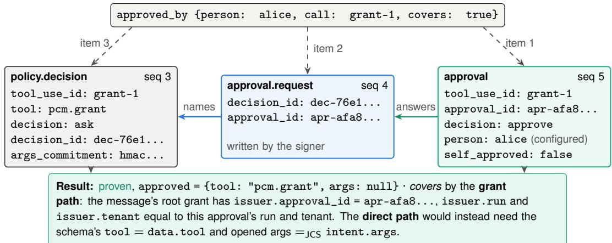  
Figure 4: How approved\_by is proven (vector accept-approved-by). The call id is the agent’s own name, so an approval record alone says nothing about what was approved. The checker requires the three-record linkage. The result’s conformance field approved reports the decision’s tool and opened args, and covers: true asks the verifier to check that this approval stands for this request.

2. the approval.request with the same approval\_id;

3. the policy.decision that request names, with tool\_use\_id = call and a non-empty tool.

An approval without the other two is failed, not unproven: the sender chooses its evidence and can always include them.

Records that disagree. To make the result independent of record order (Theorem 2), the checker collects every qualifying approval. If the requests of one approval name two or more decisions, the claim is failed. Otherwise the checker collects the qualifying decisions as pairs (tool, args or null). If two pairs differ in JCS (so {"amount": true} and {"amount": 1} differ, though some languages compare them equal), the claim is failed; if exactly one pair exists, the claim is proven and the result carries approved = {tool, args} as a conformance field that every verifier must return identically.

What the approval covers. Even a correctly linked approval may be of a different request: alice approved a \$5 refund, and the message asks for \$50. Leaving this comparison to receivers proved unsafe in our benchmark (finding F3, Section 12.6), so PCM 0.1 adds covers. With covers = true, a linked claim is proven only by one of two paths:

• Grant path. The decision’s tool is pcm.grant, and the approval issued the message’s root grant: the root’s issuer.approval\_id, run and tenant are those of the approval.

• Direct path. The intent’s schema names a tool equal to the decision’s tool, the evidence opens the decision, and its args equal intent.args in JCS.

Otherwise the claim is failed (a pcm.grant decision whose approval did not issue the root, another tool, or other args) or unproven (the schema names no tool, or the decision is not opened, so the verifier cannot tell). A schema that lists approved\_by is met only by a proven claim with covers. The direct path covers every message that asks for the same tool with the same args, so one-time authority needs a field unique to the request (such as a request\_id) or a grant, whose caveats and expiry bound it.

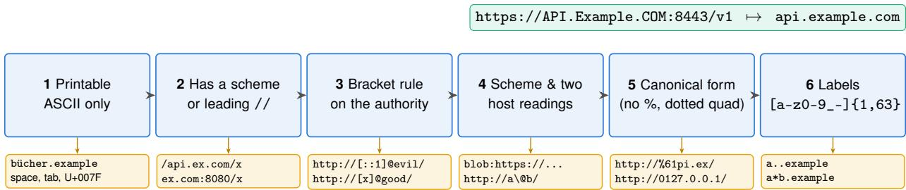  
won’t parse ⇒ the claim is unproven (never proven or failed), with a sentence telling the sender how to send it  
Figure 5: Host canonicalisation (Section 6.3.1). Every step is specified character by character, so that verifiers in any language agree. Where two common readers disagree on a URL’s host, the host will not parse rather than match a host the call may not have reached. Examples below each step are refused there; each is a conformance vector.

## 6.3 reached\_host: a connection, not an attempt

The claim is proven by either of two kinds of attested record. The first is an egress observer’s net effect for the host with connections > 0. The second is Ran(match, http), where match compares the host of the call’s url with the claim’s host in canonical form. Two subtleties shaped the rule. A kernel sensor reports a process’s call to connect, which may fail, and an egress observer records a minute with zero connections when its upstream connect failed; both show an attempt, so both give unproven (and a denied connect counts for nothing). And a call that received an HTTP error status reached the host, but the evidence profile records only ok, so PCM 0.1 cannot prove it from the call record (finding F4; Section 13).

## 6.3.1 Canonical hosts

A host has many spellings: API.Example.COM:8443, api.example.com., [::ffff:7f00:1], xn–bcher-kva.example. Worse, two widely used readers can assign different hosts to one URL. PCM compares hosts in a single canonical form produced by a six-step reading (Figure 5). Its guiding rule is that where two readers named in the specification disagree, the host will not parse. A host that will not parse yields unproven, never proven or failed, together with a fixed sentence that tells the sender how to resend. Three steps encode lessons that were costly to learn:

• ASCII only. IDNA 2003, UTS 46 and browsers map some Unicode names differently (faß.example is fass.example to IDNA 2003 and xn–fa-hia.example to a browser). IDNA 2003 maps U+1806 to nothing, so exa U+1806 mple.com proved example.com in an earlier draft. PCM 0.1 compares hosts in printable ASCII (A-label form) only, so no verifier depends on its IDNA or Unicode version.

• One bracket rule, checked by the verifier itself. CPython’s urlsplit has, across releases, made no bracket check, checked the first bracketed part of the authority, and checked the part after the last @. Verifiers on two releases gave one message different verdicts (accept versus accept-unproven on http://[::1]@api.example.com/). PCM fixes one rule that every reader agrees with and requires verifiers to apply it before any library reads the URL.

• IPv4 only as a dotted quad. inet\_aton reads 0127.0.0.1 as octal (87.0.0.1), while the macOS resolver reads it as decimal and connects to 127.0.0.1. Our benchmark found that a sender on a macOS executor could thereby make PCM prove an address it never contacted (finding

F1). PCM 0.1 accepts an IPv4 address only as four decimal octets without leading zeros. 127.1, 0x7f.0.0.1, 2130706433 and 1.2.3.256 will not parse. IPv4-mapped and NAT64 IPv6 addresses compare as the IPv4 address inside them.

## 6.4 file\_written: whose path rules?

A claim file\_written{path, digest} is proven by an opened Write call (the tool name decides; an op argument is the agent’s word) whose full content hashes to digest and whose path matches. The path rules are chosen by the claim, since the record does not say which operating system ran the call:

<table><tr><td>Claim path</td><td>Rules</td><td>Consequences</td></tr><tr><td>C:\work\a.txt,</td><td>Windows (drive</td><td>\ and / separate; proven only by a call of the identical</td></tr><tr><td>C:/work/a.txt</td><td>path)</td><td>string</td></tr><tr><td>/work/a.txt work/a.txt,\work\a.txt,</td><td>POSIX relative</td><td>only / separates; /work\a. txt is one file in / failed, with or without evidence</td></tr><tr><td>C:a.txt /work/../a.txt</td><td>has a . .</td><td>failed: “name the file&#x27;s own path&quot;</td></tr></table>

A call whose own path is relative and is a suffix of the claimed path gives unproven: the record does not hold the working directory, so it may or may not be the same file. An earlier draft read every \ as /, so a Write of the POSIX file /work\report.txt proved /work/report.txt. A proven file\_written says that a call wrote these exact bytes. A receiver that holds the file can check the digest itself, and this check is the one freshness test PCM 0.1 makes fully sound (Section 13).

## 6.5 Tool placement as frozen protocol data

Whether a call is a shell or an http call is decided by its tool name alone, through a frozen table of 54 names in six classes (http 14, payment 12, sql 10, shell 8, fs 7, email 3), published with its SHA-256 (15f8410f...c8fe07). A command or url member in the arguments does not place a tool. A tool not in the table is unplaced and gives unproven. The table is protocol data: an earlier draft derived it from an implementation’s policy packs, so installing a pack changed the verdicts of messages already sent, and two verifiers of different versions disagreed (Section 9.5, item 29).

## 7 Grants: Person-Rooted, Attenuating Authority

Claims say what happened. Grants say what the sender may ask for. A grant is a closed object signed under tag pcm.grant.v0: subject S may send intent I while the intent’s args satisfy the caveats C, until expires\_at. It names its issuer (a person, for a root; the parent’s subject, for a child), the issuing run and tenant, whether it is delegable, and its parent, which is H of the full signed parent including its signature (null for a root).

## 7.1 Typed caveats

A caveat $( f , o p , v )$ limits one field f of the intent’s schema. It is valid only when f exists, the operator suits the field’s type, and every value passes the field’s rule:

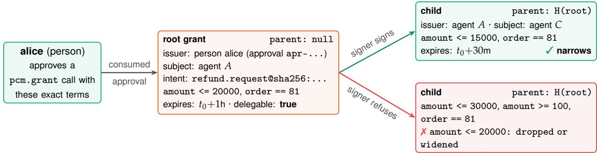  
The verifier re-checks every link: signed by the message’s log key, same intent and tenant, parent hash, delegable parent, issuer = previous subject, expiry shrinks, caveats narrow, and intent.args satisfies every grant.  
Figure 6: A grant chain only narrows (illustrative values; the vector accept-approved-by uses a nondelegable root). No agent holds a key. The signer signs a child only after checking it against its parent, and the verifier checks the whole chain again. A child that widens one caveat while tightening another is refused.

Table 3: When a child caveat c implies a parent caveat p on the same field (Theorem 3). A child narrows its parent iff every parent caveat is implied by at least one child caveat. Missing caveats count as widening; the child may add caveats on any field.
<table><tr><td rowspan="2">parent p</td><td colspan="3">child caveat c</td></tr><tr><td>= 0  $\in T$ </td><td> $\leq b ^ { \prime }$ </td><td> $\geq b ^ { \prime }$ </td></tr><tr><td>= x</td><td> $v = x ,$  same JSON type T = {x} (strings)</td><td>never</td><td>never</td></tr><tr><td>∈S</td><td>v a string in S</td><td> $T \subseteq S$  never</td><td>never</td></tr><tr><td>≤b</td><td>same type,  $v \leq b$ </td><td>never same type,  $b ^ { \prime } \leq b$ </td><td>never</td></tr><tr><td>≥b</td><td>same type,  $v \geq b$  never</td><td>never</td><td>same type,  $b ^ { \prime } \geq b$ </td></tr><tr><td rowspan="5"></td><td></td><td></td><td></td></tr><tr><td>Field type</td><td>Operators</td><td></td></tr><tr><td>int, money</td><td> $= = , < = , > = , < , >$ </td><td></td></tr><tr><td>time ==, string, id, enum</td><td> $< = , > =$  (compared as fixed-format strings)</td><td></td></tr><tr><td>bool ==</td><td>==, in (1–64 distinct values)</td><td></td></tr></table>

For comparison every caveat is normalised to one of $\{ = v , \in S , \ \leq b , \ \geq b \}$ , with $< b \mapsto \leq b - 1$ and $> b \mapsto \geq b + 1$ on integers. Arguments satisfy a caveat when the field is present and the single-value caveat $= a r g s [ f ]$ implies it under the table below. Types must match exactly, so true does not satisfy $< = ~ 5 ,$ and $" 8 1 "$ does not satisfy == 81. A signer need not know the schema, so it can sign a caveat whose value has the wrong JSON type; such a grant fails at the verifier twice over, as an invalid caveat and as one that no args satisfy.

## 7.2 Narrowing: a sound implication table

For a caveat c on field f of type θ, let $\mathsf { S a t } ( c ) \subseteq \mathsf { D o m } ( \theta )$ be the set of values of f that satisfy it, and for a set of caveats C, let $\mathsf { S a t } ( C )$ be the set of argument objects that satisfy every caveat in C.

Lemma 3 (Soundness of the implication table). If Table 3 says that c implies $p ,$ then $\mathsf { S a t } ( c ) \subseteq \mathsf { S a t } ( p )$

Proof. By cases on the table’s non-“never” cells. $( = v { \mathrm { ~ v s . } } = x ) \colon { \mathsf { S a t } } ( = v ) = \{ v \}$ and $v = x$ with the same JSON type, so $\{ v \} = \{ x \} . ( \in T { \mathrm { ~ v s . } } = x ) \colon T = \{ x \}$ gives $\mathsf { S a t } ( \in T ) = \{ x \} . ( = v \mathrm { v s . } \in S )$ $v \in S$ gives $\{ v \} \subseteq S . \ ( \in T { \mathrm { ~ v s . ~ } } \in S ) \colon T \subseteq S . \ ( = v { \mathrm { ~ v s . ~ } } \leq b ) \colon$ : every satisfying value equals $v \leq b .$ $( \leq b ^ { \prime } \mathrm { \ v s . } \leq b )$ : any $w \leq b ^ { \prime } \leq b$ satisfies $w \leq b ,$ , by transitivity of the total order on integers and on fixed-format timestamps compared as strings. The ≥ cases are symmetric. Requiring the same JSON type excludes cross-type coincidences (true vs. 1) on which some languages’ equality would otherwise make the inclusion false. □

The “never” cells are conservative. For example, bounds never imply an equality, even though $\{ \leq 8 1 , \geq 8 1 \}$ together pin 81. Each child caveat is matched individually, so a child must restate an equality as an equality. This keeps the check a table lookup, comparable across languages, rather than a solver.

Corollary 4 (Narrowing is attenuation). If child caveats $C ^ { \prime }$ narrow parent caveats $C ,$ then ${ \sf S a t } ( C ^ { \prime } ) \subseteq$ Sat(C). Narrowing is transitive.

Proof. Take $a \in \mathsf { S a t } ( C ^ { \prime } )$ and $p \in C$ . By narrowing there is $c \in C ^ { \prime }$ on the same field that implies p; a satisfies $c ,$ so by Theorem 3 it satisfies $p .$ Transitivity follows from the transitivity of $\subseteq \quad \bigsqcup$

## 7.3 Root grants come from a person

A caveat-free grant is the widest grant, so the root of authority must be human. The signer issues a root grant (parent: null) only if all of the following hold: an approvals configuration names who may answer; the agent made a tool call pcm.grant whose args are exactly the grant’s subject, intent, caveats, expiry and delegability, and that call was approved and the approval consumed with exactly those args; the approver is a person mapped to a name, not an agent approver, not the run’s own agent or its person (self-approval), and not the grant’s subject; expires\_at is in the future and at most 24 hours away; the call has no result yet (one grant per approval); and the run is not held or quarantined. The issuer then becomes {kind: person, id, person, run, tenant, approval\_id}. A policy that never asks a person about pcm.grant leaves nothing to consume, so no root grant can exist: the design fails closed.

## 7.4 Delegation

The subject of a delegable grant may ask the signer for a child. The signer refuses unless the parent verifies under its own log key, belongs to the caller’s tenant, names the caller as subject, is delegable and unexpired, and the child expires no later than the parent and narrows it. The child is issued by {kind: agent, id: caller}, for the parent’s intent, with parent = H(parent). A child needs no further approval, since by Theorem 4 it grants nothing new.

## 7.5 Chain verification

Table 4 lists the rules a verifier checks over the chain $g _ { 0 } , \ldots , g _ { n } ,$ , which is given root first. Two rules deserve comment. First, every grant must be signed by the key that signed the message. Identities and tenants are names inside one signer (default is everyone’s default tenant), so without this rule a grant signed by log X could ride in a message from log Y whose agent happens to share the subject string. Second, the args must satisfy every grant, not only the last. This is redundant given narrowing, and kept deliberately as defence in depth.

The verifier reports the root’s issuer (kind, identity, person name) but does not decide whether to trust that person; a receiver checks grants.root against the people it accepts. PCM 0.1 has no revocation. A grant holds until expires\_at, which is why the signer caps root lifetimes at 24 hours and why expiry is judged against the signer-set message ts. A later audit therefore reaches the same answer, and the replay check (Section 8.3) prevents a message captured while its grant was valid from being acted on later.

Table 4: Grant-chain rules (S7.6). Any failing rule makes the grants result failed and the verdict reject.  
Rule Check Example vectors (reject  
omitted)   
needed no grants: none, or failed if the schema has grant: grant-needed   
true   
signature each sig.key = message sig.key; verifies with tag grant-tampered,   
pcm.grant.v0 grant-from-another-log   
intent each grant’s intent = intent.type grant-other-intent   
caveats valid for the intent’s schema grant-bad-caveat   
expiry message ts $\leq$ each expires\_at grant-expired   
tenant each issuer.tenant = from.tenant grant-cross-tenant   
args intent.args satisfies every caveat of every grant grant-amount-over-caveat,   
grant-caveat-bool-for-int   
root g<sub>0</sub>: no parent, issuer kind person with a name, grant-root-by-agent,   
issuer $\neq$ subject grant-issuer-is-subject   
link g<sub>i</sub>.parent $\underline { { \underline { { \mathbf { \Pi } } } } } \mathbin { \lrcorner } \mathsf { H } ( g _ { i - 1 } )$ grant-broken-parent   
delegable g<sub>i−</sub> delegable grant-below-non-delegable   
who delegates g<sub>i</sub>.issuer = agent g<sub>i−1</sub>.subject grant-child-wrong-issuer   
expiry shrinks g .expires\_ $\mathfrak { a t } \le g _ { i - 1 }$ .expires\_at grant-child-outlives-parent   
narrows caveats of $g _ { i }$ narrow $g _ { i - 1 }$ (Table 3) grant-widen-and-tighten  
child,   
grant-in-set-widened-child   
subject g<sub>n</sub>.subject = from.agent grant-subject-not-sender

## 8 Verification, Replay and Conformance

## 8.1 Signatures and keys

Log keys are pinned as C2SP signed-note verifier keys, <name>+<keyid>+<base64(0x01 || pk)>, where the key id is the first four bytes of SHA256(name ∥ 0x0A ∥ 0x01 ∥ pk). A message names its key by sig.key = <name>+<keyid>, and the verifier looks up the one pinned Ed25519 key with that name and id. A trust document may pin at most one Ed25519 key per log name. With one key per name, the key that signed a message names exactly one log, so the evidence-origin check and the replay sender are unambiguous.

Ed25519 verification is not uniquely specified in practice, and libraries differ on edge cases [13]. PCM therefore fixes it: the signature is 64 bytes, $S < L$ (the group order), the public key is a canonical encoding $( y < 2 ^ { 2 5 5 } - 1 9 )$ of a point not of small order, and the cofactorless equation $[ S ] B = R + [ k ] A$ holds. The small-order check is not pedantry. Many libraries skip it, and a pinned small-order key (the identity point) then verifies the forged signature $R = \mathcal { O } , S = 0$ on any message (vector reject-small-order-key). Every base64 value in PCM must be canonical: standard alphabet, padded, no whitespace, and zero unused bits, so that decoding and re-encoding gives back the same text. Otherwise one signature has several texts that all verify, and a grant’s text, and hence its hash in a child’s parent, could change without a new signature.

Algorithm 2 Verify(m, T, D, state<sup>?</sup>, $m e ^ { ? } ,$ strict, now)   
Require: strictly parsed message m; trust document T; schema documents D   
1: skipped ← [ replay if state = ⊥; recipient if me = ⊥ ]   
2: if m violates the closed envelope schema then return reject with all parts null   
3: k ← the pinned Ed25519 key named m.sig.key   
4: if $k = \perp$ or ¬Vf<sub>k</sub>(bytes<sub>pcm.message.v0</sub>(m), m.sig.sig) then return reject (signature)   
5: check every $\boldsymbol { S } \in \mathcal { D }$ ▷ a malformed schema is a configuration error, not a verdict   
6: $s $ the $\boldsymbol { S } \in \mathcal { D }$ with name@H(S) = m.intent.type; errs ← StrictArgs(S, m.intent.args)   
7: if me $\neq \bot$ and m.to.agent $\neq$ me then replay ← fail (“addressed to $\cdots ^ { \prime \prime } ) ;$ state untouched   
8: else if state $\neq \bot$ then replay ← Replay(state, m, now, record=(errs = ∅))   
9: else replay ← not checked   
10: grants ← Chain(m.grants, $m , S )$ if $\boldsymbol { S } \neq \boldsymbol { \perp }$ ▷ Table 4   
11: for all claims $c \in$ m.claims do res $[ c ] \gets \mathsf { R e s } ( c )$ ▷ Definition 6   
12: return $\langle \mathsf { V } ( m ) ,$ , signature, replay, schema, grants, res, reasons, skipped ▷ Definition 7

The attesting signer enforces the sender side (Assumption 2). It signs only as the calling run’s own identity, run and tenant, refusing a caller that merely holds the run’s credential (a log reader or an observer). It sets pcm, id, ts and nonce itself and refuses a body that contains them or sig or t. It refuses to sign for a held or quarantined run. It should (and Tracekit does) record each message it signs in the sender’s run (its hash, id, receiver and intent reference, but never its args), so an auditor sees every message the agent had signed, in order among its tool calls. The signer does not check claims or grants; that is the verifier’s job.

## 8.2 The verification algorithm

Algorithm 2 is the complete verifier. Its order is part of the specification. The envelope and the signature come first, so no claim work is done for a forged message. The recipient check runs before replay. Nonces are spent only by messages whose schema check passed (below).

A receiver passes its own identity as me, keeps one replay state for its whole life, never acts on reject, treats accept-unproven as the sender’s word, and treats any result with non-empty skipped as an audit result only. Command-line verifiers keep no replay state, so they always report replay as skipped.

## 8.3 Replay in bounded memory, across restarts

A sender is the pair (sig.key, from.agent), never the agent identity alone. An identity is a name inside one signer, so uid:990101 of one log and uid:990101 of another are two senders, and one must not raise the other’s floor or spend its nonces (vector accept-replay-same-agent-otherlog). The state has parameters W (window, default 300 s), P (per-sender capacity, default 4096) and started (the creation time of the state). It holds, for each sender $\sigma ,$ a FIFO list seen[σ] of (nonce, t) pairs in arrival order and a floor floor[σ].

Three design decisions are visible in Algorithm 3.

1. Restart without saved state. A receiver refuses any message signed before its state was created, so a restarted receiver with empty state cannot be fed a message it may already have accepted; the sender simply asks again.

Algorithm 3 Replay(state, m, now, record), with t = m.ts and σ = (m.sig.key, m.from.agent)   
1: if t names no real UTC time then return fail   
2: if W ̸= ⊥ and (|now − t| > W or t < started) then return fail ▷ “ask for it again”   
3: if $t \leq f l o o r [ \sigma ]$ then return fail ▷ older than what this receiver remembers   
4: if m.nonce ∈ seen[σ] then return fail ▷ replayed   
5: if record then   
6: append (m.nonce, t) to seen[σ]   
7: if W ̸= ⊥ then while head of seen[σ] has t<sup>′</sup> < now − W: pop it   
8: while |seen $[ \sigma ] | > P$ do   
9: (\_, t<sup>′</sup>) ← pop head; floor[σ] ← max(floor[σ], t<sup>′</sup>)   
10: return fresh

Table 5: The PCM 0.1 conformance vectors by level and expected verdict. A vector is Level 2 iff some claim carries evidence. One bad-input vector holds raw text (1e400) that must be refused as a parse error.
<table><tr><td></td><td>accept</td><td>accept-unproven</td><td>reject</td><td>bad-input</td><td>total</td></tr><tr><td>Level 1 (no evidence)</td><td>11</td><td>2</td><td>35</td><td>1</td><td>49</td></tr><tr><td>Level 2 (evidence)</td><td>19</td><td>44</td><td>75</td><td>一</td><td>138</td></tr><tr><td>all</td><td>30</td><td>46</td><td>110</td><td>1</td><td>187</td></tr></table>

2. Bounded memory. Eviction raises a per-sender floor, and messages at or below the floor are refused. Memory is O(P) per sender regardless of traffic. Eviction is in arrival order, not timestamp order. Both orders are safe (Theorem 11), but they give different verdicts on some sequences, and PCM pins one so that verifiers agree (vector reject-replay-floor-arrivalorder).

3. Which messages spend a nonce. A message addressed to another receiver is not this receiver’s to spend, and one whose schema the receiver lacks may come again once the receiver has the right document. Both leave the state unchanged. A message rejected for its grants or claims is recorded, since it would be rejected again anyway.

Grant expiry is judged at the signer-set ts, so an audit is reproducible. That is exactly why a receiver that acts must use replay state: without it, a message captured while its grant was valid would remain accept forever.

## 8.4 Conformance levels and test vectors

PCM defines two levels. Level 1 checks the envelope, signature, schema, grants, replay and recipient, the verdict, and the malformed-claim rules, and gives every claim with evidence the result unproven (“evidence not checked”). Level 2 adds evidence, the evidence profile and the four claim checkers. A verifier conforms on a vector when its verdict, signature.ok, replay.ok, schema.ok, grants.result, every claims[i].result, every claims[i].approved and skipped equal the expected values. Human-readable detail, reasons and problems strings are not compared. Table 5 summarises the 187 vectors, all produced by the reference implementation’s real signer.

## 8.5 Transport bindings and versioning

PCM’s authenticity does not depend on the transport, and confidentiality is left to TLS. In A2A, a PCM message is one part of media type application/vnd.pcm+json, and parts outside it are not covered by its signature. In MCP, it is an embedded resource in a tool result or in arguments. Over HTTP, it is the request body. These bindings are drafts. The wire version "pcm": 0 covers every 0.x draft and is bound to the signature tags, so a change to what is signed needs a new wire version. Every object is closed, so a verifier rejects what it does not know.

## 9 Security Analysis

We now state the guarantees PCM provides against the adversary of Section 3 and prove them under Assumptions 1 to 4. “Negligible” is with respect to the security parameter of Ed25519 and SHA-256. Throughout, the verifier is a conforming Level 2 verifier and $\tau$ pins log key $p k _ { L }$ for log L.

## 9.1 Domain separation

Lemma 5 (Signed byte strings are disjoint). The byte strings that $s k _ { L }$ signs for (a) messages, (b) grants and (c) checkpoint notes are pairwise distinct for all inputs.

Proof. (a) and (b) are JCS encodings of objects whose "t" members differ (pcm.message.v0 versus pcm.grant.v0). JCS is injective on the JSON data model under strict parsing (no duplicate names, finite numbers, integers within $2 ^ { 5 3 } )$ , so the encodings differ. A checkpoint note’s text consists of lines terminated by the byte 0x0A, whereas a JCS encoding contains no raw line feed (it escapes control characters in strings and emits no whitespace between tokens). A note therefore never equals (a) or (b). □

## 9.2 Origin and evidence

Theorem 6 (Origin authenticity, G1). If Verify reports signature.ok for m, then, except with negligible probability, the honest signer of L produced that signature on $\mathsf { b y t e s } _ { p c m . m e s s a g e . v 0 } ( m )$ in response to a signing request from the run (m.from.run, m.from.tenant) registered by m.from.agent, and it chose m.id, m.ts and m.nonce itself.

Proof. Since T pins exactly one Ed25519 key per log name, sig.key determines $p k _ { L }$ . Suppose the adversary outputs m that verifies but whose signed bytes the signer never signed as a message. By Theorem 5 those bytes are not the bytes of any grant or note the signer signed, so the adversary has forged a signature on a fresh message, which contradicts EUF-CMA (Assumption 1). The strict verification rules exclude the known malleability and small-order-key forgeries that EUF-CMA proofs for Ed25519 assume away [9, 13]. So the signer signed these exact bytes, and by JCS injectivity every member except sig, including claims, grants and payload, is what the signer saw. By Assumption 2(i) the signer signs only for the calling run, with from equal to that run’s registered identity, run and tenant, and with id, ts and nonce of its own choosing. □

Theorem 7 (Evidence soundness, G2). If $\mathsf { E v O K } ( E , m , \mathcal { T } )$ holds, then, except with negligible probability, for every record $( e _ { j } , h _ { j } , \pi _ { j } )$ in E the honest signer of L appended a record equal to $e _ { j }$ at index $e _ { j }$ .seq of its log, in the run (m.from.run, m.from.tenant). If moreover e<sub>j</sub> carries an opening $( s , a )$ that verifies, the arguments the signer committed to for that decision are a.

Proof. The checkpoint carries a valid line of $p k _ { L } ,$ and by the checkpoint definition its origin is the log that signed m. By Theorem 5 and EUF-CMA, the signer issued the note $( n , R )$ , and an honest signer issues notes only for its log’s actual tree head at size n. The inclusion proof $\pi _ { j }$ verifies leaf $\mathsf { S } \mathsf { H A } 2 5 6 \left( 0 \mathbf { x } 0 0 \| h _ { j } \right)$ at index $e _ { j } .$ .seq against $( n , R )$ . Since RFC 6962/9162 hashing separates leaves (0x00) from interior nodes (0x01), any proof for a leaf different from the true leaf at that index yields a SHA-256 collision on the path to R. Hence $h _ { j }$ is the hash of the record the signer appended there. By (E1), $h _ { j } = { \mathsf { H } } ( e _ { j } )$ , and by collision resistance and JCS injectivity, $e _ { j }$ is that record. (E4) checks its run and tenant. For an opening, a second pair $( s ^ { \prime } , a ^ { \prime } ) \neq ( s , a )$ that reproduces the commitment contradicts the binding property in Assumption 1. □

Corollary 8 (No self-attestation, G3). No claim whose evidence contains, as its only matching records, T1 tool results is proven.

Proof. By inspection of the checkers. tests\_passed and file\_written return proven only from the T2 branch of Ran (Algorithm 1), which requires top-level source=gateway and $\mathtt { t i e r } { = } \mathtt { T } 2$ . reached\_host returns proven only from that line or from an effect.observed record. approved\_by needs approval and approval.request records. By Theorem 7 every record is a genuine record of $L ,$ and by Assumption 2(iii)–(iv) the signer sets these types and fields only from authenticated attesting parties, observers and persons. A T1 result can only add unproven or failed candidates. □

Theorem 8 is the property that plain signing does not provide: an agent that signs its own results with its own key can mark them in any way it likes. PCM’s guarantee rests on who set the field, not on who signed the bytes.

Theorem 9 (Approval binding). If an approved\_by{person: p, call: c, covers: true} claim in m is proven, then, except with negligible probability, the configured person named p, not an agent approver and not self-approving, answered approve to a request that the signer created about a decision d with tool\_use\_id c in the sender’s run. In addition, either (grant path) that approval is the one whose consumption issued m’s root grant, so the person approved exactly the root grant’s terms; or (direct path) d’s tool is the tool the intent’s schema names, and the arguments the signer committed for d equal m.intent.args in JCS.

Proof. By Theorem 7 the three linked records are genuine, and by Assumption 2(iv) the approval reflects an authenticated answer from the identity the configuration maps to p, with approver\_kind and self\_approved set by the signer. The linkage by approval\_id and decision\_id identifies d uniquely: if the requests named two decisions, or the qualifying decisions differed in JCS, the claim would be failed. On the grant path, the root grant’s signature (Theorem 6’s argument applied with the grant tag) and Assumption $2 ( \mathrm { v } )$ imply that the signer minted it after consuming exactly this approval, whose decision had exactly the grant’s terms as arguments. On the direct path, the opening binds d’s committed arguments (Theorem 7), and the verifier compared them with m.intent.args in JCS. □

## 9.3 Authority

For a chain $g _ { 0 } . . . g _ { n }$ write $C _ { i }$ for the caveats of $g _ { i }$

Theorem 10 (Attenuation, G4). If the grants result of m is ok, then, except with negligible probability: (i) g<sub>0</sub> was issued by the honest signer of the log that signed m, after a configured person other than $g _ { 0 } \ ' s$ subject approved exactly $g _ { 0 } \ ' s$ terms; (ii) m.intent.args $\in { \mathsf { S a t } } ( C _ { n } ) \subseteq \cdot \cdot \cdot \subseteq { \mathsf { S a t } } ( C _ { 0 } ) ; ( i i i )$ $m . t s \leq$ $g _ { n }$ .expires\_ $a t \leq \cdots \leq g _ { 0 }$ .expires\_at; (iv) every g is for m’s intent and tenant; and (v) $g _ { n } \ ' s$ subject is m’s sender.

Proof. Every grant verifies under the message’s own key with the grant tag, so by EUF-CMA and Theorem 5 the honest signer of L signed it. For $g _ { 0 } ,$ the signer’s root-grant conditions (Section 7.3, Assumption 2(v)) give (i), and the verifier independently checks that $g _ { 0 } \mathrm { ' s }$ issuer is a person with a name, distinct from the subject, and that $g _ { 0 }$ has no parent. The link rule, g<sub>i</sub>.parent $\underline { { \underline { { \mathbf { \Pi } } } } } \mathbin { \lrcorner } \mathsf { H } ( g _ { i - 1 } )$ with collision resistance and canonical base64 (so a signed grant has a single text) ensures that the chain is the one the signer delegated. The narrowing rule and Theorem 4 give the inclusions in (ii), and the args rule checks membership in every $\mathsf { S a t } ( C _ { i } )$ directly. (iii)–(v) are the expiry, expiry-shrinks, intent, tenant and subject rules of Table 4. □

Note that clause (ii) holds even if a buggy signer signs a widening child: the verifier’s own narrowing check rejects it. In our benchmark, all 11 grants deliberately re-signed with the log key to model a signer bug were rejected (Section 12).

## 9.4 Delivery

Theorem 11 (At-most-once acceptance, G5). Let a receiver identity keep one replay state (shared by its replicas, Assumption 4) with a set window $W \neq \perp$ , and suppose the signer’s ts never exceeds the receiver’s clock at first receipt (so clock skew is absorbed by W). Then for each sender σ and message m, the receiver returns a non-reject verdict for m at most once, including across restarts that create a fresh state.

Proof. A non-reject verdict requires no schema error, so the first such verdict for m recorded $( \nu , t )$ in seen[σ] at some time $n o w _ { 1 } \geq t ,$ where ν and t are $m ^ { \prime } { \mathrm { s } }$ nonce and timestamp. Consider a later presentation of m (same ν and t, since any change breaks the signature, Theorem 6) at $n o w _ { 2 } \geq n o w _ { 1 }$ . (a) If $( \nu , t )$ is still in $s e e n [ \sigma ]$ , the nonce check rejects. (b) If the window evicted it at some $n o w ^ { \prime } \in \left[ n o w _ { 1 } , n o w _ { 2 } \right] .$ , then $t < n o w ^ { \prime } - W \leq n o w _ { 2 } - W ,$ so $| n o w _ { 2 } - t | > W$ and the window check rejects. (c) If capacity evicted $\mathrm { i t } , f l o o r [ \sigma ] \geq t$ from then on (floors never decrease), so the floor check rejects. (d) If the receiver restarted with a fresh state at started $> n o w _ { 1 } \geq t ,$ then $t <$ started and the start check rejects. The recipient check additionally prevents a message addressed to B from being accepted by C. □

## 9.5 Attack catalogue

Table 6 condenses the 29 attacks, mistakes and trust assumptions that the specification records (S14). Most were found while building or reviewing the reference implementation, or exposed by the benchmark; items 24 and 25 are trust assumptions rather than attacks, and item 13 is bounded, not closed. Most items are pinned by conformance vectors. We highlight three patterns. First, identity is relative to a signer: run ids, tenants and agent names are only unique within one log, which produced three separate attacks (items 1, 18 and the replay-sender rule). Second, the agent chooses names, of calls, of tools and of files, so every checker reads a name only through a mapping the agent does not control. Third, an attempt is not an outcome: a connect, a denied call or a zero-connection minute never proves a connection.

## 9.6 Key compromise and the trusted computing base

Whoever holds a pinned log key is that log’s signer to the receiver. They can sign messages as any identity, run and tenant of the log, with any ts and nonce; they can sign root grants with any issuer and expiry, since the verifier cannot check how long a grant was meant to live; and they can sign checkpoints over fabricated records. In PCM 0.1 the one log key signs all three, so a single leak forges all three. Witnesses limit the damage for checkpoints: with witnesses\_required $> 0$ forged evidence needs a checkpoint that witnesses cosigned, and witnesses cosign only a history consistent with what they saw, so a forgery either fails or forks the log in a way that the honest signer’s next checkpoint exposes. Messages and grants carry no cosignature. A receiver that learns of a leak removes the key, which fails everything the key signed (honest senders ask again), and treats what it accepted since the leak as unverified. A dedicated key for messages and grants and a declared rotation schedule are open items for the next draft.

Table 6: Attacks and mistakes closed by PCM 0.1 rules (condensed from S14). “Class” marks where the check lives: Envelope/signature, Vidence, Claim checker, Grant, Replay, Determinism.
<table><tr><td>#</td><td>Class</td><td>Attack or mistake</td><td>Rule that closes it</td></tr><tr><td>1</td><td>V</td><td>Reuse a victim&#x27;s run id and tenant on another signer; replay its evidence</td><td>checkpoint origin = message&#x27;s log; one key per log name; records of sender&#x27;s run and tenant</td></tr><tr><td>2</td><td>C</td><td>Agent reports its own tool result as success (T1)</td><td>only T2 or signer-written records prove; tier read from signer-set top-level fields</td></tr><tr><td>3</td><td>C</td><td>Harmless tool given a command/url member to pose as shell/http</td><td>placement by frozen table of tool names only</td></tr><tr><td>4</td><td>G</td><td>Grant from one tenant authorises another</td><td>issuer tenant must equal from . tenant; no cross-tenant delegation</td></tr><tr><td>5</td><td>E</td><td>Log key signs checkpoints, messages and grants</td><td>tags pcm. message . v0/pcm. grant . v0; JCS bytes never parse as a note</td></tr><tr><td>6</td><td>G</td><td>Root grant minted by an agent, self-approved, or by the subject</td><td>root only from a configured person&#x27;s approval of the exact terms</td></tr><tr><td>7</td><td>G</td><td>Child widens, drops or re-shapes a caveat; outlives parent</td><td>implication table; expiry shrinks; intent fixed</td></tr><tr><td>8</td><td>G</td><td>One consumed approval mints several roots</td><td>refuse once the pcm. grant call has a result</td></tr><tr><td>9</td><td>E</td><td>Held or quarantined run keeps signing</td><td>signer refuses held runs</td></tr><tr><td>10</td><td>C</td><td>pytest ll true,pytest &amp;, bash -c &#x27;...</td><td>suite must be one plain-word test command from a fixed list</td></tr><tr><td>11</td><td>C</td><td>\ read as /; relative or . . paths; edits without content</td><td>POSIX vs. drive-path rules by claim; absolute only; full content digest</td></tr><tr><td>12</td><td>D</td><td>Hostile inputs crash a verifier or are read leniently</td><td>total functions; strict patterns; ASCII classes; key validity checks</td></tr><tr><td>13</td><td>C</td><td>Cite a pass after a later failure (stale evidence)</td><td>bounded only: age and digest checks by receiver (Section 13)</td></tr><tr><td>14</td><td>R</td><td>Replay to another replica, after restart, below the floor</td><td>shared state per identity; refuse ts &lt; started; arrival-order floor</td></tr><tr><td>15</td><td>E</td><td>Hostile schema patterns (ReDoS); untrusted schema documents</td><td>receiver loads only schemas it chose and reviews them as code</td></tr><tr><td>16</td><td>V</td><td>Salts disclose low-entropy args</td><td>salts only to the run&#x27;s own agent; open only what a claim needs</td></tr><tr><td>17 18</td><td>G G</td><td>No revocation Grant of log X rides in a</td><td>24h cap on roots; expiry at signer ts; replay check mandatory to act every grant signed by the message&#x27;s key; sender = (key, agent)</td></tr><tr><td></td><td></td><td>message of log Y</td><td></td></tr><tr><td>19</td><td>D</td><td>word,$&#x27;...&#x27;)</td><td>Splitter vs. shell disagree (# in a forbid every character on which they can differ</td></tr><tr><td>20</td><td>D</td><td>Host spellings, IDNA versions, bracket checks, octal IPv4</td><td>ASCII-only canonical host; own bracket rule; dotted quads only</td></tr><tr><td>21</td><td>E</td><td>Lenient base64 makes signatures malleable</td><td>canonical base64 everywhere</td></tr><tr><td>22</td><td>C</td><td>approved_by matched against any tenant identity</td><td>compare only with the configured person&#x27;s name</td></tr><tr><td>23</td><td>C</td><td>Runner matched by base name (/tmp/x/pytest)</td><td>first word compared exactly, as a bare name</td></tr><tr><td>24</td><td>E</td><td>Key compromise; rotation</td><td>remove leaked key; one key per name; witnesses for checkpoints (Section 9.6)</td></tr><tr><td>25</td><td>E</td><td>The signer is the TCB HTTP action named Bash</td><td>run signer in another trust domain; pin only signers you trust a profile log must not record a tool under another class&#x27;s name</td></tr><tr><td>26</td><td>C</td><td>proves tests_passed</td><td></td></tr><tr><td>27</td><td>C</td><td>Approval of a call the agent named, or of other args</td><td>three-record linkage; approved field; covers check</td></tr><tr><td>28</td><td>C</td><td>Connect attempt taken as a connection</td><td>only net with connections &gt; 0 proves</td></tr><tr><td>29</td><td>D</td><td>Placement table changes with</td><td>table frozen as protocol data with a digest</td></tr></table>

More generally, a verifier checks that the signer signed, not that the signer was right. This is the same trust structure as CT and SLSA provenance. PCM narrows the TCB to one service with a small interface (decide, record, sign, delegate, hand out evidence) that can run as another user, on another host or in another trust domain, instead of the whole agent stack. In particular, the LLM, its prompt, its tools’ outputs and its planning code are all outside the TCB.

## 10 Determinism by Construction

A verification protocol is only as strong as its weakest conforming verifier. If two verifiers can disagree on a message, an adversary can probe for the more permissive one, and a sender cannot know whether its honest message will be accepted. Determinism (G6) is therefore a security property, not a convenience. It is also hard to achieve: PCM’s verdicts depend on parsing JSON, base64, URLs, IP addresses, shell command lines, file paths and regular expressions, and widely used libraries disagree on every one of them.

## 10.1 The strict-reading principle

Let a field have readers $\rho _ { 1 } , \ldots , \rho _ { k } \mathrm { ; }$ : the parsers that real verifiers, clients, resolvers or shells apply to it. PCM defines its reading $\hat { \rho }$ as follows.

$$
{ \hat { \rho } } ( x ) = { \left\{ \begin{array} { l l } { \rho _ { 1 } ( x ) } & { { \mathrm { i f ~ } } x \in { \mathcal { G } } { \mathrm { ~ a n d ~ } } \rho _ { 1 } ( x ) = \cdots = \rho _ { k } ( x ) , } \\ { \bot { \mathrm { ~ } } ( { \mathrm { ' } } ^ { \alpha } { \mathrm { w o n ' t ~ p a r s e ' } } ^ { \prime } ) } & { { \mathrm { o t h e r w i s e } } , } \end{array} \right. }
$$

where $\mathcal { G }$ is a syntactically simple set, specified character by character, inside which the readers are known to agree. Where the field is one the sender cannot simply rewrite (a host in a URL that was really fetched, the path of a call that really ran), a claim whose decisive field reads as ⊥ is unproven, never proven and never failed. The guarantee follows directly. If PCM proves afactfrom afield, then every reader in the specification’s list would have read that field the same way, so a sender cannot exploit the gap between, for example, the resolver that made the connection and the library the verifier uses. For such fields ⊥ maps to unproven, so the sender loses the proof but not the message. Fields the sender writes in the claim itself are held to a stricter standard: a tests\_passed suite outside the plain-word grammar, or a relative file\_written path, is malformed and failed, and a number outside the double range makes the whole text bad-input. Every ⊥ comes with a fixed sentence that tells the sender how to resend in G (for instance, “send it as four decimal numbers 0–255 without leading zeros”), which serves G7.

Table 7 lists the divergences that shaped PCM 0.1. Most were found by testing the reference implementation against an adversarial review or by the benchmark. In each case an earlier draft deferred to “what the library does”, and in each case that let at least one verifier prove something another refused, or prove something false.

## 10.2 Mechanisms

Four mechanisms implement the principle.

Table 7: Reader divergences that PCM 0.1 resolves by a strict reading. Each row is pinned by at least one conformance vector (name abbreviated). “Effect before” is what the divergence allowed in an earlier draft or a naive implementation.
<table><tr><td>Input</td><td>Readers disagree</td><td>Effect before → PCM 0.1 rule</td><td>Vector</td></tr><tr><td>http://0127.0.0.1/</td><td>inet_aton: 87.0.0.1; macOS resolver:</td><td>proved a host never contacted (F1) → IPv4 only as a dotted quad</td><td>...-ipv4-leading- zero</td></tr><tr><td>1e400</td><td>127.0.0.1 one JSON loader: error; another: +∞</td><td>different verdict classes (F5) → parse error, bad-input</td><td>bad-input-number- past-double</td></tr><tr><td>http://[::1]@ api.example.com/</td><td>CPython urlsplit, across releases, three</td><td>accept vs. accept-unproven → one bracket rule, applied first</td><td>...-bracket-ipv6- userinfo</td></tr><tr><td>[::ffff:01.2.3.4]</td><td>bracket checks ipaddress &lt;3.9.5</td><td>reached 1.2.3.4 vs. nothing → refuse leading zero in an embedded quad</td><td>...-ipv6-leading-</td></tr><tr><td>faß.example, U+1806</td><td>accepts; ≥3.9.5 refuses IDNA 2003 vs. UTS 46 vs. browsers</td><td>proved example. com from a look-alike → printable ASCII hosts only</td><td>zero ...-deviation, ..-idn</td></tr><tr><td>http://a.example\ @b.example/</td><td>browser: a.example; generic parser:</td><td>either host provable → two readings must agree</td><td>...-ambiguous</td></tr><tr><td></td><td>b.example /api.example.com/x client with a base URL: a</td><td>host provable without a scheme → require a</td><td>..-relative-path</td></tr><tr><td>pytest</td><td>path; curl: a host shlex: one command; sh:</td><td>scheme or // exit 0 regardless of tests → plain-word suites</td><td>...-ansi-c-quote</td></tr><tr><td>$’\&quot;;true #&#x27;</td><td>pytest &quot;,&quot;; true</td><td>only</td><td></td></tr><tr><td>pytest -q x.py# ll true</td><td>shlex: comment; sh: literal # then |I</td><td>same → no # at all</td><td>...-hash-inside- word</td></tr><tr><td>{&quot;amount&quot;: true} vs. 1</td><td>Python/JS equality: equal; JCS: different</td><td>approval of one args proved another → compare in JCS</td><td>...-args-true-and- 1</td></tr><tr><td>non-canonical base64</td><td>lenient vs. strict decoders</td><td>malleable signatures and grant hashes → canonical only</td><td>reject-sig-non- canonical-base64</td></tr><tr><td>small-order Ed25519 key</td><td>libraries skip key checks</td><td>forgery on any message → strict key and S checks</td><td>reject-small- order-key</td></tr><tr><td>. in a pattern</td><td>Python: not \n; ECMAScript: not \r, U+2028/9 too</td><td>envelope valid for one verifier only → patterns use [^\n]</td><td>accept-identity- line-break-chars</td></tr><tr><td>tool placement</td><td>table derived from installed policy packs</td><td>verdicts changed with configuration → frozen table with a digest</td><td>(all shel1/http vectors)</td></tr></table>

1. Closed, strictly parsed objects. Every JSON object in PCM is closed and every pattern matches the whole value with ASCII classes. Parsing refuses duplicate names, lone surrogates, numbers outside the double range and integers past 2<sup>53</sup>, so every verifier works from the same parsed value, and JCS gives that value the same bytes everywhere.

2. Specification by steps, not by library. Where a reading is intricate (hosts, paths, test commands), the specification states it step by step. Notes name the standard-library functions that behave as a step does (so a Python verifier can call urlsplit after applying the bracket rule itself), but the step, not the library, is the rule.

3. Protocol data, frozen and hashed. The tool placement table (54 names) and the runner list (42 sequences) are part of the protocol and shipped with every verifier (the table is also identified by its SHA-256), never taken from a message or an operator.

4. Conformance fields. The result fields that receivers act on (verdict, sub-results, each claim’s result, approved, skipped) are compared on every vector, while human-readable strings are not. This separates what must be identical from what may be localised or improved.

Evidence that it works. Two verifiers were written separately: Tracekit’s tracekit.pcm.verify and the standalone pcm\_verify, which shares no code with Tracekit and depends only on an RFC 8785 library and cryptography. On the first full benchmark run they disagreed on 5 of 879 messages, all on 1e400-style inputs (F5). After the strict-number rule was added, they agree on the verdict, reason class and conformance fields of all 926 messages of the final dataset, including messages sent as raw text through each verifier’s own strict loader (Section 12). Both also pass all 187 vectors.

## 11 Implementation

Reference implementation. Tracekit 1.5.0 [19] (signer RPC contract 20) implements every part of PCM 0.1 marked Implemented in the specification. Its attesting signer serves four PCM calls: pcm\_sign signs a message body as the calling run, pcm\_grant issues a root grant from a consumed person approval, pcm\_delegate issues a narrowing child, and pcm\_evidence returns records of the caller’s own run with inclusion proofs. The signer assigns every record’s ts from its own clock when it appends the record. It writes a checkpoint at most once per second on request (and every 10 s while the log grows), so an honest sender has evidence about one second after a call. It records an ext record for every message and grant it signs. Its executor runs tool calls under the signer’s custody protocol (decide, ask a person, consume the approval, complete as the executor’s identity) and reports T2 results. A log may also pin a hybrid SLH-DSA-SHA2-128s key (FIPS 205) under the log’s name, in which case every checkpoint needs a valid post-quantum signature line as well. The command tracekit pcm demo runs the refund example end to end with a real signer:

alice approves agent A's grant: refund.request, amount <= \$200.00, order == 81, until 18:00Z, can be passed   
,→ on: no   
A -> B refund.request {amount \$120.00, order 81} + approved\_by(alice)   
B: ACCEPT signature ok . replay ok . schema ok . grant ok (alice, 1 step) . approved\_by proven   
,→ (...)   
A -> B same request + tests\_passed(pytest tests/test\_refund.py), no evidence   
B: ACCEPT-UNPROVEN tests\_passed: unproven (no evidence)   
A -> B approved\_by with one record hash changed   
B: REJECT approved\_by: failed (record 1: hash does not match the event)   
A -> B refund.request {amount \$500.00, order 81} + approved\_by(alice)   
B: REJECT grant: grant 0: amount 50000 breaks amount <= 20000   
A asks the signer to sign as B   
signer: forbidden: the signer signs only as the calling run's own agent (uid:990101, run ..., tenant   
,→ default)

Standalone verifier. pcm-verify 0.1.0 is an independent Level 2 verifier of about 1,200 lines of Python (CPython ≥ 3.11.4). It contains no Tracekit code and depends only on rfc8785 and cryptography. It ships a copy of the frozen tool table and checks its digest. Its exit codes map to verdicts (0 accept, 3 accept-unproven, 1 reject, 2 unreadable input or configuration error). After a proven tests\_passed or file\_written, it prints how old the oldest evidence record is, to support the receiver’s age check (Section 13). Its test suite (556 tests) checks it on every vector and on every example that the specification and README tie to a vector.

Generated artefacts. JSON Schemas (draft 2020-12) for the message, grant, claim, evidence and schema document, and the event schema of the evidence profile, are generated from Tracekit’s RPC shapes. The 187 vectors are regenerated from a real signer by a script, and the specification’s examples are quoted from them verbatim and checked by the verifier’s tests, so the prose cannot drift from the vectors.

Known gaps of the reference implementation. The specification records where Tracekit does less than it asks. Replay state is per process, so a deployment with several replicas per receiver identity must route each sender to one replica. And until a pcm.grant call has its result, repeated grant requests on one consumed approval can mint grants that differ only in ts, which the specification permits but discourages. Transport bindings are drafts: Tracekit’s A2A gateway forwards a PCM part without verifying it.

## 12 Evaluation: PCM-Lies

We ask how often a receiving agent accepts a false claim from a sending agent, and at what cost to honest senders. The evaluation addresses six research questions:

RQ1 (Safety). How many lies does a PCM receiver accept, and of which kinds?

RQ2 (Honest progress). Are honest claims backed by attested evidence proven?

RQ3 (No self-attestation). Are claims backed only by the agent’s own reports ever proven?

RQ4 (Determinism). Do independent verifiers agree?

RQ5 (Comparison). What do existing agent protocols let a receiver catch, and why?

RQ6 (Cost). How large are PCM messages, and how long does verification take?

## 12.1 Methodology

Pre-specified design. Before the first benchmark run, we wrote down the threat model, a taxonomy of 16 lie classes, four hypotheses with pass bars, the two baselines, and the cost metrics:

• H1: no lie is accepted (0 false accepts);

• H2: at least 99% of honest claims backed by T2 or signer records are proven;

• H3: every claim backed only by T1 is unproven;

• H4: the two verifiers give the same verdict and reason class on every message.

The design was a dated planning note written before the first benchmark commit. It has no independent public timestamp, so we present it as a pre-specified design rather than a registered one, and list every departure from it in Section 12.8. The six real-protocol receivers were added after the results and are covered by no hypothesis.

Ground truth from real runs. Every message comes from runs of a real Tracekit 1.5.0 signer, and all T2 calls go through the executor’s own custody code. The tools really run. pytest runs 12 suites that pass, 12 that fail, 5 that pass and then fail after a code change, and 10 look-alike test files, all in a temporary project. HTTP fetches go to a local server on 127.0.0.1 and ::1. Files are written in a temporary directory. Refunds and read\_file calls are answered by person identities (alice, carol, erin), by an unmapped approver (dave) and by an agent approver. Root grants come from a person’s approval of pcm.grant, and delegations from pcm\_delegate. Egress-observer records are included. Each message is labelled true, false or unknowable (the only evidence is T1) at construction time, from what happened, never by a verifier. For tests, the label is the exit code of the suite’s latest run. For hosts, it is the connection’s destination as the machine’s resolver gives it. For files, it is the inode and the digest at send time. For approvals, it is who answered what. A lie is a false message, or an unknowable one whose claim was in fact false. Most lies are edits a sender can make to its own message body before the signer signs it, which is within the threat model. L6 also edits messages after signing. Eleven grants are re-signed with the log key to model a buggy signer; they are outside the threat model and reported apart.

Table 8: The PCM-Lies dataset (926 messages). Columns are claim types: T tests\_passed, H reached\_host, F file\_written, A approved\_by, G grant only, X three claims. L4 and AB-t1 are unknowable (T1-only); L16 mixes 96 lies with 35 true encodings.
<table><tr><td>Class</td><td>Lie (mutation)</td><td>T</td><td>H</td><td>F</td><td>A</td><td></td><td>G X Total</td><td></td></tr><tr><td colspan="9">Content lies: the sender says something false about the world</td></tr><tr><td>L1</td><td>fabricated event (no such call or approval)</td><td>12</td><td>12</td><td>12</td><td>12</td><td></td><td></td><td>48</td></tr><tr><td>L2</td><td>wrong outcome (ran and failed; claims success)</td><td>12</td><td>12</td><td>12</td><td>12</td><td></td><td></td><td>48</td></tr><tr><td>L3</td><td>wrong object (other host, file, args or tool)</td><td>12</td><td>12</td><td>12</td><td>23</td><td></td><td></td><td>59</td></tr><tr><td>L4</td><td>T1-only evidence (agent&#x27;s own report)</td><td>12</td><td>12</td><td>12</td><td></td><td></td><td></td><td>36</td></tr><tr><td colspan="9">Evidence and delivery lies: the sender forges or reuses proof</td></tr><tr><td>L5</td><td>edited record bytes</td><td>14</td><td>16</td><td>12</td><td>12</td><td>12</td><td></td><td>66</td></tr><tr><td>L6</td><td>forged or stripped signature</td><td>12</td><td>12</td><td>12</td><td>12</td><td>12</td><td></td><td>60</td></tr><tr><td>L7</td><td>records of another run of the same log</td><td>12</td><td>10</td><td>10</td><td>10</td><td></td><td></td><td>42</td></tr><tr><td>L8</td><td>records of another log or tenant</td><td>13</td><td>10</td><td>10</td><td>10</td><td>12</td><td></td><td>55</td></tr><tr><td>L9</td><td>proof or checkpoint for another tree</td><td>12</td><td>12</td><td>12</td><td>12</td><td></td><td></td><td>48</td></tr><tr><td>L10</td><td>stale proof (older checkpoint, later undone)</td><td>10</td><td>10</td><td>10</td><td>10</td><td></td><td></td><td>40</td></tr><tr><td>L11</td><td>replay (nonce, receiver, restart, window, floor)</td><td>10</td><td>10</td><td>10</td><td>10</td><td>10</td><td></td><td>50</td></tr><tr><td colspan="9">Authority lies</td></tr><tr><td>L12</td><td>grant widened on delegation</td><td></td><td></td><td></td><td></td><td>18</td><td></td><td>18</td></tr><tr><td>L13</td><td>expired grant</td><td></td><td></td><td></td><td></td><td>10</td><td></td><td>10</td></tr><tr><td>L14</td><td>grant or approval from a non-person or other tenant</td><td></td><td></td><td></td><td>10</td><td>13</td><td></td><td>23</td></tr><tr><td>L15</td><td>forged or missing delegation link</td><td></td><td></td><td></td><td></td><td>13</td><td></td><td>13</td></tr><tr><td colspan="9">Encoding lies</td></tr><tr><td>L16</td><td>look-alike hosts, IP forms, %-escapes, numbers</td><td>19+4</td><td>30+16</td><td>18+7</td><td>20+4</td><td>9+4</td><td></td><td>131</td></tr><tr><td>honest</td><td>genuine claims and grants</td><td>12</td><td>20</td><td>12 12</td><td>22</td><td></td><td>13 4</td><td>83</td></tr><tr><td>AB-strip</td><td>ablation: honest with evidence removed</td><td>12</td><td>20</td><td></td><td>12</td><td></td><td>4</td><td>60</td></tr><tr><td>AB-t1</td><td>ablation: T1 twin of an honest claim</td><td>12</td><td>12</td><td>12</td><td></td><td></td><td></td><td>36</td></tr></table>

Receivers. Each message is checked by ten receivers. The first two are the pre-specified PCM verifiers, Tracekit’s pcm.verify and the standalone pcm\_verify. Then come the two pre-specified baselines: plain A2A, which checks nothing, and sender signature only, which checks the PCM signer’s message signature and nothing else. The last six are post hoc models of what a deployed protocol lets a receiver check, each built from that protocol’s specification rather than by running its SDK:

• A2A 1.0 + signed Agent Card checks the card’s JWS; messages themselves are unsigned.

• uAgents checks the envelope signed by the sender’s key and its target.

• RFC 9421 + replay (as in ANP, Visa TAP and Web Bot Auth) checks the sender’s HTTP signature over method, target and body digest, with a 300 s window and a nonce cache.

• SCITT receipts (RFC 9943/9942) check that each claim’s records are in a pinned log.

• AP2 0.2 mandates (Trusted Agent Provider model) check the open mandate’s signer, constraints, expiry and key binding, the checkout mandate, and the KB-JWT audience, nonce and issued-at time.

• Mastercard Verifiable Intent 0.1 applies AP2’s checks with a person key certified by an

Table 9: Pre-specified hypotheses, final dataset (926 messages; Tracekit 1.5.0). Both PCM verifiers give identical numbers.
<table><tr><td>Hypothesis (pass bar)</td><td>Result</td><td>Outcome</td></tr><tr><td>H1: no lie accepted (0)</td><td>10 of 712 accepted (1.4%, 95% CI 0.76–2.57%), all stale evidence fail (L10, freshness scope); verdicts on lies: 626 reject, 76 accept-unproven, 10 accept</td><td></td></tr><tr><td>H2: honest claims proven (≥99%)</td><td>76 of 78 claims (97.4%); 81 of 83 messages; both misses are HTTP fail 404 fetches</td><td></td></tr><tr><td>H3: T1-only claims unproven (100%)</td><td>72 of 72</td><td>pass</td></tr><tr><td>H4: verifiers agree (100%)</td><td>926 of 926 (verdict, reason class, conformance fields)</td><td>pass</td></tr><tr><td>Baseline: plain A2A</td><td>712 of 712 lies accepted</td><td></td></tr><tr><td>Baseline: sender signature only</td><td>643 of 712 (90.3%, CI 87.9–92.3%)</td><td></td></tr></table>

## issuer.

The crucial modelling decision is who holds the key. In every one of these protocols the sender signs with its own key or its platform’s, so a lying sender signs its own lie. Only AP2 and VI mandates and SCITT receipts carry a signature that the sender cannot make, and there the sender carries what really exists (a mandate that no real grant or approval stands behind is one the sender signs itself). Signatures are real Ed25519 over each model’s own byte layout. No check depends on literal JWS, SD-JWT or COSE syntax.

Metrics. A false accept is a lie whose verdict is accept. We report the false-accept rate with Wilson 95% intervals, full confusion matrices, per-class and per-scope breakdowns, and, for PCM, how many lies are flagged accept-unproven rather than rejected. Every message is checked with the receiver’s identity and a fresh replay state, except the L11 replays, which carry their own receiver state.

## 12.2 RQ1: Safety

Table 9 reports the pre-specified hypotheses, and Figure 7 shows PCM’s verdict on every lie class. H1 fails, and it fails in exactly one way. All 10 false accepts are L10.T.06–10 and L10.F.06–10. In the first five, a suite passed, the code changed and the suite failed, and the sender cites the pass under the checkpoint from before the failure. In the other five, a file was written twice and the sender cites the first write. In both cases the claim is genuinely proven: the call happened, through an attesting executor, and the claim type asserts that a call happened, not that nothing happened since. This is the existential semantics of PCM 0.1 (non-goal N2), stated in the specification before the benchmark (S14.13). The pre-specified taxonomy nonetheless labels these messages as lies, and we keep that label. Section 13 discusses the receiver-side mitigations and the design for fresh evidence.

Every other lie, 702 of 712, is not accepted: 626 are rejected and 76 are flagged accept-unproven. The flagged ones are the 36 T1-only lies of L4 (correct by H3), and 40 lies whose claim the verifier cannot decide (for instance, a fabricated claim with no evidence, or a host that will not parse). A receiver that follows the specification treats these as testimony and does not act on them as fact.

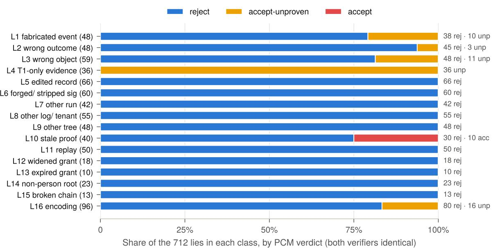  
Figure 7: PCM’s verdict on each lie class. Only L10 (stale proofs) produces accept, for the 10 messages whose cited evidence is real but later undone. L4 is entirely accept-unproven by design (T1-only). In L1–L3 and L16, accept-unproven marks claims the verifier cannot decide (no evidence, a host that will not parse), which a receiver treats as the sender’s word.

By scope, PCM accepts 0 of 192 claim lies, 0 of 265 evidence lies, 0 of 90 authority lies, 0 of 50 delivery lies, 0 of 96 encoding lies and 0 of 9 message lies (Table 10). All 11 signer-bug grants are rejected by the verifier’s own chain checks.

## 12.3 RQ2 and RQ3: Honest progress and no self-attestation

Of the 83 honest messages, 69 get accept, 12 get accept-unproven and 2 get reject. The 12 acceptunproven messages are by design: they cite a genuine, proven approved\_by without covers under a schema that requires a covering approval, and the verdict tells the sender “claim it with covers true”. Counting claims as pre-specified, 76 of 78 honest claims are proven (97.4%), below the 99% bar. The two misses (honest.H.15, .16) are fetches that the host answered with HTTP 404. The host was reached, but the executor records a status of 400 or more as an error, and reached\_host needs an ok T2 result, so the claim is failed and an honest message is rejected. This is again a stated limit of the 0.1 evidence profile (S6.6), with a fix designed for 0.2 (Section 13).

H3 passes: all 72 claims whose only evidence is T1 (36 in L4 and 36 in the AB-t1 ablation) are unproven. The second ablation behaves as designed: stripping the evidence from 60 honest messages yields accept-unproven for all 60, never reject, so removing proof downgrades a message but cannot make an honest sender look like a liar.

PCM is deliberately conservative on the 35 true encoding messages of L16: 5 accept, 12 acceptunproven, 18 reject. Eleven of the 12 accept-unproven messages are IPv4 hosts spelled in non-canonical forms (hex, short, 32-bit, leading zeros), which now come with an instruction to resend as a dotted quad; this is the price of the F1 fix. The twelfth is the wire form of an honest approved\_by sent without covers. The rejects are file claims that are true on a case-insensitive APFS volume, under an NFD name or behind a symlinked directory (PCM compares paths as written); integers sent as 12000.0 or 1.2e4, which fail strict schema matching; and a UTF-8 byte-order mark, which both strict loaders refuse.

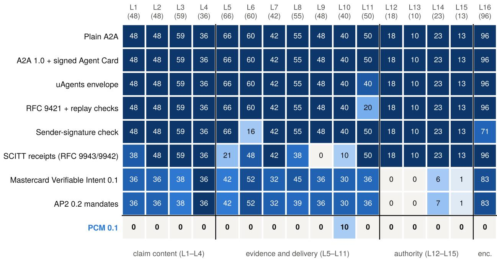  
Figure 8: Lies accepted per class (cell value, out of n) for each receiver. Darker is worse. Authenticating the sender (Agent Card, uAgents, RFC 9421, sender signature) catches only replays, forged signatures and unparseable wire input. SCITT receipts catch evidence that is not in the log (L9, part of L5/L8/L10) but cannot tie a claim to its records. AP2 and VI catch authority lies (L12–L15) but carry no evidence about tests, hosts or files. PCM’s only non-zero cell is L10.

## 12.4 RQ4: Determinism

H4 passes. On all 926 messages, Tracekit’s verifier and the standalone verifier agree on the verdict, the reason class and every conformance field, including messages sent as raw text through each verifier’s own strict loader. The benchmark had already earned its keep here: the run before the fixes found five disagreements, all caused by 1e400 (F5). Median verification time is 1.22 ms for Tracekit and 0.80 ms for the standalone verifier.

## 12.5 RQ5: What existing protocols catch

Figures 1 and 8 and Table 10 compare the receivers. Three patterns stand out.

Authenticating the sender does not authenticate the content. The signed Agent Card catches nothing, because it authenticates a sender who is the liar and leaves messages unsigned. The uAgents envelope catches the 10 replays addressed to another receiver. It has no nonce cache, and it reads expires as a reply timeout, so the other 40 replays pass. RFC 9421 with replay checks catches 30 of 50 replays (same nonce, another receiver, outside the window). It misses the 10 replays after a receiver restart, because its cache lives in memory, and the 10 below the floor, because it keeps no per-sender floor. It also misses every content lie, which the sender simply re-signs.

Transparency without semantics catches forged evidence, not false claims. SCITT receipts catch 162 lies, all at the evidence layer: proofs for another tree (all 48 of L9), edited records (45 of 66 in L5), forged checkpoint signatures, unpinned logs, and claims without records. They miss true records cited for false claims (L1–L3), because SCITT has no rule that ties a claim to a record. They also miss the agent’s own reports (L4), because SCITT has no tiers; records of another run or tenant; every replay; and every grant lie.

Table 10: Lies accepted by scope and receiver. Scopes partition the 712 lies. “Freshness” is the 10 staleevidence lies; other L10 lies (an old checkpoint with later records) fall under “evidence”.
<table><tr><td></td><td></td><td colspan="4">sender authentication</td><td></td><td colspan="2">mandates</td><td></td><td></td></tr><tr><td>Scope</td><td>n</td><td>A2A</td><td>Card</td><td>uAg.</td><td>9421</td><td>SCITT</td><td>VI</td><td>AP2</td><td>SigOnly</td><td>PCM</td></tr><tr><td>claim</td><td>192</td><td>192</td><td>192</td><td>192</td><td>192</td><td>182</td><td>146</td><td>146</td><td>192</td><td>0</td></tr><tr><td>evidence</td><td>265</td><td>265</td><td>265</td><td>265</td><td>265</td><td>113</td><td>208</td><td>208</td><td>229</td><td>0</td></tr><tr><td>authority</td><td>90</td><td>90</td><td>90</td><td>90</td><td>90</td><td>90</td><td>26</td><td>21</td><td>82</td><td>0</td></tr><tr><td>delivery</td><td>50</td><td>50</td><td>50</td><td>40</td><td>20</td><td>50</td><td>36</td><td>36</td><td>50</td><td>0</td></tr><tr><td>encoding</td><td>96</td><td>96</td><td>96</td><td>96</td><td>96</td><td>96</td><td>83</td><td>83</td><td>71</td><td>0</td></tr><tr><td>message</td><td>9</td><td>9</td><td>9</td><td>9</td><td>9</td><td>9</td><td>0</td><td>0</td><td>9</td><td>0</td></tr><tr><td>freshness</td><td>10</td><td>10</td><td>10</td><td>10</td><td>10</td><td>10</td><td>10</td><td>10</td><td>10</td><td>10</td></tr><tr><td>total</td><td>712</td><td>712</td><td>712</td><td>702</td><td>682</td><td>550</td><td>509</td><td>504</td><td>643</td><td>10</td></tr><tr><td>honest accepted</td><td>83</td><td>83</td><td>83</td><td>83</td><td>83</td><td>83</td><td>67</td><td>67</td><td>83</td><td>69+</td></tr></table>

<sup>†</sup> PCM: 69 accept plus 12 accept-unproven by design; the other receivers have no accept-unproven outcome.

Mandates cover authority, not actions. AP2 catches 208 lies and VI 203, almost all of them grant and approval lies: all of L12 and L13, 12 of the 13 in L15, and 132 of the 153 approval lies. None of the 450 lies about tests, hosts and files carries a mandate, so all of them pass. AP2 and VI also reject 16 honest messages. Eight are delegated grants, because AP2 0.2 has no agent-to-agent delegation. The other eight are approvals whose message does not disclose the approved values that the model needs, a limitation of our model. Conversely, 63 approval lies (64 for VI) are rejected only because the dataset lacks those values. Counting them as accepted gives the most AP2 and VI could accept: 567 (79.6%) and 573 (80.5%). Our best estimate of a faithful count is 553 and 559. Figure 1 shows the measured 504 and 509, the numbers that favour AP2 and VI.

Stacking does not close the gap. A receiver that runs the AP2, SCITT and RFC 9421 checks and accepts only what all three accept still accepts 365 lies (51.3%, CI 47.6–54.9%) and rejects 16 honest messages. It accepts all of L4, most of L1–L3 and L16, and 18 of the 20 replays after a restart or below the floor. The missing ingredient is not another signature but a rule that ties each claim to records written by someone other than the sender.

## 12.6 Findings: what the benchmark changed

A benchmark is only useful if it can find bugs, and PCM-Lies found three (Table 11). F1 is a platform-dependent attack. The executor fetched http://0127.0.0.1/ and macOS connected to 127.0.0.1, but the specification read the host as inet\_aton does, so a claim of 87.0.0.1, an address never contacted, was proven. F3 showed that leaving the comparison of approved with the intent to receivers fails in practice: a receiver acting on the verdict alone accepted a \$5 approval for a \$50 request. It motivated covers. F5 was a determinism bug. Each was fixed in the specification and both verifiers and pinned by vectors. The dataset grew by 47 messages to exercise the fixes, and the benchmark was re-run. Across the 875 messages the two datasets share, the only verdict changes are accept → accept-unproven (26 messages), and the only reason-class change is F5’s.

## 12.7 RQ6: Cost

Figure 9 and Table 12 report cost. A single-claim PCM message is 4.2–6.1 KB at the median, 7–13 times the size of the same request without proof. Most of the overhead is the checkpoint note and the records, each with a $\lceil \log _ { 2 } n \rceil$ -hash inclusion proof. approved\_by is the largest because its evidence carries three linked records, and four when the approval is cited through the root grant. A message with three claims is 11.7 KB. In absolute terms these sizes are small next to the LLM context that produced the message: 11.7 KB is roughly 3k tokens, and the evidence never needs to be shown to a model. It is consumed by the verifier. Verification is dominated by Ed25519 checks and hashing and takes about a millisecond in pure Python: 0.80 ms at the median and 1.81 ms at p99 for the standalone verifier. (Latency is measured over every parsed message of a type, lies and ablations included. The three-claim group mixes four full honest messages, which take about 2.4 ms each, with their four evidence-stripped twins, which take 0.37 ms, hence its low median.) Producing evidence costs the honest sender about one second of waiting for a checkpoint that covers its records (Section 11).

Table 11: Findings of the PCM-Lies benchmark, before (dataset 1, 879 messages) and after (dataset 2, 926 messages, with the fixes). Three were fixed in the specification and both verifiers, with vectors; two are documented 0.1 limits.
<table><tr><td></td><td>Finding</td><td>Before</td><td>After</td><td>Status</td></tr><tr><td>F1</td><td>leading-zero IPv4 (0127.0.0.1)</td><td>accept: 87.0.0.1 proven, though macOS connected to 127.0.0.1 (7 lies)</td><td>accept-unproven: “not written as a dotted quad”</td><td>fixed</td></tr><tr><td>F2</td><td>stale evidence</td><td>accept (10)</td><td>accept (10)</td><td>open (limit)</td></tr><tr><td>F3</td><td>approval of a smaller or other call</td><td>accept (6 lies)</td><td>accept-unproven or reject via covers</td><td>fixed</td></tr><tr><td>F4</td><td>honest fetch answered 404</td><td>reject (2 honest)</td><td>reject (2 honest)</td><td>open (limit)</td></tr><tr><td>F5</td><td>1e400 read two ways</td><td>verifiers disagree (5)</td><td>both refuse as bad-input</td><td>fixed</td></tr><tr><td colspan="2">H1 lies accepted</td><td>23/687 (3.3%, CI 2.2–5.0%)</td><td>10/712 (1.4%, CI 0.8–2.6%)</td><td></td></tr><tr><td colspan="2">of which not freshness H4 verifier agreement</td><td>13</td><td>0</td><td></td></tr></table>

Table 12: Message size (honest messages) and verification latency (all parsed messages of each type, lies included), in ms, single-threaded CPython 3.11 on Apple silicon. Sizes are the UTF-8 bytes of compact, key-sorted JSON (1 KB = 1000 B).
<table><tr><td rowspan="2">Claims</td><td colspan="2">size (KB)</td><td colspan="2">Tracekit verifier</td><td colspan="2">standalone</td></tr><tr><td>p50</td><td>vs. plain</td><td>p50</td><td>p99</td><td>p50</td><td>p99</td></tr><tr><td>tests_passed</td><td>4.2</td><td>9.2×</td><td>1.42</td><td>2.25</td><td>0.99</td><td>1.16</td></tr><tr><td>reached_host</td><td>4.2</td><td>9.5×</td><td>1.45</td><td>1.67</td><td>0.99</td><td>1.23</td></tr><tr><td>file_written</td><td>4.4</td><td>7.4×</td><td>1.42</td><td>1.64</td><td>0.99</td><td>1.10</td></tr><tr><td>approved_by</td><td>6.1</td><td>13.0×</td><td>1.67</td><td>2.51</td><td>1.25</td><td>1.82</td></tr><tr><td>grant only</td><td>1.9</td><td>4.5×</td><td>0.87</td><td>1.44</td><td>0.45</td><td>0.69</td></tr><tr><td>three claims</td><td>11.7</td><td>16.2×</td><td>0.61</td><td>3.38</td><td>0.38</td><td>2.43</td></tr><tr><td>all (876)</td><td></td><td></td><td>1.22</td><td>2.42</td><td>0.80</td><td>1.81</td></tr></table>

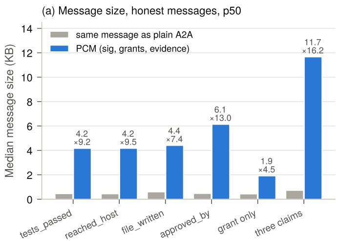

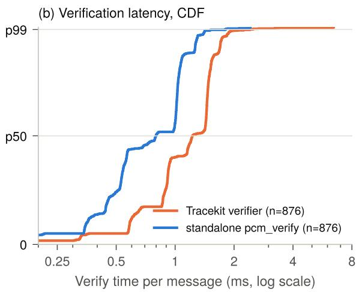  
Figure 9: Cost of PCM. (a) Median size of honest messages by claim type, against the same message without sig, grants and evidence (“plain A2A”); labels give the PCM size in KB and the median per-message ratio. (b) Distribution of verification time over the 876 messages that parse (the other 50 are raw texts that the loaders refuse before any check).

## 12.8 Threats to validity

Departures from the pre-specified design. The design called for an improve loop that would repeat “until H1–H4 pass”. We stopped with H1 and H2 failing because their causes, F2 and F4, are properties of the 0.1 claim semantics and evidence profile. Fixing them requires format changes, which we specify for a later draft rather than fold into this evaluation. The dataset grew after the first run (47 messages for the fixes). Four honest fetches with numeric host spellings were moved to L16, so that H2 measures a sender that follows the specification. L11 gained two replay kinds (outside the window and below the floor). The sender-signature baseline checks the PCM signer’s key, which the sender cannot use, so it catches forged and stripped signatures and accepts 643 of the lies rather than all of them. H2 was first counted per message and is now counted per claim, as specified. One message (L15.G.13) was relabelled before the final run of dataset 1. The design note has no public timestamp prior to the results.

Internal validity. Labels come from the generator’s record of what happened, never from a verifier. Dataset 1 was generated three times and gave the same counts in every cell, apart from the relabel. Dataset 2 was generated once. Ids, nonces, timestamps and signatures change between generations, while the seed (20261028) fixes keys and choices.

External validity. All runs used one machine (macOS 26.3, arm64, Python 3.11.15). F1 depended on the platform: glibc reads leading-zero octets as octal, so a Linux-generated dataset labels some L16 messages differently. The signer and executor ran in-process, the executor was Tracekit’s custody code with an in-process client rather than the HTTP executor service, and host names were served by the local server without real DNS. The six protocol receivers are models built from specifications, not runs of their SDKs. They omit transport security (which authenticates the liar too) and VI’s suggested mandate lifetimes. By our reading of their specifications, MCP, IBM ACP, LangChain Agent Protocol, Agora, Coral and FIPA-ACL reduce to plain A2A on these claims, and Visa TAP and the OpenAI/Stripe Agentic Commerce Protocol to RFC 9421 with replay checks at best; we did not measure them. Finally, the lie taxonomy is ours. Lies outside it (for example, an agent that truthfully reports a test suite chosen to be vacuous) are discussed as limits rather than measured.

## 13 Discussion and Limitations

## 13.1 Evidence is not freshness

Every PCM 0.1 claim type is existential: “a call ran and succeeded”. The sender chooses which records to disclose, so evidence can show that something happened, but never that nothing happened since. This explains all 10 false accepts in Section 12. Within 0.1, a receiver that acts on current state applies three checks. First, an age bound: it refuses evidence whose oldest record is older than a per-intent bound (seconds or minutes) relative to the message ts. It uses the oldest record because a sender can always add newer ones, and it compares only times set by the log, so the receiver’s clock plays no part. Second, an after-last-change bound: when the receiver knows when the thing it acts on last changed (the commit to merge was pushed, or it sent the request), it refuses older evidence. Third, for files, a digest check over the bytes it holds, which is the one check that rules out a later change outright. Both verifiers print the evidence age to support the first check.

For a later draft we have designed two mechanisms (Section C). The run since the call adds a signer-set head to the envelope, naming the last record of the sender’s run at signing time, and an evidence form that carries every record of the run from the claimed call up to head. These records are chained by the per-run run\_prev\_hash that the log already maintains, so no record in between can be omitted, and a later failure of the same suite or a later write of the same path becomes visible. Bound claims have the executor record what a call ran on: the git tree id of a fresh checkout for tests\_passed, and the path and digest it read back for file\_written. A receiver then compares the tree with the commit it will merge. Together they would close the L10 class at a cost of roughly 1 KB per later record.

## 13.2 A response is not a failure

An HTTP 404 proves that the host was reached, but the 0.1 evidence profile records only whether a result was ok, and the executor records a status of 400 or more as not ok. Honest claims of this kind are therefore failed, which is the cause of both H2 misses. An egress observer’s record proves the connection whatever the answer. PCM 0.2 can record the protocol status, so that reached\_host rests on any response.

## 13.3 Trust in the signer and in executors

PCM moves trust from the agent to the signer, but does not remove it. A compromised signer, or a caller who can make it sign as another identity, can mint anything (Section 9.6). A second, subtler dependency is on executors. A verifier places a T2 call by its tool name, so an executor that runs operator-named HTTP actions could record one under the name Bash, and an HTTP request that succeeded would then prove tests\_passed. The specification forbids logs that offer the evidence profile from recording a tool under a name of another class. A future trust member would let receivers pin which attesting parties may attest each tool class.

## 13.4 What a proof does not say

A proven tests\_passed proves that a specific command line exited 0 through an executor. It does not prove that the tests that matter ran: runner flags and configuration files in the working directory can make a suite vacuous. Receivers therefore compare suite with the suites they accept. A proven drive-path file\_written assumes a Windows executor. A proven approved\_by without covers says what alice approved, and that may not be what is now being requested; that is why requiring schemas accept only covering approvals. PCM 0.1 also cannot prove absence (“no other call happened”). These limits are stated in the specification so that receivers do not read more into proven than the record supports.

## 13.5 Privacy

A receiver learns the sender’s identity, run and tenant, the intent and its args, the payload, and every grant in the chain, including the approving person’s identity and name. From evidence it learns the disclosed records in full (types, times, tool names, call ids, approvers, policy outcomes, observed hosts), the log’s size at the checkpoint, and the args of opened decisions. It does not learn records that were not sent, or the args of unopened decisions. Commitments hide those args, but an opening is permanent and, because the message is signed, attributable. A salt also exposes low-entropy args to brute force, which is why the signer hands salts only to the run’s own agent. Senders should disclose the minimum each claim needs.

## 13.6 Implications for LLM agent systems

PCM is complementary to defences that harden a single agent against prompt injection, such as instruction hierarchies, dual-LLM and capability-based designs [15, 37], and benchmarks such as AgentDojo [14]. Those defences reduce the chance that an agent is subverted. PCM bounds what a subverted agent can make others believe and do. Three integration patterns follow.

• Verifier as a gate. The receiving framework verifies each PCM part before the model sees it and drops reject parts. The model then sees each claim annotated with its result (proven, or “the sender says”), so the planner reasons over structured provenance rather than free text.

• Authority outside the model. Grants and their caveats are checked by code, so a promptinjected sender cannot talk a receiver into exceeding them: the grant, not the model, sets the limit.

• Auditable pipelines. When the signer records every message signed and every grant issued, as the specification recommends and Tracekit does, a multi-agent run leaves a verifiable, append-only trail of who asserted what, on which evidence, under whose authority.

Agents increasingly exchange model state as well as text, for example by fusing one model’s KV cache into another’s (cache-to-cache transfer) [17]. A draft extension in the specification records such transfers (sender and receiver model ids, modality, projector, size and digest) as a signer-decided call, so that a receiver can at least check that the bytes it received are the bytes the sender declared to its signer before the transfer. Nothing in that record proves what the state means.

## 14 Related Work

Proof-carrying code and certified results. PCM borrows its name and its shape from proofcarrying code [26, 27]: the producer ships evidence, and the consumer runs a small checker instead of trusting the producer. Unlike PCC, PCM’s “proof” is a signed record with an inclusion proof rather than a derivation in a logic, so it holds only as far as its signer is trusted. The two approaches compose. A future claim type could carry a certificate checked by a proof checker, anchored by a PCM record of the call that produced it.

Table 13: What a receiver can check under each approach. ✓: yes; ◦: partly or in a limited setting; ✗: no, by our reading of each specification. “Offline” means without contacting the sender, the signer or the service.
<table><tr><td></td><td>Sender cannot sign to records</td><td></td><td>Claims tied Self-report ≠ proof rooted auth. delegation</td><td>Person-</td><td>Attenuating</td><td>Replay across restart</td><td>Offline</td></tr><tr><td>A2A / MCP (+TLS) [1, 2]</td><td>X</td><td>X</td><td>x</td><td>X</td><td>X</td><td>X</td><td></td></tr><tr><td>Signed Agent Card / uAgents</td><td>X</td><td>x</td><td>X</td><td>x</td><td>X</td><td>X</td><td></td></tr><tr><td>RFC 9421 + replay (ANP, TAP)</td><td>X</td><td>X</td><td>X</td><td>X</td><td>X</td><td>0</td><td></td></tr><tr><td>SCITT receipts [7, 33]</td><td>√</td><td>X</td><td>X</td><td>X</td><td>X</td><td>X</td><td></td></tr><tr><td>AP2 / Verifiable Intent [3, 25]</td><td>0</td><td>x</td><td>X</td><td>√</td><td>X</td><td>0</td><td></td></tr><tr><td>Macaroons / Biscuit / UCAN</td><td>X</td><td>X</td><td>x</td><td>X</td><td>√</td><td>X</td><td></td></tr><tr><td>OAuth agent delegation [32]</td><td>0</td><td>X</td><td>X</td><td>√</td><td>√</td><td>x</td><td>0</td></tr><tr><td>Notarized Agents [16]</td><td>√</td><td>0</td><td>√</td><td>X</td><td>X</td><td>X</td><td>0</td></tr><tr><td>NabaOS tool receipts [5]</td><td>0</td><td>J</td><td>0</td><td>x</td><td>X</td><td>x</td><td>X</td></tr><tr><td>PCM 0.1</td><td>1</td><td>L</td><td>√</td><td>L</td><td>L</td><td>L</td><td>V</td></tr></table>

Transparency logs. PCM’s evidence format is that of Certificate Transparency [22, 23], with C2SP notes, checkpoints and witness cosignatures [10–12]. CT logs certificates for public audit, whereas PCM hands a receiver the handful of records of one run that back one claim, from a log that may be private to a deployment. SCITT [7, 33] checks that a signed statement is in a transparency log. Individual drafts profile it for agent actions, but SCITT itself has no rule that ties a claim to a record, no T1/T2 distinction, no replay rule and no grants. Our benchmark shows the consequence: true records cited for false claims pass (Section 12). PCM adds exactly these semantics over the same kind of evidence.

Capability-based authorisation. Macaroons [6], Biscuit [8] and UCAN [36] support offline attenuation by the holder. PCM grants also only narrow, but no agent holds a key: the signer signs each step after checking it. A root exists only after a person’s recorded approval of its exact terms, and caveats are typed by the intent’s schema and compared with a fixed table (Table 3) rather than a general logic such as Biscuit’s Datalog. The table is deliberately incomplete (bounds never imply equality), which trades expressiveness for verdicts that are identical across implementations. South et al. [32] extend OAuth 2.0 and OpenID Connect with agent credentials and scoped delegation, which answers on whose behalf an agent acts. PCM is complementary: it adds claims about what the agent did, and grants that a receiver checks offline.

Agent payment mandates. AP2 [3], now stewarded by the FIDO Alliance, checks a chain of SD-JWT mandates for a purchase: who authorised it, within which constraints, until when, bound to the agent’s key. Mastercard’s Verifiable Intent [25] adds an issuer-certified user key. Both answer “was this purchase authorised?”, not “did the agent do what it says?”, and AP2 0.2 excludes agent-to-agent delegation. Our models of both catch most authority lies and none of the lies about tests, hosts or files. Proof-Gated Signing [18] guards a different point of the same pipeline: before a wallet-controlling agent signs a transaction, an SMT solver checks its value and permission policy over the whole range of oracle-price uncertainty, and the result is compiled into on-chain post-conditions that the wallet enforces atomically. It constrains what an agent may do; PCM constrains what other agents will believe about what it did.

Agent receipts and provenance. Tracekit [19], PCM’s reference implementation, records each coding-agent session’s requests, stated reasoning and executed actions in a hash-chained, externally anchorable ledger for audit. PCM builds on its attesting signer and Merkle log, and turns the audit trail into evidence that a receiving agent checks per claim. Notarized Agents [16] has the called service sign a receipt of each action, encrypt it to the agent’s owner and publish it to a witnessed log, so the owner can audit the agent. PCM needs no cooperation from the service. The sender’s attesting signer and executor record the call, and any receiver checks the records offline. NabaOS [5] cross-checks a model’s claims against HMAC-signed tool-execution receipts to detect hallucinated tool results. An HMAC can be checked only with the key that made it, whereas PCM’s records are signed with public keys that any receiver can check, and PCM adds authority and delivery rules. In software supply chains, in-toto [34] signs statements about steps, and SLSA [28] requires that provenance come from the build platform rather than the build’s own steps. PCM applies the SLSA principle per claim, inside a message, and adds a third outcome for what cannot be checked.

Security of agent protocols. A2ABreak [24] extracts a 37-state machine from the A2A specification and finds 11 vulnerabilities, among them context injection through unprotected context identifiers and identity loss across multi-hop delegation. PCM signs its whole message and makes each delegation step a signed grant that names its issuer and subject, although parts of an A2A message outside the PCM part remain unsigned. Prompt-injection attacks on agents [20, 29, 38] and benchmarks such as AgentDojo [14] motivate PCM’s threat model. Design-level defences such as CaMeL [15] constrain what a single agent may do with untrusted data, while PCM constrains what other agents will believe.

Cross-implementation disagreement. Parser differentials are a classic source of vulnerabilities: in X.509 and TLS stacks [21], in URL parsers [35], in Ed25519 verification [13] and in JSON parsers [31]. PCM treats differential-freeness as a design requirement. Wherever readers differ it specifies a strict reading, maps divergence to unproven, and pins the outcome with vectors produced by a real signer (Section 10).

## 15 Conclusion

Multi-agent systems built on LLMs pass each other claims about what happened and about who allowed what, and today a receiver can do no better than trust the sender. PCM lets each claim carry evidence written by someone other than the agent, lets authority travel as person-rooted chains that only narrow, and has every receiver check both offline, in about a millisecond, with the same answer whatever its implementation. Its three-valued semantics keeps doubt apart from falsity, so a claim the verifier cannot decide costs the sender the proof rather than the message, and a liar cannot turn its own report into proof. On 712 lies built from real runs, PCM accepts only the 10 that its specification already says it cannot catch, while models of today’s deployed protocols accept between 504 and 712. Closing that last class, evidence that a state is still current, is the main work for the next draft, together with a dedicated message key, key rotation, Unicode hosts, and verified transport bindings for A2A and MCP.

Code: https://github.com/Cygnux-Labs/PCM-protocol

## References

[1] A2A Project. Agent2Agent (A2A) Protocol Specification, version 1.0. https://a2a-protocol. org/, 2025.

[2] Anthropic. Model Context Protocol specification. https://modelcontextprotocol.io/ specification, 2024.

[3] AP2 Project. Agent payments protocol (AP2) specification, version 0.2. https://ap2- protocol.org/, 2026.

[4] Annabelle Backman, Justin Richer, and Manu Sporny. HTTP message signatures. RFC 9421, IETF, 2024.

[5] Abhinaba Basu. Tool receipts, not zero-knowledge proofs: Practical hallucination detection for AI agents. arXiv preprint arXiv:2603.10060, 2026.

[6] Arnar Birgisson, Joe Gibbs Politz, Úlfar Erlingsson, Ankur Taly, Michael Vrable, and Mark Lentczner. Macaroons: Cookies with contextual caveats for decentralized authorization in the cloud. In Network and Distributed System Security Symposium (NDSS), 2014.

[7] Henk Birkholz, Antoine Delignat-Lavaud, Cédric Fournet, Yogesh Deshpande, and Steve Lasker. An architecture for trustworthy and transparent digital supply chains (SCITT). RFC 9943, IETF, 2026.

[8] Biscuit Project. Biscuit authorization token specification. https://www.biscuitsec.org/, 2023.

[9] Jacqueline Brendel, Cas Cremers, Dennis Jackson, and Mang Zhao. The provable security of Ed25519: Theory and practice. In IEEE Symposium on Security and Privacy (S&P), 2021.

[10] C2SP. Transparency log checkpoints. https://c2sp.org/tlog-checkpoint, 2024.

[11] C2SP. Transparency log witness cosignatures. https://c2sp.org/tlog-cosignature, 2024.

[12] C2SP. Signed note. https://c2sp.org/signed-note, 2024.

[13] Konstantinos Chalkias, François Garillot, and Valeria Nikolaenko. Taming the many EdDSAs. In Security Standardisation Research (SSR), 2020.

[14] Edoardo Debenedetti, Jie Zhang, Mislav Balunovi´c, Luca Beurer-Kellner, Marc Fischer, and Florian Tramèr. AgentDojo: A dynamic environment to evaluate prompt injection attacks and defenses for LLM agents. In Advances in Neural Information Processing Systems (Datasets and Benchmarks Track), 2024.

[15] Edoardo Debenedetti, Ilia Shumailov, Tianqi Fan, Jamie Hayes, Nicholas Carlini, Daniel Fabian, Christoph Kern, Chongyang Shi, Andreas Terzis, and Florian Tramèr. Defeating prompt injections by design. In arXiv preprint arXiv:2503.18813, 2025.

[16] Juan Figuera. Notarized agents: Receiver-attested confidential receipts for AI agent actions. arXiv preprint arXiv:2606.04193, 2026.

[17] Tianyu Fu et al. Cache-to-cache: Direct semantic communication between large language models. In International Conference on Learning Representations (ICLR), 2026. arXiv:2510.03215.

[18] Bravish Ghosh. Proof-gated signing: Solver-checked transaction guards that hold under state drift for onchain AI agents. arXiv preprint arXiv:2610.00354, 2026.

[19] Bravish Ghosh. Tracekit: Tamper-evident intent-reasoning-action auditing for autonomous coding agents. arXiv preprint arXiv:2609.35659, 2026.

[20] Kai Greshake, Sahar Abdelnabi, Shailesh Mishra, Christoph Endres, Thorsten Holz, and Mario Fritz. Not what you’ve signed up for: Compromising real-world LLM-integrated applications with indirect prompt injection. In Proceedings of the 16th ACM Workshop on Artificial Intelligence and Security (AISec), 2023.

[21] Dan Kaminsky, Meredith L. Patterson, and Len Sassaman. PKI layer cake: New collision attacks against the global X.509 infrastructure. In Financial Cryptography and Data Security (FC), 2010.

[22] Ben Laurie, Adam Langley, and Emilia Kasper. Certificate transparency. RFC 6962, IETF, 2013.

[23] Ben Laurie, Eran Messeri, and Rob Stradling. Certificate transparency version 2.0. RFC 9162, IETF, 2021.

[24] Alireza Lotfi, Mirza Masfiqur Rahman, Imtiaz Karim, and Elisa Bertino. A2ABreak: Systematic security analysis of the A2A protocol. arXiv preprint arXiv:2609.10871, 2026.

[25] Mastercard. Verifiable intent, version 0.1 (draft). https://www.mastercard.com/global/en/ news-and-trends/stories/2026/verifiable-intent.html, 2026.

[26] George C. Necula. Proof-carrying code. In Proceedings of the 24th ACM SIGPLAN-SIGACT Symposium on Principles of Programming Languages (POPL), 1997.

[27] George C. Necula and Peter Lee. Safe kernel extensions without run-time checking. In Proceedings of the 2nd USENIX Symposium on Operating Systems Design and Implementation (OSDI), 1996.

[28] OpenSSF. Supply-chain levels for software artifacts (SLSA) v1.0. https://slsa.dev/spec/ v1.0/, 2023.

[29] Fábio Perez and Ian Ribeiro. Ignore previous prompt: Attack techniques for language models. In NeurIPS ML Safety Workshop, 2022.

[30] Anders Rundgren, Bret Jordan, and Samuel Erdtman. JSON canonicalization scheme (JCS). RFC 8785, IETF, 2020.

[31] Nicolas Seriot. Parsing JSON is a minefield. https://seriot.ch/projects/parsing\_json. html, 2016.

[32] Tobin South, Samuele Marro, Thomas Hardjono, Robert Mahari, Cedric Deslandes Whitney, Dazza Greenwood, Alan Chan, and Alex Pentland. Authenticated delegation and authorized AI agents. arXiv preprint arXiv:2501.09674, 2025.

[33] Orie Steele, Henk Birkholz, Antoine Delignat-Lavaud, and Cédric Fournet. COSE receipts. RFC 9942, IETF, 2026.

[34] Santiago Torres-Arias, Hammad Afzali, Trishank Karthik Kuppusamy, Reza Curtmola, and Justin Cappos. in-toto: Providing farm-to-table guarantees for bits and bytes. In 28th USENIX Security Symposium, 2019.

[35] Orange Tsai. A new era of SSRF: Exploiting URL parser in trending programming languages! Black Hat USA, 2017.

[36] UCAN Working Group. User controlled authorization network (UCAN) specification. https: //ucan.xyz/, 2023.

[37] Simon Willison. The dual LLM pattern for building AI assistants that can resist prompt injection. https://simonwillison.net/2023/Apr/25/dual-llm-pattern/, 2023.

[38] Qiusi Zhan, Zhixiang Liang, Zifan Ying, and Daniel Kang. InjecAgent: Benchmarking indirect prompt injections in tool-integrated large language model agents. In Findings of the Association for Computational Linguistics: ACL 2024, 2024.

## A A Complete Worked Example

All values below are from the conformance vector accept-approved-by, produced by the reference implementation’s signer. ... marks elided members. Agent A is uid:990101, B is uid:990102, and alice is uid:990001.

Schema document. Both sides pin this document by its hash.

```json
{"pcm_schema": 0, "name": "refund.request",
"fields": {"amount": {"type": "money", "currency": "USD", "max": 1000000},
"order": {"type": "int", "min": 1, "max": 999999999}},
"claims": ["approved_by"], "grant": true}
```

```jsonl
{"from": {"agent": "uid:990101", "run": "ec130a625bc622738e7f2652097d9535", "tenant": "default"},
"to": {"agent": "uid:990102"},
"intent": {"type": "refund.request@sha256:
,→ d8636b6fbbd07430d057ea9ead9c27f0df1b918b10d34ab9257a4971d487846c",
"args": {"amount": 12000, "order": 81}},
"claims": [ ... the approved_by claim below ... ],
"grants": [ ... alice's root grant below ... ],
"pcm": 0, "id": "0ac65318a85ca571b5a29c348280f1d9", "ts": "2026-10-28T02:24:35.496285Z",
"nonce": "705e9bb546e4876321bcbc748f982bd0",
"sig": {"key": "example.com/pcm-test-log+0bb91e66",
"sig": "Xtv6U9fKIx3FG1t+OGuK5ifNbOHf6aOLDSUaoHWa/
,→ g8QGzazVirPtLR57furSUouYWn0eSYn037sTIkLEeAQBQ=="}}
```

Root grant. The signer signed this grant after alice approved the agent’s pcm.grant call with exactly these terms.

```jsonl
{"pcm_grant": 0, "ts": "2026-10-28T02:24:35.477412Z",
"issuer": {"kind": "person", "id": "uid:990001", "run": "ec130a625bc622738e7f2652097d9535", II
,→ tenant": "default",
"approval_id": "apr-afa8cc12fcd9032a7eb9c9479deedd68", "person": "alice"},
"subject": "uid:990101",
"intent": "refund.request@sha256:
,→ d8636b6fbbd07430d057ea9ead9c27f0df1b918b10d34ab9257a4971d487846c",
"caveats": [{"field": "amount", "op": "<=", "value": 20000}, {"field": "order", "op": "==",
,→ value": 81}],
"expires_at": "2026-10-28T03:24:35.475470Z", "delegable": false, "parent": null,
"sig": {"key": "example.com/pcm-test-log+0bb91e66",
"sig":
,→ Jm0YbtyvSJL4GaRkk8BnjWyq1LfF6o6WPlPry8vKCE7Erh3F8nmi1LW94nr2Zu8WWOEN4Y9bqmbSn00cx6L8AA=="}
,→ }
```

Claim and evidence. Three records of A’s run, each with a four-hash inclusion proof under a checkpoint of tree size 9.

```jsonl
{"type": "approved_by", "args": {"person": "alice", "call": "grant-1", "covers": true},
"evidence": {
"checkpoint": "example.com/pcm-test-log\n9\nQhInJS9+Rjyar8mhP1wGwzx1O2DYcMy8af/XYRCqSb8=\n\n–-
,→ example.com/pcm-test-log
,→ C7keZoQnlibbpH9yOCeEzKJs6Hzc97YYaP1hsfTBxyO0QzEKJRpaXpxBKoLJEIi9d0FMYRNNmWOSl0cOBOf2whMhowQ
,→ =\n",
"records": [
{"event": {"type": "policy.decision", "seq": 3, "...": "...",
"data": {"tool_use_id": "grant-1", "tool": "pcm.grant", "decision": "ask",
"decision_id": "dec-76e1373f66cddad74ba54eb2ffcf97af", "...": "..."}},
"hash": "sha256:444ea34333ed7e77be0fe1ca8f57b108b93d79258dd27ec3f2ffe0f5d89409f5",
"proof": ["GHc2iRz78zZ9UrFNQfRdYDhZyd9ere1mVrgDE2zN4w8=", "a1WP4EFPP5lJvKXGna0/
,→ aMjExMY6buoajX2ZZWWR87w=",
"XV3DvLmIxeoAAS29RasT6tRFgGOFhLjjSzUyQPdNyZs=", "oGluwXsyMyIJMoCTujrGPPsyxEcnsqfn+
,→ A06KUVWSuc="]},
{"event": {"type": "approval.request", "seq": 4, "...": ".. 1I
"data": {"approval_id": "apr-afa8cc12fcd9032a7eb9c9479deedd68",
"decision_id": "dec-76e1373f66cddad74ba54eb2ffcf97af", "...": "..."}},
"hash": "sha256:39c29ce4973ac0753b77f3ae1a7056a8d06d054fe6b7ea951c423f5b5491288a", "proof": [
,→ "..."]},
{"event": {"schema_version": "tracekit.event.v2", "seq": 5, "type": "approval", "source": "sdk
,→
,
"run_id": "ec130a625bc622738e7f2652097d9535", "tenant": "default", "...": "...",
"data": {"tool_use_id": "grant-1", "approval_id": "apr-
,→ afa8cc12fcd9032a7eb9c9479deedd68",
"decision": "approve", "approver": "uid:990001", "self_approved": false,
"person": "alice", "...": "..."}},
"hash": "sha256:3483c8f824e7072e479f93de2a5d9ce2f4e32ed6fc5472e8621a353da9371e1b", "proof": [
,→ "..."]}]}}
```

Verification result. For receiver uid:990102, with a fresh replay state and a 300 s window:

{"signature": {"ok": true, "key": "example.com/pcm-test-log+0bb91e66"},   
"replay": {"ok": true, "detail": "fresh"},   
"schema": {"ok": true, "ref": "refund.request@sha256:d8636b6f...", "errors": []},   
"grants": {"result": "ok", "steps": 1, "root": {"kind": "person", "id": "uid:990001", "person":

,→ "alice"},   
"problems": []},   
"claims": [{"type": "approved\_by", "result": "proven",   
"detail": "approval seq 5 by alice of \"pcm.grant\" call grant-1, which issued this   
,→ message's root grant",   
"approved": {"tool": "pcm.grant", "args": null}}],   
"verdict": "accept", "reasons": [], "skipped": []}

Neighbouring vectors. Table 14 shows how small changes to this message move the verdict. Each row is a separate vector.

Table 14: Variations of the worked example and their verdicts (reasons abbreviated).
<table><tr><td>Vector</td><td>What differs; reason</td><td>Verdict</td></tr><tr><td>accept-unproven-t1-result</td><td>adds tests_passed backed only by the agent&#x27;s own report; “the result is the agent&#x27;s own report unproven (T1)&quot;</td><td>accept-</td></tr><tr><td>accept-tests-passed-t2</td><td>the executor recorded the result; “... run by mtls:spiffe://example/executor (T2)&quot;</td><td>accept</td></tr><tr><td>reject-claim-pytest-or-true</td><td>the executor ran pytest -q ... Il true; &quot;not reject a single test command&quot;</td><td></td></tr><tr><td>reject-claim-changed-record-hash</td><td>one hex digit of a record hash changed; &quot;record reject 1: hash does not match the event&quot;</td><td></td></tr><tr><td>reject-claim-approved-by-self-approval</td><td>erin approves a call of her own agent&#x27;s run</td><td>reject</td></tr><tr><td>reject-grant-amount-over-caveat</td><td>amount 50000; &quot;grant 0: amount 50000 breaks amount &lt;= 20000&quot;</td><td>reject</td></tr><tr><td>reject-claim-approved-by-covers-other- args</td><td>cites, with covers, alice&#x27;s opened approval of a reject pay of 500 for a pay of 12000</td><td></td></tr><tr><td>accept-unproven-approved-by-required- without-covers</td><td>the same, without covers; &quot;required, not proven accept- to cover this request&quot;</td><td></td></tr><tr><td>accept-unproven-reached-host-idn</td><td>reached_host from a fetch of http://bücher.example/; &quot;its URL is not</td><td>unproven accept-</td></tr><tr><td>accept-unproven-reached-host-relative- path</td><td>printable ASCII: ...&quot; fetch of /api.example.com/v1/refunds; &quot;its URL has no scheme ...&quot;</td><td>accept-</td></tr></table>

## B Protocol Data

Test runners (42 sequences). A tests\_passed suite must begin with one of these word sequences, compared exactly.

<table><tr><td>pytest python -m unittest</td><td>py.test python3 -m unittest</td><td>python -m pytest tox</td><td>python3 -m pytest nox</td></tr><tr><td>nose2</td><td>trial</td><td>behave</td><td>jest</td></tr><tr><td>vitest</td><td>mocha</td><td>ava</td><td>karma</td></tr><tr><td>cucumber</td><td>playwright test</td><td>phpunit</td><td>rspec</td></tr><tr><td>ctest</td><td>npm test</td><td>npm run test</td><td>yarn test</td></tr><tr><td>yarn run test</td><td>pnpm test</td><td>pnpm run test</td><td>bun test</td></tr><tr><td>go test</td><td>cargo test</td><td>cargo nextest run</td><td>dotnet test</td></tr><tr><td>deno test</td><td>swift test</td><td>mix test</td><td>bazel test</td></tr><tr><td>make test</td><td>make check</td><td>mvn test</td><td>mvn verify</td></tr><tr><td>gradle test</td><td>gradle check</td><td></td><td></td></tr></table>

Tool placement table. The table has 54 names; its SHA-256 is 15f8410f513344e4c60327d4fc3dd149 49ebeaf7722f641d985d3ca721c8fe07.

<table><tr><td>Class</td><td>Tool names</td></tr><tr><td>shell (8)</td><td>Bash, bash, container.exec, local_shell, run_shell_command, run_terminal_cmd, shell, terminal</td></tr><tr><td>http (14)</td><td>WebFetch, WebSearch, fetch, http_get, http-post, http_request, mcp:fetch/fetch, requests_delete, requests_get, requests_patch, requests_post, requests_put, srt:request, web_fetch</td></tr><tr><td>fs (7)</td><td>Edit, Glob, Grep, MultiEdit, NotebookEdit, Read, Write</td></tr><tr><td>payment (12)</td><td>create_charge, create_payment, create_payout, create_refund, create_transfer, get_balance, get_transaction, list_payments, list_transactions, pay_invoice, send_payment, transfer_funds</td></tr><tr><td>sq1 (10)</td><td>execute_query, execute_sq1, mcp:mysq1/execute_sq1, mcp:postgres/query, mcp:sqlite/read_query,mcp:sqlite/write_query, mcp:supabase/execute_sql, query_database, run_sq1, sq1_db_query</td></tr><tr><td>email (3)</td><td>gmail_send_message, send_email, send_gmail_message</td></tr></table>

Only shell (for tests\_passed) and http (for reached\_host) are read by a 0.1 checker. file\_written reads only the tool Write.

Field patterns.

<table><tr><td>Name</td><td>Length</td><td>Pattern (whole value, ASCII classes)</td></tr><tr><td>IDENTITY</td><td>≤ 256</td><td>^[a-z0-9_]+:[^\n]+$</td></tr><tr><td>ID</td><td>1-128</td><td>^[A-Za-zO-9._:-]+$</td></tr><tr><td>SCHEMA_REF</td><td>≤ 136</td><td>^[a-z][a-z0-9_.-]{0,63}@sha256:[0-9a-f]{64}$</td></tr><tr><td>TS</td><td>≤ 27</td><td>^[0-9]{4}-[0-9]{2}-[0-9]{2}T[0-9]{2}:[0-9]{2}:[0-9]{2}\.[0-9]{6}Z$</td></tr><tr><td>DIGEST</td><td>71</td><td>^sha256:[0-9a-f]{64}$</td></tr></table>

## C Design for Fresh Evidence

This appendix summarises the design that the specification proposes for closing the stale-evidence class (L10) in a later draft.

The run since the call. The evidence profile already chains each run: every record carries run\_seq, its position in its run, and run\_prev\_hash, the hash of the run’s previous record. The design adds a signer-set envelope member head = {run\_seq : n, hash : digest}, the last record of the sender’s run when the signer took the message to sign. It is set like ts, so the agent cannot choose it. The design also adds an evidence item marked "since": true, whose records are the claim’s records followed by every record of the run after the first of them, up to head. The verifier checks that consecutive records have consecutive run\_seq values and linked run\_prev\_hash values, and that the last record matches head. Because the run chain binds each record to the next and the message signature binds head, no record between the call and the message can be omitted. The checkers then read the later records:

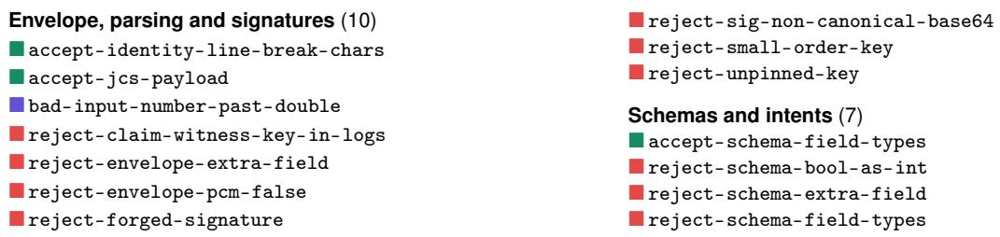

• tests\_passed: a later shell call of the same suite whose result is not ok fails the claim (“the suite failed after it passed”). A later unopened shell call with no result or a failed one makes the claim unproven until the sender opens it.

• file\_written: a later write of the claimed path with other content fails the claim. A later write whose path is not shown makes it unproven. This requires the table to separate writing from reading tools within fs.

The cost is about 1 KB per later record, and a cap bounds how long after the call a sender can claim. The design does not cover runs of the suite in other runs, writes by other processes (the receiver’s digest check covers those), or earlier flaky runs.

Bound claims. The executor records what a call ran on. For tests\_passed{suite, tree}, the agent names a git commit, and the executor checks out its tree into a fresh directory the agent cannot write, runs the suite there and records the tree id. The receiver compares that id with the commit it will merge (git rev-parse Cˆ{tree}). Hashing the agent’s working directory instead would not do, because an ignored conftest.py changes the result without changing the id. For file\_written, the executor reads the file back after writing and records the absolute path and the digest of the bytes on disk. That record alone then proves the claim without opening the decision, at the cost of the path appearing in clear in the log.

Responses with an error status. For reached\_host, the evidence profile would record whether the call got a response, for example its protocol status, so that a 404 proves the host was reached.

## D Models of Real Protocols

Table 15 summarises what each receiver model checks and the specification sections it rests on. The code is bench/lies/protocols.py. Every key is Ed25519, derived from the holder’s name and the seed, and a receiver looks up a public key as its protocol does (a DID document, an Almanac entry, a JWKS).

## E Conformance Vector Catalogue

The 187 vectors, grouped by area. Colour shows the expected verdict: ■ accept, ■ accept-unproven, ■ reject, ■ bad-input.

Table 15: Receiver models used in RQ5.
<table><tr><td>Receiver</td><td>What it checks</td><td>What it cannot see</td></tr><tr><td>A2A 1.0 + signed card</td><td>Server authenticates by a scheme the card declares; client verifies the card&#x27;s JWS over its RFC 8785 form (spec §7.3, §7.4, lie §8.4). Messages, tasks and artefacts are unsigned; messageId de-duplication is optional (off).</td><td>every message-level</td></tr><tr><td>uAgents envelope</td><td>Sender signs SHA-256 of sender, target, session, schema digest, payload, expires and nonce; receiver verifies and refuses a target it does not host.</td><td>replays to the same target; all content</td></tr><tr><td>RFC 9421 + replay</td><td>Signature over @method, @target-uri, content-digest with created/expires/nonce/keyid; 300 s window; in-memory (keyid, nonce) cache.</td><td>restarts; floors; all content</td></tr><tr><td>SCITT receipts</td><td>Each claim must carry statements, each with a content hash and an inclusion receipt against a tree head a pinned log signed.</td><td>claim-to-record semantics, tiers, run binding, replay, grants</td></tr><tr><td>AP2 0.2 mandates</td><td>KB-JWT (cnf, aud, nonce, iat); open mandate signed by a trusted platform, intent, constraints, exp; checkout mandates of the same args/tool, disclosed.</td><td>tests, hosts, files; delegation</td></tr><tr><td>Verifiable Intent 0.1</td><td>As AP2, with mandates signed by a person&#x27;s device key that as AP2 an issuer certifies (L1).</td><td></td></tr></table>

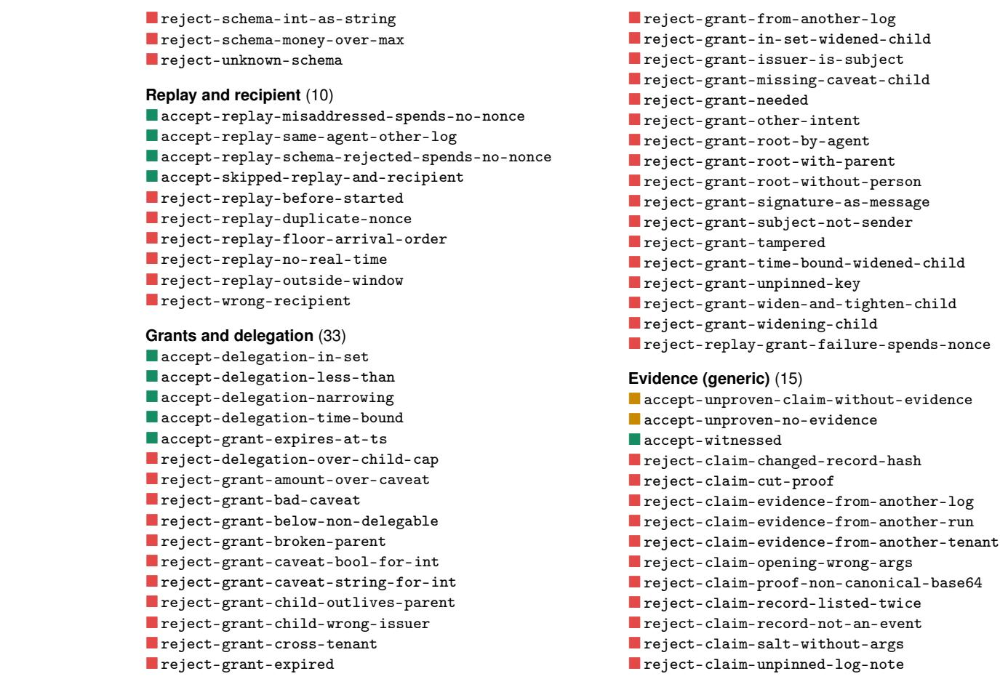

<sup>■</sup> reject-claim-witnesses-required-unmet <sup>■</sup> accept-reached-host-http   
<sup>■</sup> accept-reached-host-ipv4-mapped   
tests\_passed (25) <sup>■</sup> accept-reached-host-nat64   
<sup>■</sup> accept-tests-passed-npm-test <sup>■</sup> accept-reached-host-observed   
<sup>■</sup> accept-tests-passed-python-m-pytest <sup>■</sup> accept-reached-host-trailing-dot   
<sup>■</sup> accept-tests-passed-t2 <sup>■</sup> accept-unproven-reached-host-ambiguous   
<sup>■</sup> accept-unproven-t1-result <sup>■</sup> accept-unproven-reached-host-blob   
<sup>■</sup> accept-unproven-unplaced-tool   
<sup>■</sup> accept-unproven-reached-host-bracket   
<sup>■</sup> reject-claim-bash-c <sup>■</sup> accept-unproven-reached-host-bracket-ipv6-userinfo   
<sup>■</sup> reject-claim-hash-inside-word <sup>■</sup> accept-unproven-reached-host-bracket-no-host   
<sup>■</sup> reject-claim-pytest-or-true <sup>■</sup> accept-unproven-reached-host-bracket-not-host   
<sup>■</sup> reject-claim-tests-failed <sup>■</sup> accept-unproven-reached-host-bracket-other-host   
<sup>■</sup> reject-claim-tests-passed-V <sup>■</sup> accept-unproven-reached-host-bracket-trailing   
<sup>■</sup> reject-claim-tests-passed-ansi-c-quote <sup>■</sup> accept-unproven-reached-host-browser-brackets   
<sup>■</sup> reject-claim-tests-passed-background <sup>■</sup> accept-unproven-reached-host-claim-bad-port   
<sup>■</sup> reject-claim-tests-passed-co <sup>■</sup> accept-unproven-reached-host-claim-no-host   
<sup>■</sup> reject-claim-tests-passed-collect-only <sup>■</sup> accept-unproven-reached-host-claim-not-quad   
<sup>■</sup> reject-claim-tests-passed-comment accept-unproven-reached-host-deviation   
<sup>■</sup> reject-claim-tests-passed-denied-call <sup>■</sup> accept-unproven-reached-host-fullwidth-ipv6   
<sup>■</sup> reject-claim-tests-passed-dot-slash <sup>■</sup> accept-unproven-reached-host-hex-ipv4   
<sup>■</sup> reject-claim-tests-passed-h <sup>■</sup> accept-unproven-reached-host-idn   
<sup>■</sup> reject-claim-tests-passed-he <sup>■</sup> accept-unproven-reached-host-ipv4-leading-zero   
<sup>■</sup> reject-claim-tests-passed-help <sup>■</sup> accept-unproven-reached-host-ipv4-number   
<sup>■</sup> reject-claim-tests-passed-malformed-no-evidence <sup>■</sup> accept-unproven-reached-host-ipv6-leading-zero   
<sup>■</sup> reject-claim-tests-passed-runner-path <sup>■</sup> accept-unproven-reached-host-ipv6-leading-zero   
<sup>■</sup> reject-claim-tests-passed-unbalanced-quote backslash   
<sup>■</sup> reject-claim-tests-passed-version <sup>■</sup> accept-unproven-reached-host-ipv6-leading-zero   
<sup>■</sup> reject-claim-tests-passed-wrapper later-octet   
<sup>■</sup> accept-unproven-reached-host-label-character   
approved\_by (26) <sup>■</sup> accept-unproven-reached-host-leading-space   
<sup>■</sup> accept-approved-by   
<sup>■</sup> accept-unproven-reached-host-mapped-to-nothing   
<sup>■</sup> accept-approved-by-covers-direct   
<sup>■</sup> accept-unproven-reached-host-no-connection   
<sup>■</sup> accept-approved-by-covers-grant   
<sup>■</sup> accept-unproven-reached-host-non-ascii-path   
<sup>■</sup> accept-approved-by-opened-args <sup>■</sup> accept-unproven-reached-host-not-ipv6   
<sup>■</sup> accept-unproven-approved-by-covers-not-opened <sup>■</sup> accept-unproven-reached-host-nul   
<sup>■</sup> accept-unproven-approved-by-covers-schema-without- <sup>■</sup> accept-unproven-reached-host-percent   
tool   
<sup>■</sup> accept-unproven-reached-host-relative-path   
<sup>■</sup> accept-unproven-approved-by-required-without-covers <sup>■</sup> accept-unproven-reached-host-sensor-connect   
<sup>■</sup> reject-claim-approval-of-another-call <sup>■</sup> accept-unproven-reached-host-short-ipv4   
<sup>■</sup> reject-claim-approved-by-agent-approver <sup>■</sup> accept-unproven-reached-host-tab-in-escape   
<sup>■</sup> reject-claim-approved-by-args-true-and-1 <sup>■</sup> accept-unproven-reached-host-two-brackets   
<sup>■</sup> reject-claim-approved-by-covers-args-true-and-1   
<sup>■</sup> accept-unproven-reached-host-two-trailing-dots   
<sup>■</sup> reject-claim-approved-by-covers-grant-not-root   
<sup>■</sup> accept-unproven-reached-host-unreadable-claim   
<sup>■</sup> reject-claim-approved-by-covers-other-args   
<sup>■</sup> reject-claim-reached-host-denied-connect   
<sup>■</sup> reject-claim-approved-by-covers-other-tool reject-claim-reached-host-file-url   
<sup>■</sup> reject-claim-approved-by-decision-of-another-call <sup>■</sup> reject-claim-reached-host-other-host   
<sup>■</sup> reject-claim-approved-by-decision-without-tool <sup>■</sup> reject-claim-reached-host-too-long   
<sup>■</sup> reject-claim-approved-by-other-decision   
<sup>■</sup> reject-claim-approved-by-rejected-answer file\_written (10)   
<sup>■</sup> reject-claim-approved-by-request-names-two- <sup>■</sup> accept-file-written   
decisions <sup>■</sup> accept-file-written-drive-path   
<sup>■</sup> reject-claim-approved-by-request-of-another- <sup>■</sup> accept-unproven-file-written-drive-separators   
approval <sup>■</sup> accept-unproven-file-written-relative-call   
<sup>■</sup> reject-claim-approved-by-self-approval <sup>■</sup> reject-claim-file-written-backslash   
<sup>■</sup> reject-claim-approved-by-two-decisions <sup>■</sup> reject-claim-file-written-dotdot   
<sup>■</sup> reject-claim-approved-by-unmapped-identity <sup>■</sup> reject-claim-file-written-not-write-tool   
<sup>■</sup> reject-claim-approved-by-without-decision <sup>■</sup> reject-claim-file-written-relative   
<sup>■</sup> reject-claim-decision-without-id <sup>■</sup> reject-claim-file-written-relative-no-evidence   
<sup>■</sup> reject-claim-wrong-person <sup>■</sup> reject-claim-file-written-wrong-digest   
reached\_host (48) Claims (generic) and verdicts (3)   
<sup>■</sup> accept-reached-host-a-label <sup>■</sup> accept-unproven-required-claim-missing   
<sup>■</sup> accept-reached-host-claim-port <sup>■</sup> reject-claim-malformed-unpinned-note-line   
<sup>■</sup> accept-reached-host-dotted-quad <sup>■</sup> reject-strict-required-unproven