# PRACTICAL ASSESSMENT OF AGENTIC SYSTEMS IN ACOUSTICS

A PREPRINT

Arne Hildenbrand\*1, Philipp Diel2, Zhuo Cao3, Hanno Scharr3, Stefan Pischinger2, and Steffen Marburg1 1Chair of Vibroacoustics of Vehicles and Machines, Department of Engineering Physics and Computation, TUM School of Engineering and Design, Technical University of Munich, Boltzmannstrasse 15, 85748 Garching, Germany 2Chair of Thermodynamics of Mobile Energy Conversion Systems, Faculty of Mechanical Engineering, RWTH Aachen University, Forckenbeckstrasse 4, 52074 Aachen, Germany 3IAS-8, Forschungszentrum Jülich, Wilhelm-Johnen-Straße, 52425 Jülich, Germany

October 30, 2026

## ABSTRACT

In engineering, applications of artificial intelligence have so far been largely limited to surrogate models and optimization tasks. Large language models changed this, as they can write software from a task given in words. Placed inside a harness, a system of components that lets it search for information and execute software, such a model becomes an agent that can take over recurring engineering tasks. This work measures how the model and the elements of the harness shape the performance and behavior of the agent in two common acoustic applications. In the first, the agent detects and locates faults in audio recordings from a vehicle interior with near-perfect accuracy. A benchmark on this task shows that a weak model sets a limit that no harness design can overcome, and that design choices take effect only once the model is capable enough to use them. In the second, a case study on the design of a metamaterial unit cell, the agent reliably finds designs that achieve a specified insertion loss over a given frequency range. The results aim to help the reader understand what each element of an agent contributes and how to design an agent for acoustic tasks.

Keywords AI agents · Large language models · Agent harness · Benchmark · Fault detection · Acoustic metamaterials

## 1 Introduction

In acoustics, the methods that are combined under the term artificial intelligence (AI) are mostly used as optimization tools or as surrogate models for time consuming simulations or measurements. When applied like this they are often referred to as machine learning and are well established in acoustics [Cunha et al., 2023, Schmid et al., 2024, Bianco et al., 2019]. Recent developments in the field of large language models (LLM) allow artificial intelligence to interpret complex texts and to write pieces of software independently. Given a task, the model relies on the user for additional information and it is not able to take actions with the information that is generated by it. This changes when the language model is placed inside a system of components that allow the LLM e.g. to search for new information or execute pieces of software needed to fulfill a task. This system is called a harness and together with the LLM it builds an agent [Fang et al., 2025, Luo et al., 2025]. An agent can therefore write and execute software on its own, and by this take over or support recurring engineering tasks. Ready-made pieces of software that the agent can invoke are referred to as skills.

Several engineering and scientific disciplines have already built agents for that purpose [AI4Science and Quantum, 2023]. ChemCrow for chemistry couples a language model to a set of chemistry tools [Bran et al., 2023], and a separate study measures what a model achieves without them [Mirza et al., 2024]. HoneyComb for materials science equips an agent with a curated knowledge base and a skill set [Zhang et al., 2024], and MechGPT adapts the model itself to texts on mechanics [Buehler, 2024]. In optics, an agent controls laboratory devices through a layer of tool interfaces. On a benchmark, it reaches success rates far above a baseline that generates control code directly [Wang et al., 2026]. In photonics, an agentic system turns a target spectrum into a metamaterial design and trains its own surrogate model along the way [Lu et al., 2025].

AI agents have been tried in the field of acoustics as well. One work used an agentic framework to coordinate audio-language models as tools for question answering on recordings [Wijngaard et al., 2026]. In machine listening, a language model with function calling synthesizes anomalous machine sound to evaluate a detector [Purohit et al., 2025]. An acoustic agent has also been used in a simulation setting that optimizes an aircraft wing, where it predicts the airfoil noise [Xu et al., 2025].

Each of these works reports one finished agentic framework and shows what each agent achieves in its domain. A benchmark in finite element analysis takes a different approach [Mudur et al., 2025]. It has a language model operate COMSOL Multiphysics [COMSOL AB, 2022] through the programming interface of the software and grades the computed value against a reference, so the agent is measured and not only demonstrated.

This work adopts the approach of measuring the agent, but with a wider focus on the influence of the elements of the harness on the performance and the overall behavior of the agent. It addresses the acoustic engineer who runs simulations and analyses measurements and considers automating that work with an AI agent. The test therefore uses two common applications, the detection of faults in acoustic measurements and the design of a metamaterial. The agen is thus the subject of the study, and acoustics provides the standard against which it is measured.

Both applications proved achievable for the agent, and the benchmark separates well what each element of the harness contributes. The choice of the language model is examined in the same way. Beyond these results, this work collects the vocabulary that the domain literature uses for harnesses and agentic systems, places the agent built here within it, names the alternatives open at each decision, and turns the benchmark experience into practical advice for designing each part.

The paper is structured as follows. Section 2 gives an overview on the established vocabulary of agentic systems, which is divided into the harness and its elements, detailing what each provides, and places the agent built here within it. Sections 3 and 4 test the elements of the harness in two studies. Section 3 builds the benchmark around the detection of faults in acoustic measurements. Section 4 applies the same agent to the design of a metamaterial. Section 5 concludes this study and explores future work aspects.

## 2 AI Agents

This section introduces the terminology employed in the field of AI agents. It provides the vocabulary necessary to examine a given application and to determine which of the available options is suitable for it. It also serves as the foundation for the design decisions of this work, which are stated in Section 2.3.

The starting point is the agent itself. An agent combines a foundational model, in most cases an LLM [Fang et al., 2025, Sapkota et al., 2026, Kadekodi et al., 2025], with a surrounding framework called the agent harness. The LLM acts as the central processing unit of the agent. As coordinator, it interprets its input, draws conclusions, and decides on the next steps, while the harness provides information and executes the decisions of the LLM [Fang et al., 2025, Tran et al., 2025, Kadekodi et al., 2025].

## 2.1 Agent Harness

The foundational model establishes the upper limit of what an agent can achieve and exerts the greatest single influence on its performance [Plaat et al., 2025, Xi et al., 2023]. The harness determines how closely an agent approaches this limit [Fan et al., 2026]. For a practitioner who does not train the model, the harness is the part that can be freely designed. Its scope ranges from a thin wrapper around a single LLM invocation to a complete system infrastructure [Gu, 2026]. Across this range, the functions a harness must provide remain constant. They are commonly grouped into four modules, namely perception, planning, memory, and tool use [Fang et al., 2025, Wang et al., 2024, Wei, 2026], as shown in Figure 1. Of these modules, tool use is the most relevant for this work. Expert knowledge enters the agent through this module in the form of skills. A skill is a self-contained executable unit the agent can invoke, for instance a Python script. The planning module organizes the work within a multi-agent system (MAS) [Fang et al., 2025], which is broadly referred to as an agentic system [Sapkota et al., 2026, Tran et al., 2025] and will be discussed in detail in Section 2.2. This is the structure of the agent used here. Perception describes the manner in which the agent processes its material and falls outside the scope of this work. Memory becomes significant in extended conversations, in which the agent must maintain context and retrieve information from prior sessions to remain consistent. As each test in this work comprises a single user message, the mechanisms for memory storage and retrieval are not examined and beyond the scope of this work.

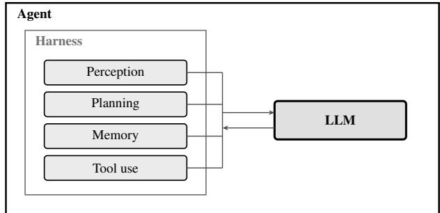  
Figure 1: The LLM and the harness around it form the agent. The functions the harness provides are grouped into four modules, which Figure 2 breaks down into the elements that provide them.

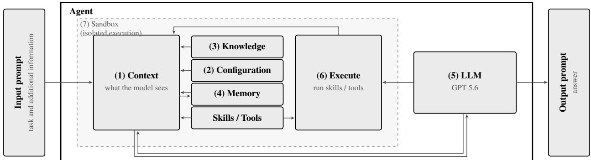  
Figure 2: The elements of an agent harness from an implementation perspective. The prompt enters the context, together with the mounted knowledge, the configuration files, the memory and the skills, all assembled by the harness. The model reasons over this context and decides which skills to execute. The result of the execution re-enters the context, and the loop repeats until an answer is returned. The numbers follow the order in which Section 2.1 describes the elements. Everything inside the dashed boundary runs in an isolated execution environment.

These four modules identify the functions that an agent harness fulfills. For practitioners, a more detailed breakdown is advantageous, as it describes which elements provide these functions in practice and how they are connected to form a harness. Knowing the contribution of each element allows the reader to retrace the decisions made for the agent in this work and to judge which elements to adjust for their own application. Figure 2 shows these elements and the loop they form, which the remainder of this section discusses. The loop that connects these elements is the one described by ReAct [Yao et al., 2023]. The model reasons over the context, calls a tool, and reads the result before reasoning again. As a result, each turn consists of a reasoning phase and an action phase. The following paragraphs describe the elements in the order in which the loop passes them in Figure 2.

(1) Context. The prompt is passed to the agent and becomes an integral component of the context, which encompasses everything the LLM receives during a single invocation. The harness assembles the context at each step of the loop, and the context window of the model limits its size. Information not contained within the context is inaccessible to the model. In addition to the input prompt, the context holds the configuration of the agent, the knowledge mounted into the workspace, the memory of what the agent has generated in the current or previous sessions, and the skills available for execution (see Figure 2).

(2) Configuration. The configuration is a set of files containing the operating instructions of the agent. Its most consequential entry is the catalog of available skills and instructions on how to use them. Placing a skill in the workspace of the agent is not sufficient for the agent to use it. The skill also has to be documented and announced to the agent, and the way this is done is a design decision of the engineer.

(3) Knowledge. Knowledge is defined as the documents and other information sources about its domain that are made available to an agent, as distinct from the memory the agent builds up from its own experience [Luo et al., 2026]. Knowledge reaches the model by three routes. In fine-tuning, the knowledge is written into the model weights by training on a collection of domain documents, a knowledge archive, so that it becomes internal knowledge of the LLM [Wang et al., 2024]. This route has been taken in acoustics, where a model was trained on a dataset of metamaterial geometries and their sound absorption coefficients and then used both to predict the absorption of a given geometry and to propose a geometry for a target spectrum [Jiang et al., 2025]. In retrieval-augmented generation, a retrieval module indexes an external archive, selects the passages that match the current prompt, and inserts them into the context without the involvement of the agent [Lewis et al., 2021, Gao et al., 2024, Fang et al., 2025]. In the third route, the agent retrieves the knowledge itself as needed [Wang et al., 2024, 2025, Xi et al., 2023]. The routes differ in how deeply the knowledge is embedded and in where the decision on its use is made. Knowledge stored in the weights is part of the LLM and can only be changed by retraining. Knowledge provided by a retrieval module stays outside the model and is placed into the context by the harness in every run. This is an explicit design decision, since the archive and the selection mechanism are fixed when the harness is built. Knowledge retrieved by the agent also stays outside the model, but it enters the context only if the agent decides to read it.

(4) Memory. Memory holds the information an agent retains beyond a single model invocation. The literature distinguishes between short-term or working memory, which stores information within the current context of a session, and long-term memory, which persists across sessions and is retrieved as needed [Luo et al., 2026, Xi et al., 2023, Wang et al., 2024]. Short-term memory is limited to the session. Long-term memory is built up in three stages, from storage through reflection to experience. The agent records the course of a session, meaning the sequence of steps it performs, condenses these records, and abstracts them into experience that it can apply to new tasks [Luo et al., 2026]. Keeping this layer trustworthy is one of the central bottlenecks of a harness [Gu, 2026]. Stored information must remain accurate over time, or the agent’s own past becomes a source of error.

(5) LLM (Reasoning). Once assembled, the context is transferred to the model, and the processing within the model prior to generating an answer is its reasoning. The reasoning effort, also known as test-time computation, can be adjusted by the user and current models make it accessible as a setting [Snell et al., 2024, OpenAI, 2024]. The additional computation costs more, as the model generates more intermediate steps before it acts, which increases the latency of a run [Kadekodi et al., 2025, Wei et al., 2023]. Each reasoning step ends in a decision and the next action of the agent, which is executed by the harness.

(6) Execution. This action is the second phase of the ReAct loop and consists of the execution of a skill. The result of this invocation re-enters the context, and the loop continues. The harness provides the fundamental tools, such as an execution shell or a Python interpreter (Python REPL [Zhang et al., 2024]). Existing agent frameworks already include these tools, so only the domain skills have to be added.

(7) Sandbox (Isolation). The environment is isolated in a container, which is a packaged filesystem that runs isolated from the host system, as illustrated in Figure 2. The isolation serves two purposes. It confines the agent to the content inside the boundary, and it resets every run to the same initial state, which makes the benchmark runs comparable.

The elements described above vary in their accessibility to a domain expert. The composition of the context and the design of the loop are properties of the harness, and modifying them necessitates altering the harness itself. Harness or loop engineering is a powerful discipline of its own and is beyond the focus of this work. Domain knowledge, agent configuration, and skills are accessible without engaging in this discipline. These elements are provided around an existing harness and require expertise only in the respective field, which is why this work focuses on them.

## 2.2 Agentic Systems

Several autonomous agents can be combined by a loop of their own, just as the elements of a single agent are. As introduced in Section 2.1, the literature calls such a system a multi-agent system [Fang et al., 2025, Tran et al., 2025] or agentic AI [Sapkota et al., 2026].

As with an agent, an agentic system is defined by a loop, which in this case encompasses the agents. This orchestration loop assigns tasks, determines the information received by each agent, and decides when a result is accepted [Gu, 2026, Sapkota et al., 2025]. The roles and boundaries of the agents and the manner in which they interact are thus central design decisions.

The literature characterizes the design of agentic systems along three axes: the communication structure, the type of collaboration, and the collaboration strategy [Tran et al., 2025, Fang et al., 2025]. Figure 3 shows the options on each axis. Communication can be centralized, with all agents communicating through a single node that manages and coordinates them, or it can be distributed among the agents in a decentralized or hierarchical structure. Collaboration is cooperative when the agents align their goals toward a common objective, and it can also be competitive or a combination of both, termed coopetition. The collaboration strategy determines how interactions are governed. A collaboration strategy is rule-based if interactions are determined by predefined rules, model-based if agents make decisions under uncertainty by anticipating probable outcomes and role-based if work is divided among predefined roles [Tran et al., 2025, Fang et al., 2025].

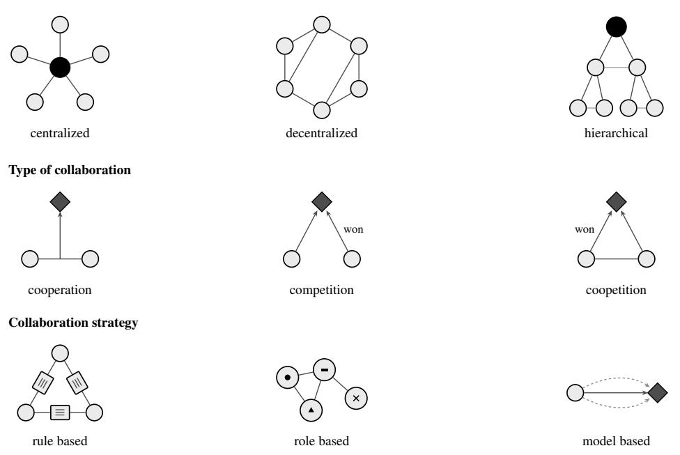

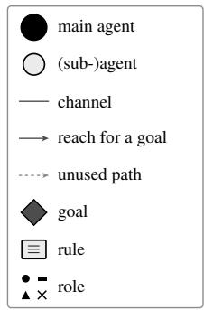  
Figure 3: The three axes along which an agentic system is designed. Communication runs through one central agent, decentralized with each agent communicating with every other agent, or hierarchical, with agents communicating within a level and with the adjacent level. Collaboration is cooperative when the agents work together on a task, competitive when they compete for it, and coopetitive when both happen at once. The strategy is a set of rules that decides when agents are allowed to communicate with one another, an assignment of roles, or model based, in which case several approaches are tried and one of them is selected.

The strength of a multi-agent system derives from its scalability, as a group of agents can collaborate to accomplish tasks that exceed the capacity of a single agent [Tran et al., 2025, Sapkota et al., 2026]. This capacity rests in part on the separation of agents, with each agent operating within its own context, which contains only what its specific task requires. Separation comes at the price of coordination. The content of one agent’s context is not accessible to the other agents and must be transferred when required. These handovers are exchanged as text [Wu et al., 2023], which can lead to misunderstandings or omissions. An early error can propagate to subsequent agents, and the behavior arising from multiple interacting agents is less predictable than that of a single agent [Xi et al., 2023, Plaat et al., 2025, Tran et al., 2025]. A multi-agent system is thus not an improvement in itself. A single agent that solves a task is preferable to a multi-agent system that solves it equally well, and the topology should be expanded only where the task requires it [Sapkota et al., 2026, Tran et al., 2025, Xi et al., 2023].

## 2.3 Agent Setup

The agentic system used in this work is based on OpenClaw, an open-source framework for agent infrastructure [Openclaw Team, 2026]. It provides all of the elements described above, including the execution tool through which each skill is invoked, so none of these elements require dedicated implementation. Frameworks such as LangChain expose the loop and the remaining parts of the harness at a deeper level and allow their modification [Sapkota et al., 2025], a depth that this work does not require. The models employed in this work are hosted externally and belong to the GPT 5.6 family.

The harness elements of Section 2.1 are configured as follows. The ReAct loop runs isolated inside a container [Yao et al., 2023, Openclaw Team, 2026]. The configuration files describe the available skills and how they work together, and they assign each subagent its role and the subset of skills it may access. Knowledge is provided as an ordinary file in the workspace that the agent reads only if it decides to, and no retrieval module places it into the context [Gu, 2026]. Memory is used within a session and forms a second source of information next to the knowledge file, while memory across sessions is beyond the scope of this work. The two applications require different skills and knowledge, which the agentic system keeps apart. The system comprises one orchestrating agent and multiple subagents, each responsible for a specific task. Along the axes described in Section 2.2, communication is centralized in a star structure, collaboration is cooperative, and the strategy is role-based. By design, the subagents do not communicate with one another. Each subagent receives a task from the orchestrating agent and returns its result to it. Figure 4 illustrates the system. The agent described in this section is applied to two tasks. Since they come from different areas of acoustics, they show the range of problems the approach can address. They also pose different questions about the agent. The first asks what each harness element contributes, and the second asks how the work is best divided between the skills while the other elements of the harness remain unchanged.

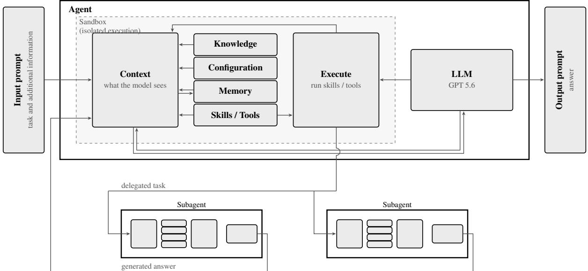  
Figure 4: A multi-agent system built from the blocks and the structure of the harness of Figure 2. The system of Section 2.3 is centralized, cooperative and role based. One orchestrating agent spawns two subagents via its execute module, and each subagent repeats the same structure, depicted here as a pictogram. The orchestration agent writes the task into the context of a subagent, and every subagent keeps its own context, its own harness and its own calls to the model. Only the final message of a subagent returns into the context of the orchestrating agent, so the subagents never communicate with one another.

Fault detection in measured data. In Section 3 the agent searches recordings for measurement faults. Eight prompts ask for this in increasing detail. The simplest task asks whether a recording is faulty or clean, the hardest task asks which of the nine fault types occurred and in which time interval. The configuration of the agent, the knowledge and the LLM are varied in isolation over the eight tasks and every answer is graded against a known ground truth.

Design ofan acoustic metamaterial. In Section 4 the agent designs a ventilated metamaterial that reduces the noise behind it over a given frequency range. The reduction can be reached with scatterers or with resonators, and the agent chooses which and searches for the parameters that reach the target. How much of that work is given as a skill changes between runs, while the rest of the harness stays fixed. The design is judged by the noise reduction it achieves.

## 3 Fault Detection in Synthetic Measurement Data

Measurement campaigns for noise, vibration, and harshness (NVH) use numerous sensors in harsh environments, where faults resulting from sensor failures and handling errors are prevalent [Bao et al., 2019]. Nearly every analysis of the measurement data is preceded by a check of the recordings for such faults. The methods range from a visual inspection of the recorded channels to a script designed to detect the most common faults [Defreitas and Alexander, 2023].

This detection is the task the agent is given here. Section 3.1 describes the synthetic recordings and the faults injected into them, Section 3.2 the skills the agent is equipped with, and Section 3.3 the configurations that are compared. Section 3.4 defines how an answer is scored, and Sections 3.5 and 3.6 report how the agent scores and what follows from it for practice.

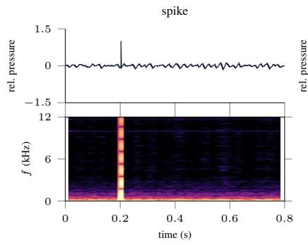

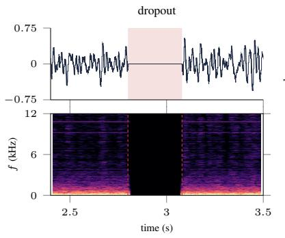

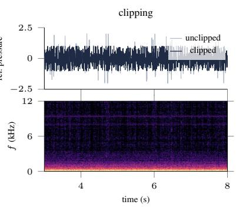

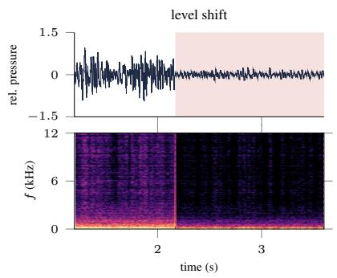

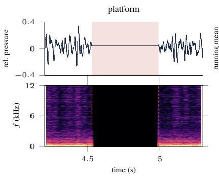

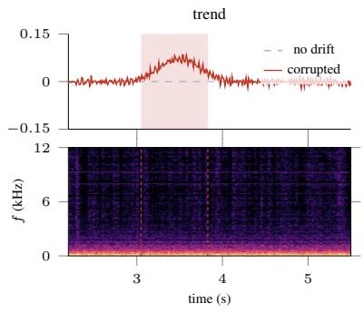

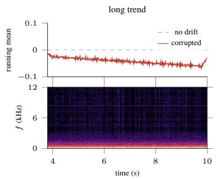

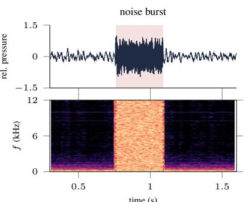

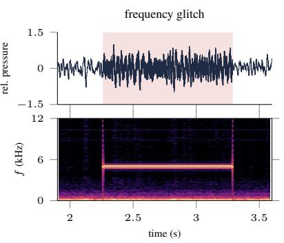  
Figure 5: The nine fault types of the fault detection task. Each panel shows the waveform or the running mean of an affected recording at the top and the corresponding spectrogram below. Red dashed lines and the shaded span mark the start and end of the fault. For clipping, the unclipped signal (gray) is drawn behind the clipped one (blue). For trend and long trend, the running mean of the corrupted signal (red) is compared with a flat baseline without drift (gray).

## 3.1 The Benchmark Dataset

The data for this benchmark are artificial recordings of interior noise in an electric vehicle, stored as stereo WAV files of ten seconds at a sampling rate of 44.1 kHz. Each clean sample is synthesized from source models of the vehicle, such as the powertrain and the tires, and filtered with a cabin transfer function.

Synthetic data offers two advantageous properties on which a benchmark depends. The first is an exact ground truth. The faults are injected into a copy of the clean sample, so the type, time interval, and severity of every fault are recorded at the moment of injection without later annotation. Every run is then graded against the same reference. The second is that the content of the set is decided in advance. Every fault type appears, and the share of clean and corrupted recordings is fixed, rather than being whatever a measurement campaign happens to deliver.

Nine fault types are injected, each representing a failure that can occur in a real measurement chain. Figure 5 illustrates an example of each. The fault types spike, platform, dropout, trend, and long trend are inspired by [Jia et al., 2024]. The benchmark comprises 50 curated recordings, of which 25 are clean and 25 are corrupted. With this balanced split, an agent that labels every recording as clean is correct in only half of the cases, so a score above this level reflects how well the agent distinguishes clean from corrupted recordings.

Table 1: The task prompts of the benchmark. They vary along two axes: what is asked, rising from a yes-or-no judgment (001, 002, 005) through the fault types present (003, 007) to the types with their time ranges (004, 008), and how many recordings are given, one for 001 to 005 and a batch of 50 recordings for 006 to 008. Every prompt requests its answer as a structured text block.
<table><tr><td>No.</td><td>Input Prompt</td></tr><tr><td>001</td><td>Is anything wrong with this recording? (with a true positive sample)</td></tr><tr><td>002</td><td>Is anything wrong with this recording? (with a true negative sample)</td></tr><tr><td>003</td><td>Which faults are present in this recording and of which types?</td></tr><tr><td>004</td><td>Which faults are present, of which types, and in which time ranges?</td></tr><tr><td>005</td><td>A colleague is convinced that this recording is corrupted, identify the fault and its location.</td></tr><tr><td>006</td><td>For each of these recordings, is it corrupted?</td></tr><tr><td>007</td><td>For each of these recordings, which types of faults are present?</td></tr><tr><td>008</td><td>For each of these recordings, which faults occur, of which type and in which time range?</td></tr></table>

## 3.2 Skill Design

The harness described in Section 2.3 is generic. It is tailored to the task through the skills assigned to the fault detection subagent that examines the recordings for faults. The subagent comprises 13 skills, implemented as Python functions and invoked through the execution tool. They form a two-stage pipeline in which four primitives measure the recordings and nine detectors decide.

Each primitive skill transforms a recording into a feature artifact. One reduces the recording to a frame-by-frame measure of root mean square (RMS), variance, and zero-crossing rate. A second provides a short-time spectrum with its flatness and dominant frequency. A third tracks the amplitude at a given sampling resolution, and the fourth counts the samples at full amplitude and the flat sections between them.

Each of the nine fault types has its own detector. A detector operates on an artifact produced by a primitive. It compares the feature of that artifact with a set of thresholds and returns a decision for its fault type, together with the time interval in which it detected the fault. The agent takes the thresholds from the curated knowledge file. If no thresholds are provided, the detector fails instead of falling back to a default, which leaves the agent to come up with a value of its own.

The split of the skills separates measurement from judgment. The primitives determine what the agent perceives, the detectors what it concludes. Because the two stages are separate executables, the agent performs the handover itself, running a primitive and passing the resulting artifact to the detector it considers appropriate. How the skills are separated is a design choice of the engineer, because it fixes what is left for the agent to decide, for example which primitive to run, which detector to apply, and how to connect the two. The more the skills fix, the more reproducible the run and the fewer decisions the agent makes. The more is left open, the less certain the outcome, and the more the record shows about how the agent works with its skills. The split used here serves the second purpose by making it possible to compare configurations by which skills they call and how reliably they call them.

## 3.3 Experimental Design

The benchmark measures the contributions of the individual components of the harness to the performance of the agent. A defined procedure and a clear definition of a measured run are prerequisites for this measurement. A run is defined as a single session of the agent. In this session, the agent receives a prompt, works in its isolated container with the skills and files of the configuration under test, and returns its response as a structured text block. This structure allows the response of each run to be extracted and graded automatically. Each run starts in the same workspace and is independent of previous runs, so two runs of a configuration differ only in what the agent itself does. Memory is limited to a single session, and storage across sessions is beyond the scope of this work [Luo et al., 2026]. The response is archived and evaluated against the ground truth from Section 3.1.

Each run is initiated with one of eight prompts. The prompts are phrased in non-technical language and match the scenario the benchmark addresses, namely a user who asks with limited prior knowledge of fault detection. The wording of a prompt is not a neutral entry point for the agent, as it influences the skills the agent selects and the manner in which it evaluates the result [Loya et al., 2023, Lu et al., 2022, Fang et al., 2025]. For this reason, each prompt is fixed in its exact wording. The benchmark is divided into three phases. The first phase determines which parts of the harness an agent needs to solve the task. The second phase corrupts the information provided to the agent, and the third replaces the language model underlying the harness. The first phase uses all eight prompts, and the latter two use a subset that covers the different types of requests. Together, the three phases separate the contribution of the elements of the harness from the robustness of the harness and its dependence on the model.

• Phase 1: Harness Elements. The contribution of each element is measured by comparing four configurations. The configuration none provides no skills, undocumented provides the skills without their documentation, baseline adds the documentation, and knowledge adds the thresholds as knowledge. Comparing none with undocumented separates the availability of a skill from its description, and comparing baseline with knowledge shows the contribution of the thresholds and whether the agent reads its knowledge and applies it.

• Phase 2: Robustness of the Harness. Robustness is tested by making the information available to the agent inconsistent. A corrupted memory entry contradicts the curated knowledge in the workspace, and the observation is which of the two sources the agent follows. The literature refers to this as a knowledge conflict [Xu et al., 2024, Xie et al., 2024, Longpre et al., 2022].

• Phase 3: Model Dependence. The dependence on the model is measured by running the same harness with different language models.

Each combination of configuration and prompt is executed ten times, because an agent behaves probabilistically in two ways. The language model samples its answer, and the loop turns each sampled decision into a branch, which increases the number of possible paths with the length of a run [Mohammadi et al., 2025, Luo et al., 2025]. Two runs of the same configuration can follow different paths and yield different answers, so a single run is one sample of a distribution. Ten runs are a modest number, but they offer insight into the reliability of a result, and distinguish a consistent result from one achieved only once.

## 3.4 Evaluation Metrics

An agent benchmark can be graded by comparing the values reported by the agent with a reference or by having a language model assess the responses. The latter approach is common [Wang et al., 2025], but such a judge is biased by construction [Li et al., 2025]. In this work, a script compares the reported values with the ground truth established in Section 3.1. This comparison requires a metric, a rule that reduces the performance of one run to a single number. The prompts pose a challenge, as they request different kinds of responses, from a binary verdict to the limits of a time interval. Each kind of response requires its own grading method for the score to reflect the performance of the agent.

• Binary score. A single recording that only has to be judged corrupted or clean is either right or wrong. A run scores 0 or 1, and the result is reported as k of N runs correct. This metric is used for the single-recording prompts listed in Table 2.

• Balanced accuracy. Conventional accuracy is calculated by dividing the number of correctly classified recordings by the total number of recordings. In a set of 90 clean and 10 corrupted recordings, an agent that labels every recording as clean achieves a score of 0.90 without distinguishing clean from corrupted recordings [Brodersen et al., 2010]. A measure independent of this mix is the mean of the accuracies achieved on the corrupted and on the clean recordings,

$$
{ \mathrm { b a l a n c e d ~ a c c . } } = { \frac { 1 } { 2 } } \left( { \frac { T P } { T P + F N } } + { \frac { T N } { T N + F P } } \right) ,\tag{1}
$$

which equals the conventional accuracy when the agent performs equally well on both classes and falls to chance level for an agent that always gives the same answer. This metric is used for a batch of recordings, as shown in Table 2.

$F _ { 1 }$ score. Answers that consist of a set of type names or fault locations are evaluated by the precision $P$ and the recall $R .$ The precision is the fraction of the named types that are actually present, and the recall is the fraction of the present types that were named. For a recording containing a dropout, a spike, and clipping, an answer naming a dropout and a level shift attains a precision of $1 / 2$ , because one of the two named types is present, and a recall of $1 / 3 ,$ because one of the three present types was named. For the localization prompts, the same two quantities are counted over events, and a prediction counts only if its type matches and its interval falls within a tolerance given in Appendix A. With the reference set $Y$ and the answer set $\hat { Y } .$ , the two quantities are given by

$$
P = \frac { | Y \cap \hat { Y } | } { | \hat { Y } | } , \qquad R = \frac { | Y \cap \hat { Y } | } { | Y | } .\tag{2}
$$

A single number per cell is required, so the two are combined by the harmonic mean

$$
F _ { 1 } = \frac { 2 P R } { P + R } ,\tag{3}
$$

Table 2: The six task groups, the metric applied to each, and whether the metric is pooled over a batch.
<table><tr><td></td><td>Prompts</td><td>Metric</td><td>Pooled</td></tr><tr><td colspan="4">single recording</td></tr><tr><td>binary</td><td>001, 002, 005</td><td>binary score</td><td>no</td></tr><tr><td>type</td><td>003</td><td> $F _ { 1 }$ </td><td>no</td></tr><tr><td>localization</td><td>004</td><td> $F _ { 1 }$ </td><td>no</td></tr><tr><td colspan="4">batch of recordings</td></tr><tr><td>binary</td><td>006</td><td>balanced accuracy</td><td>yes</td></tr><tr><td>type</td><td>007</td><td> $F _ { 1 }$ </td><td>yes</td></tr><tr><td>localization</td><td>008</td><td> $F _ { 1 }$ </td><td>yes</td></tr></table>

which is dominated by the smaller of the two, so only an answer that is both complete and free of invented types receives a high score [van Rijsbergen, 1979]. Table 2 lists the prompts graded in this way.

One alternative for these prompts is the chance-corrected Matthews correlation coefficient, which also uses the true negatives [Matthews, 1975, Chicco and Jurman, 2020, Powers, 2020]. A true negative is well defined only for the binary decision, which is why this work reports the $F _ { 1 }$ score, following the convention of the literature on sound event detection [Mesaros et al., 2016].

Every prompt is reduced to a single value, which poses an additional challenge for prompts that require the analysis of a batch of recordings. Such a batch can be reduced in two ways, by scoring each recording and averaging, or by pooling the counts across the entire batch and reducing once. Pooling has the advantage that it weights each fault equally, not each recording. A clean recording scored clean contributes nothing, a false alarm contributes one false positive, and a recording the agent never answered contributes all of its faults as false negatives [Sokolova and Lapalme, 2009, Manning et al., 2008].

The scores are complemented by their spread across the repetitions and the resulting resolution. Without a measure of spread, a difference between two configurations may lie within the noise, which would render the claim that one is better unsubstantiated. How the spread is reported depends on the metric. For the balanced accuracy and the pooled $F _ { 1 }$ , it is the standard deviation σ and the resolution $\bar { \Delta }$ over the ten runs. The resolution $\Delta$ is the smallest difference between two means that can be distinguished from the run-to-run noise,

$$
\Delta \approx { \frac { 2 \sigma } { \sqrt { N } } } .\tag{4}
$$

A difference between two means has to exceed the resolution by approximately a factor of $\sqrt { 2 }$ before it can be claimed [Agarwal et al., 2021].

For the single-recording binary tasks, a run scores 0 or 1, so a spread would carry no information beyond the mean, and these tasks are given as k of N runs correct [Brown et al., 2001].

## 3.5 Results

This section reports the runs performed with the harness and the data described above, graded with the metrics introduced before. Unless stated otherwise, all runs use the model GPT 5.6 terra. Several of the statements below are based on a single run or on counts over the runs of a configuration, which the tables do not show. Each of these statements carries the identifier of an entry in the supplementary material (e.g., E1), where the claim is set out together with the part of the archived record it is based on.

As expected, adding harness elements clearly improved the performance of the agent, particularly the addition of skills and of the knowledge file. Documentation on how to use the skills did not demonstrably improve the performance. Some tasks scored higher and some lower, mostly within the noise.

The configuration none regularly underperforms the others, with one notable exception in the batch binary task. Tasks 001 and 002 ask the same question of a corrupted and of a clean recording, and together they give this configuration a balanced accuracy of 0.60, slightly above the one half reached by answering the same way for every recording. On the batch of task 006, it attains 0.89 and surpasses the baseline, because in a batch it ranks the recordings against one another instead of against a threshold (E5). As expected, the score declines sharply when the tasks become more difficult, for example when the fault has to be localized.

One notable observation is that undocumented performed significantly better on the clean cases 002 and 005. This cannot be attributed to the missing documentation, because the performance of both undocumented and baseline depends strongly on the thresholds they have to devise themselves. Within the ten recorded runs, undocumented may simply have chosen better thresholds.

Table 3: Results of the benchmark. Each cell reports the mean over N = 10 runs with the standard deviation and, in brackets, the resolution beneath it. The single-recording binary tasks are given as the number of correct runs out of ten.
<table><tr><td>Task</td><td>none</td><td>undocu- mented</td><td>baseline</td><td>knowledge</td></tr><tr><td>single recording</td><td></td><td></td><td></td><td></td></tr><tr><td>001</td><td>10/10</td><td>10/10</td><td>10/10</td><td>10/10</td></tr><tr><td>002</td><td>2/10</td><td>5/10</td><td>2/10</td><td>10/10</td></tr><tr><td>005</td><td>1/10</td><td>9/10</td><td>3/10</td><td>10/10</td></tr><tr><td>003</td><td>0.65</td><td>0.73</td><td>0.88</td><td>1.00</td></tr><tr><td>004</td><td>±0.28 (0.18) 0.26</td><td>±0.17(0.11) 0.60</td><td>±0.16 (0.10) 0.69</td><td>±0.00 (0.00) 1.00</td></tr><tr><td></td><td>±0.25 (0.16)</td><td>±0.16(0.10)</td><td>±0.14(0.09)</td><td>±0.00 (0.00)</td></tr><tr><td></td><td>batch of recordings 0.89</td><td>0.89</td><td>0.74</td><td>0.95</td></tr><tr><td>006</td><td>±0.12 (0.07)</td><td>±0.21 (0.13)</td><td>±0.21 (0.13)</td><td>±0.16(0.10)</td></tr><tr><td>007</td><td>0.43 ±0.17 (0.11)</td><td>0.61 ±0.21 (0.13)</td><td>0.82 ±0.11 (0.07)</td><td>1.00 ±0.01 (0.01)</td></tr><tr><td>008</td><td>0.29 ±0.16 (0.10)</td><td>0.60 ±0.13 (0.08)</td><td>0.69 ±0.15 (0.09)</td><td>1.00 ±0.00(0.00)</td></tr></table>

Both configurations reach moderate scores, which indicates that the invented thresholds are more than a guess. The logs show where they come from. The agent runs the primitives, reads the magnitude of their output, and adjusts its thresholds accordingly. When a pass reports no fault, the agent repeats it with lower thresholds until faults appear (E3). In this way, it performs an iterative search that the task never asked for, and it stops once the result appears plausible, without any cost function.

The undocumented and baseline configurations differ in the route they take through the skills. Baseline runs the detectors in almost every run, while undocumented reaches for a primitive and then decides for itself. The documentation thus changes which route the agent prefers, and the agent finds the skills in both cases. Table 9 holds the counts, and Table 8 holds the number of skill calls, which differ by two orders of magnitude between the two configurations. Both routes cost about the same. Baseline runs longer and spends more tokens on each batch task, but no difference between the two configurations exceeds the combined resolution of the cells it is read from.

The fully equipped configuration scores perfectly in almost every run. Reading the knowledge file is optional, yet it was consulted in every run, and the thresholds it provides reached the detectors unaltered. Two runs fall short, the 0.95 on task 006 and a 0.996 on task 007, which Table 3 rounds to 1.00. The first lost the results it had recorded and reported every recording as anomalous (E1). The second submitted the remnants of an abandoned attempt that remained in the workspace shared by the workers (E2). Neither failure can be attributed to skill handling. The next two phases use a reduced prompt set that covers the different types of requests, because the full set would require considerably more tokens without providing additional information. The next phase examines how the knowledge configuration handles inconsistent information. For this purpose, a corrupted version of the threshold table is added to the memory file of the agent. Alternatively, the corrupted table could be added to the knowledge as a second option. The setup also shows which source the agent prefers, given the instructions in its configuration file. Two versions of these instructions were tested. In the first, both sources are mentioned equally. In the second, the instructions strongly favor the knowledge by asking the agent to consult it for information on thresholds, and only the last paragraph states that the memory is an alternative. The agent does not divide its attention evenly between the two sources. Under fair instructions, it selected the curated table in 25 of the 30 runs and the corrupted one in 4. Where the instructions name the knowledge first, it selected the curated table in all 30 runs. The present setup cannot explain why the curated table is preferred under fair instructions. A run that selected a table used this table exclusively, with one exception that ran the detectors twice, once with each table, and answered from the curated set (E6).

The decisive factor is what the instructions advertise. Naming the knowledge first is sufficient to eliminate the corrupted picks. The opposite direction was not tested.

Table 4: Which of the two contradicting threshold tables a run used, and under which instructions. Each row contains thirty runs, ten for each of the tasks 004, 006, and 008. The three conditions are instructions that name both sources equally, instructions that favor the knowledge over the memory, and the fair instructions with a raised reasoning effort.
<table><tr><td>Instructions</td><td>curated only</td><td>corrupted only</td><td>both</td></tr><tr><td>fair</td><td>25/30</td><td>4/30</td><td>1/30</td></tr><tr><td>knowledge favored</td><td>30/30</td><td>0/30</td><td>0/30</td></tr><tr><td>fair, raised reasoning</td><td>17/30</td><td>2/30</td><td>11/30</td></tr></table>

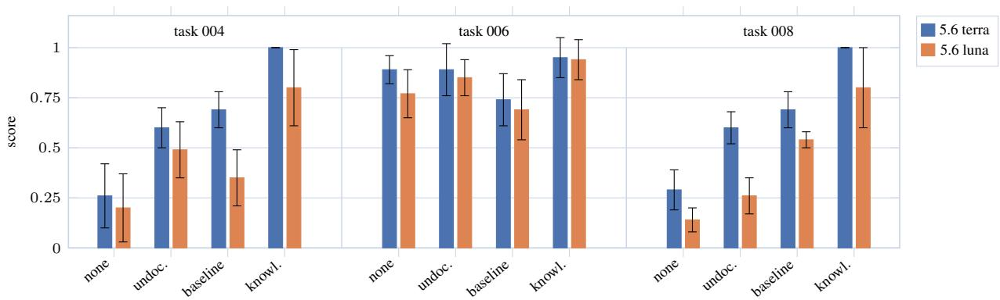  
Figure 6: The four configurations on the tasks 004, 006, and 008. The color indicates the model that drives the agent, GPT 5.6 terra or GPT 5.6 luna. Each bar is the mean over ten runs, and the error bar is the resolution, so two bars with overlapping error bars cannot be distinguished by this benchmark. On 006, no configuration separates the two models, on 004 they separate under baseline and knowledge, and on 008 the weaker model scores lower under every configuration.

Raising the reasoning effort changes which source the agent reaches for, not how well it answers. It consults both sources in 11 of the 30 runs, against 1 of 30 at the lower setting, and the scores of the fair condition in Table 10 do not move with it. Naming the knowledge first does move them. That condition reaches the values the knowledge configuration attains without a conflict in Table 3, so an instruction that points at the right source recovers what the conflict costs, while a longer deliberation does not.

The final phase replaces the language model that drives the harness, GPT 5.6 terra, with GPT 5.6 luna and leaves the harness, the recordings, and the prompts unchanged. Table 5 reports the results, and Figure 6 compares them to the previous results. On the batch binary task 006, the scores of all configurations remain within the noise. On task 004, the result is split. Baseline and knowledge score significantly lower on the weaker model, and the other two configurations remain within the noise. On task 008, every configuration loses, and the fully equipped one drops from a perfect score to 0.80 with a standard deviation of about 0.3, so its answers become unreliable. With both models, the fully equipped configuration scores best on every task. The influence of the harness is thus visible regardless of the model that drives it, and the ladder of Section 3.3 survives the exchange. Table 11 reports the cost of a run on the weaker model.

Table 5: The four configurations on the weaker model GPT 5.6 luna. The harness, the recordings, and the prompts are those of Table 3, and only the model that drives the loop is exchanged. Each cell is the mean over N = 10 runs with the standard deviation and, in brackets, the resolution beneath it.
<table><tr><td>Task</td><td>none</td><td>undocu- mented</td><td>baseline</td><td>knowledge</td></tr><tr><td>004</td><td>0.20 ±0.27 (0.17)</td><td>0.49 ±0.22 (0.14)</td><td>0.35 ±0.22 (0.14)</td><td>0.80 ±0.31 (0.19)</td></tr><tr><td>006</td><td>0.77 ±0.18 (0.12)</td><td>0.85 ±0.15 (0.09)</td><td>0.69 ±0.23 (0.15)</td><td>0.94 ±0.16(0.10)</td></tr><tr><td>008</td><td>0.14 ±0.10 (0.06)</td><td>0.26 ±0.14 (0.09)</td><td>0.54 ±0.06 (0.04)</td><td>0.80 ±0.32(0.20)</td></tr></table>

## 3.6 Discussion and Implications for the Practitioner

The objective of the benchmark was to separate the contribution of the equipment of an agent from that of its model.

The benchmark runs demonstrate that the agent configuration defines the workflow the agent follows, although it cannot determine in advance how well the agent will perform. If the skills are present but their execution is not described, the agent writes its own code to use them. If the execution is described, the agent carries it out as intended. Once the configuration is set, the workflow is predictable. This provides an agent developer with a method of debugging the agent, since the steps of a run are known in advance and an error can be traced to the step that caused it.

The design of a configuration extends beyond the workflow of a single agent. It also determines how an agentic system coordinates its work, which can be distributed among several agents, each with its own role and context. In this work, the agent that coordinates the analysis is separate from the agent that performs the detection. Such a separation of roles comes at a cost. Information has to be exchanged between the workspaces of the agents, and a handover can fail or be misinterpreted by the receiving agent. An error of this kind is attributed to the orchestration, not to a skill or its design. It cannot be eliminated completely, so an agent developer should account for it, for instance by repeating a run.

A higher reasoning effort cannot compensate for structural errors or inconsistent information in the harness. Orchestration is an integral part of the harness, and the harness determines which information reaches the model. If this information is incomplete or contradictory, the cause lies in the structure of the system, and additional reasoning by the model cannot resolve it. The agent in this work encounters two contradictory sources, and its responses show no improvement with increased reasoning effort. An agent that performs poorly should be examined at the harness level before its reasoning effort is increased, since a structural error persists regardless of the effort expended. The user of an agent should also know which tasks the agent is equipped to handle. Reasoning alone does not guarantee that a task outside this scope comes within reach, and the response of the agent is then likely to be hallucinated. Section 2.1 states that a harness cannot raise an agent beyond the limits imposed by its model. The results of this work show the converse, namely that a model cannot compensate for structural problems of the harness. A position paper about agentic AI scientists reaches the same conclusion, arguing that some challenges require different design choices rather than more capable models [Bisht et al., 2026].

Finally, the environment of an agent may contain artifacts that were never intended for it. Data incorporated for a specific purpose remains available, and an agent that finds it may react to it in ways no one anticipated. In this benchmark, a run of the configuration without skills locates the retained skill files in the file system and executes them, while its record reports no skill calls (E7). A benchmark has to account for the possibility that isolation fails, and the output of an agent has to be traced back to its source before it can be trusted. A restricted environment is the simplest measure, because what an agent cannot reach cannot affect it. Where the environment cannot be restricted further, the log of a run shows the path taken and has to be reviewed before the score is accepted.

## 4 Design of a Metamaterial with a Predefined Insertion Loss

The second application shifts the focus from judging data to producing a design. The agent is tasked with designing a periodic array representing a metamaterial that remains open to airflow and reduces the sound transmitted through it at a given frequency [Krasikova et al., 2024a]. Each task defines an insertion loss to be reached over a frequency band, with restrictions on the maximum depth of the array, and the minimum clear opening shown in Figure 7.

## 4.1 The Design Problem

This section describes the physical model of the problem with its field equation and boundary conditions and defines the insertion loss. The field is computed in two dimensions in the frequency domain, where the acoustic pressure p satisfies the Helmholtz equation

$$
\begin{array} { r } { \nabla ^ { 2 } p + k ^ { 2 } p = 0 , } \end{array}\tag{5}
$$

with the wave number $k = 2 \pi f / c$ c and the speed of sound $c = 3 4 3 \mathrm { m / s }$ in air. The duct walls and the scatterer surfaces $\Gamma _ { n }$ are rigid [Pierce, 2019], and the inlet $\Gamma _ { i }$ and the outlet $\Gamma _ { o }$ absorb what reaches them through a first-order absorbing condition [Engquist and Majda, 1977, Bayliss et al., 1982],

$$
\partial _ { n } p = 0
$$

$$
\mathrm { o n } \Gamma _ { n } ,\tag{6}
$$

$$
\partial _ { n } p + \mathrm { i } k p = 2 \mathrm { i } k
$$

$$
\mathrm { o n } \Gamma _ { i } ,\tag{7}
$$

$$
\partial _ { n } p + \mathrm { i } k p = 0
$$

$$
\mathrm { o n } \Gamma _ { o } .\tag{8}
$$

A plane wave of unit amplitude is injected at normal incidence through the inlet condition, whose right-hand side follows from splitting the field into the incident and the reflected wave. The wave reflected back toward the inlet is absorbed at the same time, so that no energy re-enters the domain from the boundary. Figure 7 shows the simulated domain with the three boundary conditions, the unit cell and the receiver line behind the array. The weak form is discretized with quadratic Lagrange elements on an unstructured triangular mesh [Thompson, 2006] and solved directly at each frequency. The element size h of the mesh is bounded by two rules, and the smaller of the two bounds applies,

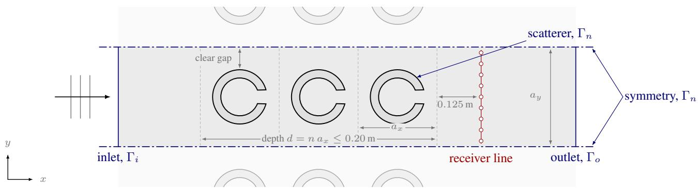  
Figure 7: The simulated setup with scatterers or resonators in air, where the domain is governed by the Helmholtz equation. The array repeats infinitely in the y-direction, and a plane wave travels in the x-direction. The wave enters at the inlet on the left and leaves at the outlet on the right, and both ports absorb what reaches them. Every design respects a maximum thickness of the metamaterial and a minimum gap between two unit cells. The insertion loss is evaluated on the receiver line behind the array.

$$
h \leq \operatorname* { m i n } \left( \frac { c } { 1 0 f _ { \operatorname* { m a x } } } , \alpha s _ { \operatorname* { m i n } } \right) .\tag{9}
$$

The first is a resolution rule for the Helmholtz equation, where $f _ { \mathrm { m a x } }$ denotes the highest frequency of the band. No fixed number of elements per wavelength is sufficient in general, because the error also grows with the number of wavelengths across the domain [Ihlenburg, 1998, Marburg, 2018]. Recommendations therefore vary with the element order and the problem [Marburg, 2008], and ten quadratic elements per shortest wavelength is a conservative choice for a domain that spans at most a few wavelengths. The second ties the element size to the smallest dimension of the cell $s _ { \mathrm { m i n } } .$ , such as the slit width or the wall thickness, so that at least $1 / \alpha$ elements span it [Krasikova et al., 2024b]. This resolves the slit, whose width and length set the resonance frequency [Ingard, 1953, Selamet and Lee, 2003, Elford et al., 2011]. In the present designs, the second rule is decisive by a wide margin. At 1 kHz, the first rule allows an element of about 34 mm, and the features of these cells reduce it to between 1 mm and 5 mm.

Only a single duct is simulated (see Figure 7). For a cell that is symmetric about its mid-plane and a wave at normal incidence, the lateral rigid walls act as symmetry planes. The duct thus represents the whole metamaterial, which repeats infinitely in the $y$ direction [Gebrekidan and Marburg, 2024, Kronowetter et al., 2023]. This assumption holds only as long as the duct supports a single propagating mode. A symmetric cell at normal incidence excites only the even modes, so the second mode appears first, and the duct remains single-mode below $f _ { c } = c / a _ { y }$ [Pierce, 2019]. Above $f _ { c } ,$ the inlet and the outlet no longer absorb exactly what reaches them. For this reason, the solver rejects any frequency above $0 . 8 f _ { c } ,$ which keeps a margin below the limit. This is also the range over which the supplementary material compares the solver with the semi-analytic solution of Linton and Evans [Linton and Evans, 1993], which applies under the same single-mode condition.

With the model defined and its physical limits established, a criterion for the evaluation is required. A design is evaluated by its insertion loss on a receiver line behind the array [Krasikova et al., 2024a]. Since a wave of unit amplitude is injected at the inlet, the value in the empty channel is exactly $| p | = 1$ . The insertion loss follows from the root mean square pressure alone [Munjal, 2014, Jena and Qiu, 2021],

$$
\mathrm { I L } ( f ) = - 1 0 \log _ { 1 0 } \left. | p | ^ { 2 } \right. _ { \mathrm { r e c e i v e r } } ,\tag{10}
$$

where a positive value indicates attenuation. The receiver line consists of 21 points that are evenly distributed across the channel and located at a fixed distance behind the material, as indicated in Figure 7.

## 4.2 Study Setup

This case study analyzes the division between what a skill performs and what the agent has to work out for itself. Section 3.2 identified this division as the central decision in designing an agent. The model, the harness, the targets, and the budget remain constant in every run, and only the set of skills changes. The three phases that are discussed below describe the different skill setups that are used.

(a)  
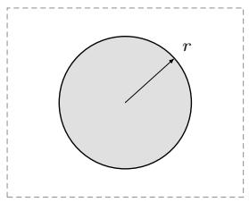  
(c)

(b)  
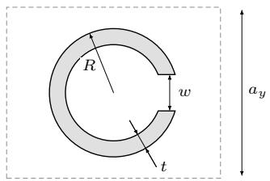

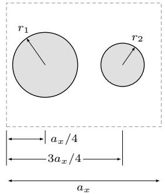

(d)  
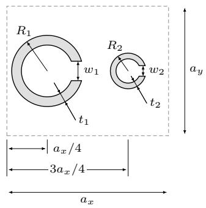  
Figure 8: The four unit-cell templates. A rigid circle (a) scatters the incident wave, and a c-shape (b), a cavity behind a narrow slit, resonates. The diatomic variants (c) and (d) contain two members of different sizes in one cell, placed at one quarter and three quarters of the lattice spacing. The agent sets the lattice spacings $a _ { x }$ and $a _ { y } ,$ the number of columns, and the shape parameters. These are the radius r of a circle and the outer radius $R ,$ , the wall thickness t, and the slit width w of a c-shape. Each member of a diatomic cell has its own values.

• Phase 1: Agent-driven optimization. The agent is given the unit cell templates of Figure 8 and skills that check the geometric constraints shown in Figure 7, mesh a cell and solve it. It chooses the type of unit cell and its parameters, decides which parameter to change after each evaluation, and decides when to stop the optimization. The element size is decided by the agent as well, following the rule in the knowledge file.

• Phase 2: Agent-orchestrated optimization. The same skills as in the previous phase, plus four search strategies, from a simplex search to uniform random sampling. One of them takes the parameter search over: the agent picks which parameters to vary, their bounds and the optimization budget, and the strategy returns the best design it found. The element size is now set by the skill. The strategy improves a design at one frequency only, while the target has to be met across the whole frequency band, so the agent has to steer the optimization across the band itself.

• Phase 3: Agent-driven design. The skills of the first phase, without the unit cell templates. The agent draws and meshes its own cell, and a check skill admits it only if it is symmetric about its center plane and the solver can read the mesh.

The first phase is run in a narrowband and a broadband version, which together with the second and the third phase gives the four tasks listed in Table 6. Each task specifies an insertion loss that has to be reached at every frequency of the band given in the table. Each task comes at three levels of difficulty. The easy bar lies within what a rigid scatterer can reach. The middle and the hard bar lie above the easy bar and can be met only with a resonator.

After each run the grader checks the geometric limits, recomputes the design with half the element size, and accepts the result given by the agent only if the insertion loss remains unchanged. The margin indicates by how much the lowes insertion loss in the band exceeds the threshold. It is positive for a design that meets its target and negative for one that falls short. Computing the same margin from the numbers reported by the agent shows whether the agent was right about what it had built.

Table 6: The four design tasks and the insertion loss each has to reach. Task 101 asks for a narrow band around 1 kHz, and the others ask for a wider band around the same center. Task 103 adds the search strategies, and task 104 withholds the templates. The insertion loss is required at every frequency of the band.
<table><tr><td>Task</td><td>Asked for</td><td>easy</td><td>middle</td><td>hard</td><td>band (Hz)</td></tr><tr><td>101</td><td>narrowband</td><td>8 dB</td><td>20 dB</td><td>45 dB</td><td>970-1030</td></tr><tr><td>102</td><td>broadband</td><td>6 dB</td><td>18 dB</td><td>40 dB</td><td>891-1122</td></tr><tr><td>103</td><td>broadband with search</td><td>6 dB</td><td>18 dB</td><td>40 dB</td><td>891-1122</td></tr><tr><td>104</td><td>broadband, no templates</td><td>6 dB</td><td>18 dB</td><td>40 dB</td><td>891-1122</td></tr></table>

Table 7: The results of the four tasks, each at three levels of difficulty. The cell column gives the template the agent selected, and the layers column gives how many cells deep it made the array. The margin column gives the smallest insertion loss over the graded band relative to the required value, so a negative margin is a miss. The claim column gives the difference between the insertion loss the agent reported and the one found by an independent rerun of the same design. The design evaluation column counts the calls of the solver. In task 104, the agent submits a mesh and no template parameters, so the rerun refines this mesh and does not build a new mesh, unlike in the other cases. The claims listed there are the smallest in the table. Eight of the twelve designs reach the required insertion loss, and claimed and graded values differ by no more than 1.4 decibels. Given templates, the agent selects the c-shape in seven of the nine runs. Without them, it draws cells of its own, which are named after their function and shown in Figure 9.
<table><tr><td>Level</td><td>Cell</td><td>layers</td><td>margin (dB)</td><td>design eval.</td><td>claim (dB)</td></tr><tr><td colspan="6">101 tonal, solver without search</td></tr><tr><td>easy</td><td>c-shape</td><td>2</td><td>3.5</td><td>4</td><td>-0.1</td></tr><tr><td>middle</td><td>c-shape</td><td>2</td><td>10.9</td><td>7</td><td>-0.1</td></tr><tr><td>hard</td><td>c-shape</td><td>2</td><td>2.6</td><td>5</td><td>-0.1</td></tr><tr><td colspan="6">102 broadband, solver without search</td></tr><tr><td>easy</td><td>c-shape</td><td>4</td><td>17.6</td><td>3</td><td>-0.3</td></tr><tr><td>middle</td><td>c-shape</td><td>4</td><td>10.0</td><td>10</td><td>-1.4</td></tr><tr><td>hard</td><td>bicshape</td><td>2</td><td>-27.0</td><td>9</td><td>-0.2</td></tr><tr><td colspan="6">103 broadband, search strategies given</td></tr><tr><td>easy</td><td>circle</td><td>2</td><td>1.4</td><td>20</td><td>-0.1</td></tr><tr><td>middle</td><td>c-shape</td><td>2</td><td>-0.9</td><td>46</td><td>-0.4</td></tr><tr><td>hard</td><td>c-shape</td><td>4</td><td>2.0</td><td>11</td><td>-1.1</td></tr><tr><td colspan="6">104 broadband, templates withheld</td></tr><tr><td>easy</td><td>block</td><td>2</td><td>-0.5</td><td>7</td><td>0.0</td></tr><tr><td>middle</td><td>two cavities</td><td>2</td><td>2.1</td><td>5</td><td>0.1</td></tr><tr><td>hard</td><td>one cavity</td><td>2</td><td>-37.2</td><td>6</td><td>0.0</td></tr></table>

## 4.3 Results

Table 7 lists the twelve runs, one for each of the four tasks at each of the three levels of difficulty. Eight runs reached their target, and all twelve remained within the parameter limits. The values the agent reports for its own design agree with the independent evaluation. The largest deviation is 1.4 decibels, and in every run, the agent’s assessment of whether the target was reached matched that of the grader.

The cell column records the shape on which each run settled. At the middle and the hard level of difficulty, all eight runs end with a resonator. At the easy level, where the bar is within reach of a scatterer, the results split two to two, with resonators in tasks 101 and 102 and scatterers in tasks 103 and 104. Task 104 provides no template, and the shapes drawn there follow the same pattern, from a solid block for the easy bar to cavities for the higher bars.

The design evaluation column counts how many candidates each run passed to the solver, out of the 60 allowed by the task. The runs of tasks 101, 102, and 104 used between 3 and 10 evaluations each. Only task 103, which includes the search strategies, used more, with 20, 46, and 11. Every run thus ended with a large part of the budget unused, including the runs that stopped just short of their goal. The easy cell of 104 was submitted as a miss by half a decibel with 53 evaluations still remaining.

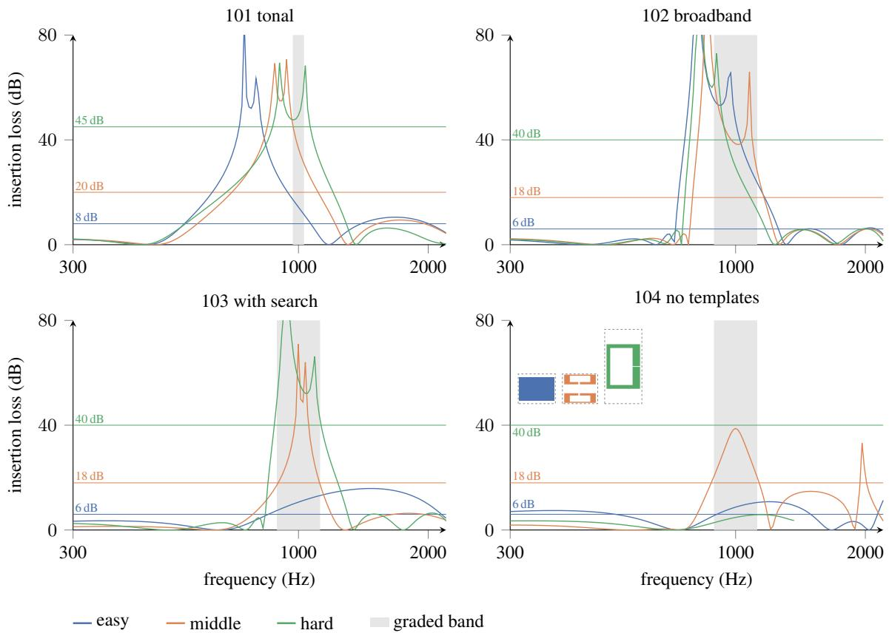  
Figure 9: Each submitted design, solved again independently over the range from 300 to 2200 hertz. The thin horizontal lines mark the insertion loss required at each level of difficulty, which is 6, 18, and 40 decibels in the broadband tasks and 8, 20, and 45 decibels in 101. The gray stripe is the graded band. Eight of the twelve designs remain above their line across that band. The middle level of 103 and the easy level of 104 miss it narrowly, and the hard levels of 102 and 104 miss it by a wide margin. The hard curve of 104 ends at 1.4 kHz, because above this frequency its cell no longer satisfies the single-mode condition of Section 4.1. The plot is cut at 80 decibels, and since the model has no losses, the height of the peaks has no physical meaning.

Figure 9 recomputes each design far outside its target band and shows where its resonance was placed. In tasks 101 and 102, where no search strategy is available, the peak of all six resonator designs lies below the band by 30 to 220 Hz, so the bar is cleared on the flank of the resonance. In task 103, where the strategies are available, both resonators reach their peak within the band. The third design there is a scatterer and has no resonance to place. The strategie are responsible for placing the response at the desired location. A single run per cell makes this a pattern and not a measurement, but the pattern is consistent across all designs in the comparison.

Figure 10 shows the pressure field of one design per task at 1 kHz. All four fields share the same color scale and can be compared directly. The dashed lines mark the front and the back of the array, which in these designs lie at or just inside the depth limit of 0.20 meters. The dotted line behind them marks the receiver line at which the insertion loss is measured. The color behind the array indicates how much each design attenuates at this frequency. The three resonators reach 30 to 39 decibels, and the single scatterer of 103 reaches about 11. The cell of 102 is of particular interest. It was built from the bicshape template, which holds two members of different size, yet its two members are nearly identical, with outer radii that differ by only 4 percent.

## 4.4 Discussion and Implications for the Practitioner

The designs reported here are not advances in metamaterial design. The templates are standard cell types, the model is two dimensional and without losses, and each design is the result of a single run. What this case study contributes is the record of how the agent arrives at a design and of where the division between skill and agent decides the outcome. The metamaterial is the testbed of this study, and the agent is its subject.

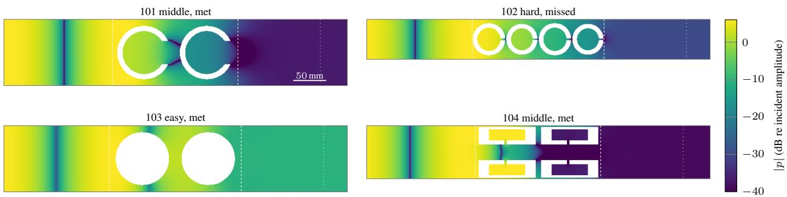  
Figure 10: The pressure field of one design per task at 1 kHz, plotted on a common length scale, so that a taller cell is also drawn taller, and on a common color scale, so that the panels can be compared. In each panel, the two dashed lines mark the front and the back of the array, the dotted line further to the right is the receiver at which the insertion loss is read, and the white shapes are the scatterers. The dark vertical band in front of each array is the first pressure node of the standing wave that the reflection builds up there, where the incident and the reflected wave cancel each other. The panel of 102 shows a diatomic cell whose two members are so close in size that its two layers appear as four. In 104 middle, the pair of cavities facing the wave is loud, and the pair behind it is quiet. This is precisely the function of a resonator, and the agent drew it without a template to copy.

This case study produces a working agent for the design of an acoustic metamaterial. The physical model and the simulation setup are provided, and the part that has to be adjusted is the geometry of the unit cell. The agent optimized a given set of parameters on its own. Where a search strategy was available, the agent coordinated the use of the strategy and selected which parameters to vary and what to optimize for. When no template was provided, it developed its own design within the physical constraints of the model and optimized it. Every design it submitted satisfied the given constraints, and most reached their target.

The performance of the agent also has limits. It ends the design optimization prematurely. In most runs, fewer than 10 of the 60 allowed evaluations were used, and one design was submitted half a decibel below the threshold with 53 evaluations still remaining. Without a search strategy, in tasks 101 and 102, the resonance of each design lies below the graded band, so the threshold is crossed on the flank of the peak. In addition, the agent favors safety over efficiency when choosing the element size and uses a much finer mesh than the two rules of Section 4.1 require.

Both the strengths and the weaknesses of the agent stem from the decisions it has to make around the skills. Skills can thus be designed toward different goals, and the goal is determined by what a skill takes care of and what it leaves open. If the answer to a design decision is already known, the decision is best fixed within a skill. The search strategies are an example. Delegating the parameter search to a strategy tunes the resonator to the target band. Without such a strategy, the cell is tuned to a neighboring range and still clears the bar within the graded band. The strategies placed the attenuation where the goal required it. The interface between a design and the solver is fixed for the same reason, so the agent has to produce a mesh that passes a check and does not have to infer the format the solver needs.

Where the designer does not know the answer, it is better to leave the decision open, because this is where exploration by the agent has its place. In the final phase, no cell template was provided, and the agent generated its own cells. This is useful whenever the form of a good design is not known in advance.

## 5 Conclusion and Future Work

This work treated the harness of an agent as the variable of an experiment. A benchmark on fault detection in synthetic recordings of vehicle interior noise varied the elements of the harness, and a case study on the design of a periodic array varied the division of work between a skill and the agent.

The elements of the harness differ in what they change. Skills and a curated set of thresholds change what the agent achieves. A description of the workflow changes the route the agent takes without changing its accuracy, so that a run becomes predictable and a fault can be traced to the step that caused it. Exchanging the model raises or lowers the level at which all configurations settle, and the fully equipped configuration scores best with either model. A higher reasoning effort changes which source of information the agent consults, while the quality of its answers remains the same. The harness thus determines how an agent works, and the model determines how far it can get.

The design of a skill is a decision that the engineer has to make deliberately. Where a workflow is already established, fixing it inside a skill costs nothing, as the search strategies and the solver interface show. Where no such workflow exists, leaving the decision to the agent lets it explore designs that a script or template could not include, as the unit cells the agent drew without a given example show. In general, designing a skill pipeline entails a trade-off between reliability and exploration.

The study of language-model agents in acoustics is still at an early stage. More sophisticated agent designs, more demanding applications, and complete simulation workflows remain to be examined. To retain control over such systems, it will be essential to measure the contribution of each new element and how the elements work together. This work can serve as a starting point for isolating the elements of an agent and measuring their impact.

## Acknowledgements

This work is a result of the research project ML/AI Support for NVH Engineering (FVV project no. 1555), funded by the FVV e.V. The project was carried out jointly by the Chair of Thermodynamics of Mobile Energy Conversion Systems at RWTH Aachen University, the Chair of Vibroacoustics of Vehicles and Machines at the Technical University of Munich, and the Data Analytics and Machine Learning group at Forschungszentrum Jülich. A group of experts led by Dr. Michael Fischer (Robert Bosch GmbH) accompanied the project. The authors gratefully acknowledge the support of the project coordination and of all members of the project committee.

## Supplementary Material

See the supplementary material for the scripts that re-derive every table and figure of this paper from the archived records, the rules that map a reported fault type onto one of the nine types of the benchmark, the evidence behind the statements of Section 3.5, cited above as E1 to E7, the four design prompts of Section 4 word for word, and the validation of the solver against the semi-analytic solution of Linton and Evans [Linton and Evans, 1993].

## Data and Code Availability

The data that support the findings are part of the supplementary material. Specifications about the implementation of the skills are available from the corresponding author upon reasonable request.

## Author Declarations

## Use of Generative AI

During the preparation of this work, the authors used Claude (Anthropic) and GPT 5.5 (OpenAI) to assist with coding, with version control in git, and with the LaTeX formatting of the manuscript, including the conversion of figures from Inkscape to TikZ. The authors also used these services to screen raw data and to improve the language of the manuscript, and used DeepL for further language editing. After using these services, the authors reviewed and edited the content as needed and take full responsibility for the content of the published article.

## Conflict of Interest

The authors declare no conflicts of interest regarding this manuscript. All authors contributed to the research and writing of this paper.

## A Matching Reported Events

The agent names the faults it finds in its own words. Those names and the names in the ground truth are both mapped onto the nine fault types of the benchmark before anything is counted, by the ordered rules given in the supplementary material.

Where a prompt asks when a fault occurs, both the response and the reference are lists of type, onset and offset [Mesaros et al., 2016]. For each reference event, the grader considers the unmatched predictions of the same type and selects the one whose onset is closest. No optimal assignment is computed [Kuhn, 1955]. Each reference therefore absorbs at most one prediction, and a duplicate detection becomes a false positive [Everingham et al., 2010]. A match is counted if onset and offset are both within a tolerance

$$
\mathrm { t o l . } = \operatorname* { m i n } \Big ( \operatorname* { m a x } \big ( 0 . 0 5 d , 0 . 1 0 \mathrm { s } , f \big ) , \operatorname* { m a x } \big ( 0 . 2 5 \mathrm { s } , f \big ) \Big ) ,\tag{11}
$$

where d is the duration of the reference event and f is a floor determined by the window and the hop of the primitive from which the detector reads. The floor is 0.60 s for trend and long trend, 0.15 s for level shift and 0.10 s for the remaining types. It prevents a fault from being graded more finely than the instrument that measures it, and the cap prevents a fault that persists throughout the entire recording from being graded as loosely as its duration would allow. The criterion is a tolerance at the endpoints rather than a fraction of overlap [Bilen et al., 2020], so it is binary per event and independent of how long a fault happens to be.

## B Additional Benchmark Results

This appendix holds what the archive records about a run, alongside what the run achieved in Table 3. The tables follow the phases of Section 3: the configuration ladder, then the context conflict and the model exchange. Each cost is given as a mean with its standard deviation and resolution, as the scores are. In several cells the standard deviation exceeds the mean, because a single run took far longer or spent far more than the others and dominates the cell. These cells are skewed and should be read with caution. Table 9 aggregates which skills have been used in the eighty runs for each agent configuration. Table 10 provides the performance scores of the three context corruption conditions. Most of the performance drops stem from the corrupted tables that were selected by the agent over the correct table. How often each table was selected is reported in Table 4. Table 11 shows the same pattern of skill calls, time spent and tokens used as on terra in Table 8.

Table 8: Cost of a run for the four configurations of Phase 1, on GPT 5.6 terra. Each cell is the mean over N = 10 runs, with the standard deviation and, in brackets, the resolution beneath it, as in Table 3. Tokens are thousands of tokens per run and the wall clock time is seconds per run, both summed over the main agent and its workers.
<table><tr><td rowspan="2">Task</td><td rowspan="2">none</td><td rowspan="2">undocu- mented</td><td rowspan="2">baseline</td><td rowspan="2">knowledge</td></tr><tr><td></td></tr><tr><td>skill calls</td><td></td><td></td><td></td><td></td></tr><tr><td rowspan="2">001</td><td>0</td><td>2</td><td>10</td><td>14</td></tr><tr><td>±0(0)</td><td>±1(1)</td><td>±4(2)</td><td>±2(1)</td></tr><tr><td rowspan="2">002</td><td>0</td><td>3</td><td>13</td><td>14</td></tr><tr><td>±0(0)</td><td>±2(1)</td><td>±2(2)</td><td>±1(1)</td></tr><tr><td rowspan="2">005</td><td>0</td><td>5</td><td>16</td><td>14</td></tr><tr><td>±0(0)</td><td>±2(1)</td><td>±4(2)</td><td>±1(0)</td></tr><tr><td rowspan="2">003</td><td>0</td><td>3</td><td>13</td><td>14</td></tr><tr><td>±0(0)</td><td>±1(1)</td><td>±0(0)</td><td>±1(0)</td></tr><tr><td rowspan="2">004</td><td>0</td><td>2</td><td>13</td><td>16</td></tr><tr><td>±0(0)</td><td>±2(1)</td><td>±1(1)</td><td>±5(3)</td></tr><tr><td rowspan="2">006</td><td>0</td><td>8</td><td>746</td><td>828</td></tr><tr><td>±0(0)</td><td>±10(6)</td><td>±225 (142)</td><td>±237(150)</td></tr><tr><td rowspan="2">007</td><td>0</td><td>26</td><td>1041</td><td>1034</td></tr><tr><td>±0(0)</td><td>±61 (39)</td><td>±506 (320)</td><td>±462 (292)</td></tr><tr><td rowspan="2">008</td><td>0</td><td>8</td><td>965</td><td>1228</td></tr><tr><td>±0(0)</td><td>±19(12)</td><td>±359 (227)</td><td>±199(126)</td></tr><tr><td>thousands of tokens</td><td></td><td></td><td></td><td></td></tr><tr><td rowspan="2">001</td><td>45</td><td>79</td><td>83</td><td>96</td></tr><tr><td>±8(5)</td><td>±39(24)</td><td>±28 (18)</td><td>±41 (26)</td></tr><tr><td rowspan="2">002</td><td>64</td><td>96</td><td>92</td><td>101</td></tr><tr><td>±23 (14)</td><td>±41 (26)</td><td>±16(10)</td><td>±28(18)</td></tr><tr><td rowspan="2">005</td><td>99</td><td>142</td><td>124</td><td>98</td></tr><tr><td>±42(27)</td><td>±58(36)</td><td>±40(25)</td><td>±28(18)</td></tr><tr><td rowspan="2">003</td><td>76</td><td>79</td><td>93</td><td>84</td></tr><tr><td>±15(10)</td><td>±26(17)</td><td>±25 (16)</td><td>±18(11)</td></tr><tr><td rowspan="2">004</td><td>74</td><td>109</td><td>93</td><td>90</td></tr><tr><td>±22(14)</td><td>±46 (29)</td><td>±22(14)</td><td>±28(18)</td></tr><tr><td rowspan="2">006</td><td>394</td><td>315</td><td>346</td><td>329</td></tr><tr><td>±406 (257)</td><td>±113 (71)</td><td>±157(100)</td><td>±107(68)</td></tr><tr><td rowspan="2">007</td><td>298</td><td>281</td><td>794</td><td>360</td></tr><tr><td>±108(68)</td><td>±149 (94)</td><td>±1225 (775)</td><td>±122(77)</td></tr><tr><td rowspan="2">008</td><td>366</td><td>435</td><td>582</td><td>672</td></tr><tr><td>±130(82)</td><td>±148 (94)</td><td>±284(180)</td><td>±386(244)</td></tr><tr><td>seconds</td><td></td><td></td><td></td><td></td></tr><tr><td rowspan="2">001</td><td>90</td><td>110</td><td>96</td><td>119</td></tr><tr><td>±12(8)</td><td>±41 (26)</td><td>±37(24)</td><td>±71(45)</td></tr><tr><td rowspan="2">002</td><td>105</td><td>120</td><td>106</td><td>105</td></tr><tr><td>±14(9)</td><td>±22(14)</td><td>±27(17)</td><td>±21(13)</td></tr><tr><td rowspan="2">005</td><td>127</td><td>196</td><td>155</td><td>118</td></tr><tr><td>±90(57)</td><td>±110(69)</td><td>±41 (26)</td><td>±67(43)</td></tr><tr><td rowspan="2">003</td><td>129</td><td>127</td><td>113</td><td>119</td></tr><tr><td>±57(36)</td><td>±48 (30)</td><td>±51 (32)</td><td>±54(34)</td></tr><tr><td rowspan="2">004</td><td>105</td><td>115</td><td>132</td><td>92</td></tr><tr><td>±35(22)</td><td></td><td></td><td></td></tr><tr><td rowspan="2">006</td><td>332</td><td>±31 (20)</td><td>±46(29)</td><td>±16(10)</td></tr><tr><td></td><td>306</td><td>394</td><td>409</td></tr><tr><td rowspan="2">007</td><td>±178(112)</td><td>±99(62)</td><td>±149(94)</td><td>±134(85)</td></tr><tr><td>304</td><td>308</td><td>735</td><td>453</td></tr><tr><td rowspan="2"></td><td>±75(48)</td><td>±112(71)</td><td>±725 (459)</td><td>±108 (68)</td></tr><tr><td>358</td><td>460</td><td>676</td><td>635</td></tr><tr><td rowspan="2">008</td><td></td><td></td><td></td><td></td></tr><tr><td>±109(69)</td><td>±198 (125)</td><td>±237(150)</td><td>±314(199)</td></tr></table>

Table 9: Which skills each configuration reached for, over the eighty runs of a configuration. Every cell is counted from the reports the skills wrote. A run counts as primitives only when it produced a feature artifact and never called a detector, so its decisions were made somewhere other than in the detectors.
<table><tr><td>Configuration</td><td>any skill report</td><td>primitives only</td><td>all nine detectors</td></tr><tr><td>none</td><td>1/80</td><td>1/80</td><td>0/80</td></tr><tr><td>undocumented</td><td>59/80</td><td>29/80</td><td>0/80</td></tr><tr><td>baseline</td><td>80/80</td><td>0/80</td><td>71/80</td></tr><tr><td>knowledge</td><td>80/80</td><td>0/80</td><td>79/80</td></tr></table>

Table 10: The scores of the three conditions in which the curated thresholds were contradicted by corrupted ones in the memory of the agent. Each cell is the mean over N = 10 runs, with the standard deviation and, in brackets, the resolution beneath it, as in Table 3, where the same tasks are reported without a conflict. The third condition repeats the fair one with the reasoning effort of the model raised.
<table><tr><td>Task</td><td>fair</td><td>knowledge favored</td><td>fair, raised reasoning</td></tr><tr><td>004</td><td>0.94 ±0.19 (0.12)</td><td>1.00 ±0.00 (0.00)</td><td>0.88 ±0.25 (0.16)</td></tr><tr><td>006</td><td>0.98 ±0.06 (0.04)</td><td>1.00 ±0.00 (0.00)</td><td>0.98 ±0.05 (0.03)</td></tr><tr><td>008</td><td>0.90 ±0.21 (0.13)</td><td>0.99 ±0.02(0.01)</td><td>0.99 ±0.03 (0.02)</td></tr></table>

Table 11: What a run costs on GPT 5.6 luna, the weaker model, to be read against Table 8. Each cell is the mean over N = 10 runs, with the standard deviation and, in brackets, the resolution beneath it.
<table><tr><td>Task</td><td>none</td><td>undocu- mented</td><td>baseline</td><td>knowledge</td></tr><tr><td colspan="5">skill calls</td></tr><tr><td>004</td><td>0 ±0(0)</td><td>2 ±2(1)</td><td>13 ±0(0)</td><td>14 ±2(1)</td></tr><tr><td>006</td><td>0 ±0(0)</td><td>1 ±3(2)</td><td>1033 ±1160(733)</td><td>1334 ±994(629)</td></tr><tr><td>008</td><td>0 ±0(0)</td><td>0 ±0(0)</td><td>1104 ±826 (523)</td><td>1146 ±775 (490)</td></tr><tr><td colspan="5">thousands of tokens</td></tr><tr><td>004</td><td>59 ±19(12)</td><td>74 ±26(17)</td><td>76 ±24(15)</td><td>53 ±9(6)</td></tr><tr><td>006</td><td>106 ±58(37)</td><td>143 ±143 (90)</td><td>326 ±121 (77)</td><td>349 ±79(50)</td></tr><tr><td>008</td><td>185 ±122(77)</td><td>210 ±71(45)</td><td>318 ±69(44)</td><td>438 ±125 (79)</td></tr><tr><td colspan="5">seconds</td></tr><tr><td>004</td><td>107 ±8(5)</td><td>102 ±21(13)</td><td>96 ±28 (18)</td><td>103 ±17(11)</td></tr><tr><td>006</td><td>111 ±38(24)</td><td>144 ±105 (66)</td><td>438 ±297(188)</td><td>551 ±354 (224)</td></tr><tr><td>008</td><td>158 ±77(49)</td><td>144 ±33(21)</td><td>388 ±148(94)</td><td>570 ±303 (192)</td></tr></table>

## References

Barbara Cunha, Christophe Droz, Abdelmalek Zine, Stéphane Foulard, and Mohamed Ichchou. A Review of Machine Learning Methods Applied to Structural Dynamics and Vibroacoustic. Mechanical Systems and Signal Processing, 200:110535, October 2023. ISSN 0888-3270. doi:10.1016/j.ymssp.2023.110535.

Johannes D. Schmid, Philipp Bauerschmidt, Caglar Gurbuz, Martin Eser, and Steffen Marburg. Physics-informed neural networks for acoustic boundary admittance estimation. Mechanical Systems and Signal Processing, 215:111405, June 2024. ISSN 08883270. doi:10.1016/j.ymssp.2024.111405.

Michael J. Bianco, Peter Gerstoft, James Traer, Emma Ozanich, Marie A. Roch, Sharon Gannot, and Charles-Alban Deledalle. Machine learning in acoustics: Theory and applications. The Journal ofthe Acoustical Society ofAmerica, 146(5):3590–3628, November 2019. ISSN 0001-4966, 1520-8524. doi:10.1121/1.5133944.

Jinyuan Fang, Yanwen Peng, Xi Zhang, Yingxu Wang, Xinhao Yi, Guibin Zhang, Yi Xu, Bin Wu, Siwei Liu, Zihao Li, Zhaochun Ren, Nikos Aletras, Xi Wang, Han Zhou, and Zaiqiao Meng. A Comprehensive Survey of Self-Evolving AI Agents: A New Paradigm Bridging Foundation Models and Lifelong Agentic Systems, 2025.

Junyu Luo, Weizhi Zhang, Ye Yuan, Yusheng Zhao, Junwei Yang, Yiyang Gu, Bohan Wu, Binqi Chen, Ziyue Qiao, Qingqing Long, Rongcheng Tu, Xiao Luo, Wei Ju, Zhiping Xiao, Yifan Wang, Meng Xiao, Chenwu Liu, Jingyang Yuan, Shichang Zhang, Yiqiao Jin, Fan Zhang, Xian Wu, Hanqing Zhao, Dacheng Tao, Philip S. Yu, and Ming Zhang. Large Language Model Agent: A Survey on Methodology, Applications and Challenges, March 2025.

Microsoft Research AI4Science and Microsoft Azure Quantum. The Impact of Large Language Models on Scientific Discovery: A Preliminary Study using GPT-4, December 2023.

Andres M. Bran, Sam Cox, Oliver Schilter, Carlo Baldassari, Andrew D. White, and Philippe Schwaller. ChemCrow: Augmenting large-language models with chemistry tools, October 2023.

Adrian Mirza, Nawaf Alampara, Sreekanth Kunchapu, Martiño Ríos-García, Benedict Emoekabu, Aswanth Krishnan, Tanya Gupta, Mara Schilling-Wilhelmi, Macjonathan Okereke, Anagha Aneesh, Amir Mohammad Elahi, Mehrdad Asgari, Juliane Eberhardt, Hani M. Elbeheiry, María Victoria Gil, Maximilian Greiner, Caroline T. Holick, Christina Glaubitz, Tim Hoffmann, Abdelrahman Ibrahim, Lea C. Klepsch, Yannik Köster, Fabian Alexander Kreth, Jakob Meyer, Santiago Miret, Jan Matthias Peschel, Michael Ringleb, Nicole Roesner, Johanna Schreiber, Ulrich S. Schubert, Leanne M. Stafast, Dinga Wonanke, Michael Pieler, Philippe Schwaller, and Kevin Maik Jablonka. Are large language models superhuman chemists?, November 2024.

Huan Zhang, Yu Song, Ziyu Hou, Santiago Miret, and Bang Liu. HoneyComb: A Flexible LLM-Based Agent System for Materials Science, August 2024.

Markus J. Buehler. MechGPT, a Language-Based Strategy for Mechanics and Materials Modeling That Connects Knowledge Across Scales, Disciplines, and Modalities. Applied Mechanics Reviews, 76(2):021001, March 2024. ISSN 0003-6900, 2379-0407. doi:10.1115/1.4063843.

Zehao Wang, Mingzhe Han, Wei Cheng, Yue-Kai Huang, Philip Ji, Denton Wu, Mahdi Safari, Flemming Holtorf, Kenaish AlQubaisi, Norbert M. Linke, Danyang Zhuo, Yiran Chen, Ting Wang, Dirk Englund, and Tingjun Chen. Agentic AI for Scalable and Robust Optical Systems Control, February 2026.

Darui Lu, Jordan M. Malof, and Willie J. Padilla. An Agentic Framework for Autonomous Metamaterial Modeling and Inverse Design, July 2025.

Gijs Wijngaard, Elia Formisano, Michel Dumontier, and Jenia Jitsev. AudioToolAgent: An Agentic Framework for Audio-Language Models, February 2026.

Harsh Purohit, Tomoya Nishida, Kota Dohi, Takashi Endo, and Yohei Kawaguchi. MIMII-Agent: Leveraging LLMs with Function Calling for Relative Evaluation of Anomalous Sound Detection, July 2025.

Ran Xu, Yupeng Qi, Jingsen Feng, and Xu Chu. Engineering.ai: A Platform for Teams of AI Engineers in Computational Design, October 2025.

Nayantara Mudur, Hao Cui, Subhashini Venugopalan, Paul Raccuglia, Michael P. Brenner, and Peter Norgaard. FEABench: Evaluating Language Models on Multiphysics Reasoning Ability, April 2025.

COMSOL AB. COMSOL multiphysics®. COMSOL AB, 2022.

Ranjan Sapkota, Konstantinos I. Roumeliotis, and Manoj Karkee. AI Agents vs. Agentic AI: A Conceptual taxonomy, applications and challenges. Information Fusion, 126:103599, February 2026. ISSN 15662535. doi:10.1016/j.inffus.2025.103599.

Rohan Kadekodi, Zhan Jin, Keisuke Kamahori, Yile Gu, Sean Khatiri, Noah H. Bayindirli, Sergey Gorbunov, and Baris Kasikci. AgentFlux: Decoupled Fine-Tuning & Inference for On-Device Agentic Systems, November 2025.

Khanh-Tung Tran, Dung Dao, Minh-Duong Nguyen, Quoc-Viet Pham, Barry O’Sullivan, and Hoang D. Nguyen. Multi-Agent Collaboration Mechanisms: A Survey of LLMs, January 2025.

Aske Plaat, Max van Duijn, Niki van Stein, Mike Preuss, Peter van der Putten, and Kees Joost Batenburg. Agentic Large Language Models, a survey. jair, 84, December 2025. ISSN 1076-9757. doi:10.1613/jair.1.18675.

Zhiheng Xi, Wenxiang Chen, Xin Guo, Wei He, Yiwen Ding, Boyang Hong, Ming Zhang, Junzhe Wang, Senjie Jin, Enyu Zhou, Rui Zheng, Xiaoran Fan, Xiao Wang, Limao Xiong, Yuhao Zhou, Weiran Wang, Changhao Jiang, Yicheng Zou, Xiangyang Liu, Zhangyue Yin, Shihan Dou, Rongxiang Weng, Wensen Cheng, Qi Zhang, Wenjuan Qin, Yongyan Zheng, Xipeng Qiu, Xuanjing Huang, and Tao Gui. The Rise and Potential of Large Language Model Based Agents: A Survey, September 2023.

Wangxuan Fan, Xiaoyu Nie, and Zhongxiang Dai. Harness-MU: A Safe, Governed, and Effective Harness for Multi-User LLM Agents, June 2026.

Shangding Gu. From Model Scaling to System Scaling: Scaling the Harness in Agentic AI, 2026.

Lei Wang, Chen Ma, Xueyang Feng, Zeyu Zhang, Hao Yang, Jingsen Zhang, Zhiyuan Chen, Jiakai Tang, Xu Chen, Yankai Lin, Wayne Xin Zhao, Zhewei Wei, and Jirong Wen. A survey on large language model based autonomous agents. Front. Comput. Sci., 18(6):186345, March 2024. ISSN 2095-2236. doi:10.1007/s11704-024-40231-1.

Hu Wei. Architectural Design Decisions in AI Agent Harnesses, April 2026.

Shunyu Yao, Jeffrey Zhao, Dian Yu, Nan Du, Izhak Shafran, Karthik Narasimhan, and Yuan Cao. ReAct: Synergizing Reasoning and Acting in Language Models, March 2023.

Jinghao Luo, Yuchen Tian, Chuxue Cao, Ziyang Luo, Hongzhan Lin, Kaixin Li, Chuyi Kong, Ruichao Yang, and Jing Ma. From Storage to Experience: A Survey on the Evolution of LLM Agent Memory Mechanisms, May 2026.

Yongfeng Jiang, Siyang Cao, Han Meng, Runze Zhou, Jianwei Ren, Xiangchao Feng, Cheng Shen, and Tianjian Lu. A data-driven design for sound absorption of acoustic metamaterials based on large language models. Sci Rep, 16(1): 517, December 2025. ISSN 2045-2322. doi:10.1038/s41598-025-29930-2.

Patrick Lewis, Ethan Perez, Aleksandra Piktus, Fabio Petroni, Vladimir Karpukhin, Naman Goyal, Heinrich Küttler, Mike Lewis, Wen-tau Yih, Tim Rocktäschel, Sebastian Riedel, and Douwe Kiela. Retrieval-Augmented Generation for Knowledge-Intensive NLP Tasks, April 2021.

Yunfan Gao, Yun Xiong, Xinyu Gao, Kangxiang Jia, Jinliu Pan, Yuxi Bi, Yi Dai, Jiawei Sun, Meng Wang, and Haofen Wang. Retrieval-Augmented Generation for Large Language Models: A Survey, March 2024.

Zhenting Wang, Qi Chang, Hemani Patel, Shashank Biju, Cheng-En Wu, Quan Liu, Aolin Ding, Alireza Rezazadeh, Ankit Shah, Yujia Bao, and Eugene Siow. MCP-Bench: Benchmarking Tool-Using LLM Agents with Complex Real-World Tasks via MCP Servers, August 2025.

Charlie Snell, Jaehoon Lee, Kelvin Xu, and Aviral Kumar. Scaling LLM Test-Time Compute Optimally can be More Effective than Scaling Model Parameters, August 2024.

OpenAI. Learning to reason with LLMs. https://openai.com/index/learning-to-reason-with-llms/, September 2024.

Jason Wei, Xuezhi Wang, Dale Schuurmans, Maarten Bosma, Brian Ichter, Fei Xia, Ed Chi, Quoc Le, and Denny Zhou. Chain-of-Thought Prompting Elicits Reasoning in Large Language Models, January 2023.

Ranjan Sapkota, Rashik Shrestha, Madhav Rijal, and Manoj Karkee. LangChain vs. LangGraph vs. LangSmith: Taxonomies of Agentic AI Toolchains for End-to-End Orchestration, September 2025.

Qingyun Wu, Gagan Bansal, Jieyu Zhang, Yiran Wu, Beibin Li, Erkang Zhu, Li Jiang, Xiaoyun Zhang, Shaokun Zhang, Jiale Liu, Ahmed Hassan Awadallah, Ryen W. White, Doug Burger, and Chi Wang. AutoGen: Enabling Next-Gen LLM Applications via Multi-Agent Conversation, October 2023.

Openclaw Team. Openclaw — personal ai assistant., 2026.

Yuequan Bao, Zhiyi Tang, Hui Li, and Yufeng Zhang. Computer vision and deep learning–based data anomaly detection method for structural health monitoring. Structural Health Monitoring, 18(2):401–421, March 2019. ISSN 1475-9217, 1741-3168. doi:10.1177/1475921718757405.

Aaron Defreitas and W. Nathan Alexander. Identification of anomalies in microphone array measurements of trailing edge noise by eigenstructure analysis. The Journal ofthe Acoustical Society ofAmerica, 153(2):1073–1083, February 2023. ISSN 0001-4966, 1520-8524. doi:10.1121/10.0016863.

L Jia, Bram Cornelis, and Konstantinos Gryllias. Validation of time series anomaly detection methods for automated detection of measurement anomalies in noise and vibration testing. September 2024.

Manikanta Loya, Divya Anand Sinha, and Richard Futrell. Exploring the Sensitivity of LLMs’ Decision-Making Capabilities: Insights from Prompt Variation and Hyperparameters. In Findings of the Association for Computational Linguistics: EMNLP 2023, pages 3711–3716, 2023. doi:10.18653/v1/2023.findings-emnlp.241.

Yao Lu, Max Bartolo, Alastair Moore, Sebastian Riedel, and Pontus Stenetorp. Fantastically Ordered Prompts and Where to Find Them: Overcoming Few-Shot Prompt Order Sensitivity, March 2022.

Rongwu Xu, Zehan Qi, Zhijiang Guo, Cunxiang Wang, Hongru Wang, Yue Zhang, and Wei Xu. Knowledge Conflict for LLMs: A Survey, June 2024.

Jian Xie, Kai Zhang, Jiangjie Chen, Renze Lou, and Yu Su. Adaptive Chameleon or Stubborn Sloth: Revealing the Behavior of Large Language Models in Knowledge Conflicts, February 2024.

Shayne Longpre, Kartik Perisetla, Anthony Chen, Nikhil Ramesh, Chris DuBois, and Sameer Singh. Entity-Based Knowledge Conflicts in Question Answering, January 2022.

Mahmoud Mohammadi, Yipeng Li, Jane Lo, and Wendy Yip. Evaluation and Benchmarking of LLM Agents: A Survey. In Proceedings of the 31st ACM SIGKDD Conference on Knowledge Discovery and Data Mining V.2, pages 6129–6139, August 2025. doi:10.1145/3711896.3736570.

Qingquan Li, Shaoyu Dou, Kailai Shao, Chao Chen, and Haixiang Hu. Evaluating Scoring Bias in LLM-as-a-Judge, 2025.

Kay Henning Brodersen, Cheng Soon Ong, Klaas Enno Stephan, and Joachim M. Buhmann. The Balanced Accuracy and Its Posterior Distribution. In 2010 20th International Conference on Pattern Recognition, pages 3121–3124, Istanbul, Turkey, August 2010. IEEE. ISBN 978-1-4244-7542-1. doi:10.1109/ICPR.2010.764.

C.J. van Rijsbergen. Information Retrieval. Butterworth, London, 2nd edition, 1979.

B.W. Matthews. Comparison of the predicted and observed secondary structure of T4 phage lysozyme. Biochimica et Biophysica Acta (BBA) - Protein Structure, 405(2):442–451, October 1975. ISSN 00052795. doi:10.1016/0005- 2795(75)90109-9.

Davide Chicco and Giuseppe Jurman. The advantages of the Matthews correlation coefficient (MCC) over F1 score and accuracy in binary classification evaluation. BMC Genomics, 21(1):6, December 2020. ISSN 1471-2164. doi:10.1186/s12864-019-6413-7.

David M. W. Powers. Evaluation: From precision, recall and F-measure to ROC, informedness, markedness and correlation. 2020. doi:10.48550/ARXIV.2010.16061.

Annamaria Mesaros, Toni Heittola, and Tuomas Virtanen. Metrics for Polyphonic Sound Event Detection. Applied Sciences, 6(6):162, May 2016. ISSN 2076-3417. doi:10.3390/app6060162.

Marina Sokolova and Guy Lapalme. A systematic analysis of performance measures for classification tasks. Information Processing & Management, 45(4):427–437, July 2009. ISSN 03064573. doi:10.1016/j.ipm.2009.03.002.

Christopher D. Manning, Prabhakar Raghavan, and Hinrich Schütze. Introduction to Information Retrieval. Cambridge University Press, New York, 2008. ISBN 978-0-521-86571-5.

Rishabh Agarwal, Max Schwarzer, Pablo Samuel Castro, Aaron Courville, and Marc G Bellemare. Deep Reinforcement Learning at the Edge of the Statistical Precipice. 2021.

Lawrence D. Brown, T. Tony Cai, and Anirban DasGupta. Interval Estimation for a Binomial Proportion. Statist. Sci., 16(2), May 2001. ISSN 0883-4237. doi:10.1214/ss/1009213286.

Harshit Bisht, Vinay Kumar, Kevin Maik Jablonka, Mausam, and N. M. Anoop Krishnan. Agentic AI Scientists Are Not Built For Autonomous Scientific Discovery, October 2026.

Mariia Krasikova, Aleksandra Pavliuk, Sergey Krasikov, Mikhail Kuzmin, Andrey Lutovinov, Anton Melnikov, Yuri Baloshin, David A. Powell, Steffen Marburg, and Andrey Bogdanov. Broadband noise-insulating periodic structures made of coupled Helmholtz resonators. APL Materials, 12(1):011115, January 2024a. ISSN 2166-532X doi:10.1063/5.0175167.

Allan D. Pierce. Acoustics: An Introduction to Its Physical Principles and Applications. Springer International Publishing, Cham, 2019. ISBN 978-3-030-11213-4 978-3-030-11214-1. doi:10.1007/978-3-030-11214-1.

Bjorn Engquist and Andrew Majda. Absorbing boundary conditions for the numerical simulation of waves. Math. Comp., 31(139):629–651, 1977. ISSN 1088-6842, 0025-5718. doi:10.1090/S0025-5718-1977-0436612-4.

Alvin Bayliss, Max Gunzburger, and Eli Turkel. Boundary Conditions for the Numerical Solution of Elliptic Equations in Exterior Regions. SIAM J. Appl. Math., 42(2):430–451, April 1982. ISSN 0036-1399, 1095-712X. doi:10.1137/0142032.

Lonny L. Thompson. A review of finite-element methods for time-harmonic acoustics. The Journal ofthe Acoustical Society ofAmerica, 119(3):1315–1330, March 2006. ISSN 0001-4966, 1520-8524. doi:10.1121/1.2164987.

Frank Ihlenburg, editor. Finite Element Analysis ofAcoustic Scattering, volume 132 of Applied Mathematical Sciences. Springer-Verlag, New York, 1998. ISBN 978-0-387-98319-6. doi:10.1007/b98828.

Steffen Marburg. A Pollution Effect in the Boundary Element Method for Acoustic Problems. J. Theor. Comp. Acout., 26(02):1850018, June 2018. ISSN 2591-7285, 2591-7811. doi:10.1142/S2591728518500184.

Steffen Marburg. Discretization Requirements: How many Elements per Wavelength are Necessary? In Steffen Marburg and Bodo Nolte, editors, Computational Acoustics of Noise Propagation in Fluids - Finite and Boundary Element Methods, pages 309–332. Springer Berlin Heidelberg, Berlin, Heidelberg, 2008. ISBN 978-3-540-77447-1 978-3-540-77448-8. doi:10.1007/978-3-540-77448-8\_12.

Mariia Krasikova, Felix Kronowetter, Sergey Krasikov, Mikhail Kuzmin, Marcus Maeder, Tao Yang, Anton Melnikov, Steffen Marburg, and Andrey Bogdanov. Acoustic bound states in the continuum in coupled Helmholtz resonators. Phys. Rev. Applied, 22(2):024045, August 2024b. ISSN 2331-7019. doi:10.1103/PhysRevApplied.22.024045.

Uno Ingard. On the Theory and Design of Acoustic Resonators. The Journal of the Acoustical Society of America, 25 (6):1037–1061, November 1953. ISSN 0001-4966, 1520-8524. doi:10.1121/1.1907235.

Ahmet Selamet and Iljae Lee. Helmholtz resonator with extended neck. The Journal of the Acoustical Society of America, 113(4):1975–1985, April 2003. ISSN 0001-4966, 1520-8524. doi:10.1121/1.1558379.

Daniel P. Elford, Luke Chalmers, Feodor V. Kusmartsev, and Gerry M. Swallowe. Matryoshka locally resonant sonic crystal. The Journal of the Acoustical Society of America, 130(5):2746–2755, November 2011. ISSN 0001-4966, 1520-8524. doi:10.1121/1.3643818.

Semere B. Gebrekidan and Steffen Marburg. Autonomous design of noise-mitigating structures using deep reinforcement learning. The Journal of the Acoustical Society ofAmerica, 156(1):151–163, July 2024. ISSN 0001-4966. doi:10.1121/10.0026474.

Felix Kronowetter, Lisa Pretsch, Yan Kei Chiang, Anton Melnikov, Shahrokh Sepehrirahnama, Sebastian Oberst, David A. Powell, and Steffen Marburg. Sound attenuation enhancement of acoustic meta-atoms via coupling. The Journal ofthe Acoustical Society ofAmerica, 154(2):842–851, August 2023. ISSN 0001-4966. doi:10.1121/10.0020570.

C. M. Linton and D. V. Evans. The interaction of waves with a row of circular cylinders. J. Fluid Mech., 251:687–708, June 1993. ISSN 0022-1120, 1469-7645. doi:10.1017/S002211209300357X.

M. L. Munjal. Acoustics of Ducts and Mufflers. Wiley, Chichester, West Sussex, United Kingdom, second edition edition, 2014. ISBN 978-1-118-44312-5.

D. P. Jena and Xiaojun Qiu. Insertion loss of regular finite cylinder arrays with porous layers between the rows. The Journal of the Acoustical Society ofAmerica, 149(4):2395–2402, April 2021. ISSN 0001-4966, 1520-8524. doi:10.1121/10.0004131.

H. W. Kuhn. The Hungarian method for the assignment problem. Naval Research Logistics, 2(1-2):83–97, March 1955. ISSN 0028-1441, 1931-9193. doi:10.1002/nav.3800020109.

Mark Everingham, Luc Van Gool, Christopher K. I. Williams, John Winn, and Andrew Zisserman. The Pascal Visual Object Classes (VOC) Challenge. Int J Comput Vis, 88(2):303–338, June 2010. ISSN 0920-5691, 1573-1405. doi:10.1007/s11263-009-0275-4.

Cagdas Bilen, Giacomo Ferroni, Francesco Tuveri, Juan Azcarreta, and Sacha Krstulovic. A Framework for the Robust Evaluation of Sound Event Detection, February 2020.