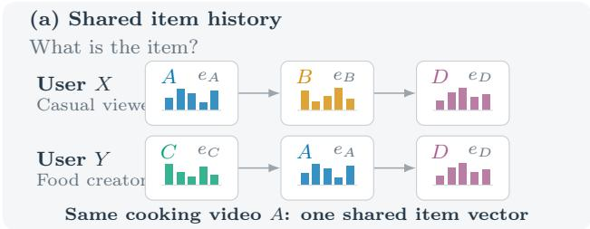
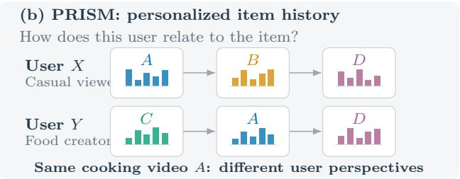
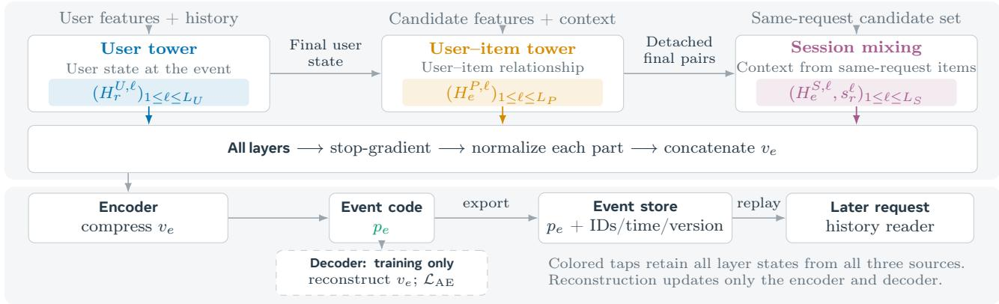
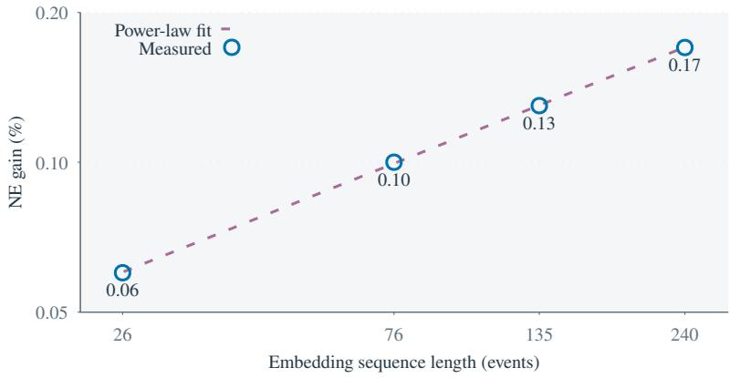

# PRISM: Personalized Item Representations in User History

Renzhi Wu1, Zikun Cui1, Junjie Yang1, Li Sheng1, Yongjun Xie1, Jerry Fu2, Nipun Mathur1, Sri Reddy1, Hong Li1

1Meta MRS, 2Facebook Discovery

Sequential recommenders typically construct history inputs from item identifiers or content features using an embedding map shared across users. The same item therefore yields the same initial embedding representation, even when users have diferent relationships to the item. We propose personalized item representations in user history, where each item’s embedding expresses its relationship to the user. Personalization becomes a property of the history inputs themselves, supplying richer evidence for later sequence modeling. We instantiate this idea with PRISM, which reuses upstream ranking computation to generate personalized item embeddings. An autoencoder jointly compresses all layer states from a user tower, a user–item tower, and same-request candidate mixing into one embedding per scored pair for downstream replay. Ofline evaluation on Surface 1, a major recommendation surface at billion scale, reports an average downstream normalized entropy (NE) change of −0.15%, compared with −0.07% for VISTA at similar history lengths. We further identify an empirical sequence-length scaling law: over history lengths of 26–240 events, NE gain follows a fitted power law with exponent 0.468, increasing from 0.06% to 0.17%. Therefore, personalized item representations in user history provide a new scaling dimension for improving recommendation quality.

Date: October 30, 2026 Correspondence: Renzhi Wu at renzhiwu@meta.com Keywords: Sequential Recommendation, Sequence Modeling

∞Meta

## 1 Introduction

Sequence modeling is central to personalized recommendation. Existing models, including SASRec (Kang and McAuley, 2018), HSTU (Zhai et al., 2024), CMSL (Cui et al., 2026), and OneTrans (Zhang et al., 2025), share a common starting point: each item in user history is mapped to an embedding before sequence processing, using item-side features such as item IDs, creator IDs, and content descriptors. The embedding map is shared across users, so the same item receives the same initial embedding in diferent users’ histories. After this step, sequence encoders and target-aware interaction learn user-dependent states from these inputs (Zhou et al., 2017, 2018).

Item embeddings: from shared to personalized. The above mentioned standard practice limits personalization at the input stage. For example, a cooking video may be occasional entertainment for a casual viewer but a recurring source of ideas for a food creator. A shared initial embedding does not express these diferent relationships. Motivated by this limitation, we propose personalized item representations in user history. As illustrated in Figure 1, each history entry represents how an item relates to the user. In the cooking video example, personalized embeddings can distinguish entertainment from professional interest. Furthermore, even for the same user, the same item can receive diferent embeddings across repeated events as interests and context evolve. This personalizes the initial history inputs for each user and each moment, giving sequence models richer evidence for learning user preferences.

However, our proposal introduces a scalability challenge. A naive approach would train and run a separate user–item model to generate rich embeddings across a large volume of historical events. We observe that recommendation systems often already use an upstream ranker to provide learned user embedding features and teacher labels for downstream models. Such a ranker reads user history and combines user, item, and context features to predict engagement; its hidden states provide learned evidence about each user–item encounter. Therefore, we retain this computation in a compact embedding per scored pair and chronologically replay these embeddings to construct a personalized history for later sequence modeling, amortizing generation computation.

  
Figure 1 From shared item history to personalized item history. A cooking video (A) has the same initial item vector for a casual viewer and a food creator. PRISM represents historical items in relation to the user, supplying personalized evidence to a later sequence model. Hue identifies the item; vector glyphs schematically illustrate shared versus personalized inputs.

The three complementary views through PRISM. We introduce PRISM, an upstream ranker designed to generate personalized item embeddings for downstream sequence modeling. Its representation learning captures three complementary views. User state describes the user’s interests at the moment of viewing the item. User–item interaction describes how the item relates to that user state. Session interaction describes the item’s relationships with other candidates in the same session, providing evidence about the user’s immediate context. Together, these views express the user–item relationship comprehensively at the moment of the historical encounter.

Figure 2 maps these views to a dedicated user tower, a user–item tower, and same-request candidate mixing. The user tower reads prior history and other user features; its states also inform pair modeling. Candidate mixing contextualizes each item through the other items in its request. A detached autoencoder jointly compresses their hidden states from every layer, including candidate-specific and pooled session states, into one personalized embedding. Joint compression allocates one code budget across sources and depths; downstream models learn how to read the retained evidence for their own prediction objectives.

We evaluate PRISM history as an additional input to the ranker for Surface 1, a major recommendation surface at billion scale. PRISM achieves an average normalized entropy (NE; lower is better) change of −0.15%, compared with −0.07% for VISTA (Chen et al., 2025) using similar history lengths. We further identify an empirical sequence-length scaling law (Figure 3): NE gain follows a fitted power law g(L) ∝ L0.468. The sublinear exponent captures improving recommendation quality per additional event at log scale. Therefore, personalized item representations in user history provide a new scaling dimension for improving recommendation quality.

We make four contributions:

• Personalized item representations in user history. We introduce a new history input design for sequential recommendation in which each item’s representation is personalized to the user, allowing the same item to difer across users and time.

• Embedding generation through upstream reuse. We instantiate this idea with an eficient design, which exports compact embeddings from scored pairs and replays them as history, amortizing upstream ranking computation across future reads.

• PRISM’s three modeling components. We propose the PRISM upstream user model that captures the three complementary views through a user tower, a user–item tower, and same-request candidate mixing. A detached autoencoder then jointly compresses states from every layer into one personalized embedding.

• An empirical scaling law for personalized history. We identify a scaling law relationship between personalized history length and downstream ranking quality, providing a new scaling dimension for improving recommendation systems.

  
Figure 2 Complete PRISM architecture. User states seed the pair workspace; detached pair states feed session mixing. Colored taps gather every layer, including contextual and pooled session states. An autoencoder compresses them for event export and downstream replay. Its decoder learns reconstruction during training.

## 2 Related Work

PRISM focuses on personalizing history inputs before downstream sequence processing. Sequence encoders (Kang and McAuley, 2018; Sun et al., 2019; Zhou et al., 2020; Zhai et al., 2024) and interest models (Zhou et al., 2017, 2018) learn user-dependent states from behavioral inputs; CMSL (Cui et al., 2026) constructs multiple latent history contexts. PRISM supplies these models with an item representation specific to each historical encounter with the user. Reuse across recommendation stages connects our work to learned user representations (Pancha et al., 2022), multistage sequence modeling (Xiong et al., 2026), and graph representation learning (Wu et al., 2025, 2026). The closest system comparisons are VISTA (Chen et al., 2025), which caches user-history summary tokens for downstream target attention, and OneTrans (Zhang et al., 2025), which reuses intermediate states through cross-request KV caching. PRISM stores a compact code for each scored user–item pair, allowing later readers to select individual events with the user and context evidence retained at each encounter. Session recommenders such as GRU4Rec and SR-GNN model observed interaction sessions (Hidasi et al., 2015; Wu et al., 2018); PRISM’s session component contextualizes candidates in the same ranking request, drawing on set-context modeling ideas (Zaheer et al., 2017; Lee et al., 2018). Feature-interaction architectures (Naumov et al., 2019; Wang et al., 2017, 2020; Zhang et al., 2024) and latent-array processing (Jaegle et al., 2021) provide precedent for the rich computation that PRISM retains. Distillation transfers prediction knowledge (Hinton et al., 2015), while FitNets and Hypercolumns exploit intermediate representations as hints or descriptors (Romero et al., 2014; Hariharan et al., 2014); autoencoders support dimensionality reduction (Hinton and Salakhutdinov, 2006) and collaborative filtering (Liang et al., 2018). PRISM jointly compresses states from every layer of its user, user–item, and same-request components into personalized history tokens for later supervised reading. Complementing recommendation scaling studies (Zhang et al., 2024; Xiong et al., 2026), our experiments examine the gain from retaining longer histories of these personalized event codes.

## 3 Method

Figure 2 shows the complete implementation. Let $e = ( u , i , \tau , r )$ identify user, item, scoring time, and request. Let $x _ { u } ^ { < \tau }$ be user history before $\tau , f _ { u } ^ { \tau }$ other user features, $x _ { i }$ candidate features, and $c _ { r }$ shared request context. The generation interface is $p _ { e } = F _ { \theta } ( x _ { u } ^ { < \tau } , f _ { u } ^ { \tau } , x _ { i } , c _ { r } ) \in \mathbb { R } ^ { d _ { p } } ;$ : a fixed-width code computed from information available at the historical event, where θ denotes the generator’s parameters and $d _ { p }$ the exported embedding width. Its user and context inputs remain attached to that event. A later reader uses its new candidate and current context to select saved codes.

## 3.1 User and User–Item Towers

Let $L _ { U }$ and $L _ { P }$ be the user and pair tower depths; ℓ indexes layers, and superscripts U and P identify the two components. The user tower reads the history together with candidate-independent sparse feature embeddings, dense embedding features, and continuous features. It produces $H _ { r } ^ { U , 1 } , \cdot \cdot \cdot , \mathbf { \bar { \Psi } } _ { } ^ { \prime U , L \upsilon }$ from these user inputs and shared request context, where $H _ { r } ^ { U , \ell }$ is the hidden-state tensor at layer ℓ. Its final state is shared across the request’s candidates and incorporated into the initial user–item workspace. Thus user evidence also participates directly in pair-state learning.

The pair tower produces hidden states $H _ { e } ^ { P , 1 } , \dots , H _ { e } ^ { P , L _ { P } }$ for event e. In the model backbone, blocks perform self-attention, candidate-conditioned reads of history and feature sources, and higher-order interaction. Condensates from preceding blocks remain available to later blocks. Final pair states feed multitask prediction heads, trained with $\begin{array} { r } { \mathcal { L } _ { P } = \sum _ { e } \sum _ { m } w _ { e , m } \ell _ { m } \big ( y _ { e , m } , h _ { m } ( H _ { e } ^ { P , L _ { P } } ) \big ) } \end{array}$ . The sum is over training events e; m indexes item prediction tasks, $y _ { e , m }$ is the observed target, $h _ { m }$ the pair prediction head, and $\ell _ { m }$ its loss function. The weight $w _ { e , m }$ combines task weights and missing-label masks. Binary tasks use cross entropy; other tasks retain their appropriate objectives. This supervision learns the user and pair towers.

## 3.2 Session Mixing Within a Request

A session is the candidate set $\mathcal { C } _ { r } = \{ e _ { 1 } , . . . , e _ { n _ { r } } \}$ in one ranking request, where $n _ { r }$ is the number of valid candidates. The session mixer $G _ { \psi }$ has parameters ψ and $L _ { S }$ layers; superscript S denotes session states. The operator sg stops gradients. This masked interaction module jointly processes detached final pair states:

$$
\left( \{ H _ { e _ { j } } ^ { S , \ell } \} _ { j = 1 } ^ { n _ { r } } \right) _ { \ell = 1 } ^ { L _ { S } } = G _ { \psi } \left( \{ \mathrm { s g } ( H _ { e _ { j } } ^ { P , L _ { P } } ) \} _ { j = 1 } ^ { n _ { r } } , c _ { r } \right) .\tag{1}
$$

A Transformer-style module is one realization. Each layer gives a candidate-specific contextual state $H _ { e } ^ { S , \ell }$ and a fixed-width request summary $s _ { r } ^ { \ell } = \mathrm { P o o l } _ { \mathrm { m a s k } } \left( \{ H _ { e _ { i } } ^ { S , \ell } \} _ { j = 1 } ^ { n _ { r } } \right)$ . Here $\mathrm { P o o l } _ { \mathrm { m a s k } }$ pools over valid candidates; both interaction and pooling mask padded candidates.

Item heads on $H _ { e } ^ { S , L _ { S } }$ predict the ordinary engagement labels. Aggregate heads on $s _ { r } ^ { L _ { S } }$ predict request-level outcomes, such as total action counts. Their weighted objective is

$$
\mathcal { L } _ { S } = \sum _ { e , m } \widetilde { w } _ { e , m } \ell _ { m } ( y _ { e , m } , g _ { m } ( H _ { e } ^ { S , L _ { S } } ) ) + \sum _ { r , a } \lambda _ { a } \ell _ { a } ( Y _ { r , a } , g _ { a } ( s _ { r } ^ { L _ { S } } ) ) .\tag{2}
$$

Here a indexes aggregate tasks, $Y _ { r , a }$ is the request-level target, and $g _ { m }$ and $g _ { a }$ are item and aggregate prediction heads. The item loss $\ell _ { m }$ is defined above; $\ell _ { a }$ is the aggregate loss. Weights $\widetilde { w } _ { e , m }$ include item task weights and masks for missing or ineligible labels, and $\lambda _ { a }$ weights aggregate tasks.

## 3.3 Multi-Level Hidden-State Compression

The exported representation combines all layers. The ordered collection is defined as

$$
\mathcal { B } _ { e } = ( H _ { r } ^ { U , \ell } ) _ { \ell = 1 } ^ { L _ { U } } \parallel ( H _ { e } ^ { P , \ell } ) _ { \ell = 1 } ^ { L _ { P } } \parallel ( H _ { e } ^ { S , \ell } , s _ { r } ^ { \ell } ) _ { \ell = 1 } ^ { L _ { S } } ,\tag{3}
$$

where ∥ concatenates ordered parts. User and pooled session states are shared across candidates; pair and contextual session states are event-specific. Flattened source widths sum to target dimension D. Each session term contains only this candidate’s state and its request summary, so D is independent of $n _ { r }$ . Code width $d _ { p }$ sets the transfer budget independently.

The three sources capture complementary aspects of personalization. User states describe the user’s current interests at this event. Pair states express how the user’s state interacts with this item’s features. Session mixing places the candidate among other items in the request; candidate-specific and pooled states preserve local relationships and shared context. Joint compression combines these overlapping perspectives into one personalized item embedding, retaining both common evidence and event-specific refinements.

For each part $h \in B _ { e }$ , we apply normalization to a detached copy, $\rho ( x ) = \kappa x / \sqrt { \mathrm { m e a n } ( x ^ { 2 } ) + \epsilon }$ , where κ is a fixed scale, $\epsilon > 0$ ensures numerical stability, and the mean is over coordinates. We then concatenate the vectors to obtain $v _ { e } = \mathrm { c o n c a t } _ { h \in \mathcal { B } _ { e } } \rho \big ( \mathrm { s g } ( \mathrm { v e c } ( h ) ) \big )$ where vec flattens a tensor; Per-part normalization controls depth-dependent scale diferences; Let $E _ { \omega } : \mathbb { R } ^ { D } \overset { \cdot } {  } \mathbb { R } ^ { d _ { p } }$ and $D _ { \omega } : \mathbb { R } ^ { d _ { p } }  \mathbb { R } ^ { D }$ be the encoder and decoder, with ω collecting their separate parameters. With reconstruction weight $\lambda _ { \mathrm { A E } } > 0$ , the multilevel compressor learns

$$
p _ { e } = \mathrm { s o f t s i g n } ( E _ { \omega } ( v _ { e } ) ) ,
$$

$$
\mathcal { L } _ { \mathrm { A E } } = \sum _ { e } \frac { \lambda _ { \mathrm { A E } } } { \mathrm { d i m } ( v _ { e } ) } \| v _ { e } - D _ { \omega } ( p _ { e } ) \| _ { 2 } ^ { 2 } .\tag{4}
$$

Here $\mathrm { d i m } ( v _ { e } ) = D$ . The encoder and decoder use gated residual blocks with RMS normalization. The encoder bounds coordinates with softsign, $x / ( 1 + | x | )$ ; the decoder reconstructs $D$ coordinates. We optimize $\mathcal { L } _ { P } + \mathcal { L } _ { S } + \mathcal { L } _ { \mathrm { A E } }$ , with prediction losses learning source states and reconstruction updating only the compressor. The resulting $p _ { e } \in \mathbb { R } ^ { d _ { p } }$ fuses sources and depths, with diferent codes possible for repeated items.

## 3.4 Downstream Sequence Modeling

Each stored event has an availability time $a _ { e } ,$ when its code becomes readable downstream, and a generator version v. At downstream time $t ,$ select user events with $\tau < t$ and $a _ { e } < t$ under a specified retention policy, exclude the current request, and retain at most L history events. Let $e _ { k }$ be the kth retained event, with scoring time $\tau _ { k } ,$ , generator version $v _ { k } .$ , and eligible metadata $b _ { k }$ . Let $d _ { r }$ be the downstream reader width and $A _ { v _ { k } } \in \mathbb { R } ^ { d _ { r } \times d _ { p } }$ the projection for version $v _ { k }$ . The functions $E _ { \mathrm { t i m e } }$ and $E _ { \mathrm { e v e n t } }$ encode elapsed time and event metadata into $d _ { r }$ coordinates. Construct a token $z _ { k } = A _ { v _ { k } } p _ { e _ { k } } + E _ { \mathrm { t i m e } } ( t - \tau _ { k } ) + E _ { \mathrm { e v e n t } } ( b _ { k } )$ . A sequence encoder and an attention reader conditioned on the candidate consume these tokens alongside ordinary features. Let $T$ stack the encoded tokens and $j$ be the current candidate. The query network $Q _ { \phi } ,$ with parameters $\phi ,$ combines current history $x _ { u } ^ { < t }$ , user features $f _ { u } ^ { t } ,$ , candidate features $x _ { j } .$ , and request context $c _ { t }$ to form $q _ { j } = Q _ { \phi } ( x _ { u } ^ { < t } , f _ { u } ^ { t } , x _ { j } , c _ { t } )$ . Candidate attention returns $o _ { j } = \mathrm { A t t n } ( q _ { j } , T , T )$ ). Here Attn denotes attention with the query, key, and value arguments shown, and $o _ { j }$ is the candidate-conditioned history summary. The predictor combines $o _ { j }$ with ordinary features. Downstream supervision updates the reader and projections; stored codes remain fixed. Missing history uses an availability indicator and the ordinary path.

## 4 Experiments

## 4.1 Setup and Metrics

Data. We use production data from Surface 1, a major recommendation surface at billion scale. PRISM does online training for 14 consecutive days, exporting embeddings during training. The downstream ranking models then train on three subsequent days of production data, comprising approximately 30–50 billion examples, and evaluate on the following day’s held-out production data.

Hardware. The PRISM model runs on 16 NVIDIA B200 nodes. Downstream models train on 16 NVIDIA H100 GPUs using an internal industrial training platform, mixed precision, and customized kernels for memory and throughput eficiency.

Metrics. We use normalized entropy (NE) (He et al., 2014) as our metric. Smaller NE means better prediction performance. Note an NE improvement greater than 0.03% is considered statistically significant.

Settings. The PRISM arm adds the embedding history alongside the downstream ranker’s ordinary features; both baseline and PRISM arms train without warm start. Exported codes have 128 dimensions, are INT8- quantized, and are accompanied by timestamps. History retains the latest 400 events within 30 days; coverage is 98%, with mean sequence length 235 and median 250.

## 4.2 Downstream Ranking Results

Table 1 reports downstream average NE changes versus the Surface 1 ranking baseline. Adding PRISM history yields changes of −0.17% on positive engagement tasks and −0.11% on negative engagement tasks, with a combined change of −0.15%. Individual binary tasks also improve: comment (−0.20%), like (−0.22%), share (−0.17%), and dislike (−0.09%). The gains across both task groups indicate that personalized history provides useful predictive information beyond the ranker’s ordinary features.

Table 1 Average NE changes (%) versus the Surface 1 ranking baseline, with similar history lengths for PRISM and VISTA. Lower is better. VISTA’s combined value is computed from its task-group means.
<table><tr><td>Method</td><td>Task group</td><td>Average NE change (%)</td></tr><tr><td rowspan="3">VISTA</td><td>Positive (8)</td><td>-0.05</td></tr><tr><td>Negative (5)</td><td>-0.09</td></tr><tr><td>Combined (13)</td><td>-0.07</td></tr><tr><td rowspan="3">PRISM</td><td>Positive (8)</td><td>-0.17</td></tr><tr><td>Negative (5)</td><td>-0.11</td></tr><tr><td>Combined (13)</td><td>-0.15</td></tr></table>

  
Figure 3 Log–log sequence-length scaling. Circles show measurements; the dashed line is the power-law fit $g ( L ) =$ 0.0131L0.468, where g is NE gain (%) and L is history length.

We also compare with VISTA (Chen et al., 2025), which caches user-history summary tokens for downstream candidate attention. Both methods use the same ranking baseline, data, ordinary features, prediction heads, and evaluation protocol, with similar retained history lengths. VISTA achieves average NE changes of −0.05% on positive engagement tasks and −0.09% on negative engagement tasks; its combined change, weighted by task count, is −0.07%. PRISM achieves larger improvements in both groups, suggesting that preserving information about individual historical encounters is valuable in this setting.

## 4.3 Scaling Law with Sequence Length

We next examine how downstream gains change as more personalized history is retained. Figure 3 shows NE improvements of 0.06%, 0.10%, 0.13%, and 0.17% for histories of 26, 76, 135, and 240 events, respectively. Fitting a power law $g ( L ) = a L ^ { \beta }$ to these measurements by least squares in log space gives $g ( L ) \approx 0 . 0 1 3 1 L ^ { 0 . 4 6 8 }$ where L is the number of retained events and $g ( L )$ is NE improvement in percent. The fit appears as a straight line on the log–log axes. Its exponent indicates diminishing gains per additional event: doubling history length corresponds to approximately 1.38× the NE improvement within the observed range. This empirical relationship describes the tested 26–240-event regime and identifies retained personalized history as a scaling dimension for recommendation.

## 5 Conclusion

We introduced personalized item representations in user history, enabling history inputs to express how each item relates to a particular user at a particular encounter. PRISM implements this idea by reusing upstream ranking computation: it jointly compresses states from every layer of its user tower, user–item tower, and same-request candidate mixer into compact event embeddings for downstream sequence modeling. Evaluation on Surface 1 reports an average NE change of −0.15%, compared with −0.07% for VISTA at similar history lengths. A sweep over 26–240 retained events further reveals an empirical power-law trend with diminishing gains per additional event. Together, these findings identify personalized history as a new scaling dimension for recommendation, combining richer information about historical encounters with the benefits of retaining more events.

## References

Zhimin Chen, Chenyu Zhao, Ka Chun Mo, Yunjiang Jiang, Jane H. Lee, Shouwei Chen, Khushhall Chandra Mahajan, Ning Jiang, Kai Ren, Jinhui Li, and Wen-Yun Yang. 2025. Massive Memorization with Hundreds of Trillions of Parameters for Sequential Transducer Generative Recommenders. arXiv preprint arXiv:2510.22049. https://arxiv.org/abs/2510.22049v1

Zikun Cui, Renzhi Wu, Junjie Yang, Li Sheng, Jijie Wei, Linfeng Liu, Tai Guo, Tao Jia, Xiaodong Wang, Hong Li, Li Yu, Sri Reddy, and Hong Yan. 2026. CMSL: Constructive Multi-Sequence Learning for Recommendation Systems. In Proceedings of the 49th International ACM SIGIR Conference on Research and Development in Information Retrieval (Melbourne, VIC, Australia) (SIGIR ’26). Association for Computing Machinery, New York, NY, USA, 4545–4549. https://doi.org/10.1145/3805712.3808426

Bharath Hariharan, Pablo Arbeláez, Ross Girshick, and Jitendra Malik. 2014. Hypercolumns for Object Segmentation and Fine-grained Localization. arXiv preprint arXiv:1411.5752. https://arxiv.org/abs/1411.5752

Xinran He, Junfeng Pan, Ou Jin, Tianbing Xu, Bo Liu, Tao Xu, Yanxin Shi, Antoine Atallah, Ralf Herbrich, Stuart Bowers, et al. 2014. Practical lessons from predicting clicks on ads at facebook. In Proceedings of the eighth international workshop on data mining for online advertising. 1–9.

Balázs Hidasi, Alexandros Karatzoglou, Linas Baltrunas, and Domonkos Tikk. 2015. Session-based Recommendations with Recurrent Neural Networks. arXiv preprint arXiv:1511.06939. https://arxiv.org/abs/1511.06939

Geofrey Hinton, Oriol Vinyals, and Jef Dean. 2015. Distilling the Knowledge in a Neural Network. arXiv preprint arXiv:1503.02531. https://arxiv.org/abs/1503.02531

G. E. Hinton and R. R. Salakhutdinov. 2006. Reducing the Dimensionality of Data with Neural Networks. Science 313, 5786 (July 2006), 504–507. https://doi.org/10.1126/science.1127647

Andrew Jaegle, Felix Gimeno, Andrew Brock, Andrew Zisserman, Oriol Vinyals, and Joao Carreira. 2021. Perceiver: General Perception with Iterative Attention. arXiv preprint arXiv:2103.03206. https://arxiv.org/abs/2103.03206

Wang-Cheng Kang and Julian McAuley. 2018. Self-Attentive Sequential Recommendation. arXiv preprint arXiv:1808.09781. https://arxiv.org/abs/1808.09781

Juho Lee, Yoonho Lee, Jungtaek Kim, Adam R. Kosiorek, Seungjin Choi, and Yee Whye Teh. 2018. Set Transformer: A Framework for Attention-based Permutation-Invariant Neural Networks. arXiv preprint arXiv:1810.00825. https://arxiv.org/abs/1810.00825

Dawen Liang, Rahul G. Krishnan, Matthew D. Hofman, and Tony Jebara. 2018. Variational Autoencoders for Collaborative Filtering. arXiv preprint arXiv:1802.05814. https://arxiv.org/abs/1802.05814

Maxim Naumov, Dheevatsa Mudigere, Hao-Jun Michael Shi, Jianyu Huang, Narayanan Sundaraman, Jongsoo Park, Xiaodong Wang, Udit Gupta, Carole-Jean Wu, Alisson G. Azzolini, Dmytro Dzhulgakov, Andrey Mallevich, Ilia Cherniavskii, Yinghai Lu, Raghuraman Krishnamoorthi, Ansha Yu, Volodymyr Kondratenko, Stephanie Pereira, Xianjie Chen, Wenlin Chen, Vijay Rao, Bill Jia, Liang Xiong, and Misha Smelyanskiy. 2019. Deep Learning Recommendation Model for Personalization and Recommendation Systems. arXiv preprint arXiv:1906.00091. https://arxiv.org/abs/1906.00091

Nikil Pancha, Andrew Zhai, Jure Leskovec, and Charles Rosenberg. 2022. PinnerFormer: Sequence Modeling for User Representation at Pinterest. arXiv preprint arXiv:2205.04507. https://arxiv.org/abs/2205.04507

Adriana Romero, Nicolas Ballas, Samira Ebrahimi Kahou, Antoine Chassang, Carlo Gatta, and Yoshua Bengio. 2014. FitNets: Hints for Thin Deep Nets. arXiv preprint arXiv:1412.6550. https://arxiv.org/abs/1412.6550

Fei Sun, Jun Liu, Jian Wu, Changhua Pei, Xiao Lin, Wenwu Ou, and Peng Jiang. 2019. BERT4Rec: Sequential Recommendation with Bidirectional Encoder Representations from Transformer. arXiv preprint arXiv:1904.06690. https://arxiv.org/abs/1904.06690

Ruoxi Wang, Bin Fu, Gang Fu, and Mingliang Wang. 2017. Deep & Cross Network for Ad Click Predictions. arXiv preprint arXiv:1708.05123. https://arxiv.org/abs/1708.05123

Ruoxi Wang, Rakesh Shivanna, Derek Z. Cheng, Sagar Jain, Dong Lin, Lichan Hong, and Ed H. Chi. 2020. DCN V2: Improved Deep & Cross Network and Practical Lessons for Web-scale Learning to Rank Systems. arXiv preprin arXiv:2008.13535. https://arxiv.org/abs/2008.13535

Renzhi Wu, Zikun Cui, Junjie Yang, Tai Guo, Hong Li, Xian Chen, Li Yu, Ke Pan, Sri Reddy, Nipun Mathur, Haomin Yu, and Hong Yan. 2026. RankGraph-2: Lifecycle Co-Design for Billion-Node Graph Learning in Recommendation. In Proceedings of the 20th ACM Conference on Recommender Systems (Minneapolis, USA) (RecSys ’26). Association for Computing Machinery, New York, NY, USA, 1417–1426. https://doi.org/10.1145/3773078.3831843

Renzhi Wu, Junjie Yang, Li Chen, Hong Li, Li Yu, and Hong Yan. 2025. RankGraph: Unified Heterogeneous Graph Learning for Cross-Domain Recommendation. In Proceedings of the Nineteenth ACM Conference on Recommender Systems (Prague, Czech Republic) (RecSys ’25). Association for Computing Machinery, New York, NY, USA, 1050–1053. https://doi.org/10.1145/3705328.3748118

Shu Wu, Yuyuan Tang, Yanqiao Zhu, Liang Wang, Xing Xie, and Tieniu Tan. 2018. Session-based Recommendation with Graph Neural Networks. arXiv preprint arXiv:1811.00855. https://arxiv.org/abs/1811.00855

Lee Xiong, Zhirong Chen, Rahul Mayuranath, Shangran Qiu, Arda Ozdemir, Lu Li, Yang Hu, Dave Li, Jingtao Ren, Howard Cheng, Fabian Souto Herrera, Ahmed Agiza, Baruch Epshtein, Anuj Aggarwal, Julia Ulziisaikhan, Chao Wang, Dinesh Ramasamy, Parshva Doshi, Sri Reddy, and Arnold Overwijk. 2026. LLaTTE: Scaling Laws for Multi-Stage Sequence Modeling in Large-Scale Ads Recommendation. arXiv preprint arXiv:2601.20083. https: //arxiv.org/abs/2601.20083

Manzil Zaheer, Satwik Kottur, Siamak Ravanbakhsh, Barnabas Poczos, Ruslan Salakhutdinov, and Alexander Smola. 2017. Deep Sets. arXiv preprint arXiv:1703.06114. https://arxiv.org/abs/1703.06114

Jiaqi Zhai, Lucy Liao, Xing Liu, Yueming Wang, Rui Li, Xuan Cao, Leon Gao, Zhaojie Gong, Fangda Gu, Michael He, Yinghai Lu, and Yu Shi. 2024. Actions Speak Louder than Words: Trillion-Parameter Sequential Transducers for Generative Recommendations. arXiv preprint arXiv:2402.17152. https://arxiv.org/abs/2402.17152

Buyun Zhang, Liang Luo, Yuxin Chen, Jade Nie, Xi Liu, Daifeng Guo, Yanli Zhao, Shen Li, Yuchen Hao, Yantao Yao, Guna Lakshminarayanan, Ellie Dingqiao Wen, Jongsoo Park, Maxim Naumov, and Wenlin Chen. 2024. Wukong: Towards a Scaling Law for Large-Scale Recommendation. arXiv preprint arXiv:2403.02545. https: //arxiv.org/abs/2403.02545

Zhaoqi Zhang, Haolei Pei, Jun Guo, Tianyu Wang, Yufei Feng, Hui Sun, Shaowei Liu, and Aixin Sun. 2025. OneTrans: Unified Feature Interaction and Sequence Modeling with One Transformer in Industrial Recommender. arXiv preprint arXiv:2510.26104. https://arxiv.org/abs/2510.26104v1

Guorui Zhou, Na Mou, Ying Fan, Qi Pi, Weijie Bian, Chang Zhou, Xiaoqiang Zhu, and Kun Gai. 2018. Deep Interest Evolution Network for Click-Through Rate Prediction. arXiv preprint arXiv:1809.03672. https://arxiv.org/abs/ 1809.03672

Guorui Zhou, Chengru Song, Xiaoqiang Zhu, Ying Fan, Han Zhu, Xiao Ma, Yanghui Yan, Junqi Jin, Han Li, and Kun Gai. 2017. Deep Interest Network for Click-Through Rate Prediction. arXiv preprint arXiv:1706.06978. https://arxiv.org/abs/1706.06978

Kun Zhou, Hui Wang, Wayne Xin Zhao, Yutao Zhu, Sirui Wang, Fuzheng Zhang, Zhongyuan Wang, and Ji-Rong Wen. 2020. S3-Rec: Self-Supervised Learning for Sequential Recommendation with Mutual Information Maximization. arXiv preprint arXiv:2008.07873. https://arxiv.org/abs/2008.07873