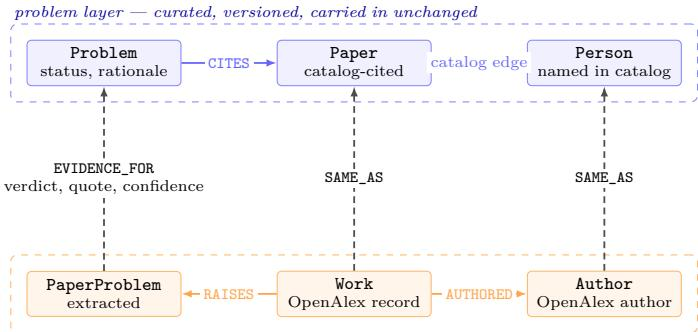

# Rebuilding a Field’s Open-Problem Catalog from the Literature: A Two-Layer Knowledge Graph, and Why Status Must Stay Proposed

Madhulatha Mandarapu

Samyama.ai

madhulatha@samyama.ai

Sandeep Kunkunuru

Samyama.ai

sandeep@samyama.ai

Abstract—A research field records its open problems in surveys, keynotes and community reports. Those are prose, written every few years, and nobody can ask them who works on a problem now or whether it was settled last year. We argue the problems should be data, and we build the system that makes them so: a handcurated problem layer carried in unchanged, under an evidence layer rebuilt from a bibliographic index, joined by typed, provenance-carrying links, with both layers in one graph database and reachable from one query language. A language model does four jobs inside this architecture — per-paper extraction, grounding to the catalog, a per-paper status verdict, and idea generation — and each is constrained to a set the system ofers it, so an answer that names something outside that set is refused rather than stored. We report a study on two curated catalogs, one of database research (1,053 problems) and one of AI research (1,000 problems), each of which already had a graph built from the catalog alone. The rebuilt graph answers every question the catalog-only graph answered — 47 of 47 answerable questions identical on databases, 34 of 35 on AI — and answers questions the catalog-only graph refused: who worked on a problem recently, which open problems nobody works on, what methods have been tried, which papers from outside the catalog bear on a problem (336 problems, 770 works on databases). The one capability we most wanted does not survive its own audit. Of 41 solves and refutes verdicts hand-checked against the papers, 9 are correct, 30 are partly correct and 2 are wrong; no refutes verdict (0 of 34) disproves an open problem, and only 1 of 7 solves closes the question the problem statement calls central. We report that failure in full, and draw the design conclusion from it: a status change must be proposed with its evidence and never applied, which makes the human reviewer part of the architecture rather than a courtesy. We close with the data-engineering problems the vision raises: entity resolution across a curated and a harvested layer, verifying a model’s status claims, freshness under source quotas, and evaluation without ground truth.

Index Terms—scholarly knowledge graphs, open problems, entity resolution, provenance, large language models, research infrastructure

## I. Introduction

Ask a database researcher which problems in the field are open and they will point you at a community report [1], [2]. These reports are careful, broad and influential. They are also prose, assembled every five to ten years by a committee, and they are out of date the week they appear. Nothing in them can be asked a question. If you want to know who works on a named problem now, whether the problem was settled since the report was written, or which of its open problems nobody has touched, you read the report, then you read five years of proceedings, and then you have an opinion rather than an answer.

The same is true in machine learning, with the added dificulty that the literature doubles faster than anyone can survey it. Mathematics has gone further: Erdős Problems [3] and similar trackers keep per-problem statuses that the community updates, and a recent sweep of a language model over 700 of its open entries resolved 13, eight of them simply by finding a paper that had already settled the question [4]. That result is the motivation for this work in one line: status changes hide in the existing literature, and nobody is looking.

a) The claim.: A field’s open problems should be data first-class entities with identity, status and provenance sitting under an evidence layer that is rebuilt from   
the literature, so that the questions above become queries.   
We are not the first to want a scholarly knowledge graph;   
ORKG [5], Semantic Scholar [6] and OpenAlex [7] model   
papers, authors and contributions at a scale we cannot   
approach. What none of them models is a problem with   
a status that evidence can change. And what the mathe  
matics trackers lack is a bibliographic graph underneath,   
typed links into it, and a query language over the pair.

b) What this paper adds.: Our contributions are:

1) Five requirements for a living open-problem graph (Section II), each stated with the failure it prevents, derived from defects we hit in building one.

2) A two-layer architecture (Section III): a curated problem layer carried in unchanged under a rebuilt evidence layer, joined by SAME\_AS and EVIDENCE\_FOR edges, with the strict rule that the two layers never share a node label.

3) A pipeline (Section IV) in which every languagemodel stage is constrained to a set the system ofers it, and a refusal is a first-class outcome. 0 of 104 generated research ideas across two runs named a problem they were not ofered.

4) A study on two fields (Sections V–VI): the rebuilt graph is non-regressive on the catalog-only graph’s own benchmark, and it answers questions that graph refused.

5) A negative result (Section VI-D) on the component the vision most depends on. Hand-checking all 41 solves and refutes verdicts the system produced gives 9 correct, 30 partly correct, 2 wrong. The failure is systematic, not noisy: the dominant pattern (9 of 41) is a paper showing that current methods fail, read as refuting an open “can it be done” question.

6) A research agenda (Section IX) of the dataengineering problems this raises, each with an observation from the study rather than a guess.

c) What this paper does not claim.: We do not claim the system can tell whether a problem is solved. Section VI-D is the evidence that it cannot, yet. We do not claim coverage: the evidence layer reaches 579 of 1,053 database problems and 592 of 1,000 AI problems. We do not claim the catalogs are authoritative; they are two catalogs we built, and the architecture is indiferent to who curates them. And every fact in the graph comes from titles, abstracts and metadata, not full text.

## II. Requirements

The five requirements below are not a wish list. Each one is a defect we hit, generalised.

a) R1 — Stable identity, separately for each layer.: A problem, a paper and a person each need an identifier that survives a rebuild. The failure it prevents is subtle: our first rebuild gave the harvested bibliographic records the same node labels (Paper, Person, Institution, Venue) as the curated catalog. Nothing errored. A query that counted “papers the catalog cites” returned 8,769 instead of 2,679, and a query for name variants returned a Person node whose name was a five-author list. The fix was to rename every label in the evidence layer (Work, Author, OpenAlexInstitution, OpenAlexSource) and to make a shared label a build-time error. See Section VII.

b) R2 — Provenance on every edge and node.: Every node carries a source field: openalex for a bibliographic fact, extraction for something a model read out of an ab stract, web for something it found by searching, synthesis for something it wrote. Without this, a reader cannot tell a citation from a guess, and we could not have written Section VI-D at all.

c) R3 — Freshness as a rebuild, not an update.: The evidence layer is derived, so it is rebuilt rather than patched; the catalog is curated, so it is versioned. The two are joined at build time. This is what makes “which evidence appeared since the catalog was last edited” a query: on AI, 71 works from 2026, 66 of which the catalog does not contain.

  
Fig. 1. The two layers and the bridge between them. No node label appears in both layers; a shared label is a build-time error (Section VII). Every bridge edge carries how it was made, and EVIDENCE\_FOR additionally carries the verdict, the quote it rests on and the model’s confidence.

d) R4 — A status change is proposed, never applied.: The system writes a suggestion with its evidence and its reasoning onto the graph. It does not change the catalog. Before the audit in Section VI-D this was a conservative default; after it, it is the single most important thing in the design.

e) R5 — One query language over both layers.: Both layers live in one graph database and are reached with openCypher. The benchmark in Section V is possible only because the two graphs under comparison answer the same query text.

## III. Architecture

Figure 1 shows the shape. Three decisions in it are load bearing.

a) The catalog is carried in, not merged.: The curated layer enters the graph byte for byte: same ids, same statuses, same text. Nothing in the pipeline writes to it. This is what lets us run the catalog-only graph’s own benchmark against the rebuilt graph and read any diference as a defect (Section VI-A).

b) No label is shared between layers.: A graph database will happily let two populations share a label, and then every unlabelled or singly-labelled pattern silently spans both. The build now refuses to start if an evidence-layer label collides with a catalog label.

c) The bridge is explicit and typed.: Catalog papers are matched to bibliographic records by DOI, then by arXiv identifier, then by title and year; catalog people are matched through the papers they authored, and only when exactly one candidate matches. The result is a SAME\_AS edge carrying which rule fired, so a reader can discount a title-match diferently from a DOI match. EVIDENCE\_FOR runs from a work to a problem and carries the verdict, the quoted sentence it rests on and a confidence.

A consequence worth naming: catalog name variants are linked, not merged. Three catalog nodes (“Neumann”, “T. Neumann”, “Thomas Neumann”) resolve to one Author; the three catalog nodes stay. Queries that want the person traverse SAME\_AS; queries that want the catalog’s own text do not. Merging would have been destructive and irreversible, and we have been burned by exactly that in a diferent graph.

TABLE I  
Pipeline stages. “Offered set” is what the model may name; anything else is refused.
<table><tr><td>Stage</td><td>Kind</td><td>Offered set</td><td></td></tr><tr><td>1 resolve author ids</td><td>model + web</td><td>candidates the index</td><td>from</td></tr><tr><td>2 harvest works</td><td>index</td><td></td><td></td></tr><tr><td>3 expand (refs, citers)</td><td>index</td><td>free text,</td><td></td></tr><tr><td>4 extract per paper</td><td>model</td><td>canonicalised</td><td>then</td></tr><tr><td>5 profile people</td><td>model + web</td><td></td><td></td></tr><tr><td>6 map the domain</td><td>model + web</td><td>the names already</td><td></td></tr><tr><td>7 canonicalise</td><td>model</td><td>extracted</td><td></td></tr><tr><td>8 ground + status</td><td>model</td><td>the catalog&#x27;s own problems</td><td></td></tr><tr><td>9 generate ideas</td><td>model</td><td>the open problems offered</td><td></td></tr></table>

## IV. The Pipeline

The build runs nine stages. Five are deterministic (bibliographic harvest, bridge, graph build, snapshot export, benchmark); four use a language model. The interesting design content is in how the four are constrained.

a) Extraction (stage 4).: Title and abstract of eight papers per call; out come problems, methods, materials, properties, results, tools, applications and stated future work, each becoming a node with source=extraction. The model is reading, not judging.

b) Canonicalisation (stage 7).: All extracted names of one kind go in; out comes a synonym map and BROADER parents. The ofered set is the set of names already extracted, so this stage cannot invent a concept.

c) Grounding and the status check (stage 8).: This is where the two layers meet. For each extracted per-paper problem the model is given the catalog’s problems and must answer with one of them, at the relation same or narrower, or decline. Only then, for a catalog problem that has evidence, does the status check run: for each of up to eight evidence papers it returns one of advances, restates, solves, refutes or unrelated, with a quote and a confidence. A solves or refutes verdict may yield a suggested status, written onto the problem as a suggestion with its rationale. The catalog is not touched.

d) Idea generation (stage 9).: The model is ofered the open problems of the catalog and the domain map, and may propose ideas only against problems in that ofered set. An idea naming anything else is rejected at parse time. Across the two runs reported here, 104 ideas were generated and 0 were rejected on this rule — which says the constraint is satisfiable, not that it is unnecessary.

TABLE II  
The two fields. V1 is the catalog-only graph; V3 adds the evidence layer. Catalog commits and bench files are recorded in the artifact.
<table><tr><td>Databases</td></tr><tr><td>AI</td></tr><tr><td>Catalog problems 1,053 1,000 2,679 4,932</td></tr><tr><td>Catalog papers Catalog people 4,454 15,102</td></tr><tr><td>Seed researchers 40 40</td></tr><tr><td></td></tr><tr><td>V1 nodes 20,211 29,707</td></tr><tr><td>V1 edges 53,721 62,842</td></tr><tr><td>V3 nodes 78,475 120,972 V3 edges 313,878 463,344</td></tr><tr><td>V3 works in evidence layer 7,877</td></tr><tr><td>Benchmark questions 48 35</td></tr></table>

e) Implementation.: About 3,200 lines of Python. The graph is loaded over HTTP into a graph–vector database (samyama-graph, Apache-2.0, run from a public container image) with UNWIND \$rows ... MERGE ... SET n += r and an index on id per label; the run then exports a portable snapshot. Every stage caches its output in the run directory — index responses, each model call, the extraction and canonicalisation results — so a re-run pays only for what did not finish, and deleting one file redoes one stage. The model stages go through a batch API at half price where they can; on the AI run, 3,690 of 3,698 calls did.

## V. Study Design

We had an unusual opportunity: two curated catalogs that already had a graph built from the catalog alone, each with its own hand-written benchmark of scope questions. Call the catalog-only graph V1 and the rebuilt two-layer graph V3. Both are built from the same catalog commit. The comparison is therefore not system-versus-baseline but the same catalog with and without an evidence layer beneath it, on queries written before this architecture existed.

We ask three things of the comparison.

1) Non-regression. Does V3 still answer what V1 answered, identically? Any diference is a defect in V3, because the catalog did not change.

2) New answers. The questions V1’s own documentation marks as answered in part, unanswered or out of scope: rewritten against V3’s schema, with the same parameters, do they now return something, and is that something right?

3) Audit. Where the system makes a judgement rather than a join, how good is the judgement?

The third is the part that most systems papers skip. We ran it on every solves and refutes verdict the two runs produced — 41 in total, not a sample — and report it in Section VI-D.

## A. Non-regression

On databases, 47 of the 48 benchmark questions have a Cypher query (the 48th needs vector search). All 47 return identical answers on V1 and V3, compared order-insensitively on rows, columns and the first twenty records.

On AI, 34 of 35 queries return the same rows. 26 are identical row for row; 8 difer only in the order of rows that tie on the sort key; one (“papers cited by most problems”) difers in a single row because three papers tie at 35 citing problems for the last two places under LIMIT 10, and the two graphs keep a diferent pair. Without the limit both graphs return the same 11 papers. Two queries that must return nothing return nothing on both.

This is a weak result by construction and we state it as such: the original queries read only the catalog layer, so they cannot show what the evidence layer adds. Their job is to prove it adds nothing wrong. It took a fix to get here (Section VII).

## B. What the evidence layer adds

Table III is the substance of the comparison. Reading it with the per-question notes in the artifact, we grade the outcomes by hand:

Databases. V1 marked 20 questions as answered in part and refused 3. We attempted 11 of those 23; the other 12 ask about content inside the catalog (bounds, concept definitions, which system currently leads), which an evidence layer does not supply. Of the 11: 8 got a better answer, 1 got the same answer now corroborated by an independent source, 1 did not change, and 1 (“has it been solved”) is answered but unverified.

• AI. The AI catalog grades no answer as partial, so we assembled 18 questions from its own list of unanswered questions and known limits. 16 were attempted: 5 better, 4 went from refused to answered, 3 from refused to partly answered, 1 mixed, 1 unchanged by design, 2 genuinely unchanged.

The honest summary of the “mixed” row is worth more than the eight wins. Asked which researchers are linked to the most problems, V1 returns four names; V3 merges their name variants and so ranks them better — and drops one of them entirely, because that researcher’s catalog node has no matched author. The bridge improves the ranking and loses a seed researcher in the same query. Section VI-C says why.

Beyond the question list, the evidence layer adds a population that did not exist before:

Two readings of Table IV matter. First, “problems with works from outside the catalog” is the capability the whole architecture exists for: 336 database problems have 770 papers bearing on them that the catalog’s curators never cited. Second, the grounded share is low — 19.0% on AI,

25.0% on databases. Four fifths of what the model reads out of an abstract does not correspond to anything in the curated catalog. That is partly the catalog’s narrowness and partly the extraction’s granularity, and we cannot currently separate the two.

## C. The bridge, and what it costs

Table V is the most useful table in the paper for anyone building this. Three things in it were surprises.

The best matching rule can fire zero times. On the AI catalog, one paper out of 4,932 carries a DOI, because the field publishes to arXiv and the curators recorded arXiv ids. So 3,026 matches came from arXiv ids and 1,604 from title and year — the weakest rule carrying a third of the bridge. A system that implements only DOI matching would have bridged one paper.

Precision on people costs recall, visibly. We link a catalog person to an author only when exactly one candidate matches. One seed researcher in the AI run — the person ranked third by problem count in V1 — is split across several author ids upstream, with seven of his catalog papers under one id and two under another, so no single candidate matches and he is left unlinked. That is the rule working as designed, and it drops a seed researcher out of a headline query. 3,445 of 15,102 catalog people are unlinked.

Linking is not merging, and the distinction is measurable. 2,732 authors in the AI run each link more than one catalog node, covering 6,582 catalog nodes between them. Those 6,582 nodes stay. A merge would have collapsed them and silently rewritten every count the catalog’s own benchmark asserts.

## D. Status verdicts: the component that failed its audit

The status check is the reason to build any of this. It ran on 572 database problems over 1,653 papers and on 578 AI problems, eight papers per problem.

Table VI looks encouraging: the system is conservative, calling solves 7 times in 3,856 graded links and suggesting only 4 status changes. We then checked all 41 solves and refutes verdicts by hand against the problem statement, the status rationale, the work’s title and abstract, and the quote the verdict rests on. Full texts were not read; the graph was not changed.

Table VII is the paper’s central negative result. Stated plainly:

• No refutes verdict (0 of 34) disproves an open problem. The pipeline’s refutes means “contradicts a claim on the problem page”. Read that way, 8 of 32 AI refutes are correct; read as “this problem is closed negatively”, none are.

• Only 1 of 7 solves closes the question the statement calls central. The other six settle a sub-case: a tight privacy bound that holds only for smooth convex losses on a bounded domain while the problem’s own title names the non-convex case; a contamination fix demonstrated at BERT scale while the problem asks about large-model pretraining.

TABLE III  
Questions the catalog-only graph answered in part, refused, or listed as out of scope, re-asked against the rebuilt graph with the same parameters. Full per-question tables, including the ones not attempted and why, are in the artifact.
<table><tr><td>Field</td><td>Question</td><td>V1</td><td>V3</td></tr><tr><td>DB</td><td>Papers after 2015 bearing on the prob- lems</td><td>787 catalog papers</td><td>873 evidence works, 480 new to the catalog</td></tr><tr><td>DB</td><td>Which catalog papers a bibliographic index verifies</td><td>DOI on 1,800 of 2,679</td><td>2,278 matched; 386 have neither a DOI nor a match</td></tr><tr><td>DB</td><td>References no bibliographic source verifies</td><td>15</td><td>the same 15 (corroborated independently)</td></tr><tr><td>DB</td><td>Researchers with an ORCID</td><td>0 rows</td><td>2,181 via their matched author</td></tr><tr><td>DB</td><td>Name variants of one researcher</td><td>3 separate nodes</td><td>all three resolve to one author</td></tr><tr><td>DB</td><td>Open problems nobody works on</td><td>72</td><td>38, counting evidence works as work</td></tr><tr><td>DB</td><td>Open problems citing nothing after 2015</td><td>86</td><td>70</td></tr><tr><td>DB</td><td>Total citations of a paper</td><td>refused</td><td>citation counts on all 2,278 matched papers</td></tr><tr><td>DB</td><td>Has the problem been solved since?</td><td>refused</td><td>4 solves verdicts, 2 suggested changes — see Sec- tion VI-D</td></tr><tr><td>DB</td><td>Who funds work on the problem</td><td>refused</td><td>3 funders; funder names on 567 catalog papers</td></tr><tr><td>AI</td><td>Methods tried on a problem</td><td>no method data</td><td>23 methods from 10 of its 12 cited papers</td></tr><tr><td>AI</td><td>Methods used for the most problems</td><td>unanswered</td><td>literature review 125, scaling analysis 111, SFT 88, LoRA 43</td></tr><tr><td>AI</td><td>Problems whose papers use a given method</td><td>unanswered</td><td>61 problems for LoRA</td></tr><tr><td>AI</td><td>A researcher&#x27;s top co-authors</td><td>10 shared catalog papers</td><td>32, 26, 17 over the run&#x27;s works</td></tr><tr><td>AI</td><td>Researchers with an ORCID</td><td>0</td><td>7,320</td></tr><tr><td>AI</td><td>Recent work on the problems</td><td>newest 2025, none 2026</td><td>71 works from 2026, 66 not catalog papers</td></tr><tr><td>AI</td><td>Open problems with no lab</td><td>54</td><td>54, of which 23 have no evidence work either</td></tr><tr><td>AI</td><td>Citation counts</td><td>out of scope</td><td>on all 4,630 matched papers</td></tr><tr><td>AI</td><td>Has any problem been solved or re-</td><td>refused</td><td>3 solves, 32 refutes, 2 suggested changes</td></tr></table>

TABLE IV  
Evidence reaching the catalog’s problems.
<table><tr><td></td><td>Databases</td><td>AI</td></tr><tr><td>Catalog problems</td><td>1,053</td><td>1,000</td></tr><tr><td>... with at least one evidence work</td><td>579</td><td>592</td></tr><tr><td>Evidence works</td><td>1,773</td><td>1,969</td></tr><tr><td>EVIDENCE_FOR links</td><td>1,843</td><td>2,013</td></tr><tr><td>... with works from outside the catalog</td><td>336</td><td>187</td></tr><tr><td>... those works</td><td>770</td><td>300</td></tr><tr><td>... with works they do not cite</td><td></td><td>360</td></tr><tr><td>Per-paper problems extracted</td><td>5,058</td><td>6,885</td></tr><tr><td>. . . grounded to a catalog problem</td><td>1,265</td><td>1,311</td></tr><tr><td>as the same problem</td><td>138</td><td>145</td></tr><tr><td>as a narrower problem</td><td>1,127</td><td>1,166</td></tr><tr><td>Grounded share</td><td>25.0%</td><td>19.0%</td></tr></table>

• Nothing was silently wrong in the graph, because R4 holds. Four suggestions were written; no status was changed.

The failures are systematic, which is the useful part. Classifying all 41 by failure pattern:

The dominant pattern in Table VIII is a logic error, not a reading error: a paper showing that today’s methods fail at a task is evidence about an open “is it possible” question, never a refutation of it. Nine of 41 verdicts make that one mistake.

A second pair of patterns (settles a sub-case only, n = 6, and refutes a rival explanation or prior result, not the problem, $n \ : = \ : 4 )$ has a direct parallel in formal mathematics. In the October 2026 Lean formalization of the classification of finite simple groups [8], candidate agent proofs repeatedly established a milestone’s target conclusion under additional unproved assumptions — proving a conditional sub-case while leaving the milestone open — and an explicit counterexample $\left( \mathrm { P S L _ { 2 } ( 4 9 ) } \right)$ to a closure assertion in Walter’s 1986 Unbalanced Group Theorem route refuted that proof step without refuting the theorem itself. Even when the evidence is a deductive proof, settling a restricted case and refuting an intermediate claim are distinct from closing the problem.

TABLE V  
Bridging the curated layer to the harvested one. On AI, exactly 1 catalog paper carries a DOI, so the DOI rule — the most reliable one — fires 0 times.
<table><tr><td></td><td>Databases</td><td>AI</td></tr><tr><td>Catalog papers</td><td>2,679</td><td>4,932</td></tr><tr><td>.. . matched</td><td>2,278</td><td>4,630</td></tr><tr><td>by DOI</td><td></td><td>0</td></tr><tr><td>by arXiv id</td><td></td><td>3,026</td></tr><tr><td>by title and year</td><td></td><td>1,604</td></tr><tr><td>... unmatched</td><td>401</td><td>302 21</td></tr><tr><td>Works claimed by two catalog papers</td><td></td><td></td></tr><tr><td>Catalog people</td><td>4,454</td><td>15,102</td></tr><tr><td>.. . linked</td><td>3,087</td><td>11,657</td></tr><tr><td>... unlinked</td><td>1,367</td><td>3,445</td></tr><tr><td>Distinct authors matched</td><td>2,488</td><td>7,807</td></tr><tr><td>Authors covering several catalog nodes catalog nodes on those</td><td></td><td>2,732 6,582</td></tr></table>

The second finding is about the problem statements rather than the model. The AI catalog’s problem state-

TABLE VI  
Verdicts produced by the status check. none is a link the check never reached, because it reads at most eight papers per problem.
<table><tr><td>Verdict</td><td>Databases</td><td>AI</td></tr><tr><td>advances</td><td>893</td><td>1,062</td></tr><tr><td>restates</td><td>403</td><td>235</td></tr><tr><td>unrelated</td><td>351</td><td>416</td></tr><tr><td>solves</td><td>4</td><td>3</td></tr><tr><td>refutes</td><td>2</td><td>32</td></tr><tr><td>none (not reached)</td><td>190</td><td>265</td></tr><tr><td>Status changes suggested</td><td>2</td><td>2</td></tr></table>

## TABLE VII

Hand check of every solves and refutes verdict both runs produced (n = 41, not a sample). correct: the paper does   
what the verdict says to a claim or question in the problem   
statement. partly: it bears on the problem but advances it, settles a sub-case, or contradicts an adjacent or rival claim. wrong: it does not do what the verdict says.

<table><tr><td>Field</td><td>Verdict</td><td>n</td><td>correct</td><td>partly</td><td>wrong</td></tr><tr><td>AI</td><td>solves</td><td>3</td><td>0</td><td>3</td><td>0</td></tr><tr><td>AI</td><td>refutes</td><td>32</td><td>8</td><td>23</td><td>1</td></tr><tr><td>DB</td><td>solves</td><td>4</td><td>1</td><td>3</td><td>0</td></tr><tr><td>DB</td><td>refutes</td><td>2</td><td>0</td><td>1</td><td>1</td></tr><tr><td>All</td><td></td><td>41</td><td>9</td><td>30</td><td>2</td></tr></table>

ments are one paragraph (309–1,060 characters) and most pose a question rather than assert a claim — so refutes often has no target to attach to. Five of the eight correct AI refutes are on the minority of problems whose statement names the claim under examination. Writing the claim down is what makes it refutable. This is a requirement on the curator, not on the model, and we did not anticipate it.

Confidence was mildly informative and not usable as a gate. Mean confidence on the AI verdicts was 0.73 for correct, 0.6 for partly correct and 0.4 for the single wrong one; on databases, 0.8, 0.61 and 0.4. The ordering is right and n = 41 is far too small to set a threshold on; we report it as observed, not as a calibration result.

## E. Grounding to a shared vocabulary

Separately from the catalog, the AI run grounded its extracted concepts to a merged computer-science vocabulary of 13,551 classes (CSO and the ACM classification), to test whether the extraction’s output can be placed in a vocabulary nobody in this project wrote.

Table IX says something we did not expect to have to say: a general computer-science vocabulary places a quarter of what a current AI paper talks about. Datasets and tools are the floor at 5.9%, which is unsurprising — vocabularies do not enumerate benchmarks — but methods at 25.4% is a gap in the vocabulary, not in the extraction. The named entities of 2024–2026 machine learning are largely absent from the shared vocabularies of the field.

TABLE VIII  
Failure patterns across the 41 hand-checked verdicts.
<table><tr><td>Pattern</td><td>n</td></tr><tr><td>&quot;methods fail&quot; read as refuting an open &quot;can it be done?&quot;</td><td>9</td></tr><tr><td>settles a sub-case only</td><td>6</td></tr><tr><td>evidence from an adjacent or restricted setting</td><td>6</td></tr><tr><td>answers or advances a sub-question, labelled refutes</td><td>5</td></tr><tr><td>refutes a rival explanation or prior result, not the problem</td><td>4</td></tr><tr><td>source paper of the phenomenon, labelled refutes</td><td>1</td></tr><tr><td>a performance comparison read as a refutation</td><td>1</td></tr></table>

TABLE IX

Share of extracted concepts placed at same or narrower against a 13,551-class computer-science vocabulary (AI run). 9 answers were refused for naming a class not offered.
<table><tr><td>Kind</td><td>Extracted</td><td>Placed</td></tr><tr><td>applications</td><td>4,665</td><td>38.6%</td></tr><tr><td>subjects</td><td>7,564</td><td>31.6%</td></tr><tr><td>problems</td><td>6,885</td><td>28.5%</td></tr><tr><td>methods</td><td>14,198</td><td>25.4%</td></tr><tr><td>metrics</td><td>5,198</td><td>12.9%</td></tr><tr><td>datasets, tools</td><td>4,431</td><td>5.9%</td></tr><tr><td>all</td><td>42,941</td><td>24.9%</td></tr></table>

## F. Cost

Table X sizes the thing. A field of a thousand problems and a few thousand papers costs a few thousand model calls and about 30M input tokens to rebuild, almost all of it eligible for batch pricing, and the result is a 17 MB portable snapshot. The deep model is used sparingly: 54 of the 3,698 AI calls, consuming 7.0M input tokens between them. The binding constraint in practice was not the model but the bibliographic index’s free-tier daily quota, which stopped one run outright rather than returning partial data.

## VII. Three Defects, Reported in Full

a) A shared label silently doubled a count.: Described in R1. What makes it worth a paragraph is the failure mode: no error, no warning, a plausible number. A query counting “papers the catalog cites” returned 8,769 where the catalog has 2,679, because the harvested records wore the same Paper label. We found it only because an older benchmark asserted the right number. The 8,769 is quoted from that build’s run report; the build no longer exists, so we could not recompute it. Without V1 to compare against, the first build would have shipped. Generalised: when you add a harvested layer under a curated one, a label collision is a correctness bug that presents as a larger, more impressive graph.

b) An upstream abstract belonged to a diferent paper.: The index’s record for a well-known 2020 scaling-laws paper carries an abstract about a wholly unrelated topic; the cached raw response carries the same text, so the error is upstream of us. Extraction duly read six unrelated methods out of ${ \mathrm { i t } } ,$ and because 54 catalog problems cite that paper, those six methods ranked fifth to tenth in a first draft of “methods used for the most problems”. The mitigation is a frequency floor — a method must appear in at least three papers to be ranked — which is a mitigation, not a fix. A heuristic scan found 266 of 7,040 works whose abstract shares no content word with its title (author lists, placeholder text, genuinely wrong abstracts); that is a derived upper bound on the problem, not a verified count. Note what it means for the audit: a bad abstract propagates to a verdict, and in this run the known-bad paper carried no solves or refutes verdict, which is luck, not design.

TABLE X  
Model cost of one full build. Tokens are from the run’s usage log. No dollar figure is computed: the pipeline carries no price table, and quoting one would be a number with no artifact behind it.
<table><tr><td></td><td>Databases</td><td>AI</td></tr><tr><td>Model calls</td><td>2,808</td><td>3,698</td></tr><tr><td>...through a batch API</td><td>2,799</td><td>3,690</td></tr><tr><td>Input tokens (M)</td><td>23.6</td><td>28.6</td></tr><tr><td>Output tokens (M)</td><td>6.5</td><td>9.6</td></tr><tr><td>Web searches</td><td>431</td><td>417</td></tr><tr><td>Snapshot size (MB)</td><td>16.9</td><td>16.8</td></tr></table>

c) A precision rule dropped a seed researcher.: Described in Section VI-C. We keep the rule and report the loss, because the alternative — linking on a best guess — puts a wrong co-authorship into a graph whose whole value proposition is provenance.

## VIII. Limitations

• The audit’s judge is not independent. The 41 verdicts were judged with model assistance by one of the authors, from titles, abstracts and quotes, without reading full texts. It is a strict enough test to produce a negative result; it is not a domain-expert adjudication, and the correct/partly boundary is a judgement call we made.

• No ground truth for status. Nobody has a labelled set of “problems solved between 2015 and 2026”. Until someone builds one, every evaluation of a status check is an audit of its outputs, which can measure precision and cannot measure recall. We do not know how many genuine solutions the system missed.

• Two fields, one curator. Both catalogs were built by us, which risks a schema that fits our own curation habits.

• Abstracts, not full text. Every extracted fact rests on a title, an abstract and metadata.

• The improvement grades are ours. The AI catalog grades no answer as partial, so the 18-question set in Table III is our own reading of its scope notes and stated limits, and the better/same/no-change grades

in both fields are ours, read from the returned rows.   
No automatic checker covers them.

• The run logs are not public. The numbers in this paper come from committed summary files; the underlying per-call logs are large and contain thirdparty abstracts, and are not published.

• One benchmark per field, written by the catalog’s own authors. The non-regression result inherits whatever that benchmark does not ask.

## IX. A Research Agenda

Each item below is a data-engineering problem, with the observation from this study that makes it concrete.

a) (a) Entity resolution across a curated and a harvested layer.: Not record linkage in general: linkage where one side is small, hand-made and authoritative about its own text, and the other is large, noisy and authoritative about the world. Our observation: the DOI rule fired 0 times on one of two catalogs, the precision rule leaves 3,445 of 15,102 people unlinked, and a label collision inflated a count by 3.3× without an error.

b) (b) Verifying a status claim.: The open question this paper leaves is not “can a model read a paper” but “can a system tell the diference between settling a question and settling a sub-case”. 6 of our 41 verdicts fail exactly there, and 9 more confuse evidence about a question with an answer to it. We suspect this needs the problem statement to carry a formal or semi-formal claim and an explicit sub-case decomposition — analogous to decomposing a theorem into 108 milestones and 380 tasks with explicit hypotheses before checking whether the pieces close the target [8] — which makes it a datamodelling problem rather than a prompting problem.

c) (c) Freshness under a source quota.: The rebuild is the freshness mechanism, and the rebuild is rate-limited by an external index whose free tier is a per-IP daily budget. Incremental rebuild, per-problem prioritisation and a cost model for “what is worth re-checking this month” are all open.

d) (d) Provenance and contestability.: Every edge records how it was made, which is necessary and not suficient. A researcher who finds a wrong SAME\_AS on their own name, or disagrees with a refutes verdict on their own problem, needs a way to dispute it that survives the next rebuild. We have no mechanism for this.

e) (e) Evaluation without ground truth.: Our nonregression test works because a prior graph existed with its own benchmark. That is a lucky accident of our history, not a method. The field needs an evaluation design for a system whose output is a proposal about the state of knowledge.

f) (f) Curation and governance.: The catalog is the authority in this architecture, and in our study its curators are its authors. The mathematics trackers took the opposite route — a community updating statuses by pull request — and that is the part of their design we would most like to copy.

## X. Related Work

a) Open-problem trackers.: Mathematics has them. Erdős Problems [3] carries roughly 1,200 problems with an explicit status, updated by pull request, and a recent language-model sweep over its open entries resolved 13, eight of them by locating existing literature [4]. ProofAtlas publishes 500 open problems with statuses that include partially-solved and with dated status sources; Open Problem Garden is a manually maintained wiki. At the formal end, the Lean formalization of the classification of finite simple groups [8] mapped 715 papers and books into a blueprint of 108 milestones and about 380 tasks above 2.05 million kernel-checked declarations, surfacing 34 deviations from the published record. These are the motivation for this work, not a competitor to it: they establish both the demand and the premise that status changes and literature gaps are already sitting in published work. Where a formal proof has Lean’s kernel to verify that sub-tasks close a milestone, an empirical or mixed computer-science field does not; what the mathematics trackers also lack is a bibliographic graph beneath the problems, typed links into it, or a query language over the pair. Our contribution is squarely that missing layer, for a computer-science field.

b) Scholarly knowledge graphs.: ORKG [5] models papers, contributions and research problems with comparisons over them, and is the closest prior art; it does not give a problem a status that evidence can change. Semantic Scholar [6] and OpenAlex [7] are the bibliographic substrate — we build on the latter — and model no problem status by design. Papers with Code tracked best-reported scores per task and dataset, which is a number rather than a status, and shut down in 2025.

c) Mining problems from text.: Work on extracting challenges and future directions from papers establishes that the extraction is feasible, and stops at extraction: the output is a list or a search index, with no persistent entity, no status and no link to a curated catalog.

d) Idea-generation agents.: Systems that propose research ideas with a novelty check [9] evaluate each idea against the literature at generation time and keep nothing afterwards. Our stage 9 is deliberately the weakest part of this paper — it exists to show that generation constrained to an ofered set of catalog problems is a diferent operation from free-form ideation, and that the constraint binds (104 ideas, all against ofered problems).

e) Living systematic reviews.: In evidence-based medicine, a living review updates one clinical question’s conclusion as new trials appear. That is the same loop at one-question scale, with human reviewers and a protocol. The vision here is a living review over a thousand questions at once, which is why the human step has to be a proposal queue rather than a reviewer per problem.

## XI. Conclusion

The questions a field asks about itself — who works on this, has it been settled, what has nobody touched — are queries, and today they are literature searches. We have shown that a curated problem catalog carried unchanged under an evidence layer rebuilt from a bibliographic index turns a useful number of them into queries, on two fields, without breaking anything the catalog-only graph already answered. We have also shown that the most valuable query of all — has this been solved — is answered by a component that gets 9 of 41 judgements right, and we would rather publish that number than the architecture diagram alone. The design response is not a better prompt. It is that a status change stays a proposal with its evidence attached, and that a problem statement which names its claim is the thing that makes a refutation possible at all.

## Artifact

The pipeline, the benchmark queries, the perquestion result tables and the machine-readable summary files behind every number in this paper are at https://github.com/samyama-ai/open-problems-as-data, tag v1.0-paper29, under Apache-2.0 for the code and CC BY 4.0 for the measurements. Cite the tag: the repository is a frozen artifact and will not carry fixes for the defects reported here. The two catalogs and the two catalog-only graphs are separate public repositories, named with the exact commits used in the results files; the graph engine is Apache-2.0 and runs from a container image that pulls anonymously. No vocabulary data is redistributed — the two vocabularies are fetched from their publishers against recorded hashes, and the ACM classification’s licence is unstated, which the artifact says in place rather than in a footnote. The per-call run logs are not published: they are large and hold third-party abstracts, and every number here resolves to a committed summary file instead.

## References

[1] D. Abadi, A. Ailamaki, D. Andersen, P. Bailis, M. Balazinska, P. Bernstein, P. Boncz, S. Chaudhuri, A. Cheung, A. Doan, L. Dong, M. J. Franklin, J. Freire, A. Halevy, J. M. Hellerstein, S. Idreos, D. Kossmann, T. Kraska, S. Krishnamurthy, V. Markl, S. Melnik, T. Milo, C. Mohan, T. Neumann, B. C. Ooi, F. Ozcan, J. Patel, A. Pavlo, R. Popa, R. Ramakrishnan, C. Ré, M. Stonebraker, and D. Suciu, “The Seattle report on database research,” SIGMOD Record, vol. 48, no. 4, pp. 44–53, 2019.

[2] A. Ailamaki, S. Madden, D. Abadi, G. Alonso et al., “The Cambridge report on database research,” 2025.

[3] “Erdős problems,” https://www.erdosproblems.com/, data at https://github.com/teorth/erdosproblems, 2026, accessed 2026- 10-23.

[4] T. Feng, T. Trinh, G. Bingham et al., “Semi-autonomous mathematics discovery with Gemini: A case study on the Erdős problems,” 2026.

[5] M. Y. Jaradeh, A. Oelen, K. E. Farfar, M. Prinz, J. D’Souza, G. Kismihók, M. Stocker, and S. Auer, “Open research knowledge graph: Next generation infrastructure for semantic scholarly knowledge,” in Proc. 10th Int. Conf. on Knowledge Capture (K-CAP), 2019, pp. 243–246.

[6] R. Kinney, C. Anastasiades, R. Authur, I. Beltagy, others, and D. S. Weld, “The Semantic Scholar open data platform,” 2023.

[7] J. Priem, H. Piwowar, and R. Orr, “OpenAlex: A fully-open index of scholarly works, authors, venues, institutions, and concepts,” 2022.

[8] D. Cureton, V. Ilin, B. Mehta, N. Voss, R. Cabral, C. Defant et al., “Lean formalization of the classification of finite simple groups,” https://github.com/AxiomMath/CFSG, proof map at https://cfsg.axiommath.ai/, 2026, accessed 2026-10-28.

[9] C. Lu, C. Lu, R. T. Lange, J. Foerster, J. Clune, and D. Ha, “The AI Scientist: Towards fully automated open-ended scientific discovery,” 2024.