# Retrieving from Your Own Mistakes: On-Policy Training of Embedding Models for Multi-Hop Retrieval-Augmented Generation

Chenjie Qiu Singapore Management University Singapore yausankit@gmail.com

Bingfeng Chen Guangdong University of Technology Guangzhou, China chenbingfeng@gdut.edu.cn

Zixuan Zeng Guangdong University of Technology Guangzhou, China zengzixuan44@mails.gdut.edu.cn

Dongsheng Luo Singapore Management University Singapore dsluo@smu.edu.sg

Shaobin Shi Guangdong University of Technology Guangzhou, China d7inshi@gmail.com

Boyan Xu Guangdong University of Technology Guangzhou, China hpakyim@gmail.com

## Abstract

Complex questions in retrieval-augmented generation require evidence spread over several documents, and an answer is reliable only when the retriever finds all of it. Chain embedding retrievers collect such evidence step by step, re-encoding the question together with the passages retrieved so far, and we find that they are already strong: trained only on gold histories, a small chain embedding retriever that calls no language model outperforms graph-based systems and is competitive with a search agent. This training, however, leaves a gap. At test time the retriever conditions on its own retrievals, which soon contain mistakes: by the third step, about half or more of the states it visits hold a wrong passage, and these passages lower its chance of retrieving a missing gold passage well beyond what the dificulty of the states explains. We propose on-policy state training, which trains the encoder on the states it reaches itself. At every epoch the current encoder retrieves chains for the training questions; each state it visits, including those built on its own mistakes, is labeled with the earliest gold passage still missing while the other missing gold passages are masked, so that no correct continuation is penalized; and the encoder is updated contrastively on these states mixed with teacherforced ones, so that its training distribution follows it as it learns. The resulting retriever retrieves complete evidence more often than teacher-forced training and the systems we compare, and it transfers without further training to harder long-chain variants of HotpotQA and 2WikiMultiHopQA that we construct. On the same states, it recovers from its own mistakes far more often, and controlled comparisons attribute the gain to training on the states the encoder currently reaches. Code and benchmarks are available at https://github.com/yausankit/on-policy-state-training.

## Keywords

Retrieval-augmented generation, multi-hop retrieval, dense retrieval, embedding models, on-policy training

## 1 Introduction

Retrieval-augmented generation grounds a language model in retrieved documents [13], and on the Web it lets search engines and assistants answer questions from large collections of pages that change faster than any model can be retrained. For complex questions the evidence is spread over several passages, and a missing passage is often enough to make the answer wrong [21]. Two families of systems address this setting. One places a language model in the retrieval loop, either to reason between searches [10] or to organize the corpus as a graph in advance [5]. The other trains an embedding model to retrieve in a chain: at each step it encodes the question together with the passages found so far and retrieves the next one [23]. Chain embedding retrievers need no language model call and a single dense index, which makes them a practical first stage for Web-scale corpora, and a better one also helps systems of the first family.

A chain retriever is trained on one kind of history and used on another. During training, the passages in its history are gold passages, and the target is the next gold passage [23]. At test time the history consists of whatever the retriever itself retrieved. As soon as one of these passages is wrong, it stays in the query for every later step, and the retriever faces a state it was never trained on. Such states are common. On four-hop MuSiQue questions, 70% of the states that a teacher-forced chain retriever visits at its third step, and 89% at its fourth, already contain a non-gold passage (Section 3). In such states the retriever retrieves a missing gold passage 28% of the time, against 67% when its history is clean. Part of this gap reflects harder states, but deleting the wrong passages from the same states shows that they alone cost the retriever 11 points (Section 5.4). We call this the state mismatch. Chain dense retrievers trained with supervised targets use teacher forcing, and those that learn from their own trajectories rely on outcome rewards [20]. Work on dense retrieval has improved the candidate side of training, through harder or cleaner negatives [16, 22], while the query-side histories remain gold.

This raises two questions. Does the state mismatch limit chain dense retrieval, so that changing only the states used for training improves it? And if so, does the improvement come from the states the mismatch points to, the histories that contain the retriever’s own mistakes?

To answer them we propose on-policy state training, which trains the encoder on the states that it reaches itself. In every epoch the current encoder retrieves chains for the training questions, and the states it visits, including those built on its own mistakes, replace half of the training states. Each visited state is labeled with the earliest gold passage that is still missing, while the other missing gold passages are masked so that retrieving any of them is never penalized; this target is defined by the gold set alone, so states with wrong passages receive the same dense supervision as gold states. Because the visited states are re-collected as the encoder changes, the training distribution follows the retriever as it learns. Everything else, from the architecture and the loss to the negatives and the document index, is shared with teacher-forced training, which isolates the distribution of training states. It also difers from methods that learn retrieval from outcome rewards [10, 20], which need sparse rewards over whole episodes. We evaluate on MuSiQue and, to test whether the efect persists on longer chains and larger corpora, on harder variants of HotpotQA and 2WikiMultiHopQA that we construct [7, 24].

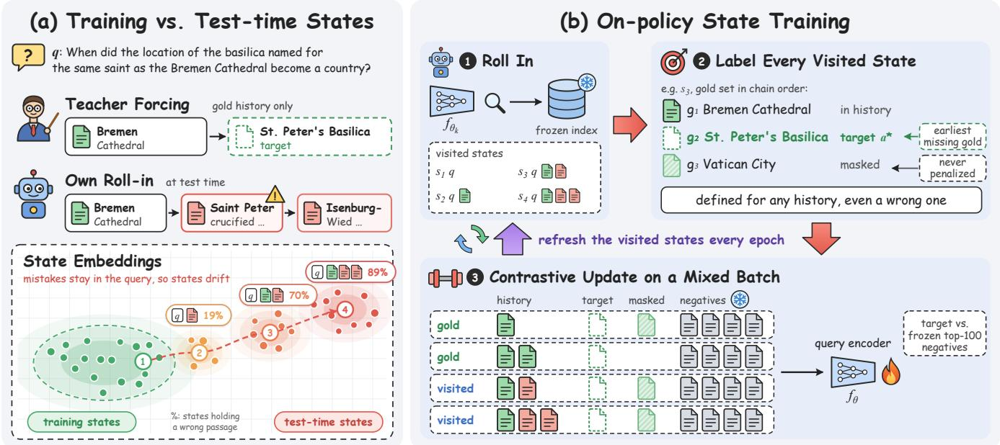  
Figure 1: Overview. (a) Teacher forcing trains on gold histories, while at test time the retriever’s own mistakes stay in the query and its states drift. (b) On-policy state training rolls in the current encoder, labels every visited state with the earliest missing gold passage, and trains on a mix of gold and visited states, refreshed every epoch.

## Our study leads to four findings.

(1) A trained chain embedding retriever is already a strong retriever for complex questions. Even with teacher forcing, a 0.6B chain retriever that calls no language model retrieves complete evidence more often than graph-based retrieval-augmented generation and is competitive with a 7B search agent, at a fraction of their retrieval cost.

(2) The state mismatch still limits it. Changing only the training states raises complete coverage over teacher forcing with the same encoder on MuSiQue and on both long-chain benchmarks, the resulting retriever outperforms every system we compare on MuSiQue, and the MuSiQue-trained encoder transfers to longer chains.

(3) The gain appears where the mismatch predicts. Scored on the same states, teacher-forced and on-policy encoders continue a chain from a clean history about equally well, while after one or more mistakes the on-policy encoder recovers far more often, so the gain accumulates along the chain.

(4) Exposure to contaminated histories explains part of the gain, and following the current encoder explains the rest. Synthetic contamination of gold histories, matched in the number of wrong passages, closes about half of the gap to onpolicy state training. Visited states collected once are worth little more than synthetic contamination, and the remaining gain comes from refreshing them as the encoder changes; resampling synthetic contamination every epoch does not reproduce it (Section 5.5).

## 2 Related Work

## 2.1 Retrieval for Complex Questions

Questions that require several pieces of evidence are usually answered by retrieving in multiple rounds. One line of work places a large language model in the loop and learns when and what to search through reinforcement learning [10]. Graph-based methods organize the corpus ofline instead, as a knowledge graph traversed with personalized PageRank [5], a subgraph selected with a prizecollecting Steiner tree [6], or a relation-free entity graph [28]. Our method calls no language model at retrieval time and uses only a dense passage index. The two directions are complementary, since a stronger embedding model can serve as the retriever inside either kind of system. An embedding retriever can also be trained from the outcome of a whole episode: Q-RAG learns a value-based embedder for multi-step retrieval from temporal-diference targets [20]. Search-R1 and Q-RAG learn from sparse outcome rewards. Our method derives a dense per-step target from the gold evidence set, so every visited state is labeled without reward estimation, and neither training nor retrieval calls a language model.

## 2.2 Chain and Dense Retrievers

Chain dense retrievers condition each hop on the passages retrieved at earlier hops. MDR concatenates the question with the previously retrieved passages and encodes the result with a shared dense encoder, trained with teacher forcing: the history at hop � consists of gold passages, the target is the next gold passage, and negatives come from a memory bank of passage vectors [23]. Its training queries therefore never contain a passage the retriever retrieved by mistake, and no target is defined for a history that does. We keep the MDR-style chain architecture and a fixed document index, and change only the distribution of histories on which the query encoder is trained.

Dense retrievers are trained contrastively on question–passage pairs [11], and much of the progress comes from better negatives. ANCE re-encodes the corpus with the current checkpoint so that negatives follow the model’s own retrieval distribution [22], and RocketQA removes false negatives with a cross-encoder [16]. Con triever and recent embedding models built on large language models scale up pretraining [9, 12, 27]. These methods improve the candidate side of the contrastive objective. Our method acts on the query side: it refreshes the retrieval states that the encoder embeds as queries, while the negatives stay those of the frozen encoder.

## 2.3 Exposure Bias and On-Policy Training

Training a sequential predictor only on reference histories, while it conditions on its own predictions at test time, is known as exposure bias [17]. Imitation learning and sequence modeling address it by training on states the model itself visits [1, 3, 19]. DAgger rolls in with the learner and labels the visited states with an expert, and dynamic oracles define such an expert for every state of a dependency parser, including states of the gold path [4]; AggreVaTe and LOLS label states with costs to go instead [2, 18]. The idea has recently been applied to language model agents [14, 15]. Our training pro cedure is an instance of DAgger with a dynamic oracle. What we study is specific to chain dense retrieval: the oracle is free because the gold evidence set labels every state, a wrong passage persists in the query for all later steps, and only the query side of a contrastive objective changes. A related line makes language models robust to irrelevant retrieved context by training with distractors [25, 26]; Section 5.5 compares visited states with synthetic contamination of this kind.

## 3 Problem Setup

## 3.1 Chain Dense Retrieval

A question � is paired with a corpus C and a set of gold passages $G ( q ) = \{ g _ { 1 } , . . . , g _ { n } \} \subseteq C$ , listed in the order in which a reasoning chain reaches them. A chain retriever collects evidence over � steps. Its state at step � is $s _ { t } = \left( q , E _ { t } \right)$ , where $E _ { t } = \left( e _ { 1 } , \ldots , e _ { t - 1 } \right)$ holds the passages it has retrieved so far and $E _ { 1 } = \varnothing$ . Following MDR [23], the state is serialized as a single text � (�) that lists the question and the retrieved passages, and is embedded by a query encoder $f _ { \theta } .$

Passages are embedded once by a fixed document encoder ℎ. With both embeddings normalized, the retriever scores a passage � in state � by

$$
\sigma _ { \theta } ( s , d ) = f _ { \theta } \big ( \boldsymbol { x } ( s ) \big ) ^ { \top } h ( d ) ,\tag{1}
$$

and its greedy policy �� retrieves the highest-scoring passage it has not retrieved yet,

$$
\boldsymbol { e } _ { t } = \underset { d \in C \backslash E _ { t } } { \arg \operatorname* { m a x } } \sigma _ { \theta } ( s _ { t } , d ) , \qquad s _ { t + 1 } = ( q , E _ { t } \oplus e _ { t } ) .\tag{2}
$$

The output ranking lists $e _ { 1 } , \ldots , e _ { T }$ first, followed by the remaining passages ordered by their best score over the � steps, $\operatorname* { m a x } _ { t } \sigma _ { \theta } ( s _ { t } , d )$ We measure recall R@�, the fraction of $G ( q )$ in the top �, and complete coverage C@�, the fraction of questions whose whole gold set is in the top �. C@� reflects whether a downstream retrievalaugmented generation system receives all of the evidence it needs.

## 3.2 Supervision from the Gold Set

For any state $s = ( q , E )$ , the gold passages still missing are $R ( s ) =$ $G ( q ) \setminus E ,$ , and the target is the earliest of them in chain order,

$$
a ^ { * } ( s ) = g _ { j } , \qquad j = \operatorname * { m i n } \{ i : g _ { i } \in R ( s ) \} .\tag{3}
$$

The target depends only on $G ( q )$ and on which passages � contains, so it is defined for every state with $R ( s ) \neq \emptyset$ , including states whose history contains passages outside $G ( q )$ . Given a set of candidate negatives $N ( s )$ , the retriever is trained with a contrastive loss with temperature �,

$$
\ell _ { \theta } ( s ) = - \log \frac { \exp \left( \sigma _ { \theta } ( s , a ^ { * } ( s ) ) / \tau \right) } { \sum _ { d \in \{ a ^ { * } ( s ) \} \cup \left( N ( s ) \backslash R ( s ) \right) } \exp \left( \sigma _ { \theta } ( s , d ) / \tau \right) } .\tag{4}
$$

Gold passages that are still missing but are not the current target are removed from the denominator, since retrieving them is also progress.

## 3.3 Teacher Forcing and the State Mismatch

Existing chain retrievers minimize Eq. (4) over a distribution $d _ { \mathrm { g o l d } }$ of states whose histories contain only gold passages [23]:

$$
\mathcal { T } _ { \mathrm { g o l d } } ( \theta ) = \mathbb { E } _ { s \sim d _ { \mathrm { g o l d } } } \left[ \ell _ { \theta } ( s ) \right] .\tag{5}
$$

In MDR-style training � is a gold prefix $( g _ { 1 } , \ldots , g _ { k } ) . \mathrm { A }$ variant that we also study draws � as a random subset of�(�) in chain order, which covers histories that skip a hop. At test time the retriever instead conditions on the states $d _ { \pi _ { \theta } }$ that its own policy visits. Once $\pi _ { \theta }$ writes a passage outside $G ( q )$ , every later state lies outside the support of $d _ { \mathrm { g o l d } ; }$ , and the wrong passage stays in the query text �(�) for all remaining steps. Teacher-forced training therefore never shows the encoder the histories in which it most needs to recover. This is the exposure bias studied in sequence prediction and imitation learning [3, 17, 19]. The rest of the paper asks how much this mismatch limits chain dense retrieval, and which properties of the visited states matter when it is corrected.

## 3.4 How Large Is the Mismatch?

We measure it with a chain retriever trained by teacher forcing on MuSiQue (gold histories drawn as random subsets), run for $T = 4$ steps on the 1,000 test questions. We count only feasible states: those at step $t \leq$ � of an �-hop question that still miss a gold passage, since for $t > n$ a missing gold passage implies a wrong one. On four-hop questions, 19% of the states at the second step, 70% at the third and 89% at the fourth already contain a non-gold passage; on three-hop questions the share is 12% at the second step and 48% at the third (Figure 3a). The retriever retrieves a missing gold passage in 67% of the clean states and in 28% of the contaminated ones. The gap is not explained by question length: it is 71% against 33% on two-hop questions, 67% against 40% on three-hop questions and 57% against 19% on four-hop questions. Part of this gap reflects harder states. A counterfactual separates the two: deleting the wrong passages from the same contaminated states raises the success rate of the teacher-forced encoder from 20.8% to 32.1%, so its own mistakes cost it about a third of its remaining chance of continuing the chain. Teacher forcing trains the encoder only on clean states, while a large share of the states it meets after the second step are of the other kind.

## 4 On-Policy State Training

To study the efect of the state mismatch, we change a single factor of teacher-forced training: the distribution of the states on which the query encoder is trained. The architecture, the target �∗(�), the loss in Eq. (4), the negative candidates and the document index all stay as they are, so any change in retrieval can be attributed to which states the encoder sees during training. The procedure follows DAgger [19] with a dynamic oracle [4]: the learner rolls in, and an oracle defined on every state, including states of the gold path, provides the label (Figure 1b). In chain dense retrieval this oracle comes from the gold evidence set at no cost, and the design choices below adapt the procedure to a contrastive query encoder over a fixed index.

## 4.1 Objective

We train on a mixture of teacher-forced states and states visited by the current retriever,

$$
\mathcal { T } ( \theta ) = \mathbb { E } _ { s \sim \mu _ { \theta } } \big [ \ell _ { \theta } ( s ) \big ] , \qquad \mu _ { \theta } = \lambda d _ { \mathrm { g o l d } } + ( 1 - \lambda ) d _ { \pi _ { \theta } } ,\tag{6}
$$

with $\begin{array} { r } { \lambda = \frac { 1 } { 2 } } \end{array}$ . Since $d _ { \pi _ { \theta } }$ depends on $\theta ,$ we treat visited states as data and alternate between collecting them and fitting them. At the start of epoch �, the current encoder $\theta _ { k }$ runs its greedy policy for � steps on every training question. Each visited state with a non-empty $R ( s )$ is recorded, duplicates of the same $( q , E )$ are removed, and � of the remaining states are sampled uniformly to form $\mathcal { D } _ { k } ^ { \pi }$ . The epoch then minimizes Eq. (4) over

$$
\mathcal { D } _ { k } = \mathcal { D } ^ { \mathrm { g o l d } } \cup \mathcal { D } _ { k } ^ { \pi } ,\tag{7}
$$

where $\mathcal { D } ^ { \mathrm { g o l d } }$ consists of � teacher-forced states drawn as random gold subsets, and � is half of the about 4,700 training states of teacher forcing. The LoRA parameters are initialized from scratch, as for teacher forcing; in the first epoch the visited states come from a roll-in of a teacher-forced encoder, which only supplies states and is not used to initialize the model. Both regimes use the same number of states and the same schedule of at most 10 epochs, with early stopping on the validation questions. The visited half is replaced at every epoch instead of being accumulated across epochs as in DAgger [19], so it follows the states that the encoder currently reaches. The teacher-forced half keeps supervision on histories that the current encoder seldom reaches, such as long correct prefixes on questions it usually gets wrong, which would otherwise disappear from training. We refer to this procedure as on-policy state training.

## 4.2 Labels for Visited States

Visited states can be labeled at no extra cost because $a ^ { * } ( s )$ is defined by the gold set alone. When the history contains a wrong passage, the target is still the earliest gold passage not yet retrieved, and the other missing gold passages are removed from the denominator of Eq. (4), so the encoder is trained to continue the chain from a contaminated history. Every retained visited state receives a dense, per-step target. No language model, reward model or outcome reward is involved, which distinguishes this setting from retrievers trained with reinforcement learning [10, 20]. Because the target function is shared with teacher forcing, the two training regimes difer only in their state distributions. The rule fixes which missing gold passage serves as the positive, but since the other missing gold passages are masked, retrieving any of them is never penalized; on questions whose chain order is partly arbitrary, such as comparisons, the ordering only selects which correct continuation receives the gradient.

## 4.3 Fixed Index and Negative Rule

Only the query encoder is updated, through low-rank adapters [8], and the document embeddings ℎ(�) are computed once. The negatives $N ( s )$ for every state are drawn from the top 100 passages that the frozen encoder retrieves for the state text �(�), excluding every gold passage of the question, whether the state is teacher-forced or visited. Non-gold passages already in a visited history can therefore appear among its negatives. We fix both for the comparison. If the corpus were re-encoded, or the negatives were mined with the current model as in ANCE [22], a gain could come from harder negatives instead of from the states. With both held fixed, the negatives of every state are mined by the same rule and the same model in both training regimes. The pools still depend on the state text, so a visited state receives other negatives than a gold state of the same question; the two regimes share the rule that chooses them.

## 5 Experiments

We answer four research questions. RQ1: Does on-policy state training retrieve complete evidence chains more often than existing retrievers, and does it transfer to longer chains? RQ2: Which components of the method contribute? RQ3: Does the gain come from recovering after the retriever’s own mistakes? RQ4: What in the visited states matters?

## 5.1 Experimental Setup

5.1.1 Datasets. MuSiQue [21] is built so that its two- to four-hop questions cannot be answered from a single passage, which makes the history of a chain retriever matter at every step. All trained retrievers are trained on 1,800 MuSiQue training questions and select checkpoints on 200 others. We test on the 1,000 questions of the oficial development set with the 11,656-passage corpus used by HippoRAG 2 [5]. To test whether the efect persists on longer chains and larger corpora, we evaluate the MuSiQue-trained encoders, without further training, on two harder benchmarks that we construct from

HotpotQA [24] and 2WikiMultiHopQA [7]. HotpotQA-Long extends bridge questions along hyperlinks in the Wikipedia abstracts to chains of three, four and five pages (100 test questions each) over a corpus of 554,812 passages. 2Wiki-Long follows functional relations between Wikidata entities for three to five hops, or compares three to four entities that are each reached in two hops, with 300 test questions over 220,000 passages. In both benchmarks the question names only the starting entity, a language model of a diferent family verifies that the question is answerable from the gold passages and has a unique answer, and questions whose final passage is retrievable by BM25 from the question alone are removed. The corpora contain the lexical nearest neighbors of every gold passage, so distractors are topically close to the evidence (Appendix E).

5.1.2 Metrics. With $L _ { k } ( q )$ the top � passages of the ranking for question � and Q the test questions, we report recall and complete coverage for � ∈ {5, 10}:

$$
\mathrm { R } @ k = \frac { 1 } { | Q | } \sum _ { q \in Q } \frac { | G ( q ) \cap L _ { k } ( q ) | } { | G ( q ) | } ,\tag{8}
$$

$$
\mathrm { C } @ k = \frac { 1 } { | Q | } \sum _ { q \in Q } 1 \big [ G ( q ) \subseteq L _ { k } ( q ) \big ] .\tag{9}
$$

C@� credits a question only when every gold passage is retrieved, which is what a downstream reader needs.

5.1.3 Baselines. BM25 and the frozen Qwen3-Embedding-0.6B encoder [27] retrieve with the question alone (Dense). HippoRAG 2 [5] builds a knowledge graph with a language model and retrieves with personalized PageRank; we run the oficial code with the same frozen encoder. G-Retriever [6] selects a subgraph of this knowledge graph with a prize-collecting Steiner tree; we rank the passages linked to the selected nodes and edges first. LinearRAG [28] builds an entity graph without relation extraction and retrieves by activation spreading over it. Both use the same frozen encoder. The released MDR checkpoint [23] is a chain retriever trained with teacher forcing on HotpotQA; it retrieves for two hops with beam search. Search-R1 [10] is a 7B language model trained with rein forcement learning to issue search queries. Q-RAG [20] trains a multi-step embedding retriever with value-based reinforcement learning; we evaluate the authors’ released MuSiQue checkpoint with its own encoder and default four steps. For Search-R1 we use the released checkpoint with its default settings (three passages per search, at most four searches) and our frozen encoder as its search engine, and rank passages in the order they are retrieved. Our retriever uses the same encoder, adapted with LoRA on the query side only, and runs � = 4 chain steps on MuSiQue and � = 8 on the long-chain benchmarks. Table 1 averages five seeds; all other experiments train each retriever once with one shared seed. All models are trained and evaluated on NVIDIA RTX 4090 GPUs; Appendix A gives the training details and Appendix F.2 the training and retrieval cost.

## 5.2 RQ1: Retrieval Efectiveness

5.2.1 Overall Results. Table 1 supports the first finding. On MuSiQue, on-policy state training reaches 73.5 R@5 and 49.3 C@5. Search-R1, which reasons with a 7B language model between three searches on average, completes 36.5% of the questions within five passages, Q-RAG 36.2%, the released MDR checkpoint 31.9%, and HippoRAG 2, which calls a language model to build its graph, 23.1%. Most of the gain over the frozen encoder comes from training a chain retriever at all; the part due to the training states is isolated in Section 5.3, where teacher forcing with the same encoder and recipe reaches 44.6 C@5 and on-policy state training 50.5. Teacher forcing alone thus already completes more chains on MuSiQue than every compared system (44.6 against 36.5 C@5 for Search-R1), and on the long-chain benchmarks it is far ahead of the graph-based systems and close to Search-R1 on HotpotQA-Long: a trained chain embedding retriever, which calls no language model at retrieval time, is a strong retriever for complex questions. The gain in complete coverage is larger than the gain in recall, which reflects what a chain needs: a question counts toward C@5 only when every step succeeds.

5.2.2 Transfer to Longer Chains. MuSiQue has at most four hops, while the long-chain benchmarks need up to five hops, or six to eight passages for comparisons, over corpora 19 to 48 times larger. The MuSiQue-trained encoder raises C@10 over the frozen encoder from 1.0 to 29.6 on HotpotQA-Long and from 2.0 to 32.8 on 2Wiki-Long. Search-R1 is the strongest competitor here. It puts fewer gold passages in its first five (C@5 3.3 and 6.0, against 20.8 and 27.7) but reaches a similar recall by the tenth passage, and leads on 2Wiki-Long in C@10. Its policy was trained with reinforcement learning on HotpotQA questions, from which part of HotpotQA-Long is built, and it spends a 7B forward pass per search. Our retriever uses a 0.6B encoder and one nearest neighbor search per step. The released MDR checkpoint, trained on HotpotQA, retrieves the most gold passages in the top five on HotpotQA-Long (51.0 R@5), but with two hops it completes few of the three- to five-hop chains (14.7 C@10, against 29.6).

5.2.3 Results by Question Type. Figure 2 splits the results of Table 1 by question type. On MuSiQue, the gain is largest on three-hop questions, where our retriever completes 41.6% of the chains within five passages and the next system 20.9%; on four-hop questions every retriever completes fewer than 7%. On the long-chain benchmarks, our retriever has the highest complete coverage on every type of HotpotQA-Long and on the comparison questions of 2Wiki-Long. On 2Wiki-Long, Search-R1 leads on the three-hop chains, the closest to the two-hop questions its policy was trained on, and on the four- and five-hop chains, with 45 and 12 questions, no retriever completes more than one chain in ten.

5.2.4 Downstream Question Answering. Complete coverage matters because a reader rarely answers correctly without the missing evidence. Table 2 gives the top five passages of each retriever to the same reader (deepseek-flash, temperature 0) and scores its answers on MuSiQue; Search-R1 is scored on the passages it retrieves, not on its own answers. The ranking of the retrievers carries over to the answers. With the passages of on-policy state training, the reader reaches 44.1 exact match, 8.6 points more than with the passages Search-R1 retrieves and 11.7 more than with those of Q-RAG.

<table><tr><td></td><td colspan="7">Recall (R@k)</td><td colspan="7">2Wiki-Long (@10)</td><td colspan="7">Complete coverage (C@k)</td></tr><tr><td></td><td colspan="3">MuSiQue (@5)</td><td colspan="3">HotpotQA-Long (@10)</td><td colspan="3"></td><td colspan="3"></td><td colspan="3">MuSiQue (@5)</td><td colspan="3">HotpotQA-Long (@10)</td><td colspan="3">2Wiki-Long (@10)</td></tr><tr><td></td><td>BM25 51.0</td><td>39.8</td><td>26.5</td><td>34.0</td><td>25.8</td><td>16.8</td><td>31.2</td><td>31.1</td><td>23.3</td><td>33.8</td><td>17.6</td><td>1.9</td><td>0.6</td><td>0.0</td><td>0.0</td><td>0.0</td><td>0.0</td><td>0.0</td><td>0.0</td><td>0.0</td></tr><tr><td>Dense</td><td>63.3</td><td>53.5</td><td>32.5</td><td>42.3</td><td>29.2</td><td>24.0</td><td>37.8</td><td>37.2</td><td>26.7</td><td>26.3</td><td>32.2</td><td>7.0</td><td>0.0</td><td>3.0</td><td>0.0</td><td>0.0</td><td>1.2</td><td>6.7</td><td>8.3</td><td>0.0</td></tr><tr><td>G-Retriever†</td><td>46.6</td><td>30.1</td><td>17.2</td><td>27.3</td><td>20.2</td><td>14.0</td><td>27.3</td><td>26.7</td><td>21.7</td><td>7.9</td><td>17.6</td><td>0.3</td><td>0.0</td><td>5.0</td><td>1.0</td><td>0.0</td><td>2.9</td><td>0.0</td><td>0.0</td><td>0.0</td></tr><tr><td>HippoRAG 2 †</td><td>67.5</td><td>55.3</td><td>35.1</td><td>44.7</td><td>30.2</td><td>25.2</td><td>39.6</td><td>37.2</td><td>26.7</td><td>27.3</td><td>39.8</td><td>7.9</td><td>0.0</td><td>4.0</td><td>0.0</td><td>0.0</td><td>1.8</td><td>6.7</td><td>8.3</td><td>0.0</td></tr><tr><td>LinearRAG</td><td>53.5</td><td>36.6</td><td>27.7</td><td>29.0</td><td>22.0</td><td>15.2</td><td>30.0</td><td>27.2</td><td>21.7</td><td>30.1</td><td>30.5</td><td>6.0</td><td>0.0</td><td>2.0</td><td>0.0</td><td>0.0</td><td>1.2</td><td>2.2</td><td>0.0</td><td>0.0</td></tr><tr><td>MDR</td><td>71.4</td><td>51.5</td><td>30.3</td><td>72.7</td><td>54.2</td><td>41.6</td><td>69.4</td><td>36.7</td><td>36.7</td><td>21.5</td><td>54.6</td><td>11.1</td><td>0.6</td><td>35.0</td><td>8.0</td><td>1.0</td><td>24.7</td><td>2.2</td><td>0.0</td><td>0.0</td></tr><tr><td>Q-RAG</td><td>71.0</td><td>58.9</td><td>38.0</td><td>39.7</td><td>27.0</td><td>17.4</td><td>31.8</td><td>25.6</td><td>28.3</td><td>19.7</td><td>55.0</td><td>20.9</td><td>6.6</td><td>12.0</td><td>4.0</td><td>1.0</td><td>4.1</td><td>0.0</td><td>0.0</td><td>0.0</td></tr><tr><td>Search-R1</td><td>80.4</td><td>58.1</td><td>40.2</td><td>75.3</td><td>59.2</td><td>40.8</td><td>82.9</td><td>43.3</td><td>40.0</td><td>53.3</td><td>65.3</td><td>8.5</td><td>0.0</td><td>49.0</td><td>23.0</td><td>5.0</td><td>65.3</td><td>0.0</td><td>0.0</td><td>0.0</td></tr><tr><td>Ours</td><td>81.0</td><td>75.2</td><td>46.7</td><td>77.5</td><td>54.7</td><td>37.6</td><td>77.3</td><td>48.2</td><td>44.7</td><td>54.5</td><td>67.7</td><td>41.6</td><td>6.1</td><td>56.8</td><td>24.6</td><td>7.4</td><td>55.6</td><td>5.8</td><td>3.3</td><td>1.4</td></tr><tr><td></td><td>2-hop (518)</td><td>3-hop (316)</td><td>4-hop (166)</td><td>3-hop (100)</td><td>4-hop (100)</td><td>5-hop (100)</td><td>3-hop (170)</td><td>4-hop (45)</td><td>5-hop (12)</td><td>comp. (73)</td><td>2-hop (518)</td><td>3-hop (316)</td><td>4-hop (166)</td><td>3-hop (100)</td><td>4-hop (100)</td><td>5-hop (100)</td><td>3-hop (170)</td><td>4-hop (45)</td><td>5-hop (12)</td><td>comp. (73)</td></tr></table>

Table 1: Retrieval results. Our retriever is trained on MuSiQue and evaluated on the long-chain benchmarks without further training; its results are the mean over five seeds, with the standard deviation in gray. Dense is the frozen Qwen3-Embedding-0.6B encoder with the question as the query; the structure-augmented baselines, Search-R1 and our retriever use the same encoder. Search-R1 calls a 7B language model at every step. The best result in each column is in bold and the second best is underlined. †HippoRAG 2 and G-Retriever on the long-chain benchmarks are run on reduced corpora (all gold passages plus the frozen encoder’s top 100 per question), an easier setting than the full corpora used by the other rows (Appendix D).
<table><tr><td rowspan="2">Method</td><td colspan="4">MuSiQue</td><td colspan="4">HotpotQA-Long</td><td colspan="4">2Wiki-Long</td></tr><tr><td>R@5</td><td>R@10</td><td>C@5</td><td>C@10</td><td>R@5</td><td>R@10</td><td>C@5</td><td>C@10</td><td>R@5</td><td>R@10</td><td>C@5</td><td>C@10</td></tr><tr><td colspan="10">Simple Baselines</td><td></td><td></td><td></td></tr><tr><td>BM25</td><td>43.4</td><td>50.8</td><td>9.8</td><td>15.5</td><td>23.3</td><td>25.5</td><td>0.0</td><td>0.0</td><td>27.9</td><td>31.5</td><td>0.0</td><td>0.0</td></tr><tr><td>Dense</td><td>55.1</td><td>62.4</td><td>18.9</td><td>27.1</td><td>29.0</td><td>31.9</td><td>0.3</td><td>1.0</td><td>31.3</td><td>34.5</td><td>0.0</td><td>2.0</td></tr><tr><td colspan="10">Structure-Augmented Retrieval</td><td colspan="3"></td></tr><tr><td>G-Retriever</td><td>36.5</td><td>43.7</td><td>9.2</td><td>15.9</td><td>16.1†</td><td>20.5†</td><td>0.0†</td><td>2.0†</td><td>18.9†</td><td>22.2†</td><td>0.0†</td><td>1.7†</td></tr><tr><td>HippoRAG 2</td><td>58.2</td><td>66.0</td><td>23.1</td><td>32.3</td><td>30.9†</td><td>33.4†</td><td>1.0†</td><td>1.3†</td><td>32.1†</td><td>35.7†</td><td>0.0†</td><td>2.3†</td></tr><tr><td>LinearRAG</td><td>43.9</td><td>55.8</td><td>17.7</td><td>28.7</td><td>19.0</td><td>22.1</td><td>0.7</td><td>0.7</td><td>23.2</td><td>29.3</td><td>0.3</td><td>1.0</td></tr><tr><td colspan="10">Sequential Retrieval</td><td colspan="3"></td></tr><tr><td>MDR</td><td>58.3</td><td>66.0</td><td>31.9</td><td>38.3</td><td>51.0</td><td>56.2</td><td>11.0</td><td>14.7</td><td>46.9</td><td>51.5</td><td>10.0</td><td>14.3</td></tr><tr><td>Q-RAG</td><td>61.7</td><td>67.8</td><td>36.2</td><td>44.9</td><td>25.2</td><td>28.0</td><td>3.3</td><td>5.7</td><td>14.7</td><td>27.8</td><td>1.7</td><td>2.3</td></tr><tr><td>Search-R1</td><td>66.7</td><td>74.7</td><td>36.5</td><td>49.5</td><td>43.6</td><td>58.5</td><td>3.3</td><td>25.7</td><td>50.3</td><td>68.1</td><td>6.0</td><td>37.0</td></tr><tr><td>On-policy state training</td><td>73.50.4</td><td>80.50.5</td><td>49.30.4</td><td>59.80.9</td><td>49.61.3</td><td>56.60.7</td><td>20.82.1</td><td>29.60.9</td><td>59.22.9</td><td>66.12.9</td><td>27.74.5</td><td>32.85.2</td></tr></table>

Figure 2: Retrieval by question type, with the number of questions under each column. Colors are scaled within each column and the best result of each column is framed. Our retriever is the mean over the five seeds of Table 1; †reduced corpora.

## 5.3 RQ2: Ablations

Table 3 removes the components of the method in turn. Each row removes one more component, so the last row also has no visited states. Removing the refresh keeps the visited states collected at the start of training. Removing the visited states leaves teacher forcing on gold states alone. Removing the chain fine-tunes the same encoder on the question alone, which also removes the notion of a retrieval state.

Every component contributes, and the contributions grow on the longer chains. Removing the visited states, which leaves teacher forcing with the same encoder, recipe and number of states, costs 5.9 points of C@5 on MuSiQue and 5.7 and 10.4 points of C@10 on HotpotQA-Long and 2Wiki-Long. This comparison isolates the training states, and the gap does not shrink on chains longer than any seen in training. Visited states collected once and never refreshed keep most of the gain on MuSiQue but little on HotpotQA-Long and less than half on 2Wiki-Long (22.7 against 22.3 and 28.3 against 24.3 C@10), so following the states of the current encoder matters most when the encoder is run far from its training distribution. Without a chain, fine-tuning on the question alone gives no gain over the frozen encoder (54.6 against 55.1 R@5 on MuSiQue), which confirms that complex retrieval needs the history.

Table 2: Question answering on MuSiQue with a fixed reader; trained retrievers use the shared seed.
<table><tr><td>Passages from</td><td>EM</td><td>F1</td></tr><tr><td>Dense</td><td>25.9</td><td>36.3</td></tr><tr><td>G-Retriever</td><td>21.2</td><td>29.2</td></tr><tr><td>HippoRAG 2</td><td>28.2</td><td>39.4</td></tr><tr><td>LinearRAG</td><td>22.3</td><td>30.5</td></tr><tr><td>Q-RAG</td><td>32.4</td><td>42.0</td></tr><tr><td>Search-R1</td><td>35.5</td><td>44.8</td></tr><tr><td>On-policy state training</td><td>44.1</td><td>53.7</td></tr></table>

Table 3: Ablations; all rows are trained with the same seed.
<table><tr><td rowspan="2">Method</td><td>MuSiQue</td><td></td><td>HotpotQA-L</td><td></td><td>2Wiki-L</td></tr><tr><td>R@5 C@5</td><td>R@10</td><td></td><td>C@10</td><td>R@10 C@10</td></tr><tr><td>On-policy state training</td><td>74.2 50.5</td><td>56.4</td><td>28.0</td><td>67.0</td><td>34.7</td></tr><tr><td>w/o refresh</td><td>71.8</td><td>48.4</td><td>52.6 22.7</td><td>64.6</td><td>28.3</td></tr><tr><td>w/o on-policy states</td><td>69.9</td><td>44.6 51.5</td><td>22.3</td><td>61.3</td><td>24.3</td></tr><tr><td>w/o chain</td><td>54.6 18.9</td><td>29.8</td><td>1.0</td><td>31.4</td><td>1.7</td></tr></table>

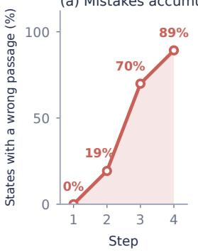

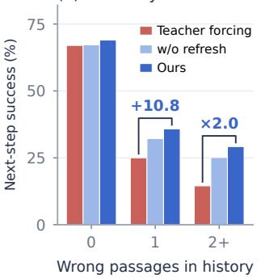  
Figure 3: (a) Share of the teacher-forced retriever’s states whose history contains a wrong passage, at each step of fourhop MuSiQue questions (gold passage still missing). (b) Rate at which each encoder retrieves a missing gold passage next on the same states, by the number of wrong passages in the history. All encoders are trained with the same seed.

## 5.4 RQ3: Recovery from Own Mistakes

The diagnosis in Section 3 predicts where on-policy state training helps most: the states whose history already holds a wrong passage. We test that prediction on MuSiQue with the teacher-forced, collected-once and refreshed retrievers of Table 4. Comparing each retriever on the states it visits itself would confound the efect of training with the states each one happens to reach, so the probes below score all retrievers on one fixed set of states.

5.4.1 Recovery on Fixed States. We take the 3,403 states visited by the teacher-forced retriever that still miss a gold passage and let every encoder choose the next passage for them (Figure 3b). On its own states, the teacher-forced encoder reproduces 99.8% of its recorded choices, so the probe matches retrieval. If on-policy state training only made the encoder better at retrieval in general, the gain would appear in clean states as well. It barely does: with a clean history, the three encoders succeed in 67.0%, 67.2% and 69.0% of the states. After one wrong passage, the rate rises from 25.0% under teacher forcing to 35.8% under on-policy state training, and after two or more from 14.5% to 29.2%, twice as often. Visited states collected once, without refresh, recover most of the way (32.2% and 25.1%). Because all encoders see the same states, the diference lies in the encoders themselves. The same pattern holds on the 3,352 states visited by the on-policy retriever: 66.8% against 68.5% with a clean history, 26.1% against 33.5% after one wrong passage and 20.0% against 24.2% after two or more.

5.4.2 Deleting the Wrong Passages. To measure the efect of the contamination itself, we delete the non-gold passages from the contaminated states above and keep the gold ones in order; the deleted passages stay excluded from retrieval, as in the original state. On these 1,358 states, the teacher-forced encoder succeeds in 20.8% of the original states and in 32.1% once the wrong passages are removed: its own mistakes cost it 11.3 points. The on-policy encoder succeeds in 33.1% and 35.3%, so the same contamination costs it 2.2 points. Part of the low success after a mistake reflects harder states, since even the cleaned states stay well below the 67% of states that were clean to begin with. The rest is the efect of the wrong passages in the query, and on-policy state training removes most of it: on the contaminated states, the on-policy encoder (33.1%) does slightly better than the teacher-forced encoder does once an oracle has deleted the wrong passages (32.1%). It is also better on the cleaned states themselves (35.3% against 32.1%), which are gold histories with gaps, so part of the gain is skill on histories that skip a hop.

5.4.3 Gain along the Chain. Because the encoder recovers more often, the gain accumulates over steps. The rate of retrieving a gold passage changes by one to two points at the first two steps, where most histories are still clean, and rises from 27.7% to 38.7% at the third step and from 15.2% to 23.1% at the fourth. By question length, C@5 rises from 61.6 to 67.8 on two-hop questions and from 36.7 to 44.3 on three-hop questions. On four-hop questions recall rises from 44.1 to 48.3 R@5, but complete coverage within five passages stays below 10% for both retrievers, since it requires four consecutive successful steps.

5.4.4 Where the Query Points. Figure 4 shows the same efect in the embedding space. We place each query vector by its similarity to the gold passages of the question and to the non-gold passages the two chains retrieve. The six questions share no gold passage and are the clearest of the 50 three- and four-hop questions on which our retriever finds every gold passage and the teacher-forced one misses at least one, ranked by the gap between the two retrievers in the softmax weight on the passage each should retrieve next and on non-gold passages. Once the teacher-forced chain retrieves a non-gold passage, its next query points at the non-gold passages and stays there, so the following steps retrieve more of them. Our query moves along the gold row hop by hop, and when it starts near non-gold passages (the fourth and fifth questions), it moves up to the gold row within one or two steps.

What date did the Governor of the city where the basilica named after the same saint as the one that Mantua Cathedral is dedicated to end?

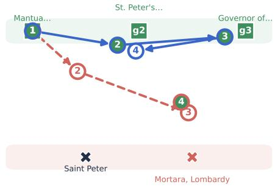  
Who is the host of Who Wants to be a Millionaire in the country that MacGruder and Loud's creator is from?  
What UK label was bought by the company which, along with ABC and the network which broadcasted Hello, Larry, is the other maior broadcaster based in NY?

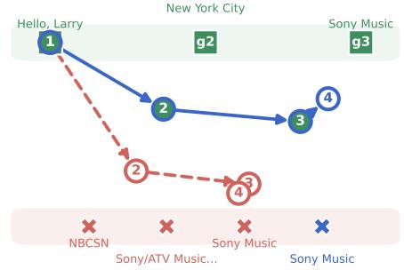  
There is a state A where Storm of the Century was filmed based on the book by the author who wrote a short story featuring the author of This Is My God. What is the population of state A?

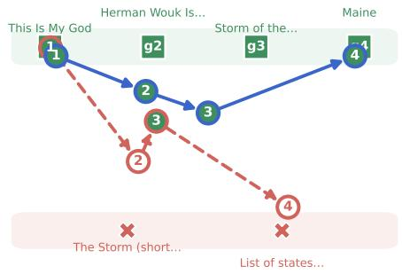

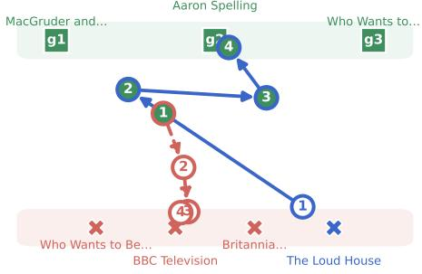

Who is the wife of the man who produced the documentary of the pop star who influenced Beyonce?  
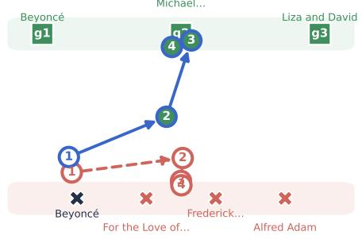

Where does the body of water by the city where Write This Down was formed and Ohio River meet?  
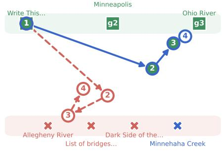  
teacher forcing: query at step t ours: query at step t step retrieves a gold passage gold passage (hop order) non-gold, retrieved by teacher forcing … by ours … by both  
Figure 4: Query trajectories of the two retrievers on six MuSiQue questions, each on its own chain. Gold passages sit on the top row in hop order and the non-gold passages retrieved by either chain on the bottom row. The query vector at step � is drawn at the mean of these positions weighted by the softmax of its cosine to each passage at the training temperature � = 0.05, so it sits next to the passages it points at; filled nodes are steps that retrieve a gold passage.

## 5.5 RQ4: What in the Visited States Matters

5.5.1 Synthetic, Fixed and Refreshed States. A cheaper explanation is that any contaminated history would do, as in training language models with distractor passages [25, 26]. Table 4 separates the candidate explanations. Every row keeps half of the training states as gold states and changes the other half, under the same budget and recipe. Synthetic contamination inserts passages from the frozen encoder’s top 100 at random positions into gold histories, with the joint distribution of the number of wrong and gold passages matched to the visited states in aggregate (not per question or per epoch), and needs no roll-in; each synthetic state starts from a teacher-forced state with the drawn number of gold passages. It is either built once or resampled at every epoch. The visited half is either sampled once from a single roll-in of the teacherforced encoder and kept for all epochs (the w/o refresh condition of Table 3), resampled at every epoch from that same roll-in, or refreshed with a new roll-in at every epoch.

Table 4 shows three efects. First, contamination itself helps: synthetic contamination raises C@5 from 44.6 to 47.9, about half of the gap to on-policy state training. Second, visited states collected once are worth little more than synthetic contamination (48.4 against 47.9), so roll-in states have no special value as such. Third, the remaining gain comes from refreshing with the current encoder, beyond the fresh samples it provides: resampling the synthetic contamination at every epoch does not help (47.1), and neither does resampling the visited states of one roll-in at every epoch (47.0), while refreshing them with the current encoder raises C@5 to 50.5. On the fixed states, the resampled condition also recovers no better than the visited states collected once (32.5% against 32.2% after one wrong passage, against 35.8% when refreshed). The encoder gains from training on the states it currently reaches, which move as it learns.

Table 4: What in the visited states matters on MuSiQue; “new states” marks a half that changes at every epoch. All rows are trained with the same seed and recipe.
<table><tr><td>Other half</td><td>Roll-in</td><td>New states</td><td>R@5</td><td>C@5</td></tr><tr><td>Gold (teacher forcing)</td><td>一</td><td>一</td><td>69.9</td><td>44.6</td></tr><tr><td>Synthetic</td><td>none</td><td>x</td><td>72.1</td><td>47.9</td></tr><tr><td>Synthetic</td><td>none</td><td>√</td><td>71.9</td><td>47.1</td></tr><tr><td>Visited</td><td>once</td><td>x</td><td>71.8</td><td>48.4</td></tr><tr><td>Visited</td><td>once</td><td>√</td><td>71.8</td><td>47.0</td></tr><tr><td>Visited (ours)</td><td>every epoch</td><td>√</td><td>74.2</td><td>50.5</td></tr></table>

5.5.2 Shared Negative Pools. Because the negative pools follow the state text, a visited state also brings other negatives than a gold state, and this could explain part of the gain. We therefore give every state of a question the same pool, the frozen encoder’s top 100 for the question alone, and retrain both regimes (Appendix B). On-policy state training still improves C@5 over teacher forcing, by 3.8 points against 5.9 with per-state pools, and its next-step success after a wrong passage remains higher on the fixed states (32.8% against 26.1% after one, 28.7% against 20.8% after two or more). Most of the gain therefore comes from the histories, and a smaller part from the negatives they induce.

## 6 Conclusion

Chain embedding retrievers are trained on gold histories and run on their own retrievals. We showed that this gap is large in practice: by the third step, about half or more of the states a trained chain retriever visits contain one of its own mistakes, and these mistakes cost a teacher-forced encoder far more than the dificulty of the step explains. Training on the states the encoder visits, labeled with the earliest missing gold passage, changes this without a new architecture, objective or language model. The gain appears where the mismatch predicts, in recovery from contaminated histories, it depends on refreshing the visited states as the encoder learns, and it carries over to chains longer than those seen in training.

These results have three implications within the setting we study. First, the distribution of training states is a design choice for chain retrievers in addition to negatives and targets, and reporting how often test-time states leave that distribution would make results eas ier to interpret. Second, retrievers inside agents and reinforcement learning pipelines face the same mismatch, and dense supervision on visited states is a cheap complement to outcome rewards. Third, a trained chain embedding retriever, which needs no language model at retrieval time, is a strong baseline for graph-based and agentic retrieval for complex questions.

## References

[1] Samy Bengio, Oriol Vinyals, Navdeep Jaitly, and Noam Shazeer. 2015. Scheduled Sampling for Sequence Prediction with Recurrent Neural Networks. In Advances in Neural Information Processing Systems 28 (NeurIPS). 1171–1179.

[2] Kai-Wei Chang, Akshay Krishnamurthy, Alekh Agarwal, Hal Daumé III, and John Langford. 2015. Learning to Search Better than Your Teacher. In Proceedings ofthe 32nd International Conference on Machine Learning (ICML). 2058–2066.

[3] Hal Daumé III, John Langford, and Daniel Marcu. 2009. Search-based Structured Prediction. Machine Learning 75, 3 (2009), 297–325. doi:10.1007/s10994-009- 5106-x

[4] Yoav Goldberg and Joakim Nivre. 2012. A Dynamic Oracle for Arc-Eager Dependency Parsing. In Proceedings ofCOLING 2012, Martin Kay and Christian Boitet (Eds.). The COLING 2012 Organizing Committee, Mumbai, India, 959–976. https://aclanthology.org/C12-1059

[5] Bernal Jiménez Gutiérrez, Yiheng Shu, Weijian Qi, Sizhe Zhou, and Yu Su. 2025. From RAG to Memory: Non-Parametric Continual Learning for Large Language Models. In Proceedings of the 42nd International Conference on Machine Learning (Proceedings ofMachine Learning Research, Vol. 267). PMLR, 21497–21515. https: //proceedings.mlr.press/v267/gutierrez25a.html

[6] Xiaoxin He, Yijun Tian, Yifei Sun, Nitesh V. Chawla, Thomas Laurent, Yann Le-Cun, Xavier Bresson, and Bryan Hooi. 2024. G-Retriever: Retrieval-Augmented Generation for Textual Graph Understanding and Question Answering. In Advances in Neural Information Processing Systems 37(NeurIPS). doi:10.52202/079017- 4224

[7] Xanh Ho, Anh-Khoa Duong Nguyen, Saku Sugawara, and Akiko Aizawa. 2020. Constructing a Multi-Hop QA Dataset for Comprehensive Evaluation of Reason ing Steps. In Proceedings of the 28th International Conference on Computational Linguistics. International Committee on Computational Linguistics, 6609–6625. doi:10.18653/v1/2020.coling-main.580

[8] Edward J. Hu, Yelong Shen, Phillip Wallis, Zeyuan Allen-Zhu, Yuanzhi Li, Shean Wang, Lu Wang, and Weizhu Chen. 2022. LoRA: Low-Rank Adaptation of Large Language Models. In International Conference on Learning Representations (ICLR). https://arxiv.org/abs/2106.09685

[9] Gautier Izacard, Mathilde Caron, Lucas Hosseini, Sebastian Riedel, Piotr Bojanowski, Armand Joulin, and Edouard Grave. 2022. Unsupervised Dense Information Retrieval with Contrastive Learning. Transactions on Machine Learning Research (2022). https://openreview.net/forum?id=jKN1pXi7b0

[10] Bowen Jin, Hansi Zeng, Zhenrui Yue, Jinsung Yoon, Sercan Arik, Dong Wang, Hamed Zamani, and Jiawei Han. 2025. Search-R1: Training LLMs to Reason and Leverage Search Engines with Reinforcement Learning. In Conference on Language Modeling (COLM). https://arxiv.org/abs/2503.09516

[11] Vladimir Karpukhin, Barlas Oguz, Sewon Min, Patrick Lewis, Ledell Wu, Sergey Edunov, Danqi Chen, and Wen-tau Yih. 2020. Dense Passage Retrieval for Open-Domain Question Answering. In Proceedings of the 2020 Conference on Empirical Methods in Natural Language Processing. Association for Computational Linguistics, 6769–6781. doi:10.18653/v1/2020.emnlp-main.550

[12] Chankyu Lee, Rajarshi Roy, Mengyao Xu, Jonathan Raiman, Mohammad Shoeybi, Bryan Catanzaro, and Wei Ping. 2025. NV-Embed: Improved Techniques for Training LLMs as Generalist Embedding Models. In International Conference on Learning Representations. 79310–79333. https://proceedings.iclr.cc/paper\_files/paper/ 2025/hash/c4bf73386022473a652a18941e9ea6f8-Abstract-Conference.html

[13] Patrick Lewis, Ethan Perez, Aleksandra Piktus, Fabio Petroni, Vladimir Karpukhin, Naman Goyal, Heinrich Küttler, Mike Lewis, Wen-tau Yih, Tim Rocktäschel, Sebastian Riedel, and Douwe Kiela. 2020. Retrieval-Augmented Generation for Knowledge-Intensive NLP Tasks. In Advances in Neural Information Processing Systems, Vol. 33. Curran Associates, Inc., 9459–9474. https://proceedings.neurips.cc/paper\_files/paper/2020/hash/ 6b493230205f780e1bc26945df7481e5-Abstract.html

[14] Changhao Li, Rushi Qiang, Jiawei Huang, Chenxiao Gao, Chao Zhang, Niao He, and Bo Dai. 2026. Revisiting DAgger in the Era of LLM-Agents. arXiv preprint arXiv:2605.12913. arXiv:2605.12913 [cs.LG]

[15] Baohao Liao, Hanze Dong, Christof Monz, Xinxing Xu, Li Dong, and Furu Wei. 2026. Multi-Turn On-Policy Distillation with Prefix Replay. arXiv preprint arXiv:2607.04763. arXiv:2607.04763

[16] Yingqi Qu, Yuchen Ding, Jing Liu, Kai Liu, Ruiyang Ren, Wayne Xin Zhao, Daxiang Dong, Hua Wu, and Haifeng Wang. 2021. RocketQA: An Optimized Training Approach to Dense Passage Retrieval for Open-Domain Question Answering. In Proceedings ofthe 2021 Conference ofthe North American Chapter ofthe Association for Computational Linguistics: Human Language Technologies. Association for Computational Linguistics, Online, 5835–5847. doi:10.18653/v1/2021.naaclmain.466

[17] Marc’Aurelio Ranzato, Sumit Chopra, Michael Auli, and Wojciech Zaremba. 2016. Sequence Level Training with Recurrent Neural Networks. In International Conference on Learning Representations (ICLR). https://arxiv.org/abs/1511.06732

[18] Stéphane Ross and J. Andrew Bagnell. 2014. Reinforcement and Imitation Learning via Interactive No-Regret Learning. arXiv preprint arXiv:1406.5979 (2014)

[19] Stéphane Ross, Geofrey Gordon, and Drew Bagnell. 2011. A Reduction of Imitation Learning and Structured Prediction to No-Regret Online Learning. In Proceedings ofthe Fourteenth International Conference on Artificial Intelligence and Statistics (AISTATS) (Proceedings ofMachine Learning Research, Vol. 15). PMLR, 627–635. https://proceedings.mlr.press/v15/ross11a.html

[20] Artyom Sorokin, Nazar Buzun, Aleksandr Anokhin, Egor Vedernikov, Petr Anokhin, Mikhail Burtsev, and Evgeny Burnaev. 2026. Q-RAG: Long Context Multi-Step Retrieval via Value-Based Embedder Training. In International Conference on Learning Representations. https://openreview.net/forum?id= MS9nWFY7LG

[21] Harsh Trivedi, Niranjan Balasubramanian, Tushar Khot, and Ashish Sabharwal. 2022. MuSiQue: Multihop Questions via Single-Hop Question Composition. Transactions ofthe Association for Computational Linguistics 10 (2022), 539–554. doi:10.1162/tacl\_a\_00475

[22] Lee Xiong, Chenyan Xiong, Ye Li, Kwok-Fung Tang, Jialin Liu, Paul N. Bennett, Junaid Ahmed, and Arnold Overwijk. 2021. Approximate Nearest Neighbor Negative Contrastive Learning for Dense Text Retrieval. In International Conference on Learning Representations (ICLR). https://arxiv.org/abs/2007.00808

[23] Wenhan Xiong, Xiang Lorraine Li, Srini Iyer, Jingfei Du, Patrick Lewis, William Yang Wang, Yashar Mehdad, Wen-tau Yih, Sebastian Riedel, Douwe Kiela, and Barlas Oğuz. 2021. Answering Complex Open-Domain Questions with Multi-Hop Dense Retrieval. In International Conference on Learning Representations (ICLR). https://arxiv.org/abs/2009.12756

[24] Zhilin Yang, Peng Qi, Saizheng Zhang, Yoshua Bengio, William Cohen, Ruslan Salakhutdinov, and Christopher D. Manning. 2018. HotpotQA: A Dataset for Diverse, Explainable Multi-Hop Question Answering. In Proceedings ofthe 2018 Conference on Empirical Methods in Natural Language Processing. Association for Computational Linguistics, 2369–2380. doi:10.18653/v1/D18-1259

[25] Ori Yoran, Tomer Wolfson, Ori Ram, and Jonathan Berant. 2024. Making Retrieval-Augmented Language Models Robust to Irrelevant Context. In The Twelfth International Conference on Learning Representations (ICLR)

[26] Tianjun Zhang, Shishir G. Patil, Naman Jain, Sheng Shen, Matei Zaharia, Ion Stoica, and Joseph E. Gonzalez. 2024. RAFT: Adapting Language Model to Domain Specific RAG. In First Conference on Language Modeling (COLM).

[27] Yanzhao Zhang, Mingxin Li, Dingkun Long, Xin Zhang, Huan Lin, Baosong Yang, Pengjun Xie, An Yang, Dayiheng Liu, Junyang Lin, Fei Huang, and Jingren Zhou. 2025. Qwen3 Embedding: Advancing Text Embedding and Reranking Through Foundation Models. arXiv preprint arXiv:2506.05176. arXiv:2506.05176

[28] Luyao Zhuang, Shengyuan Chen, Yilin Xiao, Huachi Zhou, Yujing Zhang, Hao Chen, Qinggang Zhang, and Xiao Huang. 2026. LinearRAG: Linear Graph Retrieval Augmented Generation on Large-scale Corpora. In International Conference on Learning Representations. https://openreview.net/forum?id=mCtfkypdm6

## A Training Details

## A.1 Encoder

All retrievers start from Qwen3-Embedding-0.6B [27]. Queries are the serialized states �(�) with the model’s retrieval instruction, and passages are encoded without an instruction. Both use last-token pooling and $\ell _ { 2 }$ normalization. Document embeddings are computed once with the frozen model in half precision. The query encoder is adapted with LoRA [8] of rank 16 $( \alpha = 3 2 ,$ dropout 0.05) on the query, key, value and output projections of every attention layer.

## A.2 States and Serialization

Of the 2,000 MuSiQue training questions, 200 are used for checkpoint selection. For a training question with � gold passages, teacher forcing builds � states; each draws a size � uniformly from $\left\{ 0 , \ldots , n - \right.$ 1}, takes a random subset of� gold passages as the history in chain order, and targets the earliest gold passage not in it. Chain order follows the question decomposition of MuSiQue. This gives about 4,700 training states (4,700 for teacher forcing and 4,691 for onpolicy state training, whose two halves are rounded), the budget of every regime. On-policy state training keeps a fixed random half of them (about 2,350 states) and fills the other half by sampling uniformly from the deduplicated visited states, so questions whose chains stay incomplete for more steps contribute more visited states. The state text � (�) lists the retrieval instruction, the question and the passages of the history in retrieval order, each as its index, title and text, or marks an empty history. Passages are not shortened, and states stay far below the encoder’s limit of 32,768 tokens, so no input is truncated.

Algorithm 1 summarizes the procedure.

## A.3 Optimization

Each batch contains 16 states. Every state contributes its target and 15 negatives sampled from its frozen top-100 pool, and all 256 candidates of the batch serve as negatives for every state, with the state’s own missing gold passages masked. We use $\tau = 0 . 0 5 ,$ AdamW with learning rate $3 \times 1 0 ^ { - 4 }$ and no weight decay, and a linear warmup over the first 5% of steps followed by cosine decay. Retrieval runs for $T = 4$ steps during training and on MuSiQue, and for $T = 8$ steps on the long-chain benchmarks. Training lasts at most 10 epochs, and the checkpoint is selected by chain C@5 on the 200 validation questions with a patience of 3 epochs. In the first epoch the visited states come from a roll-in of the teacherforced encoder; from the second epoch on they are collected by the current encoder before any update of that epoch. Ablations and teacher-forced retrievers use the same recipe and the same number of training states. Table 1 averages seeds 42 to 46; every other experiment trains each retriever once with seed 13.

Algorithm 1 On-policy state training   
Require: training questions $\boldsymbol { Q }$ with gold sets $G ( q ) ;$ frozen index   
$\{ h ( d ) \} ;$ teacher-forced encoder $\theta _ { \mathrm { t f } }$ (roll-in only); chain length   
$T ;$ state budget $M ;$ epochs $K$   
1: $\mathcal { D } ^ { \mathrm { g o l d } }  M$ teacher-forced states $( q , E )$ with � a random gold   
subset in chain order   
2: initialize LoRA parameters $\theta _ { 1 }$ from scratch; $\phi  \theta _ { \mathrm { t f } }$ ⊲ roll-in   
policy for epoch 1   
$3 ;$ for $k = 1 , \ldots , K$ do   
4: $\mathcal { V }  \emptyset$   
5: for each $q \in \mathcal { Q }$ do ⊲ roll in   
6: $E  ( )$   
7: for $t = 1 , . . . , T$ do   
8: $s \gets ( q , E ) ;$ if $R ( s ) \neq \emptyset$ then $\mathcal { V }  \mathcal { V } \cup \{ s \}$   
9: $e _ { t } \gets \arg \operatorname* { m a x } _ { d \notin E } \sigma _ { \phi } ( s , d ) ;$ append $e _ { t }$ to �   
10: end for   
11: end for   
12: $\mathcal { D } _ { k } ^ { \pi }  M$ states sampled from $_ \textmd { ‰}$ after removing duplicates   
13: for each state $s \in \mathcal { D } ^ { \mathrm { g o l d } } \cup \mathcal { D } _ { k } ^ { \pi }$ do ⊲ label   
14: �∗ (�) ← earliest gold passage in $R ( s ) { \mathrm { ; } }$ ; mask $R ( s ) \ \backslash \quad$   
$\{ a ^ { * } ( s ) \}$   
15: $N ( s )$ ← frozen top-100 of $x ( s )$ minus $G ( q )$   
16: end for   
17: $\theta _ { k + 1 } \gets$ minimize $\begin{array} { r } { \sum _ { s } \ell _ { \theta } ( s ) ( \mathrm { E q . } 4 ) } \end{array}$ over $\mathcal { D } ^ { \mathrm { g o l d } } \cup \mathcal { D } _ { k } ^ { \pi } ;$ , starting   
from $\theta _ { k }$ ⊲ update   
18: $\phi  \theta _ { k + 1 }$ ⊲ refresh: next roll-in uses the updated encoder   
19: end for   
20: return the checkpoint with the best validation C@5

## B Shared Negative Pools

In this control, every training state of a question, teacher-forced or visited, draws its 15 negatives from one pool: the frozen encoder’s top 100 for the question alone, with the gold passages removed. Sampling, in-batch negatives (which still come from the other states ofthe batch) and all other settings are unchanged. Next-step success is measured on the fixed states of Section 5.4, by the number of wrong passages in the history. With per-state pools, the pool of a state with a wrong passage in its history shares 43% of its passages with the question pool, against 57% for a clean history.

Table 5: Per-state and shared negative pools on MuSiQue, all trained with the same seed.
<table><tr><td>Pools</td><td>Training</td><td>C@5</td><td>Next-step success 0</td><td>1</td><td> $^ { 2 + }$ </td></tr><tr><td rowspan="2">Per state</td><td rowspan="2">Teacher forcing On-policy</td><td>44.6</td><td>67.0</td><td>25.0</td><td>14.5</td></tr><tr><td>50.5</td><td>69.035.8</td><td></td><td>29.2</td></tr><tr><td rowspan="2">Shared</td><td rowspan="2">Teacher forcing On-policy</td><td>45.0</td><td>65.4</td><td>26.1</td><td>20.8</td></tr><tr><td>48.8</td><td>67.9 32.8</td><td></td><td>28.7</td></tr></table>

## C Mixing Ratio

The share of visited states is 1 − � in Eq. (6), and Figure 5 varies it. Every share of visited states improves on teacher forcing, and visited states alone recover about 80% of the gain of the best mixture, which again places the efect in the states the encoder reaches. The curve is not monotone, and the gold half adds a smaller and less certain gain: the equal mixture is best, by 1.2 points over visited states alone. We keep it because it preserves supervision on histories that the current encoder rarely reaches.

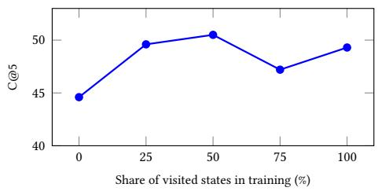  
Figure 5: Mixing ratio between gold and visited states on MuSiQue, all trained with the same seed; 0% is teacher forcing on gold states.

## D HippoRAG 2 on Reduced Corpora

HippoRAG 2 and G-Retriever are run on a reduced corpus for each long-chain benchmark, a simpler setting than the full corpora. It contains all gold passages and the top 100 passages ofevery question under the frozen encoder (27,744 passages for HotpotQA-Long and 19,257 for 2Wiki-Long). HippoRAG 2 uses deepseek-flash for extraction and filtering, and the other retrievers are re-evaluated on the same corpora. Table 6 reports the results. The triple filter keeps no fact for 87 HotpotQA-Long and 48 2Wiki-Long questions, for which HippoRAG 2 falls back to dense retrieval; on chains of three to five hops, a single round of fact retrieval rarely reaches the later passages.

Table 6: Results on the reduced corpora (R@10 / C@10); ours is the five-seed mean of Table 1.
<table><tr><td>Method</td><td>HotpotQA-Long</td><td>2Wiki-Long</td></tr><tr><td>Dense</td><td>31.9 / 1.0</td><td>34.5 / 2.0</td></tr><tr><td>HippoRAG 2</td><td>33.4 / 1.3</td><td>35.7 / 2.3</td></tr><tr><td>On-policy state training</td><td>64.2 / 38.6</td><td>69.2 / 36.8</td></tr></table>

## E Long-Chain Benchmarks

## E.1 Chains

2Wiki-Long uses the evidence triples of 2WikiMultiHopQA as a graph over Wikidata entities, keeping only functional relations so that every hop has a single answer. Chains are paths of three to five hops in which every hop is supported by the paragraph of its subject entity, no entity repeats, and degenerate relation pairs (for example, the spouse of a mother) are excluded. Comparison questions map three or four entities through one relation to a person and then to a date, and ask which entity’s related person has the earliest or latest date. HotpotQA-Long starts from the two pages of an original bridge question and follows hyperlinks in the 2017 Wikipedia abstracts to reach three, four or five pages. Hops go only to named-entity pages with in-degree at most 300, through sentences with fewer than five links.

## E.2 Questions and Filters

A language model (deepseek-flash) writes one question per chain. The question may name only the starting entity, or the compared entities, and uses every relation in order. A question is kept only if it names no intermediate entity or answer, is answered correctly from the shufled gold passages, is judged to have a unique answer, and is rated 4 or 5 for naturalness, all judged by the same model. A model of a diferent family (gpt-5.4-mini) then re-checks answerability and uniqueness; 62% of the 2Wiki-Long pool and 98% of the HotpotQA-Long pool pass. Questions whose final gold passage (for comparisons, all gold passages) appears in the top 10 of question-only BM25 over the final corpus are removed. Genealogy questions are capped at 40% of 2Wiki-Long, and question types are sampled evenly. HotpotQA-Long has 100 test questions each of three, four and five hops; 2Wiki-Long has 170, 45 and 12 chains of three, four and five hops and 73 comparison questions. The prompts are released with the benchmarks. Without passages, the reader of Section 5.2 answers 14.3% of the HotpotQA-Long and 14.7% of the 2Wiki-Long test questions, so the benchmarks require retrieval. Table 7 shows one test question of four types.

## E.3 Corpora

Each corpus contains every gold passage of the candidate pool, then the BM25 nearest neighbors of each gold passage, taken roundrobin over gold passages, then random passages from the source collection. HotpotQA-Long has 554,812 passages, of which 328,648 are nearest neighbors; 2Wiki-Long has 220,000 passages, of which 95,880 are nearest neighbors. A development split of 100 questions per benchmark is built with the same construction. Test questions come from both original splits of the source datasets, which is possible because the benchmarks are used only for evaluation.

## F Additional Results

## F.1 Question Answering

Table 8 extends Table 2 with teacher forcing on the same encoder and with a second reader, qwen-flash, under the same prompt. The passages of on-policy state training give 5.5 more EM and 5.7 more F1 than those of teacher forcing with deepseek-flash, and 2.5 and 3.5 more with qwen-flash. The ranking of the retrievers is the same under both readers.

## F.2 Cost

Training adds a roll-in per epoch to teacher forcing: collecting D�� takes � query encodings and nearest-neighbor searches per training question, plus one negative lookup per sampled state, and no passage is re-encoded. The first-epoch roll-in uses a teacherforced encoder, so the full pipeline costs one teacher-forced training run more than teacher forcing alone. Teacher forcing trains for 10 epochs in 37 minutes; on-policy state training stops early after 7 epochs and takes 60 minutes, 32 of them for the roll-ins. Both regimes schedule the same 2,940 optimizer steps. At test time the trained encoder runs the same greedy chain over the same index.

Table 7: Example test questions of the long-chain benchmarks with their gold chains.
<table><tr><td>Type</td><td>Question (answer)</td><td>Gold passages in chain order</td></tr><tr><td>HotpotQA-Long, 3 hops</td><td>Who voices the title character of the animated television series that features Kuvira as a fictional character? (Janet Varney)</td><td>Kuvira → The Legend of Korra → Korra</td></tr><tr><td>HotpotQA-Long, 5 hops</td><td>Hagen Site sits in a county whose seat was headquarters for a rail division that reached a town on a river; how long is that river? (692 mi)</td><td>Hagen Site → Dawson County, Montana → Glendive, Mon- tana → Livingston, Montana → Yellowstone River</td></tr><tr><td>2Wiki-Long, hops</td><td>Where was the father of the maternal grandmother of Prince Andrew of Greece and Denmark born? (Hildburghausen)</td><td>Prince Andrew of Greece and Denmark → Olga Constanti- novna of Russia → Princess Alexandra of Saxe-Altenburg</td></tr><tr><td>2Wiki-Long,</td><td>Among The Lambeth Walk, Dikshul, and Ezhu Rathrikal, which entity</td><td>→ Joseph, Duke of Saxe-Altenburg The Lambeth Walk, Noel Gay, Dikshul, Pankaj Mullick, Ezhu</td></tr><tr><td></td><td></td><td></td></tr><tr><td>comparison</td><td>has the composer with the latest date of death? (Ezhu Rathrikal)</td><td>Rathrikal, Salil Chowdhury</td></tr></table>

Table 8: Question answering on MuSiQue with two readers; trained retrievers use the same seed.
<table><tr><td rowspan="2">Passages from</td><td colspan="2">deepseek-flash</td><td colspan="2">qwen-flash</td></tr><tr><td>EM</td><td>F1</td><td>EM</td><td>F1</td></tr><tr><td>Dense</td><td>25.9</td><td>36.3</td><td>18.8</td><td>28.8</td></tr><tr><td>G-Retriever</td><td>21.2</td><td>29.2</td><td>15.7</td><td>24.3</td></tr><tr><td>HippoRAG 2</td><td>28.2</td><td>39.4</td><td>21.3</td><td>30.8</td></tr><tr><td>LinearRAG</td><td>22.3</td><td>30.5</td><td>17.3</td><td>26.0</td></tr><tr><td>Q-RAG</td><td>32.4</td><td>42.0</td><td>25.5</td><td>35.4</td></tr><tr><td>Search-R1</td><td>35.5</td><td>44.8</td><td>27.7</td><td>37.2</td></tr><tr><td>Teacher forcing</td><td>38.6</td><td>48.0</td><td>29.8</td><td>40.0</td></tr><tr><td>On-policy state training</td><td>44.1</td><td>53.7</td><td>32.3</td><td>43.5</td></tr></table>

Table 9 compares the cost of retrieval on MuSiQue. Our retriever adds 4.6M trained parameters to the 0.6B encoder, calls no language model and needs only the passage embeddings as a dense index; one question takes 0.10 s for four chain steps. The graph-based systems call a language model over every passage to build their index, and Search-R1 runs a 7B language model for about four generation turns per question.

Table 9: Cost of retrieval on MuSiQue (11,656 passages).
<table><tr><td>Method</td><td>Parameters</td><td>LLM calls / question</td><td>Index</td></tr><tr><td>BM25</td><td></td><td>0</td><td>inverted</td></tr><tr><td>Dense</td><td>0.6B</td><td>0</td><td>dense</td></tr><tr><td>G-Retriever</td><td>0.6B</td><td>0</td><td>LLM graph</td></tr><tr><td>HippoRAG 2</td><td>0.6B + LLM</td><td>1</td><td>LLM graph</td></tr><tr><td>LinearRAG</td><td>0.6B + NER</td><td>0</td><td>entity graph</td></tr><tr><td>MDR</td><td>0.25B</td><td>0</td><td>dense</td></tr><tr><td>Q-RAG</td><td>1.1B</td><td>0</td><td>dense</td></tr><tr><td>Search-R1</td><td>7.6B + 0.6B</td><td>4.0</td><td>dense</td></tr><tr><td>Ours</td><td>0.6B</td><td>0</td><td>dense</td></tr></table>

Building the HippoRAG 2 and G-Retriever graphs takes 23.3k language model calls with 14.6M tokens on MuSiQue. Dense retrieves a question in 0.017 s and our retriever in 0.104 s.

## F.3 Beam Decoding

Beam decoding is a cheaper way to recover from an early mistake, so we decode both matched encoders with beams oftwo and four. Each beam is a partial chain scored by the sum of its similarities; at every step each beam expands its top candidates, the best partial chains are kept, and the passages of the best final chain are ranked first, followed by the maximum score of every passage over all encoded states. A beam of one is greedy decoding. Table 10 shows that beams improve teacher forcing by two to three points of complete coverage but leave a gap of four to six points, and that the greedy on-policy retriever outperforms the teacher-forced one with a beam of four, which encodes three times as many queries. Both encoders are those of Table 3; the re-encoded index moves greedy C@10 on HotpotQA-Long by one question.

Table 10: Greedy and beam decoding with the matched encoders of the same seed (queries encoded per question; TF is teacher forcing).
<table><tr><td colspan="4">MuSiQue (C@5)</td><td colspan="3">HotpotQA-Long (C@10)</td></tr><tr><td>Decoding Queries</td><td></td><td>TF</td><td>Ours</td><td>Queries</td><td>TF</td><td>Ours</td></tr><tr><td>Greedy</td><td>4</td><td>44.6</td><td>50.5</td><td>8</td><td>22.7</td><td>28.3</td></tr><tr><td>Beam 2</td><td>7</td><td>46.4</td><td>50.6</td><td>15</td><td>25.7</td><td>29.7</td></tr><tr><td>Beam 4</td><td>13</td><td>46.3</td><td>50.7</td><td>29</td><td>24.3</td><td>30.3</td></tr></table>

## F.4 Recovery on the Long-Chain Benchmarks

Table 11 repeats the fixed-state probe of Figure 3(b) on the states of the teacher-forced chains of the long-chain benchmarks (� = 8). As on MuSiQue, the three encoders are close when the history is clean, and the on-policy encoder succeeds about twice as often once the history holds two or more wrong passages.

## F.5 Error Propagation

Figure 6 follows the 482 three- and four-hop MuSiQue questions along each retriever’s own chain. After a step that retrieves a nongold passage, the next step retrieves a missing gold passage in 23.0% of the cases under teacher forcing and in 33.7% under on-policy

Table 11: Next-step success on the teacher-forced states of the long-chain benchmarks; all encoders use the same seed.
<table><tr><td></td><td colspan="3">HotpotQA-Long</td><td colspan="3">2Wiki-Long</td></tr><tr><td>Wrong passages</td><td>0</td><td>1</td><td>2+</td><td>0</td><td>1</td><td>2+</td></tr><tr><td>Teacher forcing</td><td>56.0</td><td>25.1</td><td>7.4</td><td>68.2</td><td>22.3</td><td>8.1</td></tr><tr><td>w/o refresh</td><td>55.8</td><td>31.1</td><td>14.3</td><td>70.3</td><td>26.9</td><td>20.5</td></tr><tr><td>On-policy state training</td><td>55.2</td><td>31.7</td><td>16.7</td><td>74.1</td><td>36.9</td><td>21.0</td></tr></table>

state training, and the chain is complete after four steps for 68 and 87 questions.

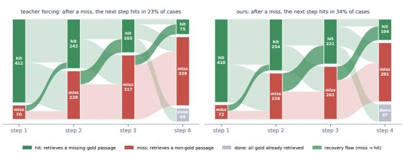  
Figure 6: Step-by-step outcomes on three- and four-hop MuSiQue questions (shared seed); dark bands are recoveries from a miss to a hit.

## F.6 Where Contaminated Queries Point

On the 1,358 contaminated states (Figure 7; shared seed), the query is closer to the target than to the wrong passage in its history in 20.3% of the states for teacher forcing and in 30.6% for on-policy state training.

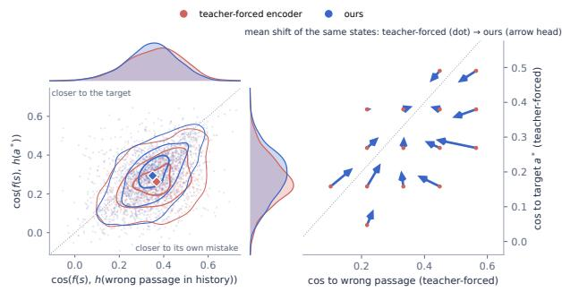  
Figure 7: Cosine of contaminated queries to the wrong passage in their history and to the target.