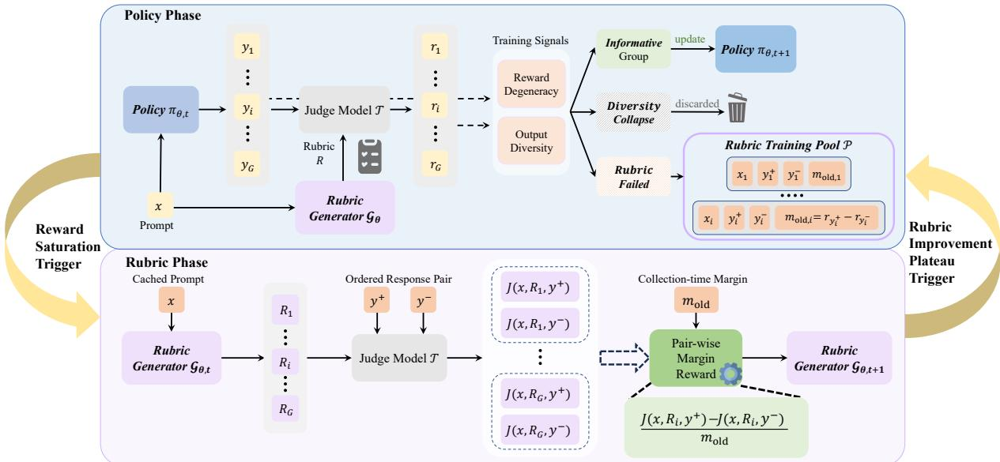
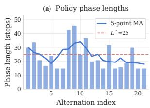
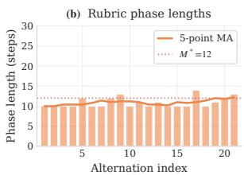

# Reward-Adaptive Co-Evolution of Policy and Rubric

Yizhu Chen1, 2, Jianguang Jiang2, Jiameng Huang1, Chuyu Fang2, Bojun Zhang2, 3, Zhenyu Jiao2, Xing Yuan2, Tong Lin1,†

1Peking University 2Baidu Inc. 3Institute of Automation, Chinese Academy of Sciences.

†Corresponding author: lintong@pku.edu.cn

## Abstract

Rubric-based rewards provide fine-grained, interpretable supervision for open-ended reinforcement learning, where holistic scalar rewards struggle to capture multidimensional response quality. Static rubrics can lose discriminative power as the policy distribution evolves, while existing policy–rubric coevolution methods rely on globally prescribed update schedules that ignore heterogeneous reward informativeness. We introduce RACE, a Reward-Adaptive Co-Evolution framework. At the group level, per-rollout-group trainingsignal routing classifies groups as informative, diversity-collapsed, or rubric-failed, updating the policy only with informative groups while caching rubric failures. At the phase level, event-triggered phase switching enters rubric optimization upon persistent reward saturation and returns when rubric-reward improvement plateaus. Rubric phases train the generator on cached pairs using a frozen judge and a scalenormalized pairwise-margin reward. Across both levels, online threshold adaptation adjusts routing and switching thresholds through proportional control. Under a unified evaluation protocol, RACE achieves the highest average performance and outperforms the strongest fixed-alternation baseline on all eight tasks, while improving rubric discrimination.

## 1 Introduction

Reinforcement learning (RL) has substantially improved large language model alignment (Schulman et al., 2017; Ouyang et al., 2022; Shao et al., 2024), yet open-ended tasks remain challenging due to the limitations of scalar rewards in capturing multidimensional quality (Gao et al., 2023). Rubric-based rewards address this issue with fine-grained, interpretable criteria (Liu et al., 2026b; Huang et al., 2025; Zhang et al., 2026; Shen et al., 2026). However, existing methods often rely on static rubrics or fixed generators, which may lose alignment and discriminative power as policies evolve (Gunjal et al., 2025; Shen et al., 2026; Viswanathan et al., 2025; Liu et al., 2026a).

Rather than keeping rubrics fixed, policy–rubric co-evolution updates the policy and rubric generator in tandem, allowing each to adapt to changes induced by the other (Li et al., 2026). Existing approaches realize this idea through joint optimization within a single model (Sheng et al., 2026), fixed-schedule alternation between policy and rubric phases (Li et al., 2026), or adversarial interaction at each training step (Ding et al., 2026). However, these methods rely on globally prescribed update schedules and ignore promptlevel reward informativeness. Because reward degeneracy is heterogeneous, some rollout groups receive nearly identical rewards as the policy improves, causing normalized advantages to vanish (advantage collapse) (He et al., 2026). Uniform updates therefore waste policy compute on collapsed groups and rubric compute on adaptations that may be premature, delayed, or unnecessary.

To address this limitation, we introduce RACE, a Reward-Adaptive Co-Evolution framework that coordinates policy and rubric optimization according to reward informativeness. RACE has three components. First, per-rollout-group trainingsignal routing uses reward discrimination and response diversity to route informative groups to policy optimization, cache rubric failures for rubric generator optimization, and mask diversitycollapsed groups from policy updates. Second, event-triggered phase switching enters rubric optimization when reward saturation persists and returns to policy optimization when rubric-reward improvement plateaus, replacing fixed alternation with state-dependent transitions. Third, the rubric generator is optimized on cached failure pairs using a frozen judge and a scale-normalized pairwisemargin reward, encouraging rubrics that restore discrimination where the current reward signal is insufficient. Online threshold adaptation adjusts the routing and phase-switching thresholds in response to evolving training dynamics. Together, these mechanisms route updates at both the rolloutgroup and phase levels, allowing the policy to learn only from informative rewards while adapting the rubric only where and when needed.

Empirically, under a unified evaluation protocol spanning mathematics, code generation, reasoning, knowledge, and instruction following, RACE achieves the best average downstream performance among compared methods. It also improves rubric discrimination over the strongest fixed-length alternation baseline on JudgeBench and RewardBench2 with fewer optimization steps. Further analyses show that RACE produces more specific, verifiable criteria and reduces policy-phase advantage collapse, demonstrating the effectiveness of adapting rubric supervision to evolving policies.

## 2 Related Works

## 2.1 Rubric-Based Reinforcement Learning

Open-ended tasks require multidimensional evaluation beyond binary correctness. Reinforcement Learning with Rubric Rewards (RLRR) decomposes response quality into explicit criteria and uses rubric-conditioned judgments as training rewards (Gunjal et al., 2025; Chen et al., 2026). It has shown promise in science and healthcare (Gunjal et al., 2025), instruction following (Huang et al., 2025; Viswanathan et al., 2025; He et al., 2025), and agentic tasks (Team et al., 2025).

Most RLRR methods rely on rubrics constructed independently of policy training. Prompted generation elicits rubrics from off-the-shelf teacher models (Gunjal et al., 2025; Shen et al., 2026; Jia et al., 2026), inheriting their capability and inference cost. Supervised rubric generation instead learns rubricrelated components from preference labels, correctness signals, or human annotations (Sheng et al., 2026; Xu et al., 2026; He et al., 2025), shifting the supervision bottleneck to external signals. Because these rubrics or generators are typically fixed during policy optimization, they cannot adapt to changes in the policy distribution. Motivated by the discriminative view of rubric quality (Li et al., 2026), we instead co-evolve the policy and rubric generator and allocate their updates according to observed reward informativeness.

## 2.2 Self-Evolving LLMs

Self-evolving LLMs and agents update their behavioral policies using their own trajectories, selfgenerated data, or feedback signals, enabling experience-dependent improvement (Gao et al., 2025; Fang et al., 2025; Tao et al., 2024).

Recent work extends self-evolution from scalar feedback to explicit natural-language rubrics. Existing methods use predefined coupling schemes: shared-parameter joint optimization in RLCER (Sheng et al., 2026), alternating generator–judge optimization in Rubric-ARM (Xu et al., 2026), fixed-length policy–rubric phases in EvoLM (Li et al., 2026), and per-step dual-adapter updates in EvoRubrics (Ding et al., 2026). Several methods also rely on external supervision or verification, including preference labels in Rubric-ARM, expert annotations in RIFL (He et al., 2025), external validators in RLAC (Wu et al., 2025) and repeated external API calls for EvoRubrics’ per-step rubric–judge interaction. Despite these differences, their update allocation is globally prescribed and does not account for rollout-group reward informativeness. Our method instead combines per-rolloutgroup training-signal routing with event-triggered phase switching, updating the policy only on informative groups and adjusting rubric optimization only when reward discrimination fails, without relying on external labels or task-specific verifiers.

## 3 Preliminary

Rubric-Based Reward. Given an input $x ,$ a rubric generator $\mathcal { G }$ produces

$$
R _ { x } \sim { \mathcal { G } } ( \cdot \mid x ) , \qquad R _ { x } = \{ ( c _ { k } , w _ { k } ) \} _ { k = 1 } ^ { K } ,\tag{1}
$$

where $c _ { k }$ and $w _ { k }$ denote the k-th evaluation criterion and its weight. Let $\mathcal { I }$ denote the judge model, and let $J ( x , y ; R )$ denote the scalar score it assigns to response y for prompt x under rubric R. Given a policy response $y \sim \pi _ { \boldsymbol { \theta } } ( \cdot \mid x )$ , implicit aggregation (Gunjal et al., 2025) yields

$$
S _ { \mathrm { p o l i c y } } ( x , y ) = J ( x , y ; R _ { x } ) ,\tag{2}
$$

avoiding separate judge calls for individual criteria while retaining structured supervision.

Group Relative Policy Optimization. For each prompt x, the policy samples G responses $\{ y _ { i } \} _ { i = 1 } ^ { G }$ yielding rewards $r _ { i } = S _ { \mathrm { p o l i c y } } ( x , y _ { i } )$ and the reward vector $\mathbf { r } = \left( r _ { 1 } , \ldots , r _ { G } \right)$ . The group-normalized advantage for response $y _ { i }$ is

$$
A _ { i } = \frac { r _ { i } - \mu ( \mathbf { r } ) } { \sigma ( \mathbf { r } ) + \epsilon } ,\tag{3}
$$

where $\mu ( \mathbf { r } )$ and $\sigma ( \mathbf { r } )$ denote the within-group mean and standard deviation of the rewards, respectively, and $\epsilon > 0$ ensures numerical stability. The policy is optimized by minimizing the negative clipped surrogate objective (Shao et al., 2024):

$$
\begin{array} { r } { \mathcal { L } _ { \mathrm { G R P O } } ( \boldsymbol { \theta } ) = - \frac { 1 } { G } \sum _ { i = 1 } ^ { G } \frac { 1 } { | y _ { i } | } \sum _ { t = 1 } ^ { | y _ { i } | } \left[ \hat { A } _ { i , t } - \beta D _ { \mathrm { K L } } ^ { i , t } \left( \pi _ { \boldsymbol { \theta } } \parallel \boldsymbol { \pi } _ { \mathrm { r e f } } \right) \right] , } \end{array}\tag{4}
$$

where the clipped advantage term is $\begin{array} { r l } { \hat { A } _ { i , t } } & { { } = } \end{array}$ min $( \rho _ { i , t } A _ { i }$ clip(ρi,t, 1−ϵc, 1+ϵc) Ai, ρi,t = $\pi _ { \boldsymbol { \theta } } ( y _ { i , t } \mid x , y _ { i , < t } ) / \pi _ { \boldsymbol { \theta } _ { \mathrm { o l d } } } ( y _ { i , t } \mid x , y _ { i , < t } )$ is the importance sampling ratio, and $D _ { \mathrm { K L } } ^ { i , t }$ is the token-level KL penalty against $\pi _ { \mathrm { r e f } }$ , weighted by $\beta \geq 0$ . The rubric generator is also optimized by GRPO, with the rubric-phase reward in Eq. 16.

## 4 Advantage Collapse under Fixed-Length Policy–Rubric Alternation

GRPO relies on within-group reward differences. If all rollouts receive the same reward, their normalized advantages become zero (Eq. 3), and the prompt contributes no policy gradient—a failure mode known as advantage collapse (He et al., 2026). We investigate whether this issue arises under fixed-length policy–rubric alternation.

Setup. Following EvoLM (Li et al., 2026), we train a shared Qwen3-8B model (Yang et al., 2025) with fixed-length policy and rubric phases, both optimized with GRPO. We assess rubric characteristics and advantage collapse at steps 200, 400, 600, 800, and 1,000, and evaluate downstream performance at steps 500 and 1,000.

At each checkpoint, we evaluate 100 fixed prompts and report the fraction of rollout groups with exact advantage collapse, defined by zero reward standard deviation $( { \boldsymbol { \sigma } } ( \mathbf { r } ) = 0 )$ . We also report JSON validity and the label-only ratio (the fraction of criteria with at most 40 characters), a proxy for short, underspecified labels. Gemini 3.5 Flash assesses semantic redundancy by identifying rubrics containing a criterion pair such that satisfying one substantially implies satisfying the other.

Observations. Table 1 reveals a mismatch between rubric quality and reward discrimination. From steps 200 to 1000, JSON validity falls from

<table><tr><td>Step</td><td>Valid.(%)</td><td>Label (%)</td><td>Redund.(%) σ = 0 (%)</td></tr><tr><td>200</td><td>70</td><td>9</td><td>28 32</td></tr><tr><td>400</td><td>87</td><td>4</td><td>16 27</td></tr><tr><td>600</td><td>99</td><td>5</td><td>23 27</td></tr><tr><td>800</td><td>95</td><td>10</td><td>21 29</td></tr><tr><td>1000</td><td>82</td><td>12</td><td>23 44</td></tr></table>

Table 1: Rubric analysis under fixed-length alternation.
<table><tr><td>Step</td><td>GSM8K MMLU IFEval PopQA GPQA Avg.</td><td></td><td></td><td></td><td></td><td></td></tr><tr><td>500</td><td>95.8</td><td>85.1</td><td>38.6</td><td>30.7</td><td>53.6</td><td>60.8</td></tr><tr><td>1000</td><td>95.5</td><td>85.6</td><td>38.8</td><td>31.2</td><td>54.0</td><td>61.0</td></tr></table>

Table 2: Downstream performance.

70% to 82%. Also, semantic redundancy persists, and advantage collapse remains at 27–32% through step 800 before rising to 44% at step 1000. Thus, improved rubric quality does not necessarily yield more informative rewards as the policy evolves. Likewise, Table 2 shows only a marginal increase in average score from 60.8 to 61.0.

Implications. Low reward variation may stem from either poor rubric discrimination or homogeneous policy outputs. Fixed-length alternation cannot distinguish these cases and thus cannot allocate updates accordingly.

## 5 Method

Figure 1 illustrates the overall framework of RACE. A single model with shared parameters θ serves alternately as the policy $\pi _ { \theta }$ and the rubric generator $\mathcal { G } _ { \theta }$ , with both roles optimized by GRPO under phase-specific rewards. The framework operates at three levels. At the rollout-group level, trainingsignal routing retains informative groups for policy optimization and stores rubric-failed cases in a FIFO pool $\mathcal { P } _ { \cdot }$ . At the phase level, event-triggered switching enters rubric optimization when reward saturation persists and returns to policy optimization when rubric improvement plateaus; during the rubric phase, candidate rubrics are trained on cached response pairs using a scale-normalized pairwise margin reward. Finally, projected proportional controllers adapt the routing and phaseswitching thresholds as training evolves. Algorithm 1 in App. A summarizes the full procedure.

## 5.1 Per-Rollout-Group Training-Signal Routing

Rollout groups vary in reward informativeness, and low reward variation may arise from either homogeneous policy responses or insufficient rubric discrimination. To distinguish these, RACE assigns each group to one of three modes using its G responses and reward vector $\mathbf { r } = \{ r _ { i } \} _ { i = 1 } ^ { G }$ . Informative groups update the policy; diversity-collapsed groups are masked from the policy loss; and rubricfailed groups are masked and cached in a FIFO pool $\mathcal { P }$ as targeted training data for subsequent rubric generator optimization.

Figure 1: Framework overview of RACE. A shared model parameterized by θ alternates between the policy $\pi _ { \theta }$ and rubric generator $\mathcal { G } _ { \theta }$ . During the policy phase, $\pi _ { \theta }$ samples $\{ y _ { i } \} _ { i = 1 } ^ { G }$ for prompt x, and the frozen judge $\mathcal { I }$ scores them under the prompt-specific rubric R via Eq. 2. Per-rollout-group training-signal routing uses informative groups to update the policy, masks diversity-collapsed groups, and caches rubric-failed entries $( x , y ^ { + } , y ^ { - } , m _ { \mathrm { o l d } } )$ in $\mathcal { P } _ { \cdot }$ . During the rubric phase, $\mathcal { G } _ { \theta }$ samples candidate rubrics $\{ R _ { i } \} _ { i = 1 } ^ { G }$ for each cached entry, each evaluated on the same pair $( y ^ { + } , y ^ { - } )$ using the scale-normalized pairwise-margin reward in Eq. 16. Event-triggered phase switching moves to rubric optimization upon persistent reward saturation and back upon a rubric-reward plateau.
<table><tr><td>Mode</td><td>Condition</td><td>Action</td></tr><tr><td></td><td>Diversity-collapsed Low surface/semantic diversity Mask</td><td></td></tr><tr><td>Rubric-failed</td><td>Degenerate; otherwise</td><td>Mask; add to P</td></tr><tr><td>Informative</td><td>Discriminative</td><td>standard GRPO</td></tr></table>

Table 3: Per-rollout-group training-signal routing.

Routing Statistics. For each rollout group, we measure reward discrimination using the reward standard deviation $\sigma ( \mathbf { r } )$ and tie rate

$$
\tau _ { \mathrm { t i e } } ( \mathbf { r } ) = \frac { | \{ ( i , j ) : i < j , ~ | r _ { i } - r _ { j } | < \epsilon _ { \mathrm { t i e } } \} | } { G ( G - 1 ) / 2 } ,\tag{5}
$$

where $\epsilon _ { \mathrm { { t i e } } } \ > \ 0$ defines indistinguishable rewards. We measure surface-form diversity using the distinct-trigram ratio:

$$
d _ { \mathrm { t r i } } = \frac { | \mathcal { T } _ { \mathrm { u n i q u e } } | } { | \mathcal { T } _ { \mathrm { a l l } } | } ,\tag{6}
$$

where $\mathcal { T } _ { \mathrm { a l l } }$ is the multiset of all trigrams across the $G$ responses, and $\tau _ { \mathrm { u n i q u e } }$ is its set of unique trigrams. To approximate semantic diversity, we encode each response using a frozen encoder, with last-token pooling and $\ell _ { 2 }$ normalization:

$$
\begin{array} { r } { \mathbf { z } _ { i } = \frac { \mathcal { E } ( y _ { i } ) } { \| \mathcal { E } ( y _ { i } ) \| _ { 2 } } , \ d _ { \mathrm { e m b } } = \frac { 2 } { G ( G - 1 ) } \sum _ { i < j } \left( 1 - \mathbf { z } _ { i } ^ { \top } \mathbf { z } _ { j } \right) . } \end{array}\tag{7}
$$

Here, $d _ { \mathrm { e m b } }$ is the mean pairwise cosine distance within the rollout group.

We apply the routing rules in Table 3 sequentially. A group is first classified as rewarddegenerate when

$$
\sigma ( \mathbf { r } ) \leq \sigma _ { \mathrm { r t } } ^ { \star } \quad \mathrm { o r } \quad \tau _ { \mathrm { t i e } } ( \mathbf { r } ) \geq \tau _ { \mathrm { t i e } } ^ { \star } .\tag{8}
$$

A reward-degenerate group is diversity-collapsed if both surface and semantic diversity are low:

$$
d _ { \mathrm { t r i } } \leq d _ { \mathrm { t r i } } ^ { \star } \wedge d _ { \mathrm { e m b } } \leq d _ { \mathrm { e m b } } ^ { \star } .\tag{9}
$$

Diversity-collapsed groups are filtered from policy optimization, while remaining reward-degenerate groups are labeled rubric-failed, filtered, and added to rubric training pool $\mathcal { P }$ for rubric-generator optimization, indicating weak rubric discrimination over varied responses. Non-degenerate groups are informative and proceed with standard GRPO.

All starred thresholds are initialized from statistics collected during the first 50 policy-training steps. The reward-side thresholds $\sigma _ { \mathrm { r t } } ^ { \star }$ and $\tau _ { \mathrm { t i e } } ^ { \star }$ are subsequently adapted online.

Rubric Training Pool. The FIFO pool $\mathcal { P }$ stores entries constructed from rubric-failed groups.

For a group with responses $\{ y _ { i } \} _ { i = 1 } ^ { G }$ , let $r _ { i } =$ $J ( x , y _ { i } ; R _ { \mathrm { o l d } } )$ denote the reward assigned using the collection-time rubric $R _ { \mathrm { o l d } }$ . We select

$$
i ^ { + } = \underset { i \in \{ 1 , . . . , G \} } { \arg \operatorname* { m a x } } r _ { i } , i ^ { - } = \underset { i \in \{ 1 , . . . , G \} \setminus \{ i ^ { + } \} } { \arg \operatorname* { m i n } } r _ { i } ,\tag{10}
$$

using a deterministic rule to break ties, and set $y ^ { + } = y _ { i ^ { + } }$ + and $y ^ { - } = y _ { i ^ { - } }$ . Each pool entry contains a prompt x, an ordered response pair $( y ^ { + } , y ^ { - } )$ , and its collection-time margin

$$
m _ { \mathrm { o l d } } = J ( x , y ^ { + } ; R _ { \mathrm { o l d } } ) - J ( x , y ^ { - } ; R _ { \mathrm { o l d } } ) ,\tag{11}
$$

The cached margin supports Eq. 16 without reevaluating the old rubric, while $\mathcal { P }$ focuses rubric optimization on prompts with weak collection-time reward discrimination.

## 5.2 Event-Triggered Phase Switching

As shown in Section 4, fixed-length alternation may continue policy optimization after rewards lose discrimination. RACE enters the rubric phase when reward saturation persists across rollout groups and returns when rubric improvement plateaus.

Policy → Rubric: Reward-Saturation Trigger. At policy step t, we measure the fraction of saturated rollout groups:

$$
\begin{array} { r } { f _ { \mathrm { s a t } } ^ { t } = \frac { 1 } { N _ { \mathrm { b a t c h } } } \sum _ { j = 1 } ^ { N _ { \mathrm { b a t c h } } } \mathcal { k } [ \sigma ( \mathbf { r } _ { j } ) \leq \sigma _ { \mathrm { s w } } ^ { \star } ~ \land ~ \mu ( \mathbf { r } _ { j } ) \geq \mu _ { \mathrm { s a t } } ] , } \end{array}\tag{12}
$$

where $N _ { \mathrm { b a t c h } }$ is the number of groups, $\mathbf { r } _ { j } = $ $( r _ { j , 1 } , \hdots , r _ { j , G } )$ denotes the $G$ rewards of group $j ,$ and $\sigma ( \cdot )$ and $\mu ( \cdot )$ represent reward variation and mean. The thresholds $\boldsymbol { \sigma } _ { \mathrm { s w } } ^ { \star }$ and $\mu _ { \mathrm { s a t } }$ specify low variation and high reward, respectively.

To smooth transient batch fluctuations, we maintain an exponential moving average (EMA):

$$
\begin{array} { r } { \hat { f } _ { \mathrm { s a t } } ^ { t } = \alpha f _ { \mathrm { s a t } } ^ { t } + ( 1 - \alpha ) \hat { f } _ { \mathrm { s a t } } ^ { t - 1 } , } \end{array}\tag{13}
$$

where $\alpha ~ \in ~ ( 0 , 1 )$ is the EMA smoothing factor. The controller enters the rubric phase when $\hat { f } _ { \mathrm { s a t } } ^ { t } \geq \tau _ { \mathrm { s a t } } ^ { \mathrm { P } }$ , where $\tau _ { \mathrm { s a t } } ^ { \mathrm { P } }$ is the phase-level saturationrate threshold. Thus, $\boldsymbol { \sigma } _ { \mathrm { s w } } ^ { \star }$ and $\mu _ { \mathrm { s a t } }$ identify saturation within each group, whereas $\tau _ { \mathrm { s a t } } ^ { \mathrm { P } }$ requires it to persist across batches before switching.

Rubric → Policy: Rubric-Improvement Plateau Trigger. During the rubric phase, we monitor whether optimization continues to yield meaningful reward gains. Let $\bar { r _ { t } }$ denote the mean rubric reward at step t. We measure the improvement between two consecutive windows of size $W \colon$

$$
\Delta _ { W } ^ { t } = \frac { 1 } { W } \sum _ { u = t - W + 1 } ^ { t } \bar { r } _ { u } - \frac { 1 } { W } \sum _ { u = t - 2 W + 1 } ^ { t - W } \bar { r } _ { u } .\tag{14}
$$

Once both windows are available, the controller returns to the policy phase when $\Delta _ { W } ^ { t } \leq \tau _ { \mathrm { i m p } } ^ { \mathrm { R } } ,$ , where $\tau _ { \mathrm { i m p } } ^ { \mathrm { R } }$ is the minimum reward improvement required to continue the rubric phase.

Rubric Generator Optimization. Given an entry $( x , y ^ { + } , y ^ { - } , m _ { \mathrm { o l d } } )$ sampled from rubric training pool $\mathcal { P }$ , the rubric generator $\mathcal { G } _ { \theta }$ samples a GRPO group of G candidate rubrics $\{ R _ { i } \} _ { i = 1 } ^ { G }$ , where $R _ { i } \sim$ $\mathcal { G } _ { \theta } ( \cdot \mid x )$ . All candidates are evaluated on the same ordered response pair. For each $R _ { i }$ , the frozen judge computes

$$
m _ { i } = J ( x , y ^ { + } ; R _ { i } ) - J ( x , y ^ { - } ; R _ { i } ) .\tag{15}
$$

The candidate receives the scale-normalized pairwise reward

$$
\begin{array} { r } { S _ { \mathrm { r u b r i c } } ( x , R _ { i } ) = \mathrm { c l i p } \Big ( \frac { m _ { i } } { \mathrm { m a x } ( | m _ { \mathrm { o l d } } | , \epsilon _ { \mathrm { n o r m } } ) } , - c , c \Big ) . } \end{array}\tag{16}
$$

where $m _ { \mathrm { o l d } }$ is the cached historical margin defined in Eq. 11. The historical margin normalizes pairspecific reward scales, while a negative $m _ { i }$ penalizes reversal of the cached ordering. We set $\epsilon _ { \mathrm { n o r m } } = 0 . 0 5$ and $c = 1 . 0$ to stabilize normalization and bound the reward. The reward measures separation along the cached direction relative to its historical scale.

Phase-Specific GRPO Rewards. Both roles are optimized with the clipped GRPO objective in Eq. 4; only the reward function differs between phases:

$$
r _ { i } = \left\{ \begin{array} { l l } { S _ { \mathrm { p o l i c y } } ( x , y _ { i } ) , } & { \mathrm { d u r i n g ~ t h e ~ p o l i c y ~ p h a s e , } } \\ { S _ { \mathrm { r u b r i c } } ( x , R _ { i } ) , } & { \mathrm { d u r i n g ~ t h e ~ r u b r i c ~ p h a s e . } } \end{array} \right.\tag{17}
$$

Here, $i \in \{ 1 , \ldots , G \}$ indexes responses in the policy phase and candidate rubrics in the rubric phase. The corresponding rewards are defined in Eqs. 2 and 16, respectively.

## 5.3 Online Threshold Adaptation

As the policy and reward distributions evolve, fixed thresholds can become miscalibrated. We therefore adapt them online using two proportional controllers. The Target-Rate Quarantine Controller (TRQC) adapts $\sigma _ { \mathrm { r t } } ^ { \star }$ and $\tau _ { \mathrm { t i e } } ^ { \star }$ for rolloutgroup training-signal routing, while the Adaptive Phase-Switching Controller adjusts $\tau _ { \mathrm { s a t } } ^ { \mathrm { P } }$ and $\tau _ { \mathrm { i m p } } ^ { \mathrm { R } }$ for policy–rubric phase transitions.

Target-Rate Quarantine Controller. At policy step t, we measure the quarantine rate

$$
q ^ { t } = n _ { \mathrm { q u a r a n t i n e d } } ^ { t } / n _ { \mathrm { p r o c e s s e d } } ^ { t } ,\tag{18}
$$

where quarantine covers diversity-collapsed and rubric-failed groups, with target quarantine rate $q ^ { * }$

We maintain the smoothed tracking error

$$
\begin{array} { r } { \hat { q } ^ { t } = ( 1 - \alpha _ { q } ) \hat { q } ^ { ( t - 1 ) } + \alpha _ { q } q ^ { t } , e _ { q } ^ { t } = \frac { \hat { q } ^ { t } - q ^ { * } } { \operatorname* { m a x } ( q ^ { * } , \epsilon _ { q } ) } , } \end{array}\tag{19}
$$

where $\hat { q } ^ { ( 0 ) } = 0 , \alpha _ { q } \in ( 0 , 1 )$ is the smoothing factor, and $\epsilon _ { q } > 0$ ensures numerical stability. The routing thresholds are updated as

$$
\begin{array} { r l } & { \sigma _ { \mathrm { r t } } ^ { ( t + 1 ) } = \mathrm { c l i p } \big ( \sigma _ { \mathrm { r t } } ^ { t } - \eta _ { \sigma } e _ { q } ^ { t } , 0 , 1 \big ) , } \\ & { \tau _ { \mathrm { t i e } } ^ { ( t + 1 ) } = \mathrm { c l i p } \big ( \tau _ { \mathrm { t i e } } ^ { t } + \eta _ { \tau } e _ { q } ^ { t } , 0 , 1 \big ) , } \end{array}\tag{20}
$$

where $\eta _ { \sigma } , \eta _ { \tau } > 0$ are fixed controller gains. When $\hat { q } ^ { t } > q ^ { * }$ , the update makes quarantine more selective; it reverses direction when $\hat { q } ^ { t } < q ^ { * }$

Adaptive Phase-Switching Controller. We adapt the switching thresholds toward target policyand rubric-phase lengths $L ^ { * }$ and $M ^ { * }$ . Let $\bar { L } ^ { ( \dot { k } ) }$ and $\bar { M } ^ { ( k ) }$ denote the mean lengths of the most recent $W _ { \mathrm { P } }$ saturation-terminated policy phases and $W _ { \mathrm { R } }$ plateau-terminated rubric phases, respectively. Their normalized duration errors are

$$
e _ { \mathrm { P } } ^ { ( k ) } = \frac { \bar { L } ^ { ( k ) } - L ^ { * } } { L ^ { * } } , ~ e _ { \mathrm { R } } ^ { ( k ) } = \frac { \bar { M } ^ { ( k ) } - M ^ { * } } { M ^ { * } } .\tag{21}
$$

Once the corresponding window is available, we update

$$
\begin{array} { r l } & { \tau _ { \mathrm { s a t } } ^ { \mathrm { P } , ( k + 1 ) } = \Pi _ { \mathcal { T } _ { \mathrm { P } } } \left( \tau _ { \mathrm { s a t } } ^ { \mathrm { P } , ( k ) } - \eta _ { \tau } ^ { \mathrm { P } } e _ { \mathrm { P } } ^ { ( k ) } \right) , } \\ & { \tau _ { \mathrm { i m p } } ^ { \mathrm { R } , ( k + 1 ) } = \Pi _ { \mathcal { T } _ { \mathrm { R } } } \left( \tau _ { \mathrm { i m p } } ^ { \mathrm { R } , ( k ) } + \eta _ { \tau } ^ { \mathrm { R } } e _ { \mathrm { R } } ^ { ( k ) } \right) , } \end{array}\tag{22}
$$

where $\Pi _ { \mathcal { I } }$ projects a threshold onto its valid range. The opposite signs follow from the trigger definitions: each update makes switching more likely when the corresponding phase exceeds its target duration. The targets $L ^ { * }$ and $M ^ { * }$ serve as soft operating points rather than fixed phase lengths; transitions remain governed by reward saturation and rubric-reward improvement.

## 6 Experiments

## 6.1 Setup

Data. We draw training prompts from the Tulu 3 preference mixture (Lambert et al., 2024). After deduplication, the resulting 271K prompts cover dialogue, instruction following, mathematics, code, scientific literature, and persona-based synthesis. We use only the prompts, without reference responses or externally generated rubrics.

Implementation Details. Qwen3-8B (Yang et al., 2025) parameterizes both the policy π and rubric generator $\mathcal { G } _ { \theta }$ . The two roles share parameters and are optimized in alternating phases. Following Li et al. (2026), a frozen Qwen3-1.7B judge $\mathcal { I }$ provides rubric-based scores throughout training. Both roles are optimized with GRPO (Shao et al., 2024), using a learning rate of 10−6 and a KL coefficient of 0.001. Each policy batch contains $N _ { \mathrm { b a t c h } } = 6 4$ unique prompts with $G = 8$ responses per prompt. During rubric training, each GRPO group contains G candidate rubrics evaluated on same cached comparison set.

Downstream Policy Evaluation. Following the OLMo3-Adapt suite (Olmo et al., 2025), we evaluate mathematical reasoning on GSM8K (Cobbe et al., 2021); code generation on MBPP+ (Liu et al., 2023); general reasoning on BBH (Suzgun et al., 2023), GPQA (Rein et al., 2023), ZebraLogic (Lin et al., 2025), and AGI-Eval (Zhong et al., 2024) and knowledge on MMLU (Hendrycks et al., 2020) and PopQA (Mallen et al., 2023). For controlled comparison, all methods share the policy initialization, training data, frozen Qwen3-1.7B judge, and a budget of 500 policy updates.

## 6.2 Main Comparisons

We compare RACE with four baseline categories: (i) prompted rubrics, including GPT-4.1 prompted (a strong proprietary-teacher baseline) and Qwen3-8B prompted (matching our rubricgenerator backbone), both of which generate static rubrics via prompting to guide policy optimization; (ii) scalar reward modeling: Skywork-RM-V2; (iii) offline rubric generation: RaR (Gunjal et al., 2025), which generates rubrics with GPT-4.1, and RRD (Shen et al., 2026), which recursively refines and reweights rubric criteria; and (iv) policy– rubric co-evolution: RLCER (Sheng et al., 2026), which jointly optimizes shared-parameter reasoner and rubricator roles, Rubric-ARM (Xu et al., 2026), which alternates rubric-generator and judge updates using preference labels, and EvoLM (Li et al., 2026), which alternates between fixed 50-step policy and rubric phases.

Table 4 reports downstream policy performance on eight benchmarks. RACE achieves the highest unweighted arithmetic mean of 73.0 under this main-table protocol. It obtains the best results on GSM8K, MBPP+, BBH, MMLU, and PopQA, and ranks second on AGI-E. Compared with the strongest fixed-alternation baseline, EvoLM, RACE improves on all eight main-table benchmarks, with the largest gains on BBH (+4.7), PopQA (+3.3), and GPQA (+1.9). RACE also outperforms GPT-4.1- and Qwen3-8B-prompted rubrics by 2.0 and 2.9 points on average, respectively, and surpasses the scalar reward model by 9.5 points. These gains demonstrate the effectiveness of reward-adaptive policy–rubric co-evolution.

<table><tr><td>Method</td><td>GSM8K MBPP+ BBH MMLU PopQA GPQA Zebra AGI-E Avg</td><td></td><td></td><td></td><td></td><td></td><td></td><td></td><td></td></tr><tr><td>Prompted Rubrics Source</td><td></td><td></td><td></td><td></td><td></td><td></td><td></td><td></td><td></td></tr><tr><td>GPT-4.1</td><td>95.7</td><td>65.1</td><td>71.7</td><td>84.8</td><td>30.7</td><td>54.9</td><td>81.9</td><td>82.9</td><td>71.0</td></tr><tr><td>Qwen3-8B</td><td>95.5</td><td>58.4</td><td>66.8</td><td>83.4</td><td>31.7</td><td>56.9</td><td>84.3</td><td>83.9</td><td>70.1</td></tr><tr><td>Scalar Reward Model</td><td></td><td></td><td></td><td></td><td></td><td></td><td></td><td></td><td></td></tr><tr><td>Scalar RM (Skywork-RM-V2)</td><td>95.6</td><td>66.2</td><td>54.9</td><td>82.0</td><td>25.2</td><td>46.2</td><td>56.4</td><td>81.6</td><td>63.5</td></tr><tr><td>Offline Rubric Generation</td><td></td><td></td><td></td><td></td><td></td><td></td><td></td><td></td><td></td></tr><tr><td>RaR</td><td>95.7</td><td>68.6</td><td>62.5</td><td>84.8</td><td>32.2</td><td>52.5</td><td>84.1</td><td>87.3</td><td>71.0</td></tr><tr><td>RRD</td><td>95.3</td><td>59.2</td><td>69.4</td><td>84.8</td><td>32.6</td><td>56.0</td><td>82.6</td><td>88.9</td><td>71.1</td></tr><tr><td>Co-evolution Methods</td><td></td><td></td><td></td><td></td><td></td><td></td><td></td><td></td><td></td></tr><tr><td>RLCER</td><td>94.0</td><td>67.9</td><td>68.6</td><td>84.8</td><td>30.4</td><td>49.6</td><td>69.1</td><td>84.3</td><td>68.6</td></tr><tr><td>RUBRIC-ARM</td><td>95.6</td><td>62.3</td><td>64.4</td><td>83.8</td><td>32.8</td><td>56.9</td><td>83.1</td><td>87.2</td><td>70.8</td></tr><tr><td>EvoLM</td><td>95.8</td><td>68.5</td><td>67.6</td><td>85.3</td><td>30.5</td><td>54.2</td><td>82.3</td><td>86.4</td><td>71.3</td></tr><tr><td>RACE (ours)</td><td>95.9</td><td>68.7</td><td>72.3</td><td>86.1</td><td>33.8</td><td>56.1</td><td>83.9</td><td>87.5</td><td>73.0</td></tr></table>

Table 4: Downstream policy evaluation. Avg. is the unweighted mean; Bold and underlined values indicate the best and second-best results, respectively.
<table><tr><td colspan="4">JudgeBench</td></tr><tr><td></td><td>Method Know. Reason. Math Code Overall Avg.</td><td></td><td>Avg.</td></tr><tr><td>EvoLM RACE</td><td>31.8 36.7 26.8 33.1 37.8 28.6</td><td>33.3 32.6 32.2 40.5 34.6 35.0</td><td>57.9 62.2</td></tr><tr><td colspan="4">RewardBench2 GPT-5.4 Math Safety Focus Ties Avg. Avg.</td></tr><tr><td colspan="4">Method Fact. 1 IF</td></tr><tr><td colspan="3">EvoLM37.2 30.6 54.0 RACE</td></tr><tr><td colspan="3">43.5 54.4 56.1 46.0 42.9 34.3 60.2 41.6 58.3 58.1 49.2</td></tr></table>

Table 5: JudgeBench and RewardBench2 evaluations.
<table><tr><td colspan="2">Dimension Variant</td><td>RB2 Policy Avg.</td><td></td></tr><tr><td>Overall</td><td>RACE (full)</td><td>49.2</td><td>73.0</td></tr><tr><td rowspan="3">Routing</td><td>No Gradient Filtering</td><td>48.7</td><td>70.8</td></tr><tr><td>Uniform Rubric Sampling</td><td>47.9</td><td>71.4</td></tr><tr><td>Filter-only</td><td>45.1</td><td>70.9</td></tr><tr><td rowspan="2">Switching</td><td>Random Phase-Length Alternation 45.3</td><td></td><td>71.4</td></tr><tr><td>Fixed 50/50 Alternation + Routing 44.3</td><td></td><td>71.3</td></tr><tr><td></td><td>Adaptation Static Thresholds</td><td>47.1</td><td>72.1</td></tr></table>

Table 6: Ablation study. RB2 and Policy Avg. denote the average performance on RewardBench2 and the eight main-table downstream benchmarks, respectively. Bold and underlined values indicate the best and secondbest results in each column.

IFEval is reported separately in App. G. We avoid direct comparison with EvoLM’s reported IFEval score because the default olmo3:adapt protocol evaluates the full Qwen3 completion, including the <think>...</think> preamble, where internal reasoning may trigger violations unrelated to the final response. When scoring only the final response, RACE achieves 78.2 versus 77.6 for reproduced EvoLM.

Beyond policy performance, Table 5 evaluates rubric discrimination on RewardBench2 (Malik et al., 2025) and JudgeBench (Tan et al., 2025) under the frozen Qwen3-1.7B judge. JudgeBench Avg. is the unweighted mean of its four domains (Knowledge, Reasoning, Math, and Coding), excluding the separately reported Overall score: 32.2 for EvoLM and 35.0 for RACE. On RewardBench2, the corresponding six-dimension averages are 46.0 and 49.2. The final column additionally reports the corresponding averages under GPT-5.4 judging, where RACE scores 62.2 versus 57.9 for EvoLM on JudgeBench and 65.7 versus 63.4 on Reward-Bench2. Thus, RACE shows stronger rubric discrimination under both judge settings. Comparisons with other methods are provided in App. C.

Rubric Evolution Over Training. To examine rubric evolution under RACE, we analyze criteria across math, emotional support, scientific explanation, and constrained writing. On 100 fixed prompts, we measure the proportions of label-only and specific criteria (containing concrete expected values), along with mean criterion length.

We find that RACE substantially reduces labelonly criteria from 20.9% to 9.9%, while increasing specificity from 10.1% to 18.0% and average criterion length from 56.9 to 62.6 characters. At convergence, it also surpasses EvoLM in label-only rate (9.9% vs. 11.8%) and specificity (18.0% vs. 14.5%).

These changes are consistent with rubrics becoming more concrete and potentially more useful for producing discriminative reward signals. Direct evidence from RewardBench2 and JudgeBench is reported above. Details and analyses of rubric evolution and reward behavior are provided in App. D.

Notably, advantage collapse persists under RACE but shows no sustained increase during training. In later stages of training, the collapse rate remains between 22.4% and 24.6%, with an overall rate of 24.5%. For context, the fixed-length alternation analysis of EvoLM in Sec. 4 reports rates of 27–32% through step 800, rising to 44% at step 1,000. Further analysis in App. D.5 shows that advantage collapse is predominantly associated with high-score saturation.

## 6.3 Ablation Study

Table 6 ablates three components of RACE: perrollout-group training-signal routing (routing), event-triggered phase switching (switching), and online threshold adaptation (adaptation), reporting RewardBench2 (RB2) and average policy performance over eight downstream benchmarks.

Per-Rollout-Group Routing. As described in Section 5.1, routing filters uninformative groups from policy updates and stores rubric-failed groups in the targeted rubric pool P. No Gradient Filtering retains P but updates the policy with all groups, whereas Uniform Rubric Sampling retains filtering but replaces P with uniformly sampled data. Removing filtering lowers Policy Avg. from 73.0 to 70.8, while uniform sampling lowers RB2 from 49.2 to 47.9. The Filter-only variant retains alternating policy and rubric optimization but replaces adaptive routing with an advantage-collapse filter alone, reducing Policy Avg. to 70.9. These results show that both group filtering and targeted rubric training contribute to the full method’s gains.

Event-Triggered Phase Switching. Replacing reward-dependent transitions with random or fixed alternation lowers policy performance to 71.4 and 71.3 and RB2 to 45.3 and 44.3, respectively. These are the largest RB2 degradations, showing that routing alone is insufficient and that aligning phase transitions with reward state is critical for maintaining discriminative rubrics.

Online Threshold Adaptation. Static Thresholds fixes both routing and switching thresholds at their initial values. This variant remains competitive on several individual benchmarks but reduces the average policy score to 72.1 and RB2 to 47.1. Thus, online calibration provides a modest aggregate improvement, complementing the larger gains from routing and event-triggered switching. Target sensitivity is reported in App. F.

  
Figure 2: Phase-length dynamics. Policy (a) and rubric (b) phase lengths across successive alternations; solid curves denote 5-point moving averages (MA), and dashed horizontal lines mark the target lengths $L ^ { * } = 2 5$ and $M ^ { * } = 1 2$ , respectively.

## 6.4 Training Dynamics

Figure 2 shows that the policy-phase moving average rises during mid-training and subsequently declines, with the mean phase length decreasing from 27.0 steps in the first half to 21.4 in the second. This suggests that reward saturation is reached earlier as the policy improves, prompting more frequent rubric recalibration. Meanwhile, rubric phases remain compact and close to the target $M ^ { * } = 1 2$ . Together, these dynamics show that event-triggered switching reallocates optimization effort according to reward informativeness while avoiding unnecessary rubric updates; perstep model-call counts for policy and rubric updates are detailed in App. E.

## 7 Conclusion

We identify heterogeneous reward-discriminability degradation as a key bottleneck in policy–rubric co-evolution: some rollout groups experience advantage collapse while others remain informative. To address this, we introduce RACE, combining group-level signal routing, event-triggered phase switching, and online threshold adaptation. RACE achieves the highest average performance and outperforms the strongest fixed-alternation baseline. These gains are achieved with a single frozen judge, without task-specific verifiers or preference-labeled online rewards, and with fewer optimization updates than fixed-alternation training. Overall, these results demonstrate the effectiveness of rewardadaptive policy–rubric co-evolution.

## Limitations

Due to computational constraints, our experiments focus on a shared Qwen3-8B policy–rubric backbone trained with a frozen Qwen3-1.7B judge. Although we additionally evaluate rubric discrimination with another judge, the generalizability of our training framework to other model families, scales, and judges remains to be explored.

Finally, our downstream evaluation focuses on single-turn benchmarks covering reasoning, knowledge, and code generation. Extending rewardadaptive co-evolution to multilingual, multi-turn, and long-horizon settings is a promising direction for future work.

## References

Hao Chen, Ziyu Han, Yukun Yan, Qingfu Zhu, Maosong Sun, and Wanxiang Che. 2026. From holistic evaluation to structured criteria: Rubrics across the evolving llm landscape. arXiv preprint arXiv:2606.08625.

Karl Cobbe, Vineet Kosaraju, Mohammad Bavarian, Mark Chen, Heewoo Jun, Lukasz Kaiser, Matthias Plappert, Jerry Tworek, Jacob Hilton, Reiichiro Nakano, et al. 2021. Training verifiers to solve math word problems. arXiv preprint arXiv:2110.14168.

Hongxin Ding, Baixiang Huang, Yue Fang, Weibin Liao, Zheng Li, Jinyang Zhang, Zhijing Wu, Junfeng Zhao, and Yasha Wang. 2026. Evorubrics: Dynamic rubrics as rewards via adversarial co-evolution for llm reinforcement learning. arXiv preprint arXiv:2606.23038.

Jinyuan Fang, Yanwen Peng, Xi Zhang, Yingxu Wang, Xinhao Yi, Guibin Zhang, Yi Xu, Bin Wu, Siwei Liu, Zihao Li, et al. 2025. A comprehensive survey of self-evolving ai agents: A new paradigm bridg ing foundation models and lifelong agentic systems. arXiv preprint arXiv:2508.07407.

Huan-ang Gao, Jiayi Geng, Wenyue Hua, Mengkang Hu, Xinzhe Juan, Hongzhang Liu, Shilong Liu, Jiahao Qiu, Xuan Qi, Yiran Wu, et al. 2025. A survey of self-evolving agents: What, when, how, and where to evolve on the path to artificial super intelligence. arXiv preprint arXiv:2507.21046.

Leo Gao, John Schulman, and Jacob Hilton. 2023. Scaling laws for reward model overoptimization. In Proceedings of the 40th International Conference on Machine Learning, volume 202 of Proceedings of Machine Learning Research, pages 10835–10866. PMLR.

Anisha Gunjal, Anthony Wang, Elaine Lau, Vaskar Nath, Yunzhong He, Bing Liu, and Sean Hendryx. 2025. Rubrics as rewards: Reinforcement learning beyond verifiable domains. arXiv preprint arXiv:2507.17746.

Xixiang He, Qiyao Sun, Ao Cheng, Xingming Li, Xuanyu Ji, Hailun Lu, Runke Huang, and Qingyong Hu. 2026. Advantage collapse in group relative policy optimization: Diagnosis and mitigation. In International Conference on Machine Learning (ICML).

Yun He, Wenzhe Li, Hejia Zhang, Songlin Li, Karishma Mandyam, Sopan Khosla, Yuanhao Xiong, Nanshu Wang, Xiaoliang Peng, Beibin Li, Shengjie Bi, Shishir G. Patil, Qi Qi, Shengyu Feng, Julian Katz-Samuels, Richard Yuanzhe Pang, Sujan Gonugondla, Hunter Lang, Yue Yu, and 6 others. 2025. Advancedif: Rubric-based benchmarking and reinforcement learning for advancing llm instruction following. Preprint, arXiv:2511.10507.

Dan Hendrycks, Collin Burns, Steven Basart, Andy Zou, Mantas Mazeika, Dawn Song, and Jacob Steinhardt. 2020. Measuring massive multitask language understanding. arXiv preprint arXiv:2009.03300.

Zenan Huang, Yihong Zhuang, Guoshan Lu, Zeyu Qin, Haokai Xu, Tianyu Zhao, Ru Peng, Jiaqi Hu, Zhanming Shen, Xiaomeng Hu, et al. 2025. Reinforcement learning with rubric anchors. arXiv preprint arXiv:2508.12790.

Ruipeng Jia, Yunyi Yang, Yuxin Wu, Yongbo Gai, Siyuan Tao, Mengyu Zhou, Jianhe Lin, Xiaoxi Jiang, and Guanjun Jiang. 2026. Open rubric system: Scaling reinforcement learning with pairwise adaptive rubric. arXiv preprint arXiv:2602.14069.

Nathan Lambert, Jacob Morrison, Valentina Pyatkin, Shengyi Huang, Hamish Ivison, Faeze Brahman, Lester James V Miranda, Alisa Liu, Nouha Dziri, Shane Lyu, et al. 2024. Tulu 3: Pushing frontiers in open language model post-training. arXiv preprint arXiv:2411.15124.

Shuyue Stella Li, Rui Xin, Teng Xiao, Yike Wang, Rulin Shao, Zoey Hao, Melanie Sclar, Sewoong Oh, Faeze Brahman, Pang Wei Koh, and Yulia Tsvetkov. 2026. Evolm: Self-evolving language models through co-evolved discriminative rubrics. Preprint, arXiv:2605.03871.

Bill Yuchen Lin, Ronan Le Bras, Kyle Richardson, Ashish Sabharwal, Radha Poovendran, Peter Clark, and Yejin Choi. 2025. Zebralogic: On the scaling limits of llms for logical reasoning. In Forty-second International Conference on Machine Learning.

Jiawei Liu, Chunqiu Steven Xia, Yuyao Wang, and Lingming Zhang. 2023. Is your code generated by chatgpt really correct? rigorous evaluation of large language models for code generation. arXiv preprint arXiv:2305.01210.

Tianci Liu, Ran Xu, Tony Yu, Ilgee Hong, Carl Yang, Tuo Zhao, and Haoyu Wang. 2026a. OpenRubrics: Towards scalable synthetic rubric generation for reward modeling and LLM alignment. In Proceedings of the 64th Annual Meeting of the Association for Computational Linguistics (Volume 1: Long Papers), pages 17417–17437, San Diego, California, United States. Association for Computational Linguistics.

Wenhan Liu, Jiajie Jin, Zhaoheng Huang, Tongyu Wen, Guanting Dong, Ziliang Zhao, Yutao Zhu, Zhicheng Dou, and Ji-Rong Wen. 2026b. The rules of the game: A survey of rubrics for large language models.

Saumya Malik, Valentina Pyatkin, Sander Land, Jacob Morrison, Noah A Smith, Hannaneh Hajishirzi, and Nathan Lambert. 2025. Rewardbench 2: Advancing reward model evaluation. arXiv preprint arXiv:2506.01937.

Alex Mallen, Akari Asai, Victor Zhong, Rajarshi Das, Daniel Khashabi, and Hannaneh Hajishirzi. 2023. When not to trust language models: Investigating effectiveness of parametric and non-parametric memories. In Proceedings of the 61st Annual Meeting of the Association for Computational Linguistics (Volume 1: Long Papers), pages 9802–9822, Toronto, Canada. Association for Computational Linguistics.

Team Olmo, Allyson Ettinger, Amanda Bertsch, Bailey Kuehl, David Graham, David Heineman, Dirk Groeneveld, Faeze Brahman, Finbarr Timbers, Hamish Ivison, et al. 2025. Olmo 3. arXiv preprint arXiv:2512.13961.

Long Ouyang, Jeffrey Wu, Xu Jiang, Diogo Almeida, Carroll Wainwright, Pamela Mishkin, Chong Zhang, Sandhini Agarwal, Katarina Slama, Alex Ray, John Schulman, Jacob Hilton, Fraser Kelton, Luke Miller, Maddie Simens, Amanda Askell, Peter Welinder, Paul F Christiano, Jan Leike, and Ryan Lowe. 2022. Training language models to follow instructions with human feedback. In Advances in Neural Information Processing Systems, volume 35, pages 27730–27744. Curran Associates, Inc.

David Rein, Betty Li Hou, Asa Cooper Stickland, Jack son Petty, Richard Yuanzhe Pang, Julien Dirani, Julian Michael, and Samuel R Bowman. 2023. Gpqa: A graduate-level google-proof q&a benchmark. arXiv preprint arXiv:2311.12022.

John Schulman, Filip Wolski, Prafulla Dhariwal, Alec Radford, and Oleg Klimov. 2017. Proximal policy optimization algorithms. arXiv preprint arXiv:1707.06347.

Zhihong Shao, Peiyi Wang, Qihao Zhu, Runxin Xu, Junxiao Song, Xiao Bi, Haowei Zhang, Mingchuan Zhang, YK Li, et al. 2024. Deepseekmath: Pushing the limits of mathematical reasoning in open language models. arXiv preprint arXiv:2402.03300.

William F Shen, Xinchi Qiu, Chenxi Whitehouse, Lisa Alazraki, Shashwat Goel, Francesco Barbieri, Timon Willi, Akhil Mathur, and Ilias Leontiadis. 2026. Rethinking rubric generation for improving llm judge and reward modeling for open-ended tasks. arXiv preprint arXiv:2602.05125.

Leheng Sheng, Wenchang Ma, Ruixin Hong, Xiang Wang, An Zhang, and Tat-Seng Chua. 2026. Reinforcing chain-of-thought reasoning with selfevolving rubrics. Preprint, arXiv:2602.10885.

Mirac Suzgun, Nathan Scales, Nathanael Schärli, Sebastian Gehrmann, Yi Tay, Hyung Won Chung, Aakanksha Chowdhery, Quoc Le, Ed Chi, Denny Zhou, and Jason Wei. 2023. Challenging BIG-bench tasks and whether chain-of-thought can solve them. In Findings ofthe Associationfor Computational Linguistics: ACL 2023, pages 13003–13051, Toronto, Canada. Association for Computational Linguistics.

Sijun Tan, Siyuan Zhuang, Kyle Montgomery, William Tang, Alejandro Cuadron, Chenguang Wang, Raluca Popa, and Ion Stoica. 2025. Judgebench: A benchmark for evaluating llm-based judges. In International Conference on Learning Representations, volume 2025, pages 63277–63303.

Zhengwei Tao, Ting-En Lin, Xiancai Chen, Hangyu Li, Yuchuan Wu, Yongbin Li, Zhi Jin, Fei Huang, Dacheng Tao, and Jingren Zhou. 2024. A survey on self-evolution of large language models. arXiv preprint arXiv:2404.14387.

Kimi Team, Yifan Bai, Yiping Bao, Guanduo Chen, Jiahao Chen, Ningxin Chen, Ruijue Chen, Yanru Chen, Yuankun Chen, Yutian Chen, et al. 2025. Kimi k2: Open agentic intelligence. arXiv preprint arXiv:2507.20534.

Vijay Viswanathan, Yanchao Sun, Shuang Ma, Xiang Kong, Meng Cao, Graham Neubig, and Tongshuang Wu. 2025. Checklists are better than reward models for aligning language models. arXiv preprint arXiv:2507.18624.

Mian Wu, Gavin Zhang, Sewon Min, Sergey Levine, and Aviral Kumar. 2025. Rlac: Reinforcement learning with adversarial critic for free-form generation tasks. arXiv preprint arXiv:2511.01758.

Ran Xu, Tianci Liu, Zihan Dong, Tony Yu, Ilgee Hong, Carl Yang, Linjun Zhang, Tao Zhao, and Haoyu Wang. 2026. Alternating reinforcement learning for rubric-based reward modeling in non-verifiable llm post-training. Preprint, arXiv:2602.01511.

An Yang, Anfeng Li, Baosong Yang, Beichen Zhang, Binyuan Hui, Bo Zheng, Bowen Yu, Chang Gao, Chengen Huang, Chenxu Lv, et al. 2025. Qwen3 technical report. arXiv preprint arXiv:2505.09388.

Junkai Zhang, Zihao Wang, Lin Gui, Swarnashree Mysore Sathyendra, Jaehwan Jeong, Victor Veitch, Wei Wang, Yunzhong He, Bing Liu, and Lifeng Jin. 2026. Chasing the tail: Effective rubric-based reward modeling for large language model post-training. In International Conference on Learning Representations (ICLR).

Wanjun Zhong, Ruixiang Cui, Yiduo Guo, Yaobo Liang, Shuai Lu, Yanlin Wang, Amin Saied, Weizhu Chen, and Nan Duan. 2024. AGIEval: A human-centric benchmark for evaluating foundation models. In Findings ofthe Associationfor Computational Linguistics: NAACL 2024, pages 2299–2314, Mexico City, Mexico. Association for Computational Linguistics.

## A Algorithm

The complete training procedure is given in Algorithm 1.

Algorithm 1 RACE   
Require: Dataset D, shared weight θ, judge J, group size G   
1: s ← policy; rubric training pool $\mathcal { P }  \emptyset ; \hat { f } _ { \mathrm { s a t } }  0 ;$   
$t _ { R } \gets 0$   
2: while training budget remains do   
3: if s = policy then   
4: Sample prompts $\{ \boldsymbol { x } _ { j } \} _ { j = 1 } ^ { N _ { \mathrm { b a t c h } } } \sim \mathcal { D }$   
5: Initialize informative groups $\boldsymbol { \mathcal { T } }  \boldsymbol { \emptyset }$   
6: for $j = 1 , \ldots , N$ batch do   
7: Generate $\mathring { R _ { j } } \sim \mathcal { G } _ { \theta } ( \cdot \ | \ x _ { j } )$ and $\{ y _ { j , i } \} _ { i = 1 } ^ { G } \sim$   
$\pi _ { \boldsymbol { \theta } } ( \cdot \mid x _ { j } )$   
8: Compute $r _ { j , i } \gets S _ { \mathrm { p o l i c y } } ( x _ { j } , y _ { j , i } ; R _ { j } )$ for all i   
9: Route group j using Eqs. 8–9   
10: if group $j$ is informative then   
11: Add group j to I   
12: else if group j is rubric-failed then   
13: $i _ { j } ^ { + } \bar { \bf \Delta } \bar { \bf \Delta } \bar { \bf \Delta } \bar { \bf \Delta }$ arg maxi $r _ { j , i } ; \quad \ i _ { j } ^ { - }$ ←   
arg min $\mathbb { 1 } _ { i \neq i _ { j } ^ { + } } \mathbb { r } _ { j , i }$   
14: $y _ { j } ^ { + } ~  ~ y _ { { j , i , j } } ; ~ y _ { j } ^ { - } ~  ~ y _ { { j , i , j } } ; ~ m _ { \mathrm { o l d } , j } ~  ~ $   
$r _ { j , i _ { j } ^ { + } } - r _ { j , i _ { j } ^ { - } }$   
15: Push $( x _ { j } , y _ { j } ^ { + } , y _ { j } ^ { - } , m _ { \mathrm { o l d } , j } )$ into P   
16: end if   
17: end for   
18: Update πθ by GRPO using groups in I   
19: Update TRQC using Eqs. 18–20   
20: Compute $f _ { \mathrm { s a t } }$ and update $\hat { f } _ { \mathrm { s a t } }$ using Eqs. 12–13   
21: if $\hat { f } _ { \mathrm { s a t } } \geq \tau _ { \mathrm { s a t } } ^ { \mathrm { P } }$ then   
22: Update $\tau _ { \mathrm { s a t } } ^ { \mathrm { P } }$ using Eqs. 21–22   
23: $s \gets \mathsf { r u b r i c } ; t _ { R } \gets \bar { 0 }$   
24: end if   
25: else   
26: $t _ { R } \gets t _ { R } + 1$   
27: $\tilde { \mathcal { E } } = \{ ( \tilde { x _ { j } } , y _ { j } ^ { + } , y _ { j } ^ { - } , m _ { \mathrm { o l d } , j } ) \} _ { j = 1 } ^ { N _ { \mathrm { b a t c h } } } \subseteq \mathcal { P }$   
28: For each entry in $\varepsilon ,$ generate G candidate rubrics   
and compute their rewards using Eqs. 15–16   
29: Update Gθ by GRPO   
30: $\mathbf { i } \mathbf { \hat { f } } \mathbf { \hat { \Pi } } t _ { R } \geq 2 W$ then   
31: Compute $\Delta _ { W } ^ { t _ { R } }$ using Eq. 14   
32: if $\Delta _ { W } ^ { ( t _ { R } ) } \leq \dot { \tau } _ { \mathrm { i m p } } ^ { \mathrm { R } }$ then   
33: Record $t _ { R }$ and update $\tau _ { \mathrm { i m p } } ^ { \mathrm { R } }$ using Eqs. 21–22   
34: s ← policy; tP ← 0; ˆfsat ← 0   
35: end if   
36: end if   
37: end if   
38: end while

## B Implementation Details

## B.1 Model Configuration

We use Qwen3-8B (8.2B parameters) for both the policy and the rubric generator. The two roles share a single parameter set and are distinguished by role-specific chat templates; consequently, policy and rubric updates are applied sequentially and never overwrite the shared weights concurrently.

A frozen Qwen3-1.7B model supplies all rubricconditioned scores.

## B.2 Optimization and Sampling

Both the policy and rubric generator are optimized using GRPO. We adopt a learning rate of $1 0 ^ { - 6 }$ and a KL coefficient of $\beta = 1 0 ^ { - 3 }$ , with one optimization epoch and one minibatch per update. The learning rate is held constant without warmup. We use the kl3 estimator, a per-device microbatch size of 1, and a fused optimizer.

Each update contains $N _ { \mathrm { b a t c h } } ~ = ~ 6 4$ unique prompts, with $G = 8$ samples per prompt, yielding 512 training samples. Actor sampling uses a temperature of 1.0. Prompts are truncated to 2,048 tokens, while generations and packed sequences are capped at 16,384 and 18,500 tokens, respectively. The asynchronous rollout pipeline supports a lag of up to four steps and caps the truncated importance-sampling ratio at 2.0. We report results for RACE across three independent runs and use previously reported baseline results.

## B.3 Full Hyperparameter Table

For completeness, Table 7 reports the full optimization, sampling, infrastructure, and controller configuration used in our experiments.

## C Full RewardBench2 Evaluation

Table 8 reports the full RewardBench2 results. Compared with EvoLM, RACE improves five of the six dimensions and raises the average score from 46.0 to 49.2. It also outperforms both prompted-rubric baselines and RLCER.

The scalar reward model presents a notable contrast: despite achieving the highest RewardBench2 score, it yields the weakest downstream policy performance among the compared methods, trailing RACE by 9.5 points. Similarly, Rubric-ARM obtains the strongest RewardBench2 result among the co-evolution methods but underperforms RACE on downstream policy evaluation. These results suggest that discrimination on a static reward-model benchmark does not necessarily translate into effective supervision for an evolving policy. In contrast, RACE improves both rubric discrimination relative to EvoLM and downstream policy performance, supporting the benefit of adapting rubric supervision to the current policy distribution.

<table><tr><td>Parameter</td><td>Value</td><td>Description</td></tr><tr><td colspan="3">Training Infrastructure</td></tr><tr><td>Batch size (unique prompts)</td><td>64</td><td>Per policy step</td></tr><tr><td>Rollouts per prompt (G)</td><td>8</td><td>For GRPO</td></tr><tr><td>Max response length</td><td>16384</td><td>Tokens</td></tr><tr><td>GPUs</td><td>16</td><td>2 nodes × 8 H800</td></tr><tr><td>Learner ranks</td><td>8</td><td>4 per node, DeepSpeed ZeRO-3</td></tr><tr><td>vLLM engines</td><td>8</td><td>Tensor parallelism 1</td></tr><tr><td colspan="3">Per-Rollout-Group Training-Signal Routing</td></tr><tr><td> $\tau _ { \mathrm { t i e } } ^ { \star }$ </td><td>0.70</td><td>Initial tie-rate threshold</td></tr><tr><td> $\sigma _ { \mathrm { r t } }$ </td><td>0.03</td><td>Initial routing std threshold</td></tr><tr><td> $d ^ { \star }$ </td><td>0.05</td><td>Distinct-trigram floor for diversity collapse</td></tr><tr><td colspan="3">Policy → Rubric: Reward-Saturation Trigger</td></tr><tr><td> $\boldsymbol { \sigma } _ { \mathrm { s w } } ^ { \star }$ </td><td>0.06</td><td>Reward std threshold for phase switching</td></tr><tr><td> $\tau _ { \mathrm { s a t } } ^ { \mathrm { r } }$ </td><td>0.40</td><td>EMA threshold for trigger (initial; adapted online)</td></tr><tr><td colspan="3">Rubric → Policy: Rubric-Improvement Plateau Trigger</td></tr><tr><td>Window W</td><td>5</td><td>Rolling comparison window</td></tr><tr><td> $\tau _ { \mathrm { i m p } } ^ { \mathrm { R } }$ </td><td>0.005</td><td>Rubric plateau threshold (initial; adapted online)</td></tr><tr><td>Online Threshold Adaptation: routing (TRQC)</td><td></td><td></td></tr><tr><td> $q ^ { * }$ </td><td>0.20</td><td>Target quarantine rate</td></tr><tr><td> $\alpha _ { q }$ </td><td>0.1</td><td>EMA smoothing for quarantine rate</td></tr><tr><td>η</td><td>0.003</td><td>Proportional step size</td></tr><tr><td colspan="3">Online Threshold Adaptation: switching</td></tr><tr><td> $L ^ { * }$ </td><td>25</td><td>Target policy-phase length (steps)</td></tr><tr><td> $M ^ { * }$ </td><td>12</td><td>Target rubric-phase length (steps)</td></tr><tr><td colspan="3">Rubric Generator Optimization</td></tr><tr><td>c (clip)</td><td>1.0</td><td>Discrimination-reward clipping value</td></tr><tr><td>Rubric training pool P size</td><td>2048</td><td>Rubric training pool capacity</td></tr></table>

Table 7: Complete hyperparameter specification for RACE.

## D Rubric Examples

We analyze rubrics generated for 100 fixed prompts spanning mathematical reasoning, code generation, constrained writing, and scientific explanation. For a controlled comparison, we evaluate both methods after 500 policy updates, corresponding to step 700 for RACE and step 1000 for EvoLM. At these checkpoints, RACE has completed 200 rubric updates, compared with 500 under EvoLM’s fixed alternation. Thus, the comparison holds policy updates constant while RACE uses substantially fewer rubric updates and total optimization steps.

## D.1 Same-Prompt Comparison

Math problem. Consider the prompt: “The perimeter ofa rectangle is 48. What is the largest possible area of the rectangle?” Table 9 compares the rubrics generated for this prompt. EvoLM describes the solution through broadly applicable stages, whereas RACE grounds the criteria in the specific problem. In particular, it explicitly requires identifying the square as the maximizing rectangle and reporting the maximum area of 144 square units. It also separates answer correctness from explanation quality, allowing the judge to distinguish a correct numerical answer from a complete derivation. This example illustrates how RACE converts generic procedural criteria into more specific and verifiable checks.

## D.2 Rubric Evolution over Training

For the same rectangle prompt, Table 10 tracks RACE at three checkpoints. The number of criteria does not grow monotonically. Instead, the content moves from an outcome-heavy checklist at step 50 toward task-specific intermediate equations at step 350, before being repartitioned into setup, optimization, geometric justification, final value, and presentation at step 700. In particular, the step-350 rubric names the substitution $y = 2 4 - x$ and the quadratic $A = 2 4 x - x ^ { 2 }$ , making partial-credit decisions more checkable by the frozen judge.

## D.3 Aggregate Rubric Statistics

Table 11 summarizes rubric characteristics across 100 fixed prompts. From step 50 to 700, JSON parse validity increases from 73% to 90%, despite fluctuations at intermediate steps. Among parsevalid rubrics, the proportion of label-only criteria decreases from 20.9% to 9.9%, while criteria containing concrete expected values increase from 10.1% to 18.0%. Mean criterion length rises from 56.9 to 62.6 characters, with roughly five criteria per rubric. Compared with EvoLM at step 1000, RACE at step 700 achieves higher parse validity (90% vs. 82%) and higher specificity (18.0% vs. 14.5%), fewer label-only criteria (9.9% vs. 11.8%), and longer criteria on average (62.6 vs. 59.8 characters).

<table><tr><td>Method</td><td>Factuality</td><td>Precise IF</td><td>Math</td><td>Safety</td><td>Focus</td><td>Ties</td><td>Avg.</td></tr><tr><td>GPT-4.1 (prompted)</td><td>32.1</td><td>32.6</td><td>34.4</td><td>39.1</td><td>35.0</td><td>46.3</td><td>36.6</td></tr><tr><td>Qwen3-8B (prompted)</td><td>27.8</td><td>26.5</td><td>38.1</td><td>25.0</td><td>30.2</td><td>9.7</td><td>26.2</td></tr><tr><td>Scalar RM (Skywork-RM-V2)</td><td>88.2</td><td>67.8</td><td>83.1</td><td>97.3</td><td>99.2</td><td>83.1</td><td>86.4</td></tr><tr><td></td><td colspan="7">N/A (frozen GPT-4.1 rubric)</td></tr><tr><td>RRD</td><td colspan="7">N/A (frozen GPT-4.1 rubric)</td></tr><tr><td>RLCER</td><td>33.1</td><td>29.8</td><td>52.2</td><td>48.3</td><td>51.9</td><td>54.8</td><td>45.0</td></tr><tr><td>Rubric-ARM</td><td>48.8</td><td>39.1</td><td>63.5</td><td>60.8</td><td>66.1</td><td>58.2</td><td>56.1</td></tr><tr><td>EvoLM</td><td>37.2</td><td>30.6</td><td>54.0</td><td>43.5</td><td>54.4</td><td>56.1</td><td>46.0</td></tr><tr><td>RACE</td><td>42.9</td><td>34.3</td><td>60.2</td><td>41.6</td><td>58.3</td><td>58.1</td><td>49.2</td></tr></table>

Table 8: Full RewardBench2 evaluation. All scores are percentages. Bold and underlined values indicate the best and second-best results in each column, respectively. N/A denotes methods for which a directly comparable trained rubric generator is unavailable.
<table><tr><td>Generator</td><td>#</td><td>Criteria emitted for the rectangle prompt</td></tr><tr><td>EvoLM, step 1000</td><td>4</td><td>Relate length and width using the perimeter formula; express area in one variable; identify a maximization method; provide the correct maximum-area value.</td></tr><tr><td>RACE, step 700</td><td>5</td><td>Set  $\mathrm { u p } 2 x + 2 y = 4 8$  and  $A = x y ;$  apply a valid maximization method; explain why the optimum is a square; give 144 square units; present the solution with a clear logical flow.</td></tr></table>

Table 9: Same-prompt rubric comparison. The descriptions preserve the semantic content of the generated criteria while removing only the repeated three-level scoring anchors for compactness.

These statistics characterize rubric form and lexical content rather than directly measuring reward discrimination. Nevertheless, they suggest that RACE produces more task-specific criteria with fewer underspecified labels.

## D.4 Scale-normalized Pairwise Reward Diagnostics

We examine the scale-normalized pairwise reward $S _ { \mathrm { r u b r i c } }$ used to optimize the rubric generator, following Eq. 16 with clipping value $c = 1 . 0$ . For each candidate rubric, the frozen judge evaluates the same cached response pair, producing one candidate–pair reward. Candidate rubrics evaluated for the same training group form a rubric group; variation among their final rewards is the signal relevant to the group-level GRPO update. The analysis covers rubric groups from rubric training phase steps 31–700. These counts specify the statistical coverage and denominators of the diagnostics summarized in Table 12.

Only 4.56% of the retained groups satisfy the advantage-collapse condition $( \sigma ( S _ { \mathrm { r u b r i c } } ) ~ = ~ 0 )$ leaving 95.44% with nonzero within-group reward variation. This indicates that the rubric-phase reward is not broadly degenerate in the retained subsample and remains usable for most groups.

## D.5 Policy-Phase Reward Saturation

The statistics above characterize rubric form. We now measure the quantity that actually drives policy learning: whether the current rubric still separates the responses the current policy produces. Because GRPO centers advantages within each rollout group, a group whose G responses all receive the same rubric score contributes no policy gradient no matter how high that score is. The failure mode we must track is therefore loss of within-group spread, not low mean reward.

Group-level view. Table 13 reports, over the rollout groups evaluated during RACE’s policy phases, the fraction satisfying the advantage-collapse condition $( { \boldsymbol { \sigma } } ( \mathbf { r } ) = 0 )$ on the retained subsamples and the mean within-group standard deviation. This condition holds for 24.5% of the evaluated groups and the rate does not drift upward across training (24.2% at step 50, 22.4% at step 700), but the mean spread does contract steadily (0.073 to

<table><tr><td>Step</td><td>#</td><td>Representative criteria</td></tr><tr><td>50</td><td>5</td><td>Correct value 144; derive the perimeter relation; use an appropriate maximization method; explain why the optimum is a square; maintain clarity and logical flow.</td></tr><tr><td>350</td><td>4</td><td>Set up perimeter and area equations; substitute  $y = 2 4 - x$  to obtain  $A = 2 4 x - x ^ { 2 }$  identify a valid maximization argument; give 144 with justification.</td></tr><tr><td>700</td><td>5</td><td>Set up perimeter and area; maximize the area; justify the square optimum; give 144 square units; show a clear progression from setup to solution.</td></tr></table>

Table 10: RACE rubric evolution for one fixed math prompt. Criteria are abbreviated, while retaining the emitted equations, expected values, and distinctions between criteria.
<table><tr><td>Generator</td><td>Valid (%)</td><td># Crit.</td><td>Len.</td><td>Label-only (%)</td><td>Specific (%)</td><td>Constraint (%)</td><td>Grounded (%)</td></tr><tr><td>RACE, step 50</td><td>73</td><td>5.5</td><td>56.9</td><td>20.9</td><td>10.1</td><td>10.8</td><td>38.1</td></tr><tr><td>RACE, step 350</td><td>79</td><td>4.9</td><td>63.0</td><td>10.4</td><td>14.7</td><td>11.9</td><td>43.8</td></tr><tr><td>RACE, step 700</td><td>90</td><td>5.0</td><td>62.6</td><td>9.9</td><td>18.0</td><td>11.6</td><td>40.0</td></tr><tr><td>EvoLM, step 1000</td><td>82</td><td>5.2</td><td>59.8</td><td>11.8</td><td>14.5</td><td>10.6</td><td></td></tr></table>

Table 11: Rubric statistics on 100 fixed prompts. Validity is the percentage of prompts yielding parseable JSON. The remaining metrics are computed over criteria from parse-valid rubrics. “Specific” denotes criteria containing concrete expected values; “Grounded” denotes lexical overlap with prompt-specific entities or constraints.

<table><tr><td>Diagnostic</td><td>Value</td></tr><tr><td>near tie  $( | m _ { o l d } | < 0 . 0 2 5 )$ </td><td>5.23%</td></tr><tr><td>Advantage collapse  $( \sigma ( S _ { \mathrm { r u b r i c } } ) = 0 )$ </td><td>4.56%</td></tr><tr><td>Base reward at clipping boundary</td><td>12.19%</td></tr></table>

Table 12: Rubric-generator reward diagnostics.
<table><tr><td>Step</td><td>Groups</td><td> $\sigma ( { \bf r } ) = 0 ( \% )$ </td><td> $\mathbf { A l l } \geq 0 . 8 \left( \% \right)$ </td><td>Mean σ(r)</td></tr><tr><td>50</td><td>4,684</td><td>24.2</td><td>74.4</td><td>0.073</td></tr><tr><td>100</td><td>2,970</td><td>28.5</td><td>75.3</td><td>0.070</td></tr><tr><td>200</td><td>3,547</td><td>28.6</td><td>75.8</td><td>0.066</td></tr><tr><td>250</td><td>4,017</td><td>23.9</td><td>75.1</td><td>0.069</td></tr><tr><td>350</td><td>6,833</td><td>22.8</td><td>75.2</td><td>0.068</td></tr><tr><td>500</td><td>5,718</td><td>24.6</td><td>76.2</td><td>0.065</td></tr><tr><td>700</td><td>4,884</td><td>22.4</td><td>75.8</td><td>0.064</td></tr><tr><td>All</td><td>32,653</td><td>24.5</td><td>75.4</td><td>0.068</td></tr></table>

Table 13: Reward variation within policy rollout groups during RACE training. Each checkpoint row aggregates groups from a disjoint window centered on that checkpoint.

0.064) while the fraction of groups in which every response scores at least 0.8 holds near 75%. The reward is thus becoming progressively harder to use even where it has not collapsed outright.

Saturation, not rubric failure. We next decompose the groups satisfying the advantage-collapse condition by absolute score level. 95.5% of the groups with $\sigma ( { \bf r } ) = 0$ have every response scored at or above 0.8 and only 2.2% have every response at or below 0.2. Collapse is therefore almost never caused by a rubric that rejects everything; it is caused by a rubric whose criteria are all satisfied by every response the policy now produces. This is precisely the mechanism identified in Section 4: as the policy improves, a rubric held fixed loses discriminative power on responses that already meet it, so the reward saturates from above.

## E Per-Step Compute Accounting

We report online compute per optimizer update using the symbols of Section 5.2: $N _ { \mathrm { b a t c h } }$ prompt groups per update and G GRPO samples per group, which are policy responses $\{ y _ { i } \} _ { i = 1 } ^ { G }$ during a policy update and candidate rubrics $\{ R _ { i } \} _ { i = 1 } ^ { G }$ during a rubric update. A single frozen judge J produces every rubric-conditioned score $J ( x , y ; R )$ . Our run uses $( N _ { \mathrm { b a t c h } } , G ) = ( 6 4 , 8 )$ . We count autoregressive actor generations and judge evaluations separately because their sequence lengths and model sizes differ. Data loading, pool sampling, margin normalization, routing statistics, JSON-format checks, and controller updates require no additional model inference. Offline costs are excluded. Table 14 compares the reward-side work with the baselines following the accounting convention of EvoLM, while Table 15 expands the two update types used by RACE.

RRD has data-dependent construction cost because recursive refinement expands and filters candidates until convergence. EvoLM and the RACE policy update reuse one prompt-level rubric across all G responses. RACE additionally trains the rubric generator: this update reuses cached policy responses, but each of the G candidate rubrics requires scoring both members of one cached pair and normalizes the resulting margin by the cached historical margin $m _ { \mathrm { o l d } }$ in Eq. 11.

<table><tr><td>Method</td><td>Rubric construction</td><td>Answer scoring</td><td>Extra checks</td></tr><tr><td>RaR</td><td>1 rubric proposal</td><td>G answer scores</td><td></td></tr><tr><td>RRD</td><td>Initial proposal + recursive refinement</td><td> $G \times I$  item-level scores</td><td>Data-dependent refinement checks</td></tr><tr><td>RLCER</td><td>G rubric generations (one per rollout)</td><td> $G ^ { 2 } \mathrm { j u d g e \ c a l l s }$ </td><td>G verifier checks</td></tr><tr><td>Rubric-ARM</td><td>1 rubric generation (frozen model)</td><td>1 G answer scores</td><td></td></tr><tr><td>EvoLM</td><td>1 prompt-level rubric gen- G answer scores eration</td><td></td><td></td></tr><tr><td>RACE (policy update)</td><td>1 prompt-level rubric gen- G answer scores eration</td><td></td><td></td></tr><tr><td>RACE (rubric update)</td><td>tions</td><td>scores</td><td>G candidate rubric genera- 2G cached-pair answer Pool lookup (no model calls)</td></tr></table>

Table 14: Per-prompt online reward computation. Here G is the GRPO group size and I denotes the number of rubric items scored individually by the corresponding baseline.

<table><tr><td></td><td>Update Policy generations</td><td>Rubric generations Judge evaluations Learner samples</td><td></td><td></td></tr><tr><td>Policy</td><td> $N _ { \mathrm { b a t c h } } G$ </td><td> $N _ { \mathrm { b a t c h } }$ </td><td> $N _ { \mathrm { b a t c h } } G$ </td><td> $N _ { \mathrm { b a t c h } } G$  policy responses</td></tr><tr><td>Rubric</td><td>0 (cached responses)</td><td> $N _ { \mathrm { b a t c h } } G$ </td><td> $2 N _ { \mathrm { b a t c h } } G$ </td><td> $N _ { \mathrm { b a t c h } } G$  candidate rubrics</td></tr></table>

Table 15: RACE online model calls for one optimizer update. One rubric is shared by all $G$ policy responses in a prompt group. During a rubric update, each of the $G$ candidate rubrics is evaluated on both responses of the single cached ordered pair $( y ^ { + } , y ^ { - } )$ drawn from ${ \mathcal { P } } .$

For a policy update, the shared Qwen3-8B model generates $N _ { \mathrm { b a t c h } } G = 5 1 2$ responses and $N _ { \mathrm { b a t c h } } =$ 64 prompt-level rubrics; the frozen Qwen3-1.7B judge performs $N _ { \mathrm { b a t c h } } G = 5 1 2$ rubric-conditioned answer evaluations. The learner then performs one GRPO epoch using the informative groups selected by routing. Thus, up to variable sequence lengths, the online cost can be written as

$$
\begin{array} { r l } & { { \mathcal { C } } _ { \mathrm { P } } = N _ { \mathrm { b a t c h } } G { \mathcal { C } } _ { \pi } ^ { \mathrm { g e n } } + N _ { \mathrm { b a t c h } } { \mathcal { C } } _ { \mathcal { G } } ^ { \mathrm { g e n } } } \\ & { ~ + N _ { \mathrm { b a t c h } } G { \mathcal { C } } _ { \mathcal { T } } ^ { \mathrm { e v a l } } + { \mathcal { C } } _ { \mathrm { G R P O } } ( N _ { \mathrm { b a t c h } } G ) . } \end{array}
$$

For a rubric update, the policy responses are read from the rubric training pool $\mathcal { P }$ and are not regenerated. The shared model generates $N _ { \mathrm { b a t c h } } \times G =$ 512 candidate rubrics. Every candidate is scored on both members of its cached ordered pair $( y ^ { + } , y ^ { - } )$ requiring $2 N _ { \mathrm { b a t c h } } G = 1 { , } 0 2 4$ judge evaluations, followed by one GRPO epoch over 512 rubric samples:

$$
\begin{array} { r l } & { \mathcal { C } _ { \mathrm { R } } = N _ { \mathrm { b a t c h } } G \mathcal { C } _ { \mathcal { G } } ^ { \mathrm { g e n } } + 2 N _ { \mathrm { b a t c h } } G \mathcal { C } _ { \mathcal { T } } ^ { \mathrm { e v a l } } } \\ & { \quad \quad \quad + \mathcal { C } _ { \mathrm { G R P O } } ( N _ { \mathrm { b a t c h } } G ) . } \end{array}\tag{23}
$$

The margins $m _ { i }$ of Eq. 15 are differences of judge scores that are already counted above, and the cached anchor $m _ { \mathrm { o l d } }$ of Eq. 11 was computed when the pair entered the rubric training pool $\mathcal { P }$ during a policy phase. The routing statistics and all TRQC and phase-switching statistics are likewise computed from cached scalar scores and generated texts. Routing and the pairwise-margin reward therefore add no model calls beyond the counts above.

## F Hyperparameter Sensitivity

We study the sensitivity of RACE to the three controller targets: the quarantine target $q ^ { * }$ in TRQC and the target policy- and rubric-phase lengths $L ^ { * }$ and $M ^ { * }$ in the adaptive phase-switching controller. The default configuration uses $q ^ { * } = 0 . 2 0 , L ^ { * } = 2 5$ and $M ^ { * } = 1 2$ . We vary $q ^ { * }$ while keeping the phaselength targets fixed, and jointly vary $( L ^ { * } , M ^ { * } )$ to examine different alternation timescales. Specifically, we compare the default setting with a shortphase configuration $\left( L ^ { * } , M ^ { * } \right) = \left( 1 0 , 5 \right)$ . Notably, $L ^ { * }$ and $M ^ { * }$ are soft operating points used to calibrate the switching thresholds; actual transitions remain determined by reward saturation and rubricreward improvement.

Table 16 reports downstream policy performance under these settings. A lower $q ^ { * }$ reduces the fraction of quarantined rollout groups and retains more policy supervision, whereas a higher target permits more aggressive filtering. Shorter phase-length targets encourage more frequent policy–rubric alternation. This comparison evaluates whether RACE depends on a particular quarantine rate or alternation timescale.

<table><tr><td colspan="10">Controller Setting GSM8K MBPP+ BBH MMLU PopQA GPQA Zebra AGI-E Avg.</td></tr><tr><td>Default (0.20, 25, 12)</td><td>95.9</td><td>68.7</td><td>72.3</td><td>86.1</td><td>33.8</td><td>56.1</td><td>83.9</td><td>87.5</td><td>73.0</td></tr><tr><td>Short Phase Targets (0.20, 10, 5)</td><td>95.9</td><td>67.6</td><td>66.4</td><td>85.2</td><td>32.7</td><td>54.1</td><td>82.0</td><td>87.1</td><td>71.4</td></tr><tr><td>Lower Quarantine Target (0.10, 25, 12)</td><td>96.1</td><td>65.7</td><td>63.8</td><td>84.8</td><td>32.9</td><td>56.9</td><td>83.6</td><td>87.4</td><td>71.4</td></tr></table>

Table 16: Hyperparameter sensitivity. Each tuple denotes $( q ^ { * } , L ^ { * } , M ^ { * } )$ , corresponding to the target quarantine rate and the target policy- and rubric-phase lengths.

## G IFEval Evaluation Protocol

IFEval is reported separately from the main downstream table because the default evaluation protocol applies constraint checks to reasoning text as well as the final answer. Following EvoLM, we use the olmo3:adapt suite from the OLMo evaluation framework, whose legacy implementation is available in the OLMo-Eval repository. Under this configuration, constraint checkers operate on the full raw Qwen3 completion, including the <think>...</think> block. Consequently, internal reasoning may trigger constraint violations unrelated to the final answer.

For a controlled comparison, we re-evaluate reproduced EvoLM and RACE with thinking enabled during generation, but extract and score only the final answer after removing the <think>...</think> block. Under this finalanswer-only protocol, EvoLM and RACE score 77.6 and 78.2, respectively. These scores are directly comparable to each other, but not to EvoLM’s paper-reported IFEval score obtained under the full-completion protocol.

## H The Use of Large Language Models

We used a large language model (LLM) solely to improve linguistic clarity and sentence structure in text based on ideas and analyses developed by the human authors. The LLM did not contribute to research ideation, experimental design, data analysis, or scientific conclusions.