# SANDMAN: BUILDING AND OPERATING SANDBOXES FOR AGENTICREINFORCEMENT LEARNING ON SHARED KUBERNETES

Yiming Yan\* Hongyang Wang\* Wenbo Chen Xuan Wang Jingguo Liu Xian Li Chen Qi Leo Fan Siwei Li Qianli Wu Yichuan Li Ruochen Wen Qian Qu Zheshen Wang Benoit Dumoulin

Amazon

## ABSTRACT

Agentic reinforcement learning (RL) often requires repeated tool calls in task-specific environments. A training job may create thousands of these environments in bursts while sharing a cluster with other jobs. We present Sandman, a sandbox service built and operated at Amazon for agent tool execution and evaluation. It serves multiple production agentic RL workloads on shared Kubernetes. A training framework supplies a task image and uses commands and file operations in the returned sandbox. Files and processes persist across calls until the framework releases the environment. Sandman manages creation, readiness and cleanup. Each sandbox is a Kubernetes pod with a small daemon mounted into the unmodified image. In a scale test, Sandman held 11,858 concurrent tiny sandboxes. Four production SWE-bench Verified training campaigns created 3.1 million sandboxes in October 2026. We report the design trade-offs and operational lessons from handling creation bursts, preparing task environments, reclaiming abandoned sandboxes, and running evaluation under controlled conditions. We will open-source Sandman’s daemon, provider and pool.

## 1 INTRODUCTION

Agentic reinforcement learning (RL) trains agents through repeated interactions with task environments. Tools run commands and file operations in sandboxes whose state persists across calls. Training jobs acquire these environments for rollouts and evaluation, then release them when finished.

Sandbox demand is large and bursty: in our softwareengineering (SWE) campaigns, a training run starts dozens of rollouts within a second, and many runs share the cluster (Figure 1a). We first ran Python and math rollouts on a managed code-interpreter service. It could not run task images, which ruled out SWE tasks, and when a batch of rollouts recycled its sessions together, throttled calls timed out trajectories (§4.1).

We present Sandman, the sandbox service our team built and operates on a shared Amazon Elastic Kubernetes Service (EKS) cluster (Figure 2). It serves multiple production agentic RL workloads. A training framework hands it a task image, runs commands, file operations and tests in the returned sandbox across tool calls, and releases it. Sandman manages creation, readiness and cleanup independently of the model. Training shapes this service: creates arrive in bursts, large images are slow to pull, timeouts and cancellations leave sandboxes behind, prewarmed pods sit idle, and grading needs controlled run conditions (§2–4). We use SWE training as a running example and the primary evaluation workload.

Each sandbox is an ordinary pod on the cluster’s CPU nodes, started from the task’s unmodified image with a small daemon mounted in; Sandman adds no node daemon or container runtime. A provider creates, paces, spreads and deletes the pods and owns each create until its pod is handed out or deleted, even after its caller gives up. A per-job pool paces creates and may prewarm pods. Our SWE integration grades each patch in a separate pod, never-used by default, after a probe checks the declared run conditions it can read. Production here means daily internal use for model development, with no external customers or service-level agreement; our training campaigns, sets of training runs, predate several mechanisms this paper describes (Table 4).

This paper makes four contributions:

1. Sandman, a service that turns a task image into a stateful sandbox a training framework acquires, uses across tool calls and releases, built from ordinary pods on a shared training cluster, whereas purpose-built fleets (Huang et al., 2026) and hosted runtimes (E2B, 2026; Modal Labs, 2026; Daytona, 2026) run their own infrastructure. Sandman held 11,858 concurrent tiny sandboxes in a scale test, and in October 2026 four production SWE campaigns, 122 runs on up to 432 B200 GPUs, created 3.13 million sandboxes on it (§5.1, §5.2).

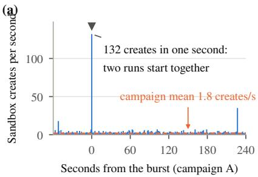

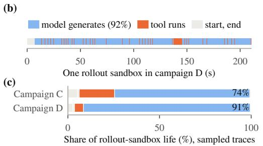

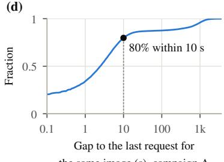  
Figure 1. What a sandbox service for agentic RL faces (production records). (a) Creates per second around campaign A’s largest burst, when two runs started together. (b) One campaign-D rollout sandbox of median life and tool-call count. (c) Where rollout-sandbox time went in campaigns C and D (sampled traces). (d) Cumulative fraction of gaps between requests for one image in a run of campaign A.

2. Design considerations for RL training sandboxes, each with its cost: where to run them, how to create and place them, when to prewarm, who owns cleanup, how to keep grades valid and how to isolate them (§4).

3. An open-source release of Sandman’s daemon, provider and pool, to be published.

4. Measurements and lessons from production and controlled runs: what bounds startup, what prewarming buys and costs, where sandbox waits fall in training, and the failures we met (§5, §6).

## 2 BACKGROUND AND MOTIVATION

## 2.1 Rollouts and sandboxes in agentic RL

The four production campaigns analyzed here train coding agents on SWE-bench Verified (Jimenez et al., 2023; Chowdhury et al., 2024); some experiments use SWE-Gym (Pan et al., 2024). A task is a GitHub issue, the repository at the benchmark’s base commit, and tests that check a fix; the benchmark ships an image per task. A rollout first acquires a sandbox started from that image. The agent harness then alternates between asking the model for its next action and running that action with shell, read, write and edit tools, for tens of turns. When the agent stops, the trainer extracts the patch as a diff against the base commit and applies it in a separate sandbox from the same image. The trainer runs the task’s tests there, turns the verdict into a group relative policy optimization (GRPO) (Shao et al., 2024) reward and releases both sandboxes.

Two properties of this workload shape Sandman. First, a sandbox must keep the rollout’s files and processes between calls, so it cannot be swapped mid-rollout. Second, training is asynchronous: dozens of trajectories per run are in flight while the learner trains on completed, graded groups. Asynchrony can hide some sandbox latency, but slower acquisition can still reduce throughput by holding in-flight slots longer. A rollout’s record is its trajectory; an attempt is one agent-session start. An acquisition lasts from the trainer’s request until the trainer holds a usable sandbox and may include a create, which ends when the new sandbox’s daemon answers. Our four production campaigns, A–D, each a set of training runs, ran in October 2026 (Table A2).

## 2.2 Motivation

One training run creates thousands of sandboxes, and many runs share the cluster. Our 122 October runs averaged about 26,000 sandboxes each. A run starts many trajectories together: 64 within one second in campaign A. When two of A’s runs started together, sandbox creates reached 132 in one second, against a campaign mean of 1.8 per second (Figure 1a). Campaign C kept 256 trajectories in flight per run, campaign D ran up to 27 runs at once, and each trajectory also needs one or two grading pods. Every create passes the cluster’s shared admission, scheduling and network configuration, so the creation path must absorb bursts that average rates and live-pod counts hide. The managed service we tried first could not meet this demand (§4.1).

A sandbox can be a service, but training shapes it. Tool execution has a clean boundary: the trainer acquires an environment, sends it commands and file operations, and releases it. A sandbox service can therefore stay independent of the model. Training still sets its requirements. A rollout sandbox must keep its files and processes between tool calls while the model generates its next action, and that waiting took 74–91% of its lifetime in our production traces (Figure 1c). A production run drew on 24–88 task images, and about 80% of requests for an image arrived within ten seconds of another request for it (Figure 1d). Prewarming could serve these repeats, but a prewarmed pod reserves resources and serves only compatible requests. Tasks also differ in the outbound access their tests need: of the 15 reference patches whose verdicts flipped under changed run conditions, 11 flipped with outbound traffic denied. Network rules must be set per job and checked before grading.

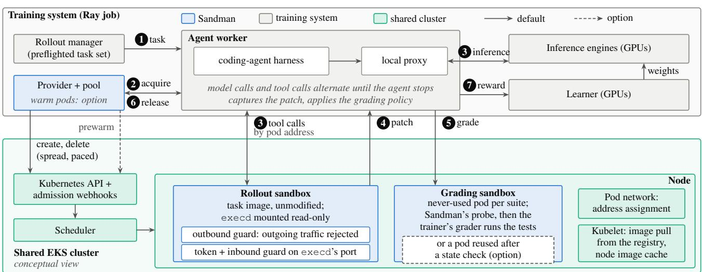  
Figure 2. Sandman’s components and the path of one SWE rollout (conceptual), colored by code ownership; Sandman’s provider and pool run inside the training job, which captures patches, runs graders and applies the grading policy. Solid arrows are defaults and dashed ones options; in our SWE job defaults, both guards apply to every sandbox. A task goes to an agent worker (1) that acquires a sandbox (2), alternates model and tool calls (3), captures the patch (4), has it graded in a separate pod (5), releases both (6) and sends the learner its reward (7).

Table 1. Calls used by the SWE trainer integration. Our SWE jobs run the optional pool with no warm pods.
<table><tr><td>Component</td><td>Calls</td></tr><tr><td>Pool (one Ray</td><td>acqui re(image, base commit, spec) → sandbox id,</td></tr><tr><td>actor per job)</td><td>address; release(id); prewarm(images); drain()</td></tr><tr><td>Provider (library)</td><td>create(spec) → handle; destroy; health</td></tr><tr><td>execd (HTTP,</td><td>execute_command, read_file, read_file_bytes,</td></tr><tr><td>one per pod)</td><td>write_file,env, reset,state,health</td></tr></table>

## 3 SANDMAN OVERVIEW

## 3.1 Components and the path of a rollout

Sandman’s daemon, provider and optional pool support the SWE trainer integration in Figure 2. Table 1 lists its calls.

execd runs the agent’s commands inside the unmodified task image. Every sandbox runs execd, a small HTTP server that runs commands, reads and writes files, sets environment variables, resets its shell and reports health. One persistent bash process per sandbox keeps the working directory, environment and background processes across tool calls. execd needs only bash and Python 3, and jobs mount it read-only, so task images run unmodified.

The provider turns one sandbox request into one pod. The request names an image, CPU, memory and a workspace. The pod’s requests equal its limits, it carries no service-account token, and an owner reference ties it to the trainer’s pod. A sandbox is ready when its readiness probe passes and execd answers the provider’s poll, within a per-job budget that includes the image pull. The provider also paces and spreads creates, installs the network guards and owns each create until it settles (§4.2–4.6).

An optional pool prewarms pods and paces the creates it makes. The pool, a Ray (Moritz et al., 2017) actor shared by the trainer’s workers, keeps never-used pods per (image, base commit), caps live pods and concurrent creates, and paces creates with one token bucket (§4.2, §4.3).

Our SWE trainer acquires a sandbox for each rollout and a separate one for each grading. The trainer runs one agent worker, a Ray actor, per agent slot. The worker takes a task (step 1 in Figure 2) and acquires a sandbox (2). The harness’s tools call execd over HTTP at the pod’s address, and its model calls go through a local proxy to the engines (3). When the agent stops, the worker captures the patch (4), has it graded in a separate sandbox per suite (5), releases both (6) and sends the learner the reward (7).

## 3.2 Responsibilities and the trust boundary

Sandman depends on shared cluster services: the API server, admission webhooks, the pod network (the Virtual Private Cloud Container Network Interface plugin, VPC CNI), DNS and node groups. Our team also runs these services for the cluster’s other workloads. Sandman’s service account creates and deletes pods in its namespace but can neither read the webhooks nor create network policies. Within Sandman, the pool or the worker owns a pod while it is in use, the provider performs every delete, and the owner reference lets Kubernetes delete leftovers at job end.

We trust our trainer, our graders and the cluster’s control plane, not model-written code or other workloads’ pods. Model-written code comes from our own models and runs as root in runc containers that share each node’s kernel with other pods (§4.6).

## 4 DESIGN CONSIDERATIONS

Each subsection states a design choice and its cost.

## 4.1 Where sandboxes run: managed service or self-managed

The managed service we tried held constant what training needs to vary. We first used Amazon Bedrock Agent-Core Code Interpreter (Amazon Web Services, 2026a). The service sizes every session at 2 vCPUs and 8 GB with a 10 GB disk, so a job cannot size a sandbox to its task, and it could not run task images, which ruled out SWE tasks. Its default per-account limits are 1,000 concurrent sessions, fewer than campaign D’s up to 1,728 trajectories in flight, and 30 calls per second on session starts, stops and invokes (Amazon Web Services, 2026b). The limits are adjustable; we had starts and invokes raised. When a batch of our Python and math rollouts recycled sessions together, stop calls reached about 117 per second, inflated by our retries, and trajectories timed out. Hosted runtimes (E2B, 2026; Modal Labs, 2026; Daytona, 2026) run custom images behind their own APIs; we did not test them.

Self-managed sandboxes run on the training cluster’s CPU nodes, not its GPUs. Each sandbox is a pod on the CPU nodes of the EKS cluster that already runs our training jobs. In mid-October these were 378 96-vCPU nodes of four families (c5d, m5d, m6id, m8id) with local disks. A job sets its sandboxes’ image, size, readiness budget and network rules, and its agent workers reach them over the cluster network. Unlike a node-local container manager, Sandman needs no privileged daemon on the nodes. The cost is running the creation path, which shares the API server, webhooks, pod network and nodes with others.

## 4.2 Sandbox creation and placement

Sufficient capacity does not guarantee fast startup. Resource requests, subnet addresses and lifecycle operations limit creates at different times. At 8 GiB per sandbox, a c5d node holds 21 sandboxes by memory and 46 by CPU. Every create passes the API server, admission webhooks, scheduler, address assignment and kubelet. The network plugin (Amazon Web Services, 2026d) assigns addresses from a few spares it keeps warm per node, two in our campaigns and experiments, so a burst packed onto a few nodes waited for addresses while the cluster had room (Table A14).

Pool-mediated creates share a pacing budget. Each provider paces its creates with a token bucket. With the pool, one provider, bucket and create cap serve every create the pool makes: on-demand acquisitions, warm builds and replacements. With no warm pods the pool still creates on demand; our SWE jobs run it this way. When the pool raises an error other than a timeout, such as a full pod cap, the trainer’s worker makes one direct create through its own provider, outside the job’s bucket and cap; 4.3% of gradings in the pre-registered comparison took this path (Appendix K). The pool’s limits are therefore not a hard job-wide admission limit. Without the pool, each agent worker paces only its own creates, and simultaneous creates from different workers can still form a burst. No budget spans jobs, so concurrent jobs’ rates add up. In the scale ramp, one pool with no warm pods and a test pacer held 12,000 acquires fired at once to 20–25 creates per second (§5.2). The provider spreads sandboxes with a soft topology constraint (maximum skew 2), a scheduler preference rather than a per-node limit. CPU nodes keep eight spare addresses warm, the most a spread burst put on one node in our tests.

Agents call their sandbox by pod address, not through a Service. Our trainer creates only the pod, sends the harness each trajectory’s address and waits for an acknowledgement; Service environment variables are off. An earlier design put each agent slot behind a Kubernetes Service with a stable name, because the harness read its sandbox address once while the pod changed every trajectory. But Kubernetes injects every Service’s variables into each new container in the namespace (The Kubernetes Authors, 2026a). A pod behind a Service is reachable only once its route is programmed, and each Service is another object to create.

Pacing and spreading trade caller wait and image pulls for a shorter tail in our tests. Pacing adds our queue to a caller’s wait, and spreading pulls images onto more nodes. We did not place sandboxes by image: that packs creates onto fewer nodes, where address failures concentrated, and the scheduler’s image-locality score sees only a node’s 50 largest images (The Kubernetes Authors, 2026b). Eight spare addresses per node, not two, reserve about 2,300 more over the CPU pool; larger bursts need more nodes or pacing.

## 4.3 Sandbox provisioning: on demand, prewarmed or reused

An on-demand create of a large image is fast only if its node holds it (§5.3). Nodes keep task images on local disks until disk pressure evicts them. An admission rule makes every create pull a tag reference, so a security fix can move a tag; a digest reference is pulled only when the node lacks it. Layers already on the node are reused either way.

We create on demand by default; warm and reused pods are options. In our asynchronous trainer, rollout creation overlaps other work, while a warm pod, started but never used, holds its full request as it waits. The warm pool keeps never-used pods per (image, base commit). The pool hands one out only after a health check and only if its CPU, memory and workspace equal the request’s. It starts a replacement create whenever it hands out a pod and deletes pods of images not requested within a timeout. Reuse is a second option, for grading pods. Since git reset and git clean do not return a pod to its starting state, at create execd records a baseline of what graders were seen to change (repository, installed packages, system and home directories, environment, time zone, processes). After a grading, execd undoes differences exactly or sends the pod to deletion. A pod is reused at most 8 times and retired when its grading contradicts an earlier one.

Only a digest reference fixes the image a warm pod serves. Warm pods are keyed by the image reference as requested. All our campaigns and experiments referenced task images by digest, so a warm pod, a rollout and its grading ran the same image. A tag, which each create resolves again, carries no such guarantee.

Warm pods cost capacity image by image. A warm pod serves only its own image, so pools are sized per image by request rate, burst and create time. Because the pool replaces every pod it hands out, a reused pod returns to an already refilled pool; we did not test replacing only unreturned pods. We did not adopt lazy image loading, which needs another snapshotter on every node. Requests equal limits, so idle time between tool calls is a cost; we did not overcommit.

## 4.4 Cleanup when the caller gives up

Cancelling a caller does not cancel its create. A trainer may abandon an acquisition after a timeout although the API server has already accepted the pod. If the cancellation also cancels the caller’s cleanup, the pod becomes ready with nobody waiting for it, and a retry creates another pod; in a stress test, this path left at least 4,181 excess pods. Table 2 lists this and two other ways a pod outlives its caller. The provider therefore owns each create until it settles: the create runs even if its caller is cancelled, and cleanup runs on any exit, even a second cancellation. The pool keeps the create of a timed-out acquire: a late pod without an agent label becomes a warm pod, and any other late pod is deleted. A nonce on each create lets the provider find and delete a pod that the API stored but answered with an error. An unconfirmed delete is retried until the job drains; deletes pending when the provider’s event loop closes are lost, and the owner reference lets Kubernetes remove them.

Table 2. Three ways a pod outlives its caller. Windows: stand-in-API tests that left a pod without an owner, before the fix / after the first (cancellation) fix / now, 20 repeats each (Table A21); on the cluster, 25 of 25 trials left no pod.
<table><tr><td>Case</td><td>Why it is missed Who owns it now</td><td></td><td>Windows that left a pod</td></tr><tr><td>Caller cancelled or timed out mid-create</td><td></td><td>the caller has left provider finishes the create; pool keeps or deletes the</td><td>12/0/0 of 15</td></tr><tr><td rowspan="2">API answers an error an error is not after storing the pod proof of no pod Delete fails or its reply is lost</td><td rowspan="2">a sent delete is not a done delete confirmed; owner</td><td rowspan="2">late pod provider reads it by name; deletes it on a nonce match provider retries until</td><td>3/2/0 of 3</td></tr><tr><td>6/5/0 of 6</td></tr></table>

A timed-out command can leave children running. execd therefore kills each command’s process group on a timeout or reset and caps output while draining it. It also checks a command’s syntax before running it and accepts an exit status only in a complete frame.

Owning every create costs waiting and capacity. A cancelled caller waits for its create, and late warm pods hold capacity. Commands are sent once, since a timed-out one may have half-run; safe retries would need request deduplication in execd. We have no periodic sweep for ownerless labelled pods, which would catch unknown leaks.

## 4.5 SWE grading: files, patches and verdicts

An edit must start from the exact bytes. The model may see a trimmed view of a file, but the editor reads whole files byte-exact because it writes them back. It checks each read’s length and SHA-256 and refuses files it cannot write back unchanged (not valid UTF-8, mixed line endings, a bare carriage return), telling the agent to use the shell instead.

A patch holds only the agent’s change, and each task gets a reference/empty-patch preflight. An agent once planted a conftest.py that made the tests pass without a fix, so test-configuration files are left out of patches. The trainer resets the index to the task’s base commit, stages the agent’s changes and diffs, so the patch is the agent’s change against the baseline. The tests of two Verified tasks do not check the fix. Before a job starts, it grades each task’s reference patch (must pass) and an empty patch (must fail) under its own configuration and keeps only tasks passing both.

A verdict is only as valid as its run conditions. Each test suite runs in a separate grading pod, never-used by default, keeping the agent’s processes and files out of the grade. For each task we declare the conditions its verdict may depend on: image, outbound network, CPU quota, visible CPUs, memory limit, user, time zone, hash seed, time limit and test suite. Before every grading, an in-pod probe run under the tests’ CPU pin reads eight of these conditions, all but the image and the test suite, and refuses the pod if a readable field contradicts the job’s declaration. An unreadable field does not refuse the pod, so a passed probe does not prove the environment matches. The image and the test suite are set, not probed: the grading pod starts from the task’s image reference, which fixes one image only as a digest, and the official tests are restored from the base commit. A grading that fails for an infrastructure reason is retried and, if stil without a verdict, resampled, never scored 0. Failing tests and patches that do not apply stay valid zeros.

Table 3. What each boundary protects and what it does not.
<table><tr><td>Boundary</td><td>Protected</td><td>Not protected</td></tr><tr><td>Execution</td><td>runc container, not privileged; guarded shared kernel; root user; no pods drop raw sockets</td><td>seccomp profile, user namespace or read-only root</td></tr><tr><td>Outbound</td><td>network policy denies egress; in-pod rules block all outgoing traffic but loopback and replies, failing closed network policy admits only trainer</td><td></td></tr><tr><td>Inbound</td><td>pods; per-sandbox token on every call but health checks; in-pod allowlist of the node and consumers</td><td>past use (no request logs)</td></tr><tr><td>Metadata</td><td>one-hop limit (not re-measured)</td><td></td></tr></table>

The checks cost pod-hours and miss agent-specific effects. The reference/empty-patch check costs 0.06–0.14 pod-hours per task at the job’s configuration and sees no agent patch.

## 4.6 Isolation and access control

An outbound guard does not authenticate callers. Earlier deployments blocked outbound traffic from some sandboxes, but their endpoints stayed reachable without authentication from other pods: a live check from an unrelated pod invoked commands in guarded sandboxes. Pod addresses are routable cluster-wide, and a call into a grading pod could change its files and so a reward. execd checks a per-sandbox token on every call but health checks (Table 3). A network policy that the cluster applies by label and the network plugin enforces denies sandbox egress and admits only the trainer’s pods to execd’s port. In-pod rules that the execd container cannot change stay as a second guard.

A label alone is not enforcement. In one live check, 6 of 6 pods labelled egress-denied reached the internet, because only a patched provider installed the guard. The provider refuses an egress-denied label unless it installs the guard.

We accepted runc’s shared kernel. A microVM per sandbox (Firecracker (Agache et al., 2020), Kata (The Kata Containers Authors, 2026)) needs bare metal or nested virtualization (Amazon Web Services, 2026c), which one of our four node families has; gVisor (The gVisor Authors, 2026) only partly supports our outbound guard’s packet filter (The gVisor Authors, 2025). Our sandboxes run code from our own models, not outside users, so we accepted the shared kernel. No pod sets a seccomp profile, and the kubelet sets no default (The Kubernetes Authors, 2026b); the runtime default’s effect on verdicts is untested. We do not claim isolation against a malicious co-tenant.

Table 4. Where key mechanisms ran (all 16: Table A4). Production: campaigns A–D; Now: defaults of our code and SWE job templates; p: in part; o: option.
<table><tr><td>Mechanism</td><td>Production</td><td>RL experiments</td><td>Now</td></tr><tr><td>Agents call pods by address, no Service</td><td></td><td>p</td><td>√</td></tr><tr><td>Paced and spread creates</td><td></td><td>p</td><td>√</td></tr><tr><td>Create keeps an owner on cancel</td><td></td><td>p</td><td>√</td></tr><tr><td>Outbound guard on every sandbox</td><td>C-D</td><td>√</td><td>√</td></tr><tr><td>Token, inbound guard, network policy</td><td></td><td>p</td><td>√</td></tr><tr><td>Condition probe, task preflight</td><td></td><td>p</td><td>√</td></tr><tr><td>Warm pool and checked reuse</td><td></td><td>grading pods</td><td>0</td></tr></table>

## 5 EVALUATION

We evaluate Sandman in production and in controlled experiments: its use and cost, creation at scale, prewarming and reuse, and how sandbox waits reach training.

The studied SWE runs use Qwen3.5-35B-A3B with asynchronous GRPO, most on 16 B200 GPUs. Eight GPUs serve the learner and eight host SGLang inference engines (32 and 32 in the 64-GPU campaign), with eight samples per task. Rollout workers keep a fixed number of trajectories in flight. Each learner step consumes the next complete, graded groups (four groups of eight in most runs), and weights go to the engines after every step while generation continues. A trajectory has a 30-minute limit and 300 s per command; a test-suite run has 1,800 s. Unless stated otherwise, a sandbox requests 2 vCPUs and 8 GiB, requests equal to limits; the scale ramp used tiny pods. The controlled experiments include a scale ramp, a placement contrast, warm-pool and reuse A/Bs, a grading-condition study and a pre-registered comparison (Table A1).

Each result names its evidence kind. Production results come from the campaigns’ and other jobs’ logs, run records and the API audit log. Controlled experiments are dedicated runs on the shared cluster. Replays run recorded traces through the real pool code or a packing model, and reproductions use a few pods or a local copy to show that a failure path exists, not how often. Create-to-Ready ends at Ready status; the waiting share is acquisition over trajectory time. CIs are 95% t-intervals over run pairs unless named (Wilson for proportions), and A/B arms ran concurrently. Table 4 shows which key mechanisms each kind of evidence ran.

## 5.1 Sandman in production

Four SWE campaigns created 3.13 million sandboxes in two weeks. From 3 to 17 October, these campaigns ran 122 training runs on about 21,400 B200-hours. They created 1.24M rollout and 1.89M grading sandboxes at 1.8–

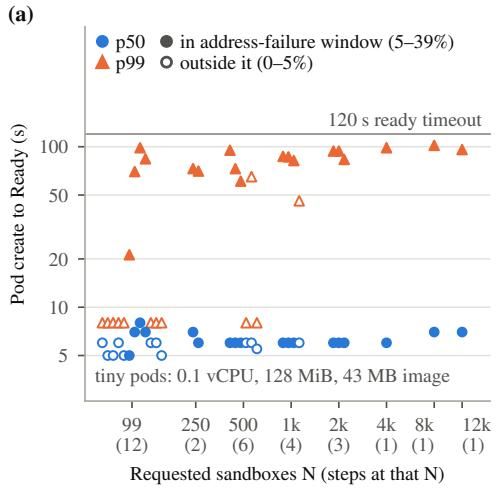

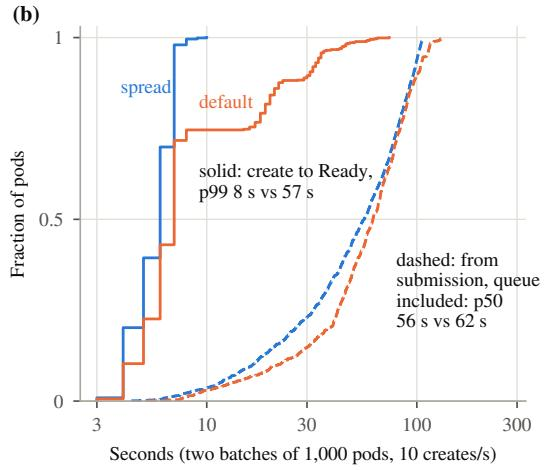

(c)  
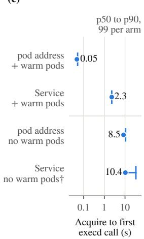  
Figure 3. The creation median held at every scale; the tail coincided with pod-address assignment failures. All panels are controlled. (a) Create-to-Ready p50 and p99 of all 30 steps, arms and controls included (tiny pods, cached image); filled: inside the address-failure window. (b) One sequential pair of 1,000-pod batches at 10 creates/s: create-to-Ready and wait from submission, pacer queue included. (c) Acquire to first successful execd call, 99 sandboxes per arm (dot p50, whisker p90); †overlapped the failure window.

6.3 creates per second on average per campaign, with up to 27 runs (432 GPUs) and at most 1,728 trajectories in flight at once. Rollout sandboxes lived 136–207 s at the median and 424–457 s at p99 (Table A2). From late July to mid-October, about ten other users ran at least 299 jobs, up to 896 GPUs each.

Most attempts got a sandbox; failures clustered in webhook incidents. Between 99.73% (A) and 91.16% (C) of attempts got a working sandbox. In C, 99.5% of failures were rejections by unreachable admission webhooks, and after one retry at least 96.69% of trajectories had a sandbox (Table A5). In D, 69.5% of attempts got a pod: in 12 runs during the 14 October incidents, bursts of agent-backend errors associated with webhook failures were retried as new starts. D’s other 27 runs reached 99.7%. In A–C, 33 of 576,666 attempts could not reach execd in time.

Sandboxes cost 1.7–3.5% of the GPU cost. Campaigns A– C held 3.30–3.75 sandbox-hours per B200 GPU-hour. At on-demand list prices, that is about 1.7% of the GPU cost if a sandbox is charged its node share of CPU and 3.5% if charged its share of memory, or 1.8–3.7% with test re-runs and evaluation jobs. Requests, not use, set this cost: 198 sampled sandbox pods of all users used 10.5% of their CPU and 1.9% of their memory requests, by pod-minutes.

## 5.2 Creation at scale

The control path held 11,858 concurrent tiny sandboxes. A ramp of the real pool and provider to 12,000 requested sandboxes, paced at 20–25 creates per second, kept createto-Ready at a 5–7 s median (Figure 3a). The ramp met no admission error in 38,377 creates, including a sweep of 5– 200 creates per second, and we stopped at 12,000 to keep subnet headroom. The pods were tiny (0.1 vCPU, 128 MiB, a cached 43 MB image), so the ramp shows what the control path held at this rate, not sustained churn. Most of their 5–7 s was our readiness detection and execd starting under the tiny quota; with 2 vCPUs, create-to-Ready took 2 s.

The tail came with pod-address failures, more often on crowded nodes. During a 2.2-hour window, 5–39% of each step’s pods first failed to get an address and retried, which pushed p99 to 21–102 s. Every step of the initial ascending ramp above 99 sandboxes fell inside this window, so the ramp cannot separate size from the address failures. In a follow-up ramp, pods on nodes that received 20 or more of a step’s pods failed their first assignment 31–55% of the time, against 0–16% on nodes with fewer than 10. In one production hour, 0.64% of creates did.

With spreading, a 1,000-pod batch had no address failures. Two batches of 1,000 tiny sandboxes ran three minutes apart on the same 375 nodes, both paced at 10 per second: first spread (at most 3 pods per node), then default-scheduled (up to 65). The default batch had 254 first-attempt address failures, all later Ready. Create-to-Ready p99 was 8 s with spreading and 57 s without, although the default batch found the image cached on every node (Figure 3b). Callers’ median wait from submission (56 and 62 s) was mostly our pacer queue. Other workloads’ failures rose during the default batch and stayed high after our pods left, so a change over time confounds the comparison, and a pre-registered stop rule ended the experiment. This is one sequential pair, and spreading was seen only up to 8 pods per node.

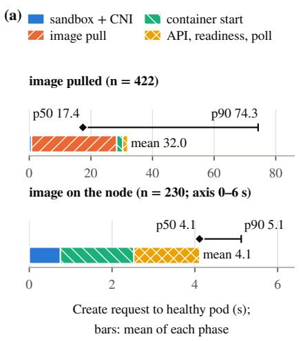

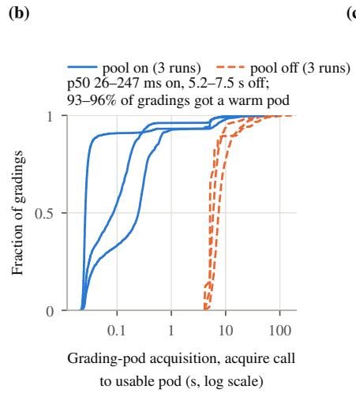  
(c)

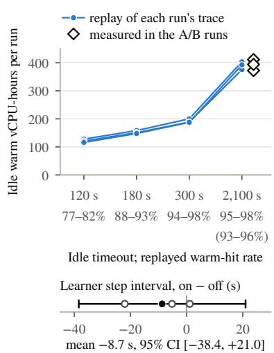  
Figure 4. Where a start spends its time, what a warm pod saves and what it costs. (a) Per-phase means adding up to the mean create-tohealthy time, SWE-Gym images (records of controlled runs; cache state observed, not set; axes differ); markers: p50, p90. (b) Grading-pod acquisition, three pairs of runs, pool off and on (controlled). (c) Idle warm vCPU-hours and hit rates per run by idle timeout (replayed; measured: diamonds, hit rates in parentheses); below, the measured step-interval difference (95% CI).

## 5.3 Prewarming and reuse

Pulling an image quadrupled the median create. In a re-grading study on SWE-Gym images of 1.3–8.4 GB, a create that had to pull took 17.4 s at the median (p90 74.3 s, 422 pods). With the image on the node, a create took 4.1 s (p90 5.1 s, 230 pods), compared within each image, node and half hour (Figure 4a; Table A16). The cost grew with image size. We could not measure how often production creates pulled. Slow pulls also became failures: a fixed 120 s readiness budget that included the pull rejected 9 admissible tasks of a 280-task set, hence the per-job budget.

A warm pool cut grading acquisition 50-fold but more than doubled sandbox vCPU-hours. Three pairs of concurrent 16-GPU runs differed only in whether grading sandboxes came from the pool. The pool served 93–96% of gradings warm and cut grading acquisition from 6.2 s to 0.12 s (means of per-run medians); the waiting share fell from 7.0% to 4.2% (Figure 4b). A warm pod is still created and then idles on its full request. At a 2,100 s idle timeout, longer than a run’s 27-minute cycle through its 88 images, pool-on runs used 2.46× the pool-off runs’ sandbox vCPU-hours, mostly in idle warm pods. In replays, which overstated hits at 2,100 s by 1.8–3.5 points, a 300 s timeout kept the warm-hit rate at 94.5–97.7% at about half the idle cost (Figure 4c).

The warm pool shortened time to step 24 by 9.4%. Poolon runs reached step 24 sooner in all three pairs (95% CI 5.9–13.0%), in two of the three mostly in the first step. The steady-state effect is unresolved: the mean step interval over steps 2–24 differed by −8.7 s (95% CI −38.4 to +21.0), and three pairs detect only changes above 24% of the step interval (80% power, α = 0.05). These runs do not attribute the gain to faster acquisition.

Reuse cut creates against a warm pool, but on demand used fewer pod-hours. Checked reuse cut creates per grading by 29% against a warm pool (95% CI 22–36%), and reused pods served 34–43% of gradings. In the preregistered configuration (§5.4), reuse made 1.21 creates per grading against 1.00 on demand, and on demand used the fewest pod-hours in all eight replayed traces. The state check took 0.23–0.51 s at the median, off the grading path. Fallback rates depended on the graders: 8 of 64,199 checks on Verified task sets moved the grading to a fresh pod, against 23.7% on SWE-Gym, whose graders rebuild artifacts. In the pre-registered comparison, whose grading change used the pool with reuse, warm and reused hits took about 12 ms. Queue-inclusive acquisition averaged 20.3 s, against 7.2 s with direct creation: the pool built pods at 0.3 creates per second under a 32-pod cap, so over half the requests waited for its creates. In this configuration queueing offset the fast hits, and acquisition took 13% of step time against 4.5% with direct creation.

## 5.4 Sandboxes and training

Of sandbox time, grading acquisition and tests, not rollout acquisition, lay on the critical path. Most runs were generation-bound: in A–C the learner waited for data during 65–78% of each step, and in most traced runs 97–100% of inflight slots were busy (88–96% in the partly learner-bound pool A/B). We traced 3,734 learner steps of campaign A and three controlled experiments to the trajectory that ended each wait, which lies on the step’s critical path (Figure 5; Appendix J). Rollout acquisition took at most 0.9% of step time on this path, since other trajectories’ work overlaps it. Outside incidents and test re-runs, the end of the slowest trajectory was on the critical path, through grading acquisition (4.5–6.8% with fresh pods, 1–2% with the A/Bs’ warm pools) and tests (8–11% with one suite, 38% with two).

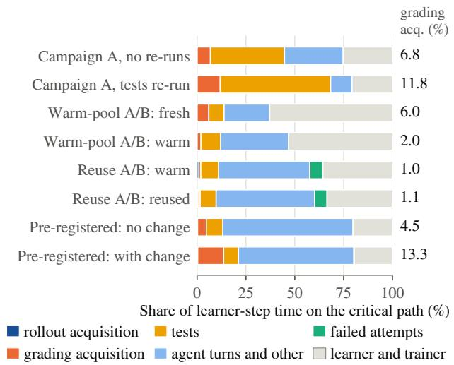  
Figure 5. Where learner-step time went on the critical path, over 3,734 traced steps (production: campaign A; the rest controlled). Campaign A ran up to two test suites, and two of its arms re-ran suites when a batch went to the learner; the reuse A/B’s failed attempts fell in incident windows. Grading acquisition at right; the pre-registered arms ran with and without the grading change.

A fixed-concurrency model estimates the potential benefit of faster sandboxes. If a run stays generation-bound and generation does not slow down, removing a fraction f of trajectory time shortens the step interval by about f. Little’s law matched every measured mean step interval within 3% (Appendix J). Counting acquisition, failed attempts’ slot time and test re-run creates, the model estimates a 6–14% shorter step per campaign (1,800 of 21,400 B200-hours) and 3–5% for the warm pool; neither is measured.

Changing one run condition at a time changed at most 12 of 11,399 verdicts on a robust task set. Re-grading pair 1 of both A/Bs on fresh pods, with one of six conditions changed at a time, changed no verdict beyond repeat noise, and a non-root user changed 12 verdicts (0.1%; Appendix H). That set held no condition-dependent task.

In the one pre-registered training comparison, the arm with the grading change resolved fewer held-out tasks. Six pairs of 150-step runs with campaign D’s recipe compared an arm with a combined grading change against one without. The change dropped the three tasks that the reference/empty-patch check flagged, graded through the warm pool with checked reuse, and required the execd token on pooled grading pods. On 112 held-out tasks, resolve rates after training were 46.1% with the change and 48.4% without (26.1% for the base model). Over all six pairs, as registered, the difference was −2.33 points (95% CI −4.22 to −0.43; Appendix K). The change altered three things at once, so the design cannot isolate a cause. Post hoc, its arm trained on 3.4% fewer tasks, two of them tasks whose tests reward any non-empty patch, so it also lost easy reward.

## 6 LESSONS FROM OPERATING SANDMAN

We draw seven lessons from operating Sandman.

Judge a faster start by training progress and cost. With dozens of trajectories in flight, one sandbox wait overlaps others’ work. In the observed schedules outside incidents, grading acquisition dominated sandbox waiting on the lastcompleting trajectories. This attribution does not by itself measure the throughput benefit of faster rollout acquisition, which can also release in-flight slots earlier. Report acquisition with the caller’s queueing included, and weigh a warm pool’s hit rate against its idle pods (§5.3).

Plan for create bursts, not only live sandboxes. On 14 October, an evaluation with 4,096 concurrent trajectories created sandboxes without pacing. The cluster’s policy admission webhook ran one replica with a 384 MiB limit and had restarted 115 times since early September. The webhook answered pod creates with errors: 84.9% of the evaluation’s 6,144 trajectories failed, and so did 6,126 creates of other jobs. The cause was the webhook’s configuration, and our burst was the trigger. The webhook runs three 1 GiB replicas on separate nodes with a disruption budget, and our SWE jobs pace creates through the pool. The scale ramp’s 38,377 paced creates later met no admission error, which is consistent with the fix but does not prove it. Pacing across a job’s workers needs the shared pool, and aggregate pressure still depends on concurrent jobs and other cluster workloads.

Turn off Service links. On 10 October, the namespace held 3,255 Services, mostly another team’s, and Kubernetes put about 23,400 of their variables into every new container. In campaign A (3–4 October), as Services accumulated, the median bash call slowed from 0.63 to 2.12 s. With Service links off, a production smoke test’s median bash call took 16–22 ms. With Service creates unpaced, 241 of 1,000 sandboxes failed in a Service-routing test, 237 of them on throttled Service creates.

Select the whole node pool and watch free addresses. Workers pinned to one instance type found its 115 nodes full of other tenants’ pods; 9 jobs started only after selecting the pool’s label. During our ramp, free pod addresses fell from 33.6k to 26.5k at 12,000 sandboxes; the tightest subnet is shared with the GPU nodes, so we stopped there.

Keep cleanup with the provider once a create is submitted. In a stress test, acquire timeouts cancelled creates that the API server had already stored. Of 13,516 rollout pods, 5,904 were removed only by garbage collection at teardown; the leaks filled the job’s node type. With the provider owning each create, no tested failure left an unowned pod: Table 2’s 24 windows and a name conflict, 20 repeats each, on a stand-in API, and 25 of 25 cluster trials.

Preflight every task under the job’s own configuration. The tests of two Verified tasks do not check the fix. Between 19% (missing tests restored) and 23% (a published hardened suite for one task (Yu et al., 2026)) of campaign D’s positive rewards on these tasks went to wrong patches, 0.31–0.37% of all of D’s rewards. Under 16 run configurations, 15 of 500 Verified reference patches flipped, 11 of them with outbound traffic denied, and 4.79% of 2,401 SWE-Gym tasks (Pan et al., 2024) depended on run conditions. Preflighting each task’s reference and empty patches under the job’s configuration flags tasks whose reference fails or whose empty patch passes; it misses effects only agent patches trigger.

Most recorded cases had a root in our own implementation. Of 41 recorded operations cases, 23 had a root in the sandbox implementation (code, design or configuration), alone or with a Kubernetes default or a cluster service. Eight lay in cluster configuration or a shared service alone; 10 had other or unknown causes. The ten cases with a GPU-hour account have upper bounds totaling 7.1–7.8k B200-hours; at most 0.47k fell in the campaigns’ 21.4k (2.2%), and the rest hit a stress test, an evaluation and an extension of campaign D (Table A49). Losses without an account, such as campaign D’s error bursts, are not estimated. These are recorded cases, not a census (Appendix M).

Limitations. We studied one shared EKS cluster. The detailed training measurements cover SWE-bench-style Python tasks and one agent harness; reproductions and standin-API tests ran on one host. The ramp used tiny pods, each A/B has three pairs, replays hold trajectory timelines fixed, incident losses are upper bounds, and the security checks are live probes of our own sandboxes, not adversarial tests. Runs drew on 21–306 images with 48–256 trajectories in flight and a fully asynchronous trainer; many more images or a synchronous trainer may change the pool and criticalpath results. We have no dedicated-cluster baseline and no internal measurements of the webhooks or the network plugin.

## 7 RELATED WORK

Sandbox platforms. DSec (Huang et al., 2026), concurrent with this work, serves about 3M sandboxes a day on a purpose-built fleet with its own placement, image distribution and isolation backends. AgentENV (Kimi Team et al., 2026) forks Firecracker microVMs, Kimi K2 (Kimi Team et al., 2025) runs over 10,000 concurrent sandboxes on Kubernetes, and hosted runtimes (E2B, 2026; Modal Labs, 2026; Daytona, 2026; Wang et al., 2026) expose isolation and lifecycle APIs. The Kubernetes agent-sandbox project (Kubernetes SIG Apps, 2026) mounts a daemon into unmodified images, as execd does. Sandman instead uses ordinary pods on a shared training cluster and measures how sandbox waits and grading conditions reach training.

Preparation and reuse. Graviet et al. (2026) recommend locality-aware warm pools, and DeltaBox (Dong et al., 2026) checkpoints sandboxes, which would replace our state check.

Training on environment outcomes. Rollout systems (Fu et al., 2025; Lu et al., 2025; Cao et al., 2025; Ren et al., 2026; Hong et al., 2026) treat the sandbox as a black box. GLM-5 (GLM-5-Team et al., 2026) and LEGO-RL (Du et al., 2026) drop samples lost to environment failures, and dynamic sampling (Yu et al., 2025) drops the zero-variance groups that held most of our condition flips.

Grading validity. Resource settings and image rebuilds shift benchmark scores (Segato, 2026; Adamczewski, 2025); runc and gVisor matched on SWE-style tasks (Tan et al., 2026). Dataset pipelines (Pan et al., 2024; Yang et al., 2025; Aleithan et al., 2024; Badertdinov et al., 2025) validate tests once; we revalidate them under each job’s configuration.

Infrastructure reports. Industry reports measure fleet goodput (Wongpanich et al., 2026), reliability under failures and stragglers (Quirk et al., 2026; Liu et al., 2026) and a single-project GPU cluster’s workload (Konishi et al., 2026). We report such evidence for agentic-RL sandboxes.

## 8 CONCLUSION

Sandman turns task images into stateful sandboxes that training jobs acquire, use across tool calls and release, as ordinary pods on a shared cluster. Incidents, stress tests and studies showed what such a service must handle: paced and spread creates, provider-owned cleanup and gradings checked against declared run conditions. A faster start should be judged by time to a training step and by its cost.

## REFERENCES

Adamczewski, T. How to run SWE-bench Verified in one hour on one machine. Epoch AI, https://epoch. ai/blog/swebench-docker, updated 2025-07-10, 2025.

Agache, A., Brooker, M., Florescu, A., Iordache, A., Liguori, A., Neugebauer, R., Piwonka, P., and Popa, D.- M. Firecracker: Lightweight virtualization for serverless applications. In 17th USENIX Symposium on Networked Systems Design and Implementation (NSDI 20), pp. 419– 434, 2020.

Aleithan, R., Xue, H., Mohajer, M. M., Nnorom, E., Uddin, G., and Wang, S. SWE-Bench+: Enhanced Coding Benchmark for LLMs. arXiv:2410.06992, 2024.

Amazon Web Services. Amazon Bedrock AgentCore Code Interpreter. https://docs.aws.amazon.com/ bedrock-agentcore/latest/devguide/cod e-interpreter-tool.html, accessed 2026-10- 28, 2026a.

Amazon Web Services. Quotas for Amazon Bedrock Agent-Core. https://docs.aws.amazon.com/bedr ock-agentcore/latest/devguide/bedrock -agentcore-limits.html, accessed 2026-10-28, 2026b.

Amazon Web Services. Use nested virtualization to run hypervisors in Amazon EC2 instances. Amazon EC2 User Guide, https://docs.aws.amazon.com/ AWSEC2/latest/UserGuide/amazon-ec2-n ested-virtualization.html, accessed 2026- 10-26, 2026c.

Amazon Web Services. Amazon VPC CNI plugin for Kubernetes. https://github.com/aws/amazon-v pc-cni-k8s, accessed 2026-10-27, 2026d.

Badertdinov, I., Golubev, A., Nekrashevich, M., Shevtsov, A., Karasik, S., Andriushchenko, A., Trofimova, M., Litvintseva, D., and Yangel, B. SWE-rebench: An Automated Pipeline for Task Collection and Decontaminated Evaluation of Software Engineering Agents. arXiv:2505.20411, 2025.

Cao, S., Li, D., Zhao, F., Yuan, S., Hegde, S. R., Chen, C., Ruan, C., Griggs, T., Liu, S., Tang, E., Liaw, R., Moritz, P., Zaharia, M., Gonzalez, J. E., and Stoica, I. SkyRL-Agent: Efficient RL Training for Multi-turn LLM Agent. arXiv:2511.16108, 2025.

Chowdhury, N., Aung, J., Shern, C. J., Jaffe, O., Sherburn, D., Starace, G., Mays, E., Dias, R., Aljubeh, M., Glaese, M., Jimenez, C. E., Yang, J., Ho, L., Patwardhan, T., Liu, K., and Madry, A. Introducing SWE-bench Verified.

OpenAI, https://openai.com/index/intro ducing-swe-bench-verified/, 2024-08-13, 2024.

Daytona. Daytona: secure and elastic infrastructure for running AI-generated code. https://github.com /daytonaio/daytona, accessed 2026-10-23, 2026.

Dong, Y., He, J., Liu, S., Hou, Y., Du, D., Xu, Z., Yu, S., Yang, B., Xia, Y., and Chen, H. DeltaBox: Scaling Stateful AI Agents with Millisecond-Level Sandbox Checkpoint/Rollback. arXiv:2605.22781, 2026.

Du, Y., Jiang, Y., Yuan, T., Dai, J., Wang, S., Chen, J., Tao, C., Yu, X., Shang, L., Wong, K.-F., Li, X., and Bai, H. LEGO-RL: Harness-Native Reinforcement Learning for Coding Agents. arXiv:2608.17393, 2026.

E2B. E2B: open-source secure environments for AI agents. https://github.com/e2b-dev/E2B, accessed 2026-10-23, 2026.

Fu, W., Gao, J., Shen, X., Zhu, C., Mei, Z., He, C., Xu, S., Wei, G., Mei, J., Wang, J., Yang, T., Yuan, B., and Wu, Y. AReaL: A Large-Scale Asynchronous Reinforcement Learning System for Language Reasoning. arXiv:2505.24298, 2025.

GLM-5-Team, Zeng, A., Lv, X., Hou, Z., Du, Z., Zheng, Q., Chen, B., Yin, D., Ge, C., Huang, C., Xie, C., Zhu, C., Yin, C., Wang, C., Pan, G., Zeng, H., Zhang, H., Wang, H., Chen, H., Zhang, J., Jiao, J., Guo, J., Wang, J., Du, J., Wu, J., Wang, K., Li, L., Fan, L., Zhong, L., Liu, M., Zhao, M., Du, P., Dong, Q., Lu, R., Shuang-Li, Cao, S., Liu, S., Jiang, T., Chen, X., Zhang, X., Huang, X., Dong, X., Xu, Y., Wei, Y., An, Y., Niu, Y., Zhu, Y., Wen, Y., Cen, Y., Bai, Y., Qiao, Z., Wang, Z., Wang, Z., Zhu, Z., Liu, Z., Li, Z., Wang, B., Wen, B., Huang, C., Cai, C., Yu, C., Li, C., Hu, C., Zhang, C., Zhang, D., Lin, D., Yang, D., Wang, D., Ai, D., Zhu, E., Yi, F., Chen, F., Wen, G., Sun, H., Zhao, H., Hu, H., Zhang, H., Liu, H., Zhang, H., Peng, H., Tai, H., Zhang, H., Liu, H., Wang, H., Yan, H., Ge, H., Liu, H., Chu, H., Zhao, J., Wang, J., Zhao, J., Ren, J., Wang, J., Zhang, J., Gui, J., Zhao, J., Li, J., An, J., Li, J., Yuan, J., Du, J., Liu, J., Zhi, J., Duan, J., Zhou, K., Wei, K., Wang, K., Luo, K., Zhang, L., Sha, L., Xu, L., Wu, L., Ding, L., Chen, L., Li, M., Lin, N., Ta, P., Zou, Q., Song, R., Yang, R., Tu, S., Yang, S., Wu, S., Zhang, S., Li, S., Li, S., Fan, S., Qin, W., Tian, W., Zhang, W., Yu, W., Liang, W., Kuang, X., Cheng, X., Li, X., Yan, X., Hu, X., Ling, X., Fan, X., Xia, X., Zhang, X., Zhang, X., Pan, X., Zou, X., Zhang, X., Liu, Y., Wu, Y., Li, Y., Wang, Y., Zhu, Y., Tan, Y., Zhou, Y., Pan, Y., Zhang, Y., Su, Y., Geng, Y., Yan, Y., Tan, Y., Bi, Y., Shen, Y., Yang, Y., Li, Y., Liu, Y., Wang, Y., Li, Y., Wu, Y., Zhang, Y., Duan, Y., Zhang, Y., Liu, Z., Jiang, Z., Yan, Z., Zhang,

Z., Wei, Z., Chen, Z., Feng, Z., Yao, Z., Chai, Z., Wang, Z., Zhang, Z., Xu, B., Huang, M., Wang, H., Li, J., Dong, Y., and Tang, J. GLM-5: from Vibe Coding to Agentic Engineering. arXiv:2602.15763, 2026.

Graviet, D. T., Pesut, L., Dagelic, I., Jukic, V., and Burazin, I. The Rollout Infrastructure Tax in Coding-Agent Reinforcement Learning. arXiv:2607.01415, 2026.

Hong, Z., Yuan, S., Ding, Y., Zhu, Y., Jiang, D., Wang, Z., and Tian, C. Scheduling Mixed RL Rollouts Beyond Prefix Locality. arXiv:2608.11152, 2026.

Huang, J., Tang, H., Chen, J., Liu, Y., Chen, Y., Cheng, Y., Tao, Y., Zhou, J., Chen, Y., Chen, H., Wang, J., Lin, S., Zhang, C., Teng, B. L., Guo, L., Fu, Z., Gao, W., Wang, Y., Zhao, L., Wang, Z., Xie, Z., Guo, Y., Cong, P., Gao, Z., Yu, S., Xu, H., Wu, Z., Ren, Z., Zhou, Y., Zhang, B., Huang, Z., Zhu, Q., Wang, L., Lin, T., Yu, H., Hu, J., Yang, D., Yang, S., Lu, S., Chen, S., Qiu, J., Sha, Z., Zhong, Y., Wu, Y., Wang, S., Liu, W., Xu, B., Chen, L., Du, Q., Huang, Y., Ma, S., Wang, Y., Chen, M., Xiong, T., Yan, Y. C., Luo, H., Liang, H., Zhang, X., Zeng, W., Xu, R., Wang, P., Zhu, J., Zhang, R., Yang, W., Tang, Q., Yu, J., Ye, T., Pan, R., Ding, H., Liu, X., Luo, L., Shao, Z., Wu, Y., Lu, J., Liu, W., Zhang, H., Hu, J., Ye, Y., Lin, C., Zhang, Z., Tong, J., Wu, H., Li, Z., Wang, Y., Wang, L., Bai, Y., Fu, L., Xu, R., Wang, Y. Z., Li, Z., Wei, M., Shen, H., Zhang, C., Jin, C., Zhang, Z., Yang, R. H., Xu, X., Zhou, J., Zhu, R., Guo, Y., Pan, Z., Nie, S., Li, E., Lin, S., Liu, Z., Chen, A., Lyu, Z., Cao, S., Yu, R., Wang, C., Guo, J., Song, J., Chen, K., Ye, M., Li, J., Wu, D., Ma, H., Wang, Y., Yang, H., Cai, Y., Liu, S., Wang, Y., Sun, J., Xu, S., Bi, X., He, Y., Zhang, Y., Zhang, M., Zhang, L., Huang, P., and Liang, W. DeepSeek Elastic Compute (DSec): A Sandbox Infrastructure for Effective Agentic Training at Scale. arXiv:2609.22978, 2026.

Jimenez, C. E., Yang, J., Wettig, A., Yao, S., Pei, K., Press, O., and Narasimhan, K. SWE-bench: Can Language Models Resolve Real-World GitHub Issues? arXiv:2310.06770, 2023.

Kimi Team, Bai, Y., Bao, Y., Charles, Y., Chen, C., Chen, G., Chen, H., Chen, H., Chen, J., Chen, N., Chen, R., Chen, Y., Chen, Y., Chen, Y., Chen, Z., Cui, J., Ding, H., Dong, M., Du, A., Du, C., Du, D., Du, Y., Fan, Y., Feng, Y., Fu, K., Gao, B., Gao, C., Gao, H., Gao, P., Gao, T., Ge, Y., Geng, S., Gu, Q., Gu, X., Guan, L., Guo, H., Guo, J., Hao, X., He, T., He, W., He, W., He, Y., Hong, C., Hu, H., Hu, Y., Hu, Z., Huang, W., Huang, Z., Huang, Z., Jiang, T., Jiang, Z., Jin, X., Kang, Y., Lai, G., Li, C., Li, F., Li, H., Li, M., Li, W., Li, Y., Li, Y., Li, Y., Li, Z., Li, Z., Lin, H., Lin, X., Lin, Z., Liu, C., Liu, C., Liu, H., Liu, J., Liu, J., Liu, L., Liu, S., Liu, T. Y., Liu, T., Liu, W., Liu, Y., Liu, Y., Liu, Y., Liu, Y., Liu, Z., Lu, E., Lu,

H., Lu, L., Luo, Y., Ma, S., Ma, X., Ma, Y., Mao, S., Mei, J., Men, X., Miao, Y., Pan, S., Peng, Y., Qin, R., Qin, Z., Qu, B., Shang, Z., Shi, L., Shi, S., Song, F., Su, J., Su, Z., Sui, L., Sun, X., Sung, F., Tai, Y., Tang, H., Tao, J., Teng, Q., Tian, C., Wang, C., Wang, D., Wang, F., Wang, H., Wang, H., Wang, J., Wang, J., Wang, J., Wang, S., Wang, S., Wang, S., Wang, X., Wang, Y., Wang, Y., Wang, Y., Wang, Y., Wang, Y., Wang, Z., Wang, Z., Wang, Z., Wang, Z., Wei, C., Wei, Q., Wu, H., Wu, W., Wu, X., Wu, Y., Xiao, C., Xie, J., Xie, X., Xiong, W., Xu, B., Xu, J., Xu, L. H., Xu, L., Xu, S., Xu, W., Xu, X., Xu, Y., Xu, Z., Xu, J., Xu, J., Yan, J., Yan, Y., Yang, H., Yang, X., Yang, Y., Yang, Y., Yang, Z., Yang, Z., Yang, Z., Yao, H., Yao, X., Ye, W., Ye, Z., Yin, B., Yu, L., Yuan, E., Yuan, H., Yuan, M., Yuan, S., Zhan, H., Zhang, D., Zhang, H., Zhang, W., Zhang, X., Zhang, Y., Zhang, Y., Zhang, Y., Zhang, Y., Zhang, Y., Zhang, Y., Zhang, Y., Zhang, Y., Zhang, Z., Zhao, H., Zhao, Y., Zhao, Z., Zheng, H., Zheng, S., Zhong, L., Zhou, J., Zhou, X., Zhou, Z., Zhu, J., Zhu, Z., Zhuang, W., and Zu, X. Kimi K2: Open Agentic Intelligence. arXiv:2507.20534, 2025.

Kimi Team, Bai, T., Bai, Y., Bao, Y., C., M., Cai, J., Cai, X., Cao, P., Cao, Y., Chai, Z., Charles, Y., Che, H. S., Chen, G., Chen, G., Chen, G., Chen, H., Chen, J., Chen, J., Chen, J., Chen, K., Chen, P., Chen, R., Chen, W., Chen, X., Chen, Y., Chen, Y., Chen, Y., Chen, Y., Chen, Y., Chen, Y., Chen, Y., Chen, Z., Cheng, D., Cheng, Y., Cui, J., Cui, J., Dai, A., Deng, J., Ding, H., Ding, R., Ding, S., Dong, M., Dong, M., Dong, Y., Dong, Y., Du, A., Du, C., Du, D., Du, J., Du, Y., Fan, Y., Feng, J., Feng, Q., Feng, Y., Fu, K., Fu, Q., Gao, F., Gao, H., Gao, J., Gao, T., Gao, W., Geng, S., Gong, J., Gong, L., Gong, S., Gong, X., Gu, Q., Gu, Y., Guan, S., Guo, H., Guo, S., Guo, X., Guo, Z., Hao, B., Hao, W., Hao, X., He, D., He, H., He, L., He, Q., He, W., He, X., He, X., He, Y., He, Y., Hong, C., Hong, T., Hu, H., Hu, J., Hu, R., Hu, W., Hu, Y., Hu, Z., Hua, L., Huang, J., Huang, K., Huang, R., Huang, S., Huang, W., Huang, Y., Huang, Z., Huang, Z., Hui, Y., Jia, C., Jiang, Y., Jiang, Z., Jiang, Z., Jin, W., Jin, X., Jing, Y., Kong, H., Lai, G., Li, A., Li, C., Li, C., Li, C., Li, F., Li, G., Li, H., Li, J., Li, J., Li, L., Li, L., Li, L., Li, W., Li, W., Li, X., Li, Y., Li, Y., Li, Y., Li, Y., Li, Z., Li, Z., Li, Z., Li, Z., Li, Z., Lin, J., Lin, X., Lin, Y., Lin, Z., Lin, Z., Liu, B., Liu, B., Liu, C., Liu, L., Liu, S., Liu, S., Liu, S., Liu, T., Liu, W., Liu, Y., Liu, Y., Liu, Y., Liu, Y., Liu, Z., Liu, Z., Lu, E., Lu, H., Lu, L., Lu, T., Lu, Z., Luo, A., Luo, G., Luo, J., Luo, Y., Lyu, B., Lyu, W., Mao, S., Mei, Y., Men, X., Ni, M., Niu, Y., Pan, S., Peng, S., Qi, Z., Qin, R., Qin, Z., Qin, Z., Qiu, H., Qiu, J., Qiu, J., Qu, B., Qu, Y., Shang, Z., Shao, Y., Shen, H., Shi, J., Shi, J., Shi, L., Shi, S., Siu, W., Song, P., Song, X., Su, J., Su, Y., Su, Z., Sui, L., Sun, J., Sun, J., Sun, S., Sun, S., Sun, T., Sun, Y., Tai, Y., Tang, C., Tang, H., Tang,

S., Tang, Z., Tian, C., Tian, R., Tian, Y., Tu, W., Wang, C., Wang, C., Wang, C., Wang, D., Wang, F., Wang, H., Wang, H., Wang, H., Wang, H., Wang, H., Wang, H., Wang, J., Wang, J., Wang, J., Wang, J., Wang, L., Wang, S., Wang, S., Wang, S., Wang, S., Wang, S., Wang, T., Wang, W., Wang, X., Wang, X., Wang, X., Wang, X., Wang, Y., Wang, Y., Wang, Y., Wang, Y., Wang, Y., Wang, Y., Wang, Y., Wang, Y., Wang, Z., Wang, Z., Wang, Z., Wang, Z., Wang, Z., Wang, Z., Wei, C., Wei, M., Wei, S., Wen, Z., Wu, F., Wu, H., Wu, R., Wu, W., Wu, X., Wu, Y., Wu, Y., Wu, Y., Wu, Z., Xian, X., Xiang, C., Xiang, Y., Xiao, B., Xiao, C., Xiao, X., Xie, J., Xie, X., Xie, Y., Xie, Z., Xing, B., Xiong, Y., Xu, B., Xu, B., Xu, J., Xu, J., Xu, J., Xu, J., Xu, L. H., Xu, Q., Xu, S., Xu, S., Xu, T., Xu, T., Xu, W., Xu, X., Xu, Y., Xu, Y., Xu, Y., Xu, Z., Xue, H., Yan, J., Yan, Y., Yang, F., Yang, G., Yang, H., Yang, J., Yang, R., Yang, W., Yang, X., Yang, X., Yang, Y., Yang, Y., Yang, Y., Yang, Y., Yang, Z., Yang, Z., Yang, Z., Yang, Z., Yao, H., Ye, D., Ye, H., Ye, W., Ye, Z., Yin, B., Yin, H., Yin, X., Yu, C., Yu, H., Yu, L., Yu, S., Yu, S., Yu, T., Yuan, E., Yuan, M., Yue, T., Yue, W., Yue, Y., Zha, D., Zhan, H., Zhang, B. H., Zhang, D., Zhang, F., Zhang, H., Zhang, H., Zhang, H., Zhang, J., Zhang, J., Zhang, J., Zhang, K., Zhang, M., Zhang, P., Zhang, Q., Zhang, R., Zhang, R., Zhang, S., Zhang, S., Zhang, X., Zhang, X., Zhang, Y., Zhang, Y., Zhang, Y., Zhang, Y., Zhang, Y., Zhang, Y., Zhang, Y., Zhang, Y., Zhang, Y., Zhang, Y., Zhang, Z., Zhang, Z., Zhao, B., Zhao, C., Zhao, F., Zhao, J., Zhao, J., Zhao, S., Zhao, W., Zhao, X., Zhao, X., Zhao, Y., Zhao, Z., Zheng, H., Zheng, H., Zheng, R., Zheng, S., Zheng, T., Zhong, H., Zhong, L., Zhong, L., Zhou, M., Zhou, Q., Zhou, R., Zhou, R., Zhou, X., Zhou, Y., Zhou, Z., Zhu, J., Zhu, L., Zhu, X., Zhu, Y., Zhu, Y., Zhu, Z., Zhuang, C., Zhuang, W., and Zu, X. Kimi K3: Open Frontier Intelligence. arXiv:2607.24653, 2026.

Konishi, F., Tsubouchi, Y., and Tsuruta, H. SAKURAONE: An open Ethernet-based AI HPC system and its observed workload dynamics in a single-tenant LLM development environment. In Proceedings ofMachine Learning and Systems (MLSys), volume 8, pp. 1218–1232, 2026. URL https://proceedings.mlsys.org/paper\_ files/paper/2026/file/40b8fb4f900044 05e14b1ede6ab42373-Paper-Conference. pdf.

Kubernetes SIG Apps. agent-sandbox: Kubernetes SIG apps project for isolated, stateful, singleton workloads. https://github.com/kubernetes-sigs/ agent-sandbox, issues #836 and #1335, accessed 2026-10-23, 2026.

Liu, G., Patni, A., Lin, C., Zeng, Z., Wittmayer, J., Wu, J., Nihalani, A., Huang, B., Liu, Y., Na, R., Ko, A., Zhipa, A., Cheng, C., Sun, M., Rajakumar, V., Joseph, R. G., and

Govindarajen, P. GUARD: Scalable straggler detection and node health management for large-scale training. In Proceedings ofMachine Learning and Systems (MLSys), volume 8, pp. 1595–1607, 2026. URL https://pr oceedings.mlsys.org/paper\_files/pape r/2026/file/339caf45a6fa281cae8adc64 65343464-Paper-Conference.pdf.

Lu, H., Liu, Z., Xiong, S., He, Y., Gao, W., Wu, Y., Wang, W., Liu, J., Li, Y., Zhao, H., Huang, J., Yang, S., Li, X., Luo, Y., Liu, Z., Pan, L., Yan, J., Wang, W., Su, W., Wang, J., Qu, L., and Zheng, B. Part II: ROLL Flash – Accelerating RLVR and Agentic Training with Asynchrony. arXiv:2510.11345, 2025.

Modal Labs. Modal sandboxes. https://modal.com/ docs/guide/sandbox, accessed 2026-10-23, 2026.

Moritz, P., Nishihara, R., Wang, S., Tumanov, A., Liaw, R., Liang, E., Elibol, M., Yang, Z., Paul, W., Jordan, M. I., and Stoica, I. Ray: A Distributed Framework for Emerging AI Applications. arXiv:1712.05889, 2017.

Pan, J., Wang, X., Neubig, G., Jaitly, N., Ji, H., Suhr, A., and Zhang, Y. Training Software Engineering Agents and Verifiers with SWE-Gym. arXiv:2412.21139, 2024.

Quirk, K. J., Lennie, M., Ardestani, E. K., Ahuja, S. S., Bergeron, M. R., Grier, A., Wang, Z., Ozdal, M., Zhang, X., Triguna, A., Zhang, Y., Oldham, M., and Tang, C. Sparing strategies to minimize reliability impact on large training jobs. In Proceedings of Machine Learning and Systems (MLSys), volume 8, pp. 860–873, 2026. URL https://proceedings.mlsys.org/paper\_ files/paper/2026/file/437bc4ccafd3fc 6d4289bd10940be42b-Paper-Conference. pdf.

Ren, Y., Wang, X., Liu, X., Lv, B., Zhang, H., Zhang, S., Lai, H., Wang, S., Chen, L., Li, D., and Tang, J. TideRL: Boosting Agentic RL Goodput with Readiness-Aware Scheduling. arXiv:2608.10402, 2026.

Segato, G. Quantifying infrastructure noise in agentic coding evals. Anthropic Engineering, https://www.an thropic.com/engineering/infrastructu re-noise, 2026-02-05, 2026.

Shao, Z., Wang, P., Zhu, Q., Xu, R., Song, J., Bi, X., Zhang, H., Zhang, M., Li, Y. K., Wu, Y., and Guo, D. DeepSeek-Math: Pushing the limits of mathematical reasoning in open language models. arXiv preprint arXiv:2402.03300, 2024.

Tan, Y., Liu, H., and Chen, H. Scaling agentic-RL sandboxes to the millions with gVisor at Tencent. gVisor blog, http s://gvisor.dev/blog/2026/04/23/scali

ng-agentic-rl-sandboxes-to-the-milli ons-with-gvisor-at-tencent/, 2026-04-23, 2026.

The gVisor Authors. gVisor application compatibility. ht tps://gvisor.dev/docs/user\_guide/com patibility/, revision d3ae922, accessed 2026-10-26, 2025.

The gVisor Authors. gVisor: The container security platform. https://gvisor.dev, accessed 2026-10-23, 2026.

The Kata Containers Authors. Kata Containers architecture. https://github.com/kata-containers/ kata-containers/blob/main/docs/desig n/architecture/README.md, revision 5c02698; platform support in README.md revision e06e13b; accessed 2026-10-26, 2026.

The Kubernetes Authors. Service: environment variables. https://kubernetes.io/docs/concepts/ services-networking/service/, accessed 2026-10-27, 2026a.

The Kubernetes Authors. Kubelet configuration (v1beta1). https://kubernetes.io/docs/reference /config-api/kubelet-config.v1beta1/, accessed 2026-10-27, 2026b.

Wang, X., Rosenberg, S., Michelini, J., Smith, C., Tran, H., Nyst, E., Malhotra, R., Zhou, X., Chen, V., Brennan, R., and Neubig, G. The OpenHands software agent SDK: A composable and extensible foundation for production agents. In Proceedings ofMachine Learning and Systems (MLSys), volume 8, pp. 1843–1855, 2026. URL https: //proceedings.mlsys.org/paper\_files/ paper/2026/file/8ae9cf363ea625161f88 5b798c1f1f78-Paper-Conference.pdf.

Wongpanich, A., Oguntebi, T., Paredes, J. B., Wang, Y. E., Phothilimthana, P. M., Mitra, R., Zhou, Z., Kumar, N., and Reddi, V. J. Machine learning fleet efficiency: Improving TPU systems at scale with ML productivity goodput. In Proceedings ofMachine Learning and Systems (MLSys), volume 8, pp. 1291–1303, 2026. URL https: //proceedings.mlsys.org/paper\_files/ paper/2026/file/fbe2b2f74a2ece8070d8 fb073717bda6-Paper-Conference.pdf.

Yang, J., Lieret, K., Jimenez, C. E., Wettig, A., Khandpur, K., Zhang, Y., Hui, B., Press, O., Schmidt, L., and Yang, D. SWE-smith: Scaling Data for Software Engineering Agents. arXiv:2504.21798, 2025.

Yu, B., Cao, Y., Zhang, Y., Lin, L., Xu, J., Zhong, Z., Xu, Q., Wang, G., Cao, J., Cheung, S.-C., He, P., and Briand,

L. SWE-ABS: Adversarial benchmark strengthening exposes inflated success rates on test-based benchmark. arXiv:2603.00520, 2026.

Yu, Q., Zhang, Z., Zhu, R., Yuan, Y., Zuo, X., Yue, Y., Dai, W., Fan, T., Liu, G., Liu, L., Liu, X., Lin, H., Lin, Z., Ma, B., Sheng, G., Tong, Y., Zhang, C., Zhang, M., Zhang, W., Zhu, H., Zhu, J., Chen, J., Chen, J., Wang, C., Yu, H., Song, Y., Wei, X., Zhou, H., Liu, J., Ma, W.-Y., Zhang, Y.-Q., Yan, L., Qiao, M., Wu, Y., and Wang, M. DAPO: An Open-Source LLM Reinforcement Learning System at Scale. arXiv:2503.14476, 2025.

## AI USAGE DISCLOSURE

We used generative AI tools extensively in this work, under the authors’ direction and review.

Tools. Claude Code (Anthropic), with Claude models, used as a coding agent and writing assistant; and Codex (OpenAI), used to outline the paper, draft execution plans and review drafts.

Design and experiments. The authors chose the platform’s design goals and made every design and operational decision. The assistant drafted and critiqued experiment and analysis designs, including the cancellation-window tests against a stand-in Kubernetes API and the record-only analysis of image preparation, which the authors approved.

Literature search. The assistant searched for and summarized related work. Every cited work was checked to exist, and the authors checked that each is represented correctly.

Code. Much of the platform and tooling (the in-sandbox daemon, the pod provider and warm pool, the trainer integration, and the measurement, reproduction, analysis and figure scripts) was written with the assistant to the authors specifications, with tests; the authors reviewed and ran it.

Running the experiments. The assistant launched and monitored cluster jobs and collected read-only cluster measurements under the authors’ oversight; the authors approved every operational change.

Data. No data were generated by AI tools, apart from the trajectories of the agent models trained in the experiments themselves, the simulated API responses of the stand-in Kubernetes API used in the cancellation tests, and the planted residue of the reuse tests, which are described as such.

Writing. The assistant drafted most of the text, tables and figures; every number is traced to a source file in the authors’ evidence ledger. The authors directed, reviewed and edited the paper and checked its claims against the sources.

The authors take full responsibility for all content of this submission.

# Appendix

This supplement gives the details behind the paper’s measurements, for completeness and reproducibility; the paper can be read without it. Section A defines the evidence, workloads, code versions and endpoints, Section B gives the workload distributions, Sections C–K follow the paper’s order, Section L pairs each failure path with its fix, and Section M lists every operations case we recorded. The sign § refers to sections of the paper. Dates are in 2026 and times are UTC. Abbreviations: EKS, Amazon Elastic Kubernetes Service; GRPO, group relative policy optimization; RL, reinforcement learning; SWE, software engineering; VPC CNI, the Amazon Virtual Private Cloud Container Network Interface plugin.

## A EVIDENCE, WORKLOADS, CODE VERSIONS AND ENDPOINTS

Evidence kinds. Production campaigns are our training campaigns A–D (3–17 October) and other jobs on Sandman, analysed after the fact from logs, per-trajectory records, run summaries, the API server’s audit log and cluster metrics. Controlled experiments are dedicated runs on the same shared cluster, next to other tenants’ load, that change one part of the system; A/B arms ran at the same time. Replays feed recorded traces through the real pool code in virtual time, holding the trajectory timeline fixed. Reproductions use a few pods or a local copy of the code; they show that a failure path exists and that a fix closes it, not how often it occurs. Attempts (agent-session starts retries included), trajectories, pods, gradings, labels and learner steps are counted separately.

Workloads are listed in Table A1. The RL runs studied here, including campaigns A–D, trained Qwen3.5-35B-A3B with GRPO in groups of 8 samples per task; the A/Bs used campaign C’s recipe on 16 GPUs, and the stress test and the evaluation were other team members’ jobs. Tasks come from SWE-bench Verified (Chowdhury et al., 2024) and SWE-Gym (Pan et al., 2024), one image per task. Unless stated otherwise, sandboxes requested 2 vCPU and 8 GiB as requests equal to limits (16 GiB for a few heavy repositories), each test-suite run got a fresh grading pod with an 1,800 s test limit, and the campaigns’ create timeout, which includes the image pull, was 300 s. Trajectories had a 16,384-token budget after the prompt (32,768 in two SWE-Gym runs). Outbound traffic: campaigns A and B ran no outbound guard on any pod (rollout, grading or test re-execution); campaigns C and D and our RL experiments denied outbound traffic on all of these pods; the scale ramp, its follow-up and the placement contrast ran no guard, and the grading-condition study denied outbound traffic only in its egress cells.

Counting. Rollout-sandbox counts for campaigns A–C stop at each run’s last learner step, as in Table A2; the whole logs hold 0.010– 0.013% more (79,869, 40,141 and 396,861), and Section B uses them. The four campaigns ran 122 training runs and used about 21,407 B200-hours (1,773, 966, 5,902 and about 12,766).

Cost. At on-demand list prices (\$160.645 per hour for an 8-GPU B200 instance, \$4.752 per hour for a 96-vCPU, 192 GiB c5d node), the campaigns’ 3.30–3.75 sandbox-hours per B200 GPU-hour cost about 1.7% of the GPU cost if each 2 vCPU, 8 GiB sandbox is charged its node share of CPU (2 of 96 vCPU) and about 3.5% if of memory (8 of 192 GiB); test re-execution and evaluation jobs add 2–7% of that, giving 1.8–3.7%.

Seccomp. No pod or container specification of any provider version sets a seccomp profile (a 15 October capture: unset on 6,521 of 6,522 sandbox pods, the one exception not ours), and the CPU nodes’ kubelet configuration is the managed default, which sets no seccomp default, so the kubelet’s default, unconfined, applies. On 27 October two probe pods on one current CPU node read their own status: without a profile, seccomp mode 0 (no filter); with the runtime’s default profile, mode 2 (filtered). Whether that profile changes any verdict is not measured: a pre-registered check stopped before its first grading because the cluster’s admission control began refusing 499 of the 500 Verified task images.

Code versions are given as dates (Table A3): the paper describes each mechanism in its current form, and the table shows which version each measurement ran. Intervals are two-sided 95% t-intervals over run pairs (n = 3 for the A/Bs, n = 6 for the pre-registered comparison), Wilson intervals for single proportions, and percentile bootstrap intervals (runs or tasks resampled) where a table says so.

What each workload ran. Table A4 records which mechanisms each workload ran, from job specifications, the code each experiment loaded and a live probe of campaign sandboxes, so each result is tied to the code that produced it. The warm pool and checked reuse are options; every other mechanism is on by default.

Endpoints. A create runs from the provider’s API request until execd answers its health route, so it includes scheduling, address assignment, image pull, container start and the readiness probe. Create-to-Ready runs from the pod’s creation to its Ready condition (API timestamps, 1 s resolution), submit to healthy is what a caller of the provider’s create waits without our pacing queue, and request to first command runs from the acquire call to the first successful command. An acquisition runs from the trainer’s request until it holds a usable sandbox (for a warm pod, a health check and a label change), and the waiting share divides the summed acquisition time of rollout and grading sandboxes (each create or pool wait counted once) by summed trajectory time. A sandbox is live from its completed create until its delete, in use or warm. Availability is the share of attempts, or of trajectories after at most one retry, that got a working sandbox; sandbox-hours per GPU-hour divide summed trajectory time by B200-hours, since the campaigns’ trainer held one sandbox per trajectory at a time. The learner step interval is the mean time between learner steps, and the held-out resolve rate the mean over held-out tasks of passes per valid sample.

Table A1. Workloads behind the paper’s numbers. Sandboxes: rollout and grading sandboxes created; GPUs are B200s. See: where the workload is used (§: the paper).
<table><tr><td>Workload</td><td>When</td><td>Runs and scale</td><td>Tasks</td><td>Sandboxes and notes</td><td>See</td></tr><tr><td colspan="6">Production</td></tr><tr><td>Campaign A</td><td>3–4 Oct, 30.1 h</td><td>32 runs of 50 learner steps, 16 GPUs each; 64 trajectories in flight per run</td><td></td><td>24 Verified, 27 held out 79,861 rollout, 113,407 grading; no outbound guard on any pod</td><td>B, §5.1</td></tr><tr><td>Campaign B</td><td>5 Oct, 10.6 h</td><td>16 runs of 50 steps, 16 GPUs; 64 in flight</td><td>Verified</td><td>40,136 and 59,164; no outbound guard on any pod</td><td>B, §5.1</td></tr><tr><td>Campaign C</td><td>10–13 Oct, 57.3 h</td><td>35 runs of 50 steps, 64 GPUs; 256 in flight</td><td>88 Verified</td><td>396,810 and 568,930; outbound traffic denied on all pods</td><td>B, H, §5.1</td></tr><tr><td>Campaign D</td><td>13–17 Oct, 82.7 h</td><td>39 runs of 300 steps, 16 GPUs; 64 in flight; up to 27 runs (432 GPUs) at once</td><td>88 Verified (sphinx-8475 removed</td><td>720,332 and 1,147,595; outbound traffic denied on all pods</td><td>B, H, §5.1</td></tr><tr><td>Extension of D</td><td>17-20 Oct</td><td>48 runs of 16 GPUs, in two attempts</td><td>at start) as D</td><td>incident list only</td><td>M</td></tr><tr><td>Other jobs on Sandman</td><td>24 Jul–18 Oct</td><td>299 sandbox-using jobs of about 10 other owners, up to 896 GPUs each</td><td></td><td>aggregates only</td><td>B</td></tr><tr><td>Stress test; evaluation</td><td>14 Oct</td><td>1,536 concurrent trajectories (1,728 actors); an evaluation of 4,096 concurrent (6,144 per rollout; up to 5,120 actors)</td><td></td><td>other team members&#x27; jobs; older provider code, unpaced</td><td>§4.4, §6</td></tr><tr><td colspan="6">Controlled experiments</td></tr><tr><td>Scale ramp</td><td>18 Oct, 08:09–11:47</td><td>31 steps, 30 of them measured, from 99 to 12,000 one 43 MB image requested sandboxes; creates paced at 20–25/s, except a rate sweep at 5–200/s</td><td></td><td>38,377 pods of 0.1 vCPU, 128 MiB</td><td>C</td></tr><tr><td>Placement follow-up</td><td>20 Oct, 08:36–12:49</td><td>8 steps of 500–5,000 pods, unspread, then spread 43 MB image; one over nodes</td><td>Verified image</td><td>1,000 of the pods at 2 vCPU, 8 GiB</td><td>C</td></tr><tr><td>Placement contrast</td><td>27 Oct, 08:38–08:50</td><td>two batches of 1,000 pods at 10 creates/s, 180 s apart: soft topology spread, then the default scheduler; stopped by a pre-registered co-tenant</td><td>one 43 MB image</td><td>2,000 pods of 0.1 vCPU, 128 MiB</td><td>C, §5.2</td></tr><tr><td>Warm-pool A/B</td><td>18 Oct (pair 1), 22</td><td>rule after 2 of 12 planned cells 3 concurrent pairs of 25-step runs, 16 GPUs each; 88 Verified</td><td></td><td>grading pods from the pool or on</td><td></td></tr><tr><td>Checked-reuse A/B</td><td>Oct 18 Oct (pair 1), 22</td><td>128 in flight; 14,513 trajectories 3 concurrent pairs of 40-step runs, 16 GPUs each; 86 Verified</td><td></td><td>demand warm pool with or without checked</td><td>E, I</td></tr><tr><td>Grading-condition study</td><td>Oct 16-18 Oct</td><td>128 in flight; 33,656 trajectories 69,319 gradings (52,512 on Verified, 16,807 on SWE-Gym), one pod each, fresh except in one</td><td>500 Verified; 2,401 SWE-Gym</td><td>reuse 16 run-condition cells</td><td>H</td></tr><tr><td>Label re-grades</td><td>18–20 Oct</td><td>recycled-pod run; 120–240 pods at once every patch of pair 1 of both A/Bs (11,399 labels) and of two SWE-Gym GRPO runs (60 and 20</td><td>88 Verified; 2 × 230 SWE-Gym</td><td>one fresh pod per grading</td><td>H</td></tr><tr><td>Three-arm reuse test</td><td>19 Oct</td><td>steps, 16 GPUs) 787 gradings per arm: fresh pods, plain reuse,</td><td>86 Verified</td><td>planted residue</td><td></td></tr><tr><td>Frozen deployment</td><td></td><td>checked reuse 21 Oct, 08:50–15:20 reference/empty-patch check on 3 pools; 3 GRPO runs of 40 steps, 16 GPUs; 48 in flight</td><td>230 and 280 SWE-Gym; 115</td><td>checked reuse of grading pods</td><td>E, H, I</td></tr><tr><td>Vacuous-test re-grade</td><td>22 Oct</td><td>every consumed positive label on two tasks in</td><td>Verified 2 Verified</td><td>7,861 pods, 98.0 pod-hours</td><td></td></tr><tr><td>Pre-registered comparison</td><td>22 Oct 07:41 to 23</td><td>campaigns C and D (7,294) 6 pairs of 150-step runs, 16 GPUs each, and a</td><td>89 or 86 Verified; 112</td><td>117,875 trajectories; 117,146 rollout K</td><td></td></tr><tr><td>Validation run</td><td>Oct 09:56 23 Oct</td><td>20-step pilot pair; 64 in flight one 20-step run, 16 GPUs; 64 in flight</td><td>held out 21 Verified</td><td>and 120,326 grading sandboxes 891 grading pods</td><td>I,L</td></tr><tr><td colspan="6">Replays, analyses of records, and reproductions</td></tr><tr><td>Replays</td><td>18-23 Oct</td><td>pool sizing (3 traces), grading-pod source (8 traces), CPU reservations (58,693 rollouts), pod retirement (69,812 gradings)</td><td></td><td>real pool code in virtual time</td><td>E, I, §5.3</td></tr><tr><td>Critical-path analysis</td><td>27 Oct (records of</td><td>3,734 learner steps of campaign A, both A/Bs and the pre-registered comparison, each wait traced to</td><td></td><td>existing records only; no new runs</td><td>J, §5.4</td></tr><tr><td>Reproductions</td><td>3–23 Oct)</td><td>the trajectory that ended it; per-run totals for B-D one development host (8 vCPU, 30 GiB), a</td><td>one Verified task image –</td><td></td><td></td></tr></table>

Table A2. Production campaigns: pods created, not gradings (a trajectory can use two grading pods); lifetimes for C and D from sampled traces. Table A5 gives availability, create latency and waiting share.
<table><tr><td>Tasks</td><td></td><td>Runs × GPUs</td><td>In flight per run</td><td>Rollout pods</td><td>Grading pods</td><td>Creates/s (mean)</td><td>Rollout life p50 / p99</td><td>Outbound guard</td></tr><tr><td>A</td><td>24</td><td>32 × 16</td><td>64</td><td>79,861</td><td>113,407</td><td>1.8</td><td>196 / 443 s</td><td>none</td></tr><tr><td>B</td><td>24</td><td>16 × 16</td><td>64</td><td>40,136</td><td>59,164</td><td>2.6</td><td></td><td>none</td></tr><tr><td>C</td><td>88</td><td>35 × 64</td><td>256</td><td>396,810</td><td>568,930</td><td>4.7</td><td>136 / 457 s all pods</td><td></td></tr><tr><td>D</td><td>88</td><td>39 × 16 (≤27 at once)</td><td>64</td><td>720,332</td><td>1,147,595</td><td>6.3</td><td>207 / 424 s all pods</td><td></td></tr></table>

Table A3. Code changes that matter for the measurements, and the code each workload ran. Provider and pool are Sandman’s; the trainer and agent harness are our RL trainer’s.
<table><tr><td>Component</td><td>Changes, with dates</td></tr><tr><td>execd</td><td>first version, reads of at most 2,000 lines (21 Jul); syntax check of the wrapped command (4 Aug); own process group (12 Aug); byte-exact whole-file reads (19 Aug); group kill by original id, output capped while draining, complete-bytes reads (6 Oct); strict exit-status frames (7 Oct); per-sandbox token (20 Oct); state-check routes (19–21 Oct) owner references (21 Jul); central drain (29 Jul); tags pulled &quot;always&quot; (10 Sep); outbound guard (campaigns&#x27; patched copy 6 Oct; on</td></tr><tr><td>provider and pool</td><td>every sandbox, late Oct); per-sandbox token and inbound guard on every sandbox (late Oct); soft topology spread and paced creates by default (late Oct); eight-field probe before every grading and retirement of contradicted pods (late Oct); Service variables off (campaigns patched copy 10 Oct 20:06, from campaign C on; default branch 13 Oct); creates shielded from cancellation (14 Oct); pacing (15 Oct); warm budget, recycling, Services paced with pods (20 Oct); readiness budget per job (21 Oct); error-path fix: create nonce, read-back after an ambiguous error, owned retries of failed deletes (27 Oct)</td></tr><tr><td>trainer and harness</td><td>our trainer: fresh grading pod, rollout sandbox kept until grading completes (28 Jul); test-configuration files left out of patches (29 Jul); agent calls bound to pod addresses (13 Oct; capture and grading always used pod addresses); reference/empty-patch check of the task set before each job (late Oct); gradings without a verdict retried, then resampled, never scored 0 (27 Oct). The campaigns&#x27; trainer (every campaign and RL experiment): rollout sandbox released before grading (9 Sep); gradings without a verdict invalid and resampled, never scored 0. Harness: reads checked by length and SHA-256 (6 Oct; on by default, late Oct); editor refuses files it cannot write back</td></tr><tr><td>cluster</td><td>unchanged (27 Oct) task images kept 90 days (13 Oct); reboot-safe NVMe image store (18 Oct); metadata responses limited to one hop on the CPU nodes (late Oct); eight warm pod addresses per CPU node and a network policy on sandbox pods (late Oct)</td></tr><tr><td colspan="2"></td></tr><tr><td>What each workload ran Campaigns A-B</td><td>the campaigns&#x27; trainer; the provider shipped in the runtime image (15 Sep), from before the 14 Oct fix, with no outbound guard and</td></tr><tr><td></td><td>Service variables on; execd of 19 Aug, copied into each pod from a carrier image; no warm pool as A-B, but a patched copy of that provider that adds the outbound guard (6 Oct) and turns Service variables off (10 Oct); execd of</td></tr><tr><td>Campaigns C-D</td><td>19 Aug from the same carrier image</td></tr><tr><td>Scale ramp, follow-up,</td><td>provider and pool of 14 Oct plus a benchmark patch (name prefixes, optional affinity, later a spread constraint) whose defaults reproduce the unpatched code; execd of 7 Oct; creates paced by a wrapper in the driver</td></tr><tr><td>placement contrast Warm-pool A/B</td><td>campaign C&#x27;s trainer; the patched provider of campaigns C-D with the provider half of the 14 Oct fix; a pool that hands out a warm pod only if its resources match the request (18 Oct); execd of 19 Aug from the carrier image</td></tr><tr><td>Checked-reuse A/B</td><td>as the warm-pool A/B, with logging added to the trainer, plus the pool&#x27;s recycling path, warm budget, pacing and the state check from a branch of 18 Oct; execd of 19 Aug plus the state-check routes</td></tr><tr><td>Frozen deployment,</td><td>provider, pool, reuse guard and reference/empty-patch check as fetched on 21 Oct, with a soft topology spread over the job&#x27;s pods; execd of 20 Oct in rollout and grading pods (test re-execution pods, where used, kept the 19 Aug build); the execd token on pooled</td></tr><tr><td>Validation run</td><td>grading pods only; the full cancellation fix on pooled grading pods and the provider half on the rest; agent calls through a local forwarder to the pod address; the checked-reuse A/B&#x27;s trainer grading pods: one build of every grading-path mechanism as of 23 Oct, with the same spread; rollout pods: the pre-registered</td></tr><tr><td></td><td>comparison&#x27;s provider and execd of 20 Oct; test re-execution pods: the 19 Aug build; the pre-registered comparison&#x27;s trainer with one actor change, agent calls through the same forwarder</td></tr><tr><td>Cancellation tests Reproductions</td><td>provider and pool of 13 Oct (before the fix), 21 Oct (cancellation fix) and 27 Oct (error-path fix), and an alternative implementation execd of 21 Jul, 4 Aug, 19 Aug, 6 Oct, 7 Oct and 21 Oct; harness tools of 30 Jul, 6 Oct and 13 Oct</td></tr></table>

Table A4. What ran where. A–B, C–D: production campaigns; WP, RU: the warm-pool and reuse A/Bs; PR: pre-registered package arm; VR: validation run; Now: defaults of our code and SWE job templates at submission. ✓ ran; – did not; o option, off by default; g grading pods only; p in part (Table A3 gives the variant).
<table><tr><td>Mechanism</td><td>A-B C-D</td><td></td><td>WP</td><td>RU</td><td>PR</td><td>VR</td><td>Now</td></tr><tr><td>Agent calls by pod address, not a Service</td><td></td><td></td><td></td><td>一</td><td>p</td><td>p</td><td>√</td></tr><tr><td>Service environment variables off</td><td></td><td></td><td>L</td><td></td><td>1</td><td>√</td><td>√</td></tr><tr><td>Soft topology spread over nodes</td><td></td><td></td><td></td><td></td><td>√</td><td>L</td><td></td></tr><tr><td>Paced creates</td><td></td><td></td><td></td><td>g</td><td>g</td><td>g</td><td></td></tr><tr><td>Outbound guard on every sandbox</td><td></td><td>7</td><td></td><td>√</td><td>√</td><td>了</td><td></td></tr><tr><td>Network policy on sandbox pods</td><td></td><td></td><td></td><td></td><td></td><td></td><td></td></tr><tr><td>execd token and inbound guard</td><td></td><td></td><td></td><td></td><td>p</td><td>g</td><td></td></tr><tr><td>Metadata responses limited to one hop</td><td></td><td></td><td></td><td></td><td>一</td><td>一</td><td></td></tr><tr><td>Warm pool</td><td></td><td></td><td>g</td><td>g</td><td>g</td><td>g</td><td>0</td></tr><tr><td>State-checked reuse</td><td></td><td></td><td></td><td>g</td><td>g</td><td>g</td><td>0</td></tr><tr><td>In-pod configuration probe</td><td></td><td></td><td></td><td></td><td></td><td>g</td><td>V</td></tr><tr><td>Reference/empty-patch check of the task set</td><td></td><td></td><td></td><td></td><td>√</td><td>√</td><td>√</td></tr><tr><td>Create keeps an owner on cancel</td><td></td><td>_8</td><td>p</td><td>p</td><td>p</td><td>p</td><td></td></tr><tr><td>Strict exit-status parsing</td><td></td><td></td><td>一</td><td></td><td>p</td><td>p</td><td></td></tr><tr><td>Test-configuration files left out of patches</td><td></td><td></td><td></td><td></td><td>一</td><td>一</td><td></td></tr><tr><td>No verdict resampled, never scored 0</td><td>√</td><td>」</td><td>5</td><td>5</td><td>√</td><td>√</td><td></td></tr></table>

§Campaigns cancelled creates only at test re-run deadlines (not measured).

## B WORKLOAD DISTRIBUTIONS

This section expands §2 and §5. Campaign A has complete start and end records; campaigns C and D have per-turn traces of sampled agent workers (2 and 3 runs); campaign B has totals only. “Pool/reuse A/Bs” are the runs of both A/Bs, and “SWE-Gym runs” the frozen deployment’s three runs. Figure A1 shows lifetimes and where a rollout sandbox’s time goes.

Table A5. Production campaigns in operation. Attempts: agent-session starts, retries included; available: share of attempts, and of trajectories after one retry, that got a working sandbox (D: a pod); create: range of per-run p50 and p99; wait: waiting share ( sampled traces); sandbox-h: per B200 GPU-hour.
<table><tr><td colspan="3">Span</td><td colspan="2">Available (%)</td><td colspan="2">Create (s)</td><td>Wait</td><td>Sandbox-h</td></tr><tr><td></td><td>(h)</td><td>Attempts</td><td>attempt</td><td>traj.</td><td>p50</td><td>p99</td><td>(%)</td><td>per GPU-h</td></tr><tr><td>A</td><td>30.1</td><td>81,102</td><td>99.73</td><td>99.98</td><td>4.31-5.65</td><td>6.8-175.8</td><td>6.4</td><td>3.30</td></tr><tr><td>B</td><td>10.6</td><td>42,409</td><td>96.98</td><td>99.65</td><td>4.14-7.01</td><td>17.3-258.4</td><td>9.8</td><td>3.75</td></tr><tr><td>C</td><td>57.3</td><td>453,155</td><td>91.16</td><td>≥96.69</td><td>5.11-5.22</td><td>8.2-134.2</td><td>9.9</td><td>3.56</td></tr><tr><td>D</td><td>82.7</td><td>1,036,028</td><td>69.5</td><td></td><td>5.12–5.29</td><td>18.4–35.7</td><td>6.5*</td><td></td></tr></table>

Table A6. Creates arrive at a few per second on average and in bursts at run starts. Per-minute windows; creates count rollout and grading pods. B–D: peaks are upper bounds (runs at once times trajectories in flight) and rates are totals over the span; A/Bs: peaks per run; pre-registered comparison: the training runs’ rollout, grading and warm pods. Ended early: aborted, timed out or failed rollouts.
<table><tr><td>Workload</td><td>Peak live (typical)</td><td>Runs at once</td><td>Creates/s mean</td><td>Per minute p99 /max</td><td>In 1 s p99 /max</td><td>Destroys/s mean /p99</td><td>Ended early</td></tr><tr><td>Campaign A</td><td>448 (211)</td><td>7</td><td>1.84</td><td>3.78 / 5.02</td><td>8/132</td><td>1.82 / 3.70</td><td>0.57%</td></tr><tr><td>Campaign B</td><td>≤512</td><td>8</td><td>2.61</td><td></td><td></td><td></td><td></td></tr><tr><td>Campaign C</td><td>≤1,024</td><td>4</td><td>4.68</td><td></td><td></td><td></td><td></td></tr><tr><td>Campaign D</td><td>≤1,728</td><td>27</td><td>6.27</td><td></td><td></td><td></td><td></td></tr><tr><td>Pool/reuse A/Bs</td><td>139-319</td><td>2</td><td>1.80</td><td>3.39 / 5.40</td><td></td><td>1.78 / 2.98</td><td>15.6%</td></tr><tr><td>Pre-registered comparison</td><td>712 (389)</td><td>10</td><td>2.93</td><td>5.77 / 6.55</td><td>9 /130</td><td>2.92 / 5.79</td><td>0.05%</td></tr><tr><td>Scale ramp</td><td>11,858</td><td>一</td><td>20-25</td><td></td><td></td><td></td><td></td></tr></table>

Bursts and early ends. A run starts its 64 trajectories within one second, so two runs starting together created 128 rollout pods in one second (132 creates in all, campaign A’s one-second maximum). In campaign A, 458 of 80,068 ended trajectories ended early, 199 before a pod existed; in the A/Bs, 6,712 of 6,905 errors fell in three incident windows. In campaign D’s first 12 runs, which met the 14 October incidents, 18–83% of starts made no create because fast failures were retried; over the campaign, 1,036,028 starts made 720,332 creates. In D’s other 27 runs, 495,566 of 497,170 starts (99.7%) got a pod. Cluster-wide, the audit log showed 33,236 sandbox pod creates in one hour of 14 October, and one reading found 4,798 live sandbox pods. In campaigns A–C, 33 of the 576,666 attempts in Table A5 (32, 0 and 1) failed because the harness could not reach execd before the agent started.

Table A7. Rollout sandboxes live 136–327 s at the median and a fresh grading pod 13.5 s; pooled pods live longer because they also wait warm. Seconds.
<table><tr><td>Population</td><td>n</td><td> $\mathsf { p } 5 0$ </td><td> $\mathsf { p } 9 0$ </td><td> $\mathsf { p } 9 9$ </td><td>max</td><td>Basis</td></tr><tr><td>Rollout, campaign A</td><td>79,869</td><td>196</td><td>317</td><td>443</td><td></td><td>start and end records</td></tr><tr><td>Rollout, campaign D (sampled)</td><td>9,723</td><td>207</td><td>348</td><td>424</td><td>805</td><td>per-turn traces</td></tr><tr><td>Rollout, campaign C (sampled)</td><td>4,054</td><td>136</td><td>247</td><td>457</td><td>740</td><td>per-turn traces</td></tr><tr><td>Rollout, pool/reuse A/Bs</td><td>49,043</td><td>168</td><td>360</td><td>550</td><td>1,885</td><td>start and end records</td></tr><tr><td>Rollout, pre-registered comparison</td><td>117,146</td><td>229</td><td>358</td><td>436</td><td>1,533</td><td>start and end records</td></tr><tr><td>Rollout, SWE-Gym runs</td><td>3,169</td><td>327</td><td>566</td><td>782</td><td>1,187</td><td>per-turn traces</td></tr><tr><td>Grading, campaign A, per pod</td><td>113,407</td><td>28.7</td><td>115</td><td>189</td><td></td><td>grading window / pods</td></tr><tr><td>Grading, fresh pod (pre-registered, arm without the package)</td><td>53,850</td><td>13.5</td><td>27.8</td><td>225</td><td>1,810</td><td>acquire and test run</td></tr><tr><td>Grading, pooled pod (pre-registered, package arm)</td><td>63,991</td><td>26.6</td><td>171</td><td>294</td><td>1,810</td><td>pool events, idle included</td></tr><tr><td>Grading, pooled pod (checked-reuse A/B, both arms)</td><td>24,617</td><td>162</td><td>396</td><td>836</td><td>2,060</td><td>pool events</td></tr><tr><td>Grading, pooled pod (SWE-Gym runs)</td><td>2,065</td><td>256</td><td>592</td><td>1,010</td><td>1,740</td><td>pool events</td></tr><tr><td>Grading-condition study, in-pod time (Verified, by run)</td><td>52,512</td><td>6.6-16.5</td><td>31-110</td><td>125-357</td><td>1,800</td><td>in-pod timings</td></tr><tr><td>Grading-condition study, in-pod time (SWE-Gym)</td><td>16,447</td><td>17.6</td><td>459</td><td>1,130</td><td>1,820</td><td>in-pod timings</td></tr></table>

Rollout and grading sandboxes. Campaigns A–D created 1.42, 1.47, 1.43 and 1.59 grading pods per rollout sandbox, retried suites and re-gradings included. In campaign A, 13.9% of ended trajectories used no grading pod (no patch), 30.6% one and 55.5% two, one fresh pod per test suite. A fresh grading pod in the pre-registered comparison took 5.5 s at the median to acquire and 6.5 s to run its tests.

A turn’s generation took 1.7–3.0 s at the median, and a live sandbox served 8.8–12.4 tool calls per minute; 85–93% of calls were shell commands, and 28–44% of rollouts ran the tests. With outbound traffic denied, 46–94% of rollouts still tried a package install or download. In a replay against one-minute metrics, pods used 0.001–0.007 vCPU while the model generated and 0.068–0.276 vCPU while busy. The traces hold 136,441 rollouts that ran, of 172,684 attempts in 28 runs.

Images. Campaign A requested each of its 24 images a median 3,412 times; the long re-request mode is the next group of the same task, 13–44 minutes later. Rollout pods reached Ready in 5.13–5.97 s at the median on Verified (p99 24.4–60.5 s) and 14.3 s on the SWE-Gym runs (p99 117 s). The 50 images a CPU node lists take a median of 231 GiB, more than its 89 GiB of allocatable ephemeral storage, so images live on the striped NVMe volume; campaign D’s task set fits on one node, the SWE-Gym runs’ 306 images do not.

Resources. The sampled pods of all users used 1.9% of their memory request. Some tasks need more than the default: the 3 matplotlib tasks of campaign D’s 89 run with 16 GiB on every attempt, and 22 of 2,401 SWE-Gym tasks (0.92%, all modin) are killed for memory at

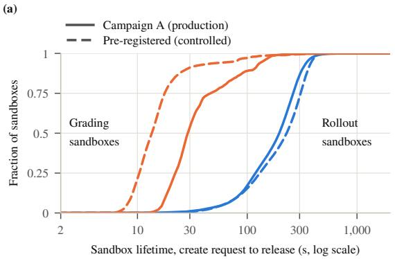

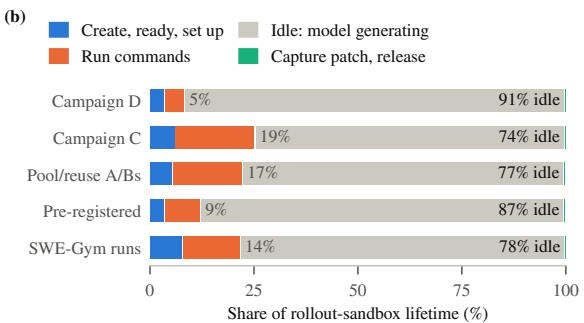  
Figure A1. Rollout sandboxes live for minutes and grading sandboxes for seconds; a rollout sandbox is idle while the model generates for 74–91% of its life. (a) Lifetime, create request to release. Solid: campaign A (production; grading lifetime estimated per pod from each trajectory’s grading window). Dashed: the pre-registered comparison (controlled; grading on fresh pods). (b) Share of rollout-sandbox lifetime by phase, from per-turn traces.

Table A8. Rollout sandboxes are mostly idle, and their few long commands are mostly installs and downloads that the outbound guard blocks. Time-weighted shares of sandbox seconds; capture and release take the remaining 0.08–0.30%, and the longest command was 300–301 s, execd’s limit. Campaign A records turns only.
<table><tr><td></td><td>Create, set up</td><td>Run commands</td><td>Idle</td><td>Tool calls per rollout p50 / p90 / p99</td><td>Command p50 / p99</td><td>Commands ≥10 s: share of calls / time</td><td>Installs among commands ≥10 s</td></tr><tr><td>Campaign D (sampled)</td><td>3.62%</td><td>4.85%</td><td>91.38%</td><td>37 / 61 / 86</td><td>12 ms / 7.8 s</td><td>0.28% / 19%</td><td>93%</td></tr><tr><td>Campaign C (sampled)</td><td>6.20%</td><td>19.24%</td><td>74.35%</td><td>31 / 46 / 56</td><td>19 ms / 15.4 s</td><td>1.54% / 29%</td><td>97%</td></tr><tr><td>Pool/reuse A/Bs</td><td>5.48%</td><td>16.97%</td><td>77.25%</td><td>30 / 45 / 57</td><td>28 ms / 15.7 s</td><td>2.38% / 36%</td><td>70%</td></tr><tr><td>Pre-registered comparison</td><td>3.53%</td><td>8.81%</td><td>87.37%</td><td>35 / 51 / 67</td><td>9.5 ms / 8.3 s</td><td>0.72% / 23%</td><td>98%</td></tr><tr><td>SWE-Gym runs</td><td>7.91%</td><td>13.95%</td><td>78.06%</td><td>50 / 76 / 97</td><td>9.5 ms / 12.8 s</td><td>1.70% / 39%</td><td>85%</td></tr><tr><td>Campaign A</td><td></td><td></td><td></td><td>30 / 45 / 58</td><td></td><td></td><td></td></tr></table>

Table A9. Task images average 1.2–1.4 GB on Verified and 2.85–3.00 GB on SWE-Gym, and an image is usually requested again within seconds because a GRPO group starts together. Upper: compressed sizes. Lower: time between consecutive requests for the same image.
<table><tr><td>Image set</td><td>Images</td><td>Total</td><td>Mean</td><td> $\mathsf { p } 5 0$ </td><td> $\mathsf { p } 9 0$ </td><td>Max</td></tr><tr><td>Campaign A tasks</td><td>24</td><td>33.6GB</td><td>1.40 GB</td><td>1.20 GB</td><td>2.03 GB</td><td>3.15 GB</td></tr><tr><td>Campaign D pool</td><td>89</td><td>107.6GB</td><td>1.21 GB</td><td>1.15 GB</td><td>1.21 GB</td><td>3.17GB</td></tr><tr><td>SWE-Gym runs</td><td>306</td><td>871 GB</td><td>2.85 GB</td><td>2.07 GB</td><td>6.19 GB</td><td>8.43 GB</td></tr><tr><td>All of SWE-bench Verified</td><td>500</td><td>699.8 GB</td><td>1.40 GB</td><td>1.24 GB</td><td>2.05 GB</td><td>3.33 GB</td></tr><tr><td>All SWE-Gym tags</td><td>2,424</td><td>7,276 GB</td><td>3.00 GB</td><td>2.94 GB</td><td>6.19 GB</td><td>8.50 GB</td></tr><tr><td>Re-requests</td><td>in a run: &lt; 10 s / &lt; 60 s</td><td></td><td>gaps ≥60 s: p10 / p50 / p90</td><td></td><td>any run: p50 / p90 / &lt;5 min</td><td></td></tr><tr><td>Campaign A</td><td colspan="2">79.8% / 87.3%</td><td colspan="2">216 / 777 / 1,415 s</td><td colspan="2">2.2 s / 48 s / 96.7%</td></tr><tr><td>Pool/reuse A/Bs</td><td colspan="2">80.5% / 87.4%</td><td colspan="2">88 / 923 / 1,965 s</td><td colspan="2"> $1 . 4 \mathrm { s } / 1 4 9 \mathrm { s } / 9 3 . 4 \%$ </td></tr><tr><td>Pre-registered comparison</td><td colspan="2">81.4% / 88.1%</td><td colspan="2">1,118 / 2,656 / 4,182 s</td><td colspan="2"> $3 . 0 \mathrm { s } / 7 5 \mathrm { s } / 9 4 . 0 \%$ </td></tr></table>

Table A10. Rollout pods use under 3% of their CPU request; grading pods keep about one core busy. Rollout: one-minute metrics of sampled pods; all users: 198 pods over 14 days, weighted by pod-minutes; grading: cgroup counters.
<table><tr><td>Population</td><td>Pods</td><td>Requests</td><td>CPU use / request</td><td>CPU p99 per pod-minute</td><td>Peak memory p50 / p99 / max</td></tr><tr><td>Rollout, campaign D</td><td>1,089</td><td>2 vCPU, 8 GiB; 3.6% at 16 GiB</td><td>0.43%</td><td>0.05 cores</td><td>20 MiB / 0.08 / 0.76 GiB</td></tr><tr><td>Rollout, campaign C</td><td>813</td><td>as above; 3.0% at 16 GiB</td><td>1.35%</td><td>0.15</td><td>31 MiB / 0.09 / 1.16 GiB</td></tr><tr><td>Rollout, pool/reuse A/Bs</td><td>2,967</td><td>as above; 4.5% at 16 GiB</td><td>1.05%</td><td>0.14</td><td>32 MiB / 0.12 / 1.36 GiB</td></tr><tr><td>Rollout, pre-registered</td><td>1,061</td><td>as above; 4.0% at 16 GiB</td><td>0.84%</td><td>0.10</td><td>27 MiB / 0.10 / 0.23 GiB</td></tr><tr><td>Rollout, SWE-Gym runs</td><td>780</td><td>2 vCPU, 8 GiB</td><td>2.80%</td><td>1.24</td><td>55 MiB / 2.22 / 6.69 GiB</td></tr><tr><td>Sandbox pods, all users</td><td>198</td><td>2/8 for 137 pods; 23 at 0.5/0.75; 15 at 1.5/2; 23 other</td><td>10.5%</td><td></td><td>47 MiB / 3.56 / 11.19 GiB</td></tr><tr><td>Grading, grading study (Verified)</td><td>52,336</td><td>1 vCPU in the cells, 2 in the reference configuration</td><td>0.70–0.83 cores busy</td><td></td><td>0.12–0.18 / 0.56–1.14 / 2.78 GiB</td></tr><tr><td>Grading, grading study (SWE-Gym)</td><td>16,447</td><td>as above</td><td>0.89 cores busy</td><td></td><td>0.26 / 7.42 / 13.8 GiB</td></tr></table>

8 GiB and pass only at 16 GiB. At 2 vCPU and 8 GiB per sandbox, memory fills a c5d node first: 21 sandboxes fit by memory against 46 by CPU.

## C SCALE RAMP AND ADDRESS-ASSIGNMENT FOLLOW-UP

Setup. The ramp ran the provider and pool of 14 October, which include the cancelled-create fix, with a benchmark patch for name prefixes and an optional affinity, in 31 steps, 30 of them measured. A driver pod per step fired N acquires at once (with the pool on, after prewarming N pods) and timed the first execd call, by pod address or through a per-agent Service. Pods requested 0.1 vCPU and 128 MiB and ran a cached 43 MB image with execd of 7 October, on the 260 m-family nodes, away from the c5d nodes tha campaign D’s extension used. A wrapper paced creates, and deletes ran at twice the create rate. A watchdog on admission errors, DNS latency and co-tenant signals never fired. We stopped at 12,000 because free addresses in the pod subnets had fallen from 33.6k to 26.5k, and the tightest subnet is shared with the GPU nodes.

Table A11. The median stayed at 5–7 s at every size; the tail followed address-assignment failures, which hit 19–25% of pods in every ramp step of a window of about 2.2 hours (08:40–10:54). Pod-IP routing, no warm pods, API timestamps (1 s). The last two steps are a control after 20 minutes idle and one right after it.
<table><tr><td colspan="5"></td><td rowspan="2">Not Ready Address failures</td><td rowspan="2">Create-to-Ready (s) p50 / p90 / p99</td><td rowspan="2">API call p99 (ms)</td></tr><tr><td>Step (start)</td><td>N</td><td>Creates/s</td><td>Ready</td><td>in 120 s</td></tr><tr><td>clean (08:18)</td><td>99</td><td>20</td><td>99</td><td>0</td><td>0%</td><td>5/7/8</td><td>53</td></tr><tr><td>ramp</td><td>250</td><td>20</td><td>249</td><td>1 (0.40%)</td><td>21.2%</td><td>7 /34 / 73</td><td>383</td></tr><tr><td>ramp</td><td>500</td><td>20</td><td>496</td><td>4 (0.80%)</td><td>23.4%</td><td>6 /35 / 95</td><td>69</td></tr><tr><td>ramp</td><td>1,000</td><td>20</td><td>997</td><td>3 (0.30%)</td><td>21.5%</td><td>6 /36 / 87</td><td>272</td></tr><tr><td>ramp</td><td>2,000</td><td>20</td><td>1,973</td><td>27 (1.35%)</td><td>24.5%</td><td>6 /46 / 94</td><td>1,173</td></tr><tr><td>ramp</td><td>4,000</td><td>25</td><td>3,947</td><td>53 (1.32%)</td><td>18.9%</td><td>6 / 42 / 99</td><td>571</td></tr><tr><td>ramp</td><td>8,000</td><td>25</td><td>7,935</td><td>65 (0.81%)</td><td>24.7%</td><td>7 / 47 / 102</td><td>737</td></tr><tr><td>ramp</td><td>12,000</td><td>25</td><td>11,826</td><td>91 (0.76%) 0</td><td>22.4%</td><td>7 /45 / 96</td><td>1,170</td></tr><tr><td>after 20 min idle (11:38)</td><td>500</td><td>20</td><td>500 500</td><td>0</td><td>5.0% 0.4%</td><td>6/7/65</td><td>83</td></tr><tr><td>back-to-back (11:42)</td><td>500</td><td>20</td><td></td><td></td><td></td><td>5.5 / 7 / 8</td><td>74</td></tr></table>

Where the time went. At the 12,000 step, 11,858 sandboxes were live at the peak (the 11,826 acquired plus 32 late creates kept warm); 83 acquires timed out behind the pacer against the harness’s 600 s budget, 48 of their creates were kept warm and the rest deleted, and no step left a pod. The idle and back-to-back control argues against our own just-released addresses as the cause. Scheduling took about 10 ms and the API create call 27–105 ms at the median; the tail sat between scheduling and the sandbox network being ready. A rate sweep at 99 pods inside the window had more address failures at faster bursts (5.1% at 5/s, 39.4% at 200/s), confounded with time of day.

Table A12. A per-agent Service added one to two seconds before the first successful call and gave back most of the warm pool’s gain; unpaced Service creates were throttled. Medians; retried: first calls that needed more than one attempt.
<table><tr><td>Routing and warm pods</td><td>N</td><td>Ready</td><td>Acquire (s)</td><td>First call (ms)</td><td>Retried</td><td>Service create p50 / p99 (ms)</td><td>Acquire to first success (s)</td></tr><tr><td>pod IP, no warm pods</td><td>99</td><td>99</td><td>8.475</td><td>4</td><td>0</td><td></td><td>8.48</td></tr><tr><td>Service, no warm pods</td><td>99</td><td>99</td><td>9.153</td><td>1,063</td><td>39</td><td>235 / 845</td><td>10.44</td></tr><tr><td>pod IP, warm pods</td><td>99</td><td>99</td><td>0.041</td><td>6</td><td>0</td><td></td><td>0.05</td></tr><tr><td>Service, warm pods</td><td>99</td><td>99</td><td>0.017</td><td>2,267</td><td>99</td><td>17 /29</td><td>2.28</td></tr><tr><td>Service, warm pods, acquires spread out</td><td>500</td><td>500</td><td>0.017</td><td>2,263</td><td>500</td><td>14 /43</td><td>2.28</td></tr><tr><td>Service, no warm pods, Services unpaced</td><td>1,000</td><td>759</td><td>26.619</td><td>1,064</td><td>234</td><td>1,839 / 4,865</td><td>27.81</td></tr><tr><td>Service, no warm pods, Services paced</td><td>1,000</td><td>1,000</td><td>56.568</td><td>1,061</td><td>279</td><td>14/32</td><td>57.55</td></tr></table>

Services and the pool. The Service’s extra time is route programming, not name lookup (4–9 ms): a warm pod labelled at acquire always needed a retry of its first call, which landed at 2.27 s. Creating 1,000 Services at once drew 237 HTTP 429 answers from the API server’s fairness limits and 4 more on pod creates, and 241 of the 1,000 sandboxes failed; pacing Service creates with the pods’ token bucket gave 1,000 of 1,000, and the driver’s DNS p99 stayed at or below 15 ms up to 1,000 sandboxes. The warm pool did not make pods faster: it moved the pacing queue and the tail into the prewarm (13–218 s from 99 to 2,000 pods), and acquire p50 fell from 8.5–61.9 s to 0.04–0.51 s at 99.2–100% warm hits.

Address-assignment follow-up. Two days later we reran the ramp with the same code, image and pod size, with N interleaved and other tenants’ address failures logged per minute. A co-tenant guard aborted the second 5,000-pod step, and the remaining unspread steps were dropped. The later steps spread the step’s own pods over all 260 nodes (maximum skew 2, or 3 for the realistic step, which ran 2 vCPU, 8 GiB pods on a pre-pulled Verified image). Before that step we pre-pulled its 1.21 GB image onto the 229 of the 260 m-family nodes whose 50-image status list did not show it; 200 already held it and 29 pulled it. Figure 3a also plots the routing and pool arms (Table A12), the rate sweep and the controls; its one step of 1,000 outside the window is the paced-Service arm (11:05, 3.0% address failures, p99 46 s).

The tail sat in sandbox and network setup (p99 50–96 s unspread, 2 s spread). Container start to Ready took 4–5 s at 0.1 vCPU but 1 s at 2 vCPU, consistent with execd booting under a small CPU quota. During the aborted step, other tenants’ failures on the shared nodes peaked at 1,422 per minute and fell to 0–28 within a minute of our teardown; in the first ramp they averaged 813 per minute in minutes with at least 300 of our creates and 311 when we were idle. Limits: one day, steps in sequence, one repetition per spread setting, and at most 8 pods per node observed, so above about 2,000 sandboxes the spread needs more nodes or a larger per-node warm-address target.

Back-to-back placement contrast (27 October). A pre-registered experiment then compared placement at a fixed create rate: same driver, code, 43 MB image (by digest), 0.1 vCPU and 128 MiB pods, and the 375 schedulable CPU-pool nodes. A batch of 1,000 pods with a soft topology spread (maximum skew 2 per node) ran 08:38:58–08:42:48, then, after a 180 s idle gap, a batch of 1,000 with the default scheduler ran 08:45:48–08:50:02, both paced at 10 creates per second by our pacer. Spreading used all 375 nodes with at most 3 of the batch’s pods each; the default scheduler used 72 nodes, up to 65 each (p50 11). No spread pod logged an address-assignment failure; 254 of the 1,000 default pods did (419 events), and all of them later became Ready, with create-to-Ready p50 22 s and p99 64 s against 6 and 8 s for the rest. Over all 1,000 pods, create-to-Ready p99 was 8 s spread and 57 s default. The spread batch pulled the image on 263 nodes that lacked it; the default batch found it on every node, which favours the default batch. The caller’s wait from submission, p50 / p90 / p99, was 56.2 / 96.5 / 105.8 s spread and 61.8 / 100.3 / 121.0 s default, most of it (p50 50 s in both) in our pacer’s queue before the create call. A pre-registered rule on other tenants’ failures per minute stopped the experiment after these two of twelve planned cells: per scheduled pod, other tenants’ failures were 0.23–0.37% when we were idle, 0.66% during the spread batch, 1.56% during the default batch and 1.65% after we stopped. With one pair, no rate contrast and no repetition, this is one observation; pacing itself was not varied.

Table A13. Unspread, the affected share grew with N and concentrated on nodes that received many of a step’s pods; spread, the tail was gone at the same size and rate. The spread steps ran 1.5–3.5 h later, so this is an association. By node load: affected share on nodes that received <10, 10–19 and ≥20 of the step’s pods. Others: other tenants’ failures per minute on the shared nodes, before and during the step.
<table><tr><td>Step (start)</td><td>N</td><td>Max pods per node</td><td>Creates/s</td><td>Address failures</td><td>By node load: &lt;10 /10-19 /≥20</td><td>Not Ready in 120s</td><td>Create-to-Ready (s) p50 / p90 / p99</td><td>Others, before → during</td></tr><tr><td>unspread (08:50)</td><td>500</td><td>26</td><td>20</td><td>17.6%</td><td>0.0 / 18.9 / 54.8%</td><td>0</td><td>6/33/55</td><td></td></tr><tr><td>unspread (09:05)</td><td>2,000</td><td>45</td><td>20</td><td>24.4%</td><td>0.0 / 7.5 / 39.1%</td><td>0</td><td>7 / 36 / 55</td><td></td></tr><tr><td>unspread (09:28)</td><td>5,000</td><td>83</td><td>20</td><td>28.4%</td><td>0.0 / 9.8 / 31.3%</td><td>3</td><td>7 / 43 / 74</td><td></td></tr><tr><td>unspread (10:11)</td><td>500</td><td>17</td><td>20</td><td>8.8%</td><td>6.1 / 16.9 / –%</td><td>0</td><td>6/8 /61</td><td>79 → 138</td></tr><tr><td>unspread, aborted (10:37)</td><td>5,000</td><td>70</td><td>20</td><td>31.8%a</td><td>15.5 / 11.2 / 34.8%</td><td>59</td><td>7/ 54 /100b</td><td>172 → 643</td></tr><tr><td>realistic, spread (11:49)</td><td>1,000</td><td>4</td><td>10</td><td>0.2%</td><td></td><td>0</td><td>2/2/3</td><td>409 → 7</td></tr><tr><td>spread (12:11)</td><td>2,000</td><td>8</td><td>10</td><td>0.35%</td><td></td><td>0</td><td>5/7/8</td><td>44 → 34</td></tr><tr><td>spread (12:34)</td><td>2,000</td><td>8</td><td>20</td><td>0.45%</td><td></td><td>0</td><td>5/7/7</td><td>18 → 24</td></tr></table>

a1,591 of the 4,999 pods with API records; the pod watch counts 1,651 (33.0%). bFrom the pod watch, because the abort removed the step’s peak snapshot.

Table A14. Limits we met while scaling, what we changed and how we checked it: separate observations, not one curve. P: production observation; C: controlled experiment on the shared cluster.
<table><tr><td>Stage, date</td><td>Limit we hit</td><td>Measure taken</td><td>How checked</td></tr><tr><td>Node pool, 14 Oct</td><td>Workers pinned to one instance type found its 115 nodes full of other tenants&#x27; pods; 9 jobs never started.</td><td>Select the pool label, not a type.</td><td>P: 9 of 9 reran and finished</td></tr><tr><td>Admission webhook, 14 Oct</td><td>One replica (115 restarts) failed 84.9% of an evaluation&#x27;s 6,144 trajectories (4,096 concurrent).</td><td>3 replicas, 1 GiB; paced creates.</td><td>C: 0 admission errors in 38,377 paced creates, consistent with the fix, not proof.</td></tr><tr><td>Per-agent Services, 3–18</td><td>3,255 Services in the namespace (10 Oct); campaign A&#x27;s median bash call 0.63 → 2.12 s; 241 of 1,000 unpaced</td><td>Service variables off; pod-address</td><td>P: median bash call 16–22 ms in a production</td></tr><tr><td>Oct</td><td>Service creates failed. Address assignment failed for 0.64% of creates in one</td><td>routing; paced creates.</td><td>smoke test with links off. C: paced, 0 failed.</td></tr><tr><td>Pod address assignment, 14–27 Oct</td><td>production hour, and for 19–25% of the ramp&#x27;s pods in a</td><td>Spread creates over nodes</td><td>C: 0.35–0.45% spread vs 24% unspread (20 Oct); 0 vs 25.4% back to back (27 Oct).</td></tr><tr><td>Subnet headroom, 18 Oct</td><td>2.2-hour window. Free pod addresses fell from 33.6k to 26.5k at 12,000 sandboxes.</td><td>Stop at 12,000; watch free addresses.</td><td>C: counts before and after</td></tr></table>

## D IMAGE PREPARATION FROM RECORDS

This analysis used only records that earlier controlled runs had saved: re-grading sandboxes of a SWE-Gym label re-grade (20 October; its two reference cells used 59 images of a 230-task set on 184 nodes), the same study’s GRPO run, the ramp’s small-image steps, the follow-up’s step with a Verified image present, and the warm-pool A/B. Each table row uses one source. No source controlled the node’s image cache, so each pod’s cache state comes from kubelet events.

Units and endpoints were fixed before the numbers were read. A pod is on demand, image pulled when its first task-image container has “pulling” and “pulled” events, image present when the event says the image was already present, and prewarmed when it is a pool hit on a pod nobody had used. “Pulled” means the node lacked that image reference, though shared layers may have been present, and image size is the whole compressed image, not the bytes transferred. The small-image steps give request to first command; the re-grading sandboxes give the provider’s create time, without the first command.

Table A15. A pulled SWE-Gym image made an on-demand create about four times slower at the median and set its tail. Re-grading sandboxes; phases at 1 s resolution; rest: create time minus scheduled to last container started.
<table><tr><td>Unit</td><td>n</td><td>Sandbox and network</td><td>Pull  $\mathsf { p } 5 0 / \mathsf { p } 9 0 / \mathsf { p } 9 9$ </td><td>Container start</td><td>Rest p50</td><td>Create  $\mathsf { p 5 0 } / \mathsf { p 9 0 } / \mathsf { p 9 9 }$ </td></tr><tr><td>On demand, image pulled</td><td>422</td><td>1s</td><td>13.4 / 69.4 / 85.1 s</td><td>2s</td><td>1.47 s</td><td>17.4 / 74.3 / 90.5 s</td></tr><tr><td>On demand, image present</td><td>230</td><td>1s</td><td></td><td>2s</td><td>1.16s</td><td>4.11 / 5.12 / 5.54 s</td></tr></table>

No pull waited in the kubelet’s queue (1,204 pulls), and the training run’s pods agree (782 pulled pods, pull p50 13.9 s). The pooled pull median (13.5 s) is below the median of per-image medians (33.4 s) because the most re-pulled images are small, so the image mix sets the pooled number. Pull rates reached 442 MB/s, which suggests shared layers, and 0.58% of pulls exceeded the provider’s default 120 s readiness budget.

Small images and warm pods. With the 43 MB image, request to first command took 9.11 s at the median when the node pulled the image, 8.30 s when it had it, and 51 ms for a never-used warm pod (33, 66 and 99 pods). The pull itself took 0.17 s, and within a step the two on-demand units had the same submit-to-healthy time (5.15 against 5.11 s), so their difference in request time is our pacer’s queue. With the 1.21 GB Verified image present, 998 pods at 2 vCPU went from submit to healthy in 2.08 s at the median. Prewarming does the same create earlier and pays in idle reservation: warm pods of the warm-pool A/B idled 121–256 s at the median before first use.

<table><tr><td>Blocked by</td><td>Blocks</td><td> $\mathsf { p 5 0 } / \mathsf { p 9 0 }$ </td><td>Range</td><td> $\mathrm { S i z e \ ( G B ) \ o r { \ t y p e } }$ </td><td>n</td><td> $\operatorname { P u l l } \operatorname { p } 5 0 / \operatorname { p } 9 0 / \operatorname { m a x }$ </td></tr><tr><td>same image</td><td>39</td><td> $1 8 . 2 / 7 1 . 2 \mathrm { s }$ </td><td> $6 . 0 { - } 1 4 0 . 6 \mathrm { s }$ </td><td> $1 . 2 9 \mathrm { - } 1 . 4 2$ </td><td>398</td><td> $8 . 2 / 1 3 . 0 / 2 8 . 9 \mathrm { s }$ </td></tr><tr><td>same node</td><td>101</td><td> $1 4 . 1 / 5 1 . 6 \mathrm { s }$ </td><td> $4 . 7 \mathrm { - } 8 1 . 3 \mathrm { s }$ </td><td> $1 . 4 2 \substack { - 3 . 1 1 }$ </td><td>393</td><td> $1 4 . 8 / 4 6 . 2 / 7 0 . 9 \mathrm { s }$ </td></tr><tr><td>same 30-min block</td><td>6</td><td> $1 2 . 4 / 1 5 . 5 \mathrm { s }$ </td><td> $1 0 . 1 \mathrm { - } 1 6 . 7 \mathrm { s }$ </td><td> $3 . 1 1 { - } 8 . 4 1 $ </td><td>413</td><td> $6 4 . 1 / 9 4 . 2 / 1 5 3 . 3 \mathrm { s }$ </td></tr><tr><td></td><td></td><td></td><td></td><td>m8id.24xlarge</td><td>389</td><td> $1 0 . 3 / 5 4 . 5 \mathrm { s }$ </td></tr><tr><td></td><td></td><td></td><td></td><td>m6id.24xlarge</td><td>342</td><td> $1 1 . 8 / 6 4 . 1 \mathrm { s }$ </td></tr><tr><td></td><td></td><td></td><td></td><td>m5d.24xlarge</td><td>453</td><td> $1 4 . 2 / 8 2 . 9 \mathrm { s }$ </td></tr><tr><td></td><td></td><td></td><td></td><td>c5d.24xlarge</td><td>20</td><td> $3 9 . 3 / 7 4 . 0 \mathrm { s }$ </td></tr></table>

Limits: 359 re-grading pods had no grading record and longer pulls, so the cold tail is slightly optimistic, and the records cannot separate download from unpack, give bytes transferred, or time the first command on a SWE image.  
Table A16. The cold penalty appeared within each image, each node and each half hour (blocked separately), and grew with image size. Left: pulled minus present median create, across blocks with both units. Right: pull time by size tercile and by instance type (an observation: image mix and timing differ by type).

## E WARM POOL AND REUSE

Designs. Both A/Bs ran concurrent pairs of 16-GPU GRPO runs with campaign C’s recipe and 128 trajectories in flight; the arms of a pair differed only in how grading sandboxes were obtained. Rollout pods were created on demand in both arms, because the trainer of that time used the pool for rollouts only with a verified Service binding, which needed permissions the sandbox account lacked. Pair 1 ran on 18 October and pairs 2 and 3 on 22 October from the same manifests, when the cluster API was slower (rollout create p50 6.1 and 7.5 s against 5.3 s). The warm-pool A/B ran 25 learner steps on 88 tasks: one fresh pod per grading against 2 warm pods per (image, base commit) with a 2,100 s idle timeout. The checked-reuse A/B ran 40 steps on 86 tasks that had passed the reference/empty-patch check: a single-use warm pool with a global budget of 96 pods, at least 2 per key and a 300 s timeout, against the same pool with checked reuse of grading pods, at most 8 reuses per pod.

Table A17. The warm pool cut grading acquisition by 97–99.5% at the median in every pair and used 2.46 times the pool-off runs’ sandbox vCPU-hours (rollout and grading pods), mostly in idle warm pods; its effect on the steady-state learner step interval remained inconclusive in three paired runs. Last column: pool on minus off, 95% CI; acquisition: per-run medians.
<table><tr><td rowspan="2">Grading acquisition p50 (ms)</td><td colspan="3">Pool off, pairs 1 / 2 / 3</td><td colspan="3">Pool on, pairs 1 / 2 / 3</td><td rowspan="2">On − off [95% CI]</td></tr><tr><td>5,159</td><td>5,917</td><td>7,454</td><td>26</td><td>85</td><td>247</td></tr><tr><td>Warm-hit rate</td><td>0</td><td>0</td><td>0</td><td>0.932</td><td>0.962</td><td>0.931</td><td></td></tr><tr><td>Rollout create p50 (ms)</td><td>5,251</td><td>6,114</td><td>7,470</td><td>5,250</td><td>5,736</td><td>7,218</td><td>-210[-686,+266]</td></tr><tr><td>Waiting share</td><td>7.04%</td><td>6.26%</td><td>7.62%</td><td>4.58%</td><td>3.38%</td><td>4.57%</td><td>-2.80 pp [−3.56, −2.04]</td></tr><tr><td>Learner step interval, steps 2–24 (s)</td><td>172.5</td><td>145.9</td><td>163.7</td><td>150.5</td><td>147.0</td><td>158.4</td><td>-8.7[-38.4, +21.0]</td></tr><tr><td>Wall clock to step 24 (h)</td><td>1.351</td><td>1.186</td><td>1.302</td><td>1.235</td><td>1.083</td><td>1.158</td><td>-0.121[-0.174, -0.068]</td></tr><tr><td>Idle warm pods, steady state</td><td>0</td><td>0</td><td>0</td><td>170.8</td><td>172.8</td><td>171.8</td><td></td></tr><tr><td>Sandbox vCPU-hours</td><td>281</td><td>249</td><td>295</td><td>681</td><td>652</td><td>691</td><td>+400 [392, 407]; ratio 2.461</td></tr><tr><td>Idle warm vCPU-hours (pod sampler)</td><td>0</td><td>0</td><td>0</td><td>411</td><td>372</td><td>394</td><td></td></tr></table>

The pool-on run reached step 24 sooner in all three pairs (ratio 0.906, 95% CI 0.870–0.941, so 9.4% less wall clock); the time was gained in different phases in different pairs, and the effect on the step interval over steps 2–24, and whether faster acquisition caused the gain, remained inconclusive.

Table A18. Checked reuse cut pod creates per grading by 26.5–32.0% in every pair (ratio 0.710), with no detectable change in hit rate and an inconclusive effect on step time; reused pods idled in the same buffer, and the budget discarded most of them unused (one minus reused hits over checks). Last column: treatment minus control, or ratio, 95% CI.
<table><tr><td rowspan="2"></td><td colspan="3">Control, pairs 1 / 2 / 3</td><td colspan="3">Checked reuse, pairs 1 / 2 / 3</td><td rowspan="2">Difference [95% CI]</td></tr><tr><td>1.306</td><td>1.287</td><td>1.340</td><td>0.934</td><td>0.946</td><td>0.911</td></tr><tr><td>Pool creates per grading Gradings on reused pods</td><td>0</td><td>0</td><td>0</td><td>35.5%</td><td>34.0%</td><td>42.7%</td><td>ratio 0.710 [0.640, 0.780]</td></tr><tr><td>Pool hit rate</td><td>0.984</td><td>0.971</td><td>0.959</td><td>0.988</td><td>0.985</td><td>0.979</td><td>+0.012[-0.007, +0.031]</td></tr><tr><td>Acquisition p50, warm pod (ms)</td><td>30.6</td><td>121.7</td><td>234.7</td><td>31.3</td><td>122.9</td><td>238.1</td><td>+1.8[−1.7, +5.2]</td></tr><tr><td>Acquisition p50, on demand (ms)</td><td>4,120</td><td>5,619</td><td>7,338</td><td>4,748</td><td>5,946</td><td>7,687</td><td>+435 [18, 852]</td></tr><tr><td>Mean idle warm pods</td><td>78.2</td><td>77.7</td><td>69.4</td><td>86.6</td><td>89.9</td><td>83.6</td><td>+11.6 [4.3, 18.9]</td></tr><tr><td>State checks up to step 39; fresh fallbacks</td><td></td><td></td><td></td><td>3,670; 0</td><td>3,403; 1</td><td>3,706; 1</td><td></td></tr><tr><td>Check p50 / p90 (ms)</td><td></td><td></td><td></td><td>459 / 1,077</td><td>495 / 1,126</td><td>505 / 1,299</td><td></td></tr><tr><td>Reused pods discarded unused</td><td></td><td></td><td></td><td>65.0%</td><td>65.6%</td><td>57.8%</td><td></td></tr><tr><td>Shadow agreement, reused primary</td><td></td><td></td><td></td><td>1,164 / 1,164</td><td>1,068 / 1,071</td><td>1,410 /1,411</td><td>3,642 / 3,646</td></tr><tr><td>Shadow agreement, fresh pairs</td><td></td><td></td><td></td><td>710/710</td><td>709 / 709</td><td>684 / 684</td><td>2,103 / 2,103</td></tr><tr><td>Learner step interval (s)</td><td>209.6</td><td>177.0</td><td>292.3</td><td>219.9</td><td>172.3</td><td>295.7</td><td>+3.0[−15.5, +21.6]</td></tr></table>

Of the four shadow disagreements, three came from one defective pytest-7982 pod in pair 2 (Section I) and one from a flaky sphinx-10466 test. The pool held no task known to be sensitive to reuse, so the A/B shows no harm from residue here, not a need for reuse.

Pool sizing replay. Each pool-on trace was replayed through the real pool code in virtual time, three seeds per trace (Table A19). In pair 1 about 35 images were graded in any 5 minutes, and the run cycled through its 88 images about every 27 minutes, inside the 2,100 s idle timeout. In a real run, the reuse A/B’s budgeted control pool kept 98.4% hits with 78 idle warm pods, 0.46 times the warm-pool A/B’s.

Table A19. A per-image pool with a 300 s idle timeout kept 94.5–97.7% hits at about half the idle pod-hours; global budgets of 16–64 pods did far worse. Idle pod-hours relative to the replayed measured configuration, where the replay overstated hits by 1.8–3.5 points.
<table><tr><td>Trace</td><td>Measured setting: hits, replayed (measured)</td><td>2 per image, 300 s: hits / idle</td><td>Global budget 16 / 32 / 64: hits</td><td>Budget 96, ≥2 per key, 300 s: hits / idle</td><td>Images graded per 5 minutes</td></tr><tr><td>Pair 1</td><td>96.7% (93.2%)</td><td>96.4% / 0.50×</td><td>44 / 70 / 81%</td><td>96.6% / 0.50×</td><td>35</td></tr><tr><td>Pair 2</td><td>98.0% (96.2%)</td><td>97.7% / 0.50×</td><td>46 / 73 / 85%</td><td>97.7% / 0.50×</td><td>35</td></tr><tr><td>Pair 3</td><td>95.1% (93.1%)</td><td>94.5% / 0.48×</td><td>43 / 68 / 77%</td><td>94.5% / 0.48×</td><td>31</td></tr></table>

Grading-pod source over eight traces. A second replay compared three ways to get a grading pod on eight recorded traces, through the pool code the frozen deployment ran: fresh on demand; a tuned single-use warm pool, the setting with the fewest idle pod-hours that reached 95% hits on a registered grid; and checked reuse at that pool’s settings (Table A20).

Checked reuse cut creates per grading by 26–46% on the five Verified and natural-pool traces and by 39–41% on two SWE-Gym runs, but by 6% on the third, where a budget of 32 pods binds; it raised pod-hours on every trace, by 2–60%. On the SWE-Gym traces no single-use setting reached 95% hits. The replay matches the runs it can be checked against (control 1.306 creates per grading against 1.306 measured; treatment 0.920 against 0.934). Every trace replays one pod spec without pacing, and the results hold for our pool policy, which starts a replacement create on every acquire.

Table A20. Creating each grading pod on demand used the fewest pod-hours on all eight traces; checked reuse cut creates but raised pod-hours, because reused pods wait idle like warm ones. Acquisition in seconds.
<table><tr><td></td><td></td><td colspan="3">Pod-hours</td><td colspan="2">Creates per grading</td><td>On demand acquisition p50 / p99</td><td>Acquisition p99, warm pool / reuse</td></tr><tr><td>Trace</td><td>Gradings</td><td>on demand</td><td>warm pool</td><td>reuse</td><td>warm pool</td><td>reuse</td><td></td><td></td></tr><tr><td>Warm-pool A/B, pool off</td><td>1,826</td><td>10.9</td><td>110.8</td><td>136.5</td><td>1.312</td><td>0.867</td><td>5.16 / 57.94</td><td>5.84 / 5.70</td></tr><tr><td>Warm-pool A/B, pool on</td><td>1,879</td><td>10.9</td><td>112.6</td><td>130.8</td><td>1.308</td><td>0.965</td><td>5.16 / 64.52</td><td>5.65 / 5.73</td></tr><tr><td>Checked-reuse A/B, control</td><td>3,700</td><td>16.2</td><td>182.3</td><td>238.4</td><td>1.362</td><td>0.769</td><td>4.11 / 40.01</td><td>4.73 / 5.05</td></tr><tr><td>Checked-reuse A/B, reuse</td><td>3,872</td><td>18.3</td><td>185.3</td><td>242.4</td><td>1.354</td><td>0.732</td><td>4.11 /38.77</td><td>5.11 / 5.27</td></tr><tr><td>Natural-pool SWE-Gym run</td><td>1,475</td><td>44.4</td><td>179.1</td><td>286.2</td><td>1.313</td><td>0.798</td><td>11.18 / 94.53</td><td>36.48 / 13.83</td></tr><tr><td>SWE-Gym run 1</td><td>838</td><td>21.5</td><td>98.5</td><td>133.4</td><td>1.333</td><td>0.789</td><td>13.29 / 106.51</td><td>53.45 / 8.89</td></tr><tr><td>SWE-Gym run 2</td><td>979</td><td>26.6</td><td>107.1</td><td>109.5</td><td>1.350</td><td>1.263</td><td>13.56 / 92.68</td><td>53.10 / 60.95</td></tr><tr><td>SWE-Gym run 3</td><td>717</td><td>16.7</td><td>87.2</td><td>118.7</td><td>1.343</td><td>0.819</td><td>10.54 / 88.32</td><td>42.32 / 9.54</td></tr></table>

## F CANCELLATION WINDOWS

The stress-test leak (§4.4; first row of the paper’s Table 2) exercised one window. To cover the others we drove the unmodified provider and pool code of the version before the cancellation fix (13 October), the version with it (21 October) and, in a second run, the version with the error-path fix as well (27 October) against a stand-in Kubernetes API on one development host.

Real code, stand-in API. Each version’s provider and pool ran unmodified from its exported source tree, building real Kubernetes model objects and calling the synchronous client from worker threads, as in production. Only the API object was replaced, by a stand-in with create, read, delete and patch running in the same threads; a local handler answered health probes once a pod was Ready, and the event loop’s executor could hold a work item and log whether a cancellation could still stop it.

Gates, triggers and audit. A gate holds the first matching call (a work item not yet started, a create received or stored but not answered, a Ready poll, the health probe, or a delete) until the test releases it. Triggers are never timers: the test waits until the gate is reached, then cancels the caller, lets the pool’s 50 ms acquire timeout expire, or calls the drain, and releases the hold 50 ms later. Failure plans inject a 403, a 504 or a reset connection after the pod was stored, a failed or lost delete, and pods that fail or never become Ready. An independent auditor then lists the stand-in’s pod store and attributes each pod to whoever can still delete it (the caller’s handle, an exception carrying its identity, or the pool’s books); a pod with none is without an owner. In the first run each of windows 1–24 ran 20 times on Python 3.11 and 3.12, for the versions before and with the cancellation fix and an alternative implementation: 2,880 trials. 2,680 hit their window; the other 200 are the old version’s two-stage windows, whose second stage never occurs. Each group’s outcome and pod event order were identical in 20 of 20 repeats.

Timing and cost. With the old version the caller saw its error within a millisecond at the median, and the pod was never deleted. The cancellation fix pays for ownership with waiting: a cancelled caller returns after the create in flight and the delete; a cancel before the request is sent still sends it, so under overload each timed-out acquire still creates; and an abandoned rollout create is deleted only at Ready or when the readiness budget runs out. In the old version the pool’s books held no pod while the store held one after window 12, so a capacity cap kept in the pool could not stop the leak.

The alternative implementation deletes after any create error, closing windows 16 and 18, and returns a failed cleanup to the caller with the pod’s identity, which a retrying caller used to remove the pod in 20 of 20 trials. Its pool still forgot a pod whose release failed (window 24), its error lost the identity across a process boundary such as our separate pool process, and it deleted late grading pods instead of reusing them.

The error-path fix (27 October). Each create now carries a nonce. After a 5xx or a transport error the provider reads the pod by its pre-assigned name and deletes it, with a UID precondition, only if it carries that nonce; a 4xx or a 409 sends no read and no delete. A delete that fails, loses its answer or is cancelled enters an owned pending set, retried with backoff from 1 s to 30 s and flushed by the drain, and the pool keeps a handle whose release failed. We reran all windows plus window 25 (a create answered 409 because another tenant’s pod holds the name) on four versions and two Python versions, 20 repeats each (4,000 trials), each trial with a sentinel pod of another tenant. The fix left no pod without an owner in any window: windows 16 and 18 are read back and deleted, and failed or lost deletes (19, 21–24) are deleted by the retry about 1.0 s later. It never deleted the sentinel (0 of 1,000 trials), while the alternative implementation deleted the pod holding the name in all 40 of its window-25 trials. All other windows behave as with the cancellation fix alone, including parking late grading pods (Table A21). Pending deletes are lost if the provider’s event loop closes first, as in the trainer’s actor teardown; the owner reference is then the backstop.

Live checks. On the shared cluster we repeated, with tiny real pods and unmodified code, the three cancellation windows a real API server produces reliably: an acquire timeout before the pod is Ready, a cancel during the readiness wait, and a drain during a warm build. All 17 trials hit their window. The 16 cancellation trials, 16 of the paper’s 25 cluster trials, left no pod: late grading pods were parked and reused by the next acquire (4 of 4), late rollout pods deleted once Ready (4 of 4), and cancels and drains sent the delete within 0.05 s (8 of 8); in the 17th, an owner-reference check outside the 25, a late pod kept on purpose, still owned, was removed by the garbage collector about 11 s after its owner’s delete request. With the error-path fix, nine trials left no pod: six in which the client changed one answer (a 504 or a reset after a stored create, a failed or lost delete, a failed release, a 409) and three repeats of the cancellation windows; the pod holding the conflicting name survived. These faults were injected at the client; how often the real API server produces them is not measured.

Not modelled: admission webhooks, fairness limits, quotas, conflicts, finalizers and graceful deletion (a real pod stays terminating for 5 s); watches, scheduling, pulls, address assignment and probe timing; the real client’s retries and timeouts (a retried delete could turn window 20 into a clean “not found”); scale and contention (production timeouts of 120–600 s scaled to 50 ms); how often these windows occur; and the trainer’s own fallbacks.

Table A21. Before the fix, every window in which the API stored the pod left it without an owner. With the cancellation fix a cancellation alone never does, but two error paths still lose a pod (windows 16, 18, 19 and 21–24); the error-path fix closes both and leaves another tenant’s pod alone (window 25). Stand-in API, 20 repeats per window; =: as with the cancellation fix. Timing, with the cancellation fix: median ms after the trigger until the caller’s error and the delete, with 50 ms holds, so it shows who waits for what.
<table><tr><td colspan="2"># Window and trigger</td><td>Before the fix (13 Oct)</td><td>Cancellation fix (21 Oct)</td><td>Error-path fix (27 Oct)</td><td>Caller / deleted (ms)</td></tr><tr><td colspan="6">Cancel before the API stores the pod</td></tr><tr><td></td><td>1 cancel while the create waits in the client&#x27;s work queue</td><td>no pod (withdrawn)</td><td>request sent anyway, then deleted</td><td></td><td>50.8 / 50.7</td></tr><tr><td></td><td>2 cancel during admission; the pod is then stored</td><td>without an owner</td><td>deleted</td><td></td><td>50.8 / 50.6</td></tr><tr><td>3</td><td>cancel during admission; the create is then rejected (403)</td><td>no pod</td><td>no pod</td><td></td><td>50.5 /–</td></tr><tr><td></td><td>4 pool acquire times out while its create waits for a create slot</td><td>no pod</td><td>sent when the slot frees, then deleted</td><td></td><td>0.3 / -</td></tr><tr><td colspan="6">Cancel after the API stores the pod, before the caller has it</td></tr><tr><td></td><td>5 cancel while the create response is in flight</td><td>without an owner</td><td>deleted</td><td></td><td>50.8 / 50.6</td></tr><tr><td></td><td>6 cancel during a Ready poll</td><td>without an owner</td><td>deleted</td><td></td><td>0.4 / 0.2</td></tr><tr><td></td><td>7 cancel during the execd health probe</td><td>without an owner</td><td>deleted</td><td></td><td>0.4 / 0.2</td></tr><tr><td colspan="6">Second cancel during cleanup</td></tr><tr><td></td><td>8 second cancel while cleanup waits for the create call</td><td>no cleanup ranc</td><td>deleted</td><td>二</td><td>50.9 / 50.7</td></tr><tr><td></td><td>9 second and third cancel while the cleanup delete is held</td><td>no cleanup ranc</td><td>deleted</td><td>二</td><td>51.4 /51.0</td></tr><tr><td></td><td>Acquire timeout with the create in flight 10 grading acquire times out during the create response; create</td><td>without an owner</td><td>kept warm; next acquire reused it =</td><td></td><td>0.8 /-</td></tr><tr><td colspan="6">succeeds</td></tr><tr><td></td><td>11 as 10, for a rollout acquire</td><td>without an owner</td><td>deleted</td><td></td><td></td></tr><tr><td></td><td>12 rollout acquire times out while its pod waits for Ready</td><td>without an owner</td><td>deleted once Ready</td><td></td><td>0.8 / 52.0 0.9 / 51.6</td></tr><tr><td></td><td>(production path) 13 as 12, for a grading acquire, then a second acquire of the key</td><td></td><td></td><td></td><td></td></tr><tr><td></td><td>14 as 12, but the pod never becomes Ready</td><td>without an owner without an owner</td><td>kept warm and reused deleted when the budget expires</td><td>二 二</td><td>0.9 / - 0.6 / 952a</td></tr><tr><td></td><td>Job-end drain while a warm pod starts</td><td>without an owner</td><td>deleted</td><td></td><td></td></tr><tr><td colspan="6">15 drain while a warm build waits for Ready Create stored, but answered with an error (no cancel)</td></tr><tr><td></td><td>16 pod stored, then a 504 answer</td><td>without an owner</td><td>without an owner</td><td>read back and deleted</td><td>0.2/-</td></tr><tr><td></td><td></td><td></td><td></td><td>(0.4 ms)</td><td></td></tr><tr><td></td><td>17 pod stored, then the connection resets 18 as 10, but the late result is a 504 after the pod was stored</td><td>without an owner without an owner</td><td>deleted without an owner</td><td>二 read back and deleted</td><td>0.4 / 0.3</td></tr><tr><td></td><td></td><td></td><td></td><td>(52 ms)</td><td>0.8 / -</td></tr><tr><td colspan="6">Delete fails or its reply is lost</td></tr><tr><td>applied</td><td>19 cancel during a Ready poll; cleanup delete answers 500, not no cleanup ranc</td><td></td><td>without an owner (logged)</td><td>deleted by the retry (1.0 s)</td><td>0.4 / -</td></tr><tr><td></td><td>20 as 19; the delete is applied but its reply lost</td><td>no cleanup ranc</td><td>deleted</td><td>三</td><td>0.4 / 0.2</td></tr><tr><td></td><td>21 as 19; the delete is not applied and its reply times out</td><td>no cleanup ran</td><td>without an owner</td><td>deleted by the retry (1.0 s)</td><td>0.5 / -</td></tr><tr><td>22</td><td>no cancel: pod fails while starting; cleanup delete answers 500</td><td>without an owner</td><td>without an owner</td><td>deleted by the retry (1.0 s)</td><td>0.4 /-</td></tr><tr><td>23</td><td>no cancel: destroy of a handed-out sandbox answers 500</td><td>without an owner</td><td>without an owner; reports</td><td>deleted by the retry (1.0 s)</td><td></td></tr><tr><td></td><td>24 no cancel: pool release of a handed-out pod answers 500</td><td>without an owner</td><td>success without an owner</td><td>deleted by the retry (1.0 s)</td><td></td></tr><tr><td>Create answered 409 (no cancel)</td><td></td><td></td><td></td><td></td><td></td></tr><tr><td colspan="6"></td></tr><tr><td></td><td>25 another tenant&#x27;s pod already holds the pod&#x27;s name</td><td>no pod; other pod kept no pod; other pod kept</td><td></td><td>no read, ņo delete; other pod keptb</td><td>0.1 / -</td></tr></table>

aWith a 0.3 s readiness budget and the provider’s 1 s poll; the default budget is 120 s. bThe alternative implementation, which deletes after any create error, deleted the pod holding the name in 40 of 40 trials. cThe first cancel had already left the pod without an owner.

## G REPRODUCTIONS OF EXECUTION DEFECTS

Method. These reproductions ran on 27 October on one development host (8 vCPU, 30 GiB, Docker) with no cluster access. execd ran as a SWE sandbox pod runs it: in a SWE-bench task image (django-11099), started with the image’s own interpreter as process 1, with its source mounted read-only from the stated version, one fresh container per case, reached over loopback HTTP; agent-level cases ran the agent’s real tools. Every table records how we know its condition happened. A second full run, except the unterminated-input case, gave identical tables apart from timing.

Table A22. Child processes: before the October changes, a timed-out or crashed command left up to two children running past a restart; now none survives a reset in seven of eight scenarios. Cells: children alive after execd answers / after a reset. Condition hit: each child wrote its process-id file once running. Timeout 3 s
<table><tr><td>Scenario</td><td>Children running before</td><td>21 Jul</td><td>19 Aug</td><td>7 Oct (= 21 Oct)</td></tr><tr><td>timeout: plain background child</td><td>2</td><td>2/2</td><td>0/0</td><td>0/0</td></tr><tr><td>timeout: background child ignores the termination signal</td><td>2</td><td>2/2</td><td>1/1</td><td>0/0</td></tr><tr><td>timeout: foreground child ignores the termination signal</td><td>1</td><td>1/1</td><td>1/1</td><td>0/0</td></tr><tr><td>shell killed, 2 children</td><td>2</td><td>2/2</td><td>2/2</td><td>0/0</td></tr><tr><td>shell exits, 1 child</td><td>1</td><td>1/1</td><td>1/1</td><td>0/0</td></tr><tr><td>shell killed, child still holds the output pipe</td><td>1</td><td>1/1</td><td>0/0</td><td>0/0</td></tr><tr><td>normal: 2 background children left running on purpose</td><td>2</td><td>2/2</td><td>2/1</td><td>2/0</td></tr><tr><td>timeout: child that starts its own session</td><td>2</td><td>2/2</td><td>1/1</td><td>1/1</td></tr></table>

When the shell died while a child held the output pipe, execd noticed only at the 300 s timeout, on both versions. A child in its own session survives a reset, but the state check finds it and its restore kills it. The agent’s shell tool drops execd’s error text, so for a shell

death the model sees only exit code 1.

Truncated display reads. The corpus was every tracked file of two task repositories and the Python files of two package trees: 16,429 text files, 408 of them longer than the 2,000-line window. The agent’s edit tool changed one line in each, once past line 2,000 and once inside the window, while a loopback proxy recorded the editor’s reads and writes. With the old stack the edits inside the window lost 655,315 lines in all; either fix removes the truncation, and the length and SHA-256 check also makes a version mismatch fail closed (Table A23).

Table A23. An edit through the display view cut every long file to 2,000 lines; complete reads made all 816 edits exact. Condition hit: the proxy observed each read, rewrite and changed byte.
<table><tr><td>Agent tools / execd</td><td>Edit placed</td><td>Files</td><td>Read incomplete</td><td>File rewritten from that read</td><td>Bytes outside the edit changed</td><td>Refused</td><td>Exact</td></tr><tr><td>30 Jul / 21 Jul</td><td>past line 2,000</td><td>408</td><td>408</td><td>0</td><td>0</td><td>408</td><td>0</td></tr><tr><td>30 Jul / 21 Jul</td><td>lines 1,000–2,000</td><td>408</td><td>408</td><td>408</td><td>408</td><td>0</td><td>0</td></tr><tr><td>30 Jul / 19 Aug</td><td>both</td><td>816</td><td>0</td><td>0</td><td>0</td><td>0</td><td>816</td></tr><tr><td>6 Oct (exact reads on) / 7 Oct</td><td>both</td><td>816</td><td>0</td><td>0</td><td>0</td><td>0</td><td>816</td></tr><tr><td>13 Oct (exact reads on) / 21 Oct</td><td>both</td><td>816</td><td>0</td><td>0</td><td>0</td><td>0</td><td>816</td></tr><tr><td>27 Oct (on or off) / 21 Oct</td><td>both</td><td>816</td><td>0</td><td>0</td><td>0</td><td>0</td><td>816</td></tr><tr><td>6 Oct (exact reads on) / 21 Jul</td><td>both</td><td>816</td><td>0 (no route)</td><td>0</td><td>0</td><td>816</td><td>0</td></tr><tr><td>30 Jul / 7 Oct</td><td>both</td><td>816</td><td>0</td><td>0</td><td>0</td><td>0</td><td>816</td></tr></table>

Table A24. The text-mode read changed bytes outside the edit in all 892 sampled files; byte-exact reads kept LF, CRLF and byte-ordermark files intact, and the editor of 27 October refuses the files it cannot write back unchanged (last column, with exact reads on or off). Cells: changed / refused / exact. Condition hit: the proxy showed each old read inexact.
<table><tr><td>File category</td><td>Files</td><td>30 Jul / 21 Jul</td><td>30 Jul / 19 Aug</td><td>6 Oct / 7 Oct</td><td>13 Oct / 21 Oct</td><td>27 Oct / 21 Oct</td></tr><tr><td>LF-only Python files (random 500)</td><td>500</td><td>500 / 0 / 0</td><td>0 / 0 / 500</td><td>0 / 0 / 500</td><td>0 / 0 / 500</td><td>0 / 0 / 500</td></tr><tr><td>CRLF only</td><td>385</td><td>385 / 0 / 0</td><td>0 / 0/385</td><td>0 / 0 /385</td><td>0 / 0 /385</td><td>0 / 0 /385</td></tr><tr><td>UTF-8 with byte-order mark</td><td>3</td><td>3/0/0</td><td>0 /0/3</td><td>0 /0/3</td><td>0/0/3</td><td>0/0/3</td></tr><tr><td>not valid UTF-8</td><td>2</td><td>2/0/0</td><td>0 /2 /0</td><td>2/0/0</td><td>2/0 /0</td><td>0/2/0</td></tr><tr><td>synthetic: mixed CRLF and LF</td><td>1</td><td>1/0 /0</td><td>1/0/0</td><td>1/0/0</td><td>1/0/0</td><td>0/1/0</td></tr><tr><td>synthetic: bare CR inside a line</td><td>1</td><td>1/0/0</td><td>1/0/0</td><td>1/0/0</td><td>1/0/0</td><td>0/1/0</td></tr></table>

Line endings. Of the corpus’s 386 CRLF-only files, 376 belong to one installed copy of pip; Table A24 covers the 385 that have a unique line to edit. The old read dropped the final newline in 873 of the 892 sampled files and flattened CRLF in all 385 CRLF files and the mixed-ending probe. The 19 August whole-file read refuses files that are not valid UTF-8; the exact-bytes path delivers their origina bytes, but the editor before 27 October decoded them as UTF-8 and wrote replacement characters, and normalized line endings to the firs one it saw. The editor of 27 October refuses, before any write, a file that is not valid UTF-8, mixes CRLF and LF, or contains a bare CR and tells the agent to use the shell; every other file edits as before. These tests cover exact-match edits only: an edit whose target text matches only after the harness’s approximate matching is applied by rewriting the whole file, which in a quick test normalized trailing spaces and dashes on other lines.

Exit-status frames. execd appends a random marker and the exit status to every command. Forced cases redefined the formatting command inside the command; one untampered case makes a 4,096-byte read end right after the marker, and a read-boundary observe recorded whether a read ended between the marker and the status. Unpinned, the split depends on load: a rerun hit the condition 71, 98 and 101 times, and the old parser again misread exactly its hit trials. The strict parser accepts only a terminated decimal from 0 to 255 and restarts the shell otherwise, which loses shell state. Exposure. Only the 19 August build misread the untampered split; the 6 October build failed only on a forced empty status, and the 7 October build in no case (Table A25). Campaigns A–D and both A/Bs ran the 19 August build, and the two SWE-Gym GRPO runs of the label re-grades and every run’s test re-execution pods ran builds without the stric parser (Table A3); their records cannot show how often a failure was read as success. The scale ramp ran the 7 October build, and the frozen deployment, the pre-registered comparison and the validation run had the strict parser in their rollout and grading pods.

Table A25. The old parser reported success, or a wrong status, for a failing command whenever the status frame was empty, split or cut off; the strict parser reported the real status, or an error and a restart. Real status in parentheses.
<table><tr><td>Case</td><td>Condition hit</td><td>19 Aug reports</td><td>6 Oct reports</td><td>7 Oct reports</td></tr><tr><td>empty status in the frame (1)</td><td>forced</td><td>0, no error; the next failing command also 0</td><td>0, no error; next also 0</td><td>1 and “invalid frame&quot;; shell restarted</td></tr><tr><td>status arrives in a second read (1)</td><td>forced</td><td>0; the late “1” leaks into the next</td><td>1</td><td>1</td></tr><tr><td>shell dies after the marker, before the status</td><td>forced</td><td>output 0, no error</td><td>1, &quot;shell exited”</td><td>1, “incomplete frame&quot;</td></tr><tr><td>(1) shell dies after “12” of status 127</td><td>forced</td><td>12, no error</td><td>1, “&quot;shell exited”</td><td>1, “incomplete frame&quot;</td></tr><tr><td>4,053 bytes of output, then a failing command, one core (1)</td><td>200 of 200 trials</td><td>0 in 200 of 200</td><td>right in 200 of 200</td><td>right in 200 of 200</td></tr><tr><td>same, not pinned, three versions at once (1)</td><td>73, 101 and 83 of 200</td><td>0 in 73 of 200, exactly the hit trials right in 200 of 200</td><td></td><td>right in 200 of 200</td></tr></table>

The 19 August build, which the campaigns ran, also took 3.30 ms at the median in a 1,000-call loopback benchmark.  
Unterminated input and floods. The model saw exit code 124 after 300 s on the old version and exit code 2 at once on the new one; bash’s diagnosis stays in execd’s error field. Both versions drained finite floods, but only the old one kept them (Table A27); a rerun of the endless case drained 11,201 MiB in 20 s.

Table A26. Unterminated input: a syntax check turns a silent 300 s stall into a 3–18 ms refusal that keeps the shell’s state, at about 2 ms per valid command. Condition hit: the old version stalled to the timeout; the check fired.
<table><tr><td>Command</td><td>21 Jul</td><td>4 Aug</td><td>7 Oct</td></tr><tr><td>heredoc into a file without its terminator, two forms seen in a real rollout</td><td>300.010 / 300.004 s, exit 124</td><td>4 / 4 ms, exit 2</td><td>6 / 3 ms, exit 2</td></tr><tr><td>unbalanced quote nesting in a search command (seen)</td><td>300.005 s, exit 124</td><td>18 ms, exit 2</td><td>3 ms, exit 2</td></tr><tr><td>an inline Python program left open (shape seen)</td><td>300.004 s, exit 124</td><td>4 ms, exit 2</td><td>5 ms, exit 2</td></tr><tr><td>an unterminated single quote (synthetic)</td><td>300.005 s, exit 124</td><td>9 ms, exit 2</td><td>8 ms, exit 2</td></tr><tr><td>a valid one-word echo, 200 runs, p50 / p90</td><td>1.12 / 1.23 ms</td><td>3.30 / 4.48 ms</td><td></td></tr></table>

Table A27. Output floods: buffering grew execd’s memory to about three times the output, and an endless printer got it killed within 10 s; capping while draining kept it at 21.5 MiB. Condition hit: every flood exceeded the 100 KiB cap.
<table><tr><td>Output</td><td>19 Aug</td><td>7 Oct</td></tr><tr><td>16MiB</td><td>68.8 MiB, 0.13 s</td><td>21.5 MiB, 0.09 s</td></tr><tr><td>64MiB</td><td>213.2 MiB, 0.47 s</td><td>21.5 MiB, 0.19 s</td></tr><tr><td>256 MiB</td><td>791.4 MiB, 1.80 s</td><td>21.5 MiB, 0.48 s</td></tr><tr><td>1,024MiB</td><td>3,106.2 MiB, 7.33 s</td><td>21.5 MiB, 3.20 s</td></tr><tr><td>endless, 20 s timeout, 2 GiB memory limit</td><td>killed for memory after 9.63 s; no response</td><td>normal timeout at 20.01 s; 5,264 MiB drained</td></tr></table>

## H GRADING-CONDITION STUDY

Design. The study graded every SWE-bench Verified reference patch under 16 configurations of a fractional factorial design over eigh two-level factors (Table A28), one fresh pod per grading. “+” is a departure some deployment ships; “−” is the reference configuration’s choice (for the CPU quota, uncapped). The reference configuration is the dataset harness’s sandbox: 2 vCPU and 8 GiB as requests equal to limits, root, open egress, no hash seed or time zone. Every factorial cell requests 1 vCPU and 2 GiB of memory (4 GiB for matplotlib and xarray); pods in the reference configuration request 2 vCPU and 8 GiB.

Table A28. The eight run-condition factors.
<table><tr><td></td><td>Factor and “—&quot; level</td><td>“+”level</td><td>How it is applied</td></tr><tr><td>Q</td><td>CPU quota: none (request 1, may burst)</td><td>a limit of 1 CPU</td><td>pod spec</td></tr><tr><td>K</td><td>CPU affinity: every node CPU</td><td>test process pinned to one core</td><td>affinity set in the test&#x27;s process, on the idlest core</td></tr><tr><td>M</td><td>memory limit: 4 × request (8 or 16 GiB)</td><td>equal to the request (2 or 4 GiB)</td><td>pod spec</td></tr><tr><td>N</td><td>egress: open</td><td>all outbound traffic denied</td><td>the outbound guard</td></tr><tr><td>U</td><td>user: root</td><td>uid and gid 1000</td><td>workspace and home given to that user; the test drops to it</td></tr><tr><td>S</td><td>shared memory: 64 MiB default</td><td>a 1 GiB memory-backed volume</td><td>pod spec</td></tr><tr><td>P</td><td>hash seed: unset, random per process</td><td>fixed to 0</td><td>container environment</td></tr><tr><td>T</td><td>time zone: the image&#x27;s (UTC in all 500)</td><td>one of 10 pinned rules per grading</td><td>test process environment</td></tr></table>

The fraction is a $2 ^ { 8 - 4 }$ resolution-IV design with base factors Q, K, M and N and generators U = KMN, S = QMN, P = QKM and T = QKN, the minimum-aberration choice. Its defining relation has 14 words of length 4 and one of length 8, so every main effect is aliased only with three-factor and higher interactions. The two-factor interactions form seven chains: QK = MP = NT = US, QM = KP = NS = UT, MS = QN = KT = UP, KS = MT = NP = QU, PT = KU = MN = QS, NU = KM = QP = ST, and $\mathrm { K N } = \mathrm { M U } = \mathrm { Q T } = \mathrm { S P } ;$ the three interactions we judged plausible (Q×K, M×S, N×U) fall in different chains.

Runs and rule. The reference-patch run graded all 500 tasks in all 16 cells twice, four times in the reference configuration, and the empty patch twice in a four-cell panel: 22,000 gradings. Other runs graded 1,500 agent patches of campaign A (12,000), three leaderboard submissions (12,000), recycled against fresh pods (2,880), rebuilt against official images (3,632), and a census of 2,401 SWE-Gym tasks (16,807). A task is condition-dependent if its 32 cell gradings split by one factor (Fisher exact test, Holm over 8 factors, α = 0.05) or else by one two-factor chain (Holm over 7); every flip was hand-checked against the pod logs.

Table A29. Denied egress explained 11 of the 15 flips, one-core pinning or a CPU quota the other 4. Gradings that failed at the failing level; passed at the other; passed in the reference configuration, unless a row states otherwise.
<table><tr><td>Task</td><td>Factor</td><td>Mechanism</td><td>Failing / other / reference</td></tr><tr><td>matplotlib-20488</td><td>egress (N)</td><td>a test reads a remote image and gets a DNS failure</td><td>16/16 fail; 16/16; 4/4</td></tr><tr><td>requests-1724</td><td>egress</td><td>the tests call a public HTTP test service and get DNS failures</td><td>16/16; 16/16; 4/4</td></tr><tr><td>requests-1921</td><td>egress</td><td>as above</td><td>16/16; 15/16; 4/4</td></tr><tr><td>requests-2317</td><td>egress</td><td>as above; a connect test to a non-answering address is refused</td><td>16/16; 14/16; 4/4</td></tr><tr><td>requests-2931</td><td>egress</td><td>that connect test is refused instead of timing out</td><td>16/16; 15/16; 4/4</td></tr><tr><td>requests-5414</td><td>egress</td><td>as above</td><td>16/16; 16/16; 4/4</td></tr><tr><td>pylint-4661</td><td>egress</td><td>the evaluation script&#x27;s install cannot fetch a dependency</td><td>16/16; 16/16; 4/4</td></tr><tr><td>sphinx-10435</td><td>egress</td><td>a remote image cannot be fetched</td><td>16/16; 16/16; 4/4</td></tr><tr><td>sphinx-7985, -8269, -8475</td><td>egress</td><td>the link checker cannot resolve its live URLs</td><td>16/16; 16/16; 4/4 each</td></tr><tr><td>pylint-6528</td><td>one core (K)</td><td>the CPU count is 1, so four tests skip, and the grader counts skips as failures</td><td>16/16; 16/16; 4/4</td></tr><tr><td>pylint-7277 scikit-learn-14710</td><td>one core</td><td>as above, one test 96 threads from the 96-CPU affinity mask stall the run to the 1,800 s limit; pinning</td><td>16/16; 16/16; 4/4 unpinned 15/16 time out;</td></tr><tr><td></td><td>one core</td><td>avoids it</td><td>pinned 16/16 pass; reference 4/4 time out</td></tr><tr><td>scikit-learn-25232</td><td>quota × affinity</td><td>96 native threads under a 1-CPU quota are throttled to the 1,800 s limit</td><td>7/8 time out; other 24 pass; 4/4</td></tr></table>

Of the 500 reference patches, 481 were stable, 15 (3.0%) condition-dependent, 2 failed everywhere and 2 were flaky within a configuration.   
The two that failed everywhere are image-provenance flips: our rebuilt image’s newer time-zone data changes an offset a test expects.

In a separate run, a southern-hemisphere time zone also failed two of the egress-dependent tasks. The SWE-Gym census graded each reference patch twice in the reference configuration and once in four others, three of which set a group of aliased factors, and the empty patch once. A task counts if its two reference gradings agree and its verdict differs in both cells of a group, runs out of memory at 8 GiB but passes at 16 GiB, or differs only with visible CPUs equal to the quota; 7 tasks with disagreeing reference gradings and 20 with other differences are not counted. At the reference repeats’ noise (0.15% per grading), chance gives a two-cell pattern in 0.01 tasks but the visible-CPU pattern in about 3.5, so that class (4 tasks) may be noise; without it the share is 4.62% (Wilson 3.85–5.54%). In it, 115 of the 2,401 tasks (4.79%, Wilson 95% CI 4.01–5.72%) were condition-dependent in one of four named patterns: 3.37% split by the group of one core, a memory limit equal to the request, denied egress and uid 1000 (K, M, N, U; 3.21% fail and 0.17% pass at “+”), 0.33% by the group of CPU quota, shared memory, hash seed and time zone (Q, S, P, T), 0.92% run out of memory at 8 GiB but pass at 16 GiB (al modin), and 0.17% change only when the visible CPUs equal the quota.

Labels re-graded under changed conditions. Three re-grades re-graded every distinct graded patch once per cell on fresh pods, against the training configuration and a repeat of it (Table A30). In the Verified re-grade every flip outside the uid-1000 cell was one sphinx-10466 patch whose verdict depends on hash order. The 12 uid-1000 labels were all on Django tasks, and 11 came from agent patches that vendor stub copies of third-party packages, which shadow the real ones under a user install; reference patches add no stubs, so the reference/empty-patch check cannot reveal this. In the enriched run execd’s 300 s default cut 179 patches, and 26 of its training zeros (1.8% of labels) passed at the declared 1,800 s. Of the learned groups holding an egress flip, 22 of 23 were all-zero as trained (5 of 5 in the natural run, 17 of 18 in the enriched run). The variance filter dropped these 22 groups, removing their training signal. In the remaining group, the reward revision changed advantages.

Table A30. On a task set without condition-dependent tasks no condition but uid 1000 (12 labels) moved a label beyond the repeat; on SWE-Gym task sets, open egress turned 1.35% and 4.9% of labels from 0 to 1, net of the repeat. Training configuration: 2 vCPU, 8 GiB, egress denied, root. Flips are counted per distinct patch; a patch carries one or more labels.

<table><tr><td>Pool and run</td><td>Labels</td><td>Patches</td><td>Cells</td><td>Open egress: patches 0→1 (repeat)</td><td>Net labels, and other cells</td></tr><tr><td>Pair 1 of both A/Bs (88 Verified tasks)</td><td>11,399</td><td>5,201</td><td>egress open; 1 vCPU, 1 core; visible CPUs = quota; time zone; rebuilt image; memory R; uid 1000</td><td>1 (the same 1)</td><td>0 labels net in every cell except uid 1000: 12 labels (0.105%)</td></tr><tr><td>Natural SWE-Gym task set, 60 steps (230 tasks drawn uniformly, 14 dependent)</td><td>1,776</td><td>1,273</td><td>egress open; 1 core with memory R and uid 1000; memory R; 1 vCPU, 1 core; hash seed</td><td>22 of 1,273 (1); none 1→0</td><td>25 labels, 24 net of the repeat: 1.35% of the 1,776 (task-cluster bootstrap 95% CI 0.17–2.93%); other cells</td></tr><tr><td>Enriched SWE-Gym task set, 20 steps</td><td>1,447</td><td>834</td><td>0 10 cells: the above, uid 1000, visible CPUs = 56 of 822 (1)</td><td></td><td>changed only validity 71 labels net of the repeat: 4.9% of the</td></tr><tr><td>(115 dependent, 115 matched stable tasks)</td><td></td><td></td><td>quota, 16 GiB</td><td></td><td>1,447; memory R invalidated up to 22 of 655 patches</td></tr></table>

The vacuous-test re-grade. For two Verified tasks the official labels omit the tests that check the fix: django-7530’s FAIL TO PASS holds one test that passes on the unfixed code, and django-10097’s holds 438 such tests while omitting the 6 its test patch adds, so the official report passes the empty patch too; an upstream fix was approved in March 2026 and closed unmerged. We re-graded every consumed positive label of campaigns C and D on these tasks (7,294) on fresh pods with the campaigns’ grader and configuration, unde checks the reference/empty-patch check admits: django-10097’s hardened suite, and for django-7530 the official suite plus the omitted test. The hardened suite is the test file SWE-ABS (Yu et al., 2026) published for django-10097: six tests of URLs with user info, run instead of the official suite. The reference patch passes it and the empty patch fails 3 of its 6 tests, so the check admits it; it failed every patch that the restored official tests failed, and 212 more of D’s positives. All gave a verdict (Table A31). By learned-group share, the groups trained on these two tasks took about 313 of D’s 12,766 B200-hours (1,148 of 46,784 learned groups) and 125 of C’s 5,902 (594 of 28,000); only 605 of D’s 1,148 such groups held a wrong positive.

Test-configuration edits in campaign patches. The campaign grader did not leave test-configuration files out of patches, so we scanned the graded trajectories of all runs of campaigns A and B and of 4 runs each of C and D (211,625 graded trajectories, 72,496 distinct patches; the other 31 runs of C and 35 of D were not scanned, because their files could not be restored from cold storage in time). 29 trajectories touched conftest.py, pytest.ini, setup.cfg, tox.ini or pyproject.toml; 10 were consumed positives (0.013% of 79,343 consumed positive labels). Reading all 25 rewarded patches that touch a test-configuration file or Django’s test settings, none could change which tests ran or how they were judged: the runner ignores the file (Django and SymPy ignore pytest settings) or the edit is inert (a deleted conftest.py whose hooks act only on other platforms or options; a deleted pytest.ini that set only collection defaults), and each patch also changed the file the reference fix changes. Edits to official test files cannot reach a verdict, because the grader restores them from the base commit before the tests run.

Table A31. 19.0–22.9% of campaign D’s rewards on the two vacuous tasks went to wrong patches. Bootstrap: runs resampled within each campaign. Wrong: fails the restored official tests (django-7530) or the hardened suite (django-10097). Lower bound: the restored official tests for both.
<table><tr><td>Campaign</td><td>Task</td><td>Consumed positives</td><td>Wrong</td><td>Wrong %</td><td>Run bootstrap 95%</td><td>Lower bound %</td></tr><tr><td>D</td><td>django-7530</td><td>4,233</td><td>749</td><td>17.7</td><td>14.2–21.5</td><td>17.7</td></tr><tr><td>D</td><td>django-10097</td><td>1,144</td><td>484</td><td>42.3</td><td>39.5-45.1</td><td>23.8</td></tr><tr><td>D</td><td>both</td><td>5,377</td><td>1,233</td><td>22.9</td><td>18.7-26.9</td><td>19.0</td></tr><tr><td>C</td><td>django-7530</td><td>1,749</td><td>50</td><td>2.9</td><td>2.0-3.8</td><td>2.9</td></tr><tr><td>C</td><td>django-10097</td><td>168</td><td>72</td><td>42.9</td><td>36.2-49.7</td><td>31.0</td></tr><tr><td>C</td><td>both</td><td>1,917</td><td>122</td><td>6.4</td><td>5.3-7.5</td><td>5.3</td></tr></table>

Denominators. Campaign D’s 1,233 wrong positives are 22.9% of its 5,377 consumed positives on the two tasks, 19.7% of its 6,271 consumed labels on them, and 0.37% of its 333,399 consumed graded labels (1,021, 19.0% and 0.31% by the restored official tests alone); for campaign C, 6.4%, 5.6% and 0.066% of 184,566. In campaign D, 605 of the 1,148 learned groups with labels on these tasks held a wrong positive. Most wrong patches changed the right file without fixing the bug, and they repeated: one was rewarded 170 times. The re-grade made 7,861 pods and used 98.0 pod-hours.

The reference/empty-patch check grades each task’s reference patch (must pass) and empty patch (must fail) twice with early stopping, at the job’s grading configuration and, with checked reuse, a reuse configuration (Table A32). It finds tests that cannot be validated at tha configuration, not wrong bytes, departures from the declared conditions, or effects only agent patches trigger. On the SWE-Gym task sets it kept out tasks that fail with egress denied or run out of memory at 8 GiB, two of them network dependencies no earlier record had flagged. It cost 0.06–0.14 pod-hours per task at the job’s configuration alone; in the pre-registered comparison, 1.49% of the certified runs grading pod-hours. A fixed 120 s readiness budget that included the pull left 9 tasks of a 280-task pool without a verdict, which is why the budget is now set per job.

Table A32. The check cost a few pod-hours per Verified task set; pod-hours include pod creation.
<table><tr><td>Pool</td><td>Tasks</td><td>Configurations</td><td>Gradings</td><td>Pod-hours</td><td>Result</td></tr><tr><td>Checked-reuse A/B (Verified)</td><td>88</td><td>fresh, reuse</td><td>1,408</td><td>8.1</td><td>rejected the two vacuous tasks</td></tr><tr><td>Frozen deployment, SWE-Gym</td><td>230; 280</td><td>fresh, reuse</td><td>2,937 pods</td><td>134.7</td><td>admitted 218 and 241</td></tr><tr><td>Frozen deployment, Verified</td><td>115</td><td>fresh, reuse</td><td>577 pods</td><td>9.09</td><td>admitted 113</td></tr><tr><td>Pre-registered, training task set</td><td>89</td><td>fresh, reuse</td><td>708</td><td>7.59</td><td>admitted 86; rejected the two vacuous tasks and sphinx-8475</td></tr><tr><td>Pre-registered, held-out set</td><td>112</td><td>fresh</td><td>448</td><td>6.41</td><td>admitted all 112</td></tr><tr><td>Validation run</td><td>24</td><td>fresh, reuse</td><td>188</td><td>1.82</td><td>admitted 21; rejected the same 3</td></tr></table>

Probe validation. We re-probed 240 admitted tasks of a SWE-Gym task set, one fresh pod each, created as its certification pods were. Under the pool’s own declaration no field refused a pod; as declared, the probe checked six fields (egress, visible CPUs, CPU quota, memory, user, time limit), the hash seed and time zone only when declared. Two wrong declarations were refused on all 240 pods: a 1,800 s time limit with a grader that sends no timeout, and a pinned hash seed that the pods did not set (pinning it passed 20 of 20). On 7,514 stored readings of the frozen deployment, the memory check refused 116 readings on 85 pods of 9 tasks whose pods had 16 GiB under an 8 GiB declaration. No other field was tested with a wrong declaration.

## I STATE CHECK SCOPE

What the check watches. At create, execd records a baseline of the state that graders were seen to change, and after a grading it compares the pod against it: each repository’s head, index, configuration, hooks and tracked, untracked and ignored files, with tracked files fingerprinted by content; installed-package metadata, path files and site customization; system configuration, home directories, the temporary directory, and the local and system binary directories; and the environment, time zone and leftover processes. It does not watch the system library and state directories (the one write seen there, a locale archive, is idempotent), files more than two levels deep in the installed packages or the shared-memory directory unless a deep mode is on, directory modes, extended attributes or access-control lists. Git runs with hooks and file-system monitoring off; the root file system cannot be read-only, because the tasks’ evaluation scripts instal the patched package.

Decisions and cost. After release the pool asks execd to reset, diff and restore. A pod with no difference is clean; differences with an exact undo (an added file, a stray process, a moved git head) are restored to the baseline bytes and checked again; anything else sends the pod to deletion and the request to a fresh pod, and a pod is reused at most 8 times. The baseline took 0.4–0.8 s at create (at most 64 MiB of pristine copies), the check 0.23–0.51 s at the median after release (Table A33), off the grading path. No pod was left behind in 16 fault trials: 15 killed execd in the middle of a check, and in the 16th the check finished first.

Table A33. The fallback rate is a property of the task set’s graders: on Verified task sets the check fell back to a fresh pod in 8 of 64,199 checks, on SWE-Gym in 23.7% of checks. Shadow: the reused pod’s verdict against a never-used pod’s.
<table><tr><td>Runs</td><td>Checks</td><td>Clean</td><td>Rolled back</td><td>Fresh fallback</td><td>Check p50 (ms)</td><td>Gradings on reused pods</td><td>Shadow agreement</td></tr><tr><td>Checked-reuse A/B, 3 runs (Verified)</td><td>10,779</td><td>0</td><td>10,777</td><td>2</td><td>459-505</td><td>34–43%</td><td>3,642 / 3,646</td></tr><tr><td>Frozen deployment, 3 runs (SWE-Gym)</td><td>2,505</td><td>553</td><td>1,359</td><td>593</td><td>231-282</td><td>1,294 /2,557</td><td>1,290 / 1,290</td></tr><tr><td>Pre-registered, 6 runs (Verified)</td><td>52,639</td><td>0</td><td>52,633</td><td>6</td><td>338-350</td><td>8,838 / 55,011</td><td>8,816 / 8,819</td></tr><tr><td>Validation run, 1 run (Verified)</td><td>781</td><td>0</td><td>781</td><td>0</td><td>321</td><td>348/ 789</td><td>347/347</td></tr></table>

SWE-Gym fallbacks came mostly from graders that rebuilt build artifacts or removed package metadata. Every tenant left residue: al 768 recycled pods of the grading study’s recycled-pod run, and every check of the reuse A/B’s first pair. The three-arm test (Table A34) graded the same conditions on fresh pods, under plain reuse (execd’s reset plus git reset and clean) and under checked reuse. Every plain reset left residue, and plain reuse was wrong on 64 of 787 gradings, all 60 after a poisoned tenant among them; checked reuse was wrong on 0 of the same 787 (exact one-sided bound 3.4% per instance).

Retiring pods by outcome. The check compares a pod with its own baseline, so a defect present at creation survives every restore; the defective pytest-7982 pod was deleted before inspection, and its cause is not established. The guard therefore also retires a pod after a grading with no verdict, or with a result that contradicts an earlier one for the same patch and suite on any pod (Table A35). Its two early retirements of defective pods were the pytest-7982 pod and a SWE-Gym pod that had kept an earlier tenant’s edit to a file the image ships edited; it missed a matching pod with no earlier result, and its three healthy retirements followed sphinx-10466’s flaky test. In the validation run every one of 784 releases carried its outcome, and the rule never triggered.

Table A34. Plain reuse graded 64 of 787 gradings wrongly, all 60 after a poisoned tenant among them; checked reuse graded none of the 787 wrongly.
<table><tr><td>Condition</td><td>Gradings per arm</td><td>Instances</td><td>Plain reuse wrong</td><td>Checked reuse wrong</td></tr><tr><td>real agent patches, up to 8 per pod</td><td>679</td><td>86</td><td>1 (an unstable test)</td><td>0</td></tr><tr><td>poisoned tenant, before the poison</td><td>30</td><td>30</td><td></td><td>0</td></tr><tr><td>poisoned tenant, after the poison</td><td>60</td><td>30</td><td>60</td><td>0</td></tr><tr><td>one task&#x27;s agent tenants (scikit-learn-14496)</td><td>16</td><td>1</td><td></td><td>0</td></tr><tr><td>that task, a tenant and then poison</td><td>2</td><td>1</td><td>2</td><td>0</td></tr><tr><td>total</td><td>787</td><td>86</td><td>64</td><td>0</td></tr></table>

Table A35. The contradiction rule retired 2 of 3 defective pods early and prevented all 3 wrong reused labels at almost no extra creates; stricter rules retired many healthy pods on SWE-Gym. Replay of 69,812 gradings of 13 runs; early: before the pod’s last grading.
<table><tr><td>Rule</td><td>Retired early: defective / healthy</td><td>Wrong reused labels prevented (of 3)</td><td>Gradings moved</td><td>Extra creates, SWE-Gym / Verified</td></tr><tr><td>no verdict, or a contradiction (the guard&#x27;s rule)</td><td>2/3</td><td></td><td>9</td><td>0.12% / 0.009%</td></tr><tr><td>any apply failure or no verdict; two identical failures</td><td>3 / 135</td><td></td><td>542</td><td>18.7% / 0.094%</td></tr><tr><td>two identical failures</td><td>2/ 72</td><td></td><td>237</td><td>6.8% / 0.092%</td></tr><tr><td>the guard&#x27;s rule plus two identical failures</td><td>2/ 75</td><td>3323</td><td>242</td><td>6.9% / 0.098%</td></tr></table>

## J SANDBOXES ON THE LEARNER’S CRITICAL PATH

## This section expands §5.4. It uses existing records only.

Records. Per learner step we have the step-end time, when the batch selection opened and how long it took, and the members of each batch, including groups the variance filter dropped; per trajectory, its start, sandbox create, grading and end times; and per-turn traces where they exist. These exist for campaign A (32 runs, steps 2–50, 1,568 steps), the warm-pool A/B (6 runs, 144 steps), the checked-reuse A/B (6 runs, 234 steps) and the pre-registered comparison (12 runs, 1,788 steps, without selection timing). Campaigns B–D have per-run totals only. The learner waited for data during 78.0% of each step in A (measured), 73.6% in B and 64.7% in C (the result files’ learner-idle share) and at most 81.8% in D; mean in-flight occupancy was 99% in A’s arms without re-runs, 97% in the checked-reuse A/B and 99.6% in the pre-registered comparison, but 88–96% in the partly learner-bound warm-pool A/B and 60% in A’s arm that re-ran the most tes suites.

Decomposition. The trainer keeps a fixed number of trajectories in flight, and a step consumes the next complete, graded groups; there is no batch barrier and no straggler abort. Each step interval splits into the wait for complete groups (selection and any backfill rounds), the batch hand-over, and training; components add up to every step interval within 0.003 s. Each wait window is attributed to the phases of the trajectory whose completion ended it, the slowest member of the last group admitted. If that trajectory started inside the window, the earlier part goes to its failed predecessor (failure and retry) or to the trajectory whose end freed the slot it took, recursively; unresolved time is 0.0–0.2% of step time. Sandbox waiting is rollout acquisition plus grading acquisition plus the creates of test suites the trainer re-ran at hand-over plus failure and retry; test runs and commands are reported separately. For the pre-registered comparison, which lacks selection timing, a two-window rule (selection, then backfill) is used; on the runs with timing it lands within −0.8 to +0.3 points of the reference for sandbox waiting but undercounts tests by 18–34%.

Table A36. Rollout-sandbox creation was almost never on the learner’s critical path; grading acquisition and tests at the end of the slowest trajectory were. Share of total step time (%). Generation and commands: where per-turn traces exist, generation / commands; “loop” is the untraced agent loop. Other (setup, gaps, admission; at most 1.7%) omitted.
<table><tr><td>Workload</td><td>Steps acq.</td><td>Rollout</td><td>Grading acq.</td><td>Failure, retry</td><td>Tests</td><td>Generation / commands</td><td>Learner</td></tr><tr><td>Campaign A, all arms</td><td>1,568</td><td>0.0</td><td>9.5ª</td><td>0.0 47.9a</td><td></td><td>loop 19.8</td><td>waiting</td></tr><tr><td>Campaign A, arms without re-runs</td><td>784</td><td>0.0</td><td>6.8</td><td>0.1 37.9</td><td></td><td>22.8 loop 30.0 25.1</td><td>9.6 6.9</td></tr><tr><td>Warm-pool A/B, pool off</td><td>72</td><td>0.0</td><td>6.0</td><td>0.0</td><td>7.8</td><td>20.7 / 2.3</td><td></td></tr><tr><td>Warm-pool A/B, pool on</td><td>72</td><td>0.0</td><td>2.0</td><td>0.0 10.0</td><td></td><td>30.7 / 3.4</td><td>6.0</td></tr><tr><td>Checked-reuse A/B, warm-pool arm</td><td>117</td><td>0.9</td><td>1.0</td><td>6.7 9.1</td><td></td><td>53.2 36.3 / 8.7 35.6</td><td>2.0 8.6</td></tr><tr><td>Checked-reuse A/B, reuse arm</td><td>117</td><td>0.5</td><td>1.1</td><td>6.4</td><td>8.2</td><td>36.1 / 12.6 33.5</td><td>7.9</td></tr><tr><td>Checked-reuse A/B, outside incidents</td><td>140</td><td>0.0</td><td>1.3</td><td>0.0 11.2</td><td></td><td>42.4 / 3.9 40.5</td><td>1.3</td></tr><tr><td>Pre-registered, fresh pods</td><td>894</td><td>0.2</td><td>4.5</td><td>0.0</td><td>8.4</td><td>41.2 / 2.8; loop 22.5</td><td>4.7</td></tr><tr><td>Pre-registered, capped reuse pool</td><td>894</td><td>0.3</td><td>13.3</td><td>0.2</td><td>7.6</td><td>35.3 / 2.6; loop 21.1</td><td></td></tr></table>

aIn the two arms that re-ran test suites when a batch was handed to the learner, re-runs added 9.5 of their 11.8 acquisition points and 41.5 of their 56.5 test points. In the checked-reuse A/B, failure and retry took 6.4–6.7% of each arm’s step time, all inside incident windows (0.0% outside).

The accounting estimate. The attribution above says where each wait ended, not what faster sandboxes would buy: with shorter sandbox phases, other trajectories would finish first and other groups would enter training. The estimate uses a fixed-concurrency accounting model. In a generation-bound run, Little’s law gives step interval = trajectories consumed per step × mean trajectory time / mean trajectories in flight; it reproduced the measured mean step interval within 3% for every workload with records. Removing a fraction f of every trajectory’s time raises throughput by $1 / ( 1 - f )$ , so a step shortens by about f if the run stays generation-bound and generation does not slow at the higher concurrency, plus the re-run creates, which sit on the learner’s own path. f is sandbox acquisition plus the slot time of failed attempts, over trajectory time. For B–D we bound the sandbox-attributed wait by the learner’s whole wait and estimate it as κfT, with κ, the ratio of critical-path sandbox waiting to fT, measured on the 28 traced runs without re-runs (median 1.12, range 0.74–1.54). GPU-hours count all GPUs of a run while its step waited; on a learner-only basis they halve.

Power of the A/Bs. With three pairs, the minimum detectable change in the mean step interval at 80% power (two-sided, α = 0.05, paired t) is 39.0 s, 24% of the warm-pool A/B’s 160.7 s baseline, and 24.4 s, 11% of the checked-reuse A/B’s 226.3 s. The warm pool’s predicted effect is −4.5 s (Little’s law, which assumes a generation-bound run; this A/B was partly learner-bound) to −8.2 s (critical path), with power 7–11% at n = 3; 19–59 pairs would be needed. Checked reuse left acquisition latency unchanged (p50 / p90 / p99 60 ms / 355 ms / 7.0 s against 65 ms / 344 ms / 6.0 s), so it predicts no change. Without the pool, the last group’s grading acquisition was on the path that ended the learner’s wait in 52% of steps, 8.5 s per step; with it, 0.3 s. Time to step 24 was 9.4% shorter with the pool (Table A17). The learner’s own part of each step was about 20 s shorter on average in the pool arms (80 against 99 s), mostly from 6–8 long learner-side steps in each pool-off run; no sandbox operation runs in that part, but faster acquisition could still affect it indirectly, for example through when batches arrive, so these records do not isolate the pool’s share of the end-to-end reduction. Several observations make the step interval hard to attribute: 41% of pool-off steps did not wait at all, generation was held back by a full channel 25% of the time, and the learner’s own part of the step differed between arms by about 20 s, as much as the predicted effect. All A/B arms ran the old exit-status parser of the 19 August build (§4.4); it cannot affect acquisition latency or creates, but it may bias agent-behavior metrics in both arms.

Table A37. Estimated step-time reduction from removing every sandbox wait, per campaign, under the fixed-concurrency accounting model (a model output in every row). Both percentages are of analyzed B200-hours, i.e. of analyzed run time (each run’s first step and start-up excluded; B and C: whole runs, start-up included). Critical-path waiting is traced for A and estimated from per-run totals for B–D (brackets: κ = 0.74–1.54).
<table><tr><td>Campaign</td><td>B200-h</td><td>Analyzed B200-h</td><td>Sandbox waiting on the critical path, B200-h (% of analyzed)</td><td>Estimated reduction (%)</td><td>Note</td></tr><tr><td>A (traced)</td><td>1,773</td><td>1,610</td><td>153.8 (9.6)</td><td>11.0</td><td>81.6 of the 153.8 from re-run test-suite creates</td></tr><tr><td>B (estimated)</td><td>966</td><td>966</td><td>105 [70–145] (10.9)</td><td>14.3</td><td>includes 1,282 failed attempts that held the 300 s budget</td></tr><tr><td>C (estimated)</td><td>5,902</td><td>5,902</td><td>656 [433–902] (11.1)</td><td>11.4</td><td>64 GPUs per run</td></tr><tr><td>D (estimated)</td><td>12,766</td><td>12,617</td><td>911 [601–1,253] (7.2)</td><td>6.5</td><td>f from sampled traces (6.46%)</td></tr><tr><td>A-D</td><td>21,407</td><td>21,095</td><td>≈1,830 [1,260–2,450] (8.7)</td><td>≈8.5</td><td></td></tr></table>

## K PRE-REGISTERED COMPARISON

Registration. Before any training run, the protocol fixed the arms, endpoint, evaluation step, seeds, paired analysis, readings and stop rules; it was committed to our internal repository and stored in an immutable cluster object (22 October, 07:40), and deviations were logged append-only. The code was frozen: the checked-reuse A/B’s trainer, whose verdict code is byte-identical to campaigns C’s and D’s, the provider, pool, reuse guard and check of 21 October, and execd of 20 October.

Arms. The package is the combined grading change of §5.4. The package arm trained on campaign D’s registered 89 tasks minus the 3 that the check rejected at the job’s configuration, and each of its jobs refused to start unless its prompts chained by SHA-256 to the check’s record; it graded through the warm pool with checked reuse (at most 8 reuses per pod) from a pool of at most 32 pods (16 warm) built at 0.3 creates per second, and the execd token on pooled grading pods (2,361 gradings, 4.3%, fell back to direct pods without it), and shadow-graded every reused-pod grading, plus a fixed 30% sample of never-used gradings, on never-used pods. The arm without the package trained on the 89 tasks as registered, the two vacuous tasks and sphinx-8475 included (campaign D’s runs removed sphinx-8475 at start), and graded each patch on one fresh pod created directly, as in production. Both arms denied outbound traffic on every pod. The arms thus differed in three things at once (task set, grading path and token), and the comparison tests a package, not the task set alone.

Design. Everything else was campaign D’s recipe: Qwen3.5-35B-A3B with GRPO on 16 GPUs, 64 trajectories in flight, 4 groups of 8 pe step, 2 vCPU and 8 GiB sandboxes, outbound traffic denied, and the official test suite as the grader, for 150 learner steps (campaign D’s mid-training evaluation point). A seed fixes the rollout seed and prompt order, so both runs of a pair see the same task stream up to the pool difference. The registered analysis uses every pair launched, at least four: pairs 1–4 were the minimum set, and pairs 5 and 6 were launched under a calendar rule (both runs could start by 23 October 06:00, decided from the clock and the launcher alone). The check admitted 86 of 89 training tasks in 708 gradings, rejecting django-7530 and django-10097 (empty patch passes) and sphinx-8475 (link checks fail with egress denied), and all 112 held-out tasks.

Endpoint and readings. Each run’s step-150 weights were evaluated once on the 112 held-out tasks, 8 samples per task at temperature 1.0, each grading on its own never-used pod. The endpoint is the mean over tasks of passes per valid sample, compared per pair. The registered readings were “package higher” or “no package higher” if the 95% paired t-interval lies above or below 0, else “no difference detected”, plus “within ±3 points” if the interval lies in [−3, +3]. At campaign D’s pair-difference standard deviation of about 4 points the protocol expected a half-width of 6.4 points at 4 pairs and 4.2 at 6.

Table A38. The package scored lower in five of six pairs and tied in one; the registered reading is “no package higher”. Held-out resolve rate at step 150 on 112 tasks; difference in points.
<table><tr><td>Pair</td><td>Package</td><td>No package</td><td>Difference</td></tr><tr><td>1</td><td>0.4286</td><td>0.4810</td><td>-5.25</td></tr><tr><td>2</td><td>0.4721</td><td>0.4721</td><td>0.00</td></tr><tr><td>3</td><td>0.5112</td><td>0.5223</td><td>-1.12</td></tr><tr><td>4</td><td>0.4487</td><td>0.4810</td><td>-3.24</td></tr><tr><td>5</td><td>0.4531</td><td>0.4766</td><td>-2.34</td></tr><tr><td>6</td><td>0.4531</td><td>0.4732</td><td>-2.01</td></tr><tr><td>mean, 6 pairs</td><td>0.4611</td><td>0.4844</td><td>-2.33</td></tr><tr><td>mean, pairs 1–4</td><td>0.4651</td><td>0.4891</td><td>-2.40</td></tr></table>

Result. Over six pairs the mean difference was −2.33 points (standard deviation 1.81; 95% CI −4.22 to −0.43), so the registered reading is “no package higher”, and equivalence within ±3 points is not shown either. The exact sign-flip test gives p = 0.0625. Both arms gained about 20 points over the base model’s 0.2612. The sensitivities agree in sign (both suites −2.25, Django tasks −2.59, other repositories −2.00, unpaired Welch −5.47 to +0.82, leave-one-pair-out −1.74 to −2.79), and pair 2’s tie is a coincidence: its runs differ on 46 tasks and each passed 423 of 896 samples. Analyses of the minimum set, pairs $1 { - } 4 \left( - 6 . 1 0 \mathrm { t o } + 1 . 3 0 \right)$ , and of pairs $1 { - } 5 \left( - 4 . 8 9 \mathrm { t o - } 0 . 1 1 \right)$ read “no difference detected” and changed no decision, because pairs 5 and 6 had been launched before any evaluation was read. With five non-zero pairs, the exact sign-flip test cannot go below $p = 0 . 0 6 2 5$

Table A39. The package’s mechanisms ran by default in six runs, and the arm without it trained on 623 labels from the three rejected tasks. Grading pod-hours come from different methods in the two arms and are not comparable.
<table><tr><td></td><td>Package arm (6 runs)</td><td>No package (6 runs)</td></tr><tr><td>Trajectories / graded labels / consumed graded labels</td><td>59,535 / 54,980 / 25,227</td><td>58,340 / 53,819 / 25,246</td></tr><tr><td>Learned groups; B200-hours (estimate)</td><td>3,604; 1,028</td><td>3,600; 1,010</td></tr><tr><td>Gradings: reused / warm or on demand / direct</td><td>8,838 / 43,812 / 2,361</td><td>0 / 0 / 53,851</td></tr><tr><td>Creates per grading; grading pod-hours</td><td>1.21; 938 (pool pod lifetimes)</td><td>1.00; 323 (estimate from grading times)</td></tr><tr><td>State checks: rolled back / fresh fallback / errors</td><td>52,633 / 6 / 0</td><td></td></tr><tr><td>Check latency p50 / p99</td><td>338–350 / 756–764 ms</td><td></td></tr><tr><td>Shadow agreement: reused pod; fresh pairs</td><td>8,816 / 8,819; 13,697 / 13,698</td><td></td></tr><tr><td>Learned members traced end to end</td><td>28,832 of 28,832</td><td>27,852 of 28,800</td></tr><tr><td>On rejected tasks: trajectories / labels / consumed labels</td><td>0/0/0</td><td>1,953 / 1,589 / 623</td></tr></table>

Operations and exposure. The arm without the package trained on 623 labels from the rejected tasks, 2.1–3.1% of each run’s consumed graded labels, all from the two vacuous suites. The package arm’s four shadow disagreements were all one flaky sphinx-10466 test, one of them on a never-used pod. Reuse cost creates (1.21 per grading), and in this configuration it did not buy acquisition latency. Measured from the acquire call to a usable pod, pacer wait included, the package arm’s 55,011 gradings took 7.8 s at the median and 20.3 s on average, against 5.5 and 7.2 s for the other arm’s 53,851 direct creates. Hits were fast: 28.8% took a warm pod and 16.1% a reused one, in 12 ms at the median. But 50.9% waited for a create the pool paced at 0.3 per second under its 32-pod cap (p50 38.6 s; per-run medians 27–44 s), and 4.3% fell back to a direct pod (p50 6.3 s).

Post-hoc notes. The package arm trained on 3.4% fewer tasks (86 against 89; in the other arm those tasks held 623 of 25,246 consumed graded labels, 2.5%), and two of the three tasks it lost are easy ones whose vacuous suites reward any non-empty patch. The design cannot separate less data, easier data and the grading-path difference, so it cannot say why the package scored lower, and it does not test the other ways to handle a flagged task: fix its tests, change its run conditions, or grade it with a valid suite.

Deviations, none changing an estimand: the primary runs were launched in parallel with the pilot, at the authors’ instruction, without a free-capacity launch gate; two shadow-grading glue defects were fixed without touching a training run; one run with a collectivecommunication hang in its first learner step was relaunched; and two evaluations were re-applied after GPU nodes reported needing a reset. Counting every sandbox pod of ours in the namespace, shadow grading included, as the co-tenancy guard did, we peaked at 901 of an approved 1,000; the training runs’ own rollout, grading and warm pods peaked at 712 (Table A6).

## L FAILURE PATHS AND THEIR FIXES

Table A40 pairs each observed problem with its fix, what we measured after it and what remains; one fix (one-hop limit) was not re-measured. Window tests held one call of the unmodified provider and pool at a chosen point (a window) or changed its answer, against a stand-in Kubernetes API whose pod store was audited independently (Table A21); no trial of our versions deleted another workload’s pod. All four campaigns and both A/Bs ran the old exit-status parser, whose misreads their records cannot count; the campaigns’ reaper of failed actors’ pods never ran in 122 runs, though it cannot see other leaks. Grading problems were large: in a 16-configuration factorial study, 15 of the 500 Verified reference patches flipped, 11 with egress denied, and 4.79% of 2,401 SWE-Gym (Pan et al., 2024) tasks depended on run conditions. Two of campaign D’s 88 tasks have tests that do not check the fix: with the missing tests restored, 19% of D’s positive rewards on them went to wrong patches, and 23% under a published hardened suite for one task (Yu et al., 2026) (0.31–0.37% of all D’s rewards). No production campaign trained a condition-dependent Verified task.

Table A40. Failure paths. Window tests used a stand-in API, reproductions one host; others are controlled runs or campaign data.
<table><tr><td>Observed problem</td><td>Fix</td><td>Measured after the fix</td><td>Remaining</td></tr><tr><td>Create left without an owner after a cancel or an ambiguous error; failed delete forgotten</td><td>create shielded; nonce read-back; delete retries</td><td>stand-in API, 25 windows × 20 repeats: no window left a pod (the old code leaked wherever the API had stored it); cluster: 25 of 25 trials clean</td><td>pending deletes die with their actor</td></tr><tr><td>Command outlives its timeout; exit status misread at a 4 KiB read</td><td>group kill; output cap; syntax check; strict status frames</td><td>reproductions: none of the four defects recurs after the fixes</td><td>own-session child survives a reset</td></tr><tr><td>boundary Trimmed read written back as the file</td><td>byte-exact reads; length and</td><td>816 of 816 long-file edits exact; on 892 sampled files every</td><td>approximate-match edits</td></tr><tr><td>Planted test configuration in a</td><td>SHA-256 check configuration files left out</td><td>exact-match edit exact or refused original case reproduced: file left out; campaigns: 10 positives,</td><td>other planted files</td></tr><tr><td>patch Residue in a reused pod</td><td>baseline state check</td><td>none verdict-changing wrong on 0 of 787 gradings (plain reuse: 64); 3,642 of 3,646</td><td>state graders were not seen to</td></tr><tr><td>Verdicts that depend on run conditions</td><td>declared conditions; probe of</td><td>shadow re-grades agreed on 240 pods the declared configuration passed and two wrong declarations were refused on all 240; stored readings exposed 85</td><td>change image, test suite; unreadable</td></tr><tr><td>Tests that do not check the fix</td><td></td><td>pods with undeclared memory; 789 of 789 validation-run acquisitions passed rejected both such tasks in every Verified task set it checked</td><td></td></tr><tr><td>Unauthenticated inbound calls</td><td>reference/empty-patch check token; inbound guard</td><td>unlisted pods&#x27; connections refused; 401 without the token, 200 with shared kernel; past use it; 891 of 891 validation-run grading pods guarded</td><td>effects specific to agent patches</td></tr><tr><td>Node metadata token reachable</td><td>outbound guard; one-hop limit</td><td>guarded pods could not obtain the token; the hop limit was not re-measured</td><td></td></tr></table>

## M FULL INCIDENT LIST

This appendix lists every operations case we recorded while building and running Sandman, from July to October 2026: 41 cases. A case has a GPU-hour account when our records bound the B200-hours of the jobs it hit. Ten cases do; their Effect cells are marked GPU-h with the root-cause class, and Table A49 sums them as the paper’s last lesson (§6) does: the 8 in the sandbox path by class, and the 2 cluster events outside it (Table A48) apart. The cases come from our run notes, job logs, audit-log analyses and checks made during operation. They are recorded cases, not a census: the list is neither complete nor representative, so counts of cases are not failure rates or cost weights. We group the cases by lifecycle stage only to make the list easier to read.

For each case we keep where the symptom appeared, its cause and its effect apart. A cause lies in the sandbox implementation (the code, design or configuration of Sandman or its trainer integration), in cluster configuration or a shared service (the API server, admission webhooks, network, nodes, registry, or another workload on the cluster), in a Kubernetes default that we had not overridden, or is not established; a trigger is named where it differs from the cause. Effects state the unit of each count. GPU-hour losses are upper bounds of three kinds. Lifetime counts the GPUs of jobs that died or never started over their whole lifetime, queueing included. Allocated counts the GPUs that a stress test or evaluation held over its failure window, with the lower end weighted by the failed share. Stall counts the GPUs of runs that finished over their excess step or wall time. Each job’s loss is assigned to one case only, so overlapping events are not counted twice. The How verified column names the evidence kind: production, controlled (a dedicated experiment on the shared cluster), replay, or reproduction. “The extension” is a 48-run extension of campaign D. Dates are in 2026; times are UTC.

Table A41. Recorded cases (1 of 8): the managed service, admission, scheduling and pod addresses.
<table><tr><td rowspan=1 colspan=18>What happened                    How found       Cause               Fix                How verified           Effect</td></tr><tr><td rowspan=4 colspan=18>Managed service throttled session    Errors in our run;  Shared managed service:Built Sandman on our    (motivation for        Stop calls reached about 117churn (July, before Sandman). On a   the service team&#x27;s  default limits of 30 callsmanaged code-interpreter service, a    analysis.         per second on sessionbatch of trajectories finished together and                 starts, stops and invokes,</td></tr><tr><td rowspan=1 colspan=10></td></tr><tr><td rowspan=1 colspan=10></td></tr><tr><td rowspan=1 colspan=4>sizes, our own create</td><td rowspan=1 colspan=6></td></tr><tr><td rowspan=5 colspan=8>recycled its sessions at once.                           of which we had startsand invokes raised and ashared per-accountstorage partition. Trigger:our workload</td><td rowspan=1 colspan=4>and stop rates.</td><td rowspan=1 colspan=6>starts were throttled and</td></tr><tr><td rowspan=1 colspan=4></td><td rowspan=1 colspan=6>some faulted; trajectories</td></tr><tr><td rowspan=1 colspan=4></td><td rowspan=3 colspan=6>timed out.</td></tr><tr><td rowspan=1 colspan=4></td></tr><tr><td rowspan=1 colspan=6></td><td rowspan=1 colspan=4></td></tr><tr><td rowspan=3 colspan=8>An evaluation with 4,096 concurrenttrajectories (up to 5,120 actors) created re-derived from thewith a 384 MiB limit and s</td><td rowspan=1 colspan=10></td></tr><tr><td rowspan=1 colspan=7></td><td rowspan=1 colspan=4>replicas of 1 GiB on</td><td rowspan=1 colspan=5>ramp&#x27;s 38,377 paced</td><td rowspan=1 colspan=1>trajectories (4,096</td></tr><tr><td rowspan=1 colspan=4>eparate nodes, with a</td><td rowspan=1 colspan=5>creates had 0 admission</td><td rowspan=1 colspan=1>concurrent) failed (5,217);</td></tr><tr><td rowspan=1 colspan=8>sandboxes without pacing; the policy   API server&#x27;s audit  had restarted 115 times</td><td rowspan=1 colspan=4>disruption budget.</td><td rowspan=1 colspan=5>errors. Load, pacing, pod</td><td rowspan=1 colspan=1>second: 5,249 (85.4%).</td></tr><tr><td rowspan=1 colspan=8>admission webhook answered pod     log.             since early September,</td><td rowspan=1 colspan=4>Sandbox: paced creates.</td><td rowspan=1 colspan=5>spec and day differed, and</td><td rowspan=1 colspan=1>Within 38 s, 6,558 of the</td></tr><tr><td rowspan=1 colspan=8>creates with HTTP 500, other jobs’                     last by an out-of-memory</td><td rowspan=1 colspan=4></td><td rowspan=1 colspan=5>the replica count was</td><td rowspan=1 colspan=1>evaluation&#x27;s creates and</td></tr><tr><td></td><td></td><td></td><td></td><td></td><td></td><td></td><td></td><td rowspan=1 colspan=4></td><td rowspan=1 colspan=5>unreadable, so this is</td><td rowspan=1 colspan=1>6,126 of other jobs&#x27; were</td></tr><tr><td></td><td></td><td></td><td></td><td></td><td></td><td></td><td></td><td rowspan=1 colspan=4></td><td rowspan=1 colspan=5>consistent with the fix, not</td><td rowspan=1 colspan=1>rejected; all 21,517</td></tr><tr><td></td><td></td><td></td><td rowspan=2 colspan=5>sandbox service&#x27;s role</td><td rowspan=1 colspan=4></td><td rowspan=1 colspan=5>proof.</td><td rowspan=1 colspan=1>HTTP-500 creates of</td></tr><tr><td></td><td></td><td></td><td rowspan=2 colspan=4>our workload (the burst).</td><td rowspan=1 colspan=4></td><td rowspan=1 colspan=5></td><td rowspan=1 colspan=1>19:00–22:10 carried the</td></tr><tr><td></td><td></td><td></td><td></td><td rowspan=1 colspan=4></td><td rowspan=1 colspan=5></td><td rowspan=1 colspan=1>webhook&#x27;s message. GPU-h</td></tr><tr><td></td><td></td><td></td><td></td><td></td><td></td><td></td><td></td><td rowspan=1 colspan=4></td><td rowspan=1 colspan=5></td><td rowspan=1 colspan=1>(cluster or shared service):</td></tr><tr><td></td><td></td><td></td><td></td><td></td><td></td><td></td><td></td><td rowspan=1 colspan=4></td><td rowspan=1 colspan=5></td><td rowspan=1 colspan=1>≤973-1,145 B200-h</td></tr><tr><td></td><td></td><td></td><td></td><td></td><td></td><td></td><td></td><td rowspan=1 colspan=4></td><td rowspan=1 colspan=5></td><td rowspan=1 colspan=1>(allocated: about 784 B200</td></tr><tr><td></td><td></td><td></td><td></td><td></td><td></td><td></td><td></td><td rowspan=1 colspan=4></td><td rowspan=1 colspan=5></td><td rowspan=1 colspan=1>for 1.46 h).</td></tr><tr><td></td><td></td><td></td><td></td><td></td><td rowspan=1 colspan=3>Cluster or shared service.</td><td rowspan=1 colspan=4>Retry in a fresh session</td><td rowspan=1 colspan=5>Not re-measured under the</td><td rowspan=1 colspan=1>39,834 of the campaign&#x27;s</td></tr><tr><td></td><td></td><td></td><td></td><td></td><td></td><td rowspan=1 colspan=2></td><td rowspan=1 colspan=4>(existing behaviour); a</td><td rowspan=1 colspan=5>same load.</td><td rowspan=1 colspan=1>40,039 failed session</td></tr><tr><td></td><td></td><td></td><td></td><td></td><td></td><td rowspan=2 colspan=2></td><td rowspan=1 colspan=4>highly available</td><td rowspan=1 colspan=5></td><td rowspan=1 colspan=1>attempts; 8.79% of its</td></tr><tr><td></td><td></td><td></td><td></td><td></td><td rowspan=1 colspan=2></td><td rowspan=1 colspan=4>webhook.</td><td rowspan=1 colspan=5></td><td rowspan=1 colspan=1>453,155 attempts, within 13</td></tr><tr><td></td><td></td><td></td><td></td><td></td><td></td><td></td><td></td><td rowspan=1 colspan=4></td><td rowspan=1 colspan=5></td><td rowspan=1 colspan=1>of about 57 hours.</td></tr><tr><td></td><td></td><td></td><td></td><td></td><td></td><td></td><td></td><td></td><td></td><td></td><td></td><td rowspan=1 colspan=5></td><td rowspan=1 colspan=1>Per-attempt success 91.16%;</td></tr><tr><td></td><td></td><td></td><td></td><td></td><td></td><td></td><td></td><td rowspan=2 colspan=1></td><td></td><td></td><td></td><td rowspan=1 colspan=5></td><td rowspan=1 colspan=1>per trajectory after one retry</td></tr><tr><td></td><td></td><td></td><td></td><td></td><td></td><td></td><td></td><td rowspan=1 colspan=3></td><td rowspan=1 colspan=5></td><td rowspan=1 colspan=1>≥96.69%. All 35 runs</td></tr><tr><td></td><td></td><td></td><td></td><td></td><td></td><td></td><td></td><td></td><td rowspan=1 colspan=3></td><td rowspan=1 colspan=5></td><td rowspan=1 colspan=1>exposed. GPU-h (cluster or</td></tr><tr><td></td><td></td><td></td><td></td><td></td><td></td><td></td><td></td><td></td><td></td><td rowspan=1 colspan=2></td><td rowspan=1 colspan=5></td><td rowspan=1 colspan=1>shared service): ≤24–39</td></tr><tr><td></td><td></td><td></td><td></td><td></td><td></td><td></td><td></td><td></td><td></td><td></td><td></td><td rowspan=1 colspan=5></td><td rowspan=1 colspan=1>B200-h (stall; 24</td></tr><tr><td></td><td></td><td></td><td></td><td></td><td></td><td></td><td></td><td></td><td></td><td></td><td></td><td rowspan=1 colspan=5></td><td rowspan=1 colspan=1>noise-adjusted, 39 raw).</td></tr><tr><td></td><td></td><td></td><td></td><td></td><td></td><td></td><td></td><td></td><td></td><td></td><td></td><td rowspan=1 colspan=5></td><td rowspan=2 colspan=1>1,282 failed attempts in 8runs; campaign per-attempt</td></tr><tr><td></td><td></td><td></td><td></td><td></td><td></td><td></td><td></td><td></td><td></td><td></td><td></td><td rowspan=1 colspan=5></td></tr><tr><td></td><td></td><td></td><td></td><td></td><td></td><td></td><td></td><td></td><td></td><td></td><td rowspan=1 colspan=1></td><td rowspan=1 colspan=5></td><td rowspan=1 colspan=1>success 96.98%. GPU-h</td></tr><tr><td></td><td></td><td></td><td></td><td></td><td></td><td></td><td></td><td></td><td></td><td></td><td></td><td rowspan=1 colspan=5></td><td rowspan=1 colspan=1>(not established): &lt;177</td></tr><tr><td></td><td></td><td></td><td></td><td></td><td></td><td></td><td></td><td></td><td></td><td></td><td></td><td></td><td></td><td></td><td></td><td></td><td rowspan=1 colspan=1>B200-h (stall: the window&#x27;s</td></tr><tr><td></td><td></td><td></td><td></td><td></td><td></td><td></td><td></td><td></td><td></td><td></td><td></td><td></td><td></td><td></td><td></td><td></td><td rowspan=1 colspan=1>8 runs of 16 GPUs took</td></tr><tr><td></td><td></td><td></td><td></td><td></td><td></td><td></td><td></td><td></td><td></td><td></td><td></td><td></td><td></td><td></td><td></td><td></td><td rowspan=1 colspan=1>4.46 h against 3.08 h).One production hour: 214 of</td></tr><tr><td></td><td></td><td></td><td></td><td></td><td></td><td></td><td></td><td></td><td></td><td></td><td></td><td></td><td></td><td></td><td></td><td></td><td rowspan=5 colspan=1>33,236 sandbox creates(0.64%). Scale ramp:18.9–24.7% of pods perramp step inside a windowof about 2.2 h(08:40–10:54); 0.3–1.35%per step not Ready within120 s. Unspread 2,000-podstep: 487 of 2,000 (24.35%).</td></tr><tr><td></td><td></td><td></td><td></td><td></td><td></td><td></td><td></td><td></td><td rowspan=2 colspan=6>affected, p99 8 and 7 s, anassociation; back to back</td><td rowspan=1 colspan=2>7s a</td><td rowspan=1 colspan=1>an</td><td></td></tr><tr><td></td><td></td><td></td><td></td><td></td><td></td><td></td><td></td><td></td><td rowspan=1 colspan=4>ack to back</td></tr><tr><td></td><td></td><td></td><td></td><td></td><td></td><td></td><td></td><td rowspan=1 colspan=2></td><td></td><td></td><td></td><td></td><td rowspan=1 colspan=3>spread</td></tr><tr><td></td><td></td><td></td><td></td><td></td><td></td><td></td><td></td><td></td><td></td><td></td><td></td><td></td><td rowspan=1 colspan=4>(one pair).</td></tr></table>

Table A42. Recorded cases (2 of 8): co-tenant load, node-pool pinning and event volume.
<table><tr><td>What happened</td><td>How found</td><td>Cause</td><td>Fix</td><td>How verified</td><td>Effect</td></tr><tr><td>Another workload&#x27;s run failed during our benchmark (18 Oct). During the scale ramp&#x27;s 500-pod steps a run of the extension failed; other tenants&#x27; pod-sandbox failures averaged 813 per minute while the ramp was active and 311 while it was idle (Pearson r 0.50).</td><td>The benchmark&#x27;s co-tenancy watchdog; per-minute event counts.</td><td>Cluster configuration (address and Trigger: our ramp. A pod-count co-tenancy rule held but does not bound address pressure.</td><td>Post-ramp extra steps capped at 1,000 pods network-plugin pressure). and 20 creates/s; watch address and plugin signals.</td><td>Controlled: the placement follow-up&#x27;s guard aborted when others&#x27; failures on shared nodes rose from 172 to 643 per minute (peak 1,422); they fell to 0–28</td><td>1 run lost (one arm of one seed pair). GPU-h (cluster an unspread 5,000-pod step or shared service): ≤23 B200-h (lifetime).</td></tr><tr><td>Node-pool pinning (14 Oct). Job generators pinned agent workers to one instance type; other tenants had filled all insufficient memory. tenants&#x27; load (2,946 pods instance type. 115 such nodes, while 260 nodes of other families had room for about 2,750</td><td>Pending pods reporting</td><td>Sandbox implementation Select the CPU pool by (the pin). Trigger: other and 1,272 pending on those nodes).</td><td>its label, not by an</td><td>Production: the driver recreated the 9 jobs under its never-started rule; all 9 completed.</td><td>6 training runs and 3 evaluations of campaign D never started. GPU-h (sandbox implementation): 0–122 B200-h (lifetime; lower end 0).</td></tr><tr><td>Event flood stalled the campaign driver (14 Oct). About 63,000 warning events in one hour (45,700 address-assignment failures on 77 CPU nodes, 8,700 scheduling failures; 5,706 sandbox pods in the namespace) made listing events take about 180 s.</td><td></td><td>Driver ticks exiting. Cluster or shared service A longer call timeout (namespace event volume).</td><td>(75 s to 360 s).</td><td>Later ticks completed.</td><td>Every driver decision blocked from 18:58 until the timeout was raised.</td></tr></table>

Table A43. Recorded cases (3 of 8): per-agent Services and images on the creation path.
<table><tr><td rowspan=1 colspan=26>What happened                   How found       Cause               Fix                How verified           Effect</td></tr><tr><td></td><td rowspan=11 colspan=7>Service environment injection (3-4 and T10 Oct). Kubernetes injects variables forevery Service in a namespace into every rnew container. Other jobs&#x27; 3,255Services, 3,187 of them per-agent,produced about 23,400 variables percontainer, slowing every shell and failingRay readiness probes.Synchronized-start stall (17 Oct). 48</td><td rowspan=1 colspan=18>ool-latency      Sandbox implementation Service links off on    Production smoke test with Median bash tool call 0.63 s</td></tr><tr><td></td><td rowspan=1 colspan=11>analysis across 35  (a Service per agent slot</td><td rowspan=1 colspan=5>) sandbox pods.</td><td rowspan=1 colspan=2>links off: median bash call→ 2.12 s in campaign A</td></tr><tr><td></td><td rowspan=2 colspan=6>ice in a namespace into every</td><td rowspan=1 colspan=11>un directories; Rayplus a Kubernetes default</td><td rowspan=1 colspan=5></td><td rowspan=1 colspan=1>0.016–0.022 s.</td><td rowspan=1 colspan=1>(later 3.4 s); bash -c</td></tr><tr><td></td><td rowspan=1 colspan=6>iner. Other jobs' 3,255</td><td rowspan=1 colspan=11>pods not becoming (service links on).</td><td rowspan=1 colspan=5></td><td rowspan=1 colspan=1></td><td rowspan=1 colspan=1>about 2.3 s. GPU-h</td></tr><tr><td></td><td rowspan=2 colspan=6>about 23,3 , 0rables per</td><td rowspan=1 colspan=3>,187 of them per-agent,</td><td rowspan=1 colspan=14>Ready.           Trigger: other jobs&#x27;</td><td rowspan=1 colspan=2></td><td rowspan=1 colspan=1></td></tr><tr><td></td><td rowspan=2 colspan=6>ot 23 evysilad faling</td><td rowspan=1 colspan=11>Services in the shared</td><td rowspan=1 colspan=5></td><td rowspan=1 colspan=1></td><td rowspan=1 colspan=1>and a Kubernetes default):</td></tr><tr><td></td><td rowspan=1 colspan=11>namespace.</td><td rowspan=1 colspan=5></td><td rowspan=1 colspan=1></td><td rowspan=1 colspan=1>&lt;123-135 B200-h (stall,</td></tr><tr><td></td><td rowspan=3 colspan=2></td><td></td><td rowspan=3 colspan=8></td><td rowspan=1 colspan=5></td><td rowspan=1 colspan=1></td><td rowspan=1 colspan=1>campaign A, our recompute;</td></tr><tr><td></td><td></td><td rowspan=1 colspan=5></td><td rowspan=1 colspan=1></td><td rowspan=1 colspan=1>an earlier estimate gave</td></tr><tr><td></td><td></td><td rowspan=1 colspan=5></td><td rowspan=1 colspan=1></td><td rowspan=1 colspan=1>60–143).</td></tr><tr><td></td><td rowspan=1 colspan=2>Campaign driver</td><td></td><td rowspan=1 colspan=8>Not established. Our</td><td rowspan=1 colspan=5>Staggered run starts (at</td><td rowspan=1 colspan=1>The staggered restart did</td><td rowspan=1 colspan=1>All 48 runs affected: 15</td></tr><tr><td rowspan=1 colspan=8>runs of the extension started together and</td><td rowspan=1 colspan=2>logs.</td><td></td><td rowspan=1 colspan=8>status note blamed</td><td rowspan=1 colspan=5>most 32 runs, 4 per 15</td><td rowspan=1 colspan=1>not show this signature</td><td rowspan=1 colspan=1>learner steps in 95 minutes</td></tr><tr><td rowspan=1 colspan=8>created about 4,600 per-agent Services in</td><td rowspan=1 colspan=2></td><td></td><td rowspan=1 colspan=8>per-agent Services, the</td><td rowspan=1 colspan=5>minutes); routing by pod</td><td rowspan=1 colspan=1>(observation). The scale</td><td rowspan=1 colspan=1>across them; 20 died at the</td></tr><tr><td rowspan=2 colspan=8>6 minutes. Within about 2 minutes everyrun reported execd unreachable</td><td rowspan=1 colspan=2></td><td></td><td rowspan=1 colspan=8>unstaggered start and</td><td rowspan=1 colspan=5>IP.</td><td rowspan=1 colspan=1>ramp later added up to</td><td rowspan=1 colspan=1>7,200 s collect timeout, 9</td></tr><tr><td rowspan=1 colspan=2></td><td></td><td rowspan=1 colspan=8>Kubernetes DNS defaults</td><td rowspan=1 colspan=5></td><td rowspan=1 colspan=1>1,000 Services at a time</td><td rowspan=1 colspan=1>made no learner step within</td></tr><tr><td rowspan=1 colspan=8>through Service names, and in-flight tool</td><td rowspan=1 colspan=2></td><td></td><td rowspan=1 colspan=8>(search path with ndots</td><td rowspan=1 colspan=5></td><td rowspan=1 colspan=1>with DNS p99 ≤15 ms (a</td><td rowspan=1 colspan=1>the start timeout, and the rest</td></tr><tr><td rowspan=1 colspan=8>calls failed.</td><td rowspan=1 colspan=2></td><td></td><td rowspan=1 colspan=8>5, no node-local cache);</td><td rowspan=1 colspan=5></td><td rowspan=1 colspan=1>different scale).</td><td rowspan=1 colspan=1>stalled 57–132 minutes.</td></tr><tr><td></td><td rowspan=7 colspan=7>Service routing failed under churn (18 The j</td><td rowspan=1 colspan=2></td><td></td><td rowspan=1 colspan=8>the same window also</td><td rowspan=1 colspan=5></td><td rowspan=1 colspan=1></td><td rowspan=1 colspan=1>GPU-h (not established):</td></tr><tr><td></td><td rowspan=1 colspan=2></td><td></td><td rowspan=1 colspan=8>had API-server timeouts,</td><td rowspan=1 colspan=5></td><td rowspan=1 colspan=1></td><td rowspan=1 colspan=1>&lt;1,170 B200-h (lifetime of</td></tr><tr><td></td><td rowspan=2 colspan=2></td><td></td><td rowspan=1 colspan=8>queue-webhook failures</td><td rowspan=1 colspan=5></td><td rowspan=1 colspan=1></td><td rowspan=1 colspan=1>these 29 runs and one</td></tr><tr><td></td><td></td><td rowspan=1 colspan=8>and slow DNS seen by</td><td rowspan=1 colspan=5></td><td rowspan=1 colspan=1></td><td rowspan=1 colspan=1>8-GPU evaluation, all ended</td></tr><tr><td></td><td rowspan=3 colspan=3>ob&#x27;s trajectory</td><td rowspan=1 colspan=8>another study.</td><td rowspan=1 colspan=5></td><td rowspan=1 colspan=1></td><td rowspan=1 colspan=1>in the window).</td></tr><tr><td></td><td rowspan=2 colspan=8>Sandbox implementation A</td><td rowspan=2 colspan=5>loopback forwarder to C</td><td></td><td></td></tr><tr><td></td><td rowspan=1 colspan=1>ontrolled: a third attempt</td><td rowspan=1 colspan=1>45–78% of trajectories in the</td></tr><tr><td rowspan=2 colspan=8>Oct; a training run on an enrichedSWE-Gym task set). Pods answered by</td><td rowspan=1 colspan=3>statuses.</td><td rowspan=1 colspan=8>(Service routing) plus a</td><td rowspan=1 colspan=5>the pod IP; our trainer</td><td rowspan=1 colspan=1>with the forwarder had 0</td><td rowspan=1 colspan=1>first attempt and 80–86% in</td></tr><tr><td rowspan=1 colspan=3></td><td rowspan=1 colspan=8>Kubernetes default</td><td rowspan=1 colspan=5>binds agent calls to pod t</td><td rowspan=1 colspan=1>ransport failures.</td><td rowspan=1 colspan=1>the second; 0 learner steps in</td></tr><tr><td rowspan=1 colspan=8>IP, but calls through their per-agent</td><td rowspan=1 colspan=3></td><td rowspan=1 colspan=8>(endpoint propagation).</td><td rowspan=1 colspan=5>addresses.</td><td rowspan=1 colspan=1></td><td rowspan=1 colspan=1>63 minutes; 63 actor</td></tr><tr><td rowspan=2 colspan=8>Services timed out after 10 s.</td><td rowspan=2 colspan=3></td><td rowspan=2 colspan=8></td><td rowspan=1 colspan=5></td><td rowspan=1 colspan=1></td><td rowspan=1 colspan=1>replacements, each with a</td></tr><tr><td rowspan=2 colspan=8>Unpaced Service creates throttled (18 The s</td><td rowspan=1 colspan=5></td><td rowspan=1 colspan=1></td><td rowspan=1 colspan=1>new Service.</td></tr><tr><td rowspan=1 colspan=3>tep&#x27;s create</td><td rowspan=1 colspan=8>Sandbox implementation P</td><td rowspan=1 colspan=5>ace Service creates</td><td rowspan=1 colspan=1>Controlled: the same step,</td><td rowspan=1 colspan=1>237 HTTP 429s on Service</td></tr><tr><td rowspan=2 colspan=8>Oct; the scale ramp&#x27;s routing arm). 1,000Service creates at once drew HTTP 429</td><td rowspan=1 colspan=3>failures.</td><td rowspan=1 colspan=8>plus a Kubernetes default</td><td rowspan=1 colspan=5>with the same token</td><td rowspan=1 colspan=1>paced: 1,000 of 1,000</td><td rowspan=1 colspan=1>creates and 4 on pod creates;</td></tr><tr><td rowspan=1 colspan=3></td><td rowspan=1 colspan=8>(API priority and</td><td rowspan=1 colspan=5>bucket as pods.</td><td rowspan=1 colspan=1>sandboxes succeeded;</td><td rowspan=1 colspan=1>241 of 1,000 sandboxes</td></tr><tr><td rowspan=1 colspan=8>from the API server&#x27;s</td><td rowspan=1 colspan=3></td><td rowspan=1 colspan=8>fairness).</td><td rowspan=1 colspan=5></td><td rowspan=1 colspan=1>Service create p50 14 ms,</td><td rowspan=1 colspan=1>failed. No GPUs involved.</td></tr><tr><td rowspan=1 colspan=8>priority-and-fairness limits (retry after24 s).</td><td rowspan=1 colspan=3></td><td rowspan=1 colspan=8></td><td rowspan=1 colspan=5></td><td rowspan=1 colspan=1>p99 32 ms.</td><td rowspan=1 colspan=1></td></tr><tr><td rowspan=3 colspan=8>Possible Service-name collision (about B11 Oct; another team). Another teamsuspected that concurrent jobs shared</td><td rowspan=1 colspan=3>ranch history.</td><td rowspan=1 colspan=8>Not established (a</td><td rowspan=1 colspan=5>Job-unique actor</td><td rowspan=1 colspan=1>Not verified.</td><td rowspan=1 colspan=1>Unknown.</td></tr><tr><td rowspan=1 colspan=3></td><td rowspan=1 colspan=8>hypothesis).</td><td rowspan=2 colspan=5>identifiers, on thatteam&#x27;s branch.</td><td rowspan=3 colspan=1></td><td rowspan=4 colspan=1>9 admissible tasks of a</td></tr><tr><td rowspan=1 colspan=4>concurrent jobs shared</td><td rowspan=1 colspan=2></td><td rowspan=1 colspan=2></td><td rowspan=1 colspan=8></td></tr><tr><td rowspan=1 colspan=3>per-agent Ser</td><td rowspan=2 colspan=6>per-agent Service names.Readiness budget included image pulls Tasks with no</td><td rowspan=4 colspan=6>verdict after a retry.</td><td rowspan=1 colspan=7></td><td rowspan=2 colspan=1>Sandbo</td><td rowspan=1 colspan=2></td></tr><tr><td></td><td></td><td></td><td rowspan=1 colspan=3>cluded image pulls</td><td rowspan=1 colspan=5>lbox implementa</td><td rowspan=1 colspan=3>ntation.</td><td rowspan=1 colspan=5>A readiness budget set</td><td rowspan=1 colspan=1>Controlled: every grading</td></tr><tr><td rowspan=1 colspan=5>(21 Oct; a deploym</td><td rowspan=7 colspan=12>(21 Oct; a deployment run with frozencode). Cold pulls of large task imagesmissed the provider&#x27;s fixed 120 screate-to-Ready budget.Base image expired from the registry Debugging a run</td><td rowspan=2 colspan=5></td><td rowspan=1 colspan=1></td><td rowspan=1 colspan=1></td><td rowspan=1 colspan=1></td><td rowspan=1 colspan=1>per job.             that ran gave the expected</td></tr><tr><td></td><td></td><td></td><td></td><td></td><td rowspan=1 colspan=2></td><td rowspan=1 colspan=1></td><td rowspan=1 colspan=6>reference-pass and</td><td rowspan=1 colspan=1>verdict; 1 shadow grading</td></tr><tr><td></td><td></td><td></td><td></td><td></td><td rowspan=3 colspan=6></td><td rowspan=1 colspan=3></td><td rowspan=1 colspan=1></td><td></td></tr><tr><td></td><td></td><td></td><td></td><td></td><td rowspan=2 colspan=2></td><td rowspan=2 colspan=1></td><td></td></tr><tr><td></td><td></td><td></td><td></td><td></td><td rowspan=1 colspan=1>missed; cold pulls missedthe budget in 4–6 of 10</td></tr><tr><td></td><td></td><td></td><td></td><td></td><td rowspan=2 colspan=16>confirmed in a laterhold-out.Cluster configuration   Rebuild and pin by     The next run created</td><td rowspan=1 colspan=1></td><td rowspan=2 colspan=1>gradings of those tasks.Runs wedged with 0</td></tr><tr><td rowspan=1 colspan=2>Base image</td><td></td><td></td><td></td></tr><tr><td rowspan=1 colspan=4>(22–23 Sep; to</td><td rowspan=4 colspan=22>(registry lifecycle) plus  digest; task images are sandboxes.             trajectories.the sandbox           now kept for 90 days.implementation (anunpinned, unmaintainedbase image).Cluster configuration    Reboot-safe array                            1 of 378 nodes.disk (found 14 Oct). One node&#x27;s NVMe CPU nodes.       (node boot script).      assembly, requiredarray was not reassembled after a reboot,                                      before the containerso its container store ran on the 100 GB                                       runtime and kubeletroot disk (91% full, disk pressure).                                           start.</td></tr><tr><td></td><td rowspan=1 colspan=10></td></tr><tr><td></td><td></td><td></td><td></td><td rowspan=1 colspan=4>er a reboot,</td><td rowspan=1 colspan=2></td></tr><tr><td></td><td></td><td></td><td></td><td rowspan=1 colspan=5>1 the 100 GB</td><td rowspan=1 colspan=1></td><td rowspan=1 colspan=9>runtime a</td><td rowspan=1 colspan=2>me and kubel</td></tr></table>

Table A44. Recorded cases (4 of 8): execution, files and access boundaries.
<table><tr><td>What happened</td><td>How found</td><td>Cause</td><td>Fix</td><td>How verified</td><td>Effect</td></tr><tr><td>Commands that never returned (4 Aug). A command with an unterminated heredoc or quote made bash read execd&#x27;s closing brace and end marker as heredoc text, so the call waited out the 300 s command timeout and returned no output.</td><td>A per-run metric: maximum tool time 302 s in early test runs (August).</td><td>Sandbox implementation Parse the whole (the command wrapper). Trigger: agent-written shell.</td><td>wrapped command with the observed heredocs bash -n first (failing open) and return bash&#x27;s own error.</td><td>Reproduction (Table A26): refused in 4 ms instead of a 300 s stall, about 2 ms per valid command; the next test run&#x27;s maximum tool time was 6.2 s.</td><td>4 of 16 trajectories in one run, about 300 s each; the agent could not tell what went wrong.</td></tr><tr><td>Leftover child processes wedged sandboxes (August). The command timeout killed bash but not its children; they were reparented to init, and the health route checked only that bash was alive, so a wedged pod kept being served. blocked for 6,089 s.</td><td>Inspection of one 19-hour pod: 21 zombies among 44 processes and a file-system walk</td><td></td><td>Sandbox implementation. Run bash in its own process group, signal and reap the group, and make the health route run a trivial command within 2 s.</td><td>Production-scale runs before and after, not concurrent: on the same 293-task workload, hangs fell from 0.47 to 0.26 per trajectory and timeouts from 32.6% to 22.4%; 0 zombies after 2 h. Doubling CPU had not changed</td><td>and 32.6% of trajectories timed out on a 293-task SWE-bench run.</td></tr><tr><td>kubectl silently truncated results (15 Oct). Over the SPDY transport, kubectl returned exit 0 with a probe&#x27;s 224 KB result cut at a stream-buffer boundary (65,536 or 163,840 bytes).</td><td>The campaign driver Tooling default detected a short result.</td><td>(transport).</td><td>The WebSocket transport, which reports a dropped stream as an error.</td><td>Reproduction on the driver&#x27;s read path: 2 of 5 reads complete over SPDY, 4 of 4 over WebSocket.</td><td>None counted.</td></tr><tr><td>Per-task working directory overridden The other team&#x27;s (about 17 Oct; another team&#x27;s evaluation). The provider appended the job-level workspace variable after the per-sandbox one, so the job default won, and agent file operations on the task&#x27;s repository were rejected.</td><td>analysis.</td><td>(environment precedence takes precedence. in the provider).</td><td>Sandbox implementation The per-sandbox value</td><td></td><td>513 of 2,683 tasks affected; their solve rate was 0.014 against 0.150 for the others; 468 healthy tasks were dropped as broken.</td></tr><tr><td>Tool-call transport failures in a cluster The runs’ error episode (18 Oct, 35 minutes; the checked-reuse A/B). 3–4% of tool calls failed (“fetch failed”, execd unreachable), pod-create p90 rose to 44–73 s and 10 creates got HTTP 429; grading pods reached by IP were not affected.</td><td>records.</td><td>Not established (consistent with API-server pressure).</td><td>None.</td><td></td><td>847 and 710 failed tool calls and 904 and 774 error trajectories in the two arms.</td></tr><tr><td>Rollout actors exceeded agent slots (22–23 Sep; tool-use benchmark runs). The trainer started 1.25 actors per concurrent trajectory, more than the 16 agent slots; some actors stayed pending, and the pool waited for all of them</td><td>Ray actor listing.</td><td>Sandbox implementation Keep 1.25 times the (trainer sizing).</td><td>concurrency within the rollouts. agent slots.</td><td>The next run dispatched</td><td>0 rollouts dispatched.</td></tr><tr><td>Unauthenticated inbound access to A pod with no credentials or labels, on another node, ran commands in sandboxes (HTTP 200, exit 0), with or without the egress guard; no network policy blocked it.</td><td>A targeted probe of execd (found 19 Oct; security finding). our own pods.</td><td>Sandbox implementation A per-sandbox token (no inbound boundary) plus cluster configuration guard. (no enforced network policy).</td><td>and a fail-closed ingress unlisted pods were refused</td><td>Controlled: after the fix, at TCP, and listed callers got 401 without the token and 200 with it. End-to-end validation run: all 891 grading pods had the token and both guards.</td><td>No exploitation observed, but not audited; no production campaign had inbound protection</td></tr><tr><td>Unguarded pods could get instance-metadata tokens (found 20 Oct; security finding). From pods without the egress guard, the metadata token request returned HTTP 200; all 378 CPU nodes let the response travel</td><td>read-only node metadata settings.</td><td>A status-code probe; Cluster configuration.</td><td>A hop limit of 1 on the CPU node templates.</td><td>Controlled: guarded pods could not reach the endpoint (63-check probe); the hop limit itself was not re-measured.</td><td>Exposed: every sandbox of campaigns A and B, which ran no guard; none of C&#x27;s or D&#x27;s. The credential path was deliberately not tested.</td></tr></table>

Table A45. Recorded cases (5 of 8): grading.
<table><tr><td></td><td rowspan=1 colspan=18>What happened                    How found       Cause               Fix                How verified           Effect</td></tr><tr><td></td><td rowspan=12 colspan=18>Planted test file passed a non-fix (July). Review of a passingSandbox implementation Extraction leaves      Reproduction on the same 1 observed casePatch extraction with git add -A   trajectory.        (extraction). Trigger: the test-configuration files  case.picked up a test configuration file that the                 agent&#x27;s own output.     out (our trainer, 29 Jul;agent had planted, so a trajectory that                                        not the campaignsnever fixed the bug passed.                                                 grader).Grader cut test runs at 300 s (18–19  Re-grade analysis of Sandbox implementation. Send the declared                            1,191 of 7,090 agent-patchOct; the enriched-pool training run). A the run (cut logs).                                           1,800 s turned 24 reference logs (17%) cut; 26 trainingSWE-Gym grader revision sent noper-command timeout, so execd&#x27;s 300 s                                                          re-probe refused 240 of 240 labels) on patches that passdefault cut long test runs, which scored 0.                                                          pods for a grader without a at 1,800 s. The SWE-benchtimeout.1,800 s and were notEgress-denied label without the guard A live run of the   Sandbox implementation. The provider installs the Controlled: 20 of 20</td></tr><tr><td></td><td rowspan=1 colspan=2></td></tr><tr><td></td><td rowspan=2 colspan=10>Sond the declaredControlled re-grading ae</td></tr><tr><td></td><td rowspan=1 colspan=2>ti</td><td rowspan=1 colspan=2>logs (17%) cut; 26 training</td></tr><tr><td></td><td rowspan=2 colspan=10></td><td rowspan=1 colspan=2>zeros (1.8% of the run's</td></tr><tr><td></td><td rowspan=1 colspan=4>of 240 labels) on patches that pass</td></tr><tr><td></td><td rowspan=1 colspan=9></td><td rowspan=1 colspan=1>at 1,800 s. The SWE-bench</td></tr><tr><td></td><td rowspan=1 colspan=2>timeout.</td><td rowspan=1 colspan=3></td><td rowspan=1 colspan=3></td><td rowspan=1 colspan=1>Verified campaigns sent</td></tr><tr><td></td><td rowspan=3 colspan=4></td></tr><tr><td></td><td rowspan=1 colspan=5></td><td rowspan=1 colspan=1></td><td rowspan=1 colspan=1>d were not</td></tr><tr><td></td><td rowspan=1 colspan=4></td><td rowspan=1 colspan=4></td></tr><tr><td></td><td rowspan=1 colspan=3>Sandbox implementation. Th</td><td rowspan=1 colspan=3>The pro</td><td rowspan=1 colspan=2>e provider installs the</td><td rowspan=1 colspan=6>Controlled: 20 of 20</td></tr><tr><td rowspan=1 colspan=2>(18 Oct). The provider set the</td><td rowspan=2 colspan=5>egress-deny label without installin</td><td rowspan=2 colspan=4>reference/empty-g the patch check refused</td><td rowspan=1 colspan=2></td><td rowspan=1 colspan=1>guard ar</td><td rowspan=1 colspan=4>guard and refuses the</td><td rowspan=1 colspan=1>guarded pods had no TCP</td></tr><tr><td></td><td></td><td rowspan=1 colspan=6>label without it.</td><td rowspan=1 colspan=6>and no DNS (32 of 32</td><td rowspan=1 colspan=1>the namespace had the</td></tr><tr><td rowspan=1 colspan=4>egress guard, which existed only in the</td><td rowspan=1 colspan=2>the deny</td><td rowspan=1 colspan=6></td><td rowspan=1 colspan=6>unguarded pods were</td><td rowspan=1 colspan=1>guard.</td></tr><tr><td></td><td rowspan=3 colspan=5>patched provider copy that campaigns Cpods reached the</td><td rowspan=1 colspan=1>onfiguration: 6 of 6</td><td rowspan=3 colspan=6></td><td rowspan=3 colspan=6>open); 6 of 6</td><td></td></tr><tr><td rowspan=2 colspan=2>and D used.</td><td rowspan=2 colspan=6>network-dependent tasks</td><td></td></tr><tr><td rowspan=1 colspan=1></td></tr><tr><td rowspan=1 colspan=2></td><td rowspan=2 colspan=8>internet.Agent-backend error bursts in       Trajectory end</td><td rowspan=1 colspan=8></td><td rowspan=1 colspan=1>were rejected.</td></tr><tr><td></td><td></td><td rowspan=1 colspan=6>Not established        Retry in a fresh session;</td><td rowspan=1 colspan=6></td><td></td></tr><tr><td rowspan=1 colspan=6>campaign D (14 Oct). 281,954 of the  records; a trace of 6</td><td rowspan=1 colspan=2>(associated with shared</td><td rowspan=1 colspan=4>such trajectories are</td><td rowspan=1 colspan=6></td><td rowspan=1 colspan=1>events (31.1%) were not</td></tr><tr><td rowspan=1 colspan=6>campaign&#x27;s 1,033,764 trajectory end   run directories.</td><td rowspan=1 colspan=2>webhook failures; not</td><td rowspan=1 colspan=4>never scored 0.</td><td rowspan=1 colspan=6></td><td rowspan=1 colspan=1>valid labels, concentrated in</td></tr><tr><td rowspan=1 colspan=6>events were agent-backend errors before</td><td rowspan=1 colspan=2>established per hour).</td><td rowspan=1 colspan=4></td><td rowspan=1 colspan=6></td><td rowspan=1 colspan=1>the earliest 12 runs (19–84%</td></tr><tr><td rowspan=16 colspan=19>any grading. In every traced hour with aburst of HTTP 500s, the logs alsoshowed admission-webhook failures.captures, 526 gradingswithout a verdict afterretries, 11 without a pinnedgrader version); 1 timed out.Job controller lagged under one Job  Repetition        Cluster or shared service Harvest and delete Jobs; Qualitative.             Repetitions of some blocksper grading (16–17 Oct; the         timestamps.       plus the sandbox       a 900 s time-to-live; at                        ran together.grading-condition study). The shared Job                 implementation (one Job most 300 live Jobs.controller started each Job&#x27;s next                       per grading).repetition 15–27 minutes late (6,819Jobs; finalizers lagging 18 minutes ormore).</td></tr><tr><td rowspan=1 colspan=6></td><td rowspan=1 colspan=1>0.6–1.1% in the other 27).</td></tr><tr><td rowspan=1 colspan=6></td><td rowspan=1 colspan=1>They held 1.02% of the</td></tr><tr><td rowspan=1 colspan=6></td><td rowspan=1 colspan=1>campaign's 50,452</td></tr><tr><td rowspan=1 colspan=6></td><td rowspan=1 colspan=1>agent-sandbox hours, Of the</td></tr><tr><td rowspan=1 colspan=2></td><td rowspan=1 colspan=3></td><td rowspan=1 colspan=6></td><td rowspan=1 colspan=1>321,496,317.602 (98.8%)</td></tr><tr><td rowspan=1 colspan=2></td><td rowspan=1 colspan=3></td><td rowspan=1 colspan=6></td><td rowspan=1 colspan=1>fell in those 12 runs:</td></tr><tr><td rowspan=3 colspan=4></td></tr><tr><td rowspan=2 colspan=2></td><td rowspan=1 colspan=6></td><td rowspan=1 colspan=1>281,954 were agent-backend</td></tr><tr><td rowspan=3 colspan=4></td><td rowspan=1 colspan=6></td><td rowspan=1 colspan=1>errors and 37,686</td></tr><tr><td rowspan=1 colspan=6></td><td rowspan=1 colspan=1>trajectories the trainer</td></tr><tr><td rowspan=1 colspan=6></td><td rowspan=1 colspan=1>aborted, both before any</td></tr><tr><td rowspan=1 colspan=6></td><td rowspan=1 colspan=1>grading: 1 855 (0.58%) were</td></tr><tr><td rowspan=1 colspan=1>gradings or captures without.</td></tr><tr><td rowspan=1 colspan=1>a verdict (1. 318 failed patch.</td></tr><tr><td rowspan=1 colspan=1>captures. 526 gradings</td></tr></table>

Table A46. Recorded cases (6 of 8): warm and reused sandboxes.
<table><tr><td rowspan=1 colspan=8>What happened                    How found       Cause               Fix                How verified           Effect</td></tr><tr><td rowspan=2 colspan=8>Sandbox reset deleted the task       Reuse counters in aSandbox implementation. Wipe the workspace   Reproduction: the next runReuse in 0 of 15–23 eligiblerepository (17 July). execd&#x27;s reset   run of 23–30                           only on request; SWE  reused pods for 11 of 30  trajectories.wiped every directory under the       trajectories.                            pods keep the repository, trajectories with 0 resetworkspace, which for SWE tasks was the                                      which is reset with git. failures.repository itself, so every reuse attemptfailed and fell back to a new pod.Warm pods built without the        Code review during Sandbox implementation. Hand out a warm pod   Controlled: all 90 initial  Caught before any measuredonly if CPU, memory  warm pods carried 2 vCPUrun.and workspace match  and 8 GiB.the request; a prewarmwithout a spec buildsnothing.</td></tr><tr><td rowspan=2 colspan=5>Warm budget discarded recycled pods The pool&#x27;s event</td></tr><tr><td rowspan=1 colspan=1>Sandbox implementation</td><td rowspan=3 colspan=2>Sandbox implementation Count pods under check Unit tests only; not</td><td rowspan=1 colspan=1>58–66% of recycled pods</td></tr><tr><td rowspan=2 colspan=4>(18 Oct; the checked-reuse A/B). At   log.</td><td rowspan=2 colspan=1>(pool design).</td><td></td></tr><tr><td rowspan=2 colspan=3>per run reaped unusedthe newest never-used                         (65.0% in the original run),</td></tr><tr><td rowspan=1 colspan=4>acquire the budget saw a key one pod</td><td rowspan=1 colspan=1></td></tr><tr><td rowspan=1 colspan=5>short and started a replacement; the</td><td rowspan=1 colspan=1>pods first.</td><td rowspan=6 colspan=2>adding idle pod-hours.6 of 1,290 recycled gradings</td></tr><tr><td rowspan=1 colspan=1>released pod came back from its check</td><td></td><td rowspan=3 colspan=3></td><td rowspan=4 colspan=1></td></tr><tr><td rowspan=1 colspan=1>10–20 s later, over budget, and was</td><td></td><td rowspan=1 colspan=1></td></tr><tr><td rowspan=2 colspan=4>trimmed from the front of the buffer,where recycled pods sit.</td><td rowspan=1 colspan=1></td></tr><tr><td rowspan=1 colspan=1></td></tr><tr><td rowspan=1 colspan=4>State check missed edits to files that  Comparing each</td><td rowspan=1 colspan=1>Sandbox implementation.</td><td rowspan=1 colspan=1>Fingerprint tracked files</td><td rowspan=1 colspan=1>Reproduction: 6 of 6</td></tr><tr><td rowspan=1 colspan=4>the image ships modified (21 Oct; a   recycled grading&#x27;s</td><td rowspan=1 colspan=1></td><td rowspan=1 colspan=1>by content at baseline;</td><td rowspan=1 colspan=1>failures reproduced on</td><td rowspan=1 colspan=1>the failed to apply patches that</td></tr><tr><td rowspan=1 colspan=4>deployment run with frozen code).     patch-apply step</td><td rowspan=1 colspan=1></td><td rowspan=1 colspan=1>restore baseline bytes.</td><td rowspan=1 colspan=1>old build; with the fix, all</td><td rowspan=1 colspan=1>9fresh pods applied (labels</td></tr><tr><td rowspan=1 colspan=4>Restore reset such files to the repositorywith its fresh</td><td rowspan=1 colspan=1></td><td rowspan=1 colspan=1></td><td rowspan=1 colspan=1>gradings matched fresh</td><td rowspan=1 colspan=1>unchanged); extra fallbacks</td></tr><tr><td rowspan=1 colspan=5>head instead of their baseline bytes, andshadow; a</td><td rowspan=11 colspan=3>to fresh pods.image 27 of 27 verdictswere equal.Replay of 13 runs and    4 wrong zero labels in onegrading with no verdict, 69,812 gradings: the rule  learned group of 8or with a result that    retires 2 of the 3 defective (advantages ±0.935).pods early, and 3 healthyone for the same patch pods after a flaky test.and tests.</td></tr><tr><td rowspan=1 colspan=5>the diff compared only git status codes,reproduction.</td></tr><tr><td rowspan=1 colspan=5>so a further edit kept the same status and</td></tr><tr><td rowspan=2 colspan=5>stayed invisible.</td></tr><tr><td rowspan=1 colspan=1></td></tr><tr><td rowspan=1 colspan=1>A defective never-used pod was reused</td><td></td><td rowspan=1 colspan=3>Shadow-grading</td><td rowspan=1 colspan=1>Retire a pod after a</td></tr><tr><td rowspan=1 colspan=1>three times (22 Oct; a replication of the</td><td></td><td rowspan=1 colspan=3>disagreements.    was reaped before</td><td rowspan=1 colspan=1>grading with no verdict,</td><td rowspan=1 colspan=1> group </td></tr><tr><td rowspan=1 colspan=1>checked-reuse A/B). A never-used pod</td><td></td><td rowspan=1 colspan=3>inspection, and the grader</td><td rowspan=1 colspan=1>or with a result that</td></tr><tr><td rowspan=1 colspan=5>failed to apply a 475-byte patch that                    kept exit codes only).</td><td rowspan=1 colspan=1>contradicts an earlier</td></tr><tr><td rowspan=1 colspan=5>applied 8 times on 5 other pods; each</td></tr><tr><td rowspan=1 colspan=5>time its state check found and removedone added file and returned it to service.</td></tr></table>

Table A47. Recorded cases (7 of 8): cleanup and ownership.
<table><tr><td></td><td rowspan=1 colspan=20>What happened                    How found       Cause               Fix                How verified           Effect</td></tr><tr><td></td><td></td><td></td><td></td><td></td><td></td><td rowspan=1 colspan=15></td></tr><tr><td></td><td></td><td></td><td></td><td></td><td></td><td></td><td></td><td></td><td></td><td></td><td></td><td></td><td></td><td></td><td></td><td rowspan=1 colspan=1>(a</td><td></td><td></td><td></td><td></td></tr><tr><td></td><td></td><td></td><td></td><td></td><td></td><td></td><td></td><td></td><td></td><td></td><td></td><td></td><td></td><td></td><td rowspan=1 colspan=3>d with an err</td><td></td><td></td><td></td></tr><tr><td></td><td></td><td></td><td></td><td></td><td rowspan=3 colspan=5>Cancelled creates leaked pods (14 Oct, Progressive collapse Sandbox implementation. S</td><td></td><td></td><td></td><td></td><td></td><td></td><td></td><td></td><td></td><td></td><td></td></tr><tr><td></td><td></td><td></td><td></td><td></td><td rowspan=2 colspan=5></td><td></td><td></td><td></td><td></td><td></td><td></td><td></td><td></td><td></td><td></td><td></td></tr><tr><td></td><td></td><td></td><td></td><td></td><td></td><td rowspan=1 colspan=3>hield the create; clean</td><td></td><td></td><td></td><td></td><td></td><td></td><td></td></tr><tr><td></td><td></td><td></td><td></td><td></td><td></td><td></td><td></td><td></td><td></td><td rowspan=3 colspan=4>up on any cancellation;</td><td></td><td></td><td></td><td></td><td></td><td></td><td></td></tr><tr><td></td><td></td><td></td><td></td><td></td><td></td><td></td><td></td><td></td><td></td><td rowspan=1 colspan=6>Controlled: the scale ramp</td><td></td></tr><tr><td></td><td></td><td></td><td></td><td></td><td rowspan=1 colspan=6></td><td></td><td></td><td></td><td></td><td></td><td></td><td></td></tr><tr><td></td><td></td><td></td><td></td><td rowspan=6 colspan=2>API server&#x27;s audit</td><td></td><td></td><td></td><td></td><td></td><td></td><td></td><td></td><td rowspan=2 colspan=6>(tiny pods, other nodes,</td><td></td></tr><tr><td></td><td></td><td></td><td></td><td></td><td></td><td></td><td></td><td></td><td></td><td></td><td></td><td rowspan=1 colspan=1>9,570 serve attempts, 72.3%</td></tr><tr><td></td><td></td><td></td><td></td><td rowspan=6 colspan=6>log.</td><td rowspan=3 colspan=5></td><td rowspan=3 colspan=9>wait for the create call topaced, newer code, another t</td><td></td></tr><tr><td></td><td></td><td></td><td></td><td rowspan=3 colspan=10>settle before deleting;  day) had 83 acquire</td><td></td></tr><tr><td></td><td></td><td></td><td></td><td rowspan=1 colspan=1>ended in error; 9,881 acquire</td></tr><tr><td></td><td></td><td></td><td></td><td rowspan=1 colspan=4></td><td></td></tr><tr><td></td><td></td><td></td><td></td><td rowspan=2 colspan=10>keep late pods warm; notimeouts at 12,000</td><td></td></tr><tr><td></td><td></td><td></td><td></td><td rowspan=1 colspan=1>imeouts; 13,516 rollout</td></tr><tr><td></td><td></td><td></td><td></td><td rowspan=2 colspan=6></td><td rowspan=2 colspan=10>second create; a 600 s  sandboxes; 48 late creates</td><td></td></tr><tr><td></td><td></td><td></td><td></td><td rowspan=1 colspan=1>pods created, 5,904 removed</td></tr><tr><td></td><td></td><td></td><td rowspan=3 colspan=7></td><td rowspan=2 colspan=4>acquire timeout.</td><td></td><td></td><td></td><td></td><td></td><td></td><td></td></tr><tr><td></td><td></td><td></td><td></td><td></td><td></td><td></td><td></td><td></td><td rowspan=1 colspan=1>only by garbage collection at</td></tr><tr><td></td><td></td><td></td><td rowspan=1 colspan=4></td><td rowspan=1 colspan=6>were kept warm, the rest</td><td rowspan=1 colspan=1>teardown; peak 5,920 live, at</td></tr><tr><td></td><td></td><td></td><td></td><td rowspan=3 colspan=6></td><td rowspan=1 colspan=4></td><td rowspan=1 colspan=6>deleted, and 0 pods were</td><td rowspan=1 colspan=1>least 4,181–4,189 beyond</td></tr><tr><td></td><td></td><td></td><td></td><td rowspan=2 colspan=4></td><td></td><td></td><td></td><td></td><td></td><td></td><td></td></tr><tr><td></td><td></td><td></td><td></td><td rowspan=1 colspan=6>left after any step. This</td><td rowspan=1 colspan=1>one per actor. GPU-h</td></tr><tr><td></td><td></td><td></td><td></td><td></td><td></td><td></td><td></td><td></td><td></td><td rowspan=1 colspan=4></td><td rowspan=1 colspan=6>supports the fix but does</td><td rowspan=1 colspan=1>(sandbox implementation):</td></tr><tr><td></td><td></td><td></td><td></td><td></td><td></td><td></td><td></td><td></td><td></td><td rowspan=1 colspan=4></td><td rowspan=1 colspan=6>not show that every</td><td rowspan=1 colspan=1>&lt;974-1,347 B200-h</td></tr><tr><td></td><td></td><td></td><td></td><td></td><td></td><td></td><td></td><td></td><td></td><td rowspan=1 colspan=4></td><td rowspan=1 colspan=6>cancellation window was</td><td rowspan=1 colspan=1>(allocated: 528 B200 for</td></tr><tr><td></td><td></td><td></td><td></td><td></td><td></td><td></td><td></td><td></td><td rowspan=1 colspan=4></td><td rowspan=1 colspan=6>hit. The 600 s timeout</td><td></td><td rowspan=1 colspan=1>2.55 h).</td></tr><tr><td></td><td></td><td></td><td></td><td></td><td></td><td></td><td></td><td></td><td rowspan=1 colspan=4></td><td rowspan=1 colspan=6>alone, as a workaround,</td><td rowspan=9 colspan=2>Our 90-pod cap was</td></tr><tr><td></td><td></td><td></td><td></td><td></td><td></td><td></td><td rowspan=2 colspan=2></td><td></td><td></td><td></td><td></td><td></td><td></td><td></td><td></td><td></td><td></td></tr><tr><td rowspan=9 colspan=21>(19 Oct; a check run of merged code).  guard.Lookahead prewarm fired late under                                                                                    and the guard deleted theasynchronous rollout and held 46 idle                                                                                  job.pods; the pool refused 14 creates at its                                       start.cap, and the trainer&#x27;s direct-createfallback bypassed the cap 9 times: ourpods went from 56 to 88 to 96 in 35 s.Pool not drained at job end (19 Oct;  Pool versus cluster Sandbox implementation. Not fixed in our records. —.                   18 pods for about 10the same check run). The detached poolpod accounting.                                                                   minutes.actor received no drain call, so its podsstayed until owner-reference garbagecollection about 10 minutes later.</td></tr><tr><td rowspan=2 colspan=1></td><td rowspan=2 colspan=4>Planned: route the</td></tr><tr><td rowspan=1 colspan=6>timeouts.</td></tr><tr><td rowspan=3 colspan=6>Not implemented.</td></tr><tr><td rowspan=1 colspan=1></td><td rowspan=1 colspan=1></td></tr><tr><td rowspan=1 colspan=2>fallb</td><td rowspan=1 colspan=3>llback through the</td></tr><tr><td rowspan=1 colspan=4>pool and trigger</td><td rowspan=1 colspan=6></td></tr><tr><td rowspan=1 colspan=4>lookahead at rollout</td><td rowspan=1 colspan=2>exceeded for one guard tick</td></tr><tr><td rowspan=1 colspan=2></td></tr></table>

Table A48. Recorded cases (8 of 8): cluster events outside the sandbox path.
<table><tr><td>What happened</td><td>How found</td><td>Cause</td><td>Fix</td><td>How verified</td><td>Effect</td></tr><tr><td>Node-group rolling updates under running jobs (18 Oct). A GPU node group was rolled (294 of 336 nodes cordoned, 72 reporting status unknown) and a CPU node group; head pods were</td><td>Campaign driver logs.</td><td>Cluster configuration (a node-group update).</td><td>None on our side.</td><td></td><td>The extension&#x27;s first attempt lost 19 runs (9 with a node-loss signature, 10 without); its second attempt, 8 jobs. GPU-h (cluster or shared service, outside the</td></tr><tr><td>Fleet-wide stall in the extension (18 Oct). 16 of 31 runs stopped progressing; 10 hit the 100-minute stall timeout.</td><td>Campaign driver.</td><td>Not established: concurrent heavy shared-file-system reads (up to about 27 GB/s), a sandbox burst and image campaign. pulls of another study, and a namespace-wide</td><td>Campaign rules: no bulk — file-system I/O, image pulls, sandbox bursts or list loops during a</td><td></td><td>10 runs deleted and classified as infrastructure failures. GPU-h (not established, outside the sandbox tier): ≤2,351 B200-h (lifetime).</td></tr><tr><td>GPU-side and trainer-side events (October; not the sandbox path). A mixture-of-experts dispatch deadlock at step 1 (2 runs of campaign C); GPU nodes reporting that they needed a reset (one blocked an evaluation, and 13 pods failed on it; two evaluations of the pre-registered comparison were re-applied); one relaunch for a collective-communication hang; a shadow-grading driver killed by a transient file-system error; a file-system access pod killed for memory (the driver stopped for about 10 minutes).</td><td></td><td></td><td>Progress timeouts; avoiding bad nodes.</td><td></td><td>Listed for completeness; no GPU-hour total recorded (the progress-timeout rule was sized at about 26 B200-h per hang).</td></tr></table>

Table A49. The 10 cases with a GPU-hour account, by root-cause class (§6). B200-h are upper bounds; a range spans the case’s bounding methods (lower end weighted by the failed share, noise-adjusted, or 0 for jobs that never started). Each job’s loss is assigned to one case, so rows add. No other case has a GPU-hour record.
<table><tr><td>Case</td><td>Workload</td><td>Root-cause class</td><td>Basis</td><td>B200-h</td></tr><tr><td colspan="5">Sandbox path (Tables A41–A47)</td></tr><tr><td>Cancelled creates leaked pods</td><td>stress test</td><td>sandbox implementation</td><td>allocated</td><td>974-1,347</td></tr><tr><td>Node-pool pinning</td><td>campaign D</td><td>sandbox implementation</td><td>lifetime</td><td>0-122</td></tr><tr><td>Service environment injection</td><td>campaign A</td><td>implementation and Kubernetes default</td><td>stall</td><td>123-135</td></tr><tr><td>Admission webhook collapse</td><td>evaluation</td><td>cluster or shared service</td><td>allocated</td><td>973-1,145</td></tr><tr><td>Webhook outages</td><td>campaign C</td><td>cluster or shared service</td><td>stall</td><td>24-39</td></tr><tr><td>Another workload&#x27;s run failed during our benchmark</td><td>extension of D</td><td>cluster or shared service</td><td>lifetime</td><td>23</td></tr><tr><td>Synchronized-start stall</td><td>extension of D</td><td>not established</td><td>lifetime</td><td>1,170</td></tr><tr><td>Scheduling tail</td><td>campaign B</td><td>not established</td><td>stall</td><td>177</td></tr><tr><td colspan="5">Outside the sandbox path (Table A48)</td></tr><tr><td>Node-group rolling updates Fleet-wide stall</td><td>extension of D</td><td>cluster or shared service not established</td><td>lifetime</td><td>1,309</td></tr><tr><td></td><td>extension of D</td><td></td><td>lifetime</td><td>2,351</td></tr><tr><td colspan="5">Sandbox path: implementation 974–1,469; with a Kubernetes default 123–135; cluster or shared service 1,020–1,207; not established 1,347 3,464–4,158</td></tr><tr><td colspan="5">Sandbox path by workload: stress test 974–1,347; evaluation 973–1,145; extension of D 1,193; campaigns A-D 324–473</td></tr><tr><td colspan="5">Outside the sandbox path: cluster or shared service 1,309; not established 2,351</td></tr><tr><td colspan="5">All 10 cases</td></tr><tr><td colspan="5">In the campaigns (of their 21,407 B200-h): A&#x27;s Service variables, B&#x27;s scheduling tail, C&#x27;s webhook outages, D&#x27;s pin</td></tr></table>