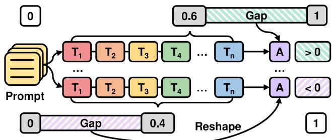
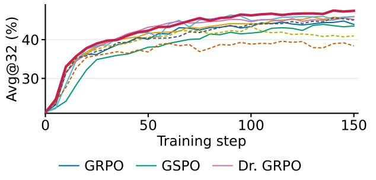
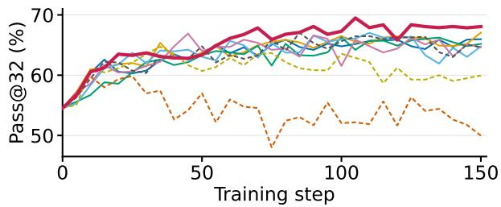
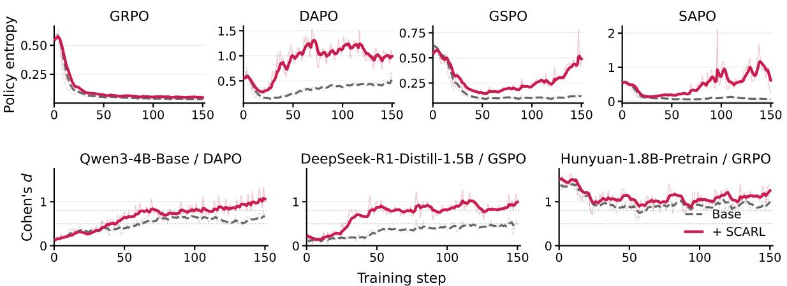

# SCARL: Sequence Confidence-Aligned Reinforcement Learning

Zhenghong Ke<sup>1,2</sup>\*, Jingbo Zhou<sup>1†</sup>, Hua Wu<sup>1†</sup>

<sup>1</sup>Baidu Frontier Research Department <sup>2</sup>Nanjing University kezhh163@163.com, {zhoujingbo, wu\_hua}@baidu.com

## Abstract

Reinforcement learning with verifiable rewards (RLVR) improves language-model reasoning by scoring sampled responses with a rule-based verifier and reinforcing those that pass. Where a classifier’s training couples predicted probability to labels, nothing ties an RLVR policy’s confidence in a response to its reward: aligned training would drive responses with the same advantage toward equal confidence, yet the advantage is blind to confidence. Under this sequence-confidence misalignment, a success the policy barely found earns the same update as one it produces with near certainty, and a confident error is corrected no harder than an exploratory one. We propose SCARL (Sequence Confidence-Aligned Reinforcement Learning), which reshapes, but never re-signs, each advantage with the alignment gap between the response’s group-relative confidence and the outcome its advantage certifies, normal ized into shares of each class’s advantage bud get. Misaligned samples absorb the force, responses with the same advantage are driven toward equal confidence, and repairing the misalignment doubles as a remedy for the entropy collapse that erodes exploration. SCARL provably reduces to its base estimator when a class’s confidences agree, adds no extra passes and one hyperparameter. On Qwen3-4B-Base it lifts average Pass@32 by 2.4 points over DAPO and is best among nine compute-matched methods on both coverage and per-draw accuracy; applied unchanged across four estimators and four backbones, it improves 14 of 16 settings while preserving policy entropy and widening the confidence–correctness separation. Our code is available at https://github.com/kezhh163/ scarl.

## 1 Introduction

Reinforcement learning with verifiable rewards (RLVR) has become the standard recipe for turning base language models into reasoners: sample responses, check them with a rule-based verifier, and reinforce what passes (Lambert et al., 2025; Guo et al., 2025). Group-relative estimators in the GRPO family (Shao et al., 2024) made the recipe practical at scale by replacing the value model with within-group reward normalization, and a line of successors refines its clipping, ratios, sampling, and normalizations (Yu et al., 2025; Zheng et al., 2025; Gao et al., 2025; Liu et al., 2025).

The recipe also has a well-documented failure mode. Policy entropy collapses early in training (Yu et al., 2025), exploration narrows, and the gains concentrate in per-draw accuracy while largek coverage stalls: RLVR often sharpens the sampling distribution over problems the model could already solve rather than enlarging that set (Yue et al., 2025); entropy falls when log-probability and advantage covary positively (Cui et al., 2025). Existing responses widen the upper clipping range (Yu et al., 2025), regulate that covariance (Cui et al., 2025; Wang et al., 2026a), or refine the update pathway for stability (Gao et al., 2025; Zheng et al., 2025); a growing line conditions the update on the policy’s own confidence or uncertainty, measured per token, response, or question (Chen et al., 2025; Cheng et al., 2026; Xie et al., 2026; Dai et al., 2026; Li et al., 2026; Xu et al., 2026; Wang et al., 2026b).

We start from what confidence-aware training should achieve. In a well-trained classifier, confidence is aligned with labels, the product of a loss that pushes hardest exactly where belief and label disagree. The group-relative advantage has no counterpart at the level where the reward lives: it is a function of the group’s rewards alone, and how confidently the policy produced a response, its sequence log-likelihood, enters nowhere. A correct response the policy barely found thus earns the same gradient as one it produces with near certainty, and a confident error is corrected no harder than a tentative, exploratory one. We call this sequenceconfidence misalignment and state the criterion that aligned training would satisfy: responses earning the same outcome should be held with the same confidence. The standard update violates it in both outcome classes.

  
Figure 1: Sequence-confidence misalignment and its repair. Group-relative RLVR gives each response a sequencelevel advantage (A) blind to how confidently the policy produced it. SCARL turns token log-probabilities into a group-relative sequence confidence (gray; here 0.6 and 0.4), reads the advantage sign as the outcome to match (1 or 0), and reshapes A with their distance, the alignment gap (hatched): misaligned responses absorb the update, aligned ones are left alone.

We propose SCARL (Sequence Confidence-Aligned Reinforcement Learning), which repairs this misalignment with a single multiplicative shaping factor on the advantage, its alignment gap (Figure 1): the distance between each response’s group-relative confidence, computed from the loglikelihood already materialized for the importance ratios, and the binarized outcome it earned. Misaligned responses absorb the force while aligned ones are left alone: the gap damps mastered successes, consolidates fragile ones, amplifies the correction of confident errors, and tolerates exploratory ones. Confidences of responses with the same advantage therefore converge, their generation probabilities equalize, and the policy keeps producing diverse solutions, so repairing the misalignment doubles as a remedy for entropy collapse. Unlike an additive confidence bonus, the factor is multiplicative and provably positive for any temperature, so no update is ever reversed; normalized within each outcome class, it preserves the class’s advantage budget and reduces exactly to the base estimator when a class’s confidences agree. SCARL adds no extra passes, one hyperparameter, and drops into any group-relative estimator unchanged.

Our contributions are threefold: (i) we state sequence-confidence alignment as an operational criterion for group-relative RLVR, same outcome, same confidence, show that the standard advantage violates it in both outcome classes by construction, and link the violation to entropy collapse;

(ii) we introduce SCARL, an alignment-gap reshaping of the advantage that provably never reverses an update, reduces exactly to the base estimator when a class’s confidences agree, and drops into any group-relative surrogate with one hyperparameter (§2); and (iii) we validate it under a compute-matched protocol (§3): on Qwen3-4B-Base, SCARL lifts DAPO’s average Pass@32 by 2.4 points (69.5 vs. 67.1) and attains the best coverage and per-draw accuracy among nine methods; applied unchanged across four estimators and four backbones, it improves 14 of 16 pairings; policy entropy stays above every base estimator’s from step 12 onward and the confidence separation rises into the large-effect regime; and ablations show that class-wise normalization is load-bearing (−9.4 without it), that outcome-blind shaping forfeits the gain, and that the whole-response confidence outperforms its per-token mean.

## 2 SCARL: Sequence Confidence-Aligned Reinforcement Learning

SCARL augments any group-relative policygradient algorithm with a single multiplicative shaping factor on the advantage, built to repair the sequence-confidence misalignment of §1. Uniform advantages violate the alignment criterion on both outcome classes, and we argue this misallocation is one driver of entropy collapse in GRPO training (Yu et al., 2025; Shao et al., 2024): highconfidence sequences receive disproportionate reinforcement and the policy sharpens prematurely. The converse is this paper’s constructive claim: when responses with the same advantage are driven toward equal confidence, their generation probabilities equalize and the policy retains diverse solutions (§3.5).

## 2.1 Background: Group-Relative RLVR

An autoregressive policy $\pi _ { \theta }$ maps a prompt $x \sim \mathcal { D }$ to a response y with $\begin{array} { r } { \pi _ { \theta } ( y ~ \vert ~ x ) ~ = ~ \prod _ { t } \pi _ { \theta } ( y _ { t } ~ \vert } \end{array}$ $x , y _ { < t } )$ In RLVR (Lambert et al., 2025; Guo et al., 2025) the reward is a rule-based verifier, here $R ( x , y ) = + 1$ if the final answer is accepted and −1 otherwise. GRPO (Shao et al., 2024) dispenses with a value model: for each prompt it samples a group of G responses $\{ y _ { i } \} _ { i = 1 } ^ { G } \sim \pi _ { \theta _ { \mathrm { o l d } } } ( \cdot \mid x )$ scores them $r _ { i } = R ( x , y _ { i } )$ , and normalizes rewards within the group,

$$
\hat { A } _ { i , t } = \hat { A } _ { i } = \frac { r _ { i } - \mathrm { m e a n } \Big ( \{ r _ { j } \} _ { j = 1 } ^ { G } \Big ) } { \mathrm { s t d } \Big ( \{ r _ { j } \} _ { j = 1 } ^ { G } \Big ) } ,\tag{1}
$$

broadcasting the sequence-level advantage to every token of $y _ { i } ; \mathrm { E q . } \left( 1 \right)$ depends on the rewards alone, and the policy’s confidence in $y _ { i }$ enters nowhere. With the token-level importance ratio

$$
\rho _ { i , t } ( \theta ) \ = \ \frac { \pi _ { \theta } ( y _ { i , t } \mid x , y _ { i , < t } ) } { \pi _ { \theta _ { \mathrm { o l d } } } ( y _ { i , t } \mid x , y _ { i , < t } ) } ,\tag{2}
$$

GRPO maximizes the clipped surrogate

$$
\begin{array} { r } { \mathcal { T } _ { \mathrm { G R P O } } ( \theta ) = \mathbb { E } \Bigg [ \frac { 1 } { G } \sum _ { i = 1 } ^ { G } \frac { 1 } { | y _ { i } | } \sum _ { t = 1 } ^ { | y _ { i } | } \operatorname* { m i n } \Bigl ( \rho _ { i , t } ( \theta ) \hat { A } _ { i , t } , } \\ { \operatorname { c l i p } \bigl ( \rho _ { i , t } ( \theta ) , 1 - \varepsilon , 1 + \varepsilon \bigr ) \hat { A } _ { i , t } \Bigr ) \Bigg ] , } \end{array}\tag{3}
$$

over x and $\{ y _ { i } \} \sim \ \pi _ { \theta _ { \mathrm { o l d } } }$ , optionally with a KL penalty toward a frozen reference, following each estimator’s published choice. $\mathrm { G R P O ^ { \circ } s }$ descendants (DAPO, GSPO, SAPO) retain group-relative advantages and vary the surrogate around them; we write $\mathcal { T } _ { \mathrm { b a s e } } ( \theta ; \{ \hat { A } _ { i , t } \} )$ for any such objective. SCARL operates exclusively on $\{ \hat { A } _ { i , t } \}$ and is agnostic to these surrogate choices.

The SCARL transformation. SCARL leaves rewards, importance ratios, and clipping untouched, and reshapes the base advantage with a strictly positive sequence-level shaping factor derived from the policy’s own confidence:

$$
\begin{array} { r } { \hat { A } _ { i , t } ^ { \mathrm { S C A R L } } \ = \ w _ { i } \hat { A } _ { i , t } , \qquad w _ { i } > 0 , } \end{array}\tag{4}
$$

where $w _ { i }$ is produced in four steps: (i) read off each sequence’s log-likelihood under the behavior policy (§2.2), (ii) convert it into a group-relative confidence (§2.3), (iii) take the alignment gap between that confidence and the binarized outcome (§2.4), and (iv) normalize within each target class (§2.5). Every step is a group-level operation on scalars already materialized during training; the one substantive hyperparameter is the temperature τ .

## 2.2 Sequence Confidence

For each response $y _ { i }$ in a group, we define its confidence as the sequence log-likelihood under the behavior policy,

$$
\begin{array} { c l } { { } } & { { \displaystyle c _ { i } = \sum _ { t = 1 } ^ { | y _ { i } | } \log \pi _ { \theta _ { \mathrm { o l d } } } ( y _ { i , t } | x , y _ { i , < t } ) } } \\ { { } } & { { \displaystyle ~ = \log \pi _ { \theta _ { \mathrm { o l d } } } ( y _ { i } | x ) \le 0 . } } \end{array}\tag{5}
$$

Two properties motivate this choice. First, c<sub>i</sub> reflects the model’s beliefs at sampling time and remains constant across the minibatch updates of an epoch, so $w _ { i }$ is a fixed coefficient rather than a moving target. Second, the per-token log-probabilities are already materialized for the importance ratios, so $c _ { i }$ costs a single summation. Because $c _ { i }$ sums over tokens, longer responses are, all else equal, judged less confident. We retain the sum deliberately: it measures the probability the policy committed to the whole response, and within a group every response answers the same prompt, so length differences reflect behavioral choices rather than nuisance variation (§3.4 tests the per-token alternative).

## 2.3 Group-Relative Confidence

Raw log-likelihoods are not comparable across prompts, and their dispersion varies by orders of magnitude across models and training stages, so we standardize within the group before relativizing. Let $\sigma _ { \mathcal { G } } = \mathrm { s t d } \Big ( \{ c _ { j } \} _ { j = 1 } ^ { G } \Big ) , \tau > 0$ a temperature, and $\delta > 0$ a small stabilizer; then

$$
\tilde { c } _ { i } = \frac { c _ { i } } { \tau ( \sigma _ { \mathscr G } + \delta ) } , \qquad p _ { i } = \frac { \exp ( \tilde { c } _ { i } ) } { \sum _ { j = 1 } ^ { G } \exp ( \tilde { c } _ { j } ) } .\tag{6}
$$

Three properties matter. Shift invariance: any offset common to the group (intrinsic prompt difficulty) cancels in the softmax, so $p _ { i }$ depends only on how confident the policy was in $y _ { i }$ relative to its siblings, mirroring the base estimator’s reward normalization. Calibrated sharpness: the scaled logits have standard deviation $1 / \tau \left( \mathrm { u p t o } \delta \right)$ , decoupling softmax concentration from group dispersion, so a single τ transfers across prompts, models, and training stages (§3.4). Positivity: $p _ { i } \in ( 0 , 1 )$ with $\textstyle \sum _ { i } p _ { i } = 1$ , which is what guarantees that shaping can rescale an advantage but never flip its sign.

## 2.4 Alignment-Gap Shaping

We call confidence aligned on a group when responses with the same outcome are held with the same confidence; the alignment criterion asks how far each sequence stands from that state. Write $t _ { i } = \mathbf { 1 } \{ \hat { A } _ { i } \geq 0 \}$ for the binarized outcome that sample i’s advantage certifies; the classes follow the advantage sign, never the raw reward (under our binary reward the two coincide; groups with identical rewards have $\hat { A } _ { i } = 0$ and are inert). We scale each sample’s update by its alignment gap (Figure 1),

$$
\tilde { w } _ { i } = \left| t _ { i } - p _ { i } \right| = \left\{ \begin{array} { l l } { 1 - p _ { i } } & { \mathrm { i f ~ } t _ { i } = 1 , } \\ { p _ { i } } & { \mathrm { i f ~ } t _ { i } = 0 . } \end{array} \right.\tag{7}
$$

The outcome decides only the direction of an update; the gap decides how much of it survives, and it orients the update within each class. Aligned samples are left nearly untouched: the mastered success and the tentative, exploratory error both carry a small gap. Misaligned samples absorb the force: a fragile success the policy barely found is consolidated, and an error committed with conviction is corrected hardest. In form, the gap is focal loss’s modulating factor (Lin et al., 2017) with the group share as prediction and the certified outcome as label; §2.5 normalizes it within each class.

## 2.5 Class-Wise Normalization

The two branches of $\operatorname { E q . } \left( 7 \right)$ cannot be used as-is: since $\textstyle \sum _ { i } p _ { i } = 1$ , near-uniform confidence gives samples with $t _ { i } ~ = ~ 1$ gaps near $( G - 1 ) / G$ but samples with $t _ { i } = 0$ gaps near $1 / G$ , an imbalance that all but erases penalties. We therefore normalize within target classes $S _ { + } = \{ i : t _ { i } = 1 \}$ and $s _ { - } =$ $\{ i : t _ { i } = 0 \}$ , with ${ \cal { S } } ( i )$ the class containing i:

$$
w _ { i } = \frac { { \tilde { w } } _ { i } } { \frac { 1 } { | { \cal S } ( i ) | } \sum _ { j \in { \cal S } ( i ) } { \tilde { w } } _ { j } } ,\tag{8}
$$

with $w _ { i } = 1$ whenever $| S ( i ) | \le 1$ . The division is a conservation law: Eq. (8) converts the raw gaps into shares of each class’s fixed advantage budget $( \mathbb { E } [ w _ { i } \mid S ( i ) ] = 1 )$ , so confidence decides how the budget is spent, never how large it is. It also measures each response against its own class: within each class, Eq. (8) makes a response’s update proportional to how far its confidence lies from the class mean: a success held with less confidence than its correct siblings is consolidated, and an error held with more confidence than its incorrect siblings is corrected hardest (the appendix gives the algebra). Two guarantees follow (proofs in the appendix). Property 1 (sign preservation): every $w _ { i }$ is strictly positive and bounded by $| S ( i ) |$ |, so Eq. (4) never reverses the direction of improvement. Property 2 (class-mass preservation and recovery): when all responses in a class share the same group-relative confidence, $w _ { i } = 1$ exactly and SCARL coincides with the base estimator: it is a strict generalization of GRPO that activates only where confidence varies within an outcome class.

## 2.6 Training Objective

SCARL specifies only the advantage transformation; the surrogate is inherited unchanged. Given any group-relative objective $\mathcal { T } _ { \mathrm { b a s e } } ( \theta ; \{ \hat { A } _ { i , t } \} )$ , the SCARL objective is $\mathcal { T } _ { \mathrm { b a s e } } ( \theta ; \{ w _ { i } \hat { A } _ { i , t } \} )$ , instantiated throughout on GRPO’s clipped surrogate (Eq. (3)). Since $w _ { i }$ is a function of $\pi _ { \boldsymbol { \theta } _ { \mathrm { o l d } } }$ only, no gradient flows through it. Intervening purely in advantage space, SCARL composes with ratio-space interventions (Yu et al., 2025; Gao et al., 2025; Zheng et al., 2025), dynamic sampling, and alternative base estimators (Ahmadian et al., 2024; Liu et al., 2025) rather than competing with them; an algorithm and a reference implementation appear in the appendix.

Why it helps (informal). Property 3 (entropyaware shaping): among positive-advantage samples $w _ { i }$ is anti-monotone in confidence, damping precisely the high-log π, high-A terms that dominate the entropy-decay covariance (Cui et al., 2025); among negative-advantage samples it concentrates correction on over-confident modes and spares rare exploratory errors. Both effects slow entropy decay at its source (§3.5; appendix). Property 4 (cost): O(G) scalar operations per group on quantities already computed for the surrogate; wall-clock overhead is negligible.

## 3 Experiments

Our experiments ask whether SCARL outperforms strong RLVR baselines under a compute-matched recipe (§3.2), whether the improvement transfers across estimators and model families without retuning (§3.3), whether the gain comes from alignment itself (§3.4), and whether SCARL acts through its intended mechanism (§3.5).

## 3.1 Setup

Models, estimators, and baselines. The primary comparison uses Qwen3-4B-Base; the generality study adds Qwen3-1.7B-Base, DeepSeek-R1- Distill-Qwen-1.5B, and Hunyuan-1.8B-Pretrain. We evaluate SCARL as a drop-in modifier of four base estimators: GRPO (Shao et al., 2024), DAPO (Yu et al., 2025), GSPO (Zheng et al., 2025), and SAPO (Gao et al., 2025). The main comparison adds Dr. GRPO (Liu et al., 2025) and three confidence-aware methods run in their native configurations: Entropy Advantage Shaping (EAS) (Cheng et al., 2026), SEED-GRPO (Chen et al., 2025), and UCAS (Xie et al., 2026).

Benchmarks and metrics. We evaluate on five competition-mathematics benchmarks: AMC23, AIME24, AIME25, Minerva Math (Lewkowycz et al., 2022), and MATH-500 (Hendrycks et al., 2021; Lightman et al., 2024), sampling $k \_ =$ 32 responses per problem. Average accuracy $( \operatorname { A v g @ } k = c / k$ for c correct responses) measures sampling efficiency; coverage (Pass@k) measures whether at least one response is correct. A method can raise the former while leaving the latter unchanged, sharpening the distribution over an unchanged solvable set (Yue et al., 2025), so we track both: Pass@32 carries every table and Avg@32 the training curves of the main comparison; Pass@32 is estimated by bootstrap resampling of each problem’s 32 responses (Appendix E).

Confidence separation (Cohen’s d). We measure alignment with the confidence signal $c _ { i }$ of Eq. (5) itself. Within each group g we split rollouts into correct $( \hat { A } _ { i } \geq 0 )$ and incorrect $( \hat { A } _ { i } < 0 )$ sets with confidence means $\mu _ { g } ^ { \pm }$ and variances $s _ { g } ^ { 2 , \pm } ,$ pooling across a step’s groups,

$$
d = \frac { \mathrm { m e a n } _ { g } \big ( \mu _ { g } ^ { + } - \mu _ { g } ^ { - } \big ) } { \sqrt { \big ( V ^ { + } + V ^ { - } \big ) / 2 } } , \quad V ^ { \pm } = \mathrm { m e a n } _ { g } s _ { g } ^ { 2 , \pm } .\tag{9}
$$

A larger d means the policy’s confidence better distinguishes its correct from its incorrect responses; d rises both when the classes separate and when same-class confidences converge.

Training and evaluation protocol. All methods share one recipe and differ only in the advantage transformation (SCARL) or the surrogate (base estimators), so comparisons are compute-matched: 150 steps, group size $G = 8 .$ , batch size 512, learning rate $1 \times 1 0 ^ { - 6 }$ , trained on DAPO-Math-17K (Yu et al., 2025) with verl (Sheng et al., 2025); SCARL uses $\tau = 5$ throughout, selected once by the sweep in §3.4. Evaluation draws 32 responses per problem (temperature 0.6, top-p 0.95, top-k 20) every 5 steps; tables report each run at its best checkpoint by five-benchmark average, and correctness is checked by rule-based verifiers matched to each data source. Full hyperparameters, per-estimator settings, verifier routing, and prompts appear in the appendix.

## 3.2 Main Results: SCARL versus Existing Interventions

We apply SCARL to DAPO, denoted DAPO + SCARL. On Qwen3-4B-Base it improves average Pass@32 by 2.4 points over vanilla DAPO (69.5 vs. 67.1), the controlled same-base measure of SCARL’s effect, and attains the best average Pass@32 and Avg@32 among all nine methods: improving both means the policy solves more problems within the 32-sample budget rather than sharpening its distribution over an unchanged solvable set. Every method improves on the untrained base model’s 54.5 average Pass@32; SCARL improves it the most (+15.0). The advantage holds on Qwen3-1.7B-Base, where DAPO + SCARL again takes the highest average (58.0, +2.2 over DAPO; table in the appendix). Figure 2 shows the training curves and Table 1 the per-benchmark breakdown.

Training dynamics. SCARL is the top method at 20 of the 30 logged steps on both metrics, and its lead over the next-best method grows over the second half of training (1.1 points on Avg@32 and 1.6 on Pass@32 over the final ten checkpoints).

Per-benchmark results. SCARL is best on four of the five benchmarks and trails only on Minerva, where Dr. GRPO leads (59.6 vs. 57.4); the largest margins fall on the AIME sets.

Confidence-awareness alone is not enough. The confidence-aware baselines behave very differently from one another: SEED-GRPO is competitive (67.0), Entropy Advantage Shaping is no better than vanilla GRPO (64.7 vs. 66.0), and UCAS falls well below it (59.9). Coupling the update to the policy’s (un)certainty is not automatically beneficial; the gain lies in the alignment-gap construction.



  
Figure 2: Avg@32 (left) and Pass@32 (right) on Qwen3-4B-Base, averaged over the five benchmarks, across 150 training steps; step 0 is the untrained base model. SCARL (bold) leads both metrics through the second half of training, with a widening margin.

Table 1: Main comparison on Qwen3-4B-Base. Pass@32 on five competition-mathematics benchmarks (%), at each method’s best checkpoint by average Pass@32. Bold marks the best value per column; the untrained base model is a reference, excluded from bolding.
<table><tr><td>Method</td><td>AMC23</td><td>AIME24</td><td>AIME25</td><td>Minerva</td><td>MATH-500</td><td>Avg.</td></tr><tr><td>Base model (no RL)</td><td>75.1</td><td>25.9</td><td>23.3</td><td>56.3</td><td>92.0</td><td>54.5</td></tr><tr><td>Base estimators</td><td></td><td></td><td></td><td></td><td></td><td></td></tr><tr><td>GRPO</td><td>88.9</td><td>44.6</td><td>44.7</td><td>56.4</td><td>95.3</td><td>66.0</td></tr><tr><td>DAPO</td><td>90.4</td><td>46.1</td><td>45.0</td><td>58.4</td><td>95.5</td><td>67.1</td></tr><tr><td>GSPO</td><td>91.8</td><td>45.3</td><td>42.9</td><td>58.3</td><td>92.8</td><td>66.2</td></tr><tr><td>SAPO</td><td>92.2</td><td>45.7</td><td>43.1</td><td>59.3</td><td>94.8</td><td>67.0</td></tr><tr><td>Dr. GRPO</td><td>88.9</td><td>47.9</td><td>43.3</td><td>59.6</td><td>94.9</td><td>66.9</td></tr><tr><td>Confidence-aware methods</td><td></td><td></td><td></td><td></td><td></td><td></td></tr><tr><td>Entropy Advantage Shaping</td><td>89.2</td><td>42.0</td><td>43.9</td><td>55.8</td><td>92.7</td><td>64.7</td></tr><tr><td>SEED-GRPO</td><td>89.7</td><td>45.5</td><td>48.0</td><td>58.0</td><td>94.0</td><td>67.0</td></tr><tr><td>UCAS</td><td>85.8</td><td>33.5</td><td>30.3</td><td>58.0</td><td>91.6</td><td>59.9</td></tr><tr><td>DAPO + SCARL (ours)</td><td>95.3</td><td>49.0</td><td>50.1</td><td>57.4</td><td>95.6</td><td>69.5</td></tr></table>

## 3.3 Generality across Base Estimators and Model Families

SCARL shapes only the advantage (§2.6), so it should compose with any group-relative estimator; we apply it unchanged, with τ = 5, to four estimators on four backbones from three model families. Table 2 reports all sixteen pairings: SCARL improves average Pass@32 in 14 of the 16 (mean ∆ of +1.0), and on every benchmark it improves a majority of the pairings (per-benchmark tables in the appendix). A single confidence-aware factor thus transfers across estimators and model families without per-setting retuning, and every one of the 32 trained runs raises coverage over its untrained backbone.

The two exceptions. Both pairings in which + SCARL does not improve are under SAPO, and both are small (−0.2 each). SAPO is the one base estimator that already rescales every update continuously, through its temperature-controlled gate in ratio space, so stacking a second continuous modulation yields the smallest marginal benefit; the other three estimators gate updates only through hard clipping and improve with SCARL in all twelve settings.

Table 2: SCARL as a drop-in modifier. Average Pass@32 (%) of each estimator with SCARL added, on four backbones (in parentheses: change vs. the plain estimator; per-benchmark values in the appendix). DS-R1-1.5B: DeepSeek-R1-Distill-Qwen-1.5B.
<table><tr><td>Backbone</td><td>+GRPO</td><td>+DAPO</td><td>+GSPO</td><td>+SAPO</td></tr><tr><td>Qwen3-4B-Base</td><td></td><td>67.3(+1.4) 69.5(+2.4) 67.7(+1.5)</td><td></td><td>68.1(+1.1)</td></tr><tr><td>Qwen3-1.7B-Base 56.3(+1.8) 58.0(+2.2) 57.1(+0.7) 55.6(−0.2)</td><td></td><td></td><td></td><td></td></tr><tr><td>DS-R1-1.5B</td><td></td><td></td><td>70.5(+1.2) 72.0(+0.5) 71.4(+0.5) 71.6(+0.1)</td><td></td></tr><tr><td>Hunyuan-1.8B</td><td></td><td></td><td>62.0(+0.8) 64.4(+1.5) 62.1(+0.1) 62.5(−0.2)</td><td></td></tr></table>

## 3.4 Ablations: Alignment Is the Active Ingredient

SCARL has two structural components, one confidence signal, and one substantive hyperparameter: alignment-gap shaping (§2.4), class-wise normalization (§2.5), the summed log-likelihood of Eq. (5), and the temperature τ . We ablate each on Qwen3-1.7B-Base with GSPO as the base estimator, a second backbone and estimator relative to the main comparison; each variant changes exactly one element (Table 3).

Table 3: Component ablations and temperature sensitivity (Qwen3-1.7B-Base, GSPO base; average Pass@32 over the five benchmarks). ∆ is relative to plain GSPO; per-benchmark values in the appendix.
<table><tr><td>Variant</td><td>Avg.</td><td> $\Delta$ </td></tr><tr><td>GSPO (base estimator)</td><td>56.4</td><td></td></tr><tr><td>+ SCARL w/o class-wise norm.</td><td>47.0</td><td>-9.4</td></tr><tr><td>+ SCARL w/o alignment target</td><td>56.6</td><td>+0.2</td></tr><tr><td>+ SCARL w/ per-token mean confidence</td><td>55.3</td><td>-1.1</td></tr><tr><td> $+ \mathbf { S C A R L } \left( \mathbf { f u l l } ; \tau = 5 \right)$ </td><td>57.1</td><td>+0.7</td></tr><tr><td>Temperature sweep (full SCARL)</td><td></td><td></td></tr><tr><td> $\tau = 0 . 2$ </td><td>55.1</td><td>-1.3</td></tr><tr><td> $\tau = 0 . 5$ </td><td>55.6</td><td>-0.8</td></tr><tr><td> $\tau = 2$ </td><td>56.2</td><td>-0.2</td></tr><tr><td> $\tau = 1 0$ </td><td>54.7</td><td>-1.7</td></tr></table>

Class-wise normalization is load-bearing. Training on the raw gaps of Eq. (7) without Eq. (8) does not merely lose SCARL’s gain; it forfeits RL’s. Average Pass@32 falls to 47.0: 9.4 points below the plain base estimator and within 0.4 of the untrained backbone, the failure mode §2.5 predicts when the penalty class’s advantage budget is all but erased.

The gain lives in alignment. The second variant keeps every ingredient except the alignment target: it computes the gap to a constant $( \tilde { w } _ { i } = 1 - p _ { i }$ for every sample regardless of outcome, class normalization kept), so the factor still responds to confidence but carries no information about where confidence should be. Performance returns to the baseline (56.6 vs. 56.4; the full construction reaches 57.1). The gain therefore comes from measuring confidence against the verified outcome, not from confidence shaping per se, mirroring §3.2.

Whole-response confidence. Replacing the summed log-likelihood of Eq. (5) with its pertoken mean, a length-normalized confidence, drops average Pass@32 to 55.3, 1.1 points below the plain base estimator. The mean rates a long response that wanders to its answer as confidently as a short one that commits to it, so the gap stops separating fragile successes from mastered ones.

Temperature. Sweeping $\tau \in \{ 0 . 2 , 0 . 5 , 2 , 5 , 1 0 \}$ yields average Pass@32 of 55.1, 55.6, 56.2, 57.1, and 54.7: rising monotonically to the default τ = 5 and dropping beyond it, the two failure directions the calibrated-sharpness design of §2.3 anticipates.

$\tau = 5$ was selected once and reused, without retuning, in all sixteen pairings of §3.3.

## 3.5 Mechanism: Preserved Exploration, Repaired Confidence Alignment

If SCARL improves coverage for the reason it was designed, two signatures should be visible during training: entropy should stay higher than under the base estimator (Property 3), and the confidence separation of Eq. (9) should widen. Figure 3 shows both, for every base estimator on Qwen3-4B-Base and for three settings spanning three model families.

Preserved exploration. Adding SCARL keeps policy entropy above the base estimator’s at every logged step from step 12 onward, for all four estimators; over the final ten steps, mean entropy with SCARL is 2.0× the base level on DAPO (1.02 vs. 0.50), 4.1× on GSPO, and 11× on SAPO. GRPO is the instructive exception: SCARL slows the decay at every step but, acting in advantage space alone, cannot avert collapse under GRPO’s symmetric hard clipping, which most tightly restricts the up-weighting of low-probability tokens (Yu et al., 2025). Because exploration collapse is how RLVR narrows the Pass@k boundary (Yue et al., 2025), preserved entropy is the proximate explanation for the coverage gains of §3.2.

Repaired confidence alignment. The policy’s own confidence becomes a sharper indicator of correctness in all three settings. Over the final ten steps, SCARL lifts Cohen’s d from 0.65 to 1.06 on Qwen3-4B-Base / DAPO and from 0.50 to 0.97 on DeepSeek-R1-Distill-Qwen-1.5B / GSPO, in both cases alone crossing from the medium into the large-effect regime $( d > 0 . 8 )$ ; on Hunyuan-1.8B-Pretrain / GRPO it raises an already-large 0.95 to 1.20. The base run’s transiently higher d over the DAPO setting’s first 35 steps reflects the confidentsuccess reinforcement that SCARL damps by design (appendix). Moving both signatures at once is what the construction intends, and it is why SCARL’s gains appear in coverage, not only perdraw accuracy.

## 4 Related Work

RL with verifiable rewards. RLVR replaces learned reward models (Ouyang et al., 2022) with programmatic verification (Lambert et al., 2025) and, scaled up, elicits long chain-of-thought reasoning (Guo et al., 2025); it rests on GRPO and its descendants (Shao et al., 2024; Yu et al., 2025; Zheng et al., 2025; Gao et al., 2025; Liu et al., 2025); AAPO (Xiong et al., 2026) augments the group-relative advantage with a reward margin over the reference model. Our coverage-centred protocol follows Yue et al. (2025).

  
Figure 3: Mechanism. Top: policy entropy on Qwen3-4B-Base per base estimator, without (grey dashed) and with (crimson) SCARL. Bottom: confidence separation (Cohen’s d, Eq. (9)) in three settings; dotted lines at d = 0.5 and 0.8. EMA-smoothed (span 8) over faint raw values.

Entropy collapse and the update pathway. Entropy collapse in RLVR is well documented (Yu et al., 2025); for softmax policies, entropy falls with the covariance between log-probability and advantage (Cui et al., 2025). Interventions act at different points of the update: DAPO widens the upper clipping range, Cui et al. (2025) regulate the covariance through bonuses or detached tokens, CW-GRPO (Wang et al., 2026a) down-weights tokens with extreme covariance, and GSPO’s sequencelevel ratios and SAPO’s smooth gate refine the ratio pathway. All regulate how much of an update is transmitted; SCARL changes how reinforcement is allocated across a group’s sequences and composes with them (§3.3).

Confidence-aware policy optimization. Several methods condition the group-relative update on the policy’s own confidence or uncertainty, measured at the token, response, or question level. CDE (Dai et al., 2026) adds a clipped, annealed perplexity bonus to the reward; EAS (Cheng et al., 2026) adds a clipped, detached token-entropy bonus to the advantage, and ProGRPO’s ARM (Li et al., 2026) a scaled deviation of a response’s confidence from the group mean, equalizing confidence across correct responses; SEED-GRPO (Chen et al., 2025) scales each question’s advantages by the semantic entropy of its answers, and UCAS (Xie et al., 2026) modulates them with a logit-space self-certainty and a token-level certainty penalty; CAPO (Wang et al., 2026b) replaces the advantage with a pairwise logistic-AUC surrogate over mean token logprobability, targeting calibration; ACE (Xu et al., 2026) amplifies the penalty on errors whose likelihood has risen relative to a reference model. SCARL shares the premise and differs in three places (Table 5): its criterion covers both outcome classes and measures each response against its own class’s mean confidence; its factor is multiplicative and positive for any temperature, so no update is reversed and no bound or clip is needed; and its class-wise mean-one normalization recovers the base estimator exactly when a class’s confidences agree. Confidence-based reweighting has precedent in focal loss (Lin et al., 2017), GHM (Li et al., 2019), and prioritized replay (Schaul et al., 2016).

## 5 Conclusion

We identified sequence-confidence misalignment as a blind spot of group-relative RLVR: where a classifier’s training ties confidence to labels, nothing ties an RLVR policy’s confidence to the verified outcome. SCARL restores the missing tie by reshaping each advantage with its alignment gap, computed from quantities training already materializes. It delivered the best coverage and per-draw accuracy among nine compute-matched methods, transferred across four estimators and four backbones without retuning, preserved exploration, and widened the confidence–correctness separation.

## Limitations

Our experiments cover competition mathematics with binary, rule-based verifier rewards; other domains and shaped or continuous rewards are not studied. The backbones span three model families but only scales up to 4B parameters. The inferencetime use of the aligned confidence that training produces, for abstention or selection (Tomani et al., 2024), is a natural extension that we have not explored.

## References

Arash Ahmadian, Chris Cremer, Matthias Gallé, Marzieh Fadaee, Julia Kreutzer, Olivier Pietquin, Ahmet Üstün, and Sara Hooker. 2024. Back to basics: Revisiting REINFORCE-style optimization for learning from human feedback in LLMs. In Proceedings of the 62nd Annual Meeting of the Association for Computational Linguistics (Volume 1: Long Papers), pages 12248–12267, Bangkok, Thailand. Association for Computational Linguistics.

Minghan Chen, Guikun Chen, Wenguan Wang, and Yi Yang. 2025. SEED-GRPO: Semantic entropy enhanced GRPO for uncertainty-aware policy optimization. Preprint, arXiv:2505.12346.

Daixuan Cheng, Shaohan Huang, Xuekai Zhu, Bo Dai, Xin Zhao, Zhenliang Zhang, and Furu Wei. 2026. Reasoning with exploration: An entropy perspective. Proceedings of the AAAI Conference on Artificial Intelligence, 40(36):30377–30385.

Ganqu Cui, Yuchen Zhang, Jiacheng Chen, et al. 2025. The entropy mechanism of reinforcement learning for reasoning language models. Preprint, arXiv:2505.22617.

Runpeng Dai, Linfeng Song, Haolin Liu, et al. 2026. CDE: Curiosity-driven exploration for efficient reinforcement learning in large language models. In The Fourteenth International Conference on Learning Representations.

Chang Gao, Chujie Zheng, Xiong-Hui Chen, Kai Dang, Shixuan Liu, Bowen Yu, An Yang, Shuai Bai, Jingren Zhou, and Junyang Lin. 2025. Soft adaptive policy optimization. Preprint, arXiv:2511.20347.

Daya Guo, Dejian Yang, Haowei Zhang, et al. 2025. DeepSeek-R1 incentivizes reasoning in LLMs through reinforcement learning. Nature, 645(8081):633–638.

Dan Hendrycks, Collin Burns, Saurav Kadavath, Akul Arora, Steven Basart, Eric Tang, Dawn Song, and Jacob Steinhardt. 2021. Measuring mathematical problem solving with the MATH dataset. In Proceedings of the Neural Information Processing Systems Track on Datasets and Benchmarks.

Nathan Lambert, Jacob Morrison, Valentina Pyatkin, et al. 2025. Tülu 3: Pushing frontiers in open language model post-training. In Second Conference on Language Modeling.

Aitor Lewkowycz, Anders Andreassen, David Dohan, et al. 2022. Solving quantitative reasoning problems with language models. In Advances in Neural Information Processing Systems, volume 35, pages 3843–3857. Curran Associates, Inc.

Buyu Li, Yu Liu, and Xiaogang Wang. 2019. Gradient harmonized single-stage detector. Proceedings of the AAAI Conference on Artificial Intelligence, 33(01):8577–8584.

Pengyi Li, Elizaveta Goncharova, Andrey Kuznetsov, and Ivan Oseledets. 2026. Back to basics: Revisiting exploration in reinforcement learning for LLM reasoning via generative probabilities. Preprint, arXiv:2602.05281.

Hunter Lightman, Vineet Kosaraju, Yuri Burda, Harrison Edwards, Bowen Baker, Teddy Lee, Jan Leike, John Schulman, Ilya Sutskever, and Karl Cobbe. 2024. Let’s verify step by step. In The Twelfth International Conference on Learning Representations.

Tsung-Yi Lin, Priya Goyal, Ross Girshick, Kaiming He, and Piotr Dollár. 2017. Focal loss for dense object detection. In 2017 IEEE International Conference on Computer Vision (ICCV), pages 2999–3007. IEEE.

Zichen Liu, Changyu Chen, Wenjun Li, Penghui Qi, Tianyu Pang, Chao Du, Wee Sun Lee, and Min Lin. 2025. Understanding R1-zero-like training: A critical perspective. In Second Conference on Language Modeling.

Long Ouyang, Jeffrey Wu, Xu Jiang, et al. 2022. Training language models to follow instructions with human feedback. In Advances in Neural Information Processing Systems, volume 35, pages 27730–27744. Curran Associates, Inc.

Tom Schaul, John Quan, Ioannis Antonoglou, and David Silver. 2016. Prioritized experience replay. In International Conference on Learning Representations.

Zhihong Shao, Peiyi Wang, Qihao Zhu, et al. 2024. DeepSeekMath: Pushing the limits of mathematical reasoning in open language models. Preprint, arXiv:2402.03300.

Guangming Sheng, Chi Zhang, Zilingfeng Ye, Xibin Wu, Wang Zhang, Ru Zhang, Yanghua Peng, Haibin Lin, and Chuan Wu. 2025. HybridFlow: A flexible and efficient RLHF framework. In Proceedings of the Twentieth European Conference on Computer Systems, pages 1279–1297. ACM.

Christian Tomani, Kamalika Chaudhuri, Ivan Evtimov, Daniel Cremers, and Mark Ibrahim. 2024. Uncertainty-based abstention in LLMs improves safety and reduces hallucinations. Preprint, arXiv:2404.10960.

Cheng Wang, Qin Liu, Wenxuan Zhou, and Muhao Chen. 2026a. Taming extreme tokens: Covarianceaware GRPO with Gaussian-kernel advantage reweighting. In Proceedings ofthe 64th Annual Meeting ofthe Associationfor Computational Linguistics (Volume 2: Short Papers), pages 540–546, San Diego, California, United States. Association for Computational Linguistics.

Ziqi Wang, Xingzhou Lou, Meiqi Wu, Zhengqi Wen, and Junge Zhang. 2026b. Calibration-aware policy optimization for reasoning LLMs. In Proceedings of the 64th Annual Meeting of the Association for Computational Linguistics (Volume 1: Long Papers), pages 18375–18390, San Diego, California, United States. Association for Computational Linguistics.

Can Xie, Ruotong Pan, Xiangyu Wu, Yunfei Zhang, Jiayi Fu, Tingting Gao, and Guorui Zhou. 2026. Unlocking exploration in RLVR: Uncertainty-aware advantage shaping for deeper reasoning. In Findings of the Associationfor Computational Linguistics: ACL 2026, pages 19057–19076, San Diego, California, United States. Association for Computational Linguistics.

Jian Xiong, Jingbo Zhou, Jingyong Ye, Qiang Huang, and Dejing Dou. 2026. AAPO: Enhancing the reasoning capabilities of LLMs with advantage margin. In Proceedings of the 64th Annual Meeting of the Association for Computational Linguistics (Volume 1: Long Papers), pages 24663–24680, San Diego, California, United States. Association for Computational Linguistics.

Yuanda Xu, Hejian Sang, Zhengze Zhou, Ran He, and Zhipeng Wang. 2026. Overconfident errors need stronger correction: Asymmetric confidence penalties for reinforcement learning. Preprint, arXiv:2602.21420.

Qiying Yu, Zheng Zhang, Ruofei Zhu, et al. 2025. DAPO: An open-source LLM reinforcement learning system at scale. In Advances in Neural Information Processing Systems.

Yang Yue, Zhiqi Chen, Rui Lu, Andrew Zhao, Zhaokai Wang, Yang Yue, Shiji Song, and Gao Huang. 2025. Does reinforcement learning really incentivize reasoning capacity in LLMs beyond the base model? In Advances in Neural Information Processing Systems.

Chujie Zheng, Shixuan Liu, Mingze Li, et al. 2025. Group sequence policy optimization. Preprint, arXiv:2507.18071.

## A Extended Method Discussion

This section preserves the method discussion compressed out of §2 in the main paper.

The covariance fingerprint, in full. For softmax policies, the change in policy entropy under a policy-gradient step is, to first order, the negative covariance between token log-probability and advantage (Cui et al., 2025); a group-relative advantage is broadcast across a response’s tokens, so the fingerprint aggregates to the sequence level, and an estimator that weights sequences by advantage alone lets confident successes (high log π, positive A<sup>ˆ</sup>) dominate that covariance, pushing entropy steadily downward. The misalignment misallocates learning even before entropy becomes a concern: updates keep reinforcing behaviors the model has already internalized while under-consolidating fragile, newly acquired ones, and they punish exploratory mistakes as severely as confident errors.

Property 3 (entropy-aware shaping, informal), in full. SCARL attacks the covariance directly. Among positive-advantage samples, $w _ { i }$ is antimonotone in confidence, damping precisely the high-log π, high-A terms that dominate the covariance; among negative-advantage samples, $w _ { i }$ is monotone in confidence, strengthening the updates that move probability mass away from overconcentrated modes while sparing the rare, exploratory errors whose suppression would only sharpen the distribution further. Both effects shrink Cov log π, w·A relative to Cov log π, A, slowing entropy decay at its source rather than through post-hoc clipping or entropy bonuses.

The within-class view. Class normalization measures the raw gap of Eq. (7) against the class mean. With $\bar { p } s$ the mean confidence of a class, Eq. (8) gives $w _ { i } = 1 + ( \bar { p } _ { S } - p _ { i } ) / ( 1 - \bar { p } _ { S } )$ on $S _ { + }$ and $w _ { i } = 1 + ( p _ { i } - \bar { p } _ { S } ) / \bar { p } _ { S } = \left| S _ { - } \right| q _ { i }$ on S<sub>−</sub>, where $q _ { i } = p _ { i } / \sum _ { j \in S ( i ) } p _ { j }$ is the response’s share of its class’s confidence: the factor measures each response against the uniform within-class share and equals one exactly when the class is uniform. Two consequences follow. First, within each target class the optimization speed decreases with confidence and increases with novelty, in the surprisal sense of §2.2, so responses in the same target class are driven toward a shared confidence and a shared speed, and no single high-confidence sample can dominate its class’s update. Second, standard training sharpens the sequence-confidence distribution through two channels at once: it grows the peaks by reinforcing confident successes and erases the tails by punishing rare exploratory errors. The factor throttles both channels, keeping the distribution smoother and entropy higher. This is the distributional restatement of the covariance argument above, and it is the effect §3.5 measures.

A per-sequence learning-rate reading. At the start of each inner epoch $\begin{array} { l l l } { ( \theta } & { = } & { \theta _ { \mathrm { o l d } } } \end{array}$ , hence $\rho _ { i , t } ~ = ~ 1 )$ , the unclipped update direction is $\mathbb { E } \big [ w _ { i } \hat { A } _ { i } \nabla _ { \theta } \log \pi _ { \theta } ( y _ { i } \mid x ) \big ]$ : SCARL acts as a persequence, confidence-dependent learning rate on the vanilla policy gradient.

Adaptive-temperature details. Without the group standardization of Eq. (6), near-degenerate groups $( \sigma _ { \mathscr { G } }  0 )$ yield uninformative uniform factors while heterogeneous groups collapse onto a near one-hot vector; with it, a single τ transfers across prompts, model scales, and training stages. A fixed-temperature variant, ${ \tilde { c } } _ { i } = c _ { i } / \tau$ , is possible but requires retuning τ per model and training stage.

Reweighting lineage. Equation (7) can be read as a sequence-level analogue of focal modulation (Lin et al., 2017): focal loss down-weights well-classified examples through a factor that vanishes as the prediction approaches the label, and Eq. (7) is that factor in form, with the certified outcome as the label and the group share as the prediction, transported into advantage space; Eq. (8) then measures it against the class mean rather than the label. It likewise echoes prioritized experience replay (Schaul et al., 2016), which allocates more learning to surprising transitions.

Relation to other interventions. Existing interventions on the group-relative update act in different spaces and with different aims (Table 4). Two target entropy collapse explicitly: DAPO’s clip-higher widens the trust region asymmetrically in ratio space, and entropy bonuses or covariancebased corrections act on the regularizer or gradient. Two are motivated by training stability rather than entropy: GSPO changes the granularity at which ratios are computed, and SAPO replaces hard clipping with a smooth sigmoid gate. All four regulate the transmission of an update, that is, how much of it survives ratios, clipping, or bonuses; the allocation of reinforcement across sequences is inherited unchanged from the advantage. SCARL is complementary: it embeds the policy’s confidence into the advantage itself, so high-confidence correct actions receive less reinforcement by construction, and the policy sharpens more slowly at the source, before any clipping or gating is applied.

Confidence-aware update rules. Table 5 places SCARL next to the methods that make the grouprelative update depend on the policy’s confidence in each response (§4), by the confidence signal used, the quantity it acts on, the form of the modification, the outcome classes it acts on, how the sign of the update is protected, and the reference point against which confidence is measured.

Table 4: Where different interventions on the grouprelative update act. SCARL targets sequence-confidence misalignment in advantage space and composes with all of them.
<table><tr><td>Method</td><td>Space</td><td>Mechanism</td></tr><tr><td>Clip-Higher (Yu i et al., 2025) SAPO (Gao</td><td>importance ratio</td><td>asymmetric clipping range</td></tr><tr><td>et al., 2025) GSPO (Zheng</td><td>importance ratio</td><td>smooth gate replaces hard clipping ratio granu- length-normalized</td></tr><tr><td>et al., 2025) Entropy / cov. regularizer, control (Cui gradient</td><td>larity</td><td>sequence-level ratio bonus terms; detach or clip high-cov. tokens</td></tr><tr><td>et al., 2025) CW- GRPO (Wang</td><td>token</td><td>ad- Gaussian-kernel weight on log-</td></tr><tr><td>et al., 2026a) SCARL (ours) advantage</td><td>vantage</td><td>prob/advantage covariance alignment-gap reshaping  of the</td></tr></table>

Algorithm 1: SCARL advantage shaping (one   
prompt group)   
Require: rollouts $\{ ( y _ { i } , r _ { i } ) \} _ { i = 1 } ^ { G }$ with stored per  
token log-probs under $\pi _ { \theta _ { \mathrm { o l d } } } $ ; base advantages   
$\hat { A } _ { i , t } \dag$ hyperparameters $\tau , \delta$   
1: $c _ { i } \gets \sum _ { t } \log \pi _ { \theta _ { \mathrm { o l d } } } ( y _ { i , t } \mid x , y _ { i , < t } )$ ▷ stored   
log-probs; no extra pass   
2: $\sigma _ { \mathcal { G } } \gets \mathrm { s t d } ( \{ c _ { i } \} ) ; \tilde { c } _ { i } \gets c _ { i } / \big ( \tau ( \sigma _ { \mathcal { G } } + \delta ) \big )$   
3: p ← softmax(˜c) ▷ subtract max<sub>j</sub> $\tilde { c } _ { j }$ for   
stability   
4: $\tilde { w } _ { i } \gets \dot { 1 } - p _ { i } \mathrm { i f } \ \hat { A } _ { i } \geq 0$ else $p _ { i }$   
5: $w _ { i }  \tilde { w } _ { i } / \operatorname* { m e a n } _ { j \in S ( i ) } \tilde { w } _ { j } \triangleright$ per class; $w _ { i } \gets 1$   
if $| S ( i ) | \le 1$   
6: return $\begin{array} { r } { \hat { A } _ { i , t } ^ { \mathrm { S C A R L } } = w _ { i } \hat { A } _ { i , t } } \end{array}$ for all $i , t$

Algorithm. Algorithm 1 summarizes the SCARL procedure for one prompt group; the reference implementation in Appendix D mirrors it line by line.

Table 5: Confidence-aware modifications of the group-relative update. “Sign” states how the direction of the base update is protected; “Reference” states what each response’s confidence is measured against.
<table><tr><td>Method</td><td>Signal</td><td>Acts on</td><td>Form</td><td>Classes</td><td>Sign</td><td>Reference</td></tr><tr><td>CDE (Dai et al., 2026)</td><td>response perplexity (length-normalized)</td><td>reward</td><td>additive bonus, capped at |r|/κ, annealed</td><td>both</td><td>by the cap</td><td>none (absolute)</td></tr><tr><td>ProGRPO / ARM (Li et al., 2026)</td><td>low-probability- token, length-normalized</td><td>advantage</td><td>additive α (c(q) − c(o | q)); off on all-wrong groups</td><td>both</td><td>under a bound on α</td><td>group (prompt-level) confidence</td></tr><tr><td>CAPO (Wang et al., 2026b)</td><td>mean token log-prob</td><td>advantage (replaced)</td><td>pairwise logistic-AUC surrogate; reference-model noise masking</td><td>both</td><td>by construction</td><td>responses of the other class</td></tr><tr><td>ACE (Xu et al., 2026)</td><td>log πθ(y | x) − log πref (y | x)</td><td>negative advantages</td><td>scaled by a softplus of the confidence shift</td><td>negatives scaling</td><td></td><td>reference model</td></tr><tr><td>CW- GRPO (Wang et al., 2026a)</td><td>token log-prob/advantage covariance</td><td>token advantage</td><td>Gaussian-kernel weight, mean one over the batch</td><td>both</td><td>scaling</td><td>batch covariance std</td></tr><tr><td>EAS (Cheng et al., 2026)</td><td>token entropy</td><td>advantage</td><td>additive, clipped, detached</td><td>both</td><td>by the clip</td><td>none</td></tr><tr><td>SEED- GRPO (Chen et al., 2025)</td><td>semantic entropy of the group&#x27;s answers</td><td>advantage</td><td>multiplicative question-level factor</td><td>both</td><td>scaling</td><td>none (per question)</td></tr><tr><td>UCAS (Xie et al., 2026)</td><td>logit-space self-certainty; token logits</td><td>advantage</td><td>response-level modulation plus token-level penalty</td><td>both</td><td>by a clamp</td><td>group statistics</td></tr><tr><td>SCARL (ours)</td><td>summed sequence log-likelihood, group-standardized (Eq. (6))</td><td>advantage</td><td>multiplicative alignment gap |ti − pi|, normalized to mean one per class (Eqs. (7)–(8))</td><td>both</td><td>for any τ (Prop. 1)</td><td>class-mean confidence; exact recovery (Prop. 3)</td></tr></table>

## B Additional Results

Qwen3-1.7B-Base main comparison. Table 6 reports the full nine-method comparison on Qwen3- 1.7B-Base, complementing the Qwen3-4B-Base table in the main paper. DAPO + SCARL attains the highest average Pass@32 (58.0 vs. 56.4 for the best baseline), with a same-base margin of +2.2 over DAPO, wins AIME25 and Minerva outright, and stays close to the best baseline on the remaining benchmarks.

Per-benchmark generality results. Table 7 reports all sixteen estimator–backbone pairings with per-benchmark scores; the main paper’s Table 2 summarizes the ∆ column.

Where the gains concentrate. Averaged over estimators, the improvement is largest on the two Qwen3 backbones (+1.6 on the 4B model, +1.1 on the 1.7B model) and smaller though still positive on DeepSeek-R1-Distill-Qwen-1.5B and Hunyuan-1.8B-Pretrain (+0.6 each). Averaged over backbones, it is largest on DAPO (+1.7) and GRPO (+1.3) and smaller on GSPO (+0.7) and SAPO (+0.2). The model-level pattern is consistent with headroom in the quantity SCARL acts on:

the distilled backbone inherits its teacher’s reasoning distribution and already reaches the highest coverage of the four models (69.3–71.5 average Pass@32 before SCARL), and the Hunyuan backbone starts from an already-high confidence– correctness separation; both leave less misalignment for a confidence-aware reweighting to repair. The base-model rows put the same picture on an absolute scale: every one of the 32 trained runs raises coverage over its untrained backbone (+5.6 to +18.3 points), and adding SCARL widens that margin in 14 of the 16 pairings.

Per-benchmark ablation results. Table 8 gives the per-benchmark breakdown of the component ablations and temperature sweep summarized in the main paper.

Mechanism, per-step statistics. For the settings of Figure 3, SCARL’s Cohen’s d exceeds the base run’s at 83% (Qwen3-4B-Base / DAPO), 95% (DeepSeek-R1-Distill-Qwen-1.5B / GSPO), and 92% (Hunyuan-1.8B-Pretrain / GRPO) of the 150 steps, and over the final fifty steps at 149 of the 150 setting-steps. The one systematic deviation is the early phase of the Qwen3-4B-Base / DAPO setting, where the base run’s d is transiently higher for much of the first 35 steps before SCARL overtakes it at 96% of the remaining steps; this is consistent with the design, which damps precisely the confident-success reinforcement that inflates separation fastest at the start. On the entropy side, the final-ten-step means (base vs. +SCARL) are 0.035/0.050 on GRPO, 0.50/1.02 on DAPO, 0.12/0.49 on GSPO, and 0.07/0.73 on SAPO.

Table 6: Main comparison on Qwen3-1.7B-Base (companion to the main paper’s Qwen3-4B-Base table). Pass@32 on five competition-mathematics benchmarks (%), at each method’s best checkpoint; bold marks the best value per column, with the untrained base model excluded from bolding.
<table><tr><td>Method</td><td>AMC23</td><td>AIME24</td><td>AIME25</td><td>Minerva</td><td>MATH-500</td><td> $\operatorname { A v g } .$ </td></tr><tr><td>Base model (no RL)</td><td>71.2</td><td>14.7</td><td>11.4</td><td>48.0</td><td>87.8</td><td>46.6</td></tr><tr><td>Base estimators</td><td></td><td></td><td></td><td></td><td></td><td></td></tr><tr><td>GRPO</td><td>79.1</td><td>31.9</td><td>22.6</td><td>49.3</td><td>89.5</td><td>54.5</td></tr><tr><td>DAPO</td><td>83.4</td><td>31.4</td><td>22.8</td><td>51.9</td><td>89.6</td><td>55.8</td></tr><tr><td>GSPO</td><td>83.3</td><td>28.7</td><td>27.2</td><td>52.8</td><td>90.0</td><td>56.4</td></tr><tr><td>SAPO</td><td>81.6</td><td>28.4</td><td>26.8</td><td>51.1</td><td>90.8</td><td>55.8</td></tr><tr><td>Dr. GRPO</td><td>79.3</td><td>30.6</td><td>26.2</td><td>50.8</td><td>90.9</td><td>55.6</td></tr><tr><td>Confidence-aware methods</td><td></td><td></td><td></td><td></td><td></td><td></td></tr><tr><td>Entropy Advantage Shaping</td><td>78.2</td><td>35.3</td><td>22.9</td><td>50.6</td><td>90.2</td><td>55.4</td></tr><tr><td>SEED-GRPO</td><td>80.5</td><td>30.1</td><td>27.8</td><td>48.6</td><td>89.1</td><td>55.2</td></tr><tr><td>UCAS</td><td>73.3</td><td>18.2</td><td>10.8</td><td>50.2</td><td>87.9</td><td>48.1</td></tr><tr><td>DAPO + SCARL (ours)</td><td>82.7</td><td>34.7</td><td>29.4</td><td>53.2</td><td>89.8</td><td>58.0</td></tr></table>

Table 7: SCARL as a drop-in modifier of four base estimators, across four backbones (full per-benchmark results). Pass@32 (%) at each run’s best checkpoint. Each estimator appears as a base row and a + SCARL row; within every pair, bold marks the higher per-column value, and ∆ is the change in average Pass@32 (gain / loss), computed from unrounded values. “Base model (no RL)” rows give each untrained backbone as a reference.
<table><tr><td>Method</td><td>AMC23</td><td>AIME24</td><td>AIME25</td><td>Minerva</td><td>MATH-500</td><td>Avg.</td><td>∆Avg.</td></tr><tr><td colspan="8">Qwen3-4B-Base</td></tr><tr><td>Base model (no RL)</td><td>75.1</td><td>25.9</td><td>23.3</td><td>56.3</td><td>92.0</td><td>54.5</td><td></td></tr><tr><td>GRPO</td><td>88.9</td><td>44.6</td><td>44.7</td><td>56.4</td><td>95.3</td><td>66.0</td><td></td></tr><tr><td>+ SCARL</td><td>89.7</td><td>50.3</td><td>41.1</td><td>60.0</td><td>95.7</td><td>67.3</td><td>+1.4</td></tr><tr><td>DAPO</td><td>90.4</td><td>46.1</td><td>45.0</td><td>58.4</td><td>95.5</td><td>67.1</td><td></td></tr><tr><td>+ SCARL</td><td>95.3</td><td>49.0</td><td>50.1</td><td>57.4</td><td>95.6</td><td>69.5</td><td>+2.4</td></tr><tr><td>GSPO</td><td>91.8</td><td>45.3</td><td>42.9</td><td>58.3</td><td>92.8</td><td>66.2</td><td></td></tr><tr><td>+ SCARL</td><td>92.1</td><td>50.3</td><td>40.4</td><td>60.1</td><td>95.7</td><td>67.7</td><td>+1.5</td></tr><tr><td>SAPO</td><td>92.2</td><td>45.7</td><td>43.1</td><td>59.3</td><td>94.8</td><td>67.0</td><td></td></tr><tr><td>+ SCARL</td><td>92.3</td><td>53.4</td><td>41.0</td><td>58.3</td><td>95.6</td><td>68.1</td><td>+1.1</td></tr><tr><td colspan="8">Qwen3-1.7B-Base</td></tr><tr><td>Base model (no RL)</td><td>71.2</td><td>14.7</td><td>11.4</td><td>48.0</td><td>87.8</td><td>46.6</td><td></td></tr><tr><td>GRPO</td><td>79.1</td><td>31.9</td><td>22.6</td><td>49.3</td><td>89.5</td><td>54.5</td><td></td></tr><tr><td>+ SCARL</td><td>81.2</td><td>29.2</td><td>28.3</td><td>52.1</td><td>90.6</td><td>56.3</td><td>+1.8</td></tr><tr><td>DAPO</td><td>83.4</td><td>31.4</td><td>22.8</td><td>51.9</td><td>89.6</td><td>55.8</td><td></td></tr><tr><td>+ SCARL</td><td>82.7</td><td>34.7</td><td>29.4</td><td>53.2</td><td>89.8</td><td>58.0</td><td>+2.2</td></tr><tr><td>GSPO</td><td>83.3</td><td>28.7</td><td>27.2</td><td>52.8</td><td>90.0</td><td>56.4</td><td></td></tr><tr><td>+ SCARL</td><td>84.8</td><td>28.7</td><td>29.0</td><td>52.3</td><td>90.6</td><td>57.1</td><td>+0.7</td></tr><tr><td>SAPO</td><td>81.6</td><td>28.4</td><td>26.8</td><td>51.1</td><td>90.8</td><td>55.8</td><td></td></tr><tr><td>+ SCARL</td><td>80.1</td><td>24.3</td><td>27.4</td><td>54.5</td><td>91.5</td><td>55.6</td><td>-0.2</td></tr><tr><td colspan="8">DeepSeek-R1-Distill-Qwen-1.5B</td></tr><tr><td>Base model (no RL)</td><td>68.8</td><td>26.1</td><td>28.0</td><td>52.2</td><td>93.2</td><td>53.7</td><td></td></tr><tr><td>GRPO</td><td>95.4</td><td>59.5</td><td>40.6</td><td>54.9</td><td>96.0</td><td>69.3</td><td>+1.2</td></tr><tr><td>+ SCARL DAPO</td><td>92.2</td><td>62.7</td><td>46.4</td><td>55.3 54.9</td><td>96.1</td><td>70.5</td><td></td></tr><tr><td>+ SCARL</td><td>94.3</td><td>63.3</td><td>47.9</td><td>56.3</td><td>96.8 96.0</td><td>71.4</td><td>+0.5</td></tr><tr><td></td><td>95.0</td><td>64.0</td><td>48.6</td><td></td><td></td><td>72.0</td><td></td></tr><tr><td>GSPO</td><td>95.6</td><td>64.7</td><td>42.6 45.9</td><td>55.3</td><td>96.3</td><td>70.9</td><td>+0.5</td></tr><tr><td>+ SCARL</td><td>93.8</td><td>67.4</td><td></td><td>54.3</td><td>95.4</td><td>71.4</td><td></td></tr><tr><td>SAPO</td><td>93.6</td><td>62.0</td><td>50.8</td><td>55.0</td><td>96.2</td><td>71.5</td><td>+0.1</td></tr><tr><td>+ SCARL</td><td>94.7</td><td>67.1</td><td>45.5</td><td>55.1</td><td>95.8</td><td>71.6</td><td></td></tr><tr><td colspan="8">Hunyuan-1.8B-Pretrain</td></tr><tr><td>Base model (no RL)</td><td>82.6</td><td>28.2</td><td>27.8</td><td>47.5</td><td>92.2</td><td>55.6</td><td></td></tr><tr><td>GRPO</td><td>85.5</td><td>42.2</td><td>33.6</td><td>50.8</td><td>94.0</td><td>61.2</td><td>+0.8</td></tr><tr><td>+ SCARL DAPO</td><td>88.3</td><td>38.9</td><td>35.6</td><td>52.8</td><td>94.3</td><td>62.0</td><td></td></tr><tr><td>+ SCARL</td><td>85.8</td><td>44.0</td><td>38.5</td><td>52.4</td><td>94.0 94.8</td><td>62.9</td><td>+1.5</td></tr><tr><td>GSPO</td><td>89.5</td><td>49.1</td><td>35.8</td><td>52.9</td><td></td><td>64.4</td><td></td></tr><tr><td></td><td>86.1</td><td>45.0</td><td>37.4</td><td>48.8</td><td>92.5</td><td>62.0</td><td></td></tr><tr><td>+ SCARL</td><td>86.3</td><td>39.7</td><td>37.6</td><td>53.0</td><td>94.0</td><td>62.1</td><td>+0.1</td></tr><tr><td>SAPO</td><td>83.9</td><td>41.4</td><td>42.9</td><td>52.0</td><td>93.3</td><td>62.7</td><td></td></tr><tr><td>+ SCARL</td><td>87.8</td><td>43.3</td><td>33.6</td><td>53.3</td><td>94.5</td><td>62.5</td><td>-0.2</td></tr></table>

Table 8: Component ablations and temperature sensitivity, full per-benchmark results (Qwen3-1.7B-Base, GSPO base estimator). Pass@32 (%) at each run’s best checkpoint; ∆ is the change in average Pass@32 relative to plain GSPO, computed from unrounded values. The default τ = 5 row duplicates the full-SCARL run for reference.
<table><tr><td>Variant</td><td>AMC23</td><td>AIME24</td><td>AIME25</td><td>Minerva</td><td>MATH-500</td><td>Avg.</td><td>∆Avg.</td></tr><tr><td>Component ablations</td><td></td><td></td><td></td><td></td><td></td><td></td><td></td></tr><tr><td>GSPO (base estimator)</td><td>83.3</td><td>28.7</td><td>27.2</td><td>52.8</td><td>90.0</td><td>56.4</td><td></td></tr><tr><td>+ SCARL w/o class-wise norm.</td><td>65.8</td><td>15.8</td><td>16.8</td><td>49.0</td><td>87.6</td><td>47.0</td><td>-9.4</td></tr><tr><td>+ SCARL w/o alignment target</td><td>83.1</td><td>34.5</td><td>22.6</td><td>52.0</td><td>90.6</td><td>56.6</td><td>+0.2</td></tr><tr><td>+ SCARL w/ per-token mean confidence</td><td>79.9</td><td>32.7</td><td>20.9</td><td>52.7</td><td>90.1</td><td>55.3</td><td>-1.1</td></tr><tr><td>+ SCARL (full)</td><td>84.8</td><td>28.7</td><td>29.0</td><td>52.3</td><td>90.6</td><td>57.1</td><td>+0.7</td></tr><tr><td>Temperature sweep (full SCARL)</td><td></td><td></td><td></td><td></td><td></td><td></td><td></td></tr><tr><td>τ = 0.2</td><td>78.1</td><td>30.3</td><td>25.5</td><td>50.7</td><td>90.8</td><td>55.1</td><td>-1.3</td></tr><tr><td>τ = 0.5</td><td>77.9</td><td>28.0</td><td>29.2</td><td>53.7</td><td>89.0</td><td>55.6</td><td>-0.8</td></tr><tr><td>τ = 2</td><td>80.8</td><td>33.7</td><td>23.8</td><td>52.4</td><td>90.5</td><td>56.2</td><td>-0.2</td></tr><tr><td>τ = 5 (default)</td><td>84.8</td><td>28.7</td><td>29.0</td><td>52.3</td><td>90.6</td><td>57.1</td><td>+0.7</td></tr><tr><td>τ = 10</td><td>75.4</td><td>28.0</td><td>27.6</td><td>52.5</td><td>90.1</td><td>54.7</td><td>-1.7</td></tr></table>

## C Formal Statements and Proofs

This appendix states and proves the guarantees asserted in §2.5. Throughout, fix one prompt group, let $p \in ( 0 , 1 ) ^ { G }$ be the softmax output of Eq. (6), let $\tilde { w } _ { i }$ be the alignment gap of Eq. $( 7 ) .$ let $S ( i ) \in \{ S _ { + } , S _ { - } \}$ be the target class of sample $i ,$ and let $w _ { i }$ be the normalized shaping factor of Eq. (8), with $w _ { i } = 1$ whenever $| S ( i ) | \le 1$

Proposition 1 (Positivity and boundedness; Property 1). For every i, $w _ { i } \ > \ 0 ;$ consequently sign $\left( w _ { i } \hat { A } _ { i , t } \right) \ = \ \mathrm { s i g n } \left( \hat { A } _ { i , t } \right)$ for every token t. Moreover, $i f \vert S ( i ) \vert \ge 2$ then $w _ { i } < | S ( i ) |$

Proof. Softmax outputs of finite logits satisfy $p _ { i } \in$ $( 0 , 1 )$ strictly, so $\tilde { w } _ { i } \in \{ 1 - p _ { i } , p _ { i } \} \subset ( 0 , 1 )$ and every raw gap is strictly positive. If $| S ( i ) | \le 1$ then $w _ { i } ~ = ~ 1 ~ > ~ 0$ . Otherwise the class mean $\begin{array} { r } { \frac { 1 } { | \boldsymbol { S } ( i ) | } \sum _ { j \in \boldsymbol { S } ( i ) } \tilde { w } _ { j } } \end{array}$ is a mean of strictly positive numbers, hence strictly positive, and $w _ { i } > 0$ follows from Eq. (8). Multiplying $\hat { A } _ { i , t }$ by a strictly positive scalar preserves its sign (and maps zero to zero). For the bound, rewrite Eq. (8) as $w _ { i } ~ =$ $\begin{array} { r } { \left| S ( i ) \right| \left. \tilde { w } _ { i } \right/ \sum _ { j \in S ( i ) } \tilde { w } _ { j } ; } \end{array}$ ; since the sum contains, in addition to $\tilde { w } _ { i } ,$ , at least one other strictly positive term, $\begin{array} { r } { \tilde { w } _ { i } < \sum _ { j \in \mathcal { S } ( i ) } \tilde { w } _ { j } } \end{array}$ and therefore $w _ { i } \ <$ $| S ( i ) |$ □

Proposition 2 (Class-mass preservation; Property 2, first part). For each nonempty class $s ,$ $\begin{array} { r } { \frac { 1 } { | S | } \sum _ { i \in \mathcal { S } } w _ { i } = 1 } \end{array}$

Proof. $\operatorname { I f } | S | = 1$ this holds by the convention $w _ { i } = 1$ (and is also what Eq. (8) returns, since the class mean then equals $\tilde { w } _ { i }$ itself). $\operatorname { I f } | S | \geq 2$ summing Eq. (8) over $i \in S$ gives $\textstyle \sum _ { i \in { \cal S } } w _ { i } =$ $\begin{array} { r } { \big ( \sum _ { i \in \mathcal { S } } \tilde { w } _ { i } \big ) \big / \big ( \frac { 1 } { | \mathcal { S } | } \sum _ { j \in \mathcal { S } } \tilde { w } _ { j } \big ) = | \mathcal { S } | } \end{array}$ . This is a deterministic identity; the notation $\mathbb { E } [ w _ { i } \mid S ( i ) ] = 1$ in §2.5 denotes exactly this within-class empirical mean. □

Proposition 3 (Exact recovery; Property 2, second part). Ifthe confidences $c _ { i }$ are constant within each target class, then $w _ { i } = 1 f o r$ every sample, and the SCARL objective coincides exactly with the base estimator’s. In particular this holds when all $c _ { i }$ in the group are equal.

Proof. The map from $c _ { i }$ to the scaled logit $\tilde { c } _ { i }$ in Eq. (6) applies the same strictly monotone affine transformation to every group member, so equal confidences yield equal logits, and the softmax assigns equal probabilities to equal logits. Hence $p _ { i } ,$ and with it $\tilde { w } _ { i }$ , is constant within each target class. Eq. (8) then divides each $\tilde { w } _ { i }$ by the class mean of identical values, giving $w _ { i } = 1 ;$ ; classes of size at most one give $w _ { i } = 1$ by convention. With all factors equal to one, $\hat { A } _ { i , t } ^ { \mathrm { s c A \bar { R } L } } = \hat { A } _ { i , t }$ , so $\mathcal { T } _ { \mathrm { b a s e } } \big ( \theta ; \{ w _ { i } \hat { A } _ { i , t } \} \big ) = \mathcal { T } _ { \mathrm { b a s e } } \big ( \theta ; \{ \hat { A } _ { i , t } \} \big )$ . When all $c _ { i }$ in the group are equal we have $\sigma _ { \mathcal { G } } = 0$ and every scaled logit equals $c _ { i } / ( \tau \delta )$ , a single shared value, so $p$ is uniform and the same argument applies.

Remark. Shaping is active only where confidence varies within a target class, which is precisely the dispersion the alignment criterion of $\ S 2$ concerns.

Remark 1 (Scale imbalance without normalization). This makes precise the calculation asserted in §2.5. Ifp is exactly uniform, $p _ { i } = 1 / G ,$ , the raw gaps of Eq. (7) are $( G - 1 ) / G f o r$ every positive sample and 1/G for every negative one: a ratio of $( G - 1 )$ to 1 between the classes, $i . e . , 7 \times$ at our group size $G = 8 .$ . Used without Eq. (8), the raw gaps would therefore rescale the two classes’ advantage budgets by these systematically different factors, all but erasing penalties; the classwise normalization removes exactly this distortion while leaving the within-class allocation untouched. The ablation of §3.4 measures the consequence of omitting it (−9.4 average Pass@32, below the untrained backbone).

## D Reference Implementation and Practical Notes

Algorithm 1 maps to a short, framework-agnostic function operating on one prompt group. Listing 1 mirrors it line by line in PyTorch style; it consumes quantities every group-relative trainer already materializes and touches nothing else.

Practical notes. (i) Tie-breaking. Samples with $\hat { A } _ { i } = 0$ are assigned to $S _ { + }$ by convention. Groups whose rewards are all equal yield $\hat { A } _ { i } = 0$ for every sample under GRPO, so the shaping is inert there regardless of the factors; such groups are in any case filtered out under DAPO-style dynamic sampling. (ii) Log-prob source. If the trainer recomputes old-policy log-probabilities (for example, under an inference-engine and trainer mismatch), compute $c _ { i }$ from the same log-probabilities used for the importance ratios, so that the shaping factor and the ratio describe the same behavior policy. (iii) Epoch constancy. Because $c _ { i }$ depends only on $\pi _ { \theta _ { \mathrm { o l d } } }$ , the shaping factors are computed once per rollout and reused unchanged across all minibatch updates of the epoch; no gradient flows through them. (iv) Standard-deviation convention. Population and sample standard deviations differ only by a factor shared across the group, which is absorbed into the effective temperature $\tau ( \sigma _ { \mathscr { G } } + \delta )$ ; either convention works if used consistently. (v) Stabilizerform. The released implementation guards the scaling with max $( \sigma g , 1 0 ^ { - 8 } )$ rather than the additive $\sigma _ { \mathcal { G } } + \delta$ of Eq. (6); the two coincide except on degenerate groups with near-zero confidence dispersion, where both reduce SCARL toward uniform factors. (vi) Configuration naming. The released scripts and trainer expose alignment-gap shaping (§2.4) under the historical flag scarl\_sign\_aware\_weighting; it is the same computation, with the case split of Eq. (7) implemented branchwise.

```python
Listing 1: Reference implementation of SCARL
advantage shaping (PyTorch). The released code
names the stabilizer eps, written δ in Eq. (6).
1 def scarl_advantages(adv, old_lp, mask,
2 tau=5.0, eps=1e-8):
3 # adv: (G,) base seq. advantages
4 # old_lp: (G,T) behavior-policy token
5 log-probs (same source as the
6 # importance ratios)
7 # mask: (G,T) response-token mask
8 c = (old_lp * mask).sum(-1) # eq:conf
9 sd = c.std(correction=0)
10 z = c / (tau * (sd + eps))
11 p = torch.softmax(z, 0) # eq:softmax
12 pos = adv >= 0
13 w_raw = torch.where(pos, 1 - p, p)
14 w = torch.ones_like(w_raw)
15 for cls in (pos, ~pos): # class-norm
16 if cls.sum() >= 2:
17 w[cls] = w_raw[cls] \
18 / w_raw[cls].mean()
19 return w * adv # eq:scarl; broadcast
20 # to tokens downstream
```

## E Training and Evaluation Details

Table 9 lists the complete shared configuration, including the values quoted in §3.1; all methods use it identically, differing only in the surrogate (base estimators, following their published recipes, including each recipe’s KL choice) or in the advantage transformation (SCARL).

Confidence-aware baselines. The three baselines run in their native configurations on their own bases, with the shared recipe of Table 9. Entropy Advantage Shaping (Cheng et al., 2026) uses the paper’s GRPO setting, $\alpha \ = \ 0 . 4$ and $\kappa ~ = ~ 2 . 0 .$ , adding the clipped, detached entropy term to a standard GRPO advantage with vanilla clip loss. SEED-GRPO (Chen et al., 2025) modulates a Dr. GRPO base advantage with linear semantic-entropy weighting, $f ( \tilde { s } ) = 1 - \alpha$ s˜ with $\tilde { s } = \mathrm { S E } / \log$ K and $\alpha = 0 . 0 2$ (the paper’s best), clustering responses by extracted final answer. For UCAS (Xie et al., 2026), we ran both the official repository’s default configuration and the paper’s recommended settings, and report the better performing of the two, the repository defaults.

Table 9: Shared training and evaluation configuration. Every method in every experiment uses these values; per-estimator settings appear in Table 10.
<table><tr><td>Training</td><td></td></tr><tr><td>Framework</td><td>verl v0.4.1 (Sheng et al., 2025)</td></tr><tr><td>Prompt set</td><td>DAPO-Math-17K (Yu et al. 2025)</td></tr><tr><td>Reward</td><td>+1 verified correct, -1</td></tr><tr><td>Verifier</td><td>otherwise rule-based, per data source</td></tr><tr><td>Training steps</td><td>(Appendix E.1) 150</td></tr><tr><td>Group size G</td><td>8</td></tr><tr><td>Prompt batch size</td><td>512</td></tr><tr><td>Mini-batch size</td><td>32 prompts (16 updates per</td></tr><tr><td>Optimizer</td><td>step) AdamW, weight decay 0.1</td></tr><tr><td>Learning rate</td><td> $1 \times 1 0 ^ { - 6 }$  , constant after 10</td></tr><tr><td>Gradient clipping</td><td>warmup steps 1.0; entropy coefficient 0</td></tr><tr><td>Max prompt length</td><td>2,048 tokens</td></tr><tr><td>Max response length</td><td>4,096 tokens</td></tr><tr><td>Rollout sampling (training)</td><td>temperature 1.0, top-p 1.0</td></tr><tr><td>Rollout engine</td><td>vLLM; FSDP training backend</td></tr><tr><td>SCARL</td><td></td></tr><tr><td>Temperature τ</td><td>5 (sweep in §3.4); adaptive scaling on</td></tr><tr><td>Confidence source</td><td>old-policy token log-probs</td></tr><tr><td>Stabilizer</td><td>(Eq. (5)) σg floored at  $1 0 ^ { - 8 }$ </td></tr><tr><td>Evaluation</td><td>(Appendix D)</td></tr><tr><td>Sampling</td><td>temperature 0.6, top-p 0.95,</td></tr><tr><td>Max generation length</td><td>top-k 20 4,096 response tokens</td></tr><tr><td>Responses per problem k</td><td>32</td></tr><tr><td>Evaluation cadence</td><td>every 5 steps (30 checkpoints)</td></tr><tr><td>Checkpoint selection</td><td>best five-benchmark average</td></tr><tr><td>Pass@32 estimator</td><td>bootstrap over the 32 responses</td></tr><tr><td></td><td>(1,000 resamples)</td></tr></table>

Table 10: Per-estimator surrogate settings, following each method’s published recipe (extracted from the released run scripts). All rows share the configuration of Table 9.
<table><tr><td>Estimator</td><td>Settings</td></tr><tr><td>GRPO</td><td>symmetric clip ε = 0.2; KL loss to- ward the reference policy, coefficient 0.001 (low-variance estimator); token-</td></tr><tr><td>DAPO</td><td>mean aggregation  $\varepsilon _ { \mathrm { l o w } } = 0 . 2 , \varepsilon _ { \mathrm { h i g h } } = 0 . 2 8 ;$  dynamic sampling (filter by accuracy, genera- tion batch 2,048, at most 10 genera- tion rounds); soft overlong punishment (buffer 4,096 tokens, penalty factor</td></tr><tr><td>GSPO</td><td>1.0); token-mean aggregation; no KL sequence-level ratio with clip range  $3 \times { 1 0 ^ { - 4 } } / { 4 } \times { 1 0 ^ { - 4 } } ;$  no KL</td></tr><tr><td>SAPO</td><td>smooth gate with temperatures  $\tau _ { \mathrm { p o s } } =$   $1 . 0 , \tau _ { \mathrm { n e g } } = 1 . 0 5$  (published defaults); no hard clipping; no KL</td></tr><tr><td></td><td>Dr. GRPO advantage without std normalization; global-constant token-loss aggregation (seq-mean-token-sum-norm); no KL</td></tr></table>

Compute. Every run uses a single node with 8 NVIDIA A100 40GB GPUs, with vLLM rollout and FSDP training (parameter and optimizer offload, gradient checkpointing, sequence parallel size 1).

Pass@32 estimator. Pass@32 is computed with verl’s bootstrap estimator (Sheng et al., 2025): for each problem, the any-correct indicator is averaged over 1,000 size-32 resamples drawn with replacement from the problem’s 32 responses, which equals $1 - ( 1 - c / 3 2 ) ^ { 3 2 }$ in expectation for c correct responses; the per-problem values are then averaged over the benchmark.

## E.1 Prompt Templates

Each prompt is presented as a single user turn through the tokenizer’s chat template. Two conventions are in use, matching each benchmark’s rule-based scorer; Listings 2 and 3 give the templates, with {problem} marking the inserted problem statement.

Answer-line convention. The training set (DAPO-Math-17K (Yu et al., 2025), data source math\_dapo) and the AIME24, AIME25, and AMC23 sets use the template of Listing 2, instructing the model to end with an answer line; correctness is checked by extracting the final Answer: line (DAPO’s rule-based scorer, with the answer normalization of math\_dapo.py; AMC23 is routed to this same scorer).

Boxed convention. The MATH-500 and Minerva Math sets append the boxed instruction of Listing 3 to the problem; correctness is checked with Math-Verify.<sup>1</sup>

<table><tr><td>Listing 2: Answer-line prompt template (training set, AIME24, AIME25, and AMC23); a single paragraph in the data, wrapped here for display.</td></tr><tr><td>Solve the following math problem step by step. The last line of your response should be of the form Answer: $Answer (without quotes) where $Answer is the answer to the problem.</td></tr><tr><td>{problem} Remember to put your answer on its own line after &quot;Answer:&quot;.</td></tr><tr><td>Listing 3: Boxed prompt template (MATH-500 and</td></tr><tr><td>Minerva Math). {problem} Let&#x27;s think step by step and output the final</td></tr></table>

## F Benchmark Details

Table 11 lists the evaluation sets. MATH-500 is the 500-problem evaluation subset selected by Lightman et al. (2024) from the MATH dataset (Hendrycks et al., 2021); Minerva Math is the quantitative-reasoning evaluation set of Lewkowycz et al. (2022); AMC23, AIME24, and AIME25 collect the public competition problems of the corresponding years.

Table 11: Evaluation benchmarks. Pass@32 and Avg@32 are averaged over each benchmark’s problems (§3.1).
<table><tr><td>Benchmark</td><td>Problems</td></tr><tr><td>AMC23</td><td>40</td></tr><tr><td>AIME24</td><td>30</td></tr><tr><td>AIME25 Minerva Math</td><td>30 272</td></tr><tr><td>MATH-500</td><td>500</td></tr></table>