# When the Same Prompt Gives Different Answers (and the Same Answer Isn't Always Right): A Taxonomy of Failure Mechanisms, Testing, and Mitigation Strategies for LLM-Assisted Evidence Synthesis Read-and-

Evaluate Tasks

Carole Lunny, Ian Goodman, Stefano Berrone, Connor T. A. Brenna, Emma K Reid, Iván Pérez-Neri, Shailesh Kolekar, Nityanand Jain, Lucas HCC Santos, Yulia Otmakhova, Ashwin Kamath, Heba Hussein, Diana M. Céspedes, Gioia Dahdal, Salmaan Kanji

Corresponding author: Carole Lunny. Cochrane Hypertension Review Group, University of British Columbia. carole.lunny@ubc.ca. ORCID 0000-0002-7825-6765. BMJ article type: Research Methods and Reporting

LLM read-and-evaluate tasks include study screening, data extrac�on, risk-of-bias assessment, and cri�ca appraisal in the evidence synthesis field. These task difer in the amount of LLM interpreta�on they require. Some tasks involve retrieving rela�vely simple informa�on, such as an author name, sample size, or publica�on year. Others require the LLM to read source material, interpret it against predefined criteria, and make a judgement. Researchers should assess whether LLM judgements are accurate, supported by appropriate source evidence, and reproducible under specified condi�ons. A correct judgement does not necessarily indicate that the underlying evalua�on process is reliable. We developed a taxonomy for iden�fying mechanisms that may compromise these proper�es and for informing the selec�on and repor�ng of appropriate evalua�on methods. The taxonomy outlines poten�al ways that LLM judgments from read-and-evaluate tasks can fail, called TRAILS (Taxonomy of Reliability And Instability in LLM-assisted evidence Synthesis). The TRAILS taxonomy addresses two complementary ques�ons. First, what mechanisms can cause the same read-and-evaluate task to produce diferent judgements across repeated LLM runs? Second, what mechanisms can systema�cally afect the judgement or required output in a way that is not apparent from the judgement itself? This study presents 38 mechanisms and iden�fies the deployment se�ngs in which each can operate, approaches for tes�ng them, and mi�ga�on strategies. We also show why repeatability or accuracy does not rule out a hidden judgement failure and why human evalua�on should assess whether a judgement is grounded in the supplied evidence, independent of inappropriate external influence, and produced through a process that can be examined and verified. The TRAILS taxonomy is primarily intended for researchers, methodologists, and developers who use or evaluate LLMs for evidence synthesis read-and-evaluate tasks. It can help users iden�fy poten�al mechanisms of repeat-run variability or hidden judgement failure, select appropriate tests, and mi�ga�on strategies, and interpret accuracy and repeatability results in rela�on to the condi�ons under which the LLM was evaluated.

## Summary points

• Large language models (LLMs) are increasingly used for evidence synthesis tasks, but LLM read-andevaluate studies usually emphasise accuracy or agreement from a single prompt run.

• LLM judgements can vary across repeated runs, prompt formula�ons, model versions, and technical se�ngs. A prompt is the instruc�on and other input supplied to the model.

• TRAILS (Taxonomy of Reliability And Instability in LLM-assisted evidence Synthesis) uses two prespecified eligibility criteria to dis�nguish repeat-run variability from hidden judgement failure.

• We iden�fied 38 mechanisms organised into ten categories and mapped each mechanism to the deployment se�ngs in which it can operate, a method for tes�ng it, and mi�ga�on strategies.

We demonstrate why repeatability does not rule out hidden judgement failure and why researchers should assess whether the judgement is grounded in the supplied evidence, independent of inappropriate external influence, and produced using a transparent process that can be examined and verified.

Researchers should first iden�fy and test relevant mechanisms and apply needed mi�ga�ons. LLM judgements can then be compared with the human reference judgements for that evalua�on dataset to es�mate accuracy.

High accuracy is not suficient evidence that an LLM can reliably perform a read-and-evaluate task, because an LLM’s judgement may show repeat-run variability or a hidden judgement failure.

## INTRODUCTION

Large language models (LLMs) such as Chat-GPT, Claude, and Gemini are large-scale neural language models that generate natural language judgements, summaries, and evalua�ons from user- provided prompts. These technologies have seen rapid adop�on as assistant tools across diferent research workflows given their ability to rapidly process informa�on at scale. Large language models (LLMs) are increasingly being used across an evidence synthesis process, including study screening, data extrac�on, and assessment of study quality or bias.[1] These specific LLM tasks difer in the amount of interpreta�on they require. Some tasks involve retrieving rela�vely simple informa�on, such as an author name or publica�on year, while others require the model to read source material, interpret it against predefined criteria, and make a substan�ve judgment. We refer to the later as read-and-evaluate tasks.[2, 3] Examples include deciding whether an ar�cle meets a systema�c review’s inclusion criteria, determining whether par�cipant blinding was adequate when assessing risk of bias of a randomised control trial, judging whether review authors used appropriate methods to inves�gate heterogeneity, or deciding whether a systema�c review addresses an AMSTAR 2[4] or ROBIS[5] criterion. These tasks overlap with the broader category of LLM-as-a-judge tasks, in which LLMs evaluate informa�on, responses, or other objects using specified criteria (with or without requiring source evidence).[2, 3] Thus, we define read-and-evaluate tasks as an evidence-focused subset of LLM-as-a-judge tasks. Read-andevaluate tasks create par�cular reliability concerns because the task requires the model to interpret informa�on and apply evalua�on criteria to reach a judgement, rather than simply retrieve informa�on.[1] In this paper, “judgement” refers to the substan�ve decision or ra�ng produced by the LLM, while “output” refers to the full model response, which may also include suppor�ng evidence, quota�ons, ra�onale, references, explana�ons, or other required informa�on. Box 1 defines key LLM terminology used throughout this paper. Addi�onal technical terms, deployment se�ngs, and workflow architectures are defined in Supplementary File 1.

<table><tr><td>Box 1. Key terminology used in LLM-assisted read-and-evaluate tasks Application programming interface (API). A way for researchers to send requests to a hosted LLM through software rather than a chat interface, with control over some supported settings. Agentic workflow. A workflow in which an LLM can select actions, use tools, or carry out dependent steps to complete a task. Large language model (LLM). An artificial intelligence model trained on large amounts of data, including text, that can interpret instructions and generate language-based outputs. Prompt. The text or other instructions presented to the model to specify or guide how a task should be performed. Read-and-evaluate task. A task in which the model interprets source information and applies specified</td></tr><tr><td>criteria to make a judgement, classification, decision, or informed extraction. Judgement. The substantive decision, classification, rating, or other task-level determination produced by the LLM. Output. The full response returned by the model, which may include the judgement, quotations, rationale, references, explanations, and other required information. Supporting output. Material accompanying or substantiating the judgement, such as quotations, evidence locations, references, or explanations. Specified conditions. The source evidence, task, prompt and instructions, specified model variant and version, and user-accessible model settings held the same for a repeat-run comparison. Material difference. A difference affecting interpretation, fulfilment of task requirements, or downstream use, rather than wording alone. Accuracy. Agreement with a prespecified reference judgement for a specified evaluation dataset. Repeatability. Agreement between repeated judgements under the same specified conditions. Reproducibility. Agreement when an independent analyst repeats the evaluation using the same data, methods, and specified conditions. Judgement validity. Whether the judgement was determined by information that should legitimately determine it.</td></tr></table>

Confla�ng judgement accuracy with repeatability can lead to overconfident claims about LLM performance in evidence synthesis, and neither can detect hidden LLM failures. Accuracy measures agreement with a prespecified reference standard, whereas repeatability measures agreement across repeated runs under the same specified condi�ons. A model may produce diferent judgements across runs, some of which match the reference standard, or repeatedly produce the same incorrect judgement.[6-9] For example, Lai and colleagues assessed ChatGPT and Claude on risk-of-bias assessments of 30 randomised controlled trials, repea�ng each assessment twice. Although repeat-run agreement was 84% and 87%, respec�vely, 57% of incorrect judgments had correct suppor�ng ra�onales, including cases where models repeated an incorrect judgement despite iden�fying the relevant evidence. [7] Hidden judgement failures may also occur when judgements match the reference standard, because the model may have relied on informa�on that should not have influenced its decision. For example, Han and colleagues found that instead of following instruc�ons and using only the provided evidence, LLM agents used the web to retrieve reference answers approximately 3% of the �me,

reducing accuracy by approximately 15% among those ques�ons, sugges�ng that web access to reference answers had inflated measured performance.[10] These findings highlight the need to evaluate accuracy and repeatability separately, alongside hidden judgement failures, in which an LLM mechanism or failure mode afects the judgement or required output in a way that is not apparent from the judgement itself.

We recognized a need for a coherent framework for iden�fying and organising the LLM mechanisms and failure modes that can contribute to repeat-run variability and hidden judgment failures for read-and evaluate tasks. Although previous reviews and taxonomies have classified LLM evalua�on problems according to diferent dimensions, including judgement biases, evalua�on methods, and system-level failure modes, they use diferent terminology and do not organise mechanisms according to whether they can produce repeat-run variability, hidden judgement failures, or both.[2, 3, 11-13] Moreover, diferent failure mechanisms produce similar observed errors, which may require diferent tes�ng methods and mi�ga�on strategies. For example, an incorrect eligibility decision could arise because relevant evidence was omited during document prepara�on, the LLM overlooked an exclusion criterion, or the criteria were misinterpreted. A mechanism-based taxonomy could provide a common terminology, help researchers iden�fy which mechanisms are relevant to their study or evalua�on design, and guide the selec�on of appropriate assessments and mi�ga�ons. It could also support help developers, reviewers, and evaluators iden�fy poten�al hidden judgement failures that accuracy and repeatability may not detect, and promote transparent repor�ng of which mechanisms were applicable to the task and should have been inves�gated.

The objec�ve of this paper is to describe the development, and provide a brief overview of, the taxonomy of repeat-run variability and hidden judgement failure mechanisms within LLM-assisted read-and-evaluate evidence synthesis tasks. The paper provides a descrip�on of the 38 mechanisms, their suppor�ng evidence, proposed tests, and mi�ga�on strategies, and accompanying user tools and guidance. TRAILS (Taxonomy of Reliability and Instability in LLM-assisted evidence Synthesis) focuses on read-and-evaluate tasks in which an LLM must interpret source material and apply criteria, rules, or substan�ve reasoning to reach a judgment. It addresses two ques�ons. First, what mechanisms can cause the same read-and-evaluate task to produce diferent judgments across repeated runs? Second, what mechanisms can systema�cally afect the judgement or required output in a way that is not apparent from the judgement itself?

This is the second paper in a four-paper series on evalua�ng LLM-assisted read-and-evaluate tasks in evidence synthesis. The first paper is a tutorial that explains the core proper�es of LLM judgements and suppor�ng outputs that should be evaluated, including accuracy, repeatability, hidden judgment failures, and judgement validity. This second paper introduces TRAILS (Taxonomy of Reliability And Instability in LLM-assisted evidence Synthesis), a taxonomy of mechanisms and failure modes that can produce repeat-run variability or hidden judgement failures and links those mechanisms to tes�ng and mi�ga�ons. The third paper maps the evidence synthesis task, deployment se�ngs and workflows, and technical features to the mechanisms that apply. The fourth paper provides a study-design framework for evalua�on of LLM read-and-evaluate studies. It will specify how to measure accuracy, repeatability, sensi�vity analyses, evidence verifica�on, and occurrence and magnitude of mechanism efects.

## Scope of the taxonomy

The taxonomy was limited to mechanisms relevant to LLM read-and-evaluate tasks. A read-and-evaluate task was defined as a task in which the LLM is required to interpret informa�on and apply evalua�on criteria to reach a judgement, classifica�on, decision, or informed extrac�on, rather than simply retrieve informa�on. The defini�on concerns what the model is asked to do, not how the task is executed. The same read-and-evaluate task may be performed in a single model call or within a retrieval-supported, tool-using, agen�c, or mul�-agent workflow. The scope was inten�onally narrow because the aim was to iden�fy mechanisms that afect tasks requiring interpreta�on and judgement. Simple factual extrac�on, such as iden�fying an author name or publica�on year, usually has one clear value and requires litle interpreta�on. In contrast, evidence synthesis

tasks such as risk of bias assessment or interpreta�on of a figure require the LLM to iden�fy relevant informa�on and apply criteria to that informa�on. These tasks provide more opportunity for LLM judgements to vary across repeated runs or for a problem in the judgement or required output to remain unapparent from the judgement itself.

Mechanisms were included when they met inclusion criterion 1 (IC1), inclusion criterion 2 (IC2), or both (Figure 1):

IC1 repeat-run variability: The mechanism can produce materially diferent judgements, extrac�ons, or required suppor�ng outputs across repeated runs of the same read-and-evaluate task under the same specified condi�ons. Specified condi�ons include the source evidence, task, prompt and instruc�ons, specified model variant and version, and model se�ngs.

• IC2 hidden judgement failure: The mechanism can systema�cally afect the judgement or required output in a way that is not apparent from the judgement itself. Repeatability and accuracy are not part of this defini�on and do not rule out IC2.

• Both: A mechanism meets both criteria when it can cause repeat-run variability and can also cause an IC2 problem.

A material/substan�ve diference was defined as a change in the judgement, classifica�on, decision, required task comple�on, or downstream use, rather than wording or forma�ng alone.

Figure 1. Defining and inves�ga�ng repeat-run variability (IC1) and hidden judgement failure (IC2) in LLM read-and-evaluate tasks  
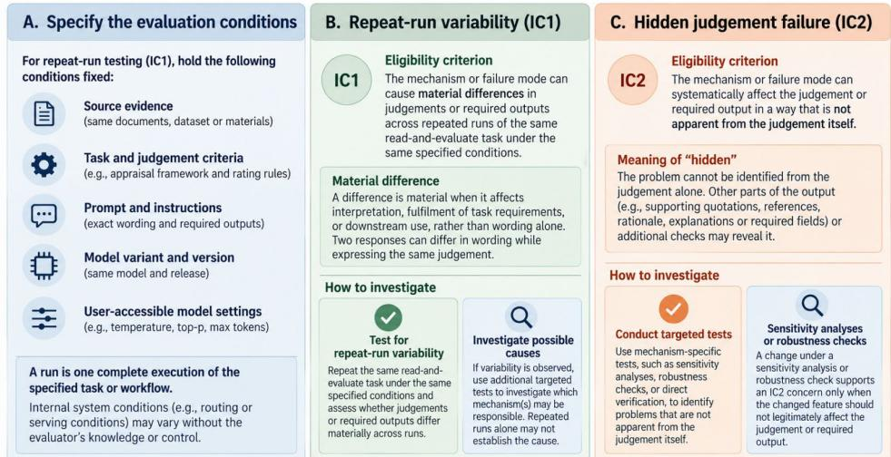  
Note: IC1, repeat-run variability: Materially diferent judgements, extrac�ons, or required suppor�ng outputs can occur across repeated runs under the same specified condi�ons. IC2, hidden judgement failure: A mechanism can systema�cally afect the judgement or required output in a way that is not apparent from the judgement itself.

Each included mechanism or opera�onally defined failure mode met three requirements. First, published research, vendor documenta�on, or other credible technical evidence documented the relevant failure, behaviour, or process. Second, this evidence supported a plausible pathway to repeat-run variability (IC1), hidden judgement failure (IC2), or both. Third, the proposed pathway had to be testable in prac�ce, even if it had not yet been tested in published studies. Third, inclusion did not require empirical evidence that a mechanism had caused repeat-run variability or a hidden judgement failure. Instead, each mechanism or opera�onally defined failure mode required a testable pathway to IC1, IC2, or both. The taxonomy therefore iden�fies poten�al sources of these failures and provides a basis for targeted evalua�on, rather than establishing that the mechanisms caused par�cular observed failures.

We excluded mechanisms that were outside the applicable read-and-evaluate task or workflow (e.g., func�oncalling failures when no external tools were used), lacked a testable pathway to IC1 or IC2 (e.g., verba�m memorisa�on that did not afect the judgement or required output), or described broad performance outcomes without a dis�nct mechanism or opera�onally defined failure mode (e.g., aggregate calibra�on failure). We also excluded research and repor�ng prac�ces that could afect the interpreta�on or reproducibility of an evalua�on study but did not themselves cause IC1 or IC2 (e.g., incomplete repor�ng of model se�ngs or omission of evalua�on results). Failures that only prevented the workflow from star�ng, without afec�ng an atempted evalua�on, were outside the scope of the taxonomy. Exclusion decisions and search, extrac�on, and synthesis methods are reported in Supplement 2. We merged mechanisms describing essen�ally the same failure when they lacked dis�nct defini�ons.

We coded deployment se�ng and workflow architecture separately because they determine which mechanisms can operate and what the researcher can observe or control. Deployment referred to how the model was accessed, and workflow described how model calls, retrieval, tools, and processing steps were arranged. We dis�nguished four deployment se�ngs: a managed chat or applica�on interface (e.g., ChatGPT, Claude.ai); a vendor-managed agen�c environment (e.g., Claude Code, Codex CLI); a direct model API; and a user-controlled model run�me using locally run open weights and inference so�ware. Control over instruc�ons, rou�ng, context, se�ngs, and hardware difers across these se�ngs. Self-hos�ng gives more control over execu�on but does not necessarily reveal a model’s training or development history. We dis�nguished four workflow types including single-call (i.e., the LLM completes the task in one model call), retrieval-supported (i.e., relevant evidence is retrieved and provided to the LLM to inform its judgement), agen�c (i.e., an LLM system plans and executes mul�ple steps, poten�ally using tools and checking intermediate results), and mul�- agent (i.e., two or more LLM agents perform separate or coordinated tasks to produce a judgement) (a tutorial on deployment se�ngs and workflow is found in Supplementary File 3). These workflow types are not mutually exclusive and determine which failure mechanisms may operate.

The ten categories (A–J) grouped mechanisms by their defining features. We also coded each mechanism according to five aspects of the read-and-evaluate task that it could afect including framing (presenta�on of task and criteria), evidence basis (available and used evidence), judgement forma�on (applica�on of evidence and criteria), expression (recording of judgements and required outputs), and substan�a�on (suppor�ng quota�ons, references, and explana�ons). A mechanism could afect several aspects.

## OVERVIEW OF THE TAXONOMY OF MECHANISMS

The taxonomy contains 38 mechanisms across ten categories (Table 1). Four mechanisms met IC1 only, 20 met IC2 only, and 14 met both (sub-mechanisms were not included in these totals). Table 1 outlines the mechanisms in plain language and indicates under which deployment se�ng they can operate and whether the researcher can directly control or test it. These deployment headings indicate the level of access generally needed to inves�gate a mechanism, not where the mechanism can occur. The final column describes what researchers can observe, test, or control within each deployment se�ng. Detec�ng an efect does not necessarily establish its underlying cause.

The ability to inves�gate a mechanism depends on the deployment se�ng and the controls available to the researcher. Some mechanisms, including training contamina�on (D.1), hidden model switching (B.1), numerical varia�on during model serving (B.3), and unfaithful reasoning (H.1), are par�cularly dificult to verify directly because the relevant training data, internal rou�ng, numerical processes, or model reasoning are generally inaccessible. In contrast, vendor-managed agen�c environments may provide greater access than commercial chat interfaces to document processing (E.1, E.2), retrieval (E.3), agent execu�on and verifica�on steps (G.1, G.2), and context management (J.1–J.3). This addi�onal access may allow researchers to examine intermediate steps and inves�gate poten�al causes of judgement failures, although the availability of these controls varies across systems and does not guarantee that a mechanism can be iden�fied or prevented.

Supplement 4, Table S1 groups all mechanisms into ten categories based on related features of the LLM system, inputs, evalua�on task, and workflow: two in Category A (User-Level Instability), three in Category B (Infrastructure Instability), one in Category C (Sampling Instability), four in Category D (Contamina�on), seven in Category E (Input Processing and Context Efects), five in Category F (Prompt & Task Design Instability), two in Category G (Workflow Instability), nine in Category H (Judgement, Evidence Use, and Repor�ng Failures), two in Category I (Source Presenta�on Efects), and three in Category J (Context Management). Leters A–J iden�fy the ten mechanism categories, and the number iden�fies the individual mechanism within that category (for example, A.1 or H.4). Supplement 4, Table S1 also presents the strength of the evidence for each mechanism, their tes�ng and mi�ga�on strategies.

We developed a simplified checklist to help researchers apply the taxonomy to LLM read-and-evaluate studies (Supplement 5). The checklist lists all 38 parent mechanisms, grouped by deployment se�ng, with two H.7 submechanisms shown separately. For each mechanism, researchers can record whether it was tested, whether a required feature was disabled, whether the se�ng, procedure, results, and limita�ons were reported, and whether a mi�ga�on was implemented. The checklist is intended as a prac�cal reference for iden�fying and documen�ng relevant mechanisms, rather than a comprehensive evalua�on or repor�ng tool. It has not been formally validated.

Some mechanisms in this taxonomy are conditional mechanisms. These mechanisms are only applicable when a par�cular system feature or capability is enabled or used, either by the model provider or the researcher (e.g., web access or retrieval). An observed judgement failure does not establish which mechanism caused it, because several mechanisms may produce similar failures. Where possible, researchers should confirm that the relevant condi�on occurred and assess whether it contributed to the failure, using system logs, API outputs, or controlled experiments.

Table 1: Taxonomy of mechanisms afec�ng repeatability and hidden judgement failure in LLM-assisted read and-evaluate tasks
<table><tr><td colspan="1" rowspan="1">Mechanism(code)</td><td colspan="1" rowspan="1">Description</td><td colspan="1" rowspan="1">IC1/IC2</td><td colspan="1" rowspan="1">Can you do anything about it (by deployment setting)?</td></tr><tr><td colspan="1" rowspan="1">All deployments</td><td colspan="1" rowspan="1"></td><td colspan="1" rowspan="1"></td><td colspan="1" rowspan="1"></td></tr><tr><td colspan="1" rowspan="1">1. Past chats ormemory (A.1)</td><td colspan="1" rowspan="1">Saved memory, prior conversation history oruser profiles can alter what the model usesbeyond the supplied evidence.</td><td colspan="1" rowspan="1">Both</td><td colspan="1" rowspan="1">Controllable/testable in any deployment that carries prioruser, session, or memory state into the task: Repeat thetask in a new session with no prior history and withmemory or personalisation disabled where possible andcompare the judgement. Avoid supplying prior history ormemory unless it is needed.</td></tr><tr><td colspan="1" rowspan="1">2. Hiddeninstructions (A.2)</td><td colspan="1" rowspan="1">Persistent account-level instructions outsidethe prompt can add assumptions, priorities,or decision rules. IC2 applies only whenthose instructions change the substantiveevaluation rather than merely tone orformatting.</td><td colspan="1" rowspan="1">Both</td><td colspan="1" rowspan="1">Controllable/testable: Disable user-controlled custominstructions for evaluation sessions or standardise themexplicitly and report their content/state.</td></tr><tr><td colspan="1" rowspan="1">3. The modellooked it up (D.2)</td><td colspan="1" rowspan="1">The model may use information from outsidethe supplied material, e.g., benchmarkjudgements, earlier appraisals, or otheronline sources. This can make itsperformance look better than it is on theintended task.</td><td colspan="1" rowspan="1">IC2</td><td colspan="1" rowspan="1">Controllable/testable in all deployments: Check and recordaccessible retrieved sources. Disable web access wherepossible when the model should judge only the suppliedmaterial, or restrict retrieval to approved sources.</td></tr><tr><td colspan="1" rowspan="1">4. The expectedjudgement</td><td colspan="1" rowspan="1">The expected judgement is included in theinformation given to the model (e.g., a PDF</td><td colspan="1" rowspan="1">IC2</td><td colspan="1" rowspan="1">Partly controllable/testable in managed interfaces,vendor-managed agentic or work environments, and APls,</td></tr><tr><td colspan="1" rowspan="1">travelled withthe question(D.3)</td><td colspan="1" rowspan="1">contains invisible white text that reveals theexpected judgement). The model may thenrely on that cue instead of doing the taskindependently. The cue may appear in theprompt or instructions, filenames ormetadata, or in visible or hidden text within adocument.</td><td colspan="1" rowspan="1"></td><td colspan="1" rowspan="1">and more directly controllable in user-controlled modelruntimes: Remove known reference judgements fromprompts and files before uploading them, and checkdocuments for hidden text where possible. Hidden systeminstructions or platform processing may not be visible tothe user. In self-hosted: Inspect and clean all model inputsand document-processing steps, including hidden text andmetadata, before evaluation.</td></tr><tr><td colspan="1" rowspan="1">5. Hiddeninstructionsenter with theevidence (D.4)</td><td colspan="1" rowspan="1">A document, image, Unicode, metadata, orother source may contain hidden orunintended instructions. The LLM may followthese instructions instead of only using thesource as evidence.</td><td colspan="1" rowspan="1">IC2</td><td colspan="1" rowspan="1">Controllable/testable: Check whether the evidencecontains instructions humans cannot see, using a hidden-text detector where appropriate. Remove detectedinstructions before the evidence reaches the LLM. Clearlyseparate task instructions from document content and tellthe model not to follow instructions found inside thedocument.</td></tr><tr><td colspan="1" rowspan="1">6. Promptsensitivity (F.1)</td><td colspan="1" rowspan="1">Prompts that mean the same thing can stillproduce different judgments when wordingor formatting changes.</td><td colspan="1" rowspan="1">IC2</td><td colspan="1" rowspan="1">Controllable/testable: Test meaning-preserving promptversions on a development set when available. Prespecifyand version the final prompt before the main evaluation,and test reasonable equivalent prompt variants assensitivity analyses.</td></tr><tr><td colspan="1" rowspan="1">7. Writing andformat effects(1.1)</td><td colspan="1" rowspan="1">The model may give different ratings whenthe same information is written in a differentstyle or format.</td><td colspan="1" rowspan="1">IC2</td><td colspan="1" rowspan="1">Controllable/testable: Compare matched versions thatcontain the same information but use different writingstyles or formats. Use clear criteria that focus thejudgement on the methods or evidence.</td></tr><tr><td colspan="1" rowspan="1">8. Whoproduced thematerial (1.2)</td><td colspan="1" rowspan="1">Information about who or what produced thematerial can influence the model’sjudgement even when the content isunchanged. This includes labels e.g., Human,Al, Expert, an author, or an institution.</td><td colspan="1" rowspan="1">IC2</td><td colspan="1" rowspan="1">Controllable/testable: Remove source, author, model, orinstitutional labels when they are not needed for the task.If labels are required, keep the content unchanged andvary or remove the label to test whether the judgementchanges.</td></tr><tr><td colspan="1" rowspan="1">9. Role playing(F.5)</td><td colspan="1" rowspan="1">When the evidence and task stay the same,giving the model a role or persona, e.g., “Youare a clinical expert," changes the model’sjudgement even when the evidence and taskare unchanged.</td><td colspan="1" rowspan="1">IC2</td><td colspan="1" rowspan="1">Controllable/testable: Avoid persona prompts unless theyare needed for the task. If a persona is introduced as atask-specific intervention, compare it with a no-personacondition and reasonable alternatives before fixing it forthe main evaluation. Do not treat persona prompting as ageneral mitigation without evidence that it improvesperformance for the specific task.</td></tr><tr><td colspan="1" rowspan="1">10. Workedexamples cansteer thejudgment (F.3)</td><td colspan="1" rowspan="1">When worked examples are included, thejudgment can depend on which examples areused and the order in which they appear. Ingeneral classification tasks, modelssometimes favoured labels that appearedmore often in the worked examples orappeared in examples near the end of theprompt. Reordering examples changes thedeclared prompt condition and therefore isnot IC1.</td><td colspan="1" rowspan="1">IC2</td><td colspan="1" rowspan="1">Controllable/testable: Where feasible, use developmentdata to select and refine worked examples, thenprespecify and version the exact examples and their order.before the main evaluation Test other reasonable examplesets and orders as sensitivity analyses.</td></tr><tr><td colspan="1" rowspan="1">11. Userinfluence on thejudgement (H.6)</td><td colspan="1" rowspan="1">The model may change its judgement toagree with what the user thinks or wants thejudgement to be, even when the sourceevidence does not support that position. Thisdoes not include appropriate changes whenthe user provides new relevant evidence</td><td colspan="1" rowspan="1">IC2</td><td colspan="1" rowspan="1">Controllable/testable: Run the same task with no stateduser opinion, then with the user suggesting the correctjudgement and an incorrect judgement. Do not tell themodel the user's preferred conclusion unless it is neededfor the task. Ask the model to identify and assess thesource evidence before making the judgement, andrequire any later change in judgement to be supported byevidence from the source.</td></tr><tr><td colspan="1" rowspan="1">12. Order of theoptions (F.7)</td><td colspan="1" rowspan="1">The model can favour a response position orlabel independently of the evidence, e.g., thefirst option or a middle category, eventhough their meaning is unchanged.</td><td colspan="1" rowspan="1">IC2</td><td colspan="1" rowspan="1">Controllable/testable: Present the same choices indifferent balanced orders and compare the judgments. Iforder effects occur, rotate or balance label positions acrossitems. Prespecify and keep each category unchangedacross versions.</td></tr><tr><td colspan="1" rowspan="1">13. Several itemsor tasks in thesame model call(E.6)</td><td colspan="1" rowspan="1">When several items, tasks or studies shareone prompt, its judgement on one item canbe affected by the other items beingevaluated at the same time. The size anddirection of this effect depend on the model,task, number of items, and complexity of thematerial.</td><td colspan="1" rowspan="1">IC2</td><td colspan="1" rowspan="1">Controllable/testable: Compare the same item alone andwith other items. For important decisions, considerseparate calls for each item or task, particularly whenvalidation shows that combined calls reduce performanceIf several are combined, keep them clearly labelled andtest the chosen setup.</td></tr><tr><td colspan="1" rowspan="1">14. Forcingstructuredoutput (F.4)</td><td colspan="1" rowspan="1">Requiring an LLM to return its output in afixed format, e.g., JSON, XML, or a setresponse structure, can sometimes changethe quality of its judgement or requiredoutput. The effect depends on the task, theinstructions, the format, and the model. Thisis more likely when the format is complicatedand the task requires reasoning.</td><td colspan="1" rowspan="1">IC2</td><td colspan="1" rowspan="1">Controllable/testable: Compare the required structuredformat with a minimally constrained or free-text outputand assess whether substantive judgements change. Usethe simplest schema needed and validate it before themain evaluation. Do not assume structured outputimproves substantive accuracy simply because it reducesformatting errors.</td></tr><tr><td colspan="1" rowspan="1">15. The outputquietly leavesthings out (H.5)</td><td colspan="1" rowspan="1">The model may leave requested componentsout of its output, e.g., prompt instructions,output values, or supporting evidence.</td><td colspan="1" rowspan="1">Both</td><td colspan="1" rowspan="1">Controllable/testable: Require one output for everyrequest and check for missing or duplicate items. Repeatidentical runs to test whether omissions changejudgments across runs.</td></tr><tr><td colspan="1" rowspan="1">16. Documentdistorted (E.1)</td><td colspan="1" rowspan="1">PDF parsing, optical character recognition(OCR), or image-to-text conversion canincorrectly recognise, omit, reorder, merge,split, or associate text, numbers, labels, ortable content before the LLM evaluates thesource. OCR software converts text in imagesor scanned documents into machine-readable text. The LLM may therefore make ajudgement using a representation that differsfrom the original document.</td><td colspan="1" rowspan="1">IC2</td><td colspan="1" rowspan="1">Controllable/testable in all deployments: Compareconverted content with the original source and, wherefeasible, compare alternative parsers or OCR methods.Where externally controlled, set the parser or OCRsoftware and settings; in managed chat, internalconversion may remain hidden. Where possible, archivethe converted input used for evaluation, and escalatefailed or uncertain conversions for human review.</td></tr><tr><td colspan="1" rowspan="1">17. Convertingimages or othermedia (E.4)</td><td colspan="1" rowspan="1">Resizing, compression, resampling, imageconversion, or other preprocessing steps canresult in distortion or loss of evidence beforethe model receives it.</td><td colspan="1" rowspan="1">IC2</td><td colspan="1" rowspan="1">Partly controllable/testable in all deployments: In chats,users can preprocess media before upload, but someprocessing is vendor-controlled. API users can preprocessmedia, although some vendor handling may still occur. Fortesting, fix preprocessing settings and the original mediawhere possible. Test whether different preprocessingsettings change the judgement.</td></tr><tr><td colspan="1" rowspan="1">18. Evidenceburied mid-document getsunder-used (E.7)</td><td colspan="1" rowspan="1">With a long prompt, evidence in particularpositions, especially in the middle, may beunder-used even when it is presentRepeated runs can agree and still miss thesame evidence.</td><td colspan="1" rowspan="1">IC2</td><td colspan="1" rowspan="1">Controllable/testable: Keep inputs within the contextrange; use targeted excerpts where justified; test-controlled evidence relocation or matched shorterversions as sensitivity analyses. If segmentation orretrieval is introduced to manage long inputs, validate thenew pipeline and evaluate retrieval completeness andvariability (E.3) separately.</td></tr><tr><td colspan="1" rowspan="1">19. Quoted orextractedevidence (H.4)</td><td colspan="1" rowspan="1">When the model must support a judgementor extraction with a quote, location, orextracted value from text or a table, it mayreturn different evidence across identicalruns (IC1). It may also return evidence that isnot present in the source, is copiedincorrectly, is assigned to the wrong source,section, treatment group, outcome,subgroup, time point, row, column, or label,or does not support the judgement itaccompanies (IC2).</td><td colspan="1" rowspan="1">Both</td><td colspan="1" rowspan="1">Controllable/testable: Repeat the extraction and compareit with human-checked evidence. Check separatelywhether the quoted or extracted evidence exists in thesource, is attributed to the correct source, and location inthe text, and actually supports the judgement.</td></tr><tr><td colspan="1" rowspan="1">20. Hallucinatedevidence (H.3)</td><td colspan="1" rowspan="1">The model cites hallucinated evidence orattributes a claim to evidence that does notexist or does not support it.</td><td colspan="1" rowspan="1">IC2</td><td colspan="1" rowspan="1">Controllable/testable: Verify every model-generatedcitation or restrict the model from searching the internetUse automated resolution plus human review.</td></tr><tr><td colspan="1" rowspan="1">21. Acceptingunchecked</td><td colspan="1" rowspan="1">The LLM accepts an assumption in theprompt without checking it against thesource evidence that could verify or</td><td colspan="1" rowspan="1">Both</td><td colspan="1" rowspan="1">Controllable/testable: Keep factual claims separate frominstructions and ask the model to check importantassumptions against the source. Test by comparing</td></tr><tr><td colspan="1" rowspan="1">assumptions(H.2)</td><td colspan="1" rowspan="1">contradict the assumption. It then allows theassumption to influence its judgment.</td><td colspan="1" rowspan="1"></td><td colspan="1" rowspan="1">matched prompts with correct, incorrect, and no addedassumptions.</td></tr><tr><td colspan="1" rowspan="1">22. The statedreasoning is notthe realreasoning (H.1)</td><td colspan="1" rowspan="1">A model-generated rationale does not reflector logically link to the evidence or reasoning.This can be shown when the evidence is notacknowledged in the rationale, or when therationale changes but the judgment remainsthe same. The mechanism concerns whetherthe stated rationale is linked to thejudgment, not whether statements in therationale are factually correct or supportedby the evidence.</td><td colspan="1" rowspan="1">IC2</td><td colspan="1" rowspan="1">Controllable/testable: Compare the rationale with sourceevidence or a reference rationale. Change relevantinformation and check whether the judgement andexplanation respond in the expected way. Do not treat agenerated rationale as proof of how the model reached itsjudgement; internal reasoning generally cannot be directlyverified.</td></tr><tr><td colspan="1" rowspan="1">23. Failure tointegrate taskcomponents(H.7)</td><td colspan="1" rowspan="1">The model may assess individual parts of atask but fail to connect them or apply therequired rule when reaching the overalljudgement.</td><td colspan="1" rowspan="1">IC2</td><td colspan="1" rowspan="1">Applicable to all deployments: Test each task componentand the final integration step separately. Provide anexplicit decision rule, check whether all relevantcomponents were considered, and independently verifythe combined judgement.</td></tr><tr><td colspan="1" rowspan="1">23a. Failure toconnect taskcomponents(H.7a)</td><td colspan="1" rowspan="1">The model fails to connect related evidence,instructions, or criterion components thatmust be considered together.</td><td colspan="1" rowspan="1">IC2</td><td colspan="1" rowspan="1">Applicable to all deployments: Supply cases requiringevidence from multiple parts, verify whether requiredconnections were made, and review the resultingjudgement against the source and criteria.</td></tr><tr><td colspan="1" rowspan="1">23b. Incorrectintegration-ruleapplication(H.7b)</td><td colspan="1" rowspan="1">The model identifies individual componentsbut combines them using a rule that differsfrom the prespecified decision rule.</td><td colspan="1" rowspan="1">IC2</td><td colspan="1" rowspan="1">Applicable to all deployments: Record the component-level results and apply the prespecified integration ruleindependently. Compare the calculated judgement withthe model's final rating.</td></tr><tr><td colspan="1" rowspan="1">24. Source-embeddedinstructioninterference(H.8)</td><td colspan="1" rowspan="1">Instructions contained in the suppliedevidence may be treated as directions to themodel rather than as material to evaluate,changing its judgement or required outputs.</td><td colspan="1" rowspan="1">IC2</td><td colspan="1" rowspan="1">Applicable to all deployments: Keep source contentseparate from task instructions. Test matched evidencewith and without embedded directives, inspect whetherthe model follows them, and verify ratings against thesource. This is a specific source-instruction failurepathway.</td></tr><tr><td colspan="1" rowspan="1">25. Surface-cuesubstitution incriterionjudgement (H.9)</td><td colspan="1" rowspan="1">The model may rely on superficial wording,layout or rubric cues instead of evaluatingthe evidence required by the criterion.</td><td colspan="1" rowspan="1">IC2</td><td colspan="1" rowspan="1">Applicable to all deployments: Compare matched casesthat preserve criterion-relevant evidence but varysuperficial cues. Check whether ratings respond to theactual evidence rather than those cues.</td></tr><tr><td colspan="1" rowspan="1">26. Differentagent runs canreach differentjudgements (G.1)</td><td colspan="1" rowspan="1">Even when an agent follows the same multi-step workflow, repeated runs can usedifferent tools, evidence, or intermediatesteps and reach different final judgementsFor example, a ROBIS appraisal agent mayretrieve different passages across runs andassign a different final judgement.</td><td colspan="1" rowspan="1">IC1</td><td colspan="1" rowspan="1">Controllable/testable in all deployments using agenticworkflows: Repeat the same workflow several times andcompare final judgements; inspect intermediate agentactions where accessible. Structure intermediate outputsand use consensus across generated retrieval querieswhere applicable.</td></tr><tr><td colspan="1" rowspan="1">27. Verificationmaterial changesbefore checking(G.2)†</td><td colspan="1" rowspan="1">The agent or verifier checks a summary,selected excerpt, or other representationthat changes or leaves out information fromthe original evidence. The verification maytherefore miss a problem in the judgement.</td><td colspan="1" rowspan="1">IC2</td><td colspan="1" rowspan="1">In retrieval-supported or agentic workflows, compare theverification input against the original evidence where theactual verifier input is accessible. Preserve the completesource and audit what was selected or transformed whenthese steps are visible. Test whether verification decisionschange when the original evidence is used.</td></tr><tr><td colspan="1" rowspan="1">28. Modelupdates canchange thejudgement(B.2)†</td><td colspan="1" rowspan="1">A vendor model or service can change overtime, so the same task may produce adifferent judgement even when the userrepeats the same setup.</td><td colspan="1" rowspan="1">IC1</td><td colspan="1" rowspan="1">Testable in vendor-managed interfaces, agentic or workenvironments, and APIs, and directly controlled in user-controlled model runtimes: Record the model identifierand access date. After a known model or version update,re-run a fixed reference set and compare both overallperformance and item-level substantive judgementsbefore continued use. In self-hosted systems, fix the modeland serving environment and test new versions beforeuse.</td></tr><tr><td colspan="4" rowspan="1">APl, vendor-managed agentic environments, or self-hosted</td></tr><tr><td colspan="1" rowspan="1">29. The modellearned it duringtraining (D.1)</td><td colspan="1" rowspan="1">The model may have encountered thereference judgement, a published appraisal,or the same question with its answer duringtraining. It may therefore provide anjudgement partly because it has seen thereference judgement before, rather thanbecause it independently appraised theattached evidence. Apparent accuracy can behigh and highly repeatable, so repeatedagreement does not rule out contamination.</td><td colspan="1" rowspan="1">IC2</td><td colspan="1" rowspan="1">Usually not directly controllable or reliably verifiable inclosed vendor-managed models; API access alone doesnot reveal training data. More directly investigable whentraining data and provenance are available, including someresearcher-developed models: When training data orsource are available, compare materials with the availabletraining corpus using lexical and semantic overlap checks,and add model-based contamination tests.</td></tr><tr><td colspan="1" rowspan="1">30. Randomnessin tokenselection (C.1)</td><td colspan="1" rowspan="1">When sampling is used, the model chooseseach new token (i.e., word) from a set ofpossible tokens based on their probabilities.This means that the same evidence, prompt,model, and declared settings can producedifferent judgements across repeated runs.The amount of randomness depends on thedecoding settings. The random seed alsoaffects which tokens are selected whensampling is used.</td><td colspan="1" rowspan="1">IC1</td><td colspan="1" rowspan="1">Controllable/testable: Where sampling controls areexposed, use the least stochastic decoding appropriate forthe task and fix and report the decoding settings and seedwhen available. Lower or zero temperature may reducesampling variation but does not establish determinism orremove the need for repeated-run testing.</td></tr><tr><td colspan="1" rowspan="1">31. Splitting adocument canseparate relatedinformation (E.2)</td><td colspan="1" rowspan="1">Internal segmentation of an uploadeddocument into smaller parts can separateinformation that needs to be read together.This can change the model's judgement.</td><td colspan="1" rowspan="1">IC2</td><td colspan="1" rowspan="1">Controllable/testable where segmentation controls areexposed, including some APIs, vendor-managed agentic orwork environments with accessible file tools or logs, anduser-controlled model runtimes: Keep documentsegmentation unchanged for the main evaluation. Testalternative segmentation methods as a sensitivity analysisand, when a judgement depends on evidence acrosssegments, test the complete segmentation-to-aggregationworkflow. Use human review when relevant links betweensegments are uncertain.</td></tr><tr><td colspan="1" rowspan="1">32. Differentevidence may beretrieved (E.3)</td><td colspan="1" rowspan="1">The retrieval step may supply different,incomplete, or misleading evidence, whichcan change the model's judgement.</td><td colspan="1" rowspan="1">Both</td><td colspan="1" rowspan="1">Partly controllable/testable where retrieval can beconfigured or logged, including some APIs, vendor-managed agentic or work environments with query andtool logs, and user-controlled model runtimes: Repeatretrieval with the same setup and compare the retrievedevidence. Keep the retrieval setup fixed and testalternative query wording separately as a sensitivityanalysis.</td></tr><tr><td colspan="1" rowspan="1">33. Loss ordistortion duringcontextcompaction(J.1)†</td><td colspan="1" rowspan="1">Earlier task context is shortened into asummary or other representation, andrequired evidence, instructions, orqualifications may be lost or changed beforea later judgement.</td><td colspan="1" rowspan="1">Both</td><td colspan="1" rowspan="1">Where compaction is enabled: Where logs or compactioncontrols are exposed, verify that compaction actuallyoccurred and compare the original and compactedcontext; otherwise assess observable effects, and checkrequired evidence and instructions. Repeat identical runsfor IC1. Preserve original context and reinsert criticaldetails.</td></tr><tr><td colspan="1" rowspan="1">34. Removal oftask-relevantcontext(truncation orpruning) (J.2)†</td><td colspan="1" rowspan="1">Evidence, instructions or other task-relevantmaterial previously available to the model isremoved rather than preserved in areplacement summary.</td><td colspan="1" rowspan="1">Both</td><td colspan="1" rowspan="1">Managed chat interfaces and vendor-managed agenticenvironments where enabled: Inspect available removallogs, where exposed, and compare what was availablebefore and after pruning; managed chat generally doesnot expose internal pruning logs. Retain necessaryevidence and instructions; repeat identical workflows andindependently verify judgements.</td></tr><tr><td colspan="1" rowspan="1">35. Loss ofrequiredinstructionsacross turns(J.3)†</td><td colspan="1" rowspan="1">Instructions set in an earlier turn are notincluded in the assembled input for a laterassessment, so the model may no longerapply required criteria or steps.</td><td colspan="1" rowspan="1">Both</td><td colspan="1" rowspan="1">Multi-turn managed chat, APIs and agentic systems:Where assembled prompts or logs are accessible, logassembled prompts for every continuation, check thatrequired instructions are present, and resend or versionstanding instructions where needed. Verify final ratingsand required outputs.</td></tr><tr><td colspan="1" rowspan="1">36. Hiddenmodel switching(B.1)†</td><td colspan="1" rowspan="1">A vendor may re-route prompts to differentmodel variants, versions or inference routeswithout changing the model identityreported to the user. Hidden request-to-request routing can change judgementsacross repeated runs (IC1); undisclosedsubstitution can also systematically affect thejudgement in a way that is not apparent fromthe judgement itself (IC2).</td><td colspan="1" rowspan="1">Both</td><td colspan="1" rowspan="1">Controllable/testable: In vendor-managed environmentsand APls, use fixed model versions where available andrecord available model metadata and assess unexpectedchanges; undisclosed routing generally cannot be directlyverified. In user-controlled runtimes, fix the routingconfiguration and log which model serves each request.</td></tr><tr><td colspan="2" rowspan="1">Self-hosted (user-controlled runtime)</td><td colspan="1" rowspan="1"></td><td colspan="1" rowspan="1"></td></tr><tr><td colspan="1" rowspan="1">37. Tokenisationeffects (E.5)</td><td colspan="1" rowspan="1">Models read text as small pieces calledtokens. How text is split can affectperformance or how much source materialfits in the model's context limit.</td><td colspan="1" rowspan="1">IC2</td><td colspan="1" rowspan="1">Controllable where the model, tokenizer, and inputpreprocessing are specified, most directly in user-controlled runtimes and some APls with tokenizerinformation: Keep the model and tokenizer fixed. Comparemodels with different tokenizers and test each relevantlanguage separately.</td></tr><tr><td colspan="1" rowspan="1">38. Numericalvariation duringmodel serving(B.3)</td><td colspan="1" rowspan="1">The same model can make slightly differentcalculations when otherwise identicalrequests are processed. Usually this does notchange the judgement, but a small differencecan sometimes change the selected tokenand eventually the judgement.</td><td colspan="1" rowspan="1">IC1</td><td colspan="1" rowspan="1">Directly investigable mainly in a user-controlled modelruntime; in hosted systems, repeat runs can revealvariability but generally cannot establish its numericalcause: Change one serving condition at a time to test itseffect. Keep the hardware, numerical precision, drivers,software libraries, and serving configuration fixed. Runrequests separately. Use deterministic or batch-invariantkernels.</td></tr></table>

Notes: The table presents 38 mechanisms and two H.7 sub-mechanisms (not counted separately). Can you do anything about it (by deployment se�ng: The deployment se�ngs indicate the level of access generally needed to inves�gate a mechanism, not where it can occur. Researchers may be able to test a mechanism's efects without being able to iden�fy its cause or prevent it. Vendor-managed agen�c environments may provide access to files, retrieval steps, verifica�on inputs, and context logs that are unavailable in commercial chat interfaces, depending on the system. †Condi�onal mechanism: A mechanism that can afect the judgement or required output only when a par�cular condi�on or event occurs. IC1 (repeat-run variability): A mechanism that can produce materially diferent judgements or required outputs across repeated runs of the same task under the same specified condi�ons. IC2 (hidden judgement failure): A mechanism that can afect the judgement or required output in a way that is not apparent from the judgement itself. Both: A mechanism that can produce either IC1 or IC2, although these efects need not occur under the same circumstances. The IC1/IC2 classifica�ons indicate which types of failure a mechanism could cause, not whether those failures have been demonstrated in published studies. Abbreviations: AI, artificial intelligence; API, application programming interface; IC1, inclusion criterion 1; IC2, inclusion criterion 2; LLM, large language model.

Figure 2 illustrates the distribu�on of the 38 mechanisms by IC1 and IC2 eligibility criteria and deployment se�ng. It shows which mechanisms can produce repeat-run variability, hidden judgement failures, or both, and the deployment se�ngs in which they can be inves�gated or controlled.

Figure 2. Distribu�on of the 38 FAILS taxonomy mechanisms by eligibility criterion and deployment se�ng

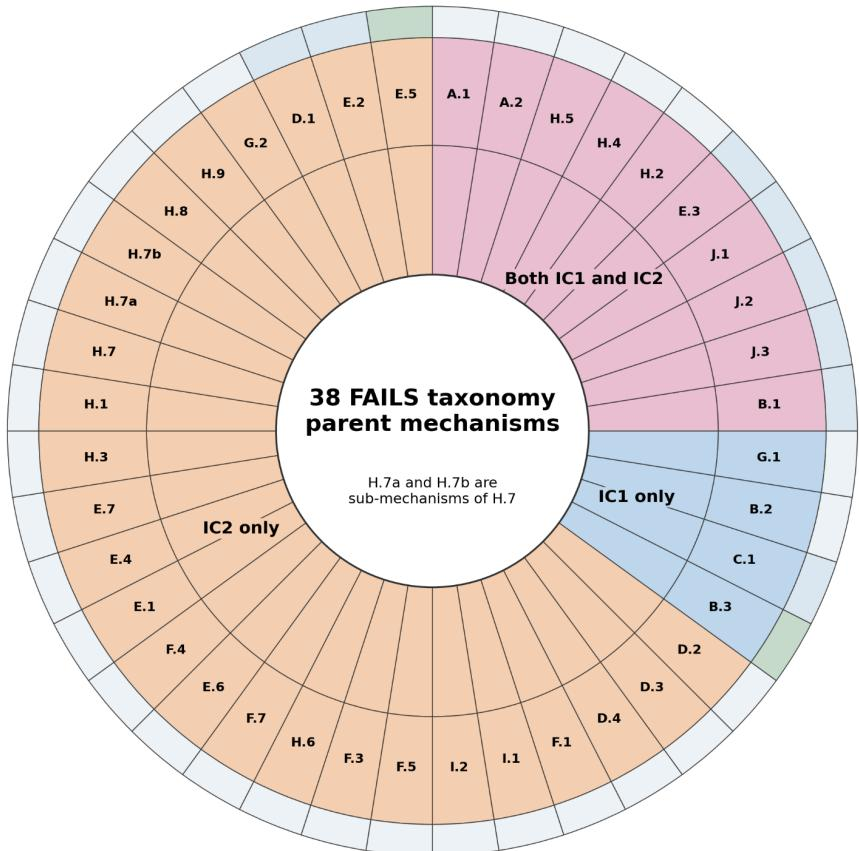  
Notes: The outer band indicates deployment se�ng: light grey = all deployments; pale blue = commercial API, vendor-managed agen�c environments, or self-hosted; green = self-hosted only. IC1 = repeat-run variability; IC2 = hidden judgement failure. A mechanism may meet both criteria, although the efects need not occur under the same circumstances.

## Evidence varied across mechanisms

Thirteen mechanisms were rated as having strong overall evidence, 24 as having moderate evidence, and one as limited evidence (Supplement 4, Table S1). When considering evidence specific to read-and-evaluate tasks, including eligible LLM-as-a-judge evalua�ons, eight mechanisms were rated as having strong evidence, 18 as having moderate evidence, and 12 as having limited evidence. These descrip�ve ra�ngs reflect the yield and directness of the available evidence. For several mechanisms, evidence from the broader LLM literature was stronger than evidence specific to read-and-evaluate tasks, including the LLM-as-judge literature. For example, personalisa�on and user history (A.1), model version dri� (B.2), and agen�c workflow instability (G.1) had strong overall evidence but moderate task-specific evidence, while rou�ng variability (B.1) and serving-�me numerical non-determinism (B.3) had limited direct evidence from these tasks. A detailed summary of evidence gaps across the taxonomy can be found in Supplement 6.

## Tes�ng approaches

A mechanism may have a testable pathway to IC1 or IC2 even when inspec�on, audits, or workflow checks are more appropriate than controlled experiments. IC1 is assessed by repea�ng the same task while holding the specified source evidence, prompt, model, and researcher-controlled se�ngs fixed, and comparing the resul�ng judgements and required outputs. The number of repe��ons and criteria for material diferences should be prespecified. Repeat-run diferences establish variability but do not necessarily iden�fy the mechanism responsible.

IC2 can be assessed through controlled robustness or sensi�vity analyses, direct inspec�on of the evalua�on process, or verifica�on of the evidence and required suppor�ng outputs. In sensi�vity analyses, researchers change one poten�ally influen�al feature while keeping the intended task and evidence constant. Examples include changing prompt wording (F.1), context segmenta�on (E.2), evidence posi�on (E.7), response-op�on order (F.7), source labels while retaining iden�cal evidence (I.2), or the user's stated posi�on (H.6). These comparisons may reveal an IC2 problem when the LLM's judgement changes in response to a feature that should not influence the decision. For example, changing the journal name while keeping the review text iden�cal should not change an AMSTAR 2 judgement, because the appraisal should be based on the review's methods rather than the journal's reputa�on. Where several mechanisms could produce similar failures, targeted comparisons and process checks can help dis�nguish poten�al explana�ons, although observing a failure or confirming that a condi�on occurred does not necessarily establish that a par�cular mechanism caused it.

## Mi�ga�on strategies

A mi�ga�on is intended to reduce the probability or magnitude of a mechanism or failure mode opera�ng. Several similar approaches were suggested for the evidenced-based mi�ga�on strategies. Recommenda�ons generally involved removing unnecessary sources of influence, keeping important condi�ons the same, recording the versions used, and repor�ng the condi�ons used for evalua�on. Examples included using fresh sessions (A.1), using the same model version where possible (B.2), keeping retrieval se�ngs and components the same (E.3), prespecifying prompts and worked examples (F.1, F.3), and removing unnecessary source labels (I.2). Mi�ga�ons can also include automated checks for missing required outputs (H.5), whereas others required manual human verifica�on, such as checking cita�ons (H.3) or suppor�ng quota�ons (H.4). Employing a mi�ga�on should not be interpreted as evidence that the mechanism was prevented or its efects eliminated. Mi�ga�ons may reduce the likelihood or severity of a failure without preven�ng it en�rely. For example, se�ng temperature to zero may reduce repeat-run variability but does not guarantee iden�cal judgements. Researchers should therefore assess whether the mi�ga�on was implemented as intended and, where feasible, test whether the mechanism or its efects remain.

Where a mechanism is relevant but evidence for a proposed mi�ga�on is limited, test whether the mi�ga�on works for the specific task, model, and workflow, and report that its efec�veness remains uncertain. Mi�ga�on strategies aim to reduce the likelihood or efect of a mechanism, whereas human verifica�on provides a later safeguard by checking for errors or judgement failures that remain. When a human reference standard includes both the judgement and suppor�ng evidence, human verifica�on is not needed during model evalua�on. It may instead be relevant as a safeguard in real-world use, where reference-standard judgements are unavailable.

Mi�ga�ons can also introduce new mechanisms. For example, using retrieval to reduce the amount of longcontext material presented to the model creates an opportunity for retrieval omission or variability (E.3), which should then be evaluated separately. Mi�ga�on is more limited when the relevant process is controlled by a commercial vendor and cannot be directly observed or changed by the user.

## How to apply the taxonomy

The taxonomy is intended for researchers designing or evalua�ng LLM-assisted read-and-evaluate tasks, as well as journal editors, peer reviewers, developers, and other users interpre�ng the resul�ng evidence. It can inform study protocols, the choice of tests and safeguards, and the appraisal of published results. It does not establish that a par�cular mechanism has occurred in a given study.

The star�ng point is a task requiring the LLM to interpret source material against specified criteria and produce a judgement or other required output (Figure 2). Examples include eligibility assessment, interpre�ve data

extrac�on, risk-of-bias assessment, methodological appraisal, and certainty-of-evidence judgements. Not every mechanism in the taxonomy will be relevant to every task.

First, specify the task (i.e., methodological quality assessment), evalua�on criteria (i.e. AMSTAR 2 items), source documents (i.e., PDF of the study, required outputs (i.e., high or low quality), and reference standard (i.e., human assessed systema�c reviews). Then document the model and version, deployment se�ng (such as a commercial chat interface or direct API), instruc�ons, model se�ngs, and other relevant features of the workflow. Record which features the researcher can observe or control and which are managed by the commercial LLM vendor. The mechanisms that may afect an LLM judgement depend on the deployment se�ng and workflow, the task being performed, and how the LLM is configured and used. Relevant factors include:

• Model: The model and version used (e.g., Claude Sonnet 4.5).

• Deployment se�ng: How the model is accessed (e.g., through a commercial chat interface or direct API).

• Instruc�ons: The system prompt, task instruc�ons, and decision rules provided to the model.

• Model se�ngs: The temperature and other se�ngs that influence how the model generates responses.

• Context: The informa�on provided to the model, such as a full systema�c review or selected sec�ons, and whether previous conversa�on history is included.

• Technical environment: How the model is routed and run on the provider's infrastructure, including processes that may not be visible or controllable by the researcher.

Some of these factors can be controlled by the researcher, while others are managed by the commercial LLM vendor. Iden�fying these factors helps researchers determine which mechanisms may be relevant to their evalua�on.

Next, document the full workflow from source prepara�on to recorded judgement. Iden�fy such features as PDF-to-text conversion, op�cal character recogni�on, selec�on or segmenta�on of evidence, retrieval, external web access, tools, mul�ple model calls, and agen�c or mul�-agent steps. These features may introduce mechanisms that would not arise in a simpler workflow. For example, PDF conversion may omit relevant methods text, retrieval may fail to select a relevant passage, and web access may expose the model to external answers that should not inform the appraisal. A full discussion of how mechanisms map to specific read-andevaluate tasks, deployment se�ng, workflow and model features is outlined in Paper 3 of the series.

Map the task, deployment, and workflow features to individual taxonomy mechanisms, recording which are applicable, inapplicable, or uncertain and why. This is a prospec�ve assessment of what could go wrong, not a diagnosis that IC1 or IC2 is already present. Priori�se tes�ng and mi�ga�on according to the likely consequence for the judgement, plausibility, feasibility of tes�ng, and degree of user control. Applying every proposed mi�ga�on is neither necessarily feasible nor demonstrably efec�ve. For applicable mechanisms, specify targeted tests, safeguards, human checks where needed, and repor�ng requirements before the main evalua�on. Repeated runs under the same specified condi�ons assess IC1, whereas deliberate changes to a specified feature test sensi�vity and may provide evidence relevant to IC2 if that feature should not legi�mately afect the judgement. Verify the required quota�ons and ra�onales, and compare judgements with a human reference standard, where appropriate. An observed diference or failure does not, by itself, establish which mechanism caused it. Evaluate whether mi�ga�ons reduced the targeted problem, because a mi�ga�on may be inefec�ve or introduce another mechanism. Report remaining uncertainty, including condi�ons the researcher cannot observe or hold constant.

As an illustra�ve example, consider an LLM applying an AMSTAR 2 item to systema�c-review PDFs. Researchers might iden�fy PDF conversion distor�on (E.1) and source-label influence (I.2) as relevant concerns. They could check the converted PDF against the original and verify quota�ons suppor�ng the judgement. They could also repeat the same appraisal, with the same specified inputs and se�ngs, to es�mate IC1 repeat-run variability. In a separate sensi�vity test, they could change only the journal name while keeping the review methods unchanged. If the judgement changes, this supports concern about inappropriate source-label sensi�vity (IC2), but further checks are needed to determine the cause. Neither iden�cal repeated judgements nor successful applica�on of a mi�ga�on proves that all relevant failures have been excluded.

Readers and evaluators of published LLM-assisted studies should ask which mechanisms were applicable, which were tested, and what evidence supports the authors’ claims. Repea�ng the task under matching specified condi�ons can inves�gate IC1, although a reader may be unable to recreate hidden model or serving condi�ons. IC2 generally requires addi�onal checks, such as evidence verifica�on, comparisons against reference judgements, or targeted sensi�vity tests; repea�ng the task alone is insuficient. If the paper does not report these tests or enough details to reproduce them, readers should describe the poten�al problem as unassessed rather than conclude that the mechanism occurred or was absent. Readers are not necessarily expected to replicate the whole study, but may be unable to independently establish whether par�cular failures afected the findings.

## DISCUSSION

## Principal findings

The TRAILS taxonomy provides a structured framework for iden�fying mechanisms that may produce repeatrun variability (IC1), hidden judgement failures (IC2), or both, and for selec�ng appropriate mechanism-specific tests and poten�al mi�ga�ons. Thirty-four mechanisms met the IC2 criteria and therefore cannot be iden�fied by repeated-run tes�ng alone. A model may repeatedly give the same judgement because, for example, it has seen the reference judgement during training (D.1), retrieves an exis�ng risk of bias judgment from the internet (D.2), or is influenced by the wri�ng style of the material being judged (I.1). High repeat-run agreement therefore does not show that the judgement was based only on the supplied evidence and appropriate decision criteria.

Tes�ng IC1 generally requires repeated runs under the same specified condi�ons, whereas inves�ga�ng IC2 may require robustness tests, sensi�vity analyses, direct evidence verifica�on, or other targeted assessments The same observed failure may arise from diferent mechanisms, so iden�fying a plausible explana�on does not establish that the mechanism occurred or contributed to the failure. The relevance of individual mechanisms, as well as researchers' ability to observe, control, or test them, depends on the specified task, deployment se�ng, and technical features of the workflow. The taxonomy may therefore help researchers design more comprehensive evalua�ons, iden�fy limita�ons that conven�onal accuracy assessments may not reveal, and support eforts to improve the repeatability, reproducibility, and replicability of LLM-assisted tools and studies. However, the efec�veness of many proposed tests and mi�ga�ons remains to be established empirically.

The taxonomy is useful because it links an observed problem to mechanisms that can be tested directly. However, IC1 and IC2 describe the tes�ng method, not which mechanism caused the problem. Evidence may be unavailable, overlooked or used inappropriately because text was lost during PDF conversion (E.1), separated during document segmenta�on (E.2), underused because of its posi�on in a long document (E.7), omited by retrieval (E.3), or inappropriately linked to the judgement by the model (H.4). These mechanisms can produce similar judgements but require diferent tests and mi�ga�on strategies. Mi�ga�on strategies may reduce but not remove the risk of these mechanisms contribu�ng to unreliable findings. Tes�ng is therefore recommended regardless of whether mi�ga�on strategies are employed.

## Challenges in applying the taxonomy

Applying the taxonomy presents several prac�cal challenges. Tes�ng and mi�ga�ng poten�al failure mechanisms can require substan�al resources, even when it is uncertain whether a mechanism will occur or materially afect the results. Implemen�ng a mi�ga�on does not establish whether it prevented the mechanism, reduced its occurrence, or reduced the magnitude of its efects. Knowledge users also face

challenges when interpre�ng published LLM evalua�ons, as IC1 and IC2 cannot necessarily be iden�fied from the reported judgements alone. These challenges highlight the need to priori�se mechanisms according to the task and evalua�on se�ng, assess the efec�veness of mi�ga�ons, and report suficient methodological details and results.

## Accuracy

Most published studies evalua�ng LLMs have focused on accuracy.[14] However, a study may have high accuracy with low repeatability, high repeatability with low accuracy, or high values for both despite the presence of hidden judgement failures (IC2). Thus, accuracy and repeatability alone may not reveal all failures afec�ng LLM judgements or required outputs. Accuracy, repeatability, and judgement validity answer diferent evalua�on ques�ons, but none alone captures all poten�al failures in LLM read-and-evaluate tasks. IC2 may also require assessments of evidence support, output completeness, task comple�on, or other mechanismspecific outcomes.

## Implica�ons on evidence synthesis findings

Residual repeat-run variability maters when LLM judgements feed into later stages of an evidence synthesis. Where a mechanism cannot be prevented, or mi�ga�on only partly reduces its efect, evalua�on should measure both varia�on in the LLM judgement and whether that varia�on changes the review findings. This can be examined by carrying the complete judgements from repeated runs through the same prespecified downstream review steps. For example, if repeated screening decisions produce diferent sets of included studies, the meta-analysis can be repeated for each set and the resul�ng pooled es�mates compared. If risk of bias judgements vary, the relevant sensi�vity analyses or certainty assessments can be repeated to determine whether the interpreta�on of the evidence changes.[15] This dis�nguishes repeat-run variability at the point of the LLM judgement from varia�on that changes what the review ul�mately reports. The consequence of the same mechanism can therefore difer according to the evidence synthesis task and where the LLM judgement enters the review workflow. Human verifica�on can intercept a variable, unsupported, or inappropriately influenced judgement before it propagates to later review stages, but this is a workflow safeguard rather than evidence that the underlying mechanism cannot operate.

A related problem occurs if the model retrieves an exis�ng appraisal rather than deriving the judgement from the supplied study, or if it encountered the reference judgement during training (D.1). The model may then repeatedly produce a judgement that matches the reference without demonstra�ng that it can perform the appraisal task. Contamina�on occurs when material used to evaluate a model, including informa�on about the expected reference judgement, was already available to the model before it performed the evalua�on.[16] Private or prospec�ve reference sets reduce this risk, but they are dificult to create when the material being evaluated is already published. Reference sets can be kept temporarily unavailable, placed under controlled access, or refreshed over �me, with materials released once they are no longer needed as unseen evalua�on items. The aim is not secrecy, but preserving an uncontaminated test set at the �me the model is evaluated.[16, 17]

## Rela�on to repor�ng guidance and evalua�on frameworks

The taxonomy addresses ques�ons that are complementary to, but diferent from, those addressed by repor�ng checklists and guidance. Exis�ng AI repor�ng and risk of bias frameworks were developed primarily to improve transparency, methodological repor�ng, responsible use, or assessment of study quality and risk of bias.[18-27] They were not designed to iden�fy the mechanisms that can produce repeat-run variability or a hidden judgement failure. Repor�ng the model, prompt, and workflow does not establish whether a judgement was reproduced from training data (D.1), whether relevant evidence was underused because of its posi�on in the input (E.7), or whether the order of the response op�ons (F.7) influenced the judgement. Complete repor�ng remains necessary, but does not inves�gate poten�al pathways to IC1 or IC2 failures.

## Implica�ons for LLM evalua�on studies

The taxonomy could complement AI evalua�on frameworks such as Inspect AI[28] by helping researchers iden�fy relevant failure mechanisms and select targeted tests. Inspect AI provides infrastructure to run evalua�ons, score outputs, and analyse results. For example, researchers could assess whether an LLM scorer produces materially diferent judgements across repeated runs or whether its judgements are supported by the available evidence. Integra�ng these tests into frameworks like Inspect AI could strengthen the evalua�on of LLM-based scoring in AI research.

Evalua�on design should reflect the dis�nc�on between IC1 and IC2. When relevant mechanisms are plausible, researchers should prespecify appropriate tests, including repeated runs and defini�ons of material diferences for IC1, and mechanism-specific robustness tests, sensi�vity analyses, or direct checks for IC2. Evalua�ons should assess the implemented workflow, including document processing and retrieval where applicable, rather than atribu�ng performance to the LLM alone. Relevant valida�on and mechanism-specific tests should be repeated a�er material changes to the model, instruc�ons, inputs, or workflow.

## Reproducibility and human oversight

The taxonomy can help iden�fy where human verifica�on is most valuable. Some mechanisms point to checking document conversion or retrieved evidence, while others point to verifying suppor�ng quotes, assump�ons, or final judgements. For web pla�orms, users may be able to verify returned quotes against the original source, but internal document conversion and retrieval are o�en not visible. For API-based workflows, researchers can usually save and inspect converted text and retrieved passages. This allows human oversight to be targeted to parts of the workflow where a relevant mechanism has an opportunity to afect the result. In addi�on, iden�fying, tes�ng, and controlling relevant mechanisms helps create the condi�ons needed for reproducible LLM evalua�on.

## Relevance to current and evolving LLM systems

Although some mechanisms were iden�fied using earlier genera�ons of LLMs, evidence indicates that several failure pathways remain relevant to current models (e.g., GPT-6 Astra, Claude Fable 5.1, Gemini 3.1 Pro).[11, 29, 30] Three studies examining candidate posi�on efects, long-context posi�on efects, and rubric-related efects found that model judgements con�nued to be influenced by the posi�on of candidate responses, the loca�on of informa�on within long documents, and the wording of evalua�on criteria, respec�vely.[11, 29, 30] Improvements in model capabili�es and technical controls may also address specific aspects of model performance without preven�ng other failures. For example, OpenAI reported that a new 2024 API-level technical feature called Structured Outputs, prevented output-format failures but acknowledged that the informa�on contained within those outputs could s�ll contain failures.[31]

The relevance of the mechanisms may extend beyond conven�onal LLMs as new AI systems for classifica�on and judgement emerge.[32] Jev, for example, may prevent some technical output failures, such as returning deformed structured output, because its responses return predefined structured judgements with probabili�es (e.g., high risk: 0.72, low risk: 0.21).[32] One study of 41,500 responses demonstrated that irrelevant numerical informa�on and the order of response op�ons could influence Jev’s decisions.[33] OpenAI's Decisions API similarly returns predefined choices, probabili�es or scores, but operates as a specialised interface to an underlying model rather than a separate decision-model architecture.[34] Although these systems difer in design, neither structured output format establishes whether the resul�ng judgement is correct or appropriately supported by the evidence. The TRAILS mechanisms are relevant to both, although which ones apply, and their efects on judgements, require empirical inves�ga�on.

The TRAILS taxonomy should be treated as an evolving framework. As LLM systems develop, some mechanisms may become less common or have smaller efects, while others may become more important or arise in new forms. Improvements in document processing, long-context capabili�es, and inference reproducibility may

reduce certain failures, although recent research shows that long-context posi�on efects and numerical nondeterminism remain concerns.[29, 35] At the same �me, increasing use of retrieval, mul�modal inputs, personalisa�on, and agen�c workflows may introduce addi�onal opportuni�es for failures involving evidence selec�on, context management, and interac�ons between workflow steps.[36, 37]

## Rela�onship to other failure mode frameworks

Our taxonomy difers from earlier frameworks in its purpose and inclusion criteria. Previous studies have classified sources of irreproducibility in machine learning, system-level failures in LLM applica�ons, and problems afec�ng LLM-as-a-judge evalua�ons.[2, 13, 38] Other studies have examined repeatability, agreement with human assessors, and sensi�vity to changes in input presenta�on (Norman et al., 2026; Tiwari, 2026).[39-43] Building on this work, we required each mechanism to have a testable connec�on to IC1, IC2 or both. This provides a common basis for assessing mechanisms described using diferent terminology and across research se�ngs, and dis�nguishes repeat-run variability from sensi�vity to deliberately changed condi�ons.

## Research priori�es

No standard measurement framework has yet been established and validated for quan�fying repeatability and mechanism-specific sensi�vity across evidence synthesis read-and-evaluate judgements.[6] The appropriate measure depends on the output and mechanism being tested. For example, numerical varia�on during model serving (B.3) can be inves�gated by repea�ng the same task under specified condi�ons, whereas sensi�vity to prompt wording (F.1) or response-label order (F.7) can be assessed by deliberately varying those features. Gartlehner et al.[44] assessed test–retest reliability by repea�ng 160 data extrac�ons across three runs and compared accuracy and error paterns. Other studies used percentage agreement and Cohen K,[7, 44, 45] for repeated judgements, and assessed sensi�vity tests using diferences in accuracy, recall, sensi�vity, or other measures.[46-48] However, future research should determine which mechanisms materially afect diferent tasks and deployment se�ngs, and whether proposed mi�ga�ons reduce failures without introducing new sources of error. The fourth paper in this series addresses measurement by matching tasks, output types, units of analysis, comparison designs, and downstream consequences to the appropriate metrics.

## Limita�ons

This study has several limita�ons. First, the taxonomy iden�fies mechanisms that can afect LLM read-andevaluate tasks but does not es�mate how frequently each mechanism occurs or the magnitude of their impact, if any. Their opportunity to occur difers across deployment se�ngs, tasks, and workflows. Some mechanisms are broadly applicable, whereas others require specific features such as retrieval, long-context input, worked examples, mul�modal processing, or agen�c workflows. This will be explored in the fourth paper in our series. Second, the evidence base was iden�fied using unstandardised terminology and a structured, itera�ve search, including grey literature such as preprints, conference proceedings, and therefore technical documenta�on and relevant studies or mechanisms may have been missed. Thus, the taxonomy should not be interpreted as exhaus�ve. Third, the taxonomy was developed and refined by the author group rather than through formal external consensus or valida�on, such as a Delphi process. Finally, the taxonomy is inten�onally limited to readand-evaluate tasks and is not a comprehensive taxonomy of LLM or machine learning failures.

## CONCLUSIONS

In conclusion, a single LLM judgement provides limited informa�on about whether the model would produce the same result on repeated runs or whether that judgement was reached using the intended evidence and evalua�on criteria. Although repeated tes�ng can iden�fy variability, consistent judgements may s�ll conceal failures in evidence selec�on, interpreta�on, or substan�a�on. Similarly, high agreement with human reference judgements does not establish that the LLM performed the intended evalua�on process. The TRAILS taxonomy provides a framework for iden�fying plausible mechanisms underlying these problems and selec�ng targeted tests and poten�al mi�ga�ons. Researchers should therefore evaluate accuracy, repeatability, evidence support, and relevant failure mechanisms rather than relying on the accuracy or consistency of final judgements alone. When LLM judgements feed into later stages of an evidence synthesis, researchers should also assess whether failures could change review findings or conclusions. The taxonomy provides a framework for iden�fying relevant failure mechanisms; however, it does not establish that every mechanism occurs in every LLM system or that the proposed mi�ga�ons prevent those failures.

## Tables and Figures:

<table><tr><td rowspan=1 colspan=1>Type</td><td rowspan=1 colspan=1>Display</td><td rowspan=1 colspan=1>Function</td></tr><tr><td rowspan=1 colspan=1>Box 1</td><td rowspan=1 colspan=1>Glossary of important definitions</td><td rowspan=1 colspan=1>Definitions</td></tr><tr><td rowspan=1 colspan=1>Figure 1</td><td rowspan=1 colspan=1>Repeatability and hidden failures</td><td rowspan=1 colspan=1>Explains the core conceptualdistinction</td></tr><tr><td rowspan=1 colspan=1>Table 1</td><td rowspan=1 colspan=1>Condensed and plain language 38-mechanism taxonomy</td><td rowspan=1 colspan=1>Shows what the mechanismsare</td></tr><tr><td rowspan=1 colspan=1>Figure 2</td><td rowspan=1 colspan=1>Distribution of the 38 FAILS taxonomy mechanisms by eligibilitycriterion and deployment setting</td><td rowspan=1 colspan=1>Matches deployment tomechanism</td></tr></table>

## Supplementary material:

Supplementary File 1. Glossary of LLM terms

Supplementary File 2. Exclusion decisions and search, extrac�on, and synthesis methods

Supplementary File 3. Tutorial on types of deployment se�ngs with worked examples

Supplementary File 4. Full taxonomy, evidence base, and tes�ng and mi�ga�on strategies

Supplementary file 5. Taxonomy checklist for LLM read-and-evaluate tasks

Supplementary file 6. Evidence gaps

Contributorship statement: CL conceived and designed the study. Data collec�on, extrac�on, and synthesis: CL, AS, HH, CB, SK, IG, NJ, YO, IPN, LS, GD, SB, SK, DC; CL wrote the first dra� of the manuscript. All authors edited subsequent dra�s.

Compe�ng interests: None declared.

Funding: No funding was received.

## REFERENCES

1. Laignelot F, Mar�n GL, Ossman M, Pingeon O, Boubaker A, Picovschi E, Kim J, Tannier X, Cohen JF, Dechartres A: Large language models show promising performance for some systema�c review tasks but call for cau�ous implementa�on: a systema�c review. J Clin Epidemiol 2026, 194:112221.

2. Gu J, Jiang X, Shi Z, Tan H, Zhai X, Xu C, Li W, Shen Y, Ma S, Liu H et al: A survey on LLM-as-a-judge. The Innovation 2026, 7(6).

3. Li D, Jiang B, Huang L, Beigi A, Zhao C, Tan Z, Bhatacharjee A, Jiang Y, Chen C, Wu T et al: From Genera�on to Judgment: Opportuni�es and Challenges of LLM-as-a-judge. In: November 2025; Suzhou, China: Associa�on for Computa�onal Linguis�cs; 2025: 2757-2791.

4. Shea BJ, Reeves BC, Wells G, Thuku M, Hamel C, Moran J, Moher D, Tugwell P, Welch V, Kristjansson E et al: AMSTAR 2: a cri�cal appraisal tool for systema�c reviews that include randomised or nonrandomised studies of healthcare interven�ons, or both. Bmj 2017, 358:j4008.

5. Whi�ng P, Savović J, Higgins JP, Caldwell DM, Reeves BC, Shea B, Davies P, Kleijnen J, Churchill R: ROBIS: A new tool to assess risk of bias in systema�c reviews was developed. J Clin Epidemiol 2016, 69:225- 234.

6. Shyr C, Ren B, Hsu CY, Tinker RJ, Cassini TA, Hamid R, Wright A, Bastarache L, Peterson JF, Malin BA et al: A sta�s�cal framework for evalua�ng the repeatability and reproducibility of large language models. medRxiv 2025.

7. Lai H, Ge L, Sun M, Pan B, Huang J, Hou L, Yang Q, Liu J, Liu J, Ye Z et al: Assessing the Risk of Bias in Randomized Clinical Trials With Large Language Models. JAMA Network Open 2024, 7(5):e2412687- e2412687.

8. Hanss K, Sarma KV, Glowinski AL, Krystal A, Saunders R, Halls A, Gorrell S, Reilly E: Assessing the Accuracy and Reliability of Large Language Models in Psychiatry Using Standardized Mul�ple-Choice Ques�ons: Cross-Sec�onal Study. J Med Internet Res 2025, 27:e69910.

9. Verdú G, Rayo AC, Fabregat-Bolufer AB: Can AI Outperform Human Aspirants? Evalua�ng 3 ChatGPT Models on the Spanish FIR and BIR Specialized Health Examina�ons. The Journal of Applied Laboratory Medicine 2025, 10(5):1215-1225.

10. Han Z, Mankikar M, Michael J, Wang Z: Search-�me data contamina�on. arXiv preprint arXiv:250813180 2025.

11. Shi L, Ma C, Liang W, Diao X, Ma W, Vosoughi S: Judging the Judges: A Systema�c Study of Posi�on Bias in LLM-as-a-Judge. In: December 2025; Mumbai, India: The Asian Federa�on of Natural Language Processing and The Associa�on for Computa�onal Linguis�cs; 2025: 292-314.

12. Nadăş MD: Large language models as judges: recent advances in LLM-based evalua�on, cri�que, preference modeling, and feedback for text and code. Artificial Intelligence Review 2026.

13. Vinay V: Failure modes in LLM systems: A system-level taxonomy for reliable AI applica�ons. arXiv preprint arXiv:251119933 2025.

14. Clark J, Barton B, Albarqouni L, Byambasuren O, Jowsey T, Keogh J, Liang T, Moro C, O’Neill H, Jones M: Genera�ve ar�ficial intelligence use in evidence synthesis: A systema�c review. Research Synthesis Methods 2025:1-19.

15. Guyat GH, Oxman AD, Vist GE, Kunz R, Falck-Yter Y, Alonso-Coello P, Schünemann HJ: GRADE: an emerging consensus on ra�ng quality of evidence and strength of recommenda�ons. bmj 2008, 336(7650):924-926.

16. Chen L, Zaharia M, Zou J: How is ChatGPT's behavior changing over �me? arXiv preprint arXiv:230709009 2023.

17. Wilkinson MD, Dumon�er M, Aalbersberg IJ, Appleton G, Axton M, Baak A, Blomberg N, Boiten J-W, da Silva Santos LB, Bourne PE: The FAIR Guiding Principles for scien�fic data management and stewardship. Scientific data 2016, 3(1):160018.

18. Cacciamani GE, Eppler MB, Ganjavi C, Biedermann B, Collins GS, Gill IS: Development of the ChatGPT, genera�ve ar�ficial intelligence and natural large language models for accountable repor�ng and use (CANGARU) guidelines. arXiv preprint arXiv:230708974 2023.

19. Collabora�ve C: Repor�ng guideline for chatbot health advice studies: Chatbot Assessment Repor�ng Tool (CHART) statement. The Annals of Family Medicine 2025, 23(5):389-398.

20. Collins GS, Moons KG, Dhiman P, Riley RD, Beam AL, Van Calster B, Ghassemi M, Liu X, Reitsma JB, Van Smeden M: TRIPOD+ AI statement: updated guidance for repor�ng clinical predic�on models that use regression or machine learning methods. bmj 2024, 385.

21. Flemyng E, Noel-Storr A, Macura B, Gartlehner G, Thomas J, Meerpohl JJ, Jordan Z, Minx J, Eisele-Metzger A, Hamel C: Posi�on statement on ar�ficial intelligence (AI) use in evidence synthesis across Cochrane, the Campbell Collabora�on, JBI, and the Collabora�on for Environmental Evidence 2025. In., vol. 21: SAGE Publica�ons Sage CA: Los Angeles, CA; 2025: cl2. 70074.

22. Gallifant J, Afshar M, Ameen S, Aphinyanaphongs Y, Chen S, Cacciamani G, Demner-Fushman D, Dligach D, Daneshjou R, Fernandes C: The TRIPOD-LLM repor�ng guideline for studies using large language models. Nature medicine 2025, 31(1):60-69.

23. Holst D, Moenck K, Koch J, Schmedemann O, Schüppstuhl T: Transparent repor�ng of AI in systema�c literature reviews: development of the PRISMA-trAIce checklist. Jmir Ai 2025, 4:e80247.

24. Ibrahim H, Liu X, Rivera SC, Moher D, Chan A-W, Sydes MR, Calvert MJ, Denniston AK: Repor�ng guidelines for clinical trials of ar�ficial intelligence interven�ons: the SPIRIT-AI and CONSORT-AI guidelines. Trials 2021, 22(1):11.

25. Luo X, Tham YC, Giufrè M, Ranisch R, Daher M, Lam K, Eriksen AV, Hsu C-W, Ozaki A, Moraes FYd: Repor�ng guideline for the use of Genera�ve Ar�ficial intelligence tools in MEdical Research: the GAMER Statement. BMJ evidence-based medicine 2025, 30(6):390-400.

26. Moons KG, Damen JA, Kaul T, Hoo� L, Navarro CA, Dhiman P, Beam AL, Van Calster B, Celi LA, Denaxas S: PROBAST+ AI: an updated quality, risk of bias, and applicability assessment tool for predic�on models using regression or ar�ficial intelligence methods. bmj 2025, 388.

27. Sounderajah V, Guni A, Liu X, Collins GS, Karthikesalingam A, Markar SR, Golub RM, Denniston AK, Shety S, Moher D: The STARD-AI repor�ng guideline for diagnos�c accuracy studies using ar�ficial intelligence. Nature medicine 2025, 31(10):3283-3289.

28. AI Security Ins�tute UK: Inspect AI: Framework for Large Language Model Evalua�ons. Released May. htps://github.com/UKGovernmentBEIS/inspect\_ai. In.; 2024.

29. Byerly A, Khashabi D: Self-Consistency Falls Short! The Adverse Efects of Posi�onal Bias on Long-Context Problems. Transactions of the Association for Computational Linguistics 2026, 14:292-317.

30. Bagaria A, Sundaram SS, Krishnan GS, Ravindran B: Judging LLM-as-a-Judge: Concerning Rubric Ar�facts in LLM-based Automated Text Genera�on Evalua�on. arXiv preprint arXiv:260902942 2026.

31. Pokrass M: Introducing Structured Outputs in the API [Internet]. Available from: htps://openai.com/index/introducing-structured-outputs-in-the-api/. In. OpenAI; August 2024.

32. Almeida D: Introducing System One Models & Jev. In. TypeSafe AI Blog. htps://typesafe.ai/blog/introducing-system-one-models-and-jev; 2026.

33. Imperatrice I, Kameneva T, Greenberg AE, Romano A: Are AI Decision Models Biased? A Case Study of Jev. arXiv preprint arXiv:261019619 htps://arxivorg/abs/261019619 2026.

34. OpenAI: Build more responsive apps with the Decisions API [Internet]. htps://openai.com/index/decisions-api/. In.; 2026 Oct 22.

35. He H, Thinking Machines Lab, . Defea�ng Nondeterminism in LLM Inference. In. Connec�onism Blog htps://thinkingmachines.ai/blog/defea�ng-nondeterminism-in-llminference/?utm\_source=chatgpt.com: Thinking Machines Lab; 2025.

36. Peng Y, Qi Y, Peng H, Xia H, He G, Shi X, Xuan R, Lu S, Liu Y, Hu Z: Can LLM-as-a-Judge Reliably Verify Rubrics in Agen�c Scenarios? arXiv preprint arXiv:260629920 2026.

37. Abootorabi MM, Zobeiri A, Dehghani M, Mohammadkhani M, Mohammadi B, Ghahroodi O, Baghshah MS, Asgari E: Ask in Any Modality: A Comprehensive Survey on Mul�modal Retrieval-Augmented Genera�on. In: July 2025; Vienna, Austria: Associa�on for Computa�onal Linguis�cs; 2025: 16776- 16809.

38. Gundersen OE, Coakley K, Kirkpatrick C, Gil Y: Sources of irreproducibility in machine learning: A review. arXiv preprint arXiv:220407610 htps://arxivorg/abs/220407610 2022.

39. Choi B, Jun TJ, Sung JW, Park IW, Lee JM, Cho SI, Park HJ, Lee RW, Suh J: Invisible Text Injec�on and Peer Review by AI Models. JAMA Netw Open 2026, 9(1):e2552099.

40. Schroeder K, Wood-Doughty Z: Can you trust llm judgments? reliability of llm-as-a-judge. arXiv preprint arXiv:241212509 htps://arxivorg/abs/241212509 2024.

41. Chen H, Goldfarb-Tarrant S: Safer or luckier? llms as safety evaluators are not robust to ar�facts. In: Proceedings of the 63rd Annual Meeting of the Association for Computational Linguistics (Volume 1: Long Papers) htps://aclanthologyorg/2025acl-long970/: 2025; 2025: 19750-19766.

42. Norman JD, Rivera MU, Hughes DA: Reliability without Validity: A Systema�c, Large-Scale Evalua�on of LLM-as-a-Judge Models Across Agreement, Consistency, and Bias. arXiv preprint arXiv:260619544 htps://arxivorg/abs/260619544 2026.

43. Tiwari AK: When Consistency Does Not Mean Reliability: Evalua�ng Local LLM Judges Against Human Ra�ngs. arXiv preprint arXiv:260913824 htps://arxivorg/abs/260913824 2026.

44. Gartlehner G, Kahwa� L, Hilscher R, Thomas I, Kugley S, Croty K, Viswanathan M, Nussbaumer-Streit B, Booth G, Erskine N: Data extrac�on for evidence synthesis using a large language model: A proof-ofconcept study. Research synthesis methods 2024, 15(4):576-589.

45. Nyrhi L, Ponkilainen V, Laaksonen J, Kuikka L, Paljakka L, Karjalainen T, Ma�la VM, Kuitunen I: Large language models for risk-of-bias assessment in randomised clinical trials—a compara�ve valida�on study. eBioMedicine 2026, 126:106238.

46. Adam TJ, Abosabie SAS, Ditmer M, Wolf E, Abosabie SA, Behnke C, Baier F, Weickmann A, Köser L, Correll CU et al: Prompt engineering of large language models for paper screening in medical metaanalyses and systema�c reviews: A prospec�ve compara�ve study. Research Synthesis Methods 2026, 17(5):939-956.

47. Behrouzian AM, Mele� M, Colangelo MT, Calciolari E, Galli C: Linguis�c Polarity and Decision Architecture in LLM-Based Abstract Screening for Systema�c Reviews. Information 2026, 17(5):449.

48. Fagerberg P, Sallander O, Pa�l KV, Berg A, Nyman A, Borg N, Lindén T: Batch Size Efects on Mid-2025 State-of-the-Art Large Language Model Performance in Automated Title and Abstract Screening. Cochrane Evidence Synthesis and Methods 2026, 4(3):e70082.

# Supplementary 1: Glossary of LLM terminology

## A. Models and technical features

Artifact. An artifact is a feature of the evaluation input or procedure that may influence the LLM's judgement without being relevant to the intended evaluation. A failure mechanism is the process through which such a feature, or another system condition, can produce repeat-run variability or hidden judgement failure.

Large language model (LLM). An artificial intelligence model trained on large amounts of data, including text, to interpret instructions and generate language-based outputs.

Model. The computational system used to process inputs and generate outputs; a model family may have multiple versions or variants.

Model version or variant. The specific release or variant used for an evaluation. Different versions may behave differently.

Model weights. Numerical parameters learned during training that influence how a model processes inputs and generates outputs.

Open-weight model. A model whose trained weights are made available for download and use, subject to its licence. Open weights do not necessarily mean that training data, code, or development history are available.

Model provenance. Who developed or modified the model and what is known about its training and post-training history.

Sampling settings. Settings affecting how the model selects generated text; availability and user control vary across models and interfaces.

Temperature. A sampling parameter that can affect variation in generated responses, where exposed by the model provider.

Context window. The amount of input and generated content a model can process within a given context;   
practical handling may depend on the application.

Model routing. Selection of a model, variant, or serving pathway for a request, potentially without direct user control.

Safeguards. Provider- or researcher-implemented measures intended to prevent, detect, or reduce specified undesirable behaviour or outputs. Their presence does not establish effectiveness.

Vendor-controlled. A relevant parameter or process is controlled by the provider and cannot be directly fixed or inspected by the researcher.

## B. Evidence and document processing

Source evidence. The documents or other information that should be used to perform the read-and-evaluate task.

Parser. Software that converts a document or model output into text or structured data for subsequent processing.

Optical character recognition (OCR). Software that converts text in scanned pages or images into machinereadable text. Recognition errors may alter supplied evidence.

Chunking or context segmentation. Dividing a document into smaller sections for separate processing or presentation to a model; for example, splitting a systematic review into sections.

Retrieval. Selecting documents or passages relevant to a request or evaluation.

Retrieval-supported workflow. A workflow that retrieves selected evidence and supplies it to a model when it produces a judgement.

Multimodal processing. Processing more than one form of information, such as text, figures, images, or tables.

External internet or web access. A capability allowing a model or its workflow to obtain information from websites beyond the supplied task material.

Evidence traceability. The ability to identify and check the source evidence cited or used to support a judgement.

## C. Deployment settings and workflow architecture

Deployment setting. How a model is accessed and which parts of its runtime a researcher can specify, observe, or control.

Managed interface. A vendor-hosted chat service or application where users provide prompts and files but many serving and context-handling processes remain provider-controlled.

Vendor-managed agentic or work environment. A provider-managed environment in which users can configure files, tools, permissions, or instructions while some orchestration and model settings remain provider-controlled.

Direct model API. A developer-facing hosted service through which research software sends requests and receives outputs; some model settings can be specified, while the provider controls serving infrastructure.

User-controlled model runtime. A model run by the researcher or organisation, with direct control over model weights, inference software, hardware, sampling settings, and context configuration.

Workflow architecture. How model calls, retrieval, tools, and processing steps are combined to produce an output.

Single-call workflow. A workflow in which the final output is produced from one direct model call.

Agentic workflow. A workflow containing dependent steps in which a model can select actions, use tools, choose arguments, assemble context, or decide when to stop.

Multi-agent workflow. A workflow in which more than one model instance or assigned model role contributes to, critiques, or combines the final output.

Tool. An external capability used by the workflow, such as document retrieval, code execution, or web access.

Persona. An instruction asking the model to respond from a specified role or perspective.

## D. Task and evaluation terminology

Task. The full activity the model is instructed to perform, including the judgement and any required supporting steps or outputs.

Prompt. The text or other instructions presented to the model to specify or guide how the task should be performed.

Run. One complete performance of the specified task or workflow.

Judgement. The substantive decision, rating, classification, inclusion/exclusion decision, or other task-level determination.

Output. The full response returned by the model, potentially including the judgement, quotations, rationale, references, and required fields.

Supporting output. Material accompanying or substantiating the judgement, such as quotations, evidence locations, references, or explanations.

Specified conditions. The source evidence, task, prompt and instructions, specified model variant and version, and user-accessible model settings held the same for a repeat-run comparison.

Material difference. A difference affecting interpretation, fulfilment of task requirements, or downstream use, rather than wording alone.

Accuracy. Agreement with a prespecified reference judgement for a specified evaluation dataset.

Repeatability. Agreement between repeated judgements under the same specified conditions.

Reproducibility. Agreement when an independent analyst repeats the evaluation using the same data, methods, and specified conditions.

Judgement validity. Whether the judgement was determined by information that should legitimately determine it.

Robustness or sensitivity testing. Deliberately changing a specified condition and examining whether the judgement or required output changes. This does not itself demonstrate IC1 or IC2.

Mechanism. A process or condition that can contribute to a specified failure.

Failure mode. An operationally defined pattern in which a problem appears; its underlying computational cause may not be established.

Detection. Identifying that a mechanism or failure occurred.

Prevention. Stopping a mechanism or failure from occurring.

Mitigation. Reducing the likelihood or impact of a mechanism or failure; applying a mitigation does not establish its effectiveness.

Controllable or testable. A condition can be held fixed or a targeted diagnostic comparison can be performed to investigate its effect.

Unverifiable. The researcher cannot directly establish from an individual judgement whether a mechanism occurred, although risk-reduction or indirect testing may still be possible.

## Taxonomy inclusion criteria

IC1, repeat-run variability. A mechanism can produce materially different judgements, extractions, or required supporting outputs across repeated runs of the same read-and-evaluate task under the same specified conditions.

IC2, hidden judgement failure. A mechanism can systematically affect the judgement or required output in a way that is not apparent from the judgement itself. Accuracy and repeatability do not rule it out.

# Supplement 2. Exclusion decisions, search and synthesis methods

This supplement reports the study- and mechanism-level eligibility criteria, reasons for excluding or combining candidate mechanisms, and methods used to search for, extract, assess and synthesise evidence.

## 1.0 Eligibility criteria

Eligibility was assessed in two stages: first for the sources used to identify and describe mechanisms, and then for each proposed mechanism.

## Phase 1. Study eligibility criteria

## Inclusion criteria

Eligible sources described or investigated factors that could change LLM outputs or affect the evidence, reasoning, judgement or required supporting output in read-and-evaluate tasks. A source could help identify a plausible mechanism without directly demonstrating IC1 or IC2.

Sources were limited to English-language publications and documentation. This may have excluded relevant work published in other languages, particularly technical reports from non-English-speaking research groups.

We considered peer-reviewed journal articles, conference papers and preprints with enough methodological detail to assess their relevance. We also used vendor and laboratory documentation to establish technical processes or available system features. Documentation alone was not treated as proof that a judgement failure had occurred.

## Exclusion criteria

We excluded studies concerned only with researcher decisions or reporting outside the LLM evaluation workflow, such as selective reporting, p-hacking or hypothesising after results were known (HARKing). These practices can bias research but are not, by themselves, mechanisms within an LLM read-andevaluate task.

● We excluded sources concerned only with barriers to reproducing a published study, such as missing code, inaccessible data or broken links, unless those problems also affected the LLM judgement or required output.

## Phase 2. Mechanism eligibility criteria

## Inclusion criteria

IC1 (repeat-run variability): Can the mechanism produce materially different judgements, extractions or required supporting outputs when the same read-and-evaluate task is repeated under the same specified conditions? These conditions include the evidence, task, prompt, instructions, stated model version and user-accessible settings. Hidden routing or serving conditions may still vary. Changes in wording alone do not establish IC1.

IC2 (hidden judgement failure): Can the mechanism affect the judgement, its supporting evidence, or completion of a required task in a way that cannot be ruled out by reading the final judgement or observing agreement across repeated runs?

A material difference is a change in the judgement, classification, decision, required task completion or supporting output that could affect interpretation or later use. Differences in wording or formatting alone are not material. Deliberately changing a prompt, parser, label order or other specified condition is a sensitivity or robustness test, not an IC1 repeat-run test. Researchers can repeat calls within each condition to assess IC1 and compare conditions to examine potential IC2 failures.

We also set boundaries for individual mechanisms. For example, accepting unchecked assumptions (H.2) applies when the model relies on a claim or assumption without checking available evidence that could confirm or contradict it, although the task requires an evidence-based judgement. It does not apply when the task asks the model to accept a hypothetical premise as true. An excluded example may still involve another mechanism.

## Illustrative examples of IC1 and IC2

These hypothetical examples show the difference between IC1, IC2 and a situation in which both could occur.   
They are illustrations, not findings from the studies included in this review.

IC1-only illustration: The same trial PDF and risk-of-bias criterion are assessed in repeated independent runs with the same specified model and settings. The model gives materially different ratings. This establishes repeat-run variability, but does not by itself identify whether sampling, routing or anothe mechanism caused it.

IC2-only illustration: The model is asked to assess a risk-of-bias item using a supplied trial PDF. It gives the same judgement across repeated runs, but its tool log shows that it relied on a published appraisal rather than independently assessing the PDF. This could indicate inference-time contamination (D.2), which agreement between runs would not reveal.

Both illustration: The model gives materially different ratings across repeated runs of the same task (IC1). In some runs, it also treats evidence about random sequence generation as proof of allocation concealment (a possible IC2 evidence-use failure). The two findings must be evaluated separately. Different quotations do not establish IC1 if they provide equally valid support for the same judgement.

## Exclusion and consolidation criteria

We excluded proposed mechanisms when they fell outside the task scope or lacked a specific, plausible and testable pathway to IC1 or IC2. We combined or cross-referenced concepts already covered by an included mechanism instead of counting them again. We used five decision categories:

1. Outside the defined task or workflow. A mechanism cannot affect a task if the necessary feature is absent. For example, tool-calling failures cannot occur in a workflow with no tools. However, tool failures may be relevant in retrieval-supported or agentic tasks. The reversal curse is not directly relevant when the model must judge supplied evidence rather than recall learned factual relationships.

2. Does not meet IC1 or IC2. The proposed problem has no specific, plausible and testable pathway to repeat-run variability or hidden judgement failure. For example, verbatim reproduction of copyrighted text is outside this taxonomy when it has no effect on the judgement or required output.

3. Broad outcome or observed pattern without a distinct failure pathway. Overall calibration error, fairness gaps, differences between subgroups or aggregate logical inconsistency describe results rather than specific mechanisms. A directly testable failure, such as an invented citation, can still qualify even if its internal cause is unknown.

4. Research or model-development process outside the evaluation workflow. Selective reporting, HARKing, missing study code and differences between separately trained models are not automatically mechanisms in the evaluation task. By contrast, changes introduced when preparing documents for the LLM may be relevant if they affect the judgement.

5. Already represented by an included mechanism (consolidation, not exclusion). We merged, crossreferenced or treated a proposed concept as an example of an existing mechanism when it described the same failure pathway. For example, premise-order effects may fall under prompt sensitivity, long-context position effects or response-option order, depending on what was changed.

Table of excluded or consolidated mechanisms and rationale
<table><tr><td colspan="1" rowspan="1">Exclusion category</td><td colspan="1" rowspan="1">Rationale</td><td colspan="1" rowspan="1">Mechanisms</td></tr><tr><td colspan="1" rowspan="1">Outside the definedtask or applicableworkflow</td><td colspan="1" rowspan="1">Not applicable when a necessary tool orfeature is absent. It may apply inanother workflow if a clear IC1 or IC2pathway exists.</td><td colspan="1" rowspan="1">Function-calling failure in a single-callworkflow without tools; reversal curse whenthe task evaluates provided sourceevidence instead of recalling learned factualrelations.</td></tr><tr><td colspan="1" rowspan="1">Does not meet IC1 orIC2</td><td colspan="1" rowspan="1">No specific, plausible, empiricallytestable route to a material within-condition change or a hiddenjudgement/required-output failure.</td><td colspan="1" rowspan="1">Verbatim regurgitation considered only asprivacy or copyright leakage, where thejudgement and required supporting outputare unaffected.</td></tr><tr><td colspan="1" rowspan="1">Broad observedoutcome or pattern</td><td colspan="1" rowspan="1">An overall performance measure is notitself a separate mechanism. A specific,testable failure pathway may still qualifyeven when its internal cause isunknown.</td><td colspan="1" rowspan="1">Calibration/overconfidence metrics, fairnessgaps, subgroup repeatability differences, oraggregate logical inconsistency without adefined failure pathway.</td></tr><tr><td colspan="1" rowspan="1">Research ordevelopment processoutside theevaluation pathway</td><td colspan="1" rowspan="1">Researcher practices and reproducibilitybarriers outside the specified LLM taskare not mechanisms. Task preparationand source conversion remain in scopewhere they affect judgement.</td><td colspan="1" rowspan="1">HARKing; selective reporting; absent code;stale URLs; different training splits forseparately developed models (without atask-level pathway).</td></tr><tr><td colspan="1" rowspan="1">Already representedby an includedmechanism -consolidated</td><td colspan="1" rowspan="1">Not an eligibility exclusion. Overlappingconcepts were merged or cross-referenced rather than counted twice.</td><td colspan="1" rowspan="1">Premise-order effects mapped to promptsensitivity, long-context position orresponse-option order as applicable;missing outputs attributable to refusal ordegeneration mapped to outputcompleteness.</td></tr></table>

## 2.0 Search methods

## Search rationale and design

We used a structured, iterative narrative search rather than a database-only systematic search. Research on LLM reliability and evaluation is often first reported in arXiv preprints or computer science conference proceedings.[1, 2] We therefore searched sources beyond biomedical databases, including technical documentation from model providers. The approach was designed to identify and organise plausible mechanisms, not to estimate how often each failure occurs.

## Information sources and search approach

We searched arXiv (including cs.CL, cs.LG and cs.AI), Google Scholar and relevant conference proceedings, including IEEE (Institute of Electrical and Electronics Engineers), NeurIPS (Conference on Neural Information Processing Systems), ICLR (International Conference on Learning Representations), ACL (Annual Meeting of the Association for Computational Linguistics), EMNLP (Conference on Empirical Methods in Natural Language Processing) and AAAI (AAAI Conference on Artificial Intelligence). We also examined vendor and laboratory documentation. Search terms were developed and refined as relevant studies were found. We screened titles and abstracts, read potentially relevant full texts, and checked reference lists and citing papers for further sources. We continued searching to identify distinct mechanisms and representative supporting evidence. This was an iterative narrative search, not an exhaustive systematic review.

## 3.0 Synthesis

## Coding and analysis

For each retained mechanism, we recorded its label and definition, proposed IC1 and/or IC2 pathway, possible tests, and potential mitigations. We also distinguished the settings in which a mechanism could occur from the access needed to investigate it. The manuscript Table 1 and Supplement 4, Table S1, used four deployment settings: commercial chat, vendor-managed agentic environment, direct model API, and self-hosted/usercontrolled runtime. Workflow architecture was recorded separately including single-call, retrieval-supported, agentic and multi-agent approaches. The four deployment settings are: (1) Commercial chat interface, a commercial chat or app such as ChatGPT, Claude.ai, or Gemini, where the user can usually set the prompt, files, and basic options while hidden instructions, routing, context handling, and most model settings remain vendorcontrolled; (2) Vendor-managed agentic environment, environments such as Claude Code, Codex CLI, or IDEbased coding agents, where users can set files, allowed tools, permissions, and standing instructions, while

orchestration, hidden prompts, context construction, model routing or version, and some model settings may remain vendor-controlled; (3) Direct model API, a commercial vendor API in which users can specify exact requests, system prompts, supported settings, and tool schemas, while the vendor controls servers, hardware, and serving code; and (4) Self-hosted model, a model run in a user-controlled runtime. This includes third-party open-weight models downloaded and run by the researcher, researcher fine-tuned models, and models developed or trained in-house. Runtime means the hardware, serving or inference software, and settings used to run the model. In self-hosted use, the researcher can usually specify the weights, runtime, sampling settings, seed where supported, and context setup. Self-hosting increases control over execution conditions but does not necessarily provide knowledge of the training data or post-training history. Retrieval-supported, tool-using or agentic, and multi-agent systems are workflow architectures rather than additional deployment settings. Multiprovider gateways can add another routing layer even when the interface looks like an API.

Table 1 in the manuscript described the mechanisms in short, plain-language detailing what could go wrong and how it might affect the judgement or required output. and indicated under which deployment setting they can operate and whether the researcher can directly control or test it. These deployment headings indicated the level of access generally needed to investigate a mechanism, not where the mechanism can occur. The final column described what researchers can observe, test, or control within each deployment setting. Detecting an effect does not necessarily establish its underlying cause.

For Supplement 4, table S1, we organised mechanisms into ten categories (A–J): user-level factors, infrastructure, sampling, contamination, input processing and context, prompting and task design, agentic workflows, judgement and evidence use, source presentation, and context management across interactions. The current taxonomy reports 38 parent mechanisms and two H.7 sub-mechanisms that are not counted separately. Mechanisms were refined through author discussion. We recorded proposed testing approaches and mitigations without assuming that they had been validated in every deployment setting. We summarised the most relevant evidence and whether the findings directly tested the proposed mechanism. Evidence strength was recorded as Strong, Moderate or Limited:

<table><tr><td rowspan=1 colspan=1>Rating</td><td rowspan=1 colspan=1>Definition used in Supplement 4, Table S1</td></tr><tr><td rowspan=1 colspan=1>Strong</td><td rowspan=1 colspan=1>Multiple credible studies or technical sources provide consistent evidence of the mechanism or aclosely related failure, with enough detail to support how it could occur.</td></tr><tr><td rowspan=1 colspan=1>Moderate</td><td rowspan=1 colspan=1>Credible research or technical documentation supports the behaviour and a plausible, testablepathway, but the evidence is narrower, indirect, has not been replicated, or has limited task-specific confirmation.</td></tr><tr><td rowspan=1 colspan=1>Limited</td><td rowspan=1 colspan=1>Evidence is preliminary, sparse or mainly conceptual, leaving substantial uncertainty aboutwhether the mechanism operates as described.</td></tr></table>

These definitions assess how strongly the available literature supports the mechanism and its proposed pathway, including evidence from broader LLM research. Evidence from read-and-evaluate tasks was distinguished from broader LLM research and vendor documentation.

The testing procedures and mitigation strategies for each mechanism that has established or literature support. We mapped mechanisms to the deployment settings in which they could be relevant and distinguished applicability from whether the mechanism could be observed, tested or controlled in each setting.

The mechanisms are also coded using five descriptive aspects, which show where a mechanism can affect a read-and-evaluate task: (1) Framing: how the task, criteria, and response options are presented; (2) Evidence basis: what evidence reaches the model and is selected or used; (3) Formation: how the model interprets criteria and weighs evidence to reach a judgement; (4) Expression: how the judgement and required outputs are communicated and recorded; and (5) Substantiation: whether quotations, references, and explanations support the judgement, including the interpretive link between evidence and the rating. A mechanism can be assigned to more than one aspect. For infrastructure mechanisms that can change the whole model or serving route, system identity may be recorded separately rather than forcing an aspect assignment.

## References

1. Kim J: Author‐based analysis of conference versus journal publication in computer science.   
Journal of the Association for Information Science and Technology 2019, 70(1):71-82.

2. Lin J, Yu Y, Zhou Y, Zhou Z, Shi X: How many preprints have actually been printed and why: a case study of computer science preprints on arXiv. Scientometrics 2020, 124(1):555-574.

# Supplement 3 Tutorial: How to iden�fy the workflow architecture and deployment se�ng of an LLM study

## Purpose

This tutorial explains how to classify an LLM-assisted read-and-evaluate evidence synthesis study. It is intended for readers who are familiar with evidence synthesis methods but have limited experience with large language models (LLMs).

What is an LLM? A large language model is a computer model trained to process and generate language. In evidence synthesis, an LLM may be asked to read �tles and abstracts, extract informa�on from reports, or make structured judgements such as study eligibility, risk of bias assessments, or certainty of the evidence ra�ngs. The same named model can be used in very diferent technical arrangements, so the model name alone is not enough to classify a study.

Correctly classifying a study is important because diferent LLM deployment se�ngs and workflow architectures expose diferent features that may afect which mechanisms are relevant and which condi�ons researchers can observe or control.

The deployment se�ng is the route through which researchers access and run the model. The workflow architecture is the sequence of processing and decision steps used to turn the study material into the final output. These two dimensions are independent. For example, a commercial API can be used for a simple singlecall workflow, a retrieval-supported workflow, or an agen�c workflow. For long or complex source documents, it can help to reconstruct the processing chain explicitly. The source file, parsing or OCR, segmenta�on or retrieval, the model call, and the final judgement. A failure at an earlier step can change the evidence the model receives before it makes any judgement.

These two classifica�ons help iden�fy poten�ally relevant mechanisms, however, they do not establish that a mechanism occurred:

1. How was the LLM deployed? (deployment se�ng)

2. How did the LLM perform the task? (workflow architecture)

## Learning objec�ves

A�er comple�ng this tutorial, you should be able to:

• dis�nguish between commercial chat, vendor-managed agen�c or work environment, direct model API and user-controlled model run�me se�ngs;

• dis�nguish between single-call, retrieval-supported, agen�c and mul�-agent workflows; and

• iden�fy these characteris�cs from the methods sec�on of an evidence synthesis study.

## Step 1. Iden�fy the deployment se�ng

The deployment se�ng describes how researchers accessed the LLM. This informa�on is usually reported in the Methods sec�on.

In plain language: Think of deployment as answering: “Where and through what route did the researchers use the model?” It is not the same as the model name. Names such as GPT, Claude, Gemini, or Llama iden�fy a model or model family; commercial chat, vendor-managed agen�c or work environment, direct model API, and user-controlled run�me describe how that model was accessed and run for the study.

## 1) Commercial chat

A commercial chat includes vendor-hosted chatbot interfaces and applica�ons that researchers interact with directly through a web browser or mobile applica�on. Examples include:

• ChatGPT

• Claude

• Gemini

• Microso� Copilot

• Google AI mode

Researchers type prompts into the interface and receive responses without wri�ng code. Typical wording includes:

• "We entered each abstract into ChatGPT."

• "Claude was used to assess risk of bias."

The researcher has rela�vely litle control over the underlying infrastructure.

In plain language: The researcher opens a conversa�on, pastes or uploads evidence, types an instruc�on, and reads the response. The commercial vendor operates the servers and controls many technical details behind the interface. The user may be able to choose some visible op�ons, but usually cannot fully inspect or lock the complete so�ware and hardware environment.

Do not infer too much from the commercial chat: Uploading a PDF or using a built-in file tool in a chat interface does not, by itself, tell you whether the workflow was single-call (i.e., one run or one prompt) or retrieva support (i.e., searching for and retrieving relevant informa�on from documents or other sources to inform the judgement). The publica�on needs to describe what happened to the document before the final answer was produced. If that processing is not reported, record the workflow architecture as unclear rather than inferring it from the appearance of the chat interface. If PDF conversion, OCR, chunking, retrieval, or other preprocessing is not reported, record the relevant feature as unclear rather than assuming that the original file reached the model unchanged.

Visual 1 shows that a commercial chat interfaces provide a simple conversa�onal interface but expose rela�vely few technical se�ngs to the user.

Visual 1. Managed interface (commercial chat) (e.g. ChatGPT) A publicly available chatbot interface used via a web browser or mobile app.  
  
i Key point: Managed interface provide a simple conversational interface but expose relatively few technical settings to the user.

## 2) Vendor-managed agen�c or work environment

This is a vendor-hosted environment in which researchers can configure files, tools, permissions or standing instruc�ons and delegate mul�-step work to the system. The vendor may s�ll control model rou�ng, hidden instruc�ons, context assembly and tool orchestra�on. Examples include hosted AI workspaces with file and too

access. A tool-enabled chat does not automa�cally establish that an agen�c workflow was used. The workflow is separate from the deployment se�ng.

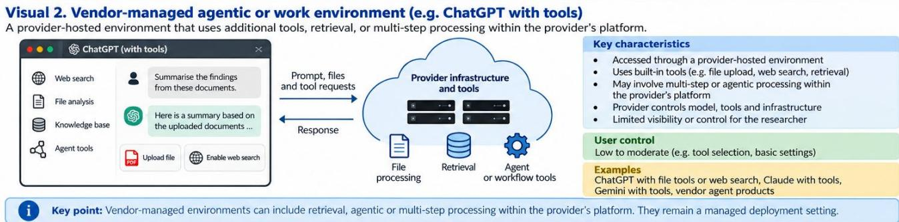  
Visual 2 shows that a vendor-managed agen�c or work environments may provide tools, files and delegated work, while the vendor controls underlying services.

## 3) Direct API (Applica�on Programming Interface)

A direct commercial API allows researchers to communicate with an LLM programma�cally using so�ware rather than a web interface. Instead of typing directly into ChatGPT, researchers write computer code that sends prompts to the model and receives responses automa�cally.

In plain language: An API can be thought of as a structured doorway that lets one computer program send a request to another. A research script can send the same type of request across hundreds or thousands of records, save the outputs automa�cally, and set technical op�ons consistently. The commercial vendor s�ll operates the underlying model service, but the researcher is controlling how requests are sent to it. Typical wording includes:

• "The OpenAI API was used."

• "Responses were generated using GPT-5 via the OpenAI API."

• "Temperature was fixed at zero."

Unlike commercial chat, direct commercial APIs allow researchers to control many addi�onal parameters, including:

• model version

• temperature

• structured outputs

• random seeds (when supported)

• prompt templates

• web search

• reasoning se�ngs

What these se�ngs mean: Temperature afects how strongly genera�on favours the highest-probability next words; lower values generally reduce randomness but do not guarantee iden�cal outputs. A random seed, when supported, is a value used to make some random choices more repeatable. Structured outputs constrain the response to a specified format, such as fixed fields in JSON. Prompt templates ensure that the same instruc�on structure can be applied repeatedly. Tool or web-search se�ngs determine whether the model can obtain informa�on beyond the text supplied directly in the request.

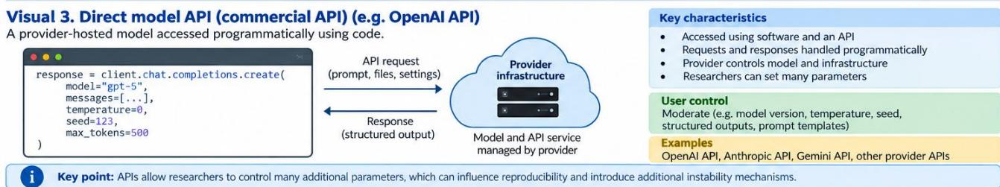  
Visual 3 shows that direct APIs may expose se�ngs relevant to repeatability, although the vendor s�ll controls the serving environment.

## 4) Self-hosted model (user-controlled model run�me)

In a self-hosted model or user-controlled model run�me, the researchers or their organisa�on control model execu�on, including the model weights and inference configura�on. This may be local or on infrastructure they administer.

In plain language: Self-hosted does not necessarily mean that the researchers trained the LLM themselves. More commonly, they obtain an already trained model and run inference, meaning the process of genera�ng outputs from that trained model, on hardware and so�ware that they or their ins�tu�on control. Instead of sending requests to OpenAI or Anthropic, the model runs on university, hospital or ins�tu�onal servers. Typical wording includes:

• "Llama 3 was deployed locally."

• "The model was run using vLLM."

• "Inference was performed on NVIDIA A100 GPUs."

Self-hosted deployments allow researchers to control:

• so�ware libraries

• inference engines

• hardware

• precision

• tokenisers

• model weights

These addi�onal controls also introduce addi�onal sources of instability.

Some self-hos�ng terms you may encounter: A GPU is compu�ng hardware commonly used to run LLMs. An inference engine is the so�ware that loads and executes the model. A tokenizer converts text into smaller units that the model processes. Precision describes how numerical values are represented during computa�on, and model weights are the learned numerical parameters that make up the trained model. Diferences in any of these components can mater when a study is self-hosted.

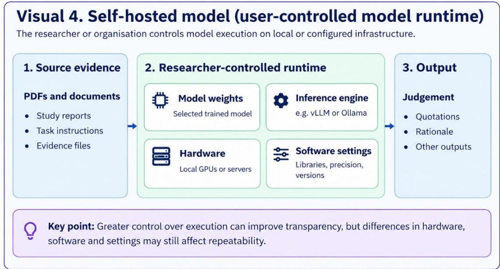  
Visual 4 shows that self-hosted/user-controlled run�mes ofer greater control over execu�on but do not necessarily disclose model training or development history.

## Step 2. Iden�fy the workflow architecture

A�er determining how the model was deployed, determine how the model completed the task. The workflow architecture describes the sequence of steps occurring before the final judgment is produced by the LLM. Keep the two dimensions separate: Deployment se�ng and workflow architecture answer diferent ques�ons. Deployment describes access to the model, whereas workflow architecture describes the sequence of opera�ons used to complete the task. The same deployment can support several workflow architectures. For example, an OpenAI API study could send one direct request per ar�cle, retrieve relevant passages before each request, or allow the model to select tools and repeat steps.

Two technical terms you will see o�en: A model call, some�mes called an inference request, means one request sent to the model and the response generated from that request. A run means one complete execu�on of a task, from the ini�al input to the final judgement or required output. A run may involve one model call or several calls, depending on the workflow. Understanding the diference between calls and runs can help you reconstruct what happened between the evidence entering the system and the final judgement coming out.

## Single-call workflow

A single-call workflow is the simplest architecture. The researcher provides the input once. The model immediately produces an answer. There are no intermediate steps.

In plain language: “Single-call” describes the path used to produce one task result, not the number of records in the en�re study. A study could screen 1,000 abstracts using 1,000 separate calls, one call for each abstract, and s�ll use a single-call architecture if each abstract goes directly from input to final output without retrieval, tool use, or model-directed intermediate ac�ons.

What “single” does not mean: A long prompt can s�ll be a single call. For example, the prompt may contain several eligibility criteria or several risk-of-bias ques�ons, but if the complete input is sent once and the mode returns the final judgement directly, the architecture is s�ll single-call. Examples include:

• �tle and abstract screening

• data extrac�on

• risk of bias assessment

• GRADE certainty assessment

Visual 5. Single-call workflow  
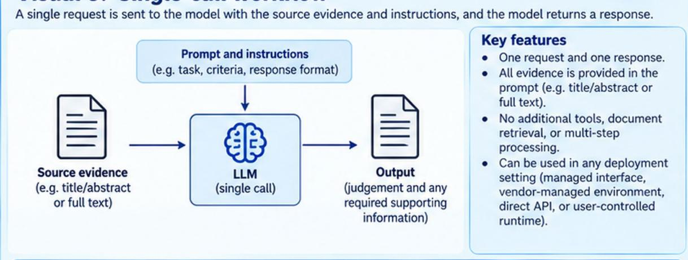  
In a single-call workflow, the model performs the task based on the information provided in one request. The same workflow can be used in any deployment setting.

Visual 5 shows that the model directly transforms the supplied evidence into an evalua�on

## Typical wording includes:

• Each abstract was submited to the LLM in a separate request, and an eligibility decision was returned.

• The full study report and risk-of-bias ques�ons were provided in one prompt, and the model returned its ra�ngs.

• We used one model call per record, with no addi�onal retrieval or tool use.

Visual 5 shows that the model directly transforms the supplied evidence into an evalua�on

## Retrieval-supported workflow

Retrieval-supported workflows first retrieve relevant informa�on before the model reasons over it. The model does not necessarily receive the complete document. Instead, the workflow:

1. splits documents into chunks;

2. searches those chunks;

3. retrieves the most relevant passages; and

4. supplies only those passages to the LLM.

## Retrieval may use:

• vector databases

• seman�c search

• RAG (Retrieval-Augmented Genera�on)

• PDF retrieval systems

Why use retrieval? Retrieval is commonly used when the source material is long or when the task requires finding a small amount of relevant evidence within a larger document collec�on. The retrieval system acts as a selec�on step: it decides which informa�on the LLM will see before the LLM makes the final judgement.

Key terms in simple language: A chunk is a smaller piece of a document, such as a paragraph or several hundred words. An embedding is a numerical representa�on of text that so�ware can use to es�mate which chunks are similar in meaning to a query. A vector database stores these representa�ons so that likely relevant passages can be found quickly. Retrieval-Augmented Genera�on, or RAG, is a broad term for workflows that retrieve informa�on and then place that informa�on in the context supplied to the LLM before it generates an answer.

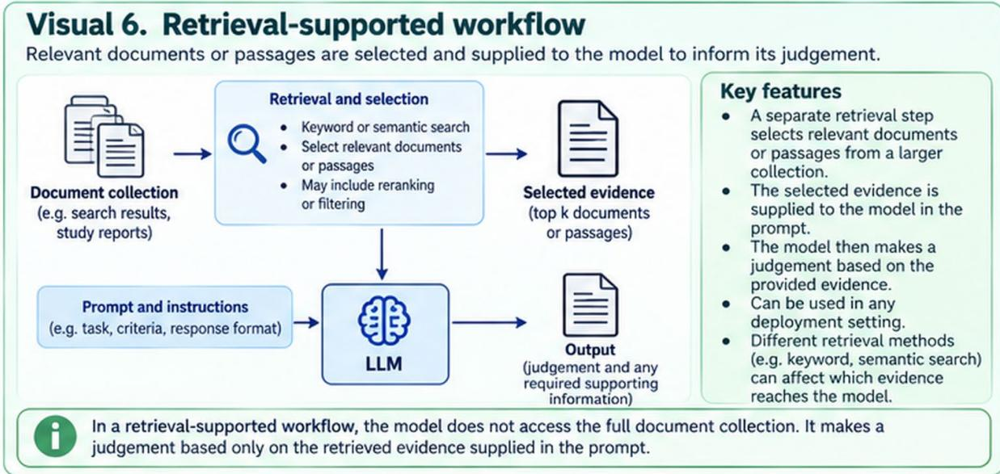  
Visual 6 shows that only retrieved passages are presented to the model, crea�ng addi�onal opportuni�es for instability.

## Typical wording includes:

• We used retrieval-augmented genera�on (RAG) to select relevant passages from the included reports before appraisal.

• Full-text ar�cles were divided into chunks, and the five most relevant passages were retrieved for each ques�on.

• A seman�c search of the document collec�on iden�fied evidence excerpts that were supplied to the LLM.

Why retrieval maters for repeatability and reproducibility: Retrieval can add variability before the LLM even begins its evalua�on. If a diferent passage is selected from the same document, the model is efec�vely being asked to judge from diferent evidence. For this reason, the retrieval step itself is relevant when assessing reproducibility.

## Agen�c workflow

Agen�c workflows allow the model to make decisions during execu�on. Instead of immediately answering the ques�on, the model decides which ac�on to perform next.

In plain language: An “agent” is not a diferent species of language model. It is a way of organising an LLM inside a workflow so that the model has some autonomy to choose among allowed ac�ons, such as searching, opening another file, calling a tool, or deciding whether another step is needed. The defining feature is modeldirected choice about what happens next. For example, it may:

• search for addi�onal informa�on,

• retrieve another document,

• use an external tool,

• repeat earlier steps,

• decide that more evidence is required.

Each decision influences later steps.

How to dis�nguish agen�c from simply mul�-step: Do not classify a workflow as agen�c merely because it contains several programmed steps. If the developers predetermined every step, for example “extract text, then run prompt A, then run prompt B,” the workflow is mul�-step but not necessarily agen�c. Look for evidence that the model itself selected, repeated, or changed ac�ons based on intermediate results.

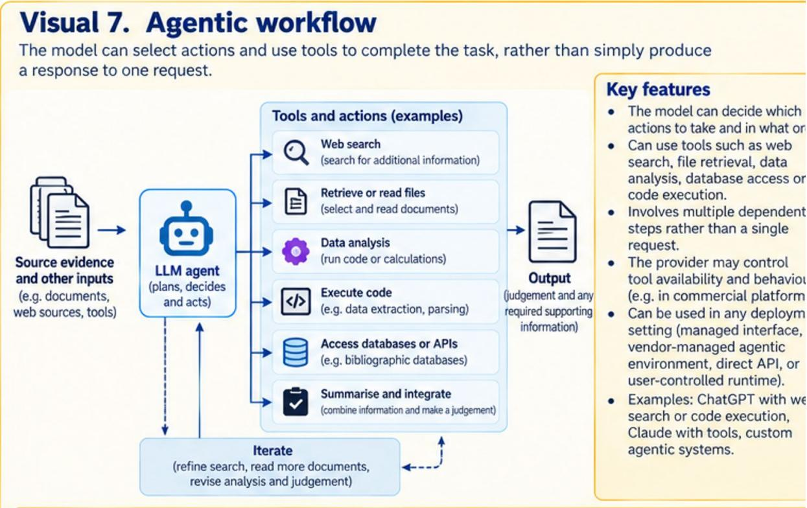  
Visual 7 shows that agen�c workflows involve sequen�al decision making rather than a single inference.

## Typical wording includes:

• The LLM agent selected which tools to call and whether further searches were needed before reaching a judgement.

• Based on intermediate results, the model decided whether to open addi�onal reports or repeat the search.

• The agent autonomously planned and executed a sequence of evidence-gathering and appraisal steps.

## Mul�-agent workflow

Mul�-agent workflows involve more than one LLM. Each model performs a specialised task before contribu�ng to the final answer. Examples include:

• one model extracts evidence;

• another evaluates risk of bias;

• a third reconciles disagreements.

Alterna�vely, mul�ple models may independently evaluate the same evidence before vo�ng.

In plain language: In this context, an “agent” is an LLM-based role or component. The agents do not have to use diferent model families. Several agents may all use the same underlying model but receive diferent instruc�ons, tools, or responsibili�es. What makes the workflow mul�-agent is that mul�ple LLM-based agents generate intermediate outputs that are then combined, compared, debated, voted on, or adjudicated.

Overlap with agen�c workflows: Mul�-agent and agen�c are not mutually exclusive concepts. A mul�-agent system may also be agen�c if one or more agents decide which ac�ons to take during execu�on. If the publica�on does not describe the decision process clearly enough to dis�nguish these features, record the architecture as unclear rather than inferring it from terminology alone.

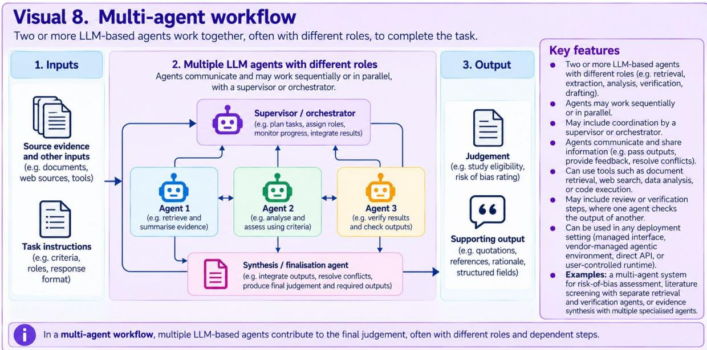  
Visual 8 shows that mul�ple models contribute to the final decision.

## Typical wording includes:

• Separate LLM agents extracted evidence, assessed risk of bias, and reviewed disagreements before producing a final ra�ng.

• Three LLM-based agents independently evaluated each study, and their assessments were combined by a coordina�ng agent.

• A reviewer agent checked the first agent’s appraisal, and an adjudicator agent resolved conflic�ng ra�ngs.

## All conceptually possible combina�ons of deployment se�ngs and workflow architectures

Deployment se�ng and workflow architecture describe diferent features of an LLM-assisted evalua�on. Deployment se�ng describes how the model is accessed and operated, whereas workflow architecture describes how the task is performed. The same workflow architecture may be implemented in diferent deployment se�ngs, although the available features and degree of researcher control may difer. Visual 9 illustrates these two dimensions and their possible combina�ons.

Visual 9. Relationship between deployment settings and workflow architectures Any workflow architecture can be used in any deployment setting. Deployment setting and workflow architecture are two independent dimensions.  
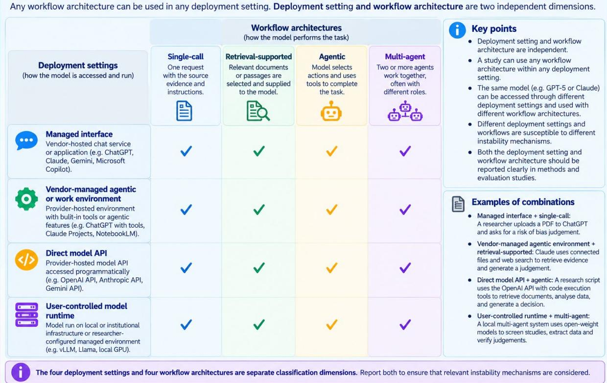  
Visual 9 shows all conceptually possible combina�ons of deployment se�ngs and workflow architectures. Availability depends on the features supported by each system. Check marks do not indicate that every combina�on is available in every product.

## Step 3. Read the Methods sec�on

Most studies explicitly describe their workflow. The table below provides common clues.
<table><tr><td rowspan=1 colspan=1>If the Methods section says...</td><td rowspan=1 colspan=1>Likely classification</td></tr><tr><td rowspan=1 colspan=1>&quot;We used ChatGPT.&quot;</td><td rowspan=1 colspan=1>Commercial chat</td></tr><tr><td rowspan=1 colspan=1>&quot;The OpenAI API was used.&quot;</td><td rowspan=1 colspan=1>Direct model API</td></tr><tr><td rowspan=1 colspan=1>&quot;Temperature was set to zero (deployment nototherwise reported).&quot;</td><td rowspan=1 colspan=1>Direct model API</td></tr><tr><td rowspan=1 colspan=1>&quot;We used LangChain to let the model choose tools.&quot;</td><td rowspan=1 colspan=1>Agentic workflow</td></tr><tr><td rowspan=1 colspan=1>&quot;We used AutoGen.&quot;</td><td rowspan=1 colspan=1>Multi-agent workflow</td></tr><tr><td rowspan=1 colspan=1>&quot;We retrieved relevant PDF chunks before appraisal.&quot;</td><td rowspan=1 colspan=1>Retrieval-supported workflow</td></tr><tr><td rowspan=1 colspan=1>&quot;Relevant passages were retrieved.&quot;</td><td rowspan=1 colspan=1>Retrieval-supported workflow</td></tr><tr><td rowspan=1 colspan=1>&quot;Embeddings were generated.&quot;</td><td rowspan=1 colspan=1>Retrieval-supported workflow</td></tr><tr><td rowspan=1 colspan=1>&quot;vLLM was used.&quot;</td><td rowspan=1 colspan=1>Self-hosted model/User-controlled runtime</td></tr><tr><td rowspan=1 colspan=1>&quot;Ollama was used.&quot;</td><td rowspan=1 colspan=1>Self-hosted model/User-controlled runtime</td></tr><tr><td rowspan=1 colspan=1>&quot;The model called external tools.&quot;</td><td rowspan=1 colspan=1>Agentic workflow</td></tr></table>

Use cau�on: So�ware and framework names are useful clues, but they are not always suficient on their own. A framework may support several kinds of workflows. Whenever possible, classify the study from the descrip�on of what the so�ware actually did rather than from the package name alone. Do not infer the deployment se�ng from a sampling parameter or so�ware library alone. Temperature se�ngs can be exposed in more than one deployment se�ng; LangChain can support agen�c and non-agen�c

workflows; and chunking alone does not establish retrieval. Record the relevant dimension as unclear if the necessary steps are not reported.

Reading strategy: Read the Methods sec�on in two passes. On the first pass, mark clues about deployment, such as a chat interface, an API, a local server, or named hardware. On the second pass, mark clues about workflow behaviour, such as one direct request, chunking and retrieval, model-selected tool use, or several LLM-based agents. Keeping these ques�ons separate helps prevent deployment se�ng from being confused with workflow architecture.

Read the published Methods paragraph with highlighted phrases:

• "OpenAI API"

• "chunked documents"

• "retrieved passages"

• "LangChain"

Arrows connect each highlighted phrase to the corresponding Figure 2 in the manuscript row or column.

Beginner �p: When a manuscript’s methods descrip�on contains many technical terms, you do not need to understand every term before you can classify the study. First look for the minimum informa�on needed to answer these two ques�ons: how the model was accessed, and what happened between the original evidence and the final evalua�on.

## Worked example: Classifying an LLM-assisted evidence synthesis study

Suppose a published systema�c review reports that "Full-text PDFs were converted into plain text. Documents were divided into overlapping chunks and stored in a vector database. The five most relevant passages were retrieved for each ques�on and supplied to GPT-5 through the OpenAI API."

## Suppose a published study reports:

“Full-text systema�c reviews were converted into plain text. Documents were divided into overlapping chunks and stored in a vector database. The five most relevant passages were retrieved for each AMSTAR 2 ques�on and supplied to GPT-4o through the OpenAI API. Responses were generated using Python, with temperature set to 0 and outputs recorded in a structured JSON format.”

How to read this example: “Converted into plain text” describes document preprocessing. “Divided into overlapping chunks” and “stored in a vector database” indicate that a retrieval system was created. “The five most relevant passages were retrieved” confirms that selected evidence was supplied to the model before it made its judgement. “Through the OpenAI API” iden�fies how the model was accessed. The study also reports the model used (GPT-4o), temperature se�ng (0), and output format (JSON).

This example shows why the full processing chain maters: errors in document conversion, chunking or retrieval can change the evidence supplied to the model, even when the model and final prompt remain unchanged.

## Step 1. Iden�fy the deployment se�ng

The researchers used the OpenAI API to send requests to GPT-4o through Python.

Deployment se�ng: ✓ Direct model API (commercial API)

## Step 2. Iden�fy the workflow architecture

The researchers divided documents into smaller sec�ons and used a retrieval system to select relevant passages before sending them to the model.

Workflow architecture: ✓ Retrieval-supported workflow

## Step 3. Iden�fy key features and se�ngs

The Methods sec�on reports the following:

• Model: GPT-4o

• Temperature: 0

• Output format: Structured JSON

Retrieval method: Vector database

• Document preprocessing: Conversion to plain text and division into overlapping chunks These details help readers understand how the study was conducted and iden�fy features that may afect its results.

## Step 4. Consult the taxonomy table

Combine the informa�on from Steps 1–3.

Final classifica�on for the example:

• Deployment se�ng: Direct model API (commercial API)

• Workflow architecture: Retrieval-supported

• Key features: GPT-4o, temperature 0, structured JSON output and vector-database retrieval

The study is classified aa a retrieval-supported workflow row and a direct model API. This classifica�on directs readers to the relevant mechanisms in the taxonomy table, including those associated with retrieval, document processing and model se�ngs.

Why this maters: The purpose of this step is not to decide whether the study is good or bad. It is to iden�fy which mechanisms are technically possible for that study design and therefore need to be considered. Some mechanisms can afect any LLM workflow, whereas others only arise when a par�cular capability, such as retrieval, tool use, mul�ple agents, or self-hosted infrastructure, is present.

A useful dis�nc�on: At this stage, dis�nguish “not applicable” from “not reported.” If a mechanism cannot occur because the relevant capability is absent, it is not applicable. If the capability may have been used but the Methods sec�on does not provide enough informa�on to determine this, record the classifica�on as unclear and document the repor�ng gap.

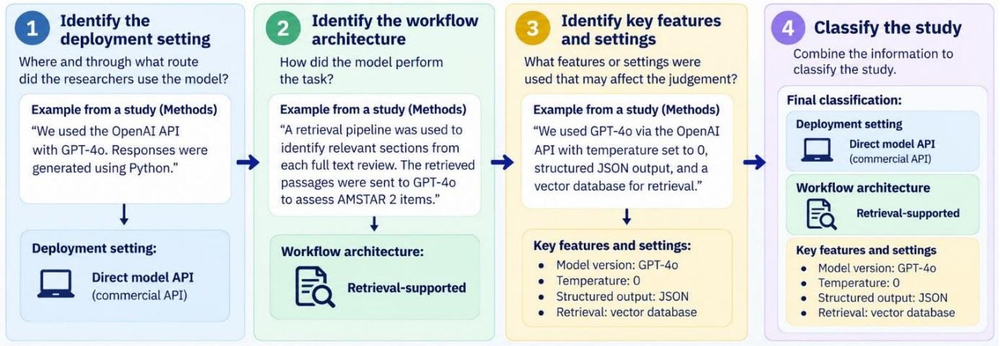

This visual shows a worked example illustra�ng the four-step process for classifying an LLM-assisted evidence synthesis study.

Common misconcep�ons
<table><tr><td rowspan=1 colspan=1>Misconception</td><td rowspan=1 colspan=1>Explanation</td></tr><tr><td rowspan=1 colspan=1>ChatGPT and the OpenAI APIare the same thing.</td><td rowspan=1 colspan=1>They may use related underlying models but represent different deploymentsettings with different levels of user control.</td></tr><tr><td rowspan=1 colspan=1>Retrieval simply meanssearching PubMed.</td><td rowspan=1 colspan=1>Retrieval refers to the process of selecting documents or passages beforethey are presented to the model.</td></tr><tr><td rowspan=1 colspan=1>Using multiple promptsautomatically creates anagentic workflow.</td><td rowspan=1 colspan=1>Agentic workflows require the model to make decisions about subsequentactions, not merely receive multiple prompts.</td></tr><tr><td rowspan=1 colspan=1>Temperature = 0 guaranteesdeterministic behaviour.</td><td rowspan=1 colspan=1>Temperature is only one source of variability Other mechanisms may stillinfluence outputs.</td></tr><tr><td rowspan=1 colspan=1>Every study can be classifiedperfectly.</td><td rowspan=1 colspan=1>Some studies report insufficient methodological detail. When deploymentsetting or workflow architecture cannot be determined, classification shouldbe recorded as unclear, and missing reporting should be documented.</td></tr></table>

## Summary

Classifying an LLM-assisted evidence synthesis study requires two independent decisions:

1. Iden�fy the deployment se�ng (how the model was accessed).

2. Iden�fy the workflow architecture (how the model completed the task).

By separa�ng deployment se�ng from workflow architecture, this tutorial enables readers with minimal AI exper�se to consistently iden�fy the mechanisms that should be considered when evalua�ng LLM-assisted evidence synthesis studies.

Prac�cal rule: If either ques�on cannot be answered from the publica�on or supplementary materials, do not guess. Record that dimension as unclear and note exactly what informa�on is missing, such as whether the study used a chat interface or an API, whether retrieval occurred, or whether the model could decide which tools to call.

## Supplementary 4: Full taxonomy of mechanisms, evidence, testing and mitigation strategies

The taxonomy concerns read-and-evaluate tasks that require interpretation of supplied or identified evidence. Eligible mechanisms or operationally defined failure modes must have a specific, plausible, and empirically testable connection to IC1, IC2, or both. They may arise from preparation of the task and evidence, model or system operation, task execution, or recording of the judgement and required supporting outputs. Categories group related mechanisms by where they arise in the LLM system, input, evaluation design, or workflow. The individual mechanism or operationally defined failure mode is the unit used for testing, mitigation, and mapping. The taxonomy does not claim to be comprehensive.

• IC1, Repeat-run variability: The mechanism or failure mode can produce materially different judgements, extractions, or required supporting outputs across repeated runs of the same read-andevaluate task under the same specified conditions. Specified conditions include the source evidence, task, prompt and instructions, specified model variant and version, and model settings. Internal system conditions, such as routing or serving conditions, may vary without the evaluator’s knowledge or control. A difference is material when it affects interpretation, fulfilment of task requirements, or downstream use, rather than wording alone.

IC2, Hidden judgement failure: The mechanism or failure mode can systematically affect the judgement or required output in a way that is not apparent from the judgement itself. The problem may still be visible elsewhere in the output, for example in an unsupported quotation, an invalid reference, or a missing required field. IC2 does not require repeated runs to agree, and it does not require the final judgement to be incorrect.

BOTH. A mechanism meets both criteria when it can cause repeat-run variability and can also cause an IC2 problem. These effects need not occur under the same circumstances. Deliberately changing a specified condition is a robustness or sensitivity test and does not establish IC1. A changed judgement under a robustness test supports IC2 only when the changed feature should not legitimately determine the judgement or required task.

The mechanisms are also coded using five descriptive aspects, which show where a mechanism can affect a read-and-evaluate task: (1) Framing: how the task, criteria, and response options are presented; (2) Evidence basis: what evidence reaches the model and is selected or used; (3) Formation: how the model interprets criteria and weighs evidence to reach a judgement; (4) Expression: how the judgement and required outputs are communicated and recorded; and (5) Substantiation: whether quotations, references, and explanations support the judgement, including the interpretive link between evidence and the rating. A mechanism can be assigned to more than one aspect. For infrastructure mechanisms that can change the whole model or serving route, system identity may be recorded separately rather than forcing an aspect assignment.

The four deployment settings are: (1) Commercial chat interface, a commercial chat or app such as ChatGPT, Claude.ai, or Gemini, where the user can usually set the prompt, files, and basic options while hidden instructions, routing, context handling, and most model settings remain vendor-controlled; (2) Vendor-managed agentic environment, environments such as Claude Code, Codex CLI, or IDE-based coding agents, where users can set files, allowed tools, permissions, and standing instructions, while orchestration, hidden prompts, context construction, model routing or version, and some model settings may remain vendor-controlled; (3) Direct model API, a commercial vendor API in which users can specify exact requests, system prompts, supported settings, and tool schemas, while the vendor controls servers, hardware, and serving code; and (4) Self-hosted model, a model run in a user-controlled runtime. This includes third-party open-weight models downloaded and run by the researcher, researcher fine-tuned models, and models developed or trained in-house. Runtime means the hardware, serving or inference software, and settings used to run the model. In self-hosted use, the researcher can usuall specify the weights, runtime, sampling settings, seed where supported, and context setup. Self-hosting increases control over execution conditions but does not necessarily provide knowledge of the training data or post-training history. Retrieval-supported, tool-using or agentic, and multi-agent systems are workflow architectures rather than additional deployment settings. Multi-provider gateways can add another routing layer even when the interface looks like an API.

Table S1. Taxonomy of repeat-run variability and hidden judgment failure mechanisms in LLM reading-and-evaluating tasks
<table><tr><td>Mechanism</td><td>Definition</td><td>Evidence Summary, Gap and Notes</td><td>Applies to</td><td>Testing &amp; Mitigation</td><td>Affected task components</td><td>Inclusion and rationale</td></tr><tr><td colspan="7">Category A. User-Level Instability. Mechanisms arising from user, account, session, or persistent instruction context applied outside the supplied source and study prompt.</td></tr><tr><td colspan="1" rowspan="1">A.1Personalisationand user history</td><td colspan="1" rowspan="1">Saved memory, priorconversation history, userprofiles, or other account orsession memory can addinformation to a read-and-evaluate task that is not partof the supplied source ordeclared task conditions.</td><td colspan="1" rowspan="1">Strong overall and moderate for read-and-evaluatetasks. Prior conversation history or stored userinformation can alter later model outputs, witheffects depending on the model, task, and relevanceof the carried-over information.[1-7] In read-and-evaluate tasks, prior judgements systematicallyshifted later judgements. Two studies found thatoutputs were influenced by the prevailing polarity ofthe preceding conversation.[1, 7] Broaderpersonalization studies show that models can usestored user information even when it is irrelevant tothe current task.[2-6] OP-Bench and RPEval identifiedinappropriate memory use, including irrelevantpersonalization, repetition, flattery, and use ofpreferences that should have been ignored.[2, 5]Cross-domain studies found that information storedfor one context can influence responses in another,and that storing past user information in separate,labeled fields or categories, rather than exposing themodel to all prior history can reduce this unwantedcarry-over.[3, 6]</td><td colspan="1" rowspan="1">All deploymentswhen prior user,session, or memorystate is carried intothe task.Commercial chatand vendor-managed agenticenvironments maycarry vendor-managed state;APIs and self-hosted models mayalso carryapplication-managed state.</td><td colspan="1" rowspan="1">TEST: Run the same task first without prior stateand second with the usual history or memory,while keeping the source, study prompt, model,and other settings fixed. In commercial chat, usea new chat or session for the no-state condition.In APls or self-hosted systems, use a new orstateless session and record whether prior-turncontext, server-side conversation state, or amemory store is used. This comparison testssensitivity to carried-over state and is not IC1.MITIGATE: Use a fresh chat or session for eachtask and do not supply prior conversation historyor stored memory. If persistent memory isrequired, restrict it to information relevant to thecurrent task and reset or version the statebetween evaluations.</td><td colspan="1" rowspan="1">Evidence basis;Judgment formation</td><td colspan="1" rowspan="1">BOTH. IC1: Hidden carried-over statecan vary across runs under the samespecified conditions and materiallychange judgements or requiredoutputs. IC2: Irrelevant orinappropriate carried-over state caninfluence evidence use or thejudgement in a way that is notapparent from the judgement itself.</td></tr><tr><td colspan="1" rowspan="1">A.2 Custominstructions</td><td colspan="1" rowspan="1">Persistent account-levelinstructions applied outsidethe study prompt can addassumptions, priorities, ordecision rules that are notpart of the intended task.Note: A.1 is what the systemremembers about the user.A.2 is what the system isinstructed to do.</td><td colspan="1" rowspan="1">Moderate overall and moderate for read-and-evaluate tasks. Across evaluation studies, higher-level instructions can alter final judgements whenthe prompt is unchanged.[8-10] When Gupta et al.added a short instruction in the system prompt,more favorable judgments were found.[8] Inresearch quality evaluation, more detailed taskinstructions performed better than simplifiedversions.[9, 10] Broader studies show that systeminstructions can steer model outputs in anydirections (i.e., positive, neutral or harmful), andtheir effects depend on the model and task.[11, 12]Thus, changing the hidden instruction layer does notitself constitute IC1, as the change must produce adifferent final judgement. Conversely, a fixed butinappropriate instruction can produce a stable shiftin judgement that repeated runs will not reveal,which is IC2.</td><td colspan="1" rowspan="1">All deploymentswhen persistentinstructions exist.Commercial chatmay use account-level instructions;vendor-managedagenticenvironments mayuse standing orproject instructions;APIs may usesystem, developer,or applicationinstructions; self-hosted models mayuse fixed systemprompts orwrappers.</td><td colspan="1" rowspan="1">Commercial chat can include account-levelcustom instructions. APls can includesystem/developer instructions or application-level defaults. Self-hosted systems can also applyfixed system prompts or wrapper instructions.TEST: Record the account-level or systeminstructions applied to the task. As a sensitivityanalysis, run the same source and study promptwith and without the standing instruction layerand compare the final judgements.MITIGATE: Disable unrelated custom instructionsduring evaluation. If persistent instructions arerequired, use the same version-controlledinstruction text for all runs and report it verbatim.Keep evaluation instructions explicit and avoidconflicting instructions across system and studyprompts. Where the model can be controlled,instruction-hierarchy training can improveadherence to higher-priority instructions,although this is a model-level mitigation ratherthan something most evaluators can implement.</td><td colspan="1" rowspan="1">Framing; Judgmentformation</td><td colspan="1" rowspan="1">BOTHIC1: An undeclared instruction layercan vary can vary across runs whilespecified conditions remain fixed andmaterially change the outputs. IC2: Afixed inappropriate instruction canalter the decision rule or judgment n away that is not apparent from thejudgement itself.</td></tr><tr><td colspan="7" rowspan="1">Category B. Infrastructure Instability. Mechanisms arising from changes or variation in model routing, versioning, or the serving environment.</td></tr></table>

<table><tr><td colspan="1" rowspan="1">Mechanism</td><td colspan="1" rowspan="1">Definition</td><td colspan="5" rowspan="1">Evidence Summary, Gap and Notes</td><td colspan="1" rowspan="1">Applies to</td><td colspan="1" rowspan="1">Testing &amp; Mitigation</td><td colspan="1" rowspan="1">Affected taskcomponents</td><td colspan="1" rowspan="1">Inclusion and rationale</td></tr><tr><td colspan="1" rowspan="1">B.1 Routingvariability</td><td colspan="1" rowspan="1">A request is served by adifferent underlying model,model variant, or inferenceroute even though thespecified model identityremains unchanged.</td><td colspan="5" rowspan="1">Moderate overall; limited for read-and-evaluatetasks. Evidence shows that model substitution andmixed routing are technically possible and can bedifficult to identify from outputs alone.[13-15] Cai etal. tested substitution with smaller, quantized, andintermittently substituted models and found thatsubtle substitutions can evade output-basedchecks.[13] Zhang et al. subsequently found directevidence that several third-party APIs claiming toprovide named commercial models producedbehaviour and model-identity signals inconsistentwith the corresponding official APIs.[14] Zhang,Zhang and Qin showed that an endpoint can mixrequests between different backends while retainingthe same apparent interface, and developedmethods for detecting both persistent substitutionand request-level mixed routing.[15] Broader routingresearch shows that changing the selected modelcan leave an answer unchanged, correct a previousfailure, or introduce a new failure. [16, 17]</td><td colspan="1" rowspan="1">All deployments caninvolve routing, butobservabilitydiffers. Routing isusually vendor-controlled incommercial chat,vendor-managedagenticenvironments, anddirect model ÁPIs.In self-hostedmodels, the usercan usually set andlog routing. Multi-provider gatewayscan add anotherhidden routinglayer.</td><td colspan="1" rowspan="1">TEST: In commercial APIs, use repeated identicalprobes and compare output distributions usingthe model-substitution audit approach of Cai etal. (2025).[13] Use log-probability fingerprintsonly where they are exposed. In self-hosted/managed systems, inspect routing rulesand serving logs to verify which model handledeach reguest. Changes in outputs alone do notestablish routing variability. Classify the change asB.1 only when there is evidence that theunderlying model or serving route changed.MITIGATE: In commercial APIs, pin a dated orsnapshot model identifier where available andrecord the exact model ID, endpoint, and accessdate, while recognising that hidden provider-siderouting may remain. In self-hosted/managedsystems, fix the model and routing configurationand retain serving logs so the model used foreach request can be verified.</td><td colspan="1" rowspan="1">Not assigned.System identityrecorded separately.</td><td colspan="1" rowspan="1">BOTH. IC1: Hidden routing can sendrepeated runs under the samespecified conditions to differentmodels or inference routes andmaterially change judgements orrequired outputs. IC2: Hidden model orroute substitution can systematicallyaffect the judgement under anundeclared model or route in a waythat the judgement itself does notreveal.</td></tr><tr><td colspan="1" rowspan="1">B.2 Modelversion drift</td><td colspan="1" rowspan="1">The model changes over timebecause the provider orresearcher updates it. Thechange may be gradual orabrupt. This mechanism islongitudinal and is distinctfrom variation acrossrepeated runs using the samefixed model version. Aversion change may alterhow the model interpretsevidence, followsinstructions, uses toolsformats required outputs, orreaches the final judgement.</td><td colspan="5" rowspan="1">Strong overall; moderate for read-and-evaluatetasks. Across longitudinal studies, model updateschanged positively or negatively both the pathsmodels followed and the outputs they produced,even when tasks and prompts were heldconstant.[10, 18-22] Some updates correctedpreviously wrong answers, while others changedpreviously correct answers to incorrect ones. Inother cases, overall performance appeared similarbut the correct answers changed.[10, 20-22] Pathchanges included differences in followinginstructions and responses, sometimesaccompanying changes in the final answer.[10, 21,22] Chen et al. found changes across GPT-3.5 andGPT-4 versions on reasoning, question answering,medical examination, code generation, andinstruction-following tasks, with some tasksimproving and others not.[22] Venugopal et al.similarly found changes across GPT models duringscientific prediction and classification tasks.[21] Maet al. showed that updates to commercial LLM APlscould change toxicity-classification results and couldalso change which prompt designs worked best.[20]Echterhoff et al. showed that later LLM versionscould reverse previously correct decisions.[18] Morerecent open-model releases likewise found that</td><td colspan="1" rowspan="1">All deployments:Commercial chat,vendor-managedagenticenvironments, anddirect model APIscan be updated bythe vendor. Self-hosted models canbe held fixed by theuser, or deliberatelyupdated to a newweight/version.</td><td colspan="1" rowspan="1">TEST: Re-run an input at prespecified intervalsusing the same model version or ID and compareresults with the initial reference run. Record themodel label or ID and access date at every run.This can detect model drift under a stable labelbut cannot always identify the exact backendupdate.MITIGATE: In commercial chat, users generallycannot pin a backend version; record thedisplayed model label and access date and treat aknown vendor update as a new model condition.In commercial APIs, use a dated or snapshotmodel ID where the provider offers one andrecord the exact ID, endpoint, and access date. Ifa pinned API version is deprecated, document thedate and treat the replacement as a differentmodel.</td><td colspan="1" rowspan="1">Judgment formation;Expression</td><td colspan="1" rowspan="1">IC1. A hidden model update under anunchanged specified model identitycan produce materially differentjudgements or required outputs acrossruns. A known version change is achanged condition and should beevaluated as a robustness orlongitudinal comparison. A modelupdate alone does not establish an IC2problem.</td></tr><tr><td colspan="1" rowspan="1"></td><td colspan="1" rowspan="1"></td><td colspan="5" rowspan="1">results on fixed evaluation outputs changed betweenversions.[19]</td><td colspan="1" rowspan="1"></td><td colspan="1" rowspan="1"></td><td colspan="1" rowspan="1"></td><td colspan="1" rowspan="1"></td></tr><tr><td colspan="1" rowspan="3">B.3 Serving-timenumerical non-determinism</td><td colspan="1" rowspan="1">Numerical variation canoccur before the next tokenis selected. The calculationsused to run the same model</td><td colspan="5" rowspan="3">Strong overall and limited for read-and-evaluatetasks. Controlled technical studies establish a path-to-output chain. Yuan et al. changed requestgrouping, GPU count, GPU type, and numericalprecision under greedy decoding and found changesin generated responses, including up to 9% variationin accuracy and differences of up to 9,000 tokens inresponse length for one reasoning model.[23]Thinking Machines Lab showed that standard servingproduced 80 unique completions across 1,000temperature-0 runs, whereas making the numericaloperations invariant to how requests were groupedmade all 1,000 completions identical.[24] Fu et al.demonstrated that repeated inference producedvariation in token probabilities across four modelsand several GPUs, with larger effects for tokenswhose probabilities were not close to 0 or 1.[25]Shanmugavelu et al.[26] and NVIDIA[27] providesupporting evidence that changes in reduction orderand hardware execution can alter floating-pointresults and that bitwise reproducibility is notuniversally guaranteed. Read-and-evaluate studiesshow the same phenomenon. Zhao et al. repeatedtemperature-0 LLM evaluations 50 times and foundthat one GPT-4o evaluation received scores of 5, 3,and 1 in 52%, 14%, and 34% of runs, respectively,compared to four self-hosted models with consistentresults.[28] Tamba found that forcing greedydecoding reduced but did not eliminate repeatedpass/fail changes in an LLM-as-judge evaluation.[29]Thinking Machines Lab (2025) demonstratedinference variation and a batch-invariant mitigation;task-specific IC1 effects still require testing. [24]</td><td colspan="1" rowspan="3">Can occur in alldeploymentsbecause servingcalculations happenin every runtime,but it is directlytestable and partlycontrollable mainlyin self-hostedmodels. Vendor-managed settingsusually hide therelevant hardwareand serving details.</td><td colspan="1" rowspan="3">TEST: In self-hosted systems, repeat identicalrequests while first holding serving conditionsfixed and second varying one serving condition ata time, such as request grouping, hardware,numerical precision, or batch-invariant kernels.Compare token probabilities or outputs todetermine whether numerical serving conditionscontribute to disagreement.MITIGATE: Use batch-invariant or otherdeterministic inference methods, and keephardware, software configuration, and numericalprecision fixed. Higher-precision computation canfurther reduce numerical variation. For provider-hosted APIs, document that batch-invariantkernels and serving configurations may beinaccessible; fixed user-visible settings andtemperature zero cannot establish numericaldeterminism.[24] Treat reproducible inference asa property to test, not assume.</td><td colspan="1" rowspan="3">Judgementformation;Expression</td><td colspan="1" rowspan="3">IC1. Serving calculations can vary underthe same specified conditions and altertoken selection enough to change ajudgement or required output.Numerical variation without a materialtask-level difference does not meetIC1. The mechanism is not IC2 unless aseparate hidden judgement orrequired-output problem isdemonstrated.</td></tr><tr><td colspan="9" rowspan="1">can differ slightly betweenotherwise identical requestsbecause of differences inhow floating-pointoperations are grouped orperformed, how requests areprocessed on the server,kernel selection, hardwareexecution, or other servingconditions that affectnumerical computation.These small differences canchange the probabilitiesassigned to possible nexttokens. Usually the selectedtoken remains the same.When two tokens have verysimilar probabilities,however, a small numericaldifference can change theselected token and mayeventually change the final</td></tr><tr><td colspan="9" rowspan="1">judgement even though thechanged. This can occur evenwhen the model uses greedydecoding. Greedy decodingremoves randomness fromtoken selection, but it doesnot guarantee identicaloutputs if the underlyingprobability calculations differslightly between runs.</td></tr><tr><td colspan="1" rowspan="1">Category C. Sampling</td><td colspan="1" rowspan="1">Instability. Mechanisms arisin</td><td colspan="5" rowspan="1">g from stochastic token selection and decoding during</td><td colspan="1" rowspan="1">generation.</td><td colspan="1" rowspan="1"></td><td colspan="1" rowspan="1"></td><td colspan="1" rowspan="1"></td></tr><tr><td colspan="1" rowspan="1">C.1 Stochasticsampling,decoding andseed</td><td colspan="1" rowspan="1">When stochastic decoding isused, tokens are sampledfrom a probabilitydistribution. Repeated runsof the same task under thesame specified sampling</td><td colspan="5" rowspan="1">Strong and growing evidence. Repeated run studiesshow that stochastic decoding can produce differentoutputs from the same task. Shyr et al.[30] usedrepeated generations under fixed sampling settingsand found that repeatability varied by model,prompt, and dataset.21 An earlier clinical</td><td colspan="1" rowspan="1">Can occur in alldeployments whenstochasticgeneration is used.Sampling controlsare usually most</td><td colspan="1" rowspan="1">TEST: Where sampling controls are exposed,repeat the identical read-and-evaluate task withthe same prompt, model, decoding settings, andseed if available, and report agreement acrossruns. As a sensitivity test, vary one decodingcontrol at a time to determine whether sampling</td><td colspan="1" rowspan="1">Judgment formation;Expression</td><td colspan="1" rowspan="1">IC1: Stochastic token selection canproduce materially differentjudgements or required outputs acrossrepeated runs with the same specifiedsampling settings. Sampling variationalone does not establish IC2.</td></tr><tr><td colspan="1" rowspan="2"></td><td colspan="1" rowspan="1">settings can thereforeproduce different tokensequences and, forjudgement tasks, materiallydifferent judgements orrequired outputs.Temperature, top p, top k,and the random seed caninfluence sampling.</td><td colspan="5" rowspan="2">classification study found substantially moredisagreement across repeated runs at highertemperatures. with the proportion of casesproducing multiple classifications decreasing astemperature was reduced. Windisch et al.[31]similarly found that agreement was highest attemperature 0 and generally decreased at highertemperatures in repeated biomedical classificationtasks. A separate mobility extraction study using 100repeated generations per condition also found thatagreement declined as sampling temperatureincreased, although the effect varied by model andtask.[32]</td><td colspan="1" rowspan="2">visible in directmodel APls andself-hosted models;Commercial chatand vendor-managed agenticenvironments mayexpose few or nocontrols.</td><td colspan="1" rowspan="2">changes the judgement. Commercial chat usuallydoes not expose enough decoding control toisolate C.1 from other backend causes.MITIGATE: In commercial APIs, use the leaststochastic decoding supported and appropriatefor the model, and fix and report any exposeddecoding settings and seed. Not all provider-hosted models expose these controls. In self-hosted/managed systems, fix the decodingalgorithm and random seed and use greedy orotherwise deterministic decoding whereappropriate. These controls reduce samplingvariation but do not address B.3 numerical non-determinism. Estimate repeat-run agreementfrom multiple independently generatedjudgements and do not treat temperature zero ora single judgement as sufficient evidence ofrepeatability.[33, 34] Assess agreement with anindependent reference standard separately.</td><td colspan="1" rowspan="2"></td><td colspan="1" rowspan="2"></td></tr><tr><td colspan="9" rowspan="1"></td></tr><tr><td colspan="1" rowspan="2">Category D. Contami</td><td colspan="1" rowspan="1">nation. Mechanisms arising whe</td><td colspan="5" rowspan="2">n information that should not determine the judgemen</td><td colspan="1" rowspan="2">t is available to or r</td><td colspan="1" rowspan="2">etrieved by the model.</td><td colspan="1" rowspan="3">Evidence basis;Judgementformation</td><td colspan="1" rowspan="3">IC2. Prior exposure during training cancause the model to rely on memorisedinformation rather than independentlyappraise the supplied evidence. Thatreliance is not apparent from thejudgement itself. The judgement maymatch or differ from a referencejudgement.</td></tr><tr><td colspan="9" rowspan="1"></td></tr><tr><td colspan="1" rowspan="1">D.1 Training &amp;BenchmarkContamination</td><td colspan="1" rowspan="1">The model has encounteredthe test item, expectedjudgement, a publishedappraisal, or a closerephrasing or translationduring training and may relyon information learned ormemorised from that priorexposure rather thanindependently appraising thesupplied evidence. Thejudgement itself does notshow whether it was basedon the intended sourceevidence.</td><td colspan="1" rowspan="1">Strong. Li et al. 2024 found estimated contaminationlevels of 1%-45% across six widely used QAbenchmarks and more than 15 LLMs; contaminatedC-Eval and 7% on HellaSwag, although contaminationdid not consistently increase performance on everybenchmark.[35] Zhang et al. 2024 found that modelsscored up to 8% lower on the newly constructedGSM1K benchmark than on the matched, publiclyavailable GSM8K benchmark, with analysessuggesting partial memorisation of GSM8K in somemodel families.[36] Yang et al. showedexperimentally that exposure to rephrasedbenchmark items can substantially inflateperformance as demonstrated by Llama-2-13Baccuracy on GSM8K increasing from 28.7% to 95.3%after fine-tuning on rephrased test examples.[37]</td><td colspan="1" rowspan="1">All deployments.Direct testing isusually limited inclosed vendor-managed models. Itmay be morefeasible for someopen-weight self-hosted models,researcher-developed models,or APIs whentraining informationis available.</td><td colspan="9" rowspan="1">TEST: In commercial chat and commercial APIs,training data are generally unavailable, so usebehavioural probes, genuinely new matcheditems, and pre-/post-cutoff comparisons asindirect evidence.[36, 38-42] Where tokenprobabilities or logits are available, model-basedmembership methods can provide additionalevidence.[39] Treat these methods as indirectrather than proof of contamination or itsabsence. In self-hosted/managed systems,inspect training data where available for exactand near-duplicate overlap between evaluationand training materials.MITIGATE: In all deployments, use new, private,or post-cutoff evaluation materials and protectedholdout sets where feasible.[36. 43. 44] In self-hosted/managed systems, decontaminatecontrollable training or fine-tuning data usinglexical and semantic matching and keep fine-tuning and evaluation sets separate.[37]Evaluators cannot decontaminate the pretrainingdata of commercial models.</td></tr><tr><td colspan="1" rowspan="1">D.2 Inference-time retrieval</td><td colspan="1" rowspan="1">The model may useinformation from outside thesupplied material, such as</td><td colspan="5" rowspan="1">Moderate. Direct evidence now shows that web-enabled LLM agents can retrieve benchmark answersduring evaluation and thereby inflate apparent</td><td colspan="1" rowspan="1">All deploymentswhen external webor retrieval access is</td><td colspan="1" rowspan="1">TEST: Check and record all retrieved sources.Compare runs with external retrieval disabledversus the planned retrieval condition when the</td><td colspan="1" rowspan="1">Evidence basis;Judgementformation</td><td colspan="1" rowspan="1">IC2. Information retrieved from outsidethe intended evidence can influencethe judgement in a way that is not</td></tr><tr><td colspan="1" rowspan="1">contamination /online influence</td><td colspan="1" rowspan="1">benchmark judgements,earlier appraisals, or otheronline sources. Thejudgement may appearacceptable even though themodel used informationoutside the intendedevidence, so the judgementitself does not show that themodel performed theintended read-and-evaluatetask. This mechanismconcerns inference-timeretrieval or online influence;training-data contaminationis D.1.</td><td colspan="5" rowspan="1">performance. Han et al. found that web-enabledmodels directly retrieved datasets containingreference answers for approximately 3% of questionsacross three question datasets used to test Almodels. .[45] When one major dataset-sharingwebsite, Hugging Face, was blocked, accuracy on thecontaminated subset fell by 15%.[45] Wang et al.similarly identified metadata leakage, question-context leakage, and answer leakage duringevaluation of deep-research models, inflatingperformance by up to 4%.[46]</td><td colspan="1" rowspan="1">enabled. Incommercial chatand vendor-managed agenticenvironments,retrieval may bepartly vendor-controlled. APIs andself-hostedworkflows mayallow more controland logging.</td><td colspan="1" rowspan="1">task is intended to use only supplied evidence.MITIGATE: Disable web access when the modelshould judge only the supplied material, orrestrict retrieval to approved sources. Thisaddresses inference-time retrieval (D.2) but doesnot prevent training-data contamination (D.1).</td><td colspan="1" rowspan="1"></td><td colspan="1" rowspan="1">apparent from the judgement itself.Permitted task-relevant retrieval is nota failure. D.2 concerns inference-timeretrieval, and reproduction fromtraining memory is D.1.</td></tr><tr><td colspan="1" rowspan="1">D.3 LabelLeakage</td><td colspan="1" rowspan="1">The expected judgement, orinformation that directlysignals it, is included in thematerial supplied to themodel. The model may relyon that cue instead ofindependently appraising theevidence. The cue mayappear in filenames,metadata, visible or hiddendocument content, or othersupplied material. D.3concerns a cue that revealsthe expected judgement; D.4concerns instructions that tellthe model how to act.</td><td colspan="5" rowspan="1">Moderate. Studies show that answer-revealinginformation, source labels, and metadata available toan LLM during evaluation can influence itsjudgements or inflate performance. [47, 48] [46, 49]LLM evaluations can be misleading when informationalready supplied to the model reveals or stronglysignals the expected answer. An evidence-synthesisexample is provided by Šuster et al., who developeda model to predict GRADE judgements fromsystematic reviews.[50] Their inputs includedabstracts and authors' conclusions, and removingtextual supporting information reduced predictiveperformance. This shows that providing suchdownstream conclusions could allow the answer totravel with the question.</td><td colspan="1" rowspan="1">All deployments.Input cleaning ispartly controllablein commercial chat,vendor-managedagenticenvironments, andAPIs, and moredirectly controllablein self-hostedmodels where theuser controls theinput pipeline.</td><td colspan="1" rowspan="1">TEST: Check PDFs for hidden reference-judgement cues by: (1) comparing machine-extracted text with text recovered fromrendered-page OCR, which can identify textpresent in the document layer but absent fromthe visible page;[47, 51] (2) inspecting theunderlying TeX/source, where available, forconcealed text formatting;[51] (3) changing therendering, for example using HTML or a dark-background/night-mode view, which can exposewhite-on-white text; and (4) using dedicatedhidden-text detectors, such as tools thatcompare document-extracted text with itsrendered appearance.[51]MITIGATE: Remove any information from themodel's inputs before evaluation. Pre-register theexact prompt and confirm it contains noreference-judgement cue.Note: D.3 tests for a cue that reveals theexpected judgement. Embedded instructions thattell the model how to act are tested under D.4.</td><td colspan="1" rowspan="1">Evidence basis;Judgementformation</td><td colspan="1" rowspan="1">IC2. An expected judgement or answercue in the supplied material caninfluence the model instead ofindependent appraisal, and thejudgement itself does not reveal theleakage. A judgement can match thereference and still have this problem.Instructions that tell the model how toact are D.4, not D.3.</td></tr><tr><td colspan="1" rowspan="1">D.4 PromptContamination</td><td colspan="1" rowspan="1">A document, image, Unicode,metadata, retrieved passage,or other source may containhidden or unintendedinstructions. The model mayfollow these instructionsinstead of using the sourceonly as evidence. D.4concerns instructions</td><td colspan="5" rowspan="1">Strong. Evidence from read-and-evaluate tasksstudies show that instructions embedded in contentcan alter LLM judgements.[47, 48] Choi et al.embedded instructions in white text on a whitebackground within medical manuscripts, makingthem invisible to human readers but available to theLLM.[48] The injected text increased quality andacceptance recommendations across three LLMsystems. Jarrett et al. subsequently showed that</td><td colspan="1" rowspan="1">All deploymentswhen supplied orretrieved materialcan containinstructions. Usercontrol overdocumentprocessing andretrieval is greatest</td><td colspan="1" rowspan="1">TEST: Check documents for hidden instructions intext, images, and metadata. For PDFs, comparemachine-extracted text with rendered-page OCR,inspect the source or metadata where available,change the rendering to expose concealed text,and use hidden-text detectors such asPhantomLint.[47] Where images or other non-text content are supplied to the model, inspectthese for concealed instructions as well.</td><td colspan="1" rowspan="1">Framing; Evidencebasis; Judgementformation</td><td colspan="1" rowspan="1">IC2. Instructions embedded in evidenceor retrieved content can redirect howthe task is performed, and the resultingjudgement may not reveal that theembedded instruction was followed. Acue that directly reveals the expectedjudgement is D.3.</td></tr><tr><td colspan="1" rowspan="2"></td><td colspan="1" rowspan="2">embedded in the evidence orretrieved content, and a cuethat directly reveals theexpected judgement is D.3.</td><td colspan="5" rowspan="2">susceptibility depended on the model anddocument-processing method, while OCRpreprocessing prevented injections that relied onhidden text in the document layer.[47] Torrielli et al.tested 100 scientific papers of trials across two publicchatbots and five repeated runs and found thathidden instructions could successfully steer positivepeer-review in 98% of trials.[52] Jarrett et al.subsequently showed that susceptibility dependedon the model and document-processing method,while OCR preprocessing prevented injections thatrelied on hidden text in the document layer.[47, 53-55]</td><td colspan="1" rowspan="2">in self-hostedmodels andresearcher-controlled APIworkflows.</td><td colspan="1" rowspan="2">MITIGATE: Remove hidden or unintendedinstructions before the document is supplied tothe model. Create a visible-only version of thedocument, for example from rendered pages orOCR, inspect metadata and images, and usehidden-instruction detection.[47] Separate taskinstructions from external document content andexplicitly reminding the model not to executeinstructions found within that externaldocument.[55]</td><td colspan="1" rowspan="2"></td><td colspan="1" rowspan="2"></td></tr><tr><td colspan="2" rowspan="1">ment la</td><td colspan="2" rowspan="1">t layer.[4</td></tr><tr><td colspan="1" rowspan="1">Category E. Input Pr</td><td colspan="1" rowspan="1">ocessing and Context Effects. M</td><td colspan="8" rowspan="1">echanisms arising from how source information is converted, segmented, retrieved, tokenised, assembled, or used within the model context.</td><td colspan="1" rowspan="1"></td></tr><tr><td colspan="1" rowspan="1">E.1 Documentconversiondistortion</td><td colspan="1" rowspan="1">When a PDF is supplied to anLLM, the model may convertor parse the documentbefore carrying out therequested task. Thatprocessing can omit, reorder,merge, split, or misassign textor table content, so themodel evaluates a distortedrepresentation of the sourceE.1a PDF parsing / text-conversion distortion:applies when born-digitaldocument content is alteredduring parsing or conversionE.1b OCR / image-to-textconversion distortion:applies when scanned orimage-based content isincorrectly recognised orreconstructed from thedocument image.</td><td colspan="5" rowspan="1">Moderate. Document-conversion errors can affectdownstream LLM performance, and results candepend on how documents are converted. Konet etal. (2024) tested extraction from 10 study PDFs andreported 31% errors when GPT-4 accessed thedocuments through a PDF-reading plug-in.[56]Studies comparing PDF parsers have also founddifferences in preservation of text, reading order,and table structure. [57-59] Evidence from OCR-based document tasks similarly show errors. Mathewet al. (2021) showed that answering questions fromdocument images is difficult when the answerdepends on page layout, such as correctly linking textor numbers to headings, fields, rows, or columns,[60]while more recent LLM studies have shown poorerperformance when models receive OCR-corruptedrather than correctly transcribed documentcontent.[61, 62]</td><td colspan="1" rowspan="1">All deployments.Users can inspectpreprocessingbefore upload inany setting, butplatform-sideconversion may behidden incommercial chatand vendor-managed agenticenvironments. APIsvary. Self-hostedmodels provide themost direct controlover the conversionpipeline.</td><td colspan="1" rowspan="1">TEST: Compare the representation actuallysupplied to the model with the original source fortext, numbers, labels, reading order, and tablestructure. Where feasible, compare alternativeparsers or OCR methods as a robustness test.MITIGATE: Fix and report the conversion pipeline,archive the converted input used for evaluation,and send failed or uncertain conversions forhuman review. The taxonomy includes thisoperationally defined failure mode becauseresearchers can test whether documentconversion changes or removes informationneeded for the judgement by comparing theoriginal document with the converted input. Thisdoes not require access to the model's internalreasoning.</td><td colspan="1" rowspan="1">Evidence basis</td><td colspan="1" rowspan="1">IC2. Document conversion can alter orremove task-relevant sourceinformation, so the model judges adistorted representation without thatdistortion being apparent from thejudgement itself.</td></tr><tr><td colspan="1" rowspan="1">E.2 ContextSegmentation /chunk-boundaryeffects</td><td colspan="1" rowspan="1">When a long document issplit into smaller parts beforethe model reads it,information that belongstogether can end up indifferent parts. For example,a result may be separatedfrom a sentence that limits it,or a table value may be</td><td colspan="5" rowspan="1">Moderate. Across clinical read-and-evaluate andretrieval studies, performance varied with howdocuments were divided, and methods thatpreserved more surrounding context generallyperformed better than smaller fixed segments.Yamga et al. (2026) evaluated 1,388 dischargesummaries across 16 clinical phenotypes and threeLLaMA model sizes and found that whole-documentevaluation consistently outperformed both 256-</td><td colspan="1" rowspan="1">All deploymentswhen documentsare segmented.Segmentation maybe hidden or partlycontrolled incommercial chat,vendor-managedagentic</td><td colspan="1" rowspan="1">TEST: When segmentation is under researchercontrol, evaluate the same documents usingalternative segmentation methods, such as fixed-size, sentence- or section-based, and semanticsegmentation, and compare judgement changesand accuracy where reference answers areavailable. In commercial chat, manualsegmentation can test sensitivity but usuallycannot reveal platform-internal chunking. In</td><td colspan="1" rowspan="1">Evidence basis</td><td colspan="1" rowspan="1">IC2. Segmentation can separateevidence that needs to be interpretedtogether, affecting the judgementwithout that missing relationship beingapparent from the judgement itself.</td></tr></table>

<table><tr><td rowspan=1 colspan=1>Mechanism</td><td rowspan=1 colspan=1>Definition</td><td rowspan=1 colspan=1>Evidence Summary, Gap and Notes</td><td rowspan=1 colspan=1>Applies to</td><td rowspan=1 colspan=1>Testing &amp; Mitigation</td><td rowspan=1 colspan=1>Affected taskcomponents</td><td rowspan=1 colspan=1>Inclusion and rationale</td><td rowspan=2 colspan=1></td></tr><tr><td rowspan=1 colspan=1></td><td rowspan=1 colspan=1>separated from its heading orlabel. The model may thenmake a judgement withoutseeing all the information itneeds. In retrieval-basedworkflows, the way thedocument is split can alsoaffect which parts areselected and shown to themodel.</td><td rowspan=1 colspan=1>token and section-based segmentation.[63] Similarly,Gomez-Cabello et al. (2025) found that an adaptivesegmentation method outperformed fixed-sizesegmentation and higher retrieval.[64] Supportingretrieval research likewise shows that processinginformation that helps the model interpret theretrieved text.[65] This mechanism is particularlyrelevant to retrieval-augmented generation (RAG)-based pipelines because the segmentation methoddetermines what text can be retrieved andpresented together.</td><td rowspan=1 colspan=1>environments, andprovider-managedAPIs. It is usuallymore directlycontrolled in&#x27;researcher-managed APIpipelines and self-hosted models.</td><td rowspan=1 colspan=1>commercial APls, record whether segmentation isperformed by the researcher or by a provider-managed file or retrieval service. When the finaljudgement depends on evidence that may spanseveral segments, test the completesegmentation-to-aggregation workflow ratherthan only segment-level performance.MITIGATE: Where segmentation is controllable,fix the method and parameters for the mainevaluation and report segment size, overlap, andother relevant settings. If platform-internalsegmentation is hidden, it cannot be directlystandardised; preprocess or split the sourcebefore submission where appropriate and reportthat choice.</td><td rowspan=1 colspan=1></td><td rowspan=1 colspan=1></td></tr><tr><td rowspan=1 colspan=1>E.3 RetrievalVariability</td><td rowspan=1 colspan=1>In a retrieval-supportedworkflow, the retrieval stepdetermines which passagesare supplied to the model.</td><td rowspan=1 colspan=1>Moderate. Retrieval systems commonly turn eachdocument passage and the user&#x27;s query into lists ofnumbers, called embedding vectors, that representtheir meaning. Passages with similar meanings tendto have vectors that are close together, so thesystem retrieves the passages whose vectors areclosest to the query vector. Across RAG studies.changing which documents are retrieved can changemodel performance. Retrieval results can differ whenthe ranking or mix of retrieved documentschanges,[66] or when a different embedding modelor index content is used.[67] These findings supportIC2 as retrieval sensitivity. Evidence for IC1 is weakerWang et al.[67] found that when the vectors andreturned exactly the same documents in the sameorder across all tested FAISS index types,[68]including the HNSW index. Retrieval errors or missingpassages can also affect the final model output, butfew studies track retrieval and generation separately.Direct evidence that retrieved passages changeacross identical runs and cause changes in the finaloutput therefore remains limited.</td><td rowspan=1 colspan=1>Any deploymentusing retrieval.Retrieval may bevendor-controlledin commercial chat,configurable butpartly hidden invendor-managedagenticenvironments,configurable inmany APIworkflows, anddirectly controlledin self-hostedworkflows.</td><td rowspan=1 colspan=1>Commercial chat offers limited control over built-in retrieval. Commercial APIs vary: provider-managed retrieval may expose only somesettings, whereas a researcher-controlledretrieval layer around a provider-hosted modelAPI can expose the corpus, index, embeddingmodel, retriever, reranker, and retrieval depth.Self-hosted/managed systems can control the fullretrieval pipeline. Where possible, evaluateretrieval and generation separately. First whetherthe evidence required for the task was retrieved,and then whether the model used that evidencecorrectly.TEST: Repeat retrieval with the identical queryand fixed retrieval setup and compare retrieveddocument sets, passages, and rankings.[49] Incommercial chat, compare only the sources orpassages the interface exposes; hidden retrievalcannot be fully tested. In commercial APIs, logretrieval or tool outputs and fix all exposedsettings. In self-hosted/managed systems, fix thecorpus, index, embedding model, retriever,reranker, retrieval depth, software version, andrandom settings. Separately varying querywording is a sensitivity test and is not IC1.MITIGATE: Keep all researcher-controlledretrieval components fixed and versioned. Incommercial chat or provider-managed retrieval,disable retrieval or use a controlled corpus if theproduct allows; otherwise residual retrievalvariability is not directly preventable. In self-</td><td rowspan=1 colspan=3>BOTH. IC1: Retrieval can return materiallydifferent evidence across repeated runsunder the same specified retrievalconditions and change the judgement orEvidence basis        required output. IC2: A fixed retrievalprocess can systematically omit or over-select evidence in a way that affects thejudgement but is not apparent from thejudgement itself.</td></tr></table>

<table><tr><td colspan="1" rowspan="1">Mechanism</td><td colspan="1" rowspan="1">Definition</td><td colspan="1" rowspan="1">Evidence Summary, Gap and Notes</td><td colspan="1" rowspan="1">Applies to</td><td colspan="1" rowspan="1">Testing &amp; Mitigation</td><td colspan="1" rowspan="1">Affected taskcomponents</td><td colspan="1" rowspan="1">Inclusion and rationale</td></tr><tr><td colspan="1" rowspan="1"></td><td colspan="1" rowspan="1"></td><td colspan="1" rowspan="1"></td><td colspan="1" rowspan="1"></td><td colspan="1" rowspan="1">hosted/managed systems, use exact search whenneeded to rule out approximation as a source ofretrieval differences.</td><td colspan="1" rowspan="1"></td><td colspan="1" rowspan="1"></td></tr><tr><td colspan="1" rowspan="1">E.4 Inputmodalityconversion /preprocessingdistortion</td><td colspan="1" rowspan="1">Before a model evaluatesimages, audio, video, orother non-text, conversion orpre-processing can resize,compress, resample, crop, oralter task-relevantinformation. It does notinclude poor image or audioquality already present in theoriginal source. If a tableimage is correctly deliveredto the vision model butdownsized until small valuesdisappear, that is E.4. If OCRconverts those values intothe wrong characters, that isE.1.</td><td colspan="1" rowspan="1">Moderate. Most studies change resolutionreduction, compression, filtering, and frameselection to test the effect of preprocessing, ratherthan examining preprocessing automatically appliedby commercial systems. Across four studies, changesperformance, including changes in image resolution,noise, blur, filtering, compression, and other imagedegradations.[69-73] These effects were foundacross biomedical and general multimodal tasks,multiple models, and many degradation types, withLiu et al.[71] also showing larger performance lossesas degradation severity increased.Note: E.1 covers PDF-to-text parsing and image-to-text/OCR errors. E.4 covers changes to the non-textsignal itself before multimodal interpretation, suchas reducing an image's resolution, compressing it,changing video frames, or resampling audio.</td><td colspan="1" rowspan="1">All deploymentsusing images,audio, video, orother non-textinput. Users cancontrolpreprocessingbefore submission,while additionalvendor processingmay remain hiddenin managedsettings. Self-hosted modelsprovide the mostdirect control.</td><td colspan="1" rowspan="1">In commercial chat and commercial APIs, userscan control preprocessing performed beforesubmission, but platform-side resizing,compression, resampling, or conversion mayremain vendor-controlled. Self-hosted/managedsystems can control the full preprocessingpipeline.TEST: Process the same source media usingdifferent user-controlled preprocessing settings,such as image resolution, compression, audiosampling, or video frame selection, and comparewhether the model's judgements change. Thistests sensitivity to preprocessing. In commercialchat or APIs, platform-side preprocessing may behidden and cannot usually be isolated directly. Inself-hosted/managed systems, vary onepreprocessing operation at a time while holdingthe model and task fixed.MITIGATE: Fix and report user-controlledpreprocessing settings, preserve the originalmedia, and avoid preprocessing that removesinformation needed for the judgement. Platform-side preprocessing in hosted systems cannotusually be fixed by the evaluator. In self-hosted/managed systems, fix the fullpreprocessing pipeline.</td><td colspan="1" rowspan="1">Evidence basis</td><td colspan="1" rowspan="1">IC2. Preprocessing can remove or altertask-relevant information beforeevaluation, and the judgement itselfmay not show that the model receiveda damaged representation. Poorquality already present in the originalsource is outside this mechanism.Changing preprocessing settings is arobustness test.</td></tr><tr><td colspan="1" rowspan="1">E.5 Tokenisationeffects</td><td colspan="1" rowspan="1">Models read text as smallerpieces called tokens.Different tokenisation canchange how the same text isrepresented or how much ofit fits within the context limit.The resulting judgement cantherefore be influenced by arepresentation choice orcontext loss that is notapparent from thejudgement itself. A longertoken sequence alone is not afailure.</td><td colspan="1" rowspan="1">Moderate. Studies show that tokenisation can affectmodel performance, although evidence for read-and-evaluate tasks[74-76] is narrower than the NLPevidence. Three read-and-evaluate studies foundperformance differences when language tokenizersdesign was changed.[74-76] Specifically, tokenizersbetter matched to the languages beingprocessed,[74, 76] as well as the structure of thetokenisation and the number of tokens producedbetter outputs.[74, 75]Evidence from question-answering tasks shows thattokenisation is associated with how accuratelymodels use supplied information. Sanz-Guerrero etal.[77] found differences from a small change in howthe answer boundary was tokenised, whileKanjirangat et al.[78] found that more comparabletokenisation across languages was associated with</td><td colspan="1" rowspan="1">All deploymentsbecause all modelstokenise input. Thetokenizer andpreprocessing aremost directlyspecified in self-hosted models andsome APIs.Commercial chatand vendor-managed agenticenvironmentsusually providelittle directtokenizer control.</td><td colspan="1" rowspan="1">TEST: Keep the model and tokenizer fixed for themain repeat-run evaluation. Where the tokenizeris specified, inspect token counts and whetherimportant source material is displaced fromcontext. Compare alternative tokenizers orlanguages separately as robustness tests.MITIGATE: Use a tokenizer appropriate to thechosen model and language, keep thetokenizer/version fixed, and verify that requiredevidence remains within the usable context.Keeping a tokenizer fixed controls the condition;it does not prove that the tokenizer isappropriate.</td><td colspan="1" rowspan="1">Evidence basis;Judgementformation</td><td colspan="1" rowspan="1">IC2. Tokenisation can changerepresentation or reduce the amountof source material that fits in context,affecting evidence use or thejudgement in a way that is notapparent from the judgement itself. Along token sequence alone is not afailure.</td></tr><tr><td colspan="1" rowspan="1"></td><td colspan="1" rowspan="1"></td><td colspan="1" rowspan="1">better performance. Petrov et al.[79] found that thesame text translated into different languagesrequired up to 15 times as many tokens across 17tokenizers, reducing how much source material canfit within a model's context limit. EVIDENCE GAP(2026): Tokenisation-related performancedifferences alone do not establish IC1 or IC2 in read-and-evaluate tasks. Retain conditionally, pendingevidence showing a pathway from tokenrepresentation to materially changed judgements orrequired outputs.</td><td colspan="1" rowspan="1"></td><td colspan="1" rowspan="1"></td><td colspan="1" rowspan="1"></td><td colspan="1" rowspan="1"></td></tr><tr><td colspan="1" rowspan="1">E.6 Multipleitems or tasks inone model call</td><td colspan="1" rowspan="1">When several criteria, tasks,records, or studies areevaluated in the same modelrun, the judgement on oneitem can be influenced by theother items being evaluatedat the same time. This is anIC2 concern when the otheritems should not legitimatelydetermine the targetjudgement. Comparing anitem alone with the sameitem in a multi-item run is arobustness test.</td><td colspan="1" rowspan="1">Moderate. Direct evidence comes from LLM-as-a-judge studies. Peng et al. evaluated 2,458 human-labelled rubric judgements in deep-research andagentic-coding tasks. They tested several judgingstrategies, including evaluating multiple rubric itemsin the same model call, and found a trade-offbetween accuracy and efficiency.[80] Darshan andDivekar evaluated LLM judgements of summariesagainst several criteria. Combining instructions forseveral criteria into one prompt reduced agreementwith expert ratings, with Spearman's correlationdecreasing by 5.3%.[81] Supporting studies fromquestion answering and classification also show thatanswers can change when several items are placed incould fall as more items were included and thatanswers could depend on an item's position andorder within the prompt.[82] Cheng et al. found thatevaluating several items together could maintain orsometimes improve performance, showing that theeffect does not occur in every task or model.[83] Yueand Yao further showed that content in one itemcould affect answers to other items in the samemodel call, although their study deliberatelyintroduced interfering instructions and thereforerepresents a more extreme setting.[84] Evidencesynthesis data extraction provides task-specificsupport that grouping choices can materially changeperformance. Kataoka et al. compared extracting allvariables simultaneously with approaches thatdivided variables into smaller groups and foundsubstantial differences in accuracy across methodsand datasets.[85]</td><td colspan="1" rowspan="1">All deploymentswhen multipleitems or tasks areplaced in the samemodel run.</td><td colspan="1" rowspan="1">TEST: Compare the same item or task when it isjudged alone and when it is judged with otheritems or tasks. Repeat the test with differentnumbers of items in the same model call andcompare the answers with reference answers.Also change which other items appear with thetarget item and change their order. Checkwhether the target output changes. These testshave been used directly in studies of LLMs judgingmultiple criteria.[80, 86]MITIGATE: Consider separate model calls for eachitem or task.[80, 81, 86] In commercial chat, use afresh chat or session for each item so prior itemsare not carried over. If several items or tasksmust be completed in the same call, use clearlabels and require a separate, clearly identifiedoutput for each one. This can help preventoutputs from being matched to the wrong item ortask, but it has not been shown to removeinterference between them. Do not assume thata particular number of items or tasks is safe. Useas few as practical in each call and test thechosen number for the specific task andmodel..[80, 86]</td><td colspan="2" rowspan="1">IC2. Other items in the same model runcan inappropriately influence thetarget judgement even when theJudgement           judgement itself does not show thatformation            influence. Legitimate shared context isexcluded. Comparing an item alonewith the same item in a multi-item runis a robustness test, not IC1.</td></tr></table>

<table><tr><td rowspan=1 colspan=1>Mechanism</td><td rowspan=1 colspan=1>Definition</td><td rowspan=1 colspan=5>Evidence Summary, Gap and Notes</td><td rowspan=1 colspan=1>Applies to</td><td rowspan=1 colspan=1>Testing &amp; Mitigation</td><td rowspan=1 colspan=1>Affected taskcomponents</td><td rowspan=1 colspan=1>Inclusion and rationale</td></tr><tr><td rowspan=4 colspan=1>E.7 Long-context positionand lengtheffects</td><td rowspan=1 colspan=1>Relevant evidence can beunder-used because of its</td><td rowspan=4 colspan=5>Moderate. Multiple studies show that LLMs can useinformation less effectively as context lengthincreases or when relevant information occurs inparticular positions within a long input.[87-92] Hsiehet al. (2024) found large performance losses withincreasing context length across most of 17 long-context models,[90] while Liu et al. (2024) foundperformance was lowest when relevant informationoccurred in the middle and declined more than 20%in some conditions.[88] However, the classic lost-in-the-middle pattern is not universal.[88] Newermodels are more resistant in some settings, [92, 93]although Byerly and Khashabi (2026) found thatposition effects persisted in long-context tasks andwere not reliably reduced by self-consistency.[94]</td><td rowspan=4 colspan=1>All deploymentswhen long contextis used. The usercan usually controlinput order andlength, whileplatform-sidecontext handlingmay be partlyhidden incommercial chatand vendor-managed agenticenvironments.</td><td rowspan=4 colspan=1>TEST: As a sensitivity analysis, test the same taskafter changing the position of the evidence or theamount of surrounding context. For example,move the same evidence to the beginning,middle, and end of the prompt, or compare thefull document with a shorter version that retainsthe evidence needed for the judgement.[88, 90,95]MITIGATE: Keep inputs within context lengths atwhich the model has demonstrated adequateperformance rather than relying only on itsadvertised context window.[90] And advertisedcontext window is the maximum prompt lengththat the model vender says the model can acceptin one call. For very long documents, considerdividing the document into smaller sections orretrieving relevant passages.[96, 97]</td><td rowspan=4 colspan=1>Evidence basis;Judgementformation</td><td rowspan=4 colspan=1>IC2. Relevant evidence can be under-used because of its position orsurrounding context length, and thatevidence-use problem may not beapparent from the judgement itself.Moving evidence or changing contextlength is a robustness test, not IC1.</td></tr><tr><td rowspan=1 colspan=1>position in a long context orbecause surrounding context</td><td rowspan=1 colspan=2>tively as context ler</td><td rowspan=1 colspan=2>t length</td></tr><tr><td rowspan=1 colspan=1>evidence remains available tothe model. IC2 applies when</td></tr><tr><td rowspan=1 colspan=1>position or context lengthinfluences evidence use in away that should notlegitimately determine thejudgement and that is notapparent from thejudgement itself. Movingevidence or changing contextlength is a robustness test,not IC1.</td></tr><tr><td rowspan=1 colspan=1>Category F. Prompt &</td><td rowspan=1 colspan=1>amp; Task Design Instability. Me</td><td rowspan=1 colspan=5>chanisms arising from how the task, instructions, exam</td><td rowspan=2 colspan=4>ples, personas, response choices, or output requirements are presented to the model.TEST: Run the same task using slightly differentversions that are intended to have the samemeaning. Include changes in wording and, whererelevant, formatting. Keep the task, inputs,model, and other settings fixed. Compare thejudgements across prompt versions and with                              IC2. A judgement can depend on task-prespecified reference judgements when                                  irrelevant wording even though theavailable.                                           Framing; Judgement  evidence and intended task areMITIGATE: Test meaning-preserving prompt      formation            unchanged. The changed wordingversions on separate development or validation                            supports IC2 only when it should notitems when these are available. [98, 100, 101,                              legitimately determine the judgement.103] Choose and fix the prompt before the mainevaluation. Few-shot examples may reduceprompt sensitivity, although this has not beenwell tested in evidence-synthesis tasks.[103]</td></tr><tr><td rowspan=1 colspan=1>F.1 PromptSensitivity</td><td rowspan=1 colspan=1>Meaning-equivalent promptscan produce differentjudgements when wording orformatting changes eventhough the intendedevidence and task stay thesame.</td><td rowspan=1 colspan=5>Strong. Direct evidence comes from both LLM-as-a-judge tasks and systematic-review screening. Bhatand Varma tested eight LLM judges across fourevaluation tasks using 10 semantically equivalentversions of each prompt and about 115,000evaluations. Judgments varied across promptversions, and stronger or larger models were notconsistently more robust.[98] JudgeSense also foundvalidated paraphrases, although some apparentdifferences were explained by other problems,including prompt polarity and position bias.[99]Evidence is also available from systematic-reviewscreening. Behrouzian et al. tested five logicallyequivalent formulations of eligibility criteria. Undersequential screening, GPT-5.1 recall ranged from0.72 to 0.32 across formulations, and GPT-3.5 Turboshowed a similar pattern. The differences becamesmaller when the screening workflow was changed,showing that prompt wording can interact with howdecisions are made.[100] Evidence from broader LLMtasks also shows sensitivity to meaning-preservingprompt changes. Sclar et al. reported differences ofup to 76% across prompt formats.[101] Salinas foundthat small formatting changes could alterclassifications.[102] Chatterjee et al.[103] and Zhuoet al.[104] provide additional evidence that promptsensitivity occurs across models and tasks. Qin et al.</td><td rowspan=1 colspan=1></td></tr></table>

<table><tr><td colspan="1" rowspan="1">Mechanism</td><td colspan="1" rowspan="1">Definition</td><td colspan="1" rowspan="1">Evidence Summary, Gap and Notes</td><td colspan="1" rowspan="1">Applies to</td><td colspan="1" rowspan="1">Testing &amp; Mitigation</td><td colspan="1" rowspan="1">Affected taskcomponents</td><td colspan="1" rowspan="1">Inclusion and rationale</td></tr><tr><td colspan="1" rowspan="1"></td><td colspan="1" rowspan="1"></td><td colspan="1" rowspan="1">examined prompt sensitivity in 50 open-source LLMsand found that subtle wording changes can altermodel behaviour.[105]</td><td colspan="1" rowspan="1"></td><td colspan="1" rowspan="1"></td><td colspan="1" rowspan="1"></td><td colspan="1" rowspan="1"></td></tr><tr><td colspan="1" rowspan="1">F.3 Few-ShotExample Orderand SelectionBias</td><td colspan="1" rowspan="1">When a prompt includesworked examples, thejudgement can depend onwhich examples are used orthe order in which theyappear. Legitimate learningfrom examples that definethe intended task is not afailure.</td><td colspan="1" rowspan="1">Strong. Across GPT, Claude and Gemini models,worked examples can change how LLMs makejudgments, but there is no consistent model-familypattern showing that examples improvejudgments.[106-109] Effects vary by task, judgmentcriterion and the examples provided. In some casesexamples improve agreement with humanjudgments, in others they make little difference orreduce agreement. These effects occur in both olderand newer models. No studies tested whetherchanging which examples were used, or the order inwhich they appeared, changed judgment accuracy.Strong supporting evidence from general in-contextlearning shows that both example choice and ordercan affect outputs. Zhao et al.[110] found thatchanging the examples or their order could make themodel perform better or worse. The model tendedto favour answers that appeared more often in theexamples or appeared near the end of the prompt.Lu et al.[111] found large differences across orders,across model sizes, and found that an order thatworked well for one model did not necessarily workwell for another.</td><td colspan="1" rowspan="1">All deploymentswhen workedexamples areincluded.</td><td colspan="1" rowspan="1">TEST: Keep the task and instructions the same,but change the worked examples. First, presentthe same examples in different order. If there areonly a few examples, all orders can be tested.Then test different examples and check whetherthese changes alter the answers. Zhao et al.[110]and Lu et al.[111] found that changing examplechoice or order could substantially change modelperformance, while Šuster et al.[108] noted thatexample choice and the order they appeared incould affect RoB 2 judgments.MITIGATE: Pre-specify the examples, how theywill be selected, and the order in which they willappear.[110, 111] Keep these fixed for the mainevaluation. Where feasible, test other reasonableselections and orders before drawing conclusionsfrom one configuration. Do not assume that oneorder will work best across models or tasks. Zhaoet al.[110] proposed a calibration method ongeneral classification tasks that reduced somebiases caused by few-shot prompts.</td><td colspan="1" rowspan="1">Framing; Judgementformation</td><td colspan="1" rowspan="1">IC2. Example choice or order caninappropriately influence how criteriaare applied when those featuresshouid not determine the targetjudgement.</td></tr><tr><td colspan="1" rowspan="1">F.4 Output-format failures</td><td colspan="1" rowspan="1">Requiring a fixed outputformat, such as JSON, XML,or a set response structure,can interfere with thejudgement or anotherrequired output. The effectdepends on the task,instructions, format, andmodel. This mechanismconcerns a substantive effectof the format requirement,not invalid syntax alone.</td><td colspan="1" rowspan="1">Moderate. Across studies, the effect of outputformat varied by the task, the format used, theinstructions, and the model.[112-114] Tam et al.found larger performance losses on reasoning tasksthan on classification tasks (e.g., low quality vs highquality), especially when the required format wasmore constrained (i.e., a simple format request to afixed format with required fields, and then to anoutput that must exactly match that structure).[114]When the model gave its answer first and formattedit afterward, its performance was usually similar togiving an unformatted answer. Long et al. found thatimproving how well models followed formatinstructions could reduce these differences.[113]Yuan et al. found that formatting outputs had noeffect on model performance in 43 of 48 GPT-4osettings.[115] In the five settings that were affected,the effect depended partly on the task and thespecific instructions. Biskupski and Kleber found asimilar pattern but they did not test whether</td><td colspan="1" rowspan="1">All deploymentswhen an outputformat or schema isrequired. APIs andself-hosted modelsmay exposestrongerstructured-outputcontrols.</td><td colspan="1" rowspan="1">TEST: Ask the model to complete the formattedversion first and second using the unformattedanswer. Compare the judgments with thereference answers to see whether changing theformat changes performance.[113-115]MITIGATE: First run the model reasoningjudgment and then format the answer in aseparate step.[113, 114] Where the API supportsschema-constrained output, define and validaterequired fields, permitted labels, and datatypes.[117] This can reduce malformed or missingfields, but it does not verify whether thejudgement, quotations, or other field values arecorrect. Independently check substantiveaccuracy and evidence support.</td><td colspan="1" rowspan="1">Framing; Judgementformation;Expression</td><td colspan="1" rowspan="1">IC2. A format requirement caninterfere with the judgement oranother required output in a way thatis not apparent from the judgementitself. Invalid syntax alone is not thismechanism.</td></tr><tr><td colspan="1" rowspan="1"></td><td colspan="1" rowspan="1"></td><td colspan="1" rowspan="1">changing the output format changed the substantivejudgment.[112] Evidence synthesis data extractionprovides additional task-specific support. A 2026systematic review found that structured outputformats, particularly when combined with few-shotprompting, were associated with better extractionperformance.[116] Current vendor evidence: Strictschema-constrained outputs reduce structural errorsfor supported schemas, but refusals, truncation anderroneous field values remain possible. Schemaconformity does not demonstrate that an appraisaljudgement or supporting explanation is valid.[117]OpenAl Structured Outputs supports schemaadherence but explicitly cautions that schema-validoutputs may still contain mistakes, refusals, orincomplete responses. [117]</td><td colspan="1" rowspan="1"></td><td colspan="1" rowspan="1"></td><td colspan="1" rowspan="1"></td><td colspan="1" rowspan="1"></td></tr><tr><td colspan="1" rowspan="1">F.5 Personapromptingeffects</td><td colspan="1" rowspan="1">An assigned role or personacan add priors, assumptions,priorities, or decision stylebeyond the fixed evaluationconstruct.</td><td colspan="1" rowspan="1">Moderate. Across studies, adding or changing apersona can change model performance, but theydid not consistently improve it. The direction andsize of the effect varied by the task, persona,prompt, and model. Zheng et al. tested 162 personasacross 2,410 factual questions and found thatpersonas did not improve accuracy overall, althoughthe persona's type, domain, and gender could affectaccuracy.[12] Salewski et al. found that models givena domain-expert persona performed better onreasoning questions than models given a non-domain-expert persona, showing that the matchbetween the persona and task can matter.[118]Cheng et al. compared a base prompt with a personaprompt in a business proposal annotation task.Adding a persona reduced agreement with humanjudgments for three models and increased it for one,although the differences were generally small.[119]Luz de Araujo et al. tested 162 personas across sevenLLMs and five datasets and found more variationbetween persona prompts than between controlprompts with similar wording.[120] They also foundthat some specialized expert personas performedbetter on narrow subject areas, even though expertpersonas generally did not beat the no-personacondition overall.Gap: When domain personas change acrossevaluation targets (e.g. cardiology persona forcardiology reviews, neurology persona for neurologyreviews), outputs reflect persona-content</td><td colspan="1" rowspan="1">All deploymentswhen a persona orrole instruction isused.</td><td colspan="1" rowspan="1">TEST: Run identical evaluation prompts underthree conditions: no persona, generic expertpersona, and domain-specific expert persona.Keep the evidence, criteria, and other instructionsthe same, and compare both judgments with thereference answer.[12, 118, 119]MITIGATE: Avoid using a persona to eliminatepersona-content confounding. If differentpersonas are used for different types of content,prespecify which persona will be used for eachcontent type and report the exact personawording.[12, 118, 119]</td><td colspan="1" rowspan="1">Framing; Judgementformation</td><td colspan="1" rowspan="1">IC2. A persona can add assumptions orpriorities that should not determinethe target judgement. The resultinginfluence may not be apparent fromthe judgement itself. Comparingpersonas is a robustness test, not IC1.A task-relevant role alone is not afailure.</td></tr><tr><td colspan="1" rowspan="1"></td><td colspan="1" rowspan="1"></td><td colspan="1" rowspan="1">interactions that are not disentangled from contentdifficulty effects in standard accuracy analyses.</td><td colspan="1" rowspan="1"></td><td colspan="1" rowspan="1"></td><td colspan="1" rowspan="1"></td><td colspan="1" rowspan="1"></td></tr><tr><td colspan="1" rowspan="1">F.7 Option /Label Selection</td><td colspan="1" rowspan="1">Option or label selectionoccurs when the model'sjudgement is influenced bythe position or arbitraryidentifier of response choicesrather than by the evidencebeing evaluated. The samechoices can therefore receivedifferent judgements whentheir order or labels changeeven though their meaning isunchanged.</td><td colspan="1" rowspan="1">Strong. Across LLM-as-a-judge studies, changing theposition of otherwise identical candidate responsescan change the model's judgment, with the size anddirection of the effect varying across models andtasks [109, 121, 122]. Shi et al. confirmed thispattern across 15 LLM judges, 22 tasks, and morethan 150,000 evaluations, and found that theobserved position effects were not explained byrandom variation.[121] Supporting evidence frommultiple-choice tasks shows that changing the orderor label assignment of unchanged answer choicescan alter model responses and reduce measuredperformance.[123, 124] Shi et al. evaluated 15 LLMjudges in over 150,000 pairwise and list-wisecomparisons and found position effects that variedby judge and task.[121] This supports positionalsensitivity but their applicability to other types ofLLM evaluation tasks remains uncertain</td><td colspan="1" rowspan="1">All deploymentswhen responseoptions or labelsare presented.</td><td colspan="1" rowspan="1">TEST: Keep the evidence, criterion, and responsecategories unchanged, but present the categoriesin balanced alternative orders so that eachcategory appears in each position. Compare thejudgments across orders to determine whetherthe position or identifier of a category changesthe selected judgment. For ordinal scales, test theobserved position preferences rather thanassuming that the model favours the middlecategory.[109, 121, 125]MITIGATE: Use balanced category orders andcombine the resulting judgments using aprespecified rule. If only one category per task isfeasible, rotate or randomise category orderacross tasks so that one category is not assignedto the same position. Prespecify and keep eachcategory unchanged across versions.[122, 124]Include a position-swap audit for pairwisecomparisons, alongside repeat-run consistencyand reference-standard agreement. Reportposition effects separately: high consistency doesnot exclude systematic position effects.</td><td colspan="1" rowspan="1">Framing; Judgementformation</td><td colspan="1" rowspan="1">IC2. Arbitrary option position or labelcan influence the chosen judgementeven though it should not determinethe evaluation. The judgement itselfdoes not reveal that influence.</td></tr><tr><td colspan="1" rowspan="1">Category G. Workflo</td><td colspan="1" rowspan="1">w Instability. Mechanisms arisi</td><td colspan="1" rowspan="1">ng from variation in multi-step agentic or multi-agent e</td><td colspan="1" rowspan="1">xecution under otherw</td><td colspan="1" rowspan="1">ise fixed conditions.</td><td colspan="1" rowspan="1"></td><td colspan="1" rowspan="1"></td></tr><tr><td colspan="1" rowspan="1">G.1 AgenticWorkflowInstability</td><td colspan="1" rowspan="1">In a fixed multi-step agenticread-and-evaluate workflow,repeated runs under thesame declared conditions cantake different executionpaths, including differentplans, tool calls, toolarguments, retrievedevidence, or intermediateoutputs. For example, anagent appraising a systematicreview with ROBIS mightfollow a fixed workflow thatidentifies relevant sections,retrieves supportingpassages, applies predefineddecision rules, assigns itemjudgements, checkscompleteness, and producesthe final appraisal. Acrossrepeated runs, the workflow</td><td colspan="1" rowspan="1">Strong overall and moderate for read-and-evaluatetasks. Several read and evaluate studies found thatagentic workflows with identical queries underidentical configurations had variation in finalanswers, findings, and citations.[126-132] In onestudy, consistency in outputs ranged from 50% to96% across more than 4,700 financial-agent runs attemperature 0,[127] while a scientific research agentproduced the same result in 95% of 10 repeatedruns.[129] BuildBench also found variation acrossthree GPT-4o runs, with a mean success rate of53%.[133] One study found that execution paths canvary more than final decisions.[127] DFAH-Benchfound 94–95% agreement in decisions but only 67–69% agreement in exact tool paths.[127]Note: Path variation by itself is not IC1 because IC1requires the repeated runs to produce differentoutputs. If the agent uses different tools, retrievesdifferent passages, or takes different intermediate</td><td colspan="1" rowspan="1">Any deploymentusing an agentic ormulti-agentworkflow. Mostdirectly relevant tovendor-managedagenticenvironments, API-built agents, andself-hosted agentsystems; alsoapplicable tocommercial chatthat supportagentic tools.</td><td colspan="1" rowspan="1">TEST: Repeat the same agentic workflow severaltimes under identical conditions and comparefinal judgements across runs. In commercial chat,compare observable final outputs, citations, andsurfaced tool activity; hidden intermediate stepsmay not be available. In commercial API and self-hosted/managed workflows, log retrievedevidence, tool calls, and intermediate outputs toidentify where divergent runs begin.[106,111]Compare agreement across runs and accuracyagainst the reference answer where available.MITIGATE: In commercial chat, control overinternal orchestration is limited; use a non-agentic mode when the task does not require anagent, or repeat runs and report agreement. Incommercial API and self-hosted/managedworkflows where orchestration is researcher-controlled, structure and version intermediateoutputs and tool settings, preserve executiontraces, and use prespecified aggregation or</td><td colspan="1" rowspan="1">Evidence basis;Formation;Expression</td><td colspan="1" rowspan="1">IC1. Under a fixed agentic workflow,repeated runs can select differentevidence, tools, arguments, orintermediate steps and producematerially different judgements orrequired outputs. A material task-leveldifference is required abd differentpaths alone are insufficient. A fixed butflawed agentic path should beclassified under the mechanism causingthat hidden failure rather than G.1.</td></tr><tr><td colspan="1" rowspan="1"></td><td colspan="1" rowspan="1">can remain fixed but theagent selects differentpassages, tool calls, orintermediate steps, whichmay lead to different finaljudgements.</td><td colspan="1" rowspan="1">steps but reaches the same judgement, there is noIC1 instability in the judgement.</td><td colspan="1" rowspan="1"></td><td colspan="1" rowspan="1">consensus procedures where supported by theworkflow evidence.[106,111]</td><td colspan="1" rowspan="1"></td><td colspan="1" rowspan="1"></td></tr><tr><td colspan="1" rowspan="1">G.2 Verification-representationdistortion(conditionalworkflowfailure)</td><td colspan="1" rowspan="1">A verification or policy-checking step convertsnatural-language evidence,instructions, or decisioncriteria into a formal orstructured representation,but changes, drops, ormisinterprets a requirement.The distorted representationis subsequently used to form,revise, or record thejudgement or requiredsupporting output.</td><td colspan="1" rowspan="1">Moderate overall; limited direct read-and-evaluateevidence. Studies of LLM-assisted formal verificationhave documented errors when natural-languagerequirements are converted into formalrepresentations, including misinterpretation ofrequirements and incorrect logicalspecifications.[134-138] Such errors can affectsubsequent verification outcomes. AWS Bedrockdocumentation also identifies missing concepts,incorrectly translated variables and incompletepolicy coverage as potential failures in automatedreasoning workflows.[134] These findings support aplausible pathway through which a distortedrepresentation could affect a downstreamjudgement or required supporting output. However,direct evidence of this mechanism in LLM read-and-evaluate tasks remains limited</td><td colspan="1" rowspan="1">Direct model APIsor vendor-managedagenticenvironments usingverification orformal policyconversion; self-hosted orCommercial chatonly when theworkflow includes arelevant verificationstep.</td><td colspan="1" rowspan="1">TEST: Compare the original natural-languagerequirements with the system-produced formalrepresentation and an independently verifiedreference representation to identify omissions,changes or misinterpretations. Test whetheridentified distortions affect downstreamjudgements or required supporting outputs.MITIGATE: Independently review translatedrequirements, test edge cases and omittedconditions, version formal policies and verifyrepresentations before using them to determineor revise judgements. These measures mayreduce the risk of distortion but do not establishthat it has been prevented.</td><td colspan="1" rowspan="1">Evidence basis;Judgment formation;Substantiation</td><td colspan="1" rowspan="1">IC2: A verification or policy-checkingstep may omit, alter or misinterpret arequirement when converting it into aformal representation. If the distortedrepresentation influences thesubsequent judgement or requiredsupporting output, the result mayappear formally verified despite relyingon an incorrect representation of theoriginal requirements. A post-hocvalidator that does not influence therecorded judgement or requiredsupporting output is outside the scopeof G.2.</td></tr><tr><td colspan="1" rowspan="1"></td><td colspan="1" rowspan="1"></td><td colspan="1" rowspan="1"></td><td colspan="1" rowspan="1"></td><td colspan="1" rowspan="1"></td><td colspan="1" rowspan="1"></td><td colspan="1" rowspan="1"></td></tr><tr><td colspan="1" rowspan="1">Category H. Judgmen</td><td colspan="1" rowspan="1">t, Evidence Use, and Reporting F</td><td colspan="1" rowspan="1">ailures. Mechanisms arising when the model interpret</td><td colspan="1" rowspan="1">s evidence, reaches a j</td><td colspan="1" rowspan="1">udgement, links evidence or rationale to that judg</td><td colspan="1" rowspan="1">ement, or reports the r</td><td colspan="1" rowspan="1">equired output.</td></tr><tr><td colspan="1" rowspan="1">H.1 Rationale-judgmentunfaithfulness</td><td colspan="1" rowspan="1">A rationale can appearplausible while failing tosupport, explain, or remainlogically linked to thejudgement and sourceevidence. The mechanismconcerns a testable failure inthe stated rationale orsubstantiation, not whetherthe rationale reveals themodel's hidden internalreasoning. A rationale thatdiffers from a humanrationale does not by itselfestablish this failure.</td><td colspan="1" rowspan="1">Moderate. In LLM-as-a-judge controlled chain-of-thought studies, a correct or stable judgment doesnot guarantee that the output or judgment is linkedto a logical stated rationale. Wang et al. (2026) foundthat models with correct judgments can differ withhuman reasoning supporting those judgments.[139]Their results showed that outcome accuracy alonedid not distinguish this failure, whereas evaluatingthe rationale did. Turpin et al. (2023) introducedbiasing information that affected model answers butwas often not acknowledged in the reasoning,reducing accuracy by up to 36%.[140] Lanham et al.(2023) found large differences in how much answersdepended on the stated chain of thought.[141] Jianget al. showed that models could retain the sameanswer while versioning produced inconsistent or</td><td colspan="1" rowspan="1">All deploymentswhen a rationale orexplanation isrequired.</td><td colspan="1" rowspan="1">TEST: Compare whether the stated rationalereflects information that affects the judgmentusing sensitivity testing. For example, add orremove a relevant cue and assess whether thejudgment changes and whether the rationaleacknowledges the influential information.[140]Alter, paraphrase, or introduce errors into agenerated reasoning chain before the finalanswer and assess whether the judgmentchanges.[141] Compare the model's justificationwith human reasoning.[139]MITIGATE: Do not assume that a generatedrationale faithfully represents the process thatproduced the judgment.[140, 141] Require eachjudgment to include a human (or reference)</td><td colspan="2" rowspan="1">IC2. A rationale or explanation can beunsupported or fail to link logically tothe evidence and judgement evenwhen the judgement appearsSubstantiationacceptable. This problem is notapparent from the judgement itself. Agenerated rationale is not evidence ofthe model's hidden internal reasoning.</td></tr><tr><td colspan="1" rowspan="1"></td><td colspan="1" rowspan="1"></td><td colspan="1" rowspan="1">faulty reasoning.[43] Bagaria et al. found that rubrictext alone partially predicted judge scores and thatcounterfactual changes to the candidate response orrubric were not consistently reflected in ratings.[142]This supports concern about evidence-independentjudging, but it is not direct proof that anaccompanying rationale is unfaithful.</td><td colspan="1" rowspan="1"></td><td colspan="1" rowspan="1">rationale and evidence that can be independentlychecked.[139]</td><td colspan="1" rowspan="1"></td><td colspan="1" rowspan="1"></td></tr><tr><td colspan="1" rowspan="1">H.2 Acceptinguncheckedassumptions</td><td colspan="1" rowspan="1">An unverified claim orpremise supplied to themodel is accepted as truewithout checking it againstavailable source evidence,when the task requires thejudgement to be based onthat evidence. Theassumption may theninfluence evidenceinterpretation or the finaljudgement. The failure is notaccepting an assumption perse, but treating an unverifiedassumption as evidencewhen the task requiresindependent evaluation.H.2 concerns accepting anunsupported premise; H.6concerns a judgement beinginfluenced by the user'sexpressed position orpreference.</td><td colspan="1" rowspan="1">Moderate. Studies of false-premise questionsconsistently show that language models can acceptincorrect assumptions instead of challenging them.Hu et al. (2023) found this using 2,365 human-written false-premise questions.[143] Yuan et al.(2024;[144]) and Zhu et al. (2025; [145]) foundsimilar effects in larger false-premise evaluations,and Li et al. (2025; [146]) found that most of 15tested LLMs had limited ability to identify flawedpremises without being explicitly asked to do so. Xuet al. (2026; [125]) showed that models could havethe evidence needed to reject a false premise butstill answer as if it were correct. Lee et al. (2026)found that judges sometimes disregarded thesupplied reference when it conflicted with their priorknowledge in 13 LLM judges across four question-answering datasets, and common promptingstrategies did not reliably eliminate the failure.[147]Chen et al. (2024; [148]) showed that LLM judges canoverlook false information when evaluating answers,which is closely related but does not directly test anincorrect assumption supplied in the judge's prompt.</td><td colspan="1" rowspan="1">All deployments.</td><td colspan="1" rowspan="1">TEST: Create matched items with (1) no addedpremise, (2) a correct premise, and (3) anincorrect premise that conflicts with or isunsupported by the source evidence. Comparewhether the assumption changes the model'sjudgement and whether the model notices thatthe incorrect assumption is not supported by thesource. Also test whether asking the model tocheck assumptions against the source beforeanswering reduces the effect. Explicit instructionsto check premises improves premise detection.MITIGATE: Avoid inserting factual conclusionsinto appraisal prompts unless they are part of theprespecified task. Separate instructions fromevidence claims. Require the model to verifyimportant task assumptions against the suppliedsource before using them. For high-stakesappraisals, require a source quote or locationsupporting any factual premise used in thejudgement.</td><td colspan="1" rowspan="1">Framing; Evidencebasis; Judgementformation</td><td colspan="1" rowspan="1">BOTH. IC1: Under the same specifiedconditions, the model may check anassumption on some runs but accept itunchecked on others, materiallychanging the judgement or requiredoutput.IC2: An unchecked assumption caninappropriately influence thejudgement in a way that is notapparent from the judgement itself.</td></tr><tr><td colspan="1" rowspan="1">H.3Hallucinatedcitations</td><td colspan="1" rowspan="1">The model provides abibliographic reference thatdoes not correspond to a realsource, or substantially altersidentifying details of a realsource so that the citedreference is invalid. Thisincludes fabricated titles,authors, publication details,or identifiers presented asgenuine references.</td><td colspan="1" rowspan="1">Strong. Hallucinated citations have beendemonstrated repeatedly in scientific and evidencesynthesis settings. In a study replicating 11systematic-review searches, Chelli et al. (2024) foundhallucinated-reference rates of 39.6% for GPT-3.5,28.6% for GPT-4, and 91.4% for Bard among theand Wilder (2023) similarly found that 55% ofreferences generated by GPT-3.5 and 18% generatedby GPT-4 in short literature reviews werefabricated.[150] More recent large-scale evidenceconfirms that the problem persists across modelswith citation-generation hallucination rates rangingfrom 14.2% to 94.9% across 13 LLMs and 40 researchdomains.[151] Direct evidence from scientificliterature synthesis also shows substantial citation-</td><td colspan="1" rowspan="1">All deploymentswhen the modelgenerates orretrievesbibliographicreferences.</td><td colspan="1" rowspan="1">TEST: Check whether each model-generatedreference corresponds to a real publication andwhether key bibliographic details match thesource record. Use automated citation-verification tools (e.g., CiteVerifier) or searchesacross bibliographic databases, followed bymanual checking of references that are missing,conflicting, or uncertain.[149, 151, 155] Compareeach cited claim with the cited source todetermine whether the source actually supportsit.MITIGATE: Verify generated references againstbibliographic records before use, and manuallyresolve citations that cannot be verified or haveconflicting metadata.[149, 151, 155] Humanreview remains necessary for references because</td><td colspan="2" rowspan="1">IC2. A fabricated or invalid referencecan accompany an otherwiseSubstantiation        acceptable judgement, and thejudgement itself cannot verify whetherthe reference exists or supports theclaim.</td></tr><tr><td colspan="1" rowspan="1"></td><td colspan="1" rowspan="1"></td><td colspan="1" rowspan="1">attribution errors, including fabricated orunsupported descriptions of findings.[152, 153]Liang et al. (2026) found 90%–98% binary risk-of-biasaccuracy while only 60%–65% of generated claimshad source support. [154]</td><td colspan="1" rowspan="1"></td><td colspan="1" rowspan="1">a real citations can still be inaccuratelydescribed.[153]</td><td colspan="1" rowspan="1"></td><td colspan="1" rowspan="1"></td></tr><tr><td colspan="1" rowspan="1">H.4 Evidence-extraction /quote instabilityandmisattribution</td><td colspan="1" rowspan="1">When the model mustsupport a judgement orextraction with a quote,location, or extracted valuefrom text or a table, it mayreturn different evidenceacross identical runs (IC1). Itmay also return evidencethat is not present in thesource, is copied incorrectly,is assigned to the wrongsource, section, treatmentgroup, outcome, subgroup,time point, row, column, orlabel, or does not support thejudgement it accompanies(IC2). This includes table-reading errors when thetable has been presentedcorrectly but the modelselects the wrong cell or linksa value to the wrong row,column, treatment, outcome,subgroup, time point, orlabel.</td><td colspan="1" rowspan="1">Moderate. Direct evidence shows both run-to-runextraction differences and errors in the evidencelinked to a judgement. Gartlehner et al. repeatedextraction of 160 data elements from 10 randomizedtrials using the same prompts.[156] Error ratesremained low but shifted across repetitions. Theerrors included omitted information, incorrecttreatment-group data, apparent fabrication, androunding errors. Yisha et al. repeated numerical dataextraction from randomized trials three times.[157]Agreement across repeated extractions varied bymodel and task, with kappa values ranging from0.67–0.74 for ChatGPT-4 and 0.84–0.96 for Claude 3Opus. Windisch et al. tested quote stability by askingthree models to determine the patient inclusioncriteria in 200 randomized trial abstracts and providea supporting quote.[158] Across GPT-5.2, Gemini 3Flash. and Claude Opus 4.5. 83%-91% of guotes wereverbatim valid, only 48%–79% were correctlyattributed. Support was assessed by LLM judgesrather than humans. so these results should beinterpreted cautiously. Evidence also shows thatLLMs can cite or omit the wrong table values.[159]Liang et al. (2026) evaluated GPT-5, o3-mini, andGPT-3.5 on RoB 2 assessments for 97 randomizedtrials and found that only 60%-65% of generatedclaims were supported by the source trial evidencedespite 90+% accuracy rates.[154]</td><td colspan="1" rowspan="1">All deploymentswhen quotations,evidence locations,or extracted valuesare required.</td><td colspan="1" rowspan="1">TEST: Require the model to provide a verbatimsupporting quote and source location for eachjudgement, with an explicit “supporting evidencenot found" option. Verify separately that (1) thequote exists in the intended source and (2) itsupports the specific judgement. Flag missing.unverifiable or conflicting evidence for reviewrather than automatically resolving discrepancies.MITIGATE: Implement evidence-verificationprocedures to identify unsupported judgementsincluding checking both quotation accuracy andwhether the quoted evidence supports thejudgement. Flag unresolved discrepancies forhuman review and report evidence supportseparately from judgement accuracy. Do not treata valid quotation or a correct judgement assufficient evidence that the judgement isadequately supported.</td><td colspan="1" rowspan="1">Evidence basis;Expression;Substantiation</td><td colspan="1" rowspan="1">BOTH. IC1: Repeated runs of the sametask can return materially differentrequired quotations, evidencelocations, or extracted values.IC2: A judgement can be accompaniedby evidence that is fabricated, copiedincorrectly, misattributed, or does notproblem is not apparent from thejudgement itself.</td></tr><tr><td colspan="1" rowspan="1">H.5 OutputCompletenessFailure</td><td colspan="1" rowspan="1">The model may leaverequired components out ofits output, such as thejudgement, a requiredstructured field, a requiredextraction, or súpportingevidence.</td><td colspan="1" rowspan="1">Moderate. Studies show that LLMs can omitrequested components, with completeness generallydeclining as the number or complexity of instructionsincreases. Hao et al. (2025) found that GPT-4oproduced complete responses for only 49% ofqueries, with completeness declining fromapproximately 51% for queries containing four orfewer requests to 36% for those containing morethan four.[160] Jaroslawicz et al. (2025) tested 20models with 10–500 inclusion instructions and foundthat omission increased errors for many models asinstruction complexity increased.[161] Ferraz et al.(2024) provides less direct evidence becauseomissions were assessed alongside other instruction-</td><td colspan="1" rowspan="1">All deploymentswhen more thanone outputcomponent isrequired.</td><td colspan="1" rowspan="1">TEST: Check that the model returned everyrequired output, or returned the correct numberof answers. Tell the model to use an identifier foreach request to identify an omission. If the modelcannot complete a request, tell the model to givea value and a rational to determine if it could notcomplete the request or omitted it.Do not tell the model to check its own work,rather ask for the request from a validatorprogram to see if the omitted items changeacross runs, or if the same items are repeatedlyomitted. As a separate sensitivity test, vary thenumber and order of requested items.[160, 161]</td><td colspan="1" rowspan="1">Expression;Substantiation</td><td colspan="1" rowspan="1">BOTH. IC1: Which requiredcomponents are omitted can varyacross repeated runs under the samespecified conditions and materiallychange task completion.IC2: A judgement can be present whileanother required output is missing, andthat task-completion problem is notapparent from the judgement itself.</td></tr><tr><td colspan="1" rowspan="1"></td><td colspan="1" rowspan="1"></td><td colspan="1" rowspan="1">following failures.[162] Although structured-outputconstraints can enforce required fields and datatypes, they do not ensure that the content withinthose fields is complete, accurate or adequatelysupported by evidence.[163] Missing fields andincomplete or unsupported field contents thereforerequire separate assessment.</td><td colspan="1" rowspan="1"></td><td colspan="1" rowspan="1">MITIGATE: Require one output for each requestand use the identifier so that missing outputs canbe detected automatically.[164] If the modelcannot complete a request, require an outputwith rationale so that an incomplete item can bedistinguished from an omitted item. Use anexternal validator to identify missing requests.[162]</td><td colspan="1" rowspan="1"></td><td colspan="1" rowspan="1"></td></tr><tr><td colspan="1" rowspan="1">H.6 User-position /sycophancyeffect</td><td colspan="1" rowspan="1">The model's judgement isshifted toward the user'sstated belief, preferredjudgement, or expressedposition even when thatposition is unsupported by,or conflicts with, the suppliedevidence. Appropriateupdating in response togenuinely new task-relevantevidence is not included.Influence carried forwardfrom earlier conversation orstored user context is A.1,and acceptance of anasserted factual premisewithout checking the sourceis H.2.</td><td colspan="1" rowspan="1">Strong overall and weak for read-and-evaluatetasks. Controlled studies show that LLM judgementscan shift toward a user's stated belief or preferredanswer even when that position conflicts with theinformation that should determine thejudgement.[165-167] In a source-based code-evaluation task, misleading user framing produceddecision-flip rates of 40% to 72% and false-alignmentrates above 90%; evidence-first promptingsubstantially reduced both.[165] In medical questionanswering, a 1.2-million-trial factorial study founddepended strongly on the question, timing, andsupporting claims supplied by the user.[167] Broaderevaluations show sycophancy across model families.SycEval observed sycophantic changes in 58% ofinteractions and harmful regressive changes in 1%,while another seven-model study found meanagreement with incorrect user opinions of 64%.[166]</td><td colspan="1" rowspan="1">All deploymentswhen the userstates a preferredjudgement orposition during thetask.</td><td colspan="1" rowspan="1">TEST: Compare the same read-and-evaluate taskexpresses no preferred judgement, states ajudgement that agrees with the referenceanswer, and states an incorrect preferredjudgement. Also test whether challenging aninitial answer with an unsupported user positioncauses the model to change its judgement.Measure total judgement changes and, especially,correct-to-incorrect flips toward the user's statedposition.MITIGATE: Do not provide the model with theuser's preferred conclusion when it is not neededfor the appraisal. Require the model to identifyand assess the relevant source evidence beforeassigning the judgement. If a user subseguentlychallenges the answer, require any change injudgement to be supported by new or previouslyoverlooked source evidence rather than by theuser's disagreement alone. Use a fresh or neutralcontext where prior user views could influencethe appraisal.</td><td colspan="1" rowspan="1">Framing; Judgementformation</td><td colspan="1" rowspan="1">IC2. The user's stated preference caninfluence the judgement even when itis unsupported by the source evidence,and the judgement itself does notshow that influence. Appropriateupdating to new task-relevant evidenceis excluded.</td></tr><tr><td colspan="1" rowspan="1">H.7 Failure tointegrate taskcomponents(parent)</td><td colspan="1" rowspan="1">The model correctly identifiesor interprets the individualcomponents of a task butfails to relate, combine, orreconcile them as requiredwhen forming the judgementor required supportingoutput. The problemconcerns the relationshipbetween components, notmissing or incorrectlyinterpreted individualcomponents.</td><td colspan="1" rowspan="1">Moderate overall; limited direct evidence for theprecisely defined mechanism. Huang et al. (2025)reported discrepancies between LLM-generated RoB2 domain judgements and those obtained byapplying the prescribed algorithm to the samesignalling-question answers.[168] A 2026 RoB 2 pilotreported algorithm conformance of 43%, 51%, and60% across three systems.[169] These findingsdemonstrate failures to produce judgementsconsistent with prescribed decision rules, but do notestablish whether the failures arose from incorrectinterpretation of individual components or theirintegration. Broader studies by Yang et al. (2025;[170]) and Gupta et al. (2025; [171]) foundlimitations in combining individually available facts</td><td colspan="1" rowspan="1">All fourdeployments.</td><td colspan="1" rowspan="1">TEST: Fix independently verified componentfindings and compare the higher-orderjudgements with the required relationships oralgorithm; repeat identical calls. Verify eachcomponent answer separately, then test whetheran essential relation is used in the finaljudgement.integration; use independent logic/algorithmchecks when prespecified rules are available. Donot assume the stated rationale reveals internalreasoning.</td><td colspan="1" rowspan="1">Judgment formation;Substantiation</td><td colspan="1" rowspan="1">BOTH. IC1: Integration failures can varyacross repeated fixed-condition runsand materially affect judgements orrequired supporting outputs, thoughspecific evidence is limited.IC2: the final rating alone may notreveal that supplied componentfindings were combined incorrectly</td></tr><tr><td colspan="1" rowspan="1"></td><td colspan="1" rowspan="1"></td><td colspan="1" rowspan="1">and completing multi-step reasoning tasks,supporting the plausibility of integration failures.However, direct evidence isolating failures tointegrate independently verified, correctlyinterpreted components remains limited.</td><td colspan="1" rowspan="1"></td><td colspan="1" rowspan="1"></td><td colspan="1" rowspan="1"></td><td colspan="1" rowspan="1"></td></tr><tr><td colspan="1" rowspan="1">H.7a Incorrectintegration-ruleapplication</td><td colspan="1" rowspan="1">Component findings arecorrectly identified, but thefinal higher-order judgementor required supportingoutput does not follow aprespecified relationship,hierarchy, threshold, ordecision rule.</td><td colspan="1" rowspan="1">Moderate. Huang et al. (2025) found that applyingthe published RoB 2 algorithm to LLM-generatedsignalling-question answers improved domain-levelperformance in several domains.[168] A 2026 pilotreported algorithm conformance of 43%, 51%, and60% across three systems, including combinations ofsignalling-question answers and domain judgementsthat were inconsistent with the prescribedrules.[169]</td><td colspan="1" rowspan="1">All fourdeployments.</td><td colspan="1" rowspan="1">TEST: Hold signalling-question answers fixed andindependently calculate the required domainrating. Repeat identical runs.MITIGATE: Apply deterministic decisionalgorithms outside the model and flagdisagreements; verify that rules faithfullyrepresent the original tool.</td><td colspan="1" rowspan="1">Judgment formation;Substantiation</td><td colspan="1" rowspan="1">BOTH. IC1: rule-inconsistentjudgements or required rationales mayvary on repeated fixed inputs. IC2: ajudgement can appear plausible whileviolating the tool rule, even if the finalrating happens to be correct.Observable nonconformance does notprove what rule the model internallyused.</td></tr><tr><td colspan="1" rowspan="1">H.8 Source-embeddedinstructioninterference</td><td colspan="1" rowspan="1">Instruction-like text withinmaterial being read orevaluated is treated as aninstruction for the model andimproperly influences itsjudgement or requiredoutput, rather than beingevaluated as source content.</td><td colspan="1" rowspan="1">Moderate. Maloyan and Namiot (2025)experimentally demonstrated that prompt-injectionattacks embedded in material evaluated by LLM-as-a-judge systems could influence theirjudgements.[172] OpenAl and AWS documentationalso identify the risk of models following maliciousinstructions contained in untrusted material.[173,174] These findings provide direct evidence ofsource-embedded instruction interference, althoughattack success varies across models and workflows,and its frequency in routine evidence synthesis tasksremains uncertain.</td><td colspan="1" rowspan="1">All deploymentsreceiving untrustedevidence;particularlyretrieval-supportedand agenticworkflows.</td><td colspan="1" rowspan="1">TEST: Insert source-embedded instruction textwhile keeping substantive evidence fixed. Assesssensitivity and repeatability separately.MITIGATE: Enforce instruction/sourceboundaries, restrict tools, use source isolationand prompt-injection check. lindependentlyvalidate the appraisal.</td><td colspan="1" rowspan="1">Evidence basis;Judgment formation</td><td colspan="1" rowspan="1">BOTH. IC1: compliance with fixedsource-embedded instructions maydiffer across repeat runs. IC2: sourcetext can covertly redirect the task andinfluence a plausible-lookingjudgement. Changing the embeddedtext is a sensitivity test, not IC1.</td></tr><tr><td colspan="1" rowspan="1">H.9 Surface-cuesubstitution incriterionjudgement</td><td colspan="1" rowspan="1">The model treats a keyword,phrase, or other surface cuein source evidence assufficient proof that anappraisal criterion is met,without checking theunderlying requirement.</td><td colspan="1" rowspan="1">Limited. Mao et al. (2025) found that LLMs used torank documents can be misled when a documentcontains words that match the search question, evenwhen the document is not the most relevant.[175]Liu et al. (2024) found that the wording of evaluationlabels can influence how LLMs judge debates.[175]These studies show that LLM judgements can beinfluenced by wording rather than the informationthat should determine the judgement. However,neither study directly tested whether LLMs rely onkeywords or phrases instead of checking whether thesource evidence meets all the requirements of anappraisal criterion.</td><td colspan="1" rowspan="1">All fourdeployments.</td><td colspan="1" rowspan="1">TEST: Construct paired cases with the samekeywords but different criterion fulfilment.Independently score task requirements. Repeatunchanged cases separately.MITIGATE: Require criterion-specific supportingevidence and include adversarialcounterexamples in evaluation.</td><td colspan="1" rowspan="1">Evidence basis;Judgment formation</td><td colspan="1" rowspan="1">BOTH (IC1 plausible, IC2 strong). Anover-weighted lexical cue can producean unsupported judgement that is notapparent from the rating alone.Dependence on the cue may varyacross repeated runs.</td></tr></table>

Category I. Source Presentation Effects. Mechanisms arising from how the material being judged is written, formatted, or labelled, rather than from differences in the evidence itself.

<table><tr><td colspan="1" rowspan="1">Mechanism</td><td colspan="1" rowspan="1">Definition</td><td colspan="1" rowspan="1">Evidence Summary, Gap and Notes</td><td colspan="1" rowspan="1">Applies to</td><td colspan="1" rowspan="1">Testing &amp; Mitigation</td><td colspan="1" rowspan="1">Affected taskcomponents</td><td colspan="1" rowspan="1">Inclusion and rationale</td></tr><tr><td colspan="1" rowspan="1">I.1 Sourcewriting andformat effects</td><td colspan="1" rowspan="1">The model may give differentjudgements when the samesource information is writtenin a different style or format.This mechanism concerns thewriting or format of thesource material, not thestudy prompt.</td><td colspan="1" rowspan="1">Moderate. The evidence shows that judgements canbe influenced by how information is written andpresented. In scientific reviewing, Kaneko (2026)found that paraphrases increased reviewscores,[176] while Du (2025) found that changingonly the title style altered GPT-4o and Claude reviewscores, with branded titles generally scoring higherthan plain or interrogative titles.[177] LLM-as-a-judge studies show that short or grammaticallyflawed answers could be penalized more thananswers containing factual errors,[178] and stylisticfeatures were prioritised over factuality andsafety.[179] Three studies found longer,authoritative-looking, and well-formatted responses,including longer responses and features such as lists,bold text, links, and emojis, were rated higher.[180-182]</td><td colspan="1" rowspan="1">All deployments.</td><td colspan="1" rowspan="1">TEST: Create two or more versions of the sametext that preserve the information but differ inwriting or presentation style, such as plain versusmore formal wording. Have human reviewersconfirm that the versions contain the sameinformation. Apply the same prompt, model, andsettings to each version in separate calls andrepeat each condition. Compare the judgementsbetween versions and, where referencejudgements are available, compare theiraccuracy. Also check whether changesconsistently favour one writing style.MITIGATE: Give the model explicit criteria and tellit to judge the relevant methods or evidencerather than writing quality or presentation. Ask itto assess each criterion separately before givingthe final judgement.[104, 178] Standardizingwriting or formatting before evaluation may alsoreduce presentation effects.[176, 183] Iif you canfine-tune or train the model that is doing thejudging, you can show it examples where aresponse looks polished or impressive but isactually wrong. This can teach the judge to payless attention to style and more attention towhether the answer is correct.[104, 184]</td><td colspan="1" rowspan="1">Evidence basis;Judgementformation</td><td colspan="1" rowspan="1">IC2. Source writing style or format caninfluence the judgement even whenthe underlying information isunchanged and the presentationfeature should not legitimatelydetermine the rating. The judgementitself does not reveal this influence.</td></tr><tr><td colspan="1" rowspan="1">1.2 Source-labeleffects</td><td colspan="1" rowspan="1">Information about who orwhat produced the materialcan influence the model'sjudgement even when thecontent is unchanged. Sourcelabels can include Human, Al,Expert, an author,nationality, or an institution.</td><td colspan="1" rowspan="1">Moderate. Controlled studies show that LLMjudgements can change when source or authorinformation is changed while the evaluated contentis held constant.[49, 185, 186] Studies have foundthat identical information was judged as moretrustworthy when labelled as human-authoredrather than Al-generated.[49, 185] However,Marioriyad et al. found that models favouredresponses labelled expert over human, LLM, orunknown.[186]</td><td colspan="1" rowspan="1">All deployments.</td><td colspan="1" rowspan="1">TEST: Keep the content unchanged while varyingsuperficial presentation features, such as source,author, model or institutional labels, apologeticlanguage, claims of authority, or verbosity, asrelevant to the task. Compare judgements todetermine whether these changes influence theresults.MITIGATE: Remove unnecessary labels and otherpresentation features that could influencejudgements. Where source information isrequired for the task, retain it and specify inadvance how it should be used.</td><td colspan="1" rowspan="1">Evidence basis;Judgementformation</td><td colspan="1" rowspan="1">IC2. An irrelevant source label oridentity can influence the judgementeven when the content is unchanged,and the judgement itself does notreveal that influence. Labelslegitimately required by the task areexcluded.</td></tr><tr><td colspan="1" rowspan="1">Category J. Contex</td><td colspan="1" rowspan="1">t Management. Mechanisms arisin</td><td colspan="1" rowspan="1">g from compaction, removal, or failure to preserve req</td><td colspan="1" rowspan="1">uired prior task context.</td><td colspan="1" rowspan="1"></td><td colspan="1" rowspan="1"></td><td colspan="1" rowspan="1"></td></tr><tr><td colspan="1" rowspan="1">J.1 Loss ordistortionduring contextcompaction</td><td colspan="1" rowspan="1">Earlier task context isreduced to a shortersummary or representation,causing required evidence,instructions, or qualifications</td><td colspan="1" rowspan="1">Limited. OpenAl and Anthropic documentationdescribe context compaction, in which earlierconversation content is replaced with a shorterrepresentation to allow a task to continue.[187, 188]Pratapa and Mitamura (2025) examined compressionapproaches in multi-document summarisation,</td><td colspan="1" rowspan="1">Commercial chatand vendor-managed agenticenvironmentswhere enabled;direct APIs and self-</td><td colspan="1" rowspan="1">TEST: Compare original and confirmed compactedcontexts; check retention of task-critical detailsand repeated-run judgements.MITIGATE: Avoid unverified compaction incontrolled assessments, preserve original context,</td><td colspan="1" rowspan="1">Evidence basis;Framing; Judgmentformation</td><td colspan="1" rowspan="1">BOTH. IC1 requires variation acrossrepetitions with otherwise identicaluser-specified conditions, not simplydeliberately activating compaction. IC2:missing or changed task information</td></tr><tr><td colspan="1" rowspan="1"></td><td colspan="1" rowspan="1">to be lost or changed beforea later judgement.</td><td colspan="1" rowspan="1">providing broader evidence relevant to thepreservation of information duringcompression.[189]</td><td colspan="1" rowspan="1">hosted workflowswith contextmanagement.</td><td colspan="1" rowspan="1">compare summaries with required evidence andreinsert critical instructions.</td><td colspan="1" rowspan="1"></td><td colspan="1" rowspan="1">may affect a later judgement withoutbeing apparent from the rating.</td></tr><tr><td colspan="1" rowspan="1">J.2 Removal oftask-relevantcontext(truncation orpruning)</td><td colspan="1" rowspan="1">Evidence, instructions, orother task-relevantinformation previouslyavailable to the model isremoved from the contextbefore a later judgement,without being preserved in areplacement summary. Thismay occur through automatictruncation when a contextlimit is reached or throughcontext pruning that removesselected material.</td><td colspan="1" rowspan="1">Moderate. Research on context truncation andprompt compression shows that removinginformation from an LLM's input can affect itsperformance.[190, 191] LongLLMLinguademonstrated that selectively compressing longprompts can change model performance, althoughremoving less relevant information can also improveefficiency without reducing accuracy.[191] Anthropicdocumentation confirms that context-editingsystems can remove earlier tool results.[190] Thesefindings support the risk that context pruning ortruncation may remove information needed for alater judgement. However, the studies do notdirectly establish that automated context removalcauses incorrect or unsupported judgements inevidence appraisal tasks.</td><td colspan="1" rowspan="1">Commercial chatand vendor-managed agenticenvironmentswhere enabled;direct APIs and self-hosted workflowswith contextmanagement.</td><td colspan="1" rowspan="1">TEST: Inspect context-removal logs and identifywhether material needed for the task wasactually removed. Compare retained versuspruned condition and repeat fixed configurations.MITIGATE: Retain task-critical inputs, log pruningevents and validate summaries or retainedextracts.</td><td colspan="1" rowspan="1">Evidence basis;Framing</td><td colspan="1" rowspan="1">BOTH. IC1 applies only when removalvaries under the same specifiedconditions and materially changesoutput.IC2: a final judgement may conceal thatrequired evidence or instructions wereunavailable.</td></tr><tr><td colspan="1" rowspan="1">J.3 Loss ofrequiredinstructionsacross turns</td><td colspan="1" rowspan="1">Required instructions are notcarried forward when theinput for a later turn isassembled, even when notruncation or pruning occurs.</td><td colspan="1" rowspan="1">Limited. OpenAl and Google documentation describesituations in which instructions or configurationsettings are not automatically carried forwardbetween turns.[192, 193] This establishes a technicalpathway through which required instructions may bemissing from a later model input. He et al. (2024)found that LLMs have difficulty following instructionsacross multiple turns, but did not establish whetherthese failures occurred because instructions weremissing or because models failed to followinstructions that remained available.[194] Direct inread-and-evaluate tasks remains limited.</td><td colspan="1" rowspan="1">Direct APIs, agenticenvironments andcommercial chat;self-hosted systemswith application-managed state.</td><td colspan="1" rowspan="1">TEST: Log the assembled instructions at eachturn, verify whether prior requirements arepresent, and independently check the resultingjudgement.MITIGATE: Resend stable instructions at everyAPI continuation where required; version andinspect assembled prompts.</td><td colspan="1" rowspan="1">Framing; Evidencebasis; Judgmentformation</td><td colspan="1" rowspan="1">BOTH. Loss may differ acrossexecutions with identical declaredsettings. Fixed omission mayrepeatedly affect a judgement orrequired output. Instruction notdelivered is distinct from deliveredinstruction ignored by the model.</td></tr></table>

Notes: IC1, repeat-run variability under the same specified conditions. $\mathsf { I C } 2 , \mathsf { i }$ a mechanism or failure mode can systematically affect the judgement or required output in a way that is not apparent from the judgement itself. BOTH, the mechanism has a plausible and testable pathway to both criteria, which need not occur in the same circumstance. Abbreviations: AI, artificial intelligence; API, application programming interface; LLM, large language model; IC1, inclusion criterion 1; IC2, inclusion criterion 2.

## References

1. Chen N, Liu J, Dong X, Liu Q, Sakai T, Wu X-M: Ai can be cognitively biased: An exploratory study on threshold priming in llm-based batch relevance assessment. In: Proceedings of the 2024 Annual International ACM SIGIR Conference on Research and Development in Information Retrieval in the Asia Pacific Region: 2024; 2024: 54-63.

2. Feng X, Gan W, Chen X, Dai Q, Liu Y: How Does Personalized Memory Shape LLM Behavior? Benchmarking Rational Preference Utilization in Personalized Assistants. arXiv preprint arXiv:260116621 2026.

3. Guo J, Guo X, Hu Y, Long Z, Sui X, Zhi X, Huang Y, He H, Zhao W, Zhao Y et al: When Personalization Legitimizes Risks: Uncovering Safety Vulnerabilities in Personalized Dialogue Agents. In: July 2026; San Diego, California, United States: Association for Computational Linguistics; 2026: 27309-27335.

4. Hannoon H, Zhao A, Narayan M, Goyal S, Sheth I: Mitigating Over-Personalization in LLMs via Structured Memory. arXiv preprint arXiv:260808300 2026.

5. Hu Y, Long Z, Guo J, Sui X, Fu X, Zhao W, Zhao Y, Qin B: OP-Bench: Benchmarking Over-Personalization for Memory-Augmented Personalized Conversational Agents. arXiv preprint arXiv:260113722 2026.

6. Jain S, Park C, Viana M, Wilson A, Calacci D: Interaction context often increases sycophancy in LLMs. In: Proceedings of the 2026 CHI Conference on Human Factors in Computing Systems: 2026; 2026: 1-26.

7. Temkit S-A: AMEL: Accumulated Message Effects on LLM Judgments. arXiv preprint arXiv:260522714 2026.

8. Gupta M, Nair I, Wang L, Kumar D: Context Over Content: Exposing Evaluation Faking in Automated Judges. arXiv preprint arXiv:260415224 2026.

9. Thelwall M: Evaluating research quality with large language models: An analysis of ChatGPT’s effectiveness with different settings and inputs. Journal of Data and Information Science 2025, 10(1):7-25.

10. Zhuo J, Zhang S, Fang X, Duan H, Lin D, Chen K: ProSA: Assessing and Understanding the Prompt Sensitivity of LLMs. In: November 2024; Miami, Florida, USA: Association for Computational Linguistics; 2024: 1950-1976.

11. Cheng Z, Mastropaolo A: An Empirical Study on the Effects of System Prompts in Instruction-Tuned Models for Code Generation. arXiv preprint arXiv:260215228 2026.

12. Zheng M, Pei J, Logeswaran L, Lee M, Jurgens D: When “A Helpful Assistant” Is Not Really Helpful: Personas in System Prompts Do Not Improve Performances of Large Language Models. In: November 2024; Miami, Florida, USA: Association for Computational Linguistics; 2024: 15126-15154.

13. Cai W, Shi T, Zhao X, Song D: Are you getting what you pay for? auditing model substitution in llm apis. arXiv preprint arXiv:250404715 2025.

14. Zhang Y, Jiang Y, Chen Z, Backes M, Shen X, Zhang Y: Real money, fake models: Deceptive model claims in shadow APIs. arXiv preprint arXiv:260301919 2026.

15. Zhang Y, Zhang Z-H, Qin H: Which Model Is Actually Serving You? IRIS: Budgeted Black-Box Auditing of Model Substitution and Routing Dilution in LLM Gateways. arXiv preprint arXiv:260720860 2026.

16. Li H, Zhang Y, Guo Z, Wang C, Tang S, Zhang Q, Chen Y, Qi B, Ye P, Bai L et al: LLMRouterBench: A Massive Benchmark and Unified Framework for LLM Routing. In: July 2026; San Diego, California, United States: Association for Computational Linguistics; 2026: 37733-37754.

17. Huang Z, Ling G, Lin Y, Chen Y, Zhong S, Wu H, Lin L: RouterEval: A Comprehensive Benchmark for Routing LLMs to Explore Model-level Scaling Up in LLMs. In: November 2025; Suzhou, China: Association for Computational Linguistics; 2025: 3860-3887.

18. Echterhoff JM, Faghri F, Vemulapalli R, Hu T-Y, Li C-L, Tuzel O, Pouransari H: MUSCLE: A Model Update Strategy for Compatible LLM Evolution. In: November 2024; Miami, Florida, USA: Association for Computational Linguistics; 2024: 7320- 7332.

19. Fan Z, Li Y, Zhuang Z, Sun X, Wang Y: The moving target: A longitudinal audit of trust-benchmark score drift across open-source chat llm release lines. arXiv:260702587 2026.

20. Ma W, Yang C, Kästner C: (why) is my prompt getting worse? Rethinking regression testing for evolving llm apis. In: Proceedings of the IEEE/ACM 3rd international conference on AI engineering-software engineering for AI: 2024; 2024: 166-171.

21. Venugopal V, Mahjoubi S, Olivetti E: Probing Materials Knowledge in LLMs: From Latent Embeddings to Reliable Predictions. arXiv:260301834 2026.

22. Chen L, Zaharia M, Zou J: How is ChatGPT's behavior changing over time? arXiv preprint arXiv:230709009 2023.

23. Yuan J, Li H, Ding X, Xie W, Li Y-J, Zhao W, Wan K, Shi J, Hu X, Liu Z: Understanding and mitigating numerical sources of nondeterminism in llm inference. Advances in Neural Information Processing Systems 2026, 38:169819-16985

24.

25. Fu T, Martínez G, Conde J, Arriaga C, Reviriego P, Qi X, Liu S: Beyond Reproducibility: Token Probabilities Expose Large Language Model Nondeterminism. arXiv preprint arXiv:260106118 2026.

26. Shanmugavelu S, Taillefumier M, Culver C, Hernandez O, Coletti M, Sedova A: Impacts of floating-point non-associativity on reproducibility for HPC and deep learning applications. In: SC24-W: Workshops of the International Conference for High Performance Computing, Networking, Storage and Analysis: 2024: IEEE; 2024: 170-179

27. NVIDIA: cuDNN Backend. Odds and Ends. Reproducibility (Determinism) https://docs.nvidia.com/deeplearning/cudnn/backend/latest/developer/misc.html. In.; 2026.

28. Zhao M, Oh IY, Gupta A, Cohen-Cutler S, Harmoney KM, Lai AM, Sisk BA: Automating evaluation of LLM-generated responses to patient questions about rare diseases. JAMIA Open 2026, 9(2):ooag054.

29. Tamba H: Necessary but Not Sufficient: Temperature Control and Reproducibility in LLM-as-Judge Safety Evaluations. arXiv preprint arXiv:260626185 2026.

30. Shyr C, Ren B, Hsu CY, Tinker RJ, Cassini TA, Hamid R, Wright A, Bastarache L, Peterson JF, Malin BA et al: A statistical framework for evaluating the repeatability and reproducibility of large language models. medRxiv 2025.

31. Windisch P, Koechli C, Dennstädt F, Aebersold DM, Zwahlen DR, Förster R, Schröder C: Is one run enough? Reproducibility of flagship large language models across temperature and reasoning settings in biomedical text processing. J Am Med Inform Assoc 2026, 33(6):1179-1184

32. Liu X, Garg M, Jeon E, Jia H, Sauver JS, Pagali SR, Sohn S: Reproducibility and Robustness of Large Language Models for Mobility Functional Status Extraction. medRxiv 2026.

33. Schroeder K, Wood-Doughty Z: Can you trust llm judgments? reliability of llm-as-a-judge. arXiv preprint arXiv:241212509 https://arxivorg/abs/241212509 2024.

34. Tiwari AK: When Consistency Does Not Mean Reliability: Evaluating Local LLM Judges Against Human Ratings. arXiv preprint arXiv:260913824 https://arxivorg/abs/260913824 2026.

35. Li Y, Guo Y, Guerin F, Lin C: An Open-Source Data Contamination Report for Large Language Models. In: Findings of the Association for Computational Linguistics: EMNLP 2024: November 2024; Miami, Florida, USA: Association for Computational Linguistics; 2024: 528-541.

36. Zhang H, Da J, Lee D, Robinson V, Wu C, Song W, Zhao T, Raja P, Zhuang C, Slack D: A careful examination of large language model performance on grade school arithmetic. Advances in Neural Information Processing Systems 2024, 37:46819-46836.

37. Yang S, Chiang W-L, Zheng L, Gonzalez JE, Stoica I: Rethinking benchmark and contamination for language models with rephrased samples. arXiv preprint arXiv:231104850 2023.

38. Llama Team AM, . The Llama 3 Herd of Models. In. arXiv:2407.21783v3.

https://doi.org/10.48550/arXiv.2407.21783; 2024.

39. Zhang J, Sun J, Yeats E, Ouyang Y, Kuo M, Zhang J, Yang H, Li H: Min-k%++: Improved baseline for pre-training data detection from large language models. In., vol. 2025. arXiv:2404.02936. https://doi.org/10.48550/arXiv.2404.02936; 2025: 64845-64862.

40. Zhang TJ, Dev G, Wang N, Obreiter M, Pandey PS, Samway K, Jiang W, Huang Y, Schölkopf B, Sachan M et al: Test of Time: Rethinking Temporal Signal of Benchmark Contamination. In: Proceedings of the 64th Annual Meeting of the Association for Computational Linguistics: 2026; San Diego, California, United States; 2026: 36538-36555.

41. Sainz O, García-Ferrero I, Jacovi A, Ander Campos J, Elazar Y, Agirre E, Goldberg Y, Chen W-L, Chim J, Choshen L et al: Data Contamination Report from the 2024 CONDA Shared Task. In: Proceedings of the 1st Workshop on Data Contamination (CONDA): August 2024; Bangkok, Thailand: Association for Computational Linguistics; 2024: 41-56.

42. Deng C, Zhao Y, Tang X, Gerstein M, Cohan A: Investigating Data Contamination in Modern Benchmarks for Large Language Models. In: Proceedings of the 2024 Conference of the North American Chapter of the Association for Computationa Linguistics: Human Language Technologies June 2024; Mexico City, Mexico; 2024: 8706-8719.

43. Jiang E, Xu C, Singh N, Qiu T, Singh G: Robust answers, fragile logic: Probing the decoupling hypothesis in llm reasoning. arXiv preprint arXiv:250517406 2025.

44. White C, Dooley S, Roberts M, Pal A, Feuer B, Jain S, Shwartz-Ziv R, Jain N, Saifullah K, Dey S: LiveBench: A challenging, contamination-limited LLM benchmark. In: International Conference on Learning Representations: 2025; 2025: 91595- 91631.

45. Han Z, Mankikar M, Michael J, Wang Z: Search-time data contamination. arXiv preprint arXiv:250813180 2025.

46. Wang Y, Zhang X, Yao K, Zeng Z, Song K, Lin J, Shen Z: Search-Time Contamination in Deep Research Agents: Measuring Performance Inflation in Public Benchmark Evaluation. arXiv preprint arXiv:260605241 2026.

47. Jarrett P, Yun P, Jamieson A, Diercks D, Courtney DM, Cao D: Frontier Language Models and Optical Character Recognition Preprocessing Against Invisible Text Injection in AI Peer Review. JAMA Network Open 2026, 9(6):e2617356.

48. Choi B, Jun TJ, Sung JW, Park IW, Lee JM, Cho SI, Park HJ, Lee RW, Suh J: Invisible Text Injection and Peer Review by AI Models. JAMA Netw Open 2026, 9(1):e2552099.

49. Sun X, Wu D, Qin S, Echizen I, El Ali A, Sugawara S: Label Effects: Shared Heuristic Reliance in Trust Assessment by Humans and LLM-as-a-Judge. In: July 2026; San Diego, California, United States: Association for Computational Linguistics; 2026: 32378-32392.

50. Šuster S, Baldwin T, Lau JH, Jimeno Yepes A, Martinez Iraola D, Otmakhova Y, Verspoor K: Automating Quality Assessment of Medical Evidence in Systematic Reviews: Model Development and Validation Study. J Med Internet Res 2023, 25:e35568.

51. Murray T: PhantomLint: Principled detection of hidden LLM prompts in structured documents. arXiv preprint arXiv:250817884 2025.

52. Torrielli F, Locci S, Rapp A, Di Caro L: Exploiting large language models in peer review: indirect prompt injection attacks and integrity probes. Scientometrics 2026:1-63.

53. Greshake K, Abdelnabi S, Mishra S, Endres C, Holz T, Fritz M: Not what you've signed up for: Compromising real-world llm-integrated applications with indirect prompt injection. In: Proceedings of the 16th ACM workshop on artificial intelligence and security: 2023; 2023: 79-90.

54. Zhan Q, Liang Z, Ying Z, Kang D: Injecagent: Benchmarking indirect prompt injections in tool-integrated large language model agents. In: Findings of the Association for Computational Linguistics: ACL 2024: 2024; 2024: 10471-10506

55. Yi J, Xie Y, Zhu B, Kiciman E, Sun G, Xie X, Wu F: Benchmarking and defending against indirect prompt injection attacks on large language models. In: Proceedings of the 31st ACM SIGKDD Conference on Knowledge Discovery and Data Mining V 1: 2025; 2025: 1809-1820.

56. Konet A, Thomas I, Gartlehner G, Kahwati L, Hilscher R, Kugley S, Crotty K, Viswanathan M, Chew R: Performance of two large language models for data extraction in evidence synthesis. Res Synth Methods 2024, 15(5):818-824.

57. El Bachyr O, Song Y, Ezzini S, Klein J, Bissyandé TF, Zilali A, Ble U, Goujon A: Empirical Evaluation of PDF Parsing and Chunking for Financial Question Answering with RAG. In: Proceedings of the IEEE/ACM 48th International Conference on Software Engineering: Software Engineering in Practice: 2026; 2026: 728-739.

58. Horn P, Keuper J: Benchmarking PDF Parsers on Table Extraction with LLM-based Semantic Evaluation. arXiv e-prints 2026:arXiv: 2603.18652.

59. Ouyang L, Qu Y, Zhou H, Zhu J, Zhang R, Lin Q, Wang B, Zhao Z, Jiang M, Zhao X: Omnidocbench: Benchmarking diverse pdf document parsing with comprehensive annotations. In: 2025 IEEE/CVF Conference on Computer Vision and Pattern Recognition (CVPR): 2025: IEEE; 2025: 24838-24848.

60. Mathew M, Karatzas D, Jawahar C: Docvqa: A dataset for vqa on document images. In: 2021 IEEE Winter Conference on Applications of Computer Vision (WACV): 2021: IEEE; 2021: 2199-2208.

61. Piryani B, Mozafari J, Abdallah A, Doucet A, Jatowt A: Evaluating Robustness of LLMs in Question Answering on Multilingual Noisy OCR Data. In: Proceedings of the 34th ACM International Conference on Information and Knowledge Management: 2025; 2025: 2366-2376.

62. Zhang J, Zhang Q, Wang B, Ouyang L, Wen Z, Li Y, Chow K-H, He C, Zhang W: Ocr hinders rag: Evaluating the cascading impact of ocr on retrieval-augmented generation. In: 2025 IEEE/CVF International Conference on Computer Vision (ICCV): 2025: IEEE; 2025: 17443-17453.

63. Yamga E, Murphy S, Després P: A Systematic Exploration of LLM Behavior for EHR Phenotyping. medRxiv 2026:2026.2004. 2016.26350890.

64. Gomez-Cabello CA, Prabha S, Haider SA, Genovese A, Collaco BG, Wood NG, Bagaria S, Forte AJ: Comparative evaluation of advanced chunking for retrieval-augmented generation in large language models for clinical decision support. Bioengineering 2025, 12(11):1194.

65. Shaukat MA, Adnan M, Kuhn CC: A Systematic Investigation of Document Chunking Strategies and Embedding Sensitivity. arXiv preprint arXiv:260306976 2026.

66. Cuconasu F, Trappolini G, Siciliano F, Filice S, Campagnano C, Maarek Y, Tonellotto N, Silvestri F: The power of noise: Redefining retrieval for rag systems. In: Proceedings of the 47th international ACM SIGIR conference on research and development in information retrieval: 2024; 2024: 719-729.

67. Wang B, Zhao D, Tallent NR, Guo L: On the reproducibility limitations of rag systems. arXiv preprint arXiv:250918869 2025.

68. FAISS Documentation: Threads and asynchronous calls: Reproducibility with multiple threads. In., Apr 30, 2026 edn. GitHub Wiki https://github.com/facebookresearch/faiss/wiki/Threads-and-asynchronous-calls?utm\_source=chatgpt.com: Meta AI Research; 2026.

69. Chen L, Burgess J, Nirschl JJ, Zohar O, Yeung-Levy S: The Impact of Image Resolution on Biomedical Multimodal Large Language Models. arXiv preprint arXiv:251018304 2025.

70. Hu K, Gao F, Nie X, Zhou P, Tran S, Neiman T, Wang L, Shah M, Hamid R, Yin B: M-llm based video frame selection for efficient video understanding. In: 2025 IEEE/CVF Conference on Computer Vision and Pattern Recognition (CVPR): 2025: IEEE; 2025: 13702-13712.

71. Liu J, Ning J, Ma C, Qu W, Shen J, Luo S, Wei J, Ye J, Li P, Li T: MedQ-Deg: A Multidimensional Benchmark for Evaluating MLLMs Across Medical Image Quality Degradations. arXiv preprint arXiv:260307769 2026.

72. Qiu X, Kan M, Zhou Y, Shan S: Benchmarking multimodal large language models against image corruptions. In: 2025 IEEE/CVF International Conference on Computer Vision (ICCV): 2025: IEEE; 2025: 9014-9023.

73. Verma AA, Saeidi A, Hegde S, Therala A, Bardoliya FD, Machavarapu N, Ravindhiran SAK, Malyala S, Chatterjee A, Yang Y: Evaluating multimodal large language models across distribution shifts and augmentations. In: 2024 IEEE/CVF Conference on Computer Vision and Pattern Recognition Workshops (CVPRW): 2024: IEEE; 2024: 5314-5324.

74. Ali M, Fromm M, Thellmann K, Rutmann R, Lübbering M, Leveling J, Klug K, Ebert J, Doll N, Buschhoff J et al: Tokenizer Choice For LLM Training: Negligible or Crucial? In: June 2024; Mexico City, Mexico: Association for Computational Linguistics; 2024: 3907-3924.

75. Chai Y, Fang Y, Peng Q, Li X: Tokenization Falling Short: On Subword Robustness in Large Language Models. In: November 2024; Miami, Florida, USA: Association for Computational Linguistics; 2024: 1582-1599.

76. Rust P, Pfeiffer J, Vulić I, Ruder S, Gurevych I: How Good is Your Tokenizer? On the Monolingual Performance of Multilingual Language Models. In: August 2021; Online: Association for Computational Linguistics; 2021: 3118-3135

77.

78.

79. Petrov A, La Malfa E, Torr P, Bibi A: Language model tokenizers introduce unfairness between languages. Advances in neural information processing systems 2023, 36:36963-36990.

80. Peng Y, Qi Y, Peng H, Xia H, He G, Shi X, Xuan R, Lu S, Liu Y, Hu Z: Can LLM-as-a-Judge Reliably Verify Rubrics in Agentic Scenarios? arXiv preprint arXiv:260629920 2026.

81. Darshan P, Divekar A: When Gradients Collide: Failure Modes of Multi-Objective Prompt Optimization for LLM Judges. In: Proceedings of the Second Workshop on Customizable NLP: Progress and Challenges in Customizing NLP for a Domain, Application, Group, or Individual (CustomNLP4U): 2026; 2026: 216-228.

82. Lin J, Diesendruck M, Du L, Abraham R: Batchprompt: Accomplish more with less. In: International Conference on Learning Representations: 2024; 2024: 21590-21612

83. Cheng Z, Kasai J, Yu T: Batch prompting: Efficient inference with large language model apis. In: Proceedings of the 2023 Conference on Empirical Methods in Natural Language Processing: Industry Track: 2023; 2023: 792-810.

84. Yue M, Yao Z: Efficient but Vulnerable: Benchmarking and Defending LLM Batch Prompting Attack. In: Findings of the Association for Computational Linguistics: ACL 2025: 2025; 2025: 4746-4761.

85. Kataoka Y, Takayama T, Yoshimura K, So R, Tsujimoto Y, Yamagishi Y, Takagi S, Furukawa Y, Sakata M, Bašić Đ: Automating the data extraction process for systematic reviews using GPT-4o and o3. Research Synthesis Methods 2025:1-21

86. Yu D, Zhang T, Mou Y, Zhang Y, Ye W, Zhang S: Mitigating Rubric Interference in LLM Judges via On-Policy Self-Distillation. arXiv preprint arXiv:260814684 2026.

87. Hong K, Troynikov A, Huber J: Context rot: How increasing input tokens impacts llm performance. URL https://research trychroma com/context-rot, retrieved October 2025, 20:2025

88. Liu NF, Lin K, Hewitt J, Paranjape A, Bevilacqua M, Petroni F, Liang P: Lost in the Middle: How Language Models Use Long Contexts. Transactions of the Association for Computational Linguistics 2024, 12:157-173.

89. Roig J: How Much Do LLMs Hallucinate in Document Q&A Scenarios? A 172-Billion-Token Study Across Temperatures, Context Lengths, and Hardware Platforms. arXiv preprint arXiv:260308274 2026.

90. Hsieh C-P, Sun S, Kriman S, Acharya S, Rekesh D, Jia F, Zhang Y, Ginsburg B: RULER: What's the real context size of your long-context language models? arXiv preprint arXiv:240406654 2024.

91. Hsieh C-Y, Chuang Y-S, Li C-L, Wang Z, Le L, Kumar A, Glass J, Ratner A, Lee C-Y, Krishna R et al: Found in the middle: Calibrating Positional Attention Bias Improves Long Context Utilization. In: August 2024; Bangkok, Thailand: Association for Computational Linguistics; 2024: 14982-14995.

92. Tian R, Li Y, Fu Y, Deng S, Luo Q, Qian C, Wang S, Cong X, Zhang Z, Wu Y et al: Distance between Relevant Information Pieces Causes Bias in Long-Context LLMs. In: July 2025; Vienna, Austria: Association for Computational Linguistics; 2025: 521-533.

93. McKinnon M: Retrieval Quality at Context Limit. arXiv preprint arXiv:251105850 2025.

94. Byerly A, Khashabi D: Self-Consistency Falls Short! The Adverse Effects of Positional Bias on Long-Context Problems. Transactions of the Association for Computational Linguistics 2026, 14:292-317.

95. Boytsov L, Akinpelu D, Katyal N, Lin T, Gao F, Zhao Y, Huang J, Nyberg E: Positional Bias in Long-Document Ranking: Impact, Assessment, and Mitigation. In: December 2025; Mumbai, India: The Asian Federation of Natural Language Processing and The Association for Computational Linguistics; 2025: 824-856.

96. Li Z, Li C, Zhang M, Mei Q, Bendersky M: Retrieval Augmented Generation or Long-Context LLMs? A Comprehensive Study and Hybrid Approach. In: November 2024; Miami, Florida, US: Association for Computational Linguistics; 2024: 881- 893.

97.

98. Bhat S, Varma V: All Prompts Are Created Equal? Evaluating Robustness of LLM Judges Against Non-Adversarial Prompt Variations. In: Findings of the Association for Computational Linguistics: ACL 2026: 2026; 2026: 38730-38745

99. Bellibatlu RR, Raff E, Zhang W: JudgeSense: A Benchmark for Prompt Sensitivity in LLM-as-a-Judge Systems. arXiv preprint arXiv:260423478 2026.

100. Behrouzian AM, Meleti M, Colangelo MT, Calciolari E, Galli C: Linguistic Polarity and Decision Architecture in LLM-Based Abstract Screening for Systematic Reviews. Information 2026, 17(5):449.

101. Sclar M, Choi Y, Tsvetkov Y, Suhr A: Quantifying Language Models' Sensitivity to Spurious Features in Prompt Design or: How I learned to start worrying about prompt formatting. In: International Conference on Learning Representations: 2024; 2024: 25055-25083.

102. Salinas A, Morstatter F: The Butterfly Effect of Altering Prompts: How Small Changes and Jailbreaks Affect Large Language Model Performance. 2024. arXiv preprint arXiv:240103729.

103. Chatterjee A, Renduchintala HK, Bhatia S, Chakraborty T: POSIX: A prompt sensitivity index for large language models. In: Findings of the association for computational linguistics: EMNLP 2024: 2024; 2024: 14550-14565.

104. Zhou H, Huang H, Long Y, Xu B, Zhu C, Cao H, Yang M, Zhao T: Mitigating the Bias of Large Language Model Evaluation. In: July 2024; Taiyuan, China: Chinese Information Processing Society of China; 2024: 1310-1319.

105. Qin R, Wang Q, Wang T, Wei Z, Shen W: Evaluating and Explaining Prompt Sensitivity of LLMs Using Interactions. arXiv preprint arXiv:260818539 https://arxivorg/abs/260818539 2026.

106. Baysan MS, Uysal S, İşlek İ, Çığ Karaman Ç, Güngör T: LLM-as-a-Judge: automated evaluation of search query parsing using large language models. Frontiers in big Data 2025, 8:1611389

107. Kumar A, Poungpeth N, Yang D, Farrell E, Lambert BL, Groh M: When large language models are reliable for judging empathic communication. Nature Machine Intelligence 2026, 8(2):173-185.

108. Šuster S, Baldwin T, Verspoor K: Zero‐and few‐shot prompting of generative large language models provides weak assessment of risk of bias in clinical trials. Research Synthesis Methods 2024, 15(6):988-1000.

109. Zheng L, Chiang W-L, Sheng Y, Zhuang S, Wu Z, Zhuang Y, Lin Z, Li Z, Li D, Xing E: Judging llm-as-a-judge with mt-bench and chatbot arena. Advances in neural information processing systems 2023, 36:46595-46623.

110. Zhao Z, Wallace E, Feng S, Klein D, Singh S: Calibrate before use: Improving few-shot performance of language models. In: International conference on machine learning: 2021: Pmlr; 2021: 12697-12706.

111. Lu Y, Bartolo M, Moore A, Riedel S, Stenetorp P: Fantastically ordered prompts and where to find them: Overcoming few-shot prompt order sensitivity. In: Proceedings of the 60th Annual Meeting of the Association for Computational Linguistics (Volume 1: Long Papers): 2022; 2022: 8086-8098.

112. Biskupski T, Kleber S: Evaluating the Reliability and Fidelity of Automated Judgment Systems of Large Language Models. arXiv preprint arXiv:260322214 2026.

113. Long DX, Nguyen Ngoc H, Sim T, Dao H, Joty S, Kawaguchi K, Chen NF, Kan M-Y: LLMs Are Biased Towards Output Formats! Systematically Evaluating and Mitigating Output Format Bias of LLMs. In: April 2025; Albuquerque, New Mexico: Association for Computational Linguistics; 2025: 299-330.

114. Tam ZR, Wu C-K, Tsai Y-L, Lin C-Y, Lee H-y, Chen Y-N: Let Me Speak Freely? A Study On The Impact Of Format Restrictions On Large Language Model Performance. In: November 2024; Miami, Florida, US: Association for Computational Linguistics; 2024: 1218-1236.

115. Yuan H, Zhao Y, Zhang L, Luo W, Ma Z: Quantifying the Impact of Structured Output Format on Large Language Models through Causal Inference. In: Findings of the Association for Computational Linguistics: EACL 2026: 2026; 2026: 1771- 1795.

116. Shankar R, Lim A, Qian X: Performance of large language models in data extraction for evidence synthesis: A systematic review. Journal of Biomedical Informatics 2026:105086.

117. OpenAI: Build more responsive apps with the Decisions API [Internet]. https://openai.com/index/decisions-api/. In.; 2026 Oct 22.

118. Salewski L, Alaniz S, Rio-Torto I, Schulz E, Akata Z: In-context impersonation reveals large language models' strengths and biases. Advances in neural information processing systems 2023, 36:72044-72057.

119. Cheng X, Mayya R, Sedoc J: From human annotation to LLMs: SILICON annotation workflow for management research. 10.48550. arXiv preprint arXiv241214461 2025.

120. Luz de Araujo PH, Roth B: Helpful assistant or fruitful facilitator? Investigating how personas affect language model behavior. PloS one 2025, 20(6):e0325664.

121. Shi L, Ma C, Liang W, Diao X, Ma W, Vosoughi S: Judging the Judges: A Systematic Study of Position Bias in LLM-as-a-Judge. In: December 2025; Mumbai, India: The Asian Federation of Natural Language Processing and The Association for Computational Linguistics; 2025: 292-314.

122 Li H, Chen J, Ai Q, Chu Z, Zhou Y, Dong Q, Liu Y: CalibraEval: Calibrating Prediction Distribution to Mitigate Selection Bias in LLMs-as-Judges. In: July 2025; Vienna, Austria: Association for Computational Linguistics; 2025: 16537-1655

123. Gupta V, Pantoja D, Ross C, Williams A, Ung M: Changing answer order can decrease mmlu accuracy. arXiv preprint arXiv:240619470 2024.

124. Pezeshkpour P, Hruschka E: Large Language Models Sensitivity to The Order of Options in Multiple-Choice Questions. In: June 2024; Mexico City, Mexico: Association for Computational Linguistics; 2024: 2006-2017.

125. Xu B, Chang L, Yang C, Xu J, Qian K, Chen J, Du Y: Premise blindness in large vision-language models: Understanding and mitigating false-premise hallucination. Information Sciences 2026:124045.

126. Bjarnason BH, Silva A, Monperrus M: On randomness in agentic evals. arXiv preprint arXiv:260207150 2026.

127. Khatchadourian R: DFAH-Bench: Benchmarking Observable Agent Instability in Financial Decision-Making. arXiv preprint arXiv:260720491 2026.

128. Mustahsan Z, Lim A, Anand M, Jain S, McCann B: Stochasticity in agentic evaluations: Quantifying inconsistency with intraclass correlation. arXiv preprint arXiv:251206710 2025.

129. Peasley D, Kuplicki R, Sen S, Paulus M: Leveraging large language models and agent-based systems for scientific data analysis: Validation study. JMIR Mental Health 2025, 12(1):e68135.

130. Ro Y, Qiu H, Goiri Í, Fonseca R, Bianchini R, Akella A, Wang Z, Erez M, Choukse E: Sherlock: reliable and efficient agentic workflow execution. arXiv preprint arXiv:251100330 2025.

131. Xu S, Zhang J, Di S, Luo Y, Yao L, Liu H, Zhu J, Zhang M-L: Robustflow: Towards robust agentic workflow generation. arXiv preprint arXiv:250921834 2025

132. Zhai H, Stengel-Eskin E, Patil P, Leqi L: Evaluating stochasticity in deep research agents. arXiv preprint arXiv:260223271 2026.

133. Zhang Z, Bajaj AP, Handa D, Liu S, Raj AS, Chen H, Wang H, Liu Y, Basque ZL, Nath S: Buildbench: Benchmarking llm agents on compiling real-world open-source software. arXiv preprint arXiv:250925248 2025.

134. Amazon Web Services: Troubleshoot and refine your Automated Reasoning policy. Amazon Bedrock User Guide. In. Seattle (WA): Amazon Web Services. https://docs.aws.amazon.com/bedrock/latest/userguide/address-failed-automatedreasoning-tests.html; No date [accessed 2026 Oct 27].

135. Amrollahi D, Lopez J, Barrett C: Faithful Autoformalization via Roundtrip Verification and Repair. In: October 2026; Budapest, Hungary: Association for Computational Linguistics; 2026: 9836-9852.

136. Ganguly D, Singh V, Sankar S, Zhang B, Zhang X, Iyengar S, Han X, Sharma A, Kalyanaraman S, Chaudhary V: Grammars of formal uncertainty: When to trust LLMs in automated reasoning tasks. Advances in Neural Information Processing Systems 2026, 38:34213-34255.

137. Wang W, Farrell M, Cordeiro LC, Zhao L: Supporting Software Formal Verification with Large Language Models: An Experimental Study. In: 2025 IEEE 33rd International Requirements Engineering Conference (RE): 1-5 Sept. 2025 2025; 2025: 423-431.

138. Zrelli R, Misson HA, Attia MB, de Magalhaes FG, Shabah A, Nicolescu G: Automatic translation of natural language requirements into CTL specifications using Large Language Models: A multi-approach evaluation. Journal of Systems and Software 2026, 240:112941.

139. Wang B, Liu Y, Liu Y, Tang T, Wang S, Gao C, Zheng C, Zhang Y, Yu L, Liu S et al: Outcome Accuracy is Not Enough: Aligning the Reasoning Process of Reward Models. In: July 2026; San Diego, California, United States: Association for Computational Linguistics; 2026: 41482-41508.

140. Turpin M, Michael J, Perez E, Bowman S: Language models don't always say what they think: Unfaithful explanations in chain-of-thought prompting. Advances in Neural Information Processing Systems 2023, 36:74952-74965.

141. Lanham T, Chen A, Radhakrishnan A, Steiner B, Denison C, Hernandez D, Li D, Durmus E, Hubinger E, Kernion J: Measuring faithfulness in chain-of-thought reasoning. arXiv preprint arXiv:230713702 2023.

142. Bagaria A, Sundaram SS, Krishnan GS, Ravindran B: Judging LLM-as-a-Judge: Concerning Rubric Artifacts in LLM-based Automated Text Generation Evaluation. arXiv preprint arXiv:260902942 2026.

143. Hu S, Luo Y, Wang H, Cheng X, Liu Z, Sun M: Won’t get fooled again: Answering questions with false premises. In: Proceedings of the 61st Annual Meeting of the Association for Computational Linguistics (Volume 1: Long Papers): 2023; 2023: 5626-5643.

144. Yuan H, Cao P, Jin Z, Chen Y, Zeng D, Liu K, Zhao J: Whispers that shake foundations: Analyzing and mitigating false premise hallucinations in large language models. In: Proceedings of the 2024 Conference on Empirical Methods in Natura Language Processing: 2024; 2024: 2670-2683.

145. Zhu Y, Xiao J, Wang Y, Sang J: Kg-fpq: Evaluating factuality hallucination in llms with knowledge graph-based false premise questions. In: Proceedings of the 31st International Conference on Computational Linguistics: 2025; 2025: 10472- 10490.

146. Li J, Li G, Chang Y, Wu Y: Don't Take the Premise for Granted: Evaluating the Premise Critique Ability of Large Language Models. In: EMNLP (Findings): 2025; 2025: 836-869.

147. Lee D, Hwang Y, Kang T, Lee M, Chae Y, Jung K: Judging against the reference: Uncovering knowledge-driven failures in llm-judges on qa evaluation. arXiv preprint arXiv:260107506 https://arxivorg/abs/260107506 2026.

148. Chen GH, Chen S, Liu Z, Jiang F, Wang B: Humans or LLMs as the judge? a study on judgement bias. In: Proceedings of the 2024 Conference on Empirical Methods in Natural Language Processing: 2024; 2024: 8301-8327.

149. Chelli M, Descamps J, Lavoué V, Trojani C, Azar M, Deckert M, Raynier JL, Clowez G, Boileau P, Ruetsch-Chelli C: Hallucination Rates and Reference Accuracy of ChatGPT and Bard for Systematic Reviews: Comparative Analysis. J Med Internet Res 2024, 26:e53164.

150. Walters WH, Wilder EI: Fabrication and errors in the bibliographic citations generated by ChatGPT. Scientific Reports 2023, 13(1):14045.

151. Xu Z, Qiu Y, Sun L, Miao F, Wu F, Li X, Wang X, Lu H, Zhang Z, Hu Y: GhostCite: A large-scale analysis of citation validity in the age of large language models. arXiv preprint arXiv:260206718 2026.

152. Asai A, He J, Shao R, Shi W, Singh A, Chang JC, Lo K, Soldaini L, Feldman S, D’Arcy M et al: Synthesizing scientific literature with retrieval-augmented language models. Nature 2026, 650(8103):857-863.

153. Linardon J, Messer M, Anderson C, Soliman OM, Liu C, Firth J, Torous J: Fluency Without Fidelity: Errors in Citation-Attributed Claims in Large Language Model-Generated Literature Reviews in Mental Health. Journal of Technology in Behavioral Science 2026

154. Liang Z, Sheffield C, Butera G, Antani S: Retrieve-Then-Verify for Evaluating Evidence Support and Hallucination in Large Language Model-Generated Medical Information: Empirical Study. JMIR AI 2026, 5:e93761.

155. Shi K, Sun W, Zhang Z, Sun L, Chawla NV, Ye Y: CiteAudit: You cited it, but did you read it? A benchmark for verifying scientific references in the LLM era. arXiv preprint arXiv:260223452 2026.

156. Gartlehner G, Kahwati L, Hilscher R, Thomas I, Kugley S, Crotty K, Viswanathan M, Nussbaumer‐Streit B, Booth G, Erskine N: Data extraction for evidence synthesis using a large language model: A proof‐of‐concept study. Research synthesis methods 2024, 15(4):576-589

157. Yisha Z, Zou P, Li S, Zhang L, Guo L, Gu A, Liu G, Liu T, Wang X: Assessing data extraction in randomized clinical trials with large language models. BMC Medical Research Methodology 2026, 26(1):33.

158. Windisch P, Weyrich J, Dennstädt F, Zwahlen DR, Förster R, Schröder C: Show Your Work: Verbatim Evidence Requirements and Automated Assessment of Large Language Models for Biomedical Text Processing of Trial Eligibility Criteria. Cureus 2026, 18(5):e108666.

159. Yang Y, Zhu Q, Han Z, Han B, Shen Z, Wang S, Ioannidis VN, Rangwala H: When LLMs Read Tables Carelessly: Measuring and Reducing Data Referencing Errors. In: July 2026; San Diego, California, United States: Association for Computational Linguistics; 2026: 16734-16752.

160. Hao Y, Yu H, You J: Beyond facts: Evaluating intent hallucination in large language models. In: Proceedings of the 63rd Annual Meeting of the Association for Computational Linguistics (Volume 1: Long Papers): 2025; 2025: 7046-7069

161. Jaroslawicz D, Whiting B, Shah P, Maamari K: How many instructions can LLMs follow at once? arXiv preprint arXiv:250711538 2025.

162. Ferraz TP, Mehta K, Lin Y-H, Chang H-S, Oraby S, Liu S, Subramanian V, Chung T, Bansal M, Peng N: LLM Self-Correction with DeCRIM: Decompose, Critique, and Refine for Enhanced Following of Instructions with Multiple Constraints. In: November 2024; Miami, Florida, USA: Association for Computational Linguistics; 2024: 7773-7812.

163. OpenAI: Structured outputs. OpenAI API documentation. In. https://developers.openai.com/api/docs/guides/structured-outputs; No date. [cited 2026 Oct 27].

164. Lee J, Koh J, Tok Z, Batra H, Clark R: MCJudgeBench: A Benchmark for Constraint-Level Judge Evaluation in Multi-Constraint Instruction Following. In: Proceedings of the Fifth Workshop on Generation, Evaluation and Metrics (GEM): 2026 2026: 205-221.

165. Fahad IA, Asif K, Tawhid MNA: Mitigating LLM Sycophancy in Code Smell Detection Using Evidence-Guided Reasoning Prompts. arXiv preprint arXiv:260710411 2026.

166. Fanous A, Goldberg J, Agarwal A, Lin J, Zhou A, Xu S, Bikia V, Daneshjou R, Koyejo S: Syceval: Evaluating llm sycophancy. In: Proceedings of the AAAI/ACM Conference on AI, Ethics, and Society: 2025; 2025: 893-900.

167. Ping K, Çarık B, Wohn C, Ding X, Wang T, Rho E: Why LLMs Give In: Conversational Factors and Reasoning Behind Medical Sycophancy. arXiv preprint arXiv:260801017 2026

168. Huang J, Lai H, Zhao W, Xia D, Bai C, Sun M, Liu J, Liu J, Pan B, Tian J et al: Large Language Model–Assisted Risk-of-Bias Assessment in Randomized Controlled Trials Using the Revised Risk-of-Bias Tool: Usability Study. J Med Internet Res 2025, 27:e70450.

169. Choi J, Swan H, Jung Kim M, Jung Kim H: Variability, algorithm conformance, and accuracy of large language model–based tools for risk-of-bias (RoB 2.0) assessment of randomized trials: a pilot study. J Evid-Based Pract 2026, 2(2):91-97

170 Yang S, Kassner N, Gribovskaya E, Riedel S, Geva M: Do Large Language Models Perform Latent Multi-Hop Reasoning without Exploiting Shortcuts? In: July 2025; Vienna, Austria: Association for Computational Linguistics; 2025: 3971-3992

171. Gupta A, Zhu K, Sharma V, O’Brien S, Lu M: NovelHopQA: Diagnosing Multi-Hop Reasoning Failures in Long Narrative Contexts. In: November 2025; Suzhou, China: Association for Computational Linguistics; 2025: 26134-26151.

172. Maloyan N, Namiot D: Adversarial attacks on llm-as-a-judge systems: Insights from prompt injections. arXiv preprint arXiv:250418333 2025.

173. Amazon Web Services: Detect prompt attacks with Amazon Bedrock Guardrails [Internet]. Amazon Bedrock User Guide. https://docs.aws.amazon.com/bedrock/latest/userguide/guardrails-prompt-attack.html. In.; No date. [cited 2026 Oct 27].

174. OpenAI: Understanding prompt injections: a frontier security challenge. https://openai.com/index/prompt-injections/. In.; 2025 Nov 7.

175. Mao Y, Plank B, Litschko R: Relevant for the Right Reasons? Investigating Lexical Biases in Zero-Shot and Instruction-Tuned Rerankers. In: November 2025; Suzhuo, China: Association for Computational Linguistics; 2025: 468-482

176. Kaneko M: Paraphrasing adversarial attack on llm-as-a-reviewer. arXiv preprint arXiv:260106884 2026.

177. Du S: Trap: Probing Presentation Bias in LLM-Based Scientific Reviewing. In: Proceedings of the 5th Workshop on Evaluation and Comparison of NLP Systems: 2025; 2025: 119-125.

178. Wu M, Aji AF: Style over substance: Evaluation biases for large language models. In: Proceedings of the 31st International Conference on Computational Linguistics: 2025; 2025: 297-312.

179. Feuer B, Goldblum M, Datta T, Nambiar S, Besaleli R, Dooley S, Cembalest M, Dickerson JP: Style outweighs substance: Failure modes of llm judges in alignment benchmarking. In: International Conference on Learning Representations: 2025; 2025: 11552-11582.

180. Li D, Jiang B, Huang L, Beigi A, Zhao C, Tan Z, Bhattacharjee A, Jiang Y, Chen C, Wu T et al: From Generation to Judgment: Opportunities and Challenges of LLM-as-a-judge. In: November 2025; Suzhou, China: Association for Computational Linguistics; 2025: 2757-2791.

181. Saito K, Wachi A, Wataoka K, Akimoto Y: Verbosity bias in preference labeling by large language models. arXiv preprint arXiv:231010076 2023.

182. Zhang X, Xiong W, Chen L, Zhou T, Huang H, Zhang T: From lists to emojis: How format bias affects model alignment. In: Proceedings of the 63rd Annual Meeting of the Association for Computational Linguistics (Volume 1: Long Papers): 2025; 2025: 26940-26961

183. Soumik SK: Judging the Judges: A Systematic Evaluation of Bias Mitigation Strategies in LLM-as-a-Judge Pipelines. arXiv preprint arXiv:260423178 2026.

184. Park J, Jwa S, Meiying R, Kim D, Choi S: OffsetBias: Leveraging Debiased Data for Tuning Evaluators. In: November 2024; Miami, Florida, USA: Association for Computational Linguistics; 2024: 1043-1067.

185. Germani F, Spitale G: Source framing triggers systematic bias in large language models. Science Advances 2025, 11(45):eadz2924

186. Marioriyad A, Rohban MH, Baghshah MS: The silent judge: Unacknowledged shortcut bias in llm-as-a-judge. arXiv preprint arXiv:250926072 2025.

187. OpenAI: Compaction. OpenAI API documentation. https://developers.openai.com/api/docs/guides/compaction. In.; No date. [accessed 2026 Oct 27].

188. Anthropic: Compaction overview. Claude Platform Docs. https://platform.claude.com/docs/en/build-with-claude/compaction. In.; No date. [accessed 2026 Oct 27].

189. Pratapa A, Mitamura T: Scaling Multi-Document Event Summarization: Evaluating Compression vs. Full-Text Approaches. In: April 2025; Albuquerque, New Mexico: Association for Computational Linguistics; 2025: 514-528.

190. Anthropic: Context editing. Claude Platform Docs. https://platform.claude.com/docs/en/build-with-claude/context-editing?utm\_source=chatgpt.com. In.; No date. [accessed 2026 Oct 27].

191. Jiang H, Wu Q, Luo X, Li D, Lin C-Y, Yang Y, Qiu L: LongLLMLingua: Accelerating and Enhancing LLMs in Long Context Scenarios via Prompt Compression. In: August 2024; Bangkok, Thailand: Association for Computational Linguistics; 2024: 1658-1677.

192. OpenAI: Create a response. OpenAI API reference. https://developers.openai.com/api/reference/resources/responses/methods/create. In.; No date. [cited 2026 Oct 27].

193. Google Cloud: Design chat prompts. Google Cloud documentation. https://docs.cloud.google.com/gemini-enterprise-agent-platform/models/chat/chat-prompts. In.; No date. [cited 2026 Oct 27].

194. He Y, Jin D, Wang C, Bi C, Mandyam K, Zhang H, Zhu C, Li N, Xu T, Lv H: Multi-if: Benchmarking llms on multi-turn and multilingual instructions following. arXiv preprint arXiv:241015553 https://arxivorg/abs/241015553 2024

TRAILS taxonomy checklist for LLM read-and-evaluate tasks
<table><tr><td>No. Mechanism</td><td></td><td>Tested</td><td>Disabled feature</td><td>Reported</td><td>Mitigation implemented</td></tr><tr><td colspan="2">ALL DEPLOYMENTS (including feature-dependent mechanisms)</td><td></td><td></td><td></td><td></td></tr><tr><td>1</td><td>Past chats or memory (A.1)</td><td></td><td></td><td></td><td></td></tr><tr><td>2</td><td>Hidden instructions (A.2)</td><td></td><td></td><td></td><td></td></tr><tr><td>3</td><td>The model looked it up (D.2)</td><td></td><td></td><td></td><td></td></tr><tr><td>4</td><td>The expected judgement travelled with the question (D.3)</td><td></td><td></td><td></td><td></td></tr><tr><td>5</td><td>Hidden instructions enter with the evidence (D.4)</td><td></td><td></td><td></td><td></td></tr><tr><td>6</td><td>Prompt sensitivity (F.1)</td><td></td><td></td><td></td><td></td></tr><tr><td>7</td><td>Writing and format effects (I.1)</td><td></td><td></td><td></td><td></td></tr><tr><td>8</td><td>Who produced the material (I.2)</td><td></td><td></td><td></td><td></td></tr><tr><td>9</td><td>Role playing (F.5)</td><td></td><td></td><td></td><td></td></tr><tr><td>10</td><td>Worked examples can steer the judgment (F.3)</td><td></td><td></td><td></td><td></td></tr><tr><td>11</td><td>User influence on the judgement (H.6)</td><td></td><td></td><td></td><td></td></tr><tr><td>12</td><td>Order of the options (F.7)</td><td></td><td></td><td></td><td></td></tr><tr><td>13</td><td>Several items or tasks in the same model call (E.6)</td><td></td><td></td><td></td><td></td></tr><tr><td>14</td><td>Forcing structured output (F.4)</td><td></td><td></td><td></td><td></td></tr><tr><td>15</td><td>The output quietly leaves things out (H.5)</td><td></td><td></td><td></td><td></td></tr><tr><td>16</td><td>Document distorted (E.1)</td><td></td><td></td><td></td><td></td></tr><tr><td>17</td><td>Converting images or other media (E.4)</td><td></td><td></td><td></td><td></td></tr><tr><td>18</td><td>Evidence buried mid-document gets under-used (E.7)</td><td></td><td></td><td></td><td></td></tr><tr><td>19</td><td>Quoted or extracted evidence (H.4)</td><td></td><td></td><td></td><td></td></tr><tr><td>20</td><td>Hallucinated evidence (H.3)</td><td></td><td></td><td></td><td></td></tr></table>

Disabled feature: Tick only if the required feature was deliberately switched off. The code in () represents the item number in Supplement 4, Table S1.

<table><tr><td>No.</td><td>Mechanism</td><td>Tested</td><td>Disabled feature</td><td>Reported</td><td>Mitigation implemented</td></tr><tr><td colspan="2">ALL DEPLOYMENTS (including feature-dependent mechanisms)</td><td></td><td></td><td></td><td></td></tr><tr><td>21</td><td>Accepting unchecked assumptions (H.2)</td><td></td><td></td><td></td><td></td></tr><tr><td>22</td><td>The stated reasoning is not the real reasoning (H.1)</td><td></td><td></td><td></td><td></td></tr><tr><td>23</td><td>Failure to integrate task components (H.7)</td><td></td><td></td><td></td><td></td></tr><tr><td>23a</td><td>Failure to connect task components (H.7a)</td><td></td><td></td><td></td><td></td></tr><tr><td>23b</td><td>Incorrect integration-rule application (H.7b)</td><td></td><td></td><td></td><td></td></tr><tr><td>24</td><td>Source-embedded instruction interference (H.8)</td><td></td><td></td><td></td><td></td></tr><tr><td>25</td><td>Surface-cue substitution in criterion judgement (H.9)</td><td></td><td></td><td></td><td></td></tr><tr><td>26</td><td>Different agent runs can reach different judgements (G.1)</td><td></td><td></td><td></td><td></td></tr><tr><td>27</td><td>Verification material changes before checking (G.2)</td><td></td><td></td><td></td><td></td></tr><tr><td>28</td><td>Model updates can change the judgement (B.2)</td><td></td><td></td><td></td><td></td></tr><tr><td colspan="2">API, VENDOR-MANAGED AGENTIC ENVIRONMENTS, OR SELF-HOSTED</td><td></td><td></td><td></td><td></td></tr><tr><td>29</td><td>The model learned it during training (D.1)</td><td></td><td></td><td></td><td></td></tr><tr><td>30</td><td>Randomness in token selection (C.1)</td><td></td><td></td><td></td><td></td></tr><tr><td>31</td><td>Splitting a document can separate related information (E.2)</td><td></td><td></td><td></td><td></td></tr><tr><td>32</td><td>Different evidence may be retrieved (E.3)</td><td></td><td></td><td></td><td></td></tr><tr><td>33</td><td>Loss or distortion during context compaction (J.1)</td><td></td><td></td><td></td><td></td></tr><tr><td>34</td><td>Removal of task-relevant context (truncation or pruning) (J.2)</td><td></td><td></td><td></td><td></td></tr><tr><td>35</td><td>Loss of required instructions across turns (J.3)</td><td></td><td></td><td></td><td></td></tr><tr><td>36</td><td>Hidden model switching (B.1)</td><td></td><td></td><td></td><td></td></tr><tr><td colspan="2">SELF-HOSTED / USER-CONTROLLED MODEL RUNTIME</td><td></td><td></td><td></td><td></td></tr><tr><td>37</td><td>Tokenisation effects (E.5)</td><td></td><td></td><td></td><td></td></tr><tr><td>38</td><td>Numerical variation during model serving (B.3)</td><td></td><td></td><td></td><td></td></tr></table>

A mechanism may affect other deployments even when researchers cannot directly observe or test its underlying cause. Blank boxes do not mean the mechanism was absent or ruled out. H.7a and H.7b are sub-mechanisms of H.7. Blank boxes do not mean the mechanism was absent or ruled out. H.7a and H.7b are sub-mechanisms of H.7.

## Supplementary 5: Taxonomy evidence gaps

Several gaps remain in the evidence suppor�ng the TRAILS taxonomy. First, much of the available research has examined general LLM tasks, technical system behaviour, or changes in model performance, rather than readand-evaluate tasks requiring interpreta�on of source evidence against prespecified criteria. A systema�c review of LLM applica�ons in systema�c reviews iden�fied 63 studies, with most performance assessments concerning �tle and abstract screening, followed by data extrac�on and full-text screening, indica�ng uneven coverage of evidence-synthesis tasks.[1] Although broader studies can establish plausible failure pathways, their findings may not generalise to methodological quality appraisal, risk-of-bias assessment, or other tasks requiring complex interpreta�on of evidence and criteria.

Second, many studies examine sensi�vity to deliberately changed prompts, model se�ngs, or input condi�ons, whereas the evidence for repeat-run variability under the same specified condi�ons (IC1) is less developed for many mechanisms. For example, research on LLM judges frequently evaluates posi�on consistency or robustness to changed input condi�ons, which does not necessarily establish disagreement across repeated iden�cal runs.[2, 3] Third, studies o�en report accuracy or agreement without separately establishing whether the model used the intended evidence, applied the required decision rules, or provided suppor�ng outputs that substan�ate its judgement (IC2). This concern is illustrated by Liang et al., who found substan�al diferences between risk-of-bias judgement accuracy and the propor�on of generated claims supported by source documents.[4] Similarly, Bagaria et al. iden�fied cases in which LLM judges failed to respond appropriately to changes in the evaluated material or rubric, raising ques�ons about whether judgements reflected the intended evalua�on.[5]

Further research is needed to isolate individual mechanisms, assess their frequency and consequences in current models, and determine how their efects difer across deployment se�ngs and workflows. This is par�cularly important for mechanisms involving hidden system opera�ons, such as model rou�ng, retrieval, context management, and serving-�me computa�on, where researchers may have limited ability to observe or control the relevant condi�ons. Technical research has demonstrated that serving-�me numerical diferences can produce diferent outputs across otherwise iden�cal inference requests, and that controlling numerical computa�on can improve reproducibility.[6] However, such technical demonstra�ons do not establish the frequency or consequences of these mechanisms in read-and-evaluate tasks.

Finally, although several technical controls and promp�ng strategies are available, their efec�veness in preven�ng material diferences in judgements or hidden judgement failures remains uncertain for many readand-evaluate applica�ons. Structured outputs, for example, address response-format compliance but do not guarantee the correctness of generated values.[7] Controlled experiments using repeated iden�cal runs, mechanism-specific interven�ons, and independent verifica�on of judgements and suppor�ng evidence would help establish which mechanisms remain consequen�al, under what condi�ons they arise, and which mi�ga�ons are efec�ve.

## References

1. Laignelot F, Mar�n GL, Ossman M, Pingeon O, Boubaker A, Picovschi E, Kim J, Tannier X, Cohen JF, Dechartres A: Large language models show promising performance for some systema�c review tasks but call for cau�ous implementa�on: a systema�c review. J Clin Epidemiol 2026, 194:112221.

2. Gu J, Jiang X, Shi Z, Tan H, Zhai X, Xu C, Li W, Shen Y, Ma S, Liu H et al: A survey on LLM-as-a-judge. The Innovation 2026, 7(6).

3. Shi L, Ma C, Liang W, Diao X, Ma W, Vosoughi S: Judging the Judges: A Systema�c Study of Posi�on Bias in LLM-as-a-Judge. In: December 2025; Mumbai, India: The Asian Federa�on of Natural Language Processing and The Associa�on for Computa�onal Linguis�cs; 2025: 292-314.

4. Liang Z, Shefield C, Butera G, Antani S: Retrieve-Then-Verify for Evalua�ng Evidence Support and Hallucina�on in Large Language Model-Generated Medical Informa�on: Empirical Study. JMIR AI 2026, 5:e93761.

5. Bagaria A, Sundaram SS, Krishnan GS, Ravindran B: Judging LLM-as-a-Judge: Concerning Rubric Ar�facts in LLM-based Automated Text Genera�on Evalua�on. arXiv preprint arXiv:260902942 2026.

6. He H, Thinking Machines Lab, . Defea�ng Nondeterminism in LLM Inference. In. Connec�onism Blog htps://thinkingmachines.ai/blog/defea�ng-nondeterminism-in-llminference/?utm\_source=chatgpt.com: Thinking Machines Lab; 2025.

7. OpenAI: Structured outputs. OpenAI API documenta�on. In. htps://developers.openai.com/api/docs/guides/structured-outputs; No date. [cited 2026 Oct 27].