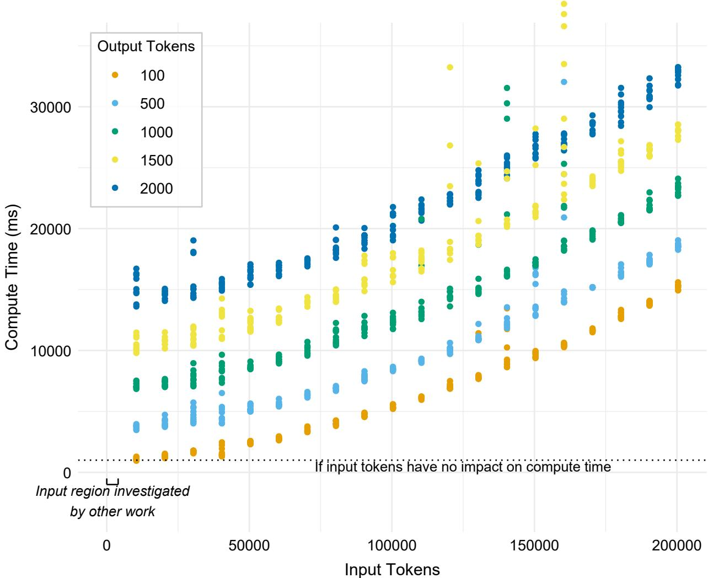
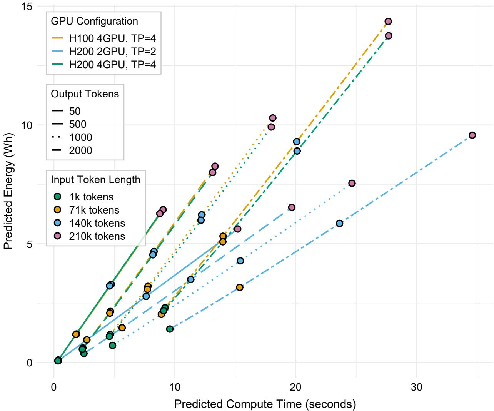
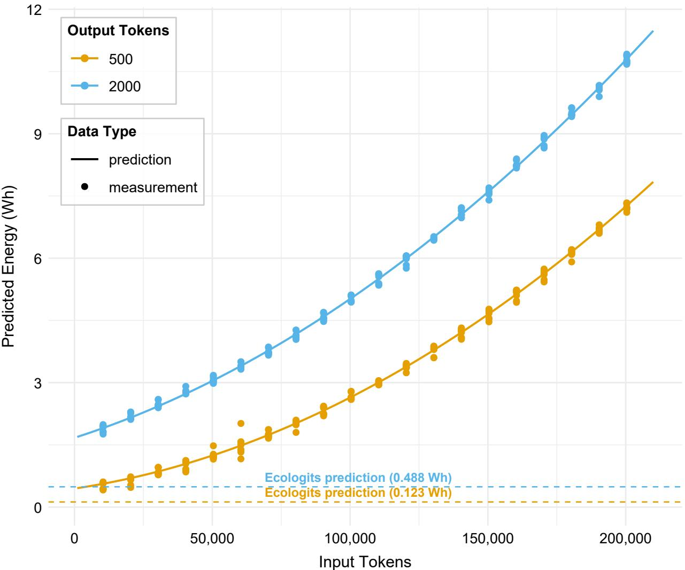

# THE REAL COST OF CONTEXT: PREDICTING COMPUTE TIMEAND ENERGY CONSUMPTION IN LLM PREFILL AND DECODEPHASES

## A PREPRINT

Lars Krupp RPTU Kaiserslautern-Landau, DFKI kruppl@rptu.de

Francisco M. Calatrava-Nicolas Örebro University francisco.calatrava-nicolas@oru.se

Paul Lukowicz RPTU Kaiserslautern-Landau, DFKI paul.lukowicz@dfki.de

Daniel Geißler RPTU Kaiserslautern-Landau, DFKI daniel.geissler@dfki.de

Stefan Gerd Fritsch RPTU Kaiserslautern-Landau stefan\_gerd.fritsch@dfki.de

Jakob Karolus RPTU Kaiserslautern-Landau, DFKI jakob.karolus@dfki.de

October 30, 2026

## ABSTRACT

The integration of Large Language Models (LLMs) into agentic architectures has substantially increased token consumption, raising concerns about their energy footprint. Yet, estimating the energy consumption of proprietary API-based models remains challenging, and existing approaches focus primarily on generated output tokens while overlooking the impact of the large input contexts characteristic of agentic workflows. To address this gap, we systematically profile compute time and energy consumption across a wide range of prefill (input) and decode (output) token lengths. Using generalized linear models, we show that decode compute time and energy scale linearly with output length, whereas prefill compute time and energy exhibit both linear and quadratic scaling with input length. These findings demonstrate that input context becomes a relevant factor for largecontext workloads. Furthermore, we show that compute time serves as a reliable proxy for energy consumption when direct energy measurements are unavailable. Our mapping framework enables precise energy estimation and supports more sustainable deployment decisions for agentic AI.

## Introduction

Large Language Models (LLMs) have evolved from primarily supporting isolated conversational interactions to becoming foundational components of increasingly complex applications. As their adoption and usage continue to grow, accurately estimating their energy consumption is becoming an important operational and environmental concern Luccioni et al. [2023], Samsi et al. [2023]. For open-weight models deployed on accessible hardware, energy consumption can be measured through software telemetry or external power meters Argerich and Patiño-Martínez [2024], Husom et al. [2025]. In contrast, proprietary models accessed through commercial APIs expose little information about their underlying hardware, serving configuration, or power consumption, making their energy footprint considerably more difficult to estimate Rincé and Banse [2025], Krupp et al. [2026a].

At the same time, modern LLM applications increasingly process large amounts of contextual information. This trend is particularly visible in multi-turn and agentic workflows, where conversation histories, system instructions, retrieved documents, tool outputs, and intermediate reasoning steps may be repeatedly included in the model input. Systems such as OpenClaw1 illustrate how complex agentic workflows can substantially increase input token consumption when solving long-running, multi-step tasks Bai et al. [2026]. Likewise, this challenge applies to any LLM application that processes long input contexts. Despite this development, existing energy estimation approaches largely focus on output tokens only and use short and fixed input lengths Argerich and Patiño-Martínez [2024], Rincé and Banse [2025], AI Energy Score [2025]. Consequently, the significant impact of input length on compute time as well as energy consumption remains inadequately modeled, particularly for large-context workloads.

We address this gap by systematically profiling LLM compute time and energy consumption across a grid of input and output token lengths, independently varying the tokens processed during prefill (input) and those produced during the decode (output) stage. Based on these empirical observations, we first fitted a Generalized Linear Model (GLM) on data collected via an API, capturing the contributions of input and output tokens towards compute time. We show that the number of input tokens has both linear as well as quadratic effects on compute time. These results demonstrate that estimates based predominantly on generated tokens Rincé and Banse [2025], Argerich and Patiño-Martínez [2024] may fail to capture an important component of inference cost for long-context requests.

Our model accurately predicts compute times for input–output configurations with litte training data. Beyond prediction, the fitted GLM provides a compact and explainable representation of the LLM’s compute time behavior, which we use to support energy estimation. Because energy consumption depends on both execution time and power draw, compute time predictions alone are insufficient, particularly for proprietary APIs whose underlying hardware and power characteristics are not observable. Following the local-equivalence approach proposed by Krupp et al. Krupp et al. [2026a], we collected compute time and energy consumption data from different local hardware and software configurations. This data was used to fit a GLM pair per hardware configuration, one predicting compute time as before and the other predicting energy consumption for input–output configurations. Through comparing the compute time GLMs and selecting the one behaving most similar to the API GLM, we were able to find an energy cost GLM whose direct energy measurements provide an empirically grounded basis for predicting the energy consumption of API-based inference.

Our work presents an empirically validated and explainable modeling approach for estimating LLM compute times and, through locally measured power characteristics, their associated energy consumption. Our method is suitable for both local and API-accessed LLMs and requires no access to the proprietary serving infrastructure. It is particularly relevant to context-intensive applications, including increasingly common multi-turn and agentic workflows.

We outline our primary contributions as follows:

1. We systematically characterize and quantify the influence of input token length on LLM compute time, with particular focus on the large-context requests increasingly prevalent in modern LLM applications.

2. We develop generalized linear models (GLMs) that accurately predict LLM compute time and energy consumption from limited measurements while providing excellent interpretability through their direct correspondence to the algorithmic characteristics of LLM inference.

3. We demonstrate that compute time can serve as a reliable proxy for energy consumption, enabling accurate estimation of the energy footprint of proprietary, API-accessed LLMs through locally profiled equivalent models.

## Related Work

The environmental impact of large-scale machine learning systems has received increasing attention in recent years. Early work primarily framed this issue around the cost of training large neural models, showing that gains in model accuracy often come with substantial financial and environmental costs, and proposing that model comparison should account for both predictive performance and computational resources Strubell et al. [2019]. Further work showed the dependence of carbon estimation on model architecture, accelerator type, datacenter efficiency, and geographic energy mix, making estimation difficult when these factors are not reported Patterson et al. [2021].

With the widespread deployment of LLMs, research on the environmental impact of machine learning has increasingly expanded from training to inference. The lifecycle assessment of BLOOM included its deployment phase, measuring energy consumption over approximately 18 days of serving real API requests and observing continued consumption even during periods of minimal demand Luccioni et al. [2023]. Further work investigated the impact of model size, GPU generations, workloads, and distributed multi-GPU configurations on inference energy Samsi et al. [2023], and evaluated the trade-offs among quantization, output accuracy, latency, and energy when running LLMs on a Raspberry Pi Husom et al. [2025]. Others attributed per-prompt energy to active accelerators, host CPU and memory, provisioned idle capacity, and datacenter overhead using internal telemetry from the Gemini Apps serving fleet Elsworth et al. [2025]. These studies show that the energy attributed to inference is determined not only by the model and the request, but also by the hardware and infrastructure through which the request is served.

While these studies focus primarily on measuring and attributing inference energy, complementary work has examined the serving mechanisms that determine how computional resources are used during inference. LLM inference was shown to have distinct power phases, with a compute-intensive prefill phase and a longer decode phase with different utilization characteristics Patel et al. [2024a], allowing their separation across different hardware resources Patel et al. [2024b]. Finally, detailed descriptions of production inference have been made, describing separate prefill and decoding deployments together with GPU allocation, pipeline parallelism, expert parallelism, and redundant expert placement Liu et al. [2024]. Together, these studies show that inference energy depends on distinct prefill and decoding costs as well as on serving decisions such as batching, hardware allocation, and parallelism. However, commercial APIs expose only request-level information such as token numbers and response time, leaving the underlying infrastructure and power consumption hidden. This limits the applicability of estimators requiring direct measurements or detailed system knowledge and motivates approaches based on observable request information Krupp et al. [2026b].

EcoLogits Rincé and Banse [2025], the closest approach to ours, models GPU energy using the number of output tokens, active model parameters, and an assumed batch size, while host-system energy is estimated from the request duration, inferred hardware requirements, and datacenter overhead. However, input token length is not explicitly represented in its energy or compute time models, so the additional prefill cost associated with longer prompts is not separately captured. Existing inference-energy evaluations have also focused predominantly on relatively short inputs. With work using prompts with lengths of 8 Argerich and Patiño-Martínez [2024], 28–134 Luccioni et al. [2023], and approximately 369 AI Energy Score [2025] tokens per request. This range is extended to 32,768 input tokens while controlling output length, but only in the context of locally deployed models running on known hardware Fernandez et al. [2025]. Consequently, the timing behavior of proprietary API-based LLMs over substantially longer contexts, and its implications for energy estimation, remains insufficiently characterized. We address this gap by systematically varying input length up to approximately 200,000 tokens while controlling output length and measuring its effect on request duration, compute time, and energy consumption under explicit hardware and power assumptions.

## Method

The energy consumption of API-served LLMs cannot be observed directly because their serving hardware and configuration remain hidden, even when the underlying model weights are publicly available. Compute time, however, is externally observable and provides a behavioral signature of the deployed system. Existing estimation approaches often emphasize output generation, treating input token processing as negligible Rincé and Banse [2025], Jegham et al. [2025], Kim et al. [2026], Argerich and Patiño-Martínez [2024]. This assumption becomes questionable for modern long-context and agentic workloads. Consequently, we propose a framework that separately characterizes the effects of input and output length on API inference time, including previously underexplored long-input configurations. We evaluate our approach on Mistral-Small-2603, a Mixture-of-Experts (MoE) Model with 119B total parameters, of which 6B are active. Its size allows it to fit on 2 H200 GPUs, making it a prime candidate for deployment and testing.

To evaluate the impact of input tokens on energy consumption, we first fit a GLM describing the API’s compute time behavior across input–output configurations. We then deploy the same open-weight model locally under several hardware configurations and fit pairs of compute time and energy GLMs from directly measured compute time and GPU power consumption. Finally, we identify the local compute time GLM that most closely matches the API behavior and use its paired energy GLM to obtain a locally grounded estimate of the API’s energy consumption.

To better isolate the time attributable to LLM computation time, we developed a benchmark specifically for time and energy estimation that incorporated a network latency estimation procedure, thereby reducing the influence of noise associated with API calls.

## Benchmark Construction

Crucially, our benchmark only aims at generating a prompt of a fixed input token length, while ensuring a fixed output length. To do so, we constructed each prompt out of three parts. Each prompt starts with a randomly generated 32bit nonce (number used once) to inhibit prefix caching, costing approximately 64 tokens. This ensures that the computations required in the prefill phase have to be executed each time and results are not retrieved from the cache. The second part consists of random sentences that can be extended until a defined input token length is reached, allowing the input token length to be scaled to arbitrarily large numbers. Finally, we added a prompt (310 tokens) that generates a large number of output tokens. To control the output token length, we used the max output token parameter Kwon et al. [2023],

Mistral AI [2026], which stops the decoding step once the desired output length is reached. The complete prompt is provided in the supplementary material. Using this setup, the number of input tokens of each prompt and the output tokens of the LLM’s response can be finely controlled. Since LLMs are statistical models, a desired output token length cannot be guaranteed. We safeguard against this case through reruns.

## Evaluating the Impact of Prefilling

Existing work commonly quantifies LLM inference energy, focusing on tokens generated during the decode phase Rincé and Banse [2025], leaving the impact of the prefill phase on time and energy consumption underexplored. However, we argue that the prefill phase is becoming increasingly important as modern LLM-based systems process progressively longer input contexts. To assess the importance of the prefill and decode phases on energy consumption, we start by investigating their impact on compute time (as energy is power over time). We set up our benchmark as a coarse grid-search, testing input token lengths between 10,000 and 200,000 with a step size of 10,000. For each input length, we test five output lengths: 100, 500, 1,000, 1,500, and 2,000 tokens. We repeat each input–output combination 10 times, resulting in 100 unique combinations (20 prompt lengths $I \times 5$ output lengths O). These combinations cover a broad region of the prefill space, allowing us to identify trends over a large input token range while simultaneously considering an output token range comparable to those examined in previous approaches, providing us with a more holistic understanding of compute time $\bar { t } _ { c o m p u t e } ( I , O )$

We can now formulate the total LLM response time as follows:

$$
t _ { t o t a l } ( I , O ) = t _ { c o m p u t e } ( I , O ) + t _ { n e t } + t _ { o t h e r }\tag{1}
$$

The noise introduced by the network conditions consists of network latency $t _ { n e t }$ and other $t _ { o t h e r }$ additional serving overhead. To reduce this noise, we ping the server every second and subtract this estimated network latency from the total compute time. We therefore define the network-adjusted response time as:

$$
\begin{array} { r l } & { t _ { \mathrm { a d j } } ( I , O ) = t _ { \mathrm { t o t a l } } ( I , O ) - t _ { \mathrm { n e t } } } \\ & { \qquad = t _ { \mathrm { c o m p u t e } } ( I , O ) + t _ { \mathrm { o t h e r } } } \\ & { \qquad \approx t _ { \mathrm { c o m p u t e } } ( I , O ) } \\ & { \qquad \quad \mathrm { w h e n ~ } t _ { \mathrm { c o m p u t e } } ( I , O ) \gg t _ { \mathrm { o t h e r } } } \end{array}\tag{2}
$$

As we are conducting our experiment with large token lengths, $t _ { o t h e r }$ is negligible as $t _ { c o m p u t e } > > t _ { o t h e r }$ . Nonetheless, our regression approach (see next subsection) is able to implicitly capture this overhead as well.

If the general assumption in the field holds, the results of our experiments will show that increasing input token numbers has little to no impact on the overall compute time. On the other hand, we expect to see more than a linear increase in compute time since the number of prefill operations scales quadratically with the number of input tokens Vaswani et al. [2017].

## Predicting Compute Time

To estimate the compute time for input–output configurations not covered by our measurements, we fitted a statistica model relating compute time to the respective numbers of input and output tokens. Since we also aim to characterize this relationship, the model should be interpretable and reflect the computational structure of transformer inference. We therefore favored a statistical model over black-box approaches such as deep neural networks, which may achieve low prediction errors but typically require more training data and provide limited insight into the modeled relationship. Specifically, we employ a Generalized Linear Model (GLM) with a quasipoisson error structure and an identity link function, a specification that accounts for the statistical properties of compute time data while reflecting the two-phase process of LLM inference, as detailed below:

1. Compute time measurement variance increases with compute time. The Quasipoisson error structure allows variance to scale with mean compute time: $\operatorname { V a r } ( Y _ { i } ) = \theta \mu _ { i }$ , where θ is the dispersion parameter.

2. We omitted the default log-link function in favor of an identity link $( g ( \mu _ { i } ) = \mu _ { i } )$ . The identity link directly maps to the additive nature of the hardware operations on the GPU (first prefill and then decode). Additionally, as the decode phase is sequential and limited by memory bandwidth, each generated output token incurs a flat, additive execution cost on the GPU.

To fit our model, we used the data points collected in our coarse grid search, allowing us to draw conclusions on the nature of the relationship between input and output tokens and compute time. To further validate the capabilities of the model, we predicted compute time for unseen configurations, both interpolating and extrapolating in our grid search configuration.

## Predicting Energy Consumption

The energy consumption of an API-based LLM cannot be measured directly since the underlying serving infrastructure is inaccessible. To predict it, we use compute time, which is observable through the API, to connect the API deployment with locally hosted configurations for which both compute time and energy consumption can be measured. For each local configuration, we fit a pair of GLMs: one modeling compute time and another modeling energy consumption. We then identify the local compute time GLM that most closely matches the API compute time GLM and use its paired energy GLM to estimate the energy consumption. To obtain the local compute time and energy measurements, we repeated the same benchmark previously explained with Mistral-Small-2603 hosted using vLLM Kwon et al. [2023]. We enabled chunked prefilling (max\_num\_batched\_tokens=8192) in three different configurations (H100 4 GPU, TP=4; H200 2 GPU, TP=2; H200 4 GPU, TP=4) using tensor parallelism (TP). In addition to recording the compute time, we used nvidia-smi to capture the power and GPU utilization for all GPUs. The resulting energy data is postprocessed individually for each input–output configuration and divided into sections corresponding to individual prompts2.

To calculate how much energy was consumed in a section, we use numerical integration. We define $P _ { x }$ as the total power consumed by all GPUs for running the LLM during that section at timestamp $t _ { x }$ . The result represents the energy $\bar { \boldsymbol { E } } ( \boldsymbol { I } , \boldsymbol { O } )$ consumed by one prefill and one decode phase for one specific prompt with I input tokens that resulted in O output tokens.

$$
E ( I , O ) = \sum _ { x = 1 } ^ { n - 1 } { \frac { P _ { x } + P _ { x + 1 } } { 2 } } \times ( t _ { x + 1 } - t _ { x } )\tag{3}
$$

The resulting data is then used to fit one compute time and one energy cost GLM per configuration, followed by the prediction of unseen datapoints for compute time and energy cost to evaluate the generalizability of the models.

## Results

We first evaluate the compute time prediction, followed by the energy consumption prediction. We then examine the relationship between compute time and energy consumption in local deployments and demonstrate how compute time provides the link between local and API-based measurements. We ran all our experiments using Mistral-small- ${ \cdot 2 6 0 3 ^ { 3 } }$ through both Mistral’s API and multiple local configurations with 16-bit floating-point (FP16) precision.

An initial investigation (see Figure 1) on the benchmark data already shows a non-linear relationship between input tokens and compute time.

## Predicting Compute Time

Following the approach described in our method section, we fitted generalized linear models (GLM) on the Mistral API data and the data collected from local experiments. Before fitting, outliers were removed using Tukey’s 1.5× interquartile range (IQR) rule. We further filtered the datasets using the standardized deviance residuals of the preliminary GLM fit. Observations with absolute deviance residuals of 3 or greater were removed to eliminate background anomalies and prevent outlier masking during final parameter estimation.

For the Mistral API data, we initially fitted a fully saturated model containing higher-order polynomial interactions: $I , I ^ { 2 } , O , I \times O , I ^ { 2 } \times O$ . The $I ^ { 2 } \times \dot { O }$ term was found to be statistically insignificant. To preserve model simplicity and avoid multicollinearity, we pruned this interaction term, yielding our final models as depicted in Table 1. Residual diagnostics confirmed that our model yields a stable, homoscedastic distribution along the normal diagonal, while leverage analysis verified no remaining influential data points.

The final estimated coefficients (see Table 1) align with the computational structure of transformer inference. Our API GLM estimates a baseline system overhead of $\beta _ { 0 } \approx 9 1 . 9 7$ ms. While statistically non-significant, retaining this parameter is meaningful to represent the positive compute time floor associated with scheduling times and other possible overheads, implicitly modeling $t _ { o t h e r }$

The empirical costs of the prefill and decoding phases reveal a steep hardware bottleneck: processing an input token has both a significant linear component at $\beta _ { 1 } = 0 . 0 1 8$ ms/token, as well as a significant quadratic component $( \beta _ { 2 } = 2 . 7 0 \times 1 0 ^ { - 7 } \mathrm { \ m s / t o k e n ^ { 2 } } )$ , which aligns with the algorithmic complexity of the self-attention mechanism $O ( N ^ { 2 } )$ for extended context windows.

  
Figure 1: Compute time in relation to input tokens and output tokens for Mistral-Small-2603 accesssed trough Mistral API. Added visualizations for the input token region evaluated in related works and how disregarding input tokens affects compute time (dashed line, 100 output tokens).

In the decode phase, output tokens scale significantly at $\beta _ { 3 } = 6 . 7 1$ ms/token, implying that token generation is a lot slower than prompt processing for small input token numbers. This reflects the transition from highly parallelized, compute-bound prefill operations to sequential, memory-bandwidth-bound decoding. However, this difference decreases drastically with large input token numbers.

Finally, the significant interaction term $( \beta _ { 4 } = 1 . 2 3 \times 1 0 ^ { - 5 }$ ms/token2) indicates that as the input context increases, the time required to decode each subsequent output token grows linearly, potentially due to memory retrieval overhead.

Overall, the API GLM model demonstrates high explanatory power, accounting for 98.85% of the total deviance. We further verified the predictions of our GLMs through unseen data, both within and outside of our initial grid search. Since this work is concerned with large context sizes, we exploited Mistral-Small-2603’s context size, setting input token length I to 210,384 tokens in combination with output token length $O \in [ 5 0$ , 1200, 2500].

After fitting the GLMs, we evaluate their accuracy by running the LLM 10 times for each combination of input (I) and output (O) token numbers and hardware, subtracting $t _ { n e t } .$ , and calculating the difference between the mean measured and predicted compute times. Table 2 shows the predictions of our compute time GLMs and the recorded compute times, highlighting the GLMs’ generalizability, with a maximal difference between prediction and measurement of 3.97%.

<table><tr><td>Predictor</td><td>API</td><td>H200 2GPU, TP=2</td><td>H200 4GPU, TP=4</td><td>H100 4GPU, TP=4</td></tr><tr><td>β0: Intercept</td><td>91.97</td><td>104.0</td><td>98.0</td><td>125.0</td></tr><tr><td> $\beta _ { 1 } \colon I$ </td><td> $1 . 8 1 \times 1 0 ^ { - 2 }$ </td><td> $1 . 3 4 \times 1 0 ^ { - 2 }$ </td><td> $1 . 0 2 \times 1 0 ^ { - 2 }$ </td><td> $1 . 0 3 \times 1 0 ^ { - 2 }$ </td></tr><tr><td> $\beta _ { 2 } \colon I ^ { 2 }$ </td><td> $2 . 7 0 \times 1 0 ^ { - 7 }$ </td><td> $2 . 6 7 \times 1 0 ^ { - 7 }$ </td><td> $1 . 3 7 \times 1 0 ^ { - 7 }$ </td><td> $1 . 4 2 \times 1 0 ^ { - 7 }$ </td></tr><tr><td> $\beta _ { 3 } \colon O$ </td><td> $6 . 7 1$ </td><td> $4 . 7 1$ </td><td>4.46</td><td>4.50</td></tr><tr><td> $\beta _ { 4 } \colon I \times O$ </td><td> $1 . 2 3 \times 1 0 ^ { - 5 }$ </td><td> $2 . 4 9 \times 1 0 ^ { - 5 }$ </td><td> $2 . 5 0 \times 1 0 ^ { - 5 }$ </td><td> $2 . 4 0 \times 1 0 ^ { - 5 }$ </td></tr></table>

Table 1: Quasipoisson GLM parameter estimates for Mistral-Small-2603 accessed through Mistrals API and local configurations.

<table><tr><td rowspan="2">Config</td><td colspan="2">#Tokens</td><td colspan="2">Compute Time (ms)</td><td>Diff.</td><td colspan="2">Total Energy (Wh)</td><td>Diff.</td></tr><tr><td>Input</td><td>Output</td><td>Measured</td><td>Predicted</td><td>(%)</td><td>Measured</td><td>Predicted</td><td>(%)</td></tr><tr><td rowspan="3">API</td><td>210384</td><td>50</td><td>15949</td><td>16334</td><td>+2.40</td><td></td><td></td><td></td></tr><tr><td>210384</td><td>1200</td><td>27144</td><td>27015</td><td>-0.50</td><td></td><td>N/A</td><td></td></tr><tr><td>210384</td><td>2500</td><td>39664</td><td>39088</td><td>-1.50</td><td></td><td></td><td></td></tr><tr><td rowspan="3">H200 2 GPU,TP=2</td><td>210384</td><td>50</td><td>15112</td><td>15247</td><td>+0.89</td><td>5.63</td><td>5.64</td><td>+0.20</td></tr><tr><td>210384</td><td>1200</td><td>27135</td><td>26701</td><td>-1.60</td><td>8.03</td><td>7.97</td><td>-0.75</td></tr><tr><td>210384</td><td>2500</td><td>40752</td><td>39647</td><td>-2.71</td><td>10.70</td><td>10.60</td><td>-0.93</td></tr><tr><td rowspan="3">H100 4 GPU, TP=4</td><td>210384</td><td>50</td><td>8894</td><td>9055</td><td>+1.81</td><td>6.47</td><td>6.45</td><td>+0.15</td></tr><tr><td>210384</td><td>1200</td><td>20561</td><td>20047</td><td>-2.50</td><td>11.10</td><td>11.10</td><td>+0.00</td></tr><tr><td>210384</td><td>2500</td><td>33814</td><td>32473</td><td>-3.97</td><td>16.30</td><td>16.40</td><td>+0.61</td></tr><tr><td rowspan="3">H200 4 GPU, TP=4</td><td>210384</td><td>50</td><td>8687</td><td>8790</td><td>+1.19</td><td>6.26</td><td>6.29</td><td>+0.48</td></tr><tr><td>210384</td><td>1200</td><td>20428</td><td>19954</td><td>-2.32</td><td>10.90</td><td>10.70</td><td>-1.83</td></tr><tr><td>210384</td><td>2500</td><td>33781</td><td>32574</td><td>-3.57</td><td>16.10</td><td>15.70</td><td>-2.48</td></tr></table>

Table 2: Prediction and Measurements for the compute time in ms and energy consumption in Wh for multiple unseen input–output token configurations with difference in percent. Diff = 100·(Predicted−Measured) Measured

## Predicting Energy

Using the energy data obtained for the different hardware configurations, we fitted GLMs that take the number of input tokens and output tokens to predict the consumed energy. We followed the same steps for outlier removal as for the compute time prediction GLMs, finding both linear as well as quadratic influence of input tokens on the energy consumption. The influence of output tokens and the interaction of input tokens and output tokens on the energy consumption also remain linear. These results match our observations when predicting compute time. To ensure robustness of the collected data, we also evaluated the GPU utilization. We measured a median of 100% across configurations, indicating good use of the available hardware resources. Analogous to the compute time GLMs, we evaluated the energy consumption GLMs on unseen data (see Table 2) obtaining results that indicate good generalizability, with the largest difference being 2.48%.

## Time as Indicator for Energy Consumption

We can now establish the relationship between local compute time and energy consumption GLM pairs in relation to the number of input tokens and output tokens. Our results show a linear relationship between the paired GLMs for the different local configurations, as seen in Figure 2.

This is a strong indicator that compute time prediction can serve as a reliable proxy for energy consumption. To estimate the energy consumed by a certain proprietary API-accessed LLM, we therefore need to find a local compute time GLM that behaves as closely to the compute time GLM of the API as possible. We can then use the associated energy consumption GLM to estimate the energy consumed by the API-accessed LLM. Evaluating the terms from Table 1, we see that intercept and I · O are smallest for the API, while I, I2 and O are highest. The difference for O is especially striking with the closest local GLM being 2ms faster per generated output token. Additionally, consulting visual depictions of the GLM, the configuration that most closely resembles the behavior of the API-accessed LLM is two H200 GPUs with tensor parallelism (H200 2GPU, TP=2). While it is not a perfect match, we can still use it as a lower-bound estimate for the energy consumed by the model hosted on Mistrals’ servers.

  
Figure 2: Visualization of the relationship between predicted energy (Wh) and predicted compute time (seconds) of the GLMs for different hardware configurations. Linetype indicates the number of generated output tokens, while the lines themselves relate to the number of input tokens. Dots at 1000, 71,000, 140,000, and 210,000 input tokens to allow for easier comparison between different configurations. Input token stepsize = 1000.

## Comparing Energy Estimates

Using the H200 2GPU, TP=2 energy GLM as a proxy, we compared our energy estimates to the work done by Rincé et al. Rincé and Banse [2025]. Their project provides an energy calculator4 which includes Mistral-Small-2603 as a selectable option. The work calculates energy consumption using a Power Usage Effectiveness (PUE) factor of 1.20 to account for server cooling and other overheads. We will add this factor to our calculations.

Since Ecologits Rincé and Banse [2025] implicitly assumes that input tokens do not matter by treating time to first token (TTFT) as a constant, we start within the input token range of their benchmark datasets before showing the difference for increasing input and output tokens.

In Figure 3, we can see that our results are consistently higher compared to Ecologits, a difference that only increases with increasing input token length. As our empirical results have confirmed that prefill time cannot be assumed to be constant, especially for large context sizes, current estimation approaches need to be reevaluated for correctness.

  
Figure 3: Comparison between the estimation of Ecologits (dashed line), the H200 2GPU, TP=2 energy GLM (solid line, adjusted to include PUE) and the locally measured energy consumption (dots, adjusted to include PUE).

## Discussion

The results of our experiments paint a clear picture that verifies the relevance of input tokens when estimating the compute time and energy consumption of LLMs. Our work is based on a novel approach that leverages GLM pairings to predict compute time and energy consumption. Their minimal data requirements, high generalizability, and excellent explainability in line with the algorithmic properties of transformer architecture make them a promising approach for estimating the energy consumption of proprietary LLMs.

## Prefill Time Must Not Be Neglected

Prior works of both empirical Patel et al. [2024a] and theoretical nature Vaswani et al. [2017] have already shown that the prefill phase scales non-linearly with input tokens, while the decode phase scales linearly.

However, the role of this information in LLM energy estimation remains insufficiently studied. Our results show that the impact of the prefill phase on overall compute time becomes significant for large numbers of input tokens and therefore has to be considered for LLM energy estimation. We believe that improper benchmarks for which the number of input tokens rarely exceeds 4000 (see Figure 1) have resulted in previous work deeming the impact of the prefill phase on energy consumption negligible. An example is GPQA Rein et al. [2023], which uses complex, but short, questions. This is reasonable for evaluating LLM capabilities, but not when evaluating energy consumption.

While currently established estimation approaches can be accurate for small input lengths, for larger input lengths, these approaches will systematically underestimate the compute time and consumed energy. In an era where large context sizes are standard, e.g., in AI agents and complex RAG systems, we need to consider energy estimation approaches capable of properly modeling all contributing factors.

## Scaling Our Approach Through Local Equivalents

Our results showcased the predictive quality of our GLMs for interpolating and extrapolating data points. Especially the better explainability and direct alignment with the transformer architecture, compared to purely data-driven methods, offer a robust approach for real-world benchmarking.

The accuracy of our approach is based on identifying a local hardware configuration whose compute time behavior closely matches that of the API-accessed model. The more experiments are conducted, the more comparisons to local hardware equivalents are possible, improving the estimation for the API-accessed model and its underlying server configuration.

While our approach has some distinct disadvantages, such as the cost associated with exploring this configuration space, the benefits are significant. Apart from enabling the estimation of the compute time and energy consumption for otherwise completely opaque models, the GLMs can support the development of more sustainable agentic AI systems. They can inform model selection, software, and hardware configurations based on expected input and output token lengths and their associated energy footprints. As LLM context sizes continue to grow, knowing how compute time and energy consumption scale with it becomes increasingly important.

## Limitations

We were able to conduct our experiments only on a limited number of hardware-software configurations, due to limited computational resources. While a perfect fit with the proprietary API version of Mistral-Small-2603 was not among them, our empirical data evidently showed the non-negligible impact of the prefill phase on energy consumption.

We used batch size one for our experiments, as it enabled us to robustly separate prefill and decode phases per input– output token configuration, thereby allowing us to evaluate the prefill phase in isolation. LLMs accessed through a proprietary API likely use higher batch sizes to boost prompt throughput, while compromising prompt response time, compared to our local data recordings. However, previous work has shown that energy scales independently of batch size during the prefill phase Fernandez et al. [2025]. While batching reduces the energy consumption during the decode phase by a constant margin, cf. Fernandez et al. [2025], thus only influencing the y-axis intercept (cf. Figure 3). As such, greater batch sizes only increase the contribution of the prefill phase on energy consumption but ultimately do not change the overall energy consumption trend.

Since the accuracy of our approach increases with the number of GLM pairs available for comparison, we further plan to involve the larger research community in solving LLM energy estimation through hosting a website5 that aggregates the GLMs and data recordings of other models and configurations (including different batch sizes).

## Conclusion

Our empirical findings demonstrate that the prefill phase significantly impacts the compute time and energy consumption of LLMs, making it a critical factor for accurate estimation, especially as context sizes grow and agentic AI systems expand.

To address this, we introduced a generalized linear model (GLM) approach that accurately predicts energy and compute behavior from recorded data. Because direct energy measurements are unavailable for proprietary LLMs, we demonstrate that compute time can serve as a reliable proxy for energy consumption, enabling accurate estimation via local equivalent models.

Ultimately, these findings offer a scalable and reproducible way to estimate energy consumption, advancing transparency for proprietary LLMs and highlighting the growing necessity of sustainable AI practices.

## References

Alexandra Sasha Luccioni, Sylvain Viguier, and Anne-Laure Ligozat. Estimating the carbon footprint of bloom, a 176b parameter language model. Journal ofmachine learning research, 24(253):1–15, 2023.

Siddharth Samsi, Dan Zhao, Joseph McDonald, Baolin Li, Adam Michaleas, Michael Jones, William Bergeron, Jeremy Kepner, Devesh Tiwari, and Vijay Gadepally. From words to watts: Benchmarking the energy costs of large language model inference. In 2023 IEEE high performance extreme computing conference (HPEC), pages 1–9. IEEE, 2023.

Mauricio Fadel Argerich and Marta Patiño-Martínez. Measuring and improving the energy efficiency of large language models inference. IEEE Access, 12:80194–80207, 2024.

Erik Johannes Husom, Arda Goknil, Merve Astekin, Lwin Khin Shar, Andre KÃ¥ sen, Sagar Sen, Benedikt Andreas Mithassel, and Ahmet Soylu. Sustainable llm inference for edge ai: Evaluating quantized llms for energy efficiency, output accuracy, and inference latency. ACM Transactions on Internet ofThings, 6(4):1–35, 2025.

Samuel Rincé and Adrien Banse. Ecologits: Evaluating the environmental impacts of generative ai. Journal ofOpen Source Software, 10(111):7471, 2025. doi:10.21105/joss.07471. URL https://doi.org/10.21105/joss.07471.

Lars Krupp, Daniel Geißler, Francisco M Calatrava-Nicolas, Vishal Banwari, Paul Lukowicz, and Jakob Karolus. This is taking too long-investigating time as a proxy for energy consumption of llms. In 2026 IEEE International Conference on Pervasive Computing and Communications Workshops and other Affiliated Events (PerCom Workshops), pages 611–616. IEEE, 2026a.

Longju Bai, Zhemin Huang, Xingyao Wang, Jiao Sun, Rada Mihalcea, Erik Brynjolfsson, Alex Pentland, and Jiaxin Pei. How do ai agents spend your money? analyzing and predicting token consumption in agentic coding tasks. arXiv preprint arXiv:2604.22750, 2026.

AI Energy Score. AI Energy Score: Methodology. https://huggingface.github.io/AIEnergyScore/, 2025. Accessed: 2026-07-16.

Emma Strubell, Ananya Ganesh, and Andrew McCallum. Energy and policy considerations for deep learning in nlp. In Proceedings ofthe 57th annual meeting ofthe associationfor computational linguistics, pages 3645–3650, 2019.

David Patterson, Joseph Gonzalez, Quoc Le, Chen Liang, Lluis-Miquel Munguia, Daniel Rothchild, David So, Maud Texier, and Jeff Dean. Carbon emissions and large neural network training. arXiv preprint arXiv:2104.10350, 2021.

Cooper Elsworth, Keguo Huang, David Patterson, Ian Schneider, Robert Sedivy, Savannah Goodman, Ben Townsend, Parthasarathy Ranganathan, Jeff Dean, Amin Vahdat, et al. Measuring the environmental impact of delivering ai at google scale. arXiv preprint arXiv:2508.15734, 2025.

Pratyush Patel, Esha Choukse, Chaojie Zhang, Íñigo Goiri, Brijesh Warrier, Nithish Mahalingam, and Ricardo Bianchini. Characterizing power management opportunities for llms in the cloud. In Proceedings ofthe 29th ACM International Conference on Architectural Support for Programming Languages and Operating Systems, Volume 3, pages 207–222, 2024a.

Pratyush Patel, Esha Choukse, Chaojie Zhang, Aashaka Shah, Íñigo Goiri, Saeed Maleki, and Ricardo Bianchini. Splitwise: Efficient generative llm inference using phase splitting. In 2024 ACM/IEEE 51st Annual International Symposium on Computer Architecture (ISCA), pages 118–132. IEEE, 2024b.

Aixin Liu, Bei Feng, Bing Xue, Bingxuan Wang, Bochao Wu, Chengda Lu, Chenggang Zhao, Chengqi Deng, Chenyu Zhang, Chong Ruan, et al. Deepseek-v3 technical report. arXiv preprint arXiv:2412.19437, 2024.

Lars Krupp, Daniel Geißler, Vishal Banwari, Paul Lukowicz, and Jakob Karolus. Promoting sustainable web agents: Benchmarking and estimating energy consumption through empirical and theoretical analysis. In Proceedings ofthe AAAI Conference on Artificial Intelligence, volume 40, pages 38772–38780, 2026b.

Jared Fernandez, Clara Na, Vashisth Tiwari, Yonatan Bisk, Sasha Luccioni, and Emma Strubell. Energy considerations of large language model inference and efficiency optimizations. In Proceedings ofthe 63rd Annual Meeting ofthe Associationfor Computational Linguistics (Volume 1: Long Papers), pages 32556–32569, 2025.

Nidhal Jegham, Marwan Abdelatti, Chan Young Koh, Lassad Elmoubarki, and Abdeltawab Hendawi. How hungry is ai? benchmarking energy, water, and carbon footprint of llm inference. arXiv preprint arXiv:2505.09598, 2025.

Min-Kyu Kim, Tae-An Yoo, and Ji-Bum Chung. Toward sustainable ai: a scoping review of carbon footprint and environmental impacts across training and inference stages. IEEE Access, 2026.

Woosuk Kwon, Zhuohan Li, Siyuan Zhuang, Ying Sheng, Lianmin Zheng, Cody Hao Yu, Joseph E. Gonzalez, Hao Zhang, and Ion Stoica. Efficient memory management for large language model serving with pagedattention. In Proceedings ofthe ACM SIGOPS 29th Symposium on Operating Systems Principles, 2023.

Mistral AI. Chat endpoints: Chat completion api, 2026. URL https://docs.mistral.ai/api/endpoint/chat. Mistral AI API documentation.

Ashish Vaswani, Noam Shazeer, Niki Parmar, Jakob Uszkoreit, Llion Jones, Aidan N Gomez, Łukasz Kaiser, and Illia Polosukhin. Attention is all you need. Advances in neural information processing systems, 30, 2017.

David Rein, Betty Li Hou, Asa Cooper Stickland, Jackson Petty, Richard Yuanzhe Pang, Julien Dirani, Julian Michael, and Samuel R Bowman. Gpqa: A graduate-level google-proof q&a benchmark. arXiv preprint arXiv:2311.12022, 2023.