# TIMBRE: RELIABILITY-AWARE HARMONIC CONSEN-SUS FOR LABEL-FREE MULTIMODAL TEST-TIME RE-INFORCEMENT LEARNING

Haotian Lyu1,∗, Haoyu Wang2,∗, Ru Wang3, Feng Ji, Ziwen Li2, Jiaxian Guo4, Mingming Gong1,2

1University of Melbourne

2Mohamed bin Zayed University of Artificial Intelligence

3The University of Tokyo

4Google

∗Equal contribution.

## ABSTRACT

Label-free test-time reinforcement learning adapts vision–language models using rewards derived from their own predictions. However, misinterpreted visual evidence and sensitivity to textual formulation can produce a consistent but incorrect consensus that majority voting reinforces. Cross-view aggregation can expose such errors, but image and text transformations may themselves degrade task-relevant evidence to different extents. We introduce TIMBRE, a reliabilityaware harmonic consensus framework for multimodal test-time reinforcement learning. TIMBRE constructs a 2×2 grid combining original and perturbed images with direct-solving and reframing modes, selects pseudo-labels through weighted harmonic aggregation, and adapts modality-level weights using batch-averaged, temporally smoothed shifts in pseudo-label confidence as a heuristic reliability signal. We formulate consensus as a weighted χ2-barycenter problem whose unique minimizer is the normalized weighted harmonic aggregate, without requiring correct-answer invariance. An exact support–dispersion decomposition characterizes when harmonic aggregation preserves or corrects arithmetic rankings, while a sensitivity analysis establishes how modality reweighting changes pairwise ranking margins, informing interpretation of the heuristic updates. Across six benchmarks and three Qwen3-VL model scales, TIMBRE outperforms TTRV in 16 of 18 benchmark–model settings on adaptation instances and 17 of 18 settings on held-out instances under matched estimation and optimization rollout counts. These results demonstrate improved target-task adaptation and transfer to unseen instances without further updates.

## 1 INTRODUCTION

Vision–language models (VLMs) have rapidly advanced in visual understanding and instruction following (Liu et al., 2023; Chen et al., 2024; Bai et al., 2025), and are increasingly applied to multimodal reasoning over diagrams, charts, and mathematical figures (Lu et al., 2024). Reinforcement learning with verifiable rewards (RLVR) has emerged as an effective post-training paradigm for reasoning (Shao et al., 2024; Guo et al., 2025) and has recently been extended to VLMs (Liu et al., 2025b; Huang et al., 2026). However, verifiable answers may be unavailable for unlabeled inputs at deployment. Label-free test-time reinforcement learning instead derives rewards from the model’s own predictions: TTRL (Zuo et al., 2025) uses majority-vote pseudo-labels, while TTRV (Singh et al., 2026) extends test-time RL to VLMs through frequency-based self-rewards. Such intrinsic reward optimization sharpens existing answer preferences (He et al., 2026), making its effectiveness dependent on alignment between confidence and correctness.

Yet a model’s dominant answer need not be correct (Yan et al., 2026). In multimodal reasoning, systematic errors in visual perception, interpretation, or reasoning (Tong et al., 2024; Zhang et al., 2024; Zhou et al., 2024) can produce a consistent but incorrect consensus. Cross-view aggregation offers a way to challenge presentation-dependent errors, including those arising from reliance on superficial cues. Self-Harmony (Wang et al., 2026a) aggregates answer frequencies from original and reframed questions using a harmonic mean, penalizing candidates with weak support in either view. Its theoretical analysis rests on the assumption that semantically equivalent reframing leaves the correct answer’s probability unchanged, while incorrect-answer probabilities may vary across views.

This assumption is fragile when extending Self-Harmony to multimodal reasoning. Visual perturbations may obscure essential details, while textual reframing must preserve both explicit constraints and the query’s grounding in visual entities and relations. Even when task semantics remain unchanged, a new presentation can make relevant evidence easier or harder for the model to use, so the invariance-based justification may no longer apply. This limitation motivates a consensus formulation that explicitly controls each view’s influence without requiring correct-answer invariance, with weights adapted using reliability signals available without ground-truth answers.

To this end, we seek a consensus distribution that balances agreement with individual view distributions according to their assigned reliability weights. We formulate this as a weighted Pearson $\chi ^ { 2 } .$ -barycenter problem and show that its unique minimizer is the normalized weighted harmonic aggregate. This provides an exact optimization interpretation of harmonic consensus without requiring correct-answer invariance.

We then decompose the harmonic score exactly into weighted arithmetic support discounted by cross-view dispersion. This decomposition characterizes when harmonic aggregation preserves a correct arithmetic ranking or corrects an arithmetic error. Exact invariance of correct-answer support emerges as a sufficient condition for preserving every strict arithmetic win of the correct answer. Finally, we derive an exact sensitivity formula for the effect of modality-level reweighting on pairwise ranking margins. This formula characterizes when a weight adjustment increases the margin, providing an analytical basis for interpreting our confidence-shift heuristic.

Building on this formulation, we introduce TIMBRE, a reliability-aware harmonic consensus framework for label-free multimodal test-time reinforcement learning (Figure 1). TIMBRE constructs a 2 × 2 grid pairing original and perturbed images with original and reframed queries, and selects pseudo-labels through weighted harmonic aggregation of their answer distributions. Batch-averaged shifts in confidence assigned to the current pseudo-label across original and transformed views serve as a heuristic proxy for transformation unreliability. Larger shifts yield lower target reliability factors, which are temporally smoothed and combined into modality-factorized view weights.

Our contributions are threefold:

• Adaptive multimodal consensus. We introduce a four-view framework for label-free multimodal test-time RL that combines weighted harmonic pseudo-label selection with online modality-level reliability weighting.

• Consensus formulation and exact ranking analysis. We formulate consensus as a weighted $\chi ^ { 2 }$ -barycenter problem whose unique minimizer is the normalized weighted harmonic aggregate. We derive an exact support–dispersion decomposition, characterize when harmonic aggregation preserves or corrects arithmetic rankings, and establish how modality reweighting changes pairwise ranking margins.

• Evaluation under matched rollout budgets. Across six multimodal reasoning benchmarks and three model scales in the Qwen3-VL family (Bai et al., 2025), TIMBRE outperforms the SOTA baseline TTRV (Singh et al., 2026) in 16 of 18 benchmark–model settings on adaptation instances and 17 of 18 settings on held-out instances under matched estimation and optimization rollout budgets. The held-out results further demonstrate withinbenchmark transfer to unseen instances without additional updates.

## 2 RELATED WORK

Label-free test-time reinforcement learning. Test-time adaptation updates models on unlabeled test inputs using objectives such as auxiliary self-supervision (Sun et al., 2020) and predictionentropy minimization (Wang et al., 2021). Label-free test-time reinforcement learning instead optimizes the policy with rewards constructed from its own sampled responses. TTRL (Zuo et al.,

2025) rewards agreement with a majority-vote pseudo-label and optimizes the policy with GRPO (Shao et al., 2024). Subsequent variants retain majority-vote pseudo-labels while improving sampling and optimization: ETTRL (Liu et al., 2025a) adapts tree-based rollouts and regularizes advantages through clipping or entropy-based rescaling, while SPINE (Wu et al., 2025) combines token-selective updates with entropy-band regularization to mitigate training collapse. For vision– language models, TTRV (Singh et al., 2026) uses frequency-based self-rewards with entropy-based diversity control. These methods differ in how rewards are shaped and optimized, but derive their learning signals from responses to a single presentation of each input.

Pseudo-label selection beyond majority voting. Self-consistency (Wang et al., 2023) aggregates answers across sampled reasoning paths by majority voting, but an incorrect consensus can reinforce model errors when used as supervision. SCRL (Yan et al., 2026) improves pseudo-label reliability through selective positive labeling and entropy-gated negative supervision, while SCOPE (Wang et al., 2026b) integrates step-wise confidence and subgroup-specific consensus. Beyond singleinput aggregation, Co-Rewarding-I (Zhang et al., 2025) derives rewards through cross-supervision between semantically analogous questions.

Closest to our work, Self-Harmony (Wang et al., 2026a) aggregates answer frequencies from original and reframed questions using a harmonic mean. Its analysis formalizes correct-answer invariance across semantically equivalent views as $p _ { \theta } ( C \mid x ) = p _ { \theta } ( \dot { C } \mid x ^ { \prime } )$ , where $C$ is the correct answer, and relates harmonic aggregation to a second-order approximation of a view-invariant Infomax objective under additional regularity conditions. This invariance assumption is fragile in multimodal settings, where transformations can alter access to task-relevant evidence. Because the Infomax-based justification relies on this assumption, it does not directly justify reliability-weighted aggregation when correct-answer probabilities vary across views.

We instead formulate consensus as a weighted Pearson $\chi ^ { 2 } .$ -barycenter problem, incorporating view influence directly into the objective: each weight scales the penalty for disagreement with the corresponding view’s answer distribution. We show that its unique minimizer is the normalized weighted harmonic aggregate, providing an exact optimization basis for our pseudo-label selector without requiring correct-answer invariance. We adapt the view weights online using a label-free confidenceshift heuristic.

## 3 METHOD

Given an unlabeled multimodal test set D, TIMBRE adapts a vision–language model $\pi _ { \theta }$ without ground-truth answers. Each update generates rollouts from four views, selects pseudo-labels through weighted harmonic consensus, and optimizes the policy using jointly normalized cross-view rewards. Modality-level reliability factors, updated online using a confidence-shift heuristic, control the influence of transformed views. Algorithm 1 summarizes the procedure.

## 3.1 MULTI-VIEW GENERATION

View construction. For each instance $( I , T ) \in { \mathcal { D } }$ , we combine two image states with two generation modes:

$$
\mathcal { V } = \{ v _ { 0 0 } , v _ { 0 1 } , v _ { 1 0 } , v _ { 1 1 } \} , \qquad v _ { i t } = ( I _ { i } , \mathcal { F } _ { t } ( T ) ) ,\tag{1}
$$

where $I _ { 0 } = I , I _ { 1 } = g ( I )$ , and the prompt templates $\mathcal { F } _ { 0 }$ and $\mathcal { F } _ { 1 }$ request direct solving and reframing followed by solving, respectively. Restricting to $\{ v _ { 0 0 } , v _ { 0 1 } \}$ yields a two-view variant that applies Self-Harmony’s original–reframed construction to multimodal inputs (Wang et al., 2026a). We sample M rollouts per view for distribution and reliability estimation, while using only the first $K < M$ for policy optimization. This allocation uses additional forward-only samples to reduce sampling variability in pseudo-label selection and reliability estimation, without incurring the additional backpropagation cost of optimizing on every rollout.

Image transformation. The transformation $g$ applies stochastic brightness, contrast, and saturation adjustments followed by additive Gaussian noise. Parameters are resampled whenever an instance is drawn, with images transformed independently for multi-image inputs. These operations vary low-level appearance while preserving image coordinates; cropping and large-angle rotation are excluded to limit disruption of spatial relations and diagram content. Appearance changes can nevertheless obscure task-relevant details, motivating adaptive reliability weighting.

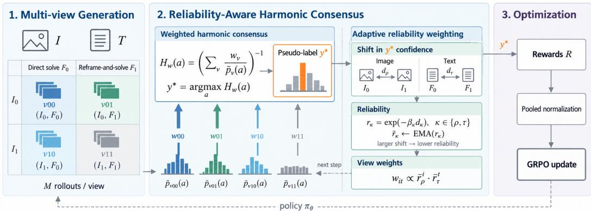  
Figure 1: Overview of TIMBRE. Four views combine original or perturbed images with directsolving or reframe-and-solve prompts. Weighted harmonic consensus selects the pseudo-label $y ^ { * }$ Cross-view shifts in confidence assigned to $y ^ { * }$ update modality-level reliability factors, which determine view weights for the next step (dashed arrow). For each instance, rollout rewards are pooled and jointly normalized to compute GRPO advantages.

Text transformation. Following Self-Harmony’s fused reframing design (Wang et al., 2026a), F prompts the model to rewrite the query and solve it within a single generation (see Appendix B.1 for the exact instruction and one-shot demonstration). The instruction encourages stylistic variation while requiring preservation of task-critical entities, answer options, relations, and numerical values. It prohibits adding descriptions of image content to avoid introducing erroneous visual interpretations into the rewritten query. Each reframed rollout independently generates a rewrite and its solution, conditioned on the corresponding image.

## 3.2 WEIGHTED HARMONIC CONSENSUS

Let $n _ { v } ( a )$ count rollouts from view v with extracted answer $^ { a , }$ and let $\begin{array} { r } { N _ { v } \ = \ \sum _ { a } n _ { v } ( a ) } \end{array}$ count successful extractions. We form the shared candidate set $\begin{array} { r } { \mathcal { A } = \bigcup _ { v \in \mathcal { V } } \{ a : n _ { v } ( a ) > 0 \} } \end{array}$ . For nonempty A, additive smoothing prevents a zero count in any single view from vetoing a candidate:

$$
\tilde { p } _ { v } ( a ) = \frac { n _ { v } ( a ) + \alpha } { N _ { v } + \alpha | \mathcal { A } | } , \qquad a \in \mathcal { A } , \quad \alpha > 0 .\tag{2}
$$

Given weights $w _ { v } \ > \ 0$ satisfying $\textstyle \sum _ { v } w _ { v } \ = \ 1$ , we select the pseudo-label by maximizing the weighted harmonic score:

$$
H _ { w } ( a ) = \left( \sum _ { v \in \mathcal { V } } \frac { w _ { v } } { \widetilde { p } _ { v } ( a ) } \right) ^ { - 1 } , \qquad y ^ { * } = \arg \operatorname* { m a x } _ { a \in \mathcal { A } } H _ { w } ( a ) .\tag{3}
$$

The score penalizes weak support in individual views according to their weights. For fixed view weights, normalizing these scores yields the unique minimizer of a weighted Pearson $\chi ^ { 2 }$ consensus objective, in which each weight controls the penalty for disagreement with the corresponding view. Section 4 establishes this result without requiring correct-answer invariance and analyzes the resulting rankings. Uniform weighting over two views recovers Self-Harmony’s selector, up to smoothing (Wang et al., 2026a). If $A = \varnothing$ , all rollout rewards are zero and the instance is excluded from reliability estimation.

## 3.3 ADAPTIVE RELIABILITY WEIGHTING

We adapt view weights using modality-level shifts in pseudo-label confidence as a heuristic reliabil ity signal, with batch averaging and temporal smoothing to reduce sampling fluctuations.

Modality-level confidence shifts. Let $p _ { i t } = \tilde { p } _ { v _ { i t } } ( y ^ { * } )$ denote the probability assigned to the current pseudo-label by view $v _ { i t }$ . The image and text shifts average the absolute confidence change from varying one modality across both settings of the other:

$$
d _ { \rho } = \frac { \left. p _ { 1 0 } - p _ { 0 0 } \right. + \left. p _ { 1 1 } - p _ { 0 1 } \right. } { 2 } , \qquad d _ { \tau } = \frac { \left. p _ { 0 1 } - p _ { 0 0 } \right. + \left. p _ { 1 1 } - p _ { 1 0 } \right. } { 2 } .\tag{4}
$$

For $m \in \{ \rho , \tau \}$ , let $d _ { m } ^ { ( s ) }$ denote the average shift over instances with valid pseudo-labels in minibatch s. We map it to a target reliability factor $r _ { m } ^ { ( s ) } = \exp ( - \beta _ { m } d _ { m } ^ { ( s ) } )$ and apply exponential smoothing:

$$
\bar { r } _ { m } ^ { ( s ) } = ( 1 - \eta ) \bar { r } _ { m } ^ { ( s - 1 ) } + \eta r _ { m } ^ { ( s ) } , \qquad \bar { r } _ { m } ^ { ( 0 ) } = 1 ,\tag{5}
$$

where $\beta _ { m } > 0$ controls shift sensitivity and $\eta \in ( 0 , 1 ]$ controls the update rate.

Factorized view weights. For each modality, the original state receives a fixed factor of 1 and the transformed state receives the preceding step’s smoothed factor: $\pmb { \rho } ^ { ( s ) } = ( 1 , \bar { r } _ { \rho } ^ { ( s - 1 ) } )$ and $\boldsymbol { \tau } ^ { ( s ) } =$ $( 1 , \bar { r } _ { \tau } ^ { ( s - 1 ) } )$ . Their normalized products define the view weights:

$$
w _ { i t } ^ { ( s ) } = \frac { \rho _ { i } ^ { ( s ) } \tau _ { t } ^ { ( s ) } } { \sum _ { j = 0 } ^ { 1 } \sum _ { \ell = 0 } ^ { 1 } \rho _ { j } ^ { ( s ) } \tau _ { \ell } ^ { ( s ) } } .\tag{6}
$$

Initialization yields uniform weights. Lower modality reliability reduces the relative influence of both views using that transformation, with both factors applied to the doubly transformed view. All weights remain positive. Step-s pseudo-labels use these weights, while current shifts update the factors for step $s + 1$ . The rule favors stability of pseudo-label support; confidence shifts alone cannot distinguish degraded evidence from beneficial corrections.

## 3.4 CONFIDENCE-GATED REFRAMING REWARDS AND POOLED OPTIMIZATION

Following Self-Harmony’s reframing-based self-play (Wang et al., 2026a), we encourage reframed responses that agree with the pseudo-label while retaining diversity across cross-view answer distributions. For an optimization rollout k from view $v _ { i t }$ , let $\delta _ { i t , k } = \mathsf { \bar { I } } [ \hat { a } _ { i t , k } = y ^ { * } ]$ . Direct-solving responses receive reward $R _ { i 0 , k } = \delta _ { i 0 , k }$ , while reframed responses receive $R _ { i 1 , k } = \delta _ { i 1 , k } ( 1 + b _ { i } ) \phi _ { i 1 , k }$ where $\phi _ { i 1 , k }$ penalizes reframing format violations and $b _ { i }$ is a confidence-gated diversity bonus.

Specifically, we compute cross-view diversity for image state i as $J _ { i } = \mathrm { J S } ( \tilde { p } _ { v _ { i 0 } } , \tilde { p } _ { v _ { i 1 } } ) / \log 2$ and define $b _ { i } \doteq w _ { d } ( 1 - { \bar { p } } _ { \mathrm { p o o l } , i } ) J _ { i }$ , where $\begin{array} { r } { p _ { \mathrm { p o o l } , i } = ( 2 K ) ^ { - 1 } \sum _ { k } ( \delta _ { i 0 , k } + \delta _ { i 1 , k } ) } \end{array}$ . The gate reduces diversity rewards when optimization rollouts already agree with the pseudo-label, preventing diversity bonuses from assigning negative advantages to matching direct-solving responses.

To preserve the contribution of the diversity bonus, we jointly normalize rewards across the 4K optimization rollouts:

$$
A _ { i t , k } = \frac { R _ { i t , k } - \mu _ { \mathrm { p o o l } } } { \sigma _ { \mathrm { p o o l } } + \epsilon } , \qquad \mu _ { \mathrm { p o o l } } = \frac { 1 } { 4 K } \sum _ { i , t , k } R _ { i t , k } .\tag{7}
$$

The resulting advantages are applied to response tokens in GRPO (Shao et al., 2024), including both rewritten-query and solution tokens for reframed responses. The confidence-gating property and its guarantee that $\mu _ { \mathrm { p o o l } } \leq 1$ are provided in Appendix A.5.

## 4 THEORETICAL ANALYSIS

We characterize weighted harmonic consensus through a distributional optimization objective, establish its exact relation to arithmetic support, and analyze how modality reweighting affects candidate rankings. Throughout, we fix an instance with a nonempty candidate set ${ \mathcal { A } } ,$ , strictly positive smoothed distributions $\tilde { p } _ { v } ( a )$ , and weights $w _ { v } \ > 0$ satisfying $\begin{array} { r } { \dot { \sum } _ { v } w _ { v } = 1 } \end{array}$ . When discussing correctness, we assume the correct answer $C \in { \mathcal { A } }$ . Proofs and additional results appear in Appendix A.

Algorithm 1 TIMBRE: Adaptive Harmonic Consensus   
Require: Policy π , unlabeled minibatches $\{ B _ { s } \} _ { s = 1 } ^ { S }$ , rollout counts $M > K$   
1: Initialize $\bar { r } _ { \rho } ^ { ( 0 ) } = \bar { r } _ { \tau } ^ { ( 0 ) } = 1$   
2: for $s = 1 , \ldots , S$ do   
3: Form weights $\boldsymbol { w } ^ { ( s ) }$ from previous reliability factors Eq. 6   
4: for all $( I , T ) \in B _ { s }$ do   
5: Construct four views and sample M rollouts per view Eq. 1   
6: Estimate $\tilde { p } _ { v }$ and select $y ^ { * }$ Eqs. 2–3   
7: Compute modality shifts $d _ { \rho } , d _ { \tau }$ Eq. 4   
8: Compute $J _ { i }$ from all M rollouts and gate bonuses using the first K Eqs. 30, 31   
9: Assign rewards and pool the 4K optimization rollouts to obtain advantages Eqs. 29, 7   
10: end for   
11: Update $\pi _ { \theta }$ with GRPO using the pooled advantages   
12: Average valid confidence shifts over $\boldsymbol { B } _ { s }$ and update reliability factors Eq. 5   
13: end for   
14: return πθ

## 4.1 HARMONIC CONSENSUS AS A WEIGHTED $\chi ^ { 2 }$ BARYCENTER

We seek a consensus distribution that balances agreement with individual views according to their assigned reliability weights. For fixed weights, we formulate this as minimizing a weighted sum of Pearson $\chi ^ { 2 }$ divergences (Pearson, 1900):

$$
z ^ { * } = \arg \operatorname* { m i n } _ { z \in \Delta ( A ) } \sum _ { v } w _ { v } D _ { \chi ^ { 2 } } ( z \| \tilde { p } _ { v } ) , \qquad D _ { \chi ^ { 2 } } ( z \| \tilde { p } _ { v } ) = \sum _ { a \in A } \frac { ( z ( a ) - \tilde { p } _ { v } ( a ) ) ^ { 2 } } { \tilde { p } _ { v } ( a ) } ,\tag{8}
$$

where $\Delta ( \mathcal { A } )$ is the probability simplex. This divergence penalizes deviations relative to each view’s support, making it costly to assign substantial consensus mass to candidates that a positively weighted view scarcely supports. Each weight scales the corresponding disagreement penalty, controlling how strongly that view constrains the consensus.

Lemma 4.1 (Weighted $\chi ^ { 2 }$ barycenter). The objective in $E q .$ . 8 is strictly convex and has the unique minimizer

$$
z ^ { * } ( a ) = \frac { H _ { w } ( a ) } { \sum _ { b \in \mathcal { A } } H _ { w } ( b ) } , \qquad H _ { w } ( a ) = \left( \sum _ { v } \frac { w _ { v } } { \widetilde { p } _ { v } ( a ) } \right) ^ { - 1 } .\tag{9}
$$

Consequently, maximizing $H _ { w }$ selects a mode of the barycenter.

This result gives an exact variational characterization of our pseudo-label selector without requiring correct-answer invariance. Whether the resulting selector favors the correct answer depends on the relative support and dispersion of the competing candidates, which we characterize next.

## 4.2 EXACT SUPPORT–DISPERSION AND RANKING ANALYSIS

For candidate $^ { a , }$ define its weighted arithmetic support and dimensionless cross-view dispersion as

$$
m _ { a } = \sum _ { v } w _ { v } \tilde { p } _ { v } ( a ) , \qquad \Gamma _ { w } ( a ) = \frac { 1 } { m _ { a } } \sum _ { v } w _ { v } \frac { ( \tilde { p } _ { v } ( a ) - m _ { a } ) ^ { 2 } } { \tilde { p } _ { v } ( a ) } .\tag{10}
$$

Proposition 4.2 (Exact support–dispersion decomposition). For every $a \in { \mathcal { A } } ,$

$$
H _ { w } ( a ) = \frac { m _ { a } } { 1 + \Gamma _ { w } ( a ) } \leq m _ { a } ,\tag{11}
$$

with equality if and only $i f \tilde { p } _ { v } ( a )$ is constant across views.

Harmonic consensus therefore discounts arithmetic support by dispersion, with low-support views contributing more strongly to the discount. This discount is itself a $\chi ^ { 2 }$ divergence: Appendix A shows that $\operatorname { \bar { T } } _ { w } ( a ) = D _ { \chi ^ { 2 } } ( w \| s _ { a } )$ , where $s _ { a } ( v ) = w _ { v } \tilde { p } _ { v } ( a ) / m _ { a }$ is the share of a’s weighted support contributed by view $v ,$ so the discount measures how far the assigned weights are from the support a candidate actually receives. Whether this improves a ranking depends on the discounts of both candidates.

Theorem 4.3 (Exact pairwise ranking). For the correct answer C and any competitor $A \in { \mathcal { A } } \backslash \{ C \}$

$$
H _ { w } ( C ) > H _ { w } ( A ) \iff \Gamma _ { w } ( A ) > \frac { m _ { A } } { m _ { C } } \bigl ( 1 + \Gamma _ { w } ( C ) \bigr ) - 1 .\tag{12}
$$

This criterion characterizes the ranking behavior of harmonic aggregation. A correct arithmetic ranking is preserved whenever $m _ { C } > ( 1 + \Gamma _ { w } ( C ) ) m _ { A }$ , regardless of the competitor’s dispersion. Exact correct-answer invariance therefore preserves every strict arithmetic win. An arithmetic error $m _ { A } > m _ { C }$ is corrected when the competitor’s dispersion exceeds the threshold in Eq. 12. Harmonic aggregation can thus preserve correct rankings and recover additional ones when correct-answer support is stable and competing answers vary across views.

## 4.3 EXACT SENSITIVITY TO MODALITY REWEIGHTING

Suppressing the update index, let $r = \bar { r } _ { \rho }$ and $u = \bar { r } _ { \tau }$ . The factorized weights can be written as

$$
q _ { \rho } = \frac { ( 1 , r ) } { 1 + r } , \qquad q _ { \tau } = \frac { ( 1 , u ) } { 1 + u } , \qquad w _ { i t } = q _ { \rho } ( i ) q _ { \tau } ( t ) .\tag{13}
$$

Thus $\begin{array} { r } { q _ { \rho } ( i ) = \sum _ { t } w _ { i t } } \end{array}$ is the total weight of image state i, and similarly for text. Holding the view distributions and $q _ { \tau }$ fixed, define

$$
B _ { i } ( a ) = \sum _ { t = 0 } ^ { 1 } \frac { q _ { \tau } ( t ) } { \tilde { p } _ { v _ { i t } } ( a ) } , \qquad h _ { i } ( a ) = B _ { i } ( a ) ^ { - 1 } , \qquad H _ { r } ( a ) = \frac { 1 + r } { B _ { 0 } ( a ) + r B _ { 1 } ( a ) } .\tag{14}
$$

Here $h _ { i } ( a )$ is the weighted harmonic score over the two text modes within image state i. Let $D _ { i } ( A ) \stackrel { \cdot } { = } B _ { i } ( A ) - \bar { B _ { i } } ( C )$ . Then $D _ { i } ( A ) > 0$ precisely when $h _ { i } ( C ) > h _ { i } ( A )$ , meaning that the aggregated evidence within image state i favors C over A.

Theorem 4.4 (Modality-weight sensitivity). For fixed view distributions and text weights, define the reciprocal ranking margin

$$
\Delta _ { { \cal A } } ( r ) = H _ { r } ( A ) ^ { - 1 } - H _ { r } ( C ) ^ { - 1 } = \frac { D _ { 0 } ( A ) + r D _ { 1 } ( A ) } { 1 + r } .\tag{15}
$$

Then $H _ { r } ( C ) > H _ { r } ( A )$ if and only $i f \Delta _ { A } ( r ) > 0 ,$ , and

$$
\frac { \partial \Delta _ { A } ( r ) } { \partial r } = \frac { D _ { 1 } ( A ) - D _ { 0 } ( A ) } { ( 1 + r ) ^ { 2 } } .\tag{16}
$$

Consequently, any decrease in r strictly increases this margin if and only if $\cdot D _ { 0 } ( A ) > D _ { 1 } ( A )$ . The analogous statement holdsfor text reweighting with the modalities exchanged.

Since both arithmetic support and dispersion depend on the weights, this derivative captures their combined effect on the reciprocal ranking margin.

Implications for adaptive weighting. The analysis compares the correct answer C with a competitor A for a fixed instance. Holding view distributions and text weights fixed, downweighting the image transformation increases the reciprocal ranking margin precisely when $D _ { 0 } ( A ) > \bar { D _ { 1 } } ( A )$ Transformation-induced loss of task-relevant information provides one source of this imbalance.

Because C is unavailable during adaptation, we use shifts in support for the current pseudo-label as an observable stability heuristic. Batch averaging and temporal smoothing aggregate this signal across instances and updates, reducing sampling fluctuations and producing shared modality-level reliability factors. These factors are intended to reflect the reliability of the model’s reframing behavior and the applied image transformations. The analysis characterizes when downweighting increases an instance-level pairwise margin; we provide an empirical analysis of the resulting reliability dynamics in Appendix B.4, showing that the estimated reliability factors are aligned with the empirical per-view pseudo-label accuracy.

## 5 EXPERIMENTS

## 5.1 EXPERIMENTAL SETUP

Benchmarks and data splits. We evaluate TIMBRE on five visual mathematical reasoning benchmarks: MathVista (Lu et al., 2024), MathVision (Wang et al., 2024), MathVerse (Zhang et al., 2024), DynaMath (Zou et al., 2025), and WeMath (Qiao et al., 2025). We also evaluate knowledge-intensive multimodal reasoning on MMMU-Pro’s Science subset (Yue et al., 2025) in the standard four-option setting. For each benchmark, we construct an unlabeled adaptation set and a separate held-out evaluation set to assess adaptation and within-benchmark transfer. Ground-truth answers are used only for evaluation. Appendix B.2 details the data construction and split sizes.

Models and implementation. We use the 2B, 4B, and 8B models from the Qwen3-VL-Instruct family (Bai et al., 2025) and implement TIMBRE within the verl framework (Sheng et al., 2025). All experiments run on a single node equipped with eight NVIDIA A100 GPUs. We compare against the unadapted model (Before RL) and TTRV (Singh et al., 2026). Across adaptation methods, we match the per-instance budgets of 64 rollouts for distribution estimation and 32 rollouts for policy optimization. For our four-view method, each view contributes M = 16 estimation rollouts, of which the first K = 8 are used for optimization, giving 4M = 64 and 4K = 32 in total. Appendix B.3 provides the detailed hyperparameters.

Evaluation protocol. We report pass@1 (%), estimated by averaging correctness over eight sampled responses per instance and then across instances. VAL-TTT evaluates the adapted model on the instances used for label-free adaptation, measuring target-task performance. VAL evaluates the adapted model on held-out instances without further parameter updates, measuring withinbenchmark transfer. Each table entry reports VAL-TTT / VAL.

## 5.2 MAIN RESULTS

Table 1 compares TIMBRE with TTRV and the unadapted model under matched rollout budgets. Across the 18 benchmark–model combinations, TIMBRE achieves higher Val-TTT performance in 16 cases, demonstrating improved label-free adaptation on target instances. For held-out evaluation, TIMBRE achieves higher Val performance in 17 of 18 cases, demonstrating strong transfer without additional updates. These results suggest that reliability-aware harmonic cross-view consensus provides more effective learning signals than single-presentation frequency-based self-reward construction.

Table 1: Adaptation and held-out performance (pass@1, %). Each entry reports Val-TTT / Val: performance on adaptation instances / held-out instances. Bold and underline indicate the best and second-best distinct scores, respectively, within each model size, benchmark, and evaluation setting.
<table><tr><td rowspan="2">Method</td><td colspan="5">Visual Mathematical Reasoning</td><td>Multi-Discipline</td></tr><tr><td>MathVista</td><td>MathVision</td><td>MathVerse</td><td>DynaMath</td><td>WeMath</td><td>|MMMU-Pro (Science)</td></tr><tr><td colspan="7">Qwen3-VL-2B-Instruct</td></tr><tr><td>Before RL</td><td>66.3/63.1</td><td>26.9/28.5</td><td>39.8/42.8</td><td>53.3/53.6</td><td>62.3/60.7</td><td>50.3/46.4</td></tr><tr><td>- TTRV</td><td>72.8/66.7</td><td>28.7/27.5</td><td>46.7/47.8</td><td>58.7/57.2</td><td>71.4/66.3</td><td>50.6/43.0</td></tr><tr><td>- TIMBRE (ours)</td><td>74.2/68.8</td><td>29.2/28.3</td><td>47.0/49.4</td><td>60.6/59.1</td><td>73.8/69.6</td><td>50.6/45.8</td></tr><tr><td colspan="7">Qwen3-VL-4B-Instruct</td></tr><tr><td>Before RL</td><td>77.0/74.2</td><td>48.4/48.8</td><td>55.0/57.6</td><td>65.7/66.4</td><td>79.4/78.2</td><td>61.7/54.2</td></tr><tr><td>- TTRV</td><td>79.7/74.7</td><td>48.2/47.6</td><td>56.1/57.5</td><td>68.4/66.9</td><td>83.8/82.6</td><td>64.0/55.0</td></tr><tr><td>- TIMBRE (ours)</td><td>81.1/75.5</td><td>49.5/47.9</td><td>55.8/58.0</td><td>69.2/67.7</td><td>84.8/83.1</td><td>64.5/55.4</td></tr><tr><td colspan="7">Qwen3-VL-8B-Instruct</td></tr><tr><td>Before RL</td><td>78.4/74.5</td><td>51.8/48.8</td><td>55.0/60.3</td><td>67.0/68.0</td><td>80.2/79.5</td><td>64.0/58.7</td></tr><tr><td>- TTRV</td><td>81.6/76.0</td><td>52.4/47.6</td><td>56.9/61.0</td><td>68.4/68.1</td><td>84.8/83.2</td><td>65.9/57.8</td></tr><tr><td>- TIMBRE (ours)</td><td>82.5/76.5</td><td>52.9/47.9</td><td>57.3/62.4</td><td>69.7/69.1</td><td>86.0/85.2</td><td>66.6/57.0</td></tr></table>

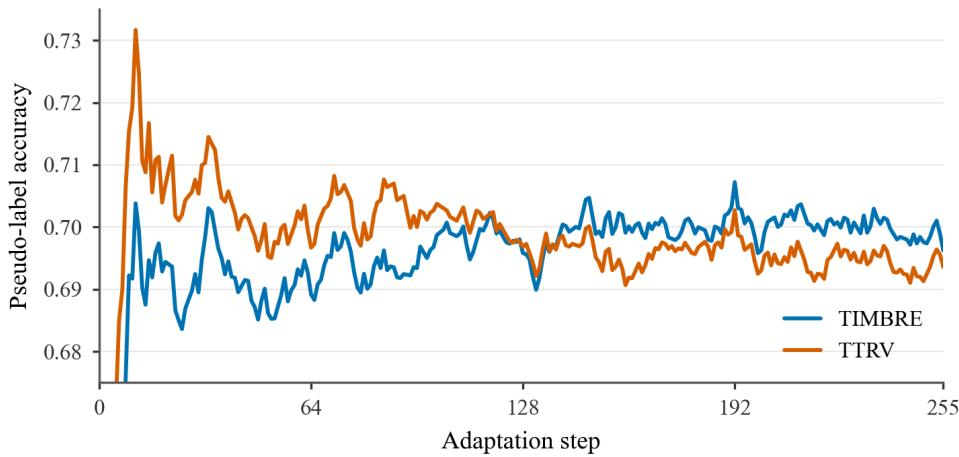  
Figure 2: Pseudo-label accuracy during test-time adaptation. Comparison between TIMBRE and TTRV on DynaMath with Qwen3-VL-8B-Instruct. Curves are smoothed using a time-weighted exponential moving average for visualization. Ground-truth answers are used only for post-hoc evaluation and are unavailable during adaptation. TIMBRE maintains higher pseudo-label accuracy over most later adaptation steps, indicating improved reliability of the generated training signal.

We further analyze the quality of pseudo-labels generated during test-time adaptation. Specifically, we compare the pseudo-label accuracy of TIMBRE and TTRV on DynaMath with Qwen3-VL-8B-Instruct. Although ground-truth answers are unavailable during adaptation, we use them only for post-hoc evaluation of the selected pseudo-labels. As shown in Figure 2, TIMBRE produces more reliable pseudo-labels throughout adaptation, maintaining consistently higher label accuracy during later adaptation steps. This indicates that weighted harmonic cross-view consensus provides a more stable and effective supervision signal than single-presentation frequency-based pseudo-label selection.

## 5.3 ABLATION OF CONSENSUS AGGREGATION

To isolate the contribution of the weighted harmonic consensus, we compare three aggregation strategies: (1) weighted harmonic aggregation used by TIMBRE, (2) weighted arithmetic aggregation using the same adaptive reliability weights, and (3) uniform harmonic aggregation following Self-Harmony. The weighted arithmetic variant preserves explicit view reliability weighting but removes the dispersion discount introduced by harmonic aggregation. Uniform harmonic aggregation retains harmonic consensus but assigns equal influence to all views. All variants use the same four view generation procedure and optimization settings. Results on Qwen3-VL-4B over MathVista and DynaMath are shown in Table 2. The comparison evaluates the contribution of both reliability-aware weighting and harmonic dispersion discounting.

Table 2: Ablation of consensus aggregation strategies on Qwen3-VL-4B. Each entry reports VAL-TTT / VAL pass@1 (%). All variants use the same optimization settings.
<table><tr><td>Method</td><td>MathVista</td><td>DynaMath</td></tr><tr><td>Before RL</td><td>77.0/74.2</td><td>65.7/66.4</td></tr><tr><td>- Weighted arithmetic aggregation</td><td>80.1/75.4</td><td>68.2/67.6</td></tr><tr><td>- Uniform harmonic aggregation</td><td>79.5/75.0</td><td>69.2/67.5</td></tr><tr><td>- Weighted harmonic aggregation (TIMBRE)</td><td>81.1/75.5</td><td>69.2/67.7</td></tr></table>

## 6 CONCLUSION

We introduced TIMBRE, a reliability-aware harmonic consensus framework for label-free multimodal test-time reinforcement learning. TIMBRE selects pseudo-labels through weighted harmonic aggregation over four image–text views and adapts modality-level weights online using a label-free reliability heuristic. Without requiring correct-answer invariance, we showed that the normalized weighted harmonic aggregate is the unique minimizer of a weighted Pearson $\chi ^ { 2 } .$ -barycenter objective, and characterized its ranking behavior under cross-view dispersion and modality reweighting. Under matched rollout budgets, TIMBRE improves over TTRV in 16 of 18 benchmark–model settings on adaptation instances and 17 of 18 settings on held-out instances. Together, these results support reliability-aware harmonic consensus as an effective approach to improving self-generated supervision for label-free multimodal test-time reinforcement learning.

## AI USE STATEMENT

In this work, we used generative AI tools for assistance with software code during implementation and debugging. We have not used generative AI tools for developing theoretical models or conceptual frameworks, formulating mathematical claims, providing ingredients for or writing proofs, proposing or refining hypotheses, designing or providing feedback on research methodology or experiments, translation, cleaning or reformatting datasets, or interpreting results. Generating synthetic datasets and qualitative or thematic data analysis are not applicable to this work.

Additionally, we used generative AI tools for editing and polishing the writing of the paper to improve clarity and readability, and for retrieval and discovery, such as searching for and identifying related work. We have reviewed all AI-assisted work. AI-assisted code was inspected and tested by the authors before being used in the reported experiments; all edited text was checked to ensure that it accurately reflects our methods, theory, and results; and all references identified with AI assistance were verified against the original sources before being cited. We take responsibility for the final content of this work, including text, claims or artifacts produced with the aid of generative AI.

## ETHICS STATEMENT

This work uses only publicly available benchmarks (MathVista, MathVision, MathVerse, Dyna-Math, WeMath, and MMMU-Pro) and publicly released models from the Qwen3-VL family, in accordance with their respective licenses and terms of use. It involves no human subjects, crowdsourcing, or collection of personal or sensitive data. Because label-free test-time reinforcement learning derives rewards from a model’s own predictions, it can reinforce incorrect consensus when pseudo-labels are wrong; our method is designed to mitigate this failure mode but does not eliminate it, so adapted models should be validated before deployment in high-stakes settings.

## REPRODUCIBILITY STATEMENT

We describe the full TIMBRE procedure in Section 3 and Algorithm 1, including view construction (Section 3.1), weighted harmonic consensus (Section 3.2), adaptive reliability weighting (Section 3.3), and reward construction with pooled optimization (Section 3.4). All theoretical results state their assumptions in Section 4, with complete proofs in Appendix A. Data sources, configurations, and adaptation/held-out splits for all six benchmarks are given in Section 5.1 and Appendix B.2; hyperparameters and rollout budgets are listed in Section 5.1 and Appendix B.3.

## REFERENCES

Shuai Bai, Yuxuan Cai, Ruizhe Chen, et al. Qwen3-VL technical report. arXiv preprint arXiv:2511.21631, 2025.

Zhe Chen, Jiannan Wu, Wenhai Wang, Weijie Su, Guo Chen, Sen Xing, Muyan Zhong, Qinglong Zhang, Xizhou Zhu, Lewei Lu, Bin Li, Ping Luo, Tong Lu, Yu Qiao, and Jifeng Dai. InternVL: Scaling up vision foundation models and aligning for generic visual-linguistic tasks. In Proceedings of the IEEE/CVF Conference on Computer Vision and Pattern Recognition (CVPR), pp. 24185–24198, 2024.

Daya Guo, Dejian Yang, Haowei Zhang, Junxiao Song, Peiyi Wang, Qihao Zhu, Runxin Xu, Ruoyu Zhang, Shirong Ma, Xiao Bi, et al. DeepSeek-R1 incentivizes reasoning in LLMs through reinforcement learning. Nature, 645:633–638, 2025. doi: 10.1038/s41586-025-09422-z.

Bingxiang He, Yuxin Zuo, Zeyuan Liu, Shangziqi Zhao, Zixuan Fu, Junlin Yang, Cheng Qian, Kaiyan Zhang, Yuchen Fan, Ganqu Cui, Xiusi Chen, Youbang Sun, Xingtai Lv, Xuekai Zhu, Li Sheng, Ran Li, Huan-ang Gao, Yuchen Zhang, Lifan Yuan, Bowen Zhou, Zhiyuan Liu, and Ning Ding. How far can unsupervised RLVR scale LLM training? In International Conference on Learning Representations (ICLR), 2026. URL https://openreview.net/forum?id= VesLZukY5E.

Wenxuan Huang, Bohan Jia, Zijie Zhai, Shaosheng Cao, Zheyu Ye, Fei Zhao, Zhe Xu, Xu Tang, Yao Hu, and Shaohui Lin. Vision-R1: Incentivizing reasoning capability in multimodal large language models. In International Conference on Learning Representations (ICLR), 2026.

Haotian Liu, Chunyuan Li, Qingyang Wu, and Yong Jae Lee. Visual instruction tuning. In Advances in Neural Information Processing Systems (NeurIPS), 2023.

Jia Liu, ChangYi He, YingQiao Lin, MingMin Yang, FeiYang Shen, and ShaoGuo Liu. ETTRL: Balancing exploration and exploitation in LLM test-time reinforcement learning via entropy mechanism. arXiv preprint arXiv:2508.11356, 2025a.

Ziyu Liu, Zeyi Sun, Yuhang Zang, Xiaoyi Dong, Yuhang Cao, Haodong Duan, Dahua Lin, and Jiaqi Wang. Visual-RFT: Visual reinforcement fine-tuning. In Proceedings of the IEEE/CVF International Conference on Computer Vision (ICCV), pp. 2034–2044, 2025b.

Pan Lu, Hritik Bansal, Tony Xia, Jiacheng Liu, Chunyuan Li, Hannaneh Hajishirzi, Hao Cheng, Kai-Wei Chang, Michel Galley, and Jianfeng Gao. MathVista: Evaluating mathematical reasoning of foundation models in visual contexts. In International Conference on Learning Representations (ICLR), 2024.

Karl Pearson. On the criterion that a given system of deviations from the probable in the case of a correlated system of variables is such that it can be reasonably supposed to have arisen from random sampling. The London, Edinburgh, and Dublin Philosophical Magazine and Journal of Science, 50(302):157–175, 1900. doi: 10.1080/14786440009463897.

Runqi Qiao, Qiuna Tan, Guanting Dong, Minhui Wu, Chong Sun, Xiaoshuai Song, et al. We-Math: Does your large multimodal model achieve human-like mathematical reasoning? In Proceedings ofthe 63rd Annual Meeting ofthe Associationfor Computational Linguistics (ACL), 2025.

Zhihong Shao, Peiyi Wang, Qihao Zhu, Runxin Xu, Junxiao Song, Xiao Bi, Haowei Zhang, Mingchuan Zhang, Y. K. Li, Y. Wu, and Daya Guo. DeepSeekMath: Pushing the limits of mathematical reasoning in open language models. arXiv preprint arXiv:2402.03300, 2024.

Guangming Sheng, Chi Zhang, Zilingfeng Ye, Xibin Wu, Wang Zhang, Ru Zhang, Yanghua Peng, Haibin Lin, and Chuan Wu. HybridFlow: A flexible and efficient RLHF framework. In Proceedings of the Twentieth European Conference on Computer Systems (EuroSys), 2025.

Akshit Singh, Shyam Marjit, Wei Lin, Paul Gavrikov, Serena Yeung-Levy, Hilde Kuehne, Rogerio Feris, Sivan Doveh, James Glass, and M. Jehanzeb Mirza. TTRV: Test-time reinforcement learning for vision language models. In Proceedings ofthe IEEE/CVF Conference on Computer Vision and Pattern Recognition (CVPR), pp. 33153–33163, 2026.

Yu Sun, Xiaolong Wang, Zhuang Liu, John Miller, Alexei A. Efros, and Moritz Hardt. Test-time training with self-supervision for generalization under distribution shifts. In International Conference on Machine Learning (ICML), pp. 9229–9248, 2020.

Shengbang Tong, Zhuang Liu, Yuexiang Zhai, Yi Ma, Yann LeCun, and Saining Xie. Eyes wide shut? exploring the visual shortcomings of multimodal LLMs. In Proceedings of the IEEE/CVF Conference on Computer Vision and Pattern Recognition (CVPR), pp. 9568–9578, 2024.

Dequan Wang, Evan Shelhamer, Shaoteng Liu, Bruno Olshausen, and Trevor Darrell. Tent: Fully test-time adaptation by entropy minimization. In International Conference on Learning Representations (ICLR), 2021.

Ke Wang, Junting Pan, Weikang Shi, Zimu Lu, Houxing Ren, Aojun Zhou, Mingjie Zhan, and Hongsheng Li. Measuring multimodal mathematical reasoning with MATH-Vision dataset. In Advances in Neural Information Processing Systems (NeurIPS), Datasets and Benchmarks Track, 2024.

Ru Wang, Wei Huang, Qi Cao, Yusuke Iwasawa, Yutaka Matsuo, and Jiaxian Guo. Self-Harmony: Learning to harmonize self-supervision and self-play in test-time reinforcement learning. In In ternational Conference on Learning Representations (ICLR), 2026a.

Weiqin Wang, Yile Wang, Kehao Chen, and Hui Huang. Beyond majority voting: Towards finegrained and more reliable reward signal for test-time reinforcement learning. In Proceedings of the 64th Annual Meeting of the Association for Computational Linguistics (ACL), pp. 37251– 37265, 2026b. doi: 10.18653/v1/2026.acl-long.1727.

Xuezhi Wang, Jason Wei, Dale Schuurmans, Quoc V. Le, Ed H. Chi, Sharan Narang, Aakanksha Chowdhery, and Denny Zhou. Self-consistency improves chain of thought reasoning in language models. In International Conference on Learning Representations (ICLR), 2023.

Jianghao Wu, Yasmeen George, Jin Ye, Yicheng Wu, Daniel F. Schmidt, and Jianfei Cai. SPINE: Token-selective test-time reinforcement learning with entropy-band regularization. arXiv preprint arXiv:2511.17938, 2025.

Dong Yan, Jian Liang, Yanbo Wang, Shuo Lu, Ran He, and Tieniu Tan. What if consensus lies? selective-complementary reinforcement learning at test time. In Proceedings of the 64th Annual Meeting of the Association for Computational Linguistics (ACL), pp. 28957–28970, 2026. doi: 10.18653/v1/2026.acl-long.1337.

Xiang Yue, Tianyu Zheng, Yuansheng Ni, Yubo Wang, Kai Zhang, Shengbang Tong, Yuxuan Sun, Botao Yu, Ge Zhang, Huan Sun, Yu Su, Wenhu Chen, and Graham Neubig. MMMU-Pro: A more robust multi-discipline multimodal understanding benchmark. In Proceedings ofthe 63rd Annual Meeting of the Association for Computational Linguistics (ACL), 2025.

Renrui Zhang, Dongzhi Jiang, Yichi Zhang, Haokun Lin, Ziyu Guo, Pengshuo Qiu, Aojun Zhou, Pan Lu, Kai-Wei Chang, Yu Qiao, Peng Gao, and Hongsheng Li. MathVerse: Does your multi-modal LLM truly see the diagrams in visual math problems? In European Conference on Computer Vision (ECCV), 2024.

Zizhuo Zhang, Jianing Zhu, Xinmu Ge, Zihua Zhao, Zhanke Zhou, Xuan Li, Xiao Feng, Jiangchao Yao, and Bo Han. Co-Reward: Self-supervised reinforcement learning for large language model reasoning via contrastive agreement. arXiv preprint arXiv:2508.00410, 2025.

Yue Zhou, Yada Zhu, Diego Antognini, Yoon Kim, and Yang Zhang. Paraphrase and solve: Exploring and exploiting the impact of surface form on mathematical reasoning in large language models. In Proceedings ofthe Conference ofthe North American Chapter ofthe Associationfor Computational Linguistics (NAACL), pp. 2793–2804, 2024.

Chengke Zou, Xingang Guo, Rui Yang, Junyu Zhang, Bin Hu, and Huan Zhang. DynaMath: A dynamic visual benchmark for evaluating mathematical reasoning robustness of vision language models. In International Conference on Learning Representations (ICLR), 2025.

Yuxin Zuo, Kaiyan Zhang, Li Sheng, Shang Qu, Ganqu Cui, Xuekai Zhu, Haozhan Li, Yuchen Zhang, Xinwei Long, Ermo Hua, et al. TTRL: Test-time reinforcement learning. arXiv preprint arXiv:2504.16084, 2025.

## A ADDITIONAL THEORY FOR WEIGHTED HARMONIC CONSENSUS

We provide proofs of the barycenter characterization, exact ranking results, and modality-weight sensitivity, followed by boundary cases, the local variance approximation, and the scope of the reliability heuristic. All results are conditional on the fixed, positive estimated distributions specified in Section 4.

## A.1 PROOF OF THE WEIGHTED $\chi ^ { 2 }$ BARYCENTER CHARACTERIZATION

ProofofLemma 4.1. Let $\begin{array} { r } { S _ { a } = \sum _ { v } w _ { v } / \tilde { p } _ { v } ( a ) = H _ { w } ( a ) ^ { - 1 } > 0 } \end{array}$ . Using $\begin{array} { r } { \sum _ { a } z ( a ) = \sum _ { a } \tilde { p } _ { v } ( a ) = 1 } \end{array}$ and $\textstyle \sum _ { v } w _ { v } = 1$ , we obtain

$$
\begin{array} { c l l } { \displaystyle \sum _ { v } w _ { v } D _ { \chi ^ { 2 } } ( z \| \tilde { p } _ { v } ) = \sum _ { a } \Bigg [ S _ { a } z ( a ) ^ { 2 } - 2 z ( a ) + \sum _ { v } w _ { v } \tilde { p } _ { v } ( a ) \Bigg ] } \\ { \displaystyle = \sum _ { a } S _ { a } z ( a ) ^ { 2 } - 1 . } \end{array}\tag{17}
$$

The objective is strictly convex because its Hessian is $\mathrm { d i a g } ( 2 S _ { a } ) \succ 0$ . Applying Cauchy–Schwarz to $\{ { \sqrt { S _ { a } } } z ( a ) \} _ { c }$ and $\{ S _ { a } ^ { - 1 / 2 } \} _ { a }$ gives

$$
1 = \left( \sum _ { a } z ( a ) \right) ^ { 2 } \leq \left( \sum _ { a } S _ { a } z ( a ) ^ { 2 } \right) \left( \sum _ { a } S _ { a } ^ { - 1 } \right) .\tag{18}
$$

Equality holds exactly when $\sqrt { S _ { a } } z ( a ) = c S _ { a } ^ { - 1 / 2 }$ for a common constant c, or equivalently $z ( a ) =$ $c \dot { S } _ { a } ^ { - 1 }$ . Normalization therefore yields

$$
z ^ { * } ( a ) = \frac { S _ { a } ^ { - 1 } } { \sum _ { b } S _ { b } ^ { - 1 } } = \frac { H _ { w } ( a ) } { \sum _ { b } H _ { w } ( b ) } .\tag{19}
$$

This distribution is strictly positive and attains the lower bound, so it is the unique minimizer. Its shared positive normalizer preserves all rankings and ties. □

The minimum objective value is $\begin{array} { r } { ( \sum _ { a } H _ { w } ( a ) ) ^ { - 1 } \mathrm { ~ - ~ } 1 } \end{array}$ . The weighted AM–HM inequality gives $\begin{array} { r } { H _ { w } ( a ) \leq \sum _ { v } w _ { v } \bar { p } _ { v } ( a ) } \end{array}$ and hence $\textstyle \sum _ { a } ^ { \cdots } H _ { w } ( a ) \leq 1$ , with equality exactly when all view distributions coincide. Thus, the barycenter balances disagreement without requiring identical views. This characterization depends on the divergence direction: reversing its arguments does not generally yield normalized harmonic scores.

## A.2 PROOF OF THE SUPPORT–DISPERSION DECOMPOSITION

Proof of Proposition 4.2. Define $\begin{array} { r } { V _ { w } ^ { \chi } ( a ) = \sum _ { v } w _ { v } ( \tilde { p } _ { v } ( a ) - m _ { a } ) ^ { 2 } / \tilde { p } _ { v } ( a ) } \end{array}$ . Expanding gives

$$
\begin{array} { l } { { V _ { w } ^ { \chi } ( a ) = \displaystyle \sum _ { v } w _ { v } \left[ \tilde { p } _ { v } ( a ) - 2 m _ { a } + \frac { m _ { a } ^ { 2 } } { \tilde { p } _ { v } ( a ) } \right] } } \\ { { { } = m _ { a } ^ { 2 } H _ { w } ( a ) ^ { - 1 } - m _ { a } . } } \end{array}\tag{20}
$$

Dividing by $m _ { a } > 0$ gives $\Gamma _ { w } ( a ) = m _ { a } H _ { w } ( a ) ^ { - 1 } - 1$ , proving Eq. 11.

The dispersion also admits a divergence interpretation. Define $s _ { a } ( v ) = w _ { v } \tilde { p } _ { v } ( a ) / m _ { a }$ , the fraction of candidate $\therefore { } a \mathbf { \hat { s } } { }$ weighted arithmetic support contributed by view v. Then

$$
D _ { \chi ^ { 2 } } ( w \| s _ { a } ) = \sum _ { v } \frac { ( w _ { v } - s _ { a } ( v ) ) ^ { 2 } } { s _ { a } ( v ) } = \Gamma _ { w } ( a ) .\tag{21}
$$

Thus, the harmonic discount measures the discrepancy between the assigned view weights and the candidate-specific support shares.

## A.3 PAIRWISE RANKINGS AND INVARIANCE

Proof of Theorem 4.3. By the support–dispersion decomposition and positivity of all denominators,

$$
\begin{array} { r l r } {  { H _ { w } ( C ) > H _ { w } ( A ) \iff \operatorname* { m } _ { C } ( 1 + \Gamma _ { w } ( A ) ) > m _ { A } ( 1 + \Gamma _ { w } ( C ) ) } } \\ & { \iff \Gamma _ { w } ( A ) > \frac { m _ { A } } { m _ { C } } ( 1 + \Gamma _ { w } ( C ) ) - 1 . } \end{array}\tag{22}
$$

Preserving correct arithmetic rankings. Since $\Gamma _ { w } ( A ) \geq 0$ , the condition $m _ { C } ~ > ~ ( 1 ~ +$ $\Gamma _ { w } ( C ) ) m _ { A }$ guarantees $H _ { w } ( C ) > H _ { w } ( \breve { A } )$ ) regardless of the competitor’s dispersion. A sufficient condition follows from relative support stability: if $| \tilde { p } _ { v } ( C ) - m _ { C } | \le \varepsilon m _ { C }$ for every view, with $0 \leq \varepsilon < 1$ , then $\tilde { p } _ { v } ( C ) \geq ( 1 - \varepsilon ) \bar { m _ { C } }$ and

$$
\Gamma _ { w } ( C ) \leq \frac { \sum _ { v } w _ { v } ( \tilde { p } _ { v } ( C ) - m _ { C } ) ^ { 2 } } { m _ { C } ^ { 2 } ( 1 - \varepsilon ) } \leq \frac { \varepsilon ^ { 2 } } { 1 - \varepsilon } .\tag{23}
$$

Consequently,

$$
m _ { C } > \left( 1 + \frac { \varepsilon ^ { 2 } } { 1 - \varepsilon } \right) m _ { A } \quad \Longrightarrow \quad H _ { w } ( C ) > H _ { w } ( A ) .\tag{24}
$$

Equivalently, a relative arithmetic margin $m _ { C } / m _ { A } - 1 > \varepsilon ^ { 2 } / ( 1 - \varepsilon )$ suffices for preservation. This sufficient threshold is $O ( \varepsilon ^ { 2 } )$ as $\varepsilon \to 0$ . Exact invariance corresponds to $\varepsilon = 0$ and preserves every strict arithmetic win.

Correcting arithmetic errors. When $m _ { A } ~ > ~ m _ { C }$ , harmonic aggregation corrects the ranking exactly when $\Gamma _ { w } ( A ) > ( m _ { A } / m _ { C } ) ( 1 + \Gamma _ { w } ( C ) ) - 1$ . Under exact correct-answer invariance, this condition reduces to $\Gamma _ { w } ( A ) > m _ { A } / m _ { C } - 1$ . Thus, exact invariance guarantees preservation of all strict arithmetic wins and permits additional wins against sufficiently dispersed competitors. Under approximate invariance, the margin condition in Eq. 24 guarantees preservation.

## A.4 MODALITY MARGINALS AND EXACT WEIGHT SENSITIVITY

For $r = \bar { r } _ { \rho }$ and $u = \bar { r } _ { \tau }$ , the normalizer of the factorized view weights is $( 1 + r ) ( 1 + u )$ . Hence

$$
w _ { 0 0 } + w _ { 0 1 } = \frac { 1 } { 1 + r } , \qquad w _ { 1 0 } + w _ { 1 1 } = \frac { r } { 1 + r } ,\tag{25}
$$

and the corresponding text marginals are $1 / ( 1 + u )$ and $u / ( 1 + u )$ . This establishes Eq. 13.

Proof of Theorem 4.4. Holding $q _ { \tau }$ and the view distributions fixed gives

$$
H _ { r } ( a ) ^ { - 1 } = \sum _ { i } q _ { \rho } ( i ) \sum _ { t } \frac { q _ { \tau } ( t ) } { \tilde { p } _ { v _ { i t } } ( a ) } = \frac { B _ { 0 } ( a ) + r B _ { 1 } ( a ) } { 1 + r } .\tag{26}
$$

Subtracting the reciprocal score of C from that of A yields Eq. 15. Since the harmonic scores are positive, $\bar { \Delta _ { A } } ( r ) > \hat { 0 } \iff H _ { r } ( C ) > H _ { r } ( A )$ . Differentiation gives

$$
\Delta _ { A } ^ { \prime } ( r ) = { \frac { D _ { 1 } ( A ) ( 1 + r ) - D _ { 0 } ( A ) - r D _ { 1 } ( A ) } { ( 1 + r ) ^ { 2 } } } = { \frac { D _ { 1 } ( A ) - D _ { 0 } ( A ) } { ( 1 + r ) ^ { 2 } } } .\tag{27}
$$

Since $( 1 + r ) ^ { 2 } > 0$ , the derivative has a constant sign determined by $D _ { 1 } ( A ) - D _ { 0 } ( A )$ . Thus, decreasing r strictly increases $\Delta _ { A } ( r )$ if and only if $D _ { 0 } ( A ) > D _ { 1 } ( A )$ , and leaves it unchanged when $D _ { 0 } ( A ) = { \overline { { D } } } _ { 1 } ( A )$ . Exchanging image and text establishes the analogous result for text reweighting.

Corollary A.1 (A sufficient condition for downweighting). $I f \tilde { p } _ { v _ { 1 t } } ( C ) \leq \tilde { p } _ { v _ { 0 t } } ( C )$ and $\tilde { p } _ { v _ { 1 t } } ( A ) \geq$ $\tilde { p } _ { v _ { 0 t } } ( A )$ for both $t \in \{ 0 , 1 \}$ , then $D _ { 1 } ( A ) \leq D _ { 0 } ( A )$ . With view distributions and text weights fixed, any decrease in r therefore weakly increases $\Delta _ { A } ( r )$ , with a strict increase if any of these probability inequalities is strict.

Proof. Taking reciprocals gives

$$
\tilde { p } _ { v _ { 1 t } } ( A ) ^ { - 1 } - \tilde { p } _ { v _ { 1 t } } ( C ) ^ { - 1 } \leq \tilde { p } _ { v _ { 0 t } } ( A ) ^ { - 1 } - \tilde { p } _ { v _ { 0 t } } ( C ) ^ { - 1 } .\tag{28}
$$

Averaging over t with strictly positive weights $q _ { \tau } ( t )$ yields $D _ { 1 } ( A ) \leq D _ { 0 } ( A )$ , with strict inequality if any of the assumed probability inequalities is strict. Theorem 4.4 then establishes the effect of decreasing $r .$ □

## A.5 REWARD CONSTRUCTION AND CONFIDENCE-GATING GUARANTEE

We detail the reframing format penalty, explain the role of pooled normalization, and establish the confidence-gating guarantee. Throughout, we consider an instance with a valid pseudo-label $y ^ { * }$

Reward construction and format penalty. For optimization rollout $k \in \{ 1 , \ldots , K \}$ from view $v _ { i t } ,$ , define $\delta _ { i t , k } = \mathbb { I } [ \hat { a } _ { i t , k } = y ^ { * } ]$ , treating failed answer extractions as nonmatches. The rewards are

$$
R _ { i 0 , k } = \delta _ { i 0 , k } , \qquad R _ { i 1 , k } = \delta _ { i 1 , k } ( 1 + b _ { i } ) \phi _ { i 1 , k } .\tag{29}
$$

The format multiplier $\phi _ { i 1 , k }$ equals 1 when a reframed response follows the required STRATEGY, REWRITTEN PROBLEM, and SOLUTION structure, and $w _ { f } \in ( 0 , 1 )$ otherwise. Thus, positive reward always requires pseudo-label agreement, while format violations reduce the reward of matching reframed responses.

For image state $i ,$ cross-view diversity is measured by

$$
J _ { i } = \frac { \mathrm { J S } ( \tilde { p } _ { v _ { i 0 } } , \tilde { p } _ { v _ { i 1 } } ) } { \log 2 } \in [ 0 , 1 ] ,\tag{30}
$$

using the smoothed answer distributions estimated from all M rollouts per view. The confidencegated bonus is

$$
b _ { i } = w _ { d } ( 1 - p _ { \mathrm { p o o l } , i } ) J _ { i } , \qquad p _ { \mathrm { p o o l } , i } = \frac { 1 } { 2 K } \sum _ { k = 1 } ^ { K } ( \delta _ { i 0 , k } + \delta _ { i 1 , k } ) ,\tag{31}
$$

where $0 ~ \leq ~ w _ { d } ~ \leq ~ 2$ . Unlike $J _ { i } ,$ the agreement rate $p _ { \mathrm { p o o l } , i }$ uses only the optimization rollouts, matching the sample pool used to compute advantages.

Why pool rewards across views? Separate per-view standardization cancels any shared positive reward multiplier c, apart from numerical stabilization:

$$
\frac { c R - c \mu _ { v } } { c \sigma _ { v } + \epsilon } = \frac { R - \mu _ { v } } { \sigma _ { v } + \epsilon / c } .\tag{32}
$$

Within each reframed view, the diversity factor $1 + b _ { i }$ is shared across rollouts. Per-view normalization would therefore largely remove its effect. We instead jointly standardize all 4K optimization rewards for each instance, as in Eq. 7, preserving the bonus’s influence on relative rewards across views.

Pooling also motivates confidence gating. With an ungated bonus $b _ { i } ~ = ~ w _ { d } J _ { i }$ , the pooled mean can exceed 1, giving negative advantages to direct-solving responses that match $y ^ { * }$ . The gate removes the bonus when all optimization rollouts within an image state agree with $y ^ { * }$ and provides the following guarantee.

Proposition A.2 (Confidence-gating guarantee). Suppose $0 \leq w _ { d } \leq 2$ and $0 < \phi _ { i 1 , k } \le 1$ . Under Eqs. 29 and 31, the pooled reward mean satisfies $\mu _ { \mathrm { p o o l } } \leq 1$ . Consequently, direct-solving responses that match $y ^ { * }$ and format-compliant reframed responses that match $y ^ { * }$ have nonnegative pooled advantages.

Proof. Define the optimization-rollout agreement rate in each view as $\begin{array} { r } { q _ { i t } = K ^ { - 1 } \sum _ { k = 1 } ^ { K } \delta _ { i t , k } } \end{array}$ . Then $q _ { i 0 } + q _ { i 1 } = 2 p _ { \mathrm { p o o l } , i }$ . Since $\phi _ { i 1 , k } \leq 1$

$$
\begin{array} { r l } { \displaystyle 4 \mu _ { \mathrm { p o o l } } = \frac { 1 } { K } \sum _ { i = 0 } ^ { 1 } \sum _ { k = 1 } ^ { K } \left[ \delta _ { i 0 , k } + \delta _ { i 1 , k } \big ( 1 + b _ { i } \big ) \phi _ { i 1 , k } \right] } & { } \\ { \displaystyle \le \sum _ { i = 0 } ^ { 1 } \left[ q _ { i 0 } + q _ { i 1 } \big ( 1 + b _ { i } \big ) \right] } \\ & { = \displaystyle \sum _ { i = 0 } ^ { 1 } \left[ 2 p _ { \mathrm { p o o l } , i } + w _ { d } \big ( 1 - p _ { \mathrm { p o o l } , i } \big ) J _ { i } q _ { i 1 } \right] } \\ & { \displaystyle \le \sum _ { i = 0 } ^ { 1 } \left[ 2 p _ { \mathrm { p o o l } , i } + 2 \big ( 1 - p _ { \mathrm { p o o l } , i } \big ) \right] = 4 , } \end{array}\tag{33}
$$

where the last inequality uses $w _ { d } \leq 2 , J _ { i } , q _ { i 1 } \leq 1$ , and $p _ { \mathrm { p o o l } , i } \in [ 0 , 1 ]$ . Hence $\mu _ { \mathrm { p o o l } } \leq 1$

A matching direct-solving response receives reward 1, while a matching, format-compliant reframed response receives $1 + b _ { i } \geq 1$ . Subtracting $\mu _ { \mathrm { p o o l } } \leq 1$ and dividing by $\sigma _ { \mathrm { p o o l } } + \epsilon > 0$ therefore gives a nonnegative advantage in both cases. □

## B ADDITIONAL EXPERIMENTAL DETAILS AND RESULTS

## B.1 REFRAMING INSTRUCTION

User message: instruction and demonstration.

You are the Reframer, an AI that solves problems with creation.   
Your challenge is not just to find the answer, but to find a more   
interesting way to get there.   
Mission:   
1. Transform: DO NOT solve the ORIGINAL PROBLEM directly. Rewrite it   
using one of the strategies below.   
2. Solve: Let's think step by step to solve the new problem you created,   
then output the final answer within \boxed{}.

Strategies (default to Contextualize; use Paraphrase only when no   
faithful scenario is possible):   
- Contextualize: Wrap the question in a concrete real-world situation —   
who is looking at this image, and why they need the answer — then ask   
the original question from inside that situation. The scenario supplies   
the asker and the motive; the image supplies everything visual.   
- Paraphrase: Restate the question in your own words, with different   
sentence structure and vocabulary.

Rules:   
- Begin your response immediately with "STRATEGY:". Output nothing before   
it — no preamble, acknowledgement, or reasoning.   
- Do NOT describe the image. Point at it ("the figure", "the chart", "the   
plants shown") and let the reader look. Never write down identities,   
colors, counts, positions, shapes, layout, axis values, or labels that   
you read off the image — not even ones you are confident about.   
- Every fact in the rewritten problem must be traceable to the ORIGINAL   
PROBLEM TEXT. Facts stated there may be reworded and kept; facts you got   
by looking belong only in your SOLUTION, never in the problem statement.   
- Carry over every quantity, condition, and constraint from the original   
text. Add none, drop none, and never make a vague condition more   
specific.   
- The rewritten problem must still require the image to solve, and must   
be self-contained given the image — solvable from your wording plus the   
image alone.

- The ORIGINAL PROBLEM is either open-ended (a free-form or numeric   
answer) or multiple-choice. If it is open-ended, rewrite the question   
freely. If it is multiple-choice, rewrite ONLY the question stem, then   
append the original choices verbatim (same letters, same order, same   
text) so the answer is still one of those choices.   
- The final answer must equal the answer to the ORIGINAL PROBLEM.   
Response Format (must follow exactly):   
STRATEGY: [Chosen strategy]   
REWRITTEN PROBLEM:   
[Your transformed problem statement - new framing, no description of the   
image]   
SOLUTION:   
[Step-by-step solution matching the transformed problem and grounded in   
image evidence]   
\boxed{[Final answer]}   
Here is a one-shot reframing example. It shows only the transform step   
(STRATEGY + REWRITTEN PROBLEM); your own response must still continue on   
to give the SOLUTION and \boxed{} final answer.

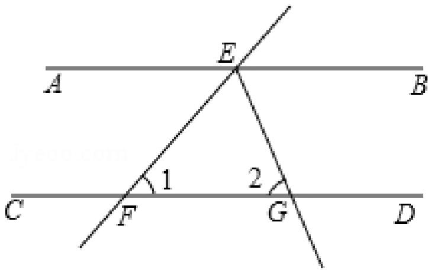

As shown in the figure, AB parallel CD, EG bisects angle BEF, angle 1 = 50.0, then angle 2 is equal to ()

EXAMPLE REFRAMING:   
STRATEGY: Contextualize   
REWRITTEN PROBLEM:   
A survey crew is preparing to pave the layout shown in the figure. Roads   
AB and CD were built parallel, and the crew cut service path EG so that   
it bisects angle BEF. Their instrument reads angle 1 as 50°. What should   
they record for angle 2?

## Assistant message: fixed acknowledgement.

Understood. Please share the original problem.

The original problem message(s), including the corresponding image(s), follow unchanged. The model then generates the reframing and solution in a single response.

## B.2 DATA CONSTRUCTION

We construct subsets for label-free adaptation and held-out evaluation. Table 3 summarizes the data sources and split sizes. Ground-truth answers are used only for evaluation.

Visual mathematical reasoning benchmarks. For MathVista, we randomly partition testmini into 500 adaptation and 500 held-out instances. For MathVerse, we use the Text Lite version of testmini, randomly selecting 500 instances for adaptation and reserving the remaining 278 for held-out evaluation. For MathVision, we use the 304 instances in testmini for held-out evaluation and randomly sample 500 adaptation instances from test. For DynaMath, we use variants 1 and 2 of 465 seed problems for adaptation and held-out evaluation, respectively, yielding distinct instances generated from the same seed problems. For WeMath, we randomly select 500 adaptation and 500 held-out instances without overlap from the 1,730 instances in testmini to limit computational cost.

MMMU-Pro. We use the Science subset of the standard (4 options) configuration, covering Biology, Chemistry, Geography, Mathematics, and Physics.

Although this configuration is distributed as a single test split, instance identifiers retain their original MMMU split through the prefixes test and validation . We assign instances with the former prefix to adaptation and those with the latter to held-out evaluation, yielding 198 adaptation and 93 held-out instances.

Across all benchmarks, adaptation and held-out sets contain no identical instances.

Table 3: Data sources and split sizes for label-free adaptation and held-out evaluation.
<table><tr><td>Benchmark</td><td>Hugging Face source and configuration</td><td>Adaptation</td><td>Held-out</td><td>Total</td></tr><tr><td>MathVista</td><td>AI4Math/MathVista (testmini)</td><td>500</td><td>500</td><td>1,000</td></tr><tr><td>MathVerse</td><td>AI4Math/MathVerse (testmini, Text Lite)</td><td>500</td><td>278</td><td>778</td></tr><tr><td>MathVision</td><td>MathLLMs/MathVision (adaptation: test;held-out: testmini)</td><td>500</td><td>304</td><td>804</td></tr><tr><td>DynaMath</td><td>DynaMath/DynaMath_Sample (adaptation: variant 1; held-out: variant 2)</td><td>465</td><td>465</td><td>930</td></tr><tr><td>WeMath</td><td>We-Math/We-Math(testmini)</td><td>500</td><td>500</td><td>1,000</td></tr><tr><td>MMMU-Pro (Science)</td><td>MMMU/MMMU_Pro (standard four-option, Sci- ence)</td><td>198</td><td>93</td><td>291</td></tr><tr><td colspan="2">Total</td><td>2,663</td><td>2,140</td><td>4,803</td></tr></table>

## B.3 HYPERPARAMETERS

Table 4 summarizes the experimental hyperparameters. The four-view method allocates the total estimation and optimization budgets equally across views. The learning rate remains constant after linear warmup over the first 3% of training steps.

Table 4: Hyperparameters used in our experiments. M and K denote per-view rollout counts for TIMBRE.
<table><tr><td>Hyperparameter</td><td>Value</td></tr><tr><td colspan="2">Training and optimization</td></tr><tr><td>Maximum prompt length</td><td>6,320 tokens</td></tr><tr><td>Maximum response length</td><td>8,192 tokens</td></tr><tr><td>Training batch size</td><td>32</td></tr><tr><td>Training epochs</td><td>16</td></tr><tr><td>PPO mini-batch size</td><td>4</td></tr><tr><td>PPO micro-batch size</td><td>2</td></tr><tr><td>Optimizer</td><td>Adam</td></tr><tr><td>Learning rate</td><td>5 × 10−7</td></tr><tr><td>Learning-rate schedule</td><td>Constant after warmup</td></tr><tr><td>Warmup ratio</td><td>0.03</td></tr><tr><td colspan="2">Rollout generation and evaluation</td></tr><tr><td>Total estimation rollouts per instance</td><td>64</td></tr><tr><td>Total optimization rollouts per instance</td><td>32</td></tr><tr><td>Estimation rollouts per view (M)</td><td>16</td></tr><tr><td>Optimization rollouts per view (K)</td><td>8</td></tr><tr><td>Training temperature</td><td>1.0</td></tr><tr><td>Training top-p</td><td>1.0</td></tr><tr><td>Training top-k</td><td>-1 (disabled)</td></tr><tr><td>Evaluation rollouts per instance</td><td>8 0.8</td></tr><tr><td>Evaluation temperature</td><td></td></tr><tr><td>Evaluation top-p</td><td>0.9</td></tr><tr><td>Evaluation top-k</td><td>-1 (disabled)</td></tr><tr><td colspan="2">Adaptive weighting and rewards</td></tr><tr><td>Image-shift sensitivity (βρ)</td><td>1.0</td></tr><tr><td>Text-shift sensitivity (βτ)</td><td>1.0</td></tr><tr><td>Reliability EMA update rate (η)</td><td>0.05</td></tr><tr><td>Initial reliability factors  $( \bar { r } _ { \rho } ^ { ( 0 ) } , \bar { r } _ { \tau } ^ { ( 0 ) } )$ </td><td>(1, 1)</td></tr><tr><td>Reframing format multiplier (w f)</td><td>0.9</td></tr><tr><td>Diversity bonus coefficient (wd)</td><td>0.5</td></tr></table>

## B.4 ANALYSIS OF ADAPTIVE RELIABILITY WEIGHTING

Because the correct answer C is unavailable during adaptation, our reliability update cannot directly measure whether a transformation improves or degrades correctness. Instead, TIMBRE estimates view reliability using shifts in support for the current pseudo-label as a label-free stability heuristic. This appendix analyzes whether the resulting reliability-aware weights align with the empirical reliability of different views.

Figure 3 shows the evolution of the four view weights and their corresponding pseudo-label accuracies during test-time adaptation on DynaMath with Qwen3-VL-8B-Instruct. The top row shows the factorized harmonic-consensus weights w00, w01, w10, w11, while the bottom row reports the posthoc pseudo-label accuracy of each view. Ground-truth answers are used only for evaluation and are unavailable during adaptation.

The view weights exhibit consistent alignment with the corresponding pseudo-label accuracies. Views that maintain higher pseudo-label accuracy generally retain larger consensus weights, while views with lower accuracy receive reduced influence. This behavior suggests that the pseudo-label shift heuristic provides an effective label-free estimate of view reliability, allowing the harmonic consensus mechanism to adaptively balance original and transformed image–text views rather than uniformly trusting all presentations.

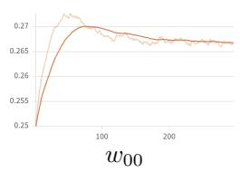

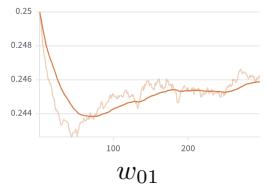

Adaptive view weights  
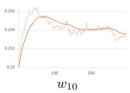

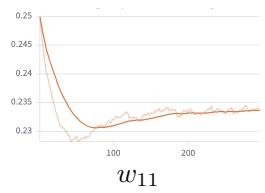

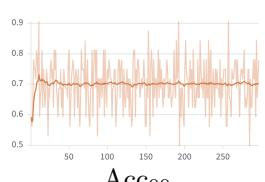  
Acc00

Per-view pseudo-label accuracy  
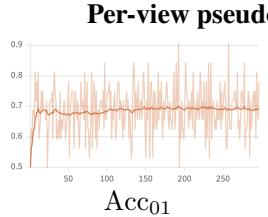

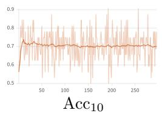

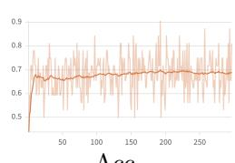  
Acc11  
Figure 3: Reliability-aware view weighting dynamics. The top row shows the evolution of the learned harmonic-consensus weights for the four image–text views, and the bottom row reports the corresponding per-view pseudo-label accuracy. Each column corresponds to the same view vit, enabling comparison between assigned consensus influence and empirical correctness during adaptation. The first index denotes the image state (original or transformed), and the second index denotes the text mode (direct solving or reframing).

The weighting dynamics remain smooth due to exponential reliability mapping and temporal smoothing. Importantly, transformed views are not permanently suppressed; they continue contributing when their pseudo-label support remains stable. Although the heuristic cannot guarantee that every update improves the instance-level ranking margin, the theoretical analysis in Section 4.3 characterizes when such reweighting increases harmonic ranking margins. These empirical results demonstrate that the shared reliability factors provide meaningful adaptive view weighting during test-time optimization.