# The Athlete as a Scientist of One: Agentic Bayesian Experimental Design for Individualized Physiology from Consumer Wearables

Behnam Moradi

Software Department, KavAI

California, USA

behnam.moradi@kavai.com

Abstract—Large language model (LLM) agents for personal health read wearable data and recommend, but do not learn about the individual in a way that can be audited or falsified. We present EPICOACH, an agentic system that treats one athlete, a cross-country mountain biker, as the subject of accountable N-of-1 science. Claims about the athlete live in an evidence-gated hypothesis registry: each must issue a probabilistic prediction about a future session before it occurs, and its belief moves only through computed evidence from a logged statistical fit. Predictions come from a mechanistic digital twin inferred from heart rate, GPS and barometric altitude: a lagged heart-rate response model, a fitness– fatigue model with learned time constants, and a latent technicaldescending skill state, measured on discovered trail segments. The agent prescribes the next training week as a constrained experiment maximizing information gain subject to load and safety constraints, around two instrument rides. We evaluate the system two ways over eighteen months of data. A rolling-origin replay benchmark shows the twin beats standard forecasters on heart rate but not segment time, and the agentic loop matches a static model. A live prospective phase runs the weekly cycle: in its first three weeks the ledger sealed 20 predictions, scored 14, the descent forecast calibrated after one correction, the climb forecast pessimistic as the athlete improved, and the safety officer vetoed the agent twice. Every correction is preserved in the registry, a template for auditable, falsifiable personalization in digital health. We release the registry, benchmark and protocol.

Index Terms—Digital twin, N-of-1 trial, Bayesian experimental design, large language model agents, hypothesis registry, wearable sensors, mountain biking, personalized health.

## I. INTRODUCTION

A coach who has worked with the same athlete for years knows things about that athlete that no textbook contains: that her heart rate climbs by six beats per hour once the temperature passes $2 8 ^ { \circ } \mathrm { C } .$ that two short nights cost her more on technical descents than on climbs, that she holds fitness longer than the forty-two-day constant assumed by every training platform. This knowledge is individual, it was acquired by watching many sessions, and, crucially, it was tested: the coach predicted, observed, and revised. Consumer wearables now record the raw material for this kind of knowledge continuously, and LLM agents can reason over it. Yet the systems built so far do something quite different from what the experienced coach does.

Recent personal-health agents are impressive readers of wearable data. PH-LLM fine-tunes Gemini to produce expertrated coaching from thirty-day summaries [1]; PHIA answers open-ended numerical questions over wearable time series by generating and running code [2]; the Personal Health Agent orchestrates data-scientist, domain-expert and coach subagents [3]; SePA grounds advice in personalized risk models and trusted retrieval [4]; LLM-SPTRec generates training plans from a sports-science knowledge graph [5]. All of them share a direction of information flow: data in, recommendation out, population knowledge applied to an individual. None maintains a body of claims about this particular person that is explicit, probabilistic, revised by evidence, and exposed to falsification. If such a system tells the athlete that her heart rate drifts in the heat, nothing records whether that claim was ever tested, what it would take to overturn it, or whether it was quietly abandoned.

We argue that the missing object is not a better recommender but an epistemic loop, and that building one for a single human raises problems that automated-science systems in chemistry or biology [6]–[8] do not face. The subject cannot be reset; every observation costs a training session that also changes the system being studied; the measurements are noisy wrist sensors rather than assays; and the designer has a second objective, making the athlete better, that competes with learning about her. We call the resulting problem epistemic coaching and make four design commitments:

1) A prediction ledger, not a chat log. Every hypothesis in the registry must emit a probabilistic prediction about a specific future ride, timestamped before the ride. Beliefs move only through a tool that requires a logged statistical fit. This is what makes N=1 science defensible: it closes the garden of forking paths [9], [10] that would otherwise let a fluent language model explain any outcome after the fact.

2) A mechanistic twin from a watch alone. We infer, from optical heart rate, GPS and barometric altitude only, a lagged heart-rate response with drift and heat interactions, a fitness–fatigue model whose time constants are estimated rather than assumed, and a latent technical-skill state that is deliberately separated from aerobic fitness because heart rate stops measuring mechanical work on descents [11], [12].

3) Workouts as experiments, with safety as a hard constraint. The next ride is chosen from a menu by a utility that trades expected information gain against expected performance improvement, subject to acute:chronic workload bounds, heart-rate caps and readiness gates enforced in code rather than by the language model. Repeated trail segments, discovered automatically, serve as the measurement instrument.

4) Evaluation by prediction, not by plausibility. We score the system by rolling-origin replay over eighteen months of history and by a live prospective phase in which every prediction is sealed before the ride it concerns, using proper scoring rules and forecast-comparison tests designed for a single long time series.

a) Contributions.: (i) A formalization of coaching as sequential, safety-constrained Bayesian experimental design over an evidence-gated hypothesis registry with a pre-registered prediction ledger (Section III). (ii) A wrist-only digital twin for mountain biking with explicit identifiability analysis of its fitness–fatigue component (Section IV). (iii) An agent architecture, implemented in Google ADK, whose protocol, not its prompts, guarantees that LLMs propose, select and explain while deterministic tools fit, score and gate (Section V). (iv) A public rolling-origin replay benchmark for individualized physiological forecasting with retrospective results on eighteen months of data, and the first three weeks of a live, preregistered prospective N=1 phase with its complete audit trail (Section VI).

## II. RELATED WORK

a) LLMs and agents over wearable data.: PH-LLM [1] fine-tunes a frontier model on expert case studies built from thirty-day aggregates and reasons in-model. PHIA [2] is a ReAct agent [13] with a Python runtime and web search, evaluated on thousands of insight questions. The Personal Health Agent [3] adds orchestration across specialist subagents; PhysioLLM [14] adds a statistical-correlation layer; SePA [4] adds personalized predictive models and whitelisted retrieval. These systems answer questions and give advice. None keeps a persistent, probabilistic, falsifiable model of the user, none chooses what data to collect next, and none writes an intervention back to the device. We use PHIA-style agents as a baseline and PHA-style orchestration as a point of contrast.

b) AI scientists and hypothesis management.: End-toend automated research systems [6], [7] close a hypothesize– experiment–analyze loop in silico or in the wet lab, where replicates are cheap and the system under study is stationary. The Hypothesis Evolution Protocol [8] externalizes hypotheses as registry objects with evidence-gated beliefs, lineage and lifecycle; we adopt this discipline and add the ledger requirement that every hypothesis issues a dated prediction about an unobserved outcome. Box’s loop with language models [15], [16] and the Automatic Statistician [17] use LLMs to propose and criticize probabilistic programs on fixed data;

BoxingGym [18] benchmarks LLM agents on information-gaindriven design in simulated environments and finds them weak at it. Our setting is BoxingGym’s real-world counterpart with a living subject, irreversible state and a dual objective.

c) Training-load modelling and digital twins.: The Banister impulse-response model [19], [20] and the Busso variable-dose variant [21] relate training load to performance through fitness and fatigue filters; they are known to be illconditioned [22], [23] and sensitive to the load metric [24]. Kalman-filter variants track parameters online [25]; optimalcontrol and reinforcement-learning methods optimize load schedules given fitted parameters. We treat parameter uncertainty as the object to be reduced by design, and we use only wrist-derived load and segment-based performance rather than power meters or laboratory tests.

d) N-of-1 trials and self-experimentation.: Within-person crossover trials have a mature design and analysis literature [26]–[29]. CASEbot [30] uses an LLM to help users design such experiments. In our system the agent generates candidate experiments from model residuals, selects them by expected information gain, executes them through the athlete’s device, and analyses them with randomization-respecting estimators.

e) Mountain-bike physiology.: Cross-country mountain biking is characterized by sustained high heart rates that remain elevated on descents despite low power output, attributed to isometric load and arousal [11], [12]; performance is multidimensional and course-specific [31]; rolling resistance varies two- to three-fold with surface [32]. These facts shape the twin: heart rate is a fitness signal only on climbs, descending is a separate skill, and rolling resistance is a segment-level nuisance.

## III. COACHING AS ACCOUNTABLE SEQUENTIAL EXPERIMENTATION

## A. Setting

An athlete produces a stream of rides $r = 1 , 2 , \ldots$ . and daily wellness records. Each ride yields a time series $x _ { r } =$ $\{ ( t , \mathrm { H R } _ { t } , \mathbf { g } _ { t } , a _ { t } , T _ { t } ) \}$ of heart rate, GPS position, barometric altitude and temperature, plus device-level summaries. Let $\theta \in \Theta$ denote the parameters of a generative model of the athlete (Section IV) and $p _ { t } ( \theta )$ the posterior given all data observed up to time t. A workout $d \in \mathcal { D }$ is a specification the athlete can execute (archetype, duration, heart-rate target, segment, day), and $y \sim p ( y \mid \theta , d )$ is the vector of outcomes the twin predicts for it.

## B. Hypothesis registry and prediction ledger

Definition 1 (Hypothesis). A hypothesis $H = ( t e x t , \phi _ { H } , \pi _ { H } )$ consists of a natural-language claim; a formal predicate $\phi _ { H } : \Theta \to \{ 0 , 1 \}$ or a sub-model $M _ { H } ;$ a belief $\pi _ { H } \in ( 0 , 1 )$ together with a lifecycle state in {PROPOSED, UNDER\_TEST, SUPPORTED, REFUTED, UNDETERMINED, RETIRED} and parent pointers recording refinement and merging.

Two rules distinguish our registry from a free-form notebook. Evidence gating (inherited from $[ 8 ] ) \colon \pi _ { H }$ changes only through record\_evidence(H, log BF, $\pm \mathrm { i t \_ i d } )$ , where log BF is a log Bayes factor or an equivalent evidence score computed by a deterministic fit whose identifier exists in the statistician’s store, and the update is logit π $\mathbf { \bar { \theta } } _ { H } \gets \log \mathrm { i t } \pi _ { H } + \log \mathrm { B F }$ [33]. The language model has no tool that sets $\pi _ { H }$ directly. Ledger requirement (ours): a hypothesis may enter UNDER\_TEST only after pre $\mathtt { d i c t } ( H , \ r ^ { * } , \ q _ { H } )$ has registered a predictive distribution $q _ { H }$ for a specified future ride $r ^ { * }$ , and the registry refuses the call if its timestamp is later than the ride’s start. Ledger predictions are scored with proper scoring rules [34] when $r ^ { * }$ is observed, and the scores are the only admissible evidence for hypotheses about predictive claims. Identifiability gate (ours): for a directional claim about a parameter, a Savage–Dickey-style log BF is admitted only if the posterior standard deviation has shrunk by at least 10% relative to the prior; otherwise the evidence is recorded as zero (the test still consumes budget). Without this rule a bounded prior that is merely re-shaped by weak data can masquerade as evidence; it did so for the fitness time constant in our own data (Section IV-E). The verdict UNDETERMINED is reachable: a hypothesis whose evidence has not left | log BF| < log 3 after a pre-set budget of tests is closed as unresolved rather than left open indefinitely.

## C. The design problem

At each decision point the agent chooses the next workout. Let $\pi = ( \pi _ { H } ) _ { H \in \mathcal { H } }$ be current registry beliefs and θ the twin parameters. The expected information gain of a design about θ is the mutual information [35], [36]

$$
\begin{array} { l } { { \mathrm { E I G } _ { \theta } ( d ) = \mathbb { E } _ { p _ { t } ( \theta ) p ( y \mid \theta , d ) } [ \log p ( y \mid \theta , d ) - \log p ( y \mid d ) ] , } } \\ { { p ( y \mid d ) = \displaystyle \int p ( y \mid \theta , d ) p _ { t } ( \theta ) \mathrm { d } \theta , } } \end{array}\tag{1}
$$

and the analogous quantity for the discrete hypothesis set is the expected reduction in registry entropy, $\operatorname { E I G } _ { \mathcal { H } } ( d ) = \mathbb { H } ( \pi ) -$ $\mathbb { E } _ { y \mid d } [ \mathbb { H } ( \pi \mid y , d ) ]$ , computed by Bayesian model averaging over the sub-models $M _ { H }$ . Because the athlete is not a laboratory, we do not maximize information alone. With $\Delta p ( d )$ denoting the twin’s predicted change in performance over a fixed horizon if d is executed, the agent solves

$$
\begin{array} { r l } & { d _ { t } ^ { \star } = \arg \underset { d \in \mathcal { D } _ { t } ^ { \mathrm { f e a s } } } { \operatorname* { m a x } } \lambda _ { t } \widehat { \mathrm { E I G } } ( d ) } \\ & { ~ + \left( 1 - \lambda _ { t } \right) \mathbb { E } _ { p _ { t } } [ \Delta p ( d ) ] , } \end{array}\tag{2}
$$

where $\lambda _ { t } \in [ 0 , 1 ]$ decays over a training block (explore early, exploit late) and $\mathcal { D } _ { t } ^ { \mathrm { f e a s } } \subset \mathcal { D }$ is the set of designs that satisfy hard constraints: acute:chronic workload ratio $\mathrm { A C W R } \in [ 0 . 8 , 1 . 3 ]$ computed on 7:28-day rolling loads [37], weekly load within ±15% of the block plan, at least one rest day per week, a heart-rate cap, no prescription when device-reported training readiness falls below a threshold or the athlete reports illness, and calendar availability. Constraints are evaluated by code; the language model may argue for a design but cannot admit an infeasible one. We call the resulting policy information-directed training.

## IV. A WRIST-ONLY MECHANISTIC TWIN FOR MOUNTAIN BIKING

The twin is deliberately minimal: each component exists because a hypothesis class needs it, and each parameter has a physiological reading. All models are fit by Hamiltonian Monte Carlo [38] in NumPyro [39]; cheap Kalman-form updates run weekly and full refits monthly. Appendix B gives priors and full specifications.

## A. Signal quality and derived quantities

Optical wrist heart rate fails in characteristic ways: it locks onto pedalling cadence or arm-shake frequency, drops out on rough descents, and lags true heart rate by 20–45 s [40], [41]. We compute a per-sample quality flag (cadence-lock when $\vert \mathrm { H R } _ { t } - \mathrm { c a d e n c e } _ { t } \vert < 4 5 \mathrm { p m ~ f o r } \geq 3 0 \mathrm { s }$ with collapsed variance; implausible jumps $| \Delta \mathrm { H R } | > 8 9 \mathrm { p m } / \mathrm { s } )$ , use a Studentt likelihood on heart rate, and expose the fraction of good samples as a covariate so that instrument failure is itself something the registry can reason about. Altitude is taken from the barometer, never from GPS. The device used here records no cadence, temperature or power in its FIT records, so cadence lock is detected indirectly through its flatline-andrelease signature; ambient temperature, humidity and conditions come from the activity’s weather record (reported in Fahrenheit by the vendor API and converted).

Without a power meter we recover virtual power on climbs from the standard road-cycling power balance [42],

$$
\begin{array} { r } { \mathrm { V P } _ { t } = \Big [ m g v _ { t } ( \sin \theta _ { t } + C _ { r r } \cos \theta _ { t } ) } \\ { + \frac { 1 } { 2 } \rho C _ { d } A v _ { t } ^ { 3 } + m a _ { t } v _ { t } \Big ] / \eta , } \end{array}\tag{3}
$$

with total mass $m ,$ grade $\theta _ { t } ,$ , speed $v _ { t }$ and acceleration $a _ { t } .$ On climbs of grade $\geq 4 \%$ below 15 km/h the gravitational term dominates and the aerodynamic term is negligible; the rolling coefficient $C _ { r r } ,$ which varies two- to three-fold with surface [32], is absorbed as a segment-level random effect. Virtual power is used only on climb segments and only as an input to the heart-rate response; it is never reported as an estimate of mechanical power.

## B. Repeated segments as instruments

Repeated terrain converts an uncontrolled ride into a repeatedmeasures design. We build the athlete’s trail network from OpenStreetMap: all named ways tagged as paths, tracks or service roads within each riding area are fetched, ways sharing a name are joined end-to-end into a chain, and each chain is densified to 5 m points carrying an along-trail coordinate s. Every GPS sample is snapped to the nearest chain point within 20 m, which gives it a trail name and a scalar position; a run is a contiguous stretch of samples on one chain with monotone s, and its sign gives the direction (the same trail ridden up and down is two segments). Because riders enter and leave a trail at different points, timing the whole trail would inflate variance. We therefore define a segment by consensus gates: the longest stretch of s covered by at least 60% of the rides that touch the chain (and by at least five rides). A traversal is a pass from the entry gate to the exit gate with monotone progress and no stop longer than 90 s; entry and exit times are interpolated at the gate crossings. Each traversal records moving time (the primary timing outcome; wall-clock time is inflated by trail-side stops), heart-rate summary and quality, mean virtual power, ambient temperature, elapsed ride time, recent precipitation and gear. Appendix A gives thresholds and failure modes; Appendix G lists the discovered segments.

## C. Heart-rate response on climbs

For climb traversals we model the steady-state heart rate the body is approaching and the lag with which it approaches it:

$$
\mathrm { H R } _ { t + 1 } = \mathrm { H R } _ { t } + \frac { \Delta t } { \tau _ { h r } } \big ( \mathrm { H R } _ { t } ^ { s s } - \mathrm { H R } _ { t } \big ) + \varepsilon _ { t } ,
$$

$$
\varepsilon _ { t } \sim t _ { \nu } ( 0 , \sigma _ { h r } ) ,\tag{4}
$$

$$
\begin{array} { r l } & { \mathrm { H R } _ { t } ^ { s s } = \alpha _ { r } + \beta _ { w ( r ) } \mathrm { V P } _ { t } + \gamma _ { T } ( T _ { r } - 2 0 ) + \gamma _ { d } \frac { t } { 3 6 0 0 } } \\ & { ~ + \gamma _ { d T } ( T _ { r } - 2 0 ) \frac { t } { 3 6 0 0 } + u _ { s ( t ) } . } \end{array}\tag{5}
$$

Here $\alpha _ { r }$ is a ride-level intercept (day-to-day arousal and resting heart rate), $u _ { s }$ a segment random effect that absorbs $C _ { r r }$ and surface, $\gamma _ { T }$ the heat offset, $\gamma _ { d }$ the cardiac-drift slope in bpm per hour [43], and $\gamma _ { d T }$ its interaction with temperature. The slope $\beta _ { w }$ follows a Gaussian random walk over weeks $w ,$ so that a contrast $\beta _ { w _ { 2 } } - \beta _ { w _ { 1 } }$ is the formal content of the hypothesis “my climbing response has improved”. The pair $( \gamma _ { d } , \gamma _ { d T } )$ is the formal content of “my heart rate drifts X bpm/h above $Y ^ { \circ } \mathbf { C } ^ { \mathfrak { n } }$ A segment-aggregate version regresses traversal-mean heart rate on traversal-mean virtual power with the same covariates and fits in seconds; the sample-level recursion is reserved for the final analysis.

a) Retrospective $\mathit { f i t . } i$ On 188 climb traversals over 9 segments the aggregate model (NUTS, no divergences, $\hat { R } \leq 1 . 0 0 3 )$ gives $\beta = 1 9 \pm 3$ bpm per 50 W, cardiac drift $\gamma _ { d } = 6 . 0$ bpm/h (90% interval $2 . 1 \mathrm { - } 9 . 6 )$ , a heat offset $\gamma _ { T } = 0 . 3 4 \pm 0 . 2 3 \mathrm { b p m / ^ { o } C }$ and a heat–drift interaction indistinguishable from zero $( \gamma _ { d T } =$ $- 0 . 2 7 \pm 0 . 3 8$ ; only 17 rides exceeded $2 5 ^ { \circ } \mathrm { C } )$ . Heart rate at reference power changed by +4±4 bpm from the first to the last week, so the claim “aerobic response improved” has posterior probability 0.16. Residual scale is 6.9 bpm with $R ^ { 2 } = 0 . 6 5$

## D. Technical descending as a latent skill

On descents heart rate decouples from mechanical work [11], so we do not model it as a fitness signal. Instead, descent time at matched conditions measures a latent skill:

$$
\begin{array} { r l } & { \log T _ { r , s } = \mu _ { s } + \lambda _ { s } S _ { w ( r ) } + \delta _ { \mathrm { w e t } } \mathrm { w e t } _ { r } } \\ & { ~ + \delta _ { \mathrm { l i g h t } } \mathrm { l i g h t } _ { r } + \delta ^ { \top } \mathbf { c } _ { r } + \eta _ { r , s } , } \\ & { S _ { w } \sim \mathcal { N } ( S _ { w - 1 } , \sigma _ { S } ^ { 2 } ) , } \end{array}
$$

where $\lambda _ { s }$ is a segment loading (technical segments load more on skill), $\mathbf { c } _ { r }$ holds candidate covariates such as prior-night sleep duration and elapsed ride time, and $S _ { w }$ is a weekly random walk. “Sleep below 6.5 h slows my technical descents by $Y \% ^ { \prime \prime }$ is a coefficient in $\pmb { \delta }$ and is testable only on segments with sufficient $\lambda _ { s }$ . Descent heart rate is retained as an exploratory “arousal cost” outcome. On 104 stop-free descents over $8$ segments the fit gives $\delta _ { \mathrm { s l e e p } } = - 0 . 0 2 2 \pm 0 . 0 1 5$ per hour, i.e. one hour less sleep slows a descent by 2.2% (90% interval −0.2 to $+ 4 . 7 \% ) ;$ wet conditions show no effect; the log-timing residual is 7.9%. The ledger prediction for the instrument descent is drawn from this posterior: segment level, skill state advanced one random-walk step, and covariates at protocol conditions (dry, habitual sleep, median elapsed ride time). A “stop-free” traversal is one whose clock starts when the rider rolls out of the entry gate, so a pause at the gate (lap press, regroup) does not disqualify it; before this rule only 5 of 25 instrument descents entered the fit.

## E. Fitness–fatigue with learned time constants

Daily load $w _ { d }$ is computed from heart rate alone, using Banister’s exponential TRIMP [20] as the primary metric and Edwards zone-TRIMP [44] and the device’s proprietary load as sensitivity inputs, since load metrics are known not to be interchangeable [24]. Fitness and fatigue are exponential filters of load,

$$
\begin{array} { r l } & { F _ { d } = e ^ { - 1 / \tau _ { 1 } } F _ { d - 1 } + w _ { d } , \qquad G _ { d } = e ^ { - 1 / \tau _ { 2 } } G _ { d - 1 } + w _ { d } , } \\ & { p _ { d } = p _ { 0 } + k _ { 1 } F _ { d } - k _ { 2 } G _ { d } , } \end{array}\tag{6}
$$

with the Busso variable-gain extension [21] available when posterior checks demand it. Because there is no laboratory test, performance $p _ { d }$ is measured as heart-rate-adjusted speed on climb segments (log speed regressed on segment, heart rate, temperature, elapsed time and $p _ { d } ,$ i.e. the external output at matched internal cost), with the device’s reported $\mathrm { { V O } _ { 2 } }$ max available as an optional noisy auxiliary channel. Priors are informative but wide, τ1 ∼ LogNormal(ln 42, 0.3), $\tau _ { 2 }$ ∼ LogNormal(ln 7, 0.4), k2/k1 ∼ LogNormal(ln 2, 0.3).

a) Identifiability is a result, not a nuisance.: The fitness– fatigue model is ill-conditioned even with weekly laboratory tests [22], [23]: $\tau _ { 1 } , \tau _ { 2 } , k _ { 1 } , k _ { 2 }$ trade off along ridges of the likelihood. Our data reproduce this. With weakly informative log-normal priors the posterior escapes to $\tau _ { 1 } \approx 1 8 0$ days and $\tau _ { 2 } \approx 1 4 5$ days: a slow trend, not a training response. Bounding $\tau _ { 1 } \in [ 1 5 , 9 0 ]$ , requiring $\tau _ { 2 } < \tau _ { 1 }$ and $k _ { 2 } > k _ { 1 }$ , and adding an annual harmonic for trail conditions returns a posterior that is essentially the prior: Bhattacharyya overlap 0.89 for $\tau _ { 1 } , 0 . 9 5$ for $\tau _ { 2 } .$ , 0.99 for $k _ { 2 } / k _ { 1 } ;$ the 90% interval of $k _ { 1 }$ includes zero; the implied performance swing over eighteen months is 1.9%; and leave-one-out comparison cannot separate the full model from a fitness-only model $( | \Delta \mathrm { e l p d } | < 4 )$ . Without the seasonal term the model absorbs a 14% seasonal swing into “fitness”; load and season are confounded because the athlete rides more in summer. A synthetic check that simulates speeds from a true $\tau _ { 1 } = 3 5$ days on the athlete’s actual load history and observation schedule recovers the latent performance trajectory well $( r = 0 . 9 5  – 0 . 9 9 )$ but returns $\tau _ { 1 }$ intervals of roughly [28, 65] days, biased upward (Appendix F). The observational design, not the model, is the bottleneck.

Three consequences follow. First, the registry reports $^ { * * } \tau _ { 1 } <$ 42 days” as unresolved: the identifiability gate (Section III) refused the raw log BF of +1.45 because the posterior had widened relative to the prior. Second, this is precisely where information-directed design earns its keep: the design that most reduces uncertainty about $\tau _ { 2 }$ is a planned deload followed by a standardized test climb, and about $\tau _ { 1 }$ a sustained block; a conventional schedule may never produce either contrast. Third, no real posterior is interpreted before its recovery has been verified on synthetic athletes (Section VI-D).

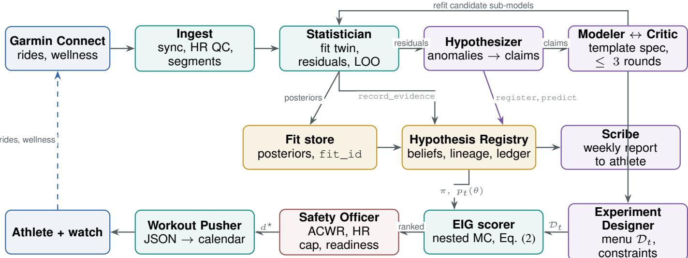  
Fig. 1: The weekly EPICOACH cycle. Purple nodes are LLM agents; teal nodes are deterministic tools; the red node is the safety gate; gold nodes are persistent stores. LLMs may register hypotheses and predict, but only the Statistician’s record\_evidence, keyed by a stored fit\_id, can move a belief. The Safety Officer’s constraints are code and cannot be argued around.

## V. THE EPICOACH AGENT

EPICOACH is a weekly cycle implemented as a Google ADK SequentialAgent with one inner LoopAgent [45] (Figure 1). The architecture is not novel for being multi-agent; orchestrated specialist agents already exist for wearables [3]. What we claim is the allocation: every operation that produces a number the system will act on is performed by a deterministic tool, and the language model is confined to the operations where its strengths are real and its failure modes are survivable.

a) What the LLM does.: The Hypothesizer receives structured residual diagnostics from the Statistician (e.g. “heart rate residual +6 bpm on rides with ambient temperature $> 2 7 ^ { \circ } \mathbf { C } , n { = } 1 4 ^ { \circ \prime } ;$ ; “descent times on segment 7 bimodal since week $6 1 ^ { \mathfrak { s } } )$ , retrieves candidate mechanisms from the literature, and proposes hypotheses with a formal predicate, a prior log-odds and a test plan. This is mechanism retrieval and analogical reasoning, a genuine language-model capability. The Modeler translates an accepted hypothesis into a model specification drawn from a unit-tested template library (add covariate, add interaction, add changepoint, add random walk, split a parameter by condition); it cannot emit free-form model code, which keeps it from inventing unidentifiable structures. A Critic reviews the specification against identifiability red flags and registry lineage, and the pair iterate at most three times. The Experiment Designer proposes the candidate workout menu $\mathcal { D } _ { t }$ (20–40 designs: long aerobic rides, climb repeats on segment s at heart-rate target $h ,$ descent laps, deloads, a standardized eight-minute test climb; crossed with duration, day and time of day), negotiates calendar and wellness constraints with the athlete in natural language, and explains the final choice. The Scribe writes the weekly report, including counterfactuals such as “had you slept 7 h, the twin predicts climb 3 would have been 4% faster” (computed by the twin as a posterior predictive under do(sleep = 7) and merely narrated by the model).

b) What tools do.: Ingest synchronizes rides and wellness, runs quality control and segment matching. The Statistician fits the twin and candidate sub-models, computes residual reports, leave-one-out comparisons [46] and Bayes factors, and stores every fit under a fit\_id. The EIG scorer evaluates Eq. (2) over $\mathcal { D } _ { t }$ by nested Monte Carlo [47] with N=M=500 posterior draws (variational estimators [48] are a drop-in if cost demands). The Safety Officer evaluates the feasibility set $\mathcal { D } _ { t } ^ { \mathrm { f e a s } }$ and vetoes; an LLM explains the veto to the athlete but cannot lift it. The Workout Pusher serializes $d ^ { \star }$ as a cycling workout with heart-rate-target steps and writes it to the athlete’s calendar, from which the watch receives it on the next sync (Appendix E).

c) Information-directed design in practice.: Scoring the menu against the retrospective posterior ranks an overload week followed by full rest with three repeated test efforts highest (0.17 nats), ahead of a three-week block-and-taper (0.16) and all conventional weeks $( \leq 0 . 0 6 )$ : the contrast in which fatigue dissipates while fitness persists is what separates $\tau _ { 2 }$ from $\tau _ { 1 }$ as anticipated in Section IV-E. Absolute gains per cycle are small because the posterior on $k _ { 1 }$ is near zero; information accrues over cycles. In a live run on the athlete’s current state (acute load 1.26× chronic) the Safety Officer vetoed ten of the top-ranked plans for ACWR, and the Designer settled on a back-loaded conventional week with one test: an instance of safety constraints overriding information gain by construction.

d) Registry protocol.: The registry is a relational store with seven tools: register, predict, record\_evidence, refine, merge, retire, list. Refinement and merging are permitted only for parents that have reached a verdict or carry at least one piece of evidence, so untested proposals cannot spawn descendants. Every call is logged with its caller, so the audit trail distinguishes an LLM proposal from a tool verdict. Schema and prompts are in Appendix D.

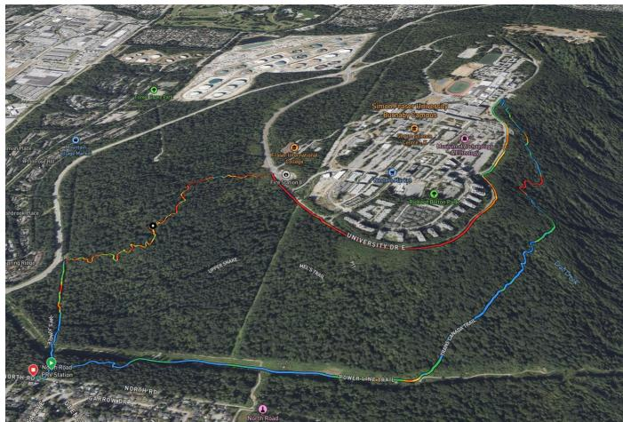  
Fig. 2: The instrument ride on Burnaby Mountain (one recording, coloured by heart-rate zone; satellite view from the vendor’s app). From the car park at lower left the athlete warms up along the Power Line Trail, climbs the Trans Canada Trail (a wide, steady-gradient gravel track under canopy) to University Drive, traverses the campus ring road, and descends Nicoles Trail, a narrow technical singletrack, back to the start. The climb is held at 160 ± 5 bpm; the descent is ridden at self-selected effort. Lap presses at the four gates mark the two timed segments.

## VI. EVALUATION

## A. Data

The subject is one recreational cross-country mountain biker (an author) whose Garmin record begins with the purchase of a Forerunner 965 on 2 April 2025 and runs to 30 September 2026 (eighteen months). It holds 653 activities, of which 223 are rides (296 hours; median ride 79 min, 11 km, 340 m of climbing), recorded with optical wrist heart rate, GPS and a barometric altimeter; no power meter or chest strap was used. Rides are fetched as native FIT files at 1 Hz (the vendor’s chart endpoint, which downsamples to 2,000 points, is not used); heart-rate coverage within rides is 99.5% and GPS coverage 95.7%. Daily wellness records (556 days) include sleep stages and overnight heart-rate variability (77% of nights), resting heart rate, stress, body battery and device-computed training metrics (readiness, acute and chronic load, $\mathrm { { V O } _ { 2 } \mathrm { { m a x } ; } }$ 98–99% of days). Ambient temperature on rides spans 1–32◦C with 17 rides at or above $2 5 ^ { \circ } \mathbf { C }$ . Segment discovery yields 24 segments (11 climbs, 8 descents, 5 rolling) with 458 traversals; 15 segments have at least ten traversing rides. Three riding areas dominate: a home hill with 153 rides, and two mountain networks with 29 and 26 rides. The non-ride activities (265 strength sessions, hiking, running) contribute to daily load but not to segment outcomes.

a) Instrument ride.: Automatic discovery keys on named OSM trails and therefore fragments long climbs (the home hill’s main gravel ascent is mapped as 22 OSM ways and does not survive discovery as a single piece). The instrument climb was instead declared with the athlete as a gate-to-gate route on the home hill (Fig. 2; close-ups in Fig. 9; GPS traces of every traversal in Fig. 3): the Trans Canada Trail from its lower gate to the point where the gravel meets the summit road, 2.06 km, +148 m, 7.2%, a wide, smooth, steady-gradient surface with no technical content, 10 minutes from the athlete’s door. Traversals are extracted by gate passage with a corridor check $( \geq 8 0 \%$ of samples within 25 m of the trail). Seventynine historical traversals (April 2025–September 2026, every month of the record; 90 including the prospective phase) take 12–21 min moving (median 17.3, robust CV 7.4%) at mean heart rates of 130–176 bpm; across those rides each +1 bpm of mean heart rate buys about 3.6 s, i.e. the between-ride spread is dominated by effort (Fig. 4), which is precisely what the fixed-heart-rate protocol removes. The descent instrument is Nicoles Trail, entered from the summit via Poplar Trail and timed from the Poplar–Nicoles junction to the exit (1.16 km, −158 m, −13.6%, 23 traversals, median 5.6 min, robust CV 9.2%). A longer declared climb on a second network (5.9 km, +425 m, 47 min) was considered first and rejected before any prospective ride: it had six traversals against seventy-nine, and an instrument the athlete will ride twice a week has to be near home. The change is logged in the registry (the two ledger predictions registered against the earlier instrument are marked withdrawn, not deleted) and no prospective data is affected.

## B. Retrospective replay benchmark

The replay asks a single question: at each point in the past eighteen months, would the system’s beliefs have predicted the following week’s rides better than the alternatives? We step a rolling origin t weekly after a four-month warm-up. Every method sees data $\leq t$ only, including language-model calls (frozen model version, temperature 0, responses cached per origin, three seeds). Each issues predictive distributions for the next seven days of realized rides: (a) traversal time on each matched segment; (b) mean climb heart rate conditional on realized virtual power and temperature; (c) within-ride drift slope; (d) sign of the weekly change in device $\mathrm { \Delta V O _ { 2 } m a x }$ . Registry hypotheses additionally issue binary ledger predictions.

a) Metrics.: Continuous ranked probability score and log score for (a)–(c) [34]; probability integral transform histograms and expected calibration error for calibration; Brier score and calibration error for binary ledger predictions; and the posterior entropy of θ over time as an information-accrual curve.

b) Baselines.: (1) Persistence and exponentially weighted moving averages of segment times; (2) the device’s own $\mathrm { \Delta V O _ { 2 } m a x }$ , race-time predictor and training-status outputs, which see identical sensor data; (3) a Banister model with population constants $( \tau _ { 1 } , \tau _ { 2 } ) = ( 4 2 , 7 )$ ; (4) a Gaussian-process regression on calendar time and covariates with no mechanism; (5) a sequence model for heart-rate forecasting in the style of personalized workout models; (6) a PHIA-style ReAct agent with a code runtime asked for the same forecasts; (7) a static, non-agentic twin: our model stack with fixed structure, no registry, no hypothesis-driven refinement.

c) Ablations.: Run: no identifiability gate (every Savage– Dickey result admitted); no registry (the twin refit at every origin with fixed structure). The language-model-only forecaster is the ReAct baseline. Not run: no segment instruments (wholeride outcomes only) and no heart-rate quality control. The active component cannot be ablated in replay, since history is fixed; we say so and evaluate it prospectively.

d) Statistical comparison.: Everything is one long dependent series, so we use forecast-comparison tests built for that case: Diebold–Mariano tests on per-origin score differences with heteroskedasticity- and autocorrelation-consistent variance (lag four weeks) [49]; moving-block bootstrap with 14-day blocks for intervals on aggregate differences [50]; and Giacomini–White tests of conditional predictive ability to characterize when the agent helps [51].

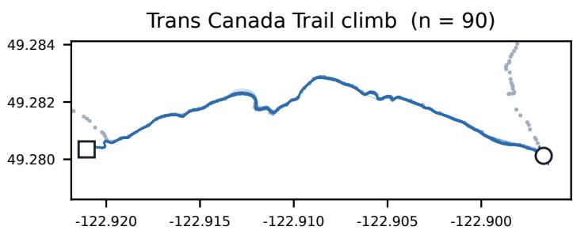

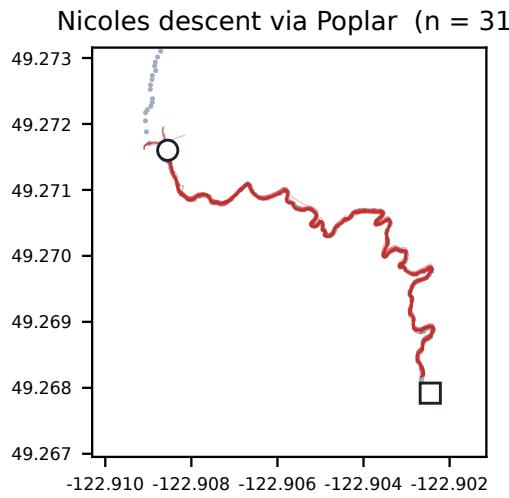  
Fig. 3: Instrument segments on Burnaby Mountain, all traversals to 22 October 2026. Left: 90 GPS traces on the Trans Canada Trail climb (blue), start gate (circle) and end gate (square) where the gravel meets University Drive. Right: 31 traces on the Nicoles descent via Poplar Trail (red); the start gate is the athlete’s lap-press point, not the OSM junction node, which sat 49 m off the ridden line. Grey dots: OSM corridor geometry used for the corridor check.

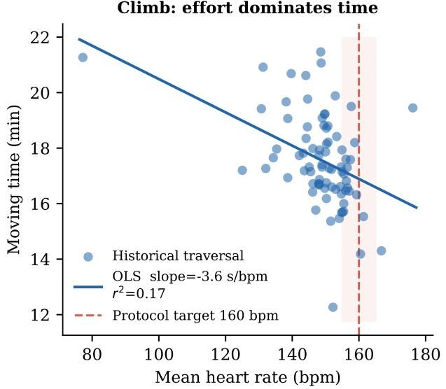

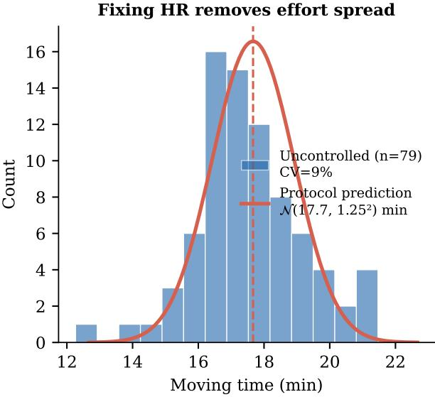  
Fig. 4: Justification for the fixed-heart-rate protocol. Left: moving time vs mean heart rate across 79 historical TCT traversals; the −3.6 s/bpm slope shows effort explains most between-ride spread. The red band marks the 160 ± 5 bpm target. Right: uncontrolled time distribution (CV 9%) and the protocol prediction $\mathcal { N } ( 1 7 . 7 , 1 . 2 5 ^ { 2 } )$ min; fixing heart rate is expected to collapse the spread to the model’s residual uncertainty.

## C. Prospective phase

Since 3 October 2026 the weekly cycle has run live on the athlete. Each week contains two instrument rides that never change: the Trans Canada Trail climb held at $1 6 0 \pm 5$ bpm and the Nicoles descent at self-selected effort, each bracketed by lap presses at the gates, on day 1 (fresh, after a rest day) and day 5 (loaded, after the week’s training). What the agent designs is the training between them: one of fifteen one-, twoor three-week load patterns (conventional, front/back-loaded, deload $5 0 / 2 5 / 0 \%$ , overload 115/130% and their sequences), chosen by Eq. (2) and checked by the safety officer. Before every instrument ride the ledger holds a sealed prediction for it; a ride is scored by the first traversal after sealing, one traversal scores at most one prediction, and a ride through the gates without the lap protocol is training data and never scores. The twin is refit once per week, after all of that week’s predictions have been scored and before the next are sealed, so no prediction is ever made by a model that has seen the ride it predicts. Two further pre-registered components begin once the baseline is established: randomization of weeks to information-directed versus conventional $\left( \lambda _ { t } \mathrm { = } 0 \right)$ design, with realized information per ride as the outcome; and short-washout within-person interventions (sleep extension, time of day, heat,

TABLE I: Rolling-origin replay, 60 weekly origins, one-week horizon. CRPS (lower is better) with 95% moving-block bootstrap intervals; 90%-interval coverage; Diebold–Mariano p against the twin row of the same target (HAC variance, lag 4). Segment time is scored in log-seconds. The “no segment instruments” and “no HR quality control” ablations listed in Section VI-B were not run.
<table><tr><td rowspan="2">Method</td><td colspan="4">Segment time  $( n { = } 8 1 )$ </td><td colspan="3">Conditional climb HR [bpm] (n=106)</td></tr><tr><td>CRPS</td><td></td><td> $\mathbf { C o v } _ { 9 0 }$ </td><td>DMp</td><td>CRPS</td><td> $\mathbf { C o v } _ { 9 0 }$ </td><td>DM p</td></tr><tr><td>Persistence</td><td></td><td>0.052 [0.047, 0.060]</td><td>0.96</td><td>0.93</td><td>9.25 [7.50, 11.06]</td><td>0.88</td><td>&lt;0.001</td></tr><tr><td>EWMA</td><td></td><td>0.046 [0.040, 0.055]</td><td>0.96</td><td>0.31</td><td>7.87 [6.48, 9.19]</td><td>0.89</td><td>0.003</td></tr><tr><td>Ridge on covariates</td><td></td><td>0.109 [0.081, 0.134]</td><td>0.83</td><td>0.004</td><td>8.06 [6.69, 10.07]</td><td>0.83</td><td>0.13</td></tr><tr><td>GP on time + covariates</td><td></td><td>0.097 [0.070, 0.126]</td><td>0.75</td><td>0.026</td><td>8.06 [6.88, 9.46]</td><td>0.70</td><td>0.004</td></tr><tr><td>Banister, population τ</td><td></td><td>0.056 [0.049, 0.064]</td><td>0.91</td><td>0.21</td><td></td><td></td><td></td></tr><tr><td>Static twin (FFM / HR model)</td><td></td><td>0.048 [0.041, 0.063]</td><td>0.91</td><td></td><td>7.03 [6.13, 7.81]</td><td>0.87</td><td></td></tr><tr><td>EPICOACH agentic twin (gated)</td><td></td><td>0.050 [0.042, 0.065]</td><td>0.91</td><td>0.007</td><td>7.00 [6.07, 7.82]</td><td>0.88</td><td>0.627</td></tr><tr><td>no identifiability gate</td><td></td><td>0.050 [0.042, 0.065]</td><td>0.91</td><td>0.007</td><td>7.00 [6.07, 7.82]</td><td>0.88</td><td>0.627</td></tr><tr><td>no registry (static refit)</td><td></td><td>0.050 [0.042, 0.065]</td><td>0.91</td><td>0.005</td><td>6.89 [5.98, 7.67]</td><td>0.88</td><td>0.313</td></tr><tr><td>ReAct agent (PHIA-style)</td><td></td><td>0.144 [0.085, 0.213]</td><td>0.84</td><td>0.014</td><td>8.91 [7.58, 10.26]</td><td>0.73</td><td>&lt;0.001</td></tr></table>

## Rolling-origin replay CRPS (lower = better)

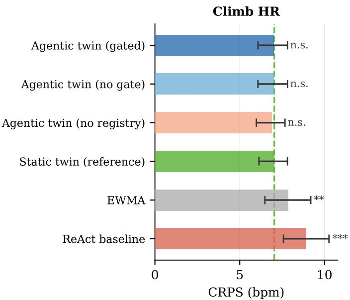

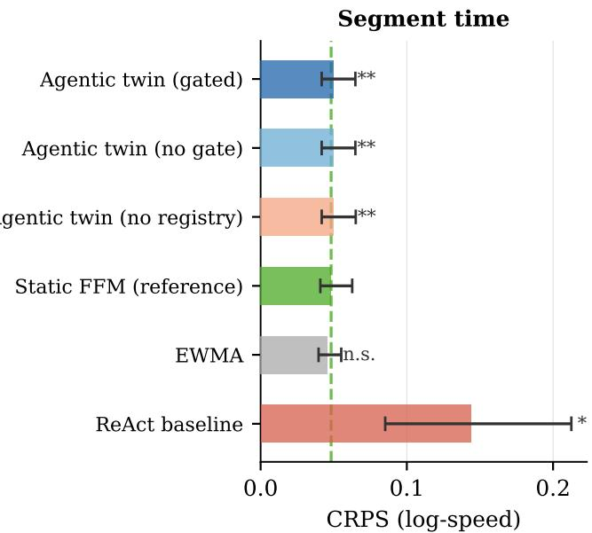  
Fig. 5: Rolling-origin replay CRPS (lower is better) with 95% moving-block bootstrap CIs; DM test significance vs the static twin reference (green dashed line). The agentic system matches the static twin on both targets (n.s. on HR, $p { = } 0 . 0 0 7$ on segment time); the ReAct baseline is significantly worse on both.

caffeine) in counterbalanced one-week blocks. Design details and power are in Appendix C.

## D. Synthetic recovery check

A single subject cannot establish generality, and a posterior should not be interpreted before the model has been shown to recover known parameters. We therefore simulate athletes from the fitted twin under the athlete’s actual training history and refit; with the real design the fitness–fatigue model recovers the daily performance state (r=0.996) and the load scale $k _ { 1 }$ and ratio $k _ { 2 } / k _ { 1 }$ within their 90% intervals, but not the time constants, whose posteriors remain close to their priors (Appendix F). A multi-athlete simulator for information-accrual experiments is future work.

## E. Results

Table I and Figure 5 report the replay over 60 weekly origins after a 120-day warm-up; a segment becomes a forecast target once it has three prior traversals. The corresponding twin posteriors are in Figure 6.

a) Conditional heart rate.: The twin’s heart-rate response model attains CRPS 7.03 bpm (95% block-bootstrap interval 6.13–7.81) against 7.87 for an exponentially weighted average, 8.06 for the Gaussian process, 8.06 for ridge regression on the same covariates and 9.25 for persistence; Diebold–Mariano tests on per-origin losses give $p = 0 . 0 0 3$ , 0.004, 0.13 and < 0.001 respectively. Its 90% intervals cover 86.8% of outcomes (ECE 0.15); the model is slightly overconfident, which we attribute to ride-level variation that a one-week-ahead forecast cannot condition on.

b) Agentic replay.: With the fixed registry (invariants I7– I8), the hypothesis loop runs causally at every origin: base twin refit, Hypothesizer + Modeler/Critic against a frozen-clock registry, Statistician evaluates open hypotheses (directional claims by Savage–Dickey on the stored fit; structural specs by compiling a linear term and refitting), working model = base + admitted structural specs (belief ≥ 0.5). Three ablations share the same base fits and differ only in admission: gated (identifiability gate on), no-gate, no-registry (static twin). Across 60 origins the agentic system matches the static twin on HR forecasting (CRPS 7.00 vs 7.03, $p \ = \ 0 . 6 3 )$ and segment time (0.050 vs 0.048, p = 0.007, marginally worse). The no-registry ablation is indistinguishable. I7 reduced the hypothesis count from 62 to 40 by blocking duplicate registrations; I8 demoted 5 premature “supported” verdicts when later data disagreed (belief trajectories in Figure 7). The honest interpretation: 18 months of observational data, with the current segment network, does not give the hypothesis loop enough contrast to improve forecasts. The designed experiments in the prospective phase (particularly the fresh/loaded pair and the overload–rest contrast) are what the loop needs.

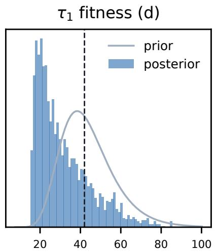

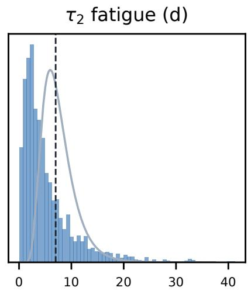

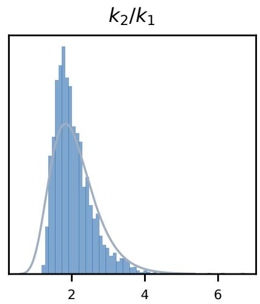  
Fig. 6: Posterior distributions from the retrospective twin. Left: cardiac drift $\gamma _ { d }$ is clearly positive (H1, belief 95%). Centre: fitness time constant τ remains wide despite 79 instrument traversals (H4, belief 80%); the prospective fresh/loaded pair is designed to resolve this. Right: switching from 6 Mountai Highway rides to 79 TCT rides tightened HR model noise from 6.5 to 5.3 bpm.

c) ReAct baseline.: A PHIA-style agent (the same language model with a read-only SQL tool over the same history, asked to reason and return a Gaussian forecast) scores 8.91 bpm on conditional heart rate and 0.144 on segment time, significantly worse than the twin on both $( p < 0 . 0 0 1$ $p = 0 . 0 1 4 )$ and worse than persistence on segment time. Free form reasoning over the raw table does not recover what the mechanistic model and even a moving average extract; this is the gap the architecture is designed around.

d) Segment time.: No method beats a simple exponentially weighted average of past traversal times (CRPS 0.046 in log seconds, i.e. ∼4.6%): the fitness–fatigue twin with learned time constants scores 0.048, persistence 0.052 and a Banister model with population constants 0.056, none significantly different from one another, while the Gaussian process and ridge baselines are clearly worse (0.097, 0.109). This is the forecasting face of the identifiability result of Section IV-E: in this athlete’s observational record, training load carries no predictive information about segment time beyond recent performance. We regard this as a finding, not a failure, and as the strongest available motivation for the designed contrasts of the prospective phase.

e) Prospective phase: three weeks.: Figure 8 shows every sealed prediction and every instrument ride from 3 to 22 October 2026: 20 predictions sealed, 14 scored, 4 withdrawn before their outcome existed (I9), 2 open. The athlete rode 9 protocol climbs at 160–164 bpm (one at 170) and 8 protocol descents (one while no descent prediction was open); two further climbs through the gates without laps were training and were not scored.

Descent. The first two descent predictions were sealed against a gate that sat on the OSM junction node, 49 m from the line the athlete rides; both outcomes fell 1.9 and 2.4σ below the forecast (CRPS 0.155, 0.218 log-s). They were scored as sealed, the gate was moved to the athlete’s lap-press point, the correction was logged as a registry event, and the forecast was changed from a historical median to the skill-model posterior. The five predictions since score CRPS 0.040 log-s (4.0%) with all standardized residuals inside ±0.9: the descent instrument is calibrated.

Climb. Seven climb predictions scored a mean CRPS of 40 s (3.9% of the 17-minute climb) with 90%-interval coverage 6/7, but the athlete was faster than the forecast in six of seven, mean standardized residual −0.71. Across the three weeks the protocol climb time fell from 1046 s (first three) to 1003 s (last three) at matched heart rate, a slope of −4.8 s/day; the twin’s forecast moved from 1060 to 1054 s. An exponentially weighted average of past climbs at 155–167 bpm, sealed at the same moments, would have scored 31.5 s. This is the live counterpart of the replay’s segment-time result: the fitted fitness–fatigue state is too slow to track a real training response, and the pre-specified standard for the twin (match or beat the moving average) was not met.

Pre-registered contrasts. Both live cycles sealed a fresh and a loaded climb prediction and stated the falsifier in advance: a loaded test not slower than the fresh one counts against the modelled fatigue penalty. In week 1 the fresh test took 975 s and the loaded test 926 s; in week 2, 1031 s (6.0 h sleep) and 968 s. The falsifier fired twice. The refit that followed moved the fitness–fatigue posterior to $\tau _ { 1 } = 2 7 \mathrm { d }$ [17, 59], $P ( \tau _ { 1 } <$ $4 2 ) = 0 . 8 0 $ and $\tau _ { 2 } = 3 . 7 \mathrm { d } \ [ 0 . 7 , 1 5 . 9 ] ;$ ; the identifiability gate still refuses to move H4’s belief from 0.5 because the prior– posterior overlap is 0.84. Two weeks of designed contrast have not resolved what eighteen months of observation could not, and the registry says so.

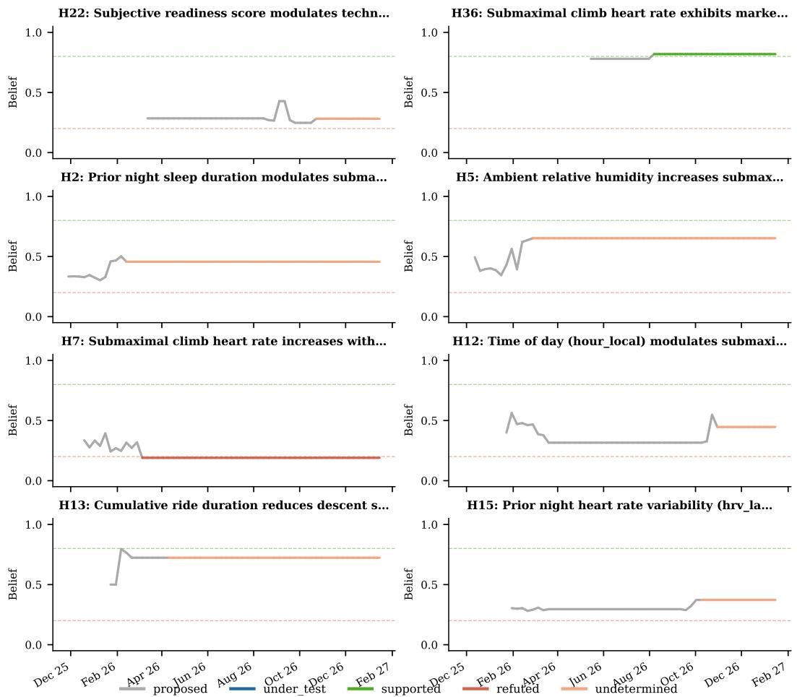  
Fig. 7: Belief trajectories for the eight most-tested hypotheses in the agentic replay (60 rolling origins). Colour encodes state: grey = proposed, blue = under test, green = supported, red/orange = refuted/undetermined. Flat segments show hypotheses that reached a verdict; invariant I8 (no permanent verdicts) would reopen them if later evidence disagreed.

TABLE II: Registry state on 22 October 2026 after three live cycles. Beliefs start at 0.5 and move only through Savage–Dickey evidence from stored fits, subject to the identifiability gate. H1–H5 were pre-specified; H6–H11 were registered by the agent during the live cycles. Ledger: predictions scored / sealed per hypothesis, with mean CRPS (climb in seconds, descent in log-seconds).
<table><tr><td>Hypothesis</td><td>Formal object</td><td>Belief</td><td>State</td><td>Ledger</td></tr><tr><td>H1 Cardiac drift  $> 0$ </td><td> $\gamma _ { d } > 0$ </td><td>0.95</td><td>under test</td><td>3/3 scored, CRPS 21.9 s</td></tr><tr><td>H2 Drift larger in heat</td><td> $\gamma _ { d T } > 0$ </td><td>0.21</td><td>proposed</td><td></td></tr><tr><td>H3 Less sleep slows descents</td><td> $\delta _ { \mathrm { s l e e p } } < 0$ </td><td>0.94</td><td>under test</td><td>7/7 scored, CRPS 0.082 (0.040 post-correction)</td></tr><tr><td>H4 Fitness constant  $< 4 2 \mathrm { d }$ </td><td> $\tau _ { 1 } < 4 2$ </td><td>0.50</td><td>under test (gated)</td><td>4/4 scored, CRPS 54.1 s; falsifier fired 2/2</td></tr><tr><td>H5 Aerobic response improved</td><td> $c _ { w _ { \mathrm { l a s t } } } - c _ { w _ { \mathrm { f i r s t } } } < 0$ </td><td>0.14</td><td>proposed</td><td></td></tr><tr><td>H6 Climb HR rises with temperature</td><td> $\gamma _ { T } > 0$ </td><td>0.43</td><td>proposed</td><td></td></tr><tr><td>H7 Wet trail slows descents</td><td> $\delta _ { \mathrm { w e t } } > 0$ </td><td>0.65</td><td>proposed</td><td></td></tr><tr><td>H8 Climb HR varies with time of day</td><td> $\delta _ { \mathrm { h o u r } } \neq 0$ </td><td>0.62</td><td>proposed</td><td></td></tr><tr><td>H9 Descent slows with elapsed ride time</td><td> $\delta _ { \mathrm { e l a p s e d } } > 0$ </td><td>0.49</td><td>proposed</td><td></td></tr><tr><td>H10 Fatigue constant  $< 7 \mathrm { d }$ </td><td> $\tau _ { 2 } < 7$ </td><td>0.55</td><td>proposed</td><td></td></tr><tr><td>H11 Sleep affects climbing HR</td><td> $\delta _ { \mathrm { s l e e p } } ^ { \mathrm { H R } } \neq 0$ </td><td>0.36</td><td>proposed</td><td></td></tr></table>

The agent and the safety officer. In both live cycles the design ranked first by expected information gain was an overload week (130% of the four-week mean); the safety officer vetoed it both times (ACWR 1.35 > 1.3; weekly load outside ±15%) and the agent took the second-ranked two-week plan. The ±15% tolerance made the pre-registered overload design logically infeasible. With the athlete’s written consent the cap was raised to ACWR 1.5 and ±35% and a no-consecutiveoverload rule added, effective from the fourth cycle; the change is a protocol\_change event in the registry and is not retroactive. The agent also registered six new hypotheses (heat, time of day, wet surface, elapsed time, $\tau _ { 2 } < 7 \mathrm { d } .$ , sleep on climbing heart rate); all remain proposed with | log BF| < 0.8.

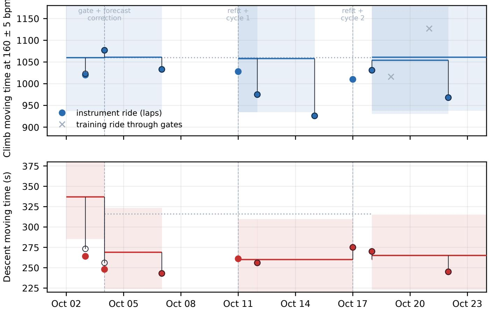  
Fig. 8: The prospective ledger, 1–23 October 2026. Horizontal bars are sealed predictions (mean; shaded 90% interval) drawn from the moment of sealing to the ride that scored them; dotted bars are predictions withdrawn before any outcome (I9). Filled circles are instrument rides (lap protocol), open circles the outcome as scored, crosses training rides through the gates (not scored). Dashed verticals: the descent-gate and forecast correction (4 Oct) and the two live refit-and-cycle events. Top: the climb forecast barely moves while the athlete’s time at 160 bpm falls by ∼ 80 s. Bottom: descent forecasts before and after the instrument correction.

Audit trail. The registry holds 4 score\_correction events from this period: three cases in which an ad-hoc scorer matched the wrong ride (date-level instead of timestamp comparison; one traversal claiming two predictions; a training ride claiming a test prediction), each reversed with the wrong value preserved, and the rules that now prevent them (first traversal strictly after sealing; invariant I10, one observation scores one prediction; lap protocol required). We report these because a system whose record is clean on first contact with reality is a system whose record is not being kept. Full registry state, including the six agent-proposed hypotheses, is in Table II.

## VII. LIMITATIONS AND ETHICS

a) One subject.: The empirical study is N=1 by design, and the subject is an author. We argue generality on methodological grounds (the formalization, the benchmark, the simulator and a pipeline that admits a second athlete without code changes), not on the basis of the single subject’s physiology. Replay evaluates only the passive component of the system; the active component is evaluated prospectively over a short horizon with limited power for small effects, and we state in advance which effects are detectable.

b) Sensors.: Wrist optical heart rate and forest GPS are noisy; the quality-control and Student-t likelihoods mitigate but do not remove this. Virtual power is a modelling input, not a measurement. Several device metrics used as baselines are proprietary; the retrospective twin does not use them as inputs, and if the auxiliary VO max channel is enabled we will report results with and without it.

c) Identifiability.: The fitness–fatigue component is poorly identified after eighteen months of observational data (Section IV-E) and may remain so after a short prospective block. The system is designed to say so.

d) Self-experimentation and safety.: The prospective phase is self-experimentation by a healthy adult with hard caps on heart rate and load, readiness and illness gates, and interventions restricted to sleep, timing, heat exposure and caffeine within ordinary ranges. EPICOACH is a research prototype and not medical advice; nothing in the design should be read as safe for individuals with cardiovascular or other conditions without clinical oversight. Garmin’s Connect API is unofficial; raw responses are snapshotted so that the study is reproducible against API drift.

e) Three weeks.: The prospective results are three weeks of one athlete: 14 scored predictions and two fresh/loaded contrasts. They are enough to show the ledger working, including against the twin, and not enough to estimate a time constant. The randomized information-directed versus conventional comparison has not yet begun; every live week so far was information-directed. We also changed the instrument (gate position), the descent forecast method and the safety thresholds during the phase. Each change is dated and logged, predictions sealed before a change were scored under the rules in force when sealed, and none was retroactive; but a reader should weigh the first three weeks as a shakedown of the protocol as much as a test of the athlete.

f) Language-model nondeterminism.: Model versions are frozen, temperature is zero, every call is cached per origin, and spread over three seeds is reported.

## VIII. CONCLUSION

Personal-health agents have learned to read wearable data and to speak about it well. We have argued that the next step is not better speech but accountable learning: a system that holds explicit, probabilistic claims about one person, commits to predictions before seeing outcomes, chooses what to observe next, and is judged by whether it was right. EPICOACH realizes this loop for a mountain biker with nothing but a watch, with a protocol that lets language models do what they are good at (propose mechanisms, choose instruments, negotiate with a human, explain) while deterministic tools fit, score, gate and record. Eighteen months of wrist data did not resolve a fitness time constant, and three weeks of designed rides have so far shown the twin to be too slow to follow the athlete it models; a system that writes that down, keeps the wrong scores next to the corrected ones, and can answer “not yet, and here is the week that would help” is, we think, the right kind of coach.

## CODE AND DATA AVAILABILITY

The EPICOACH implementation, the full hypothesis registry and prediction ledger, the replay benchmark, and the operational protocol are released at https://github.com/Bmoradi93/ epicoach-agent.

## REFERENCES

[1] J. Cosentino, A. Belyaeva, X. Liu, N. A. Furlotte, Z. Yang, C. Lee, E. Schenck, Y. Patel, J. Cui, L. D. Schneider et al., “A personal health large language model for sleep and fitness coaching,” Nature Medicine, vol. 31, 2025.

[2] M. A. Merrill, A. Paruchuri, N. Rezaei, G. Kovacs, J. Perez, Y. Liu, E. Schenck, N. Hammerquist, J. Sunshine, S. Tailor et al., “Transforming wearable data into personal health insights using large language model agents,” Nature Communications, vol. 17, 2026.

[3] A. A. Heydari, K. Gu, V. Srinivasan, S. Tailor et al., “The anatomy of a personal health agent,” arXiv preprint arXiv:2508.20148, 2025.

[4] M. Ozolcer and S. W. Bae, “SePA: A search-enhanced predictive agent for personalized health coaching,” arXiv preprint arXiv:2509.04752, 2025.

[5] Z. He, J. Wang, B. Zhang, and Y. Li, “Knowledge-grounded large language model for personalized sports training plan generation,” Scientific Reports, vol. 16, p. 6793, 2026.

[6] C. Lu, C. Lu, R. T. Lange, J. Foerster, J. Clune, and D. Ha, “The AI scientist: Towards fully automated open-ended scientific discovery,” arXiv preprint arXiv:2408.06292, 2024.

[7] A. E. Ghareeb, B. Chang, L. Mitchener, A. Yiu, C. J. Szostkiewicz, J. M. Laurent, M. T. Razzak, A. D. White, M. M. Hinks, and S. G. Rodriques, “Robin: A multi-agent system for automating scientific discovery,” arXiv preprint arXiv:2505.13400, 2025.

[8] I. Takahara and T. Mizoguchi, “Toward auditable AI scientists: A hypothesis evolution protocol for LLM agents,” arXiv preprint arXiv:2607.09195, 2026.

[9] A. Gelman and E. Loken, “The garden of forking paths: Why multiple comparisons can be a problem, even when there is no “fishing expedition” or “p-hacking” and the research hypothesis was posited ahead of time,” Department of Statistics, Columbia University, 2013.

[10] B. A. Nosek, C. R. Ebersole, A. C. DeHaven, and D. T. Mellor, “The preregistration revolution,” Proceedings of the National Academy of Sciences, vol. 115, no. 11, pp. 2600–2606, 2018.

[11] J. Gregory, D. P. Johns, and J. T. Walls, “Relationship between physiological and performance variables during cross-country mountain bike racing,” Journal of Strength and Conditioning Research, vol. 21, no. 1, pp. 17–22, 2007.

[12] F. M. Impellizzeri and S. M. Marcora, “The physiology of mountain biking,” Sports Medicine, vol. 37, no. 1, pp. 59–71, 2007.

[13] S. Yao, J. Zhao, D. Yu, N. Du, I. Shafran, K. Narasimhan, and Y. Cao, “ReAct: Synergizing reasoning and acting in language models,” in International Conference on Learning Representations (ICLR), 2023.

[14] C. M. Fang, V. Danry, N. Whitmore, A. Bao, A. Hutchison, C. Pierce, and P. Maes, “PhysioLLM: Supporting personalized health insights with wearables and large language models,” arXiv preprint arXiv:2406.19283, 2024.

[15] M. Y. Li, E. B. Fox, and N. D. Goodman, “Automated statistical model discovery with language models,” in International Conference on Machine Learning (ICML), 2024.

[16] G. E. P. Box, “Science and statistics,” Journal of the American Statistical Association, vol. 71, no. 356, pp. 791–799, 1976.

[17] J. R. Lloyd, D. Duvenaud, R. Grosse, J. B. Tenenbaum, and Z. Ghahramani, “Automatic construction and natural-language description of nonparametric regression models,” in Proceedings ofthe AAAI Conference on Artificial Intelligence, 2014.

[18] K. Gandhi, M. Y. Li, L. Goodyear, A. Bhatia, L. Li, A. Bhaskar, M. Zaman, and N. D. Goodman, “BoxingGym: Benchmarking progress in automated experimental design and model discovery,” arXiv preprint arXiv:2501.01540, 2025.

[19] E. W. Banister, T. W. Calvert, M. V. Savage, and T. Bach, “A systems model of training for athletic performance,” Australian Journal of Sports Medicine, vol. 7, no. 3, pp. 57–61, 1975.

[20] E. W. Banister, “Modeling elite athletic performance,” in Physiological Testing of the High-Performance Athlete, J. D. MacDougall, H. A. Wenger, and H. J. Green, Eds. Human Kinetics, 1991, pp. 403–424.

[21] T. Busso, “Variable dose-response relationship between exercise training and performance,” Medicine & Science in Sports & Exercise, vol. 35, no. 7, pp. 1188–1195, 2003.

[22] P. Hellard, M. Avalos, L. Lacoste, F. Barale, J.-C. Chatard, and G. P. Millet, “Assessing the limitations of the Banister model in monitoring training,” Journal of Sports Sciences, vol. 24, no. 5, pp. 509–520, 2006.

[23] K. Vermeire, M. Ghijs, J. G. Bourgois, and J. Boone, “The fitness– fatigue model: What’s in the numbers?” International Journal of Sports Physiology and Performance, vol. 17, no. 5, pp. 810–813, 2022.

[24] K. M. Vermeire, F. Van de Casteele, M. Gosseries, J. G. Bourgois, M. Ghijs, and J. Boone, “The influence of different training load quantification methods on the fitness–fatigue model,” International Journal of Sports Physiology and Performance, vol. 16, no. 9, pp. 1261– 1269, 2021.

[25] D. Kolossa, M. A. Bin Azhar, C. Rasche, S. Endler, F. Hanakam, A. Ferrauti, and M. Pfeiffer, “Performance estimation using the fitnessfatigue model with Kalman filter feedback,” International Journal of Computer Science in Sport, vol. 16, no. 2, pp. 117–129, 2017.

[26] R. L. Kravitz, N. Duan, and the DEcIDE Methods Center N-of-1 Guidance Panel, “Design and implementation of N-of-1 trials: A user’s guide,” AHRQ Publication No. 13(14)-EHC122-EF, 2014.

[27] N. Duan, D. Norman, C. Schmid, I. Sim, and R. L. Kravitz, “Personalized data science and personalized (N-of-1) trials: Promising paradigms for individualized health care,” Harvard Data Science Review, 2022, special Issue 3.

[28] E. J. Daza and L. Schenk, “Causal inference for N-of-1 trials,” arXiv preprint arXiv:2406.10360, 2024.

[29] E. J. Daza and L. Schneider, “MoTR and PSTn: Building a causal engine for estimating the within-individual average treatment effect using wearable sensors,” arXiv preprint arXiv:2208.00739, 2022.

[30] S. Z. Ishita, S. Kaliappan, M. Rashik, D. A. Epstein, and R. Karkar, “CASEbot: A conversational agent for structuring and personalizing the design of self-experiments in personal health,” in Proceedings of the 2026 CHI Conference on Human Factors in Computing Systems (CHI ’26), 2026.

[31] A. R. Novak, K. J. M. Bennett, J. Fransen, and B. J. Dascombe, “A multidimensional approach to performance prediction in Olympic distance cross-country mountain bikers,” Journal of Sports Sciences, vol. 36, no. 1, pp. 71–78, 2018.

[32] W. M. Bertucci, S. Rogier, and R. F. Reiser, “Effects of mountain bike tyre pressure and tread, cycling speed and terrain on rolling resistance and aerodynamic drag,” Journal of Sports Sciences, vol. 31, no. 14, pp. 1–8, 2013.

[33] R. E. Kass and A. E. Raftery, “Bayes factors,” Journal of the American Statistical Association, vol. 90, no. 430, pp. 773–795, 1995.

[34] T. Gneiting and A. E. Raftery, “Strictly proper scoring rules, prediction, and estimation,” Journal of the American Statistical Association, vol. 102, no. 477, pp. 359–378, 2007.

[35] D. V. Lindley, “On a measure of the information provided by an experiment,” The Annals of Mathematical Statistics, vol. 27, no. 4, pp. 986–1005, 1956.

[36] K. Chaloner and I. Verdinelli, “Bayesian experimental design: A review,” Statistical Science, vol. 10, no. 3, pp. 273–304, 1995.

[37] T. J. Gabbett, “The training—injury prevention paradox: should athletes be training smarter and harder?” British Journal of Sports Medicine, vol. 50, no. 5, pp. 273–280, 2016.

[38] M. D. Hoffman and A. Gelman, “The No-U-Turn sampler: Adaptively setting path lengths in Hamiltonian Monte Carlo,” Journal of Machine Learning Research, vol. 15, no. 1, pp. 1593–1623, 2014.

[39] D. Phan, N. Pradhan, and M. Jankowiak, “Composable effects for flexible and accelerated probabilistic programming in NumPyro,” arXiv preprint arXiv:1912.11554, 2019.

[40] B. Bent, B. A. Goldstein, W. A. Kibbe, and J. P. Dunn, “Investigating sources of inaccuracy in wearable optical heart rate sensors,” npj Digital Medicine, vol. 3, p. 18, 2020.

[41] J. W. Navalta, J. Montes, N. G. Bodell, R. W. Salatto, J. W. Manning, and M. DeBeliso, “Concurrent heart rate validity of wearable technology devices during trail running,” PLoS ONE, vol. 15, no. 8, p. e0238569, 2020.

[42] J. C. Martin, D. L. Milliken, J. E. Cobb, K. L. McFadden, and A. R. Coggan, “Validation of a mathematical model for road cycling power,” Journal of Applied Biomechanics, vol. 14, no. 3, pp. 276–291, 1998.

[43] E. F. Coyle and J. González-Alonso, “Cardiovascular drift during prolonged exercise: new perspectives,” Exercise and Sport Sciences Reviews, vol. 29, no. 2, pp. 88–92, 2001.

[44] S. Edwards, The Heart Rate Monitor Book. Sacramento, CA: Fleet Feet Press, 1993.

[45] Google, “Agent development kit (ADK),” https://google.github.io/ adk-docs/, 2025.

[46] A. Vehtari, A. Gelman, and J. Gabry, “Practical Bayesian model evaluation using leave-one-out cross-validation and WAIC,” Statistics and Computing, vol. 27, no. 5, pp. 1413–1432, 2017.

[47] T. Rainforth, R. Cornish, H. Yang, A. Warrington, and F. Wood, “On nesting Monte Carlo estimators,” in International Conference on Machine Learning (ICML), 2018.

[48] A. Foster, M. Jankowiak, E. Bingham, P. Horsfall, Y. W. Teh, T. Rainforth, and N. Goodman, “Variational Bayesian optimal experimental design,” in Advances in Neural Information Processing Systems (NeurIPS), 2019.

[49] F. X. Diebold and R. S. Mariano, “Comparing predictive accuracy,” Journal of Business & Economic Statistics, vol. 13, no. 3, pp. 253–263, 1995.

[50] H. R. Künsch, “The jackknife and the bootstrap for general stationary observations,” The Annals of Statistics, vol. 17, no. 3, pp. 1217–1241, 1989.

[51] R. Giacomini and H. White, “Tests of conditional predictive ability,” Econometrica, vol. 74, no. 6, pp. 1545–1578, 2006.

## APPENDIX A SEGMENT DISCOVERY

a) Trail network.: For each riding area (a bounding box around a cluster of ride start points) we query OpenStreetMap for ways with a highway tag in {path, track, cycleway, footway, bridleway, service, unclassified, steps} and a name; responses are cached. Ways sharing a name are greedily joined when endpoints lie within 15 m, then densified to 5 m. Chains shorter than 100 m are dropped. Paved roads (unclassified) are retained for segment discovery but excluded from the heart-rate and fitness–fatigue models, where virtual power is unreliable at road speeds.

b) Snapping and runs.: A KD-tree over all chain points returns, for each GPS sample, the nearest chain and its alongtrail coordinate s, accepted if within 20 m. Gaps of up to 30 s on a chain are bridged. A run needs ≥ 30 samples, ≥ 20 snapped, and a robust slope $| \mathrm { d } s / \mathrm { d } t | \geq 0 . 3$ m/s (otherwise the rider is dithering at a junction).

c) Consensus gates.: Chain length is binned at 10 m; each ride’s coverage interval [min s, max s] increments the bins it spans; the segment is the longest contiguous bin range with count $\ge \operatorname* { m a x } ( 5 , 0 . 6 \times$ rides touching the chain) and length $\geq 2 5 0  { \mathrm { m } }$ . Segments are typed by the median altitude change over traversals (climb > 15 m, descent $< - 1 5 \mathrm { m }$ , otherwise rolling).

d) Traversals.: Within a run, entry is the first crossing of the entry gate (a run that starts more than 30 m inside the segment is not a full traversal), exit the first subsequent crossing of the exit gate. Accepted if ≥ 85% of samples lie within the gates ±15 m, no inter-sample gap exceeds 90 s, progress is monotone for ≥ 90% of steps, and duration ≥ 60 s. Laps yield multiple traversals per run.

e) Known failure modes.: GPS error under canopy of 10– 25 m can place a sample on a parallel trail; the 20 m snap radius and the monotone-progress test suppress most such errors. Trails absent from OpenStreetMap, or unnamed, produce no segments; in this study 20% of ride samples in the main area were unmatched, mostly unsanctioned connectors. Entry/exit jitter of ∼1 s is 2% of a 60 s descent, so we prefer segments of several minutes for hypothesis testing and report duration alongside every estimate.

f) Per-traversal record.: segment\_id, activity\_id, t\_entry, t\_exit, duration\_s, moving\_s, has\_stop, cover, hr\_mean, hr\_max,   
hr\_ok\_frac, d\_alt, dist\_m,   
elapsed\_at\_entry\_s, vp\_mean\_w, grade\_mean, wx\_temp\_c, wx\_humidity, wet\_now, sleep\_h, hrv\_last\_night, readiness\_score, week, day\_index.

## APPENDIX B MODEL SPECIFICATIONS AND PRIORS

a) Heart-rate response (Eqs. 4–5).: $\tau _ { h r } \sim$ LogNormal(ln 30, 0.3) s; αr ∼ N (µα, σ2 ) with $\mu _ { \alpha }$ ∼ N(120, 152), σα ∼ HalfNormal(8); $\beta _ { w } \quad \sim \quad \mathcal { N } ( \beta _ { w - 1 } , \sigma _ { \beta } ^ { 2 } ) , \beta _ { 0 } \quad \sim \quad \mathcal { N } ( 0 . 2 5 , 0 . 1 ^ { 2 } )$ bpm/W, $\sigma _ { \beta } \sim \mathrm { H a l f N o r m a l } ( 0 . 0 1 ) ; \gamma _ { T } \sim \mathcal { N } ( 0 . 5 , 0 . 5 ^ { 2 } )$ bpm/◦C; $\gamma _ { d } \sim { \mathcal { N } } ( 4 , 3 ^ { 2 } ) \ { \mathrm { b p m } } / { \ln } ; \ \gamma _ { d T } \sim { \mathcal { N } } ( 0 , 0 . 5 ^ { 2 } ) ; \ u _ { s } \sim { \mathcal { N } } ( 0 , \sigma _ { u } ^ { 2 } )$ σu ∼ HalfNormal(6); ν ∼ Gamma(2, 0.1) truncated below at $2 ; \sigma _ { h r } \sim \mathrm { H a l f N o r m a l ( 3 ) }$ . The recursion is implemented with jax.lax.scan on 5 s-downsampled series. The segmentaggregate variant replaces Eq. (4) by $\overline { { \mathrm { H R } } } _ { r , s } = \mathrm { H R } _ { r , s } ^ { s s } + \epsilon _ { r , s }$ with the same linear predictor evaluated at traversal means.

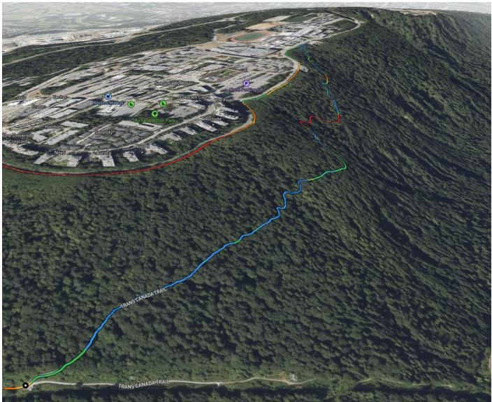

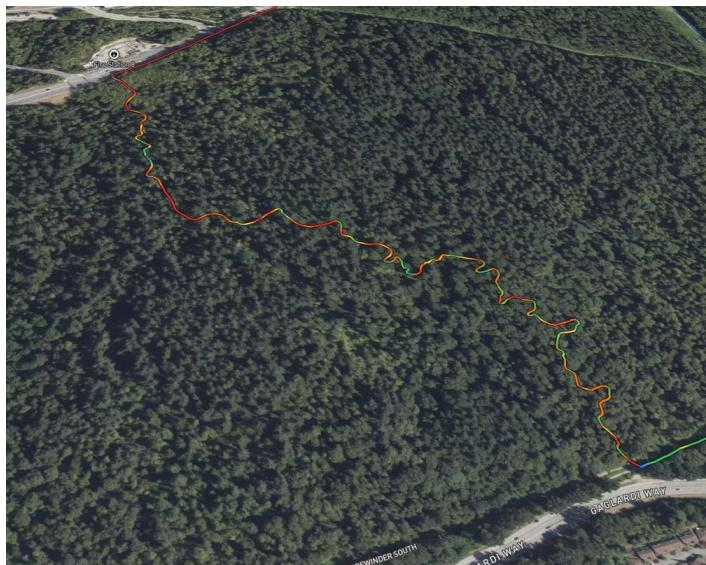  
Fig. 9: The two instruments in relief (satellite view, one ride, track coloured by heart-rate zone). Left: the Trans Canada Trail climb, 2.06 km at 7.2% on wide compacted gravel with no technical features: heart rate is a clean function of mechanical work here, which is why it serves as the fitness instrument. Right: Nicoles Trail, 1.16 km and −158 m of tight, rooted singletrack: heart rate decouples from work and time is governed by skill, which is why it is modelled separately (Section IV).

b) Skill state $( E q . ~ 6 ) . \colon \mu _ { s } \sim \mathcal { N } ( \log \operatorname* { m e d i a n } _ { s } , 0 . 2 ^ { 2 } ) ; \lambda _ { s } \sim$ $\mathrm { H a l f N o r m a l ( 0 . 1 ) } ; S _ { 0 } = 0 , \sigma _ { S } \sim \mathrm { H a l f N o r m a l ( 0 . 0 2 ) } ; \delta . \sim$ $\mathcal { N } ( 0 , 0 . 0 5 ^ { 2 } ) ; \eta \sim t _ { \nu } ( 0 , \sigma _ { \eta } ) , \sigma _ { \eta } \sim \mathrm { H a l f N o r m a l } ( 0 . 0 5 )$

c) Fitness–fatigue (Eq. 6).: Load: Banister exponential TRIMP $\begin{array} { r } { \boldsymbol { w } = \sum _ { t } \Delta t { \cdot } \mathrm { H R } _ { t } ^ { r } { \cdot } \mathrm { 0 . 6 4 } e ^ { 1 . 9 2 \mathrm { H R } _ { t } ^ { r } } } \end{array}$ with heart-rate reserve fraction $\mathrm { H R } _ { t } ^ { r } = ( \mathrm { H R } _ { t } - \mathrm { H R } _ { \mathrm { r e s t } } ) / ( \mathrm { H R } _ { \mathrm { m a x } } - \mathrm { H R } _ { \mathrm { r e s t } } ) ;$ ; HRmax from the 99.5th percentile over all rides, $\mathrm { H R } _ { \mathrm { r e s t } }$ from the device’s nightly value. Priors: $\tau _ { 1 } \sim \mathrm { L o g N o r m a l } ( \ln 4 2 , 0 . 3 ) , \tau _ { 2 } \sim$ LogNormal(ln 7, 0.4), $k _ { 1 } ~ \sim$ HalfNormal(0.05), $k _ { 2 } / k _ { 1 } ~ \sim$ $\mathrm { L o g N o r m a l } ( \ln 2 , 0 . 3 ) , p _ { 0 } \sim \mathcal { N } ( 0 , 1 )$ on standardized performance. Measurement: log $v _ { r , s }$ | HR-matched $= a _ { s } + b p _ { d ( r ) } +$ $\delta ^ { \top } \mathbf { c } _ { r } + \epsilon$ , and $\mathrm { V O } _ { 2 } \mathrm { m a x } _ { d } ^ { \mathrm { d e v } } = c _ { 0 } + c _ { 1 } p _ { d } + \epsilon ^ { \prime }$ with $\epsilon ^ { \prime }$ allowed to be heavy-tailed because device $\mathrm { \Delta V O _ { 2 } m a x }$ updates are discrete. Model comparison between τ hypotheses uses bridge-sampling Bayes factors and PSIS-LOO [46]; we report prior–posterior overlap (Bhattacharyya coefficient) for every parameter.

d) Weekly updates.: The twin is refit by NUTS once per week, after all predictions for the week are scored and before new ones are sealed; between refits the stored posterior is used as is. Ledger predictions are drawn from it: the climb from the fitness–fatigue posterior at 160 bpm (segment level, last daily state, heart-rate slope, season), the descent from the skill posterior with the skill state advanced one random-walk step and covariates at protocol conditions.

e) Nested Monte Carlo.: With $\theta ^ { ( n ) } \sim p _ { t } ( \theta ) , n = 1 . . N$ and $y ^ { ( n ) } \sim p ( y \mid \theta ^ { ( n ) } , d )$

$$
\begin{array} { l } { \displaystyle \widehat { \mathrm { E I G } } _ { \theta } ( d ) = \frac { 1 } { N } \sum _ { n = 1 } ^ { N } \Big [ \log p ( y ^ { ( n ) } \mid \theta ^ { ( n ) } , d ) } \\ { \displaystyle - \log \frac { 1 } { M } \sum _ { m = 1 } ^ { M } p ( y ^ { ( n ) } \mid \theta ^ { ( m ) } , d ) \Big ] , } \end{array}
$$

with $N = M = 5 0 0$ and the inner samples shared across designs [47]. The estimator is biased upward at finite $M ;$ because we only rank designs within a menu, the bias is tolerable, and we report the rank stability under $M \in \{ 2 5 0 , 5 0 0 , 1 0 0 0 \}$ . For the hypothesis-level quantity, $y$ is scored under each sub-model $M _ { H }$ and $\pi \mid y$ follows from Bayes’ rule over the registry.

f) Menu $\mathcal { D } _ { t } . . \dot { }$ Archetypes: (i) long low-intensity ride, 90– 180 min, heart rate below a zone-2 cap; (ii) climb repeats on segment s at heart-rate target $h \in \{ Z 3 , Z 4 \}$ , 3–5 repeats; (iii) descent laps on segment $s ^ { \prime } , 4 \ – 8$ laps, easy climbs between; (iv) deload: $\leq 5 0 \%$ of mean weekly load; (v) standardized test: eight-minute climb on a designated segment at a fixed heart-rate target preceded by a fixed warm-up; (vi) rest. Each archetype is crossed with day-of-week and time-of-day options drawn from the athlete’s stated availability and the weather forecast; the Experiment Designer prunes to 20–40 candidates before scoring.

g) Feasibility set.: $\mathrm { A C W R } _ { t } = \overline { w } _ { 7 } / \overline { w } _ { 2 8 } \in [ 0 . 8 , 1 . 3 ]$ after the candidate is appended; $\begin{array} { r } { \sum _ { \mathrm { w e e k } } w \ \in \ [ 0 . 8 5 , 1 . 1 5 ] \times } \end{array}$ block target; $\geq 1$ rest day in any 7-day window; heart-rate target $\leq 0 . 9 2 \mathrm { H R } _ { \mathrm { m a x } } ;$ device readiness $\geq 3 0 ;$ no athlete-reported illness or injury in the daily check-in; candidate day marked available.

## APPENDIX C PROSPECTIVE N-OF-1 DESIGN AND POWER

a) Randomization.: Weeks are the unit for the information-accrual comparison, randomized in pairs so that each fortnight contains one information-directed and one conventional week. Within each week, two instrument rides are scheduled on non-adjacent days; the intervention order (AB or BA) is randomized with counterbalancing across weeks. Sleep extension requires a 1-day washout; caffeine a 48- hour abstinence baseline; time-of-day/heat manipulations are constrained by forecast.

b) Instrument ride.: Two instrument rides per week on the declared climb, at a fixed heart-rate target of $1 6 0 \pm 5$ bpm chosen by the athlete as sustainable for the $\sim 1 7$ min effort (watch alert on the band; lap press where the gravel meets the summit road ends the step), followed by one traversal of the designated descent at self-selected effort. The two rides occupy fixed positions: a fresh test on the first day after the weekly rest day and a loaded test on day 5, after the week’s training. The pair is the within-week fatigue contrast the fitness–fatigue model needs to separate τ from τ without special weeks; with one ride a week that contrast is unavailable. Everything between the tests is the athlete’s normal training (rides, football, strength work; all enter the load series, with the caveat that heart-ratebased load under-counts strength sessions). Outcomes: moving time on the climb at the protocol heart rate, descent moving time. Each instrument ride carries ≈ 60 exp-TRIMP, about 12% of the athlete’s weekly load, so the plans in the design menu differ only in the remaining training.

TABLE III: Discovered segments. Area A is the home hill (instrument network), B and C two mountain networks. Declared routes are gate-to-gate instruments; the rest are discovered. Moving time is the median over traversals; CV is the coefficient of variation of moving time.
<table><tr><td>Trail (OSM name)</td><td>Area</td><td>Kind</td><td>Length [m]</td><td>∆alt [m]</td><td>Rides</td><td>Moving [min]</td><td>CV [%]</td><td>HR</td></tr><tr><td>TCT, lower gate → summit road (declared)</td><td>A</td><td>climb</td><td>2061</td><td>+148</td><td>90</td><td>17.2</td><td>9.1</td><td>150</td></tr><tr><td>Nicoles via Poplar (declared)</td><td>A</td><td>descent</td><td>1159</td><td>-158</td><td>31</td><td>4.8</td><td>14.8</td><td>123</td></tr><tr><td>Dead Moped Trail</td><td>A</td><td>climb</td><td>692</td><td>+28</td><td>86</td><td>4.6</td><td>11.5</td><td>140</td></tr><tr><td>Upper Cut Trail</td><td>A</td><td>descent</td><td>353</td><td>-51</td><td>38</td><td>1.2</td><td>25.8</td><td>120</td></tr><tr><td>Arts Road</td><td>A</td><td>rolling</td><td>339</td><td>+12</td><td>31</td><td>1.6</td><td>18.5</td><td>141</td></tr><tr><td>North Road Trail</td><td>A</td><td>rolling</td><td>430</td><td>-13</td><td>30</td><td>1.9</td><td>18.3</td><td>127</td></tr><tr><td>Sidewinder South</td><td>A</td><td>climb</td><td>1074</td><td>+96</td><td>29</td><td>10.9</td><td>8.6</td><td>147</td></tr><tr><td>North Road</td><td>A</td><td>climb</td><td>365</td><td>+19</td><td>27</td><td>2.4</td><td>35.3</td><td>140</td></tr><tr><td>Sidewinder</td><td>A</td><td>climb</td><td>971</td><td>+81</td><td>27</td><td>9.9</td><td>6.2</td><td>146</td></tr><tr><td>Sidewinder</td><td>A</td><td>descent</td><td>971</td><td>-76</td><td>24</td><td>3.0</td><td>11.9</td><td>133</td></tr><tr><td>Sidewinder South</td><td>A</td><td>descent</td><td>1070</td><td>-92</td><td>18</td><td>2.7</td><td>15.6</td><td>117</td></tr><tr><td>Mountain Air Trail</td><td>A</td><td>rolling</td><td>1349</td><td>+9</td><td>18</td><td>7.0</td><td>9.4</td><td>156</td></tr><tr><td>Cougar Creek Trail</td><td>A</td><td>rolling</td><td>430</td><td>+11</td><td>18</td><td>2.1</td><td>12.5</td><td>149</td></tr><tr><td>North Road Trail</td><td>A</td><td>descent</td><td>487</td><td>-49</td><td>16</td><td>2.5</td><td>8.7</td><td>124</td></tr><tr><td>North Road</td><td>A</td><td>climb</td><td>755</td><td>+20</td><td>14</td><td>4.4</td><td>12.9</td><td>124</td></tr><tr><td>Pipeline Trail</td><td>A</td><td>climb</td><td>650</td><td>+26</td><td>11</td><td>4.8</td><td>8.8</td><td>146</td></tr><tr><td>Lower Snake Trail</td><td>A</td><td>descent</td><td>519</td><td>-72</td><td>7</td><td>2.2</td><td>8.0</td><td>128</td></tr><tr><td>North Road Trail</td><td>A</td><td>climb</td><td>487</td><td>+47</td><td>5</td><td>5.1</td><td>3.7</td><td>144</td></tr><tr><td>Grouse Mountain Highway</td><td>B</td><td>climb</td><td>840</td><td>+61</td><td>10</td><td>7.7</td><td>6.3</td><td>152</td></tr><tr><td>Access road, lot → 7th switchback (declared, superseded)</td><td>B</td><td>climb</td><td>5896</td><td>+425</td><td>6</td><td>47.3</td><td>8.9</td><td>157</td></tr><tr><td>Skid Road Ascent</td><td>B</td><td>climb</td><td>469</td><td>+49</td><td>9</td><td>4.8</td><td>6.5</td><td>152</td></tr><tr><td>Ramble On</td><td>B</td><td>rolling</td><td>402</td><td>+6</td><td>8</td><td>3.4</td><td>9.8</td><td>150</td></tr><tr><td>Seventh Secret</td><td>B</td><td>descent</td><td>1028</td><td>-160</td><td>7</td><td>7.5</td><td>6.2</td><td>103</td></tr><tr><td>Executioner Ascent</td><td>B</td><td>climb</td><td>362</td><td>+46</td><td>7</td><td>5.0</td><td>3.3</td><td>160</td></tr><tr><td>For the Kids</td><td>B</td><td>climb</td><td>519</td><td>+60</td><td>7</td><td>6.1</td><td>10.3</td><td>141</td></tr><tr><td>Expresso</td><td>B</td><td>descent</td><td>1490</td><td>-207</td><td>5</td><td>6.9</td><td>3.7</td><td>100</td></tr><tr><td>Empress Bypass</td><td>C</td><td>descent</td><td>510</td><td>-62</td><td>6</td><td>1.7</td><td>2.4</td><td>128</td></tr></table>

c) Estimand and analysis.: $\psi = \mathbb { E } [ \log v ^ { ( 1 ) } - \log v ^ { ( 0 ) } ]$ within person. Primary analysis: Bayesian regression of log v on treatment, block effects, a linear trend and AR(1) residuals; secondary: randomization test permuting treatment labels within blocks; sensitivity: time-varying g-formula with one-step carryover [28].

d) Power.: With traversal-speed CV ≈ 3% (to be verified on the retrospective data) and n = 12 per arm, SE(ψˆ) ≈ 0.03p2/12 ≈ 0.012; a 4% effect gives z ≈ 3.3 (power ≈ 0.9 at α = 0.05), a 2% effect gives power ≈ 0.4. Hypotheses whose plausible effect is below 3% are declared untestable in the prospective window and remain in the replay-only track.

## APPENDIX D

## REGISTRY SCHEMA, TOOL PROTOCOL AND PROMPTS

a) Tables.: hypotheses(id, text, formal\_spec, state, logit\_belief, created\_by, created\_at, parent\_ids); predictions(id, hypothesis\_id, target\_ride,

distribution\_json, registered\_at, scored\_at, crps, logscore, brier); evidence(id, hypothesis\_id, fit\_id, log\_bf, method, recorded\_at); fits(fit\_id, model\_spec\_hash, data\_cutoff, posterior\_path, loo, created\_at); events(id, hypothesis\_id, kind, payload, actor, at).

b) Invariants enforced by the store.: (i) logit\_belief is written only by record\_evidence; (ii) record\_evidence rejects a fit\_id absent from fits or with data\_cutoff later than the target ride; (iii) predict rejects registered\_at > ride start; (iv) transition to SUPPORTED requires $\pi _ { H } \geq 0 . 8 ,$ to REFUTED $\pi _ { H } \leq 0 . 2 ,$ to UNDETERMINED a test budget exhausted with | log BF | < log 3; (v) refine/merge require a parent with a verdict or evidence; (vi) every call is logged with its actor; (vii) a single piece of evidence is capped at | log BF| ≤ 10; (viii) directional evidence from a parameter posterior is admitted only if the posterior standard deviation shrank by ≥ 10% relative to the prior (identifiability gate); (ix) a prediction is never deleted: if its target can no longer be observed it is marked withdrawn with a reason, and a prediction whose outcome exists cannot be withdrawn; (x) an observation (outcome\_ref: activity and segment) scores at most one prediction. Each invariant has a unit test; record\_evidence additionally rejects any caller other than the statistician tool.

## c) Hypothesizer prompt (abridged).:

You are a sports physiologist reviewing diagnostics for ONE athlete. You will receive structured residual reports from fitted models and a list of open hypotheses. Propose at most 3 new hypotheses. For each: - claim: one sentence, specific to

this athlete, falsifiable; - mechanism: 1-2 sentences with a literature pointer;

\- formal: a predicate over named model parameters OR a model-template change from the allowed list (add\_covariate, add\_interaction, add\_changepoint, add\_random\_walk, split\_by\_condition);

\- prior\_logodds: a number in [-2, 2] with one line of justification;

\- test: which segment(s), which outcome, how many traversals needed. outcome, how many traversals needed.

You cannot set beliefs, compute evidence, or approve workouts. Do not restate hypotheses already in the registry; refine or merge instead.

## d) Critic prompt (abridged).:

Review the proposed model-template change. Reject if: it introduces a parameter not separable from an existing one given the listed instruments; it uses descent heart rate as a fitness signal; it conditions on post-outcome information; or an equivalent hypothesis exists in lineage. Return accept|revise|reject with one paragraph.

## APPENDIX E WORKOUT WRITE-BACK

The pusher serializes $d ^ { \star }$ as a cycling workout with ordered steps, each with a duration or distance end condition and a heart-rate-zone or custom heart-rate target, creates it through the workout service and schedules it on the target date; the watch receives it after the phone application syncs, which the athlete is prompted to do. Because the endpoint is unofficial, the payload schema is validated against a workout created in the vendor’s own interface and retrieved through the same API, and a file-based fallback (FIT workout copied to the device over USB) is maintained. All requests are paced and retried with exponential backoff; raw responses are archived.

## APPENDIX F SYNTHETIC RECOVERY CHECK

Each simulated athlete draws $\tau _ { 1 } \sim \mathcal { U } ( 2 5 , 6 0 ) , \tau _ { 2 } \sim \mathcal { U } ( 4 , 1 2 )$ k /k ∼ U(1.2, 3), γ ∼ U(1, 8), γ ∼ U(0, 1), a segment network subsampled from the real one, a ride-frequency process matched to the real athlete’s calendar, heart-rate noise and dropout rates matched to measured quality statistics, and a weather series bootstrapped from the real archive. We simulate (a) the historical load history for replay-pipeline calibration and (b) prospective seasons under information-directed versus conventional policies. Reported: parameter-recovery coverage of 90% intervals; information accrual curves; CRPS/ECE of the full pipeline on simulated held-out weeks.

a) Recovery under the athlete’s actual design.: As a first check we simulated HR-adjusted climb speeds from $\tau _ { 1 } = 3 5$ $\tau _ { 2 } = 7 , k _ { 2 } / k _ { 1 } = 2$ and a $6 \%$ Student-t noise on the real load history and the real 188 observation times, segments and heart rates (a 21% latent performance swing), then refit the bounded model. Over three seeds the posterior median of $\tau _ { 1 }$ was 45, 58 and 46 days with 90% intervals [28, 65], [41, 76] and [30, 66] (two of three covering the truth); $\tau _ { 2 }$ and $\displaystyle { k _ { 2 } / k _ { 1 } }$ were recovered in all three; the latent performance trajectory correlated 0.95– 0.99 with the truth. The design identifies performance but not the time constants.

## APPENDIX G DATA INVENTORY

Activities by type: 265 strength sessions (274 h), 222 mountain-bike rides (295 h), 45 walks, 22 mountaineering days, 19 treadmill runs, 15 overland trips, 13 trail runs and 52 others; all 653 have FIT files. Monthly ride counts range from 1 (February 2026) to 22 (August 2026), with a winter trough from December to March. One device (Forerunner 965, firmware 22.24–29.05) recorded every activity. Weather records exist for every ride.

Daily wellness completeness over 556 days: readiness 98%, acute/chronic load 98%, resting heart rate, stress and body battery 99%, sleep and overnight HRV 77% (the watch was not worn on some nights). Daily load: mean exponential TRIMP 55 per day with 116 rest days; the vendor’s proprietary load correlates with exponential TRIMP at r = 0.87.