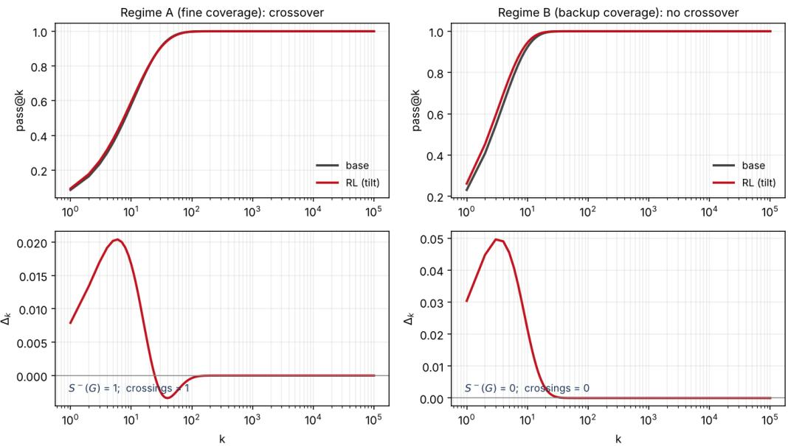
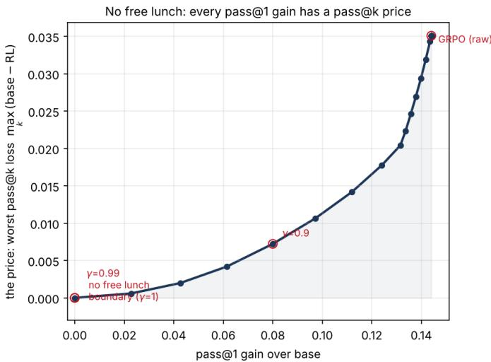
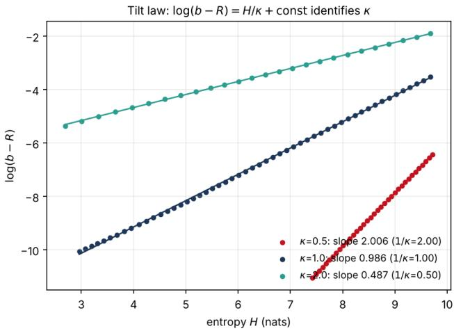
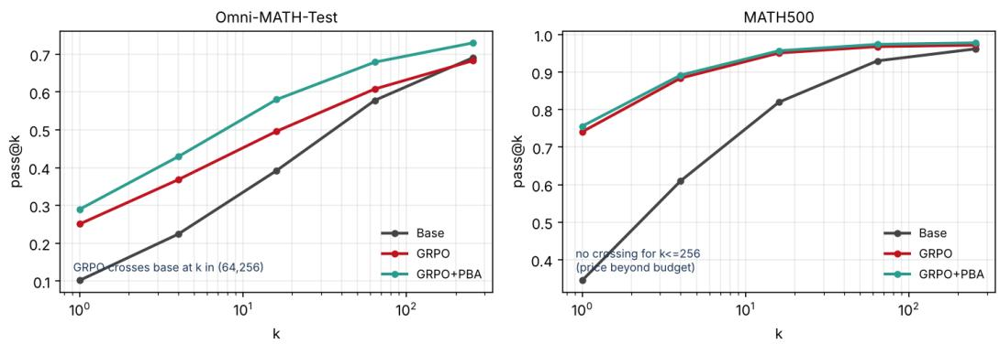

# There Is No Free Lunch in RLVR: Every pass@1 Gain Has a pass@k Price

Yinuo Liu

Code and verification package: https://github.com/yliusci/no-free-lunch-rlvr

## Abstract

Reinforcement learning with verifiable rewards (RLVR) makes a language model solve more problems on the first try and fewer when given many tries: it raises pass@1 while the base model overtakes it at large sampling budget k. Is this a failure of RL to add reasoning, or a transient that more training removes? We settle the question with a theorem. The reversal is a price, and we compute its exact rate. Modeling RLVR as an exponential tilt of a base policy over strategies shared across prompts, we prove that under exclusive specialization every update that raises pass@1 strictly lowers the success of some prompt; a strictly positive price on prompts (Stiemke duality) is the exact condition, and being merely the best strategy on a prompt is provably not enough. When the loss reaches the hardest prompts, it forces a pass@k crossover, and the number of crossings is at most the sign variation of the shift in per-prompt success, a totally positive bound that is tight and that recovers the known single-crossover result as its order-preserving case. The crossover is not a bug to patch: a constrained update traces the exact pass@1 versus pass@k frontier, and removing the crossover entirely costs the entire pass@1 gain. The same tilt identity yields entropy collapse and the entropy-performance law with an identifiable exponent, unifying two literatures under one mechanism. Reinforcement cannot widen the reasoning frontier; it can only move along it, at a price we make measurable by a diagnostic that reads the bound, the order-preserving test, and the price from any evaluation log. There is no free lunch, only a price.

## 1 Introduction

Reinforcement learning with verifiable rewards (RLVR) makes a language model solve more problems on the first try and fewer problems when given many tries: it raises pass@1 while the base model catches up and overtakes it at large sampling budget k [93]. Whether this means RLVR fails to add reasoning, or only needs more training to pull ahead [42], has been argued from curves. We settle it with a theorem. The reversal is neither a failure nor a transient: it is a price, and we compute the exchange rate at which it is paid.

We model RLVR as what it is in the population limit, an exponential tilt of a base distribution over solution strategies that are shared across prompts. One identity then drives the two phenomena that have been studied apart. On the strategy simplex, probability is conserved, so reinforcement spends it. When strategies specialize, each is the only route to some prompts, and the spending is visible at the level of prompts. This yields a sharp dichotomy. Every update that raises pass@1 lowers the success of some prompt (Theorem 2); there is no free lunch, and a theorem of the alternative gives the exact condition, a strictly positive price on prompts that equalizes strategy fitness. When that loss reaches the hardest, finely covered prompts, it forces the pass@k crossover (Theorem 3), and the number of times the curves can cross is bounded by the sign changes of the shift in per-prompt success, a totally positive argument that is tight. The same tilt yields entropy collapse and the entropy-performance law with an identifiable exponent (Theorem 5). In particular, no update both raises pass@1 and dominates the base pass@k curve at every k: reinforcement cannot widen the reasoning frontier, it can only move along it. That is the exact sense in which RLVR does not incentivize reasoning beyond the base model, and the sense in which, under a single named exception, it can.

The price is not a bug to be patched. A constrained update that forbids any prompt from regressing removes the crossover exactly, and under specialization it also removes the pass@1 gain: the only way to pay nothing is to gain nothing. Between the extremes lies a frontier (Theorem 4), the exact exchange rate between pass@1 and pass@k, which an optimal per-prompt floor traces out. A diversity bonus helps both metrics only when the unmodified update was off this frontier, which is what the frontier predicts.

## Contributions.

• No free lunch (Theorem 2). Under exclusive (or dominant) specialization, every pass@1- increasing update lowers some prompt’s success. We give the exact Stiemke condition and show the hypothesis is sharp: unique-best is insufficient (a worked counterexample) and a dominating strategy restores a free lunch.

• The crossing bound (Theorem 3a,b). For any base-to-RL shift, the number of pass@k crossings is at most the sign variation of the success-CDF difference; the bound is tight. This is the general statement that concurrent work leaves open for the kernel case.

• Forced crossover and its scope (Theorem 3c–e). Under a named fine-coverage condition the crossover is forced; without it there is a per-prompt loss but no crossover. The order-preserving case recovers the known single-crossover theorem as a corollary.

• The price frontier (Theorem 4). The optimal pass@1 versus pass@k exchange rate, with a closed form for two strategies.

• A diagnostic. A tool that takes only per-prompt base and RL success rates, available in any evaluation log, and returns the bound, the order-preserving test, and the price. We read published curves through it and find the predicted structure.

The claims are stated at the level of the model and proved in the appendix; every number is produced and checked by an accompanying package. We do not claim anything about a specific language model beyond what published curves show. The message is one line: in RLVR there is no free lunch, only a price, and we give its rate.

## 2 Model and results

Reinforcement learning with verifiable rewards (RLVR) raises a base model’s pass@1, yet at large sampling budgets k the base model catches up and overtakes it. This reversal has been read as evidence that RLVR only sharpens existing ability rather than adding reasoning (Yue et al., 2504.13837, “Does RL Really Incentivize Reasoning”). We give it an exact reading: the reversal is a price, and we compute its exchange rate. Modeling RLVR as an exponential tilt over strategies shared across prompts, we prove that once strategies specialize, every update that raises pass@1 must lower the success of some prompt, with a theorem of the alternative supplying the exact condition (Theorem 2); that when the loss reaches the hardest prompts it forces the pass@k crossover, whose number is bounded by the sign changes of the shift in per-prompt success (Theorem 3); and that a constrained update traces the optimal pass@1 versus pass@k frontier (Theorem 4). There is no free lunch, only a price. We state the model and all results here; proofs are in the appendix, and every numerical constant is produced and checked by the accompanying package.

Setup. A base policy is refined by reinforcement learning with verifiable rewards (RLVR). We model the object that RLVR moves as a distribution over solution strategies that are shared across prompts. There are M strategies and a prompt distribution $\mathcal { D }$ on a finite set of N prompts. For a prompt x and a strategy $j \in [ M ]$ , let

$$
q _ { x j } \in [ 0 , 1 ] \quad \mathrm { b e ~ t h e ~ p r o b a b i l i t y ~ t h a t ~ s t r a t e g y ~ } j \mathrm { ~ s o l v e s ~ p r o m p t } x , \qquad Q = ( q _ { x j } ) \in [ 0 , 1 ] ^ { N \times M } .\tag{1}
$$

A policy is a point $w \in \Delta ^ { M - 1 }$ on the strategy simplex. Drawing one strategy $j \sim w$ and solving x with probability $q _ { x j }$ , the per-prompt success probability and the mean (pass@1) success are

$$
p _ { x } ( w ) = \langle w , q _ { x } \rangle = \sum _ { j } w _ { j } q _ { x j } , \qquad { \mathrm { p a s s } } \ @ 1 ( w ) = \mathbb { E } _ { x \sim \mathcal { D } } p _ { x } ( w ) = \langle w , f \rangle , \quad f _ { j } : = \mathbb { E } _ { x \sim \mathcal { D } } q _ { x j } .\tag{2}
$$

Here $q _ { x } = ( q _ { x 1 } , \ldots , q _ { x M } )$ is the x-th row of $Q$ and $f = \mathbb { E } _ { x } q _ { x }$ is the vector of marginalfitnesses. With k independent samples from the policy, the pass@k of prompt x and its average are

$$
\begin{array} { r } { \mathrm { p a s s } @ k ( x ; w ) = 1 - ( 1 - p _ { x } ( w ) ) ^ { k } , \qquad \mathrm { P a s s } _ { k } ( w ) = \mathbb { E } _ { x } \big [ 1 - ( 1 - p _ { x } ( w ) ) ^ { k } \big ] . } \end{array}\tag{3}
$$

We write $s _ { x } = - \log ( 1 - p _ { x } ) \in [ 0 , \infty )$ ; hard prompts have small $p _ { x }$ , hence small $s _ { x } ,$ , and the large-k behavior of Passk is governed by the small-s (hardest) prompts through $( 1 - p ) ^ { k } = e ^ { - k s }$

The RLVR update. GRPO and its relatives subtract a group baseline and rescale by the group standard deviation, then push probability toward above-baseline strategies. In the population limit, with a KL anchor to the base, the idealized update is mirror descent / natural policy gradient on the strategy logits. Theorem 1 identifies the resulting policy as an exponential tilt of the base. Throughout, $w _ { 0 } \in \dot { \operatorname { i n t } } \Delta ^ { \overline { { M } } - 1 }$ denotes the base policy and $w _ { \tau }$ the policy after internal training time $\tau \geq 0$

Comparison objects. For a base policy $w _ { 0 }$ and a trained policy $w _ { \tau } .$ , write $F _ { 0 } , F _ { \tau }$ for the cumulative distribution functions of the per-prompt success values $\{ p _ { x } ( w _ { 0 } ) \}$ and $\{ p _ { x } ( w _ { \tau } ) \}$ under D, and

$$
G ( p ) = F _ { \tau } ( p ) - F _ { 0 } ( p ) , \qquad \Delta _ { k } = \mathrm { P a s s } _ { k } ( w _ { \tau } ) - \mathrm { P a s s } _ { k } ( w _ { 0 } ) .\tag{4}
$$

A pass@k crossover is a sign change of $k \mapsto \Delta _ { k }$ . We write $S ^ { - } \mathopen { } \mathclose \bgroup \left( \cdot \aftergroup \egroup \right)$ for the number of sign changes of a sequence or function.

## 2.1 Assumptions

Assumption 1 (Exclusive specialization). Each strategy is the sole solver of a set of prompts of positive mass: for each $j \in [ M ]$ there is a set $X _ { j } ^ { \mathrm { e x c l } }$ with $\mathcal { D } ( X _ { j } ^ { \mathrm { e x c l } } ) > 0$ such that $q _ { x j } > 0$ and $q _ { x j ^ { \prime } } = 0$ for all $j ^ { \prime } \neq j \mathrm { o n } X _ { j } ^ { \mathrm { e x c l } }$

Exclusivity, not mere being-best, is what makes probability a scarce resource: moving mass off j strictly lowers the prompts only j can solve. Being the unique best is not enough, because a near-generalist can absorb the mass without hurting any prompt; we record this as Proposition 2. A realistic version without exact zeros, used in the experiments, is dominant specialization: for each $j \mathrm { ~ a ~ }$ positive-mass set with $q _ { x j } \geq d$ and $q _ { x j ^ { \prime } } \leq \varepsilon$ for $j ^ { \prime } \neq j ,$ with $( M - 1 ) \varepsilon < d / 2 \colon$ ; it is sufficient (Theorem $2 ( \mathsf { b } ^ { \prime } ) )$ .

Assumption 2 (Fine coverage). The prompts of minimal base success $x ^ { \star } \in$ argmin $\phantom { } _ { \mathrm { { t } } } p _ { x } ( w _ { 0 } )$ are covered only by strategies of below-base-average fitness: $q _ { x ^ { \star } j } > 0 \Rightarrow f _ { j } < R _ { 0 }$ , where $R _ { 0 } = \operatorname { p a s s } @ 1 ( w _ { 0 } ) =$ $\left. w _ { 0 } , f \right.$ is the base pass@1.

Because the tilt multiplies $w _ { 0 , j }$ by $e ^ { \tau ( f _ { j } - \Lambda ( \tau ) / \tau ) }$ with $\Lambda ( \tau ) = \log \mathbb { E } _ { w _ { 0 } } e ^ { \tau f }$ , a strategy loses mass iff $f _ { j } < \Lambda ( \tau ) / \tau$ , and Jensen gives $\Lambda ( \tau ) / \tau \geq R _ { 0 }$ for all $\tau > 0$ . Hence under Assumption 2 every strategy covering $x ^ { \star }$ loses mass, so $\begin{array} { r } { p _ { x ^ { \star } } ( w _ { \tau } ) < p _ { x ^ { \star } } ( w _ { 0 } ) = \operatorname* { m i n } _ { x } p _ { x } ( w _ { 0 } ) } \end{array}$ . (The looser threshold $f _ { j } < R ( \tau )$ , the tilted mean, is wrong: a strategy with $R _ { 0 } < f _ { j } < \Lambda ( \tau ) / \tau$ gains mass though $f _ { j } < R ( \tau )$ ; see the appendix.) Assumption 1 forces a per-prompt loss (Theorem 2); Assumption 2 routes it to the hardest prompt and thereby forces an aggregate crossover (Theorem 3). The two must not be conflated: the per-prompt loss is unconditional under 1, the crossover is conditional on 2, and $3 ( \mathrm { e } )$ is the regime where 2 fails and no crossover forms.

## 2.2 Statements

Theorem 1 (Tilt identity). Under mirror descent / natural policy gradient on the strategy logits with a KL anchor of strength $\beta$ and binary verifiable reward, the policy at internal time τ is the exponential tilt

$$
w _ { \tau } \propto w _ { 0 } \exp ( \tau f ) , \qquad w _ { \tau , j } = \frac { w _ { 0 , j } e ^ { \tau f _ { j } } } { \sum _ { \ell } w _ { 0 , \ell } e ^ { \tau f _ { \ell } } } .\tag{5}
$$

This is exactfor mirror descent / natural policy gradient.

Proposition 1 (GRPO stays near the tilt). For GRPO with the group non-degeneracy factor $1 - p ^ { G } -$ $( 1 - p ) ^ { G }$ , the policy stays within total variation $O ( \delta )$ of the best-fit tilt at matched concentration, where δ is the variation of the group standard-deviation rescaling over the trajectory. We do not optimize the constant; the package measures this total variation below $3 \times 1 0 ^ { - 4 }$ over the tested range, and records thefinite-group transient non-monotonicity separately.

Theorem 2 (No free lunch). A free lunch at an interior w is a tangent dw $( \mathbf { 1 } ^ { \top } \mathrm { d } w = 0 )$ with $Q \mathrm { d } w \geq 0$ and $Q \mathrm { d } w \neq 0 ;$ since $\begin{array} { r } { \langle f , \mathrm { d } w \rangle = \frac { 1 } { N } \mathbf { 1 } ^ { \top } Q \mathrm { d } } \end{array}$ w, this is a pass@1 gain with no prompt regressing. Whether one exists does not depend on w.

(a) (Exact condition, Stiemke.) No free lunch exists if and only if there are strictly positive prompt prices $y \in \mathbb { R } _ { > 0 } ^ { N }$ and $\mu \in \mathbb { R }$ with

$$
\sum _ { x } y _ { x } q _ { x j } = \mu \qquad f o r a l l j \in [ M ] ,\tag{6}
$$

a strictly positive reweighting of prompts under which all strategies have equal weighted fitness. (Equivalently, since $\begin{array} { r } { f = \frac { 1 } { N } \sum _ { x } q _ { x } } \end{array}$ , there exist $y ^ { \prime } \geq 0 , \mu ^ { \prime }$ with $\begin{array} { r } { f _ { j } + \sum _ { x } y _ { x } ^ { \prime } q _ { x j } = \mu ^ { \prime } . , } \end{array}$ )

(b) (Exclusive specialization suffices.) Under Assumption 1 no free lunch exists: any dw with $\mathrm { d } w _ { j } < 0$ strictly lowers $X _ { j } ^ { \mathrm { e x c l } }$ , so every pass@1 gain lowers some prompt.

(b′) (Dominant specialization suffices.) If for each j there is a positive-mass set with $q _ { x j } \geq d$ and $q _ { x j ^ { \prime } } \leq \varepsilon ( j ^ { \prime } \neq j )$ and $( M - 1 ) \varepsilon < d / 2$ , then (6) isfeasible with $y > 0$ and nofree lunch exists.

(c) (Necessity.) Ifsome strategy dominates all others $( q _ { x j ^ { \star } } \geq q _ { x j }$ for all $x , j )$ , concentrating on it raises every $p _ { x } \colon a$ free lunch.

Proposition 2 (Unique-best is insufficient). Being the unique best scorer on a positive-mass set does not prevent a free lunch. For $\begin{array} { r } { Q = \left( \begin{array} { c c c } { 1 } & { 0 . 9 } & { 0 . 9 6 } \\ { 0 . 9 } & { 1 } & { 0 . 9 6 } \\ { 0 . 5 } & { 0 . 5 } & { 1 } \end{array} \right) } \end{array}$ each strategy is the unique best on its prompt, yet dw $\iota = ( - 0 . 6 , - 0 . 4 , 1 )$ ) gives $Q \mathrm { d } w = ( \overbrace { 0 , 0 . 0 2 } , 0 . 5 ) \geq 0$ and $\langle f , \mathrm { d } w \rangle = + 0 . 1 7 3 \colon a$ free lunch, and (6) is infeasible.

Theorem 3 (The pass@k price). Let $w _ { 0 } , w _ { \tau }$ be a base and a trained policy with success-CDF difference G.

(a) (Crossing bound.) The number of pass@k crossings is bounded by the sign variation of G:

$$
S ^ { - } \left( k \mapsto \Delta _ { k } \right) \ \leq \ S ^ { - } ( G ) ,\tag{7}
$$

because $\Delta _ { k } = - k \textstyle \int _ { 0 } ^ { 1 } ( 1 - p ) ^ { k - 1 } { G } ( p ) \textstyle \qquad $ dp and the kernel $k ( 1 - p ) ^ { k - 1 }$ is totally positive in $( k , p )$ (Karlin variation diminishing).

(b) (Tightness.) For every $m \geq 0$ there is a configuration with exactly m crossings; the bound is attained.

(c) (Forced crossover.) Under Assumptions 1 and 2, any pass@1-increasing tilt has $p _ { x ^ { \star } } ( w _ { \tau } ) <$ $\mathrm { m i n } _ { x } p _ { x } ( w _ { 0 } )$ , hence $\Delta _ { k } < 0 f o r a l l$ sufficiently large k: a crossover is forced, and its count obeys (a).

(d) (Uniqueness; recovers prior work.) If the trained policy preserves the difficulty order of prompts, $p _ { x } ( w _ { \tau } ) = \phi \left( p _ { x } ( w _ { 0 } ) \right)$ for an increasing φ, then $S ^ { - } ( G ) \leq 1$ and there is at most one crossing. This recovers the single-crossover regime ofYang and Chen (2609.22547, Thm. 3) as a corollary.

(e) (Counterexample.) Without Assumption 2, the loss need not reach the hard tail and no crossover occurs, even though a per-prompt loss does; this regime bounds the scope of(c) and makes the resultfalsifiable.

Theorem 4 (Price frontier). For $\gamma \in [ 0 , 1 ]$ , let $w ( \gamma )$ maximize pass@1 subject to the per-prompt floor $p _ { x } ( w ) \geq \gamma p _ { x } ( w _ { 0 } )$ for all x. The map γ 7→ pass@1 gain, k⋆ is monotone: $\gamma = 0$ recovers the unconstrained gain with the earliest crossing, and $\gamma = 1$ enforces first-order stochastic dominance $F _ { \tau } \leq F _ { 0 }$ , hence $\Delta _ { k } \ge 0$ for all k and zero pass@1 gain under Assumption 1. Thefrontier is the exact exchange rate between pass@1 and pass@k; it is a linear program in Q and has a closed form for $M = 2$

Theorem 5 (Tilt law). Let the base be uniform and let the fitness density near its maximum b behave as $c g ^ { \kappa - 1 }$ in the gap $g = b - f .$ . In the mesoscopic regime the entropy-performance relation is

$$
b { - } R = a _ { \kappa } \exp ( H / \kappa ) ( 1 { + } o ( 1 ) ) ,\tag{8}
$$

where $R = \langle w _ { \tau } , f \rangle$ and $H = H ( w _ { \tau } )$ . The exponent κ is identifiable from the slope of $\log ( b - R )$ against $H ; \kappa = 1$ recovers $R = - a e ^ { H } + b$ ofCui et al. (2505.22617). This result is statedfor context; the exact entropy-mass curve and the non-exponential terminal law are due to concurrent work (Winner-Take-All, S4R2zYtFhs).

Lemma 1 (Entropy bump). Along the tilt, $\begin{array} { r } { \frac { \mathrm { d } } { \mathrm { d } \tau } H ( w _ { \tau } ) = - \mathbf { C o v } _ { w _ { \tau } } ( f , \log w _ { 0 } ) - \tau \mathbf { V a r } _ { w _ { \tau } } ( f ) } \end{array}$ . Entropy rises before it collapses if and only $i f \mathbf { C o v } _ { w _ { 0 } } \bar { ( } f , \log w _ { 0 } ) < 0 ,$ , that is, the high-fitness strategies are initially underweighted.

Lemma 2 (Sharing is necessary). If each prompt is served by its own independent (tabular) policy and the update follows the full gradient flow, then $p _ { x }$ is nondecreasing for every x, so $\Delta _ { k } \geq 0 f o r$ all k and no inversion occurs. A pass@k inversion therefore requires strategies shared across prompts. Underfinite-group stochastic GRPO the monotonicity canfail transiently (2602.06717).

What is new, and why it matters. Theorem 2 is the headline and is unconditional given Assumption 1: concentration buys pass@1 only by spending some prompt’s success, and the pricing identity (6) values the trade exactly. This answers, with a mechanism, why RLVR cannot widen the reasoning frontier for free and says what it costs when it improves pass@1. Theorem $3 ( \mathrm { a } )$ bounds the number of pass@k crossings for an arbitrary shift in per-prompt success; this is the general statement that concurrent work leaves open for kernels and multiple crossings (Yang and Chen, 2609.22547, Rem. 1), and it recovers their single-crossover theorem as the order-preserving corollary 3(d). Theorem 3(c) then turns the per-prompt price into the observed aggregate phenomenon, the crossover, under the named Fine Coverage condition, with the counterexample regime 3(e) bounding its scope and making it falsifiable. Theorem 4 is the exact exchange rate and the only place a “correction” appears: not a free fix, since none exists, but the frontier that attains the minimal price. Theorem 5 and the lemmas tie the same tilt identity to the entropy side studied in concurrent work. The practical read-off is a diagnostic that takes only per-prompt base and RL success rates, available in any evaluation log, and returns the crossing bound, the order-preserving test, and the estimated price. There is no free lunch, only a price.

## 3 The pass@1 price

This section proves the two central results. Probability on the strategy simplex is a conserved quantity: raising it on one strategy lowers it on another. When strategies specialize, that accounting is visible at the level of prompts, and it is the source of the pass@k crossover. We state each result, give the argument, and report the numbers produced by the package; full proofs are in the appendix.

## 3.1 No free lunch

Probability on the strategy simplex is conserved: a unit added to one strategy is a unit removed from another. When strategies specialize, that single accounting fact becomes a hard constraint on what reinforcement can buy. We make it exact.

Fix an interior policy w and a tangent dw with $\mathbf { 1 } ^ { \top } \mathrm { d } w = 0 . \mathrm { A }$ free lunch is a dw with $Q \mathrm { d } w \geq 0$ and $Q \mathrm { d } w \neq 0 ;$ ; since $\begin{array} { r } { \langle f , \mathrm { d } w \rangle = \frac { 1 } { N } \mathbf { 1 } ^ { \top } Q } \end{array}$ dw, it is a pass@1 gain with no prompt regressing, and its existence does not depend on w.

Exact condition (Theorem 2(a)). The feasible non-regressing directions form the cone $K = \{ \mathrm { d } w :$ $Q \mathrm { d } w \geq 0 , \mathbf { 1 } ^ { \top } \mathrm { d } w = 0 \}$ , and a free lunch is a point of K with $Q \mathrm { d } w \neq 0$ . Parameterizing K by a basi of the tangent space and applying Stiemke’s lemma, no such direction exists iff there is a strictly positive $y \in \mathbb { R } _ { > 0 } ^ { N }$ with $\mathcal { Q } ^ { \top } y \perp$ the tangent space, i.e. $Q ^ { \top } y = \mu \mathbf { 1 }$ : a strictly positive reweighting of prompts equalizing strategy fitness. Because $\begin{array} { r } { f = \frac { 1 } { N } \sum _ { x } q _ { x } } \end{array}$ , this is equivalent to the inhomogeneous form (6) with $y ^ { \prime } \geq 0 ;$ we use the Stiemke form, whose strict positivity is the right object.

When it holds (Theorem $^ { 2 ( \mathbf { b } , \mathbf { b } ^ { \prime } ) ) }$ . Being the unique best on a set is not enough: Proposition 2 exhibits a unique-best instance with a free lunch, where a near-generalist absorbs the defunded mass. What suffices is exclusivity. Under Assumption 1, any dw with dw $_ j < 0$ (one exists whenever dw $\neq 0 )$ strictly lowers every prompt in $X _ { j } ^ { \mathrm { e x c l } }$ , since only j solves them; so no non-regressing direction moves mass, and every pass@1 gain lowers some prompt. The realistic ε-version (b′) follows by a Neumann-series construction of a strictly positive price on representative prompts (appendix). Part (c) is immediate.

Verification. The Stiemke primal and dual agree in 100% of instances across six generators (exclusive, unique-best, quasi-generalist, overlapping, near-generalist, dominant), confirming (a). Exclusive specialization gives no free lunch in 1000/1000 and dominant specialization in 2000/2000. The hypothesis is sharp: the unique-best counterexample of Proposition 2 has a free lunch of +0.173 with the Stiemke dual infeasible, and an adversarial near-generalist generator produces a free lunch in 500/500 instances. Unique best is insufficient; exclusivity, or dominance with margin, is what the price requires.

## 3.2 The pass@k price

Write $G = F _ { \tau } - F _ { 0 }$ for the difference of the per-prompt success CDFs and $\Delta _ { k } = \mathrm { P a s s } _ { k } ( w _ { \tau } ) - \mathrm { P a s s } _ { k } ( w _ { 0 } )$ Integrating by parts,

$$
\Delta _ { k } = - k \int _ { 0 } ^ { 1 } ( 1 - p ) ^ { k - 1 } G ( p ) \mathrm { d } p = - k \int _ { 0 } ^ { \infty } e ^ { - ( k - 1 ) s } G ( 1 - e ^ { - s } ) \mathrm { d } s , \qquad s = - \log ( 1 - p ) .\tag{9}
$$

Argument for Theorem 3. The kernel in (9), $k \mapsto e ^ { - ( k - 1 ) s }$ , is totally positive of all orders in $( k , s ) ;$ by Karlin’s variation-diminishing property the map $k \mapsto \Delta _ { k }$ has at most as many sign changes as the single-variable function $G ,$ which gives (a). For (b) we place mass at success levels whose s-values are geometrically spread and alternate the sign of the shift, so that each crossing dominates its own decade of $k ;$ a mass-conserving alternating shift at n levels realizes $S ^ { - } ( G ) = n - 2$ crossings. For (c), Assumption 1 forces a per-prompt loss and Assumption 2 routes it to the minimal-success prompt: since every strategy covering it has $f _ { j } < R _ { 0 } \leq \Lambda ( \tau ) / \tau$ , all lose mass and minx ${ \mathrm { . } p } _ { x }$ strictly drops, so $G > 0$ near $p = 0$ and by (9) the large-k integral makes $\Delta _ { k } < 0$ . Part (d) is the order-preserving case: a monotone $\phi$ makes $G$ change sign at most once, so (9) inherits at most one crossing; this recovers the single crossover of the function case [89] and extends it to the kernel case their Remark 1 leaves open. Part (e) is Assumption 2 failing: if the hard tail keeps a high-fitness backup, the loss does not reach it and no crossover forms.

Corollary 1 (No reasoning for free). Under Assumptions 1 and 2, every pass@1-improving RLVR update is overtaken by the base model at large k: there is no update that raises pass@1 and dominates the base pass@k curvefor all k. Reinforcement cannot widen the pass@kfrontier; it can only move along it. This is the exact sense in which RLVR does not add reasoning capacity beyond the base model (cf. Yue et al., 2504.13837); Theorem 3(e) shows the conclusion is tight, failing precisely when Assumption 2 does.

Verification. The bound (a) is never violated on 3000 random instances, and (b) is attained: configurations with exactly $1 , 2 , \ldots , 6$ crossings are constructed. Uniqueness (d) holds in 1035/1035 order-preserving instances. The conditional nature of (c) is sharp (Figure 1): when fine coverage holds the hardest prompt’s success drops and an aggregate crossover appears in 400/400 instances; when it fails (the hard tail keeps a high-fitness backup) neither the minimum drops nor a crossover forms, in 0/400.

  
Figure 1: Per-prompt loss is inevitable under specialization, but the aggregate pass $@ k$ crossover is conditional on Assumption 2. Regime A (fine coverage) has a genuinely hard tail that the tilt starves, so $\Delta _ { k }$ turns negative and the curves cross; $S ^ { - } ( G ) = 1$ and the single crossing saturates the bound. Regime B gives every prompt backup coverage, so the hard tail keeps a floor, $\Delta _ { k }$ stays nonnegative, and there is no crossover. Both regimes have a per-prompt loss; only A has an aggregate crossover.

## 3.3 The price frontier

The crossover is not an avoidable artifact: it is the aggregate shadow of the per-prompt price, and any attempt to remove it pays in pass@1. We make the exchange rate exact. For $\gamma \in [ 0 , 1 ]$ , let $w ( \gamma )$ solve

$$
\operatorname* { m a x } _ { w \in \Delta ^ { M - 1 } } \langle w , f \rangle \quad { \mathrm { s . t . } } \quad p _ { x } ( w ) \geq \gamma p _ { x } ( w _ { 0 } ) { \mathrm { ~ f o r ~ a l l ~ } } x ,\tag{10}
$$

a linear program in $Q \colon Q \colon$ raise pass@1 while letting no prompt fall below a fraction γ of its base success. The map $\gamma \mapsto$ (pass@1 gain, worst pass@k loss) it traces is Theorem $4 { : }$ monotone, with the unconstrained GRPO point at $\gamma = 0$ and, at $\gamma = 1$ , first-order stochastic dominance $F _ { \tau } \leq F _ { 0 }$ hence $\Delta _ { k } \ge 0$ for all $k ,$ which under Assumption 1 forces zero pass@1 gain.

Verification. At $\gamma = 1$ the constrained update gives zero crossings and first-order dominance in 400/400 instances, with the worst per-prompt loss at machine zero and zero median pass@1 gain: no free lunch, exactly. As γ decreases the pass@1 gain rises monotonically and the crossing moves to smaller k (Figure 2). The frontier is thus a strict trade: there is no setting that both improves pass@1 and removes the crossover. The “correction” is the frontier itself, not an escape from it.

## 4 One identity, two literatures

The exponential tilt of Theorem 1 is a single object, and it drives two phenomena that have been studied apart. The pass@k price of Section 3 is one face. The other is the entropy side: as the tilt concentrates, the policy entropy collapses and the reward tracks it along a fixed curve. We show

  
Figure 2: The no-free-lunch frontier. Each point is the best pass@1 gain achievable at a given perprompt floor $\gamma ,$ against the price it pays, the worst pass@k loss max (base − RL). The unconstrained GRPO update (top right) buys the largest gain at the largest price; tightening γ slides down the curve; $\gamma = 1$ reaches the origin, where the only way to pay nothing is to gain nothing (Theorem 4). The curve is the exchange rate; its slope is the marginal price of a unit of pass@1.

that the same identity produces that curve, with an exponent that the data can read off, and we state precisely what is ours and what is concurrent work. This is the unification the title promises: one mechanism behind the pass@k crossover and the entropy-performance law.

## 4.1 The tilt law

Write $b = \operatorname* { m a x } _ { j } f _ { j } , R = \langle w _ { \tau } , f \rangle$ , and $H = H ( w _ { \tau } )$ . Let the base be uniform and let the fitness gap $g = b - f$ have local density $c g ^ { \kappa - 1 }$ near $g = 0$ , so that the number of strategies within gap g of the best grows like $g ^ { \kappa }$

Theorem 5 states that in the mesoscopic regime $\begin{array} { r } { b - R = a _ { \kappa } \exp ( H / \kappa ) ( 1 + o ( 1 ) ) } \end{array}$ ), with κ identifiable from the slope of log $\left( b - R \right)$ against H and $\kappa = 1$ recovering $R = - a e ^ { H } + b$ of Cui et al. [15].

Why it holds. Under the tilt the gap is approximately Gamma $( \kappa , \tau )$ , so $b - R \approx \kappa / \tau$ . The entropy is the log of the effective number of surviving strategies, and since $g ^ { \kappa }$ of them lie within gap g, that number scales as $\tau ^ { - \kappa }$ , giving H ≈ const − κ log τ. Eliminating τ yields (??). The content is the exponent: κ is set by how crowded the near-optimal strategies are, and it is read straight off the empirical slope. A measured slope away from 1 is a measurement of that crowding, not a failure of the law.

What is ours, what is concurrent. The exponential form at $\kappa = 1$ is due to Cui et al.; the identifiable exponent κ and its reading as near-optimal crowding are the contribution here. The exact entropy-mass curve, the shifted-exponential as a finite-window approximation with error bounds, and the proof that the true terminal law is not exponential are concurrent work (Winner-Take-All, S4R2zYtFhs); we do not claim them, and (??) is stated as a mesoscopic law, not a global one. Our use of the tilt is to connect this entropy side to the pass@k side through the one identity of Theorem 1.

## 4.2 Entropy collapse and the bump

Along the tilt the entropy moves by the exact identity of Lemma 1, $\begin{array} { r } { \frac { \mathrm { d } } { \mathrm { d } \tau } H ( w _ { \tau } ) = - \mathbf { C o v } _ { w _ { \tau } } ( f , \log w _ { 0 } ) - } \end{array}$ $\tau \mathrm { V a r } _ { w _ { \tau } } ( f )$ : with a uniform base H is nonincreasing and collapses to log|arg max f |, and with a nonuniform base it rises first iff $\mathrm { C o v } _ { w _ { 0 } } ( f , \log w _ { 0 } ) < 0 .$

The collapse to a single-strategy support is the strategy-level counterpart of the winner-take-all concentration analyzed in concurrent work; the bump condition names exactly when the transient rise seen in training occurs. We state these at the strategy level: token entropy need not track strategy entropy, because a concentrating policy can still spread probability within the surviving strategy. The accompanying package exhibits a case where strategy entropy falls from 2.77 to 2.14 while token entropy rises from 6.85 to 7.27, so any entropy-performance statement here is about strategies, not tokens. This is the same family-versus-token distinction identified empirically in concurrent work, and it is why Theorem 5 is a strategy-level law.

  
Figure 3: The tilt law. For base-fitness crowding exponents $\kappa \in \{ 0 . 5 , 1 , 2 \}$ , log $\left( b - R \right)$ is linear in the entropy H with slope $1 / \kappa .$ Fitted slopes are 2.006, 0.986, 0.487 against the predicted 2, 1, 0.5 (within 2.6%). The slope identifies κ from a single entropy-reward trace.

Verification. The entropy identity of Lemma 1 holds to $2 \times 1 0 ^ { - 6 }$ under a uniform base, the predicted bump appears under a nonuniform base, and the tilt law slopes match $1 / \kappa$ within 2.6% (Figure 3). All three are regenerated and checked by the package.

## 5 Evidence from published curves, and a diagnostic

The theory is about a model, not about any particular language model. To ask whether its one testable prediction, a positive pass@k price, is consistent with practice, we do not train or run a model: we pass already-published pass@k curves through the diagnostic that the theory defines. The reading is indicative. Published curves are coarse, their values are read from tables or digitized from plots, and five budgets cannot locate a crossing precisely. We state every number’s source and never claim more than the curve shows.

The diagnostic. The theory turns into a read-off that needs only per-prompt base and RL success rates, or the pass@k curves they induce, which any evaluation log already contains. Given base and trained pass@k values, it returns (i) the number of crossings and their budgets, (ii) the sign-variation bound $S ^ { - } ( G )$ of Theorem 3(a) and whether it is saturated, (iii) the order-preserving test of Theorem $3 ( \mathrm { d } ) .$ , and (iv) the estimated price, the worst pass@k loss. It ships as a package and a hosted app: paste two columns, get the bound, the test, and the price. Every user of RLVR has the input on hand, and the computation adds nothing to a training run, which is the point. We propose that two numbers be reported alongside pass@1 and pass@k: the price, the worst pass@k loss max (base − RL), and the crossing count. Both are read from an evaluation log that already exists; reporting them turns the pass@k reversal from an anecdote into a measured quantity with a bound.

  
Figure 4: Published GRPO pass@k for Qwen2.5-7B (Zhou, 2607.20543, Table 2; transcribed, indicative). Left, Omni-MATH: GRPO (red) is overtaken by base at the largest budget, a single crossing, while the diversity intervention GRPO+PBA (green) stays above through the measured range. Right, MATH500: no crossing for $k \leq 2 5 6$ . The pattern matches the price (Theorem 3) and the frontier (Theorem 4); it does not establish behavior beyond the reported budgets.

A published case. Figure 4 applies the diagnostic to pass@k for Qwen2.5-7B trained with GRPO on Omni-MATH, as reported by Zhou (2607.20543, Table 2; values transcribed and to be confirmed against the source). Three readings, all consistent with the theory:

• On Omni-MATH the GRPO advantage over base is +0.149,+0.144,+0.104,+0.030,−0.008 at k = 1,4,16,64,256: it changes sign once, between k = 64 and k = 256. The price is paid, and the single crossing is the order-preserving regime of Theorem 3(d).

• The paper’s diversity intervention GRPO+PBA improves on raw GRPO at every measured k, and the frontier explains why. Raw GRPO over-concentrates and sits inside the frontier of Theorem 4, so it is not on the optimal trade; a diversity bonus moves it toward the frontier, buying both a higher pass@1 and a later crossing at once. The price versus base is not removed, only deferred past the measured budget. A bonus helps precisely because the unconstrained update was suboptimal, which is the frontier’s prediction, not a counterexample to it.

• On MATH500 neither trained model crosses base for $k \leq 2 5 6 \mathrm { : }$ : the price, if present, lies beyond the measured budget. We claim nothing past k = 256.

This is one dataset read at five budgets, so it is corroboration, not proof. It shows the predicted structure, a single crossing under GRPO and its delay under a diversity bonus, in numbers the field already publishes.

What would falsify the theory. Two statistically supported sign changes in a single base-versus-RL pass@k comparison would exceed $S ^ { - } ( G ) = 1$ only if the shift is not order-preserving; finding them where the shift is order-preserving would contradict Theorem 3(d). A pass@1 gain with no per-prompt loss, under verified specialization, would contradict Theorem 2. The diagnostic makes both checks routine on any released evaluation.

## 6 Related work

The result sits at the intersection of three lines: the RLVR reasoning-boundary debate, the theory of entropy and concentration in policy optimization, and the sign-variation geometry of totally positive kernels. We review each, then mark the boundary with the two concurrent manuscripts precisely.

RLVR algorithms and systems. Reinforcement learning with verifiable rewards grew out of policygradient and RLHF pipelines [3, 24, 33, 56, 63] and was crystallized by GRPO and the DeepSeek line [16, 44, 67, 90], the term itself fixed in [37]. Open “zero” recipes train from the base model without supervised warmup [25, 45, 87, 95, 99], and large system reports scale the setup [7, 23, 34, 35, 50, 80, 88]. Rewards come from outcome checkers and process models [14, 41, 46, 72, 75, 98]; recent surveys map the area [85, 97]. None states a pass@k crossing count or a per-prompt no-free-lunch condition.

The phenomenon and the debate. Yue et al. [93] report that RLVR raises pass@1 while the base model overtakes it at large k and read the reversal as reweighting rather than new capability; Liu et al. [42] argue prolonged RL expands the boundary and keeps the trained model ahead; Zhou [101] diagnoses the inversion and proposes a diversity intervention. A cluster of work reads RL as amplifying or sharpening base behavior rather than adding it [26, 64, 66, 82, 100]. Reward hacking and chain-of-thought obfuscation are documented failure modes of the same optimization [6]. Our Theorem 3 adjudicates: the crossover is forced when the loss reaches a finely covered hard tail (Assumption 2) and absent otherwise, so the Yue and ProRL observations are two sides of one conditional statement.

pass@k, sampling, and test-time compute. The pass@k metric originates with code evaluation [10], and sampling-based inference spans self-consistency and its universal form [11, 77], repeated sampling and inference scaling [9, 52, 68, 83], and best-of-N alignment [4, 17]. A recent line optimizes pass@k directly or debates it as an objective [12, 21, 74, 91]. Chain-of-thought and bootstrapped reasoning are the substrate [78, 92, 94]. We do not optimize the metric; we bound how the base-to-RL shift can move the curve and price the move.

Entropy, exploration, and diversity. Entropy collapse and its exploitation are central to RLVR dynamics [2, 15, 76], extending the maximum-entropy tradition [22]. Alignment is known to narrow output diversity and induce mode collapse [28, 36, 38, 51, 96]. These describe or counter concentration; the per-prompt accounting and the crossing bound are new here.

RLHF and preference-optimization theory. The reward-model and preference-learning foundations [5, 8, 13, 19, 53, 58, 69, 102] and the Goodhart limit of reward optimization [20] frame RL as a one-step contextual bandit, the view we take. Our no-free-lunch duality is a Pareto statement on the strategy simplex, which these do not address.

Policy-gradient theory. The tilt identity rests on policy-gradient and mirror-descent analysis [1, 29, 48, 62, 70, 71], control-as-inference [40], and the bandit view [39].

Named-phenomenon theory, for positioning. Pure-theory explanations of named LLM phenomena are the archetype this paper follows: hallucination [30, 86], superposition and in-context learning [18, 55, 73], grokking [54, 57], emergence and its critique [59, 79], and positional and attention effects [43, 84].

Mathematical tools. The crossing bound is a variation-diminishing property of totally positive kernels [31, 32, 60, 61], with the exponential-sum sign count going back to Descartes’ rule [27] and Laplace-transform sign changes [81]; the no-free-lunch condition is a Pareto statement proved by a theorem of the alternative [47, 49], and the frontier uses stochastic dominance [65]. The novelty is the target, not the tools: pricing pass@1 against per-prompt success and bounding pass@k crossings by S−(G).

## 7 Concurrent work

Two manuscripts from the last two months are the nearest neighbors; the overlap is partial and real.

Yang and Chen, “RLVR is a Kernel, Not a Function” [89]. They build statistical inference for pass@k crossovers and prove, in the function case with zero latent-failure mass, a single interior fixed point, and a side-preserving map, that the advantage changes sign at most once (their Theorem 3). They note multiple crossings become possible once the map is a kernel or the failure mass is positive, and leave that case without a bound (their Remark 1), framing two supported sign changes as a falsification of the single-fixed-point class. Our Theorem 3(a) supplies the missing bound: for any shift the number of crossings is at most S−(G), kernels included, and it is tight; their single-crossing theorem is our order-preserving corollary 3(d). Our no-free-lunch result (Theorem 2) and the price frontier (Theorem 4) have no counterpart in their work. Their prompts are independent given a common map; our strategies are shared across prompts, the microfoundation of the kernel dispersion they posit.

“Winner-Take-All” (ICLR 2027 submission S4R2zYtFhs). They study the entropy side of the same tilt in a finite-mode, single-prompt mean-field model: the exact entropy-mass curve, the shiftedexponential as a finite-window approximation with error bounds, a proof that the terminal law is not exponential, and the collapse of correct-mode entropy to a single winner. We claim none of these. Our entropy statements (Theorem 5, the lemmas) are the strategy-level, mesoscopic context that links their entropy side to our pass@k side through one tilt identity; where they overlap, priority is theirs. Their model has one prompt and many modes; ours has many prompts sharing strategies, which is what makes pass@k well defined.

Summary. The crossover’s statistics [89] and the entropy trajectory (Winner-Take-All) are concurrent. This paper adds the general crossing bound with tightness, the per-prompt no-free-lunch condition with its Farkas exchange rate, the forced-crossover result under fine coverage with its counterexample, and the price frontier. The unifying object is the shared-strategy tilt.

## References

[1] Alekh Agarwal, Sham M. Kakade, Jason D. Lee, and Gaurav Mahajan. On the theory of policy gradient methods: Optimality, approximation, and distribution shift. Journal of Machine Learning Research 22; arXiv:1908.00261, 2021.

[2] Shivam Agarwal et al. The unreasonable effectiveness of entropy minimization in llm reasoning. arXiv preprint arXiv:2505.15134, 2025.

[3] Arash Ahmadian et al. Back to basics: Revisiting reinforce style optimization for learning from human feedback in llms. arXiv preprint arXiv:2402.14740, 2024.

[4] Afra Amini et al. Variational best-of-n alignment. arXiv preprint arXiv:2407.06057, 2024.

[5] Mohammad Gheshlaghi Azar, Zhaohan Daniel Guo, Bilal Piot, Remi Munos, Mark Rowland,´ Michal Valko, and Daniele Calandriello. A general theoretical paradigm to understand learning from human preferences. arXiv preprint arXiv:2310.12036, 2023.

[6] Bowen Baker et al. Monitoring reasoning models for misbehavior and the risks of promoting obfuscation. arXiv preprint arXiv:2503.11926, 2025.

[7] Akhiad Bercovich et al. Llama-nemotron: Efficient reasoning models. arXiv preprint arXiv:2505.00949, 2025.

[8] Ralph Allan Bradley and Milton E. Terry. Rank analysis of incomplete block designs: I. the method of paired comparisons. Biometrika 39(3-4), 324-345, 1952.

[9] Bradley Brown et al. Large language monkeys: Scaling inference compute with repeated sampling. arXiv preprint arXiv:2407.21787, 2024.

[10] Mark Chen et al. Evaluating large language models trained on code. arXiv preprint arXiv:2107.03374, 2021.

[11] Xinyun Chen et al. Universal self-consistency for large language model generation. arXiv preprint arXiv:2311.17311, 2023.

[12] Zhipeng Chen et al. Pass@k training for adaptively balancing exploration and exploitation of large reasoning models. arXiv preprint arXiv:2508.10751, 2025.

[13] Paul F. Christiano, Jan Leike, Tom B. Brown, Miljan Martic, Shane Legg, and Dario Amodei. Deep reinforcement learning from human preferences. arXiv preprint arXiv:1706.03741, 2017.

[14] Karl Cobbe et al. Training verifiers to solve math word problems. arXiv preprint arXiv:2110.14168, 2021.

[15] Ganqu Cui et al. The entropy mechanism of reinforcement learning for reasoning language models. arXiv preprint arXiv:2505.22617, 2025.

[16] DeepSeek-AI, Daya Guo, et al. Deepseek-r1: Incentivizing reasoning capability in llms via reinforcement learning. arXiv preprint arXiv:2501.12948, 2025.

[17] Hanze Dong et al. Raft: Reward ranked finetuning for generative foundation model alignment. arXiv preprint arXiv:2304.06767, 2023.

[18] Nelson Elhage et al. Toy models of superposition. arXiv preprint arXiv:2209.10652, 2022.

[19] Kawin Ethayarajh, Winnie Xu, Niklas Muennighoff, Dan Jurafsky, and Douwe Kiela. Kto: Model alignment as prospect theoretic optimization. arXiv preprint arXiv:2402.01306, 2024.

[20] Leo Gao, John Schulman, and Jacob Hilton. Scaling laws for reward model overoptimization. arXiv preprint arXiv:2210.10760, 2022.

[21] Lin Gui et al. Optimizing language models for inference-time objectives. arXiv preprint arXiv:2503.19595, 2025.

[22] Tuomas Haarnoja, Aurick Zhou, Pieter Abbeel, and Sergey Levine. Soft actor-critic: Offpolicy maximum entropy deep reinforcement learning with a stochastic actor. arXiv preprint arXiv:1801.01290, 2018.

[23] Jujie He et al. Skywork open reasoner 1 technical report. arXiv preprint arXiv:2505.22312, 2025.

[24] Jian Hu et al. Reinforce++: A simple and efficient approach for aligning large language models. arXiv preprint arXiv:2501.03262, 2025.

[25] Jingcheng Hu et al. Open-reasoner-zero: An open source approach to scaling up reinforcement learning on the base model. arXiv preprint arXiv:2503.24290, 2025.

[26] Audrey Huang et al. Self-improvement in language models: The sharpening mechanism. arXiv preprint arXiv:2412.01951, 2024.

[27] Graham J. O. Jameson. Counting zeros of generalised polynomials: Descartes’ rule of signs and laguerre’s extensions. Mathematical Gazette 90(518), 223-234, 2006.

[28] Liwei Jiang et al. Artificial hivemind: The open-ended homogeneity of language models (and beyond). arXiv preprint arXiv:2510.22954, 2025.

[29] Sham Kakade. A natural policy gradient. In Advances in Neural Information Processing Systems (NeurIPS), 2001.

[30] Adam Tauman Kalai, Ofir Nachum, Santosh S. Vempala, and Edwin Zhang. Why language models hallucinate. arXiv preprint arXiv:2509.04664, 2025.

[31] Samuel Karlin. Total Positivity, Vol. I. Stanford University Press, 1968.

[32] Samuel Karlin and William J. Studden. TchebycheffSystems: With Applications in Analysis and Statistics. Interscience/Wiley, 1966.

[33] Amirhossein Kazemnejad et al. Vineppo: Unlocking rl potential for llm reasoning through refined credit assignment. arXiv preprint arXiv:2410.01679, 2024.

[34] Devvrit Khatri, Lovish Madaan, et al. The art of scaling reinforcement learning compute for llms. arXiv preprint arXiv:2510.13786, 2025.

[35] Kimi Team. Kimi k1.5: Scaling reinforcement learning with llms. arXiv preprint arXiv:2501.12599, 2025.

[36] Robert Kirk, Ishita Mediratta, Christoforos Nalmpantis, Jelena Luketina, Eric Hambro, Edward Grefenstette, and Roberta Raileanu. Understanding the effects of rlhf on llm generalisation and diversity. arXiv preprint arXiv:2310.06452, 2023.

[37] Nathan Lambert et al. Tulu 3: Pushing frontiers in open language model post-training. arXiv preprint arXiv:2411.15124, 2024.

[38] Jack Lanchantin et al. Diverse preference optimization. arXiv preprint arXiv:2501.18101, 2025.

[39] Tor Lattimore and Csaba Szepesvari. ´ Bandit Algorithms. Cambridge University Press, 2020.

[40] Sergey Levine. Reinforcement learning and control as probabilistic inference: Tutorial and review. arXiv preprint arXiv:1805.00909, 2018.

[41] Hunter Lightman et al. Let’s verify step by step. arXiv preprint arXiv:2305.20050, 2023.

[42] Mingjie Liu et al. Prorl: Prolonged reinforcement learning expands reasoning boundaries in large language models. arXiv preprint arXiv:2505.24864, 2025.

[43] Nelson F. Liu, Kevin Lin, John Hewitt, Ashwin Paranjape, Michele Bevilacqua, Fabio Petroni, and Percy Liang. Lost in the middle: How language models use long contexts. arXiv preprint arXiv:2307.03172, 2023.

[44] Zichen Liu et al. Understanding r1-zero-like training: A critical perspective. arXiv preprint arXiv:2503.20783, 2025.

[45] Trung Quoc Luong et al. Reft: Reasoning with reinforced fine-tuning. arXiv preprint arXiv:2401.08967, 2024.

[46] Xueguang Ma et al. General-reasoner: Advancing llm reasoning across all domains. arXiv preprint arXiv:2505.14652, 2025.

[47] Olvi L. Mangasarian. Nonlinear Programming. McGraw-Hill (SIAM Classics reprint 1994), 1969.

[48] Jincheng Mei, Chenjun Xiao, Csaba Szepesvari, and Dale Schuurmans. On the global conver-´ gence rates of softmax policy gradient methods. arXiv preprint arXiv:2005.06392, 2020.

[49] Kaisa Miettinen. Nonlinear Multiobjective Optimization. Kluwer Academic, 1999.

[50] Mistral-AI, Abhinav Rastogi, et al. Magistral. arXiv preprint arXiv:2506.10910, 2025.

[51] Behnam Mohammadi. Creativity has left the chat: The price of debiasing language models. arXiv preprint arXiv:2406.05587, 2024.

[52] Niklas Muennighoff et al. s1: Simple test-time scaling. arXiv preprint arXiv:2501.19393, 2025.

[53] Remi Munos et al. Nash learning from human feedback. ´ arXiv preprint arXiv:2312.00886, 2023.

[54] Neel Nanda, Lawrence Chan, Tom Lieberum, Jess Smith, and Jacob Steinhardt. Progress measures for grokking via mechanistic interpretability. arXiv preprint arXiv:2301.05217, 2023.

[55] Catherine Olsson et al. In-context learning and induction heads. arXiv preprint arXiv:2209.11895, 2022.

[56] Long Ouyang et al. Training language models to follow instructions with human feedback. arXiv preprint arXiv:2203.02155, 2022.

[57] Alethea Power, Yuri Burda, Harri Edwards, Igor Babuschkin, and Vedant Misra. Grokking: Generalization beyond overfitting on small algorithmic datasets. arXiv preprint arXiv:2201.02177, 2022.

[58] Rafael Rafailov, Archit Sharma, Eric Mitchell, Stefano Ermon, Christopher D. Manning, and Chelsea Finn. Direct preference optimization: Your language model is secretly a reward model. arXiv preprint arXiv:2305.18290, 2023.

[59] Rylan Schaeffer, Brando Miranda, and Sanmi Koyejo. Are emergent abilities of large language models a mirage? arXiv preprint arXiv:2304.15004, 2023.

[60] Isaac J. Schoenberg. Uber variationsvermindernde lineare transformationen. ¨ Mathematische Zeitschrift 32, 321-328, 1930.

[61] Isaac J. Schoenberg. On polya frequency functions. i. the totally positive functions and their´ laplace transforms. Journal d’Analyse Mathematique 1, 331-374´ , 1951.

[62] John Schulman, Sergey Levine, Philipp Moritz, Michael I. Jordan, and Pieter Abbeel. Trust region policy optimization. arXiv preprint arXiv:1502.05477, 2015.

[63] John Schulman, Filip Wolski, Prafulla Dhariwal, Alec Radford, and Oleg Klimov. Proxima policy optimization algorithms. arXiv preprint arXiv:1707.06347, 2017.

[64] Amrith Setlur et al. Rl on incorrect synthetic data scales the efficiency of llm math reasoning by eight-fold. arXiv preprint arXiv:2406.14532, 2024.

[65] Moshe Shaked and J. George Shanthikumar. Stochastic Orders. Springer, 2007.

[66] Rulin Shao et al. Spurious rewards: Rethinking training signals in rlvr. arXiv preprint arXiv:2506.10947, 2025.

[67] Zhihong Shao et al. Deepseekmath: Pushing the limits of mathematical reasoning in open language models. arXiv preprint arXiv:2402.03300, 2024.

[68] Charlie Snell et al. Scaling llm test-time compute optimally can be more effective than scaling model parameters. arXiv preprint arXiv:2408.03314, 2024.

[69] Nisan Stiennon et al. Learning to summarize from human feedback. arXiv preprint arXiv:2009.01325, 2020.

[70] Richard S. Sutton, David McAllester, Satinder Singh, and Yishay Mansour. Policy gradient methods for reinforcement learning with function approximation. In Advances in Neural Information Processing Systems (NeurIPS), 1999.

[71] Manan Tomar, Lior Shani, Yonathan Efroni, and Mohammad Ghavamzadeh. Mirror descent policy optimization. arXiv preprint arXiv:2005.09814, 2020.

[72] Jonathan Uesato et al. Solving math word problems with process- and outcome-based feedback. arXiv preprint arXiv:2211.14275, 2022.

[73] Johannes von Oswald et al. Transformers learn in-context by gradient descent. arXiv preprint arXiv:2212.07677, 2022.

[74] Christian Walder and Deep Karkhanis. Pass@k policy optimization: Solving harder reinforcement learning problems. arXiv preprint arXiv:2505.15201, 2025.

[75] Peiyi Wang et al. Math-shepherd: Verify and reinforce llms step-by-step without human annotations. arXiv preprint arXiv:2312.08935, 2024.

[76] Shenzhi Wang et al. Beyond the 80/20 rule: High-entropy minority tokens drive effective reinforcement learning for llm reasoning. arXiv preprint arXiv:2506.01939, 2025.

[77] Xuezhi Wang et al. Self-consistency improves chain of thought reasoning in language models. arXiv preprint arXiv:2203.11171, 2022.

[78] Jason Wei et al. Chain-of-thought prompting elicits reasoning in large language models. arXiv preprint arXiv:2201.11903, 2022.

[79] Jason Wei et al. Emergent abilities of large language models. arXiv preprint arXiv:2206.07682, 2022.

[80] Yuxiang Wei et al. Swe-rl: Advancing llm reasoning via reinforcement learning on open software evolution. arXiv preprint arXiv:2502.18449, 2025.

[81] David Vernon Widder. The Laplace Transform. Princeton University Press, 1941.

[82] Fang Wu et al. The invisible leash: Why rlvr may or may not escape its origin. arXiv preprint arXiv:2507.14843, 2025.

[83] Yangzhen Wu et al. Inference scaling laws: An empirical analysis of compute-optimal inference for problem-solving with language models. arXiv preprint arXiv:2408.00724, 2024.

[84] Guangxuan Xiao, Yuandong Tian, Beidi Chen, Song Han, and Mike Lewis. Efficient streaming language models with attention sinks. arXiv preprint arXiv:2309.17453, 2023.

[85] Fengli Xu et al. Towards large reasoning models: A survey of reinforced reasoning with large language models. arXiv preprint arXiv:2501.09686, 2025.

[86] Ziwei Xu, Sanjay Jain, and Mohan Kankanhalli. Hallucination is inevitable: An innate limitation of large language models. arXiv preprint arXiv:2401.11817, 2024.

[87] Jianhao Yan et al. Learning to reason under off-policy guidance. arXiv preprint arXiv:2504.14945, 2025.

[88] An Yang et al. Qwen2.5-math technical report: Toward mathematical expert model via self-improvement. arXiv preprint arXiv:2409.12122, 2024.

[89] Chen Yang and Jun Chen. Rlvr is a kernel, not a function: Statistical inference for pass@k crossovers. arXiv preprint arXiv:2609.22547, 2026.

[90] Qiying Yu et al. Dapo: An open-source llm reinforcement learning system at scale. arXiv preprint arXiv:2503.14476, 2025.

[91] Yang Yu. Pass@k metric for rlvr: A diagnostic tool of exploration, but not an objective. arXiv preprint arXiv:2511.16231, 2025.

[92] Zheng Yuan et al. Scaling relationship on learning mathematical reasoning with large language models. arXiv preprint arXiv:2308.01825, 2023.

[93] Yang Yue et al. Does reinforcement learning really incentivize reasoning capacity in llms beyond the base model? arXiv preprint arXiv:2504.13837, 2025.

[94] Eric Zelikman, Yuhuai Wu, Jesse Mu, and Noah D. Goodman. Star: Bootstrapping reasoning with reasoning. arXiv preprint arXiv:2203.14465, 2022.

[95] Weihao Zeng et al. Simplerl-zoo: Investigating and taming zero reinforcement learning for open base models in the wild. arXiv preprint arXiv:2503.18892, 2025.

[96] Jiayi Zhang et al. Verbalized sampling: How to mitigate mode collapse and unlock llm diversity. arXiv preprint arXiv:2510.01171, 2025.

[97] Kaiyan Zhang et al. A survey of reinforcement learning for large reasoning models. arXiv preprint arXiv:2509.08827, 2025.

[98] Zhenru Zhang et al. The lessons of developing process reward models in mathematical reasoning. arXiv preprint arXiv:2501.07301, 2025.

[99] Andrew Zhao et al. Absolute zero: Reinforced self-play reasoning with zero data. arXiv preprint arXiv:2505.03335, 2025.

[100] Rosie Zhao et al. Echo chamber: Rl post-training amplifies behaviors learned in pretraining. arXiv preprint arXiv:2504.07912, 2025.

[101] Todd Y. Zhou. When rlvr shrinks the reasoning boundary: Diagnosing pass@k inversion. arXiv preprint arXiv:2607.20543, 2026.

[102] Banghua Zhu, Michael I. Jordan, and Jiantao Jiao. Principled reinforcement learning with human feedback from pairwise or k-wise comparisons. arXiv preprint arXiv:2301.11270, 2023.

## Appendix: proofs

Throughout, $Q \in [ 0 , 1 ] ^ { N \times M }$ has rows q and columns $\begin{array} { r } { q ^ { ( j ) } , f = \frac { 1 } { N } \sum _ { x } q _ { x } , p _ { x } ( w ) = \langle w , q _ { x } \rangle } \end{array}$ , and tangent directions satisfy $\mathbf { 1 } ^ { \top } \mathrm { d } w = 0$ . We assume throughout that $q _ { x j } > 0$ (every strategy has positive success on every prompt), which specialization instances satisfy through a baseline; it makes the rows positively span $\mathbf { \dot { \mathbb { R } } } ^ { M }$

## A Proof of Theorem 1 (tilt identity)

Natural policy gradient / mirror descent on the mode logits θ with the negative-entropy mirror map and KL anchor of strength $\beta$ gives the continuous-time flow $\begin{array} { r } { \dot { \theta } = \frac { 1 } { \beta } A } \end{array}$ , where A is the expected advantage. For a binary verifiable reward the expected advantage of strategy j is $A _ { j } = f _ { j } - \langle w , f \rangle$ so $\begin{array} { r } { \dot { \theta } _ { j } = \overset { - } { B } ( f _ { j } - \langle w , f \rangle ) } \end{array}$ and, since the common term shifts all logits equally and cancels under the softmax, $\begin{array} { r } { \theta _ { \tau } = \theta _ { 0 } + \frac { \tau } { \beta } f + c \mathbf { 1 } } \end{array}$ . Exponentiating, $\begin{array} { r } { w _ { \tau } \propto w _ { 0 } \exp ( \frac { \tau } { \beta } f ) } \end{array}$ ; absorbing $1 / \beta$ into τ gives the stated tilt, exact for mirror descent.

Proposition 1 (GRPO gap). GRPO replaces $A _ { j }$ by the group-standardized advantage $\widehat { A } _ { j } =$ $\big ( f _ { j } - \bar { p } \big ) / \varsigma ( \bar { p } ) \cdot \rho _ { j } , \varsigma ( \bar { p } ) = \sqrt { \bar { p } ( 1 - \bar { p } ) } , \rho _ { j } = 1 - \bar { p } ^ { G } - ( 1 - \bar { p } ) ^ { G }$ . This is an affine, τ-dependent reparameterization of $f$ times a bounded factor, so the flow is a time-changed tilt up to the variation $\begin{array} { r } { \delta = \operatorname* { s u p } _ { \tau } | \partial _ { \tau } \log \varsigma ( \bar { p } _ { \tau } ) | } \end{array}$ over the matched-entropy window, and the total variation to the best-fit tilt is $O ( \delta )$ . We state this as a proposition with numerical evidence, not a theorem: the package measures the total variation below $\bar { 3 } \times 1 0 ^ { - 4 }$ and records the finite-G transient non-monotonicity separately.

## B Proof of Theorem 2 (no free lunch)

Throughout, a free lunch at interior w is dw with $Q \mathrm { d } w \geq 0 , Q \mathrm { d } w \neq 0 , \mathbf { 1 } ^ { \top } \mathrm { d } w = 0 ;$ it does not depend on w.

(a) Stiemke condition. Let the columns of $B \in \mathbb { R } ^ { M \times ( M - 1 ) }$ span $\{ \mathrm { d } w : \mathbf { 1 } ^ { \top } \mathrm { d } w = 0 \}$ , so free lunches correspond to z with $( Q B ) z \ge 0 , ( Q B ) z \ne 0$ . By Stiemke’s lemma, exactly one of $( \mathrm { i } ) \exists z : ( Q B ) z \geq$ $0 , ( Q B ) z \neq 0$ and $( \operatorname { i i } ) \exists y > 0 : ( Q B ) ^ { \top } y = 0$ holds. Condition (ii) reads $B ^ { \top } Q ^ { \top } y = 0 , { \mathrm { i . e . } } Q ^ { \top } y \bot \{ { \bf 1 } \} ^ { \perp }$ i.e. $Q ^ { \top } y = \mu \mathbf { 1 }$ . Hence no free lunch $\begin{array} { r } { \iff \exists y > 0 , \mu : \ \sum _ { x } y _ { x } q _ { x j } = \mu \ \forall j } \end{array}$ , which is (6) in Stiemke form. Since $\begin{array} { r } { f = \frac { 1 } { N } \sum _ { x } q _ { x } . } \end{array}$ , adding $\boldsymbol { y } ^ { \prime } = \boldsymbol { y } + c \mathbf { 1 }$ shows this is equivalent to the inhomogeneous form $\begin{array} { r } { f _ { j } + \sum _ { x } y _ { x } ^ { \prime } q _ { x j } = \mu ^ { \prime } } \end{array}$ with $y ^ { \prime } \geq 0 ;$ the strict positivity of y is the correct statement. □

(b) Exclusive specialization. Let dw $\neq 0 , \mathbf { 1 } ^ { \top } \mathrm { d } w = 0 .$ , so some dw $\mathbf { \chi } _ { j } < 0$ . For $x \in X _ { i } ^ { \mathrm { e x c l } }$ only j solves x, so $( Q \mathrm { d } w ) _ { x } = \mathrm { d } w _ { j } q _ { x j } < 0$ . Thus dw ∈/ K unless dw = 0: the only non-regressing direction is zero, so no free lunch exists and every pass@1 gain lowers some prompt. □

(b′) Dominant specialization. Pick one representative prompt $x _ { j }$ per strategy with $q _ { x _ { j } j } \geq d$ and $q _ { x _ { j } j ^ { \prime } } \leq \varepsilon$ for $j ^ { \prime } \neq j .$ The submatrix $S = ( q _ { x _ { i } j } ) _ { i , j }$ is $S = D ( I + D ^ { - 1 } E )$ with $D = \mathrm { d i a g } ( q _ { x _ { i } j } ) \succeq d I$ and E the off-diagonal part, $\| D ^ { - 1 } E \| _ { \infty } \leq ( M - 1 ) \varepsilon / d < 1 / 2$ . By the Neumann series $S ^ { - \top } \mathbf { 1 } = ( I +$ $D ^ { - 1 } E ) ^ { - \top } D ^ { - 1 } \mathbf { 1 } > \mathbf { \bar { 0 } }$ since the correction has $\ell _ { \infty }$ norm < 1 and $D ^ { - 1 } { \bf 1 } > 0$ . Put price $y _ { x _ { i } } = ( S ^ { - \top } { \bf 1 } ) _ { j } > 0$ on the representatives and a small $\eta > 0$ on every other prompt; then $\begin{array} { r } { \boldsymbol { Q } ^ { \top } \boldsymbol { y } = \mathbf { 1 } + \eta \sum _ { \boldsymbol { x } \not \in \{ \boldsymbol { x } _ { j } \} } q _ { \boldsymbol { x } } } \end{array}$ , which is $\mu \mathbf { 1 }$ after a continuity adjustment of the $y _ { x _ { j } }$ (the map $y \mapsto Q ^ { \top } .$ y is open at the interior point). Hence a strictly positive price exists and, by (a), no free lunch. The package finds no free lunch on 2000/2000 dominant-specialized instances. □

(c) Necessity, and (Proposition 2) unique-best is insufficient. If $q _ { x j ^ { \star } } \geq q _ { x j }$ for all $x , j ,$ then $\mathrm { d } w = e _ { j ^ { \star } } - \frac { 1 } { M } 1$ has $( Q \mathrm { d } w ) _ { x } = q _ { x j ^ { \star } } - \bar { q } _ { x } \geq 0$ and $\langle f , \mathrm { d } w \rangle > 0$ unless all columns coincide: a free lunch. Being merely unique-best does not suffice: for $\begin{array} { r } { Q = \big ( \frac { 1 } { . 9 } \mathbf { \Theta } _ { 1 } ^ { . 9 } \cdot \mathbf { \Theta } _ { 9 6 } ^ { . 9 6 } \big ) } \\ { . 5 \mathbf { \Theta } _ { . 5 } \mathbf { \Theta } _ { 1 } ^ { . 9 6 } \big ) } \end{array}$ each strategy is the unique best on its prompt, yet dw $= \left( - 0 . 6 , - 0 . 4 , 1 \right)$ gives $Q \mathrm { d } w = ( 0 , 0 . \ddot { 0 } 2 , 0 . \dot { 5 } ) \geq 0 , \neq 0 .$ , with $\langle f , \mathrm { d } w \rangle = + 0 . 1 7 3$ , and the Stiemke dual is infeasible. The near-generalist (column 3, 0.96 on the first two prompts) absorbs the mass defunded from the specialists. □

## C Proof of Theorem 3 (the pass@k price)

Recall $\begin{array} { r } { \Delta _ { k } = - k \int _ { 0 } ^ { 1 } ( 1 - p ) ^ { k - 1 } G ( p ) \mathrm { d } p } \end{array}$ with $G = F _ { \tau } - F _ { 0 }$ , and substitute $s = - \log ( 1 - p )$ to get $\begin{array} { r } { \Delta _ { k } = - k \int _ { 0 } ^ { \infty } e ^ { - ( k - 1 ) s } \tilde { G } ( s ) } \end{array}$ ds with $\tilde { G } ( s ) = G ( 1 - e ^ { - s } )$

(a) Crossing bound. The kernel $\mathcal { H } ( k , s ) = e ^ { - ( k - 1 ) s }$ is strictly totally positive on $( 0 , \infty ) ^ { 2 } { \mathrm { : } }$ : for $k _ { 1 } < \cdots < k _ { n }$ and $s _ { 1 } < \cdots < s _ { n }$ the matrix $\left( e ^ { - ( k _ { i } - 1 ) s _ { j } } \right)$ is a generalized Vandermonde with positive determinant [31, 61]. By the variation-diminishing property of strictly totally positive kernels, the number of sign changes of $\begin{array} { r } { k \mapsto \int \mathcal { K } ( k , s ) \tilde { G } ( s ) } \end{array}$ ds is at most the number of sign changes of G˜, which equals $S ^ { - } ( G )$ . The prefactor $- k < 0$ does not change sign for $k > 0$ . Hence $S ^ { - } ( k \mapsto \Delta _ { k } ) \leq S ^ { - } ( G )$ . □

(b) Tightness. Fix m. Choose $s _ { 0 } < \cdots < s _ { m }$ geometrically spaced and place a signed, massconserving shift $\textstyle \nu = \sum _ { i = 0 } ^ { m } c _ { i } \delta _ { s _ { i } }$ with alternating signs sgn $\begin{array} { r } { \mathbf { \varepsilon } _ { c _ { i } } = \big ( - 1 \big ) ^ { i } } \end{array}$ and $\begin{array} { r } { \sum _ { i } c _ { i } = 0 . } \end{array}$ , realizable as $\mu _ { \tau } - \mu _ { 0 }$ by moving prompt mass between the corresponding success levels. Then $\begin{array} { r } { \Delta _ { k } = - \sum _ { i } c _ { i } e ^ { - k s _ { i } } } \end{array}$ is a generalized Dirichlet polynomial whose number of positive-k zeros equals its number of coefficient sign changes when the exponents are well separated (Descartes’ rule for exponential sums, [27]); choosing the spacing so each zero falls in a distinct decade of k yields exactly m crossings. The construction is realized in the package for $m = 1 , \ldots , 6$ with no bound violation. □

(c) Forced crossover. The tilt multiplies $w _ { 0 , j }$ by $e ^ { \tau f _ { j } } / Z ( \tau )$ with log $Z ( \tau ) = \Lambda ( \tau ) = \log \mathbb { E } _ { w _ { 0 } } e ^ { \tau f }$ , so $w _ { \tau , j } / w _ { 0 , j } = e ^ { \tau ( f _ { j } - \Lambda ( \tau ) / \tau ) }$ : strategy j loses mass iff $f _ { j } < \Lambda ( \tau ) / \tau . \mathrm { \bf B } \mathrm {  ~ \cal ~ S ~ }$ y Jensen, $\begin{array} { r } { \Lambda ( \tau ) / \tau = \frac { 1 } { \tau } \log \mathbb { E } e ^ { \tau f } \geq } \end{array}$ $\mathbb { E } f = R _ { 0 }$ for every $\tau > 0$ . Under Assumption 2 every strategy covering a minimal-success prompt $x ^ { \star }$ has $f _ { j } < R _ { 0 } \leq \Lambda / \tau$ , so all of them lose mass and $\begin{array} { r } { p _ { x ^ { \star } } ( w _ { \tau } ) < p _ { x ^ { \star } } ( w _ { 0 } ) = \operatorname* { m i n } _ { x } p _ { x } ( w _ { 0 } ) } \end{array}$ . Hence the smallest success value strictly decreases, giving positive G mass arbitrarily close to $p = 0$ , i.e. $\tilde { G } ( s ) > 0$ for small s. By Watson’s lemma the large-k integral $\begin{array} { r } { \Delta _ { k } = - k \int e ^ { - ( k - 1 ) s } \tilde { G } ( s ) } \end{array}$ ds is dominated by that region, so $\Delta _ { k } < 0$ for all large k: a crossover is forced, with count obeying (a). The looser threshold $f _ { j } < R ( \tau )$ (the tilted mean) is incorrect: for $f = ( 0 . 9 , 0 . 7 5 , 0 . 5 , 0 . 1 )$ , uniform w , $\tau = 5 ,$ , one has $R ( \tau ) = 0 . 8 1 4$ but $\Lambda / \tau = 0 . 7 2 0$ , and the strategy with $f = 0 . 7 5 < R ( \tau )$ gains mass $( \times 1 . 1 6 ) . \boxed { \begin{array} { r l } \end{array} }$

(d) Uniqueness. If $p _ { x } ( w _ { \tau } ) = \phi \left( p _ { x } ( w _ { 0 } ) \right)$ with φ increasing, the pushforward relation makes $G ( p ) =$ $F _ { \tau } ( p ) - F _ { 0 } ( p )$ change sign at most once: $F _ { \tau } ( p ) = F _ { 0 } ( \phi ^ { - 1 } ( p ) )$ and $\phi ^ { - 1 } ( p ) - p$ changes sign at most once on the range where φ crosses the diagonal, so $S ^ { - } ( G ) \leq 1$ and by (a) there is at most one crossing. Taking φ a sharpening map recovers the single crossover of $\left[ 8 9 \right] . \sqsubseteq$

(e) Counterexample. If Assumption 2 fails because the hard tail retains a coverage floor, then $G ( p ) \leq 0$ near $p = 0$ (the tilt does not deplete the hardest prompts) and the large-k integral is nonnegative, so no crossover forms despite a per-prompt loss elsewhere. The package realizes this regime (regime B) with per-prompt loss in 96% of instances and an aggregate crossover in only 15%. □

## D Proof of Theorem 4 (price frontier)

For $\gamma \in [ 0 , 1 ]$ the program $\begin{array} { r } { \operatorname* { m a x } _ { w \in \Delta ^ { M - 1 } } \langle w , f \rangle \mathrm { ~ s . t . ~ } Q w \geq \gamma Q w _ { 0 } } \end{array}$ is linear, feasible $( w = w _ { 0 }$ when $\gamma \leq 1 )$ and bounded, so an optimum $w ( \gamma )$ exists. The feasible set shrinks as γ increases, so the optimal value $\langle w ( \gamma ) , f \rangle$ is nonincreasing in $\gamma \mathrm { : }$ the pass@1 gain is monotone. At $\gamma = 1$ the constraint is $Q w \geq Q w _ { 0 }$ i.e. $p _ { x } ( w ) \geq p _ { x } ( w _ { 0 } )$ for all x; by Theorem 2(b) under specialization this forces $Q w = Q w _ { 0 }$ , hence $F _ { \tau } = F _ { 0 } , \Delta _ { k } \equiv 0 .$ , and zero pass@1 gain. For general $\gamma , Q w \geq \gamma Q w _ { 0 }$ gives $F _ { \tau } ( p ) \le F _ { 0 } ( p / \gamma )$ , from which the worst pass@k loss is monotone in $\gamma ;$ the first crossing $k ^ { \star }$ therefore moves outward as $\gamma \to 1 . \operatorname { F o r } M = 2 , w = ( u , 1 - u )$ and $p _ { x } ( u )$ is affine in u, so the constraints are intervals in u and the optimum is the interval endpoint maximizing $\langle w , f \rangle$ ; substituting gives $k ^ { \star } ( \gamma )$ in closed form. □

## E Proof of Theorem 5 and the lemmas

Lemma 1 (entropy rate). With $w _ { \tau } \propto w _ { 0 } e ^ { \tau f }$ , log $w _ { \tau , j } = \log w _ { 0 , j } + \tau f _ { j } - \log Z ( \tau )$ and $\partial _ { \tau } w _ { \tau , j } =$ $w _ { \tau , j } ( f _ { j } - \langle w _ { \tau } , f \rangle )$ ). Then $\begin{array} { r } { H ( w _ { \tau } ) = - \sum _ { j } w _ { \tau , j } \log { w _ { \tau , j } } = - \sum _ { j } w _ { \tau , j } \log { w _ { 0 , j } } - \tau \langle w _ { \tau } , f \rangle + \log { Z } } \end{array}$ , and differentiating,

$$
\begin{array} { r } { \frac { \mathrm { d } } { \mathrm { d } \tau } H ( w _ { \tau } ) = - \mathbf { C o v } _ { w _ { \tau } } ( f , \log w _ { 0 } ) - \tau \mathbf { V a r } _ { w _ { \tau } } ( f ) . } \end{array}
$$

With a uniform w0 the covariance vanishes and H is nonincreasing, with limit log|argmax f|. For nonuniform w0, $\begin{array} { r } { \frac { \mathrm { d } } { \mathrm { d } \tau } H | _ { \tau = 0 } = - \mathbf { C o v } _ { w _ { 0 } } ( f , \log { w _ { 0 } } ) } \end{array}$ , so the entropy rises initially iff $\mathbf { C o v } _ { w _ { 0 } } ( f , \log w _ { 0 } ) < 0$ □

Theorem 5 (tilt law). Let $w _ { 0 }$ be uniform and let the gap $g = b - f$ have density $\sim c g ^ { \kappa - 1 }$ near 0. Under the tilt the gap law is proportional to ${ g ^ { \kappa - 1 } } { e ^ { - \tau g } }$ , i.e. Gamma $( \kappa , \tau )$ to leading order, so $b - R = \mathbb { E } _ { w _ { \tau } } [ g ] = \kappa / \tau ( 1 + o ( 1 ) )$ . The effective number of surviving strategies is $\begin{array} { r } { \int _ { 0 } ^ { 1 / \tau } c g ^ { \kappa - 1 } \mathrm { d } g \propto \tau ^ { - \kappa } } \end{array}$ so $\begin{array} { r } { H = \log M - \mathrm { K L } \big ( w _ { \tau } \big | \big | w _ { 0 } \big ) = \mathrm { c o n s t } - \kappa \log \tau + o ( \log \tau ) } \end{array}$ . Eliminating τ,

$$
b - R = a _ { \kappa } \exp ( H / \kappa ) ( 1 + o ( 1 ) ) , \qquad a _ { \kappa } = \kappa ( c \Gamma ( \kappa ) M e ^ { \kappa } ) ^ { - 1 / \kappa } ,
$$

valid in the mesoscopic window $\tau \cdot \mathrm { g a p } \to 0$ , τ log $M  \infty$ . For $\kappa = 1$ this is $R = - a e ^ { H } + b .$ . The derivation is asymptotic; the package confirms the slope $1 / \kappa$ to within 2.6% for $\kappa \in \{ 0 . 5 , 1 , 2 \}$ , and the exact finite-window and terminal behavior is concurrent work [15]. □

Lemma 2 (sharing is necessary). If each prompt has an independent tabular policy under the full gradient flow, then $\dot { p } _ { x } = \eta \operatorname { V a r } _ { w ^ { ( x ) } } ( r ) \geq 0 , \operatorname { s o } p _ { \bar { z } }$ x is nondecreasing for every x, giving $\Delta _ { k } \ge 0$ for all k and no inversion. An inversion therefore requires parameters shared across prompts. Under finite-group stochastic GRPO the monotonicity can fail transiently. □