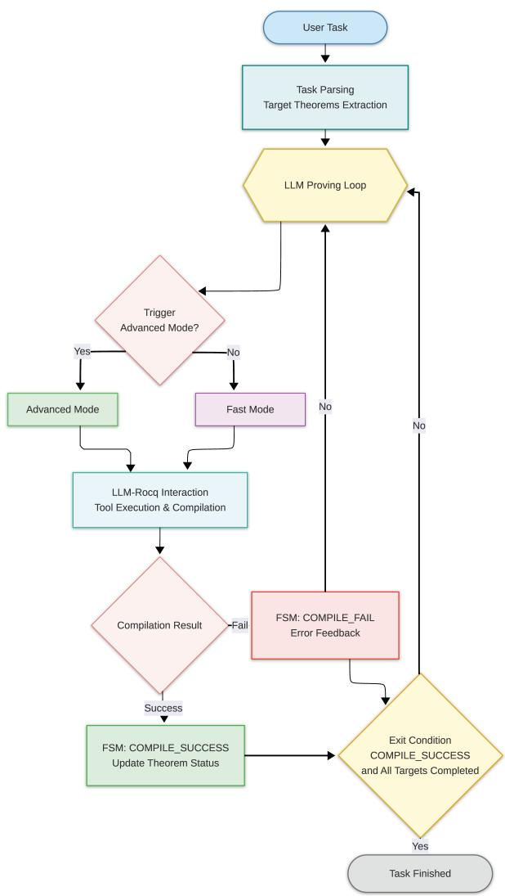
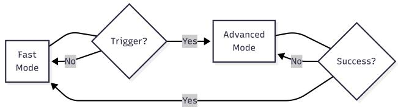
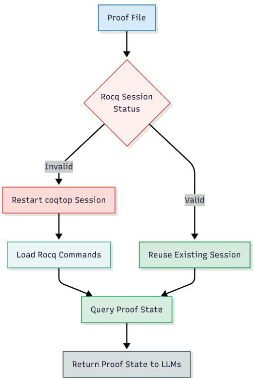

# Math Foundation Formalization Agent: A General-Purpose Approach to Formalizing Mathematical Foundations

Jiaxin Xie, Guowei Dou, Xiang Ji, and Wensheng Yu

School of Electronic Engineering, Beijing University of Posts and Telecommunications, Beijing, China

xiejx@bupt.edu.cn, dgw@bupt.edu.cn, jxxxx2001@bupt.edu.cn, wsyu@bupt.edu.cn

Abstract. Mathematical formalization plays an important role in establishing rigorous and machine-verifiable foundations for mathematical reasoning. With the development of large language models (LLMs) and interactive theorem provers, intelligent agents ofer a promising approach to automating the formalization of mathematical theories. This paper presents the Math Foundation Formalization Agent (MFF-Agent), a general-purpose intelligent agent designed to support formalization tasks across multiple mathematical domains. The agent integrates the reasoning capabilities of large language models with the formal verification capabilities of the Rocq proof assistant. It incorporates task classification, tool-assisted execution, verification feedback, and state-based task management to support the generation, refinement, and verification of formal proofs. Unlike an approach focused on a single mathematical theory, the agent is examined through case studies involving Morse– Kelley axiomatic set theory (MK), real numbers, propositional logic, and equivalences of the axiom of choice. These cases investigate its applicability across mathematical foundations and distinguish source-level completion, interactive verification, and reproducible compilation. The results demonstrate the feasibility of a unified operational framework for heterogeneous foundation-level tasks and clarify the gap between such a framework and a fully integrated mathematical foundation.

Keywords: Formalized mathematics · Autonomous agents · Mathematical foundations · Autoformalization.

## 1 Introduction

Formalized mathematics represents mathematical definitions, statements, and proofs in formal languages that can be mechanically verified by proof assistants, providing a rigorous foundation for reliable mathematical reasoning and computer-assisted mathematics [1]. Over the past decades, interactive theorem provers (i.e., proof assistants) such as Rocq (formerly Coq) [2], Isabelle [3], and Lean [4] have become important tools in formal verification and computational logic [5]. Landmark achievements, including the machine-verified proofs of the four color theorem [6] and the Feit–Thompson theorem [7], have demonstrated the potential of formal methods for establishing mathematical results. Recent advances in large language models (LLMs) have created new opportunities for automating mathematical reasoning and proof development. Integrating LLMs with proof assistants ofers a promising approach to generating proof scripts, interpreting verification feedback, and refining formal proofs through iterative interaction [8–12]. However, the formalization of mathematical foundations raises requirements that are not captured by isolated proof generation. A useful agent must handle heterogeneous requests, maintain long-lived interactions with a proof assistant, reuse declarations across related files, and determine whether the requested task has actually been completed rather than merely whether some source file compiles.

Recent research has explored diverse agent-based approaches to formal mathematical reasoning and proof development. CoqPilot integrates large language models (LLMs) with Coq to generate proof candidates and refine them using feedback from the proof assistant [11], while Numina-Lean-Agent investigates the use of a general-purpose coding agent for a broad range of formal mathematics tasks [12]. Prover Agent further coordinates informal reasoning, formal proof construction, and feedback from Lean, using auxiliary lemma generation to facilitate the discovery of proof strategies for challenging problems [13]. In a complementary direction, LeanAgent adopts a lifelong learning framework to improve generalization across mathematical domains and accumulate knowledge from successive formalization tasks [14]. More recently, Formalizing Mathematics at Scale presents AutoformBot, a multi-agent system that coordinates large-scale formalization through formal verification tools, dependency-aware task scheduling, and collaborative version control [15]. Together, these systems demonstrate substantial progress in proof generation, iterative refinement, knowledge reuse, and large-scale formalization. Their primary emphasis, however, remains proof search performance, long-horizon proof development, or a particular formalization pipeline. In contrast, the present work does not aim primarily to increase the success rate on an isolated theorem benchmark. Its focus is the operational problem of supporting heterogeneous formalization tasks and cross-file foundation artifacts within one execution model, while deciding completion from evidence returned by the proof assistant and task-specific checks.

Research objective. We develop the Math Foundation Formalization Agent (MFF-Agent), a general-purpose agent for formalizing mathematical foundations in Rocq. MFF-Agent processes diferent formalization requests, invokes Rocq through persistent proof-state interaction, adapts its reasoning and context management to task progress, and determines task status from explicit verification conditions rather than from the LLM’s self-report alone.

Main contributions. This paper makes the following contributions:

1. Unified operational framework for foundation-level tasks. MFF-Agent supports heterogeneous tasks, including theorem proving, file creation, modification, analysis, and compilation, across diferent foundational topics.

2. Adaptive formalization process. The agent combines dual-mode reasoning, dynamic interaction with Rocq, and context management to support iterative proof development and long-running formalization tasks.

3. Reliable task completion verification. A state-based control mechanism and task-specific completion checks distinguish successful compilation from the actual completion of the requested formalization task.

The remainder of this paper is organized as follows. Section 2 defines the success criteria for formalization tasks and introduces the evaluation harness. Section 3 presents the MFF-Agent framework, including its overall workflow, dualmode reasoning mechanism, dynamic Rocq session management, verificationdriven task completion control, and context pruning. Section 4 reports the formalization results across the selected mathematical domains and discusses the available verification evidence and current limitations. Finally, Section 5 concludes the paper and outlines directions for future work.

## 2 Success Criteria and Evaluation Harness

Before presenting the overall architecture of the Math Foundation Formalization Agent, we first define the criteria for determining task completion. During preliminary experiments, several types of false-positive completion reports were observed. For example, the large language model (LLM) reported success even though some target theorems remained unproved; a test file generated during the task compiled successfully, leading the agent to incorrectly conclude that the original task was complete; or only part of a multi-theorem task had been completed. These cases indicate that neither the LLM’s self-reported status nor the successful compilation of an arbitrary file is suficient to establish task completion.

To address these issues, we introduce the following design measures:

1. Task-specific completion criteria. The agent distinguishes among five task types: proof, creation, modification, analysis, and compilation. Each type is evaluated according to its corresponding completion requirements.

2. Target-file verification. For proof tasks, compilation success must be associated with the intended target file, rather than a separately generated test file. The agent also checks whether the requested target theorems have been completed.

3. Proof-completeness checks. Constructs such as Admitted, admit, and Abort are treated as indicators of unfinished proofs. These are distinguished from explicit axioms that belong to the underlying formal theory.

4. Programmatic success determination. The agent reports a task as complete only when the applicable checks are satisfied, rather than relying solely on the LLM’s self-reported result.

Together, these measures provide explicit operational criteria for task completion and reduce false-positive success reports across diferent mathematical formalization tasks.

## 3 The MFF-Agent Framework

The overall architecture of the proposed MFF-Agent is illustrated in Fig. 1. The agent integrates the reasoning capability of LLMs with the verification capability of the Rocq proof environment. Although theorem proving is its primary use case, the implementation is not restricted to proof generation: it distinguishes among proof, file-creation, modification, analysis, and compilation tasks. The common workflow consists of task parsing, iterative reasoning, tool execution, and result verification.

  
Fig. 1. The framework of the agent

The agent first receives the user request and constructs a structured task specification containing the task type, source and target files, target theorems when applicable, a natural-language description, and completion criteria. It then enters the main execution loop, selects an appropriate reasoning mode, invokes the LLM, executes file or Rocq tools, and uses the returned compiler or proofstate information in the next iteration. The completion path depends on the task type: proof tasks require compilation and target-proof checks, whereas creation, modification, analysis, and compilation tasks use their respective completion policies.

The loop terminates when a task-specific check succeeds, when an early-stop or clarification condition is reached, or when the iteration budget is exhausted. A task-summary file is generated for every one of these outcomes, including failed and incomplete executions, before the agent returns to the waiting-for-user state.

## 3.1 Dual-Mode Switching Mechanism

During automated formalization, diferent tasks require diferent levels of reasoning capability and contextual information. Excessive context increases token consumption and reasoning overhead for routine operations, whereas insuficient context may prevent the model from finding an efective proof strategy. To balance these costs, the agent employs Fast Mode and Advanced Mode.

The agent starts in Fast Mode. Its prompts contain the current task specification, completion requirements, the latest compiler feedback, and a task-specific action hint, without including the accumulated failure history or a plannergenerated proof plan. The model can directly create or edit Rocq source files and invoke compilation to refine the result. Fast Mode is a prompt and context configuration rather than a restriction on the available tool set; the same Rocq tools remain callable in both modes.

The agent enters Advanced Mode under any of three conditions: ten consecutive compilation failures; a newly reached multiple of five completed target theorems; or an estimated context size above 500,000 tokens when no previous compression exists or the current estimate exceeds the previous post-compression size by more than 30%. Advanced Mode exposes the latest proof state, recent failed attempts, compiler-error categories, and strategy hints. The Planner is invoked only for the ten-failure trigger. The theorem-progress and context-length triggers enter Advanced Mode for context consolidation but do not generate a new Planner result.

  
Fig. 2. Workflow of the dual-mode switching mechanism

As shown in Fig. 2, the mode changes dynamically during execution. When a compilation attempt succeeds, the agent immediately returns to Fast Mode. This transition is based on compilation success, not on full task acceptance: if an additional task-specific check still fails, the agent remains in the execution loop and applies the corresponding incomplete-task feedback.

## 3.2 Dynamic Rocq Session Management

The interaction between the agent and the Rocq environment is implemented by a CoqSession object. A straightforward implementation would launch a new coqtop process and reload the entire proof file for each request. The proposed session instead retains a coqtop subprocess while the source remains unchanged.

Any successful file-creation or replacement operation invalidates the existing session because its loaded state no longer agrees with the source file. The next proof-state request starts a fresh session for the current file; requests for the same unchanged file reuse the existing session. This invalidation rule prevents stale goals from being associated with newly edited source code.

  
Fig. 3. Workflow of dynamic Rocq Session management

The proof-state retrieval path first uses a cached or newly executed coqc result to determine the failing line. If a reliable line number is available, the agent starts a session and sends only complete Vernac commands from the valid prefix before that line. Intermediate outputs are not read for each command; after the prefix is loaded, the agent issues Show. once to obtain the active goal and hypotheses. If no reliable error line can be determined, the agent does not load the whole file into coqtop; it returns a compiler diagnostic, or reports that no active proof can be queried when compilation has already succeeded. The resulting proof-state and compiler information is then returned to the LLM for the next reasoning step.

## 3.3 Verification-driven Task Completion Control

Section 2 defines what acceptance means and how it is evaluated. This subsection describes the runtime mechanism that decides whether the current execution may stop successfully. Completion control combines a finite-state machine with a task-specific completion manager.

The Agent FSM defines six states: INIT, EXECUTING, COMPILE\_SUCCESS, COMPILE\_FAIL, TASK\_SUCCESS, and TASK\_FAIL. A task starts in INIT, and any source edit moves the machine to EXECUTING while invalidating the previous compiler result. A compiler attempt then moves the machine to COMPILE\_SUCCESS or COMPILE\_FAIL. TASK\_SUCCESS is entered after a successful task-level check. TASK\_FAIL is currently a reserved final state: the implementation records failed, incomplete, and input-required outcomes in a separate final\_status, but does not transition the FSM to TASK\_FAIL.

The TaskCompletionManager dispatches according to the task type. For a proof task, TaskCompletionChecker locates the target file and theorem range, requires compilation, and checks each requested declaration for a proof block containing Proof. and ending with Qed. or Defined.. It reports missing proof structures and Admitted.; the current proof checker does not reject an explicitly introduced axiom in a non-target declaration. For creation tasks, the manager requires an existing, nonempty, compiling file, checks general unfinished markers and any named target proofs, and then invokes an LLM goal check. Modification tasks require compilation, a changed file when a baseline was captured, the same unfinished marker check, and an LLM goal check; they do not perform a separate target-proof completeness scan. Compilation tasks require only a successful compiler result and do not inspect unfinished proof markers. Analysis tasks skip compilation and require a substantive textual diagnosis covering a cause, a location, and a repair suggestion.

The completion policies are not yet completely uniform. The general \_find\_admitted helper used for creation and modification rejects Axiom and Conjecture together with unfinished proof markers, whereas the proof-task checker searches only for Admitted. inside the target proof. This diference must be considered when interpreting runtime acceptance.

When the LLM stops calling tools, analysis tasks are checked directly; other task types first require COMPILE\_SUCCESS and then invoke the corresponding completion check. A failed check produces task-specific feedback and the loop continues. Three consecutive no-tool responses without successful completion terminate the current run with a failed status. The runtime path checks compilation and locally implemented task conditions; transitive axiom-footprint inspection and semantic-fidelity review remain part of the evaluation and audit layer in Section 2. Thus, runtime success should not be interpreted as passing those additional gates.

## 3.4 Dynamic Context Pruning

During long-running tasks, the interaction history continuously accumulates. The agent therefore compresses messages when Advanced Mode is active and the conversation exceeds 25 messages. Scale- and context-triggered Advanced Mode entries invoke the compression immediately; failure-triggered entries use the regular Advanced Mode compression. Normal compression retains at most 20 messages and six recent messages. The 30% post-compression growth condition controls re-entry into Advanced Mode after a token-threshold trigger; it is not a universal condition for every compression operation.

The compressor preserves the system message and the message in the second position as the initial user message, then adds a compact summary and recent messages. The summary records the working file, counts of compilation and replacement attempts, the latest compilation error, and the latest observed proof state. Long errors, proof states, and the initial user message are truncated. Because the conversation history persists across tasks, the second message can belong to an earlier task; consequently, later compressions may retain an older task description rather than the newest one.

Recent-message deduplication removes repeated compilation failures and repeated proof-state results, retaining the latest occurrence of each. It does not deduplicate successful compilation results. The failure history is separately limited to three attempts. These attempts are injected into the expanded context when the ten-failure threshold triggers Advanced Mode, but they are not stored as a guaranteed field of the compressed-summary object. If older Advanced Mode messages fall outside the retained recent window, their detailed edit history may therefore be lost, although the latest compiler error and proof state remain in the summary.

This combination of compression, selective deduplication, and bounded failure history keeps the prompt manageable during long executions. The implementation does not yet guarantee that every historical failure or the most recent task description survives across task boundaries, which is an important limitation when interpreting long-horizon behavior.

## 4 Results and Analysis

This section examines MFF-Agent as an intelligent agent for the formalization of mathematical foundations rather than as a collection of isolated Rocq libraries.

We ask what foundational work has been completed, whether the results form reusable dependency chains, what assumptions support their acceptance, and where the current artifact stops short of a unified foundation. The current source snapshot was checked locally with Coq 8.13.2; the earlier agent experiments used Rocq 9.0.1. Because the versions difer, source-level completion, interactive loading, and reproducible compilation are reported as separate forms of evidence.

## 4.1 Completed Foundation Formalization Work

The current artifact contains nine core Rocq source files comprising 24,379 lines and 647 theorem-like declarations, excluding the duplicate copy of MK.v. The directory-local RAxiom/MK.v is treated as a build dependency rather than an additional foundation source. Table 1 summarizes the formalization scope and representative results across the four domains.

Table 1. Formalization scope and representative results across four mathematicalfoundation domains.
<table><tr><td>Domain</td><td>Formalized content</td><td>Representative results</td></tr><tr><td>MK set theory</td><td>Classes and sets; relations and functions; ordinals, cardinals, and finite sets</td><td>The MKT4–MKT181b family, including al- gebraic, order, and cardinality results</td></tr><tr><td>Choice and equivalents</td><td>Finite-characteristic classes, maximal and minimal members, choice functions, partial and total orders, chains, and well-orders</td><td>Tukey&#x27;s lemma, Hausdorff&#x27;s maxi- mal principle, the maximal princi- ple, Zorn&#x27;s lemma, Well0rder_AC, and Zermelo_AC</td></tr><tr><td>Real numbers</td><td>Ordered field and completeness; supre- mum and infimum; N, Z, Q; irrationals; absolute value and distance</td><td>Sup_Corollary, Inf_Corollary, Existence_of_irRational_Number, and Real_struct_isomorphic</td></tr><tr><td>Propositional logic</td><td>Formula syntax, derivability, truth se- mantics, proof systems, and meta- theoretic consistency</td><td>soundness_PC, consistence_PC, and complete</td></tr></table>

The MK layer provides the broadest foundation. It defines classifiers, membership, set and class operations, ordered pairs, Cartesian products, relations, functions, well-orders, ordinals, the set of natural numbers, cardinal numbers, and finite sets, and then develops the numbered MKT results. For MFF-Agent, this layer supplies a stable vocabulary that later tasks can reuse instead of regenerating definitions locally. Its 206 proof-bearing declarations therefore represent both formalized mathematics and a reusable working context for subsequent agent tasks. The MK assumptions are collected in a record containing AI–AIX, while classical logic is supplied separately through classic.

The choice layer is the clearest example of multi-step foundation work. It reuses the MK vocabulary to formalize finite-characteristic classes, maximal and minimal members, choice functions, partial and total orders, chains, well-orders and initial segments. It then follows the dependency chain Basic\_Definitions → Tukey → Maximal\_Principle → Wellordering and Zermelo, proving Tukey’s lemma, Hausdorf’s maximal principle, Zorn’s lemma, the well-ordering result, and Zermelo’s theorem. The corresponding passages back to a choice function are provided by WellOrder\_AC and Zermelo\_AC. This case demonstrates the agent’s intended ability to work across linked files and proof obligations whose meaning depends on earlier foundational declarations.

The real-number work is organized as an axiomatic theory followed by a structural comparison. From an ordered field with completeness, the artifact derives arithmetic and order consequences, equivalent formulations of supremum and infimum, constructions of N, Z and Q, rational density, the existence of an irrational number, Archimedean properties, absolute value and distance. The isomorphism layer then defines preservation of addition, multiplication and order together with bijectivity, and proves that any two structures satisfying the same real-axiom interface are isomorphic. The 339 real-number declarations thus represent both an axiomatic development and a structural classification result, although their current build status is treated separately below.

The propositional-logic layer addresses a meta-theoretic foundation and is currently independent of the MK encoding. It defines formulas, derivability, truth assignments, tautologies and semantic inference, then proves the basic proof-system laws, the deduction theorem, soundness, consistency, and completeness. Auxiliary cardinality results support the completeness argument. This case shows that the same agent workflow can be applied when the object of formalization is a proof calculus rather than a mathematical structure built inside MK.

## 4.2 Verification Evidence and Trust Boundary

The verification evidence is interpreted at three levels. Source-level completion means that a requested declaration contains a complete proof body with no unresolved proof marker. Interactive verification means that the source can be loaded into coqtop, so the proof checker accepts the file in the current environment. Reproducible compilation means that the required imports are present and that a current .vo artifact or a clean compiler run can be obtained. These levels are distinct: a complete source file is not yet a self-contained build artifact.

The existing MK, Basic\_Definitions, Maximal\_Principle and Tukey compilation artifacts load successfully. Querying the assumption footprint of representative theorems in this group returns classic, MK\_Axiom, and the MK primitives Class, In and Classifier. The files Wellordering.v, Zermelo.v and L\_system\_Logic.v execute successfully when loaded into coqtop, although their directories do not contain current .vo outputs. This establishes that the full choice chain from Tukey’s lemma through the maximal principle, Zorn’s lemma, well-ordering and Zermelo’s theorem is accepted by the checker, even though a persistent build workflow is not preserved in the snapshot.

The real-number foundation is now buildable within its own directory. RAxiom/MK.v supplies the required MK interface, and both RAxiom/MK.vo and Real\_Axioms1.vo are current. The complete isomorphism source also loads successfully into coqtop; its main theorem, Real\_struct\_isomorphic, has the assumption footprint classic, MK\_Axiom, and MKS. The 113 declarations in

Real\_Axioms1.v therefore have a reproducible compilation artifact, while the 226 isomorphism declarations are accepted at source and interactive levels but do not yet have a retained .vo. This distinction separates interactive verification from a packaged build artifact.

The trust boundary also determines what the agent has actually established. The MK record contains choice as AIX; therefore, the choice layer proves interderivability on an AC-enabled MK base rather than deriving choice from a base without that principle. The logic soundness proof is closed under the global Coq context, whereas the completeness proof relies on epsilon\_statement and classic. At run time, MFF-Agent organizes these jobs through typed task specifications, a persistent Rocq session, an execution FSM, and task-specific completion checks. These mechanisms are exercised by the structure of the artifact, but the snapshot contains no per-task prompts, tool traces, token counts, or repeated-run logs. We therefore make no claim about solve rates, speedups, or mechanism ablations from this chapter.

## 4.3 Cross-Foundation Analysis and Limitations

The artifact shows that MFF-Agent is intended to operate across distinct levels of mathematical foundation rather than only repair isolated proofs. The MK-tochoice development exhibits genuine vertical reuse: the later declarations consume definitions and results from the MK base instead of restating them. The choice case additionally shows how one formal vocabulary can support several equivalent organizing principles. The real-number isomorphism shows a diferent kind of foundation result: the axiom interface identifies an ordered field up to isomorphism rather than describing only one accidental model. The logic case extends the workflow to a meta-theoretic foundation, where the objects being formalized include formulas, derivations and semantic consequence.

Operational genericity and foundation integration are nevertheless diferent claims. MFF-Agent supports heterogeneous tasks across these cases, but the current dependency structure is not yet a single unified foundation. Propositional logic imports only Coq’s standard libraries and does not build on the MK source. The real-number development is self-contained within Code/RAxiom through its local MK.v, while the choice development reuses another local MK copy. The tree contains two byte-identical MK.v files and a third, non-identical MK module for the real-number build. These issues do not prevent the individual developments from being built, but they prevent the collection from being presented as one canonical dependency closure.

The agent-level boundary is equally important. The runtime completion controller enforces compilation and locally implemented target checks, while transitive axiom-footprint analysis and semantic-fidelity review remain part of the evaluation process rather than a fully integrated runtime certification. Completion policies also difer across task types, and the Code snapshot does not preserve enough execution history to quantify agent performance.

The strongest conclusion supported by the present results is therefore twofold. First, MFF-Agent demonstrates a unified operational approach to formalizing several mathematical foundations, with substantial source-level work and several mechanically accepted proof chains. Second, the artifact has not yet reached the stronger goal of a fully reproducible, uniformly audited mathematical foundation. Establishing that goal requires a single canonical source tree, explicit import and build manifests, complete dependency closure, transitive axiom checking, semantic review, and task-level execution records.

## 5 Conclusion

This paper presented MFF-Agent, an LLM-driven agent for formalizing mathematical foundations in Rocq. The framework combines typed task processing, persistent proof-state interaction, adaptive reasoning and context management, and task-specific completion control. It has been examined on Morse–Kelley set theory, the axiom of choice, real-number theory, and propositional logic. These cases demonstrate operational breadth and concrete dependency reuse, especially in the MK-to-choice chain and the real-number isomorphism development, while distinguishing source-level completion from interactive and packaged verification.

The current results demonstrate the feasibility of a unified execution framework across mathematical-foundation domains. Building on this foundation, future work will establish a complete and unified mathematical foundation, strengthen task completion and trust verification, consolidate the formalized source and build infrastructure, and extend MFF-Agent to broader application areas in mathematics and formal reasoning. The code and accompanying artifacts are available at https://github.com/jiaxinxie2003/ Math-Foundation-Formalization-Agent.

Acknowledgements This work is supported by the National Natural Science Foundation of China under Grant 62476028.

## References

1. M. Koutsoukou-Argyraki, “Formalising mathematics—in praxis,” Informatik Spektrum, vol. 44, no. 2, pp. 107–116, Apr. 2021.

2. The Rocq Development Team, The Rocq Prover Reference Manual, Version 9.2.0, 2025. [Online]. Available: https://rocq-prover.org/doc/V9.2.0/refman/index.html

3. T. Nipkow, L. C. Paulson, and M. Wenzel, Isabelle/HOL: A Proof Assistant for Higher-Order Logic. Berlin, Germany: Springer-Verlag, 2002.

4. L. de Moura and S. Ullrich, “The Lean 4 theorem prover and programming language,” in Automated Deduction–CADE 28, Lecture Notes in Computer Science, vol. 12699. Cham, Switzerland: Springer, 2021, pp. 625–635.

5. B. Barras, “Sets in Coq, Coq in sets,” Journal of Formalized Reasoning, vol. 3, no. 1, pp. 29–48, 2010.

6. G. Gonthier, “Formal proof: The four color theorem,” Notices of the American Mathematical Society, vol. 55, no. 11, pp. 1382–1393, 2008.

7. G. Gonthier, A. Asperti, J. Avigad, et al., “A machine-checked proof of the odd order theorem,” in Interactive Theorem Proving, Lecture Notes in Computer Science, vol. 7998. Berlin, Germany: Springer, 2013, pp. 163–179.

8. K. Yang, G. Poesia, J. He, et al., “Position: Formal mathematical reasoning: A new frontier in AI,” in Proc. 42nd Int. Conf. Mach. Learn. (ICML), ser. Proc. Mach. Learn. Res., vol. 267, 2025, pp. 82384–82398. [Online]. Available: https://proceedings.mlr.press/v267/yang25az.html

9. T. Tao, “Machine-assisted proof,” Notices Amer. Math. Soc., vol. 72, no. 1, pp. 6–13, Jan. 2025, doi: 10.1090/noti3041.

10. K. Buzzard, “What is the point of computers? A question for pure mathematicians,” arXiv:2112.11598, 2021. [Online]. Available: https://arxiv.org/abs/2112.11598

11. A. Kozyrev, G. Solovev, N. Khramov, and A. Podkopaev, “CoqPilot, a plugin for LLM-based generation of proofs,” arXiv:2410.19605, 2024. [Online]. Available: https://arxiv.org/abs/2410.19605

12. J. Liu, Z. Zhou, Z. Zhu, et al., “Numina-Lean-Agent: An open and general agentic reasoning system for formal mathematics,” arXiv:2601.14027, 2026. [Online]. Available: https://arxiv.org/abs/2601.14027

13. K. Baba, C. Liu, S. Kurita, and A. Sannai, “Prover Agent: An Agent-Based Framework for Formal Mathematical Proofs,” arXiv preprint arXiv:2506.19923, 2025.

14. A. Kumarappan, M. Tiwari, P. Song, R. J. George, C. Xiao, and A. Anandkumar, “LeanAgent: Lifelong Learning for Formal Theorem Proving,” in Proceedings of the International Conference on Learning Representations (ICLR), 2025.

15. A. Rammal, N. Patel, F. Gloeckle, A. Hayat, J. Kempe, R. Munos, C. Arnal, and V. Cabannes, “Formalizing Mathematics at Scale,” arXiv preprint arXiv:2605.29955, 2026.