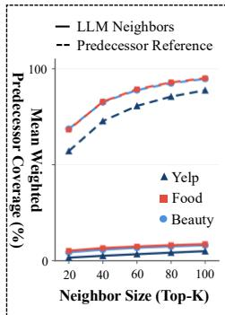
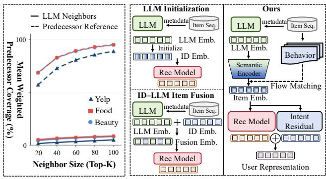
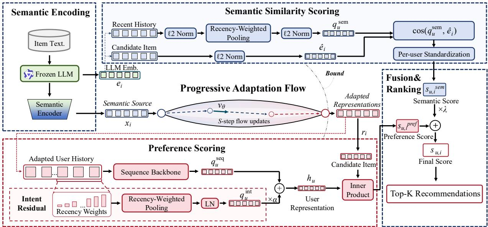
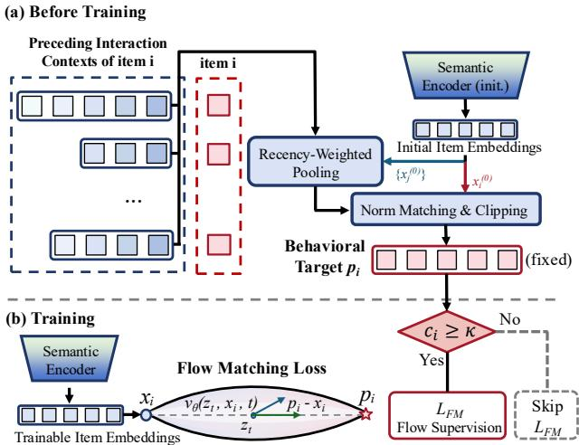
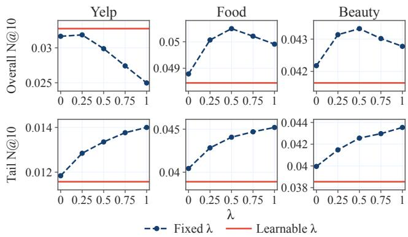
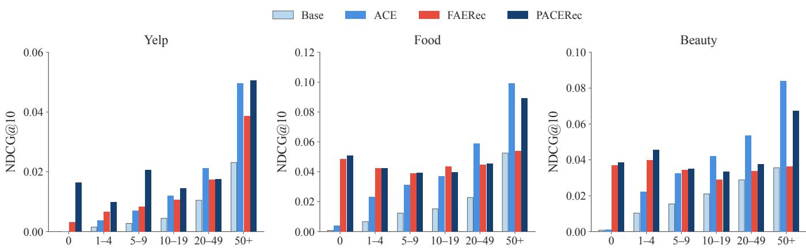
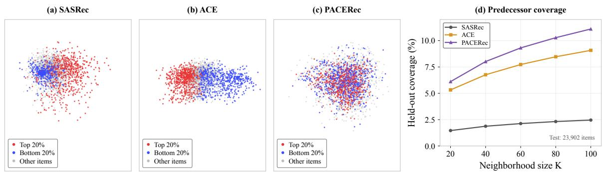
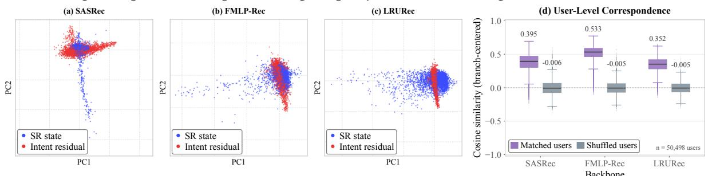

# PACERec: Progressive Adaptation of LLM Item Embeddings with Collaborative Evidence for Recommendation

Junzhao Huang1,\* Xi Wu1,\* Zihan Wang1 Zijing Wang1

Ming Wang1 Kang Liu1 Xiaocui Yang1 Shi Feng1,†

Daling Wang1 Yifei Zhang1 Ting Yang2 Xurui Li2

1School of Computer Science and Engineering,

Northeastern University, Shenyang, China

2Ant Group, China

huangjunzhao@mails.neu.edu.cn wux2@mails.neu.edu.cn fengshi@cse.neu.edu.cn

## Abstract

Large language model (LLM) embeddings have been increasingly adopted in sequential recommendation to encode static item attributes and alleviate the limitations of item ID embeddings under sparse interactions. However, these embeddings typically capture only static content similarity while neglecting sequential transitions, and since their adaptation quality relies on sparse per-item updates or global geometric calibration, existing methods still struggle to explicitly transfer preceding interaction contexts from frequent to long-tail items under unevenly distributed behavioral evidence, limiting recommendation efectiveness across the catalog. To address this challenge, we propose PACERec, an ID-free progressive adaptation framework that incorporates preceding interaction contexts into semantic representation adaptation by learning a shared velocity field from items with suficient interactions via frequencyweighted flow matching. In this way, PACERec progressively guides static LLM embeddings toward collaborative behavioral targets while preserving original item semantics, overcoming sparse peritem updates to efectively generalize sequential transition patterns to long-tail items for both user modeling and candidate scoring. Extensive experiments on three real-world datasets across three sequential backbones demonstrate the superiority of our method over competitive baselines in both overall and long-tail recommendation.

## CCS Concepts

• Information systems → Recommender systems.

## Keywords

Item Representation, Flow Matching, Large Language Models, Long-Tail Sequential Recommendation

## 1 Introduction

Incorporating large language models (LLMs) into sequential recommendation has become a prominent paradigm across modern Web platforms [10, 25, 38], where frozen LLM item embeddings are extracted from static item attributes to compensate for sparse collaborative signals. Compared with conventional models that learn itemspecific ID embeddings solely from interaction data [7, 13, 32, 33], leveraging these content-derived embeddings alleviates the limited collaborative supervision on tail items under data sparsity [34], which would otherwise degrade the item representations needed to capture sequential dependencies and rank candidates efectively. However, because frozen LLM item embeddings are derived solely from static item content, they capture only stable content similarity, which conflicts with the progressive preference transitions in user interactions [6, 29]. For example, after purchasing a digital camera, a user may subsequently seek a compatible lens or memory card rather than another camera with a similar description, illustrating how semantic similarity alone fails to capture evolving user needs. To quantify this discrepancy, we analyze 2,560 frequency-stratified items from each of the Yelp, Food, and Beauty training sets and measure how well an item’s size-� semantic neighborhood covers its training predecessors (items interacted with shortly before this item). Figure 1(a) shows that at � = 20, the nearest semantic neighbors from frozen LLM item embeddings (solid lines) cover only 1.59%–5.22% of training predecessors, versus 57.09%–68.65% for the predecessor reference formed by the 20 most frequent training predecessors (dashed lines). Even at � = 100, semantic neighbors reach only 4.97%–8.66% coverage compared with 88.80%–95.08% for the predecessor reference.

  
(a) Neighborhood Gap  
(b) Paradigm Comparison  
Figure 1: (a) Mean weighted training predecessor coverage on Yelp, Food, and Beauty. Solid curves use the � nearest neighbors in the frozen LLM embedding space. Dashed curves use each item’s � most frequent training predecessors. (b) LLM initialization and ID–LLM fusion versus PACERec’s behaviorguided semantic item adaptation and intent-residual user modeling.

This large discrepancy indicates that relying solely on static LLM item embeddings struggles to capture collaborative transition patterns across user interactions, limiting recommendation performance. Recent studies have begun exploring ways to integrate collaborative signals with LLM item embeddings so that sequential recommenders can benefit from both semantic and behavioral information. Existing approaches generally fall into two categories depending on whether they retain item-specific ID embeddings. As illustrated in Figure 1(b), (i) one line of work retains item-specific ID embeddings via LLM initialization or ID–LLM item fusion, integrating semantic and collaborative information through subspace decomposition, adaptive gating, or cross-view alignment [9, 10, 15, 25, 35, 38]. Meanwhile, to avoid under-trained ID parameters on tail items and enable shared generalization across the catalog, (ii) another line of work drops item-specific ID embeddings and adapts item content representations directly via shared projections or geometric calibration [8, 18, 19]. Generally speaking, these methods treat static item semantics and collaborative signals as two distinct views, aiming to incorporate behavioral information through either per-item ID parameters or global content transformations. Nevertheless, the substantial discrepancy between static content similarity and progressive preference transitions renders per-item ID updates learned from sparse interactions or content projections without explicit supervision from preceding interaction contexts insuficient for aligning item representations with consecutive user needs.

We argue that adapting semantic representations with preceding interaction contexts should account for uneven behavioral evidence across items. Under long-tailed interaction distributions, frequent items accumulate suficient preceding records to estimate reliable behavioral targets, whereas long-tail items have scarce or even zero interactions, making targets estimated directly from their own sparse contexts noisy or unavailable. Treating all estimated behavioral targets as equally reliable can propagate noise into the adaptation process. A key challenge is therefore how to learn a shared adaptation mechanism from reliable behavioral evidence that can generalize collaborative knowledge to long-tail items for both user history modeling and candidate ranking.

To address this challenge, we propose PACERec, a Progressive Adaptation framework that uses Collaborative Evidence from frequent items to improve sequential Recommendation without relying on item-specific ID embeddings. PACERec first applies semantic encoding to project frozen LLM item embeddings into initial semantic representations. For each item, it summarizes the preceding items users typically interact with before selecting it into a behavioral target. Moving an item’s initial representation toward this target injects sequential transition patterns into the representation, aligning the item with the historical contexts under which users are likely to select it next. To perform this adaptation, PACERec uses a progressive adaptation flow via flow matching to learn a shared velocity field that takes item semantics as input and predicts step-by-step update directions toward the behavioral targets. To handle uneven behavioral evidence, only items with suficient interactions are used to supervise this flow with frequency-based weights, while representation changes are constrained to prevent semantic drift. Because the learned flow is shared across the catalog and conditioned on item semantics, it can directly take the semantic representations of long-tail and cold-start items as input to infer their adapted representations, even when they lack reliable behavioral targets of their own. For user modeling and candidate ranking, PACERec combines a sequence backbone with a recencyweighted intent residual branch over the adapted representations for preference scoring, which is fused with parameter-free semantic similarity scoring in the frozen LLM space for full-catalog ranking. Across three real-world datasets and three sequential backbones, PACERec consistently outperforms competitive baselines in both overall and tail-item recommendation. Our main contributions are summarized as follows:

• We present a perspective on LLM-based sequential recommendation that adapts item semantics with preceding interaction contexts under uneven behavioral evidence, supporting both history modeling and candidate ranking.

• We propose PACERec, which learns a shared semantics-conditioned velocity field from frequent items to progressively adapt static item semantics with preceding interaction contexts, enabling ID-free generalization to long-tail items.

• We conduct extensive experiments on three real-world datasets across three sequential recommendation backbones, demonstrating the superiority of PACERec in both overall and tail-item recommendation as well as the efectiveness of its key designs.

## 2 Related Work

2.1 Sequential and Long-Tail Recommendation Sequential recommenders adopt recurrent (GRU4Rec [7]), convolutional (Caser [33]), attentive (NARM [17]), self-attentive (SAS-Rec [13], BERT4Rec [32], S3-Rec [46], LightSANs [5]), frequencyfiltering (FMLP-Rec [47]), or linear-recurrent (LRURec [43]) backbones, yet learning item-specific ID embeddings leaves tail items with sparse collaborative supervision [34].

To enhance tail items within ID-based paradigms, CITIES [12] infers tail embeddings from surrounding contexts, TailRec [3] filters cross-sequence neighbor contexts, MELT [14] couples mutually reinforcing user and item branches, and TADA [4] augments sequences via co-occurrence substitution, insertion, and mixing. While PACERec’s behavioral targets resemble the transition neighbor aggregation in graph recommenders (SR-GNN [39], GCE-GNN [36]), they serve purely as fixed targets for a shared semantics-conditioned velocity field, enabling even zero-interaction items to obtain behavior-adapted representations.

## 2.2 LLM-Enhanced Recommendation

One line of LLM-enhanced recommenders retains item-specific ID parameters alongside text embeddings: LLM-ESR [25] couples dualview modeling with retrieval-augmented self-distillation, SAGE-Rec [35] aligns semantic prototypes via user-level distillation, AlphaFuse [10] learns ID embeddings in sparse semantic subspaces, and FAERec [38] integrates gated fusion with multi-level alignment; however, their item-specific parameters still sufer from sparse tail supervision.

Another line adapts content representations directly without item IDs [8, 18]: UniSRec [9] learns transferable adaptors via parametric whitening and mixture-of-experts projections, ACE [15] calibrates anisotropy via a linear autoencoder before training, and

GenAIR [19] calibrates LLM-generated audience archetypes via feature repulsion, yet these transformations lack explicit supervision from preceding interaction contexts. Although Let It Go [31] adds norm-bounded per-item deltas to frozen content embeddings, such per-item updates remain sparsely supervised on tail items. PACERec instead predicts bounded behavioral adaptations from item semantics via a shared velocity field.

## 2.3 Cold-Start and Generative Recommendation

Cold-start methods map item content to warm collaborative embeddings via input dropout (DropoutNet [34]), mixture-of-experts projections (Heater [48]), contrastive alignment (CLCRec [37]), warmto-cold distillation (ALDI [11]), uncertainty modeling (EUMR [16]), or difusion (DifCold [44]). Whereas their targets are warm ID embeddings or teacher outputs, PACERec is fully ID-free and derives behavioral targets from preceding interaction contexts. More over, while difusion and flow matching [21, 26] typically generate next-item states (DifuRec [20], FMRec [23]) or interaction vectors (FlowCF [22]) at inference time, PACERec uses flow matching to learn adapted item representations that are cached ofline for both history encoding and candidate scoring.

## 3 Preliminaries

## 3.1 Sequential Recommendation

Let I denote the item catalog and U the set of users. Each user � ∈ U has an ordered interaction history $\mathcal { H } _ { u } = ( i _ { u , 1 } , \ldots , i _ { u , N _ { u } } )$ , where $N _ { u }$ is the history length and $i _ { u , n } \in \mathcal { I }$ is the item at position �. In our setting, each item $i \in \mathcal { I }$ is associated with textual attributes, from which a pretrained LLM produces a frozen embedding $e _ { i } \in \mathbb { R } ^ { d _ { e } }$ where $d _ { e }$ denotes the embedding dimension.

Given $\mathcal { H } _ { u } ,$ a sequential recommender assigns each candidate item $i \in \mathcal { I }$ a score $s _ { u , i } ~ \equiv ~ s ( u , i ~ \mid ~ \mathcal { H } _ { u } )$ and recommends the � highest-scoring items to predict the user’s next interaction.

## 3.2 Flow Matching

To progressively transform semantic source representations toward adapted item representations, we build on flow matching [21], which learns a time-dependent velocity field that transforms a source distribution into a target distribution. We consider the linear interpolation formulation [26].

Let $( z _ { 0 } , z _ { 1 } ) \in \mathbb { R } ^ { d } \times \mathbb { R } ^ { d }$ denote a paired source and target drawn from a joint distribution �, where � denotes the dimension of the item representation space. For � ∼ Uniform(0, 1), the interpolated state is

$$
z _ { t } = ( 1 - t ) z _ { 0 } + t z _ { 1 } .\tag{1}
$$

We use a source-conditioned velocity field $v _ { \theta } ( z , z _ { 0 } , t )$ , which additionally takes the source point $z _ { 0 }$ as a condition and predicts the target velocity along the interpolation path. The corresponding flow matching objective is

$$
\begin{array} { r } { \mathcal { L } _ { \mathrm { F M } } ( \theta ) = \mathbb { E } _ { ( z _ { 0 } , z _ { 1 } ) \sim \pi , t } \left[ \| v _ { \theta } ( z _ { t } , z _ { 0 } , t ) - ( z _ { 1 } - z _ { 0 } ) \| _ { 2 } ^ { 2 } \right] . } \end{array}\tag{2}
$$

Because Eq. (2) evaluates �� only at sampled interpolation states, computing this training objective requires no ODE integration. To transform a source point, we numerically integrate the ODE $d z ( t ) / d t = v _ { \theta } ( z ( t ) , z _ { 0 } , t )$ with $z ( 0 ) = z _ { 0 }$ from $t = 0$ to � = 1 [2]. In PACERec, we instantiate this formulation by pairing each item’s semantic source representation $z _ { 0 } = x _ { i }$ with a behavior-derived target $z _ { 1 } = p _ { i }$ to supervise the shared velocity field $v _ { \theta } ,$ and integrate $v _ { \theta }$ from �� to obtain its adapted representation $r _ { i } \in \mathbb { R } ^ { d }$ (Section 4.1).

## 4 Method

PACERec progressively adapts LLM-derived item representations toward collaborative behavior through two main modules, namely item representation adaptation and user representation and candidate scoring (Figure 2). First, for item representation adaptation (Section 4.1 and Figure 3), Semantic Encoding projects frozen LLM item embeddings into semantic source representations, and Progressive Adaptation Flow transforms them into adapted representations across the catalog under the supervision of preceding interaction contexts. Second, for user representation and candidate scoring (Section 4.2), Preference Scoring encodes user histories over the adapted representations by combining a sequence backbone with a recency-weighted Intent Residual, while Semantic Similarity Scoring evaluates candidate similarity in the frozen LLM space for final Fusion and Ranking. Finally, Section 4.3 presents the joint optimization objective.

## 4.1 Item Representation Adaptation

Semantic sources. As shown in Figure 2, a trainable semantic encoder maps each frozen LLM item embedding into the representation space of the recommendation backbone, giving the semantic source representation $x _ { i } = E _ { \phi } ( e _ { i } ) \in \mathbb { R } ^ { d } . E _ { \phi }$ is a two-layer MLP with layer normalization at its input and output. Since $E _ { \phi }$ relies solely on frozen embeddings derived from static item attributes, cold-start items absent from the training sequences also receive valid source representations.

To preserve the principal semantic geometry of the frozen embeddings upon dimensionality reduction, we initialize the output projection of $E _ { \phi }$ by least squares so that the initial sources $x _ { i } ^ { ( 0 ) }$ approximate the standardized leading-� PCA coordinates of $\{ e _ { i } \} _ { i \in \mathcal { I } } .$ Both the behavioral targets and the semantic anchor use these initial source representations $x _ { i } ^ { ( 0 ) }$ (Figure 3(a)) as a fixed reference. During training, the encoder $E _ { \phi }$ is optimized jointly with the recommender, so the current sources $x _ { i }$ evolve while $e _ { i }$ and $x _ { i } ^ { ( 0 ) }$ remain fixed.

Flow updates. Following the source-conditioned formulation in Eq. (2), we instantiate the velocity field as $v _ { \theta } ( z , x _ { i } , t )$ , where $x _ { i }$ denotes the semantic source and � the evolving item representation. Starting from $x _ { i } ,$ we generate adapted representations through � deterministic Euler updates with uniform step size $1 / S$ and midpoint time inputs:

$$
\begin{array} { r } { z _ { i } ^ { ( k + 1 ) } = z _ { i } ^ { ( k ) } + \frac { 1 } { S } v _ { \theta } \big ( z _ { i } ^ { ( k ) } , x _ { i } , \frac { k + 1 / 2 } { S } \big ) , \qquad z _ { i } ^ { ( 0 ) } = x _ { i } , } \end{array}\tag{3}
$$

for $k = 0 , \ldots , S - 1$ , with the source condition $x _ { i }$ fixed throughout integration. We apply a smooth radial bound to the accumulated displacement $\Delta _ { i } = z _ { i } ^ { ( S ) } - x _ { i } \colon$

$$
r _ { i } = x _ { i } + \rho \operatorname { t a n h } \Bigl ( \frac { \| \Delta _ { i } \| _ { 2 } } { \rho } \Bigr ) \frac { \Delta _ { i } } { \| \Delta _ { i } \| _ { 2 } } ,\tag{4}
$$

where $r _ { i } = x _ { i }$ when $\Delta _ { i } = 0 .$ . This displacement bound preserves the displacement direction and keeps its magnitude below the bound radius $\rho .$ We parameterize $v _ { \theta }$ with a sinusoidal time embedding and two residual MLP blocks, and zero-initialize its output layer so that the initial flow implements the identity mapping $r _ { i } = x _ { i }$

  
Figure 2: Overview of PACERec at inference. The adaptation flow transforms each semantic source �� into an adapted representation $r _ { i }$ for preference scoring, which is fused with semantic similarity for top-� ranking.

Behavioral targets. The behavioral target of item � summarizes the preceding items that users interact with shortly before selecting � in the training sequences, capturing the historical transition contexts under which item � is likely to be selected next. Let $C _ { i } ^ { ( l ) }$ denote the multiset of lag-� predecessors of item �, i.e., items occurring exactly � steps before occurrences of item � in the training sequences. We pool their initial source representations with recency weights:

$$
\bar { p } _ { i } = \frac { \sum _ { l = 1 } ^ { L } w _ { l } \sum _ { j \in C _ { i } ^ { ( l ) } } x _ { j } ^ { ( 0 ) } } { \sum _ { l = 1 } ^ { L } w _ { l } | C _ { i } ^ { ( l ) } | } ,\tag{5}
$$

where � is the context window and the recency weights �� decay exponentially with the lag �. Since averaging multiple predecessors shrinks the representation norm relative to the initial source $x _ { i } ^ { ( 0 ) }$ we first apply norm matching to rescale $\bar { p } _ { i }$ as $\tilde { p } _ { i } = \| x _ { i } ^ { ( 0 ) } \| _ { 2 \bar { p } i } / \| \bar { p } _ { i } \| _ { 2 }$ Furthermore, to keep each supervision target consistent with the displacement bound $\rho$ in Eq. (4), we clip its displacement from $x _ { i } ^ { ( 0 ) }$ to obtain the behavioral target $p _ { i } = x _ { i } ^ { ( 0 ) } + \mathrm { c l i p } _ { \rho } ( \tilde { p } _ { i } - x _ { i } ^ { ( 0 ) } )$ , where clip $\rho ( \delta ) = \delta \operatorname* { m i n } ( 1 , \rho / \lVert \delta \rVert _ { 2 } )$ . When item � has no preceding context in the training sequences, we set $p _ { i } = x _ { i } ^ { ( 0 ) }$ . These behavioral targets $\{ p _ { i } \} _ { i \in \mathcal { I } }$ are pre-computed once from the initial sources $\{ x _ { i } ^ { ( 0 ) } \} _ { i \in \mathcal { I } }$ before training and remain fixed, keeping them independent of the trainable encoder $E _ { \phi }$ during optimization.

Flow matching supervision. Flow matching instantiates the coupling � of Section 3.2 with one pair per item, $( z _ { 0 } , z _ { 1 } ) = ( x _ { i } , p _ { i } )$ Let the training count $c _ { i }$ be the number of occurrences of item � in the training sequences, counting repeated interactions. To ensure that the velocity field is supervised by reliable behavioral targets, in each mini-batch B with distinct positive target items $\mathcal { P } _ { \mathcal { B } }$ , we restrict flow matching supervision to the subset ${ \mathcal { G } } _ { \mathcal { B } } = \left\{ i \in { \mathcal { P } } _ { \mathcal { B } } : c _ { i } \geq \kappa \right\}$ whose counts reach an evidence threshold �. For each eligible item $i \in { \mathcal { G } } _ { \mathcal { B } }$ , we sample $t _ { i } \sim \mathrm { U n i f o r m } ( 0 , 1 )$ , construct the interpolation state $z _ { t _ { i } } = ( 1 - t _ { i } ) x _ { i } + t _ { i } p _ { i }$ , and train the velocity field to predict the target velocity $\mathbf { \nabla } p _ { i } - x _ { i } \mathbf { : }$

$$
\mathcal { L } _ { \mathrm { F M } } = \sum _ { i \in \mathcal { G } _ { \mathcal { B } } } \bar { \omega } _ { i } \frac { 1 } { d } \big \| v _ { \theta } ( z _ { t _ { i } } , x _ { i } , t _ { i } ) - ( p _ { i } - x _ { i } ) \big \| _ { 2 } ^ { 2 } ,\tag{6}
$$

where � is the largest integer such that items with $c _ { i } \geq \kappa$ account for at least 90% of training interactions $\begin{array} { r } { ( \mathrm { i . e . , } \sum _ { i : c _ { i } \geq \kappa } c _ { i } \geq 0 . 9 \sum _ { i } c _ { i } ) , \bar { \omega } _ { i } = } \end{array}$ $\omega _ { i } / \sum _ { j \in { \mathcal { G } } _ { \mathcal { B } } } \omega _ { j }$ normalizes the confidence weights � $_ i = \sqrt { c _ { i } / ( c _ { i } + c _ { 0 } ) }$ with a smoothing constant $c _ { 0 } > 0 ;$ , and $\mathcal { L } _ { \mathrm { F M } } = 0$ when $\mathcal { G } _ { \mathcal { B } }$ is empty.

## 4.2 User Representation and Candidate Scoring

Preference scoring. Given user history $\mathcal { H } _ { u }$ , the sequence backbone $B _ { \psi }$ encodes the ordered history of adapted item representations and returns its last hidden state $q _ { u } ^ { \mathrm { s e q } }$ (Figure 2). In parallel, an intent summary pools the adapted representations with recency weights and parameter-free layer normalization:

$$
q _ { u } ^ { \mathrm { i n t } } = \mathrm { L N } \left( \frac { \sum _ { j \in \mathcal { T } _ { u } } w _ { j } ^ { \mathrm { i n t } } r _ { u , - j } } { \sum _ { j \in \mathcal { T } _ { u } } w _ { j } ^ { \mathrm { i n t } } } \right) ,\tag{7}
$$

where $\mathcal { T } _ { u }$ indexes all items in the retained history of at most 50 recent interactions and $r _ { u , - j }$ is the adapted representation of the item � steps before the most recent interaction $( j = 0$ for the most recent item). The weights $w _ { j } ^ { \mathrm { i n t } }$ decay exponentially with �. Unlike the behavioral targets in Eq. (5), which pool fixed initial sources, the intent summary pools the current adapted representations.

We form the user representation $h _ { u } = q _ { u } ^ { \mathrm { s e q } } + \alpha q _ { u } ^ { \mathrm { i n t } }$ , where the mixing weight � is a learnable scalar bounded by a scaled sigmoid. Candidate item � receives the preference score $s _ { u , i } ^ { \mathrm { p r e f } } = \langle h _ { u } , r _ { i } \rangle$

  
Figure 3: Training of the adaptation flow: (a) ofline construction of fixed behavioral targets $\mathscr { p } _ { i }$ before training, and (b) flow matching supervision for items with $c _ { i } \geq \kappa$ during training.

Scorefusion. A semantic similarity branch scores candidates directly in the frozen LLM embedding space. We $\ell _ { 2 }$ -normalize each embedding as $\boldsymbol { \hat { e } } _ { i } = \boldsymbol { e } _ { i } / \lVert \boldsymbol { e } _ { i } \rVert _ { 2 }$ , pool the normalized embeddings of the most recent items with exponentially decaying weights, and $\ell _ { 2 } \cdot$ -normalize the pooled vector to obtain the semantic query $q _ { u } ^ { \mathrm { s e m } }$ The semantic similarity score is $s _ { u , i } ^ { \mathrm { s e m } } = \zeta _ { u } ( \cos ( q _ { u } ^ { \mathrm { s e m } } , \hat { e } _ { i } ) )$ , where $\zeta _ { u }$ applies z-score standardization across the full catalog for each user. This standardization removes user-specific shifts and scales in cosine similarities, so that a single fusion weight � applies to all users. The final recommendation score is

$$
\begin{array} { r } { s _ { u , i } = s _ { u , i } ^ { \mathrm { p r e f } } + \lambda s _ { u , i } ^ { \mathrm { s e m } } . } \end{array}\tag{8}
$$

The branch has no trainable parameters and is added only after training, with � selected on validation data.

## 4.3 Joint Optimization

All trainable components are optimized jointly in a single stage.

Ranking supervision. For each training event (�, �), the model predicts the item $i _ { u , n }$ from the preceding items $\big ( i _ { u , 1 } , \dots , i _ { u , n - 1 } \big ) ;$ which give the user representation $h _ { u , n }$ . We use a sampled soft max [1] over preference scores with a sampling-bias correction [42]. With $s ^ { + } = \langle h _ { u , n } , r _ { i _ { u , n } } \rangle$ and $s _ { j } = \langle h _ { u , n } , r _ { j } \rangle$

$$
\ell _ { u , n } = - \log \frac { \exp ( s ^ { + } ) } { \exp ( s ^ { + } ) + \sum _ { j \in { \cal N } _ { \mathscr { B } } } \exp \bigl ( s _ { j } - \log ( M Q _ { j } ) \bigr ) } ,\tag{9}
$$

where $N _ { \mathcal { B } }$ contains � negatives shared by all events in mini-batch B, drawn from $Q _ { j } \propto c _ { j } ^ { \beta }$ after removing the batch positives, and $\log ( M Q _ { j } )$ corrects for the sampling distribution. To emphasize long-tail items, we assign higher weights to infrequent positive items, $w _ { u , n } ^ { + } = \mathrm { c l i p } ( \sqrt { c _ { \mathrm { m e d } } / c _ { i _ { u , n } } } , w _ { \mathrm { m i n } } , w _ { \mathrm { m a x } } )$ , where $c _ { \mathrm { m e d } }$ is the median training count of the positive items over training events and $[ w _ { \mathrm { m i n } } , w _ { \mathrm { m a x } } ]$ bounds the weights. The ranking loss $\mathcal { L } _ { \mathrm { r a n k } }$ averages $\ell _ { u , n }$ over the training events in B, weighted by $w _ { u , n } ^ { + }$ . The auxiliary intent loss $\mathcal { L } _ { \mathrm { i n t } }$ applies the same objective with the intent summary $q _ { u , n } ^ { \mathrm { i n t } }$ in place of the user representation $h _ { u , n }$ . Here, the confidence weighting $\omega _ { i }$ in Eq. (6) emphasizes reliable behavioral targets from frequent items, while the positive-item weighting $w _ { u , n } ^ { + }$ increases the contribution of infrequent items to ranking optimization.

Semantic anchoring and joint objective. We penalize drift of the trainable source representations from their initialization with the semantic anchor $\begin{array} { r } { \mathcal { L } _ { \mathrm { a n c h o r } } = \frac { 1 } { | \mathcal { I } _ { \mathcal { B } } | } \sum _ { i \in \mathcal { I } _ { \mathcal { B } } } \frac { 1 } { d } \| x _ { i } - x _ { i } ^ { ( 0 ) } \| _ { 2 } ^ { 2 } } \end{array}$ , averaged over the distinct items $\mathcal { T } _ { \mathcal { B } }$ in the batch. The anchor complements the displacement bound in Eq. (4): the bound constrains $\| r _ { i } - x _ { i } \| _ { 2 }$ , while the anchor penalizes $\| x _ { i } - x _ { i } ^ { ( 0 ) } \| _ { 2 } ^ { 2 }$ . The training objective is:

$$
\begin{array} { r } { \mathcal { L } = \mathcal { L } _ { \mathrm { r a n k } } + \gamma _ { \mathrm { i n t } } \mathcal { L } _ { \mathrm { i n t } } + \gamma _ { \mathrm { F M } } \mathcal { L } _ { \mathrm { F M } } + \gamma _ { \mathrm { a n c h o r } } \mathcal { L } _ { \mathrm { a n c h o r } } . } \end{array}\tag{10}
$$

During training, adapted item representations are recomputed for each mini-batch using the current model parameters. While flow matching (Eq. (6)) and the semantic anchor act only on the item adaptation side $( E _ { \phi }$ and $v _ { \theta } ) _ { : }$ the ranking losses update the semantic encoder $E _ { \phi } ,$ sequence backbone $B _ { \psi }$ , mixing weight �, and velocity field $v _ { \theta }$ through the � integration steps that produce $r _ { i } ( \mathrm { E q . } ( 3 ) )$ . At inference, the adapted representations $\{ r _ { i } \} _ { i \in \mathcal { I } }$ of all catalog items are computed once and cached.

## 5 Experiments

## 5.1 Experiment Setup

Datasets. Following the data preprocessing setup ofFAERec [38], we evaluate PACERec on three real-world datasets, Beauty and Food [28], and Yelp [41]. All three exhibit sparse interactions and long-tailed item distributions. Beauty and Food have shorter histories than Yelp, enabling overall and tail-item evaluation under varying interaction support. For each user, we reserve the last interaction for testing and the penultimate interaction for validation, using earlier interactions for training. Detailed dataset settings and preprocessing procedures are provided in Appendix A.1.

Backbones and Baselines. We evaluate all methods across three sequential backbones, including SASRec [13], FMLP-Rec [47], and LRURec [43], where Base refers to the unenhanced backbone trained solely on interaction data. We group the remaining baselines by their primary mechanisms into ID–semantic integration (Alpha-Fuse [10] and FAERec [38]), semantic knowledge transfer (LLM-ESR [25] and SAGE-Rec [35]), semantic representation refinement (ACE [15] and GenAIR [19]), and cold-start item representation learning (EUMR [16] and DifCold [44]). Detailed descriptions are provided in Appendix A.2.

Evaluation Metrics. Following prior studies [10, 15, 38], we report Hit Rate and Normalized Discounted Cumulative Gain at $K =$ 10 (Hit@10 and NDCG@10) under full-catalog ranking. Following standard long-tail evaluation protocols [14, 25, 38], we define the most frequent 20% of items as head items and the remainder as tail items based solely on training interaction frequencies. Overall metrics are computed over all test instances, while Tail metrics are computed over those whose target items belong to the tail group.

Implementation Details. We use frozen Qwen3-Embedding-4B [45] to extract 2,560-dimensional LLM item embeddings and set the representation dimension to � = 256. PACERec is trained for 320 epochs using AdamW [27] with an initial learning rate of 0.0003 and a batch size of 128. We use � = 2 integration steps, bound radius � = 2, and � = 512 shared negatives; the evidence threshold is � = 5 on Yelp and � = 2 on Beauty and Food. We select the checkpoint by validation Overall NDCG@10 with � = 0, and then select the fusion weight � ∈ {0, 0.25, 0.5, 0.75, 1} by the sum of validation Overall and Tail NDCG@10, preferring the larger � on ties. Appendix A Table 5 lists all hyperparameters.

Table 1: Overall and tail-item recommendation performance on three datasets. H@10 and N@10 denote Hit@10 and NDCG@10, respectively. Base denotes the sequence backbone trained solely on interaction data, and Tail evaluates test instances whose target items fall outside the most frequent 20% of training items. The best result is highlighted in bold, and the best baseline is underlined. Impr. denotes the relative improvement of PACERec over the best baseline.
<table><tr><td rowspan="2">Backbone</td><td rowspan="2">Method</td><td colspan="4">Yelp</td><td colspan="4">Food</td><td colspan="4">Beauty</td></tr><tr><td>Overall</td><td></td><td>Tail</td><td></td><td>Overall</td><td></td><td>Tail</td><td></td><td>Overall</td><td></td><td>Tail</td><td></td></tr><tr><td></td><td></td><td>H@10</td><td>N@10</td><td>H@10</td><td>N@10</td><td>H@10</td><td>N@10</td><td>H@10</td><td>N@10</td><td>H@10</td><td>N@10</td><td>H@10</td><td>N@10</td></tr><tr><td rowspan="10">SASRec</td><td>Base</td><td>0.0280</td><td>0.0134</td><td>0.0056</td><td>0.0026</td><td>0.0335</td><td>0.0170</td><td>0.0093</td><td>0.0053</td><td>0.0339</td><td>0.0177</td><td>0.0146</td><td>0.0085</td></tr><tr><td>LLM-ESR</td><td>0.0513</td><td>0.0261</td><td>0.0027</td><td>0.0012</td><td>0.0322</td><td>0.0159</td><td>0.0030</td><td>0.0013</td><td>0.0226</td><td>0.0111</td><td>0.0005</td><td>0.0002</td></tr><tr><td>AlphaFuse</td><td>0.0561</td><td>0.0283</td><td>0.0087</td><td>0.0038</td><td>0.0717</td><td>0.0382</td><td>0.0361</td><td>0.0193</td><td>0.0566</td><td>0.0295</td><td>0.0305</td><td>0.0159</td></tr><tr><td>EUMR</td><td>0.0359</td><td>0.0181</td><td>0.0027</td><td>0.0014</td><td>0.0345</td><td>0.0178</td><td>0.0080</td><td>0.0046</td><td>0.0338</td><td>0.0180</td><td>0.0147</td><td>0.0089</td></tr><tr><td>SAGE-Rec</td><td>0.0514</td><td>0.0270</td><td>0.0012</td><td>0.0006</td><td>0.0300</td><td>0.0151</td><td>0.0006</td><td>0.0003</td><td>0.0207</td><td>0.0106</td><td>0.0027</td><td>0.0015</td></tr><tr><td>ACE</td><td>0.0563</td><td>0.0289</td><td>0.0124</td><td>0.0059</td><td>0.0714</td><td>0.0404</td><td>0.0328</td><td>0.0190</td><td>0.0622</td><td>0.0370</td><td>0.0294</td><td>0.0182</td></tr><tr><td>GenAIR</td><td>0.0471</td><td>0.0236</td><td>0.0110</td><td>0.0057</td><td>0.0535</td><td>0.0290</td><td>0.0219</td><td>0.0127</td><td>0.0332</td><td>0.0173</td><td>0.0098</td><td>0.0055</td></tr><tr><td>FAERec</td><td>0.0459</td><td>0.0237</td><td>0.0147</td><td>0.0078</td><td>0.0781</td><td>0.0446</td><td>0.0727</td><td>0.0429</td><td>0.0617</td><td>0.0357</td><td>0.0658</td><td>0.0388</td></tr><tr><td>DiffCold PACERec</td><td>0.0382</td><td>0.0190</td><td>0.0054</td><td>0.0030</td><td>0.0406</td><td>0.0229</td><td>0.0152</td><td>0.0091</td><td>0.0369</td><td>0.0214</td><td>0.0170</td><td>0.0108</td></tr><tr><td>Impr.</td><td>0.0603 7.14%</td><td>0.0310 7.28%</td><td>0.0270 83.10%</td><td>0.0139 79.12%</td><td>0.0903 15.60%</td><td>0.0495 10.99%</td><td>0.0779 7.15%</td><td>0.0436 1.61%</td><td>0.0753 21.15%</td><td>0.0428 15.55%</td><td>0.0744 13.03%</td><td>0.0436 12.18%</td></tr><tr><td rowspan="10"></td><td></td><td></td><td></td><td></td><td></td><td></td><td></td><td></td><td>0.0043</td><td></td><td>0.0144</td><td>0.0091</td><td>0.0067</td></tr><tr><td>Base LLM-ESR</td><td>0.0168 0.0458</td><td>0.0082</td><td>0.0023</td><td>0.0012</td><td>0.0282</td><td>0.0150</td><td>0.0066</td><td></td><td>0.0254 0.0192</td><td>0.0091</td><td>0.0010</td><td>0.0005</td></tr><tr><td>AlphaFuse</td><td>0.0549</td><td>0.0233 0.0288</td><td>0.0010 0.0100</td><td>0.0004 0.0048</td><td>0.0281 0.0733</td><td>0.0140 0.0388</td><td>0.0051 0.0390</td><td>0.0025 0.0204</td><td>0.0585</td><td>0.0304</td><td>0.0316</td><td>0.0164</td></tr><tr><td>EUMR</td><td>0.0272</td><td>0.0129</td><td>0.0056</td><td>0.0030</td><td>0.0364</td><td>0.0192</td><td>0.0126</td><td>0.0072</td><td>0.0358</td><td>0.0190</td><td>0.0176</td><td>0.0107</td></tr><tr><td>SAGE-Rec</td><td>0.0454</td><td>0.0231</td><td>0.0010</td><td>0.0004</td><td>0.0289</td><td>0.0141</td><td>0.0050</td><td>0.0025</td><td>0.0256</td><td>0.0130</td><td>0.0053</td><td>0.0028</td></tr><tr><td>ACE</td><td>0.0594</td><td>0.0306</td><td>0.0102</td><td>0.0051</td><td>0.0718</td><td>0.0409</td><td>0.0266</td><td>0.0156</td><td>0.0648</td><td>0.0389</td><td>0.0282</td><td>0.0178</td></tr><tr><td>GenAIR</td><td>0.0521</td><td>0.0266</td><td>0.0131</td><td>0.0061</td><td>0.0605</td><td>0.0332</td><td>0.0256</td><td>0.0152</td><td>0.0397</td><td>0.0213</td><td>0.0163</td><td>0.0091</td></tr><tr><td>FAERec</td><td>0.0227</td><td>0.0119</td><td>0.0166</td><td>0.0088</td><td>0.0711</td><td>0.0407</td><td>0.0674</td><td>0.0400</td><td>0.0593</td><td>0.0346</td><td>0.0661</td><td>0.0390</td></tr><tr><td>DiffCold</td><td>0.0282</td><td>0.0146</td><td>0.0035</td><td>0.0021</td><td>0.0369</td><td>0.0199</td><td>0.0114</td><td>0.0067</td><td>0.0343</td><td>0.0198</td><td>0.0153</td><td>0.0099</td></tr><tr><td>PACERec</td><td>0.0646</td><td>0.0339</td><td>0.0270</td><td>0.0151</td><td>0.0931</td><td>0.0526</td><td>0.0797</td><td>0.0473</td><td>0.0792</td><td>0.0452</td><td>0.0774</td><td>0.0452</td></tr><tr><td>Impr.</td><td>8.80%</td><td>10.69%</td><td>62.57%</td><td>71.95%</td><td>27.00%</td><td>28.41%</td><td>18.22%</td><td>18.19%</td><td>22.22%</td><td>16.20%</td><td>17.10%</td><td>15.90%</td></tr><tr><td rowspan="10">LRURec</td><td>Base</td><td>0.0303</td><td>0.0147</td><td>0.0037</td><td>0.0023</td><td>0.0343</td><td>0.0178</td><td>0.0098</td><td>0.0057</td><td>0.0350</td><td>0.0183</td><td>0.0140</td><td>0.0083</td></tr><tr><td>LLM-ESR</td><td>0.0522</td><td>0.0270</td><td>0.0012</td><td>0.0004</td><td>0.0358</td><td>0.0180</td><td>0.0012</td><td>0.0007</td><td>0.0253</td><td>0.0125</td><td>0.0029</td><td>0.0015</td></tr><tr><td>AlphaFuse</td><td>0.0491</td><td>0.0247</td><td>0.0087</td><td>0.0038</td><td>0.0676</td><td>0.0357</td><td>0.0374</td><td>0.0195</td><td>0.0538</td><td>0.0288</td><td>0.0303</td><td>0.0161</td></tr><tr><td>EUMR</td><td>0.0382</td><td>0.0191</td><td>0.0012</td><td>0.0006</td><td>0.0359</td><td>0.0184</td><td>0.0099</td><td>0.0057</td><td>0.0369</td><td>0.0194</td><td>0.0154</td><td>0.0094</td></tr><tr><td>SAGE-Rec</td><td>0.0518</td><td>0.0269</td><td>0.0012</td><td>0.0004</td><td>0.0343</td><td>0.0177</td><td>0.0016</td><td>0.0007</td><td>0.0248</td><td>0.0122</td><td>0.0010</td><td>0.0005</td></tr><tr><td>ACE</td><td>0.0544</td><td>0.0286</td><td>0.0153</td><td>0.0075</td><td>0.0679</td><td>0.0381</td><td>0.0287</td><td>0.0168</td><td>0.0650</td><td>0.0389</td><td>0.0322</td><td>0.0194</td></tr><tr><td>GenAIR</td><td>0.0438</td><td>0.0223</td><td>0.0044</td><td>0.0018</td><td>0.0458</td><td>0.0244</td><td>0.0155</td><td>0.0084</td><td>0.0283</td><td>0.0146</td><td>0.0073</td><td>0.0044</td></tr><tr><td>FAERec</td><td>0.0454</td><td>0.0230</td><td>0.0147</td><td>0.0076</td><td>0.0749</td><td>0.0429</td><td>0.0650</td><td>0.0378</td><td>0.0619</td><td>0.0359 0.0241</td><td>0.0640</td><td>0.0375</td></table>

## 5.2 Main Results

Table 1 reports overall and tail-item recommendation performance across the three datasets and three backbones. PACERec achieves the best results on all four metrics in all nine settings. Compared with the strongest baseline in each setting, PACERec improves Overall Hit@10 by 7.14% to 27.00% and Overall NDCG@10 by 7.28% to 28.41%, with a mean relative gain of 13.53% in Overall NDCG@10.

On tail items, PACERec improves Tail NDCG@10 by an average of 33.31% across the nine settings: the gains reach 79.12%, 71.95%, and 71.01% on Yelp with SASRec, FMLP-Rec, and LRURec, and range from 11.47% to 15.90% on Beauty and from 1.61% to 18.29% on Food. PACERec thus improves both overall and tail performance, with gains varying across datasets and backbones.

The strongest baselines difer between overall and tail performance. ACE achieves the highest baseline Overall NDCG@10 in seven of the nine configurations, whereas FAERec achieves the highest baseline Tail NDCG@10 in all configurations. On Beauty, this contrast holds across all three backbones: ACE achieves higher Overall NDCG@10 than FAERec, while FAERec obtains higher Tail NDCG@10 than ACE. By transferring preceding interaction contexts from frequent to tail items through a shared adaptation flow while preserving initial semantics, PACERec surpasses both baselines across all settings. PACERec outperforms SASRec and ACE in held-out predecessor coverage on Beauty (Appendix B.2).

Table 2: Ablation results on Beauty. H@10 and N@10 denote Hit@10 and NDCG@10, respectively.
<table><tr><td rowspan="3" colspan="2">Method</td><td colspan="4">SASRec</td><td colspan="4">FMLP-Rec</td><td colspan="4">LRURec</td></tr><tr><td colspan="2">Overall</td><td colspan="2">Tail</td><td colspan="2">Overall</td><td colspan="2">Tail</td><td colspan="2">Overall</td><td colspan="2">Tail</td></tr><tr><td>H@10</td><td>N@10</td><td>H@10</td><td>N@10</td><td>H@10</td><td>N@10</td><td>H@10</td><td>N@10</td><td>H@10</td><td>N@10</td><td>H@10</td><td>N@10</td></tr><tr><td rowspan="4">Structure Variant</td><td>w/o-SItem</td><td>0.0384</td><td>0.0215</td><td>0.0109</td><td>0.0063</td><td>0.0450</td><td>0.0267</td><td>0.0195</td><td>0.0121</td><td>0.0394</td><td>0.0234</td><td>0.0168</td><td>0.0107</td></tr><tr><td>w/o-Intent</td><td>0.0720</td><td>0.0405</td><td>0.0581</td><td>0.0332</td><td>0.0742</td><td>0.0411</td><td>0.0621</td><td>0.0351</td><td>0.0659</td><td>0.0363</td><td>0.0537</td><td>0.0302</td></tr><tr><td>w/o-Flow</td><td>0.0726</td><td>0.0407</td><td>0.0683</td><td>0.0392</td><td>0.0757</td><td>0.0430</td><td>0.0719</td><td>0.0413</td><td>0.0714</td><td>0.0402</td><td>0.0660</td><td>0.0380</td></tr><tr><td> $\mathbf { w } / \mathbf { o } { - } \mathcal { L } _ { \mathrm { r a n k } }$ </td><td>0.0113</td><td>0.0058</td><td>0.0103</td><td>0.0053</td><td>0.0703</td><td>0.0397</td><td>0.0745</td><td>0.0441</td><td>0.0661</td><td>0.0396</td><td>0.0677</td><td>0.0394</td></tr><tr><td rowspan="3">Loss Variant</td><td> $\mathrm { { w } / o - \mathcal { L } _ { \mathrm { i n t } } }$ </td><td>0.0739</td><td>0.0408</td><td>0.0707</td><td>0.0407</td><td>0.0786</td><td>0.0448</td><td>0.0734</td><td>0.0432</td><td>0.0736</td><td>0.0415</td><td>0.0695</td><td>0.0405</td></tr><tr><td> $\mathbf { w } / \mathbf { o } - \mathcal { L } _ { \mathrm { F M } }$ </td><td>0.0749</td><td>0.0405</td><td>0.0681</td><td>0.0384</td><td>0.0781</td><td>0.0427</td><td>0.0772</td><td>0.0416</td><td>0.0743</td><td>0.0394</td><td>0.0696</td><td>0.0373</td></tr><tr><td> $\mathbf { w } / \mathbf { o } { - } \mathcal { L } _ { \mathrm { a n c h o r } }$ </td><td>0.0747</td><td>0.0416</td><td>0.0691</td><td>0.0399</td><td>0.0791</td><td>0.0443</td><td>0.0741</td><td>0.0423</td><td>0.0740</td><td>0.0411</td><td>0.0665</td><td>0.0392</td></tr><tr><td colspan="2">Full-PACERec</td><td>0.0753</td><td>0.0428</td><td>0.0744</td><td>0.0436</td><td>0.0792</td><td>0.0452</td><td>0.0774</td><td>0.0452</td><td>0.0751</td><td>0.0424</td><td>0.0714</td><td>0.0418</td></tr></table>

Table 3: Performance comparison with diferent LLMs and sequence models on the Beauty dataset.
<table><tr><td rowspan="2">Backbone</td><td rowspan="2">Method</td><td colspan="2">Overall</td><td colspan="2">Tail</td></tr><tr><td>H@10</td><td>N@10</td><td>H@10</td><td>N@10</td></tr><tr><td>Qwen3-4B</td><td></td><td></td><td></td><td></td><td></td></tr><tr><td rowspan="2">SASRec</td><td>FAERec</td><td>0.0510</td><td>0.0296</td><td>0.0431</td><td>0.0258</td></tr><tr><td>PACERec</td><td>0.0668</td><td>0.0374</td><td>0.0514</td><td>0.0297</td></tr><tr><td rowspan="2">FMLP-Rec</td><td>FAERec</td><td>0.0481</td><td>0.0282</td><td>0.0449</td><td>0.0276</td></tr><tr><td>PACERec</td><td>0.0707</td><td>0.0398</td><td>0.0584</td><td>0.0336</td></tr><tr><td rowspan="2">LRURec</td><td>FAERec</td><td>0.0508</td><td>0.0297</td><td>0.0425</td><td>0.0256</td></tr><tr><td>PACERec</td><td>0.0647</td><td>0.0359</td><td>0.0530</td><td>0.0299</td></tr><tr><td colspan="2">Llama-NV-Embed-Reasoning-3B</td><td></td><td></td><td></td><td></td></tr><tr><td rowspan="2">SASRec</td><td>FAERec</td><td>0.0595</td><td>0.0341</td><td>0.0590</td><td>0.0341</td></tr><tr><td>PACERec</td><td>0.0731</td><td>0.0406</td><td>0.0626</td><td>0.0358</td></tr><tr><td rowspan="2">FMLP-Rec</td><td>FAERec</td><td>0.0575</td><td>0.0333</td><td>0.0617</td><td>0.0365</td></tr><tr><td>PACERec</td><td>0.0753</td><td>0.0425</td><td>0.0687</td><td>0.0398</td></tr><tr><td rowspan="2">LRURec</td><td>FAERec</td><td>0.0596</td><td>0.0343</td><td>0.0577</td><td>0.0334</td></tr><tr><td>PACERec</td><td>0.0672</td><td>0.0372</td><td>0.0595</td><td>0.0341</td></tr></table>

## 5.3 Ablation Study

To evaluate the contribution of each key design in PACERec, we conduct ablation studies on its architectural modules, training objectives, and the semantic score fusion weight �. Table 2 presents the results of the architectural and loss variants on Beauty across three backbones, where PACERec achieves the best performance across all configurations and metrics.

Efect ofarchitectural modules. Among the structural variants, w/o-SItem replaces the shared adapted item representations used for history encoding and candidate scoring with trainable ID embeddings. It bypasses the adaptation flow and the semantic similarity branch, retaining semantic item representations only for the intent residual branch. This variant reduces Tail NDCG@10 by approximately 73.2%–85.6%, indicating the importance of the semantic item representation pathway in the evaluated model. Removing both the intent residual and its auxiliary loss in w/o-Intent reduces Tail NDCG@10 by approximately 22.3%–27.8%, supporting the efectiveness of this user modeling branch. The w/o-Flow variant retains the semantic encoder and intent residual, directly uses the semantic source representations $x _ { i }$ in place of the adapted representations $r _ { i } ,$ and omits $\mathcal { L } _ { \mathrm { F M } } .$ . Its Tail NDCG@10 decreases by approximately 8.6%–10.1%, showing that behavior-guided flow adaptation provides additional benefits beyond the semantic encoder, as further illustrated by the representation visualizations in Appendix B.2.

  
Figure 4: Efect of � on NDCG@10 for Yelp, Food, and Beauty. The top and bottom rows show overall and tail performance, respectively. Dashed curves represent fixed � values, while horizontal lines indicate performance with learnable �.

Efect oftraining objectives. The loss variants separately remove the ranking loss $( { \mathcal { L } } _ { \mathrm { r a n k } } ) ,$ the auxiliary intent loss $( { \mathcal { L } } _ { \mathrm { i n t } } )$ , the flow matching loss $( \mathcal { L } _ { \mathrm { F M } } ) _ { : }$ , or the semantic anchor $( \mathcal { L } _ { \mathrm { a n c h o r } } )$ . Each removal degrades performance across all three backbones. Without $\mathcal { L } _ { \mathrm { r a n k } }$ , the sequence backbone remains untrained while $\mathcal { L } _ { \mathrm { i n t } }$ still supervises the intent summary and item representations. Without $\mathcal { L } _ { \mathrm { F M } } ,$ the adaptation flow $v _ { \theta }$ remains trained under ranking supervision alone. The resulting 8.0%–11.9% decrease in Tail NDCG@10 supports the value of explicit behavioral supervision. Removing the semantic anchor also reduces Tail NDCG@10 by 6.2%–8.5%, highlighting the benefit of preserving initial item semantics.

  
Junzhao Huang et al.  
Figure 5: NDCG@10 across item frequency groups on Yelp, Food, and Beauty using SASRec.

Efect ofscorefusion weight �. Figure 4 examines the efect of the fusion weight �, which scales the parameter-free semantic similarity score $s _ { u , i } ^ { \mathrm { s e m } }$ computed from the frozen LLM item embeddings. As � increases, Tail NDCG@10 improves across all three datasets, whereas overall performance does not improve monotonically. Yelp performs better with a small weight and shows a pronounced decline in overall performance at larger values, while Food and Beauty reach their overall peaks at moderate weights. These results indicate that a stronger semantic scoring contribution benefits tail-item recommendation, but excessive weighting can reduce overall ranking accuracy. Although a learnable � achieves higher Overall NDCG@10 on Yelp than the plotted fixed weights, it yields lower Tail NDCG@10 across all three datasets and underperforms the fixed-weight configurations on both metrics for Food and Beauty. We therefore treat � as a hyperparameter selected on the validation set, jointly considering overall and tail performance to account for dataset-dependent trade-ofs.

## 5.4 Group Analysis

We further examine performance across six groups defined by item training counts $c _ { i } ,$ using SASRec as the backbone. As shown in Figure 5, PACERec performs strongly in the low-frequency groups (0, 1–4, and 5–9) and achieves the highest NDCG@10 in the zerointeraction group (0) across all three datasets. These items receive no item-specific flow-matching supervision. PACERec’s advantages over Base and ACE are particularly evident for items with limited interaction support. Compared with FAERec, PACERec also achieves higher performance in the most frequent group (50+) on all three datasets, showing that its benefits extend beyond sparsely observed items. These results complement the overall and tail-item comparisons and support the efectiveness of PACERec across diferent levels of behavioral evidence.

## 5.5 Generalizability Analysis

The main experiments use Qwen3-Embedding-4B to extract frozen LLM item embeddings. To examine the efectiveness of PACERec across diferent pretrained language models, we replace the frozen LLM with Qwen3-4B [40], a general-purpose language model, and Llama-NV-Embed-Reasoning-3B [30], an alternative embedding model. We evaluate both settings on the Beauty dataset with three sequence backbones. As shown in Table 3, PACERec consistently outperforms FAERec under both frozen LLMs, improving recommendation performance for both overall and tail items across the evaluated backbones. These results confirm the applicability of PACERec across diverse pretrained LLM item embeddings.

Beyond varying the pretrained LLMs, we further evaluate the generalizability of PACERec across additional sequence architectures and against specialized long-tail baselines in the appendix. First, Appendix B.1 (Table 6) extends the evaluation to three additional backbones with distinct inductive biases, including recurrentattentive NARM [17], low-rank self-attentive LightSANs [5], and MLP-based gMLP [24], where PACERec yields consistent gains in both overall and tail recommendation across all three datasets. Second, Appendix B.3 (Table 7) compares PACERec with four non-LLM long-tail sequential recommenders: CITIES [12], MELT [14], Tail-Rec [3], and TADA [4]. Across all three datasets and backbones, PACERec substantially surpasses these ID-based context transfer and augmentation methods, further demonstrating its broad adaptability and efectiveness.

## 6 Conclusion

In this work, we present PACERec, a framework that adapts frozen LLM item embeddings with collaborative evidence for sequential recommendation. A shared adaptation flow with a displacement bound learns via flow matching from fixed behavioral targets constructed from preceding interaction contexts, with count-based confidence-weighted supervision and a semantic anchor controlling representation drift. The adapted item representations support both sequence encoding and recency-weighted intent pooling for preference scoring, which is combined with parameter-free semantic similarity in the frozen LLM space for full-catalog ranking without item-specific ID embeddings. Experiments on three datasets with three sequence backbones demonstrate consistent gains in overall and tail-item recommendation, while ablations and evaluations with diferent frozen LLMs support the efectiveness and applicability of the framework. These results highlight the value of using preceding behavioral contexts to guide semantic adaptation under sparse and uneven interaction evidence.

## References

[1] Guy Blanc and Stefen Rendle. 2018. Adaptive Sampled Softmax with Kernel Based Sampling. In Proceedings ofthe 35th International Conference on Machine Learning (Proceedings of Machine Learning Research, Vol. 80). PMLR, 590–599. https://proceedings.mlr.press/v80/blanc18a.html

[2] Ricky T. Q. Chen, Yulia Rubanova, Jesse Bettencourt, and David K Duvenaud. 2018. Neural Ordinary Diferential Equations. In Advances in Neural Information Processing Systems, Vol. 31. Curran Associates, Inc., 6571–6583. https://proceedings.neurips.cc/paper\_files/paper/2018/file/ 69386f6bb1dfed68692a24c8686939b9-Paper.pdf

[3] Mingyue Cheng, Qi Liu, Wenyu Zhang, Zhiding Liu, Hongke Zhao, and Enhong Chen. 2024. A general tail item representation enhancement framework for sequential recommendation. Frontiers ofComputer Science 18, 6, Article 186333 (2024). doi:10.1007/s11704-023-3112-y

[4] Yizhou Dang, Zhifu Wei, Minhan Huang, Lianbo Ma, Jianzhe Zhao, Guibing Guo, and Xingwei Wang. 2026. Tail-Aware Data Augmentation for Long-Tail Sequential Recommendation. In Proceedings ofthe ACM Web Conference 2026. ACM, 5886–5897. doi:10.1145/3774904.3792171

[5] Xinyan Fan, Zheng Liu, Jianxun Lian, Wayne Xin Zhao, Xing Xie, and Ji-Rong Wen. 2021. Lighter and Better: Low-Rank Decomposed Self-Attention Networks for Next-Item Recommendation. In Proceedings ofthe 44th International ACM SIGIR Conference on Research and Development in Information Retrieval (SIGIR ’21). ACM, 1733–1737. doi:10.1145/3404835.3462978

[6] Ruining He and Julian J. McAuley. 2016. Fusing Similarity Models with Markov Chains for Sparse Sequential Recommendation. In IEEE 16th International Conference on Data Mining (ICDM). 191–200.

[7] Balázs Hidasi, Alexandros Karatzoglou, Linas Baltrunas, and Domonkos Tikk. 2016. Session-based Recommendations with Recurrent Neural Networks. In International Conference on Learning Representations. https://arxiv.org/abs/1511. 06939

[8] Yupeng Hou, Zhankui He, Julian McAuley, and Wayne Xin Zhao. 2023. Learning Vector-Quantized Item Representation for Transferable Sequential Recom menders. In Proceedings of the ACM Web Conference 2023 (WWW ’23). ACM, 1162–1171. doi:10.1145/3543507.3583434

[9] Yupeng Hou, Shanlei Mu, Wayne Xin Zhao, Yaliang Li, Bolin Ding, and Ji-Rong Wen. 2022. Towards Universal Sequence Representation Learning for Recom mender Systems. In Proceedings ofthe 28th ACM SIGKDD Conference on Knowledge Discovery and Data Mining (KDD ’22). ACM, 585–593. doi:10.1145/3534678. 3539381

[10] Guoqing Hu, An Zhang, Shuo Liu, Zhibo Cai, Xun Yang, and Xiang Wang. 2025. AlphaFuse: Learn ID Embeddings for Sequential Recommendation in Null Space of Language Embeddings. In Proceedings ofthe 48th International ACM SIGIR Conference on Research and Development in Information Retrieval (SIGIR ’25). ACM, 1614–1623. doi:10.1145/3726302.3729894

[11] Feiran Huang, Zefan Wang, Xiao Huang, Yufeng Qian, Zhetao Li, and Hao Chen. 2023. Aligning Distillation For Cold-start Item Recommendation. In Proceedings ofthe 46th International ACM SIGIR Conference on Research and Development in Information Retrieval (SIGIR ’23). ACM, 1147–1157. doi:10.1145/3539618.3591732

[12] Seongwon Jang, Hoyeop Lee, Hyunsouk Cho, and Sehee Chung. 2020. CITIES: Contextual Inference of Tail-Item Embeddings for Sequential Recommendation. In 2020 IEEE International Conference on Data Mining (ICDM). IEEE, 202–211. doi:10.1109/icdm50108.2020.00029

[13] Wang-Cheng Kang and Julian McAuley. 2018. Self-Attentive Sequential Recommendation. In 2018 IEEE International Conference on Data Mining (ICDM). IEEE, 197–206. doi:10.1109/icdm.2018.00035

[14] Kibum Kim, Dongmin Hyun, Sukwon Yun, and Chanyoung Park. 2023. MELT: Mutual Enhancement of Long-Tailed User and Item for Sequential Recommendation. In Proceedings ofthe 46th International ACM SIGIR Conference on Research and Development in Information Retrieval (SIGIR ’23). ACM, 68–77. doi:10.1145/3539618.3591725

[15] Dongcheol Lee, Hye-young Kim, and Jongwuk Lee. 2026. ACE: Anisotropy-Controllable Embedding for LLM-enhanced Sequential Recommendation. In Proceedings of the 49th International ACM SIGIR Conference on Research and Development in Information Retrieval. ACM, 3919–3923. doi:10.1145/3805712. 3809911

[16] Jiaxing Li and Youyong Kong. 2026. Embedding uncertainty modeling for cold start item recommendation. Neurocomputing 665, Article 132144 (Feb. 2026). doi:10.1016/j.neucom.2025.132144

[17] Jing Li, Pengjie Ren, Zhumin Chen, Zhaochun Ren, Tao Lian, and Jun Ma. 2017. Neural Attentive Session-based Recommendation. In Proceedings of the 2017 ACM on Conference on Information and Knowledge Management (CIKM ’17). ACM, 1419–1428. doi:10.1145/3132847.3132926

[18] Jiacheng Li, Ming Wang, Jin Li, Jinmiao Fu, Xin Shen, Jingbo Shang, and Julian McAuley. 2023. Text Is All You Need: Learning Language Representations for Sequential Recommendation. In Proceedings ofthe 29th ACM SIGKDD Conference on Knowledge Discovery and Data Mining (KDD ’23). ACM, 1258–1267. doi:10. 1145/3580305.3599519

[19] Yifan Li, Jiahong Liu, Xinni Zhang, Hao Chen, Yankai Chen, Wenhao Yu, Jianting Chen, and Irwin King. 2026. Generative Archetype-Grounded Item Representa tions for Sequential Recommendation. In Proceedings of the ACM Web Conference 2026. ACM, 6642–6653. doi:10.1145/3774904.3792587

[20] Zihao Li, Aixin Sun, and Chenliang Li. 2023. DifuRec: A Difusion Model for Sequential Recommendation. ACM Transactions on Information Systems 42, 3, Article 66 (Dec. 2023), 28 pages. doi:10.1145/3631116

[21] Yaron Lipman, Ricky T. Q. Chen, Heli Ben-Hamu, Maximilian Nickel, and Matt Le. 2023. Flow Matching for Generative Modeling. In The Eleventh International Conference on Learning Representations. https://openreview.net/forum? id=PqvMRDCJT9t

[22] Chengkai Liu, Yangtian Zhang, Jianling Wang, Rex Ying, and James Caverlee. 2025. Flow Matching for Collaborative Filtering. In Proceedings ofthe 31st ACM SIGKDD Conference on Knowledge Discovery and Data Mining V.2 (KDD ’25). ACM, 1765–1775. doi:10.1145/3711896.3736967

[23] Feng Liu, Lixin Zou, Xiangyu Zhao, Min Tang, Liming Dong, Dan Luo, Xiangyang Luo, and Chenliang Li. 2025. Flow Matching Based Sequential Recommender Model. In Proceedings ofthe Thirty-Fourth International Joint Conference on Artificial Intelligence, IJCAI-25. International Joint Conferences on Artificial Intelli gence Organization, 3108–3116. doi:10.24963/ijcai.2025/346

[24] Hanxiao Liu, Zihang Dai, David So, and Quoc V Le. 2021. Pay Attention to MLPs. In Advances in Neural Information Processing Systems, Vol. 34. Curran Associates, Inc., 9204–9215. https://proceedings.neurips.cc/paper\_files/paper/ 2021/file/4cc05b35c2f937c5bd9e7d41d3686ff-Paper.pdf

[25] Qidong Liu, Xian Wu, Yejing Wang, Zijian Zhang, Feng Tian, Yefeng Zheng, and Xiangyu Zhao. 2024. LLM-ESR: Large Language Models Enhancement for Long tailed Sequential Recommendation. In Advances in Neural Information Processing Systems, Vol. 37. Curran Associates, Inc., 26701–26727. doi:10.52202/079017-0839

[26] Xingchao Liu, Chengyue Gong, and Qiang Liu. 2023. Flow Straight and Fast: Learning to Generate and Transfer Data with Rectified Flow. In The Eleventh International Conference on Learning Representations. https://openreview.net/ forum?id=XVjTT1nw5z

[27] Ilya Loshchilov and Frank Hutter. 2019. Decoupled Weight Decay Regularization. In International Conference on Learning Representations. https://openreview.net/ forum?id=Bkg6RiCqY7

[28] Julian McAuley, Christopher Targett, Qinfeng Shi, and Anton van den Hengel. 2015. Image-Based Recommendations on Styles and Substitutes. In Proceedings ofthe 38th International ACM SIGIR Conference on Research and Development in Information Retrieval (SIGIR ’15). ACM, 43–52. doi:10.1145/2766462.2767755

[29] Julian J. McAuley, Rahul Pandey, and Jure Leskovec. 2015. Inferring Networks of Substitutable and Complementary Products. In Proceedings ofthe 21st ACM SIGKDD International Conference on Knowledge Discovery and Data Mining. 785– 794.

[30] NVIDIA. 2026. llama-nv-embed-reasoning-3b. https://huggingface.co/nvidia/ llama-nv-embed-reasoning-3b.

[31] Anton Pembek, Artem Fatkulin, Anton Klenitskiy, and Alexey Vasilev. 2025. Let It Go? Not Quite: Addressing Item Cold Start in Sequential Recommendations with Content-Based Initialization. In Proceedings ofthe Nineteenth ACM Conference on Recommender Systems (RecSys ’25). ACM, 626–631. doi:10.1145/3705328.3748038

[32] Fei Sun, Jun Liu, Jian Wu, Changhua Pei, Xiao Lin, Wenwu Ou, and Peng Jiang. 2019. BERT4Rec: Sequential Recommendation with Bidirectional Encoder Rep resentations from Transformer. In Proceedings ofthe 28th ACM International Conference on Information and Knowledge Management (CIKM ’19). ACM, 1441– 1450. doi:10.1145/3357384.3357895

[33] Jiaxi Tang and Ke Wang. 2018. Personalized Top-N Sequential Recommendation via Convolutional Sequence Embedding. In Proceedings ofthe Eleventh ACM International Conference on Web Search and Data Mining (WSDM 2018). ACM, 565–573. doi:10.1145/3159652.3159656

[34] Maksims Volkovs, Guangwei Yu, and Tomi Poutanen. 2017. Dropout-Net: Addressing Cold Start in Recommender Systems. In Advances in Neural Information Processing Systems, Vol. 30. Curran Associates, Inc., 4957–4966. https://proceedings.neurips.cc/paper\_files/paper/2017/file/ dbd22ba3bd0df8f385bdac3e9f8be207-Paper.pdf

[35] Maolin Wang, Tongshu Bian, Ziyan Wang, Xiaotong Jiang, Binhao Wang, Derong Xu, Wanyu Wang, Ruocheng Guo, and Xiangyu Zhao. 2026. SAGE: Global Semantic Alignment with LLMs for Long-Tail Sequential Recommendation. In Proceedings of the ACM Web Conference 2026. ACM, 6433–6444. doi:10.1145/ 3774904.3792456

[36] Ziyang Wang, Wei Wei, Gao Cong, Xiao-Li Li, Xian-Ling Mao, and Minghui Qiu. 2020. Global Context Enhanced Graph Neural Networks for Session-based Recommendation. In Proceedings ofthe 43rd International ACM SIGIR Conference on Research and Development in Information Retrieval (SIGIR ’20). ACM, 169–178. doi:10.1145/3397271.3401142

[37] Yinwei Wei, Xiang Wang, Qi Li, Liqiang Nie, Yan Li, Xuanping Li, and Tat-Seng Chua. 2021. Contrastive Learning for Cold-Start Recommendation. In Proceedings ofthe 29th ACM International Conference on Multimedia (MM ’21). ACM, 5382– 5390. doi:10.1145/3474085.3475665

[38] Zhifu Wei, Yizhou Dang, Guibing Guo, Chuang Zhao, and Zhu Sun. 2026. Fu sion and Alignment Enhancement with Large Language Models for Tail-item Sequential Recommendation. In Proceedings ofthe 49th International ACM SI-GIR Conference on Research and Development in Information Retrieval. ACM, 1948–1958. doi:10.1145/3805712.3809741

[39] Shu Wu, Yuyuan Tang, Yanqiao Zhu, Liang Wang, Xing Xie, and Tieniu Tan. 2019. Session-Based Recommendation with Graph Neural Networks. Proceedings of the AAAI Conference on Artificial Intelligence 33, 01 (July 2019), 346–353. doi:10.1609/aaai.v33i01.3301346

[40] An Yang et al. 2025. Qwen3 Technical Report. arXiv:2505.09388 [cs.CL]

[41] Yelp. [n. d.]. Yelp Open Dataset. Retrieved October 18, 2026 from https://www. yelp.com/dataset

[42] Xinyang Yi, Ji Yang, Lichan Hong, Derek Zhiyuan Cheng, Lukasz Heldt, Aditee Kumthekar, Zhe Zhao, Li Wei, and Ed Chi. 2019. Sampling-bias-corrected neural modeling for large corpus item recommendations. In Proceedings ofthe 13th ACM Conference on Recommender Systems (RecSys ’19). ACM, 269–277. doi:10.1145 3298689.3346996

[43] Zhenrui Yue, Yueqi Wang, Zhankui He, Huimin Zeng, Julian McAuley, and Dong Wang. 2024. Linear Recurrent Units for Sequential Recommendation. In Proceedings ofthe 17th ACM International Conference on Web Search and Data Mining (WSDM ’24). ACM, 930–938. doi:10.1145/3616855.3635760

[44] Kangning Zhang, Jianghao Lin, Yingjie Qin, Weinan Zhang, and Yong Yu. 2027. DifCold: A Difusion-Based Generative Model for Cold-Start Item Recommenda tion. In Machine Learning and Knowledge Discovery in Databases. Research Track (Lecture Notes in Computer Science, Vol. 16945). Springer Nature Switzerland, Cham, 159–176. doi:10.1007/978-3-032-37670-1\_10

[45] Yanzhao Zhang, Mingxin Li, Dingkun Long, Xin Zhang, Huan Lin, Baosong Yang, Pengjun Xie, An Yang, Dayiheng Liu, Junyang Lin, Fei Huang, and Jingren Zhou. 2025. Qwen3 Embedding: Advancing Text Embedding and Reranking Through Foundation Models. arXiv:2506.05176 [cs.CL]

[46] Kun Zhou, Hui Wang, Wayne Xin Zhao, Yutao Zhu, Sirui Wang, Fuzheng Zhang, Zhongyuan Wang, and Ji-Rong Wen. 2020. S3-Rec: Self-Supervised Learning for Sequential Recommendation with Mutual Information Maximization. In Proceedings ofthe 29th ACM International Conference on Information & Knowledge Management (CIKM ’20). ACM, 1893–1902. doi:10.1145/3340531.3411954

[47] Kun Zhou, Hui Yu, Wayne Xin Zhao, and Ji-Rong Wen. 2022. Filter-enhanced MLP is All You Need for Sequential Recommendation. In Proceedings ofthe ACM Web Conference 2022 (WWW’22). ACM, 2388–2399. doi:10.1145/3485447.3512111

[48] Ziwei Zhu, Shahin Sefati, Parsa Saadatpanah, and James Caverlee. 2020. Recommendation for New Users and New Items via Randomized Training and Mixture-of-Experts Transformation. In Proceedings ofthe 43rd International ACM SIGIR Conference on Research and Development in Information Retrieval (SIGIR ’20). ACM, 1121–1130. doi:10.1145/3397271.3401178

## A Experiment Details

## A.1 Dataset Settings

We conduct experiments on three real-world datasets, Beauty, Food, and Yelp. Beauty and Food correspond to the Beauty and Grocery and Gourmet Food categories of the Amazon review dataset [28], respectively. Yelp [41] contains user interactions with local busi nesses. Table 4 summarizes the dataset statistics before splitting. Sparsity denotes the proportion of unobserved user–item pairs. The average sequence length is the mean number of interactions per user.

We follow the data preprocessing setup of FAERec [38]. For users with at least three interactions, we sort their interactions chronologically, reserving the second-to-last interaction for validation, the last for testing, and the remainder for training. The maximum history length is set to 50, retaining the most recent interactions for longer histories and left-padding shorter ones with zeros. Item frequencies are computed exclusively from training interactions (counting repeated item occurrences separately), without using validation or test data. The most frequent 20% of items form the head group, and the remaining items form the tail group.

Table 4: Statistics of the three datasets.
<table><tr><td>Dataset</td><td># Users</td><td># Items</td><td>Sparsity</td><td>Avg. length</td></tr><tr><td>Beauty</td><td>52,204</td><td>57,289</td><td>99.99%</td><td>7.56</td></tr><tr><td>Food</td><td>32,126</td><td>39,264</td><td>99.98%</td><td>8.57</td></tr><tr><td>Yelp</td><td>15,720</td><td>11,383</td><td>99.89%</td><td>12.23</td></tr></table>

Table 5: PACERec hyperparameters, shared unless specified.
<table><tr><td>Component</td><td>Setting</td></tr><tr><td>Architecture</td><td>d = 256; hidden widths: 512/384; 2 residual MLP velocity blocks; sinusoidal time dimension: 16;</td></tr><tr><td>Flow and targets</td><td>dropout: 0.1  $S = 2 , \rho = 2 ; L = 5 ,$  target decay: 0.8</td></tr><tr><td>Dataset-specific</td><td> $( \kappa , c _ { \mathrm { m e d } } ) \ = \ ( 5 , 4 7 )$  for Yelp; (2, 13) for Beauty and Food</td></tr><tr><td>Weighting</td><td>c0 = 10; positive weights: [0.5, 3]; α: initial 0.25, maximum 1.5</td></tr><tr><td>Negatives</td><td>M = 512 shared negatives; β = 0.75</td></tr><tr><td>History</td><td>Intent/semantic windows: 50/10; respective de- cays: 0.9/0.8</td></tr><tr><td>Loss weights</td><td>(Yint, YFM,  $\gamma _ { \mathrm { a n c h o r } } ) = ( 0 . 1 5 , 0 . 1 0 , 0 . 0 1 )$ </td></tr><tr><td>Optimizer</td><td>AdamW; learning rate:  $3 \times 1 0 ^ { - 4 }$  weight decay: 10−4; batch size: 128</td></tr><tr><td>Schedule</td><td>320 epochs (|U| events/epoch); 10 warmup epochs; cosine decay to 0.1×; gradient clipping:</td></tr><tr><td>Validation</td><td>5 Every 5 epochs; λ ∈ {0, 0.25, 0.5, 0.75, 1}</td></tr></table>

## A.2 Baselines

We compare PACERec with the corresponding base sequential recommendation backbones and eight representative enhancement methods.

• AlphaFuse [10] preserves semantically rich subspaces while learning ID embeddings in semantically sparse subspaces to incorporate collaborative information.

• FAERec [38] combines adaptive gated fusion with item-level and feature-level alignment to integrate item ID and LLM-derived semantic representations.

• LLM-ESR [25] enhances representations of long-tail users and items through semantic–collaborative dual-view modeling and retrieval-augmented self-distillation.

• SAGE-Rec [35] transfers semantic knowledge into collaborative representations through item-level semantic prototype learning, user-level knowledge distillation, and global alignment.

• ACE [15] uses a linear autoencoder to adjust the anisotropy of LLM embeddings while preserving their semantic structure.

• GenAIR [19] uses behavioral co-occurrence to calibrate item representations built from attributes and LLM-generated audience archetypes.

Table 6: Performance on additional sequential recommendation backbones. H@10 and N@10 denote Hit@10 and NDCG@10, respectively.
<table><tr><td rowspan="3">Backbone</td><td colspan="4">Yelp</td><td colspan="4">Food</td><td colspan="4">Beauty</td></tr><tr><td colspan="2">Overall</td><td colspan="2">Tail</td><td colspan="2">Overall</td><td colspan="2">Tail</td><td colspan="2">Overall</td><td colspan="2">Tail</td></tr><tr><td>H@10</td><td>N@10</td><td>H@10</td><td>N@10</td><td>H@10</td><td>N@10</td><td>H@10</td><td>N@10</td><td>H@10</td><td>N@10</td><td>H@10</td><td>N@10</td></tr><tr><td>NARM</td><td>0.0456</td><td>0.0231</td><td>0.0012</td><td>0.0005</td><td>0.0290</td><td>0.0153</td><td>0.0035</td><td>0.0018</td><td>0.0255</td><td>0.0146</td><td>0.0075</td><td>0.0040</td></tr><tr><td>w/ PACERec</td><td>0.0618</td><td>0.0318</td><td>0.0249</td><td>0.0130</td><td>0.0892</td><td>0.0488</td><td>0.0759</td><td>0.0427</td><td>0.0729</td><td>0.0405</td><td>0.0702</td><td>0.0403</td></tr><tr><td>LightSANs</td><td>0.0474</td><td>0.0243</td><td>0.0027</td><td>0.0014</td><td>0.0458</td><td>0.0259</td><td>0.0097</td><td>0.0058</td><td>0.0440</td><td>0.0271</td><td>0.0142</td><td>0.0094</td></tr><tr><td>w/ PACERec</td><td>0.0601</td><td>0.0312</td><td>0.0266</td><td>0.0138</td><td>0.0918</td><td>0.0510</td><td>0.0757</td><td>0.0439</td><td>0.0762</td><td>0.0432</td><td>0.0731</td><td>0.0420</td></tr><tr><td>gMLP</td><td>0.0369</td><td>0.0190</td><td>0.0000</td><td>0.0000</td><td>0.0412</td><td>0.0241</td><td>0.0069</td><td>0.0047</td><td>0.0396</td><td>0.0252</td><td>0.0086</td><td>0.0061</td></tr><tr><td>w/ PACERec</td><td>0.0583</td><td>0.0297</td><td>0.0292</td><td>0.0149</td><td>0.0896</td><td>0.0494</td><td>0.0756</td><td>0.0432</td><td>0.0736</td><td>0.0413</td><td>0.0696</td><td>0.0400</td></tr></table>

Table 7: Performance comparison with additional long-tail recommendation methods. H@10 and N@10 denote Hit@10 and NDCG@10, respectively. The best and second-best results are shown in bold and underlined, respectively.
<table><tr><td></td><td></td><td colspan="4">Yelp</td><td colspan="4">Food</td><td colspan="4">Beauty</td></tr><tr><td></td><td></td><td colspan="2">Overall</td><td colspan="2">Tail</td><td colspan="2">Overall</td><td colspan="2">Tail</td><td colspan="2">Overall</td><td colspan="2">Tail</td></tr><tr><td>Backbone</td><td>Method</td><td>H@10</td><td>N@10</td><td>H@10</td><td>N@10</td><td>H@10</td><td>N@10</td><td>H@10</td><td>N@10</td><td>H@10</td><td>N@10</td><td>H@10</td><td>N@10</td></tr><tr><td rowspan="5">SASRec</td><td>CITIES</td><td>0.0298</td><td>0.0140</td><td>0.0000</td><td>0.0000</td><td>0.0291</td><td>0.0153</td><td>0.0000</td><td>0.0000</td><td>0.0264</td><td>0.0146</td><td>0.0012</td><td>0.0005</td></tr><tr><td>MELT</td><td>0.0386</td><td>0.0191</td><td>0.0000</td><td>0.0000</td><td>0.0450</td><td>0.0247</td><td>0.0001</td><td>0.0001</td><td>0.0401</td><td>0.0236</td><td>0.0011</td><td>0.0006</td></tr><tr><td>TailRec</td><td>0.0316</td><td>0.0148</td><td>0.0021</td><td>0.0007</td><td>0.0228</td><td>0.0120</td><td>0.0027</td><td>0.0015</td><td>0.0250</td><td>0.0143</td><td>0.0058</td><td>0.0033</td></tr><tr><td>TADA</td><td>0.0351</td><td>0.0178</td><td>0.0006</td><td>0.0002</td><td>0.0329</td><td>0.0186</td><td>0.0084</td><td>0.0055</td><td>0.0303</td><td>0.0178</td><td>0.0120</td><td>0.0074</td></tr><tr><td>PACERec</td><td>0.0603</td><td>0.0310</td><td>0.0270</td><td>0.0139</td><td>0.0903</td><td>0.0495</td><td>0.0779</td><td>0.0436</td><td>0.0753</td><td>0.0428</td><td>0.0744</td><td>0.0436</td></tr><tr><td rowspan="5">FMLP-Rec</td><td>CITIES</td><td>0.0468</td><td>0.0233</td><td>0.0004</td><td>0.0002</td><td>0.0457</td><td>0.0260</td><td>0.0068</td><td>0.0033</td><td>0.0444</td><td>0.0273</td><td>0.0145</td><td>0.0084</td></tr><tr><td>MELT</td><td>0.0597</td><td>0.0311</td><td>0.0027</td><td>0.0012</td><td>0.0531</td><td>0.0301</td><td>0.0084</td><td>0.0051</td><td>0.0490</td><td>0.0296</td><td>0.0126</td><td>0.0074</td></tr><tr><td>TailRec</td><td>0.0464</td><td>0.0227</td><td>0.0044</td><td>0.0021</td><td>0.0451</td><td>0.0252</td><td>0.0065</td><td>0.0039</td><td>0.0422</td><td>0.0255</td><td>0.0092</td><td>0.0056</td></tr><tr><td>TADA</td><td>0.0462</td><td>0.0230</td><td>0.0041</td><td>0.0024</td><td>0.0490</td><td>0.0276</td><td>0.0108</td><td>0.0067</td><td>0.0461</td><td>0.0284</td><td>0.0143</td><td>0.0096</td></tr><tr><td>PACERec</td><td>0.0646</td><td>0.0339</td><td>0.0270</td><td>0.0151</td><td>0.0931</td><td>0.0526</td><td>0.0797</td><td>0.0473</td><td>0.0792</td><td>0.0452</td><td>0.0774</td><td>0.0452</td></tr><tr><td rowspan="5">LRURec</td><td>CITIES</td><td>0.0457</td><td>0.0230</td><td>0.0000</td><td>0.0000</td><td>0.0464</td><td>0.0271</td><td>0.0051</td><td>0.0025</td><td>0.0461</td><td>0.0288</td><td>0.0158</td><td>0.0091</td></tr><tr><td>MELT</td><td>0.0549</td><td>0.0284</td><td>0.0004</td><td>0.0001</td><td>0.0492</td><td>0.0281</td><td>0.0061</td><td>0.0032</td><td>0.0461</td><td>0.0278</td><td>0.0066</td><td>0.0039</td></tr><tr><td>TailRec</td><td>0.0466</td><td>0.0232</td><td>0.0008</td><td>0.0003</td><td>0.0478</td><td>0.0267</td><td>0.0078</td><td>0.0048</td><td>0.0432</td><td>0.0258</td><td>0.0058</td><td>0.0038</td></tr><tr><td>TADA</td><td>0.0450</td><td>0.0231</td><td>0.0006</td><td>0.0002</td><td>0.0473</td><td>0.0274</td><td>0.0091</td><td>0.0058</td><td>0.0471</td><td>0.0289</td><td>0.0140</td><td>0.0094</td></tr><tr><td>PACERec</td><td>0.0597</td><td>0.0312</td><td>0.0249</td><td>0.0130</td><td>0.0896</td><td>0.0491</td><td>0.0788</td><td>0.0447</td><td>0.0751</td><td>0.0424</td><td>0.0714</td><td>0.0418</td></tr></table>

• EUMR [16] models uncertainty in warm-item embedding statistics to simulate distribution shifts of cold-start items.

• DifCold [44] trains a content-conditioned difusion model to reconstruct warm-item ID embeddings and generate cold-start item embeddings.

## A.3 Implementation Details

All experiments are conducted on a server equipped with NVIDIA RTX A6000 GPUs. For PACERec, checkpoint and fusion-weight selection follow Section 5.1. Table 5 summarizes the hyperparameters, while � and $c _ { \mathrm { m e d } }$ are determined from training data as described in Sections 4.1 and 4.3.

The semantic encoder is initialized from the LLM embeddings alone. We fit PCA on the LLM embeddings of all items and keep the leading � coordinates. With the first layer of $E _ { \phi }$ at its random initialization, we solve a least-squares problem for the output projection and bias on 4,096 randomly sampled items, so that $E _ { \phi }$ maps these items to their standardized PCA coordinates. The initial sources $x _ { i } ^ { ( 0 ) }$ are then computed once for all items and stored.

## B Additional Experimental Results

## B.1 Additional Backbone Evaluation

To examine the applicability of PACERec across diferent sequence modeling architectures, we introduce three additional backbones, NARM, LightSANs, and gMLP. NARM [17] combines recurrent encoding with attention to model sequential dependencies and the user’s main intent within a session. LightSANs [5] employs lowrank decomposed self-attention, mapping historical items to a small set of latent interests and generating contextual representations through item-to-interest interactions. gMLP [24] uses multilayer perceptrons with spatial gating to model sequences through channel transformations and interactions across sequence positions.

Overall and tail performance. Table 6 shows that the improvements extend to NARM, LightSANs, and gMLP across Beauty, Food, and Yelp, beyond the backbones examined in the main experiments. Compared with their corresponding base models, Overall NDCG@10 increases by 28.4%–219.0% across the nine settings, while absolute Tail NDCG@10 gains range from 0.0124 to 0.0409. In every setting, the absolute tail gain exceeds the corresponding overall gain. On Food and Beauty, PACERec achieves Tail NDCG@10 of 0.0400–0.0439, whereas the base models reach at most 0.0094. On Yelp, even gMLP, whose baseline Tail NDCG@10 is reported as 0.0000, reaches 0.0149 with PACERec. These results indicate that PACERec is efective with recurrent, attention-based, and MLPbased sequence models.

Figure 6: Item representation distributions and held-out predecessor coverage on Beauty. (a)–(c) PCA projections of SASRec, ACE, and PACERec, displaying the same 3,000 items. Red, blue, and gray denote the most frequent 20%, least frequent 20%, and remaining items according to training interactions, respectively. (d) Weighted test-predecessor coverage of cosine Top-� neighbors in the original representation spaces, averaged equally over 23,902 test target items.  
  
Figure 7: User representations of PACERec after removing each branch’s mean on Beauty. (a–c) Joint PCA of centered SR states and intent residuals under SASRec, FMLP-Rec, and LRURec. (d) Cross-branch cosine similarity between centered representations for matched and randomly shufled user pairs in the original feature space.

## B.2 Visualization

We compare the item representation distributions and held-out predecessor coverage of SASRec, ACE, and PACERec on Beauty. As shown in Figure 6(a)–(c), high-frequency and low-frequency items exhibit greater overlap in the two-dimensional PCA projections of PACERec. In the original representation space (Figure 6(d)), held out predecessor coverage is computed for each test target item and averaged uniformly, assigning equal weight to infrequent and fre quent targets. PACERec achieves higher predecessor coverage than both comparison methods across neighborhood sizes, indicating that its item neighborhoods capture more held-out predecessor rela tions. These results support the design of behavioral adaptation for aligning item representations with preceding interaction contexts.

To compare the two user preference modeling paths, we remove each branch’s mean and jointly apply PCA to the centered sequence-backbone states $( q _ { u } ^ { \mathrm { s e q } } )$ and intent residuals $( \alpha q _ { u } ^ { \mathrm { i n t } } )$ . Figure 7(a)–(c) shows partially overlapping distributions with distinct shapes across all three backbones. In the original feature space (Figure 7(d)), cross-branch cosine similarities are consistently higher for matched users than for randomly shufled pairs, whose similarity distributions are centered near zero. This indicates that the two paths retain user-level correspondence beyond global mean ofsets, consistent with jointly modeling user preferences through sequence encoding and history pooling.

## B.3 Comparison with Non-LLM Baselines

We evaluate PACERec against four non-LLM long-tail sequential recommendation methods. CITIES [12] learns an embedding inference function from head-item interaction contexts and transfers it to tail items. MELT [14] improves tail-user and tail-item representations through mutually reinforcing user and item branches. TailRec [3] enhances tail-item embeddings through lightweight contextual filtering of neighboring interactions across sequences. TADA [4] performs tail-aware substitution and insertion based on item co-occurrence, together with representation mixing and crosssequence augmentation, to enrich training signals for tail users and items.

Table 7 shows that PACERec achieves the best overall and tail Hit@10 and NDCG@10 across all three datasets and backbones.

MELT generally delivers strong overall performance, while TADA performs well on tail items in several settings. For example, with FMLP-Rec on Beauty, PACERec improves overall NDCG@10 by approximately 52.7% over MELT, the strongest baseline, while tail NDCG@10 increases from 0.0096 for TADA, the strongest tail baseline, to 0.0452.