# PLAYING DUMB: HOW A CHESS TRANSFORMER SIMULATES USERS ACROSS SKILL LEVELS

Difan Jiao George Eilender Zhenwei Tang Ashton Anderson

Department of Computer Science, University of Toronto

Contact: {difanjiao, ashton}@cs.toronto.edu

## ABSTRACT

Generative models increasingly simulate users at different skill levels in education and AI evaluation. Yet it remains unclear whether lower-skill behavior reflects less internal knowledge or a different use of retained knowledge. This distinction is difficult to study in natural language, where proficiency and relevant knowledge are hard to measure. In this work, we study Maia-2, a chess transformer that predicts human moves conditioned on player skill, using quantitative skill ratings and deterministically labeled chess concepts. We hold board positions and model weights fixed and analyze positions where skill conditioning changes the prediction from a blunder to the best move. First, we measure encoded knowledge by training probes to predict the presence of 172 chess concepts from Maia-2's internal states. Probe accuracy remains nearly constant across skill conditions, and probes trained at one level transfer accurately to the others. To test whether stronger decisions can be recovered from this retained knowledge, we fine-tune only Maia-2's final output layer, raising best-move accuracy in the lowest skill band from 14.4% to 82.8%. Training this layer only on highest-skill representations retains most of the improvement at lower levels, showing that recovery does not require direct training on lower-skill states. Steering concept-relevant features learned by a sparse autoencoder also improves lower-skill decisions while leaving probe-measured concept encoding practically unchanged. These results support an account in which skill conditioning changes how retained concept knowledge influences move selection, showing that weaker behavior can understate the knowledge available within a model. Code is available at https://github.com/CSSLab/maia2-skill-adaptation.

## 1 INTRODUCTION

Modern generative models can adapt their outputs to different skill levels (Brown et al., 2020; Wei et al., 2022; Li et al., 2026). Users can prompt large language models (LLMs) with instructions such as “Act as if you were a world-class programmer"or “Pretend you don't know much about trigonometry". Matching human behavior at different skill levels is also an explicit objective in specialized applications. Recent work has explored using LLMs to simulate learners at different proficiency levels in education (Lu & Wang, 2024; Jin et al., 2025; Benedetto et al., 2024), while Maia-2 predicts human chess moves calibrated to player ratings (Tang et al., 2024). Across these settings, skill conditioning changes a model's behavior while its weights remain fixed.

When a model is conditioned to behave like a novice, it may have less knowledge available or use what it knows differently (Figure 1). The distinction matters when behavior is used to infer what a model knows. In AI safety, oversight often relies on evaluations of what a model can do. Yet models can be prompted or fine-tuned to underperform on evaluations (Van Der Weij et al., 2024), hide capabilities behind a password while imitating a weaker model (Greenblatt et al., 2024), or conceal their abilities while pursuing goals (Meinke et al., 2024). An overseer relying on these outputs may therefore underestimate what the model could do under different conditions (Burns et al., 2023a; Anthropic Alignment Science Team, 2025). In education, the same issue arises when a simulated learner is used to model what a student knows (Corbett & Anderson, 1994). Novice-like errors alone do not establish that the simulation reflects the student's knowledge (Yuan et al., 2026).

Previous work on skill conditioning in LLMs has primarily focused on controlling their behavior and assessing whether it matches a specified proficiency level (Benedetto et al., 2024; Guo et al., 2026). However, how conditioning produces these behavioral differences remains unclear. Distinguishing changes in available knowledge from changes in its use is difficult in natural language, where both proficiency and relevant knowledge are hard to define and measure. Fluent role-play complicates this distinction: a novice-like response may draw on knowledge the simulated learner lacks (Yuan et al., 2026).

To resolve these challenges, we study skill-level adaptation in chess, where player ratings quantify skill, engines evaluate move quality, and concepts such as threats to individual pieces can be precisely defined

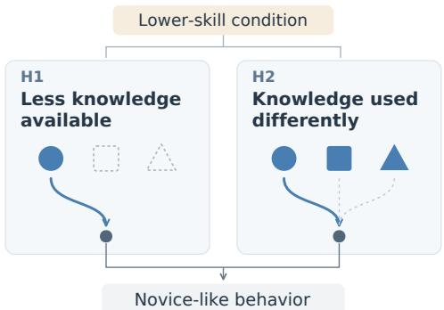  
Figure 1: Two hypotheses for novice-like behavior: less available knowledge (H1) or a different use of retained knowledge (H2).

from the board position (Stockfish, 2024; Zero, 2024; Chess, 2024). Moreover, models like Maia-2 explicitly condition their move predictions on player skill, allowing us to compare their decisions on the same board across ratings while keeping its weights fixed (Tang et al., 2024). Maia-2 is thus an ideal simulated user: conditioned on a player's rating, it is trained to reproduce that player's moves, including their mistakes. Existing methods for interpreting chess models also provide tools for examining which concepts a model represents and testing how those concepts influence its moves (McGrath et al., 2022; Karvonen et al., 2024; Jenner et al., 2024).

In this work, we study how Maia-2 adapts its play across skill levels. We focus on positions where the model makes a blunder under lower-skill conditions but selects the best move under higher-skill conditions (Tang et al., 2024), as illustrated in Figure 2 (B). We first ask whether weaker play reflects less knowledge of relevant chess concepts. To make this question measurable, we examine 172 human-interpretable chess concepts using linear probes. These simple classifiers predict whether a concept is present on the board using the representations Maia-2 computes while processing that position (McGrath et al., 2022). We use probe accuracy to measure knowledge encoding, or how consistently these concepts are represented under each skill condition. Hypothesis 1 (H1): skilldependent knowledge encoding predicts that these concepts should be less consistently represented at lower skill levels. However, probe accuracy remains nearly constant from novice to expert conditions, even as move quality changes sharply (Figure 2 (C)). Moreover, probes trained at one skill level remain accurate at other levels without retraining, showing that this stability does not depend on fitting a separate classifier to each condition. Together, these results do not support a loss of the measured concept knowledge as the explanation for weaker play.

We therefore test Hypothesis 2 (H2): skill-dependent knowledge externalization, which proposes that skill conditioning changes how Maia-2 uses retained concept knowledge to select moves. We ask whether targeted interventions can recover high-skill decisions from lower-skill representations while preserving measured knowledge encoding. We first fine-tune a separate policy head for each target concept, changing only the output layer that maps Maia-2's representations to move predictions while leaving the model's encoded concept knowledge unchanged. On held-out positions, this raises best-move accuracy in the lowest skill band from 14.4% to 82.8%, closing most of the behavioral gap. When applied to other concepts, these heads lose much of this improvement, indicating concept specialization. As a complementary test, we use sparse autoencoder (SAE) feature steering to amplify internal features associated with the target concepts (Templeton et al., 2024). This partially closes the behavioral gap while leaving probe-measured knowledge encoding practically unchanged. Together, these results support H2 by showing that stronger decisions can be recovered from lower-skill representations while measured knowledge encoding remains stable.

To our knowledge, this is the first separation of knowledge encoding and knowledge use in a transformer-based generative model. By characterizing knowledge encoding and knowledge externalization, we show that Maia-2's measured knowledge encoding remains stable as its skill-conditioned move decisions change, while targeted interventions recover high-skill decisions from lower-skill states. Together, this framework provides a foundation for testing whether analogous capability-

A Position  
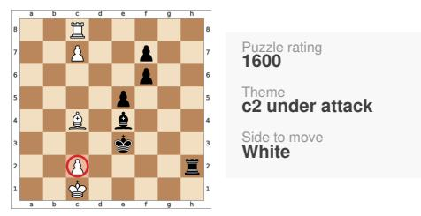  
B Move consequences

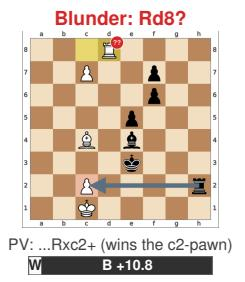

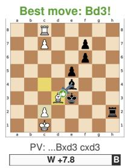

C Knowledge encoding  
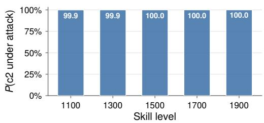  
D Move prediction

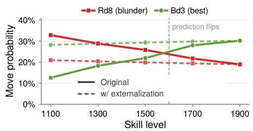  
Figure 2: An illustrative example of Maia-2's skill-level adaptation. (A) The puzzle position and its relevant theme. (B) The consequences of the blunder and best move. (C) Probe-measured encoding of the relevant threat. (D) Maia-2's probabilities for the two moves across skill levels.  
behavior gaps arise in other skill-conditioned transformers, including LLMs, when both skill levels and domain knowledge can be measured cleanly

## 2 RELATED WORK

Skill conditioning and capability. LLMs can be conditioned to simulate learners at different proficiency levels (Lu & Wang, 2024; Jin et al., 2025; Benedetto et al., 2024). Fidelity varies across models and proficiency scales, and simulated novices may retain expert reasoning (Benedetto et al. 2024; Guo et al., 2026); valid student simulation therefore requires matching the learner's knowledge state (Yuan et al., 2026). In AI evaluation, models can also be prompted or fine-tuned to underperform selectively or hide capabilities while imitating weaker models (Van Der Weij et al., 2024; Li & Siegel, 2025; Grief-Albert et al., 2026; Greenblatt et al., 2024; Taylor et al., 2025). These studies show that behavior can misrepresent knowledge or capability, but leave unclear how a fixed model changes its internal computations across skill conditions.

Skill acquisition and localization. Other work studies how skills emerge during training and how training data shapes them (Arora & Goyal, 2023; Liu et al., 2025; Chen et al., 2023). Interpretability studies also identify neurons and circuits associated with specific task capabilities (Wang et al., 2022b; Gurnee et al., 2023; Dunefsky et al., 2024). These studies examine how capabilities are acquired or where they are represented, rather than how their use varies across skill conditions.

Human-AI alignment in chess. Because superhuman engines do not necessarily predict human decisions, the Maia models instead optimize for human move prediction (McIlroy-Young et al., 2020; Tang et al., 2025). Maia-2 extends this approach with a single skill-conditioned transformer that models human moves across player ratings (Tang et al., 2024). Related work studies strong human-like play and skill calibration through search, as well as unified chess modeling (Jacob et al., 2022; Zhang et al., 2024; Monroe et al., 2026).

Mechanistic understanding of chess models. Chess has become a model system for mechanistic interpretability. McGrath et al. (2022) use linear probes to track human-interpretable concepts acquired by AlphaZero, while Karvonen et al. (2024) evaluate sparse autoencoders by recovering interpretable board-game features. In addition, Jenner et al. (2024) use activation patching to study learned look-ahead in Leela Chess Zero. We build on these tools but study a different question: how concept representations and their influence on decisions vary across skill conditions.

Our work examines how knowledge encoding and knowledge externalization vary across skill conditions within the same pretrained model. We combine concept probes with targeted interventions to test whether lower-skill representations retain concept knowledge supporting stronger decisions. Appendix D reviews further related work on chess engines and on methods for reading and intervening on internal representations.

## 3 PRELIMINARIES

## 3.1 MAIA-2 AS A BASE MODEL

We use Maia-2 (Tang et al., 2024), a single transformer-based model trained to predict human chess moves across player skill levels. Its objective is to match human play at a given level, including mistakes. Chess skill is quantified by Elo ratings, with higher ratings indicating stronger play. Maia-2 groups ratings into 11 categories, from below 1100 to at least 2000, which we call skill conditions.

The model takes a chess position B, including the piece locations and whose turn it is, together with the rating categories of the player to move, $e _ { a }$ , and the opponent, $\boldsymbol { e } _ { o } .$ We denote its top-ranked move by $\hat { a } = f _ { \theta } ( B , e _ { a } , e _ { o } )$ , where θ denotes the model parameters. Throughout our experiments, we set $e _ { a } = e _ { o } = e$ We vary e while holding the position and model weights fixed.

As shown in Figure 6 in Appendix A, a convolutional encoder extracts board features, which are converted into tokens for Transformer blocks. Each rating category is mapped to a learned vector, or skill embedding. These embeddings modify the attention queries in each block, allowing the same board features to be processed differently across skill conditions. Attention and feed-forward layers update the tokens' running representations, known as the residual stream. A linear policy head, shared across skill conditions, maps the final block's residual stream to the predicted chess move logits. We refer to the network producing the head's input as the backbone. This distinction lets us examine concept representations within the backbone and test how changing the policy head affects move predictions. Appendix A provides further architectural details.

## 3.2 BLUNDERED TRANSITIONAL DATASET

Because Maia-2 is trained to model human play, it does not select the engine-optimal move in every position. Therefore, to study the mechanism behind a clear skill-dependent behavioral change, we restrict our analysis to positions where higher-skill conditioning reliably improves its decision.

Specifically, a transitional position is one where Maia-2's prediction changes monotonically from a suboptimal move at lower skill conditions to the engine-selected best move at higher conditions, without reverting (Tang et al., 2024). We further require the lowest-skill prediction to be a blunder, defined here as a move that reduces the estimated winning probability of the side to move by more than 10 percentage points relative to the best move. The resulting Blundered Transitional Dataset contains more than one million positions and isolates a clear behavioral gap induced by skill conditioning. See Appendix B.2 for more details.

## 4 DOES SKILL CONDITIONING CHANGE KNOWLEDGE ENCODING?

Because Maia-2's move quality changes sharply with its conditioning skill level, one natural explanation is that skill conditioning changes what the model represents internally: concepts required for strong play may be encoded less consistently under lower-skill conditions. We refer to this account as Hypothesis 1: skill-dependent knowledge encoding. Under H1, relevant chess concepts should be less consistently represented under lower-skill conditions.

## 4.1 CHARACTERIZING KNOWLEDGE ENCODING IN CHESS

Following McGrath et al. (2022), we characterize chess knowledge in terms of the human-interpretable chess concepts represented in a model's internal states. Whereas they study what concepts AlphaZero represents, when they emerge during training, and where they appear in the network, we hold Maia-2's weights fixed and ask how these internal concept representations change across conditioning skill levels. We refer to how consistently these concepts are represented under each skill condition as knowledge encoding.

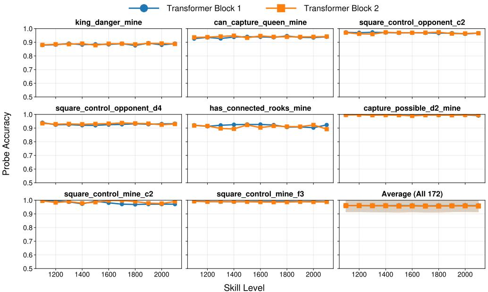  
Figure 3: Linear probe accuracy across skill levels for eight representative concepts and the mean over all 172 oracle concepts.

To make this question measurable, we construct an oracle of 172 binary chess concepts spanning square control, king and queen safety, tactical patterns, and positional structure. Because each concept assigns a deterministic binary label $c ( B ) \in \{ 0 , 1 \}$ to a board position, the oracle provides ground-truth labels for analyzing internal representations. Crucially, these concepts are relevant to Maia-2's skill-dependent behavior: 93.6% of positions in the Blundered Transitional Dataset contain at least one oracle concept that lower-skill predictions fail to address correctly and higher-skill predictions resolve. Appendix B.1 lists all concepts and their definitions.

## 4.2 MEASURING KNOWLEDGE ENCODING ACROSS SKILL LEVELS

We measure knowledge encoding by testing how accurately linear probes recover oracle concept labels from Maia-2's internal states (McGrath et al., 2022; Alain & Bengio, 2016). Specifically, for a board position B, let $\mathbf { z } ( \boldsymbol { B } ) \in \mathbb { R } ^ { d _ { \mathrm { r e s } } }$ denote its average-pooled residual stream after a transformer block under a given skill condition. For every concept, transformer block, and skill level, we then train an l1-regularized probe by minimizing

$$
\mathbf { w } ^ { * } = \arg \operatorname* { m i n } _ { \mathbf { w } } \sum _ { i = 1 } ^ { N } \mathcal { L } ( g ( \mathbf { z } ( \boldsymbol { \mathcal { B } } _ { i } ) \mid \mathbf { w } ) , c ( \boldsymbol { \mathcal { B } } _ { i } ) ) + \lambda \| \mathbf { w } \| _ { 1 } .\tag{1}
$$

Here, $g ( \cdot \mid \mathbf { w } )$ is the probe, N is the number of training positions, L is binary cross-entropy, and λ controls regularization. To isolate the effect of skill conditioning, we fix the board positions, vary only Maia-2's skill condition, and compare probe accuracy on held-out positions across all 11 skill levels. We probe the 1024-dimensional residual stream after each of the two transformer blocks. Appendix B.3 details sampling, regularization, and training.

## 4.3 KNOWLEDGE ENCODING REMAINS STABLE ACROSS SKILL LEVELS

Figure 3 shows results for eight representative concepts and the mean over all 172 concepts. Across the full oracle, mean test accuracy is 96.0% after Transformer Block 1 and 95.9% after Transformer Block 2. More importantly, the mean per-concept standard deviation across skill levels is only 0.57 percentage points for both blocks, and the same stability holds across all four concept categories. Thus, the near-constant mean does not conceal category-specific losses: lower-skill conditioning does not substantially reduce how consistently these chess concepts are represented. Appendix B.3 provides the complete per-concept results.

Cross-skill transfer. Within-skill accuracy alone leaves open whether each skill level requires a different linear readout. To test this alternative, we apply every source-skill probe, without refitting, to representations produced at every target skill level. Figure 10 in Appendix B.4 shows uniformly high accuracy across both matched and off-diagonal evaluations. Therefore, a largely shared linear readout remains usable across skill conditions, strengthening the evidence for stable knowledge encoding despite modest decreases in transfer accuracy.

Together, the within-skill and cross-skill results do not support the loss of measured concept knowledge predicted by H1. Because Maia-2's move quality nevertheless varies sharply with skill, representational availability alone cannot explain the behavioral gap. We therefore next examine how the model translates its internal representations into move decisions.

## 5 CAN STRONGER DECISIONS BE RECOVERED FROM ENCODEDKNOWLEDGE?

Section 4 shows that Maia-2's measured knowledge encoding remains stable across skill conditions, even though its move quality changes sharply. This mismatch creates a functional knowledge-action gap: concept information remains internally available, but lower-skill predictions often fail to act on it. A natural second explanation is therefore that skill conditioning changes how represented concepts influence move selection. We refer to this account as Hypothesis 2: skill-dependent knowledge externalization.

We characterize knowledge externalization as the extent to which concept-bearing internal representations are translated into decisions that act on the corresponding concepts. We test knowledge externalization through causal recoverability: whether targeted interventions recover high-skill decisions from lower-skill representations while preserving measured knowledge encoding. We first change only the policy head while keeping the backbone fixed. Under H2, a restricted readout intervention should substantially reduce the behavioral gap without changing the knowledge encoding measured in Section 4.

This characterization concerns what the intervention can recover, not where Maia-2's original skilladaptation mechanism is located. Specifically, Maia-2's Elo embeddings enter each transformer block, whereas its final policy head is shared across skill levels and receives no separate Elo input. Consequently, the policy head provides a controlled downstream intervention site, but success there does not imply that the pretrained model naturally implements skill adaptation only in that layer.

## 5.1 LEARNING A HIGH-SKILL READOUT WITH A FIXED BACKBONE

To test causal recoverability, we use Head SFT: fine-tuning only Maia-2's policy head, the final linear layer mapping its 1024-dimensional backbone state to chess move logits and comprising only 8.2% of the model's parameters. For each concept with sufficient qualifying positions, we initialize a separate head from the pretrained weights and train it on the corresponding concept-filtered subset of the Blundered Transitional Dataset. Specifically, let ${ \bf z } _ { e } ( B _ { i } )$ denote the frozen backbone state for position $B _ { i }$ under skill condition $e ,$ and let $a _ { i } ^ { * }$ denote the optimal move that Maia-2 already predicts correctly at its highest skill condition. We optimize

$$
( \mathbf { W } _ { c } ^ { * } , \mathbf { b } _ { c } ^ { * } ) = \arg \operatorname* { m i n } _ { \mathbf { W } _ { c } , \mathbf { b } _ { c } } \sum _ { i = 1 } ^ { N _ { c } } \sum _ { e = e _ { \operatorname* { m i n } } } ^ { e _ { \operatorname* { m a x } } } \mathcal { L } _ { \mathrm { C E } } ( \mathbf { W } _ { c } \mathbf { z } _ { e } ( \boldsymbol { B } _ { i } ) + \mathbf { b } _ { c } , a _ { i } ^ { * } ) .\tag{2}
$$

Here, $\mathbf { W } _ { c }$ and $\mathbf { b } _ { c }$ are the parameters of the head for concept $c , N _ { c }$ is the number of training positions for that concept, and $\mathcal { L } _ { \mathrm { C E } }$ is cross-entropy loss. The bounds $e _ { \mathrm { m i n } }$ and $e _ { \mathrm { m a x } }$ denote the lowest and highest training skill conditions.

Table 1: Maia-2 performance on Blundered Transitional positions. STD is the sample standard deviation of five band means; other subscripts show SD across concepts.
<table><tr><td></td><td>Baseline</td><td>Steering (Random) Steering (Feature)</td><td></td><td>Head SFT</td></tr><tr><td colspan="5">Best-Move Accuracy</td></tr><tr><td>&lt; 1200</td><td> $0 . 1 4 4 _ { 0 . 0 3 6 }$ </td><td> $0 . 1 6 3 _ { 0 . 0 4 2 }$ </td><td> $0 . 4 2 7 _ { 0 . 0 8 6 }$ </td><td> $0 . 8 2 8 _ { 0 . 0 9 0 }$ </td></tr><tr><td>1200-1399</td><td> $0 . 4 4 3 _ { 0 . 0 7 8 }$ </td><td> $0 . 4 5 6 _ { 0 . 0 5 9 }$ </td><td> $0 . 5 7 3 _ { 0 . 0 6 5 }$ </td><td> $0 . 8 5 4 _ { 0 . 0 7 8 }$ </td></tr><tr><td>1400-1599</td><td> $0 . 6 2 1 _ { 0 . 0 7 2 }$ </td><td> $0 . 6 2 9 _ { 0 . 0 5 1 }$ </td><td> $0 . 6 9 8 _ { 0 . 0 5 2 }$ </td><td> $0 . 8 7 0 _ { 0 . 0 7 0 }$ </td></tr><tr><td>1600-1799</td><td> $0 . 7 7 9 _ { 0 . 0 5 3 }$ </td><td> $0 . 7 8 1 _ { 0 . 0 3 6 }$ </td><td> $0 . 8 1 9 _ { 0 . 0 3 5 }$ </td><td> $0 . 8 8 3 _ { 0 . 0 6 8 }$ </td></tr><tr><td>1800-1999</td><td> $0 . 8 9 4 _ { 0 . 0 3 0 }$ </td><td> $0 . 8 9 4 _ { 0 . 0 2 0 }$ </td><td> $0 . 9 0 7 _ { 0 . 0 1 9 }$ </td><td> $0 . 9 1 2 _ { 0 . 0 5 9 }$ </td></tr><tr><td colspan="5">Skill Gap</td></tr><tr><td>STD (↓)</td><td>0.295</td><td>0.287</td><td> $0 . 1 9 1$ </td><td>0.031</td></tr><tr><td>TP (↓)</td><td> $4 . 2 3 8 _ { 0 . 5 1 8 }$ </td><td> $4 . 0 2 4 _ { 0 . 5 2 8 }$ </td><td> $3 . 4 1 5 _ { 0 . 7 8 0 }$ </td><td> $\mathbf { 1 . 3 1 8 _ { 0 . 6 7 3 } }$ </td></tr><tr><td colspan="5">Move Quality</td></tr><tr><td>CP Loss (↓)</td><td> $2 2 5 . 3 _ { 4 7 . 5 }$ </td><td> $2 0 7 . 4 _ { 5 3 . 2 }$ </td><td> $1 6 1 . 1 _ { 5 5 . 6 }$ </td><td> ${ \bf 6 1 . 8 _ { 4 4 . 3 } }$ </td></tr><tr><td>WR Loss (↓)</td><td> $0 . 1 5 0 _ { 0 . 0 2 4 }$ </td><td> $0 . 1 3 5 _ { 0 . 0 2 7 }$ </td><td> $0 . 0 9 4 _ { 0 . 0 3 3 }$ </td><td> $\mathbf { 0 . 0 2 6 _ { 0 . 0 1 4 } }$ </td></tr><tr><td>Blunder Rate (↓)</td><td> $5 2 . 5 \% _ { 5 . 5 \% }$ </td><td> $4 7 . 3 \% _ { 7 . 4 \% }$ </td><td> $3 2 . 1 \% _ { 1 0 . 5 \% }$ </td><td> $8 . 0 \% _ { 4 . 2 \% }$ </td></tr><tr><td>Ignore Rate (↓)</td><td> $9 3 . 7 \% _ { 4 . 4 \% }$ </td><td> $8 3 . 8 \% _ { 0 . 8 \% }$ </td><td> $4 8 . 6 \% _ { 2 3 . 3 \% }$ </td><td> $4 . 1 \% _ { 4 . 6 \% }$ </td></tr></table>

The target is distilled from Maia-2's own highest-skill prediction, but it is applied as supervision to the model's states at every skill level. The experiment therefore asks whether lower-skill states can be mapped to the same concept-appropriate decisions that Maia-2 produces at its highest skill level. Because the backbone remains frozen throughout training, every ${ \bf z } _ { e } ( B )$ is identical before and after the intervention, and the measured knowledge encoding is therefore preserved by construction. Appendix B.5 lists the filtering criteria and qualifying concepts.

## 5.2 A LINEAR READOUT RECOVERS MOST OF THE SKILL GAP

To measure how well each head externalizes its target concept, we evaluate it on held-out positions from the corresponding concept-filtered Blundered Transitional Dataset. Our primary metric is Best-Move Accuracy, the fraction of positions where the head predicts the optimal move used to construct the dataset. We report this accuracy in five 200-Elo bands to show how the intervention changes decisions across the skill spectrum. Because H2 concerns the gap across skill conditions, we summarize cross-skill consistency with two additional metrics. STD is the sample standard deviation of the five reported band means. $\dot { T } P$ is the average transition point at which a position is first predicted correctly and remains correct at all higher levels; $\mathrm { T P } = 0$ means every level is correct, $\mathrm { T P } = 1 0$ means every level is wrong, and lower values indicate a smaller skill gap. Finally, we evaluate whether the predicted moves improve in chess terms at the skill levels below each position's baseline transition point. CP Loss measures the centipawn degradation caused by a move, while WR Loss converts this degradation into a change in win probability.2 Blunder Rate is the fraction of moves with WR Loss $\geq 0 . 1 0$ . Ignore Rate is the fraction of moves that fail the oracle's check for addressing the target concept. For a threat to a piece, the check asks whether the move relocates or defends it.

Table 1 (Head SFT column) reports the results across 71 qualifying concepts. Head SFT raises best-move accuracy in the lowest Elo band from 14.4% to 82.8%, while accuracy in the highest reported band increases from 89.4% to 91.2%. Consequently, STD falls from 0.295 to 0.031, and mean TP falls from 4.24 to 1.32. The intervention therefore closes the gap primarily by improving lower-skill decisions rather than trading away high-skill performance. The chess-specific metrics show the same pattern. Below the baseline transition point, Head SFT reduces Ignore Rate from 93.7% to 4.1% and Blunder Rate from 52.5% to 8.0%. It also reduces average WR Loss from 0.150 to 0.026 and CP Loss from 225 to 62. Thus, the recovered predictions both address the active concept and substantially improve move quality. Because Head SFT changes only the final mapping from fixed representations to moves, these results show that lower-skill states support substantially stronger decisions that address the target concepts. A linear head can only reweight what the frozen representation already contains, so the recovered decisions were available in the lower-skill states. Two other explanations remain: the head may simply be a stronger general policy, or it may have fit the lower-skill states it was trained on. The next two analyses test each.

Concept specialization. If policy head SFT simply learned a generic high-skill policy, a head trained on one concept should also improve positions governed by other concepts. To test this possibility, we independently rerun Head SFT for each concept, then apply every resulting head both to its own concept's test positions and to all other concepts' test positions. Figure 4 shows that sameconcept heads reproduce the large improvement above, whereas other-concept heads perform below the frozen baseline on average from the second skill band onward. These results indicate that the recovery is specific to the training concept and does not generalize as a uniformly stronger policy across concepts. This pattern is consistent with concept-specific knowledge externalization.

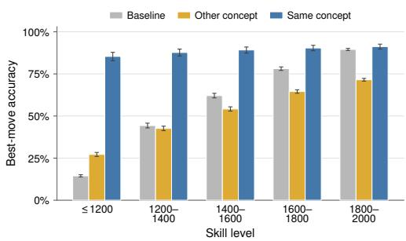  
Figure 4: Best-move accuracy on target versus other concepts; error bars show 95% bootstrap CIs across concepts.

Cross-skill readout transfer. Head SFT is trained on every position under all 11 skill conditions. Consequently, its success could still depend on direct supervised exposure to each lower-skill state. To isolate cross-skill transfer, we instead train and early-stop each concept-specific head using only the highest-skill representations, then evaluate the fixed head on held-out board positions under every skill condition. We repeat each high-skill training example 10 times. As Figure 5 shows, this highskill-only readout raises best-move accuracy in the lowest skill band from 14.4% to 80.0% and remains within 2.9 percentage points of all-Elo Head SFT in every band. Thus, the mapping learned solely from high-skill states transfers directly to lower-skill states, and most of the recovery does not require supervised fitting on those states.

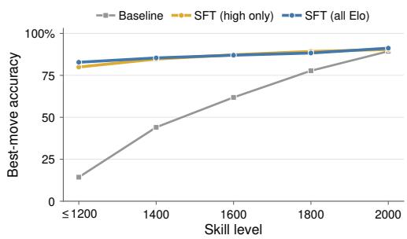  
Figure 5: Best-move accuracy for policy heads trained on all skill conditions or only the highestskill condition.

## 5.3 FEATURE-LEVEL INTERVENTION PARTIALLY RECOVERS THE SKILL GAP

Head SFT tests recovery by retraining the mapping from fixed representations to moves. Sparse autoencoders (SAEs) decompose internal activations into sparse features that can be manipulated to steer model outputs (Templeton et al., 2024; Chalnev et al., 2024). We use this approach to test whether amplifying concept-relevant features improves move selection while preserving measured knowledge encoding.

Following work on JumpReLU SAEs and dictionary learning in chess (Rajamanoharan et al., 2024; Karvonen et al., 2024), we train an SAE on Maia-2's internal activations and use oracle labels to select features most associated with each chess concept. At inference, we amplify these features and inject their decoded representation back into Maia-2. We select the number of features and intervention strength on training positions, allowing them to vary by concept and skill condition, and evaluate on held-out positions. Steering (Random) uses the same procedure with randomly selected features. Appendix C details SAE training and steering.

Table 1 shows that concept-salient steering partially closes the behavioral gap. In the lowest skill band, best-move accuracy rises from 14.4% to 42.7%, compared with 16.3% under random-feature steering. Correspondingly, mean TP falls from 4.24 to 3.42, whereas random-feature steering reaches 4.02. The chess-specific metrics show the same difference: feature steering reduces Ignore Rate from 93.7% to 48.6%, Blunder Rate from 52.5% to 32.1%, WR Loss from 0.150 to 0.094, and

CP Loss from 225 to 161. Thus, Maia-2 produces stronger lower-skill decisions when we amplify concept-relevant internal features, even without retraining the model.

Finally, because feature steering directly intervenes on internal activations, its behavioral gains support H2 only if the measured knowledge encoding remains stable. Figures 11 and 13 in Appendix B.5 therefore evaluate probes trained before steering on the intervened representations. After averaging over all skill conditions within each concept, mean probe accuracy changes by only 0.86 percentage points; the paired test supports practical equivalence within a margin of ±1 percentage point (p = 0.031). Thus, SAE steering partially improves knowledge externalization while leaving probemeasured knowledge encoding practically unchanged on average.

Summary of evidence. Stable concept decoding and cross-skill probe transfer weigh against H1. Head SFT closes most of the behavioral gap with a fixed backbone, while SAE steering yields partial recovery with measured knowledge encoding practically unchanged. These results primarily support H2, suggesting that Maia-2 retains the measured concept knowledge but uses it differently across skill conditions. The two intervention sites provide complementary evidence for this account. They do not establish H2 as the only mechanism of skill adaptation.

## 6 DISCUSSION

## 6.1 PRACTICAL IMPLICATIONS

Education. Maia-2's weaker decisions coexist with retained knowledge of the measured concepts. For simulations intended to model what a student knows, this illustrates why matching novice behavior alone cannot establish fidelity to the student's knowledge. Tutoring has a different objective: explanations and support can be adapted to a learner while the system retains expert knowledge. These roles require different validation criteria; neither knowledge retention nor knowledge loss is inherently preferable.

Capability evaluation. Recovering stronger decisions from lower-skill representations shows that performance under one condition can understate what a model can do with retained knowledge. This motivates capability assessments that vary conditioning contexts and test whether restricted interventions reveal stronger performance. For LLMs, such contexts include system instructions, role descriptions, and user prompts. Our experiments establish this recoverability in Maia-2; they do not establish that LLMs use the same mechanism or that weaker outputs reflect deliberate concealment of capabilities.

## 6.2 FUTURE WORK

These results point to two directions for further study. First, extending the concept set to multimove planning and long-term positional judgments would test whether the same pattern holds for knowledge that depends on possible continuations. Such concepts require validated measures beyond deterministic labels for the current board. Second, applying this analysis to LLMs would test its generality beyond chess. Unlike Maia-2's explicit rating conditions, prompting an LLM to imitate a proficiency level does not itself validate the resulting skill adaptation. Reliable proficiency conditions and independent knowledge measures would make that test informative.

## 7 CONCLUSION

We study skill-level adaptation in Maia-2 by distinguishing knowledge encoding from knowledge externalization. Comparing skill conditions on the same positions within a fixed pretrained model separates the effect of conditioning from differences in inputs or training. Across 172 static, deterministically labeled chess concepts, probe accuracy remains stable across skill conditions, and probes transfer accurately between them, even as move quality changes. Fine-tuning the policy head with a frozen backbone raises best-move accuracy in the lowest band from 14.4% to 82.8%, closing most of the behavioral gap. Most of this recovery remains when the head is trained only on highest-skill representations. SAE feature steering yields partial recovery while leaving probe-measured encoding practically unchanged on average. These results support an account in which skill conditioning changes how retained concept knowledge influences move selection. Combining probes with recovery tests thus provides a way to examine whether a model's weaker behavior reflects limited concept knowledge or a different use of the knowledge it retains.

## ETHICS STATEMENT

This work studies Maia-2, a model trained on human chess games, using publicly available Lichess data. Our experiments analyze model representations and move predictions and involve no new participant recruitment.

## REPRODUCIBILITY STATEMENT

Appendices B.1–B.3 document the concepts, data construction, and probe training; Section 5.1 and Appendix C describe the interventions. Code is available in the repository linked in the abstract.

## AI USE STATEMENT

Generative AI assisted with writing, reference checks, figures, and formatting. The authors are responsible for the final content.

## REFERENCES

Guillaume Alain and Yoshua Bengio. Understanding intermediate layers using linear classifier probes. ArXiv preprint, abs/1610.01644, 2016. URL https://arxiv.org/abs/1610.01644.

Anthropic Alignment Science Team. Recommendations for technical AI safety research directions. https://alignment.anthropic.com/2025/recommended-directions/,2025. Accessed: 2026-02-01.

Sanjeev Arora and Anirudh Goyal. A theory for emergence of complex skills in language models. arXiv preprint arXiv:2307.15936, 2023.

Nora Belrose, Igor Ostrovsky, Lev McKinney, Zach Furman, Logan Smith, Danny Halawi, Stella Biderman, and Jacob Steinhardt. Eliciting latent predictions from transformers with the tuned lens. arXiv preprint arXiv:2303.08112, 2023. URL https://arxiv.org/abs/2303.08112.

Luca Benedetto, Giovanni Aradelli, Antonia Donvito, Alberto Lucchetti, Andrea Cappelli, and Paula Buttery. Using llms to simulate students' responses to exam questions. In Findings of the Association for Computational Linguistics: EMNLP 2024, pp. 11351–11368, 2024.

Trenton Bricken, Adly Templeton, Joshua Batson, Brian Chen, Adam Jermyn, Tom Conerly, Nicholas L. Turner, Cem Anil, Carson Denison, Amanda Askell, Robert Lasenby, Yifan Wu, Shauna Kravec, Nicholas Schiefer, Tim Maxwell, Nicholas Joseph, Alex Tamkin, Karina Nguyen, Brayden McLean, Josiah E. Burke, Tristan Hume, Shan Carter, Tom Henighan, and Chris Olah. Towards monosemanticity: Decomposing language models with dictionary learning. https://transformer-circuits.pub/2023/monosemantic-features/index.html, 2023. Anthropic Technical Report.

Tom B. Brown, Benjamin Mann, Nick Ryder, Melanie Subbiah, Jared Kaplan, Prafulla Dhariwal, Arvind Neelakantan, Pranav Shyam, Girish Sastry, Amanda Askell, et al. Language models are few-shot learners. arXiv preprint arXiv:2005.14165, 2020.

Collin Burns, Pavel Izmailov, Jan Hendrik Kirchner, Bowen Baker, Leo Gao, Leopold Aschenbrenner, Yining Chen, Adrien Ecoffet, Manas Joglekar, Jan Leike, et al. Weak-to-strong generalization: Eliciting strong capabilities with weak supervision. arXiv preprint arXiv:2312.09390, 2023a.

Collin Burns, Haotian Ye, Dan Klein, and Jacob Steinhardt. Discovering latent knowledge in language models without supervision. In International Conference on Learning Representations, 2023b. URLhttps://arxiv.org/abs/2212.03827.

Alex Chalnev, Joe Collard, and Tom McGrath. Improving steering vectors by targeting sparse autoencoder features, 2024.

Mayee Chen, Nicholas Roberts, Kush Bhatia, Jue Wang, Ce Zhang, Frederic Sala, and Christopher Ré. Skill-it! a data-driven skills framework for understanding and training language models. Advances in Neural Information Processing Systems, 36, 2023.

Python Chess. python-chess: a chess library for python, 2024. URL https : / /python-chess. readthedocs.io/en/latest/index.html. Accessed: 2025-01-01.

Albert T. Corbett and John R. Anderson. Knowledge tracing: Modeling the acquisition of procedural knowledge. User Modeling and User-Adapted Interaction, 4(4):253–278, 1994. doi: 10.1007/ BF01099821.

Hoagy Cunningham, Aidan Ewart, Logan Riggs, Robert Huben, and Lee Sharkey. Sparse autoencoders find highly interpretable features in language models. arXiv preprint arXiv:2309.08600, 2023.

Jacob Dunefsky, Philippe Chlenski, and Neel Nanda. Transcoders find interpretable llm feature circuits. arXiv preprint arXiv:2406.11944, 2024.

Ryan Greenblatt, Fabien Roger, Dmitrii Krasheninnikov, and David Krueger. Stress-testing capability elicitation with password-locked models. Advances in Neural Information Processing Systems, 37: 69144–69175, 2024.

Seth Grief-Albert, Jessica Bo, Difan Jiao, and Ashton Anderson. Emulate or estimate? the divergent strengths of base and post-trained language models for opinion simulation. arXiv preprint arXiv:2608.03044,2026.URLhttps://arxiv.org/abs/2608.03044.

Dongliang Guo, Weili Shi, and Sheng Li. Llms are too smart to be average: Controlling llm proficiency with guided decoding. OpenReview preprint, 2026. URL https : //openreview. net/pdf?id=ZOaXR5CXGu.

Wes Gurnee and Max Tegmark. Language models represent space and time. arXiv preprint arXiv:2310.02207, 2023.

Wes Gurnee, Neel Nanda, Matthew Pauly, Katherine Harvey, Dmitrii Troitskii, and Dimitris Bertsimas. Finding neurons in a haystack: Case studies with sparse probing. arXiv preprint arXiv:2305.01610, 2023.

Kaiming He, Xiangyu Zhang, Shaoqing Ren, and Jian Sun. Delving deep into rectifiers: Surpassing human-level performance on imagenet classification. In Proceedings of the IEEE international conference on computer vision, pp. 1026–1034, 2015.

Feng-hsiung Hsu. Ibm's deep blue chess grandmaster chips. IEEE micro, 19(2):70–81, 1999.

Athul Paul Jacob, David J Wu, Gabriele Farina, Adam Lerer, Hengyuan Hu, Anton Bakhtin, Jacob Andreas, and Noam Brown. Modeling strong and human-like gameplay with kl-regularized search. In International Conference on Machine Learning, pp. 9695–9728. PMLR, 2022.

Erik Jenner, Shreyas Kapur, Vasil Georgiev, Cameron Allen, Scott Emmons, and Stuart Russell. Evidence of learned look-ahead in a chess-playing neural network. arXiv preprint arXiv:2406.00877, 2024.

Difan Jiao and Ashton Anderson. Agent safety from within: Detecting harmful trajectories from LLM internal states. arXiv preprint arXiv:2609.33039, 2026.

Difan Jiao, Yilun Liu, Zhenwei Tang, Daniel Matter, Jürgen Pfeffer, and Ashton Anderson. SPIN: Sparsifying and integrating internal neurons in large language models for text classification. In Findings of the Association for Computational Linguistics: ACL 2024, pp. 4666–4682. Association for Computational Linguistics, 2024. doi: 10.18653/v1/2024.findings-acl.277. URL https : //aclanthology.org/2024.findings-acl.277/.

Difan Jiao, Yilun Liu, Ye Yuan, Zhenwei Tang, Linfeng Du, Haolun Wu, and Ashton Anderson. LLM safety from within: Detecting harmful content with internal representations. In Proceedings of the 64th Annual Meeting of the Association for Computational Linguistics (Volume 1: Long Papers), pp. 39711–39727. Association for Computational Linguistics, 2026a. doi: 10.18653/v1/ 2026.acl-long.1844.URL https://aclanthology.org/2026.acl-1ong.1844/.

Difan Jiao, Di Wang, and Lijie Hu. Understanding the dynamics of demonstration conflict in incontext learning. arXiv preprint arXiv:2603.04464, 2026b. URL https: //arxiv. org/abs/ 2603.04464.

Hyoungwook Jin, Minju Yoo, Jeongeon Park, Yokyung Lee, Xu Wang, and Juho Kim. Teachtune: Reviewing pedagogical agents against diverse student profiles with simulated students. In Proceedings of the 2025 CHI Conference on Human Factors in Computing Systems, pp. 1–28, 2025.

Adam Karvonen, Benjamin Wright, Can Rager, Rico Angell, Jannik Brinkmann, Logan Smith, Claudio Mayrink Verdun, David Bau, and Samuel Marks. Measuring progress in dictionary learning for language model interpretability with board game models. arXiv preprint arXiv:2408.00113, 2024.

Chloe Li and Noah Y. Siegel. LLMs can covertly sandbag on capability evaluations against chainof-thought monitoring. In Proceedings of the 14th International Joint Conference on Natural Language Processing and the 4th Conference of the Asia-Pacific Chapter of the Association for Computational Linguistics, pp. 395–422, 2025. doi: 10.18653/v1/2025.ijcnlp-short.33. URL https://aclanthology.org/2025.ijcnlp-short.33/.

Xinyue Li, Zhenpeng Chen, Jie M. Zhang, Ying Xiao, Tianlin Li, Weisong Sun, Yang Liu, Yiling Lou, and Xuanzhe Liu. Fairness testing of large language models in role-playing. Proceedings of the ACM on Software Engineering, 3(FSE):2211–2234, 2026. doi: 10.1145/3808106. URL https://doi.org/10.1145/3808106.

Lichess. Lichess accuracy and win probability. https://lichess.org/page/accuracy, 2024. Accessed: 2025.

Ziming Liu, Yizhou Liu, Eric J Michaud, Jeff Gore, and Max Tegmark. Physics of skill learning. arXiv preprint arXiv:2501.12391, 2025.

Xinyi Lu and Xu Wang. Generative students: Using llm-simulated student profiles to support question item evaluation. In Proceedings of the Eleventh ACM conference on learning@ Scale, pp. 16–27, 2024.

Thomas McGrath, Andrei Kapishnikov, Nenad Tomašev, Adam Pearce, Martin Wattenberg, Demis Hassabis, Been Kim, Ulrich Paquet, and Vladimir Kramnik. Acquisition of chess knowledge in alphazero. Proceedings of the National Academy of Sciences, 119(47):e2206625119, 2022.

Reid McIlroy-Young, Siddhartha Sen, Jon Kleinberg, and Ashton Anderson. Aligning superhuman ai with human behavior: Chess as a model system. In Proceedings of the 26th ACM SIGKDD International Conference on Knowledge Discovery & Data Mining, pp. 1677–1687, 2020.

Alexander Meinke, Bronson Schoen, Jérémy Scheurer, Mikita Balesni, Rusheb Shah, and Marius Hobbhahn. Frontier models are capable of in-context scheming. arXiv preprint arXiv:2412.04984, 2024.

Kevin Meng, David Bau, Alex Andonian, and Yonatan Belinkov. Locating and editing factual associations in GPT. arXiv preprint arXiv:2202.05262, 2022.

Daniel Monroe, George Eilender, Philip Chalmers, Zhenwei Tang, and Ashton Anderson. Chessformer: A unified architecture for chess modeling. In The Fourteenth International Conference on Learning Representations, 2026.

nostalgebraist. Interpreting GPT: The logit lens. LessWrong, 2020. URL https://www.lesswrong.com/posts/AcKRB8wDpdaN6v6ru/ interpreting-gpt-the-logit-lens.

Senthooran Rajamanoharan, Tom Lieberum, Nicolas Sonnerat, Arthur Conmy, Vikrant Varma, János Kramár, and Neel Nanda. Jumping ahead: Improving reconstruction fidelity with jumprelu sparse autoencoders. arXiv preprint arXiv:2407.14435, 2024.

Tord Romstad, Marco Costalba, Joona Kiiski, and et al. Stockfish. stockfishchess.org, 2023. Accessed: 2024-09-05.

David Silver, Thomas Hubert, Julian Schrittwieser, Ioannis Antonoglou, Matthew Lai, Arthur Guez, Marc Lanctot, Laurent Sifre, Dharshan Kumaran, Thore Graepel, et al. A general reinforcement learning algorithm that masters chess, shogi, and go through self-play. Science, 362(6419): 1140–1144, 2018.

Stockfish. Stockfish evaluation guide, 2024. URL https://hxim.github.io/ Stockfish-Evaluation-Guide/. Accessed: 2025-01-01.

Zhenwei Tang, Difan Jiao, Reid McIlroy-Young, Jon Kleinberg, Siddhartha Sen, and Ashton Anderson. Maia-2: A unified model for human-ai alignment in chess. In The Thirty-eighth Annual Conference on Neural Information Processing Systems, 2024. URL https : //arxiv. org/ abs/2409.20553.

Zhenwei Tang, Difan Jiao, Eric Xue, Reid McIlroy-Young, Jon Kleinberg, Siddhartha Sen, and Ashton Anderson. Learning to imitate with less: Efficient individual behavior modeling in chess. arXiv preprint arXiv:2507.21488, 2025. URL https://arxiv.org/abs/2507.21488.

Jordan Taylor, Sid Black, Dillon Bowen, Thomas Read, Satvik Golechha, Alex Zelenka-Martin, Oliver Makins, Connor Kissane, Kola Ayonrinde, Jacob Merizian, Samuel Marks, Chris Cundy, and Joseph Bloom. Auditing games for sandbagging. arXiv preprint arXiv:2512.07810, 2025. URLhttps://arxiv.org/abs/2512.07810.

Adly Templeton, Tom Conerly, Jonathan Marcus, Jack Lindsey, Trenton Bricken, Brian Chen, Adam Pearce, Craig Citro, Emmanuel Ameisen, Andy Jones, et al. Scaling monosemanticity: Extracting interpretable features from Claude 3 Sonnet. Transformer Circuits Thread, 2024. URL https://transformer-circuits.pub/2024/ scaling-monosemanticity/index.html.

Teun Van Der Weij, Felix Hofstätter, Ollie Jaffe, Samuel F Brown, and Francis Rhys Ward. Ai sandbagging: Language models can strategically underperform on evaluations. arXiv preprint arXiv:2406.07358, 2024.

Kevin Wang, Alexandre Variengien, Arthur Conmy, Buck Shlegeris, and Jacob Steinhardt. Interpretability in the wild: A circuit for indirect object identification in GPT-2 small. arXiv preprint arXiv:2211.00593,2022a.URL https://arxiv.org/abs/2211.00593.

Xiaozhi Wang, Kaiyue Wen, Zhengyan Zhang, Lei Hou, Zhiyuan Liu, and Juanzi Li. Finding skill neurons in pre-trained transformer-based language models. arXiv preprint arXiv:2211.07349, 2022b.

Jason Wei, Yi Tay, Rishi Bommasani, Colin Raffel, Barret Zoph, Sebastian Borgeaud, Dani Yogatama, Maarten Bosma, Denny Zhou, Donald Metzler, et al. Emergent abilities of large language models. arXiv preprint arXiv:2206.07682, 2022.

Zhihao Yuan, Yunze Xiao, Ming Li, Weihao Xuan, Richard Tong, Mona Diab, and Tom Mitchell. Towards valid student simulation with large language models. arXiv preprint arXiv:2601.05473, 2026.

Leela Chess Zero. Leela chess zero: Open source neural network based chess engine, 2024. URL https://1czero.org/. Accessed: 2025-01-01.

Yiming Zhang, Athul Paul Jacob, Vivian Lai, Daniel Fried, and Daphne Ippolito. Human-aligned chess with a bit of search. arXiv preprint arXiv:2410.03893, 2024.

Chenye Zou, Difan Jiao, and Lijie Hu. Deciphering cultural representations in large language models via sparse autoencoders. In Findings of the Association for Computational Linguistics: ACL 2026, pp. 5656–5677. Association for Computational Linguistics, 2026. doi: 10.18653/v1/2026. findings-acl.278.URL https://aclanthology.org/2026.findings-acl.278/.

## A EXTENDED DETAILS FOR MAIA-2

Maia-2 is a Transformer-based human move-prediction model conditioned on a chess position and the ratings of both players (Tang et al., 2024). As Figure 6 shows, it combines learned skill embeddings, a ResNet position encoder, and skill-aware attention before predicting the next move. We describe these components below and then explain why their combination provides a controlled setting for our study.

## A.1 SKILL EMBEDDINGS

Maia-2 discretizes player ratings into the 11 Elo categories defined in Section 3.1 and maps each category to a learned embedding. Let $\mathbf { E } \in \mathbb { R } ^ { 1 1 \times d _ { \mathrm { : } } }$ denote the embedding matrix. For the skill categories a and o of the active player and opponent, respectively, the model retrieves ${ \bf e } _ { a } = { \bf E } [ a ]$ and ${ \bf e } _ { o } = { \bf E } [ o ]$ Throughout our experiments, we set $a = o$ so that a single Elo category defines each skill condition.

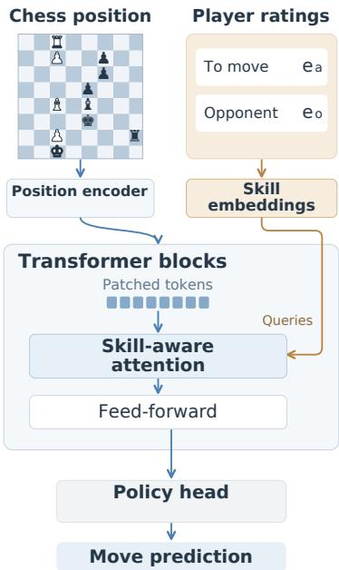

## A.2 POSITION ENCODING

Each chess position is represented as an $1 8 \times 8 \times 8$ tensor: 12 channels encode piece locations, while the remaining channels encode the side to move, castling rights, and the en-passant square. A ResNet maps this tensor to eight spatial feature maps. Channel-wise patching then flattens each $8 \times 8$ feature map and projects it to a 1024-dimensional token, producing eight position tokens for the Transformer.

Figure 6: Maia-2 architecture. Skilllevel embeddings condition Transformer attention before prediction.

## A.3 SKILL-AWARE ATTENTION

Each Transformer block applies skill-aware multi-head self-attention followed by a feed-forward update, with both updates entering the residual stream. Skill conditioning acts on the attention queries. At block l, the concatenated player embeddings are linearly projected and added to the position-derived queries:

$$
\mathbf { Q } _ { \ell } = \mathbf { Q } _ { \ell } ^ { \mathrm { p o s } } + \mathrm { r e s h a p e } \big ( ( \mathbf { e } _ { a } \oplus \mathbf { e } _ { o } ) \mathbf { W } _ { \ell } ^ { \mathrm { s k i l l } } \big ) ,\tag{3}
$$

where  denotes concatenation and the skill-dependent term is broadcast across the position tokens. Consequently, changing the Elo condition can alter how the same position features interact while leaving the board and model weights fixed. After two Transformer blocks, the tokens are normalized and mean-pooled; a final layer normalization produces the 1024-dimensional state used by the policy, auxiliary, and value heads.

## A.4 WHY MAIA-2 Is WELL SUITED TO THIS STUDY

Maia-2 provides the three properties needed for our analysis. First, skill is an explicit, ordered conditioning variable within a fixed model. Therefore, we can hold the chess position and model weights constant while changing only the skill condition. Second, the conditions correspond to a quantitative human skill scale and produce meaningfully different move behavior: move quality generally improves with Elo, and many positions transition from lower-skill mistakes to higher-skill optimal moves. These positions provide the high-contrast testbed formalized in Section 3.2. Finally, access to the model's internal states and parameters lets us compare concept representations under the same conditions and apply restricted interventions without retraining the full model. Together, these properties make Maia-2 a well-instrumented setting for studying how skill conditioning changes behavior.

## B EXPERIMENTAL DETAILS AND EXTENDED RESULTS

## B.1 ORACLE CHESS CONCEPT DEFINITIONS

Table 2 lists all 172 oracle chess concepts used in this work. As described in Section 4.1, they span four categories. We add 128 square-control concepts and four king- and queen-safety concepts to capture fine-grained threats, while the 17 tactical-pattern and 23 positional-structure concepts follow the chess concepts studied by McGrath et al. (2022). All concepts are binary functions $c ( B ) \in \{ 0 , 1 \}$ We use m for the active player (“mine") and o for the opponent; [m | o] denotes two separate concepts evaluated from the corresponding perspectives. Square-indexed concepts are instantiated independently for each listed square.

We restrict the oracle to atomic concepts with deterministic labels computed from the current board. Consequently, the labels require neither a learned annotator nor a search-based evaluation and remain fixed when we vary Maia-2's skill condition. This design supports controlled comparisons of the same concept across Elo conditions, but it does not measure dynamic abilities such as multi-move planning or search, as discussed in Section 6.2.

Table 2: Glossary of the 172 binary oracle chess concepts.
<table><tr><td>Concept names</td><td>Description</td></tr><tr><td colspan="2">Square Control — Active Player (64 concepts)</td></tr><tr><td>offensive_threat_{sq} sq ∈ {a1, . . . , h8}</td><td>True if the opponent has a piece on square sq with strictly more active- player attackers than opponent defenders. Instantiated for each of the 64 squares.</td></tr><tr><td colspan="2">Square Control — Opponent (64 concepts)</td></tr><tr><td>defensive_threat_{sq} sq ∈ {a1, . . . , h8}</td><td>True if the active player has a piece on square sq with strictly more opponent attackers than own defenders. Instantiated for each of the 64 squares.</td></tr><tr><td colspan="2">King and Queen Safety (4 concepts)</td></tr><tr><td>king_danger [mlo]</td><td>True if 5 or more squares adjacent to the side&#x27;s king are attacked by the other side.</td></tr><tr><td>can_capture_queen [mlo]</td><td>True if the side has a legal move that captures the other side&#x27;s queen.</td></tr><tr><td colspan="2">Tactical Patterns — Forks (7 concepts)</td></tr><tr><td>pawn_fork [mlo] knight_fork [mlo] bishop_fork [mlo]</td><td>True if an unpinned pawn of the side attacks two or more higher-value opponent pieces (knight, bishop, rook, queen, or king). True if an unpinned knight of the side attacks two or more higher-value opponent pieces (rook, queen, or king). True if an unpinned bishop of the side attacks two or more higher-value opponent pieces (rook, queen, or king).</td></tr><tr><td>Tactical Patterns — Pins (10 concepts) has_pinned_pawn [mlo]</td><td>active-player pieces (queen or king). True if the side has a pawn that is pinned to its own king.</td></tr><tr><td colspan="2">has_pinned_knight [mlo] has_pinned_bishop [mlo]</td></tr><tr><td>has_pinned_rook [mlo]</td><td>True if the side has a knight that is pinned to its own king. True if the side has a bishop that is pinned to its own king.</td></tr><tr><td>has_pinned_queen [mlo]</td><td>True if the side has a rook that is piñned to its own king. True if the side has a queen that is pinned to its own king.</td></tr><tr><td>Positional Structure (23 concepts)</td><td></td></tr><tr><td>has_connected_rooks [mlo]</td><td>True if the side has two rooks on the same rank or file with no intervening</td></tr><tr><td>has_bishop_pair [mlo]</td><td>pieces. True if the side has exactly two bishops.</td></tr><tr><td>has_control_of_open_file [mlo]</td><td>True if the side has a rook or queen on a pawn-free file with no opposing rooks or queens on that file.</td></tr><tr><td>has_contested_open_file</td><td>True if both sides have a rook or queen on the same pawn-free file.</td></tr><tr><td></td><td></td></tr><tr><td>capture_possible_{sq}</td><td>True if the side has a legal capture on square sq, evaluated from the</td></tr><tr><td>[mlo]</td><td>side&#x27;s own board perspective (squares are mirrored for the opponent).</td></tr></table>

## B.2 DETAILS FOR BLUNDERED TRANSITIONAL DATASET

We construct the Blundered Transitional Dataset from positions in the Lichess game database that have Štockfish evaluations.³ First, we run Maia-2 on each position across all 11 skill conditions. Following Section 3.2, we retain positions where its prediction changes monotonically from a suboptimal move at lower skill conditions to the engineselected best move at higher conditions, yielding 2.28M candidate transitional positions.

Table 3: Dataset construction and current split sizes.
<table><tr><td>Candidate transitional positions Blundered transitional positions</td><td>2.28M 1.15M</td></tr><tr><td>Training split</td><td>0.80M</td></tr><tr><td>Validation split</td><td>0.11M</td></tr><tr><td>Test split</td><td>0.23M</td></tr></table>

Next, we evaluate the lowest-skill prediction with

Stockfish at depth 20 and retain positions where it reduces the side-to-move's estimated win probability by more than 10 percentage points relative to the best move (McIlroy-Young et al., 2020). The current dataset contains 1,147,280 positions, divided into fixed 70/10/20 train, validation, and test splits as shown in Table 3. Thus, each retained position exhibits a clear behavioral gap while keeping the board and model weights fixed across skill conditions. The concept-specific externalization experiments apply the additional filters described in Appendix B.5.

## B.3 KNOWLEDGE ENCODING FOR ALL ORACLE CHESS CONCEPTS

We train independent linear probes on the average-pooled residual stream after each of Maia-2's two Transformer blocks, separately for each of the 172 oracle concepts and 11 skill levels. For each concept, we collect up to 5,000 positive and 5,000 negative positions, then truncate both classes to the size of the smaller class. We shuffle this balanced dataset with seed 42 and use 70% for training, 10% for validation, and 20% for testing. The positions, labels, and data split remain fixed across skill levels. Each probe uses $\ell _ { 1 }$ regularization. We select C ∈ {0.01, 0.1, 1, 10, 100} independently for each concept and skill level using validation accuracy, then train the final probe with early stopping and report its test accuracy.

Figures 7–9 present the complete results. Across all 172 concepts and both Transformer blocks, probe accuracy remains largely flat from the < 1100 to the ≥ 2000 skill condition. The same pattern appears for king and queen safety, tactical patterns, positional structure, and per-square control. Thus, the aggregate result in Section 4.3 does not conceal a systematic loss of measured concept encoding within a particular category.

## B.4 CROSS-SKILL PROBE TRANSFER

The main probe analysis fits a separate classifier for each concept and skill level. Similar within-skill accuracy could therefore arise even if each skill condition required a different linear readout. To test this possibility, for every source skill s and target skill t, we apply the probe $g _ { s }$ without refitting to the same held-out positions represented under $t .$ The positions and labels are fixed across target skills and excluded from probe training. This yields $A _ { s , t } = \operatorname { A c c } ( g _ { s } ( \mathbf { z } _ { t } ) , c )$ . We first average each entry equally over the 172 concepts and then average the two Transformer blocks, whose transfer patterns are nearly identical, to produce Figure 10.

Matched-probe accuracy is 96.0% for Transformer Block 1 and 95.9% for Block 2, while mean off-diagonal accuracy is 95.6% and 95.4%. The corresponding gaps are 0.40 percentage points (95% bootstrap CI: 0.34–0.47) and 0.43 points (0.36–0.50). The gap increases smoothly with skill distance: highest-skill probes retain 93.2% and 92.8% accuracy on the lowest-skill representations. In the reverse direction, lowest-skill probes reach 94.7% and 94.3% on the highest-skill representations. Thus, skill conditioning induces a small, continuous change in representation, but the concept information remains accessible through a largely shared linear readout across the full skill range.

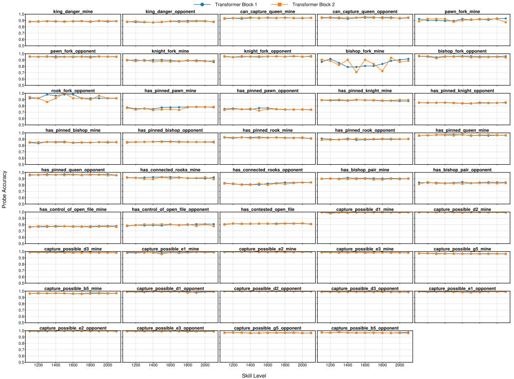

Figure 7: Probe accuracy across skill levels for all 44 king and queen safety, tactical pattern, and positional structure concepts.  
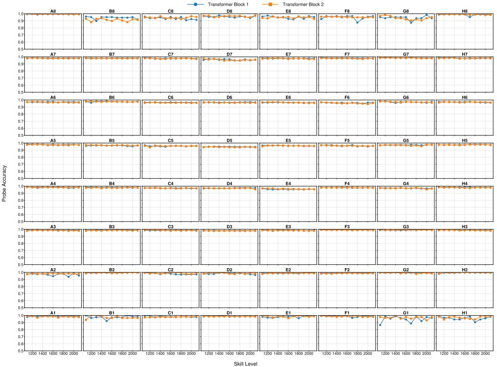  
Figure 8: Probe accuracy across skill levels for all 64 per-square control concepts from the active player's perspective.

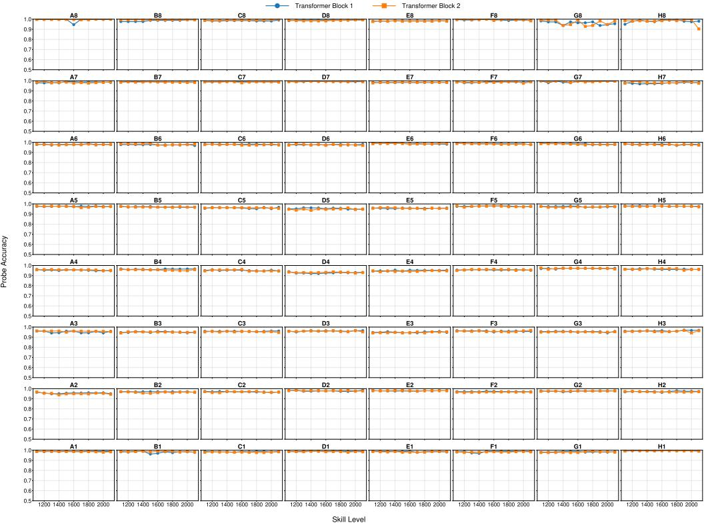

Figure 9: Probe accuracy across skill levels for all 64 per-square control concepts from the opponent's perspective.  
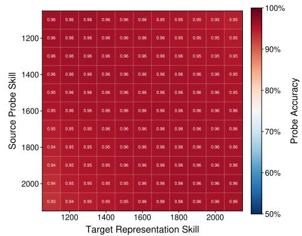  
Figure 10: Layer-averaged cross-skill probe accuracy over 172 concepts. Rows denote source-probe skills and columns denote targetrepresentation skills.

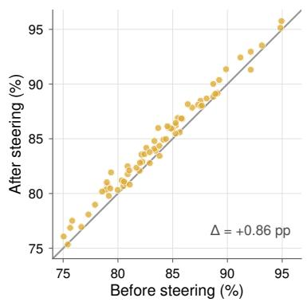  
Figure 11: Probe accuracy before and after SAE feature steering. Each point is one concept, averaged over 11 skill levels.

## B.5 EXTENDED RESULTS FOR MODULATING KNOWLEDGE EXTERNALIZATION

Additional results. Figure 12 compares concept encoding and best-move accuracy on the same positions containing the target concepts. Encoding remains near ceiling as move accuracy changes across skill levels. Both policy-head fine-tuning (Head SFT) and sparse autoencoder (SAE) feature steering narrow the behavioral gap, with Head SFT recovering most of it.

Concept selection for externalization experiments. Of the 172 oracle concepts, not all yield enough qualifying positions for the intervention experiments. A position qualifies for concept c only if: (i) the oracle detects c, (ii) the oracle confirms that the optimal move addresses c, and (iii) the lowest-skill prediction fails to address c and causes a blunder. Here, a move addresses a concept if it takes the corresponding concept-relevant action, such as capturing an under-defended opponent piece or relocating or defending a threatened piece. We require at least 500 qualifying positions per concept to support train, validation, and test splits together with intervention hyperparameter selection. This leaves 71 concepts, and all results in Section 5.2 use this set.

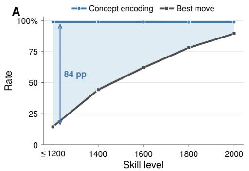

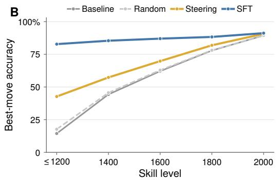  
Figure 12: Maia-2's concept encoding and best-move accuracy on the same positions with target concepts (A), and recovery under feature steering and Head SFT across skill levels (B).

Feature-steering site and control. As detailed in Appendix C, SAE steering acts on the mean-pooled FFN contribution in Transformer Block 2 and reinjects the decoded representation before residual addition. Steering (Random) follows the same procedure with uniformly sampled SAE features, controlling for a generic activation perturbation.

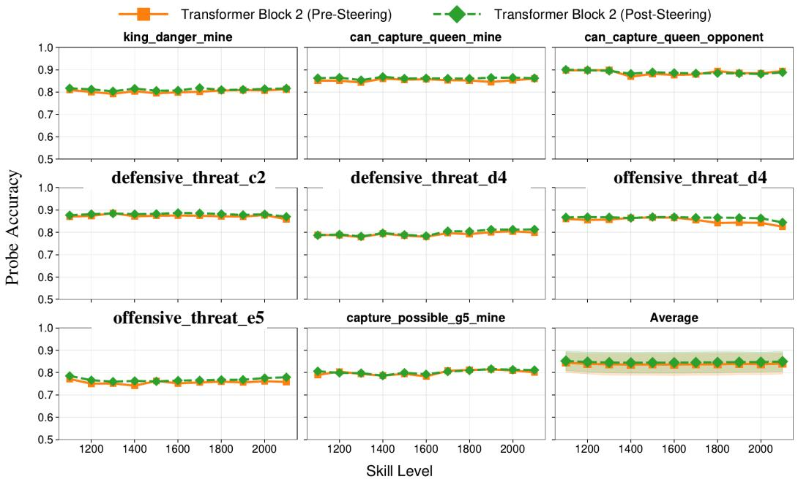  
Figure 13: Probe accuracy before and after SAE feature steering across 11 skill levels for eight representative concepts and the 71-concept average.

Knowledge encoding after feature steering. Figure 11 summarizes knowledge encoding before and after SAE feature steering across all 71 concepts, while Figure 13 shows the corresponding curves for representative concepts. For the statistical comparison, we first average the 11 skill levels within each concept and then pair the pre- and post-steering accuracies across concepts. The mean change is +0.86 percentage points (90% CI: [0.73, 0.98]), which falls within a ±1-point equivalence margin under paired two one-sided tests (TOST; p = 0.031).

## C DETAILS FOR SAE FEATURE STEERING

## C.1 MAIA-2 SAE TRAINING

We train separate Sparse Autoencoders (SAEs) on the FFN contribution from each of Maia-2's two Transformer blocks to obtain sparse feature dictionaries (Cunningham et al., 2023; Bricken et al., 2023). We then identify features associated with oracle concepts and use the Block 2 dictionary for feature steering.

Training data. We use rated Lichess games from September through November 2023, which were also included in Maia-2's training corpus. We follow Maia-2's balancing and filtering procedure: games are balanced across player skill levels, while the first 10 plies and moves made with less than 30 seconds remaining are excluded (McIlroy-Young et al., 2020).

Activation collection. For each Transformer block, we collect the FFN contribution before it is added to the residual stream, mean-pool across the eight patch tokens, and train a separate SAE on the resulting 1024-dimensional vectors.

Architecture and objective. We use the JumpReLU architecture (Rajamanoharan et al., 2024), with encoder $W _ { e } \in \mathbb { R } ^ { d _ { \mathrm { h i d d e n } } \times d _ { \mathrm { i n } } }$ and decoder $W _ { d } \in \mathbf { \mathbb { R } } ^ { d _ { \mathrm { i n } } \times }$ dhidden. Here, $d _ { \mathrm { i n } }$ is the FFN output dimension and $d _ { \mathrm { h i d d e n } }$ is the dictionary size. We minimize

$$
\mathcal { H } = \mathrm { J u m p R e L U } _ { \theta } ( W _ { e } \mathbf { x } + \mathbf { b } _ { e } ) , \qquad \quad \hat { \mathbf { x } } = W _ { d } \mathcal { H } + \mathbf { b } _ { d } ,\tag{4}
$$

$$
\mathcal { L } _ { \mathrm { S A E } } = \Vert \mathbf { x } - \hat { \mathbf { x } } \Vert _ { 2 } ^ { 2 } + \lambda _ { \mathrm { L 0 } } \Vert \mathcal { H } \Vert _ { 0 } ,\tag{5}
$$

where θ contains the learned activation thresholds and $\lambda _ { \mathrm { L 0 } }$ controls sparsity. We initialize encoder and decoder weights with unit-normalized He initialization (He et al., 2015) and set both biases to zero.

Model selection. We search dictionary sizes from 1× to 16× the FFN output dimension and sparsity coefficients from $5 \times 1 0 ^ { - 6 } t o 1 0 ^ { - 4 }$ , training each configuration for up to 10,000 iterations. Because reconstruction loss alone does not show whether a dictionary captures chess structure, we follow Karvonen et al. (2024) and track the best feature-level ROC-AUC over 93 labeled chess concepts. This calibration set comprises 29 board-state properties, such as checks, open files, and capture opportunities on key squares, and 64 piece-location indicators, and is separate from the oracle used in Sections 4 and 5. We stop after 10 evaluation intervals without improvement and retain the checkpoint with the highest aggregate concept AUC for each block. The selected 16× dictionaries contain 16,384 features. Finally, Figure 14 shows that reconstructing through these SAEs closely preserves Maia-2's win-rate predictions and move choices across skill levels.

## C.2 CONCEPT-SALIENT FEATURE IDENTIFICATION

Because each oracle provides deterministic position-level labels, we can measure feature-concept associations directly (Karvonen et al., 2024).

For each oracle concept $c ,$ we collect a balanced set of positions where c is present and absent, run the positions through Maia-2 under the middle skill condition, and encode the mean-pooled FFN contributions through the trained SAE to obtain sparse feature activations $\mathcal { H } \in \mathbb { R } ^ { d _ { \mathrm { h i d d e n } } }$ . We then score each SAE feature $j$ by its discriminative power for concept c:

$$
r ( j , c ) = \operatorname { A U C } ( j , c ) ,\tag{6}
$$

where $\operatorname { A U C } ( j , c )$ is the ROC-AUC score between feature $j ^ { \circ } \mathbf { s }$ activations and the concept labels across all collected positions. For each concept, we retain the top 100 features ranked by $r ( j , c )$ . We compute these rankings separately for both SAE dictionaries and use the Block 2 rankings for steering.

## C.3 FEATURE STEERING

Given the concept-salient features identified in Section C.2, we steer Maia-2's move predictions by amplifying these features during the forward pass, motivated by the feature steering methodology of Templeton et al. (2024).

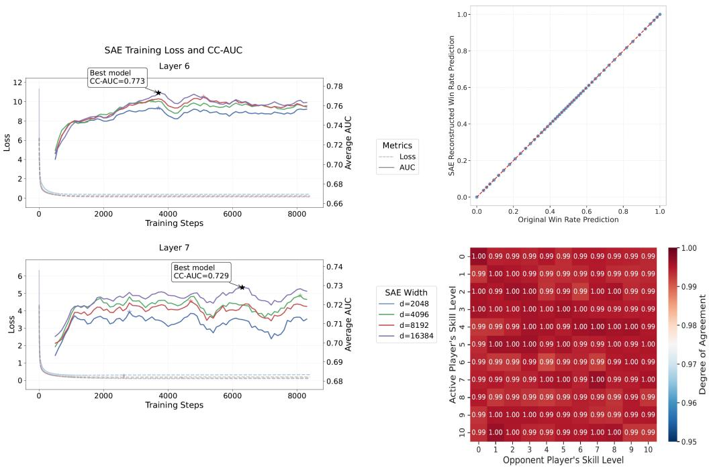  
Figure 14: Training diagnostics and predictive fidelity for Maia-2 SAEs.

For a given position, we first run a clean forward pass to obtain the Block 2 FFN contribution and encode its mean-pooled representation through the SAE to obtain H. We then amplify the top-k salient features for the target concept by a factor α:

$$
\tilde { \mathcal { H } } _ { j } = \left\{ \begin{array} { l l } { \alpha \cdot \mathcal { H } _ { j } } & { \mathrm { i f ~ } j \in \mathcal { F } _ { c } ^ { k } } \\ { \mathcal { H } _ { j } } & { \mathrm { o t h e r w i s e } } \end{array} \right.\tag{7}
$$

where $\mathcal { F } _ { c } ^ { k }$ denotes the top-k features for concept c. The modified latent representation $\tilde { \mathcal { H } }$ is reconstructed through the SAE decoder, broadcast across the eight patch tokens, and substituted for the original Block 2 FFN contribution before residual addition. A second forward pass produces the steered move predictions.

Hyperparameter selection. We optimize k and α for the ten non-highest skill conditions via grid search on the training split of the concept-filtered dataset, with $\bar { k } \in \{ 1 , 2 , 5 , 1 0 , 2 0 \}$ and $\bar { \alpha } \in \{ 2 , 5 , 1 0 , 2 0 \}$ , selecting the combination that maximizes the proportion of predictions matching the optimal move. The highest skill condition reuses the setting from the adjacent condition.

Knowledge Encoding after steering. Unlike Head SFT, feature steering modifies internal activations, so stable knowledge encoding is not guaranteed by construction. We therefore apply the probes trained before steering (Section 4.2) to the intervened Block 2 representations. Appendix B.5 reports the resulting probe curves and paired equivalence test.

## D ADDITIONAL RELATED WORK

Oracle chess engines. Chess has long served as a benchmark for AI, from Deep Blue (Hsu, 1999) to superhuman engines such as Stockfish (Romstad et al., 2023) and AlphaZero (Silver et al., 2018). For our purposes, engine evaluations provide a consistent reference for assessing move quality and identifying best moves.

Reading internal representations. Probing is widely used to study knowledge encoding by measuring how accurately a simple predictor can recover a property from a model's internal representations (Alain & Bengio, 2016; Gurnee & Tegmark, 2023; Burns et al., 2023b). Logit and tuned lenses provide a complementary readout by mapping intermediate activations to distributions over the vocabulary (nostalgebraist, 2020; Belrose et al., 2023). Readouts that combine signals across internal layers can also outperform methods based on model outputs or final-layer representations (Jiao et al., 2024; 2026a; Jiao & Anderson, 2026). This literature motivates our operational measure of knowledge encoding as concept decodability, which we distinguish from the use of those concepts in move selection.

Intervening on internal computations. Interventions complement these readouts by testing how changes to internal computations affect model behavior. Sparse autoencoders decompose activations into features that can be amplified or ablated to test their influence on outputs (Bricken et al., 2023; Templeton et al., 2024; Zou et al., 2026). Activation patching and attention-head ablation test the contributions of specific components by replacing their activations or suppressing their outputs (Meng et al., 2022; Wang et al., 2022a; Jiao et al., 2026b). We use policy-head fine-tuning and SAE feature steering to test whether lower-skill representations retain knowledge that can support stronger move predictions.