# REAP: UNCOVERING MONTE CARLO PROOF SEARCH WITH A LIGHTWEIGHT MODEL

Yutong Wang<sup>1</sup> Xuanzhi Ren<sup>1</sup> Tianyi Xu<sup>1</sup> Ruitong Liu<sup>1</sup> Jingda Xu<sup>2</sup> Peihao Wu<sup>2</sup> Bryan Dai<sup>2</sup> Bin Dong<sup>3,4,5,6</sup>

<sup>1</sup>Peking University

<sup>2</sup>IQuest Research

<sup>3</sup>Beijing International Center for Mathematical Research and the New Cornerstone Science Laboratory, Peking University

<sup>4</sup>Center for Machine Learning Research, Peking University

<sup>5</sup>Center for Intelligent Computing, Great Bay Institute for Advanced Study, Great Bay University <sup>6</sup>Zhongguancun Academy

## ABSTRACT

We present Reap, an open framework for learning and analyzing formal proof search in Lean 4. Reap implements policy–value-guided Monte Carlo Tree Search directly in Lean, sharing proof-state transitions, AND–OR search, and replay verification between inference and training rollouts. Structured action logs expose how neural predictions and tactic execution interact during search. Using this framework, we train Reaper-1, a 1.7B-parameter policy–value model, through continued pre-training, supervised tactic learning, and iterative searchbased reinforcement learning. Using a separate premise selector, the final system solves 79.9% of miniF2F-test at pass@32, establishing state-of-the-art performance among open provers of comparable size while remaining competitive with substantially larger models. Beyond improved solve rates, our results suggest that RL strengthens the prover’s ability to organize proofs around useful intermediate results, favoring substantial advances over repeated local adjustments. This more directed proof construction is accompanied by increasingly elaborate tactic programs: fewer explicit search decisions are needed, while more work is performed within each decision. The resulting trade-off between search effort and tactic execution cost provides insight into how learning changes the prover’s problem-solving strategy.

## 1 INTRODUCTION

Formal theorem proving provides a reliable testbed for studying machine reasoning: proof assistants expose explicit proof states and verify completed proofs with a trusted kernel, grounding reasoning in a precisely defined environment. Recent whole-proof systems, such as Kimina-Prover, DeepSeek-Prover-V2, and Seed-Prover (Wang et al., 2025; Ren et al., 2025; Chen et al., 2025), have achieved strong mathematical performance with increasingly large models and elaborate inference pipelines, while step-level reinforcement learning has substantially improved neural theorem provers (Lample et al., 2022; Hubert et al., 2026). These advances raise a complementary question: beyond solving more theorems, how does training change the mechanism and procedure of proof search? Earlier systems (Lample et al., 2022; Polu & Sutskever, 2020) combined relatively small models with inspectable search environments, whereas more recent high-performing provers (Hubert et al., 2026; Xin et al., 2026; Wu et al., 2025) can be difficult to study independently because of limited implementation access or substantial computational requirements. This motivates our central goal: combining strong theorem-proving performance with an accessible and observable search framework.

To this end, we introduce Reap, an open framework that implements policy–value-guided Monte Carlo Tree Search (MCTS) directly as a Lean 4 tactic. Reap runs the semantics-critical search loop inside Lean, supporting native proof-state transitions, AND–OR search, runtime budget control, proof reconstruction, and replay verification, while external neural services provide policy and value predictions. The same implementation serves both as an inference-time proof-search tactic and as a rollout engine for reinforcement learning, providing a consistent interface between training and evaluation. Reap also records structured search traces, making the interaction between neural predictions, tactic execution, and search directly observable. Together with the distributed Scythe-rl pipeline for coordinating rollouts, training, and data management, this design provides a lightweight environment for developing and analyzing search-based formal provers.

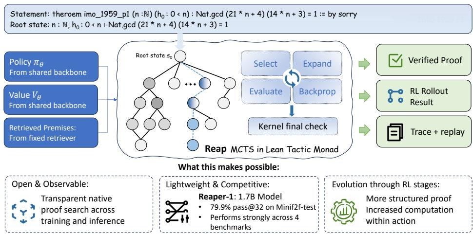  
Figure 1: Overview of Reap’s proof-search and learning interface. A shared policy–value backbone and a fixed premise retriever provide guidance to Monte Carlo Tree Search running inside Lean’s tactic monad, where native proof-state transitions are selected, expanded, evaluated, and backed up. Successful proofs are checked by Lean’s kernel and exposed through traces and replay; the same interface supports reinforcement-learning rollouts and inference, enabling transparent analysis of how training changes proof structure and computation within each action.

Using this framework, we train Reaper-1, a lightweight 1.7B-parameter policy–value model through continued pre-training, supervised tactic learning, and iterative MCTS-guided reinforcement learning. With a separate premise retriever following the LeanSearch-PS recipe (Shen et al., 2025), Reaper-1 achieves 79.9% pass@32 on miniF2F-test, establishing state-of-the-art performance among open provers of comparable size. This system altogether lowers the hardware barrier and compute budget to inference and experimentation.

Beyond benchmark performance, Reap allows us to study how reinforcement learning reshapes proof search. Our analysis reveals that reinforcement learning changes both the organization of proofs and the granularity of interaction with Lean. Later checkpoints produce shorter top-level proof trajectories while increasingly using structural tactics to introduce intermediate claims and organize local reasoning. Together with our qualitative case studies, this pattern suggests that the model becomes better at identifying useful intermediate structural lemmas and concentrating proof attempts on steps that make substantive progress, reducing reliance on repeated local manipulations. At the same time, individual actions become more compound, incorporating multiple proof operations and solver calls. Shorter trajectories therefore reflect a combination of more focused proof construction and greater computation within each action. These findings highlight the need to examine proof structure and execution cost together when interpreting the benefits of reinforcement learning for proof search.

Our main contributions are as follows:

• We introduce Reap, an open and observable MCTS proof-search framework implemented directly as a Lean 4 tactic, supporting native proof-state transitions, AND–OR search, proof reconstruction, and replay verification.

• We develop the Scythe-rl training pipeline and use it to train Reaper-1, a lightweight 1.7B-parameter prover backbone. Integrated with Reap and a separate premise retriever, it achieves 79.9% pass@32 on miniF2F-test and strongly transfer across 4 additional benchmarks, reaching state-of-the-art performance among models of comparable size.

• Enabled by the high observability of our framework, we provide statistical analyses and detailed case studies to characterize how proof-search behavior evolves during MCTSguided learning, revealing a transition toward search-interaction compression.

## 2 RELATED WORK

LLM-based Formal Theorem Proving. Large language models have substantially advanced formal theorem proving in Lean. Recent systems generally follow either whole-proof generation or step-level interaction with the proof assistant. Representative whole-proof provers include DeepSeek-Prover-V2 (Ren et al., 2025), Kimina-Prover (Wang et al., 2025), Goedel-Prover-V2 (Lin et al., 2026), and Pythagoras-Prover (Leang et al., 2026). Step-level provers instead predict tactics conditioned on the current Lean proof state, as in HunyuanProver (Li et al., 2024), InternLM2.5- StepProver (Wu et al., 2025), REAL-Prover (Shen et al., 2025), BFS-Prover-V2 (Xin et al., 2026), and OptProver (Li et al., 2026). Retrieval-augmented systems such as LeanDojo/ReProver (Yang et al., 2023) and REAL-Prover retrieve relevant library declarations to guide proof generation. Reap follows the step-level paradigm and performs proof search over Lean states.

Search for Theorem Proving. Search is a key component of step-level theorem proving. Bestfirst search is widely used in recent neural provers (Xin et al., 2026). Several works have also explored MCTS-style search. HyperTree Proof Search (Lample et al., 2022) introduces an AlphaZeroinspired search procedure over the AND–OR structure of proof obligations. DeepSeek-Prover-V1.5 (Xin et al., 2025) proposes RMaxTS, an MCTS variant that encourages exploration over intermediate tactic states. AlphaProof (Hubert et al., 2026) further combines policy–value-guided tree search with reinforcement learning at large scale. Reap builds on this line of work, but implements the MCTS rollout process directly inside Lean so that search operates on native proof states and can be invoked as a Lean tactic.

Reinforcement Learning for Formal Proving. Reinforcement learning has increasingly been used to improve formal provers through feedback from proof assistants. HTPS (Lample et al., 2022) combines proof search with online learning from discovered proofs, while DeepSeek-Prover-V1.5 (Xin et al., 2025) introduces reinforcement learning from proof-assistant feedback. AlphaProof (Hubert et al., 2026) couples policy–value-guided tree search with iterative reinforcement learning, which provides the primary methodological inspiration for Reap. Recent systems further explore interleaved thinking and proving, self-play, verifier-integrated reinforcement learning, and large-scale test-time search (Lin et al., 2025; Dong & Ma, 2025; Ji et al., 2025; Chen et al., 2025).

## 3 METHODOLOGY

## 3.1 REAP: LEAN-NATIVE MONTE CARLO TREE SEARCH

Reap implements a policy–value-guided Monte Carlo Tree Search inspired by AlphaProof (Hubert et al., 2026) and adapted to tactic-level theorem proving in Lean. Its key design is to run the search loop directly inside Lean’s tactic monad. Proof-state transitions, tree construction, and verification remain inside Lean, allowing the same implementation to serve both as a training rollout engine and as an invocable Lean tactic. Neural policy and value evaluations are served externally: the policy proposes tactics, while the value estimates negative remaining proof-search cost and guides MCTS toward shorter successful continuations. Furthermore, Reap optionally records structured action-level logs covering model calls, tactic evaluation, and timing, enabling the analyses in Section 4.6. Implementation details of the search procedure are available in the public Reap repository at https://github.com/frenzymath/reap.

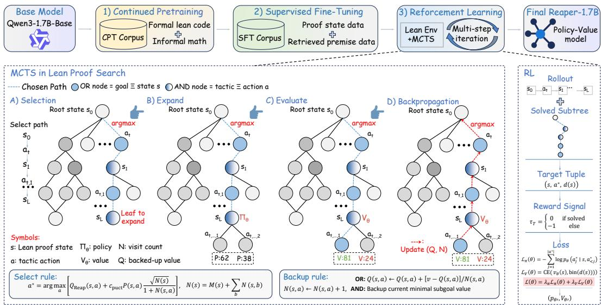  
Figure 2: Overview of Reap’s training pipeline and Lean-native MCTS. In the backup rule, OR/AND labels refer to the successor node’s type. Both $Q ( s , a )$ and the return v account for the edge cost: one for tactic edges and zero for synthetic focus edges. Here, M(s) counts direct policy–value evaluations.

Native proof states and tactic evaluation. The proof search is implemented natively in Lean through its metaprogramming API. State transitions manipulate Lean’s proof-state objects directly and use the built-in save/restore primitives. Each node stores a Tactic.SavedState, and each tactic edge represents a successful transition induced by a Lean tactic. Before elaboration, Reap filters tactic syntax that is unsuitable for a proof-state transition such as sorry and simp?. Tactic execution is bounded by both Lean heartbeats and a wall-clock timeout. Only tactics that elaborate and execute successfully are incorporated into the search tree, together with their resulting proof states.

AND–OR proof search. Reap represents tactic choices with OR nodes and independent proof obligations with AND nodes. An OR node is considered solved once any child is solved, whereas an AND node requires that all its children be solved. Multiple goals are decomposed into an AND node only when they contain no unresolved expression metavariables; otherwise, they remain coupled in a single OR-state.

Node values estimate negative remaining proof-search cost. Each tactic edge incurs unit cost, while the synthetic focus edges connecting an AND node to its subgoals incur zero cost. OR nodes maintain visit-averaged value estimates. At an AND node, both the stored value and the value propagated to its parent are the minimum of the current values of its evaluated, unresolved children, with zero as the default for solved or unevaluated children. Thus, a fully solved AND node has value zero, and the estimated remaining cost of an AND node is determined by its hardest unresolved subgoal rather than the sum of its subgoal costs.

Progressive sampling and PUCT. Reap uses progressive sampling (Hubert et al., 2026) to balance generating new tactics and revisiting existing children. Let N(s) be the visit count and M(s) the number of policy–value evaluations at state s. New tactics are sampled according to

$$
M ( s ) \leq C N ( s ) ^ { \alpha } .\tag{1}
$$

Meanwhile, Reap selects a child using the PUCT score (Silver et al., 2018; Hubert et al., 2026)

$$
\operatorname { P U C T } ( s , a ) = \gamma ^ { - V ( s , a ) - 1 } + c ( N ( s ) ) P ( s , a ) { \frac { \sqrt { N ( s ) } } { 1 + N ( s , a ) } } ,\tag{2}
$$

where the exploration coefficient is

$$
c ( N ) = c _ { \mathrm { i n i t } } + \log \frac { N + c _ { \mathrm { b a s e } } + 1 } { c _ { \mathrm { b a s e } } } ,\tag{3}
$$

Here, $P ( s , a )$ is the normalized policy prior, and $V ( s , a ) = \bar { v } ( s ^ { \prime } ) - d ( a )$ is the child node’s current value estimate after subtracting the edge cost, where $s ^ { \prime }$ is the child state, $d ( a ) = 1$ for tactic edges, and $d ( a ) = 0$ for synthetic focus edges. For visited children of OR nodes, Eq. (2) favors lower estimated remaining costs. The exploitation term is initialized to zero for unvisited children. AND nodes instead use $\bar { 1 - \gamma } ^ { - V ( s , a ) - 1 }$ for visited, unresolved children, retaining the same exploration term and excluding solved children, to prioritize harder subgoals; their unvisited children have exploitation term one.

State deduplication. When expanding an OR node, Reap executes each generated tactic and computes a serialized pretty-printed proof-state. If this key matches that of a state already on the current MCTS path, the candidate is discarded. If it matches an existing child of the current node, the candidate’s prior weight is added to the existing edge and no new node is created. Every generated sample, including repeated tactic text within a sampling batch, contributes its prior weight when accepted. These weights are obtained by exponentiating temperature-scaled tactic log-probabilities and are normalized over the node’s outgoing edges to obtain $\bar { \boldsymbol { P } } ( s , a )$

Proof reconstruction and final verification. A root node marked as solved by MCTS does not necessarily imply that the original theorem has been fully proved, as tactic execution may introduce auxiliary declarations or defer proof obligations. Reap therefore restores the original proof state, replays the selected tactics from the root, and independently validates the reconstructed proof using Lean’s ordinary declaration-checking pipeline to ensure the soundness of the generated proof.

## 3.2 REAPER-1: MODEL AND TRAINING

Reaper-1 is a 1.7B-parameter policy–value model initialized from Qwen3-1.7B-Base. Training proceeds in three main stages: continued pre-training (CPT) adapts the base model to Lean code and formal mathematics, supervised fine-tuning (SFT) learns tactic prediction from proof-state transitions, and iterative reinforcement learning improves both the policy and value estimates using trajectories generated by Reap. Training details are provided in the main text and Appendix A. Reaper-1 model weights are publicly available at https://huggingface.co/FrenzyMath/Reaper-1. The training pipeline code implemented in Scythe-rl is being prepared for public release.

Architecture. Reaper-1 uses a shared Transformer backbone for both policy and value prediction. The policy head is the standard language-modeling head and autoregressively generates Lean tactics conditioned on the current proof state and retrieved premises. An additional value head estimates the remaining proof-search cost of the current state using a discretized value representation. In the current implementation, policy and value predictions are requested in parallel.

Continued pre-training. Starting from Qwen3-1.7B-Base, we continue pre-training on Lean and informal mathematics data, combining FineLeanCorpus (Peng et al., 2026), LeanWorkbook (Ying et al., 2024), NuminaMath-Lean (Wang et al., 2025), DeepSeek-Prover-V1 data (Xin et al., 2024), and Mathlib v4.28.0-rc1. For Mathlib, we include source code together with term and declaration data extracted by jixia (FrenzyMath, 2026), and additionally use internally annotated abstractalgebra data.

Supervised fine-tuning. We construct SFT data primarily from existing Lean proofs and Mathlib. jixia (FrenzyMath, 2026) extracts elaboration traces and proof-state transitions, which scythe converts into step-level examples containing tactics, premises, and value-related information. For each state, PS-2 retrieves relevant library declarations, and the model is trained to predict the next tactic conditioned on the state and retrieved premises. We further normalize structural tactics such as have and suffices into the Reap transition format (Appendix E). These state–premise–tactic examples initialize the policy before reinforcement learning.

Policy–value training objective. After each rollout stage, we collect successful trajectories that pass Lean replay and final verification and convert them into a replay dataset ${ \mathcal { D } } _ { \mathrm { R L } } = ( s , a , y )$ where a is the successful tactic at proof state s and y is its value target. The policy is trained autoregressively on the complete tactic sequence. For the value target, each valid tactic transition incurs unit search cost; the remaining proof cost is backed up through the corresponding AND–OR tree and discretized into $K = 3 2$ bins. We jointly optimize

$$
\begin{array} { r l } & { \mathcal { L } = \lambda _ { P } \big ( \underbrace { - \mathbb { E } _ { ( s , a , y ) \sim \mathcal { D } _ { \mathrm { R L } } } \left[ \log \pi _ { \theta } ( a \mid s ) \right] } _ { \mathcal { L } _ { \mathrm { p o l i c y } } } \big ) } \\ & { ~ + \lambda _ { V } \big ( \underbrace { - \mathbb { E } _ { ( s , a , y ) \sim \mathcal { D } _ { \mathrm { R L } } } \left[ \log p _ { \theta } ( y \mid s ) \right] } _ { \mathcal { L } _ { \mathrm { v a l u e } } } \big ) . } \end{array}\tag{4}
$$

where $\pi _ { \boldsymbol { \theta } } ( \boldsymbol { a } \mid \boldsymbol { s } )$ is the autoregressive probability of tactic a and $p _ { \theta } ( y \mid s )$ is the predicted probability of its discretized value target.

Iterative reinforcement learning. Our RL stage follows an AlphaProof-style expert-iteration formulation: MCTS acts as a policy-improvement operator, and the network is trained on searchgenerated verified trajectories and backed-up value targets. Starting from the SFT checkpoint, we perform five stages of MCTS-guided reinforcement learning on approximately 25K curated training problems extracted from AoPS. During RL1–RL4, each stage performs a full pass over the training corpus while progressively increasing the MCTS simulation budget, starting from 512 simulations in RL1. After performance on training corpus begins to saturate, RL5 switches to a batched multirollout regime with 8,192 simulations and pass@8. Beginning with B13, we additionally introduce group-wise value-based trajectory selection. For each theorem, we retain at most two successful trajectories with the smallest absolute backed-up root values. The complete RL procedure uses 60 NVIDIA A100 GPU days.

Premise selector. Following retrieval-augmented proving practice, we condition tactic generation on relevant Mathlib declarations. Our default selector, PS-2, is trained separately following the LeanSearch-PS recipe (Shen et al., 2025), with an updated Mathlib v4.28.0-rc1 snapshot and revised data filters. It remains fixed during prover RL and supplies library declarations to Reaper-1, which performs tactic generation and value prediction. Data construction, the selector-training objective, and hyperparameters are detailed in Appendix B.

## 4 EXPERIMENTS

## 4.1 EXPERIMENTAL SETUP

Benchmarks. We evaluate Reaper-1 on five Lean theorem-proving benchmarks: miniF2Ftest (Zheng et al., 2022), our primary benchmark for competition-style mathematics; ProofNettest (Azerbayev et al., 2023); FATE-M (Shen et al., 2025) (150-problem snapshot, commit 4eb33c8); PutnamBench (Tsoukalas et al., 2024) (660-problem snapshot, commit 6df1d4c); and CombiBench (Liu et al., 2026). We decontaminate all training corpora against every evaluation benchmark using 10-gram filtering, and use these benchmarks only for retrospective evaluation, never for training or model selection.

Baselines and evaluation. We compare with representative whole-proof and step-level Lean provers. Since published systems use different inference budgets, Table 1 reports each result with its original evaluation budget rather than treating the comparisons as compute-matched. Reaper-1 is evaluated using the final RL policy–value checkpoint and the default premise-selection pipeline. Unless otherwise specified, controlled miniF2F experiments use 8,192 MCTS simulations per search and a maximum policy-generation length of 1,024 tokens. Under this configuration, evaluating all 244 miniF2F-test problems at pass@32 only takes approximately 3 hours of wall-clock time using 32 NVIDIA A100 GPUs and 800 CPU cores. The total inference time of the premise selector is approximately 8.6% of the total inference time in the experiment. All reported successes are replayed and verified by Lean.

Premise selection. Premise retrieval is provided by a separate, modular component rather than the Reaper-1 network. Our default setup uses PS-2, an independently trained Qwen3-Embedding 8B selector, which is neither jointly optimized with Reaper-1 nor adapted during RL. We evaluate inference-time replacement with Lean’s rule-based selectors, without retraining the policy–value model, in Table 3.

## 4.2 MAIN RESULTS

Despite using a 1.7B-parameter generative policy–value model, Reaper-1 is highly competitive with much larger formal provers. On miniF2F-test, it reaches 79.9% pass@32, improving over the 1.7B Kimina-Prover-RL baseline by 3.3 percentage points and outperforming several 7B step-level and whole-proof systems. The advantage is also evident beyond the primary benchmark: Reaper-1 obtains 33.9% on ProofNet-test, compared with 23.7% for REAL-Prover, and reaches 81.3% on FATE-M. On the harder suites, it solves 21/660 PutnamBench problems (pass@32) and 7/100 CombiBench problems (pass@16). Across checkpoints accumulated during our iterative training procedure, the union of solved miniF2F-test problems reaches 81.1%.

Table 1: Main benchmark results. “–” indicates that the corresponding result was not reported by the original work.
<table><tr><td>System</td><td>Budget</td><td>miniF2F</td><td>ProofNet</td><td>FATE-M</td><td>PutnamBench</td><td>CombiBench</td></tr><tr><td>Whole-proof systems</td><td></td><td></td><td></td><td></td><td></td><td></td></tr><tr><td>DeepSeek-Prover-V2-7B (Ren et al., 2025)</td><td>pass@32</td><td>75.6%</td><td></td><td></td><td>9/660</td><td>6 (pass@16)</td></tr><tr><td>Goedel-Prover-V2-8B (Lin et al., 2026)</td><td>pass@32</td><td>84.6%</td><td></td><td></td><td>25/660</td><td></td></tr><tr><td>Kimina-Prover-7B (Wang et al., 2025)</td><td>pass@32</td><td>78.3%</td><td></td><td></td><td></td><td>7 (pass@16)</td></tr><tr><td>Kimina-Prover-RL-1.7B (Wang et al., 2025)</td><td>pass@32</td><td>76.6%</td><td></td><td></td><td></td><td></td></tr><tr><td>Pythagoras-Prover-4B (Leang et al., 2026)</td><td>pass@32</td><td>86.1%</td><td></td><td></td><td></td><td></td></tr><tr><td>Step-level systems</td><td></td><td></td><td></td><td></td><td></td><td></td></tr><tr><td>HunyuanProver (Li et al., 2024)</td><td>pass@8</td><td>68.4%</td><td></td><td></td><td></td><td></td></tr><tr><td>ABEL</td><td>pass@32</td><td>41.3%</td><td></td><td></td><td>8/660</td><td></td></tr><tr><td>REAL-Prover (Shen et al., 2025)</td><td>pass@64</td><td>54.1%</td><td>23.7%</td><td>56.7%</td><td></td><td></td></tr><tr><td>InternLM2.5-StepProver-7B (Wu et al., 2025)</td><td>pass@32</td><td>63.8%</td><td>23.6%</td><td></td><td></td><td></td></tr><tr><td>BFS-Prover-V2-7B (Xin et al., 2026)</td><td>Accumulative</td><td>82.4%</td><td></td><td></td><td></td><td></td></tr><tr><td>Reaper-1 (1.7B)</td><td>pass@32</td><td>79.9%</td><td>33.9%</td><td>81.3%</td><td>21/660</td><td>7/100 (pass@16)</td></tr></table>

## 4.3 REINFORCEMENT-LEARNING PROGRESSION

Figure 3 retrospectively tracks the effect of iterative reinforcement learning from the SFT checkpoint. On miniF2F-test, the number of problems solved under pass@8 increases from 134 for SFT to 191 after RL5, with the largest early improvement occurring during the first RL stage; a similar trend is observed on the full RL training corpus, where pass@1 rises from 19.16% for SFT to 45.27% after RL4. As performance begins to plateau during RL3–RL4, RL5 switches from fullcorpus iterations to sequential small-batch updates with a revised rollout and trajectory-selection regime. Despite substantial batch-to-batch variation, performance improves again in the later RL5 batches, indicating that the sequential training regime is associated with extending prover capability after the earlier full-corpus iterations begin to saturate.

## 4.4 ABLATION STUDIES

Value head. We isolate the effect of the value head guidance during proof search. In the ablated configuration, the neural value prediction is disabled by fixing the predicted value of every state to zero, while the rest of the search pipeline remains unchanged. As shown in Table 2, on the 193 problems solved by both RL5 and RL5 without the value head, RL5 produces shorter successful proofs in the sense of both average tactic steps and an average root value closer to zero. This suggests that enabling value guidance biases MCTS toward shorter successful trajectories.

(a) miniF2F-test  
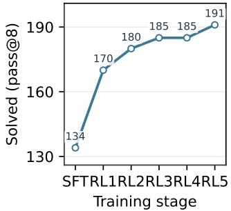

(b) Training corpus  
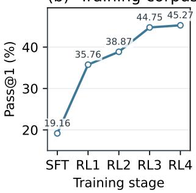

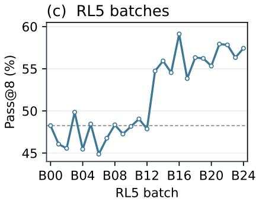  
Figure 3: Reinforcement-learning progression. (a) Retrospective evaluation on miniF2F-test at 8,192 MCTS simulations and pass@8. (b) Pass@1 on the full RL training corpus. (c) Sequential RL5 small-batch evaluation; the dashed horizontal line marks the B00 value (48.26%).

Table 2: Value-head ablation on miniF2F-test with 8,192 simulations and pass@32. Tactic steps are computed by first averaging proved passes within each theorem and then averaging equally across theorems. Average tactic steps and root value are computed on the both-solved 193 problems.
<table><tr><td>Model</td><td>Solved</td><td>Avg. tactic steps</td><td>Avg. root value</td></tr><tr><td>RL5</td><td>195</td><td>16.4553</td><td>-9.9174</td></tr><tr><td>RL5 w/o value head</td><td>193</td><td>17.4435</td><td>-11.0221</td></tr></table>

Table 3: Inference-time retriever replacement on miniF2F-test with the same RL5 checkpoint and 8,192 MCTS simulations per search. PS-2 is neural; MePo and SineQuoNon are rule-based. Paren theses give solved/total problems.
<table><tr><td>Retriever</td><td>PS-2</td><td>MePo</td><td>SineQuoNon</td></tr><tr><td>Pass@32</td><td>79.9% (195/244)</td><td>67.6% (165/244)</td><td>75.8% (185/244)</td></tr></table>

Replacing the premise retriever. We replace PS-2 at inference with Lean’s built-in rule-based selectors, MePo (Meng & Paulson, 2009) and SineQuoNon (Hoder & Voronkov, 2011), keeping the final RL5 policy–value checkpoint and search configuration fixed. Despite being trained with PS-2 premises, Reaper-1 achieves 75.8% pass@32 with SineQuoNon without additional training (Table 3). This is 10 problems (4.1 percentage points) below the 79.9% obtained with PS-2; MePo achieves 67.6%. These results demonstrate that the learned prover can operate effectively with a rule-based retriever on this benchmark, supporting inference-time replacement of the neural retrieval component.

## 4.5 SEARCH SCALING

We next examine how Reaper-1 scales with the MCTS simulation budget. Table 4 reports miniF2Ftest performance under pass@32 while varying the maximum number of MCTS simulations allowed for each independent search. Reaper-1 already solves 188 of 244 problems (77.05%) with only 512 simulations. Coverage then begins to saturate: both 2,048 and 4,096 simulations solve the same 194 problems, while the full 8,192-simulation budget adds only one additional theorem. The scaling curve therefore exhibits clear diminishing returns in theorem coverage. The strong performance at relatively small budgets suggests that Reaper-1’s final result is not solely a consequence of the largest test-time search budget.

Table 4: Search scaling of Reaper-1 on miniF2F-test under pass@32.
<table><tr><td>MCTS budget</td><td>512</td><td>1024</td><td>2048</td><td>4096</td><td>8192</td></tr><tr><td>Pass@32</td><td>77.05%</td><td>78.28%</td><td>79.51%</td><td>79.51%</td><td>79.92%</td></tr></table>

## 4.6 HOW REINFORCEMENT LEARNING RESHAPES PROOF SEARCH

Beyond improving theorem coverage, reinforcement learning also changes how the prover interact with search. We compare the SFT, RL4, and RL5 checkpoints under the same miniF2F setting. To control for theorem difficulty, proof-level statistics are computed on the 151 problems solved by all three checkpoints. Full measurement protocols, statistical analyses, and qualitative examples are deferred to Appendices C and D.

Table 5: How reinforcement learning reshapes proof search. Coverage uses all 244 miniF2F-test problems; proof and action statistics use the 151-problem common solved set.
<table><tr><td>Metric</td><td>SFT</td><td>RL4</td><td>RL5</td></tr><tr><td>Pass@32</td><td>62.3%</td><td>78.3%</td><td>79.9%</td></tr><tr><td>Mean proof steps</td><td>21.7</td><td>11.2</td><td>5.2</td></tr><tr><td>Mean search-tree nodes</td><td>2,368</td><td>162</td><td>119</td></tr><tr><td>Median action characters</td><td>19</td><td>23</td><td>66</td></tr><tr><td>Tactic identifiers/action</td><td>1.38</td><td>1.38</td><td>2.80</td></tr><tr><td>Actions containing &lt; ; &gt;</td><td>2.9%</td><td>4.5%</td><td>23.9%</td></tr><tr><td>Median evaluation latency (ms)</td><td>12.0</td><td>15.2</td><td>43.2</td></tr></table>

As shown in Table 5, RL substantially improves coverage while compressing successful search into shorter trajectories and much smaller trees. The later checkpoints also exhibit a clear change in proof organization: actions become longer and structurally denser, with greater use of compound tactic programs. Together with the qualitative cases in Appendix D, this suggests that the policy increasingly organizes proofs around useful intermediate structure and directs search toward steps that make substantive progress, rather than relying on repeated local manipulations.

This compression does not imply less underlying computation. As actions become more compound, their Lean evaluation cost also increases. We therefore describe the observed transition as searchinteraction compression: RL reduces the number of top-level search decisions while shifting more proof construction and solver work into each individual action.

## 5 LIMITATIONS AND FUTURE WORK

Reaper-1 uses the number of tactic-level search actions as a proxy for proof cost, which does not always reflect the actual complexity of a Lean proof step. During later RL stages, we observe that the model increasingly exploits Lean constructs that package multiple proof operations into a single search action. Such constructions can beneficially compress local reasoning and reduce search depth, but may also lower the apparent trajectory cost without reducing the underlying computation; sufficiently complex actions can increase Lean execution latency and reduce MCTS exploration efficiency. This limitation suggests that future objectives could incorporate tactic execution time, generated-token length, or finer-grained measures of action complexity. Finally, our experiments focus on Lean 4 and a single 1.7B policy–value model, so the extent to which these search and training dynamics generalize to substantially larger models or other proof assistants remains to be studied.

## 6 CONCLUSION

We introduced Reap, an open Monte Carlo Tree Search framework for formal theorem proving whose semantics-critical search loop runs directly inside Lean, together with Reaper-1, a 1.7Bparameter policy–value model trained through continued pre-training, supervised tactic learning, and iterative MCTS-guided reinforcement learning. Despite its modest scale, Reaper-1 with a separate premise retriever achieves strong performance across multiple Lean benchmarks, including 79.9% pass@32 on miniF2F-test, while remaining competitive with substantially larger provers. Beyond benchmark coverage, Reap provides a lightweight and observable platform for studying how neural policies, value estimation, formal verification, and tree search interact during theorem proving. Our analysis suggests that search-based RL can refine proof strategy, enabling the prover to make effective use of auxiliary lemmas and pursue more direct routes to a complete argument. As individual tactics take on a larger role in carrying out local reasoning, these advances also call for closer attention to their computational demands. By making such learning dynamics accessible to systematic study, Reap supports further research on training objectives that encourage meaningful proof progress.

## ACKNOWLEDGMENTS

This work is supported in part by the National Key R&D Program of China grant 2024YFA1014000, the Fundamental and Interdisciplinary Disciplines Breakthrough Plan of the Ministry of Education of China (JYB2025XDXM113), and the New Cornerstone Investigator Program.

## AI USE STATEMENT

In this work, generative AI tools were used to assist with manuscript writing and organization based on detailed content provided by the authors, literature search, implementation of algorithmic components, and statistical analysis for the RL study. All AI-assisted outputs were reviewed and validated by the authors against the relevant source materials, code, and experimental data. The authors take full responsibility for the methodology, reported results, analyses, and final content of the paper.

## REFERENCES

Zhangir Azerbayev, Bartosz Piotrowski, Hailey Schoelkopf, Edward W. Ayers, Dragomir Radev, and Jeremy Avigad. ProofNet: Autoformalizing and formally proving undergraduate-level mathematics. arXiv preprint arXiv:2302.12433, 2023.

Luoxin Chen, Jinming Gu, Liankai Huang, Wenhao Huang, Zhicheng Jiang, Allan Jie, Xiaoran Jin, Xing Jin, Chenggang Li, Kaijing Ma, Cheng Ren, Jiawei Shen, Wenlei Shi, Tong Sun, He Sun, Jiahui Wang, Siran Wang, Zhihong Wang, Chenrui Wei, Shufa Wei, Yonghui Wu, Yuchen Wu, Yihang Xia, Huajian Xin, Fan Yang, Huaiyuan Ying, Hongyi Yuan, Zheng Yuan, Tianyang Zhan, Chi Zhang, Yue Zhang, Ge Zhang, Tianyun Zhao, Jianqiu Zhao, Yichi Zhou, and Thomas Hanwen Zhu. Seed-Prover: Deep and broad reasoning for automated theorem proving. arXiv preprint arXiv:2507.23726, 2025.

Kefan Dong and Tengyu Ma. STP: Self-play LLM theorem provers with iterative conjecturing and proving. In Proceedings of the 42nd International Conference on Machine Learning, volume 267 of Proceedings ofMachine Learning Research, pp. 14114–14136. PMLR, 2025. URL https: //proceedings.mlr.press/v267/dong25h.html.

FrenzyMath. Jixia. GitHub repository, 2026. URL https://github.com/frenzymath/ jixia. Version v4.28.0-rc1.

Krystof Hoder and Andrei Voronkov. Sine qua non for large theory reasoning. In ˇ Automated Deduction – CADE-23, volume 6803 of Lecture Notes in Computer Science, pp. 299–314. Springer, 2011. doi: 10.1007/978-3-642-22438-6 23.

Thomas Hubert, Rishi Mehta, Laurent Sartran, Miklos Z. Horv´ ath, Goran´ Zu<sup>ˇ</sup> ziˇ c, Eric Wieser,´ Aja Huang, Julian Schrittwieser, Yannick Schroecker, Hussain Masoom, Ottavia Bertolli, Tom Zahavy, Amol Mandhane, Jessica Yung, Iuliya Beloshapka, Borja Ibarz, Vivek Veeriah, Lei Yu, Oliver Nash, Paul Lezeau, Salvatore Mercuri, Calle Sonne, Bhavik Mehta, Alex Davies,¨ Daniel Zheng, Fabian Pedregosa, Yin Li, Ingrid von Glehn, Mark Rowland, Samuel Albanie, Ameya Velingker, Simon Schmitt, Edward Lockhart, Edward Hughes, Henryk Michalewski, Nicolas Sonnerat, Demis Hassabis, Pushmeet Kohli, and David Silver. Olympiad-level formal mathematical reasoning with reinforcement learning. Nature, 651(8106):607–613, 2026. doi: 10.1038/s41586-025-09833-y.

Xingguang Ji, Yahui Liu, Qi Wang, Jingyuan Zhang, Yang Yue, Rui Shi, Chenxi Sun, Fuzheng Zhang, Guorui Zhou, and Kun Gai. Leanabell-Prover-V2: Verifier-integrated reasoning for formal theorem proving via reinforcement learning. arXiv preprint arXiv:2507.08649, 2025.

Guillaume Lample, Timothee Lacroix, Marie-Anne Lachaux, Aurelien Rodriguez, Amaury Hayat, Thibaut Lavril, Gabriel Ebner, and Xavier Martinet. Hypertree proof search for neural theorem proving. In S. Koyejo, S. Mohamed, A. Agarwal, D. Belgrave, K. Cho, and A. Oh (eds.), Advances in Neural Information Processing Systems, volume 35, pp. 26337–26349, 2022. doi: 10.52202/068431-1910. URL https://proceedings.neurips.cc/paper\_files/paper/2022/hash/ a8901c5e85fb8e1823bbf0f755053672-Abstract-Conference.html.

Joshua Ong Jun Leang, Zheng Zhao, Mihaela Cat˘ alina Stoian, Qiyuan Xu, Haonan Li, Wenda Li,˘ Shay B. Cohen, and Eleonora Giunchiglia. Pythagoras-Prover: Advancing efficient formal proving via augmented lean formalisation. arXiv preprint arXiv:2606.12594, 2026.

Chenyi Li, Yanchen Nie, Zhenyu Ming, Gong Zhang, Kun Yuan, and Zaiwen Wen. Opt-Prover: Bridging olympiad and optimization through continual training in formal theorem proving. In Forty-third International Conference on Machine Learning, 2026. URL https: //openreview.net/forum?id=mkHp4ZW01l.

Yang Li, Dong Du, Linfeng Song, Chen Li, Weikang Wang, Tao Yang, and Haitao Mi. Hunyuan-Prover: A scalable data synthesis framework and guided tree search for automated theorem proving. arXiv preprint arXiv:2412.20735, 2024.

Haohan Lin, Zhiqing Sun, Sean Welleck, and Yiming Yang. Lean-STaR: Learning to interleave thinking and proving. In The Thirteenth International Conference on Learning Representations, 2025. URL https://openreview.net/forum?id=SOWZ59UyNc.

Yong Lin, Shange Tang, Bohan Lyu, Ziran Yang, Jui-Hui Chung, Haoyu Zhao, Lai Jiang, Yihan Geng, Jiawei Ge, Jingruo Sun, Jiayun Wu, Jiri Gesi, Ximing Lu, David Acuna, Kaiyu Yang, Hongzhou Lin, Yejin Choi, Danqi Chen, Sanjeev Arora, and Chi Jin. Goedel-Prover-V2: Scaling formal theorem proving with scaffolded data synthesis and self-correction. In The Fourteenth International Conference on Learning Representations, 2026. URL https://openreview. net/forum?id=j4C0nALrgK.

Junqi Liu, Xiaohan Lin, Bolton Bailey, Jonas Bayer, Yael Dillies, Weijie Jiang, Xiaodan Liang,¨ Roman Soletskyi, Haiming Wang, Yunzhou Xie, Beibei Xiong, Zhengfeng Yang, Jujian Zhang, Lihong Zhi, Zekai Zhu, Jia Li, and Zhengying Liu. CombiBench: Benchmarking LLM capability for combinatorial mathematics. In 3rd AI for Math Workshop: Toward Self-Evolving Scientific Agents, 2026. URL https://openreview.net/forum?id=qeZStJVYnc.

Jia Meng and Lawrence C. Paulson. Lightweight relevance filtering for machine-generated resolution problems. Journal ofApplied Logic, 7(1):41–57, 2009. doi: 10.1016/j.jal.2007.07.004.

Zhongyuan Peng, Yifan Yao, Kaijing Ma, Shuyue Guo, Yizhe Li, Yichi Zhang, Chenchen Zhang, Yifan Zhang, Zhouliang Yu, Luming Li, Minghao Liu, Yihang Xia, Jiawei Shen, Yuchen Wu, Yixin Cao, Zhaoxiang Zhang, Wenhao Huang, Jiaheng Liu, and Ge Zhang. CriticLean: Criticguided reinforcement learning for mathematical formalization. In Proceedings of the 64th Annual Meeting of the Association for Computational Linguistics (Volume 1: Long Papers), pp. 3049– 3088. Association for Computational Linguistics, 2026. doi: 10.18653/v1/2026.acl-long.139. URL https://aclanthology.org/2026.acl-long.139/.

Stanislas Polu and Ilya Sutskever. Generative language modeling for automated theorem proving. arXiv preprint arXiv:2009.03393, 2020.

Z. Z. Ren, Zhihong Shao, Junxiao Song, Huajian Xin, Haocheng Wang, Wanjia Zhao, Liyue Zhang, Zhe Fu, Qihao Zhu, Dejian Yang, Z. F. Wu, Zhibin Gou, Shirong Ma, Hongxuan Tang, Yuxuan Liu, Wenjun Gao, Daya Guo, and Chong Ruan. DeepSeek-Prover-V2: Advancing formal mathematical reasoning via reinforcement learning for subgoal decomposition. arXiv preprint arXiv:2504.21801, 2025.

Ziju Shen, Naohao Huang, Fanyi Yang, Yutong Wang, Guoxiong Gao, Tianyi Xu, Jiedong Jiang, Wanyi He, Pu Yang, Mengzhou Sun, Haocheng Ju, Peihao Wu, Bryan Dai, and Bin Dong. REAL-Prover: Retrieval augmented lean prover for mathematical reasoning. arXiv preprint arXiv:2505.20613, 2025.

David Silver, Thomas Hubert, Julian Schrittwieser, Ioannis Antonoglou, Matthew Lai, Arthur Guez, Marc Lanctot, Laurent Sifre, Dharshan Kumaran, Thore Graepel, Timothy Lillicrap, Karen Simonyan, and Demis Hassabis. A general reinforcement learning algorithm that masters chess, shogi, and Go through self-play. Science, 362(6419):1140–1144, 2018. doi: 10.1126/science.aar6404.

George Tsoukalas, Jasper Lee, John Jennings, Jimmy Xin, Michelle Ding, Michael Jennings, Amitayush Thakur, and Swarat Chaudhuri. PutnamBench: Evaluating neural theorem-provers on the putnam mathematical competition. In Advances in Neural Information Processing Systems, volume 37, pp. 11545–11569, 2024. doi: 10.52202/079017-0368.

Aaron van den Oord, Yazhe Li, and Oriol Vinyals. Representation learning with contrastive predictive coding. arXiv preprint arXiv:1807.03748, 2018.

Haiming Wang, Mert Unsal, Xiaohan Lin, Mantas Baksys, Junqi Liu, Marco Dos Santos, Flood Sung, Marina Vinyes, Zhenzhe Ying, Zekai Zhu, Jianqiao Lu, Hugues de Saxce, Bolton Bailey, ´ Chendong Song, Chenjun Xiao, Dehao Zhang, Ebony Zhang, Frederick Pu, Han Zhu, Jiawei Liu, Jonas Bayer, Julien Michel, Longhui Yu, Leo Dreyfus-Schmidt, Lewis Tunstall, Luigi Pagani,´ Moreira Machado, Pauline Bourigault, Ran Wang, Stanislas Polu, Thibaut Barroyer, Wen-Ding Li, Yazhe Niu, Yann Fleureau, Yangyang Hu, Zhouliang Yu, Zihan Wang, Zhilin Yang, Zhengying Liu, and Jia Li. Kimina-Prover preview: Towards large formal reasoning models with reinforcement learning. arXiv preprint arXiv:2504.11354, 2025.

Zijian Wu, Suozhi Huang, Zhejian Zhou, Huaiyuan Ying, Zheng Yuan, Wenwei Zhang, Dahua Lin, and Kai Chen. InternLM2.5-StepProver: Advancing automated theorem proving via critic-guided search. In 2nd AI for Math Workshop @ ICML 2025, 2025. URL https://openreview. net/forum?id=qwCqeIg5iI.

Huajian Xin, Daya Guo, Zhihong Shao, Zhizhou Ren, Qihao Zhu, Bo Liu, Chong Ruan, Wenda Li, and Xiaodan Liang. DeepSeek-Prover: Advancing theorem proving in LLMs through large-scale synthetic data. arXiv preprint arXiv:2405.14333, 2024.

Huajian Xin, Z. Z. Ren, Junxiao Song, Zhihong Shao, Wanjia Zhao, Haocheng Wang, Bo Liu, Liyue Zhang, Xuan Lu, Qiushi Du, Wenjun Gao, Haowei Zhang, Qihao Zhu, Dejian Yang, Zhibin Gou, Z. F. Wu, Fuli Luo, and Chong Ruan. DeepSeek-Prover-V1.5: Harnessing proof assistant feedback for reinforcement learning and monte-carlo tree search. In The Thirteenth International Conference on Learning Representations, 2025. URL https://openreview.net/forum? id=I4YAIwrsXa.

Ran Xin, Zeyu Zheng, Yanchen Nie, Kun Yuan, and Xia Xiao. BFS-Prover-V2: Scaling up multiturn off-policy RL and multi-agent tree search for LLM step-provers. In Forty-third International Conference on Machine Learning, 2026. URL https://openreview.net/forum?id= GPrlMiGg2w.

Kaiyu Yang, Aidan M. Swope, Alex Gu, Rahul Chalamala, Peiyang Song, Shixing Yu, Saad Godil, Ryan J. Prenger, and Animashree Anandkumar. LeanDojo: Theorem proving with retrieval-augmented language models. In Advances in Neural Information Processing Systems, volume 36, pp. 21573–21612, 2023. doi: 10.52202/075280-0944. URL https://proceedings.neurips.cc/paper\_files/paper/2023/ hash/4441469427094f8873d0fecb0c4e1cee-Abstract-Datasets\_and\_ Benchmarks.html.

Huaiyuan Ying, Zijian Wu, Yihan Geng, Jiayu Wang, Dahua Lin, and Kai Chen. Lean Workbook: A large-scale lean problem set formalized from natural language math problems. In Advances in Neural Information Processing Systems, volume 37, pp. 105848–105863, 2024. doi: 10.52202/ 079017-3357.

Kunhao Zheng, Jesse Michael Han, and Stanislas Polu. MiniF2F: A cross-system benchmark for formal olympiad-level mathematics. In The Tenth International Conference on Learning Repre sentations, 2022. URL https://openreview.net/forum?id=9ZPegFuFTFv.

## A EXPERIMENTAL DETAILS

This section provides additional hyperparameter details for the training and evaluation experiments in Section 4. Unless otherwise specified, proof search uses the MCTS configuration described in Section 3.1 with both policy and value prediction enabled and neural premise selection. All experiments use Lean v4.28.0-rc1 with the corresponding Mathlib snapshot, and a proof is counted as successful only after final replay verification in Lean.

Table 6 summarizes the search and inference configuration used for the controlled miniF2F experiments with 8,192 MCTS simulations. At each policy evaluation, Reaper-1 samples six candidate tactics with temperature 0.99 and a maximum generation length of 1,024 tokens, while the premise selector retrieves eight declarations for the current proof state.

Table 6: MCTS and inference hyperparameters used in the controlled miniF2F experiments.
<table><tr><td>Parameter</td><td>Value</td></tr><tr><td>Search algorithm Maximum MCTS simulations Maximum tree nodes Independent attempts Policy samples/state Retrieved premises/state</td><td>MCTS 8,192 65,536 32 6</td></tr><tr><td>Maximum generation length Generation temperature Value model Tactic heartbeats Tactic timeout</td><td>1,024 0.99 enabled 108 10,000 ms</td></tr><tr><td>Cinit Cbase γ Prior temperature</td><td>0.001 3,200 0.99 150</td></tr></table>

The MCTS-specific hyperparameters in Table 6 instantiate the progressive-sampling rule in Eq. (1) and the PUCT rule in Eq. (2), with the exploration coefficient defined in Eq. (3). The 65,536-node cap is set above the 8,192-step simulation budget and primarily serves as a safety bound on tree growth.

Table 7 reports the main training hyperparameters not detailed in the main text. The MCTS simulation budget doubles across successive RL stages, increasing from 512 simulations per search in RL1 to 8,192 in RL5.

Table 7: Training hyperparameters for Reaper-1.
<table><tr><td>Setting</td><td>Configuration</td></tr><tr><td>CPT global batch size</td><td>1,024</td></tr><tr><td>CPT learning rate</td><td> $3 \times 1 0 ^ { - 4 }  3 \times 1 0 ^ { - 5 }$ </td></tr><tr><td>CPT schedule</td><td>Cosine decay</td></tr><tr><td>RL learning rate</td><td> $2 \times 1 0 ^ { - 5 } \to 5 \times 1 0 ^ { - 7 }$ </td></tr><tr><td>RL policy/value loss-weight ratio  $\lambda _ { P } : \lambda _ { V }$ </td><td> $1 : 0 . 3  1 : 0 . 0 5$ </td></tr><tr><td>RL1 MCTS budget</td><td>512 simulations/search</td></tr><tr><td>RL2 MCTS budget</td><td>1,024 simulations/search</td></tr><tr><td>RL3 MCTS budget</td><td>2,048 simulations/search</td></tr><tr><td>RL4 MCTS budget</td><td>4,096 simulations/search</td></tr><tr><td>RL5 MCTS budget</td><td>8,192 simulations/search (B00–B24)</td></tr><tr><td>RL5 passes per problem</td><td>8 (B00–B24)</td></tr></table>

## B PREMISE SELECTOR DATA AND TRAINING

Our premise-selector dataset follows the state–positive-premise construction used by LeanSearch-PS (Shen et al., 2025), with the Mathlib database updated to the v4.28.0-rc1 snapshot. jixia and Scythe first extracts proof-state transitions and their global references. For each transition, we retain a pair $( s , t ^ { + } )$ only when a referenced declaration is present in the filtered Mathlib corpus and its last identifier component occurs as a standalone token in the original tactic. This keeps the label tied to an explicit user-facing theorem reference and allows one query to have multiple positives.

The filtering is deliberately conservative. We keep ordinary nonempty proof states containing a goal marker and remove wrapper/parser nodes, punctuation-only nodes, placeholders, and calc aggregation nodes. The corpus filter keeps declarations in Mathlib with a formal statement, while excluding internal or implementation-oriented modules and names (including tactic, parser, elaborator, private, generated, and unsafe-recursion entries) and selected constructor, recursor, and opaque declarations. Exact query–positive pairs are then deduplicated, and the train/validation split is made by query so that all positives for one state remain in the same split.

For reference, the recorded construction starts from 1,024,367 extracted records, removes 13,749 empty states, 7,650 nonempty states without a goal marker, and $5 0 \mathtt { c a l c }$ aggregation records, and leaves 1,002,918 records before pair deduplication. Deduplication removes 105,504 repeated query– positive pairs, leaving 897,414 unique pairs. With seed $4 \dot { 2 } .$ , the query-grouped split contains 896,902 training pairs and 512 validation pairs from 226 validation queries.

For a query embedding $q _ { i }$ , let $d _ { i , y _ { i } }$ be its annotated positive and let $s _ { i j } = \langle q _ { i } , d _ { j } \rangle$ be the in-batch query–document similarity. The selector is trained with the masked InfoNCE objective (van den Oord et al., 2018)

$$
\mathcal { L } _ { \mathrm { P S } } = - \frac { 1 } { B } \sum _ { i = 1 } ^ { B } \log \frac { \exp ( \widetilde { s } _ { i , y _ { i } } / \tau ) } { \sum _ { j } \exp ( \widetilde { s } _ { i j } / \tau ) } , \qquad \widetilde { s } _ { i j } = \left\{ { - \infty } , \quad s _ { i j } > s _ { i , y _ { i } } + \delta , \right.\tag{5}
$$

where τ and δ control the score-based fake-negative mask. Candidates that are substantially more similar than the recorded positive are removed from the denominator in Eq. (5). The objective remains one-directional (query to premise); the mask is a conservative way to reduce the penalty from one-to-many labels and semantically related in-batch candidates.

The selector is trained with full-parameter ms-swift embedding SFT using InfoNCE, batch negatives, a temperature of 0.1, and the fake-negative mask in Eq. (5). The reported selector uses Qwen3-Embedding-8B, three epochs, learning rate $5 \times 1 0 ^ { - 5 }$ , maximum sequence length 512, bf16 precision, per-device batch size 8, eight data-parallel workers, and dropped incomplete training batches. No hard-negative mining or auxiliary symmetric query–query objective is used in this run; the selector is trained only to rank premises for the current proof-state query.

## C DETAILED ANALYSIS OF REINFORCEMENT-LEARNING DYNAMICS

We study not only whether RL solves more theorems, but also how it changes the reasoning during MCTS search. The analysis has two complementary parts. First, we compare SFT, RL4, and RL5 on the same 244 miniF2F-test problems under 32 independent searches and 8,192 MCTS simulations per search. Second, we follow 25 consecutive online-RL rollout batches to characterize when the observed style changes emerge. The paired comparison controls the theorem set and is therefore our primary evidence for checkpoint-level changes; the batch sequence is observational because its theorem sets evolve over training.

## C.1 MEASUREMENT PROTOCOL

A theorem is counted as solved only when at least one saved trajectory contains a nonempty proof that passes final replay in Lean. For each solved theorem, its canonical proof is the verified proof from the earliest successful pass, breaking ties by the smaller number of top-level actions.

Proof-style comparisons use the 151-problem paired common core solved by all three checkpoints. This prevents changes in theorem difficulty from being mistaken for changes in style. A proof step is one action submitted by MCTS to Lean. Such an action can contain the <;> combinator, multiple lines, or a nested by block, and is therefore not necessarily an atomic tactic. We consequently report action length and internal tactic density alongside top-level step count.

For search-wide cost, we additionally stream all completed tactic eval records with valid start and stop timestamps. Here, “accepted” means that the Lean evaluator returned no error. Exact counts, means, acceptance rates, and structural shares are computed over all calls. Reported quantiles use deterministic uniform reservoir samples. Unless stated otherwise, confidence intervals are problem-clustered bootstrap intervals, solved-set transitions use the exact McNemar test, and paired continuous outcomes use a two-sided Wilcoxon signed-rank test on log(1 + x).

## C.2 CAPABILITY EXPANSION AND SUCCESSFUL-SEARCH EFFICIENCY

Table 8 separates coverage on all 244 problems from proof and search statistics on the 151-problem common core. The dominant capability gain occurs by RL4: pass@32 increases from 62.3% to 78.3%, with 40 newly solved problems and one loss relative to SFT (exact McNemar $p = 3 . 8 2 \times$ $1 0 ^ { - 1 1 } )$ . RL5 reaches 79.9% and is a strict superset of the RL4 solved set, adding four problems without a loss.

Table 8: Coverage and successful-search efficiency across checkpoints. Coverage uses all 244 miniF2F-test problems; the remaining rows use one canonical proof for each of the 151 problems solved by all three checkpoints.
<table><tr><td>Metric</td><td>SFT</td><td>RL4</td><td>RL5</td></tr><tr><td>Pass@32</td><td>152 (62.3%)</td><td>191 (78.3%)</td><td>195 (79.9%)</td></tr><tr><td>Proof steps, mean</td><td>21.7</td><td>11.2</td><td>5.2</td></tr><tr><td>Proof steps, median [IQR]</td><td>7 [2, 18]</td><td>2 [1, 8.5]</td><td>2 [1, 3.5]</td></tr><tr><td>One-step proofs</td><td>23.2%</td><td>49.0%</td><td>49.0%</td></tr><tr><td>Tree nodes, mean</td><td>2,368</td><td>162</td><td>119</td></tr><tr><td>Tree nodes, median [IQR]</td><td>901 [10, 3,891]</td><td>3 [2, 18]</td><td>3 [2, 7]</td></tr><tr><td>Root visits, median</td><td>922</td><td>2</td><td>2</td></tr></table>

## Paired common core · 151 problems

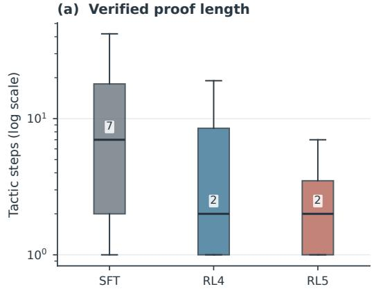

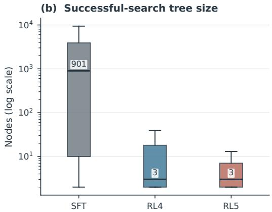  
Figure 4: Verified proof length and successful-search tree size on the paired 151-problem common core. Each checkpoint contributes one earliest-success canonical proof per theorem. Boxes show the interquartile range and the annotated line is the median; both axes are logarithmic.

Figure 4 shows that the gain is not only in final coverage. From SFT to RL4, mean proof length falls by 10.44 top-level actions (95% bootstrap $\operatorname { C I } \left[ - 2 0 . 9 3 , - 2 . 1 5 \right] )$ , and the mean successful tree shrinks by 2,206 nodes $( [ - 2 , 7 3 1 , - 1 , 7 2 3 ] )$ . Both paired changes are significant $( p < 1 0 ^ { - 8 }$ and $p < 1 0 ^ { - 2 0 }$ , respectively). RL5 further reduces the mean proof length and tree size, but their medians remain at two actions and three nodes. Thus, the later-stage effect is concentrated in the long tail: among the 191 theorems shared by RL4 and RL5, 81 proofs become shorter, 78 are unchanged, and 32 become longer, while the mean step difference is −11.88 ([−18.01, −6.80]). Selecting each theorem’s shortest verified proof instead of its earliest one preserves the same ordering (11.8, 7.8, and 3.9 mean actions for SFT, RL4, and RL5).

The tree reduction is especially important for interpreting the proof-length result. It indicates that RL often causes a successful continuation to be found after expanding fewer search states, rather than merely shortening the emitted text.

## C.3 FROM SOLVER CALLS TO STRUCTURED MACRO-ACTIONS

The successful proofs exhibit a two-stage style transition. We classify an action by its outermost tactic head. The structural lemma category contains have, suffices, replace, let, haveI, wlog, and set; solvers nested inside these actions are not counted as outer automation. Figure 5 therefore describes the organization of top-level search actions, while Table 9 measures their internal complexity.

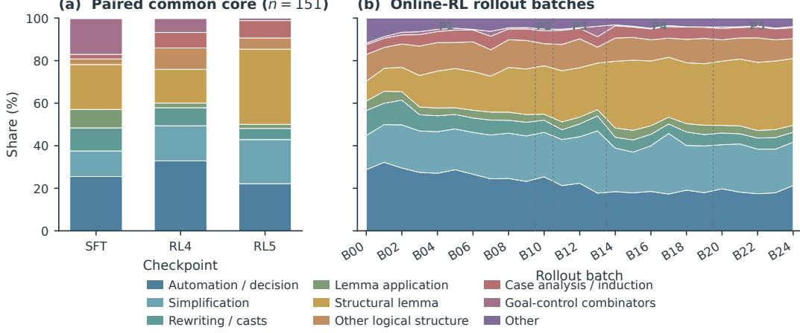  
Figure 5: Outer-head tactic composition with a shared taxonomy and legend. (a) Action-weighted shares on the paired common core across checkpoints. (b) Shares across online-RL rollout batches.

Table 9: Granularity of canonical-proof actions on the paired common core. “Identifiers/action” counts tactic identifiers lexically throughout each action, including nested blocks.
<table><tr><td>Metric</td><td>SFT</td><td>RL4</td><td>RL5</td></tr><tr><td>Action characters, median</td><td>19</td><td>23</td><td>66</td></tr><tr><td>Tactic identifiers/action</td><td>1.38</td><td>1.38</td><td>2.80</td></tr><tr><td>Contains &lt;; &gt;</td><td>2.9%</td><td>4.5%</td><td>23.9%</td></tr><tr><td>Multiline action</td><td>7.0%</td><td>3.5%</td><td>24.7%</td></tr><tr><td>Contains nested  $: = { \mathrm { ~ \ b y ~ } }$ </td><td>1.5%</td><td>3.8%</td><td>17.5%</td></tr><tr><td>Explicit retrieved-premise use</td><td>6.4%</td><td>7.8%</td><td>19.5%</td></tr></table>

The transition from SFT to RL4 is primarily a shift toward direct, high-leverage search actions. Outer automation rises from 25.5% to 32.9%, case analysis and induction from 2.1% to 7.3%, and goal-control combinators fall from 16.8% to 6.5%. This is consistent with RL4 learning to invoke arithmetic solvers or split the relevant cases earlier, thereby collapsing the search tree.

The transition from RL4 to RL5 changes the abstraction boundary. Structural-lemma actions rise from 15.9% to 35.3%, while outer automation falls to 22.2%. The decline in outer automation does not mean that solvers disappear: per 100 top-level actions, lexical occurrences of norm num increase from 23.4 to 48.1, simp from 13.8 to 30.2, and have from 16.1 to 41.9. Solvers are increasingly embedded inside local facts, branches, and compound tactic programs. The top-level action count therefore compresses at the same time that each action becomes longer and internally denser.

This distinction matters conceptually. Later RL learns a more programmatic proof interface for MCTS—one action can introduce a lemma, dispatch several subgoals, normalize expressions, and invoke one or more solvers. We refer to this as search-interaction compression, not a direct reduction in reasoning depth. The larger premise-use share further suggests that RL5 more often integrates retrieved library facts into these structured programs.

## C.4 WHERE THE COMPUTATION MOVES

To determine whether fewer search interactions translate into cheaper proof search, we analyze 48.57 million completed tactic evaluations across the three runs. Table 10 and Figure 6 reveal a non-monotone trajectory. RL4 generates shorter, more frequently accepted candidates than SFT, but its use of computationally heavy solvers makes the median call slightly slower. RL5 then shifts probability mass toward long macro-actions: the median candidate grows to 89 characters, median evaluator latency reaches 43.2 ms, and acceptance falls to 35.0%.

Table 10: Search-wide Lean tactic evaluations. Counts and rates are exact over all completed calls; quantiles use a deterministic 200,000-call uniform reservoir per run. Summed duration is overlapping service time, not wall-clock runtime.
<table><tr><td>Metric</td><td>SFT</td><td>RL4</td><td>RL5</td></tr><tr><td>Completed evaluator calls</td><td>24.57M</td><td>18.01M</td><td>5.99M</td></tr><tr><td>Tactic chars, median [IQR]</td><td>47 [19, 87]</td><td>25 [15, 47]</td><td>89 [57, 159]</td></tr><tr><td>Latency ms, median [IQR]</td><td>12.0 [5.4, 35.0]</td><td>15.2 [4.4, 74.6]</td><td>43.2 [9.7, 229.2]</td></tr><tr><td>Evaluator accepted</td><td>58.1%</td><td>61.3%</td><td>35.0%</td></tr><tr><td>Calls exceeding 1 second</td><td>1.85%</td><td>3.84%</td><td>9.73%</td></tr><tr><td>Calls/problem, median</td><td>29,512</td><td>992.5</td><td>257</td></tr><tr><td>Summed evaluator duration</td><td>699 h</td><td>1,067 h</td><td>805 h</td></tr></table>

## Search-wide tactic evaluations · uniform 200k-call reservoir per run

(a) Generated tactic length  
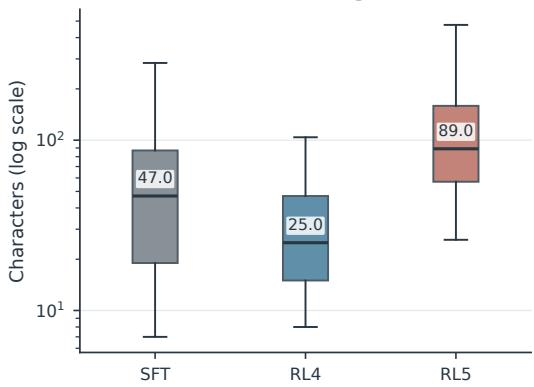

(b) Lean tactic-evaluation latency  
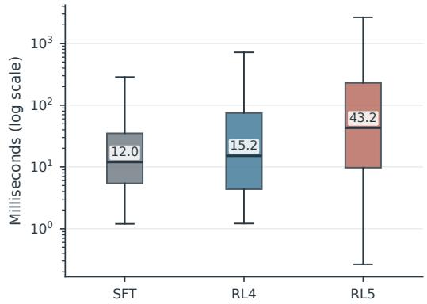  
Figure 6: Search-wide distributions of generated tactic length and Lean evaluation latency. Boxes show the interquartile range, whiskers show the 5th and 95th percentiles, and annotations mark medians. Each run contributes a uniform 200,000-call reservoir; axes are logarithmic.

Much of RL5’s raw latency and error penalty is a composition effect rather than a uniform degradation. In the 64–127-character bin, for example, RL4 and RL5 have nearly identical acceptance (33.0% versus 34.2%) and accepted-call median latency (46.6 versus 47.1 ms). Nevertheless, longer programs create more opportunities for parse, elaboration, or tactic failure, and RL5 places far more mass in the long bins. Error calls are also slower than accepted calls at every checkpoint.

The number of completed calls per problem drops dramatically, but total evaluator work does not fall in proportion. From RL4 to RL5, call count falls by 66.7%, whereas summed evaluator duration falls by only 24.6%. From SFT to RL4, summed evaluator duration even rises despite fewer calls. Later RL thus reallocates computation from tree expansion to execution inside each action. Optimizing only proof success or top-level trajectory length can favor this exchange; a deployment-oriented objective may additionally need to regularize generated tokens, evaluator errors, latency, or the expanded cost of tactic combinators.

## C.5 LONGITUDINAL DYNAMICS OVER 25 ONLINE-RL BATCHES

The checkpoint comparison gives a controlled view of three endpoints. To resolve the transition in more detail, we analyze the 25 consecutive rollout batches (B00–B24), comprising 25,069 problem– batch instances, 56,959 verified successful attempts, and 345.6 million completed tactic evaluations. Adjacent batches use different theorem sets, so the resulting trends describe the joint training-and rollout process rather than a pure checkpoint treatment effect.

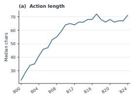

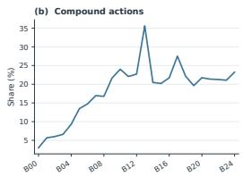

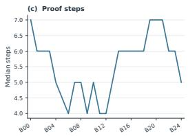

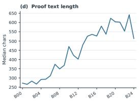  
Figure 7: Canonical-proof granularity across online-RL batches: (a) median action length, (b) compound-action share, (c) median top-level proof steps, and (d) median proof-text length.

The most stable longitudinal signal is the growing size of a top-level action. From B00 to B24, median action length increases from 23 to 71 characters, the share containing <;> from 3.0% to 23.2%, and median proof text from 272 to 514 characters, while median top-level proof length changes only from seven to five actions. Across canonical proofs, structural-lemma heads rise from 9.3% in B00 to 31.4% in B24. Their batch-wise share has Spearman $\rho = 0 . 9 2 9 ( p = 2 . 0 0 \times 1 0 ^ { - 1 1 } )$ and almost all of the increase comes from have. Lexical solver use rises at the same time. This reproduces the endpoint result: proof programs become more locally structured, not merely more reliant on automation.

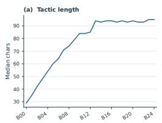

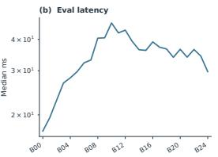

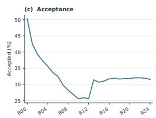

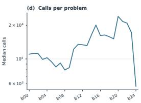  
Figure 8: Search-wide tactic-evaluation trends across online-RL batches: (a) median tactic length, (b) median evaluation latency, (c) acceptance rate, and (d) median evaluation calls per problem.

Search-wide evaluation reveals an early transition followed by stabilization. During B00–B09, median evaluated tactic length grows from 29 to 79 characters, median latency from 17.2 to 40.6 ms, and acceptance falls from 50.3% to 26.9%. B10–B12 forms the lowest-acceptance regime: median actions are 84–85 characters and acceptance is only 25.6–25.9%. At B13, median action length reaches 94 characters, yet acceptance jumps to 31.4% and median latency falls to 39.3 ms. Thereafter, length remains near 93–95 characters, acceptance near 31–32%, and latency mostly between 34 and 39 ms.

A coarse adjustment using a common action-length-bin distribution gives the same conclusion. Comparing B00–B12 with B13–B24, length-standardized acceptance increases from 28.9% to 34.9% $( p \stackrel { - } { = } 2 . 4 9 \times 1 0 ^ { - 5 }$ across batches), while standardized mean evaluator duration falls from 559.9 to 442.6 ms $( p = 1 . 0 1 \times 1 0 ^ { - 4 } )$ . Later RL therefore appears to improve the executability of an already learned macro-action representation rather than continuing to enlarge it indefinitely. This improvement does not by itself imply lower end-to-end compute: longer individual tactic evaluations can offset reductions in the number of search interactions even under a fixed search budget.

## D QUALITATIVE CASE STUDY: PROOF-STYLE EVOLUTION

The aggregate analysis in Appendix C shows that later RL compresses long successful trajectories while increasingly packaging several Lean operations into one top-level action. The value objective in Reaper-1 assigns a unit cost to each tactic-level search action and trains the value head toward the remaining cost of successful continuations. The controlled ablation in Table 2 further shows that this objective reduces average successful-proof length while yielding similar overall coverage. We now examine a representative theorem to show what the corresponding change looks like inside a complete proof.

Listings 1 and 2 show complete Lean proofs produced by the RL4 and RL5 checkpoints for the same miniF2F theorem. Both prove the identity

$$
\sum _ { k < n } k ^ { 3 } = \left( \sum _ { k < n } k \right) ^ { 2 } ,
$$

but they reach the result through substantially different proof trajectories.

RL4 proof. The RL4 checkpoint discovers a valid proof, but its trajectory is dominated by repeated local normalization and repair. After the initial induction, the proof repeatedly invokes simp, ring, ring nf, rw, and automation, introduces a second induction, and revisits closely related algebraic states multiple times.

```verilog
1 import Mathlib
2 import Aesop
3
4 set_option maxHeartbeats 0
5
6 open BigOperators Real Nat Topology Rat
7
8 theorem induction_sumkexp3eqsumksq_rl4 (n : N) :
9 (P k ∈ Finset.range n, k ˆ 3) = (P k ∈ Finset.range n, k) ˆ 2 := by
10 induction n
11
12 simp [Finset.sum_range_succ]
13
14 simp [Finset.range_succ, Finset.sum_insert, <sub>*</sub>]
15 ring
16 abel
17 simp_all [pow_succ]
18 ring_nf
19 simp [pow_succ]
20 simp [mul_assoc]
21 clear <sub>*</sub>
22 induction’ ⟨N⟩ with n hn
23
24 rfl
25
26 simp [Finset.sum_range_succ]
27 ring_nf
28 rw [hn]
29 ring_nf
30 abel_nf
31 rw [add_comm]
32 cases n
33
34 rfl
35
36 ring
37 simp [add_comm, add_left_comm, add_assoc,
38 mul_comm, mul_left_comm, mul_assoc] at
39 ring
40 simp [Finset.sum_range_succ] at <sub>*</sub>
41 ring_nf at hn
42 simp [add_assoc] at <sub>*</sub>
43 simp [add_assoc, add_comm, add_left_comm] at <sub>*</sub>
44 simp [Finset.sum_range_succ] at <sub>*</sub>
45 ring
```

46 rw [Finset.sum\_range\_id]   
47 ring\_nf at hn ⊢   
48 simp [mul\_add, mul\_comm, mul\_left\_comm] at   
49 ring   
50 simp [add\_assoc, add\_comm, add\_left\_comm] at <sub>\*</sub>   
51 ring   
52 simp [Nat.mul\_sub\_left\_distrib,   
53 Nat.mul\_sub\_right\_distrib, Nat.mul\_add,   
54 Nat.mul\_comm, Nat.mul\_left\_comm] at hn ⊢   
55 ring\_nf   
56 ring\_nf at   
57 simp [mul\_assoc, mul\_comm, mul\_left\_comm] at hn ⊢   
58 ring   
59 symm   
60 ring\_nf at   
61 have := hn   
62 aesop   
63 cases n   
64   
65 norm\_num [this]   
66   
67 ring   
68 rw [add\_comm]   
69 have this := this   
70 ring   
71 ring\_nf at <sub>\*</sub>   
72 aesop   
73 cases n   
74   
75 grind   
76   
77 ring   
78 ring\_nf at this   
79 revert this   
80 repeat rw [Finset.sum\_range\_id]   
81 grind [mul\_succ, mul\_add, add\_mul, add\_assoc,   
82 add\_comm, add\_left\_comm, Nat.pow\_succ,   
83 Nat.mul\_sub\_left\_distrib,   
84 Nat.mul\_sub\_right\_distrib,   
85 Nat.div\_eq\_of\_lt, Nat.succ\_mul]  
Listing 1: Complete proof generated by the RL4 checkpoint.

The proof has a strongly exploratory character: the model repeatedly changes the algebraic normal form and applies automation. In particular, several rounds of ring/ring nf and simp are interleaved with nested case analysis and another induction.

RL5 proof. By RL5, the proof is considerably more concentrated. The checkpoint starts from the same induction structure, immediately incorporates the induction hypothesis, rewrites the square and the closed form of the finite sum, and reduces the remaining obligation to a targeted parity split followed by arithmetic automation.

1 theorem induction\_sumkexp3eqsumksq\_rl5 (n : N) :   
2 (P k ∈ Finset.range n, k ˆ 3) = (P k ∈ Finset.range n, k) ˆ 2 := by   
3 induction n with   
4 | zero => ?\_   
5 | succ n ih => ?\_   
6   
7 simp\_all   
8   
9 simp [Finset.sum\_range\_succ, ih]   
10 rw [add\_sq]   
11 rw [Finset.sum\_range\_id]   
12 cases n   
13   
14 simp at ih ⊢   
15   
16 ring\_nf   
17 simp [add\_assoc, add\_comm, add\_left\_comm] at ih ⊢   
18 ring\_nf at <sub>\*</sub>   
19 simp [Nat.add\_assoc, Nat.add\_comm,   
20 Nat.add\_left\_comm] at   
21 aesop   
22 (add simp [Nat.pow\_two, Nat.mul\_div\_cancel\_left])   
23 rcases n.even\_or\_odd’ with ⟨m, rfl | rfl⟩ <;>   
24 grind [Nat.mul\_div\_cancel’]

Listing 2: Complete proof generated by the RL5 checkpoint for the same theorem.

The difference is not merely textual brevity. The RL5 proof follows a much clearer global progression: induction → use of the induction hypothesis → algebraic normalization → targeted parity split → arithmetic closure. In contrast, the RL4 proof spends many more search actions on repeated normalization, nested case analysis, and local recovery.

This behavior is consistent with the intended effect of Reaper-1’s cost-sensitive value-guided search ablation in Table 2. Because each tactic-level transition incurs a unit cost, lower-cost successful continuations receive more favorable value targets, creating pressure toward proof trajectories that reach solved states through fewer search decisions. This example further illustrates what the corresponding change can look like at the level of an individual proof.

Shorter continuations can also be advantageous to MCTS because they reduce the effective depth at which a successful leaf must be discovered, allowing a fixed simulation budget to concentrate on fewer proof decisions. We view this as one mechanism that may contribute to the continued improvement on harder problems in later RL stages. Moreover, the final RL5 proof also illustrates a limitation of our current cost definition: the use of <;> packages multiple internal tactic applications into one search-level action. Thus, the learned preference for shorter trajectories captures genuine removal of redundant search in this example, but may also encourage syntactic compression of several Lean operations into a single action, as discussed in Section 5.

## E TACTIC NORMALIZATION

Lean’s structural tactics expose points at which the proof state branches or changes shape. Tactics such as have, suffices, and calc can therefore provide valuable training signals, including the decomposition choices that precede the final proof steps. During ordinary elaboration, however, these tactics expect their proof bodies to be supplied as complete tactic blocks. A standalone action such as have ... := by leaves a nested goal unfinished and cannot be replayed as a valid tactic transition.

We normalize such actions by replacing each nested by block with a placeholder and exposing the resulting subgoals with Lean’s bullet syntax (“·”). The normalized form is a valid tactic sequence: the outer structural tactic remains visible as one search action, while each generated subgoal is solved by a separate bullet. This preserves the original goal decomposition and makes the transition available to training and analysis.

The following pairs show the transformation for three representative structural tactics. In each pair, the first listing is the original nested form and the second is the bullet-normalized form.

The have tactic. Here we replace the nested proof of key with ? and expose the continuation and the new subgoal as two bullet goals. Listings 3 and 4 show the original and normalized forms.

theorem coe\_eq\_inv\_of\_sq\_eq\_one   
2 (hϕ : FixedPointFree ϕ) (h2 : ϕˆ[2] = \_root\_.id) :   
3 ⇑ϕ = (·<sup>−1</sup>) := by   
4 ext g   
5 have key : g ϕ g = 1 := by   
6 simpa [List.range\_succ] using hϕ.prod\_pow\_eq\_one h2 g   
7 rwa [← inv\_eq\_iff\_mul\_eq\_one, eq\_comm] at key   
Listing 3: Original nested have proof.   
1 theorem coe\_eq\_inv\_of\_sq\_eq\_one   
2 (hϕ : FixedPointFree ϕ) (h2 : ϕˆ[2] = \_root\_.id) :   
3 ⇑ϕ = (·<sup>−1</sup>) := by   
4 ext g   
5 have key : g ϕ g = 1 := ?\_   
6 · rwa [← inv\_eq\_iff\_mul\_eq\_one, eq\_comm] at key   
7 · simpa [List.range\_succ] using hϕ.prod\_pow\_eq\_one h2 g  
Listing 4: Bullet-normalized have proof.

The suffices tactic. The nested conclusion is replaced by from ? ; the two bullets then prove the conclusion and the auxiliary equivalence introduced by suffices, respectively. Listings 5 and 6 show the corresponding pair.

1 /-- Conjugacy classes form a partition of G, stated in terms of cardinality. -/   
2 theorem sum\_conjClasses\_card\_eq\_card [Fintype <| ConjClasses G] [Fintype G]   
3 [∀ x : ConjClasses G, Fintype x.carrier] :   
4 P x : ConjClasses G, x.carrier.toFinset.card = Fintype.card G := by   
5 suffices (Σ x : ConjClasses G, x.carrier) ≃ G by   
6 simpa using (Fintype.card\_congr this)   
7 simpa [carrier\_eq\_preimage\_mk] using Equiv.sigmaFiberEquiv ConjClasses.mk

Listing 5: Original nested suffices proof.

1 /-- Conjugacy classes form a partition of G, stated in terms of cardinality. -/   
<sup>2</sup> <sub>3</sub> theorem sum\_conjClasses\_card\_eq\_card [Fintype <| ConjClasses G] [Fintype G]   
4 P x : ConjClasses G, x.carrier.toFinset.card = Fintype.card G := by   
5 suffices (Σ x : ConjClasses G, x.carrier) ≃ G from ?\_   
6 · simpa using (Fintype.card\_congr this)   
7 · simpa [carrier\_eq\_preimage\_mk] using Equiv.sigmaFiberEquiv ConjClasses.mk

Listing 6: Bullet-normalized suffices proof.

The calc tactic. Each nested proof attached to a calculation step becomes a placeholder, and the four resulting equality goals are discharged by bullets after the calculation block. Listings 7 and 8 show this conversion.

1 /-- In a nontrivial monoid with zero, zero and one are different. -/   
2 instance NeZero.one : NeZero (1 : M<sub>0</sub>) := ⟨by   
3 intro   
4 rcases exists\_pair\_ne M<sub>0</sub> with ⟨x, y, hx⟩   
5 apply hx   
6 calc   
x = 1 <sub>\*</sub> x := by rw [one\_mul]   
\_ = 0 := by rw [h, zero\_mul]   
\_ = 1 <sub>\*</sub> y := by rw [h, zero\_mul]   
10 \_ = y := by rw [one\_mul]⟩  
Listing 7: Original nested calc proof.

/-- In a nontrivial monoid with zero, zero and one are different. -/   
2 instance NeZero.one : NeZero (1 : M ) := ⟨by   
3 intro h   
4 rcases exists\_pair\_ne M with ⟨x, y, hx⟩   
5 apply hx   
6 calc   
7 x = 1 x := ?\_   
8 \_ = 0 := ?\_   
9 \_ = 1 <sub>\*</sub> y := ?\_   
10 \_ = y := ?\_   
11 · rw [one\_mul]   
12 · rw [h, zero\_mul]   
13 · rw [h, zero\_mul]   
14 · rw [one\_mul]⟩  
Listing 8: Bullet-normalized calc proof.

The same transformation is applied to the other structural tactics used by the rollout pipeline, including cases, induction, obtain, show, haveI, let, and letI. The normalized representation keeps these state transitions explicit while remaining executable by Lean’s elaborator.

## F FROM LEAN SOURCE CODE TO MCTS TREES

To support SFT on existing Lean codebases, we use Jixia to generate elaboration traces for the source code, which include the proof states before and after each tactic, together with the tactic’s source span and the constants referenced in its elaborated subtree. These traces describe successful proofs, but they are not yet represented in the raw MCTS-tree schema used by Scythe-rl. In particular, when a tactic replaces one goal with several goals, the resulting proof obligation must be represented by an AND node.

We traverse jixia’s elaboration tree to collect executable tactic events, then reconstruct proof transi tions from their recorded input and output states and source ranges. This is necessary because the elaboration tree contains other nodes such as parser wrappers, compound tactics, and nested local proof blocks, which are irrelevant in our state-action model.

In the resulting tree, each proof state is represented by an OR node with one child, where the outgoing edge is the tactic used on that state. If the tactic produces exactly one remaining goal, the edge leads directly to the OR node for that goal. If it produces multiple goals, the edge instead leads to an AND node, which then leads to the OR nodes for this set of goals.

The result is then serialized using the same MCTS-tree schema as proof-search rollouts. Each real tactic edge records the constants found in its elaborated subtree in the premise field. The format is fully compatible with MCTS trees generated by proof search. The converted tree can therefore enter the same replay and training pipeline as a tree produced by proof search, allowing existing Lean source repositories, such as Mathlib, to be freely mixed alongside search-generated rollouts.