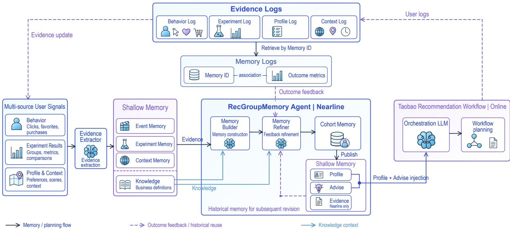
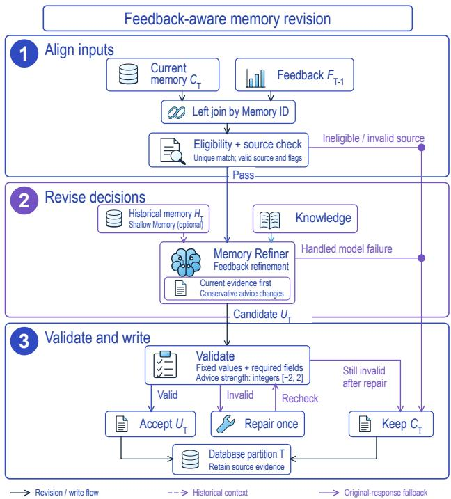

# RecGroupMemory: Feedback-Aware Cohort Memory for E-Commerce Recommendation

Wendong Zhang∗ xianzhi.zwd@alibaba-inc.com

Weipeng Huang weipeng.hwp@taobao.com

Bin Zhang tianji.zb@taobao.com

Zhixin Ma mazhixin.mzx@taobao.com

Dimin Wang dimin.wdm@taobao.com

## Abstract

Cohort memory can support LLM-based recommendation planning through group-level user profiles and advice. As outcome feedback becomes available, this guidance may need to be updated while preserving the underlying observations. We present RecGroup-Memory, a workflow that provides this memory to an orchestration LLM and separates memory construction from feedback-based revision. It uses feedback from the previous day to revise decision guidance, while validation checks keep selected source values un changed. Online comparisons were conducted among Taobao users with low purchasing power selected by the business team. Relative to a no-memory baseline, memory without feedback and memory with feedback showed increases of 1.58% and 1.78%, respectively, in the number of guided transaction users.

## CCS Concepts

• Information systems → Recommender systems; • Computing methodologies → Intelligent agents.

## Keywords

e-commerce recommendation, cohort memory, large language mod els, online feedback, user profiles

## ACM Reference Format:

Wendong Zhang, Weipeng Huang, Zhixin Ma, Bin Zhang, and Dimin Wang. 2027. RecGroupMemory: Feedback-Aware Cohort Memory for E-Commerce Recommendation. In Review manuscriptfor the ACM Web Conference 2027. ACM, New York, NY, USA, 4 pages.

## 1 Introduction

Cohort memory summarizes observations about users with shared characteristics to support an orchestration LLM in planning Web recommendation workflows across requests. Delayed browsing and transaction outcomes may challenge earlier guidance without changing the cohort definition, observation window, or recorded metrics. Updating this memory requires revising recommendation judgments while preserving their observational basis. Unconstrained regeneration risks changing the recorded observations. The same observations can support diferent planning judgments as later outcomes arrive. Keeping observations separate from guidance makes these revisions explicit: an update changes the interpretation of a cohort record while retaining the evidence against which that interpretation can be checked.

Prior recommendation work models user interests and behavioral histories [3, 6, 10, 15], uses language models for recommendation [2, 5], and updates profiles or retrieves user-history memory [1, 14]. Agent memory research studies reflection and memory management [4, 8, 9], as well as feedback-based revision [7, 12]. We focus on using external recommendation outcomes to revise cohort-level planning guidance.

Recommendation feedback depends on the policy that generated it [11, 13]. Our workflow provides planning advice rather than learning a ranking policy, and linking feedback to memory through Memory ID does not establish causal attribution.

We propose RecGroupMemory (Figure 1), with the following contributions:

• The framework separates memory construction from feedback revision and provides an orchestration LLM with cohort profiles (Profile) and advice (Advise) derived from multiple observation sources.

• The revision procedure uses outcome feedback linked by Memory ID to update decision content while preserving selected source values. Eligibility checks, validation, and fallback to the original record control the update.

• Online comparisons among business-selected Taobao users with low purchasing power show increases in guided transaction users of 1.58% for memory without feedback and 1.78% for memory with feedback, each relative to its corresponding no-memory baseline.

## 2 The RecGroupMemory Framework

The framework separates memory construction, feedback revision, and online planning. The Evidence Extractor organizes observations from multiple sources in Shallow Memory. The Memory Builder combines these observations into a cohort memory record, and the Memory Refiner reassesses its guidance when linked outcome feedback becomes available. The online orchestration LLM uses the published Profile and Advise to plan the recommendation workflow. Feedback revision updates the planning context without scoring items or executing downstream recommendation stages.

Each update operates on a cohort memory record rather than an individual interaction or a model parameter. The record contains observations for a defined user group and time window, along with guidance derived from them. This guidance can be revised while selected source values remain unchanged.

## 2.1 Memory Inputs and Feedback

The Evidence Extractor extracts observations from multiple sources to form event, experiment, and context memory in Shallow Memory.

  
Figure 1: RecGroupMemory system overview. Multi-source evidence and online outcomes support nearline synthesis and feedback refinement. Published Profile and Advise guide the orchestration LLM; stored memory supports subsequent updates.

The Memory Builder combines these observations into cohort memory, and the Memory Refiner revises its guidance using outcome feedback (Figure 1).

The feedback node reads the current response $C _ { T }$ from date partition � and left-joins previous-day feedback $F _ { T - 1 }$ by Memory ID. Revision requires exactly one matching feedback row and upstream flags confirming profile validity, baseline matching, and feedback eligibility. Records with no unique match, failed eligibility checks, or invalid source responses retain $C _ { T } .$ . Eligibility does not guarantee suficient evidence for every objective. The prompt considers missing metrics when selecting a direction and recording uncertainty.

For Memory ID � and metric $q ,$ upstream feedback is $\delta _ { i , q } ~ =$ $q _ { i } / q _ { \mathrm { b a s e } ( i ) } - 1$ , where $q _ { \mathrm { b a s e } ( i ) }$ is computed over all trafic with the same profile in the platform’s first-guess recommendation feed. This observational feedback covers activity, browsing, item-detail views, and transactions. The prompt uses this signed relative change di rectly: zero indicates no observed change, whereas a missing value indicates absent evidence and must not be treated as neutral or positive feedback.

For an eligible record, a historical profile $H _ { T }$ retrieved from Shallow Memory provides optional context. Retrieval checks the cohort and any available version metadata; $H _ { T }$ need not come from the immediately preceding partition. Revision can proceed without history if retrieval fails. Budgeted knowledge retrieval supplies terminology and business context. The prompt uses history to compare earlier advice and changes over time, but does not allow historical measurements to replace current observations or override new feedback. $C _ { T }$ remains the revision baseline.

These inputs have distinct roles: $C _ { T }$ identifies what is being revised, ��− $F _ { T - 1 }$ supplies outcome evidence, and $H _ { T }$ supplies optional historical context. Available history cannot compensate for missing or ambiguous feedback matching. This separation prevents the availability of retrieval from being confused with eligibility for revision.

## 2.2 Constrained Decision Revision

Figure 2 shows how the Memory Refiner revises decision content while validation preserves selected source values. Seven values must match $C _ { T } { \mathrm { : } }$ schema version, cohort, recommender version, memory scope, segment definition, observation window, and aggregated metrics. Profile and Advise must remain nonempty strings. The prompt permits changes to their content, structured advice, profile confidence, uncertainties, and change metadata. The validator checks selected values and required structure, rather than enforcing a complete whitelist of editable JSON fields. The fixed values identify the cohort, observation window, and measured behavior to which the advice applies. Preserving them prevents an apparent improvement in the narrative from being obtained by changing the population or measurements. Editable decision content instead describes how those observations should inform subsequent planning.

Profile summarizes the cohort’s current funnel performance and what the feedback suggests about the existing strategy. Advise specifies adjustments for particular objectives, their rationale, and rollback conditions. The prompt records missing metrics and dataquality concerns in uncertainties and summarizes changes from $C _ { T }$ in change metadata. Confidence and uncertainty qualify the interpretation. The conversion-prioritized prompt requests a concise profile and ordered advice, with final discrete strengths stored in structured advice.

Advice strengths are integers in $\{ - 2 , - 1 , 0 , 1 , 2 \}$ for four objectives: click-through rate (CTR), item-page views (IPV), conversion rate (CVR), and gross merchandise value (GMV). The intended update is

$$
\begin{array} { r } { a _ { q } ^ { \prime } = \mathrm { c l i p } _ { [ - 2 , 2 ] } ( a _ { q } + \Delta _ { q } ) , \qquad \Delta _ { q } \in \{ - 1 , 0 , 1 \} , } \end{array}\tag{1}
$$

where $a _ { q }$ is taken from $C _ { T }$ , or set to zero for legacy records without structured advice. The action revert to previous keeps the strength in $C _ { T }$ unchanged rather than restoring $H _ { T }$

The candidate stores the final strength $a _ { q } ^ { \prime } ,$ , not the increment $\Delta _ { q } .$ These values express advice strength, not calibrated probabil ities or ranking-score multipliers. Clipping can leave the stored strength unchanged at a bound, so the rationale helps distinguish the requested adjustment from its numerical result.

Objective priorities are configurable. The conversion-prioritized prompt emphasizes CVR and suppresses GMV adjustment; the browsing-prioritized prompt emphasizes IPV with transaction safeguards. Validation checks advice structure, integer type, and range; only the browsing configuration also checks direction-to-strength consistency. Conservative choices and most semantic constraints depend on the prompt. Equation 1 therefore describes the intended update, not a guarantee enforced across all configurations.

The conversion-prioritized prompt permits CVR strengthening only when the relative changes in both transaction UV and order count are available and strictly positive. Positive intermediate browsing feedback cannot substitute for either outcome. If either relative change is missing or non-positive, the prompt calls for conservative conversion advice. It separates assessment of the previous strategy from selection of the next adjustment: retaining the current advice under insuficient evidence does not imply that the strategy succeeded.

For example, positive browsing feedback accompanied by missing transaction UV cannot satisfy the conversion-strengthening condition. The record can remain eligible for revision while that particular adjustment lacks support. The resulting Profile can describe the observed browsing response, and Advise can retain a conservative conversion position while recording the missing outcome in uncertainties.

## 2.3 Validation and Workflow Integration

Let $U _ { T }$ denote the generated candidate after at most one repair attempt, $O _ { T }$ the output response, and $e _ { T } = 1$ indicate that the record is eligible and its source response is valid. For handled record-level outcomes,

$$
O _ { T } = \left\{ U _ { T } , \quad e _ { T } = 1 \land \mathcal { V } ( U _ { T } , C _ { T } ) = 1 , \quad \right.\tag{2}
$$

where $_ \mathrm { c } { } _ { V }$ checks the fixed source values and required output fields. Eligibility permits revision; acceptance requires the candidate to pass validation.

The Memory Refiner returns a complete JSON response rather than a patch. The feedback node parses this response and checks fixed-value equality, required text fields, and structured advice. An invalid candidate may undergo one repair attempt, which asks the model to restore valid JSON and fixed values while retaining its conclusions and advice text. The repaired candidate is validated again against $C _ { T } ,$ but these checks do not establish semantic equivalence. Invalid source records bypass generation, and handled model or validation failures retain the original response.

An accepted update replaces the response and model metadata while retaining source evidence columns. The feedback node writes records to database partition �; publication to Shallow Memory occurs in a separate stage. The store retains Profile, Advise, and Evidence, but only Profile and Advise enter the orchestration LLM for workflow planning. Stored memory and online evidence support later updates. The revision node does not produce ranking weights. The database stores the revision output, whereas Shallow Memory makes the published record available to later planning and revision. A successful database write and a published memory record are therefore separate workflow outcomes. Figure 1 shows the publication boundary, while Figure 2 ends at the database write.

  
Figure 2: Feedback-aware revision with at most one repair and original-response fallback. Fixed values are checked against $C _ { T } .$ Direction-to-strength checks depend on configuration; semantic policies remain prompt-based.

Before processing, source IDs must be nonempty and unique. After writing the records, the job checks that the output and input have the same record count and ID set. Per-record statuses distinguish accepted generation from ineligible input, invalid source, and handled model failures. Acceptance indicates successful validation, not necessarily changed advice or improved outcomes. Fallback preserves record coverage without establishing that the original advice is optimal. Publication failures remain the responsibility of the surrounding pipeline.

## 3 Online Experiments

## 3.1 Experimental Setup

Online experiments were conducted among Taobao users with low purchasing power selected by the business team. The no-memory baseline � uses an orchestration LLM to plan the recommendation workflow from request context. Existing components handle retrieval, ranking, and re-ranking.

Table 1: Relative changes against each experiment’s nomemory baseline.
<table><tr><td>Metric</td><td>M/B (E1)</td><td>F/B (E2)</td></tr><tr><td>Transaction UV</td><td>+1.58%</td><td>+1.78%</td></tr><tr><td>Orders</td><td>+0.80%</td><td>+2.05%</td></tr><tr><td>PCVR</td><td>+1.60%</td><td>+1.95%</td></tr><tr><td>Exposure UV</td><td>+0.14%</td><td>+0.02%</td></tr><tr><td>Click UV</td><td>-0.42%</td><td>+0.04%</td></tr><tr><td>IPV UV</td><td>-0.50%</td><td>+0.17%</td></tr></table>

Experiment E1 compares � with memory �, which adds Profile and Advise generated by the Memory Builder to the planning context, without feedback revision. Experiment E2 compares its no-memory baseline with feedback-aware memory � , which uses the same memory interface and enables the Memory Refiner to revise these fields using previous-day outcomes. Each experiment reports relative changes against its own no-memory control.

## 3.2 Results

Table 1 shows positive changes in transaction UV, orders, and PCVR for both configurations. Relative to their respective baselines, � and � increase transaction UV by 1.58% and 1.78%, orders by 0.80% and 2.05%, and PCVR by 1.60% and 1.95%, respectively.

These transaction gains coincide with small changes in exposure UV: +0.14% for � and +0.02% for �. For �, click UV and IPV UV decline by 0.42% and 0.50%, despite the increases in transaction metrics. For � , these browsing metrics rise slightly, by 0.04% and 0.17%. The observed improvements are therefore concentrated in transaction outcomes, while exposure and browsing volumes remain close to baseline.

Although � reports larger transaction-related uplifts, the two configurations are compared with their respective baselines. These results do not directly estimate the incremental benefit of adding feedback to �.

## 4 Discussion and Limitations

Validation covers selected source values and output structure; semantic correctness still depends on the LLM and prompt instruc tions. Historical retrieval is not tied to a specific date or content hash, so Memory ID alone cannot identify the version previously used online. Fallback operates on individual records, and a failed partition write may still leave partial output.

The experiments evaluate complete workflow configurations on a selected user population. Deployment artifacts corresponding to the experiments are unavailable, limiting attribution to individual revision safeguards. Broader deployment and evaluation of these safeguards require feedback ablations under matched conditions, traces linking served memory to revisions, and runtime measurements. Natural-language memory and small cohorts also require access controls, retention limits, and aggregation safeguards. Eval uation should distinguish record eligibility, validation acceptance, changes in advice, and downstream outcomes. These events answer diferent questions about coverage, structural reliability, revision behavior, and recommendation performance. Recording them separately would make failures and unchanged advice easier to interpret without treating every accepted response as an efective update.

## 5 Conclusion

The framework integrates cohort memory construction, feedback revision, and LLM-based recommendation planning. It revises Profile and Advise while preserving selected source values, using validation and fallback to the original record to control updates.

## References

[1] Seunghwan Bang and Hwanjun Song. 2025. LLM-based User Profile Management for Recommender System. arXiv:2502.14541v2 [cs.CL]

[2] Keqin Bao, Jizhi Zhang, Yang Zhang, Wenjie Wang, Fuli Feng, and Xiangnan He. 2023. TALLRec: An Efective and Eficient Tuning Framework to Align Large Language Model with Recommendation. In Proceedings ofthe 17th ACM Conference on Recommender Systems. 1007–1014. doi:10.1145/3604915.3608857

[3] Xu Chen, Hongteng Xu, Yongfeng Zhang, Jiaxi Tang, Yixin Cao, Zheng Qin, and Hongyuan Zha. 2018. Sequential Recommendation with User Memory Networks. In Proceedings ofthe Eleventh ACM International Conference on Web Search and Data Mining. 108–116. doi:10.1145/3159652.3159668

[4] Prateek Chhikara, Dev Khant, Saket Aryan, Taranjeet Singh, and Deshraj Yadav. 2025. Mem0: Building Production-Ready AI Agents with Scalable Long-Term Memory. arXiv:2504.19413 [cs.CL]

[5] Shijie Geng, Shuchang Liu, Zuohui Fu, Yingqiang Ge, and Yongfeng Zhang. 2022. Recommendation as Language Processing (RLP): A Unified Pretrain, Personalized Prompt & Predict Paradigm (P5). In Proceedings of the 16th ACM Conference on Recommender Systems. 299–315. doi:10.1145/3523227.3546767

[6] Wang-Cheng Kang and Julian McAuley. 2018. Self-Attentive Sequential Recommendation. In 2018 IEEE International Conference on Data Mining. 197–206. doi:10.1109/ICDM.2018.00035

[7] Aman Madaan, Niket Tandon, Prakhar Gupta, Skyler Hallinan, Luyu Gao, Sarah Wiegrefe, Uri Alon, Nouha Dziri, Shrimai Prabhumoye, Yiming Yang, Shashank Gupta, Bodhisattwa Prasad Majumder, Katherine Hermann, Sean Welleck, Amir Yazdanbakhsh, and Peter Clark. 2023. Self-Refine: Iterative Refinement with Self-Feedback. In Advances in Neural Information Processing Systems, Vol. 36. Curran Associates, Inc., 46534–46594. doi:10.52202/075280-2019

[8] Charles Packer, Sarah Wooders, Kevin Lin, Vivian Fang, Shishir G. Patil, Ion Stoica, and Joseph E. Gonzalez. 2023. MemGPT: Towards LLMs as Operating Systems. arXiv:2310.08560 [cs.AI]

[9] Joon Sung Park, Joseph O’Brien, Carrie Jun Cai, Meredith Ringel Morris, Percy Liang, and Michael S. Bernstein. 2023. Generative Agents: Interactive Simulacra of Human Behavior. In Proceedings of the 36th Annual ACM Symposium on User Interface Software and Technology. 1–22. doi:10.1145/3586183.3606763

[10] Qi Pi, Weijie Bian, Guorui Zhou, Xiaoqiang Zhu, and Kun Gai. 2019. Practice on Long Sequential User Behavior Modeling for Click-Through Rate Prediction. In Proceedings ofthe 25th ACM SIGKDD International Conference on Knowledge Discovery and Data Mining. 2671–2679. doi:10.1145/3292500.3330666

[11] Tobias Schnabel, Adith Swaminathan, Ashudeep Singh, Navin Chandak, and Thorsten Joachims. 2016. Recommendations as Treatments: Debiasing Learning and Evaluation. In Proceedings ofthe 33rd International Conference on Machine Learning (Proceedings ofMachine Learning Research, Vol. 48). PMLR, New York, New York, USA, 1670–1679. https://proceedings.mlr.press/v48/schnabel16.html

[12] Noah Shinn, Federico Cassano, Ashwin Gopinath, Karthik Narasimhan, and Shunyu Yao. 2023. Reflexion: Language Agents with Verbal Reinforcement Learning. In Advances in Neural Information Processing Systems, Vol. 36. Curran Associates, Inc., 8634–8652. doi:10.52202/075280-0377

[13] Adith Swaminathan and Thorsten Joachims. 2015. Counterfactual Risk Minimization: Learning from Logged Bandit Feedback. In Proceedings of the 32nd International Conference on Machine Learning (Proceedings of Machine Learning Research, Vol. 37). PMLR, Lille, France, 814–823. https://proceedings.mlr.press/v3 7/swaminathan15.html

[14] Chengbing Wang, Yang Zhang, Fengbin Zhu, Jizhi Zhang, Tianhao Shi, and Fuli Feng. 2025. Leveraging Memory Retrieval to Enhance LLM-based Generative Recommendation. In Companion Proceedings ofthe ACM on Web Conference 2025. 1346–1350. doi:10.1145/3701716.3715596

[15] Guorui Zhou, Xiaoqiang Zhu, Chenru Song, Ying Fan, Han Zhu, Xiao Ma, Yanghui Yan, Junqi Jin, Han Li, and Kun Gai. 2018. Deep Interest Network for Click-Through Rate Prediction. In Proceedings of the 24th ACM SIGKDD International Conference on Knowledge Discovery and Data Mining. 1059–1068. doi:10.1145/32 19819.3219823