# Reducing SNAP Payment Errors at Lower Cost With AI: A Simulation Study

Alex Chohlas-Wood Department of Applied Statistics, Social Science, and Humanities New York University

## Abstract

New federal legislation will require states with high payment error rates in the Supplemental Nutrition Assistance Program (SNAP) to pay a share of benefit costs, potentially costing some states over a billion dollars per year. These costs create substantial pressure to improve payment accuracy. One strategy to improve payment accuracy is preauthorization review, in which staf double-check applications and correct mistakes before benefits are issued. But limited staf capacity makes it important to target these reviews efectively. One leading targeting approach uses statistical risk models to prioritize cases likely to contain errors. Another novel approach uses AI to flag specific potential discrepancies for reviewers to check. For states under pressure to reduce error rates, it is unclear which approach—or combination of approaches—would reduce payment error rates most efectively. We compare these strategies through simulations using public SNAP quality control data. Under our main assumptions, risk-based review alone costs about seven times as much as combining AI flags with risk scores. This cost advantage persists across a wide range of plausible assumptions. Our findings suggest that AI-assisted preauthorization review could be a key tool to help states avoid substantial cost-sharing obligations.

## Introduction

The Supplemental Nutrition Assistance Program (SNAP) helps low-income households in the United States purchase food. Under this program, state agencies determine whether households are eligible and how much assistance they should receive, based on information about their income, expenses, and household circumstances. But sometimes they make mistakes. The federal government has historically paid the full cost of SNAP benefits, giving it a financial stake in the accuracy of these determinations. As a result, the federal government requires states to conduct detailed quality control reviews of a random sample of cases, and the U.S. Department of Agriculture uses these reviews to estimate each state’s annual payment error rate (PER) [1]. PER measures the total dollars overpaid or underpaid as a percentage of total benefits issued.

The federal budget law H.R. 1, enacted in 2025, sharply raised the financial stakes of these payment errors for states. It followed a substantial increase in PER in states across the country immediately after the pandemic; despite recent modest declines, PER generally remains above pre-pandemic levels [2]. Under the new law, states will for the first time be required to pay a portion of SNAP benefit costs if their payment error rate is at or above 6%. Their required contribution starts at 5% of their total SNAP benefit spending, with higher error rates triggering larger contributions [3]. As a result of this new requirement, starting in October 2027, some states could face hundreds of millions or even billions of dollars in new annual costs if they do not reduce their PER [4]. Reducing PER below the threshold allows states to avoid these charges, but it may be dificult for states to achieve in practice. As an alternative, some states have considered restricting eligibility or withdrawing from SNAP entirely to avoid these new costs [5]. Helping states reduce payment errors could therefore protect both state budgets and households’ access to food assistance.

States are pursuing several ways to reduce payment errors, including improving staf training, clarifying instructions for applicants, and modernizing eligibility systems [5]. One particularly promising approach is preauthorization review: after a caseworker makes a preliminary eligibility and benefit determination, an experienced reviewer checks the case for errors before benefits are issued. Correcting errors at this stage prevents incorrect payments that would otherwise contribute to the state’s PER [6]. But these checks require additional staf time, and states lack the staf capacity to thoroughly double-check every detail of every case. Agencies must therefore decide which cases warrant preauthorization review and which specific details staf should check in the cases they review.

One reasonable strategy for preauthorization review would be to prioritize review when it is likely that a case contains a payment error. Statistical risk models and AI-based flagging ofer two diferent approaches to identifying such cases. Risk models estimate which cases are most likely to contain errors based on historical patterns of where such errors arise. Many states are already using predictive models to target SNAP case reviews [5]. On the other hand, generative AI could review case materials and flag specific potential discrepancies for reviewers to check. But generative AI is relatively new, and its efectiveness in identifying SNAP payment errors remains largely unproven. These approaches could also complement each other: risk scores could help agencies decide which cases to review first, while AI-based flags could help reviewers quickly locate errors within those cases.

States choosing among these approaches may be uncertain about where to devote their time and resources, and especially whether investing in AI would be worthwhile. We investigate this question by simulating the potential impact of risk-based, AI-based, and combined preauthorization review. Our aim is to understand the potential costs and benefits of these diferent approaches under a range of plausible assumptions. Our simulations suggest that combining AI flags with risk scores could make preauthorization review substantially less costly than relying on risk scores alone, a pattern that holds across a wide range of assumptions. These findings suggest that AI-assisted review has the potential to help states substantially reduce payment error rates and avoid costly cost-sharing obligations.

## 1 Data

Our simulations are based on the U.S. Department of Agriculture’s public-use SNAP Quality Control Data [7]. This dataset is created through the following process. Each month, state SNAP administrators draw a random sample of households receiving SNAP benefits. State auditors then conduct an intensive review of each selected case: they re-examine case files, re-interview participants, and collect new information on household circumstances. They use this information to determine whether the household was actually eligible to receive benefits, and whether they received the correct benefit amount. Payments that difered from the correct benefit amount are deemed a payment error if they are above a tolerance threshold (\$56 in FY2024). Later, USDA starts with this random sample of households, filters out households found to be ineligible, and compiles the remaining households into public-use files. The public use files also include sampling weights so downstream users can estimate characteristics of each state’s full eligible SNAP caseload.

Each record describes a household’s demographics, income, expenses, and benefits, along with any payment errors identified during the review. For each recorded error, the data identify the “element of variance” (where the error occurred in the case) and the “primary cause of variance” (how the error occurred). For example, if a caseworker entered a household’s wages incorrectly, the element would be “wages and salaries” and the cause would be “data entry and/or coding error.” If the agency failed to account for housing expenses the household reported, the element could be “shelter deduction” and the cause would be “reported information disregarded or not applied.” These attributes let us describe both the type of payment error and its cause. For our simulations, we group related elements of variance into “categories” that represent parts of a case a reviewer could check together. For example, our “earned income” category includes errors labeled with the elements “wages and salaries,” “other earned income,” and “earned income deductions.” Appendix C lists the full category mapping.

For our simulations, we calculate state payment error rates (PERs) directly from the public-use records, even though the public-use records exclude ineligible households, whose payments are included in the oficial PER. As a check, we compare these estimates with USDA’s published state PERs [2]. Our estimates broadly track the oficial rates but are generally a few percentage points lower (Figure A1). They therefore provide a rough proxy for oficial PER, although the lower starting rates may make it easier to reach the cost-sharing threshold in our simulations. We also use USDA’s annual state benefit-spending totals [8] to translate our simulated PER into cost-sharing penalties if our simulated PER is at least 6%.

Our analysis draws on public-use records from fiscal years 2022–2024 (FY2024 is the most recent year available [7]). For simplicity, we restrict our analysis to the 48 contiguous states and the District of Columbia, which share consistent maximum SNAP benefit amounts for each household size. When simulating payment error correction, we additionally exclude 9.5% of households included in the public use data because they are either subject to special benefit calculations or have incomplete or inconsistent records. The FY2024 households that remain after these filters form our simulation sample. For thoroughness, households excluded from our simulation sample are reintroduced when calculating simulated error totals.

To simulate state use of risk-based review, we adapt the publicly available SNAP risk model code developed by Eric Giannella at the Better Government Lab (BGL), which we call the “BGL SNAP risk model” [9]. The provided code trains statistical models to identify households at higher risk of payment errors. We retain its data preparation procedures and prediction model specification and use the predicted probabilities to rank households for review. However, we train on a narrower set of years (FY2022–2023) than the BGL SNAP risk model, since we reserve FY2024 for evaluation. We describe the model in more detail in the methods section.

Finally, published accounts from the Safety Net Response Network provide rough benchmarks for some of the assumptions we make in our analysis [6, 10]. One case study in particular describes a state refining its selection rules. Using historical data and estimates of which errors could be corrected, the state projected that conducting these reviews under three straightforward targeting rules would reduce its overall PER by about 25%. The case study also reports that experienced caseworkers spent under 5 minutes per case checking only for errors in earned and unearned income. The state also considered checking other parts of a case, but timing exercises showed that these broader reviews would require about 7.5 minutes per case.

## 2 Selection approaches and simulation design

Under preauthorization review, after caseworkers have processed an application or renewal, the case receives an additional check for errors from an experienced staf member before benefits are sent out. Unlike the intensive QC reviews described above, these checks can be brief and focus on selected parts of a case, such as earned and unearned income. If the reviewer finds an error, the case is returned to the original caseworker for correction. Correcting errors at this stage prevents incorrect payments from contributing to the state’s oficial PER [6].

But states generally lack the staf capacity to conduct a pre-authorization audit on every case. Agencies interested in preauthorization review must therefore choose which cases to prioritize and which parts of those cases to examine. In particular, we simulate and compare two approaches: “risk-based review,” where cases are selected based on the estimated risk of a payment error; and “AI-based review,” where cases are selected based on specific potential errors flagged by an AI tool. We also evaluate these approaches in combination. Next, we describe each method in more detail, along with the assumptions underlying our simulations.

## 2.1 Risk-based review

Approach. Risk-based review uses machine learning models to predict each case’s probability of a payment error, then orders cases for review from highest to lowest predicted probability. These models estimate relationships between household characteristics and payment errors using historical cases that have already been checked for errors. They then use those relationships to predict error probabilities for current cases where it is not yet known whether an error is present. These models help an agency rank cases for review, but do not identify specific errors; reviewers must examine the selected cases (in whole or in part) to determine whether anything needs correction. Even cases ranked as high-risk may not have any errors at all.

Simulation assumptions. In our simulation, we predict risk using household size, income, deductions from income, shelter expenses, the issued benefit amount relative to the maximum benefit, and time since the household was last approved for benefits. Because the QC records reflect information gathered during QC review, we use the source code’s reconstruction procedures to approximate the household information used in the original benefit decision. We train the model on eligible records from FY2022–2023 and generate predictions for FY2024 cases with complete model inputs. The outcome we predict is whether the issued benefit difers from the correct benefit amount by more than that year’s payment error tolerance (\$56 in FY2024).

Following the BGL SNAP risk model specification, we use a machine-learning method called “gradient-boosted decision trees,” implemented in the XGBoost software package. We fit each model once using a fixed random seed and retain the resulting predictions throughout the main simulations. We fit separate models for households with 1, 2–3, and 4 or more members; using separate models allows the relationships between household characteristics and payment errors to difer by household size. Each model pools training cases across the included states and DC and applies the same prediction function across these jurisdictions. Then, for each case in our simulation sample, the corresponding household-size model produces a predicted error probability.

We use these predicted probabilities to order cases for simulated review within each state, starting with the highest-risk case. These probabilities indicate how likely a case is to contain an error, but do not tell reviewers where to look for errors. As in the real-world case study described above, we assume that a state decides in advance which categories reviewers will check—e.g., in the case study, reviewers only checked earned and unearned income during preauthorization review. We call the set of categories checked in each case the “review scope.” States may not know in advance which review scope will work best. To define the scopes we test, we rank categories by total error dollars in each state’s historical QC records. A scope covering a given number of categories includes that many of the state’s highest-ranked categories.

We test each of these review scopes with diferent amounts of staf time. For example, suppose one review scope includes the earned and unearned income categories. Under this review scope, we start by checking both categories in the highest-risk case. With more staf time, we check both categories in the next-highest-risk case, and continue down the case risk order until every case in the simulation sample has received these checks. We then repeat this simulation with diferent review scopes—for example, adding a check of shelter and utilities to every reviewed case. Each review scope therefore produces its own sequence of reviews, from no cases reviewed to all cases reviewed. We test review scopes ranging from one category through all twelve categories.

We assume that each category check takes 10 minutes and has a 50% probability of finding and correcting all errors in the part of the case being checked. (Our conclusions are largely stable with diferent review times and higher correction success; see Appendices D.6 and D.4.) For example, a successful earned-income check corrects all errors in earned income; an unsuccessful check leaves those errors unchanged. We assume that success on one check is independent of success on another. The time required is the same whether or not the check finds an error. We hold our time and correction assumptions fixed across review scopes, so expanding review scope linearly increases the time spent on each case.

## 2.2 AI-based review

Approach. We next consider the use of an AI flagging system that would identify potential payment errors for preauthorization review. The design we consider is inspired by existing uses of large language models to process unstructured government records, including redacting race-related information from police reports and identifying racial covenants in property records for legal review [11, 12]. In the system we envision, after a caseworker makes a preliminary eligibility and benefit determination, a large language model would review the documents in the case file. It would check whether the documents, information entered by the caseworker, and calculations agree, and identify implausible or inconsistent information. It would also check whether the eligibility determination and calculated benefit amount are correct given the information available in the case, as defined by state policy in written instructions given to caseworkers.

If the system detects any such discrepancies, it would flag them for a reviewer to check. Each flag would show a reviewer the specific potential discrepancy and the information needed to check it. An experienced reviewer could then assess the flagged issue directly. If the reviewer confirms an error, the case would be returned to the original caseworker for correction; otherwise, the flag would be dismissed.

Simulation assumptions. Notably, the system (at least as envisioned above) would only be able to flag errors visible in the information already reported by the applicant. To represent this limitation in our simulation, we use the “primary cause of variance” to define which errors we assume AI can detect. For example, we assume that AI can detect data-entry errors (e.g., incorrectly entered wages from a submitted pay stub) because it could compare the entered amount with the source document. Similarly, we assume it cannot detect unreported income (e.g., income from a job the applicant never disclosed) because case documents would be unlikely to have any indication that the income is missing. Appendix B lists all causes of variance and whether we assume AI can detect the associated errors.

We construct simulated AI flags by perturbing the detectable errors recorded in the public-use file, randomly omitting some and randomly adding flags for errors that do not exist. Specifically, we assume each detectable error has a 80% probability of generating a flag, independently of other errors (see Appendix D.2 for sensitivity to this probability). Within each state and category, we set the expected number of false flags so that 80% of flags correspond to actual errors.

The flags we simulate identify potential problems but do not establish a natural review order. When there is not enough staf capacity to check every flag, the agency must decide which to review first. Similar to the risk-based approach, we assume reviewers concentrate their time on flags in the top-ranked categories (e.g., earned income or shelter and utilities), ranked by total error dollars in that state’s FY2022–2023 records. In our simulation, reviewers start with the category with the largest historical total and check all its flags before moving to the next-highest category, reviewing flags within each category in random order. (Our conclusions are largely unchanged when we use other review orders, such as prioritizing categories by estimated error reduction per flag or reviewing all flags in random order; see Appendix D.8.)

We assume that reviewing each flag takes 5 minutes, whether or not it identifies a real error. Even when AI correctly flags a real error, human review may fail to confirm or correct it. We assume that human review results in correction with 80% probability for each real error reviewed, independently of other errors. We also assume that a successful review corrects the specific error flagged, rather than all errors in that category of the case. With more staf time, reviewers work through more flags in the order described above, until all flags have been checked. We report sensitivity to review time and correction success in Appendices D.5 and D.3, respectively.

Comparing the approaches. The AI-based approach has both advantages and drawbacks compared to the risk-based approach, making it unclear which would perform better in practice. Risk-based review directs staf toward cases most likely to contain errors, but reviewers must search for problems that may or may not exist. At the same time, high risk for a given case can indicate that there are potential errors of omission that are not apparent in the submitted documents. On the other hand, AI-based review screens all cases, regardless of their risk ranking, and can point staf directly to a specific problem, which promises to reduce the time needed to check each problem. But it cannot flag missing information that leaves no trace in the case documents—such as income from an undisclosed job—so errors caused by these omissions would remain unflagged and thus uncorrected.

## 2.3 Combined review

Finally, we simulate how risk scores and AI flags could be used together in preauthorization review. These approaches are promising in combination because risk scores provide a way to prioritize cases, while AI flags could quickly direct reviewers to specific potential problems within them. In our simulation, we assume reviewers first check all AI flags, in descending order of case risk as rated by the risk model. After all AI flags have been checked, reviewers turn to cases without flags, following the same risk ordering and category checks as in the standalone risk-based approach. In addition, we assume that cases with flags receive only flag checks; reviewers do not subsequently search those cases for unflagged errors. This combined approach retains the time and correction assumptions described above. (We also simulate an alternative combined approach that follows the risk-based order for all cases, using flag checks in flagged categories and ordinary reviews otherwise. This alternative generally leaves more payment errors uncorrected at a fixed amount of staf time; see Appendix D.9.)

## 2.4 Other assumptions

For standalone risk-based and AI-based review, we enumerate all possible combinations of successful and unsuccessful corrections for each household. We weight each combination by its probability to calculate expected error reduction, and calculate expected review time from the number of category checks or flags. For combined review, flags also determine whether a household receives flag checks or ordinary category reviews. We estimate expected outcomes by simulating 200 sets of flags and correction outcomes for each household, using a fixed random seed. In these draws, each detectable error is independently flagged and each reviewed error or category is independently corrected with the probabilities described above. We draw false-flag counts independently from a Poisson distribution, with the same mean across households within each state and category; households with no errors can also receive false flags. We average review times and error reductions across these draws before constructing review queues, and then finally use QC sampling weights to obtain state totals. In all approaches, we apply the payment-error tolerance to individual errors in each outcome before averaging.

We convert review time into labor costs using \$40 per hour for all approaches, a rounded assumption that includes wages and benefits. For context, the Bureau of Labor Statistics reports a national mean hourly wage of \$24.92 for eligibility interviewers in government programs in 2023 [13]. This is a benchmark for the occupation as a whole; experienced reviewers likely earn more. We assume that the additional reviews qualify for federal reimbursement at 25%, the federal share of SNAP administrative costs beginning in FY2027 [14]. After accounting for this reimbursement, the resulting state labor cost is \$30 per hour. For simplicity, we exclude technical development and integration costs, which we treat as one-time costs of establishing each approach, and focus on the recurring labor needed to review cases. We also exclude the time spent correcting errors, assuming that correcting a given error costs the same regardless of how it was identified. Our labor-cost comparisons therefore measure review costs, rather than the full costs of implementing each approach.

## 3 Results

We evaluate the three approaches above by simulating how much payment error remains as state administrators devote increasing amounts of staf capacity to preauthorization review. Our central question is whether these approaches can bring a state below the 6% PER threshold and, where that is possible, which approach does so at the lowest review cost to the state. Reaching this threshold would allow the state to avoid benefit cost sharing, which can amount to hundreds of millions of dollars per year for an individual state. As described above, for risk-based and combined review, we simulate diferent review scopes (e.g., checking only earned and unearned income). At each review cost, we report the largest reduction in PER across the review scopes we test, selecting the best-performing scope with the benefit of hindsight. This gives an optimistic estimate of what agencies could achieve in practice, since an agency would have to choose a single review scope for preauthorization review without knowing in advance which would perform best.

We first focus on California and Massachusetts, which illustrate diferent patterns of error reduction (Figure 1). In California, AI-based review quickly brings PER below the 6% threshold, while risk-based review requires about 10 times as much staf time to reach that target. In Massachusetts, on the other hand, AI-based review produces only a modest reduction in PER before exhausting the errors it can detect, leaving the state above the cost-sharing threshold and thus liable to hundreds of millions in cost-sharing penalties. Risk-based review can reduce PER further and reach the target, but requires more extensive review. In contrast, the combined approach produces lower PER than either approach alone over much of the range of staf capacity we examine. In both states, combined review reaches the threshold with substantially less staf time than risk-based review alone, which costs approximately 2–11 times as much as combined review to reach the cost-sharing penalty threshold.

To compare results across jurisdictions, we focus on the 27 that begin at or above the 6% PER threshold (Figure 2). (Other jurisdictions are already below the PER threshold and would not need additional review to reach it.) Combined review brings 26 of these 27 jurisdictions below the threshold, compared with 25 for risk-based review and 19 for AI-based review. None of the three main approaches we simulate bring the District of Columbia below the threshold within the review budgets we test. Among the 25 jurisdictions where both risk-based and combined review reach the target, combined review requires less spending on reviews in 22. At the median across all 25 jurisdictions where both approaches reach the target, the risk-based approach costs about 7 times as much as the combined approach.

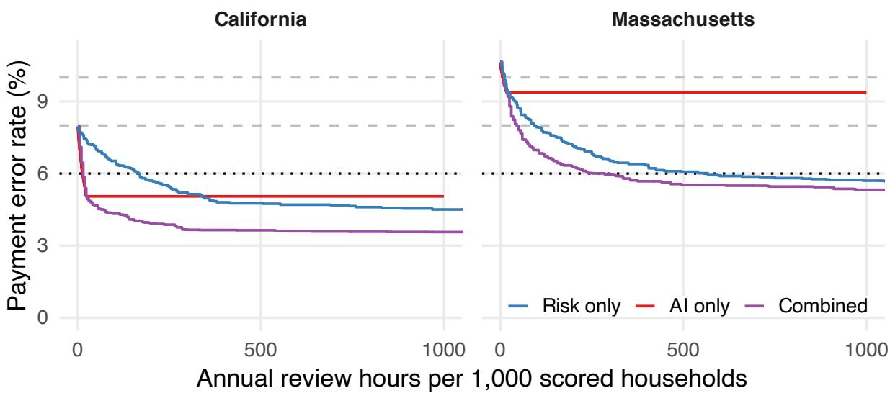  
Figure 1: Review capacity vs. payment error rates in California and Massachusetts. The horizontal axis shows annual reviewer time relative to the scored caseload; the vertical axis shows the remaining statewide PER. A lower curve indicates fewer payment errors for the same amount of staf time. The black dotted line marks the 6% PER threshold below which states avoid benefit cost sharing. AI-based review reaches this threshold with little staf time in California but cannot reach it in Massachusetts. Combined review reaches the threshold in both states with substantially less staf time than risk-based review alone.

The large cost diferences between the combined approach and the risk-based review approach reflect both how reviews are targeted and our assumptions about the work required. In our simulation, checking an AI flag takes less time and has a higher chance of correcting a real error than an ordinary category review, which requires reviewers to search for errors that may not exist. Combined review can further reduce costs by checking higher-risk flagged cases first and then later searching unflagged cases for errors that AI misses. But prioritizing cases by risk is not always the cheapest way to reach the target: in some states (i.e., Delaware, Mississippi, Nevada, Alabama, and Arizona), AI-only review can cost less by prioritizing review of historically costly error categories. D.C. is a near miss: reaching the threshold requires eliminating about 57% of its initial error dollars, but combined review eliminates only 55% of error dollars. In D.C., our simulated preauthorization reviews cannot close this gap entirely, because flagged cases receive no further search for errors, some detections fail, and cases without risk scores remain outside the review population. Notably, across all scenarios we model, the review costs required to reach the target are generally much smaller than even the lowest cost-sharing penalty that a state would face at or above 6% PER (Figure 2).

These findings are largely robust to a wide range of plausible alternate simulation assumptions (Figure D1; Appendix D). The largest changes we observe concern how many jurisdictions AI-only review can bring below the cost-sharing threshold: varying the types of errors that AI is able to detect changes this number from 14 to 27 (Appendix D.1). Nevertheless, in every sensitivity scenario—including faster or slower reviews, much stronger risk-model performance (Appendix D.7), higher or lower AI detection rates, changes in reviewers’ correction success under both risk-based and AI-based review, and narrower or broader AI error coverage—combined review costs less than risk-only review in most jurisdictions where both reach the target.

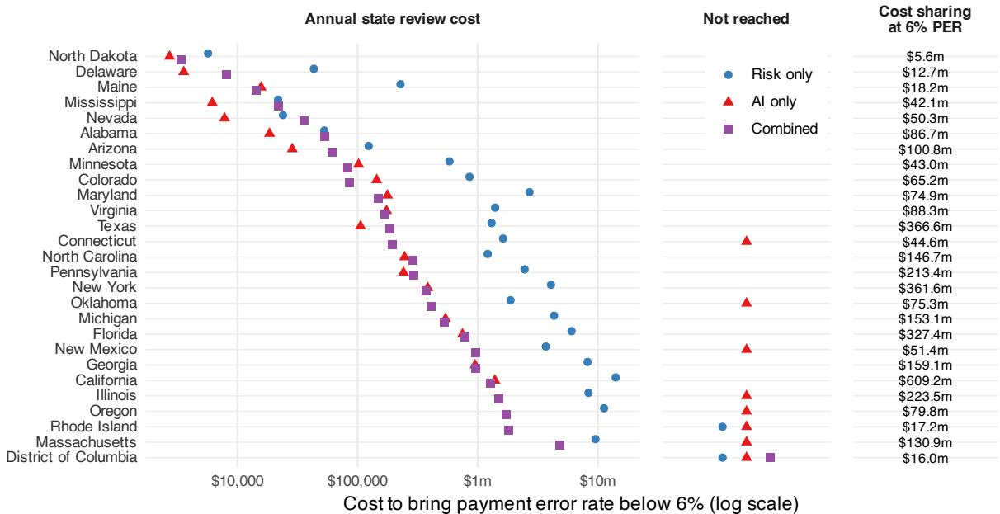  
Figure 2: Minimum annual state review cost to bring PER below 6%. The figure includes the 27 jurisdictions that begin at or above this threshold, ordered by the cost of combined review. Symbols show the lowest review cost among the simulated designs that reach the target, on a logarithmic scale. “Not reached” indicates that no tested design for that approach brings the jurisdiction below the threshold. Costs reflect the state’s share of review labor costs. The rightmost column shows annual benefit cost sharing at the lowest nonzero rate, 5% of annual benefits, which applies at a PER just above 6%. Combined review reaches the target in more jurisdictions than either approach alone and generally costs less than risk-based review.

## 4 Discussion

Our simulations suggest that combining risk scores with AI-generated flags could help states reduce SNAP payment errors at substantially lower review costs than risk-based review alone. Under our main assumptions, combined review allows 26 of the 27 jurisdictions facing costsharing penalties to avoid them, at preauthorization review costs that are a fraction of those threatened penalties. The combined approach uses risk scores to prioritize cases, AI flags to direct reviewers to potential discrepancies, and ordinary review to find errors that AI misses in unflagged cases. Its cost advantage over risk-based review persists across a wide range of assumptions—including substantially more accurate risk scores—suggesting that the two tools could serve complementary roles in preauthorization review.

Payment accuracy is only one measure of how well SNAP serves eligible households. Ideally, these tools would also help people receive the correct benefits sooner, by reducing the time that staf take to check cases and by quickly resolving discrepancies before they delay the provision of benefits. But preauthorization review also runs the risk of slowing approval or could lead to burdensome requests for additional documents, especially when AI flags are incorrect or dificult to resolve. Our simulations do not measure these efects, nor do they establish whether such tools would reduce erroneous denials or improve participation among eligible households. Evaluations in practice should therefore measure processing times, applicants’ reporting and documentation burdens, and access to the correct benefit amount, alongside payment error rates and review costs.

Whether AI can identify SNAP errors reliably enough to deliver these gains remains an open question. We simulate under a set of assumptions that seem plausible to us about detection and correction, but performance may be diferent in practice. Testing this approach would require access to a large number of case documents, a state’s written policy instructions, and independent assessments of which cases contain errors. Initial tests could compare AI flags with human assessments, followed by pilots measuring how accurately and quickly reviewers resolve flags in their normal workflow. States will likely need technical assistance to develop such tools, assemble evaluation data, integrate tools into existing systems, and train staf to use them. BGL’s open-source risk model [9], which we use in this study, provides one example of how open-source software can accelerate the development and evaluation of tools for public agencies. The Safety Net Response Network also helps states share practical approaches to reducing payment errors [6]. Similar open eforts could accelerate the development of AI-based review tools.

By threatening states with potential cost-sharing penalties if they fail to reduce PER below 6%, H.R. 1 could make access to food assistance more dependent on states’ willingness to fund it. Temporary Assistance for Needy Families (TANF), which has long required states to pay for a portion of costs, provides a warning: over time, states have directed more resources away from TANF, and fewer eligible families have received direct cash assistance as a result [15]. On the other hand, if the gains we simulate can be achieved in practice, AI could help states reduce costs while potentially expanding access to benefits. Achieving this outcome will require states to deploy AI that helps reviewers identify and resolve payment errors more quickly. Investing in that capacity could help states protect public benefits and deliver them more accurately and promptly to the people who need them.

## Acknowledgements

I am grateful to Ravi Shrof for his thoughtful and insightful comments on an early draft of this analysis.

## References

[1] U.S. Department of Agriculture. SNAP Quality Control. fna.usda.gov/snap/qc, n.d..

[2] U.S. Department of Agriculture. SNAP Payment Error Rates. fns.usda.gov/snap/qc/per, n.d..

[3] Congressional Research Service. Senate committee reports a farm bill that would delay onset of states sharing SNAP benefit costs. Technical Report IN12723, Congressional Research Service, October 2026. URL https://www.congress.gov/crs-product/IN12723.

[4] California Legislative Analyst’s Ofice. The 2026–27 California spending plan: Human services. lao.ca.gov/Publications/Report/5208/3, October 2026.

[5] American Public Human Services Association. State strategies to improve SNAP payment accuracy: Early lessons from the first year of H.R. 1 implementation. Technical report, American Public Human Services Association, July 2026. URL https://aphsa.org/wp-c ontent/uploads/2026/06/2026-06\_APHSA-State-SNAP-Survey-Results.pdf.

[6] Sarah Esty and Eric Giannella. Promising practices in SNAP PER reduction: Data-driven preauthorization reviews. Safety Net Response Network. https://safetynetresponse.org/blog/promising-practices-in-snap-per-reducti on-data-driven-preauthorization-reviews/, June 2026.

[7] U.S. Department of Agriculture. SNAP Quality Control Data. snapqcdata.net/, n.d..

[8] U.S. Department of Agriculture. SNAP Data Tables. fns.usda.gov/pd/supplemental-nutrition-assistance-program-snap, n.d..

[9] Eric Giannella. snap\_qc: Code and data for modeling SNAP payment errors. https://github.com/giannella/snap\_qc, n.d.

[10] Sarah Esty. Promising practices in SNAP PER reduction: A state case study. Safety Net Response Network. https://safetynetresponse.org/blog/promising-practices-i n-snap-per-reduction-a-state-case-study/, June 2026.

[11] Muskan Walia, Joe Nudell, and Alex Chohlas-Wood. Algorithm validation as a policy audit: Evidence from race-blind charging. arXiv preprint. https://arxiv.org/abs/2609.13174, 2026.

[12] Faiz Surani, Mirac Suzgun, Vyoma Raman, Christopher D. Manning, Peter Henderson, and Daniel E. Ho. AI for scaling legal reform: Mapping and redacting racial covenants in Santa Clara County. Journal of Legal Analysis, 18(1):151–181, 2026. doi: 10.1093/jla/laaf005.

[13] U.S. Bureau of Labor Statistics. Occupational employment and wages, May 2023: Eligibility interviewers, government programs. https://www.bls.gov/oes/2023/may/oes434061.htm, 2024.

[14] U.S. Department of Agriculture. Supplemental Nutrition Assistance Program: Changes in federal-state administrative cost sharing. Proposed rule, Federal Register 91, 37837. fna.usda.gov/snap/fr-062426, 2026.

[15] U.S. Government Accountability Ofice. Temporary Assistance for Needy Families: Potential options to improve performance and oversight. Technical Report GAO-13-431, U.S. Government Accountability Ofice, May 2013. URL https://www.gao.gov/products/gao-13-431.

## A Public-use and oficial payment error rates

Figure A1 compares the payment error rates we calculate from the FY2024 public-use QC file with USDA’s oficial rates for the same year. For each jurisdiction, we divide survey-weighted error dollars by survey-weighted benefit dollars, counting only case errors above the \$56 reporting tolerance. The rates are strongly correlated among jurisdictions included in our simulations (Pearson correlation 0.79); across the full public file, the correlation is 0.63. Public-file rates are lower in 52 of the 53 jurisdictions shown. The public file thus broadly tracks oficial PER rates, but does not reproduce the oficial rates exactly. Our simulations use the public-file rates throughout, so the review costs we estimate apply to those starting rates.

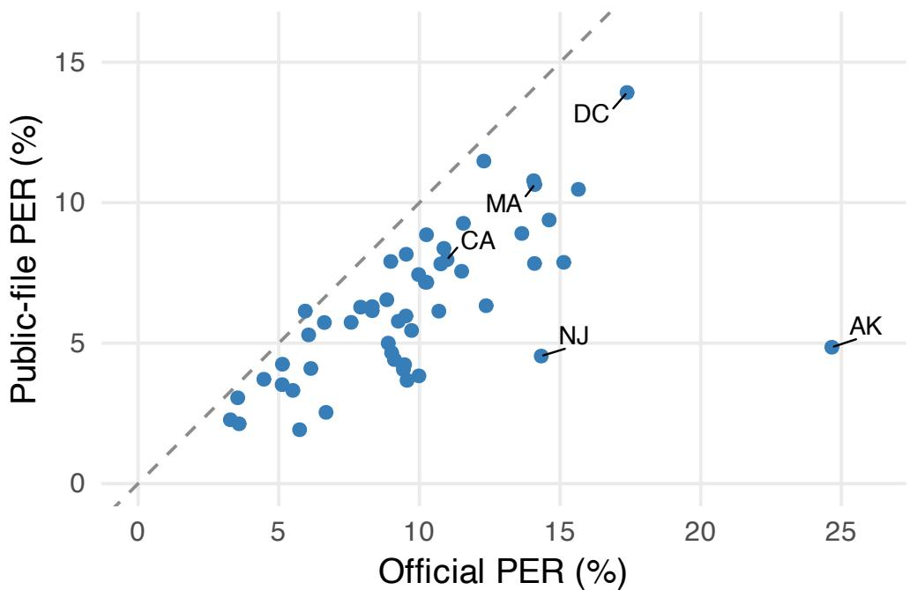  
Figure A1: Public-file PER tracks oficial PER, but is generally lower. Oficial and public-file payment error rates by jurisdiction, FY2024. Each point represents a state, the District of Columbia, Guam, or the Virgin Islands; the dashed line indicates equality. Labels identify our example states, DC, and the largest discrepancies. Sources: USDA’s oficial PER table and SNAP QC public-use file [2, 7].

## B AI error coverage

Table B1 lists the QC file’s primary causes of variance and our assumptions about whether AI could flag the associated errors. The descriptions and codes come from the QC documentation; the detectability assignments are ours. We assume that discrepancies in reported information, calculations, or required procedures can be identified from the case record, but that unreported information generally cannot. These are broad assumptions about error types, not judgments about the visibility of each individual error. In particular, we treat the mixed category of incomplete or incorrect information as detectable, even though some errors in that category may leave no visible discrepancy. Detectable errors still generate flags only with the probability specified in Section 2.2.

Table B1: Assumed AI detectability by primary cause of variance. Codes and descriptions follow the SNAP QC documentation [7]. Missing causes are treated as detectable in the main simulation.
<table><tr><td>Assumed detectable</td><td>Assumed not detectable</td></tr><tr><td>2: Incomplete or incorrect information provided; agency 1: Information not reported. not required to verify.</td><td>3: Information withheld by client (case referred for</td></tr><tr><td>10: Policy incorrectly applied.</td><td>Intentional Program Violation [IPV] investigation).</td></tr><tr><td>12: Reported information disregarded or not applied. 14: Agency failed to follow up on inconsistent or incom-</td><td>4: Incorrect information provided by client (case referred for IPV investigation).</td></tr><tr><td>plete information. 15: Agency failed to follow up on impending changes.</td><td>7: Inaccurate information reported by collateral con- tact.</td></tr><tr><td>16: Agency failed to verify required information.</td><td>8: Acted on incorrect federal computer match in- formation not requiring verification (such variance</td></tr><tr><td>17: Computer programming error.</td><td>is excluded from error determination but must be</td></tr><tr><td>18: Data entry and/or coding error.</td><td>recorded). 19: Mass change (error due to problem with computer- 26: Change was not required to be reported by the</td></tr><tr><td>generated mass change).</td><td>client or acted upon by the State agency based on</td></tr><tr><td>20: Arithmetic computation error.</td><td>time frames and reporting requirements.</td></tr><tr><td>21: Computer user error.</td><td>99: Other.</td></tr><tr><td>22: Agency budgeted an incorrect amount.</td><td></td></tr><tr><td>23: Agency failed to follow recertification procedure related to notices/forms.</td><td></td></tr><tr><td>24: Agency failed to follow recertification procedure</td><td></td></tr><tr><td>related to interviews.</td><td></td></tr><tr><td>25: Agency failed to follow recertification procedure</td><td></td></tr><tr><td>related to time frames. Missing cause: Assumed detectable.</td><td></td></tr></table>

## C Review categories

Table C1 shows how we group the QC file’s elements of variance into categories for simulated review. Each category represents related parts of a case that a reviewer could check together. The groupings are ours; the element codes and descriptions come from the QC documentation [7].

Table C1: Review categories and their constituent elements of variance.
<table><tr><td>Review category</td><td>QC elements of variance</td></tr><tr><td>Earned income</td><td>311: Wages and salaries; 314: Other earned income; 321: Earned income deductions.</td></tr><tr><td>Unearned income</td><td>331: RSDI benefits; 332: Veterans&#x27; benefits; 333: SSI and/or State SSI supplement; 334: Unemployment compensation; 335: Workers&#x27; compensation; 336: Other government benefits; 342: Contributions; 343: Deemed income; 344: TANF, PA, or GA; 345: Educational grants/scholarships/loans; 346: Other unearned income; 350: Child</td></tr><tr><td></td><td>support payments received from absent parent. Shelter and utilities 362: Homeless shelter deduction; 363: Shelter deduction; 364: Standard utility allowance.</td></tr><tr><td>Household composition</td><td>140: Residency; 150: Unit composition; 170: Social Security number.</td></tr><tr><td>Self-employment</td><td>312: Self-employment.</td></tr><tr><td>Medical expenses</td><td>365: Medical expense deductions.</td></tr><tr><td>Care and child support</td><td>323: Dependent care deduction; 366: Child support payment deduction.</td></tr><tr><td>Citizenship and students</td><td>111: Student status; 130: Citizenship and noncitizen status.</td></tr><tr><td>Other computation and reporting</td><td>520: Arithmetic computation; 530: Transitional benefits; 540: Missing reports; 542: Expired certification period; 560: Reporting systems; 810: SNAP simplification project; 820: Demonstration projects.</td></tr><tr><td>Work and disqualifications</td><td>151: Recipient disqualification; 160: Employment and training programs; 161: Time-limited participation; 162: Work registration requirements; 163: Voluntary quit/reduced work effort; 164: Workfare and comparable workfare; 165: Employment status/job availability; 166: Acceptance of employment.</td></tr><tr><td>Income totals and standard deduction Assets</td><td>361: Standard deduction; 371: Combined gross income; 372: Combined net income.</td></tr><tr><td></td><td>211: Bank accounts or cash on hand; 212: Nonrecurring lump-sum payment (includes non-substantial lottery or gambling winnings); 213: Other liquid assets; 214: Substantial lottery or gambling winnings; 221: Real property; 222: Vehicles; 224: Other nonliquid resources; 225: Combined resources.</td></tr></table>

## D Sensitivity analysis

We vary the assumptions below one at a time, holding the remaining assumptions at their main values. Figure D1 shows how many of the 27 initially above-threshold jurisdictions each approach brings below 6% PER.

1. AI error coverage: narrower and broader sets of detectable errors.

2. AI detection: lower and higher probabilities of flagging an error.

3. Human flag correction: lower and higher success rates.

4. Ordinary category review: higher human correction success rates.

5. Flag-review time: shorter and longer checks.

6. Category-review time: shorter and longer checks.

7. Risk scores: random rankings, stronger signals, and known error status.

8. AI flag order: historical correction per hour and random ordering.

9. Combined review: following case risk throughout rather than flags first.

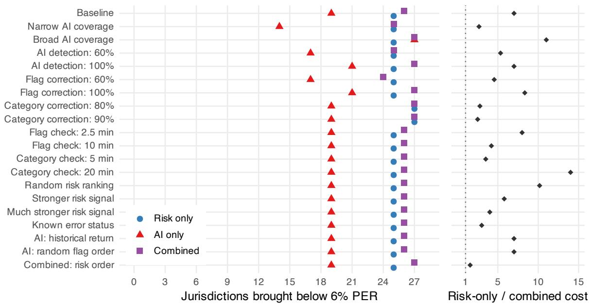  
Figure D1: Sensitivity overview. Left: jurisdictions brought below the threshold. Right: median within-jurisdiction ratio of risk-only to combined review costs, among jurisdictions where both reach the target; values above one favor combined review. For repeated risk-score draws, we first take each jurisdiction’s median cost.

## D.1 Which errors AI can detect

The narrow-coverage scenario includes policy, data-entry, and calculation errors (codes 10, 12, and 17–22 in Table B1), but excludes incomplete information, follow-up, verification, recertification, and missing causes. Broad coverage adds unreported, withheld, or inaccurate information from applicants and collateral contacts (codes 1–4 and 7) to the main detectable set. It assumes access to the information needed to identify these errors, even when absent from the submitted documents. Codes 8, 26, and 99 remain excluded.

AI-only review reaches 14 jurisdictions under narrow coverage and 27 under broad coverage, compared with 19 under the main assumptions. Combined review reaches 25 and 27, respectively; risk-only results are unchanged. Coverage thus changes what AI can achieve on its own, while combined review retains ordinary review in unflagged cases.

Here and below, costs exclude remaining benefit cost sharing, and “not reached” means no simulated budget achieves the target. As in Figure 2, we select the best-performing review scope at each budget for risk-only and combined review.

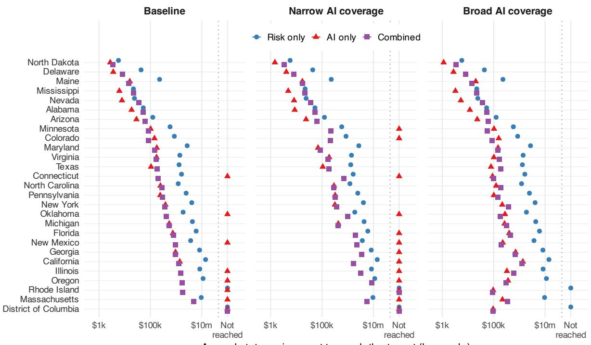  
Annual state review cost to reach the target (log scale)  
Figure D2: Review costs under alternative AI error coverage assumptions. All panels use the same jurisdictions, ordering, and cost scale. Points to the right of the dotted divider indicate that the target is not reached.

## D.2 How reliably AI flags detectable errors

We change the probability that a detectable error generates a flag from 80% to 60% or 100%, while keeping human correction success at 80%. The share of flags corresponding to real errors remains 80%; consequently, more detected errors also produce more false flags to review. We do not separately vary this share.

Lower detection reduces the number of jurisdictions reaching the target to 17 for AI-only review and 25 for combined review. With perfect detection of the assumed detectable errors, these counts rise to 21 and 27. Perfect detection does not make otherwise invisible error types detectable. The combined approach can use ordinary review to find errors in unflagged cases, so its reach is less dependent on AI detection alone.

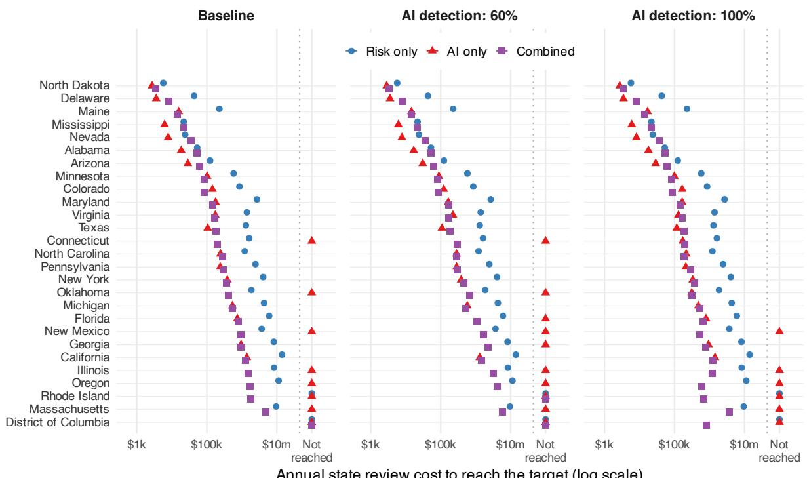  
Figure D3: Review costs when AI flags a smaller or larger share of detectable errors. Human correction success and the share of flags that are real remain fixed.

Annual state review cost to reach the target (log scale)

## D.3 Human correction of flagged errors

We vary the probability that a reviewer successfully corrects a real flagged error from 80% to 60% or 100%, while holding AI detection at 80%. This check concerns human review after a flag has been generated, not AI’s ability to identify the error. Failed corrections still consume review time.

At the lower success rate, AI-only review reaches 17 jurisdictions and combined review reaches 24. At the higher rate, they reach 21 and 27. Combined review is more vulnerable to unsuccessful flag correction than to missed flags: cases with flags receive no subsequent ordinary review, whereas cases without flags remain eligible for it.

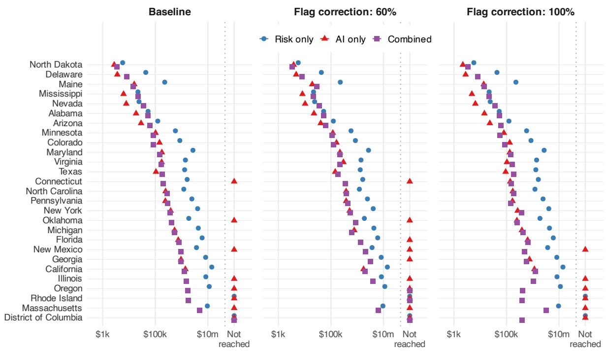  
Figure D4: Review costs under lower and higher human success in correcting flagged errors. The probability that AI detects an error remains unchanged.

## D.4 Human correction during ordinary category review

We increase the probability that an ordinary category check succeeds from 50% to 80% or 90%. This change applies to risk-only review and to the ordinary-review phase of the combined approach; AI-only review is unchanged. A successful check corrects all errors in the reviewed category, including errors outside AI’s detectable set.

At either higher success rate, both risk-only and combined review can bring all 27 jurisdictions below the threshold. More efective ordinary review narrows the cost diference: risk-only review costs a median of 2.8 times as much as combined review at 80% success, and 2.5 times as much at 90% success. These medians compare costs within jurisdictions where both methods reach the target.

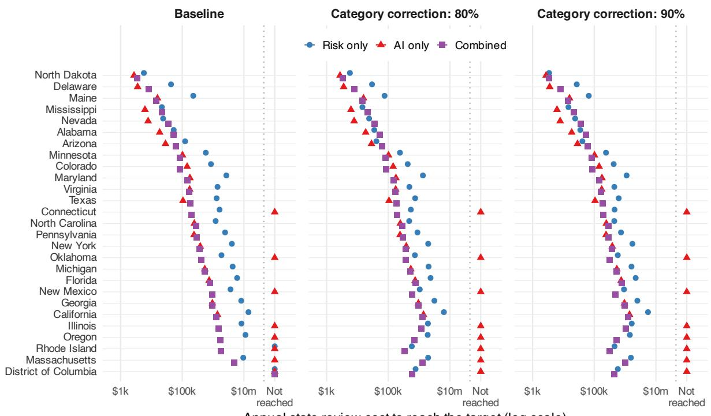  
Figure D5: Review costs when ordinary category checks are more efective. Both approaches using ordinary review reach more jurisdictions, but combined review generally remains less costly.

## D.5 Time spent checking an AI flag

We change review time per flag from 5 minutes to 2.5 or 10 minutes. The time applies equally to true and false flags. Changing review time afects costs without changing which errors can be corrected, so each approach reaches the same jurisdictions as in the main simulation. AI-only costs scale directly with time per flag. Combined costs also change, but only for the part of the work spent checking flags. Among jurisdictions where both reach the target, risk-only review costs a median of 8.0 times as much as combined review with shorter flag checks, and 4.2 times as much with longer checks.

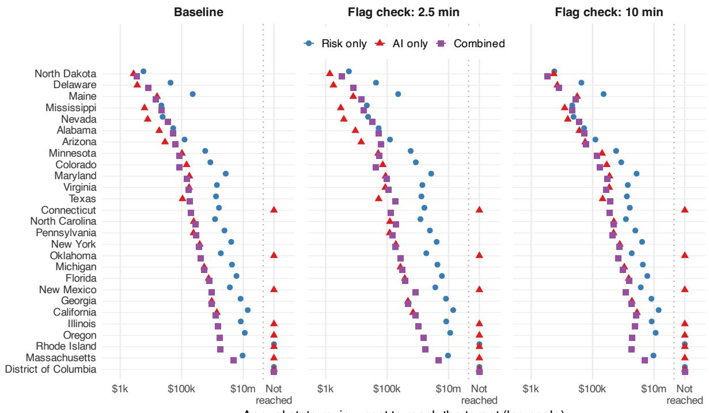  
Figure D6: Review costs under shorter and longer flag checks. Risk-only review is unchanged; AI-only and combined review become more costly as checks take longer.

## D.6 Time spent on an ordinary category check

We change ordinary review time per category from 10 minutes to 5 or 20 minutes, holding correction success fixed. Risk-only costs scale directly with the duration of a check. Combined review is afected only when it proceeds beyond flags to ordinary reviews of unflagged cases; AI-only costs are unchanged. The jurisdictions reaching the target remain the same. Among jurisdictions where both reach the target, risk-only review costs a median of 3.5 times as much as combined review with shorter category checks, and 14.0 times as much with longer checks.

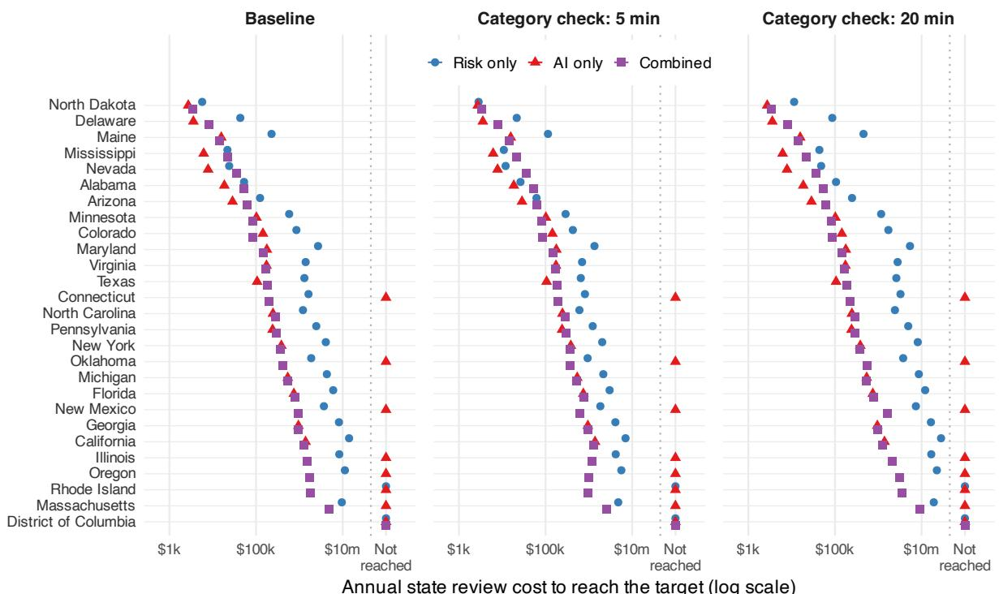  
Annual state review cost to reach the target (log scale)  
Figure D7: Review costs under shorter and longer ordinary category checks. The comparison is most favorable to risk-only review when these checks are faster.

## D.7 Risk-score accuracy

We augment the original risk score p with hypothetical information U about whether a case contains an above-tolerance error (Y). Conditional on Y, U is independent of p, with $U \mid Y =$ $0 \sim N ( 0 , 1 )$ and $U \mid Y = 1 \sim N ( d , 1 )$ . The updated score is

$$
p ^ { * } = \mathrm { l o g i t } ^ { - 1 } \biggl ( \mathrm { l o g i t } ( p ) + d U - \frac { d ^ { 2 } } { 2 } \biggr ) .
$$

We use $d = 1$ and $d = 2 .$ , each with 3 draws. Only case rankings change; errors, correction outcomes, and category priorities remain fixed. These signals represent hypothetical improvements, not newly fitted models.

Among initially above-threshold jurisdictions, the median within-jurisdiction area under the ROC curve rises from 0.77 to 0.85 and 0.95, respectively (taking the median across draws). Even with the stronger signal, risk-only review costs a median of 4.0–4.7 times as much as combined review across draws, comparing jurisdictions where both reach the target.

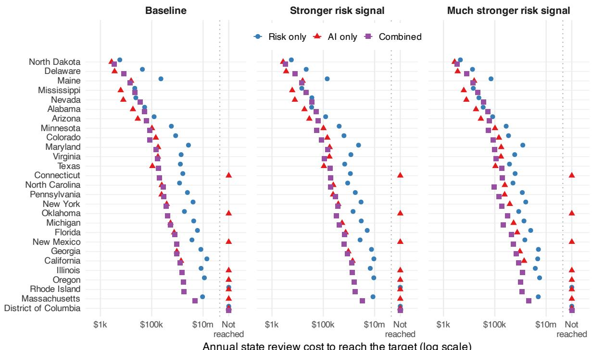  
Figure D8: Review costs with more informative hypothetical risk scores. Points show median costs across 3 draws; horizontal segments show their range, not confidence intervals. AI-only review does not use risk scores and is unchanged.

We also consider random case rankings and rankings that reveal exactly which cases contain an above-tolerance error. In the latter scenario, all cases with errors come first, but the scores do not reveal the size or category of an error; cases with the same score share the available review capacity. Even with this knowledge, risk-only review costs a median of 3.0 times as much as combined review where both reach the threshold. Changing rankings does not change the errors that can ultimately be corrected when all reviews are completed, so it changes costs rather than the set of jurisdictions reaching the target.

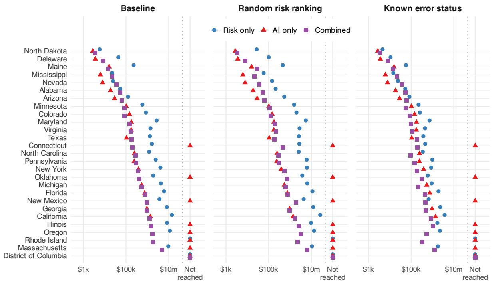  
Annual state review cost to reach the target (log scale)  
Figure D9: Review costs with random case rankings or known error status. For random rankings, points show medians across 3 draws and segments show the range. Known error status identifies cases with errors, not the errors’ locations or sizes.

## D.8 The order of AI flag checks

The main AI-only approach checks flags in categories with the largest historical error-dollar totals for the state. We compare this with ranking categories by historical correctable dollars per expected hour of flag review, using the same FY2022–2023 records, and with reviewing flags in random order. The historical-return ordering accounts for the number of flags a category is expected to generate, rather than its total error dollars alone. Random ordering assigns the same review fraction to flags in every category. These variations change only standalone AI review; the risk-only and combined approaches remain as in the main simulation.

All orders eventually check the same flags, so AI-only review reaches 19 jurisdictions under each ordering. The cost to reach the threshold can nevertheless difer within a jurisdiction, because some orders reach larger errors sooner. Figure D10 shows those diferences without selecting the best order retrospectively for each state.

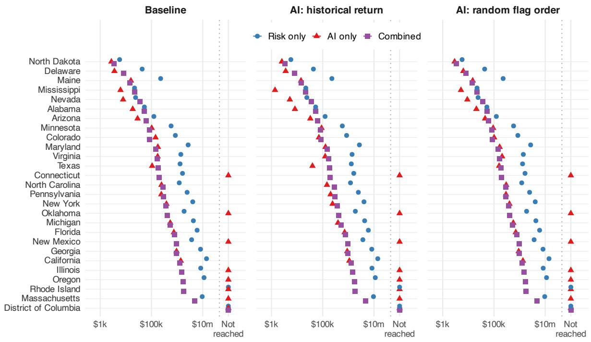  
Figure D10: Review costs under alternative orders for standalone AI flag checks. “Historical return” ranks categories by historical correctable dollars per expected hour of review. Only the AI-only series changes.

Annual state review cost to reach the target (log scale)

## D.9 The order of combined review

Our main combined approach checks flags first, in case risk order, and then performs ordinary category reviews in cases without flags. The alternative follows case risk order throughout. Within each selected case and category, reviewers check flags when present and perform an ordinary category review otherwise. Thus, this alternative also allows ordinary review of unflagged categories in cases that have flags elsewhere; it changes both the sequence of reviews and the work performed on those cases.

The alternative brings 27 jurisdictions below the threshold, compared with 26 under the main approach. It can reach the target in the District of Columbia, where the main approach stops short, but typically requires more review spending to reach the target elsewhere. The additional reach therefore comes with a cost: reviewers spend time searching categories in high-risk cases before checking all of the specific discrepancies identified by AI.

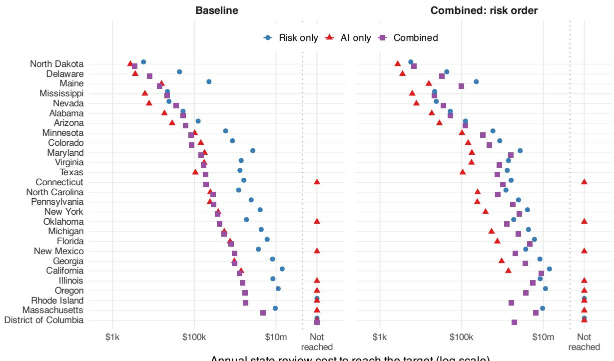  
Figure D11: Review costs under alternative combined-review procedures. The main approach checks all flags before ordinary reviews of unflagged cases. The alternative follows case risk throughout, using ordinary review in categories without flags.