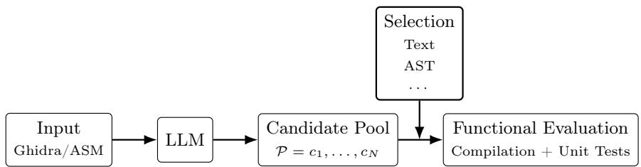
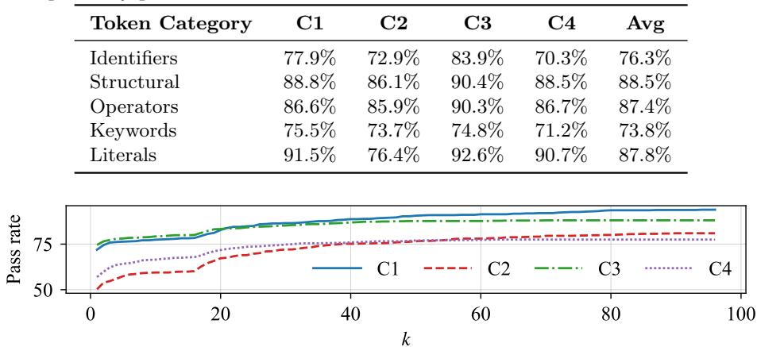

# Rethinking Neural Decompilation: Candidate Selection as the Hidden Bottleneck

Felix Mächtle , Gautham Sriram , Manjil Neupane , Nils Loose , and Thomas Eisenbarth

Institute for IT Security, University of Lübeck, Lübeck, Germany {f.maechtle, n.loose, thomas.eisenbarth}@uni-luebeck.de, {gautham.sriram, manjil.neupane}@student.uni-luebeck.de

Abstract. Reverse engineering obfuscated binaries is a core task in malware analysis and software security auditing. While neural decompilers based on Large Language Models (LLMs) have improved the readability and functional fidelity of recovered code over heuristic tools such as Ghidra and IDA Pro, a substantial gap remains between best-sample performance and practical single-output accuracy, particularly under code obfuscation. We study this gap through the lens of candidate generation and candidate selection. Using the LLM4Decompile architecture, we show that ground-truth tokens lie within the model’s top-five nexttoken predictions in 95.6% of positions on average and that multi-sample decoding reaches a pass@100 of 93% on HumanEval-Decompile, indicating that correct reconstructions are typically already present in the model’s sampling space. We then evaluate a generate-then-select pipeline that ranks 100 candidates per input with text-, syntax-, embedding-, consensus-, and likelihood-based selectors. Negative perplexity emerges as the strongest static selector on HumanEval-Decompile (73.3% pass@1), while execution-guided selection nearly closes the oracle gap on Exe-Bench (86.3% pass@1). Combined with one epoch of fine-tuning on our newly released ExeBench-Obfuscated dataset containing 362,647 obfuscated OLLVM samples, the same pipeline increases the pass@1 rate for obfuscated binaries to 88.8%, directly contradicting prior claims that released LLM4Decompile checkpoints are unsuitable for obfuscated inputs.

Keywords: Neural Decompilation · Large Language Models · Binary Analysis · Code Obfuscation

## 1 Introduction

Binary analysis is a cornerstone of modern software security, enabling critical tasks such as malware detection, vulnerability assessment, and the auditing of proprietary or legacy software [32,5,14]. A central component of these eforts is decompilation, the process of reconstructing high-level source code from machineexecutable binaries [21,34,39]. While traditional decompilers like Ghidra and IDA Pro rely on expert-crafted heuristic rules to recover control flow and program logic, they frequently struggle with the inherent loss of symbolic information during compilation, often producing results that are dificult for human analysts to interpret and impossible to re-execute [21,14].

The recent success of Large Language Models (LLMs) in the field of program analysis [24,37,23] has also motivated their application to binary decompilation. Models such as LLM4Decompile, SALT4Decompile, and ReF Decompile have demonstrated that treating decompilation as a neural machine translation task can significantly improve code readability and functional correctness [34,10,39]. However, despite these advances, a substantial gap remains between apparent code quality and executable correctness. State-of-the-art models frequently generate code that appears plausible yet fails to satisfy functional test cases.

This challenge is further exacerbated by code obfuscation techniques such as Control Flow Flattening (FLA) and Bogus Control Flow (BCF), which deliberately distort program structure and obscure semantic relationships. Under these conditions, decompilation models experience severe performance degradation and may even become inefective at recovering executable high-level code [34].

Motivated by this observation, we shift the focus from whether neural decompilers can generate correct programs to whether they can reliably identify them among multiple plausible candidates. We therefore study neural decompilation as a two-stage problem consisting of candidate generation and candidate selection. To this end, we systematically evaluate a broad range of selection strategies, including text-based, syntax-based, embedding-based, consensus-based, likelihoodbased, and execution-guided approaches. Our results demonstrate that candidate selection itself constitutes a major bottleneck in practical neural decompilation: while correct programs are frequently present in the sampled candidate pool, reliably distinguishing them from superficially plausible but functionally incorrect alternatives remains challenging. At the same time, we show that simple selection mechanisms substantially improve single-output accuracy: a likelihoodbased selector reaches 73.3% pass@1 on HumanEval-Decompile [34], improving over the strongest published baseline by 6%, while execution-guided selection nearly closes the oracle gap on ExeBench at 86.3% pass@1—all without modifying the underlying decompiler architecture.

Furthermore, we introduce ExeBench-Obfuscated, a large-scale dataset of 362,647 obfuscated samples generated with common OLLVM transformations. We open-source this dataset on Huggingface and our code on Github: https:// github.com/UzL-ITS/rethinking-neural-decompilation. We demonstrate that multi-candidate selection, combined with targeted fine-tuning on this corpus, substantially improves the robustness of neural decompilers under obfuscation, reaching up to 88.8% pass@1 on obfuscated binaries—a setting in which released LLM4Decompile checkpoints were previously reported as unsuitable [34].

In summary, this work makes the following contributions: (1) a token-level analysis showing that correct reconstructions are largely already present in the model’s sampling space; (2) a systematic comparison of selectors that establishes negative perplexity as a new state-of-the-art static selector on HumanEval-Decompile (+6% over prior work); (3) evidence that generate-then-select, combined with one epoch of fine-tuning, makes of-the-shelf LLM4Decompile usable on obfuscated binaries; and (4) the release of ExeBench-Obfuscated, a 362,647- sample obfuscation dataset.

## 2 Background

Problem Formalization. Decompilation is formally defined as the process of mapping a binary executable x back to a high-level source representation $s ^ { \prime } .$ Given an original source code s, the compilation process can be denoted as $\begin{array} { r } { \boldsymbol { x } ~ = ~ \boldsymbol { \mathcal { C } } ( \boldsymbol { s } ) } \end{array}$ , where C represents the compiler. A decompiler D attempts to reconstruct the logic such that $\boldsymbol { \mathcal { D } } ( \boldsymbol { x } ) = \boldsymbol { s } ^ { \prime }$ , where $s ^ { \prime }$ is expected to maintain high semantic fidelity and functional equivalence to s.

LLM-based Decompilation. The current state-of-the-art in neural decompilation, exemplified by LLM4Decompile, treats decompilation as a sequence-tosequence translation problem [34]. In contrast to traditional decompilers such as Ghidra or $I D A ~ P r o ,$ which recover control-flow and types through hand-crafted heuristics [21], a neural decompiler with parameters θ learns a conditional distribution over source token sequences $\boldsymbol { S } = ( s _ { 1 } , \dots , s _ { T } )$ given a binary-derived input x (e.g., assembly or Ghidra pseudo-code), factorized autoregressively as

$$
P _ { \theta } ( S \mid x ) = \prod _ { t = 1 } ^ { T } P _ { \theta } ( s _ { t } \mid x , s _ { < t } ) ,\tag{1}
$$

and is trained by minimizing the negative log-likelihood of S over a parallel corpus.

At inference, each token $s _ { t }$ is drawn from $P _ { \theta } ( s _ { t } \ | \ x , s _ { < t } )$ until an end-ofsequence token is produced. Sampling diversity is controlled by a temperature $\tau \geq 0$ that rescales this distribution: $\tau  0$ recovers greedy decoding, while larger τ flattens it and yields more diverse outputs.

Code Obfuscation. Code obfuscation refers to semantics-preserving transformations intended to make a program dificult to analyze for both humans and automated tools [8]. In this work, we focus on common techniques provided by the Obfuscator-LLVM (OLLVM) framework. Specifically, we use the following techniques:

– Control Flow Flattening (FLA): replaces the original hierarchy with a dispatcher loop that hides program logic.

– Bogus Control Flow (BCF): inserts opaque predicates and unreachable code blocks.

– Instruction Substitution (SUB): rewrites instructions into longer, semantically equivalent sequences.

– FLA+Split: combines flattening with basic-block fragmentation, further obscuring the control-flow graph.

## 3 Experimental Methodology

Existing neural decompilation work typically evaluates the final decoded program, thereby mixing the model’s ability to assign probability to correct code with the decoding procedure’s ability to recover it [34,10,39]. In contrast, we decompose neural decompilation into two stages: a token-level decoder, which turns an input representation into a complete candidate program by autoregressive sampling and a program-level selector, which chooses one output from a pool of independently sampled candidates. Figure 1 illustrates the resulting pipeline. Our study is guided by the following three research questions:

  
Fig. 1: Overview of our pipeline. The LLM generates a pool of N candidates from Ghidra pseudo-code or assembly, a selector ranks them and the chosen candidate is validated against unit tests.

– RQ1: Is the correct output already present in the model’s token-level distribution?

– RQ2: Can multi-candidate selection improve single-output decompilation accuracy?

– RQ3: Does Multi-Candidate Selection Enable Decompilation of Obfuscated Binaries?

## 3.1 Experimental Configurations

We follow the LLM4Decompile evaluation protocol and reuse its two benchmarks, two input representations, and matching model variants, yielding the four configurations C1–C4 listed in Table 1, which we use throughout the remainder of the paper.

Benchmarks. HumanEval-Decompile [34] contains self-contained C functions translated from HumanEval [6] and is checked against functional assertions. The ExeBench dataset [3] contains real-world C functions extracted from GitHub, including project-specific helpers and richer control flow, packaged with the I/O wrappers required to compile and execute each function. All functions in both benchmarks were evaluated at the four standard GCC optimization levels (O0, O1, O2, O3).

Input representations. We consider two binary-derived inputs. Assembly listings are produced with objdump, while Ghidra pseudo-code is produced with the Ghidra Headless Analyzer, which applies Ghidra’s decompilation passes to recover a higher-level representation than raw assembly. For ExeBench, which is distributed as source code and execution wrappers rather than as a predecompiled corpus, we generate both representations ourselves by compiling each function at the configured optimization level and then running objdump and Ghidra Headless on the resulting binary. For the HumanEval-Decompile dataset, we use the samples from [34].

Table 1: Experimental configurations following the original LLM4Decompile input representations, benchmark family, and model variants.
<table><tr><td>ID Input</td><td>Benchmark</td><td>Model</td></tr><tr><td>C1 Ghidra pseudo-code</td><td>HumanEval-Decompile</td><td>LLM4Decompile-Ref-9B-v2</td></tr><tr><td>C2 Assembly</td><td>HumanEval-Decompile</td><td>LLM4Decompile-End-6.7B-v1.5</td></tr><tr><td>C3 Ghidra pseudo-code</td><td>ExeBench</td><td>LLM4Decompile-Ref-9B-v2</td></tr><tr><td>C4 Assembly</td><td>ExeBench</td><td>LLM4Decompile-End-6.7B-v1.5</td></tr></table>

Models. Each input representation is paired with the matching LLM4Decompile variant: LLM4Decompile-End-6.7B-v1.5 for assembly inputs and $L L M _ { ☉ } .$ Decompile-Ref-9B-v2 for Ghidra pseudo-code inputs.

## 3.2 Token-Level Recoverability (RQ1)

For RQ1 we measure whether the ground-truth target tokens are accessible within the model’s distribution under a forced prefix, i.e., teacher forcing. At each target position t, the model is conditioned on the correct prefix $y _ { < t }$ and produces a distribution over the vocabulary V , in which we record the rank of the correct token,

$$
\operatorname { r a n k } ( y _ { t } ) = 1 + | \{ v \in V : P _ { \theta } ( v \mid x , y _ { < t } ) > P _ { \theta } ( y _ { t } \mid x , y _ { < t } ) \} | .\tag{2}
$$

A rank of k means the correct token is contained in the model’s top-k predictions. To localize prediction dificulty, we additionally group ground-truth tokens into five syntactic categories: identifiers, keywords, literals, operators, and structural tokens. Identifiers include variable, function, type, and field names; keywords include control-flow constructs such as if, while, and return, as well as qualifiers such as const and static; literals include numeric, character, and string constants; operators include arithmetic, logical, comparison, and assignment operators; and structural tokens include braces, parentheses, brackets, semicolons, and commas. For each category, we perform the same rank-based analysis and report the corresponding rank distribution. This allows us to identify the token classes that are the most dificult for the model to recover.

## 3.3 Candidate Selection (RQ2)

Whereas RQ1 examines whether the ground-truth token lies in the model’s distribution at each position, a reverse engineer ultimately requires a single complete program, not a sequence of token-level predictions. RQ2 therefore lifts the analysis from tokens to programs and asks whether a functionally correct candidate can be identified without access to the ground truth.

Candidate generation. For each input x we draw multiple candidates with varying temperatures $\tau \in \{ 0 . 0 , 0 . 3 , 0 . 5 , 0 . 7 , 0 . 9 , 1 . 0 \}$ , mixing high-confidence completions with progressively more diverse samples. The candidate pool $\mathcal { P }$ is fixed before any selector runs, so any diference between selectors is attributable to the selection criterion rather than to sampling variance in the generator.

Selection signals. We evaluate selectors from four families. Each scores against a compilable candidate $c \in \mathcal { P } \colon$ similarity to the input $x ,$ agreement within the pool ${ \mathcal { P } } ,$ , the decompiler’s own likelihood of $c ,$ or runtime behavior of the compiled candidate. Two baselines complete the comparison: Random selection over $\mathcal { P }$ provides a no-information lower reference, while an oracle that returns any candidate passing all functional tests serves as an upper bound over the fixed pool and is therefore not deployable. All selectors are listed and described in Appendix A.

## 3.4 Obfuscation Dataset

To evaluate whether candidate selection remains efective beyond standard, unobfuscated binaries, we require a paired dataset that exposes neural decompilers to semantics-preserving obfuscation while retaining ground-truth source code.

To the best of our knowledge, no such dataset exists at the scale required for fine-tuning LLM-based decompilers. We therefore construct an obfuscation dataset based on functions from ExeBench, named ExeBench-Obfuscated. For each sample, the target function and its dependencies are combined into a compilable source file and compiled twice: once unobfuscated (used in C2/C4 of RQ2) and once through an OLLVM toolchain with one of the four obfuscation passes described in Section 2 (used in RQ3).

Throughout this process, we preserve the original function code, dependency information and compilation outcomes. To improve dataset quality, we remove empty or trivial functions, i.e., functions whose bodies are empty or reduce to a bare return; statement, since such cases provide little meaningful signal for decompilation-based learning.

Finally, the generated obfuscated samples are mapped back to the original ExeBench samples. This restores repository-level metadata and executionrelated fields, including the original source path, I/O specification, execution wrapper, and identifier. Following Loose et al. [22], we do not split the training and test partition randomly but by project. This prevents data snooping within a project. ExeBench-Obfuscated contains 287,790 training samples and 74,857 test samples, leading to a total of 362,647 samples.

## 3.5 Evaluation Metrics

Following prior work on neural decompilation [34], our primary metric is functional correctness. A candidate c is counted as correct for an input x if it (i) compiles successfully under the evaluation harness and (ii) passes all associated functional tests within a two-second timeout; candidates that fail to compile, time out, or fail any assertion are counted as incorrect.

Table 2: RQ1: Token rank analysis across configurations. For each configuration, we report the percentage of tokens where the correct token appears at rank 1 (exact top prediction), within the top 5, and within the top 10.
<table><tr><td></td><td>Config Input Benchmark Model</td><td></td><td>Rank =1</td><td> $\leq 5$ </td><td>≤ 10 Mean</td><td></td></tr><tr><td>C1</td><td>Ghidra HumanEval</td><td></td><td>9B-v2</td><td></td><td>80.9% 93.7% 95.6%</td><td></td><td>15.8</td></tr><tr><td>C2</td><td></td><td>ASM HumanEval</td><td>6.7B-v1.5</td><td></td><td>87.5% 97.2% 97.9%</td><td></td><td>5.5</td></tr><tr><td>C3</td><td>Ghidra ExeBench</td><td></td><td>9B-v2</td><td></td><td>87.3% 97.1% 98.1%</td><td></td><td>6.2</td></tr><tr><td>C4</td><td>ASM</td><td>ExeBench</td><td>6.7B-v1.5</td><td></td><td></td><td>82.2% 94.5% 96.2%</td><td>10.1</td></tr><tr><td>Avg.</td><td></td><td></td><td></td><td></td><td></td><td>84.5% 95.6% 97.0%</td><td>9.4</td></tr></table>

## 4 Evaluation

We present results for each research question across the four configurations described in Section 3.1 (Table 1).

## 4.1 RQ1: Is the Correct Token in the Sampling Space?

RQ1 examines whether decompilation failures arise because the model cannot represent the correct output, or because decoding fails to recover it. To this end, we analyze the model’s next-token distribution under teacher forcing and measure how often each ground-truth token appears among the model’s highestprobability predictions.

Setup. We applied the teacher-forced rank analysis from Section 3.2 to each of the four configurations using 100 randomly sampled functions per configuration. At every target position, we recorded the rank of the ground-truth token under the model’s distribution. The token-category ablation followed the fivecategory grouping defined in Section 3.2.

Results. Table 2 reports the rank distribution per configuration. The groundtruth token is the top prediction (rank = 1) in 80.9–87.5% of positions and falls within the top five in 93.7–97.2% of positions. Averaged across the four configurations, the ground-truth token is at rank = 1 in 84.5% of positions, within the top five in 95.6%, and within the top ten in 97.0%. Tokens with rank > 10 account for only 1.9–4.4% of positions. The mean rank, however, varies substantially across configurations, from 5.5 on C2 to 15.8 on C1. Table 3 reports the rank = 1 rates per syntactic category. Identifiers reach rank = 1 in 70.3– 83.9% of positions, keywords in 71.2–75.5%, literals in 76.4–92.6%, operators in 85.9–90.3%, and structural tokens in 86.1–90.4%.

Discussion. Across all four configurations the correct token sits within the model’s top five predictions in 93%–97% of positions, so the failures of greedy decoding cannot be blamed on a missing target distribution. The residual error concentrates where one would expect: identifiers and the qualifier subset of keywords (const, static, etc.) carry information that compilation discards, while operators and structural tokens, which are pinned down by the recovered control flow and expression structure, are recovered almost perfectly.

Table 3: RQ1: Token rank analysis by syntactic category. Rank = 1 (%) for grouped AST node types across configurations. Identifiers and keywords are consistently the hardest categories, while structural tokens and operators are near-perfectly predicted.
<table><tr><td>Token Category</td><td>C1</td><td>C2</td><td>C3</td><td>C4</td><td>Avg</td></tr><tr><td>Identifiers</td><td>77.9%</td><td>72.9%</td><td>83.9%</td><td>70.3%</td><td>76.3%</td></tr><tr><td>Structural</td><td>88.8%</td><td>86.1%</td><td>90.4%</td><td>88.5%</td><td>88.5%</td></tr><tr><td>Operators</td><td>86.6%</td><td>85.9%</td><td>90.3%</td><td>86.7%</td><td>87.4%</td></tr><tr><td>Keywords</td><td>75.5%</td><td>73.7%</td><td>74.8%</td><td>71.2%</td><td>73.8%</td></tr><tr><td>Literals</td><td>91.5%</td><td>76.4%</td><td>92.6%</td><td>90.7%</td><td>87.8%</td></tr></table>

  
Fig. 2: Oracle pass rate versus candidate pool size k. Curves saturate around $k \in [ 6 0 , 8 0 ]$ , motivating our choice of $N = 1 0 0$

Two configuration-level efects qualify this picture. The Ghidra-to-assembly switch degrades identifier recovery on ExeBench but halves the literal gap on HumanEval, which we attribute to the short, context-poor HumanEval functions rather than to assembly input in general. Second, C1’s mean rank of 15.8 well above the 5.5–10.1 elsewhere — shows that, when the Ghidra-refined model makes errors on HumanEval, it does so definitively, with probability mass leaking far down the vocabulary.

## 4.2 RQ2: Can Selection Improve Pass@1?

RQ1 shows that the model assigns a high probability to the ground-truth tokens. However, since some information is lost during compilation, it must be estimated. In the autoregressive manner in which these models work, this means that mistakes are made, if lost information is guessed wrong [37]. RQ2 lifts the analysis from individual tokens to complete programs by asking whether a selection function applied to a pool of sampled candidates can reliably identify a functionally correct one.

Pre-study: candidate pool size. Before comparing selectors, we first fix a candidate pool size N large enough that the oracle pass rate has efectively saturated. To pick N in a principled way, we sample 100 candidates per input under the temperature schedule $\tau \in \{ 0 . 0 , 0 . 3 , 0 . 5 , 0 . 7 , 0 . 9 , 1 . 0 \}$ and compute the oracle pass rate for every pool size $k \in \{ 1 , \ldots , 1 0 0 \}$ . Figure 2 shows the resulting curves. All four configurations rise steeply over the first ∼20 candidates and flatten between $k = 6 0$ and k = 80; beyond that point, additional samples yield at most marginal gains. However, the saturation point itself varies across configurations. We therefore fix N = 100 for the remainder of this section. This choice is intentionally conservative: it ensures that, across all four configurations, the candidate pool is saturated with respect to the model’s sampling distribution.

Setup. We instantiate the generate-then-select pipeline of Section 3.3 on all four configurations from Section 3.1. For HumanEval-Decompile (C1, C2) we use all 656 inputs (164 functions × 4 optimization levels); for ExeBench (C3, C4) we sample 1000 inputs uniformly. For each input we draw $N = 1 0 0$ candidate programs and score every candidate with each selector from Section 3.3. However, not all samples are compilable. Therefore, the selection analysis excludes inputs for which no compilable candidate could be generated, leaving 634 (C1), 640 (C2), 774 (C3), and 428 (C4) efective inputs.

Results. Table 4 reports pass@1 for every selector across the four configurations. The oracle ranges from 75.7% (C4) to 92.7% (C1), and the gap between random selection and the oracle, the empirical size of the selection bottleneck, ranges from 16.3 (C4) to 33.4 (C2) percentage points.

Among static selectors, negative perplexity is the strongest on three of four configurations: C1 (73.3%, +5.1 pp over random), C2 (55.0%, +8.0 pp), and C4 $( 6 5 . 1 \% , + 5 . 7 \mathrm { p p } )$ . On C3, the result is diferent: perplexity reaches only 70.4% against a random baseline of 69.5%, a gap that lies within sampling noise, while MBR consensus took the lead at 72.5% (+3.0 pp) and the two compile-filtered majority-vote variants followed closely at 72.2%. MBR consensus is otherwise consistently behind perplexity on the HumanEval configurations, closing 14% of the oracle–random gap on C1 (71.6%) and 15% on C2 (51.9%). Similaritybased selectors are uniformly weaker than perplexity on HumanEval; on C3 the closest similarity selectors (Edit Similarity 69.4%, Trigram 69.3%, Bigram 69.0%) cluster around the random baseline without clearly beating it. The two majority-vote variants that include non-compiling candidates (rows c, d) collapse on ExeBench, falling to 37.4% on C3 and 14.9–15.0% on C4, well below random.

Execution-guided selection, the only dynamic selector evaluated, shows a sharply diferent profile. On HumanEval it is middling (70.8% on C1, 51.8% on C2), trailing perplexity, MBR, and both compile-filtered majority votes. On ExeBench, by contrast, it is the strongest selector by a wide margin, reaching 86.3% on C3 and 75.4% on C4—in both cases within 0.5 pp of the oracle.

Candidate generation costs 0.126 s per sample on average, so a 100-candidate pool adds roughly 12.6 s of inference time per input on top of the selector cost.

Discussion. The selector ranking is benchmark-dependent in a way that maps onto the candidate distribution each benchmark induces. On HumanEval-Decompile perplexity is the strongest static signal, with consensus-based selectors a step behind. On ExeBench, project-specific helpers and richer control flow push the model of its training distribution, flattening likelihoods until they no longer discriminate. This likely explains why perplexity ties with random selection on C3, and why consensus-based selectors such as MBR and compile-filtered majority vote take over there.

Table 4: RQ2: Average pass@1 by selector across five seeds on a pool of $N = 1 0 0$ candidates per input. Oracle is the upper bound that picks any passing candidate. Avg. is the unweighted mean over C1–C4; per-seed standard deviations are reported per configuration.
<table><tr><td>Selector</td><td>C1</td><td>C2</td><td>C3</td><td>C4</td><td>Avg.</td></tr><tr><td>Oracle</td><td> $g 2 . 7 \pm 1 . 0$ </td><td> $8 0 . 4 \pm 0 . 6$ </td><td> $8 6 . 8 \pm { \ : } 0 . 6$ </td><td> $\gamma 5 . 7 \pm 1 . 6$ </td><td>83.9</td></tr><tr><td>Execution-Guided</td><td> $7 0 . 8 \pm 0 . 4$ </td><td> $5 1 . 8 \pm 0 . 9$ </td><td> ${ \bf 8 6 . 3 \pm 0 . 8 }$ </td><td> ${ \bf 7 5 . 4 \pm 1 . 6 }$ </td><td>71.1</td></tr><tr><td>Neg. Perplexity</td><td> ${ \bf 7 3 . 3 \pm 0 . 5 }$ </td><td> $5 5 . 0 \pm 1 . 2$ </td><td> $7 0 . 4 \pm 2 . 0$ </td><td> $6 5 . 1 \pm 2 . 8$ </td><td>66.0</td></tr><tr><td>MBR Consensus</td><td> $7 1 . 6 \pm 0 . 5$ </td><td> ${ \bf 5 1 . 9 \pm 0 . 7 }$ </td><td> $7 2 . 5 \pm 1 . 2$ </td><td> $6 2 . 3 \pm 2 . 2$ </td><td>64.6</td></tr><tr><td>Majority  $\mathrm { V o t e } ^ { \mathrm { a } }$ </td><td> $7 1 . 2 \pm 0 . 4$ </td><td> $5 1 . 5 \pm 0 . 6$ </td><td> $7 2 . 2 \pm 1 . 4$ </td><td> $6 1 . 5 \pm 2 . 5$ </td><td>64.1</td></tr><tr><td>Majority  ${ \mathrm { V o t e } } ^ { \mathrm { b } }$ </td><td> $7 1 . 0 \pm 0 . 5$ </td><td> $5 1 . 5 \pm 1 . 0$ </td><td> $7 2 . 2 \pm 1 . 7$ </td><td> $6 1 . 6 \pm 2 . 6$ </td><td>64.1</td></tr><tr><td>Trigram Similarity</td><td> $6 6 . 2 \pm 1 . 3$ </td><td> $5 1 . 6 \pm 0 . 9$ </td><td> $6 9 . 3 \pm 0 . 5$ </td><td> $6 0 . 9 \pm 3 . 7$ </td><td>62.0</td></tr><tr><td>Random</td><td> $6 8 . 2 \pm 1 . 2$ </td><td> $4 7 . 0 \pm 1 . 2$ </td><td> $6 9 . 5 \pm 1 . 4$ </td><td> $5 9 . 4 \pm 1 . 9$ </td><td>61.0</td></tr><tr><td>UniXcoder (Fine-tuned)</td><td> $6 6 . 8 \pm 1 . 2$ </td><td> $4 6 . 4 \pm 0 . 7$ </td><td> $6 8 . 0 \pm 1 . 2$ </td><td> $5 9 . 5 \pm 3 . 2$ </td><td>60.2</td></tr><tr><td>Bigram Similarity</td><td> $6 5 . 7 \pm 1 . 3$ </td><td> $4 4 . 9 \pm 1 . 1$ </td><td> $6 9 . 0 \pm 0 . 9$ </td><td> $6 0 . 6 \pm 3 . 4$ </td><td>60.0</td></tr><tr><td>RepE Correctness</td><td> $6 6 . 0 \pm 2 . 3$ </td><td> $4 5 . 3 \pm 1 . 6$ </td><td> $6 8 . 6 \pm 1 . 1$ </td><td> $5 8 . 8 \pm 4 . 2$ </td><td>59.7</td></tr><tr><td>Ensemble (Text)</td><td> $6 6 . 5 \pm 1 . 6$ </td><td> $4 2 . 2 \pm 0 . 7$ </td><td> $6 8 . 9 \pm 0 . 3$ </td><td> $6 0 . 8 \pm 3 . 5$ </td><td>59.6</td></tr><tr><td>Edit Similarity</td><td> $6 4 . 8 \pm 1 . 9$ </td><td> $4 3 . 0 \pm 2 . 5$ </td><td> $6 9 . 4 \pm 1 . 2$ </td><td> $6 1 . 4 \pm 2 . 6$ </td><td>59.6</td></tr><tr><td>Identifier Similarity</td><td> $6 0 . 2 \pm 0 . 9$ </td><td> $4 6 . 8 \pm 1 . 4$ </td><td> $6 8 . 5 \pm 1 . 6$ </td><td> $6 1 . 6 \pm 4 . 2$ </td><td>59.3</td></tr><tr><td>Token F1</td><td> $6 4 . 2 \pm { 0 . 8 }$ </td><td> $4 2 . 6 \pm 1 . 2$ </td><td> $6 7 . 9 \pm 1 . 5$ </td><td> $6 0 . 3 \pm 3 . 1$ </td><td>58.8</td></tr><tr><td>AST Node Similarity</td><td> $6 1 . 0 \pm 1 . 2$ </td><td> $3 9 . 9 \pm 1 . 5$ </td><td> $6 7 . 9 \pm 0 . 6$ </td><td> $5 8 . 7 \pm 3 . 3 $ </td><td>56.9</td></tr><tr><td>UniXcoder (Base)</td><td> $6 2 . 1 \pm 1 . 6$ </td><td> $3 8 . 5 \pm 0 . 9$ </td><td> $6 7 . 5 \pm 1 . 5$ </td><td> $5 9 . 3 \pm { 3 . 5 }$ </td><td>56.9</td></tr><tr><td>Control Flow Similarity</td><td> $5 8 . 4 \pm 2 . 3$ </td><td> $3 5 . 9 \pm 0 . 7$ </td><td> $6 7 . 9 \pm 1 . 4$ </td><td> $6 1 . 5 \pm 2 . 5$ </td><td>55.9</td></tr><tr><td>Majority  ${ \mathrm { V o t e } } ^ { \mathrm { c } }$ </td><td> $6 5 . 2 \pm 0 . 5$ </td><td> $4 8 . 0 \pm 0 . 3$ </td><td> $3 7 . 4 \pm 0 . 6$ </td><td> $1 5 . 0 \pm 0 . 2$ </td><td>41.4</td></tr><tr><td>Majority Voted</td><td> $6 5 . 0 \pm 0 . 4$ </td><td> $4 7 . 8 \pm 0 . 5$ </td><td> $3 7 . 4 \pm 0 . 8$ </td><td> $1 4 . 9 \pm 0 . 2$ </td><td>41.3</td></tr><tr><td colspan="6">Related Work (Scores taken from publication)</td></tr><tr><td> $\mathrm { { S K ^ { 2 } } }$  Decompile [33]</td><td>69.0</td><td></td><td></td><td></td><td>69.0</td></tr><tr><td>CodeInverter [20]</td><td></td><td>62.1</td><td></td><td></td><td>62.1</td></tr><tr><td>ReF Decompile [10]</td><td></td><td>61.4</td><td></td><td></td><td>61.4</td></tr><tr><td>HELIOS [1]</td><td>55.9</td><td></td><td></td><td></td><td>55.9</td></tr><tr><td> $\mathrm { S c c D e c } + \bar { \mathrm { F A E } } \ [ 1 1 ]$ </td><td></td><td>52.4</td><td></td><td></td><td>52.4</td></tr><tr><td>SALT4Decompile [39]</td><td></td><td>58.7</td><td></td><td>26.4</td><td>42.5</td></tr></table>

a) Normalized, Compile Only, b) Exact, Compile Only, c) Normalized, All, d) Exact, All.

Execution-guided selection is not afected by likelihood collapse because it evaluates candidates based on actual executions of the harness, and on ExeBench it nearly closes the oracle gap. On HumanEval-Decompile it underperforms perplexity and MBR. We attribute this to the lower complexity of HumanEval-Decompile, which weakens the discriminative power of the output-guided signal. Execution-guided selection is therefore most useful where precise input– output pairs are available. However, this condition is rarely met in real reverseengineering settings, where static selectors ofer a more realistic alternative.

Orthogonally, Ghidra-input configurations (C1, C3) lead their assembly counterparts, indicating that the Ghidra front-end’s symbol- and structure-level recovery still adds value when a strong selector follows. The added inference cost is modest: at 0.126 s per sample, generating a 100-candidate pool takes roughly 12.6 s per input, which is negligible compared to the manual efort a reverse engineer would otherwise spend on the same function.

Table 5: RQ3: Obfuscated decompilation results with perplexity and executionguided selection over a 100-candidate pool per input. Original is the of-the-shelf LLM4Decompile-Ref-9B-v2 ; Fine-tuned is the same checkpoint after training one epoch on ExeBench-Obfuscated.
<table><tr><td>Setting</td><td colspan="3">Pass@1 Compile Levenshtein CodeBLEU</td></tr><tr><td>Original + Perplexity</td><td>58.1%</td><td>88.0%</td><td>38.4% 35.9%</td></tr><tr><td>Fine-tuned + Perplexity</td><td>77.1%</td><td>94.7% 54.4%</td><td>44.4%</td></tr><tr><td>Original + Execution-guided</td><td>79.5%</td><td>88.0% 39.8%</td><td>36.2%</td></tr><tr><td>Fine-tuned + Execution-guided</td><td>88.8%</td><td>94.7% 55.0%</td><td>44.6%</td></tr></table>

## 4.3 RQ3: Decompilation of Obfuscated Binaries

RQ1 and RQ2 focus on standard decompilation benchmarks, but real-world reverse engineering frequently targets binaries that have been deliberately obfuscated to hinder static analysis. RQ3 therefore asks whether the generate-thenselect pipeline of RQ2 enables decompilation in this setting. The question is particularly relevant because the released LLM4Decompile checkpoints were not trained on obfuscated binaries, and the original work explicitly states that they are unsuitable for such inputs [34]. We therefore evaluate the of-the-shelf checkpoint and an obfuscation-aware fine-tuned variant with the generate-then-select pipeline from RQ2.

Setup. We use LLM4Decompile-Ref-9B-v2 as the base for fine-tuning because it achieved the strongest pass@1 in configuration C1 of RQ2 and operates on Ghidra pseudo-code, the stronger input representation in our evaluation. For fine-tuning we train for a single epoch on ExeBench-Obfuscated (see Section 3.4). Evaluation uses 1000 random obfuscated samples covering four obfuscation classes (bcf, n = 233; fla, n = 208; fla+split, n = 251; sub, n = 308) and four optimization levels (O0, n = 219; O1, n = 262; O2, n = 235; O3, n = 284). As selection strategies we use Perplexity and Execution-guided, the best static and dynamic mechanisms from RQ2. In addition to pass@1, we report Levenstein similarity and CodeBLEU [28] to capture how closely each recovered candidate matches the ground-truth source beyond strict functional equivalence.

Results. Table 5 shows that fine-tuning consistently improves performance under both selection strategies. With perplexity selection, the original model reaches 58.1% pass@1, 88.0% compile rate, 38.4% Levenshtein, and 35.9% Code-BLEU, while the fine-tuned model improves to 77.1%, 94.7%, 54.4%, and 44.4%, respectively. Execution-guided selection further increases pass@1 to 79.5% for the original model and 88.8% for the fine-tuned model, with the fine-tuned checkpoint also achieving the best overall similarity scores.

Table 6 reports the breakdown by obfuscation class and by optimization level. The fine-tuned model exceeds the original on every class and every optimization level. The largest absolute pass@1 gain among classes is at bcf (+13.3pp), closely followed by fla+split (+13.1pp); the smallest is at sub (+4.5pp). Among optimization levels, the largest gain is at O3 (+11.6pp) and the smallest at O0 (+6.8pp). The pass@1 spread of the original model across classes is 5.8 points (77.3% at bcf versus 83.1% at sub) and across optimization levels is 8.8 points (75.7% at O3 versus 84.5% at O0). After fine-tuning these spreads are 4.7 points (86.1–90.8%) and 5.3 points (86.0–91.3%) respectively.

Table 6: RQ3: Pass@1 of the original and fine-tuned model with execution guided selection, broken down by obfuscation class and by optimization level. All values are pass@1 percentages.
<table><tr><td>Group</td><td>Original Fine-tuned</td><td></td><td>∆ n</td></tr><tr><td colspan="4">By obfuscation class</td></tr><tr><td>bcf</td><td>77.3%</td><td>90.6%</td><td>+13.3pp 233</td></tr><tr><td>fla</td><td>78.8%</td><td>86.1%</td><td>+7.2pp 208</td></tr><tr><td>fla+split</td><td>77.7%</td><td>90.8%</td><td>+13.1pp 251</td></tr><tr><td>sub</td><td>83.1%</td><td>87.7%</td><td>+4.5pp 308</td></tr><tr><td colspan="4">By optimization level</td></tr><tr><td>00</td><td>84.5%</td><td>91.3%</td><td>+6.8pp 219</td></tr><tr><td>01</td><td>81.7%</td><td>90.8%</td><td>+9.2pp 262</td></tr><tr><td>O2</td><td>77.0%</td><td>86.0%</td><td>+8.9pp 235</td></tr><tr><td>O3</td><td>75.7%</td><td>87.3%</td><td>+11.6pp 284</td></tr></table>

Discussion. Selection makes the of-the-shelf checkpoint usable on inputs it was never trained on, directly contradicting the disclaimer in the original LLM4Decompile paper [34]. Execution-guided selection retains its RQ2 advantage whenever a harness is available, and fine-tuning compounds with both selectors rather than substituting for them. The class-level breakdown is consistent with the structure of the obfuscations: sub preserves control-flow shape and therefore yields Ghidra output closest to a non-obfuscated trace, leaving the least headroom for an obfuscation-aware corpus to exploit, whereas the three control-flow transforms benefit substantially more. Across optimization levels, fine-tuning helps most where the original model struggled most, compressing the O0–O3 spread from 8.8 to 5.3 points. Moreover, because the corpus is split by project (Section 3.4), the reported numbers approximate cross-project generalization rather than training data memorization.

## 4.4 Case Study: Malware Reverse Engineering

To illustrate the pipeline on real-world adversarial code, we applied it to a single function from the Mirai IoT botnet, a real-world malware sample [2].

We focused on toggle\_obf, the routine that XOR-decrypts (and re-encrypts) entries in Mirai’s encrypted string table. We chose this function because it is the most analyst-relevant single function in the binary: a correct recovery directly exposes the XOR key, which in turn unlocks every C2 domain, command string, and kill-list entry referenced elsewhere in the bot. We compiled the leaked source code with gcc -O2, obtained Ghidra pseudo-code for toggle\_obf via the Headless Analyzer, and ran three pipelines on the same input: (i) Ghidra alone (the standard analyst baseline), (ii) the of-the-shelf LLM4Decompile-Ref-9B-v2 checkpoint with the generate-then-select configuration from RQ2 (N = 100 candidates, perplexity selection), and (iii) the fine-tuned checkpoint from RQ3 under the same configuration. The outputs are shown side-by-side in the Appendix in Figure 3 alongside the leaked ground-truth source.

The four reconstructions form a clear progression in source-level fidelity. The ground truth expresses toggle\_obf as a byte-wise XOR over val->val, with the 32-bit table\_key split into four single-byte subkeys and an optional DEBUG toggle. Ghidra recovers this behavior but buries it under pointer arithmetic, synthetic types, and inlined struct ofsets (CodeBLEU similarity: 11.3). The of-the-shelf LLM4Decompile checkpoint with perplexity selection lifts the loop back into readable C and recovers the four masked XOR steps, though field names and struct layout remain approximate (CodeBLEU similarity: 20.1). The fine-tuned variant from Section 4.3, with the same selection, tracks the ground truth most closely (CodeBLEU similarity: 27.0): it reproduces the four singlebyte key extractions through explicit shift-and-mask expressions matching the original, and exposes the target bufer through named pointer variables rather than ofset-indexed casts. Residual diferences are confined to variable types and the exact form of struct field access.

## 5 Related Work

Traditional and Neural Decompilation. Binary decompilation is the process of reversing machine code into high-level source code [32,14]. Traditional decompilers, such as Ghidra and IDA Pro, rely on hand-crafted heuristic rules and control-flow analysis to reconstruct source structures. Thus, these tools often produce output that is dificult to read, lacks meaningful variable names, and is frequently non-recompilable due to the inherent loss of symbolic information during compilation [21].

With the rise of Large Language Models (LLMs), decompilation has been reformulated as a neural machine translation task [14]. Early neural approaches utilized sequential models, e.g., RNNs, to learn mappings between assembly and source code [13]. Recently, LLM4Decompile established a new baseline by releasing a series of open-source models (1.3B to 22B) fine-tuned on billions of tokens [34]. Several recent works have attempted to improve upon the LLM4Decompile foundation. SccDec introduced fine-grained alignment enhancement (FAE) to better preserve original functionality [11]. ReF Decompile proposed a relabeling strategy for jump addresses and a function call mechanism to retrieve missing variable information from binaries [10]. Most recently, SALT4Decompile introduced the Source-level Abstract Logic Tree (SALT) to guide LLMs through complex control flows [39].

However, all of these eforts target the generation stage. Our work is orthogonal: we leave the underlying decompiler unchanged and instead address selection from a pool of sampled candidates. The two directions compose by construction, i.e., any improved generator slots directly into our generate-then-select pipeline.

Obfuscation and Robustness Challenges. Code obfuscation has long been a fundamental obstacle for binary analysis [30]. For neural decompilers, the impact is severe: the original LLM4Decompile reports a re-executability drop of more than 70% under FLA and BCF and concludes that its checkpoints are unsuitable for obfuscated inputs [34]. Tkachenko et al. evaluate seven commercial LLMs against BCF, IS, FLA, and their combination, finding combined obfuscation defeats every model tested [36]. The problem is compounded by a lack of training data: large source-aligned corpora such as ExeBench [3], Conan [25] or Decompile-Bench [35] contain no obfuscated samples. BinKit [15] and the Quarkslab difing dataset [27] do provide obfuscated binaries at scale, but do not align obfuscated binaries with their original source functions, required for decompiler training. Notably, concurrently with our work, a second dataset derived from ExeBench was released [17]. Whereas our dataset employs OLLVM-based obfuscation, this dataset was generated using Tigress. The two datasets are therefore complementary, and their combined use is recommended.

Rather than proposing a new architecture, we leave LLM4Decompile unchanged and study obfuscation through the lens of candidate generation and selection. We show that multi-candidate sampling with simple selectors, combined with fine-tuning on ExeBench-Obfuscated, already contradicts the unsuitability disclaimer of the original LLM4Decompile paper. To support follow-up work, we additionally release ExeBench-Obfuscated as, to the best of our knowledge, the first large-scale obfuscated source-to-binary dataset purpose-built for training neural decompilers.

Selection versus Generation. The observation that the most-probable output of a probabilistic model is not necessarily the best one dates back to Minimum Bayes-Risk (MBR) decoding [16,9]. In LLM reasoning, selection has been studied through majority voting over sampled chains of thought [38] or process reward models [19]. For code, several concrete selectors have been proposed: AlphaCode clusters candidates by execution behaviour [18], MBR-EXEC chooses the program whose traces agree most with peers [31] and Coder-Reviewer reranks with a bidirectional likelihood score [40]. A complementary line of research replaces selection with iterative repair from compiler or runtime feedback [7,26]. In neural decompilation, by contrast, candidate selection has received little attention. SLaDe [4] ranks samples through executable test cases, a signal similar to our execution guided selector, but unavailable for most binaries in the wild. Most current LLM-based decompilers [34,39,10] only report the output of the greedy decoding process and do not consider the search space of other candidates. We instead treat candidate selection as the object of study, systematically comparing multiple selectors. To our knowledge, this is the first study of generate-then-select pipelines for neural decompilation.

## 6 Conclusion

We studied neural decompilation as a two-stage problem of candidate generation and selection. Across our experiments, correct reconstructions are often already present in the model’s candidate space; the central challenge is identifying them reliably. Simple selection strategies substantially improve single-output accuracy, and, combined with targeted fine-tuning, make LLM4Decompile efective even on obfuscated binaries.

The broader implication is that progress in neural decompilation need not come solely from larger models or more elaborate generation methods. Our results suggest that the candidate distribution produced by existing models contains considerably more useful information than greedy decoding reveals. Neural decompilation should therefore be treated not only as a generation problem, but also as a search and selection problem. Developing reliable selectors, especially ones that do not depend on execution feedback, may be as important as improving the underlying decompiler.

To support follow-up work, we open-source ExeBench-Obfuscated, a corpus of 362,647 paired source-to-binary samples (287,790 training, 74,857 test).

## Acknowledgements

This work has been supported by funding from the Agentur für Innovation in der Cybersicherheit GmbH (Cyberagentur, project SOVEREIGN ).

## References

1. Yonatan Gizachew Achamyeleh, Harsh Thomare, and Mohammad Abdullah Al Faruque. HELIOS: hierarchical graph abstraction for structure-aware LLM decompilation. CoRR, abs/2601.14598, 2026.

2. Manos Antonakakis, Tim April, Michael D. Bailey, Matt Bernhard, Elie Bursztein, Jaime Cochran, Zakir Durumeric, J. Alex Halderman, Luca Invernizzi, Michalis Kallitsis, Deepak Kumar, Chaz Lever, Zane Ma, Joshua Mason, Damian Menscher, Chad Seaman, Nick Sullivan, Kurt Thomas, and Yi Zhou. Understanding the mirai botnet. In 26th USENIX Security Symposium, USENIX Security 2017, Vancouver, BC, Canada, August 16-18, 2017, pages 1093–1110. USENIX Association, 2017.

3. Jordi Armengol-Estapé, Jackson Woodruf, Alexander Brauckmann, José Wesley de Souza Magalhães, and Michael F. P. O’Boyle. Exebench: An ml-scale dataset of executable c functions. In Proceedings of the 6th ACM SIGPLAN International Symposium on Machine Programming, MAPS 2022, page 50–59, New York, NY, USA, 2022. Association for Computing Machinery.

4. Jordi Armengol-Estapé, Jackson Woodruf, Chris Cummins, and Michael F. P. O’Boyle. Slade: A portable small language model decompiler for optimized assembly. In IEEE/ACM International Symposium on Code Generation and Optimization, CGO 2024, Edinburgh, United Kingdom, March 2-6, 2024, pages 67–80. IEEE, 2024.

5. David Brumley, Ivan Jager, Thanassis Avgerinos, and Edward J. Schwartz. BAP: A binary analysis platform. In Computer Aided Verification - 23rd International Conference, CAV 2011, Snowbird, UT, USA, July 14-20, 2011. Proceedings, Lecture Notes in Computer Science, pages 463–469. Springer, 2011.

6. Mark Chen, Jerry Tworek, et al. Evaluating large language models trained on code. CoRR, abs/2107.03374, 2021.

7. Xinyun Chen, Maxwell Lin, Nathanael Schärli, and Denny Zhou. Teaching large language models to self-debug. In The Twelfth International Conference on Learning Representations, ICLR 2024, Vienna, Austria, May 7-11, 2024, 2024.

8. Christian Collberg, Clark Thomborson, and Douglas Low. A taxonomy of obfuscating transformations. http://www.cs.auckland.ac.nz/staf-cgibin/mjd/csTRcgi.pl?serial, 01 1997.

9. Bryan Eikema and Wilker Aziz. Is MAP decoding all you need? the inadequacy of the mode in neural machine translation. In Proceedings of the 28th International Conference on Computational Linguistics, pages 4506–4520, Barcelona, Spain (Online), December 2020. International Committee on Computational Linguistics.

10. Yunlong Feng, Bohan Li, Xiaoming Shi, Qingfu Zhu, and Wanxiang Che. Interactive end-to-end decompilation via large language models. Electronics, 14(22), 2025.

11. Yunlong Feng, Dechuan Teng, Yang Xu, Honglin Mu, Xiao Xu, Libo Qin, Qingfu Zhu, and Wanxiang Che. Self-constructed context decompilation with fined-grained alignment enhancement. In Findings of the Association for Computational Linguistics: EMNLP 2024, Miami, Florida, USA, November 12-16, 2024, Findings of ACL, pages 6603–6614. Association for Computational Linguistics, 2024.

12. jgamblin. Mirai-source-code. https://github.com/jgamblin/ Mirai-Source-Code, 2016. Leaked Mirai source code for research and IoC development purposes. Accessed 2026-05-21.

13. Deborah S. Katz, Jason Ruchti, and Eric M. Schulte. Using recurrent neural networks for decompilation. In 25th International Conference on Software Analysis, Evolution and Reengineering, SANER 2018, Campobasso, Italy, March 20-23, 2018, pages 346–356. IEEE Computer Society, 2018.

14. Omer Katz, Yuval Olshaker, Yoav Goldberg, and Eran Yahav. Towards neural decompilation. CoRR, abs/1905.08325, 2019.

15. Dongkwan Kim, Eunsoo Kim, Sang Kil Cha, Sooel Son, and Yongdae Kim. Revisiting binary code similarity analysis using interpretable feature engineering and lessons learned. IEEE Trans. Software Eng., 49(4):1661–1682, 2023.

16. Shankar Kumar and William Byrne. Minimum Bayes-risk decoding for statistical machine translation. In Proceedings ofthe Human Language Technology Conference of the North American Chapter of the Association for Computational Linguistics: HLT-NAACL 2004, pages 169–176, Boston, Massachusetts, USA, May 2 - May 7 2004. Association for Computational Linguistics.

17. Liam Leach. Obfuscated ExeBench (AArch64). Hugging Face dataset, 2026. Accessed: 07/2026.

18. Yujia Li, David H. Choi, et al. Competition-level code generation with alphacode. CoRR, abs/2203.07814, 2022.

19. Hunter Lightman, Vineet Kosaraju, Yuri Burda, Harrison Edwards, Bowen Baker, Teddy Lee, Jan Leike, John Schulman, Ilya Sutskever, and Karl Cobbe. Let’s verify step by step. In The Twelfth International Conference on Learning Representations, ICLR 2024, Vienna, Austria, May 7-11, 2024, 2024.

20. Peipei Liu, Jian Sun, Rongkang Sun, Li Chen, Zhaoteng Yan, Peizheng Zhang, Dapeng Sun, Dawei Wang, Xiaoling Zhang, and Dan Li. The codeinverter suite: Control-flow and data-mapping augmented binary decompilation with llms. arXiv preprint arXiv:2503.07215, 2025.

21. Zhibo Liu and Shuai Wang. How far we have come: testing decompilation correctness of c decompilers. In Proceedings of the 29th ACM SIGSOFT International Symposium on Software Testing and Analysis, ISSTA 2020, page 475–487, New York, NY, USA, 2020. Association for Computing Machinery.

22. Nils Loose, Joseph Bienhüls, Kristofer Hempel, Felix Mächtle, and Thomas Eisenbarth. Code-centric detection of vulnerability-fixing commits: A unified benchmark and empirical study. CoRR, abs/2605.13138, 2026.

23. Felix Mächtle, Nils Loose, Tim Schulz, Florian Sieck, Jan-Niclas Serr, Ralf Möller, and Thomas Eisenbarth. Trace gadgets: Minimizing code context for machine learning-based vulnerability prediction. In Proceedings of the ACM Asia Conference on Computer and Communications Security, ASIA CCS 2026, Bangalore, India, June 1-5, 2026, pages 1507–1523. ACM, 2026.

24. Felix Mächtle, Jan-Niclas Serr, Nils Loose, and Thomas Eisenbarth. Beyond accuracy: Characterizing code comprehension capabilities in (large) language models. CoRR, abs/2601.12951, 2026.

25. Felix Mächtle, Jan-Niclas Serr, Nils Loose, Jonas Sander, and Thomas Eisenbarth. OCEAN: open-world contrastive authorship identification. In Applied Cryptography and Network Security - 23rd International Conference, ACNS 2025, Munich, Germany, June 23-26, 2025, Proceedings, Part II, volume 15826 of Lecture Notes in Computer Science, pages 459–486. Springer, 2025.

26. Theo X. Olausson, Jeevana Priya Inala, Chenglong Wang, Jianfeng Gao, and Armando Solar-Lezama. Is self-repair a silver bullet for code generation? In The Twelfth International Conference on Learning Representations, ICLR 2024, Vienna, Austria, May 7-11, 2024, 2024.

27. Quarkslab. Difing\_Obfuscation\_Dataset. https://github.com/quarkslab/ diffing\_obfuscation\_dataset, 2025. Accessed: 10/2025.

28. Shuo Ren, Daya Guo, Shuai Lu, Long Zhou, Shujie Liu, Duyu Tang, Neel Sundaresan, Ming Zhou, Ambrosio Blanco, and Shuai Ma. Codebleu: a method for automatic evaluation of code synthesis. CoRR, abs/2009.10297, 2020.

29. Francisco Ribeiro, Claudio Spiess, Prem Devanbu, and Sarah Nadi. On llms’ internal representation of code correctness, 2026.

30. Sebastian Schrittwieser, Stefan Katzenbeisser, Johannes Kinder, Georg Merzdovnik, and Edgar R. Weippl. Protecting software through obfuscation: Can it keep pace with progress in code analysis? ACM Comput. Surv., 49(1):4:1–4:37, 2016.

31. Freda Shi, Daniel Fried, Marjan Ghazvininejad, Luke Zettlemoyer, and Sida I. Wang. Natural language to code translation with execution. In Proceedings of the 2022 Conference on Empirical Methods in Natural Language Processing, EMNLP 2022, Abu Dhabi, United Arab Emirates, December 7-11, 2022, pages 3533–3546. Association for Computational Linguistics, 2022.

32. Yan Shoshitaishvili, Ruoyu Wang, Christopher Salls, Nick Stephens, Mario Polino, Andrew Dutcher, John Grosen, Siji Feng, Christophe Hauser, Christopher Krügel, and Giovanni Vigna. SOK: (state of) the art of war: Ofensive techniques in binary analysis. In IEEE Symposium on Security and Privacy, SP 2016, San Jose, CA, USA, May 22-26, 2016, pages 138–157. IEEE Computer Society, 2016.

33. Hanzhuo Tan, Weihao Li, Xiaolong Tian, Siyi Wang, Jiaming Liu, Jing Li, and Yuqun Zhang. SK2decompile: LLM-based two-phase binary decompilation from skeleton to skin. In The Fourteenth International Conference on Learning Representations, 2026.

34. Hanzhuo Tan, Qi Luo, Jing Li, and Yuqun Zhang. Llm4decompile: Decompiling binary code with large language models. In Proceedings of the 2024 Conference on Empirical Methods in Natural Language Processing, EMNLP 2024, Miami, FL, USA, November 12-16, 2024, pages 3473–3487. Association for Computational Linguistics, 2024.

35. Hanzhuo Tan, Xiaolong Tian, Hanrui Qi, Jiaming Liu, Zuchen Gao, Siyi Wang, Qi Luo, Jing Li, and Yuqun Zhang. Decompile-bench: Million-scale binary-source function pairs for real-world binary decompilation, 2025.

36. Anton Tkachenko, Dmitrij Suskevic, and Benjamin Adolphi. Deconstructing obfuscation: A four-dimensional framework for evaluating large language models assembly code deobfuscation capabilities. CoRR, abs/2505.19887, 2025.

37. Ashish Vaswani, Noam Shazeer, Niki Parmar, Jakob Uszkoreit, Llion Jones, Aidan N. Gomez, Lukasz Kaiser, and Illia Polosukhin. Attention is all you need. In Advances in Neural Information Processing Systems 30: Annual Conference on Neural Information Processing Systems 2017, December 4-9, 2017, Long Beach, CA, USA, pages 5998–6008, 2017.

38. Xuezhi Wang, Jason Wei, Dale Schuurmans, Quoc V. Le, Ed H. Chi, Sharan Narang, Aakanksha Chowdhery, and Denny Zhou. Self-consistency improves chain of thought reasoning in language models. In The Eleventh International Conference on Learning Representations, ICLR 2023, Kigali, Rwanda, May 1-5, 2023. OpenReview.net, 2023.

39. Yongpan Wang, Xin Xu, Xiaojie Zhu, Xiaodong Gu, and Beijun Shen. Salt4decompile: Inferring source-level abstract logic tree for llm-based binary decompilation. CoRR, abs/2509.14646, 2025.

40. Tianyi Zhang, Tao Yu, Tatsunori Hashimoto, Mike Lewis, Wen-Tau Yih, Daniel Fried, and Sida Wang. Coder reviewer reranking for code generation. In International Conference on Machine Learning, ICML 2023, 23-29 July 2023, Honolulu, Hawaii, USA, Proceedings of Machine Learning Research. PMLR, 2023.

## A Selection Methods in Table 4

For each row of Table 4, we briefly describe how the selector scores a candidate. Unless noted otherwise, the candidate maximizing the score is returned. Let $x ^ { \prime }$ denote the decompiler input (Ghidra pseudo-code for C1/C3, assembly for C2/C4) and c a candidate in source code. The pool $\mathcal { P }$ is the set of candidates that compile, except where stated.

Oracle. Returns any $c \in \mathcal { P }$ with passesTests(c) = true, otherwise an arbitrary $c \in \mathcal { P }$ . Reported as an upper bound, not deployable.

Neg. Perplexity. Scores c by the negative perplexity of c conditioned on the LLM4Decompile prompt built from $x ,$ computed token-wise from the model’s log-probabilities over the candidate portion only. Lower perplexity is preferred.

MBR Consensus. Scores each $c \in \mathcal { P }$ and returns the highest expected agreement with other compiling c . Agreement is computed via weighted lexical /structural similarity, and weighted by empirical candidate frequency after light normalization [16,9].

Majority Vote (Normalized, Compile Only). Voting key is c after CRLF normalization and removal of whitespaces. The most frequent key over $\mathcal { P }$ wins.

Majority Vote (Exact, Compile Only). Same as above but the voting key is the raw candidate string c with no normalization, over $\mathcal { P }$

Majority Vote (Normalized, All). Normalized voting key over the full candidate pool (including non-compiling candidates), not $\mathcal { P }$

Majority Vote (Exact, All). Exact-string voting key over the full candidate pool.

Execution-Guided. For each candidate $c \in { \mathcal { P } } .$ , every unit test assertion in the sample’s test harness is rewritten as a print statement. This turns each pass/fail check into a truth value for each line in the standard output (stdout). Upon execution, the sample is scored based on the number of correct assertions, i.e., assertions that would have evaluated to true.

Random. Uniformly samples one $c \in \mathcal { P }$

Ensemble (Text). Weighted Combination of Bigram Similarity, Trigram Similarity and Token F1.

Bigram Similarity. Jaccard similarity of token bigrams between c and $x ^ { \prime } ,$ where tokens come from a regex C tokenizer over identifiers, numbers, operators, punctuation, and string/char literals.

Trigram Similarity. Same as bigram similarity but with token trigrams.

UniXcoder (Fine-tuned). Scores c by the cosine similarity between the projected sentence embeddings of c and $x ^ { \prime }$ produced by a UniXcoder encoder with a two-layer MLP projection head, fine-tuned contrastively on (input, source) pairs.

Edit Similarity. $1 - \mathrm { l e v } ( c , x ) / \operatorname* { m a x } ( | c | , | x | )$ , where lev is character-level Levenshtein distance.

Token F1. F1 score over the set of tokens shared between the regex-tokenized c and x (set semantics, not multiset).

AST Node Similarity. Tree-sitter is used to parse c and $x ^ { \prime }$ as C code. Each node-type label is counted into a vector and the selector returns the cosine similarity of the two count vectors. On C2/C4 the assembly input does not parse as $\mathrm { C } ,$ so this comparison degrades to the empty tree on one side.

UniXcoder (Base). Same as the fine-tuned variant but with the pretrained microsoft/unixcoder-base encoder, i.e., without fine-tuning.

Identifier Similarity. Jaccard similarity of identifier sets extracted from the tree-sitter AST of c and x, after removing C keywords and primitive type names. On C2/C4, the assembly input does not parse as $\mathrm { C }$

Control Flow Similarity. Counts occurrences of eight tree-sitter node types in c and x (if\_statement, for\_statement, while\_statement, do\_statement, return\_statement, call\_expression, binary\_expression, assignment\_

expression); score is $\begin{array} { r } { 1 - \sum _ { k } | n _ { c } ^ { k } - n _ { x } ^ { k } | / ( 2 \sum _ { k } \operatorname* { m a x } ( n _ { c } ^ { k } , n _ { x } ^ { k } ) ) } \end{array}$ . On C2/C4, the assembly input does not parse as C.

RepE Correctness Following Ribeiro et al. [29], a correctness direction is fit per layer via PCA on hidden-state diferences of paired correct/incorrect code stimuli; c is scored by the dot product of its last-token hidden state (at the validation-best layer) with this direction.

## B Mirai Source Code - Case Study

The toggle\_obf function analyzed in Section 4.4 is sourced from the mirai/bot/ table.c source file within the publicly available Mirai repository [12]. The original code together with its recompiled versions is shown in Figure 3.

```c
(a) Ground truth (b) Ghidra pseudo-code
1 static void toggle_obf(uint8_t id) { 1 void toggle_obf(uint param_1) {
2 int i; 2 undefined4 uVar1;
3 struct table_value *val = &table[id]; 3 long lVar2;
4 uint8_t k1 = table_key & 0xff, 4 long lVar3;
5 k2 = (table_key >> 8) & 0xff, 5 byte *pbVar4;
6 k3 = (table_key >> 16) & 0xff, 6 long *plVar5;
7 k4 = (table_key >> 24) & 0xff; 7
8 8 uVar1 = table_key;
9 for (i = 0; i < val->val_len; i++) 9 lVar2 = (ulong)(param_1 & 0xff) * 0x10;
10 { 10 plVar5 = (long *)(table + lVar2);
11 val->val[i] ^= k1; 11 if (*(short *)(table + lVar2 + 8) != 0) {
12 val->val[i] ^= k2; 12 lVar3 = 0;
13 val->val[i] ^= k3; 13 do {
14 val->val[i] ^= k4; 14 *(byte *)(*plVar5 + lVar3) = *(byte
15 } ,→ *)(*plVar5 + lVar3) ^ (byte)uVar1;
16 15 # ...
17 #ifdef DEBUG 16 *pbVar4 = *pbVar4 ^ (byte)((uint)uVar1
18 val->locked = !val->locked; ,→ >> 0x18);
19 #endif 17 } while ((int)lVar3 <
20 } (int)(uint)*(ushort *)(table + lVar2,→
+ 8));,→
18 }
19 return;
20 }
(c) RQ3 original LLM4Decompile-Ref- (d) RQ3 fine-tuned perplexity selected
9B-v2 model 1 void toggle_obf(int fd) {
2 int i;
1 void toggle_obf(unsigned char ch) {
3 unsigned short *p_len;
2 int i;
4 unsigned char *p_val;
3 unsigned int key = table_key;
5 unsigned int key = table_key;
4
6
5 if (table[ch].len) {
7 p_len = (unsigned short *)&table[fd][0];
6 for (i = 0; i < table[ch].len; i++) {
7 table[ch].obf[i] ^= (key & 8 p_val = (unsigned char *)&table[fd][2];
9
,→ 0x000000ff);
8 table[ch].obf[i] ^= (key & 0x0000ff00)<sup>10</sup> for (i = 0; i < *p_len; i++) {
,→ >> 8; 11 *p_val ^= key & 0xff;
9 table[ch].obf[i] ^= (key & 0x00ff0000)<sup>12</sup> *p_val ^= (key >> 8) & 0xff;
13 *p_val ^= (key >> 16) & 0xff;
,→ >> 16;
10 table[ch].obf[i] ^= (key & 0xff000000) 14 *p_val ^= (key >> 24) & 0xff;
,→ >> 24; 15 p_val++;
16 }
11 } 17 }
12 }
13 }
```

Fig. 3: Recovered versions of toggle\_obf from Ghidra, the of-the-shelf LLM4Decompile-Ref-9B-v2 model, and the fine-tuned RQ3 model with the generate-then-select configuration (N = 100, perplexity selection).