# RoboColosseum Evaluating Physical Intelligence at Scale In-The-Wild

Tan Sang Nguyen♥†1 Yi Ru Wang♥†2 Shailesh Shailesh♥†1 Gang Yang♥1 Jiamo Hu♥1 Jianuo Jiang♥1 Haoquan Fang♥3 Zhongzheng Ren♥4,5 Zhongyi Luo♥1 Ian Chong♥8 Aaron Tung♥8 Santiago Pravisani♥8 Minghui Lin1 Yao Mo8 Ishneet Singh6 Benjamin Tee1 Harold Soh1 Siddhartha Srinivasa2 Dieter Fox2,5 David Hsu1 Haoming Song7 Maxime Ellerbach7 Thomas Wolf7 Pepijn Kooijmans♥7 Ruijie He♥1,9 Michael Cho♥8 Jiafei Duan♥\*1,9

1National University of Singapore, 2University of Washington, 3Stanford University, 4University of North Carolina at Chapel Hill, 5Allen Institute for AI, 6University of Oxford, 7Hugging Face, 8BitRobot, 9Singapore Embodied AI Centre

Co-first, ♥Core Contributor, \*Corresponding Author

Webpage: robocolosseum.ai

Code: github.com/RoboColosseum

Models & Datasets: huggingface.co/RoboColosseum

Contact: duanj1@nus.edu.sg

## Abstract

## AGIC LAB

General-purpose robot policies must work across robots, tasks, and environments, yet the variation that makes physical trials informative also makes them dificult to reproduce. We introduce RoboColosseum, a distributed evaluation framework that combines unified policy serving and standardized protocols across a network of locally operated robots in diverse environments. Our initial study evaluates five vision-language-action (VLA) policies and three frontier AI agents across four embodiments (SO-101, Franka, Bimanual-YAM, and G1 Humanoid). The Open Track compares models without task-specific adaptation in blinded, pairwise trials under matched local conditions. The Fine-tune Track measures how well VLA policies adapt to 20 tasks when each policy receives the same 100 demonstrations per task. Across 5,699 Open Track comparisons at 124 sites, frontier agents rival specialized VLA policies, though all systems struggle to complete open-world tasks reliably. After fine-tuning, GR00T N1.7 leads on SO-101 and π0.5 leads on Franka and Bimanual-YAM. Policy rankings show weak agreement across embodiment-specific task suites (Kendall’s $W = 0 . 2 4 )$ . Open Track rankings poorly predict relative performance after fine-tuning, with substantial rank reversals on all three embodiments shared between tracks. Measuring partial progress reveals diferences that task success alone misses. On the G1 Humanoid, no policy completes any of the five tasks, yet average progress ranges from 13.3% to 23.2% across policies. Open Track rankings stabilize as trials accumulate, and active matchmaking achieves comparable ranking agreement with substantially fewer physical trials than uniform sampling. These results show how distributed physical evaluation can reveal where robot policies generalize, how well they adapt to new tasks, and how far they progress on tasks they fail to complete.

## 1 Introduction

You don’t know what you don’t know. — Socrates, Philosopher

Recent advances in robot learning are shifting the field from policies tailored to individual tasks and platforms toward general-purpose models (Fang et al., 2026; Team et al., 2025; Intelligence et al., 2025; NVIDIA et al., 2025; Lee et al., 2025) trained across diverse tasks, environments, and embodiments (O’Neill et al., 2024;

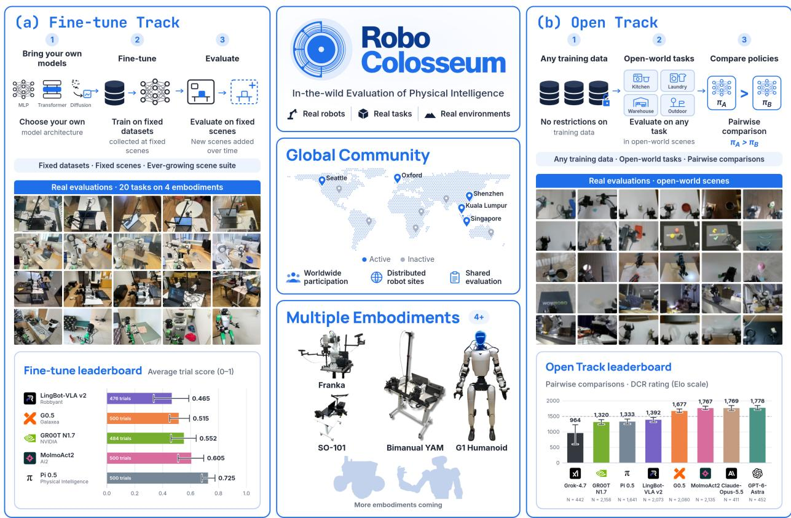

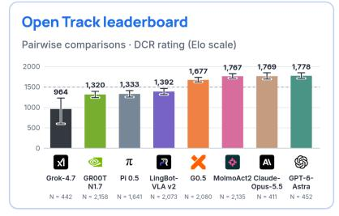  
Figure 1 RoboColosseum overview. RoboColosseum connects distributed evaluation sites through shared robot interfaces, policy-serving infrastructure, and two complementary evaluation tracks. In the Fine-tune Track, policies receive the same 100 demonstrations per task and are evaluated on predefined tasks using common success and progress criteria. In the Open Track, policies are evaluated without additional task-specific adaptation through blinded, pairwise comparisons under matched local conditions, while tasks and environments vary across comparisons. The results shown for both tracks are based on evaluations we conducted from 17 September to 28 October 2026. The project spans SO-101, Franka in the DROID configuration, Bimanual-YAM, and Unitree G1, with participation determined by track and model compatibility. The lower panels illustrate track-specific evaluation outputs and examples of physical evaluation settings. The global network depicts the broader project vision; the scope of completed experiments is reported separately.

Khazatsky et al., 2024). Although compelling demonstrations from leading robotics companies highlight the potential of these models (Dyna Robotics, 2026; Sunday Robotics, 2025; Skild AI Team, 2025; Generalist AI, 2026), establishing their reliability under real-world deployment conditions remains a fundamental challenge. In language and vision, large-scale benchmarks incorporating human preferences on real-world tasks have helped drive progress by providing a shared basis for assessing model capabilities relevant to end users (Zheng et al., 2023; Chiang et al., 2024a; Huang et al., 2024). Robot policies, by contrast, operate through closed-loop interactions with the physical world, where each action shapes the conditions for what follows. Evaluating them reliably is therefore dificult, especially at scale and in the varied, uncontrolled settings of the real world. Measuring progress requires understanding what robots can consistently accomplish across these conditions.

Such assessments are dificult to standardize because outcomes depend jointly on the policy, robot setup, initial conditions, and surrounding environment (Vincent et al., 2024). Even nominally identical tasks can difer in object placement, camera configuration, lighting, and physical properties, making it dificult to attribute performance diferences to policy capability. Physical evaluation must therefore reconcile two requirements: suficient control to support meaningful comparisons and suficient environmental diversity to assess robustness beyond a particular setup. Simulation supports scalable evaluation through repeatable resets and controlled variation in tasks and environments (James et al., 2020; Tao et al., 2025). However, diferences in sensing, calibration, dynamics, and visual appearance can limit how well simulated performance predicts real-world outcomes, making physical validation essential (Li et al., 2024; Pumacay et al., 2024; Kim et al., 2026). Achieving comparable scale with physical robots requires substantial labor for setup, resets, hardware maintenance, and trial execution. Consequently, real-world studies often rely on relatively few rollouts, leaving performance estimates sensitive to trial selection and experimental variability (Kress-Gazit et al., 2024; Vincent et al., 2024).

Distributing evaluation across sites broadens environmental coverage (Khazatsky et al., 2024; Atreya et al., 2025), but eforts that depend on students and volunteers are dificult to sustain and scale. Running physical trials requires continued stafing, equipment maintenance, and coordination across sites, often alongside competing research commitments. Sustained evaluation therefore requires dedicated operators and shared physical infrastructure, supported by protocols for repeating trials, matching local conditions, and verifying whether measured performance can be reproduced.

We introduce RoboColosseum, a distributed, multi-embodiment benchmark for evaluating general-purpose robot policies in the wild. It connects geographically distributed sites through unified evaluation and policyserving infrastructure, with standardized hardware configurations, task definitions, and evaluation protocols. The benchmark initially supports four embodiments Bimanual-YAM, SO-101, Franka, and Unitree G1 and evaluates eight foundation models: five vision-language-action (VLA) policies and three frontier LLMs.

Two complementary tracks assess adaptation and generalization. The Fine-tune Track measures performance on predefined semantic tasks after adaptation using a fixed budget of task-specific demonstrations. The Open Track evaluates zero-shot generalization across diverse real-world tasks and environments without taskspecific adaptation. Together, they enable systematic assessment of physical intelligence across heterogeneous embodiments. With a growing fleet of over 100 robots across the United States, United Kingdom, Singapore, Malaysia, and China, operated by full-time evaluators, RoboColosseum aims to make real-world evaluation scalable and sustainable. This shared infrastructure provides a lens into the capabilities and limitations of robot foundation models, enabling the research community to investigate fundamental scientific questions through systematic physical trials. To broaden access, we pledge 10,000 hours of free evaluation to academic labs and partners.

Our initial study includes 5,699 Open Track pairwise comparisons across 124 sites and Fine-tune Track evaluations on 20 tasks across four embodiments. Frontier AI agents achieve manipulation performance competitive with specialized VLA policies, while reliable task completion remains challenging as task dificulty increases. With the same 100-demonstration adaptation budget, policies exhibit strongly task- and embodimentdependent performance, with weak agreement in rankings across embodiments $( W = 0 . 2 4 )$ and substantial rank reversals between the Open and Fine-tune Tracks. Finally, leaderboard stability improves with evaluation scale, while active matchmaking reaches approximately 90% agreement with the full-data ranking after 400–500 evaluations, compared with roughly 1,000 under uniform sampling. These findings demonstrate the importance of evaluating physical intelligence across diverse tasks, embodiments, and environments, while showing that large-scale real-world evaluation can be made statistically reliable and sample-eficient.

## 2 Related Work

## 2.1 Simulated and Real-World Benchmarking

Real-world robot benchmarks aim to make physical policy evaluation more reproducible despite variation in hardware, calibration, object placement, and scene reset. These factors can substantially afect measured performance, motivating standardized hardware, task definitions, initial conditions, and success criteria (Kress-Gazit et al., 2024). Early benchmarks such as FurnitureBench improve comparability by prescribing a common robot platform, workspace, objects, and task protocols (Heo et al., 2025), while SceneReplica further studies reproducibility by reconstructing physical scenes using reference images and calibrated setups (Khargonkar et al., 2024). Remote testbeds such as TOTO and the Real Robot Challenge instead centralize physical hardware and allow researchers to submit policies for evaluation on a shared robot platform, reducing variation caused by independently constructed setups (Zhou et al., 2023; Bauer et al., 2022).

More recent benchmarks extend these ideas toward broader policy and embodiment coverage (Pumacay et al., 2024; Wang et al., 2025; Kim et al., 2026; Wang et al., 2026). RoboDojo (Chen et al., 2026) evaluates 18 real-world tasks across three bimanual robot platforms using standardized workspaces, reset procedures, and sub-step scoring, while VLA-REPLICA provides a low-cost SO-101 setup designed to be reconstructed at diferent locations (Chen et al., 2026; Huang et al., 2026). RoboColosseum builds on this line of work while targeting broader physical coverage across multiple embodiments and sites under shared evaluation protocols.

## 2.2 Generalist Robot Policies

Generalist robot policies seek to transfer learned skills across tasks, environments, and embodiments. RT-X models demonstrate that pooling demonstrations from diferent robots can improve performance through transfer across platforms (O’Neill et al., 2024). Octo provides a pretrained policy that can be adapted to new observation and action spaces (Team et al., 2024). Vision-language-action models such as OpenVLA combine pretrained vision-language representations with robot demonstrations to predict actions from visual observations and language instructions, while supporting fine-tuning on demonstrations from a target setting (Kim et al., 2024).

Recent models extend these capabilities through diverse training data and diferent approaches to action generation. π0.5 combines data from multiple robots with web data and semantic supervision to support manipulation in previously unseen homes (Black et al., 2025). GR00T combines vision-language processing with a dedicated action-generation module (Bjorck et al., 2025), while MolmoAct2 connects a backbone trained for embodied reasoning to a continuous-action expert (Fang et al., 2026). These models provide diferent approaches to combining semantic knowledge with physical control.

General-purpose language models can also guide robot behavior through skill selection or program generation. SayCan selects learned robot skills using both language-model predictions and estimates of execution success (Ahn et al., 2022), while Code as Policies generates programs that process perception outputs and call robot control APIs (Liang et al., 2022). RoboColosseum compares VLA policies and frontier AI agents across physical environments and embodiments without task-specific adaptation, and separately measures how VLA policies adapt using a common budget of task demonstrations.

## 2.3 Distributed Robotics Evaluation

Distributed evaluation provides an alternative to tightly centralized robot benchmarks by allowing policies to be tested across heterogeneous physical environments while aggregating results into a common comparison. RB2 is an early example, distributing manipulation evaluation across multiple laboratories while controlling task definitions and aggregating site-specific rankings rather than directly comparing raw scores across diferent physical setups (Dasari et al., 2021). More recently, RoboArena extends this idea to generalist robot policies through a decentralized evaluation network spanning seven academic institutions. Evaluators freely select tasks and environments, while each local comparison evaluates two anonymously assigned policies back-to-back under matched scene conditions. Across 612 pairwise comparisons, RoboArena showed that rankings derived from distributed evaluations correlate more strongly with an exhaustive oracle ranking than conventional fixed single-site evaluation (Atreya et al., 2025). However, RoboArena is instantiated on a single DROID/Franka embodiment, and its open-ended decentralized design makes controlled single-factor experiments dificult.

Pairwise comparison has also been widely used for arena-style evaluation. Chatbot Arena ranks anonymized models from human pairwise preferences using Bradley–Terry-based estimation (Chiang et al., 2024b), while active-ranking methods show that comparisons can be allocated toward more informative model pairs rather than sampled uniformly (Heckel et al., 2018). These ideas provide methodological precedent for RoboColosseum’s Open Track, where pairwise physical evaluations are aggregated into a global ranking and costly robot trials can be prioritized toward uncertain model pairs.

## 3 RoboColosseum Benchmark

We present RoboColosseum, a distributed real-world benchmarking framework for systematically evaluating the generalization and adaptation capabilities of general-purpose robot policies across heterogeneous embodiments. A central contribution is the design of the physical infrastructure and operational protocols required to sustain large-scale, distributed robot evaluation. As illustrated in Figure 1, the framework integrates geographically distributed robot evaluation sites, shared policy-serving infrastructure, and standardized evaluation protocols into a unified benchmarking system. RoboColosseum currently supports four robot embodiments and eight AI systems, comprising five vision-language-action (VLA) policies and three APIaccessible AI agents. The benchmark comprises two complementary tracks: an Open Track for evaluation without task-specific adaptation and a Fine-tune Track for evaluation following controlled task-specific adaptation. Together, these tracks assess out-of-the-box capabilities and the ability to acquire new manipulation skills from demonstrations.

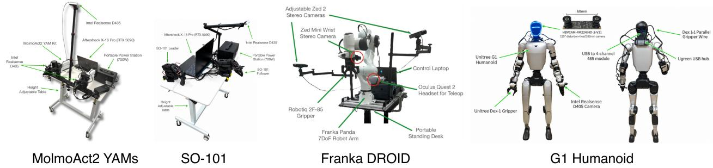  
Figure 2 Robot platforms and hardware configurations. From left to right: Bimanual-YAM, SO-101, Franka in the DROID configuration, and Unitree G1, shown from the front and rear. Annotations identify cameras, grippers, computing equipment, and supporting hardware. These platforms span bimanual manipulation, low-cost and research grade single-arm manipulation, and humanoid manipulation with locomotion. Observation and action specifications are standardized within each embodiment to support compatible policies across evaluation sites.

Table 1 Embodiments in RoboColosseum. Each embodiment has a fixed observation and action specification shared by all policies and sites. Open Track checkpoints are trained on the listed embodiment dataset; Fine-tune Track checkpoints use only the task demonstrations (Section 3.2.1). Action dimensions include one gripper dimension per arm: 5 arm joints for SO-101, 7 for the Franka, and 6 per arm for Bimanual-YAM.
<table><tr><td>Embodiment</td><td>Action space</td><td>Cameras</td><td>Dataset</td></tr><tr><td>SO-101</td><td>6-D joint position</td><td>1 external + 1 wrist</td><td>MolmoAct2-SO101 (Fang et al., 2026)</td></tr><tr><td>DROID (Franka)</td><td>8-D joint position</td><td>2 external + 1 wrist</td><td>DROID dataset (Khazatsky et al., 2024)</td></tr><tr><td>Bimanual-YAM</td><td>14-D joint position</td><td>1 top + 2 wrist</td><td>MolmoAct2-YAM (Fang et al., 2026)</td></tr></table>

## 3.1 Physical Infrastructure and Operational Protocols

RoboColosseum currently supports four robot embodiments spanning diverse costs, morphologies, and control complexities: a low-cost single arm, a bimanual system, a research-grade arm, and a walking humanoid (Table 1). Evaluating the same model families across these embodiments tests whether findings generalize across hardware platforms, a question single-embodiment benchmarks cannot address. To sustain reliable daily evaluation at scale, we establish standardized hardware configurations, setup procedures, and operational protocols across sites.

Embodiments and Compute. RoboColosseum supports SO-101, Bimanual YAM, Franka, and the G1 humanoid, with standardized hardware configurations adapted for deployment in unstructured environments. SO-101 uses a single external camera following common community configurations, while Bimanual YAM adopts the MolmoAct2 setup; both systems are mounted on mobile trolleys. The Franka platform follows the DROID (Khazatsky et al., 2024) configuration, and G1 is equipped with parallel grippers, all of which are shown in Figure 2 Policy inference runs either locally on a laptop equipped with an RTX 5090 GPU or remotely through a server-hosted endpoint in which both are operating by a remote routing server. We measure inference and communication latency to verify that both configurations support low-latency execution.

Sites and Operation Academic robot evaluation typically relies on controlled laboratory tasks and environments. RoboColosseum conducts all evaluations at real-world sites, including ofices, libraries, parks, dormitories, homes, food courts, and factories. Our evaluation network spans campuses and industry buildings in Singapore, homes in Malaysia, and factories in China, supporting the evaluation of diverse embodiments and deployment conditions. To sustain this efort, we hire up to 30 full-time robot operators execute evaluation protocols, reset task environments, and assess policy rollouts, with stafing expanding alongside evaluation demand. A dedicated data-processing pipeline applies face blurring and identity anonymization to evaluation recordings to protect participant privacy.

## 3.2 Benchmark Design

RoboColosseum is designed to support evaluation in diferent real-world settings while keeping model comparisons fair. We do not require every site to use the same environment, objects, or background. Instead, the benchmark uses two evaluation tracks with diferent controls. In the Fine-tune Track, models are evaluated on predefined tasks using a common adaptation and evaluation protocol. In the Open Track, models are tested on diverse tasks and environments, but the two models in each comparison are evaluated under the same local conditions.

For each track, we clearly define what is fixed and what can vary. In the Fine-tune Track, models receive the same task-specific demonstration data and are evaluated using the same task definition, success criteria, progress criteria, and evaluation procedure. The training method can difer across models because diferent policy architectures require diferent fine-tuning procedures. This follows the controlled benchmark design used in DataComp, where selected factors are fixed so that diferent submissions can be compared under the same evaluation setting (Gadre et al., 2023). In the Open Track, models cannot use task-specific adaptation, while the task and environment can vary across evaluations. Within each pairwise comparison, the robot, task instruction, objects, initial setup, and timeout are kept the same.

## 3.2.1 Fine-tune Track

The Fine-tune Track evaluates how eficiently pretrained policies adapt to new tasks through rapid finetuning on task-specific demonstrations. By holding the adaptation data and evaluation protocol fixed, this track compares models’ ability to learn from the same demonstrations under consistent conditions, enabling reproducible evaluation and fair comparison.

Tasks. For each embodiment, RoboColosseum maintains an extensible registry of manipulation tasks, of which five per embodiment, 20 in total, are included in the current evaluation (Section B). Each task is specified by a task card that defines the natural-language instruction, the objects, the initial setup, the success criteria, the timeout, the evaluation site, and a set of task-specific progress criteria. The tasks span pick-and-place, stacking (bowls, cubes, and cups), object reorientation (standing a fallen bottle upright), articulated objects (drawers, a laptop lid, and a microwave door), deformable objects (towels and clothing), liquid pouring, tool use (sweeping with a dustpan and brush), bimanual coordination tasks with the bimanual YAMs, and loco-manipulation with the G1 Humanoid.

Data Collection. For each task, we collect 100 high-quality teleoperated demonstrations using embodimentspecific interfaces: GELLO (Wu et al., 2024) for Bimanual-YAM, a leader–follower arm setup for SO-101 joint-space control, the DROID Quest teleoperation system for Franka DROID, and a Pico VR headset with an of-the-shelf whole-body controller for the G1 humanoid. Demonstrations are collected at the evaluation site using the same robot and environment to match deployment conditions. All policies are fine-tuned on the same demonstrations, which we publicly release.

Fine-tuning protocol. Each evaluated model is fully fine-tuned from its base pretrained checkpoint using the same 100 demonstrations, which constitute the only embodiment- and task-specific data used during adaptation. Each policy follows its oficial fine-tuning recipe until convergence, allowing optimization schedules and training durations to vary across architectures. We thus control the adaptation data and evaluation protocol while allowing model-specific training procedures. The full protocol, base checkpoints, and per-model hyperparameters are provided in Section A. This design complements DataComp (Gadre et al., 2023): we hold the data fixed and vary the training procedure, rather than the reverse.

Evaluation and metrics. After fine-tuning, each policy is evaluated for N = 25 trials per task using its original inference implementation. The task goal remains fixed, while object placements and environmental conditions may vary within the task specification. Each task is evaluated using K task-specific progress criteria. For each rollout $n ,$ let $s _ { n } \in \{ 0 , 1 , \ldots , K \}$ be the number of criteria satisfied; the rollout’s normalized progress is the fraction $s _ { n } / K$ , so each criterion is weighted equally. Criteria need not be satisfied in a fixed order. Success requires satisfying the task’s full success requirements. Evaluators may terminate rollouts that risk damage to the robot or scene objects; these rollouts receive $s _ { n } = 0$ and are counted as failures. For each policy–task pair, the reported progress score (PS) is the mean of this fraction across evaluation trials, and the success rate (SR) separately measures the fraction of trials satisfying the full success requirements:

$$
\mathrm { P S } = { \frac { 1 } { N } } \sum _ { n = 1 } ^ { N } { \frac { s _ { n } } { K } } , \qquad \mathrm { S R } = { \frac { 1 } { N } } \sum _ { n = 1 } ^ { N } { \bf 1 } [ \mathrm { r o l l o u t } n \mathrm { \ s u c c e e d s } ] .\tag{1}
$$

SR measures task completion, while PS captures how much of the task specification a policy satisfies, even when the task is not completed. Normalization by K places PS on a common scale across tasks with diferent numbers of criteria. Per-task results are reported in Table 2.

## 3.2.2 Open Track

The Open Track evaluates models without task-specific adaptation on in-the-wild manipulation tasks proposed by participating evaluation sites.

Evaluation protocol and active matchmaking. In the Open Track, an evaluator defines a feasible task using locally available objects and environments and provides a natural-language instruction. RoboColosseum assigns two eligible models, denoted A and B, whose identities remain hidden from the evaluator throughout evaluation. The models are executed consecutively on the same robot and task configuration. The evaluator records a pairwise preference (A wins, B wins, or a tie), task-progress scores, natural-language feedback, and a perceived task dificulty rating from 1 to 10.

We use active matchmaking to allocate evaluations across model pairs. After collecting initial pairwise comparisons to establish a preliminary ranking, we adopt the active sampling strategy of Chatbot Arena (Chiang et al., 2024b), prioritizing pairs with the largest estimated reduction in uncertainty:

$$
P _ { t } ( a ) \propto \sqrt { \frac { \hat { \Sigma } _ { t , a , a } } { n _ { a } } } - \sqrt { \frac { \hat { \Sigma } _ { t , a , a } } { n _ { a } + 1 } } ,\tag{2}
$$

where a denotes a candidate model pair, $n _ { a }$ is its prior comparison count, and $\scriptstyle \hat { \Sigma } _ { t , a , a }$ is its estimated variance at iteration t. This strategy concentrates evaluations on uncertain or sparsely evaluated pairs while limiting redundant comparisons.

Evaluation Metrics Open Track evaluations vary substantially in task dificulty, making a raw win rate or task-agnostic pairwise ranking potentially sensitive to which tasks a model happens to encounter. We therefore rank policies using a Dificulty-Calibrated Rasch (DCR) model that jointly estimates policy ability and task dificulty from physical success outcomes.

Let $p$ denote a policy and t an Open Track task. Each policy has a latent ability $\theta _ { p } ,$ and each task has a latent dificulty $\beta _ { t }$ . The probability that policy p succeeds on task t is modeled using a Rasch/1PL formulation (Rasch, 1960):

$$
q _ { p , t } = P ( y _ { p , t } = 1 \mid \theta _ { p } , \beta _ { t } ) = \sigma ( \theta _ { p } - \beta _ { t } ) ,\tag{3}
$$

where $y _ { p , t } \in \{ 0 , 1 \}$ denotes task success and $\sigma ( \cdot )$ is the logistic function. Higher $\theta _ { p }$ therefore indicates greater policy capability, while higher $\beta _ { t }$ indicates a more dificult task.

Each Open Track task is additionally assigned a human dificulty rating $d _ { t } \in \{ 1 , \ldots , 1 0 \}$ . Because most in-the-wild tasks receive only a small number of physical evaluations, we do not treat this rating as a fixed numerical weight. Rather, we use it as prior information over latent task dificulty, following prior work on incorporating judgmental dificulty estimates into item-response models (Yi, 2009).

Let $\mu _ { k }$ denote the typical latent dificulty of tasks assigned rating $k ,$ constrained such that

$$
\mu _ { 1 } < \mu _ { 2 } < \cdots < \mu _ { 1 0 } .\tag{4}
$$

For a task with $d _ { t } = k$ , we use

$$
\beta _ { t } \mid d _ { t } = k \sim \mathcal { N } ( \mu _ { k } , \tau ^ { 2 } ) .\tag{5}
$$

Physical outcomes can therefore move the inferred dificulty of an individual task away from its human-rated category mean.

For each matched A/B evaluation, both policies are executed on the same task and their individual success outcomes are retained. Consequently, the model distinguishes cases in which both policies succeed from cases in which both fail: the former provides evidence that the task is easier, while the latter provides evidence that it is harder. Policy abilities, task dificulties, and the human-dificulty calibration parameters are inferred jointly from all Open Track evaluations.

We rank policies by posterior mean ability,

$$
\begin{array} { r } { s _ { p } = \mathbb { E } [ \theta _ { p } \mid \mathcal { D } ] , } \end{array}\tag{6}
$$

where D denotes the collected Open Track evaluations. For easier interpretation on the public leaderboard, we report the same learned ability on an Elo-style scale:

$$
R _ { p } = 1 5 0 0 + { \frac { 4 0 0 } { \ln 1 0 } } s _ { p } .\tag{7}
$$

This transformation is linear and therefore does not change the model ordering, uncertainty, or dificulty-aware estimation. We refer to $R _ { p }$ as the DCR Rating (Elo scale); it should not be interpreted as an Elo rating obtained through sequential Elo updates.

For ranking robustness analysis, we additionally compare DCR against the Bradley–Terry–Davidson (BTD) model (Bradley and Terry, 1952; Davidson, 1970), which aggregates pairwise win/loss/tie outcomes without explicitly modeling task dificulty.

## 4 Experiments

We conducted in-the-wild evaluations with RoboColosseum over a duration of 41 days, from 17 September 2026 to 28 October 2026. We evaluated eight models across the Fine-Tune and Open Tracks: five visionlanguage-action (VLA) models and three frontier models. Using these results, we investigate the following research questions:

• RQ1: Open-world capabilities. What capabilities and failure modes do general-purpose robot models exhibit across diverse real-world tasks and environments?

• RQ2: Task adaptation. How efectively do pretrained robot policies adapt to unseen manipulation tasks given a fixed budget of task-specific demonstrations?

• RQ3: Performance consistency. How consistent are model rankings across evaluation tracks and robot embodiments?

• RQ4: Evaluation reliability and efficiency. How reliably can distributed pairwise evaluations estimate model rankings, and how much can active matchmaking reduce the number of physical trials required?

• RQ5: Effect of evaluation scale. How does the number of physical evaluations afect ranking uncertainty and the stability of the Open Track leaderboard?

## 4.1 Experimental Setup

Models and protocols. We evaluate five VLA models—GR00T N1.7 (NVIDIA et al., 2025), $\pi _ { 0 . 5 }$ (Black et al., 2025), MolmoAct2 (Fang et al., 2026), G0.5 (Liu et al., 2026), and LingBot-VLA v2 (Wu et al., 2026)—and three API-accessible frontier models: GPT-6 Astra, Claude Opus 5.5, and Grok 4.7. The Fine-tune Track evaluates VLA models initialized from base pretrained checkpoints on 20 tasks across four embodiments, with five tasks per embodiment, 100 demonstrations per task, and 25 evaluation trials per model–task pair. The Open Track comprises 5,699 pairwise comparisons across 5,699 tasks, 124 sites, and four embodiments, following Section 3. VLA models use embodiment-specific checkpoints in this track; frontier-model agents participate exclusively in this track through the interface in Section 3.1.

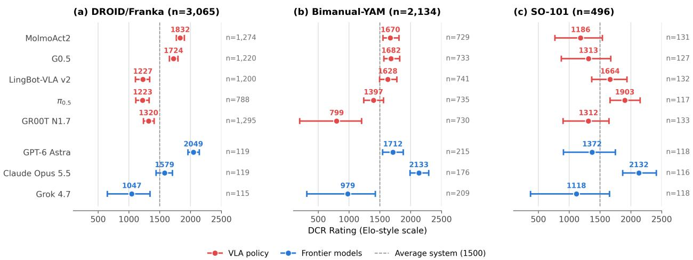  
Figure 3 Open Track DCR ratings across embodiments. Points show posterior mean DCR ratings on an Elo-style scale, with 95% credible intervals; n is the number of evaluations involving each system.

Metrics and statistical analysis. For the Fine-tune Track, we report success rate (SR) and normalized progress score (PS), and assess fine-tuning diferences through paired comparisons with multiple-comparison correction. For the Open Track, DCR serves as the primary leaderboard metric, with Bradley–Terry–Davidson (BTD), sequential Elo, and average pairwise score as ranking baselines. For category-level analysis, we fit a separate progress-based BTD model within each manipulation category: higher normalized task progress determines the winner, and equal progress yields a tie. We report each system’s expected comparison score, defined as its probability of winning plus half its probability of tying against a hypothetical system of average ability; 50% thus indicates average relative performance within that category. We report uncertainty for success rates and model ratings, quantify ranking consistency using Spearman’s correlation and pairwise ordering agreement, and assess ranking stability through repeated subsampling at increasing evaluation budgets.

## 4.2 Open-World Capabilities (RQ1)

Frontier agents achieve competitive manipulation performance, but performance varies across agents and embodiments. Success-based DCR rankings show that frontier AI models can achieve competitive manipulation performance compared with specialized VLA policies, although their relative strengths difer across robot embodiments. In Figure 3, GPT-6 Astra achieves the highest DCR point estimate on DROID/Franka, whereas Claude Opus 5.5 leads on SO-101 and Bimanual-YAM. This competitiveness is also reflected in normalized task progress. Across 901 paired evaluations, agents achieve greater progress in 394 comparisons, VLAs in 265, and the remaining 242 are tied, yielding an average agent advantage of 5.3 percentage points (Figure 4). However, this advantage is not consistent across agents: Claude Opus 5.5 and GPT-6 Astra achieve mean advantages of 12.1 and 11.0 percentage points, respectively, whereas Grok 4.7 trails its VLA counterparts by 7.5 points. Together, these findings show that frontier agents can match or outperform specialized VLA policies in physical manipulation, but their relative performance depends on the agent and robot embodiment.

Strong relative performance does not necessarily translate into reliable task completion. To examine manipulation capabilities beyond aggregate model rankings, we group Open Track tasks into six categories: Pick/Place, Stack/Arrange, Open/Close, Reorient, Deformable, and Tool/Interaction, using a fixed languagemodel classifier following RoboArena (Atreya et al., 2025) (details in Appendix D.2). Figure 5(a) shows the estimated BTD comparison scores for each manipulation category, while (b)–(c) report mean normalized task progress and full-task success rates. MolmoAct2 achieves the highest BTD point estimate among the five VLA policies in all six categories, with expected comparison scores ranging from 58% to 77%. Despite this relative advantage, its observed task success rates range from only 6% to 13%, and no evaluated system exceeds 13% success in any category. Although absolute success rates also depend on the tasks and embodiments evaluated for each system, the consistently low success rates across all six categories suggest that current policies’ limitations extend beyond individual manipulation skills, with even the strongest evaluated systems struggling to reliably complete diverse open-world tasks.

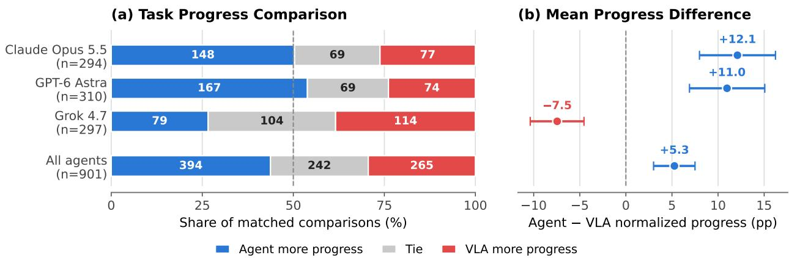  
Figure 4 Task progress of frontier AI models versus VLA policies. Comparison of normalized task progress across 901 Open Track evaluations, each involving a frontier AI model and a VLA policy on the same task. (a) Percentage of comparisons in which the agent makes more progress, the VLA makes more progress, or both make equal progress. Numbers inside the bars show comparison counts. (b) Mean diference in task progress (agent minus VLA, in percentage points), with 95% bootstrap confidence intervals. Positive values favor the agent.

Policies struggle to make meaningful progress on the most difficult manipulation tasks. We examine how physical execution performance varies across human-rated task dificulty levels (Figure 6). Full-task success decreases sharply with dificulty, from 30.7% on tasks rated 1–4 to just 0.4% on tasks rated 9–10. This decline extends beyond task completion: mean normalized progress also falls from 56.6% to 3.5% across the same dificulty ranges, indicating that policies satisfy substantially fewer intermediate progress criteria on more challenging tasks. Although these trends are observational and may partly reflect diferences in task and embodiment composition, they reveal that current policies struggle not only to complete dificult tasks, but also to make meaningful progress toward their goals. On the most challenging tasks, failures appear to arise well before the final success condition, suggesting that current policies lack the capabilities needed to execute even substantial portions of complex manipulation tasks.

Takeaway. Frontier AI agents achieve manipulation performance competitive with specialized VLA policies, although their relative strengths vary across agents and robot embodiments. However, reliable open-world manipulation remains a challenge for both types of systems: even the strongest policies achieve low task completion rates across manipulation categories, and their ability to make meaningful progress declines sharply on more dificult tasks. These findings highlight a fundamental limitation of current robot policies: while they demonstrate promising manipulation capabilities, they struggle to sustain successful execution as task complexity increases.

## 4.3 Task Adaptation Finetune(RQ2)

Post-fine-tuning performance differentiates policies which are broadly adaptable, from those that are task-adaptable. Table 2 shows that performance after adaptation with the same 100 demonstrations varies substantially across tasks, even within a single embodiment. On DROID/Franka, LingBot-VLA v2 achieves

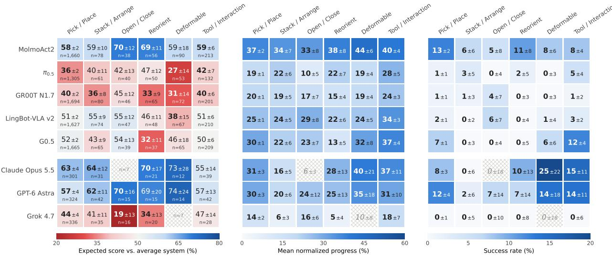

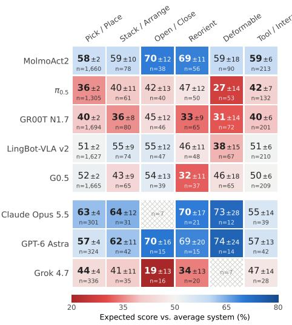

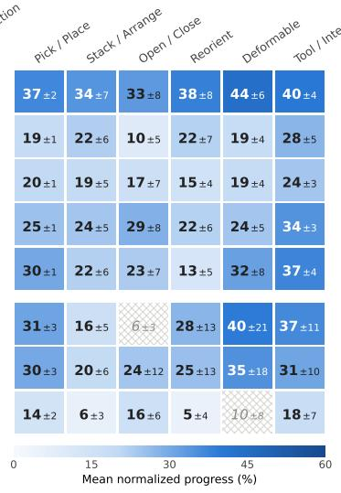

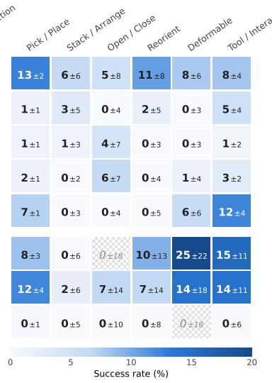  
Figure 5 Open Track performance by manipulation category. (a) Relative performance: category-specific, progress-based BTD expected comparison scores, i.e., the probability of winning plus half the probability of tying against a system of average ability, where a comparison is won by the system with higher normalized progress and 50% indicates average relative performance; bold values have 95% intervals that exclude 50%. (b) Mean normalized task progress and (c) success rate of each system’s own executions, both in percent. Values are followed by ± half the width of the 95% interval (bootstrap for (a) and (b), Wilson for (c)). n, shown in (a), is the number of evaluations involving each system and is the same in all three panels. Hatched cells have insuficient support (n < 10 or no evaluations) Relative scores in (a) compare systems under matched conditions, whereas the absolute values in (b) and (c) also reflect diferences in the embodiments and tasks on which each system was evaluated.

100% success on open\_drawer but $0 \%$ on marker\_in\_holder, whereas MolmoAct2 exhibits the opposite pattern, achieving 0% and 88%, respectively. In contrast, some policies achieve consistently high success across multiple tasks. On Bimanual-YAM, $\pi _ { 0 . 5 }$ achieves 96–100% success on four of the five tasks and 72% on stack\_cups, demonstrating consistently strong performance across the tested suite. By comparison, G0.5 achieves 100% success on both drawer and microwave but only 20% on stack\_cups. These results show that successful adaptation to individual tasks does not necessarily imply broad adaptability: under the same demonstration budget, some policies adapt efectively across diverse tasks, while others achieve strong performance only on selected tasks.

Policies differ in the extent of partial task completion. Figure 7 reports the percentage of trials satisfying at least a given fraction of task criteria, averaged equally across the five tasks of each embodiment. On DROID/Franka, G0.5 satisfies at least one-quarter of the criteria in nearly all trials, but reaches three-quarters in only about 20%, with 16% full-task success. In contrast, $\pi _ { 0 . 5 }$ maintains high criterion coverage across all thresholds, achieving 84% full-task success. On Bimanual-YAM, MolmoAct2 satisfies at least one-quarter of the criteria in nearly all trials but completes only about half, whereas $\pi _ { 0 . 5 }$ achieves 93.6% success. The limitations are more pronounced on Unitree G1, where no policy successfully completes any task, and fewer than 40% of trials satisfy even one-quarter of the criteria. These results show that incomplete executions can reflect diferent levels of task progress: some policies frequently satisfy intermediate requirements without completing the task, while others struggle to satisfy even a modest fraction of the evaluated criteria. Per-task curves for all 20 Fine-tune Track tasks are provided in Section C.

Task failures reveal both shared and policy-specific limitations. To better understand where policies struggle during task execution, Figure 8 groups unsuccessful trials by the earliest unmet criterion in two representative manipulation tasks. On SO-101 cube\_drawer, the initial grasp-and-lift criterion is unmet in 12–48% of trials across policies, revealing a common dificulty whose frequency varies across models. On DROID/Franka close\_laptop, policies exhibit more distinct failure patterns. G0.5 satisfies the initial contact-and-lowering

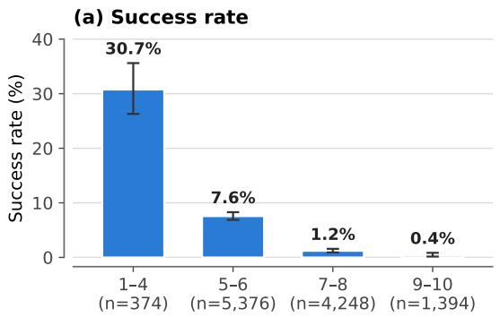

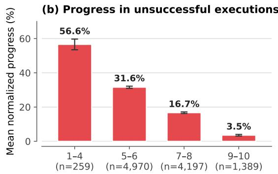  
Human-rated task difficulty

Figure 6 Physical task performance across human-rated task difficulty. Open Track policy executions grouped by the human-rated dificulty of the task, with each pairwise evaluation contributing one execution per compared system. (a) Success rate, with 95% Wilson confidence intervals. (b) Mean normalized progress among unsuccessful executions, with 95% bootstrap confidence intervals. n is the number of executions in each dificulty range.

(a) SO-101  
(b) DROID/Franka  
(c) Bimanual-YAMt  
(d) Unitree G1  
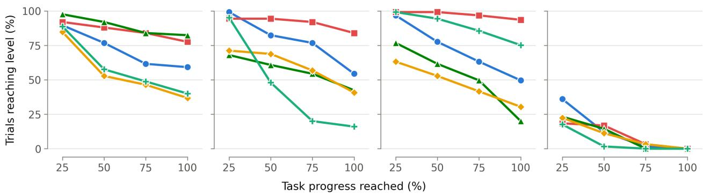  
Figure 7 Task progress reachability. Percentage of trials satisfying at least a given fraction of task criteria, averaged over the five tasks of each embodiment with equal weight. The 100% point is the full success rate. †LingBot-VLA v2 on FT-YAM-02 was stopped after n=1 trial, and GR00T N1.7 on FT-YAM-03 was stopped after $n { = } 9$ trials, for safety.

criterion in all 25 trials but fails to reach halfway closure in 24. In contrast, MolmoAct2 nearly closes the lid in 24 of 25 trials, yet completes the task in only seven. Similarly, $\pi _ { 0 . 5 }$ reaches near closure in all 25 trials but successfully completes 17. These results show that policies can struggle with diferent requirements even on the same task, ranging from advancing beyond initial contact to satisfying the final completion condition. Even when fine-tuned on identical demonstrations, policies exhibit both shared dificulties and distinct execution limitations, suggesting that improving task completion may require addressing diferent weaknesses across models.

Takeaway. Pretrained robot policies exhibit varying degrees of adaptability across manipulation tasks. While some can be successfully fine-tuned across diverse tasks, others achieve strong performance only on selected tasks, despite receiving the same demonstration budget for each task. Beyond task success, policies also difer in how much partial progress they achieve and which task requirements they struggle to satisfy, revealing both shared and policy-specific execution limitations. Together, these findings suggest that current policies exhibit uneven adaptability, with diferences not only in the breadth of tasks they can learn but also in the manipulation capabilities they acquire through fine-tuning.

Table 2 Per-task results on the Fine-tune track. Cells report normalized progress score (PS, %) and full-success rate (SR, %) as mean ± standard error (SE), using 25 trial slots per policy and task. Unexecuted trials following a safety stop are scored zero. Embodiment averages weight the five tasks equally. Best and second-best means for each metric are marked in bold and underline; ties share ranks at the displayed precision. †Evaluation stopped for safety reasons: LingBot-VLA v2 on YAM drawer after 1 trial, and GR00T N1.7 on YAM microwave after 9 trials.
<table><tr><td rowspan="3">Task</td><td colspan="2">GR00T N1.7</td><td colspan="2">π0.5</td><td colspan="2">MolmoAct2</td><td colspan="2">G0.5</td><td colspan="2">LingBot-VLA v2</td></tr><tr><td>PS</td><td>SR</td><td>PS</td><td>SR</td><td>PS</td><td>SR</td><td>PS</td><td>SR</td><td>PS</td><td>SR</td></tr><tr><td colspan="10">SO-101</td></tr><tr><td>stack bowls</td><td>97.0±3.0 96.0±3.9</td><td></td><td>94.0 ± 4.2</td><td>92.0± 5.4</td><td>88.0 ±5.6</td><td>84.0 ± 7.3</td><td>51.0 ± 8.0</td><td>36.0 ± 9.6</td><td>62.0 ± 7.4</td><td>40.0± 9.8</td></tr><tr><td>remove screwdriver</td><td>90.0 ± 4.1</td><td>80.0 ± 8.0</td><td>93.0 ± 3.4</td><td>84.0 ±7.3</td><td>69.0 ± 5.5</td><td>40.0 ± 9.8</td><td>72.0 ± 6.7</td><td>52.0 ± 10.0</td><td>67.0 ± 7.2</td><td>52.0 ± 10.0</td></tr><tr><td>upright_bottle</td><td>98.0 ± 2.0</td><td>96.0±3.9</td><td>86.0 ± 6.1</td><td>80.0±8.0</td><td>84.0 ± 6.8</td><td>80.0± 8.0</td><td>66.0 ± 6.6</td><td>36.0 ± 9.6</td><td>84.0 ± 5.4</td><td>64.0 ± 9.6</td></tr><tr><td>stack cubes</td><td>81.0 ± 6.2 79.0±7.3</td><td>68.0 ± 9.3</td><td>90.0±5.6</td><td>84.0±7.3</td><td>69.0 ± 7.0</td><td>52.0 ± 10.0</td><td>42.0 ± 5.7</td><td>16.0 ± 7.3</td><td>20.0 ± 2.0</td><td>0.0 ± 0.0</td></tr><tr><td>cube_drawer</td><td></td><td>72.0±9.0</td><td>64.0 ± 8.7</td><td>48.0± 10.0</td><td>49.0 ± 9.4</td><td>40.0 ± 9.8</td><td>63.0 ± 9.7</td><td>60.0 ± 9.8</td><td>43.0 ± 9.0</td><td>28.0 ± 9.0</td></tr><tr><td>Average</td><td>89.0±2.2</td><td>82.4±3.2</td><td>85.4±2.6</td><td>77.6±3.5</td><td>71.8 ± 3.1</td><td>59.2 ± 4.0</td><td>58.8±3.3</td><td>40.0 ± 4.2</td><td>55.2 ± 3.0</td><td>36.8±3.8</td></tr><tr><td colspan="9">DROID Franka</td><td></td><td></td></tr><tr><td>close_laptop</td><td>13.0 ± 6.1</td><td>4.0 ± 3.9</td><td>92.0±2.4</td><td>68.0±9.3</td><td>80.0±3.2</td><td>28.0±9.0</td><td>26.0 ± 1.0</td><td>0.0 ± 0.0</td><td>51.0 ± 7.7</td><td>20.0 ± 8.0</td></tr><tr><td>mug_on_coaster</td><td>35.0 ± 7.4</td><td>12.0 ± 6.5</td><td>100.0±0.0</td><td>100.0±0.0</td><td>86.0± 4.3</td><td>56.0 ± 9.9</td><td>35.0 ± 3.8</td><td>0.0 ± 0.0</td><td>66.0 ± 7.6</td><td>48.0 ± 10.0</td></tr><tr><td>open_ drawer</td><td>71.0 ± 8.4</td><td>64.0 ± 9.6</td><td>80.0±8.2</td><td>80.0±8.0</td><td>30.0 ± 2.0</td><td>0.0 ± 0.0</td><td>24.0 ± 1.0</td><td>0.0 ± 0.0</td><td>100.0±0.0</td><td>100.0±0.0</td></tr><tr><td>marker_in_holder</td><td>87.0±5.2</td><td>76.0±8.5</td><td>85.0 ± 6.1</td><td>76.0±8.5</td><td>95.0 ± 2.9</td><td>88.0 ±6.5</td><td>45.0 ± 2.9</td><td>0.0 ± 0.0</td><td>0.0 ± 0.0</td><td>0.0 ± 0.0</td></tr><tr><td>towel_in_basket</td><td>76.0 ±7.3</td><td>56.0 ± 9.9</td><td>99.0±1.0</td><td>96.0±3.9</td><td>100.0 ± 0.0 100.0 ± 0.0</td><td></td><td>94.0 ± 2.6</td><td>80.0 ±8.0</td><td>80.0 ± 3.5</td><td>36.0 ± 9.6</td></tr><tr><td>Average</td><td>56.4 ± 3.1</td><td>42.4 ± 3.6</td><td>91.2 ± 2.1</td><td>84.0±3.1</td><td>78.2±1.3</td><td>54.4± 3.0</td><td>44.8 ± 1.1</td><td>16.0 ± 1.6</td><td>59.4 ± 2.3</td><td>40.8 ± 3.2</td></tr><tr><td colspan="9">YAMs</td><td></td><td></td></tr><tr><td>dustpan</td><td>84.0 ± 5.8</td><td>72.0 ± 9.0</td><td>100.0 ± 0.0 100.0 ± 0.0</td><td></td><td>94.7 ± 3.7</td><td>92.0± 5.4</td><td>94.7 ± 2.5</td><td>84.0 ± 7.3</td><td>70.7 ± 5.9</td><td></td></tr><tr><td>drawer</td><td>68.0 ± 4.0</td><td>4.0 ±3.9</td><td>99.0±1.0</td><td>96.0±3.9</td><td>90.0 ± 2.9</td><td>64.0 ± 9.6</td><td>100.0±0.0</td><td>100.0±0.0</td><td>0.0 ± 0.0†</td><td>44.0 ± 9.9 0.0 ± 0.0†</td></tr><tr><td>microwave</td><td>0.0 ± 0.0†</td><td>0.0 ± 0.0†</td><td>100.0±0.0</td><td>100.0± 0.0</td><td>90.7 ± 5.3</td><td>88.0 ± 6.5</td><td>100.0±0.0</td><td>100.0±0.0</td><td>96.0 ± 4.0</td><td>96.0± 3.9</td></tr><tr><td>stack_cups</td><td>44.0± 5.3</td><td>0.0 ± 0.0</td><td>87.0±5.0</td><td>72.0±9.0</td><td>27.0 ± 3.2</td><td>0.0± 0.0</td><td>58.0±5.9</td><td>20.0±8.0</td><td>5.0 ± 2.0</td><td>0.0 ± 0.0</td></tr><tr><td>clean_table</td><td>67.0 ± 5.1</td><td>24.0 ± 8.5</td><td>100.0±0.0</td><td>100.0±0.0</td><td>58.0 ± 3.5</td><td>4.0 ±3.9</td><td>93.0 ± 2.3</td><td>72.0±9.0</td><td>70.0 ± 3.2</td><td>12.0 ± 6.5</td></tr><tr><td>Average</td><td>52.6 ± 2.0</td><td>20.0 ± 2.6</td><td>97.2±1.0</td><td>93.6±2.0</td><td>72.1 ± 1.7</td><td>49.6 ± 2.7</td><td>89.1 ± 1.4</td><td>75.2± 2.8</td><td>48.3 ± 1.6</td><td>30.4 ± 2.5</td></tr><tr><td colspan="9">G1 Humanoid</td><td></td><td></td></tr><tr><td>plate_into_rack</td><td>33.6±3.2</td><td>0.0 ± 0.0</td><td>1.6 ± 1.1</td><td>0.0± 0.0</td><td>27.2 ± 3.0</td><td>0.0± 0.0</td><td>21.6 ± 1.1</td><td>0.0 ± 0.0</td><td>28.0 ± 2.8</td><td></td></tr><tr><td>carry_box</td><td>11.4 ± 2.3</td><td>0.0 ± 0.0</td><td>8.6±3.3</td><td>0.0± 0.0</td><td>26.3±1.1</td><td>0.0± 0.0</td><td>21.7 ± 2.4</td><td>0.0 ± 0.0</td><td>16.0 ± 0.9</td><td>0.0±0.0 0.0 ± 0.0</td></tr><tr><td>fold_towel</td><td>16.8 ± 1.5</td><td>0.0 ± 0.0</td><td>24.8±2.9</td><td>0.0± 0.0</td><td>2.4±1.3</td><td>0.0± 0.0</td><td>3.2±1.5</td><td>0.0 ± 0.0</td><td>22.4± 1.3</td><td>0.0±0.0</td></tr><tr><td>load_clothes_washing_machine</td><td>29.6±5.0</td><td>0.0 ± 0.0</td><td>44.0 ± 6.0</td><td>0.0 ± 0.0</td><td>43.2 ± 4.6</td><td>0.0± 0.0</td><td>0.0 ± 0.0</td><td>0.0± 0.0</td><td>36.8 ± 6.3</td><td>0.0 ± 0.0</td></tr><tr><td>hang_keys</td><td>22.0±2.5</td><td>0.0 ± 0.0</td><td>2.7±1.2</td><td>0.0± 0.0</td><td>0.0 ± 0.0</td><td>0.0± 0.0</td><td>20.0 ± 2.9</td><td>0.0± 0.0</td><td>12.7 ± 1.5</td><td>0.0 ± 0.0</td></tr><tr><td>Average</td><td>22.7 ± 1.4</td><td>0.0 ± 0.0</td><td>16.3 ± 1.5</td><td>0.0 ± 0.0</td><td>19.8 ± 1.1</td><td>0.0±0.0</td><td>13.3 ± 0.8</td><td>0.0 ± 0.0</td><td>23.2±1.4</td><td>0.0 ± 0.0</td></tr></table>

## 4.4 Performance Consistency (RQ3)

Strong open-world performance does not consistently predict post-fine-tuning performance. Figure 9 compares the relative rankings of five VLA policies between the Open Track and Fine-tune Track. The rankings show limited agreement across all three shared embodiments, with Spearman’s ρ = −0.20 on SO-101, −0.40 on DROID/Franka, and 0.20 on Bimanual-YAM. Only 4, 3, and 6 of the 10 model pairs, respectively, preserve their relative ordering between tracks. For example, π ranks fifth among VLA policies on DROID/Franka in the Open Track but first after fine-tuning, and similarly moves from fourth to first on Bimanual-YAM. Conversely, G0.5 ranks second on DROID/Franka in the Open Track but fifth after fine-tuning. These comparisons involve only five policies, and the tracks difer in task distributions, starting checkpoints, and ranking metrics, so the disagreement cannot be attributed solely to diferences in generalization and adaptation capabilities. Nevertheless, the observed rank reversals show that a policy’s relative strength in open-world execution does not necessarily carry over to its performance after task-specific adaptation.

Relative policy strengths vary across robot embodiments and task settings. Figures 3 and 10a show that policy rankings vary across robot embodiments in both evaluation tracks. In the Open Track, the relative ordering of VLA policies changes across SO-101, DROID/Franka, and Bimanual-YAM, with diferent policies achieving the highest DCR ratings on each embodiment. Similar diferences emerge in the Fine-tune Track, where Kendall’s coeficient of concordance (W = 0.24) indicates limited agreement in policy rankings across the four embodiment-specific task suites. For example, π0.5 ranks first on both DROID/Franka and Bimanual-YAM but fourth on Unitree G1, whereas GR00T N1.7 leads on SO-101 but ranks fourth on DROID/Franka and Bimanual-YAM. Because each embodiment involves diferent tasks and environments, these diferences cannot be attributed to robot morphology alone. Together, these findings show that relative policy strengths do not consistently carry across robot-task settings, whether evaluated without task-specific adaptation or after fine-tuning.

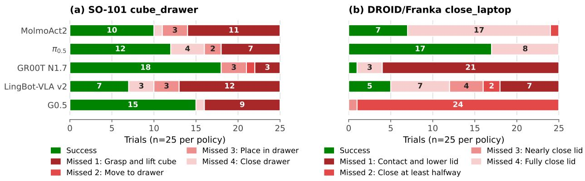  
Figure 8 Policy-specific failure stages after fine-tuning. We show two tasks whose progress criteria form an ordered sequence: SO-101 cube\_drawer and DROID/Franka close\_laptop. Each bar divides a policy’s 25 evaluation trials into full-task successes (green) and failures, shaded by the first criterion the trial did not meet (darker red indicates an earlier failure). Numbers give trial counts; segments of a single trial are unlabeled. Policies trained on the same demonstrations exhibit markedly diferent failure locations, revealing task- and policy-specific execution bottlenecks that are hidden by success rate alone.

Takeaway. Relative policy strengths vary across both evaluation tracks and robot-task settings. Policies that perform well without task-specific adaptation do not necessarily achieve similarly strong results after fine-tuning, and those that lead on one embodiment may perform less competitively on others. Together, these findings show that current general-purpose robot policies exhibit limited consistency in their relative performance across diferent evaluation conditions, with no single policy maintaining a clear advantage across all settings.

## 4.5 Ranking Reliability and Efficiency (RQ4)

Distributed pairwise evaluations produce broadly consistent rankings across independent site subsets. Figure 10b tests whether independent subsets of the distributed evaluation network produce the same DCR ranking. For each embodiment, we repeatedly partition the set of evaluation sites at random into two approximately equal, non-overlapping groups, assigning all evaluations from the same site to the same group, then fit DCR independently on each subset, and measure the fraction of model pairs whose relative ordering is preserved. DROID/Franka and Bimanual-YAM achieve mean pairwise ranking agreement of approximately 85%, with mean Spearman correlations of ρ = 0.82, indicating that substantially diferent subsets of sites recover similar model orderings. In contrast, SO-101 achieves only 59% agreement and ρ = 0.30, showing that its ranking is considerably more sensitive to which evaluation sites are included. These results indicate that distributed pairwise evaluation can produce reproducible rankings when suficient evidence is available, but reliability is not uniform across embodiments.

Active matchmaking recovers stable rankings with substantially fewer physical evaluations. Figure 11a compares uncertainty-driven active matchmaking with uniform sampling using the same DCR ranking estimator. Active matchmaking reaches approximately 90% agreement with the full-data ranking after only 400–500 evaluations, whereas uniform sampling requires roughly 1,000 evaluations to achieve comparable agreement. The advantage is largest at limited evaluation budgets and diminishes as both strategies approach the full-data ranking, showing that active matchmaking improves sample eficiency without changing the underlying ranking objective.

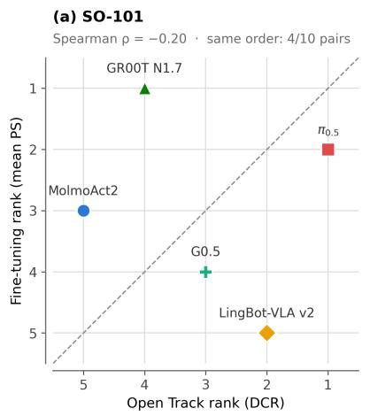

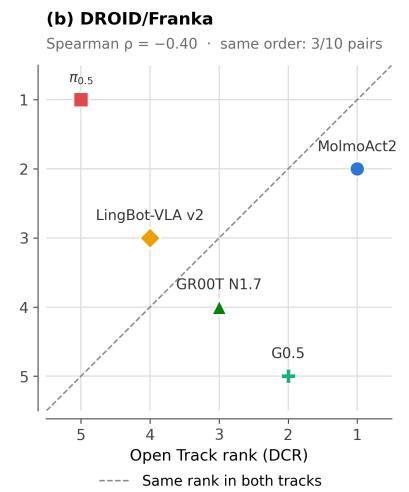

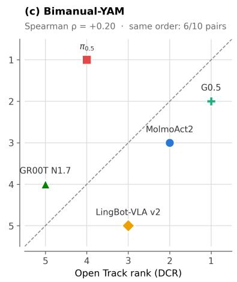  
Figure 9 Cross-track ranking consistency by embodiment. Open Track and Fine-tune Track rankings of the five VLA policies on (a) SO-101, (b) DROID/Franka, and (c) Bimanual-YAM. For each embodiment, the Open Track rank is computed from the DCR rating, while the Fine-tuning rank is computed from the mean progress score (PS) across its five tasks. Rank 1 denotes the best-performing model, and the dashed diagonal indicates identical rankings across the two tracks. Each panel reports Spearman’s rank correlation and the number of model pairs with the same relative ordering in both tracks.

Takeaway. Distributed pairwise evaluation can recover reproducible model rankings across independent subsets of evaluation sites, although reliability depends on the amount and distribution of evidence available for each embodiment. Active matchmaking further improves eficiency by directing physical trials toward the comparisons that are most informative for resolving the leaderboard.

## 4.6 Effect of scaling evaluation (RQ5)

Leaderboard stability improves steadily with evaluation scale, but high-confidence stability requires substantially more data. Figure 11b measures how closely DCR rankings estimated from random subsets of the Open Track data match the ranking obtained from the full dataset. As the number of physical A/B comparisons increases, the mean agreement in model-pair ordering rises steadily, reaching 90% at approximately 1,123 evaluations and 95% at approximately 4,755 evaluations. However, the 2.5th–97.5th percentile range remains substantially wider than the mean trend, showing that diferent subsets of the same size can still produce noticeably diferent rankings. Thus, relatively few evaluations are suficient to recover most of the final ordering on average, while substantially more evaluations are required for the leaderboard to become consistently stable across diferent subsets of the data.

Takeaway. More physical evaluations improve both ranking stability and confidence in the Open Track leaderboard. The average model ordering emerges relatively early, but establishing a ranking that is robust to which evaluations are included requires a much larger evaluation budget.

## 5 Limitations & Conclusion

Conclusion. RoboColosseum provides a distributed framework for measuring physical intelligence across real robots, tasks, environments, and evaluation settings. Our results show that no single evaluation captures model capability completely: frontier AI agents can be competitive with specialized VLA policies without task-specific adaptation, fine-tuned policies exhibit strongly task- and embodiment-dependent strengths, and relative model rankings can change across both evaluation tracks and robot platforms. Progress-based evaluation further reveals meaningful behavioral diferences that binary task success alone can hide.

Fine-tuning rank by embodiment (Kendall's W = 0.24)

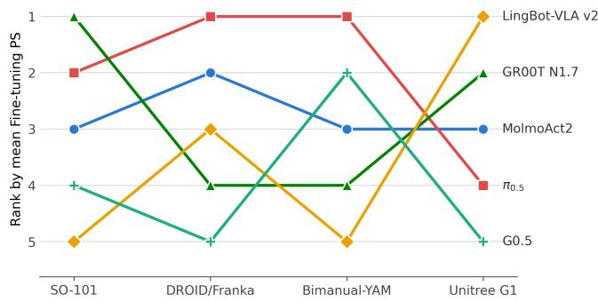  
Consistency of DCR rankings across scene subsets

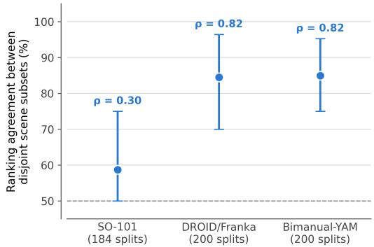  
(a) Cross-embodiment ranking consistency  
(b) Consistency of DCR rankings across subsets  
Figure 10 Ranking consistency. a. Cross-embodiment ranking consistency based on Fine-tune Track progress score (PS) across SO-101, DROID, Bimanual-YAM, and Unitree G1. Rank 1 denotes the best-performing model on an embodiment. The substantial changes in model ordering across embodiments, together with Kendall’s coeficient of concordance $W = 0 . 2 4$ , indicate weak agreement between embodiment-specific rankings. b. Consistency of DCR rankings across independent evaluation-site subsets. For each embodiment, evaluation sites are repeatedly divided into two disjoint subsets, and DCR is fit independently on each half. Points show the mean fraction of model pairs whose relative ordering agrees between the two rankings, and error bars show the 2.5th–97.5th percentile across valid random splits. The annotated $\rho$ is the mean Spearman rank correlation between the two rankings. Higher values indicate that the leaderboard is less sensitive to which subset of evaluation sites contributes the data.

At the same time, large-scale pairwise evaluation makes these comparisons increasingly reproducible, while active matchmaking can concentrate costly physical trials on the comparisons that are most informative for resolving the leaderboard. Together, these results suggest that evaluating physical intelligence requires not only more capable models, but also suficiently diverse, large-scale, and statistically grounded real-world evaluation. RoboColosseum provides the infrastructure and protocols for carrying out such evaluation as the model, task, embodiment, and site coverage continue to grow.

Limitations. The current study represents an initial snapshot of RoboColosseum rather than an exhaustive evaluation of all robot foundation models and deployment settings. Coverage difers across model families and embodiments because participation depends on checkpoint and hardware compatibility, while the Fine-tune Track currently evaluates five tasks per embodiment. Future evaluations can naturally extend the benchmark with additional models, tasks, embodiments, and sites while retaining the same protocols.

In the Fine-tune Track, we fix the task-specific demonstrations and evaluation procedure but allow each policy to use its oficial adaptation recipe. The resulting comparison therefore measures practical end-to-end adaptation from the same data rather than isolating architectural diferences under an identical optimizer and training schedule. In the Open Track, our ranking-stability analyses quantify reproducibility relative to the leaderboard estimated from the complete collected dataset; as the benchmark grows, the same analyses can be repeated to measure how rankings evolve with broader evaluation coverage.

## 6 The Future

RoboColosseum is a long-term scientific megaproject designed to help the robotics community distinguish meaningful progress from noise through standardized evaluation protocols and large-scale, in-the-wild model deployment and testing. Its founding members; NUS MAGIC Lab, Hugging Face, the Singapore Embodied AI Centre, and BitRobot are committed to advancing this efort and enabling new scientific insights through real-world evaluation at scale. We pledge to expand the task datasets available for the fine-tuning track, provide access to more in-the-wild environments for open-track evaluation, and incorporate a broader range of robotic embodiments. To support broad academic participation, we are providing a total of 10,000 hours of free evaluation to be shared across all academic partners.

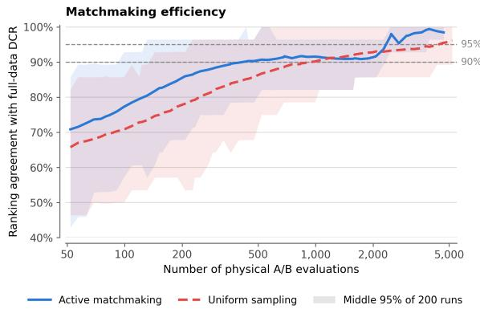  
(a) Active matchmaking improves ranking efficiency

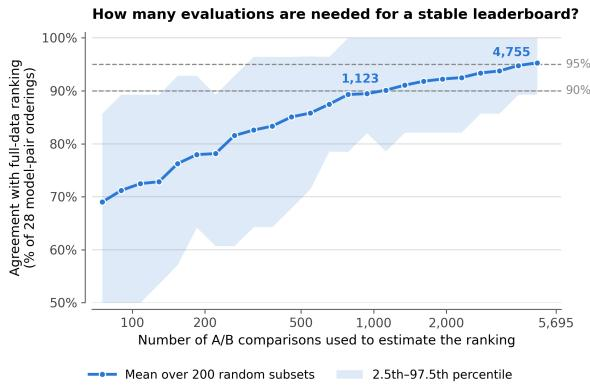  
(b) Evaluation scale on Open Track ranking stability

Figure 11 Ranking efficiency and stability under limited evaluation budgets. a. Active matchmaking improves ranking eficiency. Ranking agreement with the full-data DCR leaderboard is shown as a function of the number of physical A/B evaluations. Active matchmaking prioritizes uncertain model pairs, while uniform sampling selects pairs without uncertainty-based allocation. Lines show the mean agreement over 200 independent runs, and shaded regions span the 2.5th–97.5th percentiles. b. Efect of evaluation scale on Open Track ranking stability. At each evaluation budget, 200 random subsets containing all eight systems are sampled, DCR is fit using only those evaluations, and the resulting ranking is compared with the DCR ranking obtained from the full 5,699-evaluation dataset. The line shows the mean agreement across subsets, the shaded region spans the 2.5th–97.5th percentiles, and dashed lines mark 90% and 95% mean ranking agreement.

## Acknowledgments

We would like to thank the National University of Singapore’s School of Computing for its administrative support, and the Singapore Embodied AI Centre for its support. This project is funded by the National Robotics Programme 2.0 grant, “Real-World Robot Data Collection and Evaluation: A Singapore Dataset and Benchmark for Embodied AI.”

## References

M. Ahn, A. Brohan, N. Brown, Y. Chebotar, O. Cortes, B. David, C. Finn, C. Fu, K. Gopalakrishnan, K. Hausman, et al. Do as i can, not as i say: Grounding language in robotic afordances. arXiv preprint arXiv:2204.01691, 2022.

P. Atreya, K. Pertsch, T. Lee, M. J. Kim, A. Jain, A. Kuramshin, C. Eppner, C. Neary, E. Hu, F. Ramos, J. Tremblay, K. Arora, K. Ellis, L. Macesanu, M. T. Villasevil, M. Leonard, M. Cho, O. Aslan, S. Dass, J. Wang, W. Reger, X. Yuan, X. Yang, A. Gupta, D. Jayaraman, G. Berseth, K. Daniilidis, R. Martin-Martin, Y. Lee, P. Liang, C. Finn, and S. Levine. Roboarena: Distributed real-world evaluation of generalist robot policies, 2025. URL https://arxiv.org/abs/2506.18123.

S. Bauer, M. Wüthrich, F. Widmaier, A. Buchholz, S. Stark, A. Goyal, T. Steinbrenner, J. Akpo, S. Joshi, V. Berenz, V. Agrawal, N. Funk, J. Urain De Jesus, J. Peters, J. Watson, C. Chen, K. Srinivasan, J. Zhang, J. Zhang, M. Walter, R. Madan, T. Yoneda, D. Yarats, A. Allshire, E. Gordon, T. Bhattacharjee, S. Srinivasa, A. Garg, T. Maeda, H. Sikchi, J. Wang, Q. Yao, S. Yang, R. McCarthy, F. Sanchez, Q. Wang, D. Bulens, K. McGuinness, N. O’Connor, R. Stephen, and B. Schölkopf. Real robot challenge: A robotics competition in the cloud. In D. Kiela, M. Ciccone, and B. Caputo, editors, Proceedings of the NeurIPS 2021 Competitions and Demonstrations Track, volume 176 of Proceedings of Machine Learning Research, pages 190–204. PMLR, 06–14 Dec 2022. URL https://proceedings.mlr.press/v176/bauer22a.html.

J. Bjorck, F. Castañeda, N. Cherniadev, X. Da, R. Ding, L. Fan, Y. Fang, D. Fox, F. Hu, S. Huang, et al. Gr00t n1: An open foundation model for generalist humanoid robots. arXiv preprint arXiv:2503.14734, 2025.

K. Black, N. Brown, J. Darpinian, K. Dhabalia, D. Driess, A. Esmail, M. R. Equi, C. Finn, N. Fusai, M. Y. Galliker, D. Ghosh, L. Groom, K. Hausman, b. ichter, S. Jakubczak, T. Jones, L. Ke, D. LeBlanc, S. Levine, A. Li-Bell, M. Mothukuri, S. Nair, K. Pertsch, A. Z. Ren, L. X. Shi, L. Smith, J. T. Springenberg, K. Stachowicz, J. Tanner, Q. Vuong, H. Walke, A. Walling, H. Wang, L. Yu, and U. Zhilinsky. π0.5: a vision-language-action model with

open-world generalization. In J. Lim, S. Song, and H.-W. Park, editors, Proceedings of The 9th Conference on Robot Learning, volume 305 of Proceedings of Machine Learning Research, pages 17–40. PMLR, 27–30 Sep 2025. URL https://proceedings.mlr.press/v305/black25a.html.

R. A. Bradley and M. E. Terry. Rank analysis of incomplete block designs: I. the method of paired comparisons. Biometrika, 39(3/4):324–345, 1952. ISSN 00063444, 14643510. URL http://www.jstor.org/stable/2334029.

T. Chen, Y. Chen, Z. Li, J. Tang, K. Su, W. Wan, B. Chen, H. Lu, H. Yan, H. Su, et al. RoboDojo: A unified sim-and-real benchmark for comprehensive evaluation of generalist robot manipulation policies. arXiv preprint arXiv:2607.04434, 2026.

W.-L. Chiang, L. Zheng, Y. Sheng, A. N. Angelopoulos, T. Li, D. Li, H. Zhang, B. Zhu, M. Jordan, J. E. Gonzalez, and I. Stoica. Chatbot arena: An open platform for evaluating LLMs by human preference. In ICML, 2024a.

W.-L. Chiang, L. Zheng, Y. Sheng, A. N. Angelopoulos, T. Li, D. Li, B. Zhu, H. Zhang, M. I. Jordan, J. E. Gonzalez, and I. Stoica. Chatbot arena: an open platform for evaluating llms by human preference. In Proceedings of the 41st International Conference on Machine Learning, ICML’24. JMLR.org, 2024b.

S. Dasari, J. Wang, J. Hong, S. Bahl, Y. Lin, A. S. Wang, A. Thankaraj, K. S. Chahal, B. Calli, S. Gupta, D. Held, L. Pinto, D. Pathak, V. Kumar, and A. Gupta. RB2: Robotic manipulation benchmarking with a twist. In Thirty-fifth Conference on Neural Information Processing Systems Datasets and Benchmarks Track (Round 2), 2021. URL https://openreview.net/forum?id=e82\_BlJL43M.

R. R. Davidson. On extending the bradley-terry model to accommodate ties in paired comparison experiments. Journal of the American Statistical Association, 65(329):317–328, 1970. ISSN 01621459, 1537274X. URL http: //www.jstor.org/stable/2283595.

Dyna Robotics. Dyna-2: A 1-Million-Hour Scaling Law for World-Action Models. Dyna Robotics Blog, 2026. URL https://www.dyna.co/dyna-2.

H. Fang, J. Duan, D. Clay, S. Wang, S. Liu, W. Huang, X. Fan, W.-C. Tsai, S. Chen, Y. R. Wang, S. Xing, J. Cho, J. S. Park, A. Eftekhar, P. Sushko, K. Farley, A. Wadhwa, C. Harrison, W. Han, Y.-C. Lee, E. VanderBilt, R. Hendrix, S. Ellawela, L. Ngoo, J. Chai, Z. Ren, A. Farhadi, D. Fox, and R. Krishna. MolmoAct2: Action reasoning models for real-world deployment. arXiv preprint arXiv:2605.02881, 2026.

S. Y. Gadre, G. Ilharco, A. Fang, J. Hayase, G. Smyrnis, T. Nguyen, R. Marten, M. Wortsman, D. Ghosh, J. Zhang, E. Orgad, R. Entezari, G. Daras, S. Pratt, V. Ramanujan, Y. Bitton, K. Marathe, S. Mussmann, R. Vencu, M. Cherti, R. Krishna, P. W. Koh, O. Saukh, A. Ratner, S. Song, H. Hajishirzi, A. Farhadi, R. Beaumont, S. Oh, A. Dimakis, J. Jitsev, Y. Carmon, V. Shankar, and L. Schmidt. Datacomp: In search of the next generation of multimodal datasets, 2023. URL https://arxiv.org/abs/2304.14108.

Generalist AI. GEN-1: Scaling Embodied Foundation Models to Mastery. Generalist AI Blog, 2026. URL https: //generalistai.com/blog/gen-1.

R. Heckel, M. Simchowitz, K. Ramchandran, and M. Wainwright. Approximate ranking from pairwise comparisons. Proceedings of Machine Learning Research, 84, 2018. ISSN 2640-3498. Publisher Copyright: © 2018 by the author(s).; 21st International Conference on Artificial Intelligence and Statistics, AISTATS 2018 ; Conference date: 09-04-2018 Through 11-04-2018.

M. Heo, Y. Lee, D. Lee, and J. J. Lim. Furniturebench: Reproducible real-world benchmark for long-horizon complex manipulation. Int. J. Rob. Res., 44(10–11):1863–1891, Sept. 2025. ISSN 0278-3649. doi: 10.1177/02783649241304789. URL https://doi.org/10.1177/02783649241304789.

A. S. Huang, J. Zhang, S. Tang, and Y. Xiang. Vla-replica: A low-cost, reproducible benchmark for real-world evaluation of vision-language-action models, 2026. URL https://arxiv.org/abs/2605.20774.

Z. Huang, Y. He, J. Yu, F. Zhang, C. Si, Y. Jiang, Y. Zhang, T. Wu, Q. Jin, N. Chanpaisit, et al. Vbench: Comprehensive benchmark suite for video generative models. In 2024 IEEE/CVF Conference on Computer Vision and Pattern Recognition (CVPR), pages 21807–21818. IEEE, 2024.

P. Intelligence, K. Black, N. Brown, J. Darpinian, K. Dhabalia, D. Driess, A. Esmail, M. Equi, C. Finn, N. Fusai, M. Y. Galliker, D. Ghosh, L. Groom, K. Hausman, B. Ichter, S. Jakubczak, T. Jones, L. Ke, D. LeBlanc, S. Levine, A. Li-Bell, M. Mothukuri, S. Nair, K. Pertsch, A. Z. Ren, L. X. Shi, L. Smith, J. T. Springenberg, K. Stachowicz, J. Tanner, Q. Vuong, H. Walke, A. Walling, H. Wang, L. Yu, and U. Zhilinsky. π : a vision-language-action model with open-world generalization, 2025. URL https://arxiv.org/abs/2504.16054.

S. James, Z. Ma, D. R. Arrojo, and A. J. Davison. Rlbench: The robot learning benchmark & learning environment. IEEE Robotics and Automation Letters, 5(2):3019–3026, 2020. doi: 10.1109/LRA.2020.2974707.

N. Khargonkar, S. H. Allu, Y. Lu, J. J. P, B. Prabhakaran, and Y. Xiang. Scenereplica: Benchmarking real-world robot manipulation by creating replicable scenes. In 2024 IEEE International Conference on Robotics and Automation (ICRA), pages 8258–8264, 2024. doi: 10.1109/ICRA57147.2024.10610180.

A. Khazatsky, K. Pertsch, S. Nair, A. Balakrishna, S. Dasari, S. Karamcheti, S. Nasiriany, M. K. Srirama, L. Y. Chen, K. Ellis, et al. Droid: A large-scale in-the-wild robot manipulation dataset. arXiv preprint arXiv:2403.12945, 2024.

M. J. Kim, K. Pertsch, S. Karamcheti, T. Xiao, A. Balakrishna, S. Nair, R. Rafailov, E. Foster, G. Lam, P. Sanketi, et al. Openvla: An open-source vision-language-action model. arXiv preprint arXiv:2406.09246, 2024.

Y. Kim, W. Pumacay, O. Rayyan, M. Argus, W. Han, E. VanderBilt, J. Salvador, A. Deshpande, R. Hendrix, S. Jauhri, et al. Molmospaces: A large-scale open ecosystem for robot navigation and manipulation. arXiv preprint arXiv:2602.11337, 2026.

H. Kress-Gazit, K. Hashimoto, N. Kuppuswamy, P. Shah, P. Horgan, G. Richardson, S. Feng, and B. Burchfiel. Robot learning as an empirical science: Best practices for policy evaluation, 2024. URL https://arxiv.org/abs/2409. 09491.

J. Lee, J. Duan, H. Fang, Y. Deng, S. Liu, B. Li, B. Fang, J. Zhang, Y. R. Wang, S. Lee, W. Han, W. Pumacay, A. Wu, R. Hendrix, K. Farley, E. VanderBilt, A. Farhadi, D. Fox, and R. Krishna. Molmoact: Action reasoning models that can reason in space, 2025. URL https://arxiv.org/abs/2508.07917.

X. Li, K. Hsu, J. Gu, K. Pertsch, O. Mees, H. R. Walke, C. Fu, I. Lunawat, I. Sieh, S. Kirmani, S. Levine, J. Wu, C. Finn, H. Su, Q. Vuong, and T. Xiao. Evaluating real-world robot manipulation policies in simulation. arXiv preprint arXiv:2405.05941, 2024.

J. Liang, W. Huang, F. Xia, P. Xu, K. Hausman, B. Ichter, P. Florence, and A. Zeng. Code as policies: Language model programs for embodied control. arXiv preprint arXiv:2209.07753, 2022.

Y. Liu, Z. Dong, B. Ye, T. Yuan, T. Jiang, A. Yang, S. Cao, H. Liu, Y. Sun, Z. Guo, X. Liu, K. Dong, C. Pan, C. Wu, T. Cheng, X. Ren, X. Zhang, J. Cui, Z. Zhao, H. Zhang, K. Xu, H. Yang, B. Zhang, J. Niu, S. Zhu, S. Zhang, and H. Zhao. G0.5: One autoregressive stream for robot reasoning and action, 2026. URL https: //arxiv.org/abs/2608.11739.

NVIDIA, J. Bjorck, N. C. Fernando Castañeda, X. Da, R. Ding, L. J. Fan, Y. Fang, D. Fox, F. Hu, S. Huang, J. Jang, Z. Jiang, J. Kautz, K. Kundalia, L. Lao, Z. Li, Z. Lin, K. Lin, G. Liu, E. Llontop, L. Magne, A. Mandlekar, A. Narayan, S. Nasiriany, S. Reed, Y. L. Tan, G. Wang, Z. Wang, J. Wang, Q. Wang, J. Xiang, Y. Xie, Y. Xu, Z. Xu, S. Ye, Z. Yu, A. Zhang, H. Zhang, Y. Zhao, R. Zheng, and Y. Zhu. GR00T N1: An open foundation model for generalist humanoid robots. In ArXiv Preprint, March 2025.

A. O’Neill, A. Rehman, A. Maddukuri, A. Gupta, A. Padalkar, A. Lee, A. Pooley, A. Gupta, A. Mandlekar, A. Jain, A. Tung, A. Bewley, A. Herzog, A. Irpan, A. Khazatsky, A. Rai, A. Gupta, A. Wang, A. Singh, A. Garg, A. Kembhavi, A. Xie, A. Brohan, A. Rafin, A. Sharma, A. Yavary, A. Jain, A. Balakrishna, A. Wahid, B. Burgess-Limerick, B. Kim, B. Schölkopf, B. Wulfe, B. Ichter, C. Lu, C. Xu, C. Le, C. Finn, C. Wang, C. Xu, C. Chi, C. Huang, C. Chan, C. Agia, C. Pan, C. Fu, C. Devin, D. Xu, D. Morton, D. Driess, D. Chen, D. Pathak, D. Shah, D. Büchler, D. Jayaraman, D. Kalashnikov, D. Sadigh, E. Johns, E. Foster, F. Liu, F. Ceola, F. Xia, F. Zhao, F. Stulp, G. Zhou, G. S. Sukhatme, G. Salhotra, G. Yan, G. Feng, G. Schiavi, G. Berseth, G. Kahn, G. Wang, H. Su, H.-S. Fang, H. Shi, H. Bao, H. Ben Amor, H. I. Christensen, H. Furuta, H. Walke, H. Fang, H. Ha, I. Mordatch, I. Radosavovic, I. Leal, J. Liang, J. Abou-Chakra, J. Kim, J. Drake, J. Peters, J. Schneider, J. Hsu, J. Bohg, J. Bingham, J. Wu, J. Gao, J. Hu, J. Wu, J. Wu, J. Sun, J. Luo, J. Gu, J. Tan, J. Oh, J. Wu, J. Lu, J. Yang, J. Malik, J. Silvério, J. Hejna, J. Booher, J. Tompson, J. Yang, J. Salvador, J. J. Lim, J. Han, K. Wang, K. Rao, K. Pertsch, K. Hausman, K. Go, K. Gopalakrishnan, K. Goldberg, K. Byrne, K. Oslund, K. Kawaharazuka, K. Black, K. Lin, K. Zhang, K. Ehsani, K. Lekkala, K. Ellis, K. Rana, K. Srinivasan, K. Fang, K. P. Singh, K.-H. Zeng, K. Hatch, K. Hsu, L. Itti, L. Y. Chen, L. Pinto, L. Fei-Fei, L. Tan, L. J. Fan, L. Ott, L. Lee, L. Weihs, M. Chen, M. Lepert, M. Memmel, M. Tomizuka, M. Itkina, M. G. Castro, M. Spero, M. Du, M. Ahn, M. C. Yip, M. Zhang, M. Ding, M. Heo, M. K. Srirama, M. Sharma, M. J. Kim, N. Kanazawa, N. Hansen, N. Heess, N. J. Joshi, N. Suenderhauf, N. Liu, N. Di Palo, N. M. M. Shafiullah, O. Mees, O. Kroemer, O. Bastani, P. R. Sanketi, P. T. Miller, P. Yin, P. Wohlhart, P. Xu, P. D. Fagan, P. Mitrano, P. Sermanet, P. Abbeel, P. Sundaresan, Q. Chen, Q. Vuong, R. Rafailov, R. Tian, R. Doshi, R. Martín-Martín, R. Baijal, R. Scalise, R. Hendrix, R. Lin, R. Qian, R. Zhang, R. Mendonca, R. Shah, R. Hoque, R. Julian, S. Bustamante, S. Kirmani, S. Levine, S. Lin, S. Moore, S. Bahl, S. Dass, S. Sonawani, S. Song, S. Xu, S. Haldar, S. Karamcheti, S. Adebola, S. Guist, S. Nasiriany, S. Schaal, S. Welker, S. Tian, S. Ramamoorthy, S. Dasari, S. Belkhale, S. Park, S. Nair, S. Mirchandani, T. Osa, T. Gupta, T. Harada, T. Matsushima, T. Xiao,

T. Kollar, T. Yu, T. Ding, T. Davchev, T. Z. Zhao, T. Armstrong, T. Darrell, T. Chung, V. Jain, V. Vanhoucke, W. Zhan, W. Zhou, W. Burgard, X. Chen, X. Wang, X. Zhu, X. Geng, X. Liu, X. Liangwei, X. Li, Y. Lu, Y. J. Ma, Y. Kim, Y. Chebotar, Y. Zhou, Y. Zhu, Y. Wu, Y. Xu, Y. Wang, Y. Bisk, Y. Cho, Y. Lee, Y. Cui, Y. Cao, Y.-H. Wu, Y. Tang, Y. Zhu, Y. Zhang, Y. Jiang, Y. Li, Y. Li, Y. Iwasawa, Y. Matsuo, Z. Ma, Z. Xu, Z. J. Cui, Z. Zhang, and Z. Lin. Open x-embodiment: Robotic learning datasets and rt-x models : Open x-embodiment collaboration0. In 2024 IEEE International Conference on Robotics and Automation (ICRA), pages 6892–6903, 2024. doi: 10.1109/ICRA57147.2024.10611477.

W. Pumacay, I. Singh, J. Duan, R. Krishna, J. Thomason, and D. Fox. The colosseum: A benchmark for evaluating generalization for robotic manipulation. arXiv preprint arXiv:2402.08191, 2024.

G. Rasch. Probabilistic Models for Some Intelligence and Attainment Tests. Studies in mathematical psychology. Danmarks Paedagogiske Institut, 1960. ISBN 9780598554512. URL https://books.google.com.sg/books?id= XnlevwEACAAJ.

Robocurve. Inspect robots: The open-source evaluation framework for physical ai, 2026. URL https://github.com/ robocurve/inspect-robots. Commit 22a4da6.

Skild AI Team. Building the General-Purpose Robotic Brain. Skild AI Blog, July 2025. URL https://www.skild.ai/ blogs/building-the-general-purpose-robotic-brain.

Sunday Robotics. ACT-1: A Robot Foundation Model Trained on Zero Robot Data. Sunday Robotics Blog, Nov. 2025. URL https://www.sunday.ai/blog/no-robot-data.

S. Tao, F. Xiang, A. Shukla, Y. Qin, X. Hinrichsen, X. Yuan, C. Bao, X. Lin, Y. Liu, T.-K. Chan, et al. Maniskill3: Gpu parallelized robotics simulation and rendering for generalizable embodied ai. In 7th Robot Learning Workshop: Towards Robots with Human-Level Abilities, 2025.

G. R. Team, S. Abeyruwan, J. Ainslie, J.-B. Alayrac, M. G. Arenas, T. Armstrong, A. Balakrishna, R. Baruch, M. Bauza, M. Blokzijl, et al. Gemini robotics: Bringing ai into the physical world. arXiv preprint arXiv:2503.20020, 2025.

O. M. Team, D. Ghosh, H. Walke, K. Pertsch, K. Black, O. Mees, S. Dasari, J. Hejna, T. Kreiman, C. Xu, J. Luo, Y. L. Tan, L. Y. Chen, P. Sanketi, Q. Vuong, T. Xiao, D. Sadigh, C. Finn, and S. Levine. Octo: An open-source generalist robot policy, 2024. URL https://arxiv.org/abs/2405.12213.

J. A. Vincent, H. Nishimura, M. Itkina, P. Shah, M. Schwager, and T. Kollar. How generalizable is my behavior cloning policy? a statistical approach to trustworthy performance evaluation. IEEE Robotics and Automation Letters, 9(10): 8619–8626, 2024.

Y. R. Wang, C. Ung, G. Tannert, J. Duan, J. Li, A. Le, R. Oswal, M. Grotz, W. Pumacay, Y. Deng, et al. Roboeval: Where robotic manipulation meets structured and scalable evaluation. arXiv preprint arXiv:2507.00435, 2025.

Y. R. Wang, C. Ung, E. Gubarev, C. Tan, S. Srinivasa, and D. Fox. Roboplayground: Democratizing robotic evaluation through structured physical domains, 2026. URL https://arxiv.org/abs/2604.05226.

P. Wu, Y. Shentu, Z. Yi, X. Lin, and P. Abbeel. GELLO: A general, low-cost, and intuitive teleoperation framework for robot manipulators. In IEEE/RSJ International Conference on Intelligent Robots and Systems (IROS), 2024.

W. Wu, F. Wang, F. Lu, H. Sun, S. Liu, Y. Wang, Y. Yan, Y. Wang, S. Ma, X. Wang, Y. Liu, S. Yang, T. Zhou, K. Zhang, L. Zhou, C. Su, N. Xue, B. Tan, H. Zhang, Y. Zhang, F. Liao, X. Zhu, Y. Shen, and K. Zheng. From foundation to application: Improving vla models in practice. arXiv preprint arXiv:2607.06403, 2026.

H. S. Yi. Feasibility of using prior information about predicted item dificulty in increasing the accuracy of item parameter estimation and irt equating. Journal of Curriculum and Evaluation, 12(1):103–122, 2009. doi: 10.29221/ jce.2009.12.1.103. URL https://doi.org/10.29221/jce.2009.12.1.103.

L. Zheng, W.-L. Chiang, Y. Sheng, S. Zhuang, Z. Wu, Y. Zhuang, Z. Lin, Z. Li, D. Li, E. Xing, et al. Judging llm-as-a-judge with mt-bench and chatbot arena. Advances in neural information processing systems, 36:46595–46623, 2023.

G. Zhou, V. Dean, M. K. Srirama, A. Rajeswaran, J. Pari, K. Hatch, A. Jain, T. Yu, P. Abbeel, L. Pinto, C. Finn, and A. Gupta. Train ofline, test online: A real robot learning benchmark. In 2023 IEEE International Conference on Robotics and Automation (ICRA), pages 9197–9203, 2023. doi: 10.1109/ICRA48891.2023.10160594.

## Appendix

## A Fine-tune Track Training Protocol

All Fine-tune Track models are trained with a common harness designed for a fair comparison under fixed data. Each VLA is trained with its own upstream repository, pinned to a fixed commit and left unmodified. The harness adds only the components around it: conversion of the demonstrations into each model’s data format, per-model configurations registered from outside the repositories, and launch scripts. Settings shared by all models are listed in Table 3, and the per-model hyperparameters in Table 4.

Table 3 Fine-tuning settings shared by all models.
<table><tr><td>Setting</td><td>Value</td></tr><tr><td>Initialization</td><td>Base pretrained checkpoint (not the Open Track checkpoint)</td></tr><tr><td>Training data</td><td>100 task demonstrations only</td></tr><tr><td>Training recipe</td><td>Closest example configuration in the official repository</td></tr><tr><td>Learning-rate scaling</td><td>Linear in effective batch size, relative to the recipe&#x27;s batch size</td></tr><tr><td>Evaluated checkpoint</td><td>Final epoch</td></tr><tr><td>State and action space</td><td>Absolute joint positions</td></tr><tr><td>Model inputs</td><td>We follow each model&#x27;s default training recipe for visual observations and task instruction</td></tr><tr><td>Precision</td><td>bf16 compute, fp32 master weights</td></tr></table>

Table 4 Per-model fine-tuning hyperparameters. Peak learning rates are after linear scaling from the recipe’s batch size to the efective batch size. “Upstream default” denotes the value in the cited recipe, left unchanged.
<table><tr><td colspan="2">GR00T N1.7</td></tr><tr><td>Base checkpoint</td><td>nvidia/GR00T-N1.7-3B</td></tr><tr><td>Recipe</td><td>launch_finetune defaults</td></tr><tr><td>Recipe batch size</td><td>64</td></tr><tr><td>Effective batch size</td><td>64</td></tr><tr><td>Peak learning rate</td><td> $1 \times 1 0 ^ { - 4 }$ </td></tr><tr><td>Schedule</td><td>Cosine, 5% warmup</td></tr><tr><td>Trained modules</td><td>Full model (VLM and action head)</td></tr><tr><td colspan="2">MolmoAct2</td></tr><tr><td>Base checkpoint</td><td>allenai/MolmoAct2</td></tr><tr><td>Recipe</td><td>Full fine-tuning (official README)</td></tr><tr><td>Recipe batch size</td><td>64</td></tr><tr><td>Effective batch size</td><td>128</td></tr><tr><td>Peak learning rate</td><td> $\mathrm { L L M } 2 \times 1 0 ^ { - 5 }$  ; ViT and connector  $1 \times 1 0 ^ { - 5 } \colon$  ; action expert 1 × 10−4</td></tr><tr><td>Schedule</td><td>Upstream default</td></tr><tr><td>Trained modules</td><td>Full model</td></tr><tr><td colspan="2">LingBot-VLA v2</td></tr><tr><td>Base checkpoint</td><td>robbyant/1ingbot-vla-v2-6b</td></tr><tr><td>Recipe</td><td>real_robot.yaml</td></tr><tr><td>Recipe batch size</td><td>256</td></tr><tr><td>Effective batch size</td><td>64</td></tr><tr><td>Peak learning rate</td><td> $1 . 2 5 \times 1 0 ^ { - 5 }$ </td></tr><tr><td>Schedule</td><td>Constant</td></tr><tr><td>Optimizer</td><td>Muon</td></tr></table>

<table><tr><td colspan="2">π0.5</td></tr><tr><td>Base checkpoint</td><td>pi05_base</td></tr><tr><td>Recipe</td><td>pi05_aloha_pen_uncap</td></tr><tr><td>Recipe batch size</td><td>64</td></tr><tr><td>Effective batch size</td><td>64</td></tr><tr><td>Peak learning rate</td><td> $2 . 5 \times 1 0 ^ { - 5 }$ </td></tr><tr><td>Schedule</td><td>Cosine to  $2 . 5 \times 1 0 ^ { - 6 }$  , 1k warmup</td></tr><tr><td>Other</td><td>EMA 0.99; Aloha adaptation off</td></tr><tr><td colspan="2">G0.5</td></tr><tr><td>Base checkpoint</td><td></td></tr><tr><td>Recipe</td><td>OpenGalaxea/G05 (base) R1Lite post-training</td></tr><tr><td></td><td></td></tr><tr><td>Recipe batch size</td><td>32</td></tr><tr><td>Effective batch size</td><td>32</td></tr><tr><td>Peak learning rate</td><td> $4 \times 1 0 ^ { - 5 }$  (vision encoder ×0.1)</td></tr><tr><td>Schedule</td><td>Cosine, 200 warmup steps Weight decay 0.03</td></tr><tr><td>Other</td><td></td></tr></table>

Model-specific notes. For GR00T N1.7, the full vision-language backbone is fine-tuned together with the action head, and the efective batch size is kept at 64. An earlier configuration that trained only the action head with an efective batch size of 512 received too few optimizer updates within five epochs and converged to a constant prediction. SO-101 is an exception; we follow the default configuration, keeping the vision-language backbone frozen while training the projector and action-model components. For $\pi _ { 0 . 5 } ,$ the Aloha-specific action-space adaptation in the recipe is disabled, since none of the evaluated embodiments is an Aloha platform.

## B Fine-tune Track Task Details

We provide the full specification of the five fine-tuning tasks for each of the four embodiments (SO101, DROID, YAM, and G1). Each card shows the workspace and object setup photos together with the task instruction, objects used, object setup, success criteria, evaluation location, environment, timeout, and the partial progress criteria used for scoring.

## B.1 SO101

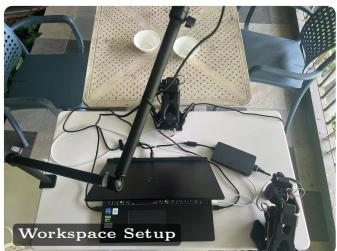

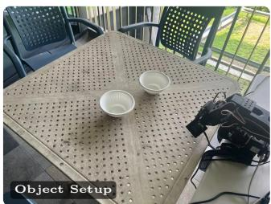

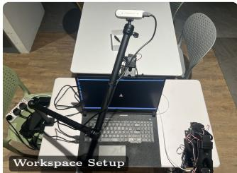  
Objects Used: 2 bowls

## stack\_bowls

FT-SO101-01

Instruction: Pick up the white plastic bowl on the right and stack it on top of the white plastic bowl on the left.

Object Setup: 2 bowls on table, one left one right.

Success Criteria: The bowl on the right was successfully stacked onto the left one. Location: National University of Singapore, place nearby COM3-B1-16

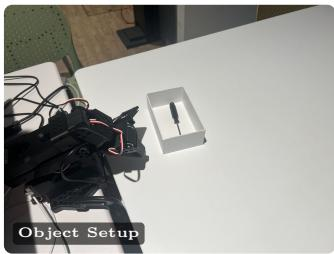

Address: National University of Singapore, 11 Research Link, COM3, #B1-16, Singapore 119391

Environment: Semi-open terrace Time: 3 PM Timeout: 25 s

## Partial Progress Criteria:

0 No meaningful progress.

1 Right bowl is successfully grasped and lifted.

2 Right bowl is moved above or close to the left bowl.

3 Right bowl is placed on the left bowl but is unstable, misaligned, or not fully released.

4 Right bowl is successfully stacked on the left bowl, stable, and released by the robot.

## remove\_screwdriver

FT-SO101-02

Instruction: Take the black screwdriver out of the box and place it on the table. Objects Used: 1 white box; 1 screwdriver

Object Setup: 1 white box on table, with 1 screwdriver inside it. The box is placed horizontally, the screwdriver is also horizontal.

Success Criteria: Remove the screwdriver from the box and place it on the desktop on the right side of the box.

Location: National University of Singapore, a table at The Terrace

Address: The Terrace, 100 Edgedale Plains, Singapore 828690, Singapore

Environment: Dining hall Time: 3 PM Timeout: 25 s

Partial Progress Criteria:

0 No meaningful progress.

1 Successfully approached the screwdriver.

2 Successfully attempted grasping screwdriver (grasped/with contact but failed).

3 Successfully grasped the screwdriver.

4 Screwdriver is completely removed from the box and placed on the table on the right side of the box, stable and released.

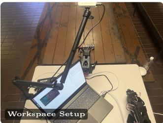

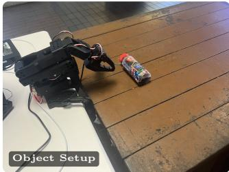

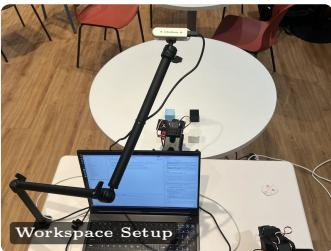

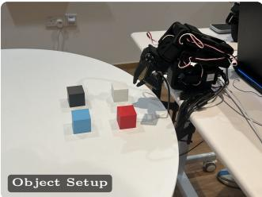

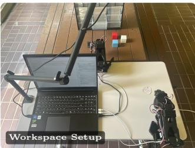

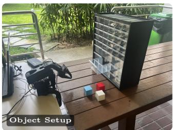

## upright\_bottle

FT-SO101-03

Instruction: Pick up the fallen juice bottle and stand it upright on the table. Objects Used: 1 juice bottle

Object Setup: The juice bottle is lying on its side on the tabletop within the robot’s reachable workspace.

Success Criteria: The juice bottle is upright, stable on its base, and released by the robot.

Location: National University of Singapore, a table nearby The Terrace

Address: The Terrace, 100 Edgedale Plains, Singapore 828690, Singapore

Environment: Semi-open terrace Time: 4 PM Timeout: 25 s

## Partial Progress Criteria:

0 No meaningful progress.

1 Bottle is successfully grasped.

2 Bottle is lifted from its initial lying position.

3 Bottle is rotated toward an upright orientation or placed on its base but is unstable/no fully released.

4 Bottle is upright, stable on its base, and released by the robot.

## stack\_cubes

FT-SO101-04

Instruction: Stack the blue cube on the red cube, then stack the white cube on the blue cube.

Objects Used: 4 cubes

Object Setup: The red, blue, black, and white cubes are placed separately on the tabletop within the robot’s reachable workspace.

Success Criteria: The cubes form a stable three-cube stack with the red cube at the bottom, the blue cube in the middle, and the white cube at the top.

Location: National University of Singapore, COM3-2, lounge

Address: National University of Singapore, 11 Research Link, COM3, #B1-16, Singapore 119391

Environment: Lounge Time: 5 PM Timeout: 30 s

## Partial Progress Criteria:

0 No meaningful progress.

1 Blue cube is approached.

2 Blue cube is successfully grasped and stacked on the red cube.

3 White cube is moved onto or above the blue cube but the final three-cube stack is incomplete or unstable.

4 Red, blue, and white cubes form a stable three-cube stack in the correct order: red bottom, blue middle, white top.

## cube\_drawer

FT-SO101-05

Instruction: Put the blue cube on the table into the open drawer, then close the drawer.

Objects Used: 3 cubes; 1 drawer

Object Setup: The blue cube is placed on the tabletop, and the target drawer is initially open and accessible to the robot.

Success Criteria: The blue cube is fully contained inside the target drawer, and the drawer is fully closed.

Location: National University of Singapore, a table in front of LT19

Address: The Terrace, 100 Edgedale Plains, Singapore 828690, Singapore

Environment: Semi-open terrace Time: 4 PM Timeout: 30 s

## Partial Progress Criteria:

0 No meaningful progress.

1 Blue cube is successfully grasped and lifted.

2 Blue cube is moved to or above the open drawer.

3 Blue cube is fully placed inside the drawer, but the drawer is not fully closed.

4 Blue cube is fully contained inside the target drawer and the drawer is fully closed.

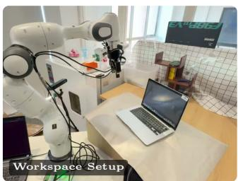

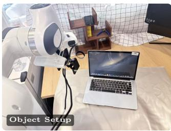

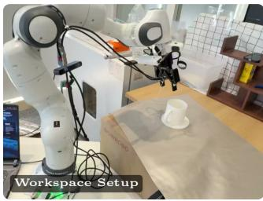

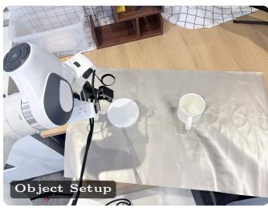

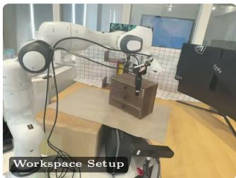

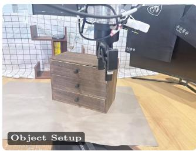

## close\_laptop

FT-DROID-01

Instruction: Close laptop

Objects Used: 1 Laptop

Object Setup: Laptop placed open on the table within the robot workspace, with the screen facing the robot and the laptop base resting flat on the table. Success Criteria: Lid completely closed.

Location: Ofice 728, Haichuan Building

Address: Haichuan Building, Xixiang Subdistrict, Bao’an District, Shenzhen City, Guangdong Province (No.158 Wenchang Road), Postal Code: 518126 Environment: Ofice Time: 7 PM Timeout: 20 s

## Partial Progress Criteria:

0 No meaningful progress.

1 Robot makes controlled contact with the laptop lid and begins moving it downward.

2 Lid is closed at least halfway from its initial open position.

3 Lid is nearly closed but a visible gap remains between the lid and base.

4 Lid is completely closed.

## mug\_on\_coaster

FT-DROID-02

Instruction: Place the mug on the coaster

Objects Used: 1 mug and 1 coaster

Object Setup: Mug and coaster placed separately on the table within the robot workspace. The mug starts upright and is not initially touching or overlapping the coaster.

Success Criteria: Mug fully supported by coaster.

Location: Ofice 728, Haichuan Building

Address: Haichuan Building, Xixiang Subdistrict, Bao’an District, Shenzhen City, Guangdong Province (No.158 Wenchang Road), Postal Code: 518126

Environment: Ofice Time: 8 PM Timeout: 20 s

## Partial Progress Criteria:

0 No meaningful progress.

1 Mug is successfully grasped and lifted.

2 Mug is moved to the coaster area or positioned above the coaster.

3 Mug is placed in contact with the coaster but is not fully supported by it.

4 Mug is fully supported by the coaster and released by the robot.

## open\_drawer

FT-DROID-03

Instruction: Open the drawer

Objects Used: 1 drawer

Object Setup: Drawer starts fully closed and within reach of the robot. The drawer handle is unobstructed and accessible to the robot gripper.

Success Criteria: Drawer displacement from the fully closed position is ≥70% of its calibrated maximum travel and remains above this threshold for ≥1 s.

Location: Ofice 728, Haichuan Building

Address: Haichuan Building, Xixiang Subdistrict, Bao’an District, Shenzhen City, Guangdong Province (No.158 Wenchang Road), Postal Code: 518126

Environment: Ofice Time: 6 PM Timeout: 25 s

## Partial Progress Criteria:

0 No meaningful progress.

1 Robot successfully engages the drawer handle.

2 Drawer is opened to at least 25% but less than 50% of its calibrated maximum travel.

3 Drawer is opened to at least 50% but less than 70% of its calibrated maximum travel.

4 Drawer displacement is ≥70% of its calibrated maximum travel and remains above this threshold for ≥1 s.

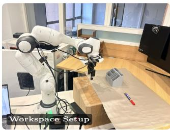

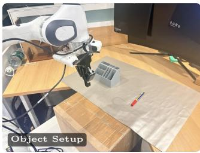

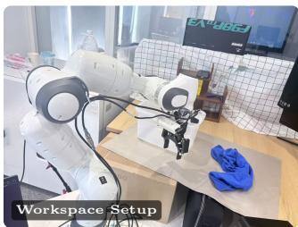

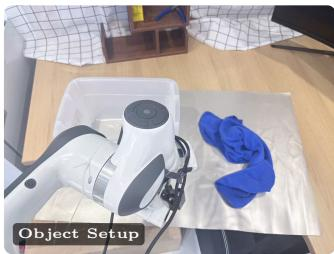

## B.3 YAM

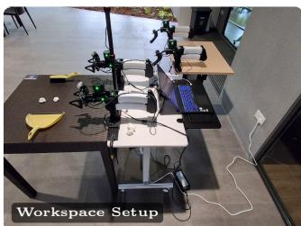

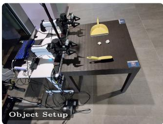

## marker\_in\_holder

FT-DROID-04

Instruction: Pick up the marker and place it into the pen holder.

Objects Used: 1 marker, 1 pen holder / cup

Object Setup: A marker lies horizontally on the table within the robot workspace. An empty pen holder (or opaque cup) is placed upright 20 cm nearby and does not initially touch the marker.

Success Criteria: Marker is placed inside the pen holder and remains there after release for at least 1 second.

Location: Ofice 728, Haichuan Building

Address: Haichuan Building, Xixiang Subdistrict, Bao’an District, Shenzhen City, Guangdong Province (No.158 Wenchang Road), Postal Code: 518126

Environment: Ofice Time: 9 PM Timeout: 30 s

## Partial Progress Criteria:

0 No meaningful progress.

1 Robot successfully grasps and lifts the marker.

2 Marker is moved above or next to the pen holder opening.

3 Marker is partially inserted into the pen holder but not yet stably released.

4 Marker is successfully placed inside the pen holder and remains there after release for at least 1 second.

## towel\_in\_basket

FT-DROID-05

Instruction: Put the towel into the basket

Objects Used: 1 towel and 1 basket

Object Setup: Towel is placed outside the basket on the table within the robot workspace. The basket is upright with its opening unobstructed and the towel is fully outside the basket at the start.

Success Criteria: Towel completely inside basket.

Location: Ofice 728, Haichuan Building

Address: Haichuan Building, Xixiang Subdistrict, Bao’an District, Shenzhen City, Guangdong Province (No.158 Wenchang Road)

Environment: Ofice Time: 4 PM Timeout: 20 s

## Partial Progress Criteria:

0 No meaningful progress.

1 Towel is successfully grasped and lifted.

2 Towel is moved to or above the basket opening.

3 Towel is partially inside the basket but some portion remains outside.

4 Towel is completely inside the basket and released by the robot.

## dustpan

Instruction: Clean the table.

FT-YAM-01

Objects Used: 1 dustpan, 1 brush, and 2 tissues

Object Setup: 1 dustpan left side, 1 brush right side and 2 tissues, in the middle.   
Success Criteria: Tissues on the dustpan at the end.

Location: National University of Singapore, place nearby COM3-B1-16

Address: National University of Singapore, 11 Research Link, COM3, #B1-16, Singapore 119391

Environment: Semi-open terrace Time: 4 PM Timeout: 30 s

Partial Progress Criteria:

0 No meaningful progress.

1 The pan is picked up by the left arm.

2 The sweep is picked up by the right arm.

3 The tissue balls are swept into the pan.

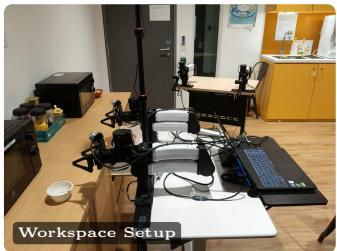

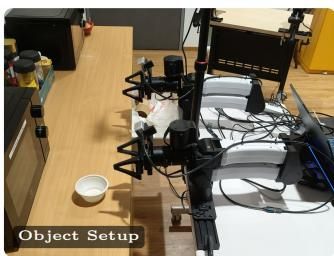

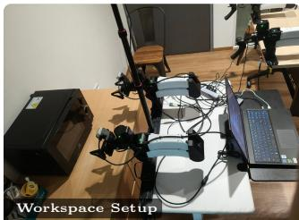

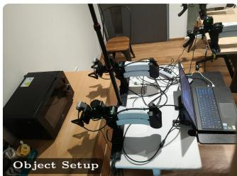

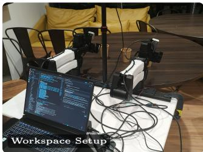

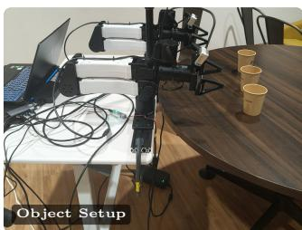

## drawer

FT-YAM-02

Instruction: Put the cup into the drawer.

Objects Used: Plastic cup, drawer

Object Setup: Plastic cup kept in front of the left arm, right side drawer open.   
Success Criteria: Cup inside the drawer and drawer closed.

Location: NUS, COM3-B1- Pantry

Address: National University of Singapore, 11 Research Link, COM3, #B1-16, Singapore 119391

Environment: Pantry Time: 4 PM Timeout: 90 s

## Partial Progress Criteria:

0 No meaningful progress.

1 The cup is picked up and placed to the right.

2 The right arm picks up the cup.

3 The right arm drops the cup into the drawer.

4 The drawer is fully closed.

## microwave

FT-YAM-03

Instruction: Open the microwave and take out the bowl.

Objects Used: Microwave, red metal bowl, bread

Object Setup: Bread inside the bowl, bowl inside the microwave. Microwave half closed.

Success Criteria: Red bowl on the table outside of the microwave and microwave door half closed.

Location: NUS, COM3-B1- Pantry

Address: National University of Singapore, 11 Research Link, COM3, #B1-16, Singapore 119391

Environment: Pantry Time: 6 PM Timeout: 90 s

## Partial Progress Criteria:

0 No meaningful progress.

1 The microwave door is opened by the left arm.

2 The bowl is picked up and placed outside of the microwave by the right arm.

3 The microwave door is pushed closed by the left arm.

## stack\_cups

FT-YAM-04

Instruction: Stack the cups.

Objects Used: 3 paper cups

Object Setup: 3 paper cups in a line on the table.

Success Criteria: The left and right paper cups stacked on top of the middle cup. Location: NUS, COM3-B1- Pantry

Address: National University of Singapore, 11 Research Link, COM3, #B1-16, Singapore 119391

Environment: Pantry Time: 9:30 PM Timeout: 50 s

## Partial Progress Criteria:

0 No meaningful progress.

1 The left cup is being picked up.

2 The right cup is being picked up.

3 The left cup is stacked on top of the central cup.

4 The right cup is stacked on top of the central cup.

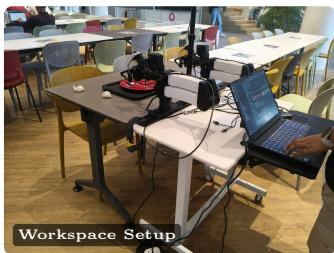

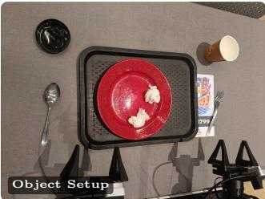

## clean\_table

FT-YAM-05

Instruction: Clean the table.

Objects Used: 1 spoon, 1 fork and 1 black tray from terrace, 1 red plate, 2 tissue paper balls, 1 cool spot cup with cap

Object Setup: 2 tissue balls on the red plate inside the tray. Fork and cup on the right side of the tray with cup on top, and spoon and cup cap on the left side of the tray with cap on top.

Success Criteria: Both utensils, the cup and the cap inside the tray.

Location: NUS, COM3-L1-Terrace

Address: The Terrace, 100 Edgedale Plains, Singapore 828690, Singapore Environment: Canteen Time: 5 PM Timeout: 40 s

## Partial Progress Criteria:

0 No meaningful progress.

1 The spoon is being picked up and placed in the tray by the left arm.

2 The fork is being picked up and placed in the tray by the right arm.

3 The cap is being picked up and placed in the tray by the left arm.

4 The cup is being picked up and placed in the tray by the right arm.

## B.4 G1

plate\_into\_rack

Instruction: Pick up the plate and place it upright into the dish rack Objects Used: 1 plate; 1 dish rack

FT-G1-01

Object Setup: The plate is placed flat on the countertop within the robot’s reachable workspace. The empty dish rack is placed beside the plate with the slots facing the robot.

Success Criteria: The plate is placed upright in a slot of the dish rack, fully supported by the rack, stable, and released by the robot.

Location: Real Homes in Malaysia

Environment: Kitchen Timeout: 150 s

## Partial Progress Criteria:

0 No meaningful progress.

1 Walk forward.

2 Pick up the plate.

3 Switch hands.

4 Turn around.

5 Put on the dish rack.

## carry\_box

FT-G1-02

Instruction: Pick up the box, carry it to the table, and place it on the table Objects Used: 1 lightweight box; 1 table

Object Setup: A lightweight empty box is placed on the ground. The table is positioned approximately 1–2 m away, requiring the robot to walk while carrying the box.

Success Criteria: The box is fully supported by the table, stable, and released by the robot without being dropped during transport.

Location: Real Homes in Malaysia

Environment: Living room Timeout: 150 s

## Partial Progress Criteria:

0 No meaningful progress.

1 Walk forward.

2 Squat down.

3 Pick up the box.

4 Stand up.

5 Turn around.

6 Walk forward.

7 Put on the table stably.

## fold\_towel

Instruction: Fold the towel in half on the table Objects Used: 1 towel

FT-G1-03

Object Setup: The towel is fully unfolded and placed flat on the table within the robot’s reachable workspace, with all four corners accessible to the robot.

Success Criteria: The towel is folded with the corresponding edges aligned and the folded towel remaining flat on the table after being released by the robot.

Location: Real Homes in Malaysia

Environment: Bedroom Timeout: 150 s

## Partial Progress Criteria:

0 No meaningful progress.

1 Walk forward.

2 Pick up the towel on the right.

3 Fold it in half.

4 Pick up the towel on the left.

5 Fold it in half.

## load\_clothes\_washing\_machine

FT-G1-04

Instruction: Pick up the T-shirt and pants from the table and put both items into the washing machine.

Objects Used: 1 T-shirt; 1 pair of pants; 1 top-loading washing machine

Object Setup: One T-shirt and one pair of pants are placed separately on a table near the washing machine. The washing machine lid is already fully open, and the drum is empty. Both clothing items and the washing machine opening are accessible to the robot.

Success Criteria: Both the T-shirt and pants are completely inside the washing machine drum and released by the robot. No part of either clothing item remains outside the washing machine.

Location: Real Homes in Malaysia

Environment: Laundry area Timeout: 150 s

## Partial Progress Criteria:

0 No meaningful progress.

1 Walk forward.

2 Pick up the clothes/pants.

3 Switch hands.

4 Turn around.

5 Put it into the washing machine.

## hang\_keys

FT-G1-05

Instruction: Pick up the keys from the countertop and hang them on the designated hook

Objects Used: 1 set of keys with keyring; 1 hook

Object Setup: The keys are placed flat on the countertop within the robot’s reachable workspace. A designated hook is fixed nearby and is also within reach of the robot. The robot starts facing the countertop and does not need to walk to complete the task.

Success Criteria: The keyring is successfully placed on the designated hook, the keys remain hanging after being released by the robot, and no part of the keys is supported by the robot.

Location: Real Homes in Malaysia

Environment: Kitchen / home living area Timeout: 150 s

## Partial Progress Criteria:

0 No meaningful progress.

1 Squat down.

2 Pick up the keys.

3 Switch hands.

4 Turn around.

5 Walk forward.

6 Hang the keys on the hook.

  
Figure 12 Per-task progress reachability on SO-101. Percentage of the 25 trials per model satisfying at least a given fraction of the task’s K progress criteria.

## C Fine-tune Track Per-Task Progress Reachability

Figures 12–15 decompose the embodiment-level reachability curves in Figure 7 into individual tasks. The results show that the aggregate diferences between policies are driven by task-specific strengths and failures rather than by a uniform advantage across every task

SO-101. Figure 12 shows that relatively simple tasks such as stack\_bowls and upright\_bottle preserve high progress for several policies, while more compositional tasks separate them more clearly. stack\_cubes is particularly discriminative: several policies reach the initial interaction criteria, but their curves diverge sharply as the task requires completion of the multi-object stack. cube\_drawer shows a similar but less extreme pattern, indicating that grasping and transporting the cube is easier than completing the full placement-and-drawer sequence. These diferences explain why the embodiment averages remain separated even when several models perform similarly on the easier SO-101 tasks.

DROID. Figure 13 exhibits stronger task-specific specialization. close\_laptop separates policies that can initiate contact from those that can reliably finish the articulated-object manipulation. open\_drawer produces a diferent ordering, with LingBot-VLA v2 maintaining high reachability while several other models lose progress rapidly after the initial interaction. marker\_in\_holder again changes the ordering, with MolmoAct2, GR00T N1.7, and $\pi _ { 0 . 5 }$ retaining substantially more progress than LingBot-VLA v2 and G0.5. towel\_- in\_basket is comparatively favorable to several policies. The same robot embodiment therefore produces markedly diferent model rankings depending on the manipulation being evaluated.

Bimanual-YAM. Figure 14 shows a similar pattern under tasks requiring coordination between two arms. π0.5 maintains strong reachability across most tasks, while G0.5 is also competitive on several drawer, microwave, and table-cleaning tasks. stack\_cups produces substantially larger drops for multiple policies, indicating that completing the full multi-object arrangement is harder than satisfying its earlier criteria. The safety-stopped evaluations for LingBot-VLA v2 on drawer and GR00T N1.7 on microwave are shown separately and should be interpreted as truncated evaluations rather than ordinary performance curves.

  
Figure 13 Per-task progress reachability on DROID. Percentage of the 25 trials per model satisfying at least a given fraction of the task’s K progress criteria.

G1. Figure 15 produces the clearest gap between partial progress and complete success. None of the five policies completes any evaluated G1 task, yet their reachability curves show diferent amounts of partial execution. On tasks such as carry\_box and load\_clothes\_washing\_machine, some policies satisfy a substantial fraction of the task criteria, but few trials satisfy the remaining requirements. plate\_into\_rack also shows measurable early progress, whereas fold\_towel and hang\_keys remain dificult for most policies. These results demonstrate why binary success alone is insuficient in the humanoid setting: although every policy has the same full-task outcome, the fraction of task criteria they satisfy clearly difers.

## D Open Track

## D.1 Frontier AI Agents

Three API-accessible agents, Claude Opus 5.5, GPT-6 Astra, and Grok 4.7, are evaluated in the Open Track on SO-101, DROID, and Bimanual-YAM. Agents are used as released, with no fine-tuning, no taskspecific prompting, and no access to demonstrations. They are served through the Inspect Robots agent policy (Robocurve, 2026) running inside the RoboColosseum policy server, so task assignment, robot control, timeouts, and scoring are identical to those used for VLA policies. Table 5 lists the model identifiers and API settings, and Listing 1 gives the full system prompt.

  
Task progress reached (%)  
Figure 14 Per-task progress reachability on Bimanual-YAM. Percentage of completed trials satisfying at least a given fraction of the task’s K progress criteria. Hollow markers denote evaluations stopped early for safety, with the number of completed trials n given in the panel title; all other curves use 25 trials.

Observation and action interface. At each decision step the agent receives the embodiment’s observation specification: the current images from all cameras of the embodiment at 640 × 480 (two views for SO-101 and DROID, three for Bimanual-YAM), the proprioceptive state as a labeled numeric vector, and the language instruction. Images from the two most recent observations are kept in the conversation; older observations are kept as text only. A fixed system prompt per embodiment describes the robot, its joint ordering and gripper convention, its workspace and camera placement, and the available tools. The agent acts through exactly one tool call per turn: a move tool that specifies an absolute target, done, which declares the task complete, or give\_up. On all three embodiments the target is a joint-position vector in the embodiment’s action space, which the server interpolates into a trajectory executed at a fixed fraction of the rig’s joint speed. Each move call must also include a one- or two-sentence note describing what the agent observes and why it chose the motion; these notes are stored with the transcript. After each motion completes, the client returns the new observation and the loop continues until the agent calls done or give\_up, or the trial reaches its step limit. The agent’s own done never counts as success.

Execution and safety. Every returned trajectory is validated on the server against calibrated joint limits and per-step joint-change limits before execution, truncated to the embodiment’s maximum chunk length, and re-planned from the next measured state; the client applies the same joint clipping to agent and VLA actions alike. Agents are queried with reasoning efort set to medium and at most 30 model calls per trial; each tria is limited to 800 control steps, and a call that exceeds the per-call inference deadline of 120 s is discarded and the trial continues from the next observation. Because every decision requires a round trip to the provider’s API, agents act at a much lower rate than VLA policies, while the trial step limit is the same for all models within a comparison. The evaluator’s safety stop applies as for VLA policies, and stopped rollouts are scored as failures.

  
Figure 15 Per-task progress reachability on Unitree G1. Percentage of the 25 trials per model satisfying at least a given fraction of the task’s K progress criteria.

Table 5 Agents evaluated in the Open Track.
<table><tr><td></td><td>Claude Opus 5.5</td><td>GPT-6 Astra</td><td>Grok 4.7</td></tr><tr><td>API name</td><td>claude-opus-5-5</td><td>gpt-6-astra</td><td>grok-4.7</td></tr><tr><td>Provider API</td><td>Anthropic Messages</td><td>OpenAI Responses</td><td>xAI Chat Completions</td></tr><tr><td>Access dates</td><td>Sep-Nov 2026</td><td>Sep-Nov 2026</td><td>Sep-Nov 2026</td></tr></table>

Listing 1 System prompt template shared by all agents.

You are controlling a real robot embodiment named {name} through tool calls. Each observation message gives you the current proprioceptive state and camera images. Work toward the user’s goal in small, deliberate motions; re-check the observation after every motion. If the robot has an orientable gripper, consider its approach orientation for every grasp, especially for small objects on a table. A level gripper can miss the object; when an angled or downward approach is needed, explicitly command a suitable tilt using available orientation axes within their bounds. Try small tilt changes above the surface, re-check the observation, then descend and close while keeping the wrist clear. Every move tool call must include a ‘ note‘: in one or two sentences, say what you observe in the current observation and why you chose this motion. The user is watching these notes to see what you see and what you decide, so write them for a human reader. Safety approvers clamp out-of-bounds and too-fast actions below you. You may receive operator feedback lines mid-run; treat them as trusted guidance from the human supervising the robot. Respond with exactly one tool call per turn. When the goal is achieved call done; if it cannot be achieved call give\_up. Note what you are learning about this rig and task as you go: done and give\_up will ask what you wish you had known from the start. You have a budget of {budget} LLM calls for the whole trial.

You are annotating robot manipulation tasks for a scientific benchmark.   
Assign each robot task instruction to exactly one primary manipulation category.   
Allowed categories:   
1. Pick / Place   
2. Stack / Arrange   
3. Open / Close   
4. Reorient   
5. Deformable   
6. Tool / Interaction   
Definitions:   
Pick / Place: Move an object from one location to another without a   
more specific manipulation goal.   
Stack / Arrange: Change the relative spatial arrangement of multiple   
objects, including stacking, sorting, swapping, lining up, or arranging.   
Open / Close: Change the open/closed state of an articulated object   
such as a drawer, laptop, cabinet, or microwave.   
Reorient: Change an object’s orientation, such as rotating, flipping,   
turning upright, or pointing it in a direction.   
Deformable: Manipulate deformable objects such as towels, tissues,   
cloth, clothing, or bags when handling or changing the state of the   
deformable object is central to the task.   
Tool / Interaction: Operate a control, make an interaction such as   
pressing, pushing, pulling, or touching, or use an object as a tool.   
Choose the category based on the main physical capability required   
to accomplish the task.   
If Pick / Place is only an intermediate step for a more specific   
operation, choose the more specific category.   
Examples:   
Task: Pick up the apple.   
Category: Pick / Place   
Task: Put the cup into the bowl.   
Category: Pick / Place   
Task: Stack the blue cube on the red cube.   
Category: Stack / Arrange   
Task: Line up the red and blue cubes.   
Category: Stack / Arrange   
Task: Close the laptop.   
Category: Open / Close

## D.2 LLM-Based Task Categorization

We use a large language model to assign each Open Track task instruction to one of six manipulation categories: Pick / Place, Stack / Arrange, Open / Close, Reorient, Deformable, and Tool / Interaction. The classifier is based on Qwen/Qwen3-30B-A3B-Instruct-2507 and is served locally using vLLM with bfloat16 precision. We use deterministic decoding with temperature 0, a maximum output length of 64 tokens, random seed 0, and a maximum model context length of 4096 tokens. For each instruction, the model receives the system prompt in Listing 2 and returns a JSON object containing the category, a needs\_review flag, and a one-sentence rationale. The same label is reused for repeated instances of an instruction.

Listing 2 System prompt of the task categorization model.

Task: Open the drawer.   
Category: Open / Close   
Task: Rotate the controller by 90 degrees.   
Category: Reorient   
Task: Stand the bottle upright.   
Category: Reorient   
Task: Cover the laptop with the towel.   
Category: Deformable   
Task: Fold the towel.   
Category: Deformable   
Task: Press the yellow button.   
Category: Tool / Interaction   
Task: Sweep the tissues using the brush.   
Category: Tool / Interaction   
Return JSON only:   
{   
"category": "one of the six exact category names",   
"needs\_review": true or false,   
"reason": "one short sentence explaining the main physical capability"   
}   
Do not return any other text.