# SQLoom: Set-Contrastive Learning of Syntactic, Semantic, and Logical Dependencies for Text-to-SQL

Hao Fu haofu@vt.edu Virginia Tech

Jinxia Wei weijinxia@cnic.cn Computer Network Information Center, Chinese Academy of Sciences

Degang Sun dgsun@cnic.cn Computer Network Information Center, Chinese Academy of Sciences

Chun Long longchun@cnic.cn Computer Network Information Center, Chinese Academy of Sciences

Wan Wei wanwei@cnic.cn Computer Network Information Center, Chinese Academy of Sciences

Peng Gao penggao@vt.edu Virginia Tech

## Abstract

Text-to-SQL translates natural language questions into SQL queries, enabling database access without writing SQL. Fine-tuning openweight large language models (LLMs) is cost-efective, but existing methods treat SQL as ordinar text and o timize token-level likelihood without explicitly modeling its syntactic, semantic, and logical requirements. Thus, a single incorrect alias or comparison operator can invalidate a query while contributing little to training loss. We propose SQLoom, a constraint-aware fine-tuning framework with supervision at three levels: syntactic validity under SQL grammar and database schema, semantic alignment between query decisions and the question, and logical consistency across dependent clause decisions. SQLoom extends supervised fine-tuning with a unified set-contrastive objective favoring sets of correct outputs over minimally diferent incorrect ones at each level. LLM agents propose this supervision, which a SQL parser and execution on counterexample databases verify. We also release Spider-Refined, a training dataset correcting 378 flawed Spider annotations and enriching database schemas. Experiments on Spider, BIRD, and three perturbed Spider variants show that SQLoom improves execution accuracy for Qwen3-1.7B from 62.9% zero-shot to 88.7% on Spider development, reaching 89.2% on Spider test and 73.4% on BIRD development. It outperforms fine-tuning, reinforcement learning, and agent-based baselines with up to 70 billion parameters. On question perturbations, SQLoom loses at most 0.6 accuracy points versus up to 12.1 for agent-based methods. It generates SQL in a single pass at 0.42 s per query, 23× faster than a GPT-4-based agent method. These results demonstrate the efectiveness of set-contrastive supervision over token-level training.

## CCS Concepts

• Information systems → Question answering; Structured Query Language.

## Keywords

Text-to-SQL, Large Language Models, Constrained Fine-Tuning, Preference Optimization, Natural Language Interfaces to Databases

## 1 Introduction

Text-to-SQL translates natural language questions into executable SQL queries [15, 38], enabling users without SQL expertise to query relational databases through natural language interfaces. In recent years, large language models (LLMs) have been widely adopted in text-to-SQL research, owing to their strong natural language understanding [6, 7]. However, general-purpose LLMs are not specifically trained for this task, and they often generate queries that reference non-existent columns, misinterpret the question, or combine inconsistent clauses. To mitigate these errors, prompt-based agent methods equip LLMs with extensive error-correction mechanisms, such as self-correction [1, 20], multi-agent refinement [2, 31, 39], and candidate selection [19]. These mechanisms require multiple calls to proprietary LLMs per question, which increases latency and cost [41] and hinders deployment in Web services with high query volumes. Eficient fine-tuning methods that equip general-purpose LLMs with SQL-specific competence are therefore needed.

Existing fine-tuning methods for text-to-SQL fall into three main categories [7]. Data-centric methods enlarge the training corpus through SQL-centric pre-training [13] and data synthesis [11, 36]. Each sample still teaches a single reference string, so the model has to infer the rules of SQL from millions of samples, e.g., 2.5M for OmniSQL [11]. Task-decomposition methods add auxiliary tasks or stages such as schema linking and skeleton parsing [12, 21, 23, 28]. They help the model select tables and columns, but the query itself is still learned by imitating one reference token by token. Feedbackdriven methods optimize execution-based preferences or rewards with DPO or reinforcement learning [17, 22, 37, 40]. A reward judges the whole query, so it cannot tell which part caused an error, and it still rewards a wrong query when its error does not afect the result on the given database. Most of these methods treat SQL as ordinary text, and even structure-aware rewards [9, 18] score a complete query instead of contrasting the tokens, decisions, and dependent clauses where errors occur.

Without supervision from this structure, the current fine-tuning paradigm faces three challenges, illustrated in Figure 1. C1 Syntactic validity. A query must use only defined tables, columns, and aliases. The first query in Figure 1 selects T3.name, but no table is named T3. PICARD [26] filters such tokens with a parser during decoding, but the model still prefers them and needs the parser at deployment. C2 Semantic alignment. Each phrase of the question must map to the correct SQL fragment. “Diferent courses” requires COUNT(DISTINCT course\_id) and “at least two” requires >= 2, whereas the second query writes COUNT(\*) > 2. Schema-linking objectives [23, 28] teach the model which tables and columns to use, but not which aggregates and operators. C3 Logical consistency. Dependent clauses must change together. The third query joins section, which yields one row per course section, but keeps COUNT(\*), so a course is counted several times. Each clause looks reasonable alone, and the query often returns the correct result on the test database, so execution rewards miss it.

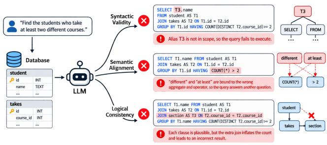  
Figure 1: Three challenges of SQL generation on the running example. Each row shows a query with one type of error, and highlighted spans mark the wrong decisions.

To tackle these challenges, we propose SQLoom, a constraintaware fine-tuning framework. Our key insight is that SQL generation is better supervised by contrasting sets of outputs than by imitating a single reference. Owing to the grammar and the schema, a question often has several correct queries, and at many positions the correct output is a class of tokens, e.g., the columns of the joined tables after SELECT, rather than one token. Token-level SFT rewards one member and pushes down the others, including correct ones. SQLoom therefore augments SFT with a set-contrastive objective that favors a set of correct outputs over a set of wrong outputs dif fering from them at a single place, at three granularities. Syntactic constraint for C1. At each position, the correct set contains the tokens allowed by the grammar and the schema, and the wrong set contains the rest. Semantic constraint for C2. For each question phrase, the correct set contains its reference SQL fragment, e.g., >= 2 for “at least two”, and the wrong set contains fragments the model confuses with it, e.g., > 2. Logical constraint for C3. For each pair of dependent clauses, we edit the question so that one clause must change, e.g., counting only courses with a lab section. The cor-rect set contains the query that also updates the dependent clause, e.g., the count, and the wrong set contains the query that changes only the edited clause. The three constraints thus address the three challenges by teaching which tokens are legal, which fragments match the question, and which clauses must change together.

Our technical contributions are summarized below.

• We propose SQLoom, which replaces token-by-token imitation of one reference query with set-contrastive supervision labeled by a parser and query execution, instantiated as three constraints on syntax, semantics, and logic.

• We design a syntactic constraint that uses the parse state as a training signal. An incremental parser with schema scope derives the legal tokens at each position, and a trie over schema identifiers aligns grammar terminals with subword tokens, so the model learns the grammar in training and needs no parser to correct its output at inference.

• We design a semantic constraint that teaches the model to map each question phrase to the correct SQL fragment rather than a confusable one. It grounds question phrases in the AST nodes that realize them and contrasts each node with confusions mined from the model’s own errors.

• We design a logical constraint that keeps dependent clauses con-sistent when one of them changes. It derives these dependencies from a dependency graph over clauses and contrasts consistent and inconsistent queries on counterexample databases where their results difer.

Constructing these constraints requires correct and wrong sets for every training example, which are absent from the original annotations. The syntactic sets are derived directly by the parser, whereas the semantic and logical sets are built by a constraint synthesizer with four LLM agents. For the semantic constraint, an error-mining agent finds the model’s wrong decisions and an align- ment agent maps question phrases to SQL fragments with their confusions. For the logical constraint, an editing agent rewrites the question along a dependency edge with the two queries, and a verification agent checks the edited query’s intent. Each output must pass the parser and execution checks. While synthesizing constraints in our experiments, the error-mining agent also flagged 378 Spider annotations that mislabel correct predictions or teach in-correct queries. After manual review, we correct these annotations and release Spider-Refined, a training dataset that extends Spider with the corrected annotations, schema descriptions generated by the synthesizer, and the verified constraint samples. Spider-Refined serves only as training data, and all evaluations use the oficial labels. Experiments lead to four findings.

• The gains come from the objective. With the same training data, replacing the constraints with plain SFT lowers EX by 8.8 points on Spider Test and 10.3 points on BIRD Dev.

• A 1.7B model outperforms much larger systems. SQLoom reaches 88.7% EX on Spider Dev (62.9% zero-shot), 89.2% on Spider Test, and 73.4% on BIRD Dev, above all evaluated baselines and zero-shot Qwen3-235B and GPT-4.

• SQLoom is robust to perturbed questions. It loses at most 0.6 points on the three Spider variants, whereas agent-based methods lose 8.8–12.1 points on Spider-DK.

• SQLoom is eficient. It generates SQL in one pass (0.42 s per query), 23× faster than CogSQL with GPT-4 in our setup.

Overall, these results show that with constraint-based supervi- sion, even a small LLM can generate SQL accurately and robustly.

## 2 Background

## 2.1 Problem Formulation

Given a natural language question � and a database D with schema S (tables, columns, primary and foreign keys), text-to-SQL gener-ates a query $y = ( y _ { 1 } , \dotsc , y _ { T } )$ whose execution result on D answers �. Let � = (�, S) denote the model input. Fine-tuning methods train an LLM �� by minimizing the negative log-likelihood of a reference

Table 1: Supervision signals of representative fine-tuning methods. Syn., Sem., and Log. denote explicit supervision of syntactic validity, semantic alignment beyond tables and columns, and cross-clause consistency.
<table><tr><td>Method</td><td>Training signal</td><td>Syn.</td><td>Sem.</td><td>Log.</td></tr><tr><td>CodeS [13], OmniSQL [11]</td><td>token likelihood</td><td>x</td><td>x</td><td>x</td></tr><tr><td>ROUTE [23], JOLT-SQL [28]</td><td>+ schema linking</td><td>x</td><td>x</td><td>x</td></tr><tr><td>ExCoT [40]</td><td>query-level preference</td><td>x</td><td>x</td><td>x</td></tr><tr><td>SQL-R1 [17], Arctic [37]</td><td>query-level reward</td><td>x</td><td>x</td><td>x</td></tr><tr><td>Ma et al. [18]</td><td>AST-matching reward</td><td>√</td><td>x</td><td>x</td></tr><tr><td>EXPO-SQL [9]</td><td>clause-level reward</td><td>√</td><td>x</td><td>x</td></tr><tr><td>SQLoom</td><td>unified set-contrastive objective</td><td>√</td><td>J</td><td>√</td></tr></table>

query $y ^ { * }$

$$
\mathcal { L } _ { \mathrm { S F T } } = - \sum _ { t = 1 } ^ { T } \log p _ { \theta } \left( y _ { t } ^ { * } \mid x , y _ { < t } ^ { * } \right) .\tag{1}
$$

## 2.2 Related Work

Prompt-based Agent Methods. Early neural parsers encode the schema with task-specific architectures [14, 32, 43]. LLM-based methods instead improve a general model at inference, through example selection, decomposition, and schema pruning [6, 10, 20, 24, 30, 35], or through agents that plan, refine, and select among candidates [1, 2, 19, 27, 31, 39]. Other work checks SQL with tools rather than with a model. Constrained decoding runs an incremen- tal SQL parser during generation and discards tokens that violate the grammar or the schema [26], and test-suite evaluation executes a predicted query on several generated databases to expose queries that are correct only by coincidence on the original one [42]. In essence, these methods repair or detect errors after generation in- stead of preventing them. The repair is judged by the same LLM or by execution failures, so a query that executes but answers an- other question often passes, and each question pays for several LLM calls [41]. The tools also act outside training, so the model does not learn from them and the parser must stay in the serving loop.

Data-centric Fine-tuning. This direction scales the training corpus through SQL-centric pre-training and data synthesis [11, 13, 29, 36]. Its limitation lies in the form of supervision rather than its amount (Table 1). Each sample still provides one reference string, so the model must infer grammar rules, question-to-SQL bindings, and clause dependencies statistically, and equivalent queries for one question even provide conflicting targets.

Task-decomposition Fine-tuning. This direction splits generation into schema linking, skeleton parsing, and SQL stages, or adds them as auxiliary tasks [12, 21, 23, 28]. It strengthens the recognition of the input, namely which tables and columns to use (Table 1), but leaves output-side decisions, such as aggregates, operators, and their consistency across clauses, to token-level imitation.

Feedback-driven Fine-tuning. This direction optimizes executionbased preferences or rewards with DPO or reinforcement learn- ing [16, 17, 22, 25, 37, 40], and recent work refines the reward with graph, AST, or clause-level matching [9, 18, 33]. The core problem is the signal itself. An outcome-level reward spreads the same credit over all tokens, and single-database execution wrongly rewards inconsistent queries with correct results (Table 1).

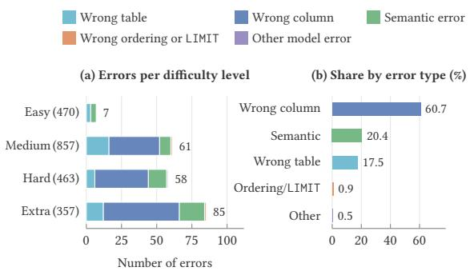  
Figure 2: Model errors of LoRA fine-tuning on Spider Dev (a) per dificulty level, with question counts, and (b) by type.

## 2.3 Motivation

Problem measurement. To measure which errors remain under standard fine-tuning, we fine-tune Qwen3-1.7B on the Spider training set with LoRA and token-level SFT, and classify its 211 model errors on the Spider development set (Figure 2; categories in Ap- pendix D). Wrong columns dominate from medium to extra-hard questions, followed by semantic errors. These queries are valid but bind a question element to a wrong decision, which typically spans only one or a few tokens.

These model errors trace back to Eq. 1, which raises the likelihood of the reference without explicitly penalizing incorrect outputs and ignores three properties of SQL. 1) Validity is decidable. Given the grammar and the schema, an incremental parser determines which tokens are legal at each position, yet SFT does not explicitly lower the probability of illegal ones. 2) Errors are local but decisive. A wrong decision, such as COUNT(\*) instead of COUNT(DISTINCT ·), occupies a small share of the SFT loss but changes the answer; con- versely, since SQL labels are not unique, an equivalent rewriting of $y ^ { * }$ is penalized as much as a wrong query. 3) Decisions are dependent. A one-to-many join may require DISTINCT, and GROUP BY must follow the target entity, but a query that violates such a dependency can still return the correct result on the given database.

Requirements. A fine-tuning objective for SQL should therefore meet three requirements. First, it contrasts the reference with outputs certified to be wrong by a parser or by execution beyond the given database. Second, it confines the contrast to the structural unit in which the outputs difer. Third, it applies at the level of tokens, decisions, and dependent decisions.

## 3 Methodology

## 3.1 Overview

Token-level SFT maximizes the likelihood of the reference without penalizing incorrect outputs, so wrong tokens, wrong decisions, and inconsistent clauses receive little training signal. SQLoom su-pervises these errors explicitly while keeping single-pass inference. As shown in Figure 3, the constraint synthesizer (Section 4.1) builds sets of correct outputs and minimally diferent wrong outputs at the syntactic, semantic, and logical levels. A set-contrastive objective favors the correct set over the wrong set at each of the three levels. A three-stage procedure trains the model with this objective.

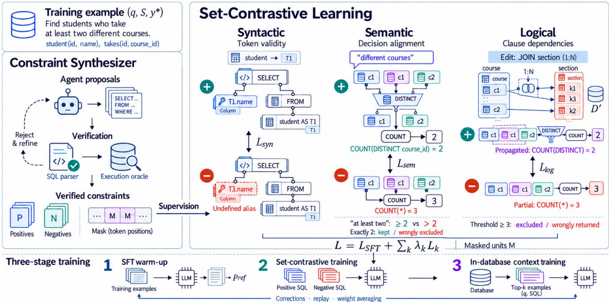  
Figure 3: Overview of SQLoom. The constraint synthesizer builds positive and negative sets, a set-contrastive loss favors positives (colored) over minimally diferent negatives (red) at three levels, and training proceeds in three stages.

Three-level correctness hierarchy. The three challenges occur at diferent granularities, so one loss on the whole query cannot tell where an error lies. We therefore define one unit per challenge, namely a token for C1, a decision for C2, and a pair of dependent decisions for C3. A decision is the SQL fragment that realizes one element of the question, $\mathrm { e . g . , } \mathrm { > } = 2 \mathrm { f o r } ^ { \circ }$ “at least two”, and corresponds to a node of the abstract syntax tree (AST) of the query. A logical unit links two decisions in diferent clauses, e.g., a join and the count that depends on it.

Oracle-certified constraints. Since one question can have several correct queries, comparing an output with the reference cannot tell whether the output is wrong or merely written diferently. For each unit � we therefore build a constraint $c = ( \mathcal { P } _ { c } , N _ { c } , M _ { c } )$ , where $\mathcal { P } _ { c }$ is a set of correct (admissible) outputs, ${ \cal N } _ { c }$ is a set of wrong (inadmissible) outputs that difer from them only in $u ,$ and $M _ { c } ( y )$ marks the token positions of � that belong to �. Wrong outputs are certified by an oracle, i.e., a program with a definite answer rather than a learned model, whereas correct outputs are references or pass additional checks. The oracle is a schema-aware SQL parser at the syntactic level. At the other two levels it executes the queries on the original database D and on counterexample databases $\{ \mathcal { D } _ { j } ^ { \prime } \}$ , i.e., small generated databases on which similar queries return diferent results. Appendix C details both oracles.

Set-contrastive objective. We compare outputs only at the po-sitions of their unit. Let $\begin{array} { r } { r _ { \theta } ( y , M ) = \sum _ { t \in M } \log \frac { p _ { \theta } ( y _ { t } | x , y _ { < t } ) } { p _ { \mathrm { r e f } } ( y _ { t } | x , y _ { < t } ) } } \end{array}$ be how much more likely the model makes � at positions � than a frozen reference model $\scriptstyle { \mathcal { P } } \mathrm { r e f }$ , here the model after warm-up. Each constraint

Table 2: Instantiations of the set-contrastive constraint (Eq. 2) at the three levels. The last row lists each level’s negatives.
<table><tr><td></td><td>Syntactic</td><td>Semantic</td><td>Logical</td></tr><tr><td>Unit u</td><td>decision position t</td><td>AST node di aligned to element e</td><td>dependent decision pair (edge of G)</td></tr><tr><td> $\mathcal { P } _ { c }$ </td><td>valid next tokens</td><td>reference decision</td><td>propagated y&#x27;</td></tr><tr><td> ${ \cal N } _ { c }$ </td><td>invalid next tokens</td><td>verified confusions</td><td>partially propagated ğ&#x27;</td></tr><tr><td> $M _ { c }$ </td><td>position t</td><td>tokens of di</td><td>tokens of affected clauses</td></tr><tr><td>Oracle</td><td>parser</td><td>execution on D, D&#x27;</td><td>execution on D, D&#x27;</td></tr><tr><td>Negatives</td><td>invalid</td><td>valid, misaligned</td><td>valid, aligned, inconsistent</td></tr></table>

is enforced by

$$
\ell ( c ) = - \log \frac { \sum _ { y \in \mathcal { P } _ { c } } \exp \big ( \beta r _ { \theta } \big ( y , M _ { c } ( y ) \big ) \big ) } { \sum _ { y \in \mathcal { P } _ { c } \cup N _ { c } } \exp \big ( \beta r _ { \theta } ( y , M _ { c } ( y ) ) \big ) } ,\tag{2}
$$

which raises the total probability of the correct set over the wrong set at the positions of the unit, while the rest of the query keeps the plain SFT signal. The temperature $\beta$ controls how sharply the two sets are separated. The full objective is

$$
\mathcal { L } = \mathcal { L } _ { \mathrm { S F T } } + \sum _ { k \in \{ \mathrm { s y n } , \mathrm { s e m } , \log \} } \lambda _ { k } \mathcal { L } _ { k } , \qquad \mathcal { L } _ { k } = \sum _ { c \in C _ { k } } \ell ( c ) ,\tag{3}
$$

where $C _ { k }$ is the set of constraints at level $k ,$ and ${ \mathcal { L } } _ { \mathrm { S F T } }$ covers the references and all admissible outputs. Table 2 lists the instantiations.

Semantic negatives are valid queries, and logical negatives also keep each decision consistent with the question (last row of Table 2), so each level covers errors that the previous levels miss.

The loss never penalizes equivalent outputs and updates only the constrained unit (Appendix A).

## 3.2 Syntactic Constraint

The syntactic constraint teaches the model which tokens may come next (C1). Legality depends on the grammar and the schema, e.g., an alias defined inside a subquery is not visible outside it, and SQL keywords and names do not align with the LLM’s subword tokens.

We feed $y ^ { * }$ token by token into an incremental parser, i.e., a SQL parser that can analyze an unfinished query, extended with the schema. After each prefix $y _ { < t } ^ { * }$ , the parser returns a state $s _ { t }$ that records what may come next and which tables, aliases, and columns are visible. The legal set $\mathcal { V } _ { \mathrm { v a l i d } } ( s _ { t } )$ contains each token � after which the query can still be completed into a valid one, e.g., only table names of $s$ after FROM. Since a name may span several subword tokens, legality is checked on the decoded text with a prefix tree (trie) of keywords and schema names, so the partial name stu of student counts as legal. The constraint is applied at decision positions ${ \mathcal { T } } _ { d } ,$ i.e., the first token of each keyword, name, operator, or parenthesis, and the legal sets are cached per database.

The syntactic instance of $\operatorname { E q . }$ 2 is

$$
\mathcal { L } _ { \mathrm { s y n } } = - \sum _ { t \in \mathcal { T } _ { d } } \log \sum _ { v \in \mathcal { V } _ { \mathrm { v a l i d } } ( s _ { t } ) } \ p _ { \theta } \left( v \mid x , y _ { < t } ^ { * } \right) ,\tag{4}
$$

which moves probability from illegal tokens to the whole legal set rather than to the reference token alone, so legal alternatives are not pushed down. The model thus learns validity during training and needs no parser at inference.

## 3.3 Semantic Constraint

The semantic constraint binds each element of the question to the SQL decision that realizes it (C2). Datasets do not annotate which phrase maps to which part of the query, and a seemingly wrong alternative may be an equivalent rewrite.

For each training example, we extract alignments $\mathcal { A } = \{ ( e _ { i } , d _ { i } ) \}$ where �� is an element of�, $\mathrm { e . g . }$ ., “at least $\mathrm { { t w o } } ^ { \mathfrak { n } } ,$ and �� is the AST node of $\cdot y ^ { * }$ that realizes it, e.g., >= 2 (Figure 9). Elements fall into six types, namely entity, attribute, value, aggregation, comparison/quantifier, and ordering. An alignment is kept only if replacing $d _ { i }$ by another option of the same type changes the execution result, which con- firms that $d _ { i }$ depends on $e _ { i } .$ . As an auxiliary task, the model writes the alignment list before the SQL, supervised by ${ \mathcal { L } } _ { \mathrm { S F T } }$

For each alignment, $\mathcal { P } _ { c } ~ = ~ \{ y ^ { * } \}$ , and ${ \cal N } _ { c }$ contains confusions $\tilde { y }$ that replace $d _ { i }$ with a similar but wrong option, $\mathrm { e . g . }$ , a similar column, COUNT(\*) for COUNT(DISTINCT ·), $\operatorname { o r } > \operatorname { f o r } > = .$ . Candidates are ranked by how often the current model makes them, so training targets its actual mistakes. Only valid confusions that return a diferent result from $y ^ { * }$ are kept, so equivalent rewrites are not penalized by design. With one confusion per unit, Eq. 2 reduces to the pairwise loss of direct preference optimization (DPO) [25] restricted to the tokens of $d _ { i } ,$ which corrects the wrong decision without changing the rest of the query.

## 3.4 Logical Constraint

The logical constraint teaches the model to update dependent clauses together (C3). A single training pair rarely shows how one clause should change when another changes, and an inconsis- tent query often returns the correct result on D, so executing it there does not reveal the error.

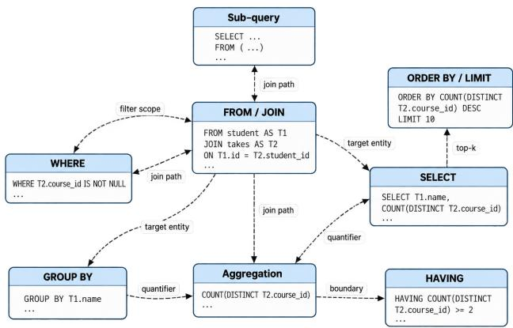  
Figure 4: Component dependency graph $G$ on an example query. Each labeled edge marks a component that must be checked when the source component changes.

We split a query into components (FROM/JOIN, WHERE, GROUP BY, aggregation, HAVING, SELECT, ORDER BY/LIMIT, and sub-queries) and build a graph � in which an edge states that a certain change to one component requires checking another (Figure 4; all edges in Table 4). For example, adding a one-to-many join requires checking whether the count still counts each entity once. Each edge is a unit. Edges mark what may change, and execution decides how.

Starting from $( q , y ^ { * } )$ , we change one aligned element of the question and generate an edited question $q ^ { \prime } { : }$ , a propagated query $y ^ { \prime }$ in which the edited component and the components that depend on it are updated, and a partially propagated query $\tilde { y } ^ { \prime }$ in which only the edited component changes. Then $\mathcal { P } _ { c } = \{ y ^ { \prime } \}$ and $\boldsymbol { \mathcal { N } _ { c } } = \left\{ \boldsymbol { \tilde { y } ^ { \prime } } \right\}$ for input $( q ^ { \prime } , S )$ . For example, restricting the running example to courses with a lab section adds a join with section; $y ^ { \prime }$ counts DISTINCT T2.course\_id, whereas $\tilde { y } ^ { \prime }$ keeps COUNT(\*), which counts a course per lab section. The pair isolates the dependency and is kept only if the two queries difer on a counterexample database, $y ^ { \prime }$ runs on all databases, and the verification agent judges $y ^ { \prime }$ consistent with $q ^ { \prime } .$

The mask $M _ { c }$ covers the components that difer between $y ^ { \prime }$ and $\tilde { y } ^ { \prime }$ . Since both queries contain the edit, the loss focuses on the components that must change because of it. Eq. 2 again reduces to a DPO-style loss on these positions, and $y ^ { \prime }$ is also added to ${ \mathcal { L } } _ { \mathrm { S F T } }$ Appendices B, C, and E show examples of all levels.

## 3.5 Training Procedure

The training procedure combines the three constraints in one model. Preference losses are unstable before the model can write reasonable SQL, and later fine-tuning stages tend to overwrite earlier skills. SQLoom therefore trains in three stages (Algorithm 1). Stage 1 is a short SFT warm-up whose result also serves as $\scriptstyle { \mathcal { P } } \mathrm { r e f }$ . Stage 2 trains with $\operatorname { E q } .$ 3. Stage 3 prepends to each input the � most similar verified question–query pairs of the same database, since Web applications answer many questions over one database. After each stage, the model is further fine-tuned on queries corrected by the error-mining agent $A _ { e }$ (Section 4.1), mixed with a share of earlier examples (replay), and its weights are averaged with the pre-trained ones as in WiSE-FT [34] to reduce forgetting.

Algorithm 1: Three-stage training procedure of SQLoom.   
Input: training set $\mathcal { T } ,$ pre-trained LLM $M _ { p }$   
� ← Correct(SFT of $M _ { P }$ on Tfor one epoch) ; // Stage 1   
�ref ← �; build $C _ { \mathrm { s y n } }$ , Csem, $C _ { \mathrm { l o g } }$ with the constraint synthesizer;   
foreach mini-batch B ofT ∪ $C _ { \mathrm { s y n } }$ ∪ $C _ { \mathrm { { s e m } } }$ ∪ $C _ { \mathrm { l o g } }$ do   
update � by minimizing L (Eq. 3) on B ; // Stage 2   
� ←Correct(�);   
� ← Correct(SFT with top-� in-database examples) $; / /$ Stage 3   
return �;   
Function Correct(�):   
train � with $\mathcal { L } _ { \mathrm { S F T } }$ on verified corrections of $A _ { e } ( M , \mathcal { T } )$ and a   
replay of $\pmb { \mathit { p } } _ { \mathrm { s a m p l e } }$ earlier examples;   
merge LoRA adapters; return $\gamma M + ( 1 - \gamma ) M _ { p } ;$

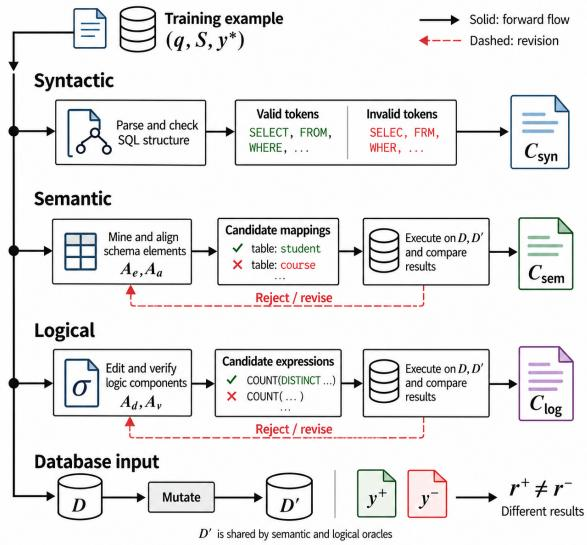  
Figure 5: Agent-based constraint synthesizer. Agents or a parser propose candidates in three lanes, LLM-free oracles accept or reject them (dashed), and counterexample databases $\mathcal { D } ^ { \prime }$ serve the semantic and logical lanes.

## 4 Verified Constraint Synthesis

## 4.1 Agent-based Constraint Synthesizer

The constraint synthesizer instantiates the constraints ofSection 3.1. As shown in Figure 5, four LLM agents propose candidates, and the grammar and execution oracles decide their membership in $\mathcal { P } _ { c }$ or $N _ { c } .$ . The parser alone yields the syntactic constraint, $A _ { e }$ and $A _ { a }$ the semantic one, and $A _ { d }$ and $A _ { v }$ the logical one.

• Error-mining agent $A _ { e } ,$ . After each stage, $A _ { e }$ finds the wrong decision in each failed training prediction and writes a close correction, repaired by execution for at most $i _ { \mathrm { m a x } } ^ { c }$ rounds. Correc tions serve as SFT examples, the wrong decisions select the units for semantic and logical constraints, and suspicious references are flagged for manual review.

• Alignment agent $A _ { a }$ proposes semantic units (alignments) and up to three confusable alternatives per decision.

• Editing agent $A _ { d }$ samples a logical unit (an edge of �) and produces �′, $y ^ { \prime } ,$ , and $\tilde { y } ^ { \prime }$

• Verification agent $A _ { v }$ back-translates $y ^ { \prime }$ into a question and checks whether it matches $q ^ { \prime }$

Counterexample database generation. Given a database $\mathcal { D }$ and two queries $y _ { 1 }$ and $y _ { 2 }$ with the same result on D, the generator searches for a database $\mathcal { D } ^ { \prime }$ that satisfies the constraints of D and on which $y _ { 1 }$ and �2 return diferent results. It (1) samples a sub-database containing the tables referenced by the queries, following foreign keys to keep referential integrity; (2) mutates it by duplicating rows with fresh primary keys, perturbing values at the boundaries of query constants $( \mathrm { e . g . } , 2 \ \mathrm { i n } > = \ 2 )$ , and inserting additional child rows into one-to-many relationships; and (3) keeps a mutated instance if it satisfies the primary-key, foreign-key, NOT NULL, and type constraints and separates the two queries. Duplicated child rows expose join-induced double counting, boundary values expose inclusive versus exclusive comparisons, and ties expose superlative and LIMIT errors. The search stops when a separating instance is found or a mutation budget is exhausted. The same procedure is used for the non-equivalence check of confusions and the substitu- tion test of alignments. Each training example contributes at most one pair per edge type in Table 4.

Because each candidate must pass checks that do not depend on an LLM, agent errors reduce the amount of data rather than its cor- rectness. For example, an incorrect alignment fails the substitution test, an incorrect propagated query is not separated from its partial counterpart, and an equivalent confusion is discarded. The agent prompts are listed in Appendix F.

## 4.2 The Spider-Refined Dataset

During error mining, many apparent model errors turned out to be Spider annotation problems. We manually reviewed all cases flagged by $A _ { e }$ and introduce Spider-Refined, a training dataset built from Spider that corrects these annotations, enriches the database schemas, and adds the verified alignments, confusions, and counter- factual pairs produced by the constraint synthesizer. Spider-Refined is used only for training; evaluation uses the oficial sets.

Among the confirmed annotation issues, the most frequent is a correct prediction that is rejected by execution-based comparison (163 cases), followed by under-specified questions whose references return extra (71) or missing (37) columns, and references whose logic contradicts the question (31). Figure 14 lists all issue types. For each confirmed issue, the reference query or the question is minimally revised; when several outputs are equally valid, the alternatives are recorded. All revisions are verified by execution.

Spider schemas often use terse or ambiguous identifiers. For each database, the synthesizer agents generate descriptions of (i) table semantics, e.g., player stores player records; (ii) value types, e.g., REAL for continuous values such as income and INTEGER for counts; (iii) relationships, e.g., one club has many players; (iv) potential pitfalls, e.g., a floating-point primary key that makes equality com-parison unreliable; and (v) intended use cases, e.g., retrieving the players of a club or aggregating income per club. The descriptions are checked manually and added to the schema input S and the agent prompts.

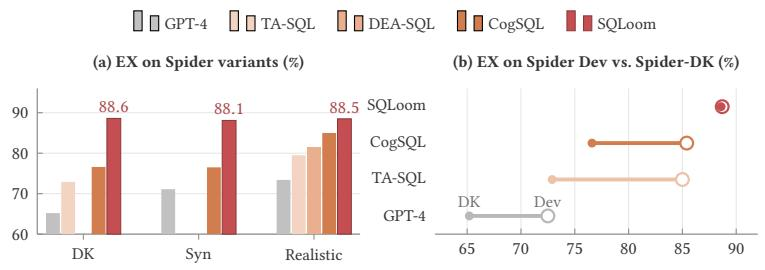

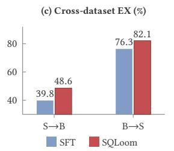

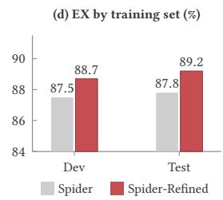  
Figure 6: Robustness and transfer. (a) EX on the Spider variants. (b) EX on Spider Dev (hollow) and Spider-DK (filled); a shorter segment means higher robustness. (c) Cross-dataset EX (S = Spider, B = BIRD). (d) EX when training on Spider vs. Spider-Refined.

## 5 Experiments

We evaluate how SQLoom compares with fine-tuning, reinforce-ment learning, and agent-based methods and with general-purpose LLMs, its robustness to perturbed questions and unseen datasets, how each component contributes, and its cost.

## 5.1 Experimental Settings

Datasets. We use Spider [38] (10,181 questions, 200 databases, 138 domains), its variants Spider-DK [5], Spider-Syn [4], and Spider-Realistic [3], and BIRD [15] (12,751 pairs, 95 databases, 33.4 GB). We train two models, one on the Spider-Refined training set, evalu ated on Spider and its variants, and one on the BIRD training set, evaluated on BIRD. Evaluation databases are disjoint from training databases, so all evaluations are cross-database. Spider dificulty levels follow the oficial script, which counts SQL components such as joins, aggregations, and nested queries.

Baselines. We compare with fine-tuning methods (T5-3B+PICARD [26], RESDSQL [12], SQL-PaLM [29], CodeS [13], SENSE [36], ROUTE [23], OmniSQL [11], and JOLT-SQL [28]), preference and RL methods (ExCoT [40], SQL-R1 [17], and Arctic-Text2SQL-R1 [37]), and agentbased methods (SQLFixAgent [2], DEA-SQL [35], SuperSQL [10], CogSQL [39], TA-SQL [24], and AskData [27]).

Metrics and implementation. We report execution accuracy (EX). SQLoom fine-tunes Qwen3-1.7B with LoRA [8] on one RTX 4090 GPU and decodes greedily without constrained decoding. The agents use GPT-4. We set $\lambda _ { \mathrm { s y n } } = 0 . 5 , \lambda _ { \mathrm { s e m } } = \lambda _ { \mathrm { l o g } } = 1 . 0 , \beta = 0 . 1$ , and � = 3, selected by grid search on a held-out 10% of the training set (Appendix C). Results of SQLoom are averaged over 3 seeds.

## 5.2 Main Results

As shown in Table 3, SQLoom achieves the best EX on all three sets with the smallest model, exceeding the strongest baselines by 1.1, 0.4, and 4.5 points. It outperforms JOLT-SQL, the best fine-tuning method, by 13.0 points on BIRD, and AskData, the best agent-based method, by 6.0 points, without proprietary LLM calls.

As Table 3 and Figure 13 show, all baselines above 85% on the Spider test set or 60% on BIRD use at least 7B parameters, whereas

Table 3: EX (%) on Spider and BIRD. The best results are in bold red and the second best are underlined, and † denotes self-consistency. SQLoom uses no BIRD evidence and reports mean ± std over three seeds.
<table><tr><td rowspan="2">Method</td><td colspan="2">Spider</td><td rowspan="2">BIRD Dev</td></tr><tr><td>Dev</td><td>Test</td></tr><tr><td>Fine-tuning</td><td></td><td></td><td></td></tr><tr><td>T5-3B + PICARD</td><td>79.3</td><td>75.1</td><td>-</td></tr><tr><td>RESDSQL-3B + NatSQL</td><td>84.1</td><td>79.9</td><td>-</td></tr><tr><td>SQL-PaLM</td><td>82.8</td><td>1</td><td>-</td></tr><tr><td>CodeS-7B</td><td>85.4</td><td>83.5</td><td>57.2</td></tr><tr><td>SENSE-7B</td><td>83.2</td><td>83.5</td><td>51.8</td></tr><tr><td>ROUTE + Qwen2.5-7B</td><td>83.6</td><td>83.7</td><td>55.9</td></tr><tr><td>OmniSQL-7B</td><td>81.2</td><td>87.9</td><td>63.9</td></tr><tr><td>JOLT-SQL + Qwen2.5-Coder-7B</td><td>87.0</td><td>86.8</td><td>60.4</td></tr><tr><td>Preference / reinforcement learning</td><td></td><td></td><td></td></tr><tr><td>ExCoT + LLaMA-3.1-70B</td><td></td><td>86.6</td><td>68.5</td></tr><tr><td>SQL-R1 + Qwen2.5-Coder-7B†</td><td>87.6</td><td>88.7</td><td>66.6</td></tr><tr><td>Arctic-Text2SQL-R1-7B</td><td>1</td><td>88.8</td><td>68.9</td></tr><tr><td>Agent-based</td><td></td><td></td><td></td></tr><tr><td>CodeS-7B + SQLFixAgent</td><td>86.2</td><td>83.9</td><td>–</td></tr><tr><td>DEA-SQL + GPT-4</td><td>85.4</td><td>87.1</td><td>58.9</td></tr><tr><td>SuperSQL + GPT-4</td><td>87.0</td><td></td><td>58.5</td></tr><tr><td>CogSQL + GPT-4</td><td>85.4</td><td>86.4</td><td>59.6</td></tr><tr><td>TA-SQL + GPT-4</td><td>85.0</td><td></td><td>56.2</td></tr><tr><td>AskData + GPT-40</td><td>一</td><td></td><td>67.4</td></tr><tr><td>SQLoom + Qwen3-1.7B</td><td>88.7±0.3</td><td>89.2±0.2</td><td>73.4±0.5</td></tr></table>

SQLoom uses 1.7B. Its margin is largest on BIRD, whose questions involve more clauses and more chances for inconsistency.

Unlike most baselines, SQLoom does not use the external knowl-edge evidence of BIRD; adding it raises EX to 76.8%. The gains are also not explained by imitating the teacher, since oracles vet agent outputs and GPT-4 is weaker on the Spider variants (Figure 6a).

Takeaway. Explicit SQL supervision can matter more than scale: a small model trained to reject near misses beats much larger ones.

## 5.3 Comparison with General-Purpose LLMs

Figure 8 shows that model size does not determine zero-shot ac- curacy. Qwen3-8B matches Qwen3-235B, and the open-weight DeepSeek-V3 is 14.4 points lower. Reasoning and code-specialized models score lowest; most oftheir failures lack a final SQL statement within the generation budget, which is why the longer-reasoning DeepSeek-R1-671B scores below DeepSeek-R1-8B. SQLoom lifts

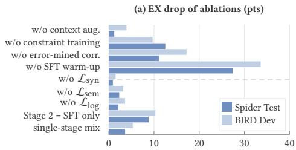

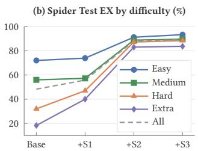

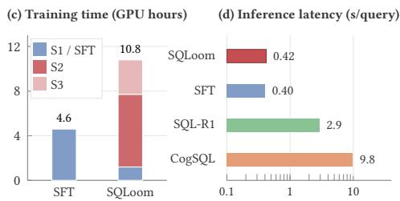

Figure 7: Ablation and cost. (a) EX drop of ablated stages (above the dashed line) and constraint levels (below). (b) Spider Test EX by dificulty after Stages 1 to 3 (S1 to S3). (c) Training time. (d) Per-query latency (log scale).  
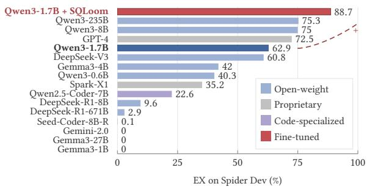  
Figure 8: Zero-shot EX of general-purpose LLMs on Spider Dev, compared with Qwen3-1.7B fine-tuned by SQLoom (top bar).

Qwen3-1.7B from 62.9% to 88.7%, i.e., 13.4 points above the best zero-shot model, which is 138× larger.

## 5.4 Robustness and Transfer

On Spider-DK, Spider-Syn, and Spider-Realistic (Figure 6a,b), SQLoom loses at most 0.6 points relative to Spider Dev, whereas agent-based methods lose 8.8–12.1 points on Spider-DK and 8.9 points on Spider Syn. Lexical matching between question and schema breaks under domain knowledge and synonyms, whereas SQLoom grounds ques tion elements in verified decisions.

In the cross-dataset setting (Figure 6c), SQLoom improves over SFT trained on the same data by 8.8 points from Spider to BIRD and 5.8 points from BIRD to Spider. Training on Spider-Refined instead of Spider improves EX on the oficial sets by 1.2 and 1.4 points (Figure 6d), so the corrections help beyond evaluation.

Takeaway. Supervising properties of SQL itself, rather than patterns of one benchmark, carries over to new phrasings and datasets.

## 5.5 Ablation Study

All training stages contribute. Removing constraint training costs 12.5 and 9.7 points, and removing error-mined correction costs 11.1 and 17.2 points (Figure 7a). Removing the SFT warm-up hurts most.

Each constraint level helps; the semantic and logical constraints contribute most, especially on BIRD. Replacing all constraints with SFT on the same data loses 8.8 and 10.3 points. Single-stage mixing loses 3.6 and 5.3 points, as its reference model lacks the warm-up.

Takeaway. Contrasting references with near-miss errors gives a signal that more SFT data cannot replace, given a warmed-up reference.

## 5.6 Analysis and Cost

In Figure 7b, the SFT warm-up mainly helps hard and extra-hard questions (+15.0 and +21.7 points), where the base model often fails to produce well-formed SQL. Constraint training brings the largest gains at each level, especially for medium to extra-hard questions (+31.6 to +43.0 points). As a result, the gap between easy and extra-hard questions shrinks from 53.7 to 9.6 points. Context augmentation adds a further 0.7–2.1 points. Finally, EX varies by at most 1.4 points over the tested values of $\dot { \boldsymbol { { \beta } } }$ and $\lambda _ { \mathrm { l o g } }$ (Figure 10).

SQLoom moves the agent cost to training (Figure 7c,d). Training takes 10.8 GPU hours (2.3× SFT) and 21.3 GB of memory, plus 38K GPT-4 calls. Inference is as fast as SFT (0.42 s per query) and 23× faster than CogSQL with GPT-4.

Takeaway. Decision-level supervision helps most on multi-clause queries, and building it once with LLM agents is cheaper than calling agents for every query.

## 6 Conclusion and Future Work

We propose SQLoom, which enforces the syntactic validity, semantic alignment, and logical consistency of SQL with oracle-verified set-contrastive supervision, and release the Spider-Refined dataset. With 1.7B parameters, SQLoom outperforms larger fine-tuned, RL, and agent-based systems in a single pass.

In future work, we will fine-tune larger open-weight LLMs with SQLoom to study how constraint-based supervision scales with model size, and construct more constraints, e.g., for nested queries and other SQL dialects.

## References

[1] Arian Askari, Christian Poelitz, and Xinye Tang. 2025. Magic: Generating self correction guideline for in-context text-to-sql. In Proceedings of the AAAI Conference on Artificial Intelligence, Vol. 39. 23433–23441.

[2] Jipeng Cen, Jiaxin Liu, Zhixu Li, and Jingjing Wang. 2025. SQLFixAgent: Towards Semantic-Accurate Text-to-SQL Parsing via Consistency-Enhanced Multi-Agent Collaboration. In Proceedings of the AAAI Conference on Artificial Intelligence, Vol. 39. 49–57.

[3] Xiang Deng, Ahmed Hassan Awadallah, Christopher Meek, Oleksandr Polozov, Huan Sun, and Matthew Richardson. 2020. Structure-grounded pretraining for text-to-sql. arXiv preprint arXiv:2010.12773 (2020).

[4] Yujian Gan, Xinyun Chen, Qiuping Huang, Matthew Purver, John R Woodward, Jinxia Xie, and Pengsheng Huang. 2021. Towards robustness of text-to-SQL models against synonym substitution. arXiv preprint arXiv:2106.01065 (2021).

[5] Yujian Gan, Xinyun Chen, and Matthew Purver. 2021. Exploring Underexplored Limitations of Cross-Domain Text-to-SQL Generalization. arXiv:2109.05157 [cs.CL]

[6] Dawei Gao, Haibin Wang, Yaliang Li, Xiuyu Sun, Yichen Qian, Bolin Ding, and Jingren Zhou. 2024. Text-to-SQL Empowered by Large Language Models: A Benchmark Evaluation. Proceedings ofthe VLDB Endowment 17, 5, 1132–1145.

[7] Zijin Hong, Zheng Yuan, Qinggang Zhang, Hao Chen, Junnan Dong, Feiran Huang, and Xiao Huang. 2024. Next-Generation Database Interfaces: A Survey of LLM-based Text-to-SQL. arXiv preprint arXiv:2406.08426 (2024).

[8] Edward J Hu, Yelong Shen, Phillip Wallis, Zeyuan Allen-Zhu, Yuanzhi Li, Shean Wang, Lu Wang, Weizhu Chen, et al. 2022. Lora: Low-rank adaptation of large language models. ICLR 1, 2 (2022), 3.

[9] Jaehoon Lee, CheolWon Na, Suyoung Bae, Jin-Seop Lee, Jihyung Lee, YunSeok Choi, and Jee-Hyong Lee. 2026. EXPO-SQL: Execution-based Clause-level Policy Optimization for Text-to-SQL. In Findings of the Association for Computational Linguistics: ACL 2026. 22000–22019.

[10] Boyan Li, Yuyu Luo, Chengliang Chai, Guoliang Li, and Nan Tang. 2024. The dawn of natural language to sql: Are we fully ready? arXiv preprint arXiv:2406.01265 (2024).

[11] Haoyang Li, Shang Wu, Xiaokang Zhang, Xinmei Huang, Jing Zhang, Fuxin Jiang, Shuai Wang, Tieying Zhang, Jianjun Chen, Rui Shi, Hong Chen, and Cuiping Li. 2025. OmniSQL: Synthesizing High-quality Text-to-SQL Data at Scale. Proceedings ofthe VLDB Endowment 18, 11 (2025), 4695–4709.

[12] Haoyang Li, Jing Zhang, Cuiping Li, and Hong Chen. 2023. Resdsql: Decoupling schema linking and skeleton parsing for text-to-sql. In Proceedings ofthe AAAI Conference on Artificial Intelligence, Vol. 37. 13067–13075.

[13] Haoyang Li, Jing Zhang, Hanbing Liu, Ju Fan, Xiaokang Zhang, Jun Zhu, Renjie Wei, Hongyan Pan, Cuiping Li, and Hong Chen. 2024. Codes: Towards building open-source language models for text-to-sql. Proceedings ofthe ACM on Management ofData 2, 3 (2024), 1–28.

[14] Jinyang Li, Binyuan Hui, Reynold Cheng, Bowen Qin, Chenhao Ma, Nan Huo, Fei Huang, Wenyu Du, Luo Si, and Yongbin Li. 2023. Graphix-t5: Mixing pre-trained transformers with graph-aware layers for text-to-sql parsing. In Proceedings of the AAAI conference on artificial intelligence, Vol. 37. 13076–13084.

[15] Jinyang Li, Binyuan Hui, Ge Qu, Jiaxi Yang, Binhua Li, Bowen Li, Bailin Wang, Bowen Qin, Ruiying Geng, Nan Huo, et al. 2023. Can llm already serve as a database interface? a big bench for large-scale database grounded text-to-sqls. Advances in Neural Information Processing Systems 36 (2023), 42330–42357.

[16] Hanbing Liu, Haoyang Li, Xiaokang Zhang, Ruotong Chen, Haiyong Xu, Tian Tian, Qi Qi, and Jing Zhang. 2025. Uncovering the Impact of Chain-of-Thought Reasoning for Direct Preference Optimization: Lessons from Text-to-SQL. In Proceedings of the 63rd Annual Meeting of the Association for Computational Linguistics (Volume 1: Long Papers). 21223–21261.

[17] Peixian Ma, Xialie Zhuang, Chengjin Xu, Xuhui Jiang, Ran Chen, and Jian Guo. 2025. SQL-R1: Training Natural Language to SQL Reasoning Model By Reinforce ment Learning. In Advances in Neural Information Processing Systems.

[18] Xingyu Ma, Xin Tian, Lingxiang Wu, Xuepeng Wang, Zhilin Zhang, Xueming Tang, and Jinqiao Wang. 2026. Addressing Semantic Blind Spots in Text-to-SQL via Component Pre-generation and AST Matching Rewards. In Proceedings of the 43rd International Conference on Machine Learning (Proceedings ofMachine Learning Research, Vol. 306). 84969–84988.

[19] Mohammadreza Pourreza, Hailong Li, Ruoxi Sun, Yeounoh Chung, Shayan Talaei, Gaurav Tarlok Kakkar, Yu Gan, Amin Saberi, Fatma Ozcan, and Sercan O. Arik. 2025. CHASE-SQL: Multi-Path Reasonin and Preference O timized Candidate Selection in Text-to-SQL. In The Thirteenth International Conference on Learning Representations.

[20] Mohammadreza Pourreza and Davood Rafiei. 2023. DIN-SQL: Decomposed In-Context Learning of Text-to-SQL with Self-Correction. In Advances in Neural Information Processing Systems.

[21] Mohammadreza Pourreza and Davood Rafiei. 2024. DTS-SQL: Decom osed Textto-SQL with Small Large Language Models. In Findings ofthe Association for Computational Linguistics: EMNLP 2024.

[22] Mohammadreza Pourreza, Shayan Talaei, Ruoxi Sun, Xingchen Wan, Hailong Li, Azalia Mirhoseini, Amin Saberi, and Sercan Ö. Arik. 2025. Reasonin -SQL: Rein forcement Learning with SQL Tailored Partial Rewards for Reasoning-Enhanced Text-to-SQL. arXiv preprint arXiv:2503.23157 (2025).

[23] Yang Qin, Chao Chen, Zhihang Fu, Ze Chen, Dezhong Peng, Peng Hu, and Jieping Ye. 2025. ROUTE: Robust Multitask Tuning and Collaboration for Text-to-SQL. In The Thirteenth International Conference on Learning Representations.

[24] Ge Qu, Jinyang Li, Bowen Li, Bowen Qin, Nan Huo, Chenhao Ma, and Reynold Cheng. 2024. Before generation, align it! a novel and efective strategy for miti gating hallucinations in text-to-sql generation. arXiv preprint arXiv:2405.15307 (2024).

[25] Rafael Rafailov, Archit Sharma, Eric Mitchell, Christopher D. Manning, Stefano Ermon, and Chelsea Finn. 2023. Direct Preference Optimization: Your Language Model is Secretly a Reward Model. In Advances in Neural Information Processing Systems.

[26] Torsten Scholak, Nathan Schucher, and Dzmitry Bahdanau. 2021. PICARD: Parsing incrementally for constrained auto-regressive decoding from language models. arXiv preprint arXiv:2109.05093 (2021).

[27] Vladislav Shkapenyuk, Divesh Srivastava, Theodore Johnson, and Parisa Ghane. 2025. Automatic Metadata Extraction for Text-to-SQL. arXiv preprint arXiv:2505.19988 (2025).

[28] Jinwang Song, Hongying Zan, Kunli Zhang, Lingling Mu, Yingjie Han, Haobo Hua, and Min Peng. 2025. JOLT-SQL: Joint Loss Tuning of Text-to-SQL with Confusion-aware Noisy Schema Sampling. In Proceedings of the 2025 Conference on Empirical Methods in Natural Language Processing. 6040–6053.

[29] Ruoxi Sun, Sercan Ö Arik, Alex Muzio, Lesly Miculicich, Satya Gundabathula, Pengcheng Yin, Hanjun Dai, Hootan Nakhost, Rajarishi Sinha, Zifeng Wang, et al. 2023. Sql-palm: Improved large language model adaptation for text-to-sql (extended). arXiv preprint arXiv:2306.00739 (2023).

[30] Shayan Talaei, Mohammadreza Pourreza, Yu-Chen Chang, Azalia Mirhoseini, and Amin Saberi. 2024. CHESS: Contextual Harnessing for Eficient SQL Synthesis. arXiv preprint arXiv:2405.16755 (2024).

[31] Bing Wang, Changyu Ren, Jian Yang, Xinnian Liang, Jiaqi Bai, Linzheng Chai, Zhao Yan, Qian-Wen Zhang, Di Yin, Xing Sun, and Zhoujun Li. 2025. MAC-SQL: A Multi-Agent Collaborative Framework for Text-to-SQL. In Proceedings ofthe 31st International Conference on Computational Linguistics.

[32] Bailin Wang, Richard Shin, Xiaodong Liu, Oleksandr Polozov, and Matthew Richardson. 2020. RAT-SQL: Relation-Aware Schema Encoding and Linking for Text-to-SQL Parsers. In Proceedings ofthe 58th Annual Meeting ofthe Association for Computational Linguistics. 7567–7578.

[33] Han Weng, Puzhen Wu, Cui Longjie, Yi Zhan, Boyi Liu, Yuanfeng Song, Dun Zeng, Yingxiang Yang, Qianru Zhang, Dong Huang, Xiaoming Yin, Yang Sun, and Xing Chen. 2025. Graph-Reward-SQL: Execution-Free Reinforcement Learning for Text-to-SQL via Graph Matching and Stepwise Reward. In Findings ofthe Association for Computational Linguistics: EMNLP 2025. 12917–12943.

[34] Mitchell Wortsman, Gabriel Ilharco, Jon Wook Kim, Mike Li, Simon Kornblith, Raphael Gontijo Lopes, Hannaneh Hajishirzi, Ali Farhadi, Hongseok Namkoong, and Ludwig Schmidt. 2022. Robust Fine-Tuning of Zero-Shot Models. In Proceedings ofthe IEEE/CVF Conference on Computer Vision and Pattern Recognition. 7959–7971.

[35] Yuanzhen Xie, Xinzhou Jin, Tao Xie, MingXiong Lin, Liang Chen, Chenyun Yu, Lei Cheng, ChengXiang Zhuo, Bo Hu, and Zang Li. 2024. Decomposition for enhancing attention: Improving llm-based Text-to-SQL through workflow paradigm. arXiv preprint arXiv:2402.10671 (2024).

[36] Jiaxi Yang, Binyuan Hui, Min Yang, Jian Yang, Junyang Lin, and Chang Zhou. 2024. Synthesizing Text-to-SQL Data from Weak and Strong LLMs. In Proceedings of the 62nd Annual Meeting ofthe Association for Computational Linguistics (Volume 1: Long Papers). 7864–7875.

[37] Zhewei Yao, Guoheng Sun, Łukasz Borchmann, Zheyu Shen, Minghang Deng, Bohan Zhai, Hao Zhang, Ang Li, and Yuxiong He. 2026. Arctic-Text2SQL-R1: Simple Rewards, Strong Reasoning in Text-to-SQL. In Findings ofthe Association for Computational Linguistics: ACL 2026. 26966–26995.

[38] Tao Yu, Rui Zhang, Kai Yang, Michihiro Yasunaga, Dongxu Wang, Zifan Li, James Ma, Irene Li, Qingning Yao, Shanelle Roman, Zilin Zhang, and Dragomir Radev. 2018. Spider: A Large-Scale Human-Labeled Dataset for Complex and Cross-Domain Semantic Parsing and Text-to-SQL Task. In Proceedings ofthe 2018 Conference on Empirical Methods in Natural Language Processing. Association for Computational Linguistics, Brussels, Belgium.

[39] Hongwei Yuan, Xiu Tang, Ke Chen, Lidan Shou, Gang Chen, and Huan Li. 2025. Cogsql: A cognitive framework for enhancing large language models in text-tosql translation. In Proceedings ofthe AAAI Conference on Artificial Intelligence, Vol. 39. 25778–25786.

[40] Bohan Zhai, Canwen Xu, Yuxiong He, and Zhewei Yao. 2025. Optimizing Reasoning for Text-to-SQL with Execution Feedback. In Findings ofthe Association for Computational Linguistics: ACL 2025. 19206–19218.

[41] Qizheng Zhang, Michael Wornow, and Kunle Olukotun. 2025. Cost-Eficient Serving of LLM Agents via Test-Time Plan Caching. arXiv preprint arXiv:2506.14852 (2025).

[42] Ruiqi Zhong, Tao Yu, and Dan Klein. 2020. Semantic Evaluation for Text-to-SQL with Distilled Test Suites. In Proceedings of the 2020 Conference on Empirical Methods in Natural Language Processing. 396–411.

[43] Victor Zhong, Caiming Xiong, and Richard Socher. 2017. Seq2sql: Generating structured queries from natural language using reinforcement learning. arXiv preprint arXiv:1709.00103 (2017).

## A Properties of the Set-Contrastive Objective

This appendix explains why Eq. 2 is a suitable training objective for all three levels. We show two properties. First, Eq. 2 unifies existing losses: the syntactic loss of Eq. 4 and the DPO loss are its special cases (Proposition A.1), so one objective serves all levels. Second, its gradient pushes down only oracle-certified negatives and fades once a constraint is satisfied (Proposition $\ A . 2 ) ;$ , so equivalent queries are never penalized and training focuses on unsatisfied constraints. Notation. We analyze a single constraint $c = ( \mathcal { P } _ { c } , N _ { c } , M _ { c } )$ , write $r _ { y } = r _ { \theta } ( y , M _ { c } ( y ) )$ , and define

$$
\begin{array} { c c } { \displaystyle \pi ( \boldsymbol { y } ) = \frac { e ^ { \beta r _ { y } } } { \sum _ { \boldsymbol { y } ^ { \prime } \in \mathcal { P } _ { c } \cup \mathcal { N } _ { c } } e ^ { \beta r _ { y ^ { \prime } } } } , \qquad \displaystyle \pi ( { \boldsymbol { N } } _ { c } ) = \sum _ { \boldsymbol { y } \in \mathcal { N } _ { c } } \pi ( \boldsymbol { y } ) , } \\ { \displaystyle \pi \varphi ( \boldsymbol { y } ) = \frac { e ^ { \beta r _ { y } } } { \sum _ { \boldsymbol { y } ^ { \prime } \in \mathcal { P } _ { c } } e ^ { \beta r _ { y ^ { \prime } } } } \quad ( \boldsymbol { y } \in \mathcal { P } _ { c } ) . } \end{array}
$$

Intuitively, $\pi ( y )$ is the share of candidate � among all candidates, $\pi \varphi ( y )$ is its share among the positives, and � $( N _ { c } )$ is the total share of the negatives, so $\ell ( c )$ is small when $\pi ( { \cal N } _ { c } )$ is small.

The first proposition recovers existing losses from Eq. 2.

Proposition A.1 (Special cases). (a) At the syntactic level, with candidates $\boldsymbol { y } _ { < t } ^ { * }$ ⊕ � $f o r o \in \mathcal { V } , \beta = 1 _ { : }$ and $p _ { \mathrm { r e f } } \equiv 1 _ { : }$ Eq. 2 equals the syntactic loss $o f E q .$ . 4 at position $t . \left( b \right) I f \mathcal { P } _ { c } = \left\{ y ^ { + } \right\}$ and $\mathcal { N } _ { c } = \{ y ^ { - } \}$ Eq. 2 equals $- \log \sigma \big ( \beta ( r _ { y ^ { + } } - r _ { y ^ { - } } ) \big )$ , a DPO loss [25] whose reward is restricted to the positions $M _ { c }$

Proof. (a) With $\beta = 1$ and $\begin{array} { r } { \dot { p } _ { \mathrm { r e f } } \equiv 1 , \exp ( r _ { y } ) = \dot { p } _ { \theta } ( v ~ | ~ x , y _ { < t } ^ { * } ) } \end{array}$ Since $\mathcal { P } _ { c } \cup N _ { c }$ covers V, the denominator equals $\begin{array} { r } { \sum _ { v \in \mathcal { V } } p _ { \theta } ( v } \end{array} |$ $x , y _ { < t } ^ { * } ) = 1$ , and the numerator is the probability mass of $\mathcal { V } _ { \mathrm { v a l i d } } ( s _ { t } )$ (b) Dividing the numerator and the denominator by exp( $\beta r _ { y ^ { + } } )$ gives $\ell ( c ) = \log \big ( 1 + \exp ( - \beta ( r _ { y ^ { + } } - r _ { y ^ { - } } ) ) \big ) = - \log \sigma \big ( \beta ( r _ { y ^ { + } } - r _ { y ^ { - } } ) \big )$ □

The second proposition characterizes how Eq. 2 updates the masked reward $r _ { y }$ of each candidate.

Proposition A.2 (Gradient). $\ell ( c ) = - \log \left( 1 - \pi ( N _ { c } ) \right) \geq 0 ,$ , and

$$
\frac { \partial \ell ( c ) } { \partial r _ { y } } = \left\{ \begin{array} { l l } { \beta \pi ( y ) \geq 0 , } & { y \in N _ { c } , } \\ { \beta \big ( \pi ( y ) - \pi \varphi ( y ) \big ) \leq 0 , } & { y \in \mathcal { P } _ { c } . } \end{array} \right.\tag{5}
$$

The total gradient magnitudes over $N _ { c }$ and $\mathcal { P } _ { c }$ both equal $\beta \pi ( N _ { c } )$

Proof. Write

$$
\ell ( c ) = - \log \sum _ { y \in \mathcal { P } _ { c } } e ^ { \beta r _ { y } } + \log \sum _ { y \in \mathcal { P } _ { c } \cup N _ { c } } e ^ { \beta r _ { y } } .
$$

The first claim follows from the definition of �. Diferentiating the second term gives $\beta \pi ( y )$ for each candidate, and diferentiating the first gives $- \beta \pi \phi ( y )$ for $y \in \mathcal { P } _ { c }$ . Since $\begin{array} { r } { \pi ( y ) = \pi _ { \mathcal { P } } ( y ) \left( 1 - \pi ( N _ { c } ) \right) \leq } \end{array}$ $\pi \varphi ( y )$ , the sign for $y \in \mathcal { S } _ { c }$ follows. Summing gives $\beta \pi ( N _ { c } )$ over ${ \cal N } _ { c }$ and $\beta \big ( 1 - ( 1 - \pi ( N _ { c } ) ) \big ) = \beta \pi ( N _ { c } )$ over $\mathcal { P } _ { c }$ □

Implications. Proposition A.2 has three consequences, which justify the claims in Section 3.1.

• Equivalent outputs are not penalized. Only members of $\textstyle N _ { c } .$ which an oracle certifies as invalid or result-changing, are pushed down, while every positive is pushed up. An equivalent rewriting of $y ^ { * }$ is therefore never penalized, unlike in token-level SFT.

• Bounded, self-annealing updates. The gradient magnitude is at most $\beta$ and vanishes as $\pi ( N _ { c } )  0$ , so satisfied constraints stop contributing.

• Localized credit. Since $r _ { \theta } ( y , M _ { c } ( y ) )$ depends only on $M _ { c } ( y )$ other positions are supervised by $\mathcal { L } _ { \mathrm { S F T } }$ alone.

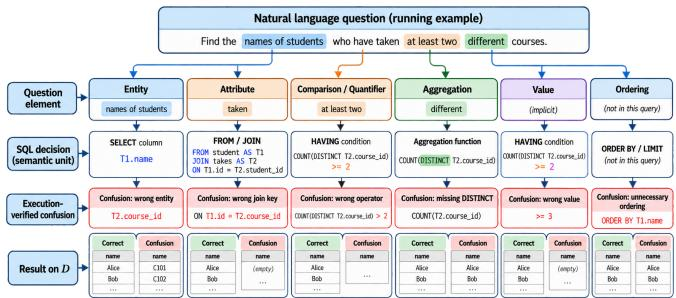  
Figure 9: Semantic units of the running example. Each question element is mapped to its SQL decision and contrasted with a confusion (red) that changes the result on D (bottom row) and is pushed down by the semantic constraint.

Table 4: Dependency edges of �, the components each edit afects, and the check the propagated query must pass.
<table><tr><td>Edit δ on</td><td>Dependent</td><td>Required check</td></tr><tr><td>join path (1:N added)</td><td>aggregation, SELECT</td><td>duplicate counting; DISTINCT or key</td></tr><tr><td>target entity</td><td>GROUP BY, SELECT, join</td><td>grouping granularity</td></tr><tr><td>quantifier</td><td>HAVING, sub-query</td><td>&quot;at least&quot; / &quot;all&quot; / &quot;none&quot;</td></tr><tr><td>boundary / comparison</td><td>WHERE, HAVING</td><td>inclusive vs. exclusive</td></tr><tr><td>superlative / top-k</td><td>ORDER BY, LIMIT, aggregation</td><td>ties; MAX vs. sort</td></tr><tr><td>filter scope</td><td>WHERE  ${ \tt v s } .$  HAVING</td><td>pre- vs. post-aggregation</td></tr></table>

## B Additional Method Details

Semantic units. Figure 9 shows the semantic units of the running example. The six element types are entity (table or join path), attribute (column), value (literal and its column), aggregation (ag- gregate function and DISTINCT), comparison/quantifier (operator and boundary), and ordering (ORDER BY direction and LIMIT). Dependency edges. Table 4 lists the edges of the component dependency graph �. They are derived from SQL semantics and the key constraints of the schema.

## C Implementation Details

Training. Table 5 lists the hyperparameters and Algorithm 1 (Section 3.5) summarizes the training procedure. LoRA adapters are applied to all attention and feed-forward projections.

Hyperparameter selection. We hold out 10% of the training set and grid-search $\lambda _ { \mathrm { s y n } } , \lambda _ { \mathrm { s e m } } , \lambda _ { \mathrm { l o g } } ~ \in ~ \left\{ 0 . 1 , 0 . 5 , 1 . 0 , 2 . 0 \right\}$ and $\beta \in$ $\{ 0 . 0 5 , 0 . 1 , 0 . 2 , 0 . 5 \}$ with the other values fixed. Figure 10 shows the sensitivity to $\beta$ and $\lambda _ { \mathrm { l o g } }$ on Spider Dev.

Oracle implementation. The grammar oracle is an incremental parser for the SQLite dialect, implemented from scratch. It keeps one scope table per nested query, which records the tables, aliases, and visible columns, and covers nested queries, set operations, and CTEs. Queries outside this grammar are discarded. The execution oracle runs queries in SQLite 3.42.0 with a timeout of5 seconds. Two queries return the same result if their outputs are equal as multisets of rows, where row order matters only when the reference contains ORDER BY, floating-point values are compared up to 2 decimal places, and NULL values are equal to each other. A query that fails or times out is treated as invalid, and its candidate is discarded. For each query pair, the counterexample generator tries up to 10 sub-databases with at most 200 mutations each. A diferent result on a database that satisfies the key and type constraints proves that two queries are not equivalent, so the negatives of the semantic and logical constraints are wrong by construction. Positives rest on other evidence. Semantic positives are the references, and a logical positive �′ must execute on all databases and pass verification.

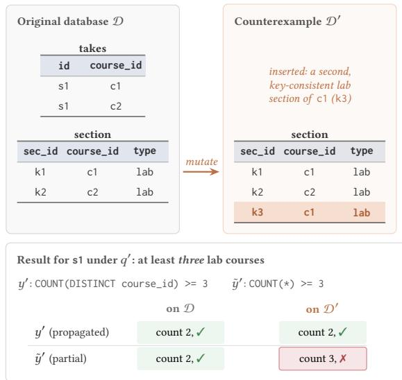

Table 5: Hyperparameters of SQLoom, selected on a held-out 10% of the training set.
<table><tr><td>Name</td><td>Value</td></tr><tr><td>Base LLM</td><td>Qwen3-1.7B</td></tr><tr><td>Agent LLM</td><td>GPT-4</td></tr><tr><td>Fine-tuning method</td><td>LoRA, rank 16, α 32, dropout 0.05</td></tr><tr><td>LoRA target modules</td><td>q, k, v, o, gate, up, down projections</td></tr><tr><td>Learning rate / batch size</td><td>5e-5 / 1</td></tr><tr><td>Epochs (Stage 1 / 2 / 3)</td><td>1 / 2 / 2</td></tr><tr><td>Correction iterations max</td><td>5</td></tr><tr><td>Replay ratio psample</td><td>0.1</td></tr><tr><td>Interpolation rate y</td><td>0.5</td></tr><tr><td>Constraint weights λsyn, λsem, λlog</td><td>0.5, 1.0, 1.0</td></tr><tr><td>Temperature β</td><td>0.1</td></tr><tr><td>Counterexample search per pair</td><td>10 sub-databases × 200 mutations</td></tr><tr><td>Seeds</td><td>3</td></tr><tr><td>Retrieved examples k</td><td>3</td></tr><tr><td>Retrieval embedding / store</td><td>nomic-embed-text / Chroma</td></tr></table>

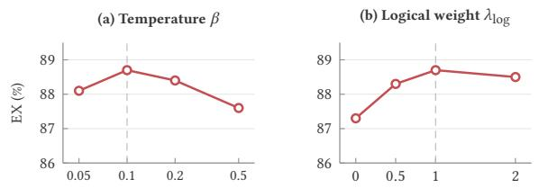  
Figure 10: Sensitivity of Spider Dev EX to the temperature � and the logical weight �log.

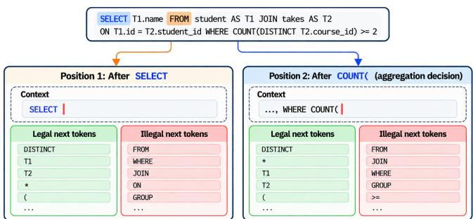  
Figure 11: Legal and illegal next tokens derived by the grammar oracle at two decision positions of the running example.

Valid-token sets. Figure 11 shows the legal and illegal tokens that the grammar oracle derives at two decision positions.

Counterexample databases. Figure 12 shows a counterexample database for the join-path edit. The original data cannot distinguish the propagated and partially propagated queries; inserting a second, key-consistent lab section of the same course separates them.

Figure 12: A counterexample database for the join-path edit. The inserted lab section (highlighted) makes �˜′ wrongly return s1 (✗), while �′ stays correct (✓).  
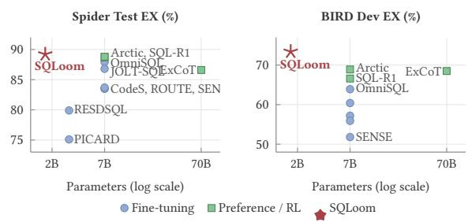  
Figure 13: EX versus model size. Agent-based methods are omitted because the size of GPT-4 is undisclosed.

General-purpose LLMs. All general-purpose LLMs in Section 5.3 receive the same prompt, consisting of the schema in DDL form with sample rows, the question, and an instruction to output a single SQLite query. The first SQL code block of the output is evaluated.

## D Additional Results

Figure 14 lists the Spider annotation issues confirmed while building Spider-Refined (Section 4.2). Figure 13 plots the EX of fine-tuning and preference or RL methods against model size (Section 5.2). Table 7 defines the error categories of Section 2.3.

## E Examples of Auxiliary Supervision

Table 8 lists the confusion types used by the semantic constraint, and Table 6 gives one counterfactual pair for each dependency edge of Table 4. All examples use the college schema with tables student(id, name, dept\_id), takes(id, course\_id, grade), course(course\_id, title, dept\_id, credits), section(sec\_id, course\_id, type), and department(dept\_id, dept\_name).

Table 6: Counterfactual pairs per edge type. $q ^ { \prime }$ is the edited question, $y ^ { \prime }$ the propagated query, and $\tilde { y } ^ { \prime }$ the partially propagated query that updates only the edited clause.
<table><tr><td>Edge</td><td>Edited question q′</td><td>Propagated y&#x27;</td><td>Partially propagated ğ&#x27;</td></tr><tr><td>join path</td><td>Courses with a lab section per student?</td><td>JOIN section . . . COUNT(DISTINCT T.course_id)</td><td>same join, keeps COUNT(*)</td></tr><tr><td>target entity</td><td>Students per department?</td><td>. . COUNT(DISTINCT T.id) . . . GROUP BY D.dept_id</td><td>keeps GROUP BY T.id</td></tr><tr><td>quantifier</td><td>Students who passed all courses</td><td>. . NOT EXISTS (. . .T.grade = &#x27;F&#x27;)</td><td>keeps WHERE T.grade &lt;&gt; &#x27;F&#x27; (any passed)</td></tr><tr><td>boundary</td><td>Courses with at least 4 credits.</td><td>WHERE credits &gt;= 4</td><td>keeps WHERE credits &gt; 4</td></tr><tr><td>top-k filter scope</td><td>Top student in each course.</td><td>. grade = (SELECT MAX(grade) . . .)</td><td>keeps ORDER BY grade DESC LIMIT 1</td></tr><tr><td></td><td>Departments with over 100 enrollments in total.</td><td>. GROUP BY dept_id HAVING COUNT(*) &gt; 100</td><td>keeps the condition in WHERE</td></tr></table>

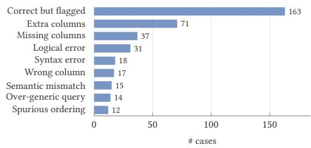  
Figure 14: Annotation issues in Spider flagged by the error mining agent and confirmed manually.

Table 7: Error categories used in Figure 2.
<table><tr><td>Type</td><td>Definition</td><td>Example</td></tr><tr><td>Wrong table</td><td>wrong or misunderstood table</td><td>takes instead of student</td></tr><tr><td>Wrong column</td><td>mismatched, wrong-key, or non-existent column</td><td>course_id when the title is asked</td></tr><tr><td>Semantic error</td><td>misread question, wrong alias or aggregate, or missing condition</td><td>AVG for &quot;total”</td></tr><tr><td>Wrong ordering or LIMIT</td><td>wrong LIMIT or sort direction</td><td>ASC for &quot;highest”</td></tr><tr><td>Other model error</td><td>e.g., hard-coded outputs</td><td>returns a constant</td></tr></table>

Table 8: Confusion types of the semantic constraint. Each confusion replaces one decision of the reference query.
<table><tr><td>Element</td><td>Reference decision</td><td>Confusion</td></tr><tr><td>entity</td><td>FROM student</td><td>FROM takes</td></tr><tr><td>attribute</td><td>course.title</td><td>course.course_id</td></tr><tr><td>value</td><td>dept_name = &#x27;Physics&#x27;</td><td>dept_name = &#x27;physics&#x27;</td></tr><tr><td>aggregation</td><td>COUNT(DISTINCT course_id)</td><td>COUNT(*)</td></tr><tr><td>comparison</td><td>credits &gt;= 4</td><td>credits &gt; 4</td></tr><tr><td>quantifier</td><td>NOT EXISTS  $( . . . )$ </td><td>NOT IN with nullable key</td></tr><tr><td>ordering</td><td>ORDER BY grade DESC LIMIT 1</td><td>ORDER BY grade ASC LIMIT 1</td></tr></table>

## F Prompt Templates

Each agent prompt starts with the schema and sample rows of the database as DDL and DML statements, together with the schema descriptions of Spider-Refined, and then lists the inputs below. Prompts 1–4 show the agent templates. The fine-tuned model is asked to translate the question into one SQLite query and output only the SQL. Its input has the schema with descriptions, the question, and, in Stage 3, retrieved pairs from the same database.

## Prompt 1: Templates of the error-mining agent ��

Evaluation. You are a database expert. Determine whether the labeled SQL or the redicted SQL better ali ns with the iven uestion, based on the rovided database schema and content. Correction. Given the uestion and an erroneous SQL uer , correct the SQL while reservin its structure as closel as ossible. Input. Question: {question}. Labeled SQL: {label\_SQL}. Predicted SQL: {predict\_SQL}.

## Prompt 2: Template of the alignment agent ��

System. You are a database expert. Given a question and its SQL query, list each semantic element ofthe question (entity, attribute, value, aggregation, comparison or quantifier, ordering) and the SQL fragment that realizes it. For each fragment, propose up to three alternatives of the same type that a model may confuse with it. Output one line per element in the form element -> fragment | alternatives.

Input. Question: {question}. SQL: {label\_SQL}. Frequent errors of the current model: {error\_decisions}.

## Prompt 3: Template of the editing agent ��

System. You are a database ex ert. Given a uestion, its SQL uer , and an edit t e, rewrite the uestion so that it ex resses the edited intent. Out ut (1) the edited question, (2) the correct SQL in which all clauses afected by the edit are updated, and (3) a SQL that applies the edit only to the targeted clause and copies all other clauses from the original SQL.

Input. Question: {question}. SQL: {label\_SQL}. Edit type and dependent clauses: {edge}.

## Prompt 4: Template of the verification agent ��

System. You are a database expert. Given a SQL query, write one natural language question that the query answers. Then decide whether your question has the same meaning as the given question. Answer yes or no with a short reason. Input. SQL: {edited\_SQL}. Question: {edited\_question}.