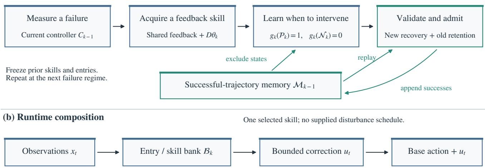
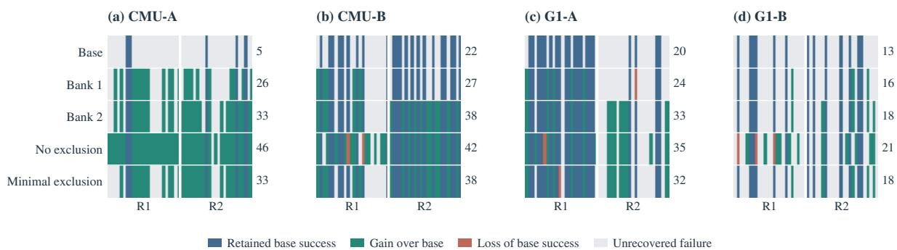
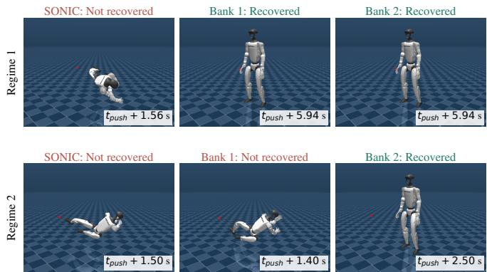

# Sequential Recovery Updates for Learned Controllers under Successful-Trajectory Preservation

Zongtan Li1, Tianming Liu1, Ye Zhao2

1University of Georgia, Athens, GA, USA

2Georgia Institute of Technology, Atlanta, GA, USA

Abstract— A competent learned controller already recovers from many disturbances. Improving it means learning a correction, and learning when not to apply it. Freezing a skill’s parameters does not settle the second half. In a controller that routes among frozen skills, a new entry rule can redirect the states an old skill succeeded on. We therefore constrain entry instead of parameters. Each update searches for a feedback skill at a measured failure. It fits an entry rule that reads observations and rejects every state on an accumulated successful trajectory. The skill is admitted only if the composed controller reproduces the new recovery on its own and replays every protected trajectory exactly. A finite-trajectory condition states when this preserves the previous controller. One mechanism runs on four streams: two motions on each of two humanoid systems. Two updates per stream add 62 recoveries over 192 withheld perturbations, and lose none of the base controller’s successes. We then price that guarantee. Removing the constraint recovers 33 more conditions but stops eight protected ones from completing at all, and excluding only what admission proves necessary recovers none of that cost.

## I. INTRODUCTION

An existing learned feedback controller can already provide competent closed-loop behavior, making adaptation a problem of selective improvement. Humanoid motion tracking illustrates this setting through increasingly broad learned repertoires [1]–[4]. A disturbance does not necessarily require a new action: the original controller may already recover. A learned correction that improves a difficult failure can disrupt a nearby successful response. Repeatedly replacing a shared recovery policy can also erase a skill acquired at an earlier disturbance. The useful objective is consequently to accumulate recoveries while retaining behavior that already works.

Consider such a controller as one component of a stack validated as a whole. An update is acceptable there only if one can state precisely what it changed, and retraining cannot: gradient updates to shared parameters move every trajectory a little, with no enumeration of what moved, so every downstream test must be repeated. Replaying old successes into the loss reduces that movement without removing it. We ask instead for a checkable property: on a recorded set of successful episodes, the updated controller must reproduce the identical trajectory. The difficult part is then composing the skills. Freezing their parameters prevents parameter interference, but a new entry rule can still select the wrong skill and change an old successful trajectory, so behavioral retention is a property of the entire closed loop,

including skill selection.

We address this problem by coupling acquisition driven by measured failures with successful-trajectory exclusion. At each stage we measure a success/failure bracket of the current composed controller, search for a feedback recovery under a fixed budget, and learn an entry rule that recognizes demonstrated recovery onsets while rejecting states recorded on successful histories. We append the skill only when autonomous recovery and retention measured by replay pass. Accepted successful experience becomes a constraint on the next update. At runtime, the base controller remains the default outside admitted intervention windows, and observations select which skill receives correction authority (Fig. 1).

The contribution is the connection between skill acquisition, autonomous composition, and recorded-behavior preservation. Residual actions, search, frozen expert banks, and linear classification are existing tools; none alone solves the composition problem. We make three contributions:

1) A sequential recovery mechanism that couples measured failures, an entry rule read from observations and constrained by successful histories, and a closed-loop admission test that enforces exact reproduction of recorded behavior.

2) A finite-trajectory preservation condition explaining why unchanged expert parameters are insufficient and when excluding a new entry preserves the old composed controller exactly.

3) A measurement of what that guarantee costs, over four streams and two systems: 33 recoveries forgone, against 11 withheld and eight protected conditions saved and 46 of 83 recorded trajectories held identical. A control excluding only what admission proves necessary returns none of that cost, so it is intrinsic to the guarantee rather than to our implementation.

The formulation does not depend on humanoid morphology; we evaluate it on humanoid motion tracking as a demanding balance-and-contact setting. The experiments establish short sequential streams in fixed simulation systems, not indefinite online physical learning, universal absence of regression, or transfer of a skill between plants.

## II. RELATED WORK

Classical push recovery studies capture and balance constraints [5], [6]; learned humanoid controllers can express

$$
C _ { k - 1 } \to C _ { k }
$$

  
Fig. 1. Sequential acquisition and preservation: (a) updates between episodes, (b) runtime composition from observations. Accumulated successful histories constrain each new entry, and closed-loop recovery and retention tests decide admission. Runtime selection receives no push schedule.

richer whole-body responses. Residual policy learning and residual reinforcement learning augment an existing controller [7], [8]. Recovery RL learns recovery zones for switching between task and recovery behavior [9]. These works motivate selective correction, but a recovery region alone does not constrain a new intervention to preserve the successful trajectories of the controller it augments. Our contribution concerns the acquisition and admission of successive recoveries into such a controller.

Cerebellar-inspired residual adaptation already combines a frozen policy, local correction, and consolidation [10], so we claim no priority for continual residual adaptation. Our focus is an explicit successful-history constraint on autonomous entry, a stage-by-stage test of acquisition against retention, and a measurement of what that constraint costs.

Progressive networks preserve prior parameters by adding capacity [11], which addresses interference inside a learned representation. Preserving parameters does not preserve a routed control trajectory, however, because a new selector can alter which fixed component acts; our entry constraint targets that second source of interference, at the price of a growing skill and trajectory memory.

Simplex architectures separate high-performance behavior from an assurance mechanism, and Neural Simplex also supports adaptation [12], [13]; safe policy improvement with baseline bootstrapping gives guarantees under different offline assumptions [14]. We do not equate a learned entry classifier with a certified safety filter: our preservation statement covers stored deterministic trajectories, and gains or losses elsewhere are measurements.

Stress testing searches for system-specific failures [15], while curricula adapt training difficulty [16], [17]. We query the controller for failures to choose where a recovery is needed, obtaining a measured bracket rather than a proof of a monotone boundary. Such magnitudes tell an update where to train but nothing about what it must leave intact, and only the second question decides whether successive updates accumulate. The outcome we evaluate is therefore cumulative recovery at held-out perturbations and retention of earlier competence, rather than an enlarged disturbance range.

## III. SEQUENTIAL RECOVERY WITH SUCCESSFUL HISTORIES

## A. Problem Setting and the Update Contract

Consider a plant with state $s _ { t } ,$ action $a _ { t } ,$ and transition $s _ { t + 1 } ~ = ~ F ( s _ { t } , a _ { t } , d _ { t } )$ under disturbance $d _ { t } .$ . An existing learned feedback controller $\pi _ { 0 }$ supplies the nominal action. Its internal state and weights need not be differentiable through the plant. A task condition q specifies a task, reset, and disturbance realization; $Y ( C , q ) \in \{ 0 , 1 \}$ denotes successful completion by composed controller C. We assume an observable runtime interface and a resettable evaluation environment. Updates occur between episodes, with the plant and base controller fixed. The undisturbed task must first satisfy the same success criterion. Discovery, acquisition, admission, and evaluation share a prescribed task horizon and termination rule; any terminal-quality requirement is fixed before disturbance search.

Let $C _ { k - 1 }$ be the currently admitted controller, which may already contain recovery skills. At update $k ,$ let $\mathcal { F } _ { k }$ be measured failures of both $C _ { k - 1 }$ and $\pi _ { 0 } ,$ and let $\mathcal { Q } _ { k - 1 }$ contain conditions enrolled in the successful-trajectory preservation memory. The learning objective is constrained improvement:

$$
\begin{array} { l } { \mathrm { i n c r e a s e } \displaystyle \sum _ { q \in \mathcal { F } _ { k } } Y ( C _ { k } , q ) , } \\ { \mathrm { s u b j e c t ~ t o } Y ( C _ { k } , q ) = 1 \quad \forall q \in \mathcal { Q } _ { k - 1 } . } \end{array}\tag{1}
$$

This is a finite-set objective, not a population guarantee. A bounded search can fail to find an admissible improvement; then $C _ { k } = C _ { k - 1 }$ . Retention is measured relative to the current composite, so previously acquired recovery skills become part of the competence protected by subsequent updates.

The bank ${ \cal B } _ { k } = \{ ( r _ { i } , g _ { i } ) \}$ stores feedback skills $r _ { i }$ and binary entry rules $g _ { i }$ . Runtime features $\boldsymbol { x } _ { t } \in \mathbb { R } ^ { d }$ may include observations, the base action, and ordinary task-reference features; no external disturbance schedule or label is supplied. The most recently admitted matching entry selects one skill, which is locked for one bounded intervention window. Outside intervention, the existing default acts:

$$
\begin{array} { r } { \delta _ { t } = \left\{ \begin{array} { l l } { r _ { j } ( x _ { t } , h _ { j , t } , v _ { t - 1 } ) , } & { \mathrm { a c t i v e } , } \\ { 0 , } & { \mathrm { o t h e r w i s e } , } \end{array} \right. } \\ { u _ { t } = \mathcal { R } ( \delta _ { t } , u _ { t - 1 } ) , \qquad a _ { t } = \mathcal { A } ( \pi _ { 0 } ( x _ { t } ) + u _ { t } ) . } \end{array}\tag{2}
$$

Every skill runs its feedback state forward from reset on the realized observations and previous correction inputs, whether or not it is selected, so entry never reinitializes that state. Here $h _ { j , t }$ is skill state, $v _ { t - 1 }$ a previous correction input, R a fixed correction limiter, and A the existing action-processing interface. These maps are unchanged during learning; zero correction preserves the base command path. The active bank starts empty, so the initial composed controller is the bare base. Skills compete for authority rather than having their corrections summed.

## B. Skill Acquisition and Entry Learning

The acquisition stage queries the current controller to identify a failure and searches for a recoverable response within budget $B _ { k }$ . With an ordered disturbance parameter, increasing-strength queries and bracket refinement provide a practical procedure for discovering failures. This does not assume a globally monotone success boundary. Successful queries of the current controller contribute to preservation memory; missing failures or unsuitable reference outcomes skip the update.

Each acquired skill retains an output direction on a shared recurrent feedback backbone:

$$
r _ { k } ( x _ { t } , h _ { t } , v _ { t - 1 } ) = \mathscr { T } ( f _ { \psi } ( x _ { t } , h _ { t } , v _ { t - 1 } ) + D \theta _ { k } ) .\tag{3}
$$

Here $f _ { \psi }$ is the inherited feedback model, D fixes coordinate scales, and $\tau$ is the interface’s fixed output transformation. Search learns $\theta _ { k } ;$ entry learning determines when this skill acts. A constant direction does not imply a constant correction: the backbone responds to the current observation and realized history throughout intervention. All skills receive the same interface-defined previous correction input and evolve from reset, so their identical recurrent backbones can share one state. Acquiring a new direction leaves earlier feedback maps and entries unchanged.

The budgeted acquisition operation is

$$
( r _ { k } , \mathcal { D } _ { k } ) = \mathsf { A c q u i r e } ( C _ { k - 1 } , \mathcal { F } _ { k } , B _ { k } ) ,\tag{4}
$$

where $\mathcal { D } _ { k }$ contains successful teacher trajectories with candidate entry states. Cross-entropy search first finds a recovery at the measured failure. A neighborhood evaluation then keeps the direction that recovers the center condition and covers the most failures shared by the base and the current controller. The executed feedback solution is retained directly, without a subsequent imitation step. The selected center and at least one further eligible training condition must recover. Teacher search may use experimental disturbance information, which is not an input to runtime selection. We do not require the acquisition optimizer to solve Eq. 1 globally.

Let $\mathcal { M } _ { k - 1 }$ be the cumulative successful-trajectory memory. Its complete recorded state histories form the exclusion set

$$
\mathcal { N } _ { k } = \bigcup _ { \tau \in M _ { k - 1 } } \{ x _ { t } : x _ { t } \in \tau \} .\tag{5}
$$

Successful teacher onsets form the positive set $\mathcal { P } _ { k }$ . Preentry teacher prefixes can additionally constrain premature invocation. Distinct successful histories at the same task remain distinct constraints; a task identifier alone does not represent the behavior to preserve.

We use a linear entry as a minimal implementation. With standardized features $z = S ^ { - 1 } ( x - c )$ , where S is a diagonal matrix of per-coordinate scales, a squared hinge loss with balanced classes fits

$$
\begin{array} { c } { \displaystyle \underset { \boldsymbol { w } , b } { \operatorname* { m i n } } ~ \lambda \| \boldsymbol { w } \| _ { 2 } ^ { 2 } + \frac { 1 } { 2 | \mathcal { N } _ { k } | } \displaystyle \sum _ { \boldsymbol { z } \in \mathcal { N } _ { k } } [ 1 + \boldsymbol { w } ^ { \top } \boldsymbol { z } + b ] _ { + } ^ { 2 } } \\ { \displaystyle + \frac { 1 } { 2 | \mathcal { P } _ { k } | } \displaystyle \sum _ { \boldsymbol { z } \in \mathcal { P } _ { k } } [ 1 - \boldsymbol { w } ^ { \top } \boldsymbol { z } - b ] _ { + } ^ { 2 } . } \end{array}\tag{6}
$$

In Eq. $6 , \mathcal { N } _ { k }$ and $\mathcal { P } _ { k }$ denote the standardized versions of the two sets. After fitting, scores are recomputed as $w ^ { \top } z$ without the fitted bias $b ,$ and the threshold $\beta _ { k }$ is set midway between the largest negative and smallest positive score:

$$
g _ { k } ( x ) = \mathbf { 1 } [ w _ { k } ^ { \top } S _ { k } ^ { - 1 } ( x - c _ { k } ) > \beta _ { k } ] .\tag{7}
$$

An append requires a strict separating gap verified in runtime precision. The important constraint is exclusion of successful histories, rather than a particular classifier architecture. It addresses composition interference: unchanged old experts can still lose competence if a new entry redirects the states on which they previously succeeded.

## C. Admission Tests and Trajectory Preservation

Form candidate $\widetilde { C } _ { k }$ by appending $( r _ { k } , g _ { k } )$ without changing old skills or entries. Run the candidate with autonomous selection on its selected acquisition targets $\mathcal A _ { k } \subseteq \mathcal F _ { k }$ and on all protected successful conditions. Admit only if $\mathcal { A } _ { k }$ is nonempty, all selected targets recover, and all protected conditions remain successful:

$$
\begin{array} { r } { Y ( \widetilde { C } _ { k } , q ) = 1 \quad \forall q \in \mathcal { A } _ { k } \cup \mathcal { Q } _ { k - 1 } , } \\ { C _ { k } = \left\{ \begin{array} { l l } { \widetilde { C } _ { k } , } & { \mathrm { c h e c k s ~ p a s s } , } \\ { C _ { k - 1 } , } & { \mathrm { o t h e r w i s e } . } \end{array} \right. } \end{array}\tag{8}
$$

Entry separation is checked before these rollouts. Admission requires entry driven by observations, exact reproduction of each selected teacher, and exact parity with reference trajectories of the current controller on all protected conditions. Search uses an onset one tick after the simulated disturbance; autonomous reproduction must recover that timing from observations. Historical exclusion states and current replay targets serve different purposes: the former constrain new selection; the latter compare complete executable controllers from identical resets. Accepted successful experience is retained before the next update.

Proposition (finite-trajectory preservation). Consider a recorded trajectory of $C _ { k - 1 }$ with deterministic reset and transitions. Assume unchanged base and old skill modules, old routing, and initial states. The augmented state includes physical state, old recurrent histories, entry lock, task clock, previous correction inputs, and limiter state. If the new skill cannot affect these variables before selection and its entry is false at every recorded state, appending it reproduces the trajectory exactly.

Proof. Old augmented states agree at reset. If they agree at time $t ,$ observations and old outputs agree. The new entry is false, so old selection and the processed action agree. Deterministic transitions and feedback updates preserve equality at $t + 1$ . Induction gives equality through termination. □

The result depends on controller composition, not on morphology, actuator count or the optimizer that acquired a skill, which is the transferable principle here: learn a useful feedback intervention while constraining where it may replace existing behavior. The tested protection set holds previously successful trajectories of the composite, not every baseline success, and neither entry exclusion nor replay certifies unseen states.

## IV. EXPERIMENTAL PROTOCOL

We apply the same retained-feedback acquisition, entry exclusion, and exact admission mechanism to two control systems, on two motions each. Both active banks start empty. The base controller and a previously prepared recurrent feedback backbone remain fixed; only output directions and entry rules are acquired during the reported streams. Inheritedcontroller preparation is excluded from the budgets of new stages. Table I lists interface and budget choices. Center search uses eight generations of eight candidates, two elites, and a 0.5 mean-update rate. Entry fitting uses $\lambda = 5 \times 1 0 ^ { - 5 }$ and a coordinatewise standardization floor of $1 0 ^ { - 3 }$ . Both interfaces allow entry driven by observations after a four-tick warmup.

A stage is one sequential failure-discovery, acquisition, and admission attempt. Bank after stage k is the cumulative controller after the first k attempts, including earlier admitted skills. Every checkpoint is tested on the entire fixed evaluation panel, not only its own disturbance regime. Failed or skipped attempts leave the preceding bank unchanged.

## A. CMU Full-Reference Motion Tracking

We use the released NPMP humanoid controller in CMU motion-tracking simulation [1], [2]. The task follows motion 029\_07 from reference frame 241 to its natural end. It completes in 625 control ticks at 30 ms per tick (18.75 s), without reference padding, looping, or latent-state hold. Two successive disturbance regimes apply horizontal root-velocity perturbations at ticks 101 and 350 (3.03 and 10.50 s). Mass, friction, actuator parameters, and the base controller remain unchanged. This first motion was exposed during development, so its undisturbed completion establishes nominal eligibility rather than generalization; the second stream below removes that caveat.

TABLE I  
SHARED LEARNING MECHANISM WITH FIXED CONTROLLER INTERFACES. SEARCH BUDGETS COUNT CENTER AND NEIGHBORHOOD ROLLOUTS PER STAGE.
<table><tr><td>Interface</td><td>CMU</td><td>G1</td></tr><tr><td>Base controller</td><td>Released NPMP</td><td>Released SONIC</td></tr><tr><td>Features / actions</td><td>321  /  56</td><td>95  / 29</td></tr><tr><td>Learned</td><td>56 dimensions</td><td>29 dimensions</td></tr><tr><td>direction Search budget</td><td> $6 4 + 1 6 \times 5$ </td><td> $6 4 + 6 4 \times 7$ </td></tr><tr><td>Intervention</td><td> $1 4 \ \mathrm { t i c k s } \ ( 0 . 4 2 \mathrm { s } )$ </td><td>20 ticks (0.4 s) plus</td></tr><tr><td>Output map</td><td>Scaled tanh; action clipping</td><td>limiter tail Magnitude and rate</td></tr></table>

The same full reference is used throughout search and validation. A recovery must complete the motion with tracking error never exceeding 0.3 and with a final-100-tick maximum error at most min $( 0 . 1 5 , e _ { \mathrm { n o m } } + 0 . 0 5 )$ , where $e _ { \mathrm { n o m } } = 0 . 0 3 3 2 5$ is the undisturbed final-100-tick maximum measured before disturbance search. The resulting limit, 0.08325, is fixed for the whole study. The tracking error combines mean absolute joint and weighted body-position deviations from the reference. This criterion asks for a return toward nominal tracking over the remaining task, rather than survival to a short intermediate cutoff. The distinction matters because endpoint survival overstates recovery: a controller can stay upright to a truncated horizon while remaining permanently behind its reference. Requiring the full reference and a terminal tracking bound removes that outcome from the success count.

In Eq. 3, the output map is $\begin{array} { r c l } { { \mathcal T } ( y ) } & { { = } } & { { 0 . 2 \operatorname { t a n h } ( y ) } } \end{array}$ and the coordinate scaling is $D \ = \ \deg ( \sigma _ { \psi } )$ , with $\sigma _ { \psi }$ formed from the inherited log standard deviation $\ell _ { \psi }$ as $\exp ( \exp ( \ell _ { \psi } , - 3 . 5 , - 0 . 2 ) )$ ). The previous correction input is the pre-action-clipping residual divided by 0.2; the summed action is clipped to its original range. Following center search, each of 16 directions is tested on five training conditions: the center, and four conditions that jointly vary onset by one tick, strength by 0.01, and direction by $1 ^ { \circ } .$ . Multiple successful onsets and their prefixes supply entry examples. No new imitation of the feedback network or reinforcement-learning updates are performed.

Before adaptation, 24 random offsets per regime are fixed: onset within ±2 ticks, strength within ±0.015, and direction within ±2◦. After both updates are locked, the bare base and both bank prefixes execute all 48 conditions around the discovered boundaries. A separate rerun of the locked models checks exact trajectory reproduction and executes the mechanism controls and every physical development condition.

A second stream replicates this on a motion no component was tuned on. Holding the criterion fixed and varying only the reference start frame, as the first motion itself starts at frame

241, one undisturbed base rollout screened each of 115 corpus clips: 10 complete their full reference, a 9% eligibility rate showing how much stricter this criterion is than survival over a short window. A prespecified rule takes the first eligible clip in sorted order from outside the twelve development cases, giving motion 026\_05 from frame 401 over 600 ticks. Timings reuse the first stream’s relative fractions, and every budget, threshold, panel construction and control is unchanged. We call the streams CMU-A and CMU-B.

## B. G1 Fixed-System Simulation

We use SONIC with the original G1 mass, friction, and PD gains and the dance motion dance\_in\_da\_party\_001. All dynamics multipliers remain one. The horizon is 496 control ticks at 20 ms per tick. Failure occurs for nonfinite position, root height below 0.35 m, or upright-axis cosine below 0.25; completion reaches the horizon without those events. A horizontal pelvis force acts for 100 ms with $F =$ mα/0.1, where $m = 3 5 . 1 1$ kg and α is the search strength; its impulse is mα. The two acquisition regimes are near phase 0.4 and 0.75. In the completed reference run their selected strengths are 2.25 and 2.6, corresponding to impulses of approximately 79.0 and 91.3 N s. These are simulation conditions, not a prescription for manual physical pushes.

The inherited G1 feedback network was prepared by distillation and 22 warm-policy PPO updates. That preparation includes this first motion and development experience near phase 0.75; it is not charged as new-stage learning. Each new G1 skill adds a searched 29-dimensional output offset with scale 0.08 to this frozen feedback network: $D = 0 . 0 8 I$ and T is the identity in Eq. 3. No new feedback-network gradient updates occur during these stages.

After the center search, 64 directions are evaluated on seven conditions: center, $\pm 1 ^ { \circ }$ direction, ±2 control ticks in onset, and ±0.037 in strength. Corrections last 20 ticks with a magnitude bound of 0.3 and a rate limit of 0.05 per tick. All feedback models receive the same previous limiterexecuted correction normalized by 0.5. Here R bounds and rate-limits the correction, including its tail, before summation with SONIC; A leaves that summed command unchanged before the existing low-level stack.

Before adaptation, 48 random perturbation offsets are fixed, 24 per regime: onset within ±2 ticks, strength within ±0.06, and direction within ±2◦. They are applied around the discovered centers and evaluated only after all adaptation is locked. The audit checks physical-condition overlap with fitting and discovery data. Each of SONIC, both bank prefixes, latestskill substitution, and zero-offset warm feedback executes all 48 conditions. Two further complete search-seed repetitions use the same algorithm and budgets, each starting from an empty bank and evaluating offsets around its own discovered boundary. That stream and its two repetitions are reported separately; their conditions are not pooled.

A second G1 stream uses the motion forward\_lunge\_R\_001 over a 398-tick horizon. SONIC completes 12 of the 13 available reference motions undisturbed; among those, a prespecified rule excludes the admitted motion, requires a horizon between 350 and 600 ticks so both phase regimes leave adequate remaining task, and takes the first in sorted order. This stream is also a transfer test, because the inherited feedback backbone was prepared on the first motion alone. Panel construction, budgets and controls are unchanged. We call the four streams CMU-A, CMU-B, G1-A and G1-B, the B streams being the ones nothing was tuned on.

## C. Metrics, Mechanism Controls, and Audits

The following definitions apply to all four streams. Latestskill substitution uses the same learned entries and expert weights, but executes the newest skill whenever any entry fires. It tests retention under replacement, not a separately optimized shared-policy continual learner. Zero-offset warm feedback retains the learned entry and inherited feedback backbone while removing the searched offsets. The bare base supplies the zero-intervention control. No exclusion and minimal exclusion refit only the final bank’s entry rules. The first keeps teacher prefixes recorded before entry as the sole negatives; the second adds back, one admission replay at a time, those protected trajectories the replay shows to have changed, stopping when parity holds. Both preserve the searched directions, teacher positives, objective and solver of the admitted run, and neither is re-admitted: each is reported as a controller the admission test would have judged, not as a method variant. Discovery and search are not re-run for either.

On a panel we report paired counts against a reference controller C: gains are the conditions C fails and the final bank recovers, losses the reverse. A strict stage acquisition must succeed after the stage while failing under both the bare reference and the preceding bank, with post-disturbance entry. Restoring an earlier regression is reported separately from acquiring a new recovery. Forgetting counts an earlier bank success lost at a later checkpoint. We retain failed and skipped stages in the record. The reference run failed our original screen, which allowed no harmed condition at any stage. We relaxed that screen post hoc to at most two distinct harmed conditions and then fixed the relaxed tolerance in advance for both repetitions.

We report G and L rather than significance levels. Whenever $L \ = \ 0 .$ , an exact two-sided paired sign test is a deterministic function of the gain count, $p \ = \ 2 ^ { 1 - G }$ , and so carries no information the counts do not already carry. More importantly, the 48 conditions of a panel are local perturbations of one learned system, not independent learning trials, so a small p would describe the sampled neighborhood rather than the reliability of the learning procedure. The two complete repetitions, not the panel size, are our evidence about reliability.

A CMU stream costs about 540 rollouts and a G1 stream 1,475 logical trajectories, of which two thirds reuse a cached deterministic prefix; the refit arms add no search and reuse the recorded conditions. These figures exclude inherited controller preparation and are not a matched-budget comparison. Artifact audits check source and trace hashes, fixed dynamics, teacher provenance, entry timing, memory and data separation; an independent replay checks recorded observations, feedback states, expert outputs and executed corrections; and exact arithmetic checks use the executed inference backend rather than treating CPU and GPU roundoff as interchangeable.

TABLE II  
EVERY COMPARATOR AGAINST THE FINAL BANK OF ITS OWN STREAM, OVER 48 WITHHELD PERTURBATIONS PER PANEL. EACH CELL READS successes (bank-only/comparator-only): CONDITIONS ONLY THAT STREAM’S FINAL BANK RECOVERS, THEN CONDITIONS ONLY THE COMPARATOR RECOVERS. CMU-B AND G1-B ARE THE MOTIONS NOTHING WAS TUNED ON; THE EXCLUSION ARMS REFIT ONLY ENTRY RULES.
<table><tr><td>Comparator</td><td>CMU-A</td><td>CMU-B</td><td>G1-A</td><td>G1-B</td></tr><tr><td>Base</td><td>5 (28/0)</td><td>22 (16/0)</td><td>20 (13/0)</td><td>13 (5/0)</td></tr><tr><td>Latest skill</td><td>36 (0/3)</td><td>36 (3/1)</td><td>30 (3/0)</td><td>15 (3/0)</td></tr><tr><td>Warm, zero offset</td><td>3 (30/0)</td><td>33 (6/1)</td><td>28 (7/2)</td><td>14 (5/1)</td></tr><tr><td>No exclusion Minimal exclusion</td><td>46 (0/13) 33 (1/1)</td><td>42 (4/8) 38 (0/0)</td><td>35 (1/3) 32 (1/0)</td><td>21 (6/9) 18 (0/0)</td></tr><tr><td></td><td>33</td><td>38</td><td></td><td></td></tr><tr><td>Final bank Protected conditions</td><td>22</td><td>21</td><td>33 23</td><td>18</td></tr><tr><td>kept without exclusion</td><td>22</td><td>19</td><td></td><td>17</td></tr><tr><td></td><td></td><td></td><td>23</td><td>11</td></tr><tr><td>reproduced exactly</td><td>8</td><td>10</td><td>13</td><td>6</td></tr></table>

## V. RESULTS

## A. Sequential Recovery Acquisition

Both CMU stages are admitted. The first reproduces four selected training recoveries while exactly replaying seven protected trajectories; the second reproduces two further recoveries while replaying 20. Table II reports the withheld panel. Two features of it are not visible in the totals (Fig. 2). The opening update already transfers across regimes, nine of its 21 gains falling at a disturbance timing it never searched, and the closing update then leaves the first regime untouched and places every gain in the second. That is the division of labor the entry constraint is meant to produce. Figure 3 shows the same progression on G1-A. Independent simulation reproduces all 144 main-panel trajectories exactly. On all 27 distinct development conditions, success increases from 14 to 21 and then 23, again without base-success losses or forgetting.

Both CMU-B stages are admitted as well, and its panel repeats the pattern from a very different starting point: the base already recovers 22 of 48 conditions there, yet two updates still add 16 more without surrendering one. Acquisition therefore does not depend on the base controller being near-helpless, and it survives a motion that no part of the procedure was tuned on.

Both G1 stages are admitted in the reference run. The first teacher covers all five eligible training failures in its seven-condition neighborhood; the second covers six of seven. Admission reproduces the selected teachers and preserves the current successful references. On the withheld panel the second bank adds nine successes over the first: eight new recoveries and the restoration of the single condition the first bank had harmed. Strict stage acquisitions, which exclude conditions already recovered by the bare base or the preceding bank, are five and eight. All 23 final memory tasks succeed and nominal behavior is preserved.

G1-B admits both stages as well, so the backbone does transfer off the motion it was prepared on, but weakly: five gains against thirteen on G1-A, from a base that starts lower. Every protected condition survives. We read this as evidence that the acquisition mechanism is not motion-specific while the inherited backbone partly is.

The two prescribed G1 repetitions yield $2 5 / 4 8 \to 2 9 / 4 8$ and $2 5 / 4 8 \to 3 0 / 4 8$ with no losses, each retaining all 16 memory conditions, but each admits only its first stage. Both stop at the same place and for the same structural reason: a stage may target only conditions the base and the current bank both fail, so a condition the bank itself harmed can never become a target, and the stage is skipped before teacher search. Sec. VI develops this. We regard the stall, rather than the reference run’s totals, as the result that locates the remaining work.

## B. Skill Composition and Retention

Table II collects the comparators. Deleting the searched directions while holding the learned entries fixed drops CMU-A recovery below the bare base, so firing the inherited backbone with no searched direction is worse than not intervening at all and an entry rule is worth no more than the skill it admits; on the other three streams the same deletion costs far less, because there the backbone and entry rule already recover without any searched offset. Substituting the newest skill at every entry beats our selector only on CMU-A, where the conditions it adds are ones the bank routes to the earlier skill although the newer direction recovers from the same state; on the other three streams the bank is ahead by a similar margin. The comparison is close everywhere, so we claim no routing advantage in either direction. Component effects are system dependent and should not be read off the aggregate gain.

## C. The Cost of Exact Preservation

The constraint that distinguishes this method is the exclusion of recorded successful states from a new entry region. Two arms in Table II isolate what it buys and what it costs; both reuse the final bank’s searched directions and teachers and refit only the entry rules.

Dropping the successful-trajectory negatives, leaving the teacher prefixes as the only negatives, raises recovery on all four streams. No arm ever triggers before its disturbance, so the prefixes alone preserve entry timing. What the memory negatives do is suppress entry: the admitted entry never fires on about a quarter of each panel, while the unconstrained entry fires throughout. That suppression is indiscriminate, because the constraint is fitted on states resembling past successes, which is a different question from whether intervening here would succeed now. It therefore charges where the base controller was failing and protects where it was succeeding, and that balance is not a constant of the method. Summed over the four streams it forgoes 33 recoveries and saves 11 withheld conditions, but the split is uneven: CMU-A is pure cost, 13 recoveries for no harm avoided, while G1-B forgoes nine and saves six.

Fig. 2. Per-condition outcomes on each stream’s 48 withheld perturbations, grouped by acquisition regime (R1, R2), with totals at the right. The last two rows keep the final bank’s skills and refit only its entry rules.  
  
Fig. 3. Two sequential G1-A acquisitions, one per regime, under the base controller and the two banks on the same disturbance. Poses are the last recorded pre-action states, labeled by the audited episode outcome; times are relative to the push.

What it delivers reliably is exact behavior, and the B streams expose the failure it exists to prevent. Without the constraint eight protected conditions across those streams stop completing at all, rather than merely taking a different route, six of them on G1-B where more than a third of the protected set collapses. Of 83 protected trajectories, 46 survive unchanged only because of the constraint. A protocol scoring retention by success alone would call it costless on CMU-A and useless on G1-A, and would be wrong both times.

The cost is not an artifact of excluding too much. The arm that excludes only the necessary trajectories fits the entry on teacher prefixes, replays the protected conditions, and adds back only the trajectories the replay shows to have changed, repeating until parity holds. It converges in two rounds per stage on all four streams and retains 53–84% of the states the method excludes, yet returns none of the gap on any of them; on both B streams it reproduces the admitted controller condition for condition. The explanation is structural. A protected trajectory that can be dropped is one the entry never fired on, so it was never constraining; the trajectories that must be kept are exactly those where entry wanted to act. Within this family of entry rules, exact preservation has no cheaper purchase.

These arms also bound what better routing could return. The acquired skills reach conditions that the controllers admitted from them decline, 13 on CMU-A, so the gap belongs to entry rather than to what was learned and its size is measured rather than asserted. Closing it needs a selector that decides differently rather than more often: a selector separating the eight conditions worth entering on CMU-B from the four worth declining would take that headroom without weakening the guarantee, whereas entering everywhere, as these arms do, cannot.

## VI. DISCUSSION AND LIMITATIONS

One acquisition mechanism carries four streams over two systems, though the inherited backbone is partly motion specific: G1-B admits both stages but gains far less than G1-A, the motion that backbone was prepared on. Nothing here demonstrates transfer of a learned skill between plants.

Exactness and coverage turn out to be coupled through the same states. A protected trajectory is droppable only when the entry never fired on it, so dropping it frees nothing; the trajectories that bind are those the entry wanted to act on. Tuning the exclusion policy is therefore not the remedy, and the component to change is the selector: retention is enforced per skill while recovery is a property of the bank, so a selector ranking admitted skills by expected recovery would still satisfy the proposition and has a measured 13 conditions of headroom on CMU-A. Preservation is also exact only on the protected trajectories, and entry outside that memory can still generalize poorly: G1-A’s intermediate loss follows a late erroneous entry, repaired by its second bank. On 12 previously exposed G1 challenge conditions the final bank has two gains and one loss against SONIC, while all 25 further protection conditions hold.

Both G1 repetitions stall for a related reason that belongs to our eligibility rule rather than to the search. A stage may target only conditions the base and the current bank both fail, which is what makes its gain attributable to it; a condition the bank harms is by construction one the base still handles, so it can never become a target. The rule that keeps credit clean thus leaves the stream blind to the regressions it causes, and both repetitions skip their second stage on exactly that ground. Reliable repeated learning needs a second kind of stage aimed at an inappropriately firing entry, which is a different problem from acquiring a missing skill.

The evidence covers short streams, simulator resets, inherited feedback backbones, and one intervention window per episode. CMU evaluates one nominally valid complete reference at two disturbance timings; neither system establishes broad robustness across unseen motions or physics distributions. Each exclusion set contains the previous one, so admissible entry rules can only shrink as a stream lengthens and the acquisition rate should saturate; our streams are too short to locate that point, and long-stream memory compression is untested. Finite task success is also not an asymptotic stability guarantee, and on G1-A’s jointly successful conditions mean tracking RMSE rises by 0.0016 rad, so retained completion need not imply unchanged motion quality. Real-robot learning remains unvalidated.

## VII. CONCLUSION

We treated sequential recovery as an admission problem rather than an optimization problem: a skill enters a learned controller only after the composed policy reproduces the new recovery from observations and replays every protected trajectory exactly. Constraining entry by accumulated successful histories, instead of freezing parameters alone, is what makes that test meaningful when a selector can redirect a frozen skill, and a finite-trajectory condition states when it preserves the previous controller exactly. One mechanism adds recoveries on four streams over two systems, including two motions nothing was tuned on, without surrendering a base success anywhere. We then measured what the guarantee costs, which to our knowledge has not been reported: 33 recoveries forgone, against 11 withheld and eight protected conditions saved and 46 of 83 trajectories held identical. A control that excludes only what the admission replay proves necessary shows the cost is intrinsic, because the trajectories that must be excluded are the ones that were suppressing entry. The same arms bound the remaining headroom, since the acquired skills reach conditions the admitted controllers decline: what limits those controllers is where they may act rather than what they learned. Two concrete components follow. One is a stage directed at repair, since a stream that may target only failures shared with the base cannot repair a regression it caused itself. The other is a selector ranked over the admitted bank, since deciding more often returns nothing while deciding differently has measured room. Physical validation remains the eventual test, but it is not the binding constraint here; the reliability of repeated acquisition is.

## ACKNOWLEDGMENT

OpenAI Codex assisted software development, experiment orchestration, artifact checking, drafting and figures. Scientific claims are tied to the recorded experiment and audit artifacts.

## REFERENCES

[1] J. Merel, L. Hasenclever, A. Galashov, A. Ahuja, V. Pham, G. Wayne, Y. W. Teh, and N. Heess, “Neural probabilistic motor primitives for humanoid control,” in International Conference on Learning Representations, 2019.

[2] N. Wagener, A. Kolobov, F. V. Frujeri, R. Loynd, C.-A. Cheng, and M. Hausknecht, “Mocapact: A multi-task dataset for simulated humanoid control,” in NeurIPS Datasets and Benchmarks, 2022.

[3] X. B. Peng, P. Abbeel, S. Levine, and M. van de Panne, “Deepmimic: Example-guided deep reinforcement learning of physics-based character skills,” ACM Transactions on Graphics, vol. 37, no. 4, 2018.

[4] Z. Luo, Y. Yuan, T. Wang, C. Li, F. Castañeda, S. Chen, et al., “SONIC: Supersizing motion tracking for natural humanoid whole-body control,” Science Robotics, vol. 11, no. 117, p. eaed4592, 2026.

[5] J. Pratt, J. Carff, S. Drakunov, and A. Goswami, “Capture point: A step toward humanoid push recovery,” in IEEE-RAS Humanoids, 2006.

[6] T. Koolen, T. de Boer, J. Rebula, A. Goswami, and J. Pratt, “Capturability-based analysis and control of legged locomotion, part 1: Theory and application to three simple gait models,” International Journal of Robotics Research, vol. 31, no. 9, 2012.

[7] T. Silver, K. Allen, J. Tenenbaum, and L. Kaelbling, “Residual policy learning,” arXiv preprint arXiv:1812.06298, 2018.

[8] T. Johannink, S. Bahl, A. Nair, J. Luo, A. Kumar, M. Loskyll, J. A. Ojea, E. Solowjow, and S. Levine, “Residual reinforcement learning for robot control,” in ICRA, 2019.

[9] B. Thananjeyan, A. Balakrishna, S. Nair, M. Luo, K. Srinivasan, M. Hwang, J. E. Gonzalez, J. Ibarz, C. Finn, and K. Goldberg, “Recovery RL: Safe reinforcement learning with learned recovery zones,” IEEE Robotics and Automation Letters, 2021.

[10] N. Jayasinghe, D. Gontero, S. T. Brown, V. K. Sangwan, M. C. Hersam, and A. R. Trivedi, “Cerebellar-inspired residual control for fault recovery: From inference-time adaptation to structural consolidation,” arXiv preprint arXiv:2602.07227, 2026.

[11] A. A. Rusu, N. C. Rabinowitz, G. Desjardins, H. Soyer, J. Kirkpatrick, K. Kavukcuoglu, R. Pascanu, and R. Hadsell, “Progressive neural networks,” arXiv preprint arXiv:1606.04671, 2016.

[12] L. Sha, “Using simplicity to control complexity,” IEEE Software, vol. 18, no. 4, 2001.

[13] D. T. Phan, R. Grosu, N. Jansen, N. Paoletti, S. A. Smolka, and S. D. Stoller, “Neural simplex architecture,” in NASA Formal Methods Symposium, 2020.

[14] R. Laroche, P. Trichelair, and R. Tachet des Combes, “Safe policy improvement with baseline bootstrapping,” in International Conference on Machine Learning, 2019, pp. 3652–3661.

[15] A. Corso, R. J. Moss, M. Koren, R. Lee, and M. J. Kochenderfer, “A survey of algorithms for black-box safety validation of cyber-physical systems,” Journal of Artificial Intelligence Research, vol. 72, 2021.

[16] C. Florensa, D. Held, M. Wulfmeier, M. Zhang, and P. Abbeel, “Reverse curriculum generation for reinforcement learning,” in CoRL, 2017.

[17] M. Dennis, N. Jaques, E. Vinitsky, A. Bayen, S. Russell, A. Critch, and S. Levine, “Emergent complexity and zero-shot transfer via unsupervised environment design,” in NeurIPS, 2020.