# SpecOPD: Branch-Parallel On-Policy Distillation for Speculative Decoding

Tianyu Liu\*1,2, Jun Zhang\*†‡1, Wenjie Huang\*1,3, Yuhao Shen3, Tianqi Xu1,4, Xinyue Hao1,5, Hongyaoxing Gu1,6, Xuyang Liu7, Baolin Zhang1, Yating Zhu1, Shuang Ge1, Jun Dai1, Lei Chen1, Yue Li1 and Mingchen Wan1 1Qwen Business Unit of Alibaba, 2University of Science and Technology of China, 3Zhejiang University, 4Carnegie Mellon University, 5University of Edinburgh, 6University of Chinese Academy of Sciences, 7The Hong Kong Polytechnic University

\*Equal contribution. †Corresponding author. ‡Project lead.

Code Blog

Speculative decoding (SD) accelerates large language model inference by reducing the sequential cost of token-by-token generation. Advanced SD methods reduce proposal cost with parallel drafters that predict entire blocks in one forward pass, but overall speedup still depends on acceptance length. On-policy distillation (OPD) can push well-trained drafters beyond acceptance-length plateaus, yet conventional pipelines collect supervision through sequential draft-and-verify rollouts. Our key insight is that onpolicy supervision need not inherit these dependencies: a draft block can be supervised using only its reference prefix and draft-sampled history. We propose SpecOPD, a branch-parallel OPD framework that parallelizes draft sampling and target supervision across independent branches drawn from the evolving drafter policy at reference anchors. We pack these branches into proposal trees to share target-prefix computation, using tree masks for full attention, branch-consistent indexer groups for sparse attention, and indexed state replay for linear attention to preserve each branch’s history. We train the drafter with an E2E-TV surrogate that directly targets acceptance length. Our study spans 8B full-attention (GQA), 27B full–linear (GQA–GDN), and 125B sparse–linear (QSA–GDN) targets, three parallel draft architectures (DFlash, DSpark, and DFlash V2), and four task domains (dialogue, coding, mathematics, and agentic). SpecOPD achieves up to 41.45% higher mean acceptance length, 16.09× supervised-token throughput over sequential-rollout OPD under native configurations, and up to 3.56× generation speedup over autoregressive decoding.

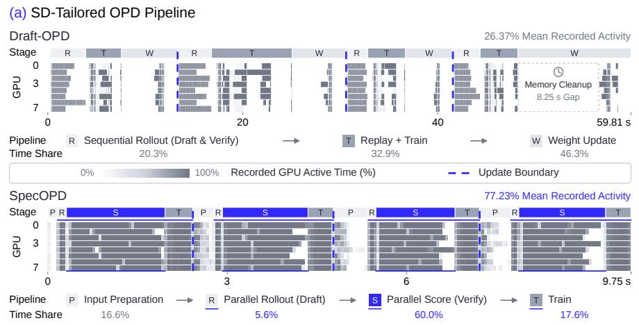

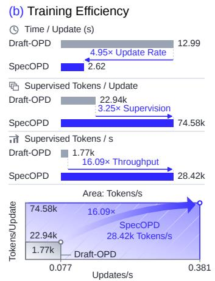  
Figure 1 | SpecOPD improves training throughput. Qwen3.8-27B with DFlash V2 on eight high-performance GPUs. (a) Sequential draft-and-verify rollouts versus parallel drafting and target scoring, shown on separate time axes. (b) With tokens denoting predictions contributing to the loss, unprofiled measurements show 4.95× update throughput and 3.25× supervised tokens per update, yielding 16.09× supervised-token throughput.

## 1. Introduction

Speculative decoding (SD) accelerates autoregressive generation by verifying multiple tokens proposed by a lightweight drafter in parallel [1, 2]. Parallel drafters such as DFlash reduce the cost of producing these proposals by predicting an entire block in one forward pass [3, 23, 15, 25]. The overall speedup also depends on acceptance length, which draft training seeks to improve through better alignment with the target [29, 18]. To this end, a common approach to draft training is supervised fine-tuning (SFT) [61] on fixed responses generated by the target model, following sequence-level knowledge distillation [62]. On-policy distillation (OPD) [28] has improved acceptance length beyond SFT plateaus by shifting training to blocks sampled from the current draft policy while retaining dense token-level target supervision [5].

However, in a typical rollout-and-distill pipeline for SD-tailored OPD, collecting complete trajectories requires sequential draft-and-verify rounds [5]. The drafter proposes a block, the target verifies it, and the accepted prefix determines where the next round begins. This dependency serializes response collection before drafter updates. The measured execution profile in the upper half of Figure 1a shows the alternation between rollout and training, with low GPU utilization during rollout collection. We therefore ask: Must on-policy training inherit the sequential dependencies of draft-and-verify rollouts?

Luckily, these sequential dependencies are not inherent to on-policy supervision. We decouple on-policy supervision from full-response rollouts through a unique twist to standard parallel drafter training [3, 23]: replacing reference-token labels with target supervision on draft-sampled prefixes. We sample anchors from pre-collected responses (regenerated ofline by the target or supplied with the raw dataset) and use the current drafter to sample tokens for the masked positions. The target supervises each position using the reference prefix and preceding sampled tokens. Thanks to branch independence across anchors, draft sampling and target supervision can proceed in parallel without sequential full-trajectory collection during training.

To put this parallelism to work, we propose SpecOPD, a branch-parallel OPD framework for pushing well-trained drafters beyond acceptance-length plateaus without sequential full-response rollout collection. First, in proposal tree construction, the reference sequence forms a shared reference trunk. We randomly sample anchors on this trunk, as in standard parallel-drafter training, and attach continuations sampled from the current drafter as draft branches. Second, in branch-parallel scoring, we reuse prefix computation while preserving each branch’s history. For full attention (e.g., GQA [31]), we share trunk KV and use tree attention masks to restrict each branch to its reference prefix and own sampled history. For sparse attention (e.g., QSA [8]), branch-consistent compressed indexer groups preserve block selection after divergence. For linear attention (e.g., GDN [7]), masking alone cannot isolate recurrent states; we therefore use indexed state replay to restore anchor states from shared checkpoints and advance separate branch paths in parallel, avoiding repeated full-prefix execution. Finally, in acceptance-length optimization, we directly target acceptance length with the E2E-TV surrogate [6], which aggregates prefix products of draft–target distribution overlap along each sampled branch. The measured execution profile in the lower half of Figure 1a shows the resulting higher GPU utilization.

To summarize, our main contributions are:

(1) Direct, parallel on-policy supervision. We observe that on-policy supervision for a draft block requires only its reference context and draft-sampled history, without completing a verified response. This yields direct on-policy alignment on draft-generated histories, independently across reference anchors.

(2) Novel, eficient SD-tailored OPD. We propose SpecOPD to unify independent branch collection, shared-prefix target scoring, and E2E-TV acceptance-length optimization. Its executor preserves branch histories across full (GQA), sparse (QSA), and linear (GDN) attention layers, enabling parallel supervision with prefix reuse.

(3) Broad, systematic empirical evaluation. We evaluate DFlash, DSpark, and DFlash V2 across 8B, 27B, and 125B targets with full, sparse, and linear attention on dialogue, coding, mathematics, and agentic tasks. SpecOPD improves mean AL by up to 41.45% and achieves 16.09× supervised-token throughput over sequential-rollout OPD (Figure 1b); measured generation speedup reaches 3.56× over AR.

## 2. SpecOPD

Advanced OPD tailored for SD collects supervision through sequential draft-and-verify rollouts, making each new training context depend on earlier verification outcomes. To remove this collection dependency, SpecOPD samples independent continuations at reference anchors, scores them through a shared proposal tree, and trains the drafter to increase acceptance length. Let � and $q _ { \theta }$ denote the token distributions of the frozen target and trainable drafter, respectively, and let $x _ { 1 : L }$ be a prompt followed by its pre-collected reference response.

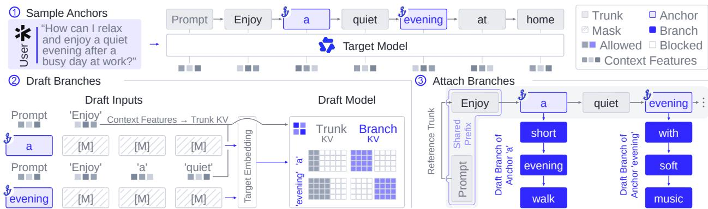  
Figure 2 | Proposal tree construction. O1 We randomly sample anchors from a reference response and extract target context features. O2 The current drafter samples continuations in parallel at these anchors, conditioned on their respective reference contexts. O3 We attach the sampled continuations to their anchors, forming a tree with a shared reference trunk and separate draft branches. Branch independence enables parallel collection, while shared ancestors expose reusable target computation.

## 2.1. Proposal Tree Construction

Sequential rollout collection makes training contexts depend on earlier verification outcomes. We use the reference sequence �, including the prompt, as a shared reference trunk. Following typical parallel-drafter training [3], we randomly sample � anchor positions $A = \{ a _ { b } \} _ { b = 1 } ^ { B }$ from its response portion, which can be regenerated ofline by the target or supplied with the dataset. At each anchor, we form a block with the clean anchor token in its first position and masks in the remaining positions. The current drafter samples a draft branch, a continuation $y _ { b , 1 : W }$ of � tokens excluding the anchor. At position $i = 1 , \ldots , W$ , we define

$$
h _ { b , i } = ( x _ { \leq a _ { b } } , y _ { b , < i } ) , \qquad y _ { b , i } \sim q _ { \theta } ( \cdot \mid h _ { b , i } ) .\tag{1}
$$

where $h _ { b , \imath }$ � combines the reference prefix through the anchor with the preceding samples from the same branch, and $q _ { \theta }$ is the drafter’s single-token conditional distribution.

Given the reference sequence � and anchors $A ,$ branches use independent sampling streams. Their joint distribution $Q _ { \theta }$ over the sampled continuations $Y = \{ y _ { b , 1 : W } \} _ { b = 1 } ^ { B }$ therefore factorizes as

$$
Q _ { \theta } ( Y \mid x , A ) = \prod _ { b = 1 } ^ { B } \prod _ { i = 1 } ^ { W } q _ { \theta } ( y _ { b , i } \mid h _ { b , i } ) .\tag{2}
$$

Branches can thus be collected in parallel without waiting for one another’s verification outcomes, while allowing dependencies within each branch. On-policy here refers to fresh continuations sampled from the current drafter at fixed reference contexts.

We attach the sampled draft branches � to their anchors on the reference trunk $x ,$ forming a proposal tree. For branch nodes, the parent map � and semantic position are

$$
\begin{array} { r } { \pi ( y _ { b , i } ) = \left\{ \begin{array} { l l } { x _ { a _ { b } } , } & { i = 1 , } \\ { y _ { b , i - 1 } , } & { i > 1 , } \end{array} \right. \quad \quad \mathrm { p o s } ( y _ { b , i } ) = a _ { b } + i . } \end{array}\tag{3}
$$

Here, pos(·) denotes a token’s position along its reference prefix and sampled continuation. Trunk nodes satisfy $\pi ( x _ { t } ) = x _ { t - 1 }$ for $t > 1$ and $\mathsf { p o s } ( x _ { t } ) = t$ . This representation preserves each branch’s reference prefix and own sampled history, exposing shared computation for target scoring.

## 2.2. Branch-Parallel Scoring

Of-policy training on fixed reference responses aligns the drafter with the target along reference trajectories. To improve acceptance on draft-generated prefixes, SpecOPD obtains target distributions along continuations sampled from the current drafter and uses them to train the drafter under its own sampled histories. The challenge is to compute these branch-specific distributions in parallel while reusing their shared prefixes. A trunk-only pass misses sampled histories after divergence. Scoring each branch separately recovers the required history, but issuing these short requests sequentially leaves branch parallelism unexploited, while uncached batching repeats overlapping prefix computation.

Our key insight is that distinct supervision histories can still share the computation of their common prefixes. We therefore prefill the reference trunk once and batch branch scoring over its cached representations, reducing redundant computation and amortizing request overhead while preserving the target query $p ( \cdot \mid h _ { b , i } )$ . Let $H _ { u }$ be the target hidden state after tree node � and $g _ { p }$ its frozen output head. The readout is

$$
u _ { b , i } = \pi ( y _ { b , i } ) , \qquad p _ { b , i } = p ( \cdot \mid h _ { b , i } ) = \mathrm { s o f t m a x } \big ( g _ { p } ( H _ { u _ { b , i } } ) \big ) .\tag{4}
$$

The anchor row scores the first token; each subsequent token uses its predecessor row. Thus, � branches contribute $B ( W - 1 )$ new scoring rows after shared trunk processing, with additional state replay where needed. The remaining challenge is to realize this parallelism while preserving each branch’s conditioning history across full, sparse, and linear attention.

Full Attention. Full attention such as GQA [31] can score sampled branch tokens in parallel once their histories are available. To exploit this parallelism while reusing shared prefixes, we pack branch queries against cached trunk KV. However, a standard causal mask follows the packed order rather than branch ancestry, potentially exposing future trunk tokens or sibling branches. We resolve this mismatch with a tree attention mask, following tree-based speculative verification [26, 27]. Let Anc(�) denote the strict ancestors of � under �. We use

$$
M _ { u , \nu } = { \left\{ \begin{array} { l l } { 0 , } & { \nu \in { \mathrm { A n c } } ( u ) \cup \{ u \} , } \\ { - \infty , } & { { \mathrm { o t h e r w i s e } } . } \end{array} \right. }\tag{5}
$$

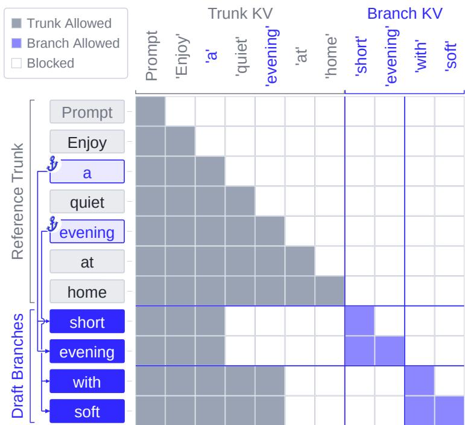  
Figure 3 | Branch-parallel scoring with full attention ( ). The tree attention mask lets packed queries share trunk KV while restricting each row to itself and its ancestors. Rows and columns follow the same packed-token order. Blue arrows connect each anchor to all query rows in its draft branch; Prompt aggregates the shared prompt prefix. Terminal samples walk and music use predecessor readouts and need no query rows.

Each query reads only its own path, with rotary positions [63] given by pos rather than packed ofsets. Within each attention layer, queries across branches and sampled positions can be evaluated together, reusing trunk KV without re-encoding or replicating shared prefixes. The mask allows each node to attend to itself. This does not leak the token being scored, because Equation 4 uses its predecessor’s output (Figure 3).

Sparse Attention. Sparse attention such as QSA [8] selects token blocks using compressed indexer keys. Recompressing each branch’s full context duplicates prefix work, while reusing a cached group crossing an anchor can introduce future reference tokens into block selection. We therefore share complete prefix groups and rebuild the remaining indexer keys in parallel along separate branch histories. Let $\kappa _ { b , t }$ denote the raw indexer key at logical position $t ,$ taken from the reference trunk for $t \leq a _ { b }$ and branch � otherwise. For a query node � on branch �, each completed four-token group � with $4 g \leq \mathsf { p o s } ( u )$ uses

$$
\begin{array} { r } { \bar { \kappa } _ { b , g } = \left\{ \begin{array} { l l } { \bar { \kappa } _ { g } ^ { \mathrm { t r u n k } } , } & { 4 g \leq a _ { b } , } \\ { C _ { g } \left( \kappa _ { b , 4 g - 3 : 4 g } \right) , } & { 4 g > a _ { b } . } \end{array} \right. } \end{array}\tag{6}
$$

Here $g \ge 1 , \bar { \kappa } _ { g } ^ { \mathrm { t r u n k } }$ is a cached trunk group key, and $C _ { g }$ applies average pooling, RMSNorm [64], and the target’s rotary transform at the group’s first position. A four-slot raw-indexer reserve per branch retains the trunk remainder, which combines with branch keys to complete the boundary group before compression. Branch indexer queries score only completed groups on their causal paths, with top-� selection batched and � set by the target’s block budget. Attention queries then compute outputs from selected trunk/branch KV and the incomplete causal tail, which bypasses top-�. Trunk KV remains shared without prefix replication (Figure 4). Deterministic selection and traversal are detailed in Appendix D.4.

2 Parallel Top­K & Sparse Attention  
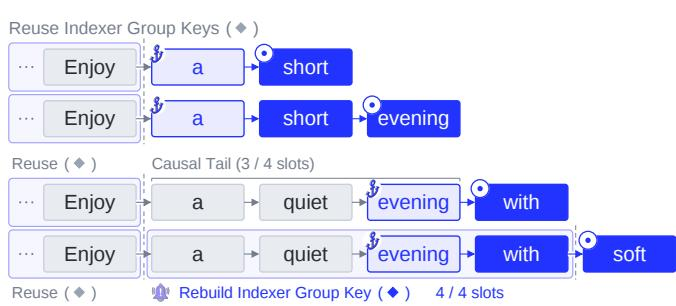

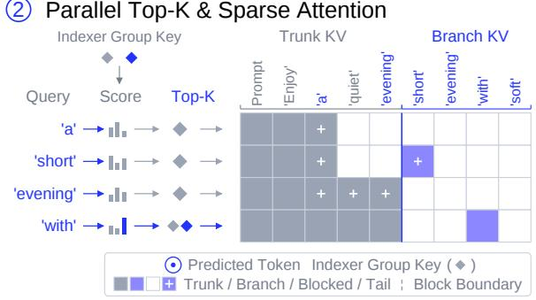  
Figure 4 | Branch-parallel scoring with sparse attention ( ). Left-hand tokens are predicted from the predecessor queries named in the right-hand rows. O1 All rows reuse complete trunk group keys, including the group ending at Enjoy. Incomplete boundary groups remain in the causal tail. For the branch at evening, predicting with uses the query at evening and reads [a, quiet, evening] as a 3/4 causal tail; predicting soft uses the query at with, which completes [a, quiet, evening, with] (4/4) and requires a branch-specific indexer group key. Anchor and bell icons mark branch points and rebuilding. O2 Indexer queries select eligible complete groups with top-�; attention reads selected KV plus the causal tail, which bypasses top-�.

C Linear Attention. Linear attention such as GDN [7] compresses history into recurrent state, so a mask cannot recover an earlier anchor state or separate subsequent branch updates. The challenge is to restore anchor states cheaply and advance independent recurrences in parallel. We checkpoint the reference trunk and compile each checkpoint-to-anchor sufix and sampled continuation into an indexed path, allowing paths to execute together from separate restored states.

Let $S _ { t }$ denote the GDN recurrent state after reference position �, � its one-token update, and �� the corresponding update features. For branch $^ { b , }$ replay from the nearest checkpoint $c _ { b } \ \leq \ a _ { b }$ restores its anchor state:

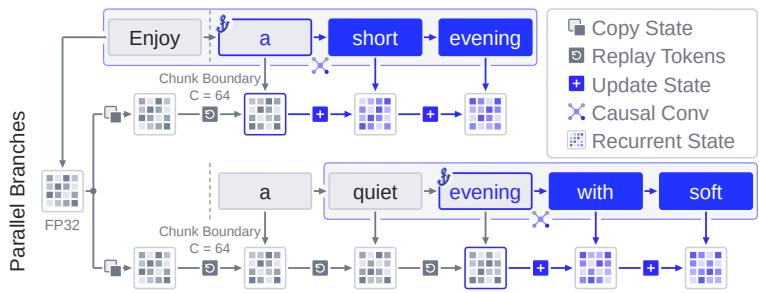  
Figure 5 | Branch-parallel scoring with linear attention ( ). A shared trunk pass caches an FP32 GDN state after Enjoy at the � = 64 boundary (63 prompt tokens omitted). In the indexed recurrent kernel, each thread block (CTA) loads its state tile from this checkpoint into private registers (Copy State). Replay Tokens uses cached trunk features to advance it through a or a→quiet→evening, restoring the anchor state. Update State then processes branch tokens, updating the state and reading it with each token’s query to produce GDN outputs. Checkpoints remain immutable; causal convolution follows branch ancestry.

$$
\begin{array} { r l } & { S _ { b , 0 } = \mathrm { R e p l a y } \big ( S _ { c _ { b } } ; z _ { c _ { b } + 1 : a _ { b } } \big ) , } \\ & { S _ { b , j } = F ( S _ { b , j - 1 } , z _ { b , j } ) , \qquad j = 1 , \ldots , W - 1 . } \end{array}\tag{7}
$$

Here Replay composes � over cached trunk $k , \upsilon , g , \beta$ features through the anchor, and $z _ { b , j }$ contains the update features of $y _ { b , j } .$ . Each executed branch token’s query reads the updated $S _ { b , j }$ to produce its GDN output. Replay and continuation updates are batched across branches, while each path retains its causal recurrence. This replaces repeated full-prefix execution with one shared trunk pass and sufix replay from checkpoints. Shared checkpoints remain immutable, and indexed recurrent paths and convolution histories both follow � (Figure 5). Hybrid targets combine this recurrent-state replay with the full or sparse attention mechanisms described above. See Appendices D.3–D.4 for implementation, numerical alignment, and determinism.

Table 1 | Mean acceptance length (↑), including bonus tokens. Darker blue indicates longer Mean AL.
<table><tr><td rowspan=1 colspan=10>Setup               Dialogue    Coding      Math         Agentic      AverageTemp. Target Draft          MT-Bench HumanEval MATH-500 SWE Terminal</td></tr><tr><td></td><td rowspan=6 colspan=1>0=L</td><td rowspan=2 colspan=4>DFlash          2.764      3.2628B→SPECOPD</td><td rowspan=1 colspan=3>3.453    2.147   1.620</td><td rowspan=1 colspan=1>2.649</td></tr><tr><td></td><td rowspan=1 colspan=1>→ SPECOPD</td><td rowspan=1 colspan=1>3.432</td><td rowspan=1 colspan=1>4.177</td><td rowspan=1 colspan=1>4.571</td><td rowspan=1 colspan=1>3.617</td><td rowspan=1 colspan=1>2.940</td><td rowspan=1 colspan=1>3.747</td></tr><tr><td></td><td rowspan=2 colspan=1>8B</td><td rowspan=1 colspan=1>DSpark</td><td rowspan=1 colspan=1>3.495</td><td rowspan=1 colspan=1>3.879</td><td rowspan=1 colspan=1>4.153</td><td rowspan=1 colspan=1>3.707</td><td rowspan=1 colspan=1>3.135</td><td rowspan=1 colspan=1>3.674</td></tr><tr><td></td><td rowspan=1 colspan=1>SPECOPD</td><td rowspan=1 colspan=1>4.121</td><td rowspan=1 colspan=1>4.876</td><td rowspan=1 colspan=1>5.223</td><td rowspan=1 colspan=1>4.301</td><td rowspan=1 colspan=1>3.676</td><td rowspan=1 colspan=1>4.439</td></tr><tr><td></td><td rowspan=2 colspan=1>27B</td><td rowspan=1 colspan=1>DFlash V2</td><td rowspan=1 colspan=1>4.143</td><td rowspan=1 colspan=1>4.845</td><td rowspan=1 colspan=1>5.555</td><td rowspan=1 colspan=2>5.653   5.319</td><td rowspan=1 colspan=1>5.103</td></tr><tr><td></td><td rowspan=1 colspan=1>→SPECOPD</td><td rowspan=1 colspan=1>4.317</td><td rowspan=1 colspan=1>5.077</td><td rowspan=1 colspan=1>5.841</td><td rowspan=1 colspan=1>5.655</td><td rowspan=1 colspan=1>5.322</td><td rowspan=1 colspan=1>5.242</td></tr><tr><td></td><td rowspan=2 colspan=1></td><td rowspan=2 colspan=1>125B</td><td rowspan=1 colspan=1>DFlash V2§</td><td rowspan=1 colspan=1>3.728</td><td rowspan=1 colspan=1>4.284</td><td rowspan=1 colspan=1>5.271</td><td rowspan=1 colspan=1>3.557</td><td rowspan=1 colspan=1>2.866</td><td rowspan=1 colspan=1>3.941</td></tr><tr><td></td><td rowspan=1 colspan=1>SPECOPD</td><td rowspan=1 colspan=1>3.907</td><td rowspan=1 colspan=1>4.514</td><td rowspan=1 colspan=1>5.458</td><td rowspan=1 colspan=1>3.723</td><td rowspan=1 colspan=1>3.006</td><td rowspan=1 colspan=1>4.122</td></tr><tr><td rowspan=6 colspan=2>T= 1</td><td rowspan=2 colspan=1></td><td rowspan=2 colspan=1>8B</td><td rowspan=1 colspan=1>DFlash</td><td rowspan=1 colspan=1>2.521</td><td rowspan=1 colspan=1>2.930</td><td rowspan=1 colspan=1>3.269</td><td rowspan=1 colspan=1>1.891</td><td rowspan=1 colspan=1>1.596</td></tr><tr><td rowspan=1 colspan=1>→SPECOPD</td><td rowspan=1 colspan=1>3.067</td><td rowspan=1 colspan=1>3.597</td><td rowspan=1 colspan=1>4.150</td><td rowspan=1 colspan=1>3.048</td><td rowspan=1 colspan=1>2.794</td><td rowspan=1 colspan=1>3.331</td></tr><tr><td rowspan=2 colspan=1>8B</td><td rowspan=1 colspan=1>DSpark</td><td rowspan=1 colspan=1>3.330</td><td rowspan=1 colspan=1>3.641</td><td rowspan=1 colspan=1>3.997</td><td rowspan=1 colspan=1>3.197</td><td rowspan=1 colspan=1>2.929</td><td rowspan=1 colspan=1>3.419</td></tr><tr><td rowspan=1 colspan=1>→SPECOPD</td><td rowspan=1 colspan=1>3.950</td><td rowspan=1 colspan=1>4.552</td><td rowspan=1 colspan=1>5.053</td><td rowspan=1 colspan=1>3.846</td><td rowspan=1 colspan=1>3.554</td><td rowspan=1 colspan=1>4.191</td></tr><tr><td rowspan=2 colspan=1>27B</td><td rowspan=1 colspan=1>DFlash V2</td><td rowspan=1 colspan=1>3.977</td><td rowspan=1 colspan=1>4.384</td><td rowspan=1 colspan=1>5.235</td><td rowspan=1 colspan=1>5.095</td><td rowspan=1 colspan=1>4.895</td><td rowspan=1 colspan=1>4.717</td></tr><tr><td rowspan=1 colspan=1>SPECOPD</td><td rowspan=1 colspan=1>4.115</td><td rowspan=1 colspan=1>4.820</td><td rowspan=1 colspan=1>5.511</td><td rowspan=1 colspan=1>5.116</td><td rowspan=1 colspan=1>4.845</td><td rowspan=1 colspan=1>4.881</td></tr><tr><td rowspan=2 colspan=2></td><td rowspan=2 colspan=1>125B</td><td rowspan=1 colspan=1>DFlash V2⁸</td><td rowspan=1 colspan=1>3.503</td><td rowspan=1 colspan=1>3.857</td><td rowspan=1 colspan=1>4.887</td><td rowspan=1 colspan=1>3.168</td><td rowspan=1 colspan=1>2.689</td><td rowspan=1 colspan=1>3.621</td></tr><tr><td rowspan=1 colspan=1>→SPECOPD</td><td rowspan=1 colspan=1>3.634</td><td rowspan=1 colspan=1>4.017</td><td rowspan=1 colspan=1>5.116</td><td rowspan=1 colspan=1>3.386</td><td rowspan=1 colspan=1>2.858</td><td rowspan=1 colspan=1>3.802</td></tr></table>

§ The 125B DFlash V2 baseline was trained in-house on Open-PerfectBlend using LK loss [67] and D-PACE [68].

## 2.3. Acceptance-Length Optimization

We adopt Bebop’s E2E-TV objective [6] as an acceptance-length surrogate on draft-sampled branches. At a fixed history, the token acceptance probability under exact rejection sampling equals the draft–target overlap [1, 2]:

$$
\alpha _ { b , i } = \sum _ { \nu } \operatorname * { m i n } \{ q _ { \theta } ( \nu \mid h _ { b , i } ) , p _ { b , i } ( \nu ) \} = 1 - \mathrm { T V } ( q _ { \theta } ( \cdot \mid h _ { b , i } ) , p _ { b , i } ) ,\tag{8}
$$

where TV denotes total variation distance. For � branches with � proposed tokens each, we minimize

$$
\mathcal { L } = 1 - \frac { 1 } { B W } \sum _ { b = 1 } ^ { B } \sum _ { j = 1 } ^ { W } \prod _ { i = 1 } ^ { j } \alpha _ { b , i } .\tag{9}
$$

An early mismatch afects all later prefix terms. We resample branches each update and diferentiate draft probabilities and prefix products, holding sampled tokens and target distributions fixed. For conditional proposals, these products are a surrogate rather than an unbiased estimate of serving acceptance (Appendix C.2).

## 3. Experiments

We evaluate SpecOPD’s inference eficiency, training eficiency, and the role of on-policy learning.

(1) Inference eficiency. Our study spans 8B full-attention, 27B full–linear, and 125B sparse–linear targets; DFlash, DSpark, and DFlash V2; and dialogue, coding, mathematics, and agentic tasks at $T = 0$ and $T = 1$ Completed comparisons improve five-benchmark mean AL by up to 41.45% and agentic-task AL by up to 81.51%. Measured generation speedup reaches 3.56× over AR.

(2) Training eficiency. Against sequential-rollout OPD, SpecOPD achieves 4.95× higher update throughput while processing 3.25× more supervised tokens per update, yielding 16.09× higher supervised-token throughput. These native-configuration measurements use the 27B target and eight high-performance GPUs and exclude ofline reference preparation.

(3) Gains from OPD. At matched optimizer steps and reference-sequence batches, SpecOPD improves mean AL by up to 15.71% over of-policy E2E-TV and 6.96% over of-policy CE. Its best evaluated checkpoint improves prefix survival at all seven draft positions, gaining 4.33% at position seven, while both of-policy baselines decline from initialization despite decreasing training loss.

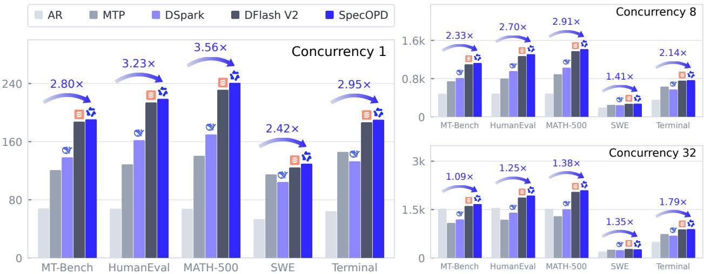  
Figure 6 | Measured Qwen3.8-27B output throughput (tokens/s) with BF16, TP=1, FA3 and CUDA Graphs.

## 3.1. Setup

Targets and Training. We study Qwen3-8B [66] with DFlash and DSpark, Qwen3.8-27B with DFlash V2, and Qwen3.8-Flash-Next-125B with DFlash V2, covering full (GQA), full–linear (GQA–GDN), and sparse–linear (QSA–GDN) attention. We train on Open-PerfectBlend [9] references with fresh draft-sampled branches. Appendix B gives model-specific settings.

Benchmarks and Baselines. We evaluate decoding on MT-Bench [10], HumanEval [11], MATH-500 [12], and recorded SWE [13] and Terminal [14] interaction histories. The latter measure continuation eficiency from recorded contexts; Appendix A.1 describes the collections. Acceptance comparisons use each drafter’s original checkpoint; training comparisons use sequential-rollout OPD, of-policy CE, and of-policy E2E-TV. Serving comparisons include AR, MTP, DSpark and original DFlash V2 [4].

Evaluation and Metrics. Serving evaluations use SGLang [65]. Main comparisons use greedy decoding (� = 0) and sampling (� = 1), seven draft tokens, and one selected checkpoint per training line. Acceptance length (AL) counts completion tokens per verification round, including bonus tokens; we average per request and equally across benchmarks. Inference throughput measures output tokens/s. Training eficiency measures optimizer updates/s, supervised tokens/update, and supervised tokens/s; only token predictions contributing to the loss count as supervised tokens. Prefix-survival changes are measured in percentage points. Full metric definitions appear in Appendix A.1.

## 3.2. Inference Eficiency

Acceptance Length across Settings. Table 1 shows higher five-benchmark mean AL across all three targets. The largest gains occur on 8B, where DFlash and DSpark improve on every workload at both temperatures; DFlash reaches a 41.45% mean-AL improvement and an 81.51% gain on Terminal. Gains are more modest on the hybrid targets, reaching 3.48% on 27B and 5.01% on 125B. The 125B drafter improves across all tasks, while 27B agentic results remain nearly unchanged, including a small Terminal decrease at � = 1. Our 125B drafter was pretrained in-house without agentic data, a coverage gap that may limit adaptation to agentic histories. Extending its pretraining with agentic trajectories is a natural next step to explore further gains. A separate study starting from public DFlash V2 also shows AL improvements on the FP8 Flash-Next target at inference block sizes four and eight (Appendix A.5).

Throughput across Concurrency. Figure 6 reports measured 27B decoding throughput, reaching 3.56× that of AR. Across the five workloads, geometric-mean speedups are 2.97×, 2.23×, and 1.35× at concurrency 1, 8, and 32. Measured geometric-mean throughput is up to 2.83% higher than the original DFlash V2 drafter. Gains vary by workload and concurrency; SWE is slower than the original drafter at concurrency 32. Appendix A.8 provides the detailed comparison.

## 3.3. Training Eficiency

Training Throughput. On Qwen3.8-27B with DFlash V2 and eight high-performance GPUs, SpecOPD achieves 16.09× the supervised-token throughput of Draft-OPD (Figure 7). This improvement combines 4.95× faster updates with 3.25× more supervised tokens per update: branch parallelism both reduces collection time and supplies more supervised positions at each step.

Execution Profile. Figure 1a shows how the collection schedule changes. Draft-OPD alternates dependent rollout, replay/training, and weight-update stages; SpecOPD batches drafting and target scoring across reference anchors. Mean recorded GPU activity rises from 26.37% to 77.23% in the illustrated windows. The profile illustrates how branch parallelism keeps the GPUs active during training. Appendix B.2 specifies the timing and profiling procedures.

## 3.4. Ablation Study

On-Policy vs. Of-Policy. We compare SpecOPD with two of-policy baselines trained on fixed targetgenerated responses: CE uses reference-token labels, while E2E-TV matches target distributions along reference histories. At matched optimizer steps and reference-sequence batches, the SpecOPD recipe achieves higher acceptance on all three benchmarks, with a mean advantage of up to 15.71% over ofpolicy E2E-TV (Figure 8). SpecOPD also improves on the common initialization, whereas the evaluated of-policy checkpoints fall below it. The recipes use diferent compute allocations and gradient paths; Appendix A.6 gives the configurations and complete comparison.

Training Dynamics. Lower training loss does not necessarily translate into longer acceptance. All three runs reduce training loss, but of-policy CE’s acceptance declines as training continues, while SpecOPD’s improves (Figure 8a–d). These trends motivate evaluating acceptance directly alongside the training objective.

Where Acceptance Changes. A closer look at prefix survival shows how the gains are distributed across draft positions (Figure 8e), relative to the common initialization. Using each method’s best evaluated checkpoint by mean AL, SpecOPD improves survival across

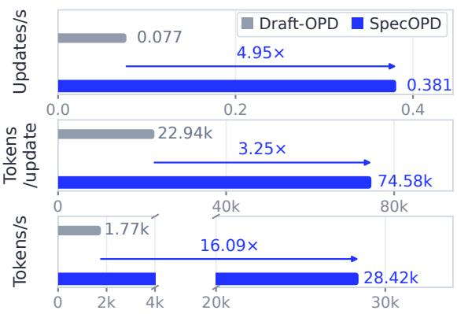

Figure 7 | Training eficiency on Qwen3.8-27B / DFlash V2. Tokens count supervised predictions contributing to the loss.  
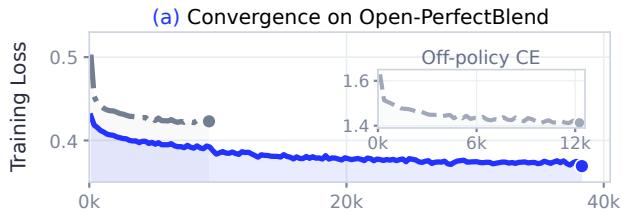

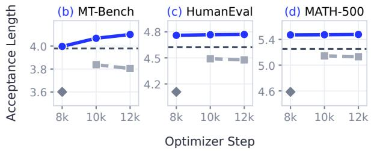

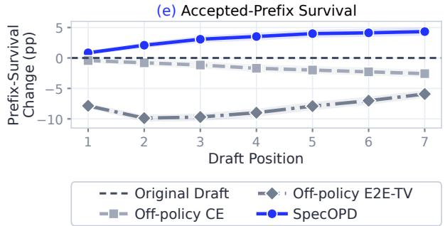  
Figure 8 | Training loss, acceptance length, and prefix survival on Qwen3.8-27B / DFlash V2. Survival changes are relative to initialization; shading shows pointwise 95% question-cluster bootstrap intervals over 824 paired requests.

all seven positions, whereas both of-policy baselines show declines. At position seven, survival rises by 4.33 percentage points, compared with a 2.57-point decline for of-policy CE. These request-level measurements connect the training comparison to the accepted-prefix behavior that determines decoding progress.

## 4. Related Work

Parallel Drafting for SD. Speculative decoding (SD) accelerates generation by verifying inexpensive draft proposals with the target in parallel [1, 2]. Auxiliary-head and self-speculative approaches improve proposal eficiency through multiple prediction heads or target-layer reuse [27, 36, 53, 54]. Tree-based verification and confidence-aware candidate allocation improve coverage and budget utilization [26, 17, 32, 35], while retrievalbased and hybrid approaches exploit datastores, cached token transitions, or target logits to provide inexpensive candidates [33, 34, 37, 38]. Many drafters reuse target representations: EAGLE drafts autoregressively from target features [16, 17, 18], and multi-token prediction (MTP) heads trained with the target serve as built-in drafters [19, 20]. Autoregressive drafting still spends one drafter pass per proposed token; parallel drafters instead predict a block in one forward pass. Falcon drafts semi-autoregressively [21], PARD adapts a small draft model to parallel mask prediction [22], and P-EAGLE turns EAGLE into a parallel multi-token predictor [23]. DFlash brings block difusion to drafting [3]. DFlare enlarges draft capacity with per-layer target-feature fusion [24]. Domino decouples parallel drafting from causal modeling, using a lightweight causal head to refine parallel draft outputs [25]; DSpark combines a parallel backbone with lightweight sequential modeling and confidence-scheduled verification [15]. D-cut further adapts verification depth across batched requests to balance acceptance and verification cost [47]. These designs improve how proposals are generated and verified. SpecOPD addresses their training: fresh supervision for parallel drafters can be collected across independent reference anchors, without constructing a complete verified trajectory at every collection step. Appendix F expands these directions and discusses their connections to RL rollouts and multimodal generation.

On-Policy Draft Training and Acceptance Objectives. On-policy distillation supervises student-generated histories [28]. DistillSpec studies draft-generated data and decoding-aware divergence choices [29]; Draft-OPD uses target-assisted rollouts and error-state replay [5]. Acceptance objectives account for progress beyond tokenwise accuracy: E2E-TV couples distribution overlap across draft prefixes [6], while Expected Decoding Rounds models verification-round progress [30]. SpecOPD adopts E2E-TV and parallelizes fresh sampling and history-consistent target scoring, complementing eforts to reduce training memory [55] and communication [56]. Its supervision is on-policy within each branch; reference prefixes define the outer contexts and difer from unrestricted full-response rollouts.

Shared Computation across Histories. Tree attention, introduced by SpecInfer [26] and adopted by Medusa [27], makes multiple candidate paths jointly verifiable while preserving their ancestry. Reusing computation for training must also accommodate targets with diferent history representations: GQA retains token KV [31], QSA selects token blocks using compressed indexer keys [8], and GDN maintains recurrent state [7]. SpecOPD uses a common proposal tree to organize this reuse, with tree masks, branch-consistent indexer groups, and indexed state replay for the respective attention types. Their common principle is prefix reuse with separate histories after divergence.

## 5. Conclusion

SpecOPD unlocks faster lossless decoding through elegant, eficient branch-parallel on-policy learning built on a simple insight: a draft block can learn directly from target supervision on its own sampled histories. A unique twist on parallel-drafter training replaces reference-token labels with target supervision on draftsampled histories, while proposal trees enable parallel scoring with shared-prefix reuse. Our study spans 8B full attention (GQA), 27B full–linear (GQA–GDN), and 125B sparse–linear (QSA–GDN) targets, using DFlash, DSpark, and DFlash V2 across dialogue, coding, mathematics, and agentic tasks. SpecOPD improves mean acceptance length by up to 41.45% and achieves 16.09× supervised-token throughput over sequential-rollout OPD; measured generation speedup reaches 3.56× over autoregressive decoding. This framework enables the community to explore better policies across heterogeneous targets and translate advances in draft learning into faster production serving.

## Acknowledgments

We thank Jue Wang and Yubo Wang at LightSeek Foundation and the team for feedback and support.

## References

[1] Yaniv Leviathan, Matan Kalman, and Yossi Matias. Fast Inference from Transformers via Speculative Decoding. ICML, 2023. https://proceedings.mlr.press/v202/leviathan23a.html.

[2] Charlie Chen, Sebastian Borgeaud, Geofrey Irving, Jean-Baptiste Lespiau, Laurent Sifre, and John Jumper. Accelerating Large Language Model Decoding with Speculative Sampling. arXiv:2302.01318, 2023. https://arxiv.org/abs/2302.01318.

[3] Jian Chen, Yesheng Liang, and Zhijian Liu. DFlash: Block Difusion for Flash Speculative Decoding. arXiv:2602.06036, 2026. https://arxiv.org/abs/2602.06036. Implementation: https://github.com/z-lab/dflash. DFlash2 architecture: Inco AI, DFlash 2: Keep Drafting Parallel, 2026, https://inco.ai/blog/dflash2/. Only architecture descriptions are used from this source.

[4] Inco AI. DFlash 2: Keep Drafting Parallel. 2026. https://inco.ai/blog/dflash2/. Qwen3.8-27B public benchmark (z-lab mirror): https://huggingface.co/z-lab/Qwen3.8-27B-DFlash2.

[5] Haodi Lei, Yafu Li, Haoran Zhang, Shunkai Zhang, Qianjia Cheng, Xiaoye Qu, Ganqu Cui, Bowen Zhou, Ning Ding, Yun Luo, and Yu Cheng. Draft-OPD: On-Policy Distillationfor Speculative Draft Models. arXiv:2605.29343, 2026. https://arxiv.org/abs/2605.29343. Oficial implementation: https://github.com/Simplified-Reasoning/Draft-OPD.

[6] Yucheng Li, Huiqiang Jiang, Yang Xu, Jianxin Yang, Yi Zhang, Yizhong Cao, Yuhao Shen, Fan Zhou, Rui Men, Jianwei Zhang, An Yang, Bowen Yu, Bo Zheng, Fei Huang, Junyang Lin, Dayiheng Liu, and Jingren Zhou. Breaking Entropy Bounds: Accelerating RL Training via MTP with Rejection Sampling. arXiv:2606.12370, 2026. https://arxiv.org/abs/2606.12370.

[7] Songlin Yang, Jan Kautz, and Ali Hatamizadeh. Gated Delta Networks: Improving Mamba2 with Delta Rule. ICLR, 2025. https://arxiv.org/abs/2412.06464.

[8] Qwen Team. On the Design of Qwen3.8-Next Architecture: Evaluation, Eficiency, and Training Stability. arXiv:2608.30320, 2026. https://arxiv.org/abs/2608.30320.

[9] mlabonne. Open-PerfectBlend. Hugging Face dataset. https://huggingface.co/datasets/mlabonne/open-perfectblend.

[10] Lianmin Zheng et al. Judging LLM-as-a-Judge with MT-Bench and Chatbot Arena. NeurIPS, 2023. https://arxiv.org/abs/2306.05685.

[11] Mark Chen et al. Evaluating Large Language Models Trained on Code. arXiv:2107.03374, 2021. https://arxiv.org/abs/2107.03374.

[12] Hugging Face H4. MATH-500. Dataset. https://huggingface.co/datasets/HuggingFaceH4/MATH-500.

[13] Carlos E. Jimenez et al. SWE-bench: Can Language Models Resolve Real-World GitHub Issues? ICLR, 2024. https://arxiv.org/abs/2310.06770.

[14] Mike A. Merrill et al. Terminal-Bench: Benchmarking Agents on Hard, Realistic Tasks in Command Line Interfaces. arXiv:2601.11868, 2026. https://arxiv.org/abs/2601.11868.

[15] Xin Cheng et al. DSpark: Confidence-Scheduled Speculative Decoding with Semi-Autoregressive Generation. arXiv:2607.05147, 2026. https://arxiv.org/abs/2607.05147.

[16] Yuhui Li, Fangyun Wei, Chao Zhang, and Hongyang Zhang. EAGLE: Speculative Sampling Requires Rethinking Feature Uncertainty. arXiv:2401.15077, 2025. https://arxiv.org/abs/2401.15077.

[17] Yuhui Li, Fangyun Wei, Chao Zhang, and Hongyang Zhang. EAGLE-2: Faster Inference of Language Models with Dynamic Draft Trees. Proceedings of the 2024 Conference on Empirical Methods in Natural Language Processing, 2024. https://aclanthology.org/2024.emnlp-main.422/.

[18] Yuhui Li, Fangyun Wei, Chao Zhang, and Hongyang Zhang. EAGLE-3: Scaling up Inference Acceleration of Large Language Models via Training-Time Test. arXiv:2503.01840, 2025. https://arxiv.org/abs/2503.01840.

[19] Fabian Gloeckle, Badr Youbi Idrissi, Baptiste Rozière, David Lopez-Paz, and Gabriel Synnaeve. Better & Faster Large Language Models via Multi-token Prediction. arXiv:2404.19737, 2024. https://arxiv.org/abs/2404.19737.

[20] DeepSeek-AI. DeepSeek-V3 Technical Report. arXiv preprint arXiv:2412.19437, 2024. https://arxiv.org/abs/2412.19437.

[21] Xiangxiang Gao, Weisheng Xie, Yiwei Xiang, and Feng Ji. Falcon: faster and parallel inference of large language models through enhanced semi-autoregressive drafting and custom-designed decoding tree. Proceedings of the Thirty-Ninth AAAI Conference on Artificial Intelligence and Thirty-Seventh Conference on Innovative Applications of Artificial Intelligence and Fifteenth Symposium on Educational Advances in Artificial Intelligence, 2025. https://doi.org/10.1609/aaai.v39i22.34566.

[22] Zihao An, Huajun Bai, Ziqiong Liu, Dong Li, and Emad Barsoum. PARD: Accelerating LLM Inference with Low-Cost PARallel Draft Model Adaptation. arXiv:2504.18583, 2025. https://arxiv.org/abs/2504.18583.

[23] Mude Hui, Xin Huang, Jaime Campos Salas, Yue Sun, Nathan Pemberton, Xiang Song, Ashish Khetan, and George Karypis. P-EAGLE: Parallel-Drafting EAGLE with Scalable Training. arXiv:2602.01469, 2026. https://arxiv.org/abs/2602.01469.

[24] Jiebin Zhang, Zhenghan Yu, Song Liu, Eugene J Yu, Zheng Li, Dawei Zhu, Jiangshan Duo, Weimin Xiong, Yifan Song, Guanghua Yu, et al. DFlare: Scaling Up Draft Capacityfor Block Difusion Speculative Decoding. arXiv preprint arXiv:2606.02091, 2026.

[25] Jianuo Huang, Yaojie Zhang, Qituan Zhang, Hao Lin, Hanlin Xu, and Linfeng Zhang. Domino: Decoupling Causal Modeling from Autoregressive Drafting in Speculative Decoding. arXiv preprint arXiv:2605.29707, 2026.

[26] Xupeng Miao, Gabriele Oliaro, Zhihao Zhang, Xinhao Cheng, Zeyu Wang, Zhengxin Zhang, Rae Ying Yee Wong, Alan Zhu, Lijie Yang, Xiaoxiang Shi, Chunan Shi, Zhuoming Chen, Daiyaan Arfeen, Reyna Abhyankar, and Zhihao Jia. SpecInfer: Accelerating Large Language Model Serving with Tree-based Speculative Inference and Verification. Proceedings of the 29th ACM International Conference on Architectural Support for Programming Languages and Operating Systems, Volume 3, 2024. https://doi.org/10.1145/3620666.3651335.

[27] Tianle Cai et al. Medusa: Simple LLM Inference Acceleration Framework with Multiple Decoding Heads. arXiv:2401.10774, 2024. https://arxiv.org/abs/2401.10774.

[28] Rishabh Agarwal et al. On-Policy Distillation of Language Models: Learning from Self-Generated Mistakes. ICLR, 2024. https://arxiv.org/abs/2306.13649.

[29] Yongchao Zhou et al. DistillSpec: Improving Speculative Decoding via Knowledge Distillation. ICLR, 2024. https://arxiv.org/abs/2310.08461.

[30] Yunxiao Zhao and Changxiao Cai. Training Parallel Speculative Draft Models by Directly Minimizing Expected Decoding Rounds. arXiv:2610.10411, 2026. https://arxiv.org/abs/2610.10411.

[31] Joshua Ainslie, James Lee-Thorp, Michiel de Jong, Yury Zemlyanskiy, Federico Lebrón, and Sumit Sanghai. GQA: Training Generalized Multi-Query Transformer Models from Multi-Head Checkpoints. EMNLP, 2023. https://arxiv.org/abs/2305.13245.

[32] Xinyi Hu et al. ECHO: Elastic Speculative Decoding with Sparse Gating for High-Concurrency Scenarios. ICML, 2026. https://proceedings.mlr.press/v306/hu26ar.html.

[33] Zhenyu He, Zexuan Zhong, Tianle Cai, Jason Lee, and Di He. REST: Retrieval-Based Speculative Decoding. NAACL, 2024. https://aclanthology.org/2024.naacl-long.88/.

[34] Xianzhen Luo et al. Turning Trash into Treasure: Accelerating Inference of Large Language Models with Token Recycling. arXiv:2408.08696, 2024. https://arxiv.org/abs/2408.08696.

[35] Tianyu Liu, Qitan Lv, Yuhao Shen, Jun Zhang, Xiao Sun, and Xiaoyan Sun. TALON: Confidence-Aware Speculative Decoding with Adaptive Token Trees. NeurIPS, 2026. https://openreview.net/forum?id=bvEN7uoqUE.

[36] Jun Zhang, Jue Wang, Huan Li, Lidan Shou, Ke Chen, Gang Chen, and Sharad Mehrotra. Draft & Verify: Lossless Large Language Model Acceleration via Self-Speculative Decoding. ACL, 2024. https://aclanthology.org/2024.acl-long.607/.

[37] Tianyu Liu, Qitan Lv, Hao Li, Xing Gao, and Xiao Sun. LogitSpec: Accelerating Retrieval-based Speculative Decoding via Next Next Token Speculation. arXiv:2507.01449, 2025. https://arxiv.org/abs/2507.01449.

[38] Yuhao Shen et al. Draft Less, Retrieve More: Hybrid Tree Construction for Speculative Decoding. arXiv:2605.20104, 2026. https://arxiv.org/abs/2605.20104.

[39] Tianyu Liu et al. PEARL: Parallel Speculative Decoding with Adaptive Draft Length. arXiv:2408.11850, 2024. https://arxiv.org/abs/2408.11850.

[40] Yuhao Shen, Junyi Shen, Quan Kong, Tianyu Liu, Yao Lu, and Cong Wang. SpecBranch: Speculative Decoding via Hybrid Drafting and Rollback-Aware Branch Parallelism. ICLR, 2026. https://arxiv.org/abs/2506.01979.

[41] Yuhao Shen, Tianyu Liu, Junyi Shen, Jinyang Wu, Quan Kong, Huan Li, and Cong Wang. Double: Breaking the Acceleration Limit via Double Retrieval Speculative Parallelism. ACL, 2026. https://aclanthology.org/2026.acl-long.879/.

[42] Bingshuai Liu et al. SPEC-RL: Accelerating On-Policy Reinforcement Learning with Speculative Rollouts. arXiv:2509.23232, 2025. https://arxiv.org/abs/2509.23232.

[43] Chi-Chih Chang et al. SRT: Accelerating Reinforcement Learning via Speculative Rollout with Tree-Structured Cache. arXiv:2601.09083, 2026. https://arxiv.org/abs/2601.09083.

[44] Hayate Iso et al. Accelerating RL Post-Training Rollouts via System-Integrated Speculative Decoding. arXiv:2604.26779, 2026. https://arxiv.org/abs/2604.26779.

[45] Yicheng Ji, Jun Zhang, Heming Xia, Jinpeng Chen, Lidan Shou, Gang Chen, and Huan Li. SpecVLM: Enhancing Speculative Decoding of Video LLMs via Verifier-Guided Token Pruning. EMNLP, 2025. https://aclanthology.org/2025.emnlp-main.366/.

[46] Quan Kong, Yuhao Shen, Yicheng Ji, Huan Li, and Cong Wang. ParallelVLM: Lossless Video-LLM Acceleration with Visual Alignment Aware Parallel Speculative Decoding. arXiv:2603.19610, 2026. https://arxiv.org/abs/2603.19610.

[47] Tianyu Liu, Yuhao Shen, Rui Cen, et al. D-cut: Adaptive Verification Depth Pruning for Batched Speculative Decoding. 2026. arXiv:2607.14647. https://arxiv.org/abs/2607.14647.

[48] Tianyu Liu, Yuhao Shen, Xinyi Hu, et al. When Hidden States Drift: Can KV Caches Rescue Long-Range Speculative Decoding?. 2026. arXiv:2604.26412. https://arxiv.org/abs/2604.26412.

[49] Tianqi Xu, Lu Lv, Haoyang Huang, et al. TailSieve: Partial-Rollout-Guided Tail Routing for LLM Rollouts. 2026. arXiv:2608.22788. https://arxiv.org/abs/2608.22788.

[50] Yicheng Ji, Jun Zhang, Jinpeng Chen, Cong Wang, Lidan Shou, Gang Chen, and Huan Li. See the Forestfor the Trees: Loosely Speculative Decoding via Visual-Semantic Guidance for Eficient Inference of Video LLMs. ACL, 2026, pages 23707–23726. https://aclanthology.org/2026.acl-long.1087/.

[51] Haoyang Huang, Wenjie Huang, Tianqi Xu, et al. OmniDelta: Skill-Driven Budget Allocation for Token Compression in OmniLLMs. 2026. arXiv:2607.25669. https://arxiv.org/abs/2607.25669.

[52] Yicheng Ji, Zhizhou Zhong, Jun Zhang, et al. Forcing-KV: Hybrid KV Cache Compression for Eficient Autoregressive Video Difusion Models. 2026. arXiv:2605.09681. https://arxiv.org/abs/2605.09681.

[53] Heming Xia, Yongqi Li, Jun Zhang, Cunxiao Du, and Wenjie Li. SWIFT: On-the-Fly Self-Speculative Decodingfor LLM Inference Acceleration. ICLR, 2025. ICLR proceedings.

[54] Mingbo Song, Heming Xia, Jun Zhang, Chak Tou Leong, Qiancheng Xu, Wenjie Li, and Sujian Li. KNN-SSD: Enabling Dynamic Self-Speculative Decoding via Nearest Neighbor Layer Set Optimization. Findings of EACL, 2026, pages 641–655. https://aclanthology.org/2026.findings-eacl.31/.

[55] Jun Zhang, Jue Wang, Huan Li, Lidan Shou, Ke Chen, Yang You, Guiming Xie, Xuejian Gong, and Kunlong Zhou. Train Small, Infer Large: Memory-Eficient LoRA Trainingfor Large Language Models. ICLR, 2025. https://openreview.net/forum?id=s7DkcgpRxL.

[56] Qingao Yi, Jiaang Duan, Jun Zhang, Haiyan Zhao, Shiyou Qian, Dingyu Yang, Jian Cao, and Jinghua Tang. Entropy-driven Dynamic Gradient Compression for Eficient LLM Training. arXiv:2511.10333v2, 2026. https://arxiv.org/abs/2511.10333v2.

[57] Jun Zhang, Jue Wang, Huan Li, Lidan Shou, Ke Chen, Gang Chen, Qin Xie, Guiming Xie, and Xuejian Gong. HMI: Hierarchical Knowledge Managementfor Eficient Multi-Tenant Inference in Pretrained Language Models. The VLDB Journal, 34, article 43, 2025. https://doi.org/10.1007/s00778-025-00919-7.

[58] Yuxin Zhou, Zheng Li, Jun Zhang, Jue Wang, Yiping Wang, Zhongle Xie, Ke Chen, and Lidan Shou. FloE: On-the-Fly MoE Inference on Memory-constrained GPU. ICML, 2025, pages 78859–78882. https://proceedings.mlr.press/v267/zhou25j.html.

[59] Jun Zhang, Yicheng Ji, Feiyang Ren, Yihang Li, Bowen Zeng, Zonghao Chen, Ke Chen, Lidan Shou, Gang Chen, and Huan Li. Eficient Inference for Large Vision-Language Models: Bottlenecks, Techniques, and Prospects. Findings of ACL, 2026, pages 21036–21066. https://aclanthology.org/2026.findings-acl.1057/.

[60] Bowen Zeng, Feiyang Ren, Jun Zhang, Xiaoling Gu, Ke Chen, Lidan Shou, and Huan Li. HybridKV: Hybrid KV Cache Compressionfor Eficient Multimodal Large Language Model Inference. ACL, 2026, pages 13018–13034. https://aclanthology.org/2026.acl-long.594/.

[61] Long Ouyang et al. Training Language Models to Follow Instructions with Human Feedback. NeurIPS, 2022. https://arxiv.org/abs/2203.02155.

[62] Yoon Kim and Alexander M. Rush. Sequence-Level Knowledge Distillation. EMNLP, 2016. https://aclanthology.org/D16-1139/.

[63] Jianlin Su, Yu Lu, Shengfeng Pan, Ahmed Murtadha, Bo Wen, and Yunfeng Liu. RoFormer: Enhanced Transformer with Rotary Position Embedding. arXiv:2104.09864, 2021. https://arxiv.org/abs/2104.09864.

[64] Biao Zhang and Rico Sennrich. Root Mean Square Layer Normalization. NeurIPS, 2019. https://arxiv.org/abs/1910.07467.

[65] Lianmin Zheng et al. SGLang: Eficient Execution of Structured Language Model Programs. NeurIPS, 2024. https://arxiv.org/abs/2312.07104.

[66] An Yang et al. Qwen3 Technical Report. arXiv:2505.09388, 2025. https://arxiv.org/abs/2505.09388.

[67] Alexander Samarin, Sergei Krutikov, Anton Shevtsov, Sergei Skvortsov, Filipp Fisin, and Alexander Golubev. LK Losses: Direct Acceptance Rate Optimization for Speculative Decoding. ICML, 2026. https://arxiv.org/abs/2602.23881.

[68] Tianyu Wu et al. D-PACE: Dynamic Position-Aware Cross-Entropyfor Parallel Speculative Drafting. arXiv:2605.18810, 2026. https://arxiv.org/abs/2605.18810.

## Appendix Contents

A Supplementary Experiments . . . . . . . . . . . . . . . . . . . . . . . . . . . . . . . . . . . . . . . . . . . . . . . . . . . . . . . . . . . . . . . . . . . . . . . . . . . . . . . 14   
A.1 Evaluation Protocols and Metrics . . . . . . . . . . . . . . . . . . . . . . . . . . . . . . . . . . . . . . . . . . . . . . . . . . . . . . . . . . . . . . . . . . . . . . . . . 14   
A.2 Qwen3-8B Evaluation . . . . . . . . . . . . . . . . . . . . . . . . . . . . . . . . . . . . . . . . . . . . . . . . . . . . . . . . . . . . . . . . . . . . . . . . . . . . . . . . . . . . 14   
A.3 Qwen3.8-27B Evaluation . . . . . . . . . . . . . . . . . . . . . . . . . . . . . . . . . . . . . . . . . . . . . . . . . . . . . . . . . . . . . . . . . . . . . . . . . . . . . . . . . 14   
A.4 Qwen3.8-Flash-Next-125B Evaluation . . . . . . . . . . . . . . . . . . . . . . . . . . . . . . . . . . . . . . . . . . . . . . . . . . . . . . . . . . . . . . . . . . . . 15   
A.5 Public DFlash V2 Training on Flash-Next . . . . . . . . . . . . . . . . . . . . . . . . . . . . . . . . . . . . . . . . . . . . . . . . . . . . . . . . . . . . . . . . . . 16   
A.6 Of-Policy Training Comparisons. . . . . . . . . . . . . . . . . . . . . . . . . . . . . . . . . . . . . . . . . . . . . . . . . . . . . . . . . . . . . . . . . . . . . . 16   
A.7 Inference Window Study on the 8B DFlash Drafter . . . . . . . . . . . . . . . . . . . . . . . . . . . . . . . . . . . . . . . . . . . . . . . . . . . . . . . . 17   
A.8 Measured 27B Serving Protocol . . . . . . . . . . . . . . . . . . . . . . . . . . . . . . . . . . . . . . . . . . . . . . . . . . . . . . . . . . . . . . 18   
B Training Configurations and Measurement . . . . . . . . . . . . . . . . . . . . . . . . . . . . . . . . . . . . . . . . . . . . . . . . . . . . . . . . . . . . . . . . 18   
B.1 Model-Specific Training Recipes . . . . . . . . . . . . . . . . . . . . . . . . . . . . . . . . . . . . . . . . . . . . . . . . . . . . . . . . . . . . . . . . . . . . . . . . . . 19   
B.2 Training-Throughput Measurement . . . . . . . . . . . . . . . . . . . . . . . . . . . . . . . . . . . . . . . . . . . . . . . . . . . . . . . . . . . . . . . . . . . . . . . 19   
B.3 Comparison Settings . . . . . . . . . . . . . . . . . . . . . . . . . . . . . . . . . . . . . . . . . . . . . . . . . . . . . . . . . . . . . . . . . . . . . . . . . . . . . . . . . . . . . 19   
C Method Details . . . . . . . . . . . . . . . . . . . . . . . . . . . . . . . . . . . . . . . . . . . . . . . . . . . . . . . . . . . . . . . . . . . . . . . . . . 20   
C.1 Conditioning and Prediction-Row Readout . . . . . . . . . . . . . . . . . . . . . . . . . . . . . . . . . . . . . . . . . . . . . . . . . . . . . . . . . . . . . . . . 20   
C.2 Acceptance Surrogate and Its Scope . . . . . . . . . . . . . . . . . . . . . . . . . . . . . . . . . . . . . . . . . . . . . . . . . . . . . . . . . . . . . . . . . . . . . . 20   
D Implementation Details . . . . . . . . . . . . . . . . . . . . . . . . . . . . . . . . . . . . . . . . . . . . . . . . . . . . . . . . . . . . . . . . . . . . . . . . . . . . . . . . . . . . 21   
D.1 Draft Models . . . . . . . . . . . . . . . . . . . . . . . . . . . . . . . . . . . . . . . . . . . . . . . . . . . . . . . . . . . . . . . . . . . . . . . . . . . . . . . . . . . . . . . . . . . . . 21   
D.2 One Optimization Step . . . . . . . . . . . . . . . . . . . . . . . . . . . . . . . . . . . . . . . . . . . . . . . . . . . . . . . . . . . . . . . . . . . . . . 22   
D.3 Parallel Branch Scoring for Hybrid Recurrent Targets . . . . . . . . . . . . . . . . . . . . . . . . . . . . . . . . . . . . . . . . . . . . . . . . . . . . . . 22   
D.4 Deterministic Target Inference . . . . . . . . . . . . . . . . . . . . . . . . . . . . . . . . . . . . . . . . . . . . . . . . . . . . . . . . . . . . . . . . 23   
D.5 Objective-Preserving Distributed Normalization . . . . . . . . . . . . . . . . . . . . . . . . . . . . . . . . . . . . . . . . . . . . . . . . . . . . . . . . . . . 24   
E Cost and Complexity Analysis . . . . . . . . . . . . . . . . . . . . . . . . . . . . . . . . . . . . . . . . . . . . . . . . . . . . . . . . . . . . . . . . . . . . . . . . . . . . . . 24   
E.1 Collection and Amortized Update Cost . . . . . . . . . . . . . . . . . . . . . . . . . . . . . . . . . . . . . . . . . . . . . . . . . . . . . . . . . . . . . . . . . . . . 24   
E.2 Attention and Recurrent Work . . . . . . . . . . . . . . . . . . . . . . . . . . . . . . . . . . . . . . . . . . . . . . . . . . . . . . . . . . . . . . . . . . . . . . . . . . . . 25   
E.3 Conditional Wall-Time Sensitivity . . . . . . . . . . . . . . . . . . . . . . . . . . . . . . . . . . . . . . . . . . . . . . . . . . . . . . . . . . . . . . . . . . . . . . . . . 25   
F . . . . 26

## A. Supplementary Experiments

This appendix gives evaluation settings, training trends, and controlled comparisons supporting Section 3.

## A.1. Evaluation Protocols and Metrics

The five workloads are MT-Bench, HumanEval, MATH-500, SWE, and Terminal. The three standard benchmarks contain 160 MT-Bench turns, 164 HumanEval prompts, and 500 MATH-500 prompts. SWE and Terminal use fixed-history replay: each request continues a recorded assistant-boundary prefix, without live tools or task-success grading. The collections yield 1,662 SWE and 177 Terminal requests, with multiple prefixes possible per conversation. Their membership in the oficial SWE-bench Verified and Terminal-Bench 2.0 subsets is unconfirmed; the 64 Terminal source trajectories are flagged as overlapping with training data. We use these contexts to measure decoding eficiency.

Checkpoint and Request Matching. Each training line uses one checkpoint across all tasks and temperatures in the main comparison. Original and trained weights share valid requests and decoding policies within each study; MT-Bench second turns follow each checkpoint’s own first-turn response.

Metrics and Decoding. For request $s ,$ let $t _ { s }$ be completion tokens and $\upsilon _ { s }$ verification rounds. AL includes bonus tokens and averages progress per request; the overall result gives equal weight to benchmarks:

$$
\overline { { a } } _ { D } = \frac { 1 } { | D | } \sum _ { s \in D } \frac { t _ { s } } { \nu _ { s } } , \qquad \overline { { a } } _ { \mathrm { a v g } } = \frac { 1 } { | \mathcal { B } | } \sum _ { D \in \mathcal { B } } \overline { { a } } _ { D } .\tag{10}
$$

Draft-token acceptance pools accepted and proposed tokens, excluding bonus tokens. AL gains are relative changes; prefix-survival changes are measured in percentage points. Output throughput is total final output tokens divided by active client wall time. Main acceptance comparisons propose seven draft tokens with eight verification positions. Greedy decoding uses � = 0, top-� = 1, top-� = 1; sampling uses � = 1, top-� = 0.95, top-� = 20. Serving measurements use one complete run per condition.

For training eficiency, let � be optimizer updates, � supervised tokens, and � elapsed training time. We report updates/s $\left( U / t \right)$ , supervised tokens/update (�/�), and supervised tokens/s (�/�), so supervised-token throughput equals update throughput multiplied by supervision per update. Only predictions contributing to the loss count toward $N ;$ context-only and masked-out positions are excluded. Timings include each method’s training workflow and exclude ofline reference preparation (Appendix B.2).

## A.2. Qwen3-8B Evaluation

The main comparison uses DFlash step 20,000 and DSpark step 26,382. Both improve AL and draft-token acceptance over initialization on every task at both temperatures. Figure 9 shows their earlier training trends, ending at DFlash 10,000 and DSpark 13,192; Table 1 reports the later selected checkpoints.

The DFlash initialization is z-lab/Qwen3-8B-DFlash-b16; pretraining and SpecOPD continuation use block size 16. Evaluation uses block size eight for DFlash and seven for DSpark, matching their seven-token proposal budget. Appendix A.7 examines DFlash at both inference windows.

All 8B runs use BF16, TP=1, and one high-performance GPU per service. Standard-task evaluation uses FlashInfer, thinking mode, concurrency four, an 8,192-token context, and a 4,096-token output cap, with CUDA Graphs, radix caching, and overlap scheduling disabled. SWE and Terminal use concurrency 16, a 32,768-token context, and an 8,192-token output cap. Paired filtering retains 1,661 SWE and all 177 Terminal requests. Generation seeds are fixed across compared weights.

## A.3. Qwen3.8-27B Evaluation

Agentic Workloads. The main comparison uses step 36,000, selected by standard-task AL, on all 1,662 SWE and 177 Terminal requests. Paired runs use the same GPU pair, TP=2, concurrency 16, a 40,960-token context, an 8,192-token output cap, and token capacity 131,072. The runtime uses an FP32 output head, a shared one-stage full-attention decode kernel, and GDN updates without floating-point fusion. Request order and generation seeds match across weights. Complete greedy outputs match across the compared weights on these workloads. $\operatorname { A t } T = 1$ , AL increases by 0.40% on SWE and decreases by 1.02% on Terminal.

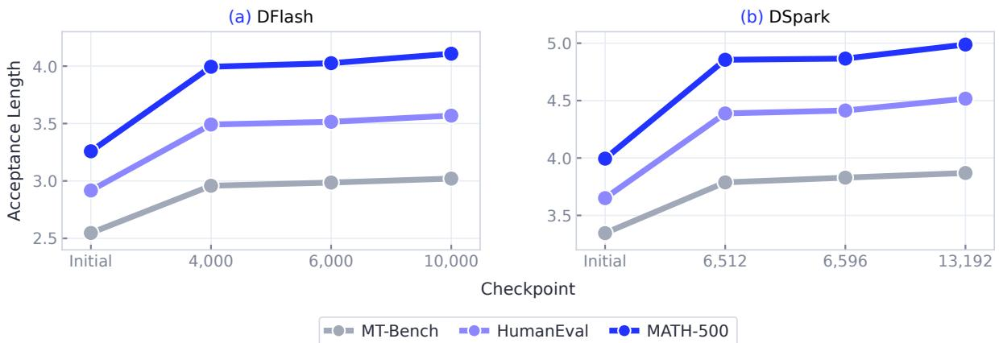  
Figure 9 | Qwen3-8B acceptance during training at � = 1 and concurrency four. Both drafters propose seven tokens with eight verification positions. Checkpoints are equally spaced; lines connect observed checkpoints. Panels use diferent y-axis ranges.

Standard Tasks. The main-table � = 0 results use the same step-36,000 checkpoint and the standard request counts listed above. Three-task mean AL rises from 4.8477 to 5.0784 (+4.76%). These archived runs use eight TP=1 replicas with concurrency eight per replica. Greedy outputs difer between original and trained weights in this archive; the reported comparison measures acceptance. The serving-throughput experiment uses the separate configuration in Appendix A.8.

## A.4. Qwen3.8-Flash-Next-125B Evaluation

The target contains 36 GDN layers and 12 QSA layers. QSA uses selection budget 2,048, compression ratio four, four indexer heads, and head dimension 128. DFlash V2 initialization is step 196,000; SpecOPD uses global batch $^ { 6 4 , }$ microbatch one, and accumulation four. Figure 10 shows the standard-task training trajectory. Step 22,000 maximizes the six-cell mean AL (4.4410) and supplies every 125B trained entry in Table 1.

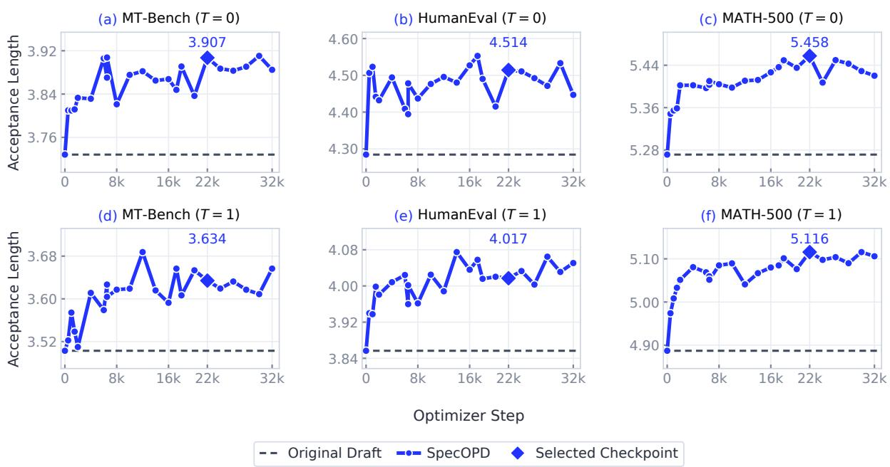  
Figure 10 | 125B acceptance during training at concurrency 16. Rows show $T = 0$ and $T = 1$ . The selected checkpoint is step 22,000; lines connect observations through step 32,000.

Evaluation uses an FP8 target and BF16 drafter, ${ \mathrm { T P } } { = } 2 / { \mathrm { E P } } { = } 2 ,$ concurrency $^ { 1 6 , }$ and xhigh reasoning efort on high-performance GPUs. Standard tasks use a 32,768-token context and 4,096-token output cap; SWE and Terminal use a 40,960-token context and 8,192-token output cap. The runtime uses Triton attention, FA2 for QSA variable-length execution, FP32 recurrent state, and disabled CUDA Graphs. Compared weights share the same requests and decoding policies.

## A.5. Public DFlash V2 Training on Flash-Next

We additionally evaluate SpecOPD continuation from the public BF16 DFlash V2 initialization with an FP8 Flash-Next target at inference block sizes four and eight. This study is separate from the in-house initialization used for the 125B main-table comparison. Figure 11 covers 17 trained checkpoints per block, from step 100 to 24,000, on MT-Bench, HumanEval, and MATH-500 at both temperatures. The largest observed task– temperature AL improvements over matched initializations are 7.72% at block four and 15.57% at block eight; the best checkpoint varies across tasks and temperatures.

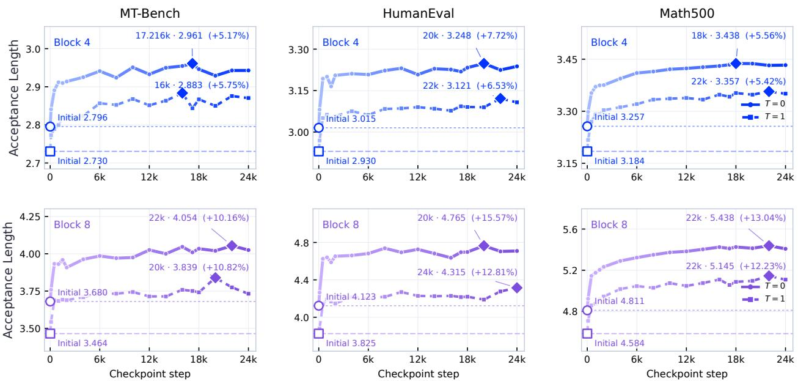  
Figure 11 | Public DFlash V2 acceptance during SpecOPD training with an FP8 Flash-Next target. Rows use inference block sizes four and eight. Diamonds mark each curve’s highest observed $\mathrm { A L } ;$ percentages use that checkpoint’s matched initialization. Initial points and horizontal references use the baselines paired with step 22,000. Lines guide the eye across GPU/configuration changes rather than depict a fixed-configuration trajectory.

Evaluation uses high-performance GPUs with server and request seeds both set to 42. Each checkpoint covers 160 MT-Bench turns (including second turns conditioned on its own first-turn responses), 164 HumanEval requests, and 500 MATH-500 requests at each temperature, for 1,648 responses before filtering. Evaluation outputs flagged as invalid are excluded from aggregation. Each trained checkpoint is compared with the initial model under the same hardware and inference settings; the reported gains use these matched comparisons.

## A.6. Of-Policy Training Comparisons

Table 2 compares SpecOPD with of-policy CE and E2E-TV at matched optimizer steps and reference-sequence batches. SpecOPD improves on the common initialization, while the evaluated of-policy checkpoints fall below it.

The three training recipes start from public DFlash V2, use fresh optimizers, global sequence batch 96, and peak learning rate $5 \bar { \times } 1 0 ^ { - 5 }$ . Of-policy runs train on fixed target-generated responses with 16 highperformance GPUs (six draft ranks and ten target workers); SpecOPD uses fresh sampled branches with 32 high-performance GPUs (12 draft ranks and 20 target workers) and merged accumulation. The of-policy objectives follow unary CE/E2E-TV paths, while SpecOPD diferentiates selector-conditioned probabilities.

Table 2 | On-policy and of-policy training on Qwen3.8-27B / DFlash V2 at matched optimizer steps and reference-sequence batches. AL includes bonus tokens (↑).
<table><tr><td>Steps</td><td>Training method</td><td>MT-Bench</td><td>HumanEval</td><td>MATH-500</td><td>Average</td></tr><tr><td>0</td><td>Original draft</td><td>3.9787</td><td>4.6225</td><td>5.2519</td><td>4.6177</td></tr><tr><td>8k</td><td>Off-policy E2E-TV</td><td>3.6011</td><td>4.1086</td><td>4.5854</td><td>4.0983</td></tr><tr><td>8k</td><td>SPECOPD</td><td>3.9966</td><td>4.7602</td><td>5.4699</td><td>4.7422</td></tr><tr><td>10k</td><td>Off-policy CE</td><td>3.8377</td><td>4.4905</td><td>5.1448</td><td>4.4910</td></tr><tr><td>10k</td><td>SPECOPD</td><td>4.0675</td><td>4.7668</td><td>5.4726</td><td>4.7690</td></tr><tr><td>12k</td><td>Off-policy CE</td><td>3.8042</td><td>4.4771</td><td>5.1311</td><td>4.4708</td></tr><tr><td>12k</td><td>SPECOPD</td><td>4.1005</td><td>4.7696</td><td>5.4764</td><td>4.7822</td></tr></table>

These recipe-level comparisons match sequence presentations, with diferent compute allocations and gradient paths.

Evaluation uses � = 1, top- $- p = 0 . 9 5 $ , top-� = 20, a 4,096-token completion cap, and concurrency eight per replica. Of-policy E2E-TV is evaluated at 8k steps and CE at 10k and 12k. The prefix-survival figure pairs all 824 requests with the common initialization and excludes bonus tokens. Its 2,000 bootstrap replicates are stratified by task and clustered by question, keeping MT-Bench turns together. The resulting pointwise 95% intervals describe request-level variation. Benchmark means in the table have equal weights; the position figure gives each request equal weight.

## A.7. Inference Window Study on the 8B DFlash Drafter

DFlash pretraining and SpecOPD continuation use block size 16, while the main table uses inference block size eight to match DSpark’s seven-token proposal budget. We compare the block-16 initialization with its step-10,000 continuation at inference windows eight and 16 on the three standard tasks at both temperatures. Window eight proposes seven tokens; window 16 proposes fifteen. The four arms use the same high-performance GPU, TP=1, concurrency four, an 8,192-token context, and a 4,096-token output cap, with CUDA Graphs, radix caching, and overlap scheduling disabled.

Training improves AL and throughput in all task–temperature pairs at both windows (Figure 12). AL increases by 18.67–30.57% at window eight and 22.87–37.97% at window 16; the corresponding throughput gains are 21.33–34.58% and 20.04–35.41%.

Common-Anchor Comparison. To compare draft quality at the same proposal budget, we also measure firstverification acceptance at matched prefixes and anchors. Prefixes come from initialization answers at ofsets 0, 256, and 1,024 (clipped and deduplicated), yielding 480 MT-Bench, 492 HumanEval, and 1,500 MATH-500 prefixes. Every arm uses the same prefix, seed, and reference anchor from the initialization/window-eight arm; these probes are separate from the throughput runs. For accepted draft tokens �, excluding the bonus token, the comparable first-seven score is $\begin{array} { r } { S _ { 7 } = \bar { \sum _ { j = 1 } ^ { 7 } } \operatorname* { P r } ( A \geq j ) = { \mathbb { E } } [ \operatorname* { m i n } ( A , 7 ) ] } \end{array}$

Table 3 | Common-anchor efects on $S _ { 7 } { \mathrm { . } }$ , in accepted draft tokens. $\Delta _ { W }$ is window 16 minus 8; $\Delta _ { \mathrm { t r a i n } }$ is step 10,000 minus initialization. Interaction is $\Delta _ { W } ( 1 0 , 0 0 0 ) - \Delta _ { W } ( 0 )$
<table><tr><td>T</td><td>Task</td><td> $\Delta _ { W } ( 0 )$ </td><td> $\Delta _ { W } ( 1 0 , 0 0 0 )$ </td><td> $\Delta _ { \mathrm { t r a i n } } ( 8 )$ </td><td> $\Delta _ { \mathrm { t r a i n } } ( 1 6 )$ </td><td>Interaction</td></tr><tr><td>0</td><td>MT-Bench</td><td>0.0604</td><td>0.6896</td><td>1.6417</td><td>2.2708</td><td>0.6292</td></tr><tr><td>0</td><td>HumanEval</td><td>0.3455</td><td>0.6524</td><td>1.9004</td><td>2.2073</td><td>0.3069</td></tr><tr><td>0</td><td>MATH-500</td><td>0.0780</td><td>0.4560</td><td>2.3867</td><td>2.7647</td><td>0.3780</td></tr><tr><td>1</td><td>MT-Bench</td><td>0.0729</td><td>0.5708</td><td>1.5312</td><td>2.0292</td><td>0.4979</td></tr><tr><td>1</td><td>HumanEval</td><td>0.2866</td><td>0.6748</td><td>1.6992</td><td>2.0874</td><td>0.3882</td></tr><tr><td>1</td><td>MATH-500</td><td>0.0973</td><td>0.3167</td><td>2.2967</td><td>2.5160</td><td>0.2193</td></tr></table>

Training raises $S _ { 7 }$ at both windows. Window 16’s advantage grows from 0.0604–0.3455 at initialization to 0.3167–0.6896 after training, giving positive interactions in all six conditions (Table 3). Both sets of weights are trained with window $^ { 1 6 ; }$ this study varies the inference window and checkpoint.

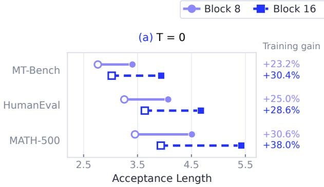  
(c) T = 0

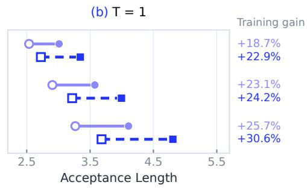

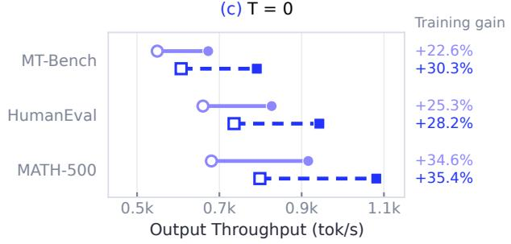

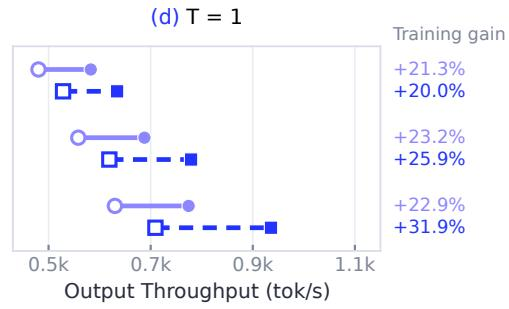  
Figure 12 | Training gains at both DFlash inference windows. SpecOPD uses the step-10,000 checkpoint; B8/B16 denote inference block size. Columns show $T = 0 / T = 1$ ; rows show AL and throughput. Percentages compare training at a fixed window. All weights are trained with block size 16.

## A.8. Measured 27B Serving Protocol

Figure 6 compares AR, MTP, DSpark, original DFlash V2, and SpecOPD at concurrency 1, 8, and 32. The SpecOPD checkpoint is step 36,000, selected by standard-task AL before this study. Methods within each workload/concurrency group use the same high-performance GPU and CPU afinity; separate groups use separate GPUs and disjoint CPU afinities.

Each method receives the same shufled input list and seed 42 at a given concurrency: 128 requests at concurrency one and 1,024 at concurrency eight or 32. Short datasets repeat in a fixed order, and MT-Bench uses first turns. SGLang uses BF16 target/draft weights and LM head, TP=1, FA3 attention, CUDA Graphs, � = 1, top- $\cdot p = 0 . 9 5$ , top-� = 20, and xhigh reasoning efort. The completion cap is 4,096, context length 40,960, KV capacity 131,072, chunked prefill size 2,048, and maximum running requests 32. Speculative methods propose seven tokens with eight verification positions.

The radix cache is flushed after warmup. Timing includes request submission, HTTP, generation, and response receipt; it excludes loading, warmup, tokenizer initialization, and artifact writing. Terminal at concurrency 32 records three KV-cache retractions for AR and two for MTP, whose scheduling costs are included. Each condition is one complete run. This TP=1/BF16-head protocol difers from the TP=2/FP32-head main acceptance study.

Across the five workloads, SpecOPD ’s geometric-mean speedups over AR are 2.97×, 2.23×, and 1.35× at concurrency 1, 8, and 32, versus 2.89×, 2.19×, and 1.34× for original DFlash V2. Measured geometric-mean throughput is 2.83%, 2.20%, and 1.21% higher, respectively. SWE at concurrency 32 is 4.46% slower than the original drafter.

## B. Training Configurations and Measurement

Data and Training. We train on Open-PerfectBlend [9], using reference responses as outer contexts and resampling draft branches at each update. The reference-response source, retained subset, and exact checkpoint identifiers remain to be documented for each run. The cards below summarize the model-specific training settings; the separate ofline and training-throughput studies retain their own configurations.

## B.1. Model-Specific Training Recipes

Evaluation budgets and checkpoint selection are specified separately in Appendices A.2, A.3, and A.4.
<table><tr><td colspan="2">Qwen3-8B | Training Recipe</td></tr><tr><td>Initialization Training window</td><td>Public DFlash and DSpark drafters; DFlash: z-1ab/Qwen3-8B-DFlash-b16. DFlash block size 16, matching pretraining.</td></tr><tr><td></td><td></td></tr><tr><td>Qwen3.8-27B | Training Recipe</td><td></td></tr><tr><td>Initialization</td><td>Public DFlash V2; fresh optimizer; train backbone and conditional selector.</td></tr><tr><td>Objective</td><td>Pure SPEcOPD, weight 1; at most 512 scored anchors.</td></tr><tr><td>Sampling Optimizer</td><td>Proposal / score temperature 1 / 1; selector top-k 16.</td></tr><tr><td></td><td>AdamW; peak / minimum learning rate  $1 0 ^ { - 5 } / 1 0 ^ { - 6 } ;$  betas (0.9,0.95); weight decay 0.1; gradient-norm limit 1.</td></tr><tr><td>Batch Execution</td><td>Global batch 48 reference sequences; microbatch  $^ { 1 ; }$  accumulation 8.</td></tr><tr><td>Reference data</td><td>Six draft ranks; merged accumulation and step balancing; one concurrent training batch. 1,227,197 filtered sequences, regenerated before training at T = 1, top-p = 0.95, top-k = 20</td></tr><tr><td>Warmup</td><td>(distinct from selector support).</td></tr><tr><td>7,669 updates.</td><td></td></tr><tr><td colspan="2">Qwen3.8-Flash-Next-125B | Training Recipe</td></tr><tr><td></td><td></td></tr><tr><td>Initialization Batch</td><td>DFlash V2, pretrained in-house; step 196,000.</td></tr><tr><td>Execution</td><td>Global batch 64 reference sequences; microbatch 1; accumulation 4. Two eight-GPU nodes; separate draft-training and frozen-target-serving processes share</td></tr><tr><td></td><td>devices.</td></tr><tr><td>Schedule</td><td>Two epochs / 34,432 updates; 17,216 updates per epoch.</td></tr></table>

The 27B recipe above is separate from the matched ofline comparison and training-throughput measurements.

## B.2. Training-Throughput Measurement

We measure training throughput and execution profiles separately (Section 3.3). Here, native configurations refer to the method-specific supervision, sampling, backend, and execution settings used in the measurements.

The Qwen3.8-27B / DFlash V2 comparison uses eight high-performance GPUs. Unprofiled timings pool two runs per method over updates 17–32. Supervised tokens count predictions contributing to each method’s training objective. The displayed ratios use the underlying measurements rather than ratios of rounded table entries. Ofline reference preparation is excluded, and this comparison does not measure time to a matched acceptance threshold.

Figure 1a uses separate profiled windows, updates 17–20, with separate time axes. Grayscale records the fraction of each 50 ms bin covered by CUDA kernels, collectives, copies, or memset; the reported mean averages over time and GPUs. This measures recorded activity, not SM occupancy, and incomplete capture means white regions do not establish hardware idle time. Blue dashed lines mark update boundaries. Stage shares use aligned host ranges; Draft-OPD’s instrumentation does not separately resolve input preparation.

The throughput illustration in Figure 1b uses rectangle width for updates/s, height for supervised tokens/update, and area for supervised tokens/s. The blue rectangle includes the overlaid gray region. These geometric encodings summarize the measured training throughput.

## B.3. Comparison Settings

The compared training pipelines use their respective supervision and execution settings. Training selector support and serving sampling filters are specified separately. We report acceptance and wall-time throughput as separate metrics.

## C. Method Details

## C.1. Conditioning and Prediction-Row Readout

The Sampled Predecessor Changes the Learning Problem. In the running example, a branch starts after a and samples short, whereas the reference continues with quiet. To score the next branch token evening, the target must read Enjoy a short, not Enjoy a quiet. The two histories can induce diferent target distributions even when the drafter assigns the same probability to the next token.

Divergence from the reference is not necessarily an error: sampling can produce diferent valid continuations. The first token is compared with the target at the anchor, and later tokens are compared at their sampled predecessor histories. A serving verifier could reject short, so the latter is a sampled counterfactual history, not necessarily an accepted serving history. Our adapter supervises all retained branch positions; prefix-overlap credit is not a hard rejection mask. Whether supervision beyond a would-be rejection helps requires comparison with a baseline retaining only accepted positions and the first rejection.

Prediction-Row Readout. Parallel scoring must preserve the same target queries as scoring each branch separately. We pack the histories into a proposal tree with one shared reference trunk and private branch rows. Branch � can read the trunk only through $a _ { b }$ and then its own predecessors—never future reference tokens or sibling branches. Figure 3 specifies this visibility directly as a target attention mask.

Two mappings enforce this history. Semantic positions assign token � the rotary position embedding (RoPE) index $a _ { b } + i ,$ , independent of its packed ofset. A prediction-row map scores the first token from its anchor row and each later token from its predecessor row. Reading a token’s own row would leak the answer into its prediction. This is the target scoring mask, not the draft’s within-block bidirectional attention.

The target returns only these selected hidden rows; the trainer reconstructs logits with the frozen LM head. This reduces transfer width without restricting teacher vocabulary support. With cached anchor states, scoring � tokens requires only $W - 1$ new predecessor rows: the last sampled token has no later prediction to supply.

In Figure 3, the branch at a samples short, evening, and walk. The anchor row scores short; the short row scores evening; and the evening row scores walk. The final sample needs no forward. A plain causal mask over packed ofsets would expose future trunk tokens to the branch. Ancestry prevents future-context leakage; predecessor-row readout prevents answer leakage.

## C.2. Acceptance Surrogate and Its Scope

Distribution Overlap and Acceptance. Following E2E-TV [6], let $p _ { i } ( \cdot \mid h _ { i } )$ be the target distribution and $q _ { i } ( \cdot \mid h _ { i } )$ the proposal distribution at a common history $h _ { i } .$ . For exact speculative rejection sampling [1, 2], a sampled draft token $y _ { i } \sim q _ { i }$ is accepted with probability

$$
r _ { i } ( y _ { i } , h _ { i } ) = \operatorname* { m i n } \left( 1 , { \frac { p _ { i } ( y _ { i } \mid h _ { i } ) } { q _ { i } ( y _ { i } \mid h _ { i } ) } } \right) .\tag{11}
$$

Its single-position expectation at a fixed history is

$$
\alpha _ { i } ( h _ { i } ) = \mathbb { E } _ { y _ { i } \sim q _ { i } } [ r _ { i } ] = \sum _ { \nu } \operatorname* { m i n } \{ q _ { i } ( \nu \mid h _ { i } ) , p _ { i } ( \nu \mid h _ { i } ) \} = 1 - \mathrm { T V } ( q _ { i } , p _ { i } ) .\tag{12}
$$

Thus acceptance depends on distribution overlap at a shared history, not reference-token argmax accuracy.

Let $S _ { i }$ be the draft’s candidate support. Because $q _ { i }$ is zero outside $S _ { i } ,$ its total variation distance from the fully normalized target is

$$
d _ { b , i } = \frac { 1 } { 2 } \left[ \sum _ { \nu \in S _ { i } } \left. q _ { b , i } ( \nu ) - p _ { b , i } ( \nu ) \right. + 1 - \sum _ { \nu \in S _ { i } } p _ { b , i } ( \nu ) \right] .\tag{13}
$$

The second term retains teacher mass outside the draft support. Renormalizing $p$ over � would remove that mass and change the objective. Distribution comparisons use FP32 softmax and reductions, even with BF16 hidden states and weights.

For example, let $q = ( 0 . 5 , 0 . 5 , 0 )$ and $p = ( 0 . 4 , 0 . 4 , 0 . 2 )$ over $( X , Y , Z )$ . Their TVD is 0.2 and overlap 0.8. Renormalizing � over {�, �} instead gives a false perfect match, despite the drafter’s inability to propose �.

For � retained branches, define $\alpha _ { b , i } = 1 - d _ { b , i }$ �. Equation 9 can equivalently be written as $\mathcal { L } = N / C$ , where $\begin{array} { r } { N = \sum _ { b = 1 } ^ { B } \sum _ { j = 1 } ^ { W } ( 1 - \prod _ { i = 1 } ^ { j } \alpha _ { b , i } ) } \end{array}$ and $C = B W$ are the loss numerator and scored-position count, respectively. The prefix product connects an early mismatch to every later prefix. For one branch,

$$
{ \frac { \partial { \mathcal { L } } } { \partial d _ { k } } } = { \frac { 1 } { W } } \sum _ { j = k } ^ { W } \prod _ { \substack { i \neq k } } ^ { j } ( 1 - d _ { i } ) .\tag{14}
$$

Products remain diferentiable rather than acting as detached weights. Improving an early overlap can protect several downstream terms; this does not imply a universal ordering of gradient magnitudes.

Example: Equal Token-Wise Error, Unequal Prefix Loss. Consider $A = ( 0 . 9 , 0 . 6 , 0 . 9 )$ with $B = ( 0 . 6 , 0 . 9 , 0 . 9 )$ Both have mean TVD 0.2, but their prefix products are (0.9, 0.54, 0.486) and (0.6, 0.54, 0.486), giving losses 0.358 and 0.458. The objective distinguishes where the mismatch occurs. $\operatorname { A t } A ,$ the TVD derivatives are (0.7133, 0.5700, 0.1800): the first overlap afects three terms, the last only one.

Scope for Conditional Drafters. Equation 12 is exact at a fixed history. Conditional proposals couple later histories to earlier tokens and acceptance events, so

$$
\operatorname* { P r } ( A _ { 1 } \cap \cdots \cap A _ { j } ) = \prod _ { i = 1 } ^ { j } \operatorname* { P r } ( A _ { i } \mid A _ { 1 } , \ldots , A _ { i - 1 } ) ,\tag{15}
$$

For conditional drafters, the sampled-branch overlap product need not equal this joint probability. We therefore use E2E-TV as an acceptance-length surrogate, rather than an unbiased estimator of accepted length. Gradients diferentiate overlap at fixed sampled histories and omit the sampling distribution’s score-function term. Appendix C.2 gives a counterexample; Section 3 measures actual serving acceptance.

Conditioning Counterexample. Let $q _ { 1 } = ( 0 . 9 , 0 . 1 )$ and $p _ { 1 } = ( 0 . 1 , 0 . 9 )$ , so $\alpha _ { 1 } = 0 . 2$ . Suppose the secondposition overlap is one after the first vocabulary token and zero after the second. Exact joint acceptance is $\begin{array} { r } { \sum _ { y } \operatorname* { m i n } ( q _ { 1 } ( y ) , p _ { 1 } ( y ) ) \alpha _ { 2 } ( y ) = 0 . 1 } \end{array}$ , whereas the expected sampled-history product is $\begin{array} { r } { \alpha _ { 1 } \sum _ { y } q _ { 1 } ( y ) \alpha _ { 2 } ( y ) = 0 . 1 8 } \end{array}$ Fixed-history overlap therefore does not imply exact multi-position survival for conditional proposals. The example limits the surrogate’s theoretical interpretation, not the measured acceptance improvement.

## D. Implementation Details

Branch independence must survive both model execution and distributed scheduling. We develop a sharedprefix executor that restores private recurrent states, scores indexed branch paths in parallel, and preserves the objective under distributed batching. These mechanisms preserve branch ancestry and objective weighting across execution layouts.

## D.1. Draft Models

For each draft model, we sample branches, obtain frozen-target supervision on the sampled histories, and optimize the E2E-TV surrogate. Sampled token IDs are held fixed during diferentiation; the models difer in how they form proposal probabilities.

DFlash. The parallel backbone produces block logits, from which we sample proposal tokens after the anchor.   
The retained student computation graph supplies full-vocabulary probabilities for the E2E-TV loss.

DSpark. We reuse parallel block features while sampling tokens sequentially with a Markov bias conditioned on the sampled predecessor. For training, we recompute diferentiable proposal probabilities with those same predecessors and compare them with frozen-target distributions along the sampled branch. Our DSpark recipe also trains its confidence head with an auxiliary binary cross-entropy loss targeting detached token-overlap probabilities.

DFlash V2. With DFlash V2 at block size eight, we sample $W = 7$ branch tokens. The backbone predicts an anchor-plus-mask block in one parallel pass [3]. We keep convolution within each anchor block and attention within its configured block/document boundaries. Independent blocks therefore do not mix features.

The selector makes these parallel predictions coherent. At position $i ,$ it restricts candidates to the unary top-� set $S _ { i }$ and adds a bias conditioned on the sampled predecessor:

$$
u _ { i } ( \nu ) = \ell _ { i } ( \nu ) + \left. e _ { \mathrm { p r e v } } ( y _ { i - 1 } ) \odot W _ { h } z _ { i } , e _ { \mathrm { n e x t } } ( \nu ) \right. , \qquad \nu \in S _ { i } ,\tag{16}
$$

where $\mathfrak { z } _ { i }$ is the draft hidden state, $\ell _ { i }$ the unary logit, and $y _ { 0 }$ the anchor token. Token embeddings $e _ { \mathrm { p r e v } }$ and $e _ { \mathrm { n e x t } }$ interact with projected features $W _ { h } z _ { i }$ . The proposal is

$$
q _ { i } ( \nu ) = \left\{ \begin{array} { l l } { \frac { \exp ( u _ { i } ( \nu ) / T _ { \mathrm { t e m p } } ) } { \sum _ { w \in S _ { i } } \exp ( u _ { i } ( w ) / T _ { \mathrm { t e m p } } ) } , } & { \nu \in S _ { i } , } \\ { 0 , } & { \nu \not \in S _ { i } . } \end{array} \right.\tag{17}
$$

Here $T _ { \mathrm { t e m p } }$ is the proposal temperature. Sampling traverses the candidate sets using the already computed block features. The predecessor changes the selector score; it does not trigger another backbone forward. Proposal and score temperatures are equal and positive, both one in our run. Selector support size 16 is separate from the generation/evaluation filter top $\mathtt { k } = 2 0$

During backward, top-� candidate identities and sampled token IDs are fixed. Student probabilities remain diferentiable, updating both backbone and selector. The target and its distributions are frozen.

## D.2. One Optimization Step

Algorithm 1 summarizes one optimizer step. Sampling and loss evaluation use the same draft parameter version; sampled token IDs and candidate identities are held fixed during diferentiation.

Algorithm 1 | One SpecOPD optimization step   
Input Draft $q _ { \theta } ;$ frozen target $p ;$ � reference-sequence accumulation slots; branch width �.   
1 Zero draft gradients.   
2 for accumulation slot $m = 1 , \ldots , M$ do   
3 Extract frozen target features; sample response anchors $\left\{ a _ { b } \right\} .$   
4 Predict draft blocks and candidate supports with ��.   
5 Sample each branch: $y _ { b , i } \sim q _ { \theta } ( . \ | \ x _ { \leq a _ { b } } , y _ { b , < i } ) .$   
6 Pack proposal trees; score prediction predecessors with the frozen target.   
7 Read full-vocabulary $p _ { b , i }$ and diferentiable $q _ { \theta , b , i }$ at the same sampled histories.   
8 Compute overlaps $\alpha _ { b , i } = 1 - \mathrm { T V } ( p _ { b , i } , q _ { \theta , b , i } )$ and prefix products $\textstyle \prod _ { i = 1 } ^ { j } \alpha _ { b , i } .$   
9 Form the local loss numerator and position count; backpropagate using Equation 18, scaled by $1 / M .$   
10 end for   
11 Synchronize and clip gradients; update � once.   
12 Release target-scoring resources.   
Output Updated draft parameters �.

The 27B DFlash V2 recipe uses only the SpecOPD loss, with unit weight; auxiliary objectives are disabled.

## D.3. Parallel Branch Scoring for Hybrid Recurrent Targets

Why a Tree Mask Is Insuficient. Hybrid Qwen targets combine attention with GDN layers that compress history into a recurrent state. Masking attention does not prevent a branch from inheriting a future or sibling state. GDN already supports parallel sequence computation [7]; our execution problem is to reuse a common prefix while preserving the distinct state of every branch. Independent complete-prefix prefill can batch these queries, but repeats their prefixes.

Restore Once, Then Fork Private Paths. The shared-target backend retains trunk attention K/V and FP32 GDN checkpoints. With checkpoint interval ${ \cal C } _ { \mathrm { G D N } } = 6 4 _ { ; }$ , an anchor after token � restores the state after $\lfloor a / C _ { \mathrm { G D N } } \rfloor C _ { \mathrm { G D N } }$ trunk tokens, replays only the residual sufix, then follows its sampled predecessors. Indexed recurrent CTAs load checkpoint tiles into private registers and update them without modifying the shared checkpoints. In Figure 5, anchors a and evening share the checkpoint after Enjoy but replay diferent trunk sufixes; neither waits for the other’s state update.

Execute Indexed Paths in Parallel. We compile branch ancestry into indexed replay paths, checkpoint slots, and convolution windows. Recurrent kernels parallelize over paths, value heads, and value-dimension tiles while retaining ordered updates within each path. The chunk backend gathers replay windows, runs a shared fixed-64 scan from private initial states, and scatters only owned sufix outputs. Each canonical output row has one writer. Thus branches can execute concurrently without duplicating complete prefixes or mixing state; teacher-only kernels require no backward graph. The native-vLLM complete-prefill backend remains an alternative without shared-trunk reuse.

Additional Stateful Components. PLE derives each branch’s n-gram context from its ancestor token IDs. Its dilated short convolution and the GDN short convolution read the corresponding ancestor windows, including across checkpoint boundaries, while shared history remains read-only. The adapters preserve the native PLE embedding, gating, and residual computations.

## D.4. Deterministic Target Inference

Stable Supervision across Execution Layouts. Small arithmetic diferences can change MoE routing or QSA top-� selection and amplify into substantial logit diferences. A frozen target can then assign diferent distributions to the same token history under diferent execution layouts (Table 4). This variation can perturb the distillation loss and gradients for computational reasons, making convergence harder to interpret.

Execution Contract and Defaults. Building on batch-invariant inference mechanisms in vLLM and SGLang, SpecOPD enables deterministic target inference by default. For fixed weights, tokens, ancestry, hardware, precision, and backend, we require bitwise-identical full-vocabulary logits across independent full-prefix recomputation (R), cached single or batched branch scoring (C1/CB), and merged-tree execution (T), including fresh full-path repeats. The first draft token uses the anchor’s prediction row; subsequent tokens use their predecessors’ rows. This option applies to frozen-target scoring; proposal sampling and training semantics remain unchanged.

Consistent Numerical Paths. GDN trunk and branch computation share the numerical update scheme. In the chunkwise backend, both invoke the same fixed-64 scan from aligned FP32 checkpoints, preserving intermediate casts and true-length masks for partial chunks. With batch invariance enabled, this shared numerical path reduced the 27B logit diference against R to zero. Recurrent execution fixes reduction and fusion boundaries, and GDN gated normalization uses a fixed row layout. QSA fixes score arithmetic, resolves top-� ties by logical group ID, and sorts selected IDs into a canonical attention traversal order. Stable selection thus includes both the selected set and its accumulation order.

Whole-Model Validation. The 125B paired comparison uses high-performance GPUs, TP=2/PP=1, BF16 weights, FP32 states, recurrent/recurrent GDN, indexed QSA with a 2,048-token budget, and eager execution. Two samples with 11 branches provide 41 prediction positions over all 248,320 vocabulary entries. Each path executes three times with fresh trunk computation and caches. Table 4 reports the combined deterministic-mode comparison with fixed backends. Same-path repeats have zero diference in both modes; enabling determinism reduces all cross-layout logit diferences to zero.

An additional QSA pruning test covers 15 branches and 60 prediction positions, with up to 514 visible groups competing for 512 slots. All repeated and cross-path logit diferences are zero, including comparisons with native vLLM causal full-prefix execution using the same adapters. These results cover the tested scoring configurations; native cached decoding and CUDA graphs are outside this validation.

Table 4 | 125B target-logit diferences across execution layouts. A/B compares candidate A against reference B; KL is the prediction-position mean of $D _ { \mathrm { K L } } ( p _ { B } \| p _ { A } )$ . The largest listed error occurs at the first draft prediction after the three-token prefix in the first sample.
<table><tr><td rowspan="2">Comparison</td><td colspan="3">Determinism disabled</td><td colspan="3">Determinism enabled</td></tr><tr><td>Max. abs.</td><td>Rel. L2 (%)</td><td>Mean KL</td><td>Max. abs.</td><td>Rel. L2 (%)</td><td>Mean KL</td></tr><tr><td>C1/R</td><td>4.1094</td><td>14.25</td><td>0.05840</td><td>0</td><td>0</td><td>0</td></tr><tr><td>CB/R</td><td>3.4414</td><td>14.82</td><td>0.04958</td><td>0</td><td>0</td><td>0</td></tr><tr><td>T/R</td><td>3.7695</td><td>15.01</td><td>0.05192</td><td>0</td><td>0</td><td>0</td></tr><tr><td>CB/C1</td><td>3.0625</td><td>11.35</td><td>0.02743</td><td>0</td><td>0</td><td>0</td></tr><tr><td>T/CB</td><td>4.2539</td><td>14.69</td><td>0.04382</td><td>0</td><td>0</td><td>0</td></tr></table>

## D.5. Objective-Preserving Distributed Normalization

Ranks can have unequal scored-position counts, so averaging their local mean losses changes the objective. For accumulation slot �, rank � contributes numerator $N _ { r , m }$ and count $C _ { r , m }$ . We use

$$
\mathcal { L } _ { m } = \frac { \sum _ { r } N _ { r , m } } { \mathrm { m a x } ( 1 , \sum _ { r } C _ { r , m } ) } , \qquad \mathcal { L } _ { \mathrm { s t e p } } = \frac { 1 } { M } \sum _ { m = 1 } ^ { M } \mathcal { L } _ { m } .\tag{18}
$$

Because distributed gradients are averaged across � ranks, each rank backpropagates $R N _ { r , m } / \sum _ { r } C _ { r , m } .$ . Counts stay attached to their original slots: pooling all slots generally difers from averaging their losses.

The implementation reduces counts independently of target completion order. Merged rows retain sample lengths, proposal RNG identities, and prescribed loss order; balancing preserves logical-rank anchor draws. Empty proposal sets contribute finite zeros. Scheduling therefore cannot silently reweight the data.

Example: Why Rank-Local Means Are Insuficient. For $( N _ { 0 } , C _ { 0 } ) \ = \ ( 0 . 1 , 1 )$ and $\left( N _ { 1 } , C _ { 1 } \right) \ = \ \left( 2 . 7 , 9 \right)$ , the local-loss average is 0.2, but the global-count loss is $2 . 8 / 1 0 = 0 . 2 8$ . Two-rank gradient averaging needs local quantities $2 N _ { r } / 1 0$ , or 0.02 and 0.54. Their average recovers 0.28, regardless of which sample finishes first.

## E. Cost and Complexity Analysis

We distinguish the dependency depth of online collection, target-scoring work, and amortized update cost.   
These analytical quantities explain possible savings; they are not measured speedups.

## E.1. Collection and Amortized Update Cost

Online Trajectory Collection. An online trajectory of length $T _ { \mathrm { g e n } }$ requires approximately $R _ { \mathrm { r o l l o u t } } = T _ { \mathrm { g e n } } / \bar { \tau }$ dependent draft–verify rounds, where �¯ is mean tokens advanced per verification, including the bonus token. With mean round time $\bar { c } _ { \mathrm { r o u n d } } ,$ , a non-overlapped single-trajectory cost is

$$
C _ { \mathrm { t r a j } } \approx C _ { \mathrm { p r e f i l l } } + \frac { T _ { \mathrm { g e n } } } { \bar { \tau } } \bar { c } _ { \mathrm { r o u n d } } .\tag{19}
$$

Here $C _ { \mathrm { p r e f i l } }$ prepares the initial context, while round time covers drafting, verification, and prefix advancement. With $\dot { T _ { \mathrm { g e n } } } = 2 { , } 0 4 8$ and $\bar { \tau } = 4 ,$ collection has about 512 dependent rounds. SpecOPD replaces this collection stage with branch sampling at reference anchors; trunk extraction, scoring, and learning remain.

Shared-Prefix Work. Let � be trunk length, � the branch count, and $\ell _ { b } \leq L$ the prefix length at anchor �. A width-� branch reads its first prediction from the anchor, requiring $P = W - 1$ new predecessor rows. Compared with an uncached complete-prefix scorer, shared execution avoids repeated prefixes after the common trunk pass:

$$
N _ { \mathrm { i n d e p e n d e n t } } = L + \sum _ { b = 1 } ^ { K } \ell _ { b } + K P , \qquad N _ { \mathrm { s h a r e d } } = L + K P .\tag{20}
$$

At $L = 2 , 0 4 8 , W = 7 ,$ and $K = 5 1 2$ uniformly placed anchors, expected projection/MLP rows fall from 529,664 to 5,120 (103.45×). Cached baselines can already reuse some prefix work. Attention and recurrence retain additional prefix interactions, quantified below and in Figure 13a.

End-to-End Training Cost. Let $C _ { \mathrm { r o l l o u t } }$ be elapsed time for an online collection batch reused over � updates, and $C _ { \mathrm { { r e f e r e n c e } } }$ the reference-corpus construction time amortized over � updates. Let $t _ { \mathrm { l e a r n , r o l l o u t } }$ and $t _ { \mathrm { l e a r n } }$ ,SpecOPD be average update times excluding these collection costs. For non-overlapped collection and learning, the workflow speedup is

$$
S _ { \mathrm { w o r k f l o w } } = \frac { C _ { \mathrm { r o l l o u t } } / H + t _ { \mathrm { l e a r n , r o l l o u t } } } { C _ { \mathrm { r e f e r e n c e } } / U + t _ { \mathrm { l e a r n , S p E C O P D } } } .\tag{21}
$$

The model accounts for reference preparation, collection-batch concurrency, and the distinct learning times. Removing online collection changes the first term; shared-prefix execution reduces work in the second. For overlapped pipelines, elapsed time follows the joint critical path. Appendix B.2 gives our measurement procedure.

## E.2. Attention and Recurrent Work

Let $A ( n ) = n ( n + 1 ) / 2$ count causal query–key pairs. With the notation of Equation 20, we count attention and GDN work separately from projection rows.

Branch queries must still attend to their anchor prefixes:

$$
A _ { \mathrm { i n d e p e n d e n t } } = A ( L ) + \sum _ { b } A ( \ell _ { b } + P ) ,\tag{22}
$$

$$
A _ { \mathrm { s h a r e d } } = A ( L ) + \sum _ { b } \left[ P \ell _ { b } + A ( P ) \right] .\tag{23}
$$

Shared execution removes $\textstyle \sum _ { b } A ( \ell _ { b } )$ repeated prefix pairs, but retains branch–prefix interactions. Kernel overhead can reduce the benefit; the flash-attention lowering still gathers ancestor KV into temporary bufers.

For a hybrid model’s Gated DeltaNet (GDN) layer with checkpoints every �GDN trunk tokens, branch � restores the state after $C _ { \mathrm { G D N } } \lfloor \ell _ { b } / C _ { \mathrm { G D N } } \rfloor$ tokens and replays $r _ { b } = \ell _ { b }$ mod $C _ { \mathrm { G D N } }$ trunk updates. Its logical recurrence count is

$$
N _ { \mathrm { G D N } } = L + K P + \sum _ { b } r _ { b } \ \le \ L + K P + K ( C _ { \mathrm { G D N } } - 1 ) .\tag{24}
$$

Replay uses stored projected features rather than full-model forwards. The count excludes checkpoint storage, fixed-tile execution, and state-copy overhead.

## E.3. Conditional Wall-Time Sensitivity

If a fraction � of baseline wall time can be accelerated by factor $r ,$ while the remaining work is unchanged, the conditional end-to-end gain is

$$
S = { \frac { 1 } { ( 1 - f ) + f / r + \delta } } ,\tag{25}
$$

where � is added overhead normalized to baseline time. Even removing the afected component entirely $( r \to \infty ,$ $\delta = 0 )$ gives only 2× at $f = 0 . 5$ or 4× at $f = 0 . 7 5$ . Actual time savings depend on the measured cost breakdown. Figure 13b illustrates this dependence with zero added overhead.

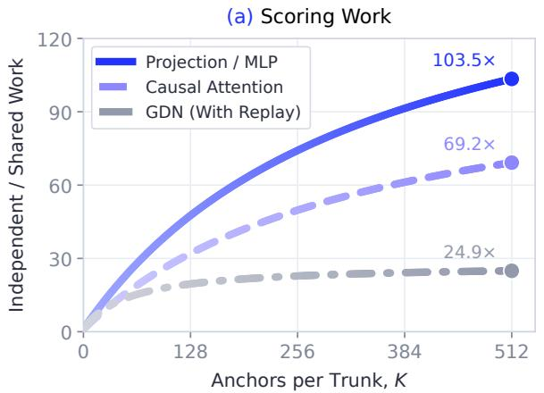

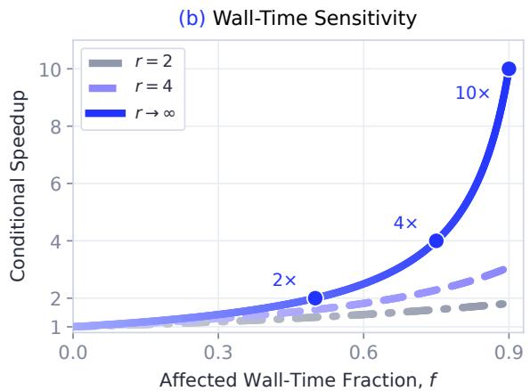  
Figure 13 | Analytical work and conditional wall-time gains. (a) Uncached independent versus shared-prefix scoring with $L = 2 , 0 4 8$ $W = 7 \left( P = 6 \right)$ $C _ { \mathrm { G D N } } = 6 4 _ { ; }$ , and uniformly placed anchors. GDN counts include sufix replay; attention counts causal pairs. (b) Equation 25 for component acceleration � and no added overhead (� = 0).

## F. Detailed Related Work

Parallel Drafting for SD. Speculative decoding verifies inexpensive proposals in parallel [1, 2]. Auxiliary heads, target features, multi-token prediction, and self-speculation improve proposal generation [27, 16, 18, 19, 20, 36]. SWIFT adapts layer skipping online without training [53]; KNN-SSD retrieves input-dependent layer sets [54]. Candidate trees support joint verification [26, 17], while TALON and ECHO allocate candidates using confidence [35, 32]. D-cut jointly prunes draft depth across batched requests using confidence and verification cost [47]. Retrieval supplies candidates from datastores, cached transitions, or target logits [33, 34, 37]; GRAFT combines retrieval and pruning [38]. Other systems overlap drafting and verification or use rollback-aware branches [39, 40, 41]. Parallel and semi-autoregressive architectures reduce serial proposal cost [21, 22, 23, 24, 25], including block difusion in DFlash and lightweight sequential modeling over a parallel backbone in DSpark [3, 15]. These inference mechanisms can accompany drafter learning when proposal distributions and verification rules are preserved.

On-Policy Draft Training and Acceptance Objectives. Fixed reference responses difer from drafter-generated histories. Generalized on-policy distillation supervises student-induced contexts [28]; DistillSpec studies draftgenerated data and decoding-aware divergences [29]; Draft-OPD uses target-assisted rollouts and error-state replay [5]. EAGLE-3 also accounts for generated draft inputs during training [18]. Because acceptance stops at the first rejection, tokenwise accuracy alone does not determine progress. BeBop’s E2E-TV couples distribution overlap across prefixes [6], while Expected Decoding Rounds models progress across verification rounds [30]. SpecOPD supplies fresh branch samples and history-consistent target distributions to E2E-TV through parallel collection and scoring, complementing eforts to reduce training memory [55] and communication [56]. Its supervision is on-policy within each branch; reference prefixes remain distinct from unrestricted rollout contexts. Collection policy, scoring, and objective choice are separate experimental factors.

Shared Computation across Histories. SpecInfer and Medusa jointly score candidate paths through tree attention [26, 27]. Shared ancestors permit reuse, but divergent tokens require separate histories. KVShot studies a complementary representation issue: target KV preserves context that hidden states may discard, while introducing query-estimation and gradient-sparsity challenges [48]. History preservation also depends on the target architecture: GQA stores token KV [31], QSA selects blocks through compressed indexer keys [8], and GDN maintains recurrent state [7]. Branch-parallel supervision therefore combines tree masks, branchconsistent indexer groups, and indexed state restoration and replay. Training additionally requires numerically consistent supervision at every sampled position, beyond identifying an accepted inference prefix. At the model level, HMI shares hierarchical components across tenants [57], while FloE reduces expert-loading costs through compression and sparse prediction [58]; these mechanisms address model memory and movement rather than branch-history consistency.

Speculative Decoding for RL Rollouts. RL post-training couples repeated trajectory generation with an evolving policy. SPEC-RL reuses earlier trajectory segments [42]; SRT refreshes per-prompt continuation trees [43]. Integrated systems support synchronous and asynchronous speculative rollouts [44], and BeBop combines MTP with rejection sampling [6]. TailSieve isolates long-tail requests and allocates route-specialized replicas using MTP or DFlash [49]. Branch-parallel supervision could help refresh learned drafters as the policy changes; this would require version-consistent target supervision and update costs amortized by rollout savings.

Multimodal Speculative Decoding. Visual inputs introduce distinct encoding, prefilling, and decoding bottlenecks [59]. SpecVLM prunes draft-side video tokens while retaining full-target verification [45]; ParallelVLM combines visual-alignment-aware pruning with parallel draft–verify execution [46]. LVSpec instead relaxes verification away from visual anchors, changing the criterion rather than preserving exact targetdistribution equivalence [50]. Complementary methods reduce conditioning costs through token selection in OmniDelta [51] or head-specific cache compression for multimodal LMs in HybridKV and AR video difusion in Forcing-KV [60, 52]. Shared visual prefixes could support branch-parallel drafter training, but this extension remains unevaluated. It would require consistent visual features, positions, and cache semantics across branches; exactness relative to an uncompressed target would also require preserving its verification distribution.

# Paths diverge. Thought goes on.

Branch-Parallel On-Policy Distillation for Speculative Decoding

In Borges’s The Garden of Forking Paths, a story holds many possible futures. At each fork, the paths not taken continue elsewhere, toward other encounters and endings. The paths drift apart. A stretch of their journey remains shared.

Kieślowski places the fork at a station. In Blind Chance, a young man runs for a departing train. A few seconds open into three lives. We watch the same person enter different years, and remember something we once caught—or failed to catch—in time.

We can turn back a page, watch a film again. Those futures bring the moment before the fork into focus: everything was still on the same path.

Can paths with a shared beginning move forward together?

Language, too, keeps arriving at such forks. A passage already written can lead to different next sentences. SpecOPD samples draft continuations at different points in existing text, allowing branches to receive feedback from the target model in parallel. They reuse computation for their shared context, retain their own sampled histories, and learn to draft better through parallel training. The shared path need not be retraced for every branch.

The person waiting for an answer has unfinished thoughts of their own. A book half read. A sentence revised again and again. A thought just taking shape, still searching for words. Sometimes we pause to think more clearly; sometimes we are simply waiting for the next line on the screen.

A shorter wait lets reading, writing, and questioning continue.

Let one thought arrive in time to meet the next.