# Spectral Degeneration of Self-Attention under Isotropic Score Geometry

Mengda Li and Jianfeng Yao The Chinese University of Hong Kong, Shenzhen jeffyao@cuhk.edu.cn

## Abstract

We study the spectral structure of the self-attention matrix in Transformer models through an idealized spectral model for the pre-softmax score matrix. Motivated by the rotational isotropy of query and key representations, our model replaces the random token-space orientation of the score matrix by its canonical singular-value representative with a logarithmic spike–bulk separation. Empirical diagnostics on pretrained vision and language transformers motivate this model: token-space singular matrices have nearly uniform eigen-angle distributions, and score spectra are dominated by a small number of effective directions. We then prove that the row-wise softmax map transforms this structure into a degenerate attention matrix: dominant modes are preserved, whereas the bulk spectral distributions concentrate at zero. Stable rank remains bounded for bidirectional attention but grows logarithmically for causal attention. Within the canonical model, these results explain how attention can preserve a small number of dominant directions while compressing the remaining bulk modes.

## 1 Introduction

Transformers have become the dominant architecture in modern machine learning, powering large language models and state-of-the-art systems in vision, speech, and multimodal learning. Introduced in the seminal work “Attention Is All You Need” [Vaswani et al., 2017], the transformer replaces recurrence and convolution with a simple yet powerful mechanism: self-attention.

Given query and key matrices Q, K, self-attention computes a score matrix $S = Q K ^ { \top } / \sqrt { d _ { q k } }$ followed by a row-wise softmax normalization A = softmax(S), which defines how information is aggregated across tokens. This mechanism is at the core of language models such as BERT [Devlin et al., 2019, Liu et al., 2019] and GPT-style architectures [Radford et al., 2018, 2019, Brown et al., 2020] and vision models such as Vision Transformers (ViT) [Dosovitskiy et al., 2021], enabling scalable modeling of long-range dependencies.

Despite its empirical success, the theoretical understanding of attention remains limited, especially in the trained regime. A central open question is to characterize the structure of the attention matrix A, which governs information flow and expressivity [Bordelon et al., 2024, Sakai et al., 2025]. Recent studies [Dong et al., 2021, Noci et al., 2022, Nait Saada et al., 2025, Hayase et al., 2026, Sanyal et al., 2026] suggest that attention matrices often exhibit degeneration phenomena, where they become close to low-rank or even rank-one structures in deep layers. Understanding the origin of this degeneration is critical for explaining both the strengths and limitations of transformer models.

In this paper, we propose a new perspective based on the geometry of the query and key matrices. Motivated by isotropy diagnostics in trained representations, we study a canonical spectral model that isolates a mechanism of attention degeneration under softmax normalization. Specifically, we hypothesize that in trained transformers, the query and key matrices exhibit an approximate tokenspace orthogonal invariance, meaning that their token-space singular vectors behave as if they were drawn from a Haar distribution.

This is analogous to the feature-space rotational invariance exploited in RaBitQ [Gao and Long, 2024, Gao et al., 2025] and TurboQuant [Zandieh et al., 2026], where random rotations in feature space support efficient quantization. A shared orthogonal right rotation, $( Q , K ) \mapsto ( Q R , K R )$ preserves the score matrix S. In contrast, left rotation $Q \mapsto { \check { U } } Q$ acts on the token dimension and does not preserve $S$ in the deterministic way, but instead characterizes its statistical structure.

In high dimension this isotropic picture has a concrete implication for the entries $\begin{array} { r l } { S _ { i j } } & { { } = } \end{array}$ $\langle q _ { i } , k _ { j } \rangle / \sqrt { d _ { q k } }$ , where $q _ { i }$ and $k _ { j }$ are token-level query and key vectors. When distincttoken directions are approximately independent and isotropic, their cosine similarities satisfy $\langle q _ { i } , k _ { j } \rangle / ( \lVert q _ { i } \rVert _ { 2 } \lVert k _ { j } \rVert _ { 2 } ) \ \stackrel { \cdot \cdot } { \to } \ 0$ for $i \neq j$ , in probability as the feature dimension grows. This concentration describes angular geometry rather than the magnitude of the scaled scores, which also depends on query and key norms. It motivates studying score spectra separately from their orientation. In our spectral surrogate model, we keep the singular values and replace the token-space orientation by the canonical representative Σ.

Empirical observation. We support this hypothesis with empirical evidence from both vision and language models: a pretrained Vision Transformer evaluated on Imagenette [Howard, 2019], and GPT-2 evaluated on Wikitext-103. Across these settings, the token-space singular matrices exhibit spectral behavior consistent with Haar-distributed orthogonal matrices. In particular, their eigen-angle distributions are close to uniform on the unit circle, consistent with one spectral consequence of token-space isotropy. Details are discussed in Section 4.

From geometry to degeneration. Motivated by high-dimensional isotropy, we analyze softmax(Σ) and its causal counterpart, where the diagonal surrogate Σ contains the singular values of S. We assume that bulk values lie below log ℓ and spikes above it, with diverging additive margins.

In the bidirectional model, softmax normalization makes bulk rows asymptotically uniform, while spike weights dominate the normalization and concentrate rows on canonical basis vectors. When the number of spikes satisfies $k = o ( \ell )$ , the leading k + 1 singular values and eigenvalues converge to 1, while the rest vanish. We extend this spike–bulk analysis to causal attention and generalized row-normalized attention maps.

Main contributions. Our contributions can be summarized as follows:

• We formulate a canonical diagonal score model motivated by token-space isotropy and provide empirical diagnostics of token-space geometry in pretrained transformers.

• We characterize the eigenvalue and singular-value spectra of canonical bidirectional attention and show that, under spike–bulk separation, their empirical distributions concentrate on {0, 1}. Our results include a non-asymptotic characterization of the ordered eigenvalues and spectral profiles with explicit error bounds.

• To the best of our knowledge, we provide the first joint characterization of eigenvalue and singular-value degeneration in causal attention. Under the canonical spike–bulk score model, we derive exact eigenvalues and quantitative singular-value bounds, showing that bounded bulk scores yield harmonic bulk eigenvalue decay and at most logarithmically many bulk singular values above any fixed positive threshold.

## 2 Related work

Collapse in depth. Dong et al. [2021], Noci et al. [2022] show that repeated attention in pure attention networks progressively compresses representations, producing doubly exponential rank collapse with depth. These results characterize the cumulative effect of composing attention layers.

Collapse in width. In a different regime, Nait Saada et al. [2025] analyze attention matrices in the width limit by modeling the score matrix S as an i.i.d. random matrix. They show that the softmax attention matrix behaves like a random Markov matrix and exhibits rank collapse driven by a spectral gap. However, this analysis relies on the strong i.i.d. assumption on $S ,$ which does not reflect the structured nature of trained transformers.

Hayase et al. [2026] study the spectrum of attention matrices at initialization through a Gaussian equivalence framework. Unlike the i.i.d. model of Nait Saada et al. [2025], their analysis accounts for the structured dependence in the score matrix S, which arises even at initialization from the shared input and weight matrices. They provide a random matrix characterization of attention in the infinite-width limit, capturing these correlations. However, their results remain restricted to randomly initialized networks and do not address the trained regime.

Token-space isotropy observed in both Gaussian-initialized and trained transformers motivates our canonical diagonal score surrogate, which isolates a mechanism of degeneration under row-wise softmax normalization. We derive asymptotic singular-value bounds and a non-asymptotic eigenvalue characterization, and extend the analysis to causal attention and generalized softmax attention with alternative activations.

## 3 Main result

## 3.1 Setup

Let $X \in \mathbb { R } ^ { \ell \times d }$ be the input sequence matrix, where ℓ is the context length and d is the hidden dimension. Let $W _ { Q } , W _ { K } ^ { \mathrm { ~ ~ } } \in \mathbb { R } ^ { \hat { d } \times d _ { q k } }$ be the query and key projection matrices. We define $Q =$ $X W _ { Q } , K = X W _ { K }$ , and the (scaled) score matrix $S = Q K ^ { \top } / \sqrt { d _ { q k } } \in \mathbb { R } ^ { \ell \times \ell }$ . The attention matrix $A \in \mathbb { R } ^ { \ell \times \ell }$ is the row stochastic matrix given by the row-wise softmax:

$$
A _ { i j } = \frac { \exp ( S _ { i j } ) } { \sum _ { k = 1 } ^ { \ell } \exp ( S _ { i k } ) } .
$$

Token-space isotropy motivates examining the singular value decomposition $S = U \Sigma V ^ { \top }$ , with $U , V \in { \mathrm { { \hat { O } } } } ( \ell )$ . We use Σ to define the following canonical attention model.

Assumption 1 (Spectral canonical model). Let $s _ { 1 } \geq s _ { 2 } \geq \cdot \cdot \cdot \geq s _ { \ell } \geq 0$ denote the singular values ofthe pre-softmax score matrix $S ,$ and let $\Sigma = \mathrm { d i a g } ( s _ { 1 } , \dots , s _ { \ell } )$ . The model attention matrices are defined by

$$
A _ { \mathrm { b } } = \mathrm { s o f t m a x } ( \Sigma ) , \qquad A _ { \mathrm { c } } = \mathrm { s o f t m a x } ( \Sigma + M ) ,
$$

where M is the causal mask defined below. We write Afor the model under discussion. In the causal model, the singular values are placed in descending diagonal order.

Assumption 2 (Spectral separation of Σ). Let $s _ { 1 } \geq s _ { 2 } \geq \cdot \cdot \cdot \geq s _ { \ell } \geq 0$ be the diagonal entries $o f \Sigma$ There exist an integer $k = \bar { k } ( \ell ) \in \{ 0 , \ldots , \ell \}$ andfunctions $f ( \ell ) , g ( \ell ) \to \infty$ , with $g ( \ell ) = o ( \ell )$ , such that,for all sufficiently large ℓ:

1. The spikes $( i \leq k )$ : The k spike entries lie above the logarithmic normalization scale by a diverging margin, with $e ^ { s _ { i } } \geq \ell f ( \ell )$ , and hence

$$
s _ { i } = \Omega ( \log ( \ell f ( \ell ) ) ) .
$$

2. The bulk $( i > k ) { : }$ : The remaining $\ell - k$ bulk entries lie below the same scale by a diverging margin, with $e ^ { s _ { i } } \leq \ell / g ( \ell )$ , and hence

$$
s _ { i } = O ( \log ( \ell / g ( \ell ) ) ) .
$$

The singular spectrum exhibits a strict gap between the bulk and the spikes, with no singular value $s _ { i }$ lying between the two thresholds.

The logarithmic threshold comes from the softmax normalization: $A _ { i i } = e ^ { s _ { i } } / ( e ^ { s _ { i } } + \ell - 1 )$ . The diagonal weight $e ^ { s _ { i } }$ competes with $\ell - 1$ unit off-diagonal weights, placing the transition between averaging and diagonal concentration at $s _ { i }$ ≈ log ℓ (Figure 1).

For a fixed head dimension $d _ { q k }$ , the score matrix satisfies $k \le \mathrm { r a n k } ( S ) \le d _ { q k }$ . Consequently, the number of spikes is sublinear in sequence length, with $k = o ( \ell )$

Motivated by isotropy, the canonical model retains the score singular values and aligns the left and right singular directions with the token axes, isolating the spectral effects of softmax normalization and causal masking. Section 4 compares the model with attention in pretrained transformers.

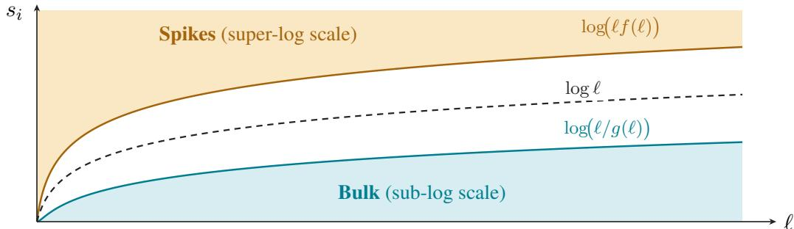  
Figure 1: Qualitative spike–bulk separation under Assumption 2. Spike and bulk scores satisfy $s _ { i } \geq \log ( \ell f ( \ell ) )$ and $s _ { i } \stackrel { \cdot } { \le } \log ( \ell / g ( \ell ) \stackrel { \cdot } { ) }$ , respectively; the open band between them contains no score entries. The dashed curve marks the normalization scale log ℓ.

## 3.2 Attention degeneration

In this subsection, $A = A _ { \mathrm { b } }$ = softmax(Σ). Throughout the remaining analysis, we use

$$
c _ { \ell } = \frac { k } { \ell } , \qquad \varepsilon _ { \ell } = \operatorname* { m a x } \{ f ( \ell ) ^ { - 1 } , g ( \ell ) ^ { - 1 } \}
$$

for the spike fraction and the bidirectional approximation error scale, respectively.

Theorem 1 (Attention Singular Degeneration). Under Assumptions 1 and 2, as $\ell  \infty ,$ , the following hold:

## 1. Singular-value profile. Define

$$
\alpha _ { \pm } ( x ) = \sqrt { 1 - \frac { x } { 2 } \pm \sqrt { x - \frac { 3 } { 4 } x ^ { 2 } } } , \qquad x \in [ 0 , 1 ] .
$$

For $1 \leq k < \ell ,$ the ordered deterministic profile is

$$
\displaystyle ( \sigma _ { 1 } ^ { * } , \ldots , \sigma _ { \ell } ^ { * } ) = \left( \alpha _ { + } ( c _ { \ell } ) , \underbrace { 1 , \ldots , 1 } _ { k - 1 } , \alpha _ { - } ( c _ { \ell } ) , \underbrace { 0 , \ldots , 0 } _ { \ell - k - 1 } \right) .
$$

The endpoint profiles are $( 1 , 0 , \ldots , 0 )$ for $k = 0$ and $( 1 , \ldots , 1 ) f o r k = \ell .$ . The singular values ofA satisfy the uniform approximation

$$
\operatorname* { m a x } _ { 1 \leq i \leq \ell } | \sigma _ { i } ( A ) - \sigma _ { i } ^ { * } | = O ( \varepsilon _ { \ell } ) .
$$

In particular, $\sigma _ { i } ( A ) = O ( \varepsilon _ { \ell } ) \to 0 f o r i \geq k + 2 .$

2. Sublinear spikes. $I f k = o ( \ell )$ , the leading $k + 1$ singular values converge uniformly to 1, with

$$
\operatorname* { m a x } _ { 1 \leq i \leq k + 1 } | \sigma _ { i } ( A ) - 1 | = O ( \varepsilon _ { \ell } + { \sqrt { c _ { \ell } } } ) \to 0 .
$$

3. Spectral degeneration. $H c _ { \ell } \to c \in [ 0 , 1 ] ,$ , the empirical singular-value distribution $\begin{array} { r } { \mu _ { A } ^ { \mathrm { s v } } : = \ell ^ { - 1 } \sum _ { i = 1 } ^ { \ell } \delta _ { \sigma _ { i } ( A ) } } \end{array}$ converges weakly to $c \delta _ { 1 } + ( 1 - c ) \delta _ { 0 }$

The proof of Theorem 1 gives the exact diagonal-plus-rank-one decomposition

$$
A = D + z \mathbf { 1 } ^ { \top } ,\tag{1}
$$

where $\mathbf { 1 } \in \mathbb { R } ^ { \ell }$ is the all-ones vector, $Z _ { i } = e ^ { s _ { i } } + \ell - 1$ is the row partition function, $z = ( z _ { 1 } , \ldots , z _ { \ell } ) ^ { \top }$ with $z _ { i } = Z _ { i } ^ { - 1 }$ , and $D = \mathrm { d i a g } ( d _ { 1 } , \ldots , d _ { \ell } )$ with $\displaystyle d _ { i } = 1 - \ell z _ { i }$

When a bulk is present, all bulk rows perform the same averaging operation in the limit and therefore contribute a single direction. Together with the k directions retained by the spike rows, this shared averaging direction forms a (k + 1)-dimensional subspace.

From decomposition (1), we derive a closed-form characteristic equation and show that the canonical attention matrix has real eigenvalues despite its asymmetry.

Theorem 2 (Attention Eigen Degeneration). Under Assumptions 1 and 2, write $d _ { 1 } \geq \dots \geq d _ { \ell } f o r$ the diagonal entries ofD.

1. Exact spectral structure. For every ℓ, the eigenvalues $\lambda _ { 1 } ( A ) \geq \cdot \cdot \cdot \geq \lambda _ { \ell } ( A )$ are real and lie in [0, 1], with $\lambda _ { 1 } ( A ) = 1 .$ . For $2 \leq i \leq \ell ,$ they satisfy

$$
\begin{array} { r } { \left\{ \begin{array} { l l } { \lambda _ { i } ( A ) = d _ { i } , } & { i f d _ { i } = d _ { i - 1 } , } \\ { d _ { i } < \lambda _ { i } ( A ) < d _ { i - 1 } , } & { i f d _ { i } < d _ { i - 1 } . } \end{array} \right. } \end{array}
$$

For $\ell > 1$ , this also gives the bounds

$$
\frac { \ell A _ { i i } - 1 } { \ell - 1 } \leq \lambda _ { i } ( A ) \leq \frac { \ell A _ { i - 1 , i - 1 } - 1 } { \ell - 1 } , \qquad 2 \leq i \leq \ell .
$$

2. Eigenvalue profile. As $\ell  \infty ,$ the spike and bulk eigenvalues satisfy

$$
\begin{array} { r l r } & { 1 - O ( f ( \ell ) ^ { - 1 } ) \le d _ { i } \le \lambda _ { i } ( A ) \le d _ { i - 1 } < 1 , } & { 2 \le i \le k , } \\ & { \qquad 0 \le d _ { i } \le \lambda _ { i } ( A ) \le d _ { i - 1 } = O ( g ( \ell ) ^ { - 1 } ) , } & { k + 2 \le i \le \ell . } \end{array}
$$

$H k < \ell ,$ the remaining eigenvalue satisfies

$$
\lambda _ { k + 1 } ( A ) = 1 - c _ { \ell } + { \cal O } ( \varepsilon _ { \ell } ) ,
$$

and hence converges to $1 - c$ whenever $c _ { \ell } \to c \in [ 0 , 1 ]$ . In particular, $i f k = o ( \ell )$ , the leading $k + 1$ eigenvalues converge uniformly to 1.

3. Spectral degeneration. $H c _ { \ell } \to c \in [ 0 , 1 ] ,$ , the empirical eigenvalue distribution $\mu _ { A } ^ { \mathrm { e i g } } : =$ $\textstyle \ell ^ { - 1 } \sum _ { i = 1 } ^ { \ell } \delta _ { \lambda _ { i } ( A ) }$ converges weakly to $c \delta _ { 1 } + ( 1 - c ) \delta _ { 0 }$

Remark 1 (Bounded Bulk). If the bulk scores satisfy $s _ { i } \leq B$ for $i > k$ , with a constant $B \geq 0$ independent ofℓ, then

$$
0 \leq d _ { i } = \frac { e ^ { s _ { i } } - 1 } { e ^ { s _ { i } } + \ell - 1 } \leq \frac { e ^ { B } - 1 } { \ell } , \qquad i > k .
$$

Consequently, the $O ( g ( \ell ) ^ { - 1 } )$ contributions in Theorems 1–2 improve to $O ( \ell ^ { - 1 } )$ , and the $O ( \varepsilon _ { \ell } )$ profile errors become $\breve { O } ( \operatorname* { m a x } \{ f ( \ell ) ^ { - 1 } , \ell ^ { - 1 } \} )$ .

## 3.3 Causal attention

We now turn to causal attention, the masked variant used in decoder architectures [Radford et al., 2018, 2019, Brown et al., 2020]. The lower-triangular mask changes the asymptotic operator structure: even benign bulk scores leave a triangular averaging component rather than the same collapse seen in bidirectional attention. Throughout this subsection, $A { = } \dot { \overline { { A } } } _ { \mathrm { c } } = \operatorname { s o f t m a x } ( \Sigma + M )$ , where the causal mask is

$$
M _ { i , j } = { \left\{ \begin{array} { l l } { - \infty , } & { { \mathrm { f o r ~ } } j > i } \\ { 0 , } & { { \mathrm { e l s e } } \ , } \end{array} \right. }
$$

Under Assumption 2, the first k token positions contain the spikes and the remaining $\ell - k$ positions form the bulk. Since the causal matrix is lower triangular, its eigenvalues are exactly its diagonal entries. The spike eigenvalues remain close to one, while harmonic bulk decay follows once the relevant bulk scores are uniformly bounded.

Theorem 3 (Eigenvalues of Causal Attention). Under Assumptions 1 and 2, for any sequence length ℓ, the eigenvalues of A are real and equal to its diagonal entries:

$$
\lambda _ { i } ( A ) = { \frac { \exp ( s _ { i } ) } { \exp ( s _ { i } ) + i - 1 } } .
$$

The largest eigenvalue is exactly $\lambda _ { 1 } = 1 . A s \ell \to \infty ,$

• The k largest eigenvalues converge to 1, with speed $\begin{array} { r } { O \left( \frac { 1 } { f \left( \ell \right) } \right) } \end{array}$

• The r least eigenvalues decay harmonically:

$$
\lambda _ { i } ( A ) = \Theta ( 1 / i ) \qquad f o r i \in \{ \ell - r + 1 , \ldots , \ell \} ,
$$

provided that, for some $r \leq \ell - k ,$ the last r bulk scores are uniformly bounded, i.e., $\mathsf { \bar { \Psi } } _ { s _ { i } } = O ( 1 ) f o r i \in \{ \ell - r + 1 , \ldots , \ell \}$ . In particular, if all bulk scores $s _ { i } , \ i > k ,$ are uniformly bounded, then $r = \ell - k .$

• Spectral degeneration. $H c _ { \ell } \to c \in [ 0 , 1 ]$ , the empirical eigenvalue distribution of A converges weakly to $c \delta _ { 1 } + ( 1 - c ) \delta _ { 0 } .$

The singular values are subtler because triangularity no longer identifies them. The next result describes their spectral degeneration under spectral separation, with sharper bulk bounds when the bulk scores are uniformly bounded.

Theorem 4 (Singular Values of Causal Attention). Under Assumption 1, A satisfies, for every sequence length ℓ,

$$
{ \frac { 1 } { 3 i } } \leq \sigma _ { i } ( A ) \leq \| A \| _ { \mathrm { o p } } \leq { \sqrt { 5 } } , \qquad 1 \leq i \leq \ell .
$$

Under the additional spectral-separation assumption 2, the following conclusions hold:

1. Spike subspace. For $k \geq 1$ and all sufficiently large ℓ, there exists a $\left( k - 1 \right)$ -dimensional subspace $E _ { \mathrm { s p } } \subset \mathbb { R } ^ { \ell }$ such that

$$
\left( 1 - O \Big ( \frac { k } { \ell f ( \ell ) } \Big ) \right) \| v \| _ { 2 } \leq \| A v \| _ { 2 } \leq \left( 1 + O \Big ( \frac { k } { \ell f ( \ell ) } \Big ) \right) \| v \| _ { 2 } \qquad f o r a l l \ v \in E _ { \mathrm { s p } } .
$$

Moreover, $f o r k \geq 1 \mathrm { { } }$

$$
\sigma _ { k } ( A ) \geq 1 - O \left( { \frac { k } { \ell f ( \ell ) } } \right) .
$$

2. Spectral degeneration. $H c _ { \ell } \to c \in [ 0 , 1 ]$ , the empirical singular-value distribution of A converges weakly to $c \delta _ { 1 } + ( 1 - c ) \delta _ { 0 }$

If, in addition, there exists a constant $B > 0 ,$ , independent ofℓ, such that $s _ { i } \leq B$ for all $i > k ,$ , then there exists a constant $C _ { B } > 0 ,$ , depending only on B, such that the following further estimates hold for all sufficiently large ℓ:

3. Bulk singular-value upper bounds. For every ordered bulk index m $\in \{ 1 , \ldots , \ell - k \}$

$$
\sigma _ { k + m } ( A ) \leq C _ { B } \operatorname* { m i n } \left\{ 1 , { \frac { \ell - k - m + 1 } { k + m } } , { \sqrt { \frac { \log ( \ell + 1 ) } { m } } } \right\} .
$$

Moreover, for every fixed $\begin{array} { r } { \varepsilon > 0 , \# \{ i > k : \sigma _ { i } ( A ) > \varepsilon \} \leq \frac { C _ { B } \log ( \ell + 1 ) } { \varepsilon ^ { 2 } } } \end{array}$ . Consequently, for every sequence $m _ { \ell } \in \{ 1 , \ldots , \ell - k \}$ with mℓ/ log ℓ → ∞,

$$
\sigma _ { k + m _ { \ell } } ( A )  0 .
$$

Weak spectral degeneration holds under spectral separation, while the stronger logarithmic bounds use the additional bounded-bulk condition. The causal mask gives the bulk a Hardy-type lower triangular averaging structure, already visible when $s _ { i } \equiv 0$

## 3.4 Encoder versus decoder

Within the canonical model, bounded bulk scores give an $O ( 1 / \ell )$ bulk term for bidirectional attention, whereas causal attention has at most logarithmically many bulk singular values above any fixed threshold. This contrast suggests a spectral perspective on encoder and decoder representations: concentration in a few directions may favor selective aggregation, while retaining additional directions may support the range of continuations in sequential prediction.

The contrast is already visible when $\Sigma = 0 \mathrm { { : } }$ : bidirectional attention returns the global average, while causal attention averages each prefix,

$$
A _ { \mathrm { b } } = { \frac { \mathbf { 1 1 } ^ { \top } } { \ell } } , \qquad ( A _ { \mathrm { c } } ) _ { i j } = { \frac { \mathbf { 1 } _ { \{ j \leq i \} } } { i } } .
$$

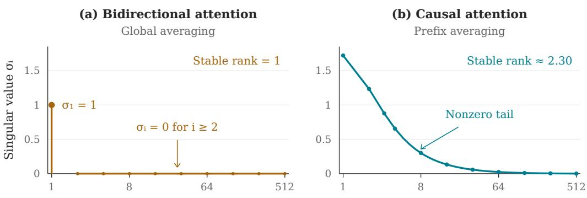  
Singular-value index i (log scale)  
Figure 2: Ordered singular values of zero-score attention at $\ell = 5 1 2$ . Bidirectional attention has rank one, whereas causal prefix averaging retains a nonzero singular-value tail.

Here $\| A _ { \mathrm { b } } \| _ { \mathrm { F } } ^ { 2 } = 1$ , whereas $\textstyle \| A _ { \mathrm { c } } \| _ { \mathrm { F } } ^ { 2 } = \sum _ { i = 1 } ^ { \ell } 1 / i \sim$ log ℓ. Their operator norms remain of constant order: $\| A _ { \mathrm { b } } \| _ { \mathrm { o p } } = 1$ and $1 \leq \| A _ { \mathrm { c } } \| _ { \mathrm { o p } } \leq 2$ . Figure 2 compares their ordered singular values.

To quantify this difference more precisely, we introduce the stable rank srank $( A ) = \| A \| _ { \mathrm { F } } ^ { 2 } / \| A \| _ { \mathrm { o p } } ^ { 2 }$ p and entropy-based effective ranks. For a nonzero matrix A with singular values $\sigma _ { j } ( A )$ , define

$$
\operatorname { e r a n k } _ { p } ( A ) = \exp \left( - \sum _ { j } q _ { j } ^ { ( p ) } \log q _ { j } ^ { ( p ) } \right) , \qquad q _ { j } ^ { ( p ) } = \frac { \sigma _ { j } ( A ) ^ { p } } { \sum _ { r } \sigma _ { r } ( A ) ^ { p } } , \quad p \in \{ 1 , 2 \} .
$$

Here erank1 is the effective rank of Roy and Vetterli [2007], while erank2 uses squared singular values; we take $0 \log 0 = 0$

Theorem 5 (Informal: Spectral ranks). Consider canonical bidirectional and causal attention with a fixed number k ofspectrally separated spikes and bulk scores uniformly bounded by B. As $\ell  \infty ,$

$$
\begin{array} { r l } & { \mathrm { s r a n k } ( A _ { \mathrm { b } } ) , \mathrm { e r a n k } _ { 2 } ( A _ { \mathrm { b } } ) = k + 1 + o ( 1 ) , } \\ & { \mathrm { s r a n k } ( A _ { \mathrm { c } } ) , \mathrm { e r a n k } _ { 2 } ( A _ { \mathrm { c } } ) = \Theta _ { B } ( \log \ell ) . } \end{array}
$$

Moreover, erank $( A _ { \mathrm { c } } ) = \Omega _ { B } ( ( \log \ell ) ^ { 3 } )$ , while eran ${ \mathfrak { x } } _ { 1 } ( A _ { \mathrm { b } } ) = k + 1 + o ( 1 )$ when its linear bulk mas and entropy moment vanish.

Precise conditions and bounds are given in Theorems 6 and 7 in Appendix D. These bounds distinguish the two attention patterns despite their common limiting empirical spectral law $\delta _ { 0 }$ . Relative to context length, the stable ranks decay as $1 / \ell$ and log $\ell / \ell ,$ , respectively, quantifying how causal masking slows spectral degeneration as context length grows. Further technical remarks on the causal singular-value bounds are collected in Appendix C.5.

## 4 Experiment

Our experiments on pretrained GPT-2 and ViT connect the spectral model to trained attention through three questions: how token-space singular factors are oriented, how score strength is distributed across singular directions, and how real and canonical attention spectra compare after softmax.

## 4.1 Eigen-angle diagnostics of token-space singular factors

Imagenette data We examine the pretrained ViT-B/16 model with SWAG weights [Singh et al., 2022], using the validation split of Imagenette. Each $3 8 4 \times 3 8 4$ image is mapped to a token matrix $X \in \mathbb { R } ^ { 5 7 7 \times 7 6 8 }$ at each layer. For every layer input, we compute a full singular value decomposition $X = U _ { X } \Sigma _ { X } V _ { X } ^ { \top }$ , and examine the square token-space singular factor $\bar { U } _ { X }$ . Its eigenvalues lie on the unit circle, so we write $\lambda _ { j } ( U _ { X } ) = e ^ { i \theta _ { j } }$ with $\theta _ { j } \in [ - \pi , \pi ]$ . Haar orthogonal matrices have asymptotically uniform empirical eigen-angles [Diaconis and Shahshahani, 1994, Theorem 3], giving a necessary asymptotic diagnostic for Haar behavior. We measure discrepancies from the uniform distribution using Kullback-Leibler divergence, Kolmogorov distance, and angular Wasserstein distance. Figure 7 shows that the measured discrepancies are consistently close to zero across ViT layers, supporting the isotropy motivation for the spectral canonical model in the vision setting.

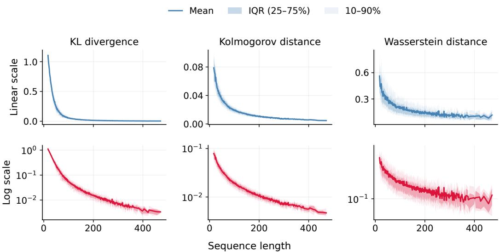  
Figure 3: Discrepancies between the GPT-2 token-space singular eigen-angle distribution and the uniform distribution on $[ - \pi , \pi ]$ as a function of sequence length on the Wikitext-103 validation split. Linear- and log-scale summaries are shown for Kullback-Leibler divergence, Kolmogorov distance, and Wasserstein distance, with means, interquartile ranges, and 10–90% bands. Kullback-Leibler divergence is calculated by histogram binning with 50 bins.

Wikitext data We apply the same diagnostic to the token-space singular factor $U _ { X }$ of GPT-2 hidden-state inputs on the Wikitext-103 validation split [Merity et al., 2017], with sequence lengths from 17 to 471 tokens. Figure 3 shows decreasing discrepancies with sequence length, indicating increasingly uniform empirical eigen-angle distributions over the tested range.

## 4.2 Effective rank of the score matrix

Our theory allows a nonzero bulk, but the spike–bulk analysis is most informative when a few dominant singular directions capture most of the score matrix energy. We therefore measure the intrinsic rank of GPT-2 score matrices on the Wikitext-103 validation split as ℓ varies. Figure 4 shows that both rank surrogates remain moderate across the tested sequence lengths rather than scaling linearly with ℓ, motivating the spike–bulk structure in Assumption 2.

## 4.3 Real-versus-canonical attention spectra

We examine the spectral canonical model by directly comparing real attention with the attention induced by the score singular values. For each head, we construct $A _ { \mathrm { r e a l } , h } = \mathrm { s o f t m a x } _ { \mathrm { r o w } } ( S _ { h } + M )$ and $\bar { A _ { \Sigma , h } } \dot { = } \mathrm { s o f t m a x } _ { \mathrm { r o w } } \bar { ( \Sigma _ { h } + M ) }$ , using the same mask and placing the score singular values in descending diagonal order. Here M is the causal mask for GPT-2 and zero for ViT. These score and attention diagnostics are computed separately for each head of the intact pretrained networks, with aggregation only after the spectral measurements are obtained (see Appendix F.5 for head-resolved summaries). Measure the Wasserstein distance between their empirical singular-value distributions:

$$
W _ { 1 } ( \mu _ { A _ { \mathrm { r e a l } , h } } ^ { \mathrm { s v } } , \mu _ { A _ { \Sigma , h } } ^ { \mathrm { s v } } ) = \frac { 1 } { \ell } \sum _ { j = 1 } ^ { \ell } | \sigma _ { j } ( A _ { \mathrm { r e a l } , h } ) - \sigma _ { j } ( A _ { \Sigma , h } ) | .
$$

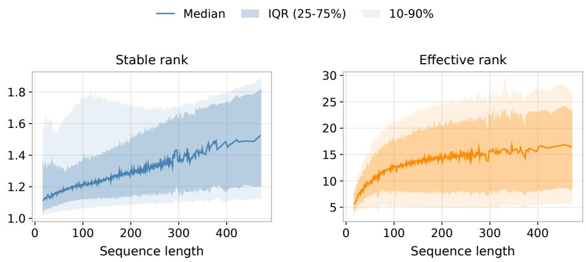  
Figure 4: Stable rank and effective rank of GPT-2 score matrices on the Wikitext-103 validation split as a function of sequence length. Curves show the median trend, with interquartile ranges and wider percentile bands.

Figure 5 shows a substantial decrease in spectral discrepancy as GPT-2 context length grows from 64 to 1,024. The median distance falls from 0.3002 to 0.0942 across all layers and from 0.3290 to 0.0748 in the last layer. At ℓ = 577, ViT has layerwise medians between 0.0367 and 0.1037, with greater variation across image–head pairs in early layers (Figure 6). These observations support bulk spectral similarity, with decreasing discrepancy over the tested GPT-2 lengths.

Rank proxies complement this distributional comparison by measuring spectral concentration. At GPT-2 length 1,024, the pooled stable-rank medians are 1.18 for real attention and 27.51 for canoni cal attention; the corresponding erank1 medians are 314.06 and 95.12. Thus proximity of equally weighted spectral distributions coexists with different concentration and entropy profiles. The sampling and numerical details and the relation to leading spectral modes are discussed in Appendix F.3.

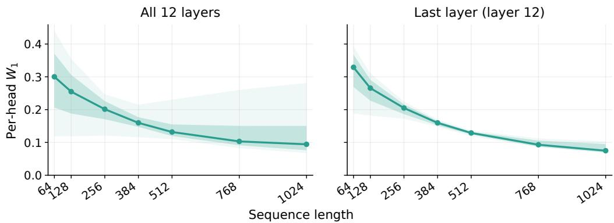  
Figure 5: GPT-2 real-versus-canonical attention spectral discrepancy across sequence lengths, pooled over all layers (left) and restricted to the last layer (right). Each length uses nested prefixes of the same 12 documents, with 12 heads per layer. Curves show median $W _ { 1 }$ ; IQR and 10–90% bands summarize variation across the paired observations.

## 4.4 Score-level geometry and spectral structure

We apply the eigen-angle diagnostics directly to the actual scores, decomposing $\begin{array} { r } { S _ { h } = U _ { S _ { h } } \Sigma _ { h } V _ { S _ { h } } ^ { \top } } \end{array}$ independently for every sample, layer, and head. The analysis covers 1,646 GPT-2 sequences and 3,925 ViT images, with all 12 layers and 12 heads. For both GPT-2 factors, the mean angular $W _ { 1 }$ decreases from approximately 0.31 in the 17–64 length band to 0.10 in the 385–471 band; the pooled ViT mean is approximately 0.08 for each factor. KL and Kolmogorov discrepancies show similar GPT-2 length trends and remain small across ViT layers (Figures 8 and 9). These measurements extend the near-uniform eigen-angle patterns from hidden-state inputs to the computed score singular factors, supporting the isotropy motivation for Assumption 1.

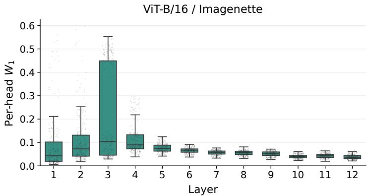  
Figure 6: ViT real-versus-canonical attention spectral discrepancy across layers at sequence length 577, with 20 images and 12 heads per layer. Boxes show medians and IQRs, with whiskers extending to 1.5 times the IQR. All layer medians are below 0.104.

Figures 10 and 11 complement these geometric diagnostics with logarithmic score spectra for one input per model. Each layer pools nonzero singular values after independent per-head decomposition; an empirical-gap split highlights a high-value group above a lower bulk. Together with the modest score-rank proxies in Figure 4, these descriptive spectra motivate a model with a few dominant score directions. The quantitative thresholds in Assumption 2 specify the asymptotic separation regime analyzed by the theory. The structural bound $\bar { k } \le \mathrm { r a n k } ( S _ { h } ) \le d _ { q k } \stackrel { - } { = } 6 4$ supplies a length-independent upper bound on the number of spikes which depends on the input and learned projections.

## 5 Conclusion

Despite the empirical success of self-attention, a spectral analysis of attention matrices under consistent assumptions from initialization to the trained regime has been largely missing. Our central observation is that the token-space singular factors exhibit nearly uniform empirical eigen-angle distributions across a range of Transformer-based models, including both encoder and decoder archi tectures, in long-sequence regimes. This empirical property motivates our spectral canonical model for the score matrix, while the observed effective ranks motivate the spike–bulk assumption on its singular values. Together these assumptions make the spectrum of the attention matrix amenable to non-asymptotic and asymptotic analysis that characterizes degeneration, or rank collapse, within the canonical model. The theory provides a model mechanism for spectral compression observed in practice, offering one perspective on why this architecture has been so effective in LLMs.

Future work could study how alignment of dominant token subspaces across heads and the value and output projections shape the effective dimension of multi-head attention, including the effects of residual connections and normalization. Isotropy and spike–bulk diagnostics could also test for analogous spectral compression in the input-dependent recurrences of selective state-space models such as Mamba [Gu and Dao, 2024]. This would support comparisons with attention at the level of their learned sequence operators.

## Acknowledgments and Disclosure of Funding

We thank the reviewers for their constructive remarks. Jianfeng Yao’s research is supported by NSFC Grant RFIS-A10120230617, the Guangdong Pearl River Talent Program Grant 2023JC10X022, and the Guangdong Provincial Key Laboratory of Mathematical Foundations for Artificial Intelligence (2023B1212010001). The authors declare no competing interests.

## References

Blake Bordelon, Hamza Chaudhry, and Cengiz Pehlevan. Infinite limits of multi-head transformer dynamics. In A. Globerson, L. Mackey, D. Belgrave, A. Fan, U. Paquet, J. Tomczak, and C. Zhang, editors, Advances in Neural Information Processing Systems, volume 37, pages 35824–35878. Curran Associates, Inc., 2024. doi: 10.52202/079017-1130. URL https://proceedings.neurips.cc/paper\_files/paper/ 2024/file/3eff068e195daace49955348de9f8398-Paper-Conference.pdf.

Tom Brown, Benjamin Mann, Nick Ryder, Melanie Subbiah, Jared D Kaplan, Prafulla Dhariwal, Arvind Neelakantan, Pranav Shyam, Girish Sastry, Amanda Askell, Sandhini Agarwal, Ariel Herbert-Voss, Gretchen Krueger, Tom Henighan, Rewon Child, Aditya Ramesh, Daniel Ziegler, Jeffrey Wu, Clemens Winter, Chris Hesse, Mark Chen, Eric Sigler, Mateusz Litwin, Scott Gray, Benjamin Chess, Jack Clark, Christopher Berner, Sam McCandlish, Alec Radford, Ilya Sutskever, and Dario Amodei. Language Models Are Few-Shot Learners. In H. Larochelle, M. Ranzato, R. Hadsell, M.F. Balcan, and H. Lin, editors, Advances in Neural Information Processing Systems, volume 33, pages 1877–1901. Curran Associates, Inc., 2020. URL https://proceedings.neurips.cc/ paper\_files/paper/2020/file/1457c0d6bfcb4967418bfb8ac142f64a-Paper.pdf.

Jia Deng, Wei Dong, Richard Socher, Li-Jia Li, Kai Li, and Li Fei-Fei. ImageNet: A largescale hierarchical image database. In 2009 IEEE Conference on Computer Vision and Pattern Recognition, pages 248–255, 2009. doi: 10.1109/CVPR.2009.5206848.

Jacob Devlin, Ming-Wei Chang, Kenton Lee, and Kristina Toutanova. BERT: Pre-training of Deep Bidirectional Transformers for Language Understanding. In Jill Burstein, Christy Doran, and Thamar Solorio, editors, Proceedings of the 2019 Conference of the North American Chapter of the Association for Computational Linguistics: Human Language Technologies, Volume 1 (Long and Short Papers), pages 4171–4186, Minneapolis, Minnesota, June 2019. Association for Computational Linguistics. doi: 10.18653/v1/N19-1423. URL https://aclanthology.org/ N19-1423/.

Persi Diaconis and Mehrdad Shahshahani. On the eigenvalues of random matrices. Journal of Applied Probability, 31:49–62, 1994. ISSN 00219002. URL http://www.jstor.org/stable/ 3214948.

Yihe Dong, Jean-Baptiste Cordonnier, and Andreas Loukas. Attention is not all you need: pure attention loses rank doubly exponentially with depth. In Marina Meila and Tong Zhang, editors, Proceedings of the 38th International Conference on Machine Learning, volume 139 of Proceedings ofMachine Learning Research, pages 2793–2803. PMLR, 18–24 Jul 2021. URL https://proceedings.mlr.press/v139/dong21a.html.

Alexey Dosovitskiy, Lucas Beyer, Alexander Kolesnikov, Dirk Weissenborn, Xiaohua Zhai, Thomas Unterthiner, Mostafa Dehghani, Matthias Minderer, Georg Heigold, Sylvain Gelly, Jakob Uszkoreit, and Neil Houlsby. An Image is Worth 16x16 Words: Transformers for Image Recognition at Scale. In 9th International Conference on Learning Representations, ICLR 2021, Virtual Event, Austria, May 3-7, 2021. OpenReview.net, 2021. URL https://openreview.net/forum?id= YicbFdNTTy.

Jianyang Gao and Cheng Long. RaBitQ: Quantizing High-Dimensional Vectors with a Theoretical Error Bound for Approximate Nearest Neighbor Search. In Proceedings of the ACM on Management of Data, volume 2, New York, NY, USA, May 2024. Association for Computing Machinery. doi: 10.1145/3654970. URL https://doi.org/10.1145/3654970.

Jianyang Gao, Yutong Gou, Yuexuan Xu, Yongyi Yang, Cheng Long, and Raymond Chi-Wing Wong. Practical and asymptotically optimal quantization of high-dimensional vectors in euclidean space for approximate nearest neighbor search. In Proceedings of the ACM on Management of Data, volume 3, New York, NY, USA, June 2025. Association for Computing Machinery. doi: 10.1145/3725413. URL https://doi.org/10.1145/3725413.

Albert Gu and Tri Dao. Mamba: Linear-Time Sequence Modeling with Selective State Spaces. In First Conference on Language Modeling, 2024. URL https://openreview.net/forum?id= tEYskw1VY2.

Tomohiro Hayase, Benoit Collins, and Ryo Karakida. Gaussian equivalence for self-attention: Asymptotic spectral analysis of attention matrix. In The 29th International Conference on Artificial Intelligence and Statistics, 2026. URL https://openreview.net/forum?id=ABbVGvqaj3.

Jeremy Howard. Imagenette: A smaller subset of 10 easily classified classes from ImageNet, March 2019. URL https://github.com/fastai/imagenette.

Zhenyu Liao, Jiaqing Liu, TianQi Hou, Difan Zou, and Zenan Ling. On the interpolation error of nonlinear attention versus linear regression, 2026. URL https://arxiv.org/abs/2506.18656.

Yinhan Liu, Myle Ott, Naman Goyal, Jingfei Du, Mandar Joshi, Danqi Chen, Omer Levy, Mike Lewis, Luke Zettlemoyer, and Veselin Stoyanov. RoBERTa: A Robustly Optimized BERT Pretraining Approach, 2019. URL https://arxiv.org/abs/1907.11692.

Stephen Merity, Caiming Xiong, James Bradbury, and Richard Socher. Pointer sentinel mixture models. In International Conference on Learning Representations, 2017. URL https: //openreview.net/forum?id=Byj72udxe.

Thiziri Nait Saada, Alireza Naderi, and Jared Tanner. Mind the gap: a spectral analysis of rank collapse and signal propagation in attention layers. In Aarti Singh, Maryam Fazel, Daniel Hsu, Simon Lacoste-Julien, Felix Berkenkamp, Tegan Maharaj, Kiri Wagstaff, and Jerry Zhu, editors, Proceedings of the 42nd International Conference on Machine Learning, volume 267 of Proceedings of Machine Learning Research, pages 45561–45587. PMLR, 13–19 Jul 2025. URL https://proceedings.mlr.press/v267/nait-saada25a.html.

Lorenzo Noci, Sotiris Anagnostidis, Luca Biggio, Antonio Orvieto, Sidak Pal Singh, and Aurelien Lucchi. Signal propagation in transformers: Theoretical perspectives and the role of rank collapse. In S. Koyejo, S. Mohamed, A. Agarwal, D. Belgrave, K. Cho, and A. Oh, editors, Advances in Neural Information Processing Systems, volume 35, pages 27198–27211. Curran Associates, Inc., 2022. URL https://proceedings.neurips.cc/paper\_files/paper/2022/ file/ae0cba715b60c4052359b3d52a2cff7f-Paper-Conference.pdf.

Alec Radford, Karthik Narasimhan, Tim Salimans, and Ilya Sutskever. Improving Language Understanding by Generative Pre-Training. Technical report, OpenAI, 2018. URL https://cdn.openai.com/research-covers/language-unsupervised/ language\_understanding\_paper.pdf.

Alec Radford, Jeff Wu, Rewon Child, David Luan, Dario Amodei, and Ilya Sutskever. Language Models Are Unsupervised Multitask Learners. Technical report, OpenAI, 2019. URL https://cdn.openai.com/better-language-models/language\_models\_ are\_unsupervised\_multitask\_learners.pdf.

Olivier Roy and Martin Vetterli. The effective rank: A measure of effective dimensionality. In 2007 15th European Signal Processing Conference, pages 606–610, 2007. URL https://www. eurasip.org/Proceedings/Eusipco/Eusipco2007/Papers/a5p-h05.pdf.

Mana Sakai, Ryo Karakida, and Masaaki Imaizumi. Infinite-width limit of a single attention layer: Analysis via tensor programs. In D. Belgrave, C. Zhang, H. Lin, R. Pascanu, P. Koniusz, M. Ghassemi, and N. Chen, editors, Advances in Neural Information Processing Systems, volume 38, pages 35630–35664. Curran Associates, Inc., 2025. URL https://proceedings.neurips.cc/paper\_files/paper/2025/file/ 33201f38001dd381aba2c462051449ba-Paper-Conference.pdf.

Sunny Sanyal, Ravid Shwartz-Ziv, Alex Dimakis, and Sujay Sanghavi. When attention collapses: How degenerate layers in LLMs enable smaller, stronger models. Transactions on Machine Learning Research, 2026. ISSN 2835-8856. URL https://openreview.net/forum?id=2zQn0bUoPf.

Mannat Singh, Laura Gustafson, Aaron Adcock, Vinicius de Freitas Reis, Bugra Gedik, Raj Prateek Kosaraju, Dhruv Mahajan, Ross Girshick, Piotr Dollár, and Laurens van der Maaten. Revisiting weakly supervised pre-training of visual perception models. In Proceedings of the IEEE/CVF Conference on Computer Vision and Pattern Recognition (CVPR), pages 804–814, June 2022.

Ashish Vaswani, Noam Shazeer, Niki Parmar, Jakob Uszkoreit, Llion Jones, Aidan N Gomez, Łukasz Kaiser, and Illia Polosukhin. Attention Is All You Need. In I. Guyon, U. Von Luxburg, S. Bengio, H. Wallach, R. Fergus, S. Vishwanathan, and R. Garnett, editors, Advances in Neural Information Processing Systems, volume 30. Curran Associates, Inc., 2017. URL https://proceedings.neurips.cc/paper\_files/paper/2017/file/ 3f5ee243547dee91fbd053c1c4a845aa-Paper.pdf.

Amir Zandieh, Majid Daliri, Majid Hadian, and Vahab Mirrokni. TurboQuant: Online Vector Quantization with Near-Optimal Distortion Rate. In The Fourteenth International Conference on Learning Representations, 2026. URL https://openreview.net/forum?id=tO3ASKZlok.

## A Scope of the canonical reduction

The diagonal surrogate is an additional modeling choice. Neither score singular values nor Haardistributed singular-vector orientations alone justify replacing the attention matrix by its canonical counterpart. The distinction matters both before and after applying a causal mask.

Equality in law and orientation averaging. The statement $S \ { \stackrel { d } { = } } \ \Sigma .$ , with Σ diagonal and nonnegative, would force S to be diagonal and nonnegative almost surely. It cannot express a nontrivial bi-orthogonally invariant score law. In particular, if $S = U \Sigma V ^ { \top }$ , where $U , V$ are independent Haar orthogonal matrices independent of $\Sigma ,$ the average over orientations is not $\Sigma$ . When integrable, $\mathbb { E } [ S \mid \mathbf { \bar { \Sigma } } ] = 0$ by sign symmetry. For both attention patterns, the conditional means are

$$
\mathbb { E } [ \mathrm { s o f t m a x } ( S ) \mid \Sigma ] = \ell ^ { - 1 } \mathbf { 1 } \mathbf { 1 } ^ { \top } , \qquad \mathbb { E } [ \mathrm { s o f t m a x } ( S + M ) \mid \Sigma ] _ { i j } = \frac { \mathbf { 1 } _ { \{ j \leq i \} } } { i } .
$$

Indeed, conditional invariance under column permutations makes the expected weights equal within each row’s unmasked positions, and each row sums to one. For a causal row, use permutations of its first i columns. These identities require only conditional column-permutation invariance, and concern mean attention matrices, not expected singular values or effective ranks.

A score-spectrum counterexample. For $\ell \geq 2 .$ , let

$$
\Sigma = t _ { \ell } e _ { 1 } e _ { 1 } ^ { \top } , \qquad S = \frac { t _ { \ell } } { \ell } { \bf 1 1 } ^ { \top } , \qquad t _ { \ell } = 2 \log \ell .
$$

Both score matrices have singular values $( t _ { \ell } , 0 , \ldots , 0 )$ , satisfying Assumption 2 with one spike. Every row of S is constant, so softmax $\mathbf { \Lambda } ( S ) = \ell ^ { - 1 } \mathbf { 1 1 } ^ { \top }$ has rank one. In contrast, Theorem 1 gives two singular values tending to one for softmax(Σ). Thus score singular values alone do not determine even the limiting number of nonvanishing attention singular values. This example illustrates orientation dependence; it does not assume Haar orientations.

The causal ordering is part of the model. For $\ell = 2 ,$ , causal attention with diagonal scores $( t , 0 )$ has eigenvalues $1 , 1 { \bar { / 2 } }$ , whereas scores (0, t) give eigenvalues $1 , e ^ { t } / ( e ^ { t } + 1 )$ The score singular values are identical. Consequently, placing the descending singular values along the diagonal and then applying a fixed causal mask also fixes their token positions. The causal results are conditional on that convention.

Interpretation of the diagnostics. Nearly uniform eigen-angles of a chosen SVD factor are consistent with a necessary asymptotic consequence of a Haar law; they do not establish the joint Haar law, independence of left and right factors, or independence from singular values. SVD signs and nullspace completions also affect this diagnostic. Similarly, small score rank proxies do not establish the explicit exponential thresholds of Assumption 2. Appendix F records these empirical qualifications. For example, the small Wasserstein distance between empirical spectral laws does not control their leading singular values or rank proxies. A theorem transferring the canonical results to general score matrices would need additional control of the orientation-dependent softmax error; such a transfer is not proved here.

From individual heads to multi-head representations. For $n _ { h }$ heads, let $A _ { h } \in \mathbb { R } ^ { \ell \times \ell }$ be the attention matrix and $V _ { h } \in \mathbb { R } ^ { \ell \times d _ { \tau } }$ the value matrix of head $h \in \{ 1 , \ldots , n _ { h } \}$ . Writing $Z _ { h } = A _ { h } V _ { h }$ and $Z = [ Z _ { 1 } | \cdots | Z _ { n _ { h } } ]$ , the multi-head output before adding any output bias is

$$
\begin{array} { r } { Y = [ A _ { 1 } V _ { 1 } | \cdot \cdot \cdot | A _ { n _ { h } } V _ { n _ { h } } ] W _ { O } = Z W _ { O } , \qquad W _ { O } \in \mathbb { R } ^ { n _ { h } d _ { v } \times d _ { \mathrm { o u t } } } . } \end{array}
$$

The token-space Gram matrices satisfy

$$
Z Z ^ { \top } = \sum _ { h = 1 } ^ { n _ { h } } A _ { h } V _ { h } V _ { h } ^ { \top } A _ { h } ^ { \top } , \qquad Y Y ^ { \top } = Z W _ { O } W _ { O } ^ { \top } Z ^ { \top } .
$$

These identities connect the headwise spectral picture to the combined representation. Before the output projection, the column space is the span of the head-output column spaces: aligned subspaces can retain a common low-dimensional representation, whereas distinct subspaces can increase the dimension of the combined span. The singular values also depend on the value matrices and the weighting induced by $W _ { O }$ . Consequently, headwise attention spectra alone do not determine the singular spectrum of $Y$ . The head-resolved measurements in Appendix F.5 describe variation in spectral concentration and canonical discrepancy; a theory of the combined output would additionally require a joint description of the head-output subspaces and projections. Extending this description through residual connections and normalization provides a further question at the Transformer-block level.

## B Generalized softmax attention

Recent work has explored alternative attention activations to reduce computational cost. The canonical results extend to positive activations followed by row normalization. We leave unnormalized attention mechanisms to complementary analyses such as [Liao et al., 2026].

Let $\gamma : \mathbb { R } \to ( 0 , \infty )$ be nondecreasing on $[ 0 , \infty )$ . Multiplying $\gamma$ by a positive constant does not change the normalized attention, so take $\gamma ( 0 ) = 1$ . Define

$$
A _ { i j } ^ { \gamma } = \frac { \gamma ( S _ { i j } ) } { \sum _ { r = 1 } ^ { \ell } \gamma ( S _ { i r } ) } .
$$

For causal attention, masked entries are set to zero and only unmasked entries enter the row normalization.

Under Assumption 1, evaluate this map on Σ. Set

$$
\widetilde { s } _ { i } = \log \gamma ( s _ { i } ) , \qquad \widetilde { \Sigma } = \mathrm { d i a g } ( \widetilde { s } _ { 1 } , \dots , \widetilde { s } _ { \ell } ) .
$$

Then $\widetilde { s } _ { 1 } \geq \cdot \cdot \cdot \geq \widetilde { s } _ { \ell } \geq 0$ , and the canonical generalized attention matrices are exactly

$$
A _ { \mathrm { b } } ^ { \gamma } = \mathrm { s o f t m a x } ( \widetilde { \Sigma } ) , \qquad A _ { \mathrm { c } } ^ { \gamma } = \mathrm { s o f t m a x } ( \widetilde { \Sigma } + M ) .
$$

Thus every canonical spectral and rank-proxy result applies with $s _ { i }$ replaced by $\widetilde { s } _ { i }$ . In particular, spectral separation becomes

$$
\gamma ( s _ { i } ) \geq \ell f ( \ell ) \quad ( i \leq k ) , \qquad \gamma ( s _ { i } ) \leq \ell / g ( \ell ) \quad ( i > k ) ,
$$

with the same conditions on $f$ and $g .$ . Bounded-bulk conclusions require uniformly bounded $\gamma ( s _ { i } )$ in the bulk; $s _ { i } \leq B$ implies this through $\gamma ( s _ { i } ) \leq \gamma ( B )$ . The transition occurs when $\gamma ( s _ { i } )$ is of order $\ell .$ Neither strict monotonicity nor continuity nor an inverse activation is needed. Bounded activations cannot meet the spike threshold for any nonempty spike set, but still admit the zero-spike conclusions.

## C Proofs of main results

## C.1 Proof of Theorem 1

Proof. Singular-value profile. Set $z _ { i } = ( e ^ { s _ { i } } + \ell - 1 ) ^ { - 1 } , d _ { i } = 1 - \ell z _ { i } , D = \mathrm { d i a g } ( d _ { i } ) , J = \ell ^ { - 1 } \mathbf { 1 } \mathbf { 1 } ^ { \top }$ and $\overset { \cdot } { P } = \overset { \cdot } { I } - \overset { \triangledown } { J }$ . Direct row normalization gives the exact identities

$$
A = D + z \mathbf { 1 } ^ { \top } = J + D P , \qquad d _ { i } = { \frac { e ^ { s _ { i } } - 1 } { e ^ { s _ { i } } + \ell - 1 } } \in [ 0 , 1 ) .
$$

Let $D ^ { \star } = \mathrm { d i a g } ( { \mathbf 1 } _ { k } , { \mathbf 0 } _ { \ell - k } )$ and $A ^ { \star } = J + D ^ { \star } P$ . Spectral separation implies

$$
\begin{array} { r } { 1 - d _ { i } \leq f ( \ell ) ^ { - 1 } \quad ( i \leq k ) , \qquad d _ { i } \leq g ( \ell ) ^ { - 1 } \quad ( i > k ) . } \end{array}
$$

Since P is an orthogonal projection,

$$
\| A - A ^ { \star } \| _ { \mathrm { o p } } = \| ( D - D ^ { \star } ) P \| _ { \mathrm { o p } } \leq \operatorname* { m a x } \{ f ( \ell ) ^ { - 1 } , g ( \ell ) ^ { - 1 } \} = \varepsilon _ { \ell } .\tag{2}
$$

It remains only to compute the singular values of $A ^ { \star }$

For $1 \leq k < \ell ,$ its first k rows are coordinate vectors and its remaining rows equal $\ell ^ { - 1 } { \bf 1 } ^ { \top }$ . Thus

$$
\begin{array} { r } { A ^ { \star } ( A ^ { \star } ) ^ { \top } = \left( \begin{array} { c c } { I _ { k } } & { \ell ^ { - 1 } \mathbf { 1 } _ { k \times ( \ell - k ) } } \\ { \ell ^ { - 1 } \mathbf { 1 } _ { ( \ell - k ) \times k } } & { \ell ^ { - 1 } \mathbf { 1 } _ { ( \ell - k ) \times ( \ell - k ) } } \end{array} \right) . } \end{array}
$$

The zero-sum spike subspace has eigenvalue one with multiplicity $k - 1$ , and the zero-sum bulk subspace has eigenvalue zero with multiplicity $\ell - k - 1$ . On the remaining two-dimensional subspace, use the orthonormal basis $k ^ { - 1 / 2 } ( \mathbf { 1 } _ { k } , 0 ) , ( \ell - k ) ^ { - 1 / 2 } ( 0 , \mathbf { 1 } _ { \ell - k } )$ . The corresponding symmetric matrix is

$$
\left( \begin{array} { c c } { { 1 } } & { { \sqrt { c _ { \ell } ( 1 - c _ { \ell } ) } } } \\ { { \sqrt { c _ { \ell } ( 1 - c _ { \ell } ) } } } & { { 1 - c _ { \ell } } } \end{array} \right) ,
$$

whose eigenvalues are

$$
a _ { \pm } ( c _ { \ell } ) = 1 - \frac { c _ { \ell } } { 2 } \pm \sqrt { c _ { \ell } - \frac { 3 } { 4 } c _ { \ell } ^ { 2 } } = \alpha _ { \pm } ( c _ { \ell } ) ^ { 2 } .
$$

For $0 < c _ { \ell } < 1 , a _ { + } ( c _ { \ell } ) > 1 > a _ { - } ( c _ { \ell } ) > 0$ , so the two exceptional singular values occupy positions 1 and $k + 1$ , giving the ordered profile in the theorem. The endpoint profiles follow from $A ^ { \star } = J$ when $k = 0$ and $\bar { A ^ { \star } } = I$ when $k = \ell$ . Weyl’s inequality and (2) prove the uniform approximation, including the vanishing tail.

Sublinear spikes. If $k = o ( \ell )$ , then $a _ { \pm } ( c _ { \ell } ) = 1 + O ( \sqrt { c _ { \ell } } ) , \mathrm { s o } \alpha _ { \pm } ( c _ { \ell } ) = 1 + O ( \sqrt { c _ { \ell } } )$ . The other leading profile values are exactly one. Combining this with the uniform approximation gives the stated bound for all $1 \leq i \leq k + \mathsf { \bar { 1 } }$ . For $k = 0$ , the same conclusion follows from $\sigma _ { 1 } ^ { * } = 1$

Spectral degeneration. The singular profile has $k + O ( 1 )$ unit values, $\ell - k + O ( 1 )$ zeros, and at most two exceptional values, all uniformly bounded. Thus, if $c _ { \ell }  c \in [ 0 , 1 ] .$ , its empirical distribution converges weakly to $c \delta _ { 1 } + ( 1 - c ) \delta _ { 0 }$ , including the endpoint profiles $k = 0 , \ell .$ The uniform singular-value approximation transfers this weak limit to $\mu _ { A } ^ { \mathrm { s v } }$ □

## C.2 Proof of Theorem 2

Proof. Exact spectral structure. Retain $D , J , P , z$ from the preceding proof. The case $\ell = 1$ is immediate, so assume $\ell > 1 . \operatorname { L e t } u = \ell ^ { - 1 / 2 } { \bf 1 }$ and choose an orthonormal basis matrix $Q \in \mathbb { R } ^ { \ell \times ( \ell - 1 ) }$ for $u ^ { \perp }$ . In the orthonormal basis $[ u , Q ]$

$$
[ \boldsymbol { u } , \boldsymbol { Q } ] ^ { \top } \boldsymbol { A } [ \boldsymbol { u } , \boldsymbol { Q } ] = \left( \begin{array} { c c } { 1 } & { \boldsymbol { u } ^ { \top } \boldsymbol { D } \boldsymbol { Q } } \\ { 0 } & { \boldsymbol { Q } ^ { \top } \boldsymbol { D } \boldsymbol { Q } } \end{array} \right) .
$$

Consequently the eigenvalues of A are one together with those of the symmetric compression $Q ^ { \top } D Q$ Since $0 \leq D < I _ { \mathrm { { i } } }$ , they are real and belong to [0, 1], with a simple largest eigenvalue 1. Cauchy interlacing for a codimension-one compression gives

$$
d _ { i } \leq \lambda _ { i } ( A ) \leq d _ { i - 1 } , \qquad 2 \leq i \leq \ell .
$$

The relation $A _ { i i } = \ell ^ { - 1 } + ( 1 - \ell ^ { - 1 } ) d _ { i }$ yields the displayed bounds in terms of A’s diagonal.

For the strict alternative and characteristic equation, applying the determinant lemma to (1) gives, away from the poles $d _ { i }$

$$
\operatorname* { d e t } ( \lambda I - A ) = \prod _ { i = 1 } ^ { \ell } ( \lambda - d _ { i } ) \left( 1 - \sum _ { i = 1 } ^ { \ell } { \frac { z _ { i } } { \lambda - d _ { i } } } \right) .\tag{3}
$$

Group equal diagonal values into distinct poles $\delta _ { r }$ , with multiplicities $m _ { r }$ and residues $\begin{array} { r l } { w _ { r } } & { { } = } \end{array}$ $\textstyle \sum _ { i : d _ { i } = \delta _ { r } } z _ { i } > 0$ . The secular factor is then $\begin{array} { r } { \dot { 1 } - \sum _ { r } w _ { r } / ( \lambda - \delta _ { r } ) } \end{array}$ . Its nonzero residue at each pole cancels exactly one of the $m _ { \tau }$ polynomial factors, so $\delta _ { r }$ has algebraic multiplicity exactly $m _ { r } - 1$ The secular function is strictly increasing between poles and runs from $- \infty$ to +∞ between adjacent distinct poles. It has one further root above the largest pole and none below the smallest. This accounts for all ℓ roots and proves the stated strict interlacing alternative: equality occurs precisely when $d _ { i } = d _ { i - 1 }$ ; otherwise $\bar { \lambda } _ { i } ( A )$ lies strictly between these two entries.

Eigenvalue profile. Compare with $D ^ { \star }$ above. The associated ideal matrix $A ^ { \star }$ is block lower triangular, with diagonal blocks $I _ { k }$ and $\ell ^ { - 1 } { \mathbf { 1 } } _ { ( \ell - k ) \times ( \ell - k ) }$ . For $k < \ell ,$ , its ordered eigenvalue list is

$$
\underbrace { 1 , \dots , 1 } _ { k { \mathrm { ~ t i m e s } } } , \quad 1 - c _ { \ell } , \quad \underbrace { 0 , \dots , 0 } _ { \ell - k - 1 { \mathrm { ~ t i m e s } } } .
$$

For $k = \ell ,$ , it consists of ℓ ones. Both non-Perron spectra are eigenvalues of symmetric compressions, and

$$
\| Q ^ { \top } ( D - D ^ { \star } ) Q \| _ { \mathrm { o p } } \leq \operatorname* { m a x } \{ f ( \ell ) ^ { - 1 } , g ( \ell ) ^ { - 1 } \} = \varepsilon _ { \ell } .
$$

Hermitian Weyl’s inequality therefore proves the intermediate-eigenvalue estimate uniformly for $0 \leq k < \ell .$ For $k = 0$ this is simply $\lambda _ { 1 } = 1$ . The sharper spike error $O ( f ( \ell ) ^ { - 1 } )$ and bulk error $O ( g ( \ell ) ^ { - 1 } )$ follow directly from interlacing and the bounds on $d _ { i }$ in the preceding proof. $\operatorname { I f } k = o ( \ell )$ then $c _ { \ell } \to 0$ , and the spike and intermediate estimates together give uniform convergence of the leading $k + 1$ eigenvalues to one.

Spectral degeneration. For $k < \ell ,$ the ideal eigenvalue profile differs from k ones and $\ell - k$ zeros in only one entry, of empirical mass $1 / \ell ;$ for $k = \ell .$ , the profiles coincide. Hence, if $c _ { \ell } \to c \in [ 0 , 1 ]$ , its empirical distribution converges weakly to $c \delta _ { 1 } + ( 1 - c ) \delta _ { 0 }$ . The same Hermitian perturbation bound gives uniform approximation of the ordered eigenvalues and therefore the asserted weak limit for $\mu _ { A } ^ { \mathrm { { e i g } } }$ □

Remark 2 (A sharper intermediate-eigenvalue bound). For any nonnegative diagonal scores and $1 \leq k < \ell ,$

$$
( 1 - c _ { \ell } ) d _ { k } + c _ { \ell } d _ { \ell } \leq \lambda _ { k + 1 } ( A ) \leq ( 1 - c _ { \ell } ) d _ { 1 } + c _ { \ell } d _ { k + 1 } .
$$

Indeed, sandwich D between the two-block diagonal matrices with block values $( d _ { k } , d _ { \ell } )$ and $( d _ { 1 } , d _ { k + 1 } )$ . The k-th largest eigenvalue of the compression of $\mathrm { d i a g } ( a I _ { k } , b I _ { \ell - k } )$ , for $a \ge b ,$ , to $\mathbf { 1 } ^ { \perp } \dot { \iota } s ( 1 - c _ { \ell } ) a + c _ { \ell } b ;$ monotonicity of eigenvalues under the Loewner order proves the bounds. Under spectral separation, they give the sharper one-sided estimate

$$
- \frac { 1 - c _ { \ell } } { f ( \ell ) } \leq \lambda _ { k + 1 } ( A ) - ( 1 - c _ { \ell } ) \leq \frac { c _ { \ell } } { g ( \ell ) } .
$$

In particular, $i f k = o ( \ell )$ , the spike condition alone implies that the leading $k + 1$ eigenvalues converge uniformly to one: the lower bound is at least $( 1 - c _ { \ell } ) d _ { k } \to 1$ , while all eigenvalues are at most one. No bulk bound is neededfor this head convergence; when $k = 0 _ { : }$ , it is simply $\lambda _ { 1 } = 1$

## C.3 Proof of Theorem 3

Proof. Write $a _ { i } = e ^ { s _ { i } }$ . The canonical causal matrix is lower triangular, so its eigenvalues are its diagonal entries:

$$
\lambda _ { i } ( A ) = { \frac { a _ { i } } { a _ { i } + i - 1 } } = 1 - { \frac { i - 1 } { a _ { i } + i - 1 } } .
$$

These are already in decreasing order: $a _ { i }$ is nonincreasing, so $( i - 1 ) / a _ { i }$ is nondecreasing. In particular, $\lambda _ { 1 } = 1$ . For $i \leq k$

$$
0 \leq 1 - \lambda _ { i } ( A ) \leq { \frac { i - 1 } { \ell f ( \ell ) } } \leq { \frac { k } { \ell f ( \ell ) } } ,
$$

which also sharpens the stated $O ( 1 / f ( \ell ) )$ spike error.

For spectral degeneration, put $t _ { \ell } = \ell / g ( \ell ) \geq 1$ for all sufficiently large ℓ. Every bulk row satisfies $\lambda _ { i } ( A ) \leq \operatorname* { m i n } \{ 1 , t _ { \ell } / i \}$ , since $a _ { i } + i - 1 \geq i .$ . Splitting the sum at $\lceil t _ { \ell } \rceil$ gives $\Sigma _ { i = 1 } ^ { \ell }$ min $\{ 1 , t _ { \ell } ^ { 2 } / i ^ { 2 } \} \le$ $3 t _ { \ell }$ . Together with the spike estimate, this yields

$$
\frac { 1 } { \ell } \sum _ { i = 1 } ^ { \ell } \bigl ( \lambda _ { i } ( A ) - \mathbf { 1 } _ { \{ i \leq k \} } \bigr ) ^ { 2 } \leq \frac { k ^ { 3 } } { \ell ^ { 3 } f ( \ell ) ^ { 2 } } + \frac { 3 } { g ( \ell ) } = o ( 1 ) .
$$

The empirical eigenvalue distribution therefore approaches $c _ { \ell } \delta _ { 1 } + ( 1 - c _ { \ell } ) \delta _ { 0 }$ in mean-square transport distance. I $\mathrm { ~ f ~ } c _ { \ell }  c \in [ 0 , 1 ]$ , it therefore converges weakly to $c \delta _ { 1 } + ( 1 - c ) \delta _ { 0 }$ , without any bounded bulk assumption.

Finally, for every bounded-score bulk row, $1 \leq a _ { i } \leq C$ gives $1 / i \le \lambda _ { i } ( A ) \le C / i$ , proving the harmonic bounds. This bounded-score condition cannot be dropped: if $k = 0$ and $a _ { i } = \sqrt { \ell }$ for every i, spectral separation holds with $g ( \ell ) = \sqrt { \ell } .$ , but $\lambda _ { \ell } ( A ) = \bar { \sqrt { \ell } } / ( \sqrt { \ell } + \ell - 1 ) \asymp \ell ^ { - 1 / 2 }$ . Thus the empirical eigenvalue distribution still converges to $\delta _ { 0 } ,$ while uniform harmonic decay fails. □

## C.4 Proof of Theorem 4

Proof. Write $a _ { i } = e ^ { s _ { i } } \geq 1$ and $z _ { i } = ( a _ { i } + i - 1 ) ^ { - 1 }$ . Then

$$
A _ { i j } = \left\{ { \begin{array} { l l } { z _ { i } , } & { j < i , } \\ { a _ { i } z _ { i } , } & { j = i , } \\ { 0 , } & { j > i . } \end{array} } \right.
$$

Step 1: universal singular-value bounds. Let ${ \sf H } _ { \ell }$ be the Cesàro matrix, $( \mathsf { H } _ { \ell } ) _ { i j } = i ^ { - 1 } \mathbf { 1 } _ { \{ j \leq i \} }$ , and define $\theta _ { i } = ( a _ { i } - 1 ) / ( a _ { i } + i - 1 ) \in [ 0 , 1 ]$ . We have the exact identity

$$
A = \mathrm { d i a g } ( \theta _ { i } ) + \big ( I - \mathrm { d i a g } ( \theta _ { i } ) \big ) { \sf H } _ { \ell } .
$$

By convexity of the square and the Hardy inequality (Lemma 3),

$$
\| A x \| _ { 2 } ^ { 2 } \leq \sum _ { i } \left( \theta _ { i } | x _ { i } | ^ { 2 } + ( 1 - \theta _ { i } ) | ( \mathsf { H } _ { \ell } x ) _ { i } | ^ { 2 } \right) \leq \| x \| _ { 2 } ^ { 2 } + \| \mathsf { H } _ { \ell } x \| _ { 2 } ^ { 2 } \leq 5 \| x \| _ { 2 } ^ { 2 } .
$$

Thus $\| A \| _ { \mathrm { o p } } \leq { \sqrt { 5 } }$ , even without the bounded-bulk assumption.

For the lower bound, let $L _ { r }$ be the $r \times r$ lower triangular matrix of ones. For any nonnegative diagonal matrix Λ,

$$
2 x ^ { \top } ( L _ { r } + \Lambda ) x = \| x \| _ { 2 } ^ { 2 } + ( \mathbf { 1 } _ { r } ^ { \top } x ) ^ { 2 } + 2 x ^ { \top } \Lambda x \geq \| x \| _ { 2 } ^ { 2 } .
$$

Cauchy–Schwarz therefore gives

$$
\begin{array} { r } { \sigma _ { \operatorname* { m i n } } ( L _ { r } + \Lambda ) \geq \frac { 1 } { 2 } , \qquad \| ( L _ { r } + \Lambda ) ^ { - 1 } \| _ { \mathrm { o p } } \leq 2 . } \end{array}
$$

Fix $1 \leq j \leq \ell ,$ , and let $C _ { j }$ be the leading $j \times j$ principal submatrix of A. Write

$$
C _ { j } = D _ { j } ^ { - 1 } M _ { j } , \qquad D _ { j } = \mathrm { d i a g } ( a _ { i } + i - 1 ) _ { i = 1 } ^ { j } , \qquad M _ { j } = L _ { j } + \mathrm { d i a g } ( a _ { i } - 1 ) _ { i = 1 } ^ { j } .
$$

The preceding coercivity estimate gives $\| M _ { j } ^ { - 1 } \| _ { \mathrm { o p } } \leq 2$ . Moreover,

$$
D _ { j } - M _ { j } = \mathrm { d i a g } ( i - 1 ) _ { i = 1 } ^ { j } - ( L _ { j } - I _ { j } ) = : K _ { j } .
$$

The absolute row sums of $K _ { j }$ are at most $2 ( j - 1 )$ , and every absolute column sum equals $j - 1$ Hence the Schur test gives $\| K _ { j } \| _ { \mathrm { o p } } \le \sqrt { 2 } ( j - 1 )$ , and

$$
\| C _ { j } ^ { - 1 } \| _ { \mathrm { o p } } = \| I _ { j } + M _ { j } ^ { - 1 } K _ { j } \| _ { \mathrm { o p } } \leq 1 + 2 \sqrt { 2 } ( j - 1 ) \leq 3 j .
$$

For vectors supported on the first j coordinates, projecting Ax onto its first $j$ coordinates gives $C _ { j } x .$ The max-min principle therefore yields

$$
\sigma _ { j } ( A ) \geq \sigma _ { \operatorname* { m i n } } ( C _ { j } ) \geq { \frac { 1 } { 3 j } } , \qquad 1 \leq j \leq \ell .
$$

Together with the operator bound, this proves the universal estimates for every sequence length, using only nonnegative scores.

Now assume spectral separation as in Assumption 2. Split after the first k rows and columns, interpreting zero-size blocks in the usual way:

$$
A = \left( A _ { 1 1 } \quad \quad 0 \right) , \qquad A _ { 2 1 } = z ^ { ( b ) } \mathbf { 1 } _ { k } ^ { \top } , \qquad z ^ { ( b ) } = ( z _ { k + 1 } , \ldots , z _ { \ell } ) ^ { \top } .
$$

Deleting the last $\ell - k$ columns leaves a matrix of rank at most k. Lemma 4 consequently gives

$$
\sigma _ { k + m } ( A ) \leq \sigma _ { m } ( A _ { 2 2 } ) , \qquad 1 \leq m \leq \ell - k .
$$

Step 2: spike subspace. For $k \geq 1$ , the spike assumption gives $z _ { i } \le 1 / ( \ell f ( \ell ) )$ for $i \leq k .$ . Thus $A _ { 1 1 } = I _ { k } + E _ { \ell }$ , where the absolute row sums and column sums of $E _ { \ell }$ are at most $2 k / ( \ell f ( \ell ) )$ and $k / ( \ell f ( \ell ) )$ ), respectively. The Schur test yields

$$
\delta _ { \ell } : = \| E _ { \ell } \| _ { \mathrm { o p } } = O \bigg ( \frac { k } { \ell f ( \ell ) } \bigg ) = o ( 1 ) .
$$

On the (k − 1)-dimensional subspace

$$
E _ { \mathrm { s p } } = \{ ( u , 0 ) : u \in \mathbb { R } ^ { k } , \ \mathbf { 1 } _ { k } ^ { \top } u = 0 \} ,
$$

the coupling block vanishes, so $A ( u , 0 ) = ( A _ { 1 1 } u , 0 )$ . Consequently,

$$
( 1 - \delta _ { \ell } ) \| u \| _ { 2 } \leq \| A ( u , 0 ) \| _ { 2 } \leq ( 1 + \delta _ { \ell } ) \| u \| _ { 2 } .
$$

This proves the almost-isometry assertion. In fact, on the whole first k-coordinate subspace, $\| A ( u , \bar { 0 } ) \| _ { 2 } \geq \| A _ { 1 1 } u \| _ { 2 }$ , and hence the max-min principle gives the slightly stronger conclusion

$$
\sigma _ { k } ( A ) \geq 1 - \delta _ { \ell } \qquad ( k \geq 1 ) .
$$

Step 3: singular-value degeneration without bounded bulk. Here we use only spectral separation. Let $\boldsymbol { \bar { P } _ { k } } = \mathrm { d i a g } ( I _ { k } , 0 )$ and put $t _ { \ell } = \ell / g ( \ell ) \geq 1$ for all sufficiently large ℓ. For a bulk row $i > k ,$

$$
\sum _ { j } A _ { i j } ^ { 2 } = \frac { i - 1 + a _ { i } ^ { 2 } } { ( a _ { i } + i - 1 ) ^ { 2 } } \leq \frac { 1 } { i } + \operatorname* { m i n } \biggl \{ 1 , \frac { t _ { \ell } ^ { 2 } } { i ^ { 2 } } \biggr \} .
$$

Splitting the sum at $\lceil t _ { \ell } \rceil$ gives

$$
\sum _ { i = 1 } ^ { \ell } \operatorname* { m i n } \biggl \{ 1 , \frac { t _ { \ell } ^ { 2 } } { i ^ { 2 } } \biggr \} \leq 3 t _ { \ell } .
$$

Writing $\begin{array} { r } { \mathcal { H } _ { n } = \sum _ { i = 1 } ^ { n } i ^ { - 1 } } \end{array}$ and $\mathcal { H } _ { 0 } = 0$ , the block comparison above therefore yields

$$
\# \{ i > k : \sigma _ { i } ( A ) > \varepsilon \} \leq \frac { \mathcal { H } _ { \ell } + 3 \ell / g ( \ell ) } { \varepsilon ^ { 2 } } .
$$

For a spike row $i \leq k$

$$
\sum _ { j } | ( A - P _ { k } ) _ { i j } | ^ { 2 } = { \frac { i ( i - 1 ) } { ( a _ { i } + i - 1 ) ^ { 2 } } } \leq { \frac { i ^ { 2 } } { \ell ^ { 2 } f ( \ell ) ^ { 2 } } } .
$$

Consequently,

$$
\frac { \| A - P _ { k } \| _ { \mathrm { F } } ^ { 2 } } { \ell } \leq \frac { k ^ { 3 } } { \ell ^ { 3 } f ( \ell ) ^ { 2 } } + \frac { \mathcal { H } _ { \ell } } { \ell } + \frac { 3 } { g ( \ell ) } = o ( 1 ) .
$$

Mirsky’s singular-value inequality gives

$$
\frac { 1 } { \ell } \sum _ { i = 1 } ^ { \ell } \bigl ( \sigma _ { i } ( A ) - \mathbf { 1 } _ { \{ i \leq k \} } \bigr ) ^ { 2 } \leq \frac { \| A - P _ { k } \| _ { \mathrm { F } } ^ { 2 } } { \ell } = o ( 1 ) .
$$

The empirical singular-value distribution approaches the moving mixture $c _ { \ell } \delta _ { 1 } + ( 1 - c _ { \ell } ) \delta _ { 0 }$ in mean-square transport distance. If $c _ { \ell }  c \in [ \bar { 0 } , 1 ]$ , it therefore converges weakly to $c \delta _ { 1 } + ( 1 - c ) \delta _ { 0 }$ For Steps 4 and 5, assume $1 \leq a _ { i } \leq e ^ { B }$ for $i > k$

Step 4: Frobenius control of the bulk. The bulk-block row associated with original row $i > k$ has squared norm

$$
\frac { i - k - 1 + a _ { i } ^ { 2 } } { ( a _ { i } + i - 1 ) ^ { 2 } } \leq \frac { i + e ^ { 2 B } } { i ^ { 2 } } \leq \frac { 1 + e ^ { 2 B } } { i } .
$$

Consequently, we obtain

$$
\| A _ { 2 2 } \| _ { \mathrm { F } } ^ { 2 } \le C _ { B } ( \mathcal { H } _ { \ell } - \mathcal { H } _ { k } ) \le C _ { B } \log ( \ell + 1 ) , \qquad \sigma _ { k + m } ( A ) \le C _ { B } \sqrt { \frac { \mathcal { H } _ { \ell } - \mathcal { H } _ { k } } { m } } .
$$

In particular this proves the logarithmic bound in the theorem. For each $\varepsilon > 0 .$ , the same comparison $\mathrm { g i v e s }$

$$
\# \{ i > k : \sigma _ { i } ( A ) > \varepsilon \} \leq \frac { \| A _ { 2 2 } \| _ { \mathrm { F } } ^ { 2 } } { \varepsilon ^ { 2 } } \leq \frac { C _ { B } \log ( \ell + 1 ) } { \varepsilon ^ { 2 } } .
$$

The asserted vanishing after $m _ { \ell } \gg$ log ℓ follows.

Step 5: the lower-right block bound. For $j > k ,$ , choose the $( \ell - j + 1 )$ -dimensional coordinate subspace $F _ { j } = \operatorname { s p a n } \{ e _ { j } , \ldots , e _ { \ell } \}$ . By triangularity, the restriction to this subspace is the lower-right block $T _ { j }$ . All its nonzero entries are at most $e ^ { B } / j$ , so coordinatewise

$$
| T _ { j } x | \leq { \frac { e ^ { B } } { j } } L _ { \ell - j + 1 } | x | .
$$

Using $\| L _ { r } \| _ { \mathrm { o p } } \leq \| L _ { r } \| _ { \mathrm { F } } \leq r$ and the min-max principle gives

$$
\sigma _ { j } ( A ) \leq \| T _ { j } \| _ { \mathrm { o p } } \leq { \frac { e ^ { B } ( \ell - j + 1 ) } { j } } .
$$

Combining this with Steps 1 and 4 proves all upper bounds. In particular, if $k < \ell ,$ , then $\sigma _ { \ell } ( A ) =$ $\Theta _ { B } ( \ell ^ { - 1 } )$ . The proof already includes $k = 0 . { \mathrm { ~ I f ~ } } { \bar { k } } = \ell ,$ Step 2 applies to the whole matrix, Step 1 remains valid, and there are no bulk assertions.

Remark 3 (Quantitative bounds require additional bulk control). Spectral separation suffices for weak convergence of the empirical singular-value distribution, but additional bulk control is still neededfor the logarithmic counting and rank bounds. For example, take $k = 0$ and $a _ { i } = { \sqrt { \ell } }$ for all i, which satisfies spectral separation with $g ( \ell ) = \sqrt { \ell } .$ . For $r = \lfloor \sqrt { \ell } / 4 \rfloor$ , the leading principal block $C _ { r }$ satisfies $\| C _ { r } - I _ { r } \| _ { \mathrm { o p } } \leq 2 r / \sqrt { \ell } \leq 1 / 2$ by the Schur test, so $\sigma _ { r } ( A ) \geq 1 / 2$ . Thus

$$
\# \{ i : \sigma _ { i } ( A ) > 1 / 3 \} \geq r = \Omega ( { \sqrt { \ell } } ) , \qquad \operatorname { e r a n k } _ { 2 } ( A ) \geq \operatorname { s r a n k } ( A ) \geq r / 2 0 = \Omega ( { \sqrt { \ell } } ) ,
$$

where the stable-rank bound uses $\| A \| _ { \mathrm { F } } ^ { 2 } \ge r / 4$ and $\| A \| _ { \mathrm { o p } } ^ { 2 } \leq 5$ . Hence spectral separation alone does not give the logarithmic counting and rank bounds, even though the empirical singular-value distribution still tends to $\delta _ { 0 }$

## C.5 Remarks on causal singular values

Remark 4 (Why one cannot replace the bulk upper bound by $O ( 1 / i )$ when k is finite). Under the bounded-bulk assumptions ofTheorem 4, ifk isfinite, a uniform estimate

$$
\sigma _ { i } ( A ) \leq { \frac { { \widehat { C } } _ { B , k } } { i } } \qquad { f o r \ : a l l \ : i \in \{ k + 1 , \ldots , \ell \} }
$$

cannot hold in general.

Indeed,for every bulk row $p > k ,$ , the row of A has $p - 1$ off-diagonal entries equal to $z _ { p }$ and diagonal entry $e ^ { s _ { p } } z _ { p }$ . Hence

$$
\sum _ { q = 1 } ^ { \ell } A _ { p q } ^ { 2 } = \left( \left( p - 1 \right) + e ^ { 2 s _ { p } } \right) z _ { p } ^ { 2 } \geq \frac { p - 1 } { ( e ^ { B } + p - 1 ) ^ { 2 } } .
$$

Therefore there exists $\widehat { c } _ { B , k } > 0$ such that

$$
\| A \| _ { \mathrm { F } } ^ { 2 } \geq \sum _ { p = k + 1 } ^ { \ell } { \frac { p - 1 } { ( e ^ { B } + p - 1 ) ^ { 2 } } } \geq { \widehat { c } } _ { B , k } \sum _ { p = k + 1 } ^ { \ell } { \frac { 1 } { p } } \geq { \frac { { \widehat { c } } _ { B , k } } { 2 } } \log \ell
$$

for all sufficiently large ℓ.

On the other hand, $i f \sigma _ { i } ( A ) \leq \widehat { C } _ { B , k } / i$ held for all $i \in \{ k + 1 , \ldots , \ell \}$ , then

$$
\| A \| _ { \mathrm { F } } ^ { 2 } = \sum _ { j = 1 } ^ { \ell } \sigma _ { j } ( A ) ^ { 2 } \leq k \| A \| _ { \mathrm { o p } } ^ { 2 } + \widehat C _ { B , k } ^ { 2 } \sum _ { i = k + 1 } ^ { \ell } \frac { 1 } { i ^ { 2 } } \leq \widetilde C _ { B , k } ,
$$

which contradicts the logarithmic lower bound above. Thus thefactor $\ell - i + 1$ in the upper bound ofTheorem 4 cannot, in general, be removedfrom the ordered bulk estimate.

Remark 5 (Spike subspace versus ordered singular values). Step 2 does not imply

$$
| \sigma _ { i } ( A ) - 1 | = O \left( { \frac { k } { \ell f ( \ell ) } } \right) \qquad f o r \ 1 \leq i \leq k .
$$

For $k \geq 1$ , what Step 2 proves is that the restriction ofA to the $\left( k - 1 \right)$ -dimensional spike subspace $E _ { \mathrm { s p } }$ is almost isometric:

$$
\left( 1 - O \bigg ( \frac { k } { \ell f ( \ell ) } \bigg ) \right) \| v \| _ { 2 } \leq \| A v \| _ { 2 } \leq \left( 1 + O \bigg ( \frac { k } { \ell f ( \ell ) } \bigg ) \right) \| v \| _ { 2 } , \qquad v \in E _ { \mathrm { s p } } .
$$

Equivalently, the singular values of the compressed operator $A | _ { E _ { \mathrm { s p } } }$ all lie in

$$
\left[ 1 - O \left( { \frac { k } { \ell f ( \ell ) } } \right) , 1 + O \left( { \frac { k } { \ell f ( \ell ) } } \right) \right] .
$$

However, these are not the same as the ordered singular values ofthefull matrix A. The bulk block A can already have operator norm strictly larger than 1;for instance,forfixed k and $s _ { i } = 0 f o r$ $i > k ,$ it is the shifted Cesàro matrix, whose norm is bounded awayfrom 1. Therefore the top ordered singular values ofA may exceed 1 by an $O ( 1 )$ amount. Projecting onto thefirst k output coordinates in Step 2 gives the one-sided estimate

$$
\sigma _ { k } ( A ) \geq 1 - O \left( { \frac { k } { \ell f ( \ell ) } } \right) , \qquad k \geq 1 ,
$$

together with the universal upper bound $\sigma _ { i } ( A ) \leq \| A \| _ { \mathrm { o p } } \leq { \sqrt { 5 } } .$

## D Rank proxies for attention and causal attention

This appendix collects the rank-proxy consequences of the singular- and eigenvalue results in the main article. The entropy-based proxies require more care than pointwise spectral collapse: many individually vanishing modes can retain non-negligible total entropy.

Definition 1 (Rank proxies and asymptotic notation). For a nonzero matrix $A \in \mathbb { R } ^ { \ell \times \ell }$ with singular values $\sigma _ { 1 } ( A ) , \ldots , \sigma _ { \ell } ( A )$ , define

$$
\mathrm { s r a n k } ( A ) : = \frac { \| A \| _ { \mathrm { F } } ^ { 2 } } { \| A \| _ { \mathrm { o p } } ^ { 2 } } , \qquad \mathrm { e r a n k } _ { 1 } ( A ) : = \exp \left\{ - \sum _ { j = 1 } ^ { \ell } q _ { j } ^ { ( 1 ) } \log q _ { j } ^ { ( 1 ) } \right\} , \quad q _ { j } ^ { ( 1 ) } = \frac { \sigma _ { j } ( A ) } { \sum _ { r } \sigma _ { r } ( A ) } ,
$$

and

$$
\operatorname { e r a n k } _ { 2 } ( A ) : = \exp \left\{ - \sum _ { j = 1 } ^ { \ell } q _ { j } ^ { ( 2 ) } \log q _ { j } ^ { ( 2 ) } \right\} , \qquad q _ { j } ^ { ( 2 ) } = \frac { \sigma _ { j } ( A ) ^ { 2 } } { \sum _ { r } \sigma _ { r } ( A ) ^ { 2 } } ,
$$

with 0 log $0 = 0 .$ . For the zero matrix, set these three singular-value proxies equal to zero. For eigenvalues $\lambda _ { 1 } ( A ) , \ldots , \lambda _ { \ell } ( A )$ , define

$$
\operatorname { s r a n k } _ { \lambda } ( A ) : = { \frac { \sum _ { i } \left| \lambda _ { i } ( A ) \right| } { \operatorname* { m a x } _ { i } \left| \lambda _ { i } ( A ) \right| } } , \qquad \operatorname { e r a n k } _ { \lambda } ( A ) : = \exp \left\{ - \sum _ { i = 1 } ^ { \ell } p _ { i } \log p _ { i } \right\} , \quad p _ { i } = { \frac { \left| \lambda _ { i } ( A ) \right| } { \sum _ { j } \left| \lambda _ { j } ( A ) \right| } } .
$$

The eigenvalue proxies are used when the spectrum is not identically zero; by convention, both are zero when their normalizing spectral mass vanishes. Thus srank is the stated $\ell ^ { 1 } / \ell ^ { \infty }$ eigenvalue participation proxy; it is distinctfrom the singular-value stable rank srank. Throughout, $\bar { O ( \cdot ) } , \Omega ( \cdot )$ and Θ(·) refer to $\ell  \infty ;$ ; their implicit constants are independent of ℓ, but may depend on fixed parameters explicitly indicated in the statement.

## D.1 Bidirectional attention

Pointwise spectral collapse does not by itself control a rank proxy: the relevant bulk mass is quadratic for stable rank and linear for the eigenvalue participation proxy, while entropy ranks additionally depend on bulk entropy moments. The following result separates these requirements.

Theorem 6 (Rank proxies for attention). Under Assumptions 1 and 2, retain $A , d _ { i } , c _ { \ell } , \varepsilon _ { \ell }$ from Section 3.2. Using α± from Theorem 1, define

$$
a _ { \pm } ( x ) : = \alpha _ { \pm } ( x ) ^ { 2 } , \qquad R _ { \ell } = k + 1 - c _ { \ell } .
$$

For $p \in \{ 1 , 2 \}$ , define the bulk mass and entropy moment

$$
M _ { p , \ell } = \sum _ { i = k + 1 } ^ { \ell } d _ { i } ^ { p } , \qquad E _ { p , \ell } = \sum _ { i = k + 1 } ^ { \ell } d _ { i } ^ { p } \log \frac { 1 } { d _ { i } } , \qquad B _ { p , \ell } = M _ { p , \ell } + E _ { p , \ell } ,
$$

where a summand with $d _ { i } = 0$ is zero. Define also $\textstyle \Delta _ { p , \ell } = \sum _ { i = 1 } ^ { k } ( 1 - d _ { i } ^ { p } ) = O ( k / f ( \ell ) )$ . Then

$$
\operatorname { s r a n k } ( A ) = { \frac { R _ { \ell } + ( 1 - \ell ^ { - 1 } ) ( M _ { 2 , \ell } - \Delta _ { 2 , \ell } ) } { a _ { + } ( c _ { \ell } ) + O ( \varepsilon _ { \ell } ) } } ,\tag{4}
$$

$$
\mathrm { s r a n k } _ { \lambda } ( A ) = R _ { \ell } + ( 1 - \ell ^ { - 1 } ) ( M _ { 1 , \ell } - \Delta _ { 1 , \ell } ) .\tag{5}
$$

In particular, thefollowing are necessary and sufficient conditionsfor the corresponding ideal-profile equivalents:

$$
\begin{array} { r l } { \operatorname { s r a n k } ( A ) = \frac { R _ { \ell } } { a _ { + } ( c _ { \ell } ) } ( 1 + o ( 1 ) ) } \\ { \operatorname { s r a n k } _ { \lambda } ( A ) = R _ { \ell } ( 1 + o ( 1 ) ) } \\ { \operatorname { e r a n k } _ { 2 } ( A ) = ( k + 1 ) ( 1 + o ( 1 ) ) } \\ { \operatorname { e r a n k } _ { 1 } ( A ) = ( k + 1 ) ( 1 + o ( 1 ) ) } \\ { \operatorname { e r a n k } _ { \lambda } ( A ) = ( k + 1 ) ( 1 + o ( 1 ) ) } \end{array} \qquad \begin{array} { r l } { \Longleftrightarrow } & { { } M _ { 2 , \ell } = o ( R _ { \ell } ) , } \\ { \Longleftrightarrow } & { { } M _ { 1 , \ell } = o ( R _ { \ell } ) , } \\ { \Longleftrightarrow } & { { } B _ { 2 , \ell } = o ( R _ { \ell } ) , } \\ { \Longleftrightarrow } & { { } B _ { 1 , \ell } = o ( R _ { \ell } ) , } \\ { \Longleftrightarrow } & { { } B _ { 1 , \ell } = o ( R _ { \ell } ) . } \end{array}
$$

Each equivalence is asserted separately; no logarithmic rate condition is needed on the spike defects $1 - d _ { i }$ . Since $E _ { p , \ell } \geq$ log $g ( \ell ) M _ { p , \ell } f o r$ all sufficiently large ℓ, each entropy condition $B _ { p , \ell } = o ( R _ { \ell } )$ is equivalently $\dot { E } _ { p , \ell } = o ( R _ { \ell } )$

For comparison with the deterministic spectral profiles, let $N _ { \ell } ^ { \star }$ be the nuclear mass of the ideal singular-value profile. Explicitly,

$$
N _ { \ell } ^ { \star } = \left\{ \begin{array} { l l } { 1 , } & { k = 0 , } \\ { k - 1 + \sqrt { a _ { + } ( c _ { \ell } ) } + \sqrt { a _ { - } ( c _ { \ell } ) } , } & { 1 \leq k < \ell , } \\ { \ell , } & { k = \ell . } \end{array} \right.
$$

Under $B _ { 1 , \ell } = o ( R _ { \ell } )$ , respectively $B _ { 2 , \ell } = o ( R _ { \ell } )$ , the entropy equivalents can also be written as

$$
\begin{array} { r l } & { \mathrm { e r a n k } _ { 1 } ( A ) = N _ { \ell } ^ { \star } \exp \left\{ - \frac { \sqrt { a _ { + } ( c _ { \ell } ) } \log \sqrt { a _ { + } ( c _ { \ell } ) } + \sqrt { a _ { - } ( c _ { \ell } ) } \log \sqrt { a _ { - } ( c _ { \ell } ) } } { N _ { \ell } ^ { \star } } \right\} ( 1 + o ( 1 ) ) , } \\ & { \mathrm { e r a n k } _ { 2 } ( A ) = R _ { \ell } \exp \left\{ - \frac { a _ { + } ( c _ { \ell } ) \log a _ { + } ( c _ { \ell } ) + a _ { - } ( c _ { \ell } ) \log a _ { - } ( c _ { \ell } ) } { R _ { \ell } } \right\} ( 1 + o ( 1 ) ) . } \end{array}
$$

Under $B _ { 1 , \ell } = o ( R _ { \ell } )$

$$
\mathrm { e r a n k } _ { \lambda } ( A ) = R _ { \ell } \exp \Biggl \{ - \frac { ( 1 - c _ { \ell } ) \log ( 1 - c _ { \ell } ) } { R _ { \ell } } \Biggr \} ( 1 + o ( 1 ) ) .
$$

Here 0 log $0 = 0 ; a t k = 0$ the ideal profile has just one unit singular value and one unit eigenvalue, and at $k = \ell a l l$ ideal spectral values are one. The displayed expressions agree with these endpoint conventions.

Some useful consequences require only simpler conditions. If all bulk scores are uniformly bounded, then

$$
M _ { 2 , \ell } = O ( \ell ^ { - 1 } ) , \qquad B _ { 2 , \ell } = O ( \ell ^ { - 1 } \log \ell ) ,
$$

so the stable-rank and erank2 equivalents hold automatically. In particular, if also $k = O ( 1 )$ , then

$$
\operatorname { s r a n k } ( A ) = k + 1 + o ( 1 ) , \qquad \operatorname { e r a n k } _ { 2 } ( A ) = k + 1 + o ( 1 ) .
$$

For any bulk satisfying Assumption 2,

$$
B _ { p , \ell } = O \left( \frac { ( \ell - k ) ( 1 + \log g ( \ell ) ) } { g ( \ell ) ^ { p } } \right) .
$$

Thus, $i f c _ { \ell } \to c \in ( 0 , 1 ]$ , all the tail conditions above hold automatically and

$$
\begin{array} { r } { \frac { \mathrm { s r a n k } ( A ) } { \ell } \longrightarrow \frac { c } { a _ { + } ( c ) } , \qquad \frac { \mathrm { e r a n k } _ { 1 } ( A ) } { \ell } , \quad \frac { \mathrm { e r a n k } _ { 2 } ( A ) } { \ell } , \quad \frac { \mathrm { s r a n k } _ { \lambda } ( A ) } { \ell } , \quad \frac { \mathrm { e r a n k } _ { \lambda } ( A ) } { \ell } \longrightarrow c . } \end{array}
$$

The condition ${ \cal B } _ { 1 , \ell } = o ( R _ { \ell } )$ implies allfive equivalents. It is implied by the stronger aggregate-defect condition

$$
\tau _ { \ell } \log \ell = o ( R _ { \ell } ) , \qquad \tau _ { \ell } = \sum _ { i = 1 } ^ { k } ( 1 - d _ { i } ) + \sum _ { i = k + 1 } ^ { \ell } d _ { i } ,
$$

but does not impose that condition’s logarithmic penalty on the spikes. Here $\tau _ { \ell } = O ( k / f ( \ell ) + ( \ell -$ $k ) / g ( \ell ) )$ .

Proof. Let $J = \ell ^ { - 1 } \mathbf { 1 1 } ^ { \top }$ and $P = I - J . \mathrm { { B y } } \left( 1 \right)$

$$
A = J + \operatorname { d i a g } ( d _ { 1 } , \ldots , d _ { \ell } ) P .
$$

Together with $P J = 0$ , this gives

$$
\| A \| _ { \mathrm { F } } ^ { 2 } = 1 + ( 1 - \ell ^ { - 1 } ) \sum _ { i = 1 } ^ { \ell } d _ { i } ^ { 2 } ,\tag{6}
$$

$$
\operatorname { t r } ( A ) = 1 + ( 1 - \ell ^ { - 1 } ) \sum _ { i = 1 } ^ { \ell } d _ { i } .\tag{7}
$$

Indeed, the two matrix terms are Frobenius orthogonal and the diagonal entries of the projection P are $1 - \ell ^ { - 1 }$ . Spectral separation gives, uniformly,

$$
0 \leq 1 - d _ { i } \leq f ( \ell ) ^ { - 1 } \quad ( i \leq k ) , \qquad 0 \leq d _ { i } \leq g ( \ell ) ^ { - 1 } \quad ( i > k ) .
$$

If ${ d } _ { i } ^ { \star } = \mathbf { 1 } _ { \{ i \leq k \} }$ and $A ^ { \star } = J + \mathrm { d i a g } ( d ^ { \star } ) P .$ , then

$$
\| A - A ^ { \star } \| _ { \mathrm { o p } } \leq \varepsilon _ { \ell } .
$$

The ideal singular profile in Theorem 1 therefore gives $\| A \| _ { \mathrm { o p } } ^ { 2 } = a _ { + } ( c _ { \ell } ) + O ( \varepsilon _ { \ell } )$ , including $k = 0 , \ell .$ This proves (4).

By Theorem 2, all eigenvalues are nonnegative and the largest is 1. Hence srank $\iota ( A ) = \operatorname { t r } ( A )$ proving (5). Since $\Delta _ { p , \ell } = o ( R _ { \ell } )$ , the two stable-rank equivalences follow.

We next control the entropy without multiplying the spike error by log ℓ. Write $D = \mathrm { d i a g } ( d ) . \mathbf { B } \mathbf { y } \left( 1 \right)$ A is a rank-one perturbation of D. The singular-value min–max principle and Hermitian interlacing $\mathrm { g i v e }$ , respectively,

$$
d _ { j + 1 } \leq \sigma _ { j } ( A ) \leq d _ { j - 1 } \quad ( 2 \leq j \leq \ell ) , \qquad d _ { j } \leq \lambda _ { j } ( A ) \leq d _ { j - 1 } \quad ( 2 \leq j \leq \ell ) ,\tag{8}
$$

where $d _ { \ell + 1 } = 0$ . For example, adding a rank-one matrix can shift a singular-value index by at most one; applying that fact both to $\boldsymbol { A } = \boldsymbol { D } ^ { \intercal } + z \mathbf { 1 } ^ { \intercal }$ and to $D = A - z \mathbf { 1 } ^ { \top }$ proves the first pair of inequalities.

Suppose first that $k < \ell ,$ and set $h = k + 1$ . For $p \in \{ 1 , 2 \}$ , apply (8) to the tail $j > h$ . Both functions $x ^ { p }$ and $x ^ { p } \log ( 1 / x )$ are increasing on a sufficiently small fixed neighborhood of zero. The upper and lower sums obtained by interlacing differ from the bulk sums by at most three endpoint terms, each tending to zero. Consequently,

$$
\begin{array} { r l r } { \displaystyle \sum _ { j > h } \sigma _ { j } ( A ) ^ { p } = M _ { p , \ell } + o ( 1 ) , } & { \quad } & { \displaystyle \sum _ { j > h } \sigma _ { j } ( A ) ^ { p } \log \frac { 1 } { \sigma _ { j } ( A ) } = E _ { p , \ell } + o ( 1 ) , } \\ { \displaystyle \sum _ { j > h } \lambda _ { j } ( A ) = M _ { 1 , \ell } + o ( 1 ) , } & { \quad } & { \displaystyle \sum _ { j > h } \lambda _ { j } ( A ) \log \frac { 1 } { \lambda _ { j } ( A ) } = E _ { 1 , \ell } + o ( 1 ) . } \end{array}
$$

These conclusions include $k = 0$ and $k = \ell - 1$ , with empty tail sums interpreted as zero. The displayed $o ( 1 )$ terms are uniformly dominated by the neighboring bulk endpoint terms; if a bulk endpoint vanishes exactly, the corresponding comparison is exact.

For the head singular values, Weyl’s inequality gives $k - 1$ values equal to $1 + O ( \varepsilon _ { \ell } )$ , together with the two exceptional ideal-profile values perturbed by $O ( \varepsilon _ { \ell } )$ ; when $k = 0$ , there is only one head value, $1 + { \cal O } \bar { ( } \varepsilon _ { \ell } )$ . For the head eigenvalues, $\lambda _ { 1 } = 1$ , the next $k - 1$ values are $1 + O ( f ( \ell ) ^ { - 1 } )$ , and the intermediate value is $1 - c _ { \ell } + { \cal O } ( \varepsilon _ { \ell } )$ . Thus the total head mass is $R _ { \ell } + o ( R _ { \ell } )$ , for each of the three choices of spectral weights

$$
x _ { j } = \sigma _ { j } ( A ) , \qquad x _ { j } = \sigma _ { j } ( A ) ^ { 2 } , \qquad x _ { j } = \lambda _ { j } ( A ) .
$$

Here the ideal nuclear mass $N _ { \ell } ^ { \star }$ satisfies $N _ { \ell } ^ { \star } / R _ { \ell }  1$ . Also, the head moment $\sum _ { j \leq h } x _ { j } \log x _ { j }$ is $o ( R _ { \ell } ) \mathrm { . }$ : unit-profile coordinates contribute $O ( k \varepsilon _ { \ell } )$ , and the exceptional coordinates contribute $o ( R _ { \ell } )$ To see the last assertion uniformly, their moments are bounded if $k  \infty$ , while if k is bounded then $c _ { \ell } \to 0$ and every exceptional nonzero head value tends to one. If $k = \ell ,$ , all spectral values are $1 + o ( 1 )$ ) uniformly and the same head conclusions hold with an empty tail. These arguments apply along subsequences and hence also when the endpoint regimes vary with ℓ.

For any of the three weight lists, let $p = 1 , 2 , 1$ , respectively, and let $\textstyle T _ { \ell } = \sum _ { j } x _ { j }$ . The preceding estimates state

$$
\mathcal { T } _ { \ell } = R _ { \ell } + M _ { p , \ell } + o ( R _ { \ell } ) , \qquad \sum _ { j } x _ { j } \log x _ { j } = - p E _ { p , \ell } + o ( R _ { \ell } ) .\tag{9}
$$

For eigenvalue weights the second identity uses $p = 1$ . The normalization identity for entropy is exact:

$$
\begin{array} { r l r } & { } & { H \left( \displaystyle \frac { x } { \mathcal { T } _ { \ell } } \right) - \log R _ { \ell } = \log \displaystyle \frac { \mathcal { T } _ { \ell } } { R _ { \ell } } - \frac { \sum _ { j } x _ { j } \log x _ { j } } { \mathcal { T } _ { \ell } } } \\ & { } & { ~ = \log \displaystyle \frac { \mathcal { T } _ { \ell } } { R _ { \ell } } + \frac { p E _ { p , \ell } } { \mathcal { T } _ { \ell } } + o ( 1 ) . } \end{array}
$$

This identity accounts for the normalization before taking a limit; in particular it introduces no extra factor log $R _ { \ell }$ . Since $M _ { p , \ell } , E _ { p , \ell } \geq 0$ and $\mathcal { T } _ { \ell } / R _ { \ell } = 1 + \bar { M } _ { p , \ell } / R _ { \ell } + \bar { o ( 1 ) }$ , its right-hand side tends to zero if and only if ${ M _ { p , \ell } } + { \bar { E _ { p , \ell } } } = o ( R _ { \ell } )$ . Indeed, convergence forces first $\bar { M } _ { p , \ell } / R _ { \ell } \to 0$ and then $E _ { p , \ell } / R _ { \ell } \to 0$ . Because $R _ { \ell } / ( \dot { k } + 1 )  \dot { 1 }$ , this proves all three entropy equivalences.

The ideal singular, squared-singular, and eigenvalue lists have masses $N _ { \ell } ^ { \star } , R _ { \ell } , R _ { \ell } ,$ respectively. Substitution in the entropy definition yields the displayed deterministic-profile expressions. Each ideal head entropy moment divided by its mass tends to zero by the same head argument, so these expressions are equivalent to the already proved $( k + 1 ) ( 1 + o ( \dot { 1 } ) )$ formulas.

Finally, bounded bulk scores give $d _ { i } = O ( \ell ^ { - 1 } )$ for $i > k$ , and hence the stated quadratic bounds. More generally, $d _ { i } \leq g ( \ell ) ^ { - 1 }$ and monotonicity near zero give the bounds on $B _ { p , \ell }$ . Since $B _ { 2 , \ell } \leq B _ { 1 , \ell } .$ the linear entropy condition implies all the others. To compare with the aggregate-defect condition, write $m = M _ { 1 , \ell }$ and $n = \ell - k$ . Concavity gives $E _ { 1 , \ell } \leq \bar { m } \log ( n / m )$ when $m > 0$ and $n > 0$ . For m $\geq 1$ , this is at most m log ℓ. For $0 < m < 1$ , it is at most m log $\ell + m \log ( 1 / m )$ ; the latter term is $o ( R _ { \ell } )$ under $\tau _ { \ell } \log \ell = o ( R _ { \ell } )$ , either because $R _ { \ell }  \infty \mathrm { o r } .$ , along bounded subsequences, because $m  0 .$ . This proves the final implication. □

Remark 6 (Why the tail conditions differ). Bounded bulk scores suffice for stable rank and squaredsingular-value entropy rank, but notfor linear spectral mass or entropy. For example, take $k = 0$

and $s _ { i } = b > 0$ for every i. Then

$$
A = d I + ( 1 - d ) J , \qquad d = { \frac { e ^ { b } - 1 } { e ^ { b } + \ell - 1 } } \sim { \frac { e ^ { b } - 1 } { \ell } } .
$$

Its singular values and eigenvalues are $1 , d , \ldots , d ,$ so

$$
\operatorname { s r a n k } ( A ) , { \mathrm { ~ e r a n k } } _ { 2 } ( A ) \longrightarrow 1 , \qquad \operatorname { s r a n k } _ { \lambda } ( A ) \longrightarrow e ^ { b } , \qquad \operatorname { e r a n k } _ { 1 } ( A ) = \operatorname { e r a n k } _ { \lambda } ( A ) \asymp \ell ^ { 1 - e ^ { - b } } .
$$

Even vanishing bulk mass does not suffice for entropy convergence. For any fixed $t > 0$ and $p \in \{ 1 , 2 \}$ take $k = 0$ and

$$
d _ { i } = d _ { \ell } = \left( \frac { t } { \ell \log \ell } \right) ^ { 1 / p } , \qquad s _ { i } = \log \frac { 1 + ( \ell - 1 ) d _ { \ell } } { 1 - d _ { \ell } } .
$$

These scores satisfy spectral separation. The same matrix formula gives $M _ { p , \ell } = t / \log \ell \to 0 ,$ , but $p E _ { p , \ell } \to t ,$ , and therefore

$$
\mathrm { e r a n k } _ { p } ( A ) \longrightarrow e ^ { t } .
$$

For $p = 1 ,$ , srank $\begin{array} { r } { \mathbf { \Omega } ( A ) \to 1 ; f o r p = 2 , } \end{array}$ , srank $( A ) \to 1$ . Thus the logarithmic bulk entropy moments cannot in general be replaced by the corresponding masses alone.

## D.2 Causal attention

For causal attention, bounded bulk scores produce harmonic squared-singular mass. The stable ranks and the squared-singular-value entropy rank have the same order, whereas the singular-value and eigenvalue entropy ranks can be larger. Throughout this subsection the causal mask is

$$
M _ { i j } = \left\{ { \begin{array} { l l } { - \infty , } & { j > i , } \\ { 0 , } & { j \leq i . } \end{array} } \right.
$$

Lemma 1 (Schatten bounds for the finite Hardy matrix). Let $\mathsf { H } _ { n } = ( i ^ { - 1 } \mathbf { 1 } _ { \{ j \leq i \} } ) _ { i , j = 1 } ^ { n }$ . For every fixed $p > 1$

$$
\sum _ { j = 1 } ^ { n } \sigma _ { j } ( \mathsf { H } _ { n } ) ^ { p } \leq C _ { p } \log ( n + 1 ) , \qquad \| \mathsf { H } _ { n } \| _ { * } = \Theta \big ( ( \log ( n + 1 ) ) ^ { 2 } \big ) ,
$$

where $\| \cdot \| ,$ ∗ denotes the nuclear norm.

Proof. Partition $\{ 1 , \ldots , n \}$ into the nonempty dyadic intervals $I _ { r } = \{ 2 ^ { r } , \ldots , \operatorname* { m i n } ( 2 ^ { r + 1 } - 1 , n ) \}$ $0 \leq r \leq R = \lfloor \log _ { 2 } { n } \rfloor .$ . Let $B _ { d }$ retain exactly the blocks $I _ { r } \times I _ { r - d } , d \leq r \leq R$ , of $\mathsf { H } _ { n } .$ , with all other entries zero. Then $\begin{array} { r } { \mathsf { H } _ { n } = \sum _ { d = 0 } ^ { R } B _ { d } } \end{array}$ . For $d \geq 1$ , each retained block has rank one and singular value at most

$$
\left( \sum _ { i \in I _ { r } } i ^ { - 2 } \right) ^ { 1 / 2 } | I _ { r - d } | ^ { 1 / 2 } \leq 2 ^ { - d / 2 } .
$$

The retained blocks have disjoint row and column supports. Consequently, with $\Vert X \Vert _ { S _ { p } } ~ =$ $\begin{array} { r } { ( \sum _ { j } \sigma _ { j } ( X ) ^ { p } ) ^ { 1 / p } } \end{array}$

$$
\| B _ { d } \| _ { S _ { p } } \leq ( R + 1 ) ^ { 1 / p } 2 ^ { - d / 2 } .
$$

For $d = 0$ , reindexing within a dyadic block of size $m = | I _ { r } |$ | gives $D _ { r } L _ { m }$ , where $D _ { r } = \mathrm { d i a g } ( i ^ { - 1 }$ $i \in I _ { r } )$ and $L _ { m } = ( \mathbf { 1 } _ { \{ q \leq u \} } ) _ { u , q = 1 } ^ { m }$ . The cumulative matrix has singular values

$$
\sigma _ { j } ( L _ { m } ) = \frac { 1 } { 2 \sin ( ( 2 j - 1 ) \pi / ( 4 m + 2 ) ) } \asymp \frac { m } { j } , \qquad 1 \leq j \leq m .
$$

Indeed, $L _ { m } ^ { - 1 }$ is lower bidiagonal with diagonal entries one and subdiagonal entries minus one. Its Gram matrix has diagonal $( 2 , \ldots , 2 , 1 )$ , off-diagonal entries minus one, and eigenvalues 4 si $\mathrm { n } ^ { 2 } ( ( 2 j -$ $1 ) \pi / ( 4 m + 2 ) )$ , as follows by substituting the vectors with coordinates sin $\bar { \iota } \big ( \bar { u ( 2 j - 1 ) } \pi / ( 2 m \bar { + } \bar { 1 } ) \big )$ . Since $\| D _ { r } \| _ { \mathrm { o p } } \leq 2 ^ { - r }$ and $m \leq 2 ^ { r }$ , ideal-norm monotonicity gives $\begin{array} { r } { \| D _ { r } L _ { m } \| _ { S _ { p } } ^ { \diamond } \leq C _ { p } ^ { ' } \sum _ { j \geq 1 } j ^ { - p } < } \end{array}$ ∞ uniformly in r. Thus $\| B _ { 0 } \| _ { S _ { p } } \le C _ { p } ( R { + } 1 ) ^ { 1 / p }$ . The Schatten triangle inequality and the convergent series $\textstyle \sum _ { d \geq 1 } 2 ^ { - d / 2 }$ prove the first assertion.

For $p = 1$ , the same argument gives $\begin{array} { r } { \| B _ { 0 } \| _ { * } \le C \sum _ { r = 0 } ^ { R } ( r + 1 ) } \end{array}$ and $\begin{array} { r } { \sum _ { d > 1 } \| B _ { d } \| _ { * } \le C ( R { + } 1 ) } \end{array}$ , proving the upper bound. Pinching onto the diagonal blocks contracts the nuclear norm: the pinched matrix is the average of the conjugations by all block-diagonal sign matrices. Every full dyadic block has nuclear norm at least $c ( r { + } 1 )$ , because its row multipliers are at least $2 ^ { - r - 1 }$ and $\| L _ { 2 ^ { r } } \| _ { * } \geq c 2 ^ { r } ( r + 1 )$ Summing the full blocks $r < R ,$ and adjusting constants for bounded n, proves the lower bound.

Theorem 7 (Rank proxies for causal attention). Under Assumptions 1 and 2, let $A = \mathrm { s o f t m a x } ( \Sigma +$ $M )$ , and suppose that $s _ { i } \leq B$ for all $i > k ,$ , where B is independent ofℓ. Define

$$
L _ { \ell , k } = \sum _ { i = k + 1 } ^ { \ell } \frac { 1 } { i } , \qquad J _ { \ell , k } = \sum _ { i = k + 1 } ^ { \ell } \frac { \log i } { i } , \qquad T _ { \ell , k } = k + L _ { \ell , k } ,
$$

with empty sums equal to zero, and set

Then

$$
W _ { \ell } = T _ { \ell , k } + O _ { B } \left( 1 + \frac { k ^ { 2 } } { \ell f ( \ell ) } \right) = ( 1 + o ( 1 ) ) T _ { \ell , k } , \qquad 1 \le \| A \| _ { \mathrm { o p } } \le \sqrt { 5 } ,
$$

and

$$
\operatorname { s r a n k } ( A ) , \operatorname { e r a n k } _ { 2 } ( A ) = \Theta _ { B } ( T _ { \ell , k } ) , \qquad N _ { \ell } = \Theta _ { B } { \big ( } k + ( \log ( \ell + 1 ) ) ^ { 2 } { \big ) } .
$$

In particular, the singular-value entropy proxies satisfy

$$
\operatorname { e r a n k } _ { 1 } ( A ) \geq { \frac { N _ { \ell } ^ { 2 } } { W _ { \ell } } } \geq c _ { B } { \frac { { \bigl ( } k + ( \log ( \ell + 1 ) ) ^ { 2 } { \bigr ) } ^ { 2 } } { T _ { \ell , k } } } , \qquad { \mathrm { e r a n k } } _ { 2 } ( A ) \leq \operatorname { e r a n k } _ { 1 } ( A ) \leq \ell .
$$

An additional explicit upper bound is

$$
\mathrm { e r a n k } _ { 2 } ( A ) \leq W _ { \ell } \exp \left\{ \frac { K _ { \ell } } { W _ { \ell } } \right\} , \qquad K _ { \ell } : = \sum _ { i = 1 } ^ { \ell } \rho _ { i } \log \frac { 1 } { \rho _ { i } } = J _ { \ell , k } + O _ { B } \left( 1 + \frac { k ^ { 2 } } { \ell f ( \ell ) } \right) .
$$

For the eigenvalue proxies, set

$$
U _ { \ell , k } = \sum _ { i = k + 1 } ^ { \ell } \frac { \exp ( s _ { i } ) } { i } , \qquad V _ { \ell , k } = \sum _ { i = k + 1 } ^ { \ell } \frac { \exp ( s _ { i } ) } { i } \log \left( \frac { i } { \exp ( s _ { i } ) } \right) ,
$$

and define the exact eigenvalue mass and log-moment

$$
\Lambda _ { \ell } = \sum _ { i = 1 } ^ { \ell } \frac { \exp ( s _ { i } ) } { \exp ( s _ { i } ) + i - 1 } , \qquad Q _ { \ell } = \sum _ { i = 1 } ^ { \ell } \frac { \exp ( s _ { i } ) } { \exp ( s _ { i } ) + i - 1 } \log \left( 1 + \frac { i - 1 } { \exp ( s _ { i } ) } \right) .
$$

They satisfy

$$
\Lambda _ { \ell } = k + U _ { \ell , k } + O _ { B } \left( 1 + \frac { k ^ { 2 } } { \ell f ( \ell ) } \right) , \qquad Q _ { \ell } = V _ { \ell , k } + O _ { B } \left( 1 + \frac { k ^ { 2 } } { \ell f ( \ell ) } \right) ,
$$

and

$$
\mathrm { s r a n k } _ { \lambda } ( A ) = \Lambda _ { \ell } = \Theta _ { B } ( T _ { \ell , k } ) , \qquad \mathrm { e r a n k } _ { \lambda } ( A ) = \Lambda _ { \ell } \exp \biggl \{ \frac { Q _ { \ell } } { \Lambda _ { \ell } } \biggr \} .
$$

Consequently,

$$
\operatorname { s r a n k } ( A ) , \operatorname { s r a n k } _ { \lambda } ( A ) , \operatorname { e r a n k } _ { 2 } ( A ) = \Theta _ { B } \left( k + \log { \frac { \ell + 1 } { k + 1 } } \right) .
$$

$H f J _ { \ell , k } \le C _ { 0 } T _ { \ell , k }$ for a fixed constant $C _ { 0 } ,$ , then eran $\operatorname { k } _ { \lambda } ( A ) = \Theta _ { B , C _ { 0 } } ( T _ { \ell , k } )$ . Such a constant exists whenever $k = \Omega ( ( \log \ell ) ^ { 2 } )$ ). The sharper singular-value equivalents are

$$
\operatorname { e r a n k } _ { 2 } ( A ) = k ( 1 + o ( 1 ) ) \quad i f \log ( \ell + 1 ) = o ( k ) ,
$$

$$
\operatorname { e r a n k } _ { 1 } ( A ) = k ( 1 + o ( 1 ) ) \quad i f ( \log ( \ell + 1 ) ) ^ { 3 } = o ( k ) .
$$

At the other extreme, when $k = 0$ and $s _ { i } = 0 f o r$ every i,

$$
\begin{array} { r } { \mathrm { s r a n k } ( A ) \sim \frac 1 4 \log \ell , \qquad \mathrm { s r a n k } _ { \lambda } ( A ) = \mathcal H _ { \ell } \sim \log \ell , \qquad \mathrm { e r a n k } _ { \lambda } ( A ) \sim e ^ { - \gamma / 2 } \sqrt \ell \log \ell , } \end{array}
$$

where $\begin{array} { r } { \mathcal { H } _ { \ell } = \sum _ { i = 1 } ^ { \ell } i ^ { - 1 } } \end{array}$ and $\gamma$ is the Euler–Mascheroni constant. In this case erank $( A ) = \Theta ( \log \ell )$ and $\mathrm { e r a n k } _ { 1 } ( A ) \geq \overline { { c } } ( \log \ell ) ^ { 3 }$

Proof. Write $a _ { i } = \exp ( s _ { i } )$ and $z _ { i } = ( a _ { i } + i - 1 ) ^ { - 1 }$ . The i-th causal row has $i - 1$ entries equal to $z _ { i } ,$ diagonal entry $a _ { i } z _ { i } .$ , and zeros thereafter, giving the stated $\rho _ { i }$ . For a bulk row, direct subtraction gives

$$
\rho _ { i } - \frac { 1 } { i } = \frac { ( i - 1 ) ( a _ { i } - 1 ) ^ { 2 } } { i ( a _ { i } + i - 1 ) ^ { 2 } } , \qquad 0 \le \rho _ { i } - \frac { 1 } { i } \le \frac { C _ { B } } { i ^ { 2 } } .
$$

For a spike row,

$$
0 \le 1 - \rho _ { i } = \frac { ( i - 1 ) ( 2 a _ { i } + i - 2 ) } { ( a _ { i } + i - 1 ) ^ { 2 } } \le \frac { C i } { \ell f ( \ell ) } .
$$

Summation proves the expansion of $W _ { \ell }$ . Its error is $o ( T _ { \ell , k } )$ : the spike error divided by $T _ { \ell , k } \geq k$ is at most $C k / ( \bar { \ell } f ( \ell ) ) = o ( 1 )$ , and $T _ { \ell , k } \to \infty$ , making the bounded remainder negligible.

The exact decomposition

$$
A = D { \mathsf { H } } _ { \ell } + C , \qquad D _ { i i } = { \frac { i } { a _ { i } + i - 1 } } , \qquad C _ { i i } = { \frac { a _ { i } - 1 } { a _ { i } + i - 1 } } , \qquad D + C = I
$$

has diagonal matrices $0 \leq D , C \leq I .$ . Step 1 of Appendix C.4 gives $\| A \| _ { \mathrm { o p } } \leq { \sqrt { 5 } } .$ . Since $A \mathbf { 1 } = \mathbf { 1 }$ , its operator norm is at least one. This proves the stable-rank bounds.

For $h ( x ) = x \log ( 1 / x )$ , with $h ( 0 ) = 0$ , the row estimates and the mean-value theorem give

$$
h ( \rho _ { i } ) = \frac { \log i } { i } + O _ { B } \left( \frac { \log ( i + 1 ) } { i ^ { 2 } } \right) ~ ( i > k ) .
$$

For spikes, $0 \leq h ( 1 - \varepsilon ) \leq \varepsilon$ for $0 \leq \varepsilon \leq 1$ , so

$$
0 \leq \sum _ { i \leq k } h ( \rho _ { i } ) \leq \sum _ { i \leq k } ( 1 - \rho _ { i } ) = O \left( \frac { k ^ { 2 } } { \ell f ( \ell ) } \right) .
$$

Their sum is the claimed expansion of $K _ { \ell }$ . The normalized squared singular values are the eigenvalues of $A A ^ { \top } / W _ { \ell } .$ , whose diagonal is $( \rho _ { i } / W _ { \ell } ) _ { i }$ . By Schur–Horn and Schur concavity of entropy,

$$
\log \mathrm { e r a n k _ { 2 } } ( A ) \le \log W _ { \ell } + K _ { \ell } / W _ { \ell } .
$$

The sharper entropy order follows from the Schatten bound. Fix $p \in ( 1 , 2 )$ . Bounded bulk scores imply

$$
\Vert C \Vert _ { S _ { p } } ^ { p } \leq k + ( e ^ { B } - 1 ) ^ { p } \sum _ { i = k + 1 } ^ { \ell } i ^ { - p } \leq k + C _ { B , p } .
$$

The Schatten triangle inequality and Lemma 1 therefore give

$$
\sum _ { j } \sigma _ { j } ( A ) ^ { p } \leq C _ { B , p } \big ( k + \log ( \ell + 1 ) \big ) \leq C _ { B , p } T _ { \ell , k } ,
$$

where log $( \ell + 1 ) \le \log ( k + 1 ) + L _ { \ell , k } \le T _ { \ell , k }$ . For $0 < x \leq 1 , x ^ { 2 } \log ( 1 / x ^ { 2 } ) \leq C _ { p } x ^ { p } ;$ ; for $x > 1$ the left-hand side is nonpositive. Thus

$$
\log \operatorname { e r a n k } _ { 2 } ( A ) = \log W _ { \ell } + \frac { 1 } { W _ { \ell } } \sum _ { j } \sigma _ { j } ( A ) ^ { 2 } \log \frac { 1 } { \sigma _ { j } ( A ) ^ { 2 } } \le \log W _ { \ell } + C _ { B } .
$$

Conversely, Shannon entropy is at least minus the logarithm of the largest probability, so $\mathrm { e r a n k _ { 2 } } ( A ) \geq$ srank(A). This proves erank ${ \mathrm { \Omega } } _ { 2 } ( A ) = \Theta _ { B } ( T _ { \ell , k } )$

We next estimate $N _ { \ell }$ . Let P project onto the bulk coordinates. On these coordinates $D _ { i i } \geq e ^ { - B }$ ; hence

$$
\begin{array} { r } { \| P D \mathsf { H } _ { \ell } \| _ { * } \geq e ^ { - B } \| P \mathsf { H } _ { \ell } \| _ { * } \geq e ^ { - B } \big ( \| \mathsf { H } _ { \ell } \| _ { * } - 2 k \big ) . } \end{array}
$$

The last inequality uses that $( I - P ) { \mathsf { H } } _ { \ell }$ has rank at most k and operator norm at most two. Also $\| P C \| _ { * } \leq ( \dot { e } ^ { B } - \bar { 1 } ) \mathcal { H } _ { \ell }$ . The reverse triangle inequality therefore gives

$$
N _ { \ell } \geq \| P A \| _ { * } \geq c _ { B } ( \log ( \ell + 1 ) ) ^ { 2 } - C _ { B } k - C _ { B } \log ( \ell + 1 ) .
$$

Meanwhile, $N _ { \ell } \geq | \operatorname { t r } A | \geq k / 2$ for all sufficiently large $\ell ,$ since spike diagonal entries tend uniformly to one. Use the first bound when k is a sufficiently small multiple of $( \log ( \ell + 1 ) ) ^ { 2 }$ , and the second otherwise, to obtain $N _ { \ell } \geq c _ { B } ( k + ( \log ( \ell + 1 ) ) ^ { 2 } )$ . The reverse bound follows from

$$
N _ { \ell } \leq \| \mathsf { H } _ { \ell } \| _ { * } + \| C \| _ { * } \leq C _ { B } \big ( k + ( \log ( \ell + 1 ) ) ^ { 2 } \big ) .
$$

For $q _ { j } ^ { ( 1 ) } = \sigma _ { j } ( A ) / N _ { \ell }$ , Shannon entropy dominates the order-two Renyi entropy, yielding erank1 $\textstyle ( A ) \geq 1 / \sum _ { j } ( q _ { j } ^ { ( 1 ) } ) ^ { 2 } = N _ { \ell } ^ { 2 } / W _ { \ell }$ . Finally, for $q _ { j } ^ { ( \alpha ) } = \sigma _ { j } ( A ) ^ { \alpha } / \sum _ { r } \sigma _ { r } ( A ) ^ { \alpha }$

$$
\frac { \mathrm { d } } { \mathrm { d } \alpha } H ( q ^ { ( \alpha ) } ) = - \alpha \mathrm { V a r } _ { q ^ { ( \alpha ) } } ( \log \sigma _ { j } ( A ) ) \leq 0 .
$$

Taking $\alpha = 1 , 2$ proves erank ${ \mathfrak { z } } ( A ) \leq \operatorname { e r a n k } _ { 1 } ( A )$ , and erank1 $( A ) \leq \ell$ follows from the maximum entropy bound.

For the eigenvalue proxies, triangularity gives

$$
\lambda _ { i } ( A ) = \frac { a _ { i } } { a _ { i } + i - 1 } > 0 , \qquad \operatorname* { m a x } _ { i } \lambda _ { i } ( A ) = \lambda _ { 1 } ( A ) = 1 .
$$

The exact expressions for srankλ and erankλ follow immediately. For $i > k$

$$
\lambda _ { i } ( A ) = \frac { a _ { i } } { i } + O _ { B } ( i ^ { - 2 } ) , \qquad h ( \lambda _ { i } ( A ) ) = \frac { a _ { i } } { i } \log \frac { i } { a _ { i } } + O _ { B } \left( \frac { \log ( i + 1 ) } { i ^ { 2 } } \right) .
$$

For $i \leq k ,$

$$
0 \leq h ( \lambda _ { i } ( A ) ) \leq 1 - \lambda _ { i } ( A ) \leq { \frac { i } { \ell f ( \ell ) } } .
$$

Summation proves the expansions of $\Lambda _ { \ell }$ and Qℓ. Since $1 \leq a _ { i } \leq e ^ { B }$ in the bulk,

$$
U _ { \ell , k } = \Theta _ { B } ( L _ { \ell , k } ) , \qquad | V _ { \ell , k } | \leq e ^ { B } ( J _ { \ell , k } + B L _ { \ell , k } ) .
$$

This gives $\Lambda _ { \ell } = \Theta _ { B } ( T _ { \ell , k } )$ and, when $J _ { \ell , k } \leq C _ { 0 } T _ { \ell , k } , \mathrm { g i v e s } Q _ { \ell } / \Lambda _ { \ell } = O _ { B , C _ { 0 } } ( 1 )$ . The harmonic-sum estimate

$$
L _ { \ell , k } \asymp \log \frac { \ell + 1 } { k + 1 }
$$

includes the empty-sum endpoint. Also $J _ { \ell , k } \le \log \ell L _ { \ell , k } = O ( ( \log \ell ) ^ { 2 } ) , \operatorname { s o } k = \Omega ( ( \log \ell ) ^ { 2 } )$ implies the stated condition on $J .$

It remains to prove the two singular-value equivalents. The spike principal block is $I _ { k } + E _ { \ell }$ , where the Schur test gives

$$
\delta _ { \ell } : = \| E _ { \ell } \| _ { \mathrm { o p } } = O \bigg ( \frac { k } { \ell f ( \ell ) } \bigg ) = o ( 1 ) .
$$

The max-min principle on the first k coordinates gives $\sigma _ { j } ( A ) \geq 1 - \delta _ { \ell }$ for $j \le k$ . The best rank-k approximation property of Schatten norms, applied to $( I - P ) A$ , gives

$$
\sum _ { j > k } \sigma _ { j } ( A ) ^ { p } \leq \| P A \| _ { S _ { p } } ^ { p } \leq C _ { B , p } \log ( \ell + 1 ) , \qquad 1 < p < 2 ,
$$

and

$$
\tau _ { \ell } : = \sum _ { j > k } \sigma _ { j } ( A ) \leq \| P A \| _ { * } \leq C _ { B } ( \log ( \ell + 1 ) ) ^ { 2 } .
$$

Here both estimates follow from ${ \cal P } A = { \cal P } { \cal D } { \sf H } _ { \ell } + { \cal P } C$ and the Hardy Schatten bounds, since $\| P C \| _ { S _ { p } } ^ { p } \le C _ { B , p }$

If log $( \ell + 1 ) = o ( k )$ , then $W _ { \ell } = k + o ( k )$ . Put

$$
S _ { 1 } = \sum _ { j \leq k } \sigma _ { j } ( A ) ^ { 2 } , \qquad R = W _ { \ell } - S _ { 1 } , \qquad \Delta _ { - } = \sum _ { j \leq k } \bigl ( 1 - \sigma _ { j } ( A ) ^ { 2 } \bigr ) _ { + } .
$$

The spike lower bound gives $S _ { 1 } \geq k ( 1 - 2 \delta _ { \ell } )$ and $\Delta _ { - } \leq 2 k \delta _ { \ell }$ , while $R \le W _ { \ell } - k + 2 k \delta _ { \ell } = o ( k )$ If $\begin{array} { r } { \dot { \Delta _ { + } } = \sum _ { i < k } ( \sigma _ { j } ( A ) ^ { 2 } - 1 ) _ { + } } \end{array}$ , then the identity

$$
\Delta _ { + } = ( S _ { 1 } - k ) + \Delta _ { - } = ( W _ { \ell } - k ) - R + \Delta _ { - }
$$

shows that $\Delta _ { + } = o ( k )$ . Thus the total squared mass above one, $\begin{array} { r } { \Delta _ { + } + \sum _ { i > k } ( \sigma _ { j } ( A ) ^ { 2 } - 1 ) _ { + } , \mathrm { i s } o ( k ) } \end{array}$ The positive part of the entropy moment (the terms with $\sigma _ { j } \leq 1 )$ is bounded by $C k \delta _ { \ell } + C _ { B } \log ( \ell +$ $1 ) = o ( k )$ , using the fixed-p Schatten estimate above. Since all singular values are at most $\sqrt { 5 }$ and x log $x \overset { \cdot } { \leq } C ( x - 1 )$ on [1, 5], the negative part is also $o ( k )$ . Substituting into the entropy formula proves eran $\operatorname { k } _ { 2 } ( A ) = k ( 1 + o ( 1 ) )$

For erank1, the row decomposition and the spike block bound give

$$
k ( 1 - \delta _ { \ell } ) \leq N _ { \ell } \leq k ( 1 + \delta _ { \ell } ) + C _ { B } ( \log ( \ell + 1 ) ) ^ { 2 } .
$$

The first k terms obey $h ( \sigma _ { j } ( A ) ) \leq C \delta _ { \ell }$ . For the tail, concavity of h yields

$$
\sum _ { j > k } h ( \sigma _ { j } ( A ) ) \leq \tau _ { \ell } \log \frac { \ell - k } { \tau _ { \ell } } \leq \tau _ { \ell } \log \ell + \frac { 1 } { e } \leq C _ { B } ( \log ( \ell + 1 ) ) ^ { 3 } ,
$$

with a zero tail when $k = \ell . \mathrm { I f } ( \log ( \ell + 1 ) ) ^ { 3 } = o ( k )$ , then

$$
\log \operatorname { e r a n k } _ { 1 } ( A ) \leq \log N _ { \ell } + \frac { C k \delta _ { \ell } + C _ { B } ( \log ( \ell + 1 ) ) ^ { 3 } } { N _ { \ell } } = \log k + o ( 1 ) .
$$

The lower bound erank $\because ( A ) \geq N _ { \ell } ^ { 2 } / W _ { \ell } = k ( 1 + o ( 1 ) )$ proves the equivalent.

Finally, in the zero-score case $A = \mathsf { H } _ { \ell }$ and $W _ { \ell } = \mathcal { H } _ { \ell }$ . For the test vector $x _ { j } = j ^ { - 1 / 2 }$

$$
\| x \| _ { 2 } ^ { 2 } = { \mathcal { H } } _ { \ell } , \qquad ( A x ) _ { i } = { \frac { 1 } { i } } \sum _ { j = 1 } ^ { i } { \frac { 1 } { \sqrt { j } } } = { \frac { 2 } { \sqrt { i } } } + O ( i ^ { - 1 } ) ,
$$

so $\| A x \| _ { 2 } ^ { 2 } = 4 \mathcal { H } _ { \ell } + O ( 1 )$ . Together with $\| \mathsf { H } _ { \ell } \| _ { \mathrm { o p } } \leq 2$ , this proves $\| A \| _ { \mathrm { o p } }  2$ and the stated stable-rank equivalent. The eigenvalues are exactly $\mathrm { ~ \ i ~ } / i$ , whence

$$
\Lambda _ { \ell } = \mathcal { H } _ { \ell } = \log \ell + \gamma + o ( 1 ) , \qquad Q _ { \ell } = \sum _ { i = 1 } ^ { \ell } \frac { \log i } { i } = \frac { 1 } { 2 } ( \log \ell ) ^ { 2 } + O ( 1 ) .
$$

Thus $\begin{array} { r } { Q _ { \ell } / \Lambda _ { \ell } = \frac 1 2 \log \ell - \gamma / 2 + o ( 1 ) } \end{array}$ , proving the final eigenvalue-entropy equivalent. □

Remark 7 (Weaker assumptions for the order bounds). The estimates

$$
\operatorname { s r a n k } ( A ) , \operatorname { s r a n k } _ { \lambda } ( A ) , \operatorname { e r a n k } _ { 2 } ( A ) = \Theta _ { B , \eta } \left( k + \log { \frac { \ell + 1 } { k + 1 } } \right)
$$

need only $a _ { i } = e ^ { s _ { i } } \geq 1 , a _ { i } \leq e ^ { B } f o r i > k ,$ , and $a _ { i } \geq \eta$ i for $i \leq k ,$ , where $\eta > 0$ is fixed. Indeed, the spike diagonal entries are then at least $\eta / ( 1 + \eta )$ , so $W _ { \ell } \asymp _ { B , \eta } T _ { \ell , k } ;$ the operator and Schatten bounds above remain valid. The triangular eigenvalue formulas likewise give $\Lambda _ { \ell } \asymp _ { B , \eta } T _ { \ell , k }$ . The nuclear-norm order and the resulting erank1 lower bound also hold, with constants depending on $B , \eta .$ . These order statements require neither ordering of the scores nor asymptotically diverging spike separation. The stronger equivalents in the theorem use the vanishing spike deficits supplied by Assumption 2.

Remark 8 (Polynomial entropy rank of the Hardy matrix). For zero scores, the two singular-value entropy ranks have different growth scales:

$$
\mathrm { e r a n k } _ { 2 } ( \mathsf { H } _ { \ell } ) = \Theta ( \log \ell ) , \qquad \log \mathrm { e r a n k } _ { 1 } ( \mathsf { H } _ { \ell } ) = \Theta ( \log \ell ) .
$$

Thus erank1 $( \mathsf { H } _ { \ell } ) = \ell ^ { \Theta ( 1 ) }$ , strengthening the polylogarithmic lower bound in Theorem 7.

To see $t h i s ,$ use the dyadic blocks in Lemma 1 and let $B _ { 0 }$ retain only the diagonal blocks, with $R = \lfloor \log _ { 2 } \ell \rfloor$ . In each row block, the entries strictly before its diagonal blockform a rank-one matrix; hence rank $\left( \mathsf { \bar { H } } _ { \ell } - B _ { 0 } \right) \le R .$ . Both matrices have operator norm at most two. Singular-value rank

interlacing therefore implies that their countingfunctions $n _ { X } ( t ) = \# \{ j : \sigma _ { j } ( X ) > t \}$ differ by at most R. For $h ( t ) = t \log ( 1 / t )$ , with $h ( 0 ) = 0 ,$ , it follows that

$$
\left| \sum _ { j } h ( \sigma _ { j } ( \mathsf { H } _ { \ell } ) ) - \sum _ { j } h ( \sigma _ { j } ( B _ { 0 } ) ) \right| \leq R \int _ { 0 } ^ { 2 } | h ^ { \prime } ( t ) | \mathrm { d } t = O ( \log \ell ) .
$$

Here we used $\begin{array} { r } { \sum _ { i } h ( \sigma _ { j } ( X ) ) \ : = \ : \int _ { 0 } ^ { 2 } h ^ { \prime } ( t ) n _ { X } ( t ) } \end{array}$ dt. Every full dyadic block of size $m = 2 ^ { r }$ has $c / j \leq \sigma _ { j } \leq C / j$ , by the formula for $\sigma _ { j } ( L _ { m } )$ and the bounds on its row multipliers. For all sufficiently large j, its entropy summand is consequently comparable to $( \log j ) / j ;$ the remaining finitely many summands are bounded. Summingfirst over j and then over thefull blocks $r < R$ gives

$$
\sum _ { j } h ( \sigma _ { j } ( B _ { 0 } ) ) = \Theta ( ( \log \ell ) ^ { 3 } ) .
$$

The possibly truncatedfinal block obeys the same upper singular-value bound, contributes at most $O ( ( \log \ell ) ^ { 2 } )$ , and has a negative part bounded by a constant. Since $N _ { \ell } = \| \mathsf { H } _ { \ell } \| _ { * } = \Theta ( ( \log \ell ) ^ { 2 } )$ , the entropy identity

$$
\log \mathrm { e r a n k _ { 1 } } ( \mathsf { H } _ { \ell } ) = \log N _ { \ell } + \frac { \sum _ { j } h ( \sigma _ { j } ( \mathsf { H } _ { \ell } ) ) } { N _ { \ell } }
$$

proves the claim. Determining an exact exponent or a sharp equivalent requires finer spectral information.

## E Auxiliary matrix norm bound

Lemma 2 (Schur test). Let $A = ( a _ { p q } ) _ { 1 \leq p , q \leq m }$ be a real m $\times \textit { m }$ matrix. Assume tha

$$
\operatorname* { s u p } _ { 1 \leq p \leq m } \sum _ { q = 1 } ^ { m } | a _ { p q } | \leq R , \qquad \operatorname* { s u p } _ { 1 \leq q \leq m } \sum _ { p = 1 } ^ { m } | a _ { p q } | \leq C .
$$

Then

$$
\| A \| _ { \mathrm { o p } } \leq { \sqrt { R C } } .
$$

In particular, ifevery row sum and every column sum $o f \left| A \right|$ are bounded by M, then

$$
\| A \| _ { \mathrm { o p } } \leq M .
$$

Lemma 3 (Hardy inequality on ℓ2). For $m \geq 1$ and $u \in \mathbb { R } ^ { m }$ , define

$$
( \mathsf { H } _ { m } u ) _ { p } = \frac { 1 } { p } \sum _ { q = 1 } ^ { p } u _ { q } , \qquad 1 \leq p \leq m .
$$

Then

$$
\sum _ { p = 1 } ^ { m } \left( \frac { 1 } { p } \sum _ { q = 1 } ^ { p } | u _ { q } | \right) ^ { 2 } \leq 4 \sum _ { q = 1 } ^ { m } | u _ { q } | ^ { 2 } , \qquad e q u inu a l e n t l y \qquad \| \mathsf { H } _ { m } | u | \| _ { 2 } \leq 2 \| u \| _ { 2 } .
$$

Moreover, for any integer $k \geq 1$ , the shifted Hardy operator

$$
( \mathsf { H } _ { m , k } ^ { \mathrm { s h i f t } } u ) _ { p } = \frac { 1 } { k + p - 1 } \sum _ { q = 1 } ^ { p } u _ { q } , \qquad 1 \leq p \leq m ,
$$

satisfies

$$
\| \mathsf { H } _ { m , k } ^ { \mathrm { s h i f t } } | u | \| _ { 2 } \leq 2 \| u \| _ { 2 } .
$$

Consequently, if a linear map $M : \mathbb { R } ^ { m }  \mathbb { R } ^ { m }$ satisfies

$$
| ( M v ) _ { p } | \leq C ( \mathsf { H } _ { m , k } ^ { \mathrm { s h i f t } } | v | ) _ { p } \qquad f o r a l l 1 \leq p \leq m ,
$$

then $\| M \| _ { \mathrm { o p } } \leq 2 C .$

Lemma 4 (Rank perturbation and singular values). Let $M = N + R$ be real $\ell \times \ell$ matrices, and suppose rank $( N ) \leq k$ . Then,for every $1 \leq m \leq \ell - k ,$

$$
\sigma _ { k + m } ( M ) \leq \sigma _ { m } ( R ) .
$$

## F Additional experimentation details

The hidden-state angular diagnostics and GPT-2 score-rank summaries (Figures 3, 7, and 4) were performed on an AMD EPYC 9554 dual-socket CPU server with 64 cores per socket and 126 GB of RAM, without GPU acceleration, requiring approximately 24 hours of wall-clock time in total. The real-versus-canonical comparisons and score-level angular and spectral diagnostics (Sections 4.3 and 4.4) were performed on a MacBook Pro with an M1 Pro chip and 16 GB of unified memory, requiring approximately two hours in total. The reported timings are totals for each experiment group.

The analysis code and saved figure inputs are released at https://github.com/Mengda-Li/ attention, with the authors’ code under the MIT license. The repository README and docs/REPRODUCING\_PAPER.md provide environment setup, data preparation, and a figure-to-script guide; paper\_figures/README.md documents the publication figures and their inputs and output definitions. The guides distinguish rendering from supplied CSV or archived figure inputs from collecting model measurements and record the available collection workflows and their limitations.

## F.1 Licenses for existing assets

All existing assets are used only for non-commercial research evaluation and spectral diagnostics, and we do not redistribute the underlying datasets or model weights. The datasets used in the experiments are Imagenette [Howard, 2019], a subset of ImageNet [Deng et al., 2009], and Wikitext-103 [Merity et al., 2017]. ImageNet states that it does not own the copyright of the images and provides access under terms permitting non-commercial research and educational use; these terms are available at https://image-net.org/accessagreement. The Wikitext-103 data were accessed through the Hugging Face dataset repository https://huggingface.co/datasets/Salesforce/wikitext, whose repository metadata lists the licenses as cc-by-sa-3.0 and gfdl.

For language-model experiments, we use GPT-2 [Radford et al., 2019] through the Hugging Face Transformers library, which is licensed under Apache-2.0 https://github.com/huggingface/ transformers. The GPT-2 weights are loaded from openai-community/gpt2 on Hugging Face https://huggingface.co/openai-community/gpt2, whose model card lists the license as MIT. For vision experiments, we use the ViT-B/16 implementation from TorchVision https://github. com/pytorch/vision, which is licensed under BSD-3-Clause. The IMAGENET1K\_SWAG\_E2E\_V1 weights are documented by TorchVision as SWAG-derived weights, and the SWAG repository releases its model weights under CC-BY-NC 4.0 https://github.com/facebookresearch/SWAG/blob/ main/LICENSE.

## F.2 Additional experimental figures

Figures 7 and 4 provide supplementary hidden-state diagnostics and score-rank summaries.

## F.3 Additional experiment details

The direct attention comparison uses 12 WikiText-103 validation documents at nested lengths 64, 128, 256, 384, 512, 768, 1024, with all 12 GPT-2 layers and 12 heads, giving 12,096 matched comparisons. The ViT comparison uses 20 class-balanced Imagenette images, all 12 layers and 12 heads, and sequence length 577, giving 2,880 comparisons. Sampling uses seed 233. The images are evaluated at resolution 384 × 384 with IMAGENET1K\_SWAG\_E2E\_V1 weights. All matrices are analyzed per sample, layer, and head before pooling the resulting statistics.

Attention singular values are computed by dense full SVD in float64. Score singular values are obtained from compact QR factorizations of $Q _ { h }$ and $K _ { h }$ followed by an SVD of $R _ { Q } R _ { K } ^ { \top } / \sqrt { d _ { q k } }$ , with structural zeros appended. The core has dimension at most 64; this reduction preserves all score singular values. The $W _ { 1 }$ comparison assigns mass $1 / \ell$ to each singular value; the singular values themselves are unnormalized. Quantile bands summarize variation across observations, including dependent heads and nested text prefixes.

These comparisons concern empirical spectral laws. Vanishing $W _ { 1 }$ would imply a common weak limit whenever either limit exists, while the measured finite-length decrease provides evidence consistent with this behavior. The equally weighted distance can be small even when a few leading modes differ, and does not establish operator-norm or rank-proxy agreement. For example, at GPT-2 length 1024, the pooled stable-rank medians are 1.1823 for real attention and 27.5050 for canonical attention; the corresponding singular-value entropy-rank medians are 314.0596 and 95.1198. The fixed-length ViT comparison describes layerwise agreement.

Kolmogorov distance  
Wasserstein distance  
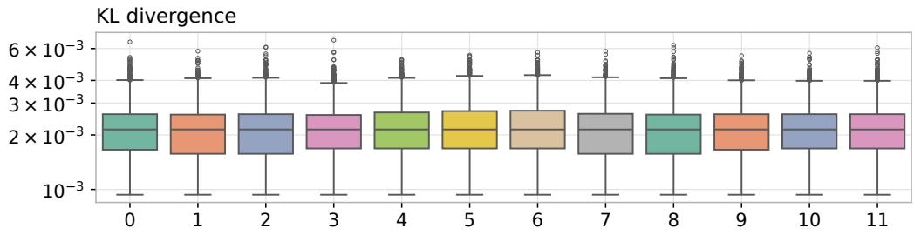

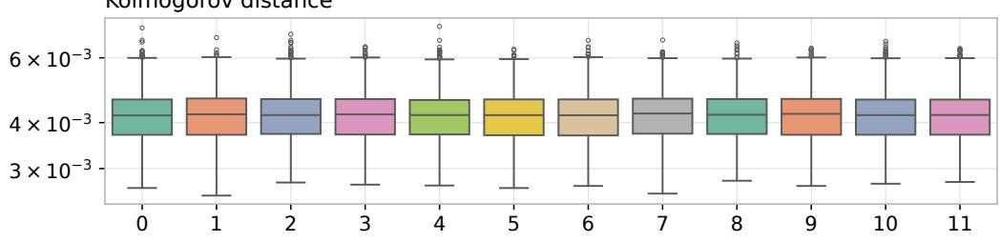

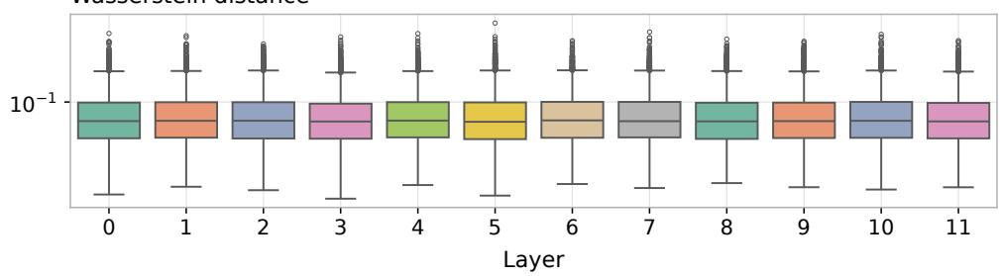  
Figure 7: Layer-wise discrepancies between the empirical eigen-angle distribution of the ViT tokenspace singular matrices and the uniform distribution on [−π, π] for Imagenette validation inputs. The log-scale box plots show that Kullback-Leibler divergence, Kolmogorov distance, and Wasserstein distance remain close to zero across layers.

## F.3.1 Angular diagnostics

For the original hidden-state diagnostics, KL divergence is computed from 50 equal-width angle bins, with $1 0 ^ { - 1 0 }$ added to each bin probability before renormalization. Kolmogorov distance compares the empirical angle CDF with the continuous uniform CDF. The reported angular Wasserstein statistic is the ordinary one-dimensional $W _ { 1 }$ between the observed angles and an independent uniform sample of the same size on $[ - \pi , \pi ] \colon$

$$
\widehat { W } _ { 1 } = \frac { 1 } { \ell } \sum _ { j = 1 } ^ { \ell } | \theta _ { ( j ) } - u _ { ( j ) } | , \qquad u _ { j } \overset { \mathrm { i i d } } { \sim } \mathrm { U n i f } [ - \pi , \pi ] ,
$$

where parentheses denote ascending order. This uses the fixed angle interval, without optimizing over a circular shift. It includes reference sampling noise; finite-size effects in these diagnostics mean that a decreasing discrepancy alone does not quantify increasing Haar isotropy.

The score-orientation experiment covers 1,646 GPT-2 sequences of lengths 17–471 and 3,925 ViT images, producing 237,024 and 565,200 individual score decompositions, respectively. The angular means reported in Section 4.4 pool scalar discrepancies over inputs, layers, and heads; the GPT-2 length bands 17–64 and 385–471 contain 254 and 8 sequences, respectively. Figures 8 and 9 report eigen-angle discrepancies for the square orthogonal SVD factors. Their interpretation depends on the numerical SVD convention, including signs and nullspace completion. Uniform eigen-angles are a necessary asymptotic consequence of Haar behavior, rather than a characterization of the Haar law.

## F.4 Representative score spectra

Figures 10 and 11 use one 1,024-token GPT-2 input and one 577-token ViT input. Each layer pools nonzero singular values from 12 independently decomposed heads; structural zeros are omitted. The color boundary is placed at the largest adjacent ratio in the upper half of the layer-median per-head spectrum. This empirical split illustrates the spectrum without testing the asymptotic thresholds in Assumption 2. Small rank proxies can also arise from smooth spectral decay. The representative plots and rank summaries therefore motivate bulk–spike modeling but do not measure how often the quantitative separation or bounded-bulk conditions hold. The two pretrained models also differ in architecture and training, so their comparison does not isolate the effect of causal masking.

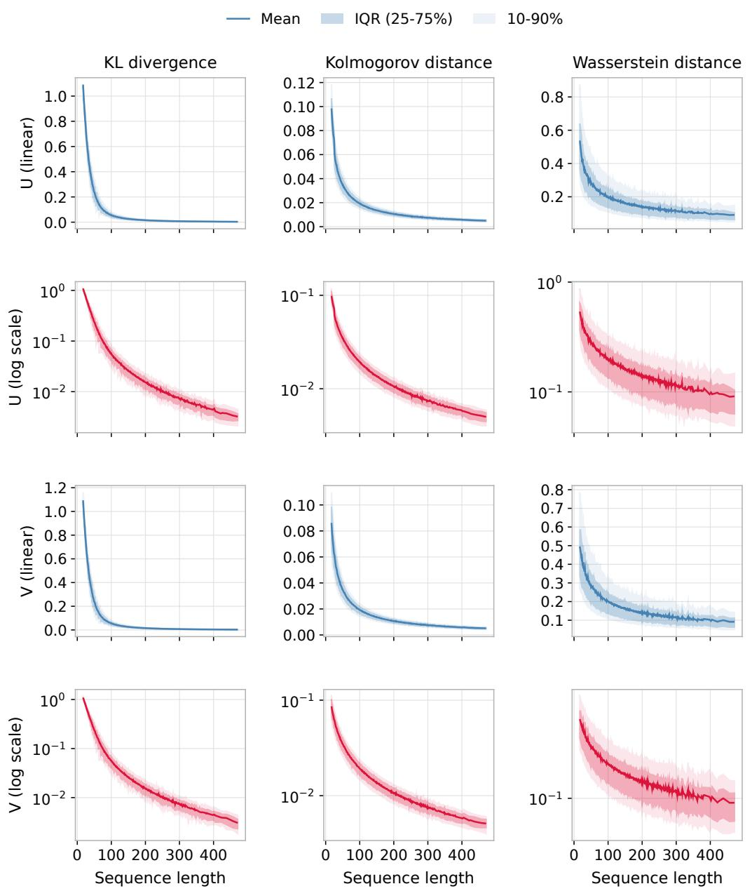  
Figure 8: GPT-2 actual-score eigen-angle discrepancies for the left and right singular-vector matrices. KL, Kolmogorov, and angular Wasserstein discrepancies decrease over the displayed sequence lengths.

Left singular vectors (U)  
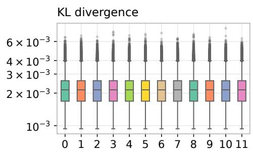

Right singular vectors (V)  
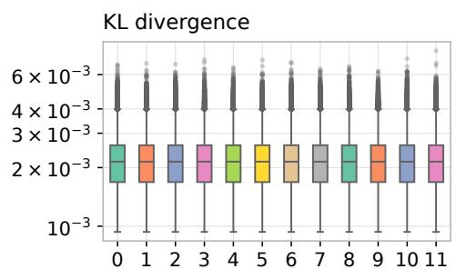

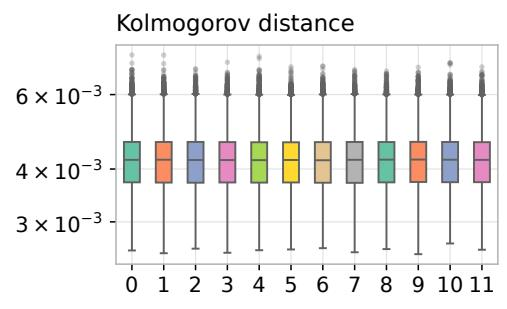

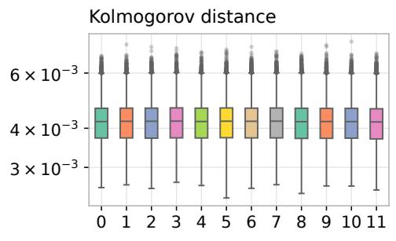

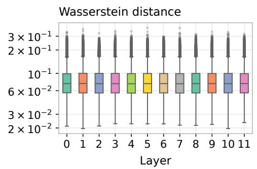

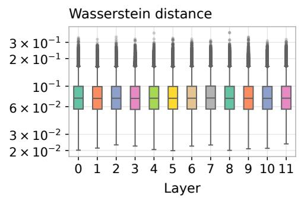  
Figure 9: ViT actual-score eigen-angle discrepancies across layers for both singular-vector factors. Each layer contains 47,100 image–head observations from 3,925 images.

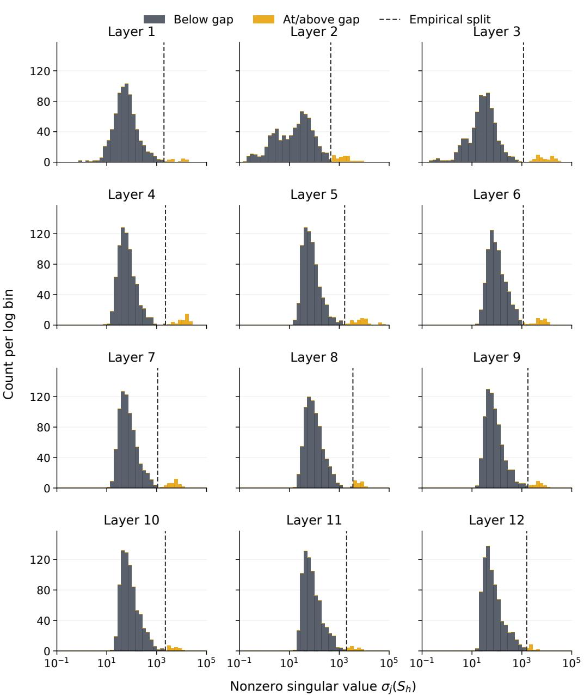  
Figure 10: GPT-2 actual score spectra for a representative 1,024-token input. Each layer pools the nonzero singular values from all 12 heads, shown on a logarithmic horizontal axis. The dashed line marks the empirical gap, with larger values colored orange.

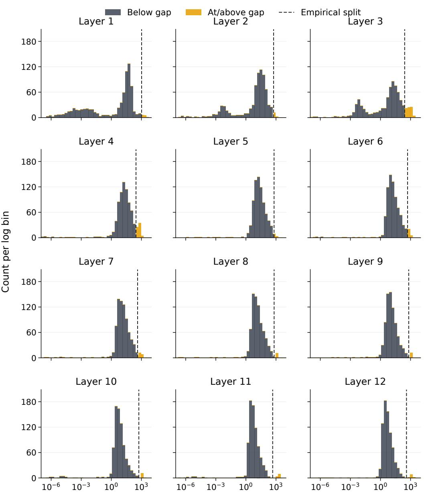  
Nonzero singular value σj(Sh)  
Figure 11: ViT actual score spectra for a representative 577-token image. Each layer pools the nonzero singular values from all 12 heads. The logarithmic scale and empirical-gap coloring follow Figure 10.

## F.5 Multi-head attention experiments

To examine how spectral structure varies across heads, we retain the layer and head identities in the real-attention rank proxies and the real-versus-canonical $W _ { 1 }$ comparison. Figure 12 shows each head’s median over the same 12 GPT-2 documents at length 1,024 and 20 ViT images at length 577. Within each layer, the ratio of the largest to the smallest head-specific median stable rank measures the spread across heads. Its median across layers is 4.22 for GPT-2 and 4.73 for ViT; the corresponding ratios for $W _ { 1 }$ are 3.19 and 1.49 (Table 1).

The head-resolved view reveals substantial variation in spectral concentration within both architectures. It motivates studying how the dominant token subspaces of different heads combine through the value and output projections. Appendix A formulates this question at the level of the multi-head output matrix.

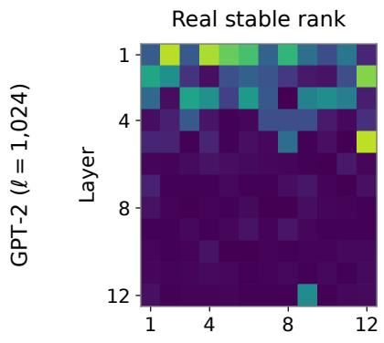  
Real effective rank erank1

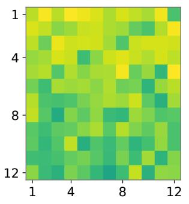  
Real-canonical $W _ { 1 }$

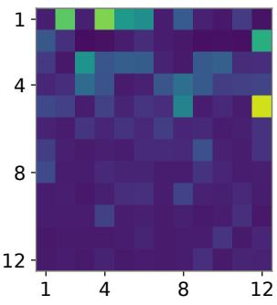

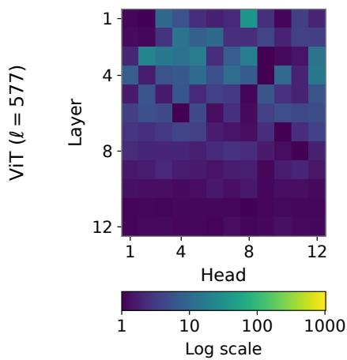

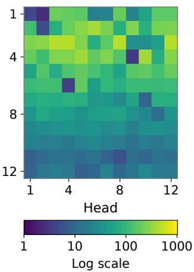

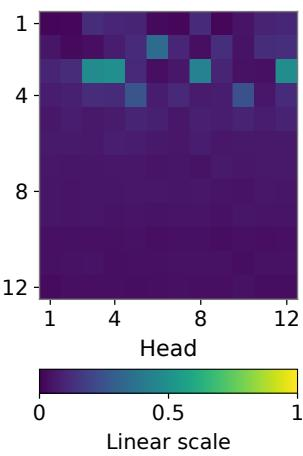  
Figure 12: Head-resolved spectral diagnostics for GPT-2 (top) and ViT (bottom). Each cell is the median over inputs for one layer and head: real-attention stable rank (left), real-attention erank (middle), and real-versus-canonical spectral $W _ { 1 }$ (right). Rank colors use logarithmic scales and $W _ { 1 }$ colors a linear scale, shared across models within each column. Head indices follow each layer’s native ordering and do not indicate a correspondence across layers or models.

## F.5.1 Head-resolved spectral summaries

Figure 12 reaggregates the saved per-head measurements at GPT-2 length 1,024 and ViT length 577, using the same 12 documents and 20 images described above. Each model has 144 layer–head cells, with 12 or 20 observations per cell. With $x , l ,$ h indexing inputs, layers, and heads, define for a diagnostic q

$$
m _ { l , h } ^ { ( q ) } = { \mathrm { m e d i a n } } _ { x } q _ { x , l , h } , \qquad R _ { l } ^ { ( q ) } = \frac { { \mathrm { m a x } } _ { h } m _ { l , h } ^ { ( q ) } } { { \mathrm { m i n } } _ { h } m _ { l , h } ^ { ( q ) } } .
$$

Here q is the real-attention stable rank, real-attention erank1, or the paired real-versus-canonical $W _ { 1 }$ . The heatmaps display $m _ { l , h } ^ { ( q ) }$ , and Table 1 reports medianl $R _ { l } ^ { ( q ) }$ . All denominators are positive in these data. Aggregation occurs after computing the diagnostics of each sample–layer–head matrix; no attention matrices or singular vectors are pooled across heads. These are descriptive summaries of the selected inputs and layers. The analysis uses existing measurements and requires no additional model inference.

Table 1: Median across layers of the within-layer maximum-to-minimum ratio of head-specific median diagnostics.
<table><tr><td>Model</td><td>Stable rank</td><td>erank1</td><td> $W _ { 1 }$ </td></tr><tr><td> $\mathrm { G P T } { - } 2 \ ( \ell = 1 , 0 2 4 )$ </td><td>4.22</td><td>6.57</td><td>3.19</td></tr><tr><td> $\operatorname { V i T } \left( \ell = 5 7 7 \right)$ </td><td>4.73</td><td>7.27</td><td>1.49</td></tr></table>

## NeurIPS Paper Checklist

## 1. Claims

Question: Do the main claims made in the abstract and introduction accurately reflect the paper’s contributions and scope?

Answer: [Yes]

Justification: The abstract and Introduction describe the canonical diagonal score model, spike–bulk separation, spectral degeneration, and the stable-rank contrast between bidirectional and causal attention. These claims are supported by Assumptions 1–2, Theorems 1–4, and the rank-proxy results in Appendix D. Section 4 provides empirical diagnostics on pretrained ViT/Imagenette and GPT-2/Wikitext-103.

Guidelines:

• The answer [N/A] means that the abstract and introduction do not include the claims made in the paper.

• The abstract and/or introduction should clearly state the claims made, including the contributions made in the paper and important assumptions and limitations. A [No] or [N/A] answer to this question will not be perceived well by the reviewers.

• The claims made should match theoretical and experimental results, and reflect how much the results can be expected to generalize to other settings.

• It is fine to include aspirational goals as motivation as long as it is clear that these goals are not attained by the paper.

## 2. Limitations

Question: Does the paper discuss the limitations of the work performed by the authors?

Answer: [Yes]

Justification: Appendix A discusses the canonical model’s scope, orientation dependence, causal ordering, and the interpretation of the empirical diagnostics. The theoretical assumptions are explicit, and Section 4 and Appendix F describe the empirical scope of the pretrained ViT and GPT-2 experiments on Imagenette and Wikitext-103.

Guidelines:

• The answer [N/A] means that the paper has no limitation while the answer [No] means that the paper has limitations, but those are not discussed in the paper.

• The authors are encouraged to create a separate “Limitations” section in their paper.

• The paper should point out any strong assumptions and how robust the results are to violations of these assumptions (e.g., independence assumptions, noiseless settings, model well-specification, asymptotic approximations only holding locally). The authors should reflect on how these assumptions might be violated in practice and what the implications would be.

• The authors should reflect on the scope of the claims made, e.g., if the approach was only tested on a few datasets or with a few runs. In general, empirical results often depend on implicit assumptions, which should be articulated.

• The authors should reflect on the factors that influence the performance of the approach. For example, a facial recognition algorithm may perform poorly when image resolution is low or images are taken in low lighting. Or a speech-to-text system might not be used reliably to provide closed captions for online lectures because it fails to handle technical jargon.

• The authors should discuss the computational efficiency of the proposed algorithms and how they scale with dataset size.

• If applicable, the authors should discuss possible limitations of their approach to address problems of privacy and fairness.

• While the authors might fear that complete honesty about limitations might be used by reviewers as grounds for rejection, a worse outcome might be that reviewers discover limitations that aren’t acknowledged in the paper. The authors should use their best judgment and recognize that individual actions in favor of transparency play an important role in developing norms that preserve the integrity of the community. Reviewers will be specifically instructed to not penalize honesty concerning limitations.

## 3. Theory assumptions and proofs

Question: For each theoretical result, does the paper provide the full set of assumptions and a complete (and correct) proof?

Answer: [Yes]

Justification: Assumptions 1 and 2 specify the canonical model and separation conditions; additional conditions, including bounded bulk scores, are stated in the relevant theorems. The numbered results are cross-referenced, with complete spectral proofs in Appendices C.1–C.4, rank-proxy proofs in Appendix D, and auxiliary matrix-norm proofs in Appendix E.

Guidelines:

• The answer [N/A] means that the paper does not include theoretical results.

• All the theorems, formulas, and proofs in the paper should be numbered and crossreferenced.

• All assumptions should be clearly stated or referenced in the statement of any theorems.

• The proofs can either appear in the main paper or the supplemental material, but if they appear in the supplemental material, the authors are encouraged to provide a short proof sketch to provide intuition.

• Inversely, any informal proof provided in the core of the paper should be complemented by formal proofs provided in appendix or supplemental material.

• Theorems and Lemmas that the proof relies upon should be properly referenced.

## 4. Experimental result reproducibility

Question: Does the paper fully disclose all the information needed to reproduce the main experimental results of the paper to the extent that it affects the main claims and/or conclusions of the paper (regardless of whether the code and data are provided or not)?

Answer: [Yes]

Justification: Section 4 specifies the models, datasets, validation splits, sequence lengths, spectral metrics, and rank definitions. Appendix F provides sampling, SVD, angulardistance, and aggregation details, including sample counts, the seed for the matched attention comparison, and the interpretation of quantile bands.

Guidelines:

• The answer [N/A] means that the paper does not include experiments.

• If the paper includes experiments, a [No] answer to this question will not be perceived well by the reviewers: Making the paper reproducible is important, regardless of whether the code and data are provided or not.

• If the contribution is a dataset and/or model, the authors should describe the steps taken to make their results reproducible or verifiable.

• Depending on the contribution, reproducibility can be accomplished in various ways. For example, if the contribution is a novel architecture, describing the architecture fully might suffice, or if the contribution is a specific model and empirical evaluation, it may be necessary to either make it possible for others to replicate the model with the same dataset, or provide access to the model. In general. releasing code and data is often one good way to accomplish this, but reproducibility can also be provided via detailed instructions for how to replicate the results, access to a hosted model (e.g., in the case of a large language model), releasing of a model checkpoint, or other means that are appropriate to the research performed.

• While NeurIPS does not require releasing code, the conference does require all submissions to provide some reasonable avenue for reproducibility, which may depend on the nature of the contribution. For example

(a) If the contribution is primarily a new algorithm, the paper should make it clear how to reproduce that algorithm.

(b) If the contribution is primarily a new model architecture, the paper should describe the architecture clearly and fully.

(c) If the contribution is a new model (e.g., a large language model), then there should either be a way to access this model for reproducing the results or a way to reproduce the model (e.g., with an open-source dataset or instructions for how to construct the dataset).

(d) We recognize that reproducibility may be tricky in some cases, in which case authors are welcome to describe the particular way they provide for reproducibility. In the case of closed-source models, it may be that access to the model is limited in some way (e.g., to registered users), but it should be possible for other researchers to have some path to reproducing or verifying the results.

## 5. Open access to data and code

Question: Does the paper provide open access to the data and code, with sufficient instructions to faithfully reproduce the main experimental results, as described in supplemental material?

Answer: [Yes]

Justification: The experiments use public Imagenette and Wikitext-103 data and pretrained ViT and GPT-2 models. The repository at https://github.com/Mengda-Li/ attention provides analysis code, saved figure inputs, environment and data-preparation instructions, and figure-to-script mappings. Its reproduction guide distinguishes rendering from supplied CSV or archived figure inputs from collecting model measurements and records the available collection workflows and their limitations; Appendix F links these materials.

Guidelines:

• The answer [N/A] means that paper does not include experiments requiring code.

• Please see the NeurIPS code and data submission guidelines (https://neurips.cc/ public/guides/CodeSubmissionPolicy) for more details.

• While we encourage the release of code and data, we understand that this might not be possible, so [No] is an acceptable answer. Papers cannot be rejected simply for not including code, unless this is central to the contribution (e.g., for a new open-source benchmark).

• The instructions should contain the exact command and environment needed to run to reproduce the results. See the NeurIPS code and data submission guidelines (https: //neurips.cc/public/guides/CodeSubmissionPolicy) for more details.

• The authors should provide instructions on data access and preparation, including how to access the raw data, preprocessed data, intermediate data, and generated data, etc.

• The authors should provide scripts to reproduce all experimental results for the new proposed method and baselines. If only a subset of experiments are reproducible, they should state which ones are omitted from the script and why.

• At submission time, to preserve anonymity, the authors should release anonymized versions (if applicable).

• Providing as much information as possible in supplemental material (appended to the paper) is recommended, but including URLs to data and code is permitted.

## 6. Experimental setting/details

Question: Does the paper specify all the training and test details (e.g., data splits, hyperparameters, how they were chosen, type of optimizer) necessary to understand the results?

Answer: [Yes]

Justification: The paper evaluates pretrained ViT-B/16 (SWAG) on Imagenette validation images and GPT-2 on Wikitext-103 validation text, without training new models. Section 4 and Appendix F specify the exact checkpoints, input dimensions, sequence lengths, sampling and seed, float64 attention SVD, score factorization, angular distances, and stable/effectiverank computations.

## Guidelines:

• The answer [N/A] means that the paper does not include experiments.

• The experimental setting should be presented in the core of the paper to a level of detail that is necessary to appreciate the results and make sense of them.

• The full details can be provided either with the code, in appendix, or as supplemental material.

## 7. Experiment statistical significance

Question: Does the paper report error bars suitably and correctly defined or other appropriate information about the statistical significance of the experiments?

Answer: [Yes]

Justification: Figures 3, 4, and 5 report means or medians with quantile bands; Figures 7 and 6 use layer-wise box plots. The captions and Appendix F.3 define these summaries. They describe empirical variability across sampled observations, including dependent heads and nested text prefixes in the matched comparison, rather than confidence intervals.

## Guidelines:

• The answer [N/A] means that the paper does not include experiments.

• The authors should answer [Yes] if the results are accompanied by error bars, confidence intervals, or statistical significance tests, at least for the experiments that support the main claims of the paper.

• The factors of variability that the error bars are capturing should be clearly stated (for example, train/test split, initialization, random drawing of some parameter, or overall run with given experimental conditions).

• The method for calculating the error bars should be explained (closed form formula, call to a library function, bootstrap, etc.)

• The assumptions made should be given (e.g., Normally distributed errors).

• It should be clear whether the error bar is the standard deviation or the standard error of the mean.

• It is OK to report 1-sigma error bars, but one should state it. The authors should preferably report a 2-sigma error bar than state that they have a 96% CI, if the hypothesis of Normality of errors is not verified.

• For asymmetric distributions, the authors should be careful not to show in tables or figures symmetric error bars that would yield results that are out of range (e.g., negative error rates).

• If error bars are reported in tables or plots, the authors should explain in the text how they were calculated and reference the corresponding figures or tables in the text.

## 8. Experiments compute resources

Question: For each experiment, does the paper provide sufficient information on the computer resources (type of compute workers, memory, time of execution) needed to reproduce the experiments?

Answer: [Yes]

Justification: Appendix F identifies the compute used for each experiment group: hiddenstate angular diagnostics and GPT-2 score-rank summaries used an AMD EPYC 9554 dualsocket CPU server with 64 cores per socket and 126 GB RAM, without GPU acceleration, for approximately 24 hours in total. Real-versus-canonical comparisons and score-level angular and spectral diagnostics used a MacBook Pro with an M1 Pro chip and 16 GB unified memory for approximately two hours in total. The reported timings are totals for each group.

## Guidelines:

• The answer [N/A] means that the paper does not include experiments.

• The paper should indicate the type of compute workers CPU or GPU, internal cluster, or cloud provider, including relevant memory and storage.

• The paper should provide the amount of compute required for each of the individual experimental runs as well as estimate the total compute.

• The paper should disclose whether the full research project required more compute than the experiments reported in the paper (e.g., preliminary or failed experiments that didn’t make it into the paper).

## 9. Code of ethics

Question: Does the research conducted in the paper conform, in every respect, with the NeurIPS Code of Ethics https://neurips.cc/public/EthicsGuidelines?

Answer: [Yes]

Justification: The work is theoretical and diagnostic, uses public benchmark data and pretrained models, and does not involve human subjects, private data, or deployed systems. The paper does not identify any confidential or sensitive data sources.

## Guidelines:

• The answer [N/A] means that the authors have not reviewed the NeurIPS Code of Ethics.

• If the authors answer [No], they should explain the special circumstances that require a deviation from the Code of Ethics.

• The authors should make sure to preserve anonymity (e.g., if there is a special consideration due to laws or regulations in their jurisdiction).

## 10. Broader impacts

Question: Does the paper discuss both potential positive societal impacts and negative societal impacts of the work performed?

Answer: [N/A]

Justification: The paper is foundational theory and empirical diagnosis of attention spectra, and it does not introduce a deployable model, dataset, or capability with a direct path to societal deployment. Any downstream impacts would be indirect through broader understanding of Transformer mechanisms.

Guidelines:

• The answer [N/A] means that there is no societal impact of the work performed.

• If the authors answer [N/A] or [No], they should explain why their work has no societal impact or why the paper does not address societal impact.

• Examples of negative societal impacts include potential malicious or unintended uses (e.g., disinformation, generating fake profiles, surveillance), fairness considerations (e.g., deployment of technologies that could make decisions that unfairly impact specific groups), privacy considerations, and security considerations.

• The conference expects that many papers will be foundational research and not tied to particular applications, let alone deployments. However, if there is a direct path to any negative applications, the authors should point it out. For example, it is legitimate to point out that an improvement in the quality of generative models could be used to generate Deepfakes for disinformation. On the other hand, it is not needed to point out that a generic algorithm for optimizing neural networks could enable people to train models that generate Deepfakes faster.

• The authors should consider possible harms that could arise when the technology is being used as intended and functioning correctly, harms that could arise when the technology is being used as intended but gives incorrect results, and harms following from (intentional or unintentional) misuse of the technology.

• If there are negative societal impacts, the authors could also discuss possible mitigation strategies (e.g., gated release of models, providing defenses in addition to attacks, mechanisms for monitoring misuse, mechanisms to monitor how a system learns from feedback over time, improving the efficiency and accessibility of ML).

## 11. Safeguards

Question: Does the paper describe safeguards that have been put in place for responsible release of data or models that have a high risk for misuse (e.g., pre-trained language models, image generators, or scraped datasets)?

Answer: [N/A]

Justification: The paper does not release a new high-risk model, image generator, language model, or scraped dataset. It releases analysis/plotting code for reproducing figures, so additional model-release safeguards are not applicable.

Guidelines:

• The answer [N/A] means that the paper poses no such risks.

• Released models that have a high risk for misuse or dual-use should be released with necessary safeguards to allow for controlled use of the model, for example by requiring that users adhere to usage guidelines or restrictions to access the model or implementing safety filters.

• Datasets that have been scraped from the Internet could pose safety risks. The authors should describe how they avoided releasing unsafe images.

• We recognize that providing effective safeguards is challenging, and many papers do not require this, but we encourage authors to take this into account and make a best faith effort.

## 12. Licenses for existing assets

Question: Are the creators or original owners of assets (e.g., code, data, models), used in the paper, properly credited and are the license and terms of use explicitly mentioned and properly respected?

Answer: [Yes]

Justification: Appendix F.1 identifies the existing datasets, code libraries, and model weights used in the experiments and lists the corresponding licenses or access terms, including ImageNet/Imagenette, Wikitext-103, Hugging Face Transformers, GPT-2 weights, TorchVision, and SWAG-derived ViT weights. The paper cites the creators or source repositories and uses these assets only for non-commercial research evaluation and spectral diagnostics.

Guidelines:

• The answer [N/A] means that the paper does not use existing assets.

• The authors should cite the original paper that produced the code package or dataset.

• The authors should state which version of the asset is used and, if possible, include a URL.

• The name of the license (e.g., CC-BY 4.0) should be included for each asset.

• For scraped data from a particular source (e.g., website), the copyright and terms of service of that source should be provided.

• If assets are released, the license, copyright information, and terms of use in the package should be provided. For popular datasets, paperswithcode.com/datasets has curated licenses for some datasets. Their licensing guide can help determine the license of a dataset.

• For existing datasets that are re-packaged, both the original license and the license of the derived asset (if it has changed) should be provided.

• If this information is not available online, the authors are encouraged to reach out to the asset’s creators.

## 13. New assets

Question: Are new assets introduced in the paper well documented and is the documentation provided alongside the assets?

Answer: [Yes]

Justification: The released analysis and plotting code is documented alongside the code with its inputs, dependencies, execution commands, output definitions, and reproduction limitations. The authors’ code is released under the MIT license; existing data and models retain their original terms. Appendix F links the repository and reproduction guides. No new dataset, benchmark, or trained model is introduced.

Guidelines:

• The answer [N/A] means that the paper does not release new assets.

• Researchers should communicate the details of the dataset/code/model as part of their submissions via structured templates. This includes details about training, license, limitations, etc.

• The paper should discuss whether and how consent was obtained from people whose asset is used.

• At submission time, remember to anonymize your assets (if applicable). You can either create an anonymized URL or include an anonymized zip file.

## 14. Crowdsourcing and research with human subjects

Question: For crowdsourcing experiments and research with human subjects, does the paper include the full text of instructions given to participants and screenshots, if applicable, as well as details about compensation (if any)?

Answer: [N/A]

Justification: The work does not involve crowdsourcing, participant studies, data annotation by human subjects, or user-facing experiments.

Guidelines:

• The answer [N/A] means that the paper does not involve crowdsourcing nor research with human subjects.

• Including this information in the supplemental material is fine, but if the main contribution of the paper involves human subjects, then as much detail as possible should be included in the main paper.

• According to the NeurIPS Code of Ethics, workers involved in data collection, curation, or other labor should be paid at least the minimum wage in the country of the data collector.

## 15. Institutional review board (IRB) approvals or equivalent for research with human subjects

Question: Does the paper describe potential risks incurred by study participants, whether such risks were disclosed to the subjects, and whether Institutional Review Board (IRB) approvals (or an equivalent approval/review based on the requirements of your country or institution) were obtained?

Answer: [N/A]

Justification: No human-subject research is conducted, so IRB approval or equivalent human-subject review is not applicable.

Guidelines:

• The answer [N/A] means that the paper does not involve crowdsourcing nor research with human subjects.

• Depending on the country in which research is conducted, IRB approval (or equivalent) may be required for any human subjects research. If you obtained IRB approval, you should clearly state this in the paper.

• We recognize that the procedures for this may vary significantly between institutions and locations, and we expect authors to adhere to the NeurIPS Code of Ethics and the guidelines for their institution.

• For initial submissions, do not include any information that would break anonymity (if applicable), such as the institution conducting the review.

## 16. Declaration of LLM usage

Question: Does the paper describe the usage of LLMs if it is an important, original, or non-standard component of the core methods in this research? Note that if the LLM is used only for writing, editing, or formatting purposes and does not impact the core methodology, scientific rigor, or originality of the research, declaration is not required.

Answer: [Yes]

Justification: LLM assistance was used in revising the manuscript and checking mathematical arguments. The resulting statements are accompanied by explicit assumptions and proofs; LLM output is not treated as mathematical evidence.

Guidelines:

• The answer [N/A] means that the core method development in this research does not involve LLMs as any important, original, or non-standard components.

• Please refer to our LLM policy in the NeurIPS handbook for what should or should not be described.