# Stage-aware Multimodal Brain Graph Contrastive Learning for Neurodegenerative Disorder Diagnosis

Jingjing Zhou, Chenxuan Meng, Ciyuan Peng, Member, IEEE, Jing Ren, Graduate Student Member, IEEE, and Feng Xia, Fellow, IEEE

Abstract—Neurodegenerative disorders are characterized by their progressive nature, with distinct stages that require precise identification and tracking of progression trajectories for accurate diagnosis. However, existing diagnostic methods often fail to fully capture the unique brain patterns associated with different stages, limiting their ability to effectively target specific stages of the disorders. To address this issue, we propose a Stageaware Multimodal Brain Graph Contrastive Learning (smBGC) method. Specifically, smBGC introduces a stage-aware feature enhancement strategy to capture stage-specific features across all progression stages, enabling the generation of stage-aware multimodal brain graph representations. In addition, smBGC incorporates a stage-adaptive brain graph augmentation approach within a graph contrastive learning framework, facilitating multimodal fusion and improving the model’s capability to distinguish between different disorder stages. Experiments on two real-world datasets demonstrate the superior performance of smBGC in various neurodegenerative disorder diagnosis tasks compared with state-of-the-art methods<sup>1</sup>.

Index Terms—Multimodal learning, brain graphs, contrastive learning, graph augmentation, feature engineering.

## I. INTRODUCTION

EURODEGENERATIVE disorders, such as Alzheimer’s disease (AD) and Parkinson’s disease (PD), are typical functional impairments of the brain, leading to the decline of various brain functions (e.g., cognitive, emotional, and motor functions) [1]. Notably, neurodegenerative disorders are characterized by the progressive change of neurons and their connections [2]. The hallmark of these disorders is their staged progression, where early stages often present subtle symptoms that gradually worsen over time, ultimately leading to severe functional impairments in later stages [3]. For example, AD patients often experience several transitional stages, including mild cognitive impairment (MCI) and its early and late phases. Therefore, precise stage targeting is an essential aspect of neurodegenerative disorder diagnosis, facilitating early detection, intervention, and tailored treatment.

Machine learning-based methods, relying on various data collected by neuroimaging techniques, such as functional magnetic resonance imaging (fMRI), electroencephalography (EEG), and diffusion tensor imaging (DTI), have shown great promise for neurodegenerative disorder diagnosis [4]– [6]. Generally, different neuroimaging data provide distinct pathological information in terms of either brain structure or function [7]. For example, fMRI data records changes in blood oxygenation levels, reflecting brain functional information, while DTI data records the diffusion of water molecules along white matter tracts, reflecting brain structural information [8]. In this context, multimodal learning-based neurodegenerative disorder diagnosis methods have been developed to simultaneously integrate multimodal neuroimaging data (e.g., fMRI and DTI), offering comprehensive structural and functional information to enhance diagnostic accuracy [9]. More recently, due to the capability of effectively modeling complex brain connectivity, multimodal graph learning has emerged as a promising approach for neurodegenerative disorder diagnosis [10]–[12]. Many studies utilize multimodal brain graphs, including structural brain graphs (SBGs) and functional brain graphs (FBGs) constructed from structural imaging data (e.g., DTI) and functional imaging data (e.g., fMRI), respectively, to model complex interactions within the brain and improve model performance [13]–[15].

Although current multimodal brain graph learning methods demonstrate promising potential in the diagnosis of neurodegenerative disorders, several critical challenges remain unresolved [16]. One major limitation lies in their inadequate ability to distinguish among different stages of disease progression [17]. Most existing approaches primarily focus on binary classification (e.g., AD vs. normal controls), neglecting the nuanced and stage-specific alterations that occur across the full continuum of neurodegeneration [18]–[20]. This lack of fine-grained stage differentiation not only restricts our understanding of disease mechanisms but also severely limits the effectiveness of early screening and intervention. Early-stage diagnosis is particularly crucial, as therapeutic strategies are often more effective before irreversible neurological damage occurs. Without accurate identification of early or intermediate stages, opportunities for timely medical intervention may be missed. Moreover, the complex, high-dimensional nature of features in multimodal brain graphs—often containing substantial noise unrelated to disease—further challenges model robustness and increases the risk of overfitting [21], ultimately compromising diagnostic accuracy.

To address these issues, this paper proposes a novel Stageaware Multimodal Brain Graph Contrastive Learning method, namely smBGC. smBGC effectively distinguishes different stages of neurodegenerative disorders by exploring distinct brain patterns within each stage. We first construct multimodal brain graphs, containing SBGs and FBGs derived from DTI and fMRI data, respectively. Then, smBGC introduces a stageaware feature enhancement strategy to amplify stage-specific features and obtain stage-aware multimodal brain graphs, as well as reduce noise. Specifically, this strategy consists of two key steps: communal feature dropping (CFD) and stage feature extraction (SFE). In CFD, common features across all stages are treated as noise and dropped to avoid interference. In SFE, stage-specific features are extracted for each stage to obtain stage-aware SBGs and stage-aware FBGs, which are treated as two views of brain graphs. Following this, we propose a stage-adaptive brain graph augmentation approach, which strengthens stage-specific attributes by applying a node masking technique based on stage features. Afterwards, we employ contrastive learning to facilitate multimodal fusion, jointly embedding structural and functional features.

This work provides insights into the progression-related characteristics of neurodegenerative disorders and investigates specific brain patterns associated with different disorder stages. Notably, our method demonstrates strong capabilities in identifying early-stage abnormalities, which is critical for enabling timely intervention before significant neural deterioration occurs. The main contributions of this paper are as follows:

We propose a Stage-aware Multimodal Brain Graph Contrastive Learning (smBGC) method to uncover brain patterns across different stages of neurodegenerative disorders. smBGC captures stage-specific patterns and provides discriminative representations for different stages of neurodegenerative disorders.

• We design a stage-aware feature enhancement strategy, which comprises a communal feature dropping module and a stage feature extraction module. This strategy amplifies brain graph features on each stage, enabling the construction of stage-aware multimodal brain graphs.

• Extensive experiments on two real-world datasets demonstrate the proposed model outperforms state-of-the-art methods, highlighting its superiority in various neurodegenerative disorder diagnosis tasks.

The rest of the paper is organized as follows. Section II reviews related works. Section III gives the preliminaries. Section IV details the proposed smBGC. Section V presents the experimental setting and results. Finally, we conclude our work in Section VI.

## II. RELATED WORK

## A. Neurodegenerative Disorder Diagnosis

Most current machine learning-based neurodegenerative disorder diagnosis methods primarily focus on binary classification tasks to distinguish between two different stages. For instance, for Alzheimer’s disease, a common task is classifying between two stages, such as normal control (NC) vs. MCI, NC vs. AD, and MCI vs. AD [14], [22]. Song et al. [19] integrated fMRI and DTI data to construct brain graphs while also integrating non-imaging information for early AD diagnosis, showing good performance in six binary classification tasks.

Ma et al. [23] focused on distinguishing between stages of MCI (e.g., early MCI vs. MCI and MCI vs. late MCI), proposing a novel multi-graph cross-attention region-aware feature fusion network with various brain region templates. Yang et al. [14] used cross-modal mutual learning to complete binary classification tasks like NC vs. MCI, MCI vs. AD, and NC vs. AD in AD detection, and NC vs. PD in PD detection. Cai et al. [24] proposed a network manifold harmonic discriminant analysis (MHDA) method for accurately detecting AD binary stages.

Stage targeting of neurodegenerative disorders, such as AD and PD, is crucial for early diagnosis and treatment planning. Traditional binary classification between only two stages is insufficient. Additionally, differences in brain state across different stages of patients are often neglected, which may lead to performance drops in methods. Recently, a few studies have focused on the diagnosis of more stages [25]. Cho et al. [17] introduced a node-variant convolution mechanism that adaptively captures both localized homophily and heterophily to learn the progressive degenerative changes in brain graphs, enabling the distinction of five AD stages and three PD stages. Hu et al. [26] developed a contrastive learning framework based on functional connectivity (FC) and high-order functional connectivity (HOFC) to address class imbalance in diagnosing five AD stages. However, these approaches primarily rely on single-modality data, indicating a need for further research on precise diagnosis and the learning of features across different modalities.

## B. Brain Graph Analysis

Graph learning-based brain graph analysis methods focus on two main types of graphs: population graphs and brain graphs [20], [27], [28]. Population graphs are constructed based on population, where each node represents an individual’s brain. These graphs learn relationships between subjects effectively, modeling non-imaging information like gender and age as weighted edges. Population-GCN [29] represents a set of participants as a sparse graph, with nodes associated with image-based feature vectors, and edges representing phenotype information and feature similarity among participants. To address the limitation of ignoring biological biomarkers, Hao et al. [20] proposed a local-to-global graph neural network (LG-GNN), which learns feature embeddings for local brain regions and identifies biomarkers, followed by a global Subject-graph neural network that learns relationships between embeddings generated by the local ROI-GNN and non-imaging information. Song et al. [19] integrated multimodal brain imaging data to construct nodes, designing a multi-center attention graph to account for non-image information and feed the graph into a proposed multi-channel mechanism to enhance model performance.

Methods using brain graphs treat each region of interest (ROI) in the brain as a node and the connectivity between ROIs as edges. Ma et al. [30] proposed a multi-scale dynamic graph learning (MDGL) framework that leverages complementary information across spatial resolutions and temporal dynamics of rs-fMRI data to enhance the detection of brain disorders.

Liu et al. [31] embedded the guiding priors from multiscale brain atlases into the hierarchical graph convolutional neural networks for brain disorder diagnoses. Some studies focus on graph contrastive learning for brain graph analysis. Xu $e t$ al. [32] proposed ContrastPool, a contrastive graph pooling method with dual attention mechanisms tailored for brain networks and fMRI characteristics. HSGRL [33] is a symbolic graph contrastive learning model with an interpretable graph pooling module that constructs subgraphs by computing nodes with high information gain. Peng et al. [21] proposed an adaptive brain network enhancement method based on groupaware graph learning to construct group-aware brain graphs, which can adapt to distinct groups, reducing the interference of noise. HGFM [34] presents a self-supervised pretraining framework for brain disease diagnosis that models high-order correlations in brain networks using a hypergraph paradigm. DHANet [35] employs a 3D dynamic ConvMixer for feature extraction, dynamic prototype learning for region identification, and joint dynamic edge-correlation modeling to construct a heterogeneous-aware structural brain network.

Different from the above-mentioned papers, this paper treats two modalities (structure and function) from the same patient as different perspectives of the brain graph, designing enhancement strategies using connection profiles as node features for the brain graph and employing a contrastive learning framework for multimodal fusion.

## C. Graph Contrastive Learning

Graph contrastive learning (GCL) methods create multiple graph views through random augmentations, optimizing representations by contrasting positive and negative samples [36]. The aim is to minimize the distance between similar objects (positive pairs) in the embedding space and maximize the distance between dissimilar objects (negative pairs). GCL methods are classified into intra-scale contrast, focusing on comparisons within the same level, and interscale contrast, examining comparisons across different levels. Intra-scale contrast focuses on comparisons at the same level, such as between node-level views (local-local). GCA [37] refines graph augmentation methods, incorporating topological and semantic prior information to address the performance limitations of single augmentation schemes. GPA [38] explores the impact of different augmentation strategies on graph instances by iteratively updating the personalized augmentation selector, and assigning personalized augmentation types based on the characteristics of each graph during training. ASP [39] diverges from traditional two-view comparisons by considering three different graph views—original, attribute, and global structure—and performs contrastive learning across these views in a unified manner. DCLN [40] presents a dual curriculum contrastive module to enhance graph structural information and reduce feature redundancy with two target functions, preventing collapse at the node and feature levels.

Inter-scale contrast, on the contrary, focuses on globalto-local comparisons between node-level views and graphlevel views. For example, InfoGraph [41] contrasts representations at graph-level and sub-structural scales (nodes, edges, triangles, etc.). Zhao et al. [42] proposed an augmentationfree graph contrastive transformer optimized by the nearest neighbors to avoid model degradation caused by augmentation. In this work, we use a global-to-local contrast mode to differentiate between structural views and functional views, contrasting node representations from one view with graph representations from another view, with mutual information calculation using the Jensen-Shannon Divergence (JSD) [43].

Recent advances in GCL have introduced several innovative frameworks. Wang et al. [44] proposed iDCL, a novel GCL framework that disentangles user intents and behavior distributions in user-item-concept graphs, significantly improving recommendation performance and interpretability. Jiang et al. [45] developed AdaGCL, which employs trainable generative and denoising view generators to enable adaptive, data-driven augmentation, thus improving robustness against noise and sparsity. Zhuo et al. [46] introduced an innovative contrastive learning approach that strengthens GNNs by injecting longrange similarity information through dynamically updated augmented views, effectively overcoming the limitations of static augmentations in unsupervised graph representation learning. Further advancing the field, Li et al. [47] proposed iGCL, an augmentation-free framework that eliminates the need for negative samples while ensuring representation invariance and discriminability through a novel invariant-discriminative loss function.

TABLE I: Notations in this paper.
<table><tr><td>Notations</td><td>Description</td></tr><tr><td> $B$ </td><td>Dataset of brain graphs</td></tr><tr><td> $G _ { i } ^ { s } , G _ { i } ^ { f } , G _ { i } ^ { * }$ </td><td>SBG, FBG and a brain graph from any modality of the i-th subject, respectively</td></tr><tr><td> $y ^ { i }$ </td><td>The stage label of i-th subject</td></tr><tr><td> $\nu$ </td><td>Node set of i-th subject</td></tr><tr><td> $E _ { i } ^ { * }$ </td><td>Edge set of  $G _ { i } ^ { * }$  , * represents any modality</td></tr><tr><td> $M$ </td><td>The number of subjects in B</td></tr><tr><td> $N$ </td><td>The number of nodes</td></tr><tr><td> $D , D ^ { \prime }$ </td><td>The number of node features&#x27; dimensions and the number of dimensions after denoising, respectively</td></tr><tr><td> $\lambda$ </td><td>The number of dropped features on each side (top and bottom), the total number of dropped features is 2lambda</td></tr><tr><td> $K$ </td><td>The number of groups or stages</td></tr><tr><td> $\mathbf { A } _ { i } ^ { * }$ </td><td>Weighted adjacency matrix of  $G _ { i } ^ { * }$ </td></tr><tr><td> $\mathbf { X } _ { i } ^ { * }$ </td><td>Node feature matrix of  $G _ { i } ^ { * } , \mathbf { X } _ { i } ^ { * } \bar { = } [ \mathbf { x } _ { 1 } ^ { i } , \mathbf { x } _ { 2 } ^ { i } , . . . , \mathbf { x } _ { N } ^ { i } ] ^ { \top }$ </td></tr><tr><td> $\mathbb { X }$ </td><td>The node feature set of a group of subjects,  $\begin{array} { r l } { \mathbb { X } } & { { } = } \end{array}$   $\{ \mathbf { X } _ { 1 } , \mathbf { X } _ { 2 } , . . . , \mathbf { X } _ { M } \}$ </td></tr><tr><td> $\widetilde { \mathbb { X } } , \hat { \mathbb { X } }$ </td><td>The reshaped node feature set and the denoised node fea- ture set, respectively,  $\begin{array} { r c l } { \widetilde { { \mathbb X } } } & { = } & { \{ \widetilde { { \mathbf X } } _ { 1 } , . . . , \widetilde { { \mathbf X } } _ { N } \} } \end{array}$  and  $\begin{array} { r l } { \hat { \mathbb { X } } } & { { } = } \end{array}$ </td></tr><tr><td> $\widetilde { { \mathbf X } } , \hat { { \mathbf X } }$ </td><td> $\{ \hat { \mathbf { X } } _ { 1 } , . . . , \hat { \mathbf { X } } _ { M } \}$  The matrix containing node features across all subjects and the denoised node feature, respectively</td></tr><tr><td> $\mathbf { s }$ </td><td>The feature scoring matrix</td></tr><tr><td> $\mathbf { S } _ { c }$ </td><td>The common scoring matrix</td></tr><tr><td> $\mathbf { F } _ { k }$ </td><td>The stage feature scoring matrix of stage k</td></tr><tr><td> $\mathbf { F } _ { k } ^ { f } , \mathbf { F } _ { k } ^ { s }$ </td><td>The functional and structural stage feature scoring matrix of stage k</td></tr><tr><td> $\mathbb { F }$ </td><td>The collection of stage feature scoring matrices,  $\mathbb { F } =$ </td></tr><tr><td> $W$ </td><td> $\{ \mathbf { F } _ { k } \} _ { k = 1 } ^ { K }$  Weighted vector</td></tr><tr><td> $\hat { \mathbf { X } } ^ { * } { } ^ { \prime }$ </td><td>The augmented node feature matrix</td></tr></table>

## III. PRELIMINARIES

This paper primarily addresses the problem of stage-aware multimodal brain graph analysis. Given a brain graph dataset $B = \{ ( \{ G _ { i } ^ { s } , G _ { i } ^ { f } \} , y ^ { i } ) \} _ { i = 1 } ^ { M }$ , where $G _ { i } ^ { s }$ and $G _ { i } ^ { f }$ represent the SBG and FBG of the i-th subject, respectively, $y ^ { i }$ is the corresponding disorder label, and M is the number of subjects. Each modality’s brain graph is constructed based on region of interest (ROI) connectivity, which can be described by a weighted graph $G _ { i } ^ { * } = ( \nu , E _ { i } ^ { * } , \mathbf { A } _ { i } ^ { * } )$ , where $\boldsymbol { \nu } = \{ v _ { j } \} _ { j = 1 } ^ { N }$ represents a set of $N$ nodes (ROIs), $E _ { i } ^ { * } = \mathcal { V } \times \mathcal { V }$ is the edge set, $\mathbf { A } _ { i } ^ { * } \in \mathbb { R } ^ { N \times N }$ represents the weighted adjacency matrix. Notably, the node set V remains the same across different subjects. The node feature matrix of $G _ { i } ^ { * }$ is $\mathbf { X } _ { i } ^ { * } = [ \mathbf { x } _ { 1 } ^ { i } , \mathbf { x } _ { 2 } ^ { i } , . . . , \mathbf { x } _ { N } ^ { i } ] ^ { \top }$ where $\mathbf { x } _ { i } ^ { i } \in \mathbb { R } ^ { D }$ represents the feature vector of node $v _ { j }$ in $G _ { i } ^ { * }$ . Specifically, we directly adopt the weighted adjacency matrix as the node feature matrix, i.e., $X _ { i } ^ { * } = A _ { i } ^ { * }$ , such that the feature vector $\mathbf { x } _ { j } ^ { i }$ of node $v _ { j }$ corresponds to its connectivity profile (the j-th row of $A _ { i } ^ { * } ) _ { \ast }$ , and $D \ = \ N$ . For all brain graphs in the dataset, $\{ \{ G _ { 1 } ^ { s } , { \tilde { G } _ { 1 } ^ { f } } \} , \{ G _ { 2 } ^ { s } , G _ { 2 } ^ { f } \} , . . . , \{ G _ { M } ^ { s } , G _ { M } ^ { f } \} \}$ }, they can be grouped into K groups, each representing a stage of the neurodegenerative disorder. The main goal of this paper is to utilize multimodal brain graphs as multiple views for contrastive learning, training a GNN encoder $g ( \cdot )$ , to learn a low-dimensional latent representation for each subject, thereby obtaining a graph representation that integrates functional and structural information of brain for disorder diagnosis and stage targeting.

Formally, we calculate noise features using all brain graphs, dropping them to obtain a processed node feature matrix $\mathbf { X } _ { i } ^ { * \prime }$ then for the k-th stage, we extract stage features $\mathbf { F } _ { k }$ from all group members $\left\{ \left\{ \breve { G } _ { 1 } ^ { s } , G _ { 1 } ^ { f } \right\} _ { k } , \left\{ G _ { 2 } ^ { s } , { \breve { G } } _ { 2 } ^ { f } \right\} _ { k } , . . . , \left\{ \breve { G } _ { j } ^ { s } , G _ { j } ^ { f } \right\} _ { k } \right\}$ where $j$ is the number of subjects belonging to stage k. Subsequently, stage features are used to enhance the model’s learning, embedding the brain graphs into a specific stage space. All the notations in this paper are listed in Table I.

## IV. METHODOLOGY

In this section, we present our smBGC approach, with the overall architecture illustrated in Fig. 1. We first explain how smBGC employs a stage-aware feature enhancement strategy to adaptively construct brain networks for patients at different stages, thereby reducing noise features while enhancing stage-specific characteristics. Next, we describe our stageadaptive brain graph augmentation approach, which refines the multimodal network representations. Finally, we detail the multimodal fusion through contrastive learning, in which structural and functional brain networks are treated as multiple perspectives of the brain and jointly embedded into a unified space.

## A. Stage-aware Feature Enhancement Strategy

In this section, we detail how to obtain stage-aware brain graphs using the stage-aware feature enhancement strategy. The key to this strategy is a Singular Value Decomposition (SVD)-based feature scoring function, which computes the importance score of each feature from a cohort of patients brain graphs, thereby reflecting the node feature’s significance within that subgroup. This scoring framework enables two critical processing stages: Communal Feature Dropping (CFD) to eliminate non-discriminative features across stages, and Stage Feature Extraction (SFE) to selectively capture discriminative features associated with specific disorder stages.

1) SVD-based Node Feature Scoring Function: The scoring function is inspired by the Latent Semantic Indexing (LSI) algorithm in natural language processing, which fundamentally employs SVD on a term-document matrix (with elements representing word frequencies or weighted values) to extract latent semantic structures: the left singular matrix characterizes the distribution of terms in the latent space, reflecting their semantic properties (such as importance or topic relevance), while the right singular matrix corresponds to the semantic patterns of documents. In this study, we use patients connectivity matrices as node features and reorganize the node feature matrices of a group of subjects to obtain a feature-node matrix analogous to the term-document matrix. Given their similar high-dimensional characteristics and entityrelationship structures, we can adapt this core concept of LSI to brain network analysis. By decomposing this matrix, we achieve dimensionality reduction and employ the left singular vectors to interpret key nodal features of the group, mirroring the approach of understanding term importance through their weight distribution in semantic space.

Specifically, taking an arbitrary group of subjects as an example, to introduce the subject more concisely, we consider only the brain graphs from a single modality, omitting the superscripts that denote specific modality graphs. Starting from the node features of this group $\mathbb { X } ~ = ~ \{ \mathbf { X } _ { 1 } , \mathbf { X } _ { 2 } , . . . , \mathbf { X } _ { M } \}$ where ${ \bf X } _ { \mathrm { m } } \in \mathbb { R } ^ { N \times D }$ represents the node feature matrix of the m-th subject. The first step of the scoring function is to rearrange the features of each node across all M subjects of this group, resulting in a new set of feature-node matrices $\widetilde { \mathbb { X } } \ = \ \{ \widetilde { \mathbf { X } } _ { 1 } , \widetilde { \mathbf { X } } _ { 2 } , . . . , \widetilde { \widetilde { \mathbf { X } } } _ { N } \}$ , where $\widetilde { \mathbf { X } } _ { n } \ \in \ \mathbb { R } ^ { D \times M }$ denotes the matrix containing node features across all subjects of node n. We then perform SVD on each of these new matrices to score the features at each node. The first column of the left singular matrix obtained from SVD serves as the score for each feature, representing the importance of each feature to each node within this group. Thus, we obtain a feature score matrix for all nodes, which can be expressed as follows:

$$
\widetilde { \mathbf { X } } _ { n } = \mathbf { U } _ { n } \boldsymbol { \Sigma } _ { n } \mathbf { V } _ { n } ^ { T } , \quad n = 1 , 2 , . . . , N ,\tag{1}
$$

$$
\mathbf { u } ^ { n } = \mathbf { U } _ { n } [ : , 1 ] = \left[ { \pmb { \mu } } _ { 1 } ^ { n } , { \pmb { \mu } } _ { 2 } ^ { n } , . . . , { \pmb { \mu } } _ { D } ^ { n } \right] ^ { T } ,\tag{2}
$$

$$
\mathbf { S } = [ \mathbf { u } ^ { 1 } , \mathbf { u } ^ { 2 } , . . . , \mathbf { u } ^ { N } ] ^ { T } = { \boldsymbol { \phi } } ( \mathbb { X } ) .\tag{3}
$$

Here, $\mathbf { U } _ { n }$ is the left singular matrix, $ { \mathbf { u } } ^ { n }$ is the set of feature scores for a single node, $\mu _ { 1 } ^ { d }$ is the score of the d-th dimensional feature, and $\mathbf { S } \in \mathbb { R } ^ { \dot { N } \times D }$ is the communal feature score matrix for all nodes in the group. For better understanding, we provide the process of the SVD-based scoring function (as shown in Algorithm 1).

Note that prior to constructing the feature-node matrix $\widetilde { \mathbf { X } } _ { n } .$ , we take the absolute value of functional connectivity values (derived from Pearson correlation and thus signed), to ensure that the scoring reflects connection strength rather than confounded by correlation sign. Structural connectivity values, non-negative by construction, require no such transformation. The resulting score vector is taken directly from the left singular vector without further normalization.

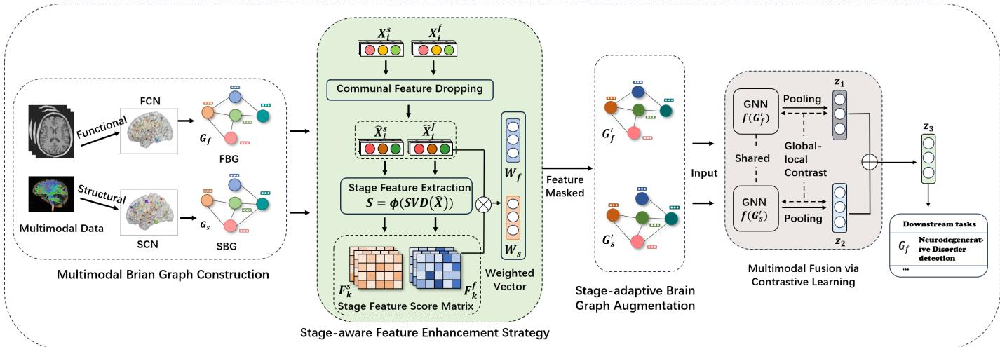  
Fig. 1: The overall framework of smBGC. Multimodal data are used to construct the FBG and SBG. The feature score matrix of each stage is generated using SVD, and feature enhancement is performed with weighted vectors. Both structural and functional brain graphs undergo feature masking and enhancement, with the new graph representations input into a parameter-sharing GNN for contrastive learning to capture the associations and differences between FBGs and SBGs.

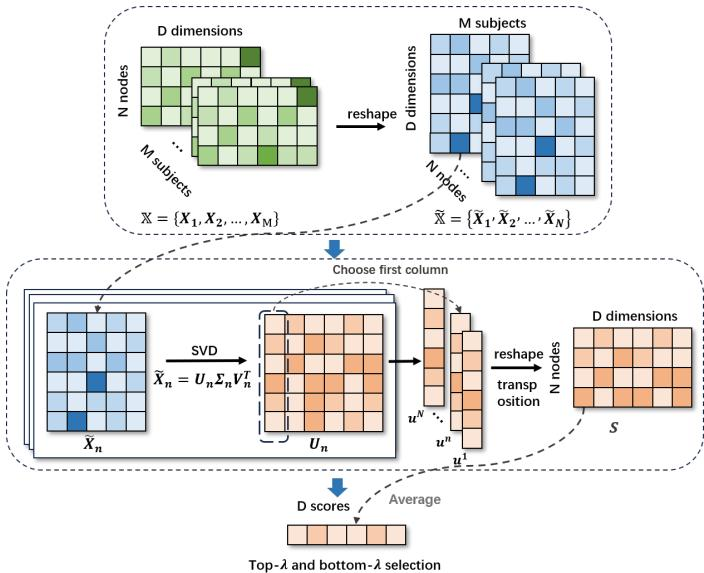  
Fig. 2: Overview of the proposed Communal Feature Dropping.

For a single matrix of size $p \ \times \ q .$ , the time complexity of performing Singular Value Decomposition (SVD) is $O ( \operatorname* { m i n } ( p \times q ^ { 2 } , \ : p ^ { 2 } \times q ) )$ and the space complexity is $O ( p \times q )$ In Algorithm 1, SVD is applied to each node-level matrix.

$\widetilde { \mathbf { X } } _ { n } \in \mathbb { R } ^ { D \times M }$ . Accordingly, the computational complexity for each node is $O ( \operatorname* { m i n } ( D \times M ^ { 2 } , D ^ { 2 } \times M ) )$ , and the space complexity is $O ( D \times M )$ . Considering that there are N brain regions (nodes) in total, the overall time and space

complexities are:

$$
T = O ( N \times \operatorname* { m i n } ( D \times M ^ { 2 } , D ^ { 2 } \times M ) ) ,\tag{4}
$$

$$
S = O ( M \times N \times D ) .\tag{5}
$$

Given that the number of nodes N is relatively small in standard brain atlases (e.g., AAL90), and that neurodegenerative disorder datasets are typically of limited scale, this computational cost is acceptable in practice. In addition, SVD operations can be efficiently parallelized on modern GPUs or multi-core CPUs. When extending the framework to higher-resolution brain atlases (e.g., AAL116 or CC200) or longitudinal multi-session datasets, the computational burden can be further reduced using truncated SVD or randomized SVD, which provide efficient low-rank approximations while maintaining interpretability of the feature representations.

2) Communal Feature Dropping: We achieve brain network denoising by identifying and processing communal features. Specifically, we treat all subjects across different disorder stages in the training set as a unified population, where $\mathbb { X } =$ $\{ \mathbf { X } _ { 1 } , \mathbf { X } _ { 2 } , . . . , \mathbf { X } _ { M } \}$ in the previous step comprises the nodal feature matrices of all training samples. Using our SVD-based feature scoring function, we compute a communal feature scoring matrix that quantifies the global importance of each feature to every network node across different disorder stages. We then compute the average score for each feature to rank the feature dimensions, differentiating between the communal features and the individual features by setting the number of dropping features λ. We select a subset of features as communal features from both high and low dimensions, namely top-λ and bottomλ. By dropping these communal features, we achieve denoising and dimensionality reduction of the node features in the brain graph. This results in a total of 2λ dropped features, and the denoised node feature matrices $\hat { \mathbb X } = \{ \hat { \hat { \mathbf X } } _ { 1 } , \hat { \mathbf X } _ { 2 } , . . . , \hat { \mathbf X } _ { M } \}$ , where $\hat { \mathbf X } _ { m } \in \mathbb R ^ { N \times D ^ { \prime } }$ have reduced dimensionality $D ^ { \prime } = D -$ 2λ. The communal feature dropping step is shown in Fig. 2.

This process effectively identifies and eliminates noise features in brain graphs that are unrelated to specific disorder stages, thereby enhancing the accuracy of subsequent stage-specific analyses.

```latex
Algorithm 1 SVD-based Scoring Function
1: Input: Node features of all subjects X
$\{ \hat { \mathbf { X } _ { 1 } } , \mathbf { X } _ { 2 } , \ldots , \mathbf { X } _ { M } \} , \mathbb { X } \in \mathbb { R } ^ { M \times N \times D }$ , where $\mathbf { X } _ { m } \in \mathbb { R } ^ { N \times D }$
is the feature matrix of the m-th subject, N is the number
of nodes, and D is the number of features.
2: Output: Scoring matrix S
3: Set a node-level tensor $\widetilde { \mathbb { X } } \ = \ \{ \widetilde { \mathbf { X } } _ { 1 } , \widetilde { \mathbf { X } } _ { 2 } , . . . , \widetilde { \mathbf { X } } _ { N } \} , \ \widetilde { \mathbb { X } } \ \in$
R $\updownarrow ^ { N \times D \times M }$ , where $\tilde { \mathbf { X } } _ { n } \in \mathbb { R } ^ { D \times \grave { M } }$ is the the matrix con
taining node features across all subjects of node n.
4: for i = 1 to M do
5: for j = 1 to N do
6: for z = 1 to D do
7: $\widetilde { \mathbb X } [ j , z , i ] = \mathbb X [ i , j , z ]$
8: end for
9: end for
10: end for
11: for i = 1 to N do
12: $\mathbf { S } ^ { \prime } = \mathrm { S V D } ( \widetilde { \mathbb { X } } [ i , : , : ] )$
13: for j = 1 to D do
14: $\mathbf { S } [ i , j ] = \mathbf { S } ^ { \prime } [ j , 1 ]$
15: end for
16: end for
17: return S
```

3) Stage Feature Extraction: Building upon the CFD step, we further implement Stage Feature Extraction. Specifically, for each distinct stage of the disorder, we compute a corresponding node feature scoring matrix to quantify the stagespecific contribution of each feature to the nodes. The purified node features obtained after the CFD step are then divided into K groups according to the disorder stage of the subjects, represented as $\hat { \mathbb X } = \{ \hat { \mathbb X } _ { k } \} _ { k = 1 } ^ { K }$ . To extract stage features within each group, we again use the SVD-based scoring function for the denoised node feature matrices of all subjects within a single group, obtaining the scoring matrix for each group.

For group $k ,$ the scoring matrix for that group is ${ \bf F } _ { k } \ =$ $\phi ( \hat { \mathbb X } _ { k } )$ . After computing for all groups, we can obtain a collection of stage feature scoring matrices $\mathbb { F } = \{ \mathbf { F } _ { k } \} _ { k = 1 } ^ { K } .$ where $\mathbf { F } _ { k } \in \mathbb { R } ^ { \breve { N } \times D ^ { \prime } }$ , with each group corresponding to a stage of neurodegenerative disorders. The scoring matrices can be viewed as weights of various nodes on different features within that stage, reflecting the unique information of that stage. Simultaneously, the scoring matrices will be used for graph augmentation, which will be elaborated in Section IV-B.

## B. Stage-adaptive Brain Graph Augmentation

Graph augmentation has become an indispensable step in graph contrastive learning. The goal of graph augmentation is to generate two graph views by modifying structural information without affecting the semantic labels of the input graphs [48]. Instead of relying on uniform data augmentation schemes, such as random node dropping, edge perturbation, or subgraph sampling, we introduce a unique stage feature-based strategy into our graph augmentation scheme. In this section, we will describe how to use stage feature scoring matrices to augment brain graphs of subjects at different stages. Fig. 3 illustrates the process of augmentation.

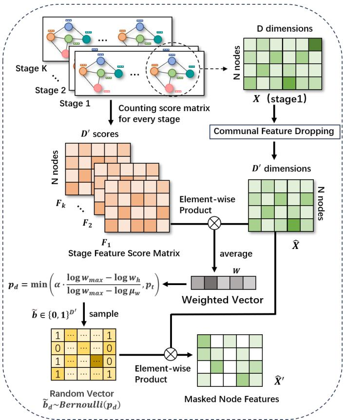  
Fig. 3: Overview of the proposed stage-adaptive brain graph augmentation approach. We select the brain graph of a single subject from one stage as an example to illustrate how smBGC utilizes the scoring matrix for graph augmentation.

After applying the stage-aware feature enhancement strategy, we obtain $\begin{array} { r l r } { \hat { \bf X } ^ { f } } & { { } = } & { \{ \hat { \bf X } _ { 1 } ^ { f } , \hat { \bf X } _ { 2 } ^ { f } , . . . , \hat { \bf X } _ { M } ^ { f } \} } \end{array}$ and $\begin{array} { r l } { \hat { \mathbb { X } } ^ { s } } & { { } = } \end{array}$ $\{ \hat { \bf X } _ { 1 } ^ { s } , \hat { \bf X } _ { 2 } ^ { s } , . . . , \hat { \bf X } _ { M } ^ { s } \}$ , where $\hat { \mathbb X } ^ { \bar { f } }$ and $\bar { \mathbb { X } } ^ { s }$ represent the denoised node features of the FBG and SBG, respectively, along with the collection of stage feature scoring matrices $\mathbb { F } = \{ \mathbf { F } _ { k } \} _ { k = 1 } ^ { K } .$ Inspired by the GCA method proposed by Zhu et al. [37], which adaptively enhances the edges and node attributes of input graphs, we employ a stage-based graph augmentation module. Our feature masking strategy masks certain less important attributes in the node features. Specifically, we treat stage features as important attributes that should be preserved. For instance, in single-modality graph augmentation, to compute the importance of stage features, we define weights for each dimension of the subject’s node features as:

$$
\mathbf { W } = \frac { 1 } { N } \sum _ { i = 1 } ^ { N } | | \mathbf { x } _ { i } | \odot \mathbf { F } _ { k , i } | ,\tag{6}
$$

where $\mathbf { x } _ { i }$ is the feature vector of node $v _ { i }$ , and $\mathbf { F } _ { k , i }$ represents the stage scoring vector of node $v _ { i }$ in stage k for the subject. ⊙ denotes element-wise multiplication, resulting in W = $\left[ \mathbf { w } _ { 1 } , \mathbf { w } _ { 2 } , . . . , \mathbf { w } _ { D } \right]$ , where ${ \bf w } _ { d }$ quantifies the aggregated stagespecific importance of the d-th feature dimension. To convert these weights into meaningful masking probabilities, we apply a logarithmic transformation to compress their dynamic range and compute the masking probability $p _ { d }$ for each dimension:

$$
p _ { d } = \operatorname* { m i n } \left( \alpha \cdot \frac { \log \mathbf { w } _ { m a x } - \log \mathbf { w } _ { d } } { \log \mathbf { w } _ { m a x } - \log \pmb { \mu } _ { w } } , p _ { t } \right) .\tag{7}
$$

where $\mathbf { w } _ { m a x }$ and $\pmb { \mu } _ { w }$ denote the maximum and mean values of W, respectively. Dimensions with higher stage-specific importance $( \mathrm { i } . \mathrm { e } . , \mathrm { w } _ { d }$ closer to $\mathbf { w } _ { m a x } )$ yield smaller $p _ { d } ,$ making them less likely to be masked. Here, α controls the overall augmentation strength, while $p _ { t } ~ < ~ 1$ serves as a truncation threshold to prevent excessively aggressive masking that could disrupt the intrinsic graph structure. The feature enhancement strategy samples a random vector $\tilde { \mathbf { b } } \in \{ 0 , 1 \} ^ { D ^ { \prime } }$ , where each dimension is described by a Bernoulli distribution, such that $\tilde { \mathbf { b } } _ { d } { \sim } B e r n o u l l i ( p _ { d } )$ , ∀i. Accordingly, $\tilde { \mathbf { b } } _ { d } { \sim } B e r n o u l l i ( p _ { d } )$ is a masking indicator, where $\tilde { b } _ { d } = 1$ denotes that the corresponding feature is masked (set to zero) and $\tilde { b } _ { d } = 0$ denotes that it is retained, and then the enhanced node features are computed as:

$$
\begin{array} { r } { \hat { \mathbf { X } } ^ { \prime } = \left[ \hat { \mathbf { x } } _ { 1 } \odot ( 1 - \tilde { \mathbf { b } } _ { 1 } ) ; \hat { \mathbf { x } } _ { 2 } \odot ( 1 - \tilde { \mathbf { b } } _ { 2 } ) ; . . . ; \hat { \mathbf { x } } _ { N } \odot ( 1 - \tilde { \mathbf { b } } _ { n } ) \right] ^ { \top } . } \end{array}
$$

Finally, by applying our graph augmentation approach to FBGs and SBGs, we can generate enhanced graph views $\{ \hat { G } ^ { s } , \hat { G } ^ { f } \}$

## C. Multimodal Fusion via Contrastive Learning

In this section, we will discuss how to fuse structural and functional brain graphs via contrastive learning and design contrastive loss and optimization objectives for model training.

1) Multimodal Brain Graph Embedding: After the aforementioned steps, we obtain a new augmented graph dataset $\hat { B } = \{ ( \{ \hat { G } _ { i } ^ { s } , \hat { \hat { G } } _ { i } ^ { f } \} , y ^ { i } ) \} _ { i = 1 } ^ { M }$ , where the node feature matrix of $\hat { G } _ { i } ^ { * }$ is $\hat { \mathbf { X } } _ { i } ^ { * \prime } = [ \hat { \mathbf { x } } _ { 1 } ^ { i } , \hat { \mathbf { x } } _ { 2 } ^ { i } , . . . , \hat { \mathbf { x } } _ { N } ^ { i } ] ^ { T }$ . We use a GNN-based view encoder $g ( \cdot )$ to compute the embedding for each subject, with the encoder’s parameters shared across all modalities. For the embedding of a single-modality brain graph, we input its node features into a message-passing GNN. Inspired by BrainGB [7], we construct a message vector $\mathbf { v } _ { i j }$ , which consists of the node embedding $\mathbf { h } _ { i } ^ { ( l ) }$ of node $v _ { i }$ at the l-th layer, its neighbor’s node embedding, and the edge weight ${ \bf e } _ { i j } .$ , to be fed into an MLP. We aggregate all neighborhood information and perform propagation. Formally, the above process can be represented as:

$$
\mathbf { v } _ { i j } ^ { ( l ) } = M L P \left( \left[ \mathbf { h } _ { i } ^ { ( l ) } ; \mathbf { h } _ { j } ^ { ( l ) } ; \mathbf { e } _ { i j } \right] \right) .\tag{9}
$$

$$
\mathbf { h } _ { i } ^ { ( l ) } = R e L U \left( \sum _ { j \in N _ { i } \cup \{ i \} } \mathbf { v } _ { i j } ^ { ( l - 1 ) } \right) .\tag{10}
$$

Finally, we use sum pooling to aggregate all the node embeddings and employ an MLP with residual connections parameterized by $\Phi$ to compute the graph embedding:

$$
\mathbf { z } = M L P _ { \Phi } \left( \sum _ { i = 1 } ^ { N } \mathbf { h } _ { i } ^ { ( k ) } \right) + \sum _ { i = 1 } ^ { N } \mathbf { h } _ { i } ^ { ( k ) } .\tag{11}
$$

Through this method, we compute graph-level representations for two modalities, denoted as $\mathbf { z } _ { i } ^ { s } { \sim } g ( \hat { G } _ { i } ^ { s } )$ and $\mathbf { z } _ { i } ^ { f } { \sim } g ( \hat { G } _ { i } ^ { f } )$

2) Multimodal Fusion and Optimization: We calculate graph-level representations for each subject, where the graph representations for structural and functional views are represented as $\mathbf { z } _ { i } ^ { s } { \sim } g ( \hat { G } _ { i } ^ { s } )$ and $\mathbf { z } _ { i } ^ { f } { \sim } g ( \hat { G } _ { i } ^ { f } )$ . During inference, we fuse the representations of the two views by averaging the sum to form the multimodal graph representation for downstream tasks, expressed as: $\mathbf { z } _ { i } = ( \mathbf { z } _ { i } ^ { s } + \mathbf { z } _ { i } ^ { f } ) / 2$

We adopt a global-to-local contrastive learning mode to set an optimization objective for model training. Specifically, we contrast the node representation of one view with the graph representation of another view, aiming to maximize the mutual information between views, defined as:

$$
\underset { 2 M } { \sum } \underset { ( \hat { G } _ { i } ^ { s } , \hat { G } _ { i } ^ { f } ) \in \hat { B } } { \sum } \left[ \frac { 1 } { N } \underset { j = 1 } { \overset { N } { \sum } } \left( I ( \mathbf { h } _ { j } ^ { f } ; \mathbf { z } _ { i } ^ { s } ) + I ( \mathbf { h } _ { j } ^ { s } ; \mathbf { z } _ { i } ^ { f } ) \right) \right] .\tag{12}
$$

Here, $I ( \mathbf { h } _ { j } ^ { f } ; \mathbf { z } _ { i } ^ { s } )$ estimates the mutual information between the node representation $\mathbf { h } _ { j } ^ { f }$ in the functional view and the structural graph representation $\mathbf { z } _ { i } ^ { \mathrm { { s } } }$ of the i-th subject, and vice <sup>(8)</sup>versa. By setting this contrasting objective between different modalities, we ensure cross-modal consistency, allowing the model to adaptively extract discriminative knowledge from each modality without learning a shared brain graph structure. We employ the Jensen-Shannon Divergence (JSD) to compute mutual information $I ( \mathbb { X } ; \mathbb { Y } )$ . For example, the JSD mutual information estimate for $I ( \mathbf { h } _ { j } ^ { f } ; \mathbf { z } _ { i } ^ { s } )$ can be represented as:

$$
\begin{array} { c } { { \displaystyle I \big ( { \bf h } _ { j } ^ { f } ; { \bf z } _ { i } ^ { s } \big ) = } } \\ { { \displaystyle - s p \left( - d \big ( { \bf h } _ { j } ^ { f } , { \bf z } _ { i } ^ { s } \big ) \right) - \frac 1 { N - 1 } \sum _ { \nu _ { n } \in V \backslash \{ \nu _ { j } \} } s p \left( d \big ( { \bf h } _ { n } ^ { f } , { \bf z } _ { i } ^ { s } \big ) \right) . } } \end{array}\tag{13}
$$

Here, $s p ( x ) = \log { ( 1 + e ^ { x } ) }$ denotes the softplus method, and $d ( x , y )$ is a discriminator function that computes the inner product of the two node embeddings along with a sigmoid activation function. The left part of the equation calculates the score for positive sample pairs, taking the functional node embedding of node $v _ { j }$ and its corresponding structural graph embedding as positive samples, while the right part computes the score for negative sample pairs, taking all node embeddings except node $v _ { j }$ and their graph embeddings as negative samples. The process of maximizing mutual information encourages the scores of positive sample pairs to increase while reducing the scores of negative sample pairs. The theoretical optimization objective is to minimize the contrastive loss $\mathcal { L } _ { c o n } .$ , which corresponds to maximizing the lower bound of the mutual information between positive sample pairs across views.

Finally, we employ a multilayer perceptron to generate predictions for classification tasks, using cross-entropy loss as the supervised loss. The entire model can be trained in an end-to-end manner by optimizing:

$$
\mathcal { L } = \eta _ { 1 } \mathcal { L } _ { c o n } + \eta _ { 2 } \mathcal { L } _ { s u p e r v i s e d } ,\tag{14}
$$

where $\eta _ { 1 }$ and $\eta _ { 2 }$ are the loss weights.

## V. EXPERIMENTS

In this section, we conduct a series of experiments to evaluate the effectiveness of the smBGC method. First, we provide detailed information about the datasets and experimental setup. Then, we perform experiments on two datasets to compare the performance of different methods. Finally, we conduct the ablation study and parameter study.

## A. Datasets and Preprocessing

We evaluate our method using two publicly available datasets: the third Alzheimer’s Disease Neuroimaging Initiative (ADNI-3) dataset [49] and the Parkinson’s Progression Markers Initiative (PPMI) dataset [50]. (1) The ADNI-3 is a longitudinal, multi-site, multimodal neuroimaging dataset. In this study, we focus on the latest ADNI-3 dataset, which includes more comprehensive imaging data across additional disorder stages. We collect data from 578 subjects for evaluation, comprising 54 AD patients, 34 late mild cognitive impairment (LMCI) patients, 192 MCI patients, 88 early mild cognitive impairment (EMCI) patients, and 210 NC. Using the ADNI-3 dataset, we perform a three-stage classification task (NC vs. MCI vs. AD) and a four-stage classification task (NC vs. EMCI vs. LMCI vs. AD). (2) The PPMI dataset includes various types of neuroimaging data across different stages of PD. We collect data from 56 NC, 100 high-risk prodromal patients, and 99 PD patients. Using the PPMI dataset, we perform a three-stage classification task (NC vs. Prodromal vs. PD).

For both datasets, each subject includes both fMRI and DTI data. We exclude duplicate scans and retain singlescan data for each modality. For fMRI data, we process it using the GRETNA Toolbox [51], segmenting the brain into regions based on the AAL90 template, calculating time series for each region, and measuring functional connectivity using the Pearson correlation coefficient (PCC). For DTI data, we process it using PANDA [52], correct distortions with FSL to obtain fiber images, and segment brain regions using the AAL90 template based on T1-weighted images. Structural connectivity is calculated using fractional anisotropy metrics.

## B. Experimental Settings

To thoroughly evaluate the performance of our method, we use five evaluation metrics, including classification accuracy (ACC), sensitivity (SEN), specificity (SPE), F1 score (F1) and ROC-AUC (AUC), where higher values indicate better performance. In this study, we use 5-fold cross-validation to evaluate all methods. The splits of the training and testing sets remain consistent, with the dataset divided into five subsets. For each experiment, four subsets are used as the training set, and the remaining subset is used as the testing set. In the stageaware feature enhancement strategy, both CFD and SFE are performed exclusively on the training set to compute the noise features and stage-specific scoring matrices. The enhanced training data are then used to train the contrastive learning model. During inference, a fixed feature mask learned from the training set is applied to remove noise features from the test samples, and the processed test data are subsequently fed into the trained model for classification. All experiments are implemented in PyTorch and conducted on NVIDIA GeForce A40 GPU with 24 GB memory. The hyperparameters used in our model for different stage diagnosis tasks are detailed in Table II. All hyperparameters are selected based on preliminary experiments on the training data and are fixed across all folds. During training, we employ the Adam optimizer, and the model’s performance on the testing set is evaluated every five epochs. For each fold in the 5-fold cross-validation, the performance on the testing set at the final epoch is recorded across five runs. The means and standard deviations of these runs are calculated to represent the final results for each metric. The complete training and testing pipeline are illustrated in Algorithm 2 and Algorithm 3.

Algorithm 2 Training Procedure of smBGC   
Require: Training set $B = \{ ( \{ G _ { i } ^ { s } , G _ { i } ^ { f } \} , y _ { i } ) \} _ { i = 1 } ^ { M } ;$ number of   
stages $K ;$ number of dropping features $\lambda ;$ loss weights   
$\eta _ { 1 } , \eta _ { 2 }$   
Ensure: Trained encoder $g ( \cdot )$ , classifier, dropped feature in  
dex set $\mathcal { T } _ { \mathrm { d r o p } }$   
1: Compute communal scoring matrix $S \gets \phi ( \mathbf { X } )$ over all   
training subjects (Eq. 1–3)   
2: Rank features by average score; select top-λ and bottom-λ   
as $\mathcal { T } _ { \mathrm { d r o p } }$   
3: Drop $\mathcal { T } _ { \mathrm { d r o p } }$ from all node features to obtain $\hat { \bf X }$ {Communal   
Feature Dropping}   
4: Partition $\hat { \bf X }$ into $K$ stage groups $\{ \hat { \mathbf { X } } _ { k } \} _ { k = 1 } ^ { K }$   
5: for $k = 1$ to $K$ do   
6: Compute stage scoring matrix $F _ { k } \ \gets \ \phi ( \hat { \mathbf { X } } _ { k } )$ {Stage   
Feature Extraction}   
7: end for   
8: for epoch $= 1$ to E do   
9: for each subject i in a mini-batch do   
10: Compute importance weights W via Eq. 6 using $F _ { y _ { i } }$   
11: Compute masking probabilities $p _ { d }$ via Eq. 7   
12: Sample masking indicators $\tilde { b } _ { d } \sim$ Bernoull $\displaystyle \lvert ( p _ { d } )$   
13: Obtain augmented views $\hat { G } _ { i } ^ { s } , \hat { G } _ { i } ^ { f }$ via Eq. 8   
14: Encode both views with shared GNN encoder $g ( \cdot )$ to   
get $z _ { i } ^ { s } , z _ { i } ^ { f }$ and node embeddings   
15: Compute contrastive loss $\mathcal { L } _ { c o n }$ (Eq. 12–13) between   
the two views   
16: end for   
17: Fuse embeddings $z _ { i } = ( z _ { i } ^ { s } + z _ { i } ^ { f } ) / 2 ;$ compute classifi  
cation loss L<sub>supervised</sub> $\mathcal { L } _ { \varepsilon }$   
18: Update parameters by minimizing $\begin{array} { r } { \mathcal { L } ~ = ~ \eta _ { 1 } \mathcal { L } _ { c o n } \ + } \end{array}$   
$\eta _ { 2 } \mathcal { L } _ { i }$ <sub>supervised</sub> (Eq. 14)   
19: end for   
20: return trained $g ( \cdot ) ,$ , classifier, $\mathcal { T } _ { \mathrm { d r o p } }$

Algorithm 3 Testing Procedure of smBGC   
Require: Test subject with $\{ G ^ { s } , G ^ { f } \}$ ; trained encoder $g ( \cdot ) ;$   
trained classifier; dropped feature index set $\mathcal { T } _ { \mathrm { d r o p } }$ (fixed   
from training)   
Ensure: Predicted disorder stage $\hat { y }$   
1: Remove features indexed by $\mathcal { T } _ { \mathrm { d r o p } }$ from $X ^ { s } , X ^ { f }$ {no re  
computation; mask is fixed}   
2: Encode $G ^ { s } , G ^ { f }$ with trained $g ( \cdot )$ (no augmentation) to   
obtain $z ^ { s } , z ^ { f }$   
3: Fuse: $z = ( z ^ { s } + z ^ { f } ) / 2$   
4: $\hat { y } \gets$ classifier(z)   
5: return $\hat { y }$

TABLE II: Hyperparameters for training on three different tasks.
<table><tr><td>Hyperparameter</td><td>ADNI-3 (three stages) ADNI-3 (four stages)</td><td></td><td>PPMI</td></tr><tr><td>Functional magnitude αf</td><td>0.6</td><td>0.6</td><td>0.7</td></tr><tr><td>Structural magnitude αs</td><td>0.6</td><td>0.5</td><td>0.3</td></tr><tr><td>Dropping features λ</td><td>20</td><td>20</td><td>30</td></tr><tr><td>GNN layers</td><td>1</td><td>1</td><td>1</td></tr><tr><td>Dropout</td><td>0.5</td><td>0.5</td><td>0.5</td></tr><tr><td>Readout method</td><td>sum</td><td>sum</td><td>sum</td></tr><tr><td>Learning rate</td><td>1e-2</td><td>1e-2</td><td>1e-2</td></tr><tr><td>Batch size</td><td>16</td><td>16</td><td>16</td></tr><tr><td>Epochs</td><td>100</td><td>100</td><td>100</td></tr><tr><td>Weight decay</td><td>1e-4</td><td>1e-4</td><td>1e-4</td></tr></table>

## C. Model Comparison

1) Baselines: In this study, to evaluate the effectiveness of smBGC, we compare it with deep graph learning models and well-established brain graph learning models. These methods include:

• GCN [53]: Graph Convolutional Network (GCN) performs convolution operations on the graph in either the spectral or spatial domain, leveraging the inherent graph structure.

• GAT [54]: Graph Attention Network (GAT) is a type of graph neural network that uses attention mechanisms to prioritize the influence of neighboring nodes during information aggregation. This mechanism allows GAT to capture complex relationships and dependencies more effectively.

• GraphSAGE [55]: GraphSAGE samples a fixed-sized neighborhood around each node and aggregates the features of these neighbors from large-scale graphs to learn node embeddings.

• GIN [56]: Graph Isomorphism Network (GIN) is inspired by the Weisfeiler-Lehman test and aims to provide equivalent discriminative power through expressive aggregation functions.

• GCA [37]: GCA is a general contrastive framework for unsupervised graph representation learning with adaptive data augmentation. It performs data augmentation on both topological and attribute levels to adapt to graph structures and attributes, encouraging the model to learn important features from these aspects.

• BrainGB [7]: BrainGB is a benchmark for brain graph analysis using GNNs. It standardizes this process and summarizes the pipeline for constructing brain graphs from functional and structural neuroimaging patterns, modularizing the implementation of GNN designs.

• BrainIB [57]: BrainIB takes brain networks constructed from fMRI data as input and learns to identify the most discriminative subgraph of key connections, thereby reducing redundant information while improving generalization performance.

• MAHGCN [31]: MAHGCN constructs functional connectivity networks (FCNs) across multiple spatial scales and leverages hierarchical relationships among brain regions at different scales through an Atlas-guided Pooling strategy. By integrating multiscale information within a hierarchical GCN architecture, it is able to more comprehensively extract brain connectivity features.

• Cross-GNN [14]: Cross-GNN models cross-modal relationships through dynamic brain graphs and mutual learning mechanisms, using data-driven attention modeling on the adjacency matrices that represent modality dependencies.

• RH-BrainFS [15]: RH-BrainFS proposes a strategy for region heterogeneity in multimodal brain graph fusion, integrating heterogeneous region features from different modalities within brain graphs while addressing regional heterogeneity issues.

• MCGAN [58]: MCGAN introduces a multioutput conditional GAN for data augmentation, followed by a multiheaded gating fusion model to capture complementary features across modalities for classification.

• MMP-GCN [19]: MMP-GCN introduces a penalty mechanism based on DTI intensities to construct functional brain graphs, enhancing the expression of connectivity information. This method integrates various data sources and assigns unique filters to different data, thereby enhancing model performance.

2) Result Comparison: Table III presents the performance of our method on three-stage and four-stage classification tasks using the ADNI-3 dataset. For the NC vs. MCI vs. AD classification task, smBGC achieves the best performance among all methods, with an accuracy of 96.47%, an F1 score of 96.18%, an AUC of 99.06%, a specificity of 97.89%, and a sensitivity of 95.45%. Similarly, in the more challenging four-stage classification task (NC vs. EMCI vs. LMCI vs. AD), smBGC maintains outstanding performance, achieving the highest accuracy of 81.71%, an F1 score of 79.02%, an AUC of 96.14%, a sensitivity of 64.97%, and a specificity of 96.24%. Table IV demonstrates the results of the three-stage classification task (NC vs. Prodromal vs. PD) on the PPMI dataset. Our method achieves the highest accuracy of 91.15%, an F1 score of 91.24%, an AUC of 96.27%, a sensitivity of 91.77%, and a specificity of 95.61%, underscoring the robustness and generalizability of our approach.

Overall, basic deep graph learning models, such as GCN, perform poorly across all tasks. These methods, relying solely on unimodal data, fail to effectively capture the characteristics of brain graphs at different disorder stages. In contrast, models like RH-BrainFS, MMP-GCN, and Cross-GNN, which integrate multimodal data, further improve stage classification performance, with complementary information between modalities playing a critical role. Notably, GCA

TABLE III: Performance comparison of different methods on the ADNI-3 dataset (%). The best results are highlighted in bold and the second-best results are underlined.
<table><tr><td rowspan="2">Method</td><td colspan="5"> $\mathrm { N C } \ \mathrm { v s . \ M C I \ v s . \ A D }$ </td><td colspan="5">NC vs. EMCI vs. LMCI vs. AD</td></tr><tr><td>ACC</td><td>F1</td><td>AUC</td><td>SEN</td><td>SPE</td><td>ACC</td><td>F1</td><td>AUC</td><td>SEN</td><td>SPE</td></tr><tr><td>GCN</td><td> $5 4 . 3 0 \pm 1 . 6 7$ </td><td> $4 1 . 9 7 \pm 2 . 2 9$ </td><td> $6 7 . 5 1 \pm 2 . 7 2$ </td><td> $4 2 . 8 0 \pm 1 . 7 9$ </td><td> $7 4 . 0 6 \pm 1 . 1 9$ </td><td> $4 3 . 7 5 \pm 3 . 6 4$ </td><td> $3 5 . 0 1 \pm 3 . 6 0$ </td><td> $6 5 . 9 0 \pm 3 . 5 8$ </td><td> $3 5 . 0 7 \pm 3 . 6 0$ </td><td> $8 0 . 8 3 \pm 1 . 2 9$ </td></tr><tr><td>GAT</td><td> $5 0 . 7 8 \pm 2 . 4 4$ </td><td> $4 1 . 6 5 \pm 3 . 4 8$ </td><td> $6 5 . 2 2 \pm 2 . 9 9$ </td><td> $4 1 . 7 9 \pm 2 . 8 6$ </td><td> $7 2 . 0 7 \pm 0 . 8 8$ </td><td> $4 6 . 8 8 \pm 7 . 2 3$ </td><td> $3 7 . 0 7 \pm 5 . 3 1$ </td><td> $6 9 . 9 5 \pm 5 . 0 3$ </td><td> $3 9 . 1 7 \pm 4 . 7 7$ </td><td> $8 1 . 3 8 \pm 1 . 8 7$ </td></tr><tr><td>GIN</td><td> $5 0 . 7 7 \pm 2 . 5 7$ </td><td> $4 2 . 3 8 \pm 2 . 4 8$ </td><td> $6 3 . 0 6 \pm 2 . 4 5$ </td><td> $4 3 . 1 9 \pm 2 . 7 5$ </td><td> $7 2 . 8 9 \pm 1 . 4 2$ </td><td> $5 0 . 0 0 \pm 1 1 . 6 3$ </td><td> $4 7 . 2 8 \pm 1 1 . 5 8$ </td><td> $6 3 . 5 1 \pm 7 . 3 4$ </td><td> $4 7 . 2 2 \pm 1 0 . 9 5$ </td><td> $8 2 . 5 6 \pm 3 . 9 3$ </td></tr><tr><td>GraphSAGE</td><td> $5 6 . 9 5 \pm 4 . 1 3$ </td><td> $4 7 . 7 4 \pm 5 . 1 5$ </td><td> $6 9 . 4 7 \pm 3 . 5 6$ </td><td> $4 7 . 8 4 \pm 5 . 0 2$ </td><td> $7 5 . 5 5 \pm 2 . 8 7$ </td><td> $4 3 . 7 5 \pm 6 . 1 2$ </td><td> $3 9 . 2 9 \pm 5 . 1 4$ </td><td> $6 1 . 5 5 \pm 4 . 8 7$ </td><td> $4 0 . 8 4 \pm 4 . 4 6$ </td><td> $8 1 . 2 6 \pm 2 . 4 7$ </td></tr><tr><td>BrainGB</td><td> $5 3 . 3 3 \pm 4 . 4 6$ </td><td> $3 8 . 2 3 \pm 4 . 7 9$ </td><td> $6 2 . 1 0 \pm 3 . 0 9$ </td><td> $4 0 . 8 4 \pm 4 . 1 2$ </td><td> $7 2 . 3 5 \pm 2 . 8 1$ </td><td> $4 0 . 6 3 \pm 5 . 9 2$ </td><td> $3 2 . 1 4 \pm 6 . 0 2$ </td><td> $5 5 . 6 8 \pm 4 . 0 1$ </td><td> $3 4 . 6 7 \pm 4 . 2 0$ </td><td> $7 6 . 0 2 \pm 1 . 7 9$ </td></tr><tr><td>MAHGCN</td><td> $5 6 . 8 0 \pm 4 . 2 8$ </td><td> $4 2 . 0 4 \pm 4 . 1 2$ </td><td> $7 1 . 3 3 \pm 5 . 0 8$ </td><td> $4 4 . 6 0 \pm 3 . 4 8$ </td><td> $7 4 . 5 8 \pm 2 . 2 2$ </td><td> $4 1 . 9 5 \pm 5 . 4 3$ </td><td> $3 2 . 3 6 \pm 3 . 7 9$ </td><td> $6 8 . 2 7 \pm 2 . 3 5$ </td><td> $3 6 . 7 9 \pm 4 . 8 4$ </td><td> $7 9 . 8 5 \pm 1 . 7 9$ </td></tr><tr><td>BrainIB</td><td> $6 1 . 6 2 \pm 1 . 4 0$ </td><td> $3 6 . 8 8 \pm 5 . 2 1$ </td><td> $6 6 . 5 9 \pm 2 . 6 7$ </td><td> $4 8 . 3 8 \pm 3 . 5 0$ </td><td> $7 6 . 8 9 \pm 0 . 7 9$ </td><td> $4 9 . 7 6 \pm 5 . 8 9$ </td><td> $4 1 . 5 1 \pm 6 . 7 1$ </td><td> $6 2 . 6 5 \pm 2 . 1 0$ </td><td> $4 4 . 2 3 \pm 5 . 9 7$ </td><td> $8 2 . 4 0 \pm 2 . 0 8$ </td></tr><tr><td>RH-BrainFS</td><td> $5 7 . 1 4 \pm 2 . 0 5$ </td><td> $5 0 . 2 4 \pm 1 . 5 1$ </td><td> $6 1 . 3 0 \pm 1 . 6 8$ </td><td> $4 2 . 5 2 \pm 1 . 4 7$ </td><td> $7 3 . 8 3 \pm 1 . 1 6$ </td><td> $4 7 . 6 2 \pm 6 . 7 0$ </td><td> $4 8 . 3 3 \pm 7 . 5 7$ </td><td> $6 6 . 4 8 \pm 6 . 1 0$ </td><td> $4 0 . 0 0 \pm 6 . 4 6$ </td><td> $6 6 . 6 7 \pm 9 . 1 4$ </td></tr><tr><td>MMP-GCN</td><td> $6 3 . 2 2 \pm 2 . 6 4$ </td><td> $5 5 . 4 8 \pm 2 . 2 1$ </td><td> $7 0 . 4 8 \pm 2 . 1 8$ </td><td> $5 3 . 2 7 \pm 1 . 7 4$ </td><td> $7 5 . 7 9 \pm 2 . 1 6$ </td><td> $4 1 . 0 3 \pm 6 . 4 7$ </td><td> $3 6 . 3 6 \pm 2 . 3 4$ </td><td> $6 0 . 0 9 \pm 7 . 8 5$ </td><td> $3 6 . 3 9 \pm 4 . 8 3$ </td><td> $7 9 . 5 1 \pm 1 . 9 5$ </td></tr><tr><td>Cross-GNN</td><td> $6 4 . 2 4 \pm 1 . 3 7$ </td><td> $4 5 . 4 9 \pm 0 . 9 4$ </td><td> $7 7 . 5 3 \pm 0 . 5 3$ </td><td> $4 2 . 7 7 \pm 0 . 7 9$ </td><td> $8 0 . 1 0 \pm 0 . 8 4$ </td><td> $4 0 . 6 3 \pm 2 . 3 4$ </td><td> $2 8 . 7 9 \pm 2 . 1 6$ </td><td> $6 4 . 1 2 \pm 3 . 1 5$ </td><td> $3 1 . 1 1 \pm 3 . 1 7$ </td><td> $7 9 . 3 6 \pm 1 . 3 4$ </td></tr><tr><td>MCGAN</td><td> $6 0 . 9 6 \pm 3 . 4 2$ </td><td> $5 7 . 4 4 \pm 5 . 2 4$ </td><td> $7 1 . 2 9 \pm 3 . 3 1$ </td><td> $5 0 . 1 5 \pm 8 . 6 4$ </td><td> $7 9 . 3 7 \pm 2 . 2 3$ </td><td> $5 7 . 5 6 \pm 4 . 2 0$ </td><td> $4 7 . 4 1 \pm 2 . 6 3$ </td><td> $6 9 . 9 8 \pm 5 . 0 6$ </td><td> ${ \underline { { 5 0 . 7 8 } } } \pm 2 . 9 2 $ </td><td> $8 5 . 2 3 \pm 1 . 1 5$ </td></tr><tr><td>GCA</td><td> $6 9 . 3 4 \pm 3 . 9 8$ </td><td> $5 9 . 2 1 \pm 4 . 8 0$ </td><td> $8 5 . 2 5 \pm 6 . 4 1$ </td><td> $5 6 . 8 3 \pm 3 . 8 4$ </td><td> $\underline { { 8 1 . 3 2 \pm 2 . 5 3 } }$ </td><td> $\overline { { 5 2 . 0 3 \pm 8 . 5 7 } }$ </td><td> $\underline { { 4 8 . 1 2 \pm 7 . 0 5 } }$ </td><td> ${ \underline { { 7 4 . 7 5 \pm 1 . 1 6 } } }$ </td><td> $\overline { { 4 8 . 4 8 \pm 7 . 5 0 } }$ </td><td> $\overline { { 8 3 . 6 5 \pm 2 . 8 3 } }$ </td></tr><tr><td>smBGC (ours)</td><td> ${ \bf 9 6 . 4 7 \pm 2 . 3 2 }$ </td><td> ${ \bf 9 6 . 1 8 \pm 2 . 5 3 }$ </td><td> ${ \bf 9 9 . 0 6 \pm 0 . 6 2 }$ </td><td> $\mathbf { 9 5 . 4 5 \pm 2 . 6 0 }$ </td><td> ${ \bf 9 7 . 8 9 \pm 1 . 3 8 }$ </td><td> ${ \bf 8 1 . 7 1 \pm 1 . 2 2 }$ </td><td> ${ \bf 7 9 . 0 2 \pm 0 . 5 6 }$ </td><td> ${ \bf 9 6 . 1 4 \pm 0 . 4 3 }$ </td><td> ${ \bf 6 4 . 9 7 \pm 2 . 2 7 }$ </td><td> ${ \bf 9 6 . 2 4 \pm 0 . 5 3 }$ </td></tr></table>

TABLE IV: Performance comparison of different methods on the PPMI dataset (%).
<table><tr><td rowspan="2">Method</td><td colspan="5">NC vs. Prodromal vs. PD</td></tr><tr><td>ACC</td><td>F1</td><td>AUC</td><td>SEN</td><td>SPE</td></tr><tr><td>GCN</td><td> $5 1 . 9 2 \pm 3 . 5 7$ </td><td> $4 9 . 5 5 \pm 3 . 1 9$ </td><td> $6 6 . 2 6 \pm 4 . 9 1$ </td><td> $5 0 . 3 4 \pm 2 . 2 3$ </td><td> $7 4 . 6 6 \pm 0 . 6 6$ </td></tr><tr><td>GAT</td><td> $5 0 . 5 8 \pm 5 . 6 6$ </td><td> $4 6 . 2 2 \pm 1 . 6 8$ </td><td> $6 0 . 3 2 \pm 3 . 0 8$ </td><td> $4 8 . 0 0 \pm 1 . 6 2$ </td><td> $7 3 . 2 0 \pm 5 . 5 6$ </td></tr><tr><td>GIN</td><td> $5 0 . 5 2 \pm 5 . 1 0$ </td><td> $4 9 . 2 4 \pm 4 . 2 3$ </td><td> $6 8 . 1 3 \pm 3 . 9 4$ </td><td> $4 9 . 8 3 \pm 4 . 4 2$ </td><td> $7 4 . 2 5 \pm 2 . 4 3$ </td></tr><tr><td>GraphSAGE</td><td> $5 5 . 0 4 \pm 2 . 6 7$ </td><td> $5 2 . 4 6 \pm 5 . 2 0$ </td><td> $6 6 . 9 1 \pm 5 . 7 7$ </td><td> $5 3 . 2 2 \pm 4 . 3 5$ </td><td> $7 6 . 1 9 \pm 1 . 2 9$ </td></tr><tr><td>BrainGB</td><td> $4 8 . 1 0 \pm 5 . 3 9$ </td><td> $4 2 . 8 0 \pm 4 . 2 6$ </td><td> $6 0 . 8 2 \pm 2 . 6 2$ </td><td> $4 5 . 5 1 \pm 2 . 9 9$ </td><td> $7 2 . 2 9 \pm 1 . 7 5$ </td></tr><tr><td>MAHGCN</td><td> $4 3 . 5 9 \pm 6 . 8 2$ </td><td> $3 0 . 7 8 \pm 8 . 3 0$ </td><td>68.21 ± 8.46 39.55 ± 4.15</td><td></td><td> $6 9 . 7 4 \pm 1 . 9 5$ </td></tr><tr><td>BrainIB</td><td> $5 2 . 5 4 \pm 2 . 5 6$ </td><td>47.47 ± 4.75</td><td> $5 9 . 2 7 \pm 4 . 1 0$ </td><td> $5 1 . 0 9 \pm 3 . 2 3$ </td><td> $7 4 . 8 8 \pm 1 . 4 5$ </td></tr><tr><td>RH-BrainFS</td><td> $5 8 . 3 8 \pm 1 . 5 8$ </td><td> $5 4 . 8 8 \pm 2 . 1 1$ </td><td> $6 7 . 3 0 \pm 2 . 9 2$ </td><td> $4 7 . 0 3 \pm 1 . 0 8$ </td><td> $7 8 . 6 2 \pm 0 . 6 5$ </td></tr><tr><td>MMP-GCN</td><td> $6 0 . 0 6 \pm 2 . 4 7$ </td><td> $5 5 . 0 3 \pm 3 . 5 8$ </td><td> $6 4 . 6 1 \pm 3 . 7 7$ </td><td> $5 5 . 9 5 \pm 5 . 8 1$ </td><td> $7 9 . 5 5 \pm 1 . 8 1$ </td></tr><tr><td>Cross-GNN</td><td> $5 6 . 6 0 \pm 1 . 8 9$ </td><td> $4 8 . 2 5 \pm 1 . 5 1$ </td><td> $7 0 . 1 4 \pm 3 . 3 7$ </td><td> $4 9 . 6 4 \pm 1 . 3 5$ </td><td> $7 9 . 6 4 \pm 1 . 3 2$ </td></tr><tr><td>MCGAN</td><td> $6 6 . 4 1 \pm 5 . 4 1$ </td><td> ${ \underline { { 6 4 . 3 0 \pm 5 . 6 8 } } }$ </td><td> $7 0 . 1 2 \pm 3 . 7 8$ </td><td> $6 2 . 3 8 \pm 5 . 5 1$ </td><td> $8 4 . 7 5 \pm 3 . 4 5$ </td></tr><tr><td>GCA</td><td> $6 5 . 8 9 \pm 6 . 4 3$ </td><td> $\overline { { 6 1 . 7 5 \pm 5 . 8 9 } }$ </td><td> $\underline { { 8 0 . 3 9 \pm 6 . 1 0 } }$ </td><td> $\overline { { 6 1 . 6 4 \pm 7 . 9 1 } }$ </td><td> $\overline { { 8 1 . 2 4 \pm 3 . 9 7 } }$ </td></tr><tr><td>smBGC (ours)</td><td> ${ \bf 9 1 . 1 5 \pm 3 . 1 9 }$ </td><td> ${ \bf 9 1 . 2 4 \pm 3 . 1 3 }$ </td><td> ${ \bf 9 6 . 2 7 \pm 0 . 9 1 }$ </td><td> ${ \bf 9 1 . 7 7 \pm 4 . 3 3 }$ </td><td> ${ \bf 9 5 . 6 1 } \pm 3 . 5 2$ </td></tr></table>

TABLE V: Fold-level performance of smBGC on the fourstage classification task of the ADNI-3 dataset (%).
<table><tr><td>Metric</td><td>Fold 1</td><td>Fold 2</td><td>Fold 3</td><td>Fold 4</td><td>Fold 5</td><td> $\mathrm { M e a n } \pm { \mathrm { S t d } } .$ </td><td>95% CI</td></tr><tr><td>ACC</td><td>80.12</td><td>82.68</td><td>82.90</td><td>82.11</td><td>80.74</td><td> $8 1 . 7 1 \pm 1 . 2 2$ </td><td>[80.19, 83.23]</td></tr><tr><td>F1</td><td>78.43</td><td>79.12</td><td>79.78</td><td>79.25</td><td>78.52</td><td> $7 9 . 0 2 \pm 0 . 5 6$ </td><td>[78.33, 79.71]</td></tr><tr><td>AUC</td><td>96.55</td><td>96.28</td><td>95.73</td><td>96.51</td><td>95.63</td><td> $9 6 . 1 4 \pm 0 . 4 3$ </td><td>[95.60, 96.68]</td></tr><tr><td>SEN</td><td>62.42</td><td>67.21</td><td>63.85</td><td>67.54</td><td>63.83</td><td> $6 4 . 9 7 \pm 2 . 2 7$ </td><td>[62.15, 67.79]</td></tr><tr><td>SPE</td><td>96.72</td><td>95.81</td><td>96.65</td><td>95.54</td><td>96.48</td><td> $9 6 . 2 4 \pm 0 . 5 3$ </td><td>[95.58, 96.90]</td></tr></table>

<table><tr><td>Metric</td><td>smBGC (%)</td><td>MHGF (%)</td><td>Improvement</td><td>95% CI</td><td>t(4)</td><td>Adjusted p</td></tr><tr><td>ACC</td><td>81.71</td><td>57.56</td><td>24.15</td><td>[20.71, 27.59]</td><td>19.47</td><td> $< 0 . 0 0 1$ </td></tr><tr><td>F1</td><td>79.02</td><td>47.41</td><td>31.61</td><td>[27.84, 35.37]</td><td>23.29</td><td> $< 0 . 0 0 1$ </td></tr><tr><td>AUC</td><td>96.14</td><td>69.98</td><td>26.16</td><td>[19.65, 32.67]</td><td>11.16</td><td> $< 0 . 0 0 1$ </td></tr><tr><td>SEN</td><td>64.97</td><td>50.78</td><td>14.19</td><td>[11.50, 16.87]</td><td>14.65</td><td> $< 0 . 0 0 1$ </td></tr><tr><td>SPE</td><td>96.24</td><td>85.23</td><td>11.01</td><td>[9.75, 12.28]</td><td>24.22</td><td> $< 0 . 0 0 1$ </td></tr></table>

TABLE VI: Two-sided paired t-tests results comparing sm-BGC with MHGF on the ADNI-3 four-stage classification task.

SAGE is sparse and fails to effectively separate the four classes of samples. GAT and GCN partially concentrate certain categories into clusters, but these clusters lack well-defined boundaries and exhibit significant overlap. In contrast, our method not only achieves clear clustering but also minimizes confusion at cluster boundaries, with only a small number of misclassified samples.

incorporates multimodal data into a contrastive framework for graph augmentation, outperforming all baseline methods across tasks. This demonstrates that contrastive frameworks are also effective for learning multimodal data, and that the graph augmentation module significantly contributes to performance improvements by mitigating noise and enhancing graph attributes. Our method fully leverages complementary information across modalities and considers stage-specific brain dysfunction characteristics. By addressing these factors, we develop a solution that significantly enhances stage classification performance, achieving substantial performance improvements.

4) Statistical Significance: To evaluate the robustness of smBGC across different data partitions, we report its fold-level performance and the corresponding 95% confidence intervals in Table V. The results show that smBGC achieves stable and strong performance across the five cross-validation folds. Specifically, smBGC achieves an average ACC of 81.71%, an F1 score of 79.02%, an AUC of 96.14%, a sensitivity of 64.97%, and a specificity of 96.24%. The relatively narrow confidence intervals for ACC, F1, AUC, and specificity indicate that the performance of smBGC is stable across different data partitions. We further conducted two-sided paired t-tests between smBGC and MHGF using the results obtained from the same five cross-validation folds. As reported in Table VI, smBGC achieves mean improvements of 24.15, 31.61, 26.16, 14.19, and 11.01 percentage points in ACC, F1, AUC, sensitivity, and specificity, respectively. The 95% confidence intervals of all paired differences are entirely above zero, indicating consistent improvements across the five folds. Moreover, all differences remain statistically significant after applying Holm correction for multiple comparisons (all adjusted p-values <0.001).

3) Visualization: To demonstrate the performance of various methods, we conduct visualization experiments on the ADNI-3 dataset. Specifically, we use the graph-level embeddings from the final layer of each method for t-SNE visualization. As shown in Fig. 4, the distribution of Graph-

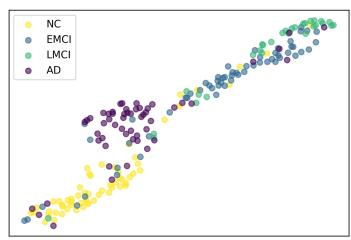  
GraphSAGE

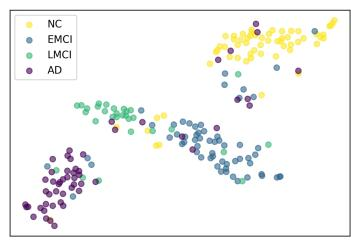  
GCN

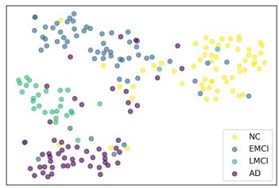  
GAT

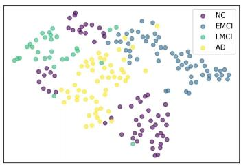  
smBGC  
Fig. 4: The t-SNE visualizations of different methods on the ADNI-3 dataset with four stages.

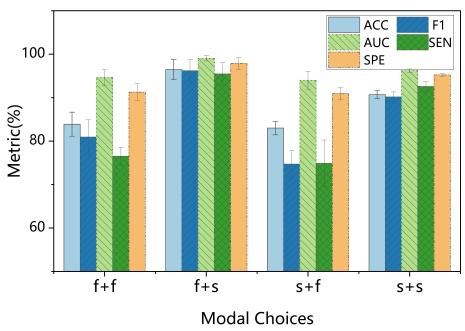  
(a) ADNI-3 (three stages)

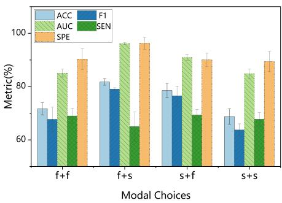  
(b) ADNI-3 (four stages)

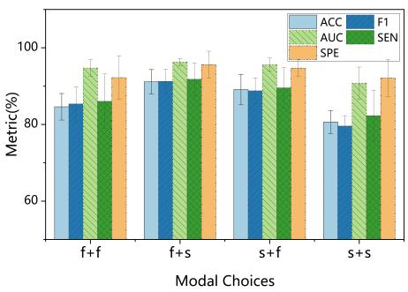  
Fig. 5: Experimental results under different modal choices.  
(c) PPMI

## D. Ablation Study

In this subsection, we examine the impact of the selected modalities and different modules on the model’s performance.

1) Analysis of Different Modules: We employ two modules to obtain stage-specific brain graph features: CFD and graph augmentation based on the results of SFE (ASFE). We validate the effectiveness of both modules. We conduct ablation experiments on the PPMI dataset by removing these modules. As shown in Table VII , a comparison of the first three rows reveals that both the CFD and ASFE modules have a positive impact on our model’s performance. Specifically, the comparison between the results of w/o CFD and w/o ASFE highlights the crucial role of the stage-adaptive brain graph augmentation approach in enhancing the model performance. Overall, the results demonstrate the superiority of our model in extracting distinct patterns across neurodegenerative disorder stages. Furthermore, these two modules are compatible and complementary. By integrating both modules, our smBGC achieves the best performance.

TABLE VII: Results of smBGC variants w/o each proposed component on the PPMI dataset.
<table><tr><td rowspan="2">Methods</td><td colspan="5">NC vs. Prodromal vs. PD</td></tr><tr><td>ACC</td><td>Fl</td><td>AUC</td><td>SEN</td><td>SPE</td></tr><tr><td>w/o CFD &amp; ASFE</td><td> $4 1 . 7 3 \pm 5 . 2 6$ </td><td> $3 6 . 9 7 \pm 5 . 8 7$ </td><td> $5 6 . 5 0 \pm 4 . 0 8$ </td><td> $3 9 . 5 3 \pm 3 . 8 5$ </td><td> $6 9 . 0 9 \pm 5 . 4 3$ </td></tr><tr><td>w/o ASFE</td><td> $5 7 . 4 4 \pm 5 . 2 9$ </td><td> $5 0 . 1 5 \pm 1 . 5 9$ </td><td> $7 0 . 9 4 \pm 6 . 7 6$ </td><td> $5 2 . 2 4 \pm 5 . 6 3$ </td><td> $8 0 . 8 8 \pm 2 . 9 4$ </td></tr><tr><td>w/o CFD</td><td> $\underline { { 8 3 . 2 4 \pm 2 . 2 9 } }$ </td><td> $7 8 . 2 8 \pm 3 . 6 1$ </td><td> $g 7 . 4 7 \pm 1 . 1 9$ </td><td> $8 2 . 9 6 \pm 2 . 6 4$ </td><td> $9 1 . 7 3 \pm 5 . 9 1$ </td></tr><tr><td>smBGC (ours)</td><td> ${ \bf 9 1 . 1 5 \pm 3 . 1 9 }$ </td><td> ${ \bf 9 1 . 2 4 \pm 3 . 1 3 }$ </td><td> ${ \bf 9 6 . 2 7 \pm 0 . 9 1 }$ </td><td> ${ \bf 9 1 . 7 7 \pm 4 . 3 3 }$ </td><td> ${ \bf 9 5 . 6 1 } \pm 3 . 5 2$ </td></tr></table>

2) Analysis of Different Modalities: We evaluate the model performance when different modalities are utilized for enhancement. Specifically, in both steps of the stage-aware feature enhancement strategy, it is necessary to compute the feature scoring matrix: the common scoring matrix $S _ { c }$ for the first step and the stage scoring matrix $F _ { k }$ for the second step. Since fMRI and DTI data are collected for each subject, the scoring matrix $S$ can be computed for each modality, resulting in $F _ { k } ^ { f }$ for the functional modality and $F _ { k } ^ { s }$ for the structural modality. Four possible combinations for the two steps are: $f { + } f { , }$ $f + s ,$ s+s, and $s { + } f$ (where f represents the functional modality and s represents the structural modality). Fig. 5 illustrates the accuracy results for classification tasks under different combinations. It can be observed that all combinations can improve model performance. However, the performance of single-modality combinations is consistently lower than that of multimodal combinations. This demonstrates that the complementary information between modalities plays a significant role in the enhancement strategy.

## E. Parameters Analysis

1) The Magnitude of Feature Enhancement: We perform a parameter analysis of the key hyperparameters in smBGC, specifically the hyperparameters $\alpha _ { f }$ and $\alpha _ { s } .$ , which determine the augmentation strength for structural and functional views, respectively, during graph augmentation. By varying these parameters from 0.2 to 0.7, we evaluate the model performance on the three-stage classification task using ADNI-3 and PPMI datasets. The results are shown in Fig. 6. It can be observed that the classification accuracy remains relatively stable when the parameter values are changed. This indicates that, overall, our model is robust to parameter perturbations, demonstrating its insensitivity to these hyperparameters. However, when the parameter values are set too small, noise features within the brain graphs remain significant, and the stage-specific characteristics of brain disorders are not fully revealed. In such cases, the model struggles to extract meaningful information from the graph representations.

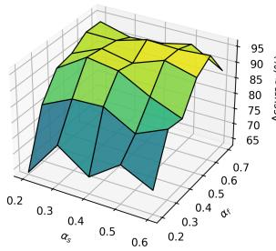  
(a)

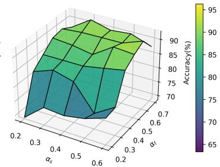  
(b)  
Fig. 6: The classification accuracy of smBGC with varied different hyperparameters on (a) ADNI-3 with three stages and (b) PPMI datasets.

2) Neuron Number in Hidden Layer: We investigate the impact of the number of neurons in the hidden layer on the performance of smBGC. Specifically, we conduct experiments with varying hidden layer sizes. As is shown in Fig. 7, the results reveal a clear trend: as the number of neurons in the hidden layer increases, the overall performance across the three tasks improves. Notably, smBGC achieves its best performance when the hidden layer is configured with 128 neurons. This observation highlights two key aspects. First, it underscores the model’s stability under different neuron configurations, demonstrating its robustness in handling varying setups. Second, it suggests that the choice of hidden layer size plays an important role in maximizing the model’s potential for learning meaningful representations.

## VI. CONCLUSION

This paper has presented a novel Stage-aware Multimodal Brain Graph Contrastive Learning (smBGC) method, which effectively distinguishes different stages of neurodegenerative disorders by exploring distinct brain patterns within each stage. In particular, the proposed method utilizes a stage-aware feature enhancement strategy, removing noise features and distilling stage-specific features to achieve precise targeting of different stages of disorder. smBGC explores the stage-specific characteristics of the progression of neurodegenerative disorders and provides deep insight into pathological mechanisms. It shows great potential to predict the progression trajectory of neurodegenerative disorders, which is crucial for early intervention and treatment planning. Extensive experimental results on two real-world datasets, i.e., ADNI-3 and PPMI, have demonstrated that smBGC outperforms state-of-the-art methods on Alzheimer’s disease detection and Parkinson’s disease detection.

[1] N. Chedid, J. Tabbal, A. Kabbara, S. Allouch, and M. Hassan, “The development of an automated machine learning pipeline for the detection of alzheimer’s disease,” Scientific Reports, vol. 12, no. 1, p. 18137, 2022.

[2] J. Chaki and M. Wozniak, “Deep learning for neurodegenerative disorder´ (2016 to 2022): A systematic review,” Biomedical Signal Processing and Control, vol. 80, p. 104223, 2023.

[3] J. Rasmussen and H. Langerman, “Alzheimer’s disease–why we need early diagnosis,” Degenerative Neurological and Neuromuscular Disease, pp. 123–130, 2019.

[4] A. Bhandarkar, P. Naik, K. Vakkund, S. Junjappanavar, S. Bakare, and S. Pattar, “Deep learning based computer aided diagnosis of alzheimer’s disease: a snapshot of last 5 years, gaps, and future directions,” Artificial Intelligence Review, vol. 57, no. 2, p. 30, 2024.

[5] C. Li, P. Li, Y. Zhang, N. Li, Y. Si, F. Li, Z. Cao, H. Chen, B. Chen, D. Yao, and P. Xu, “Effective emotion recognition by learning discriminative graph topologies in eeg brain networks,” IEEE Transactions on Neural Networks and Learning Systems, vol. 35, no. 8, pp. 10 258– 10 272, 2024.

[6] Q. Gao, N. Luo, M. Liang, W. Zhou, Y. Li, R. Li, X. Hu, T. Zou, X. Wang, J. Yu, J. Leng, and H. Chen, “A stepwise multivariate granger causality method for constructing hierarchical directed brain functional network,” IEEE Transactions on Neural Networks and Learning Systems, vol. 35, no. 4, pp. 4974–4984, 2024.

[7] H. Cui, W. Dai, Y. Zhu, X. Kan, A. A. C. Gu, J. Lukemire, L. Zhan, L. He, Y. Guo, and C. Yang, “Braingb: a benchmark for brain network analysis with graph neural networks,” IEEE Transactions on Medical Imaging, vol. 42, no. 2, pp. 493–506, 2022.

[8] J. Zimmermann, J. D. Griffiths, and A. R. McIntosh, “Unique mapping of structural and functional connectivity on cognition,” Journal of Neuroscience, vol. 38, no. 45, pp. 9658–9667, 2018.

[9] I. Bazarbekov, A. Razaque, M. Ipalakova, J. Yoo, Z. Assipova, and A. Almisreb, “A review of artificial intelligence methods for alzheimer’s disease diagnosis: Insights from neuroimaging to sensor data analysis,” Biomedical Signal Processing and Control, vol. 92, p. 106023, 2024.

[10] Z. Dai, Q. Lin, T. Li, X. Wang, H. Yuan, X. Yu, Y. He, and H. Wang, “Disrupted structural and functional brain networks in alzheimer’s disease,” Neurobiology of Aging, vol. 75, pp. 71–82, 2019.

[11] C. Peng, E. He, and F. Xia, “Learning on multimodal graphs,” IEEE Intelligent Systems, vol. 41, no. 2, pp. 80–91, 2026.

[12] J. Li, R. Zheng, H. Feng, M. Li, and X. Zhuang, “Permutation equivariant graph framelets for heterophilous graph learning,” IEEE Transactions on Neural Networks and Learning Systems, vol. 35, no. 9, pp. 11 634– 11 648, 2024.

[13] Y. Zhu, H. Cui, L. He, L. Sun, and C. Yang, “Joint embedding of structural and functional brain networks with graph neural networks for mental illness diagnosis,” in 2022 44th Annual International Conference of the IEEE Engineering in Medicine & Biology Society (EMBC). IEEE, 2022, pp. 272–276.

[14] Y. Yang, C. Ye, X. Guo, T. Wu, Y. Xiang, and T. Ma, “Mapping multimodal brain connectome for brain disorder diagnosis via cross-modal mutual learning,” IEEE Transactions on Medical Imaging, 2024.

[15] H. Ye, Y. Zheng, Y. Li, K. Zhang, Y. Kong, and Y. Yuan, “Rh-brainfs: regional heterogeneous multimodal brain networks fusion strategy,” Advances in Neural Information Processing Systems, vol. 36, 2024.

[16] J. Ren, F. Xia, I. Lee, A. Noori Hoshyar, and C. Aggarwal, “Graph learning for anomaly analytics: Algorithms, applications, and challenges,” ACM Transactions on Intelligent Systems and Technology, vol. 14, no. 2, Feb. 2023.

[17] H. Cho, J. Sim, G. Wu, and C. Park, “Neurodegenerative brain network classification via adaptive diffusion with temporal regularization,” in Proceedings of the 41st International Conference on Machine Learning (ICML), ser. Proceedings of Machine Learning Research, vol. 235. Vienna, Austria: PMLR, 2024, pp. 8593–8608.

[18] X. Li, Y. Zhou, N. Dvornek, M. Zhang, S. Gao, J. Zhuang, D. Scheinost, L. H. Staib, P. Ventola, and J. S. Duncan, “Braingnn: Interpretable brain graph neural network for fmri analysis,” Medical Image Analysis, vol. 74, p. 102233, 2021.

[19] X. Song, F. Zhou, A. F. Frangi, J. Cao, X. Xiao, Y. Lei, T. Wang, and B. Lei, “Multicenter and multichannel pooling gcn for early ad diagnosis based on dual-modality fused brain network,” IEEE Transactions on Medical Imaging, vol. 42, no. 2, pp. 354–367, 2022.

[20] H. Zhang, R. Song, L. Wang, L. Zhang, D. Wang, C. Wang, and W. Zhang, “Classification of brain disorders in rs-fmri via local-to-global graph neural networks,” IEEE Transactions on Medical Imaging, vol. 42, no. 2, pp. 444–455, 2022.

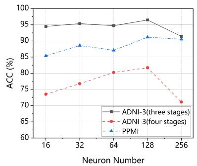

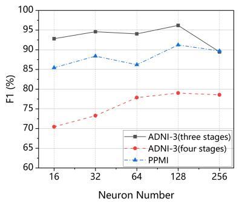

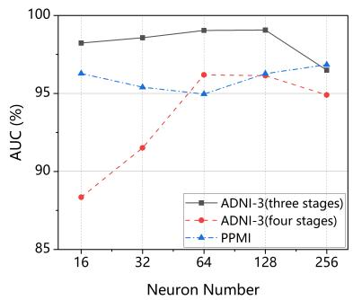  
Fig. 7: Accuracy, F1-score, and AUC values of the proposed model under different neuron numbers over three datasets.

[21] C. Peng, M. Liu, C. Meng, S. Yu, and F. Xia, “Adaptive brain network augmentation based on group-aware graph learning,” in The Second Tiny Papers Track at ICLR, 2024.

[22] C. Bian, N. Xia, A. Xie, S. Cong, and Q. Dong, “Adversarially trained persistent homology based graph convolutional network for disease identification using brain connectivity,” IEEE Transactions on Medical Imaging, 2023.

[23] Y. Ma, W. Cui, J. Liu, Y. Guo, H. Chen, and Y. Li, “A multi-graph cross-attention-based region-aware feature fusion network using multitemplate for brain disorder diagnosis,” IEEE Transactions on Medical Imaging, vol. 43, no. 3, pp. 1045–1059, 2024.

[24] H. Cai, X. Sheng, G. Wu, B. Hu, Y.-M. Cheung, and J. Chen, “Brain network classification for accurate detection of alzheimer’s disease via manifold harmonic discriminant analysis,” IEEE Transactions on Neural Networks and Learning Systems, vol. 35, no. 12, pp. 17 266–17 280, 2024.

[25] C. Peng, M. Liu, C. Meng, S. Xue, K. Keogh, and F. Xia, “Stage-aware brain graph learning for alzheimer’s disease,” in IEEE Conference on Artificial Intelligence, 2024.

[26] Y. Hu, J. Wang, H. Zhu, J. Li, and J. Shi, “Cost-sensitive weighted contrastive learning based on graph convolutional networks for imbalanced alzheimer’s disease staging,” IEEE Transactions on Medical Imaging, 2024.

[27] M. Li, A. Micheli, Y. G. Wang, S. Pan, P. Lio, G. S. Gnecco, and´ M. Sanguineti, “Guest editorial: Deep neural networks for graphs: Theory, models, algorithms, and applications,” IEEE Transactions on Neural Networks and Learning Systems, vol. 35, no. 4, pp. 4367–4372, 2024.

[28] S. Yu, S. Jin, M. Li, T. Sarwar, and F. Xia, “Long-range brain graph transformer,” Advances in Neural Information Processing Systems, 2025.

[29] S. Parisot, S. I. Ktena, E. Ferrante, M. Lee, R. G. Moreno, B. Glocker, and D. Rueckert, “Spectral graph convolutions for population-based disease prediction,” in Medical Image Computing and Computer Assisted Intervention- MICCAI, Quebec City, QC, Canada, Part III 20. Springer, 2017, pp. 177–185.

[30] Y. Ma, Q. Wang, L. Cao, L. Li, C. Zhang, L. Qiao, and M. Liu, “Multiscale dynamic graph learning for brain disorder detection with functional mri,” IEEE Transactions on Neural Systems and Rehabilitation Engineering, vol. 31, pp. 3501–3512, 2023.

[31] M. Liu, H. Zhang, F. Shi, and D. Shen, “Hierarchical graph convolutional network built by multiscale atlases for brain disorder diagnosis using functional connectivity,” IEEE Transactions on Neural Networks and Learning Systems, vol. 35, no. 11, pp. 15 182–15 194, 2024.

[32] J. Xu, Q. Bian, X. Li, A. Zhang, Y. Ke, M. Qiao, W. Zhang, W. Khang Jeremy Sim, and B. Gulyas, “Contrastive graph pooling for explain-´ able classification of brain networks,” IEEE Transactions on Medical Imaging, vol. 43, no. 9, pp. 3292–3305, 2024.

[33] H. Tang, G. Ma, L. Guo, X. Fu, H. Huang, and L. Zhan, “Contrastive brain network learning via hierarchical signed graph pooling model,” IEEE Transactions on Neural Networks and Learning Systems, vol. 35, no. 6, pp. 7363–7375, 2024.

[34] X. Han, R. Xue, J. Feng, Y. Feng, S. Du, J. Shi, and Y. Gao, “Hypergraph foundation model for brain disease diagnosis,” IEEE Transactions on Neural Networks and Learning Systems, vol. 36, no. 10, pp. 17 702– 17 716, 2025.

[35] W. Cui, Y. Leng, Y. Peng, C. Bai, L. Li, X. Jiang, G. Yuan, and

J. Zheng, “A novel dynamic neural network for heterogeneity-aware structural brain network exploration and alzheimer’s disease diagnosis,” IEEE Transactions on Neural Networks and Learning Systems, vol. 36, no. 9, pp. 15 764–15 778, 2025.

[36] J. Ren, M. Hou, Z. Liu, and X. Bai, “Eagle: Contrastive learning for efficient graph anomaly detection,” IEEE Intelligent Systems, vol. 38, no. 2, pp. 55–63, 2023.

[37] Y. Zhu, Y. Xu, F. Yu, Q. Liu, S. Wu, and L. Wang, “Graph contrastive learning with adaptive augmentation,” in Proceedings of the Web conference 2021, 2021, pp. 2069–2080.

[38] X. Zhang, Q. Tan, X. Huang, and B. Li, “Graph contrastive learning with personalized augmentation,” IEEE Transactions on Knowledge and Data Engineering, vol. 36, no. 11, pp. 6305–6316, 2024.

[39] J. Chen and G. Kou, “Attribute and structure preserving graph contrastive learning,” in Proceedings of the AAAI Conference on Artificial Intelligence, vol. 37, no. 6, 2023, pp. 7024–7032.

[40] X. Peng, J. Cheng, X. Tang, J. Liu, and J. Wu, “Dual contrastive learning network for graph clustering,” IEEE Transactions on Neural Networks and Learning Systems, vol. 35, no. 8, pp. 10 846–10 856, 2024.

[41] F.-Y. Sun, J. Hoffman, V. Verma, and J. Tang, “Infograph: Unsupervised and semi-supervised graph-level representation learning via mutual information maximization,” in International Conference on Learning Representations, 2020.

[42] H. Zhao, X. Yang, K. Wei, C. Deng, and D. Tao, “Unsupervised graph transformer with augmentation-free contrastive learning,” IEEE Transactions on Knowledge and Data Engineering, vol. 36, no. 11, pp. 7296–7307, 2024.

[43] R. D. Hjelm, A. Fedorov, S. Lavoie-Marchildon, K. Grewal, P. Bachman, A. Trischler, and Y. Bengio, “Learning deep representations by mutual information estimation and maximization,” in 7th International Conference on Learning Representations, ICLR 2019, New Orleans, LA, USA, May 6-9, 2019. OpenReview.net, 2019.

[44] Y. Wang, X. Wang, X. Huang, Y. Yu, H. Li, M. Zhang, Z. Guo, and W. Wu, “Intent-aware recommendation via disentangled graph contrastive learning,” in Proceedings of the Thirty-Second International Joint Conference on Artificial Intelligence, ser. IJCAI ’23, 2023.

[45] Y. Jiang, C. Huang, and L. Huang, “Adaptive graph contrastive learning for recommendation,” in Proceedings of the 29th ACM SIGKDD Conference on Knowledge Discovery and Data Mining, ser. KDD ’23. New York, NY, USA: Association for Computing Machinery, 2023, p. 4252–4261.

[46] W. Zhuo and G. Tan, “Graph contrastive learning with adaptive proximity-based graph augmentation,” IEEE Transactions on Neural Networks and Learning Systems, vol. 35, no. 10, pp. 14 301–14 314, 2024.

[47] H. Li, J. Cao, J. Zhu, Q. Luo, S. He, and X. Wang, “Augmentation-free graph contrastive learning of invariant-discriminative representations,” IEEE Transactions on Neural Networks and Learning Systems, vol. 35, no. 8, pp. 11 157–11 167, 2024.

[48] J. Liu, W. Cui, Y. Chen, Y. Ma, Q. Dong, R. Cai, Y. Li, and B. Hu, “Deep fusion of multi-template using spatio-temporal weighted multihypergraph convolutional networks for brain disease analysis,” IEEE Transactions on Medical Imaging, vol. 43, no. 2, pp. 860–873, 2024.

[49] C. R. Jack Jr, M. A. Bernstein, N. C. Fox, P. Thompson, G. Alexander, D. Harvey, B. Borowski, P. J. Britson, J. L. Whitwell, C. Ward et al., “The alzheimer’s disease neuroimaging initiative (adni): Mri methods,”

Journal of Magnetic Resonance Imaging: An Official Journal of the International Society for Magnetic Resonance in Medicine, vol. 27, no. 4, pp. 685–691, 2008.

[50] K. Marek, S. Chowdhury, A. Siderowf, S. Lasch, C. S. Coffey, C. Caspell-Garcia, T. Simuni, D. Jennings, C. M. Tanner, J. Q. Trojanowski et al., “The parkinson’s progression markers initiative (ppmi)– establishing a pd biomarker cohort,” Annals of clinical and translational neurology, vol. 5, no. 12, pp. 1460–1477, 2018.

[51] J. Wang, X. Wang, M. Xia, X. Liao, A. Evans, and Y. He, “Gretna: a graph theoretical network analysis toolbox for imaging connectomics,” Frontiers in Human Neuroscience, vol. 9, p. 386, 2015.

[52] Z. Cui, S. Zhong, P. Xu, Y. He, and G. Gong, “Panda: a pipeline toolbox for analyzing brain diffusion images,” Frontiers in Human Neuroscience, vol. 7, p. 42, 2013.

[53] T. N. Kipf and M. Welling, “Semi-supervised classification with graph convolutional networks,” in International Conference on Learning Representations, 2017.

[54] P. Velickovic, G. Cucurull, A. Casanova, A. Romero, P. Lio, and\` Y. Bengio, “Graph attention networks,” in 6th International Conference on Learning Representations, ICLR 2018, Vancouver, BC, Canada, April 30 - May 3, 2018, Conference Track Proceedings. OpenReview.net, 2018.

[55] W. L. Hamilton, Z. Ying, and J. Leskovec, “Inductive representation learning on large graphs,” in Advances in Neural Information Processing Systems 30: Annual Conference on Neural Information Processing Systems 2017, December 4-9, 2017, Long Beach, CA, USA, 2017, pp. 1024–1034.

[56] K. Xu, W. Hu, J. Leskovec, and S. Jegelka, “How powerful are graph neural networks?” in 7th International Conference on Learning Representations, ICLR 2019, New Orleans, LA, USA, May 6-9, 2019. OpenReview.net, 2019.

[57] K. Zheng, S. Yu, B. Li, R. Jenssen, and B. Chen, “Brainib: Interpretable brain network-based psychiatric diagnosis with graph information bottleneck,” IEEE Transactions on Neural Networks and Learning Systems, vol. 36, no. 7, pp. 13 066–13 079, 2025.

[58] R. Liu, Z.-A. Huang, Y. Hu, Z. Zhu, K.-C. Wong, and K. C. Tan, “Attention-like multimodality fusion with data augmentation for diagnosis of mental disorders using mri,” IEEE Transactions on Neural Networks and Learning Systems, vol. 35, no. 6, pp. 7627–7641, 2024.