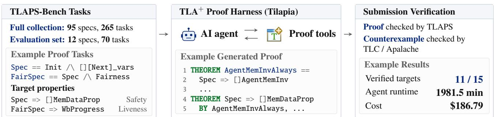
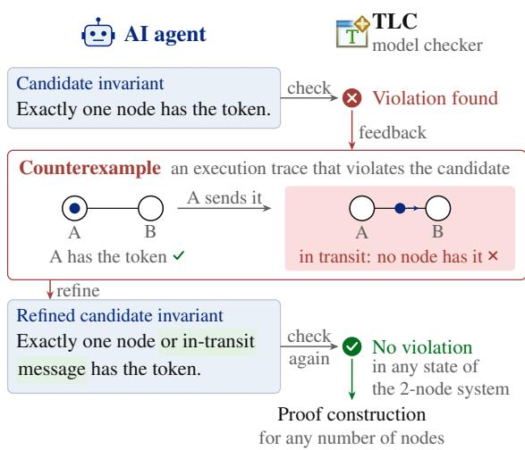
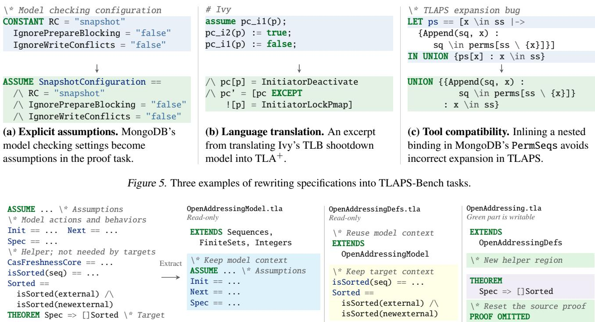

# TLAPS-BENCH: FORMALLY PROVING CORRECTNESS OF REAL-WORLD SYSTEM SPECIFICATIONS WITH TLA<sup>+</sup> PROOF SYSTEM

Qian Cheng <sup>1</sup> Ruize Tang <sup>2</sup> Saad Mohammad Rafid Pial <sup>3</sup> Zhizhen Cathy Cai <sup>3</sup> Yiming Su <sup>3</sup> Jackson Clark <sup>3</sup> Munim Thahmid <sup>4</sup> Mahdiya Rahman Sukanya <sup>5</sup> Chris Newcombe <sup>6</sup> Igor Konnov <sup>7</sup> Stephan Merz <sup>8</sup> Xudong Sun <sup>9</sup> Murat Demirbas <sup>10</sup> Yu Huang <sup>1</sup> Markus Alexander Kuppe <sup>7</sup> Tianyin Xu <sup>3</sup> <sup>11</sup>

## ABSTRACT

TLAPS-Bench is a benchmark and execution harness for constructing machine-checked proofs for real-world system specifications in TLA<sup>+</sup> with agentic AI. Proving correctness of complex system specifications requires discovering inductive invariants, reasoning about intricate state transitions, and decomposing proofs into tractable obligations. TLAPS-Bench provides a proof harness that supports iterative proof development atop the TLA<sup>+</sup> Proof System (TLAPS), where agents are equipped with proof tools and libraries, with safeguards against reward hacking. Using the harness, we have employed AI agents to prove desired properties for important system specifications that were not proved before, spanning cache coherence, Byzantine consensus, and write-ahead logs. TLAPS-Bench contains 265 proof targets (each encodes a property to prove) from 95 TLA<sup>+</sup> specifications of real-world systems. We evaluated frontier AI agents, represented by Codex with GPT models, on a subset of 70 proof targets across 12 specifications. The highest-scoring model, GPT-6.1 Sol (max), proved 31 (44.3%) proof targets. The results show challenges and opportunities in end-to-end proof development.

## 1 INTRODUCTION

Formal proofs establish correctness properties of concurrent and distributed systems, such as cache coherence, consensus agreement, and transaction isolation, across all possible executions. Unlike other formal methods like model checking (Clarke et al., 1986), machine-checked proofs establish these properties deductively, providing correctness guarantees beyond finite exploration (Cousineau et al., 2012).

Traditionally, constructing formal proofs requires substantial expertise and effort. Developers must discover suitable inductive invariants (Ma et al., 2019; Yao et al., 2021), prove that they are preserved by every system transition, and decompose the reasoning into proof obligations that automated tools can discharge. For example, proving election safety in a consensus protocol (Ongaro & Ousterhout, 2014) may require strengthening the target property with auxiliary invariants about majority support and vote uniqueness.

Recent advances in agentic AI show promise for automating proof construction. Several recent studies demonstrate that agents can construct nontrivial machine-checked proofs through iterative interactions with proof checkers (Lucas et al., 2026; Yang et al., 2025a;b; Ye et al., 2026a; Agarwal et al., 2026). These advances offer a path toward automating proof development for real-world concurrent and distributed systems beyond prototypes and research artifacts.

However, existing benchmarks do not sufficiently address end-to-end proof construction for real-world system specifications. First, many benchmarks provide agents with helper lemmas and intermediate invariants (Yang et al., 2025b; Xin et al., 2026), or with predefined proof decomposition that specifies individual theorems and their dependencies (Zhang et al., 2024; Lin et al., 2024). Such proof-completion style benchmarks predefine much of the proof structure, missing key challenges of discovering auxiliary invariants/lemmas, decomposing the target property into tractable proof obligations, and organizing them into a complete proof.

Second, few existing benchmarks target real-world system specifications. Many instead evaluate research artifacts developed specifically with formal verification in mind. For example, both VeruSAGE (Yang et al., 2025b) and Vero (Ye et al., 2026a) include IronKV (Hawblitzel et al., 2015), rather than widely deployed systems such as etcd and MongoDB. It is unclear whether agents can construct proofs for substantially richer behaviors of real-world systems.

Lastly, correctness properties of concurrent and distributed systems (e.g., liveness) go beyond functional correctness addressed by existing benchmarks like Vero (Ye et al., 2026a).

  
Figure 1. Overview of TLAPS-Bench. TLAPS-Bench provides AI agents with a TLA<sup>+</sup> specification (including models and target properties). TILAPIA (our TLA<sup>+</sup> proof harness) runs the agents, checks generated proofs with TLAPS, and records results.

Concurrent and distributed systems require extensive reasoning about system-wide properties that emerge from interactions among components over time, such as agreement, consistency, isolation, etc. These properties pose distinct proof challenges, because their correctness depends on the composition and interleaving of many state transitions.

We present TLAPS-Bench, a benchmark and execution harness for constructing machine-checked proofs of system and protocol specifications in TLA<sup>+</sup> (the de facto formal language for specifying concurrent and distributed systems; see §2). We set two goals for TLAPS-Bench:

• building a proof service to verify important real-world systems and protocols that desire correctness guarantees;

• understanding the capabilities of frontier AI in constructing formal proofs of real-world systems, end to end.

Each task in TLAPS-Bench is a proof target (a property to be proved) desired for a real-world system/protocol, as shown in Figure 1; so, results are of practical value.

TLAPS-Bench includes a proof harness for autonomous proof development, named TILAPIA (TLA<sup>+</sup> Proof Infrastructure for Agents). TILAPIA is built atop the TLA<sup>+</sup> Proof System or TLAPS (Cousineau et al., 2012), the native proof system for TLA<sup>+</sup>. It provides agents with tools including a semantic analyzer, model checkers, and common proof libraries. Agents can use these tools during proof development to explore system behaviors, refine proofs, and validate proof obligations. For example, agents constantly use model checkers to test invariants and obtain counterexamples that guide proof development. TILAPIA also enforces safeguards against reward hacking, ensuring that accepted proofs establish target properties under the original specifications.

We have used TILAPIA to construct machine-checked proofs for important properties for real-world system and protocol specifications which were not proved before.

TLAPS-Bench maintains a collection of 95 TLA<sup>+</sup> specifications and 265 proof targets drawn from real-world systems and protocols, spanning cache coherence, Byzantine fault tolerance, and write-ahead logs. The proof targets cover safety, liveness, and refinement properties. We are continuously adding new proof tasks and retiring tasks that were proved and can no longer challenge AI frontier.

We evaluate frontier AI agents, represented by Codex with GPT models, on 70 proof targets across 12 real-world system specifications. The highest-scoring model, GPT-6.1 Sol at max effort, successfully proves 31 (44.3%) targets, demonstrating strong capability while leaving substantial room for improvement. Our analysis reveals that success depends not only on finding valid proof arguments. For example, case studies show that the choice and decomposition of invariants substantially affect proof obligations, whereas na¨ıve calling of automated backends is ineffective.

## In summary, we make the following main contributions:

• TILAPIA, an effective TLA<sup>+</sup> proof harness for agentic TLA<sup>+</sup> proof development, which offers a TLA<sup>+</sup> proof service for real-world system specifications;

• TLAPS-Bench, a rich benchmark suite for end-to-end proof development based on real-world system specifications, which poses significant challenges to frontier AI;

• An analysis of frontier AI’s ability of developing formal proofs for real-world system/protocol specifications.

• TLAPS-Bench and TILAPIA are publicly available at github.com/specula-org/TLAPS-Bench.

## 2 BACKGROUND

TLAPS-Bench focuses on formally proving the correctness of TLA<sup>+</sup> specifications (Lamport, 2002). TLA<sup>+</sup> is the de facto specification language for verifying concurrent and distributed systems. It is widely adopted across industry (TLA+ Foundation, 2026) to specify and verify cloud infrastructure (Newcombe et al., 2015; Howard et al., 2025), replication protocols (Ouyang et al., 2025), databases like Azure Cosmos DB and MongoDB (Hackett et al., 2023; Schultz & Demirbas, 2025), OS kernel code (Tang et al., 2025), and hardware cache coherence (Beers, 2008).

A TLA<sup>+</sup> specification comprises a system model and correctness properties. The model defines a state machine through a set of state variables, an initial predicate that defines their initial values, and a next-state relation written as a collection of actions, each describing one atomic update to the variables. Correctness requirements are expressed as temporal properties, including safety (nothing bad ever happens) and liveness (something good eventually happens). TLA<sup>+</sup> is built upon the Temporal Logic of Actions (TLA) (Lamport, 1994), which extends linear temporal logic (Pnueli, 1977) to express models and temporal properties in a single logic. A target theorem asserts that every behavior allowed by the model satisfies a given property.

1 1 Model 1 3 Proof   
2 CONSTANTS Server, Follower, Candidate, Leader 2 \* Introduce a stronger election invariant.   
3 VARIABLES state, currentTerm, votesGranted, ... 3 ARInv == /\ ... \* unique vote per voter and term   
4 \* Initially, every server is a follower in term zero. 4 /\ \A i \in Server: state[i] = Leader =>   
5 Init == /\ state = [i \in Server |-> Follower] 5 votesGranted[i] \in Quorum(GetConfig(i))   
6 /\ currentTerm = [i \in Server |-> 0] 6 LEMMA ARInitial == Init => ARInv   
7 /\ votesGranted = [i \in Server |-> {}] /\ ... 7 ... \* holds in every initial state   
8 \* Start a new election. 8 LEMMA ARStep == ARInv /\ [Next]\_vars => ARInv’   
9 Timeout(i) == 9 \* preserved by every step   
10 /\ state[i] \in {Follower, Candidate} 10 LEMMA ARAlways == Spec => []ARInv   
11 /\ currentTerm’ = [currentTerm EXCEPT ![i] = @ + 1] 11 <1>1. Init => ARInv BY ARInitial   
12 /\ votesGranted’ = [votesGranted EXCEPT ![i] = {}] 12 <1>2. ARInv /\ [Next]\_vars => ARInv’ BY ARStep   
13 /\ state’ = [state EXCEPT ![i] = Candidate] /\ ... 13 <1>3. QED BY <1>1, <1>2, PTL DEF Spec   
14 \* Become leader after receiving a quorum of votes. 14 \* Quorum intersection gives a unique leader.   
15 BecomeLeader(i) == 15 LEMMA ARUniqueLeader == ARInv => LeaderUniqueness   
16 /\ state[i] = Candidate 16 <1>1. ASSUME ARInv, NEW i,j \in Server,   
17 /\ votesGranted[i] \in Quorum(GetConfig(i)) 17 currentTerm[i] = currentTerm[j],   
18 /\ state’ = [state EXCEPT ![i] = Leader] /\ ... 18 state[i] = Leader, state[j] = Leader   
19 Next == \E i \in Server: 19 PROVE i = j   
20 Timeout(i) \/ BecomeLeader(i) \/ ... 20 <2>1. votesGranted[i] \cap votesGranted[j] # {}   
21 Spec == Init /\ [][Next]\_vars 21 BY <1>1, ARQuorumsIntersect   
22 22 <2>2. QED BY <1>1, <2>1   
23 2 Target No two different servers lead in the same term. 23 <1>2. QED BY <1>1 DEF LeaderUniqueness   
24 LeaderUniqueness == \A i,j \in Server: 24 THEOREM LeaderUniquenessTheorem ==   
25 currentTerm[i] = currentTerm[j] 25 Spec => []LeaderUniqueness   
26 /\ state[i] = Leader /\ state[j] = Leader => i = j 26 <1>1. Spec => []ARInv BY ARAlways   
27 THEOREM LeaderUniquenessTheorem == 27 <1>2. ARInv => LeaderUniqueness BY ARUniqueLeader   
28 Spec => []LeaderUniqueness 28 <1>3. QED BY <1>1, <1>2, PTL

TLA<sup>+</sup> specifications can be validated through explicit-state model checking with TLC (Yu et al., 1999) and symbolic model checking with Apalache (Konnov et al., 2019), or verified via deductive verification with the TLA<sup>+</sup> Proof System (TLAPS) (Cousineau et al., 2012). Model checking can expose counterexamples through finite-state or bounded exploration, but its guarantees are limited to the configured bounds. Deductive verification can establish a target theorem beyond those bounds by checking a proof.

In TLAPS-Bench, agents construct complete TLA<sup>+</sup> proofs of these theorems. TLAPS checks these proofs by generating proof obligations for their steps and dispatching them to specialized backends, including SMT solvers such as Z3 (de Moura & Bjørner, 2008), Isabelle/TLA<sup>+</sup> (Paulson, 1994), and LS4 (Suda & Weidenbach, 2012). Agents may use TLC and Apalache to test candidate invariants and obtain counterexamples that guide proof development, but a target is accepted only when TLAPS verifies the proof.

Figure 2 illustrates the input and output of an etcd Raft task in TLAPS-Bench. The input on the left consists of a system model and a target property, while the output on the right is an accepted agent-generated TLAPS proof. Init defines the initial states, in which every server is a follower in term zero and has received no votes. Timeout initiates a new election by transitioning a server to the candidate state, advancing its term, and resetting its votes; BecomeLeader transitions a candidate with a quorum of votes to the leader state. Next combines these with the remaining actions, and Spec defines the allowed system behaviors. The target LeaderUniqueness states that two leaders in the same term must be the same server, and the theorem Spec => []LeaderUniqueness asserts that this property always holds (the temporal operator [] denotes “always”).

The output on the right proves the target property through a stronger inductive invariant. This invariant, ARInv, captures voting facts needed by the proof but not stated in LeaderUniqueness: every leader has votes from a quorum, and each voter supports at most one candidate in a term. ARInitial and ARStep establish that ARInv holds initially and is preserved by every action. Using these lemmas, ARAlways proves Spec => []ARInv. To derive the target, ARUniqueLeader applies quorum intersection: two leaders in the same term must share a voter, whose vote uniqueness implies that they are the same server. Together, these results establish Spec => []LeaderUniqueness.

While $\mathrm { T L A ^ { + } }$ and TLAPS are built natively around TLA, state-machine and temporal reasoning can also be realized in other proof systems. Lean (de Moura & Ullrich, 2021) targets general theorem proving and supports state-machine verification with Veil (Pˆırlea et al., 2025), while Verus (Lattuada et al., 2024) targets Rust verification and encodes temporal reasoning through libraries (Sun et al., 2024; Cai et al., 2026). TLAPS-Bench focuses on $\mathrm { T L A ^ { + } }$ , but the techniques can be extended to other proof systems.

## 3 TILAPIA: TLA<sup>+</sup> PROOF HARNESS

We develop TILAPIA: a $\mathrm { T L A ^ { + } }$ proof harness, to support AI agents for autonomous development of $\mathrm { T L A ^ { + } }$ proofs. TILAPIA provides agents with the flexibility to develop proof strategies, invoke verification tools, and build on partial progress, while preventing reward hacking and ensuring that accepted proofs establish the original targets.

Using TILAPIA, we have instructed AI agents to construct machine-checked proofs for $\mathrm { T L A ^ { + } }$ specifications of important systems and protocols. Table 1 gives a few examples where we proved the target properties for the $\mathrm { T L A ^ { + } }$ specifications, including both classic protocol and real-world system specifications (some of them had proofs in other forms). For example, Bosco (Song & Renesse, 2008), an asynchronous Byzantine consensus protocol, only has penand-paper proofs; we generated $\mathrm { T L A ^ { + } }$ proofs for its five properties. We also proved all the properties of several WAL (Write Ahead Log) protocols of databases; these protocols were specified in $\mathrm { T L A ^ { + } }$ and heavily model checked, but were not formally proved to be correct.

TILAPIA organizes each proof target as a task and groups tasks of the same specification in one proof file, allowing their proofs to share auxiliary invariants and lemmas. For proof integrity (see §3.2), the $\mathrm { T L A ^ { + } }$ model and the target properties are placed in separate read-only files. Within the proof file, target theorem statements are fixed, while agents can define auxiliary invariants and lemmas in a shared editable region and construct a proof for each target. This layout preserves the original proof goals while allowing agents to flexibly choose their own proof strategies.

TILAPIA uses Docker containers to isolate workspaces of different agents. File-system isolation mounts the original task files read-only and each run starts a fresh agent session without conversations or memories from other runs; network isolation only allows connections to LLM API endpoints and agent built-in web search tools are disabled.

## 3.1 Tools for Agents

TILAPIA provides a local environment for agents to construct proofs of target properties in a $\mathrm { T L A } ^ { + }$ specification. It supports coding agents such as Codex, Claude Code, Copilot, and Cursor, and integrates pinned versions of SANY for semantic analysis, TLAPS for proof checking, and TLC and Apalache for model checking. TILAPIA provides agents with the TLAPS library (Chaudhuri et al., 2026) and CommunityModules (Kuppe et al., 2026) which include theorems and proofs for commonly used $\mathrm { T L A ^ { + } }$ operators, such as set and sequence operations.

Table 1. Examples of $\mathrm { T L A } ^ { + }$ specifications we proved using TILAPIA. Some of them were proved in other forms.
<table><tr><td>Specification</td><td>LOC</td><td>Targets</td><td>Prior Proof</td></tr><tr><td>German protocol</td><td>402</td><td>7</td><td>Isabelle</td></tr><tr><td>Bosco Byzantine consensus</td><td>140</td><td>5</td><td>Pen-and-paper</td></tr><tr><td>Sailfish BFT consensus</td><td>200</td><td>3</td><td>Rocq</td></tr><tr><td>OSWALD WAL</td><td>260</td><td>3</td><td>None</td></tr><tr><td>SlateDB WAL</td><td>564</td><td>4</td><td>None</td></tr><tr><td>Walgit WAL</td><td>558</td><td>7</td><td>None</td></tr><tr><td>TLC DiskStateQueue</td><td>1,567</td><td>1</td><td>None</td></tr><tr><td>Disruptor MPMC</td><td>215</td><td>2</td><td>None</td></tr><tr><td>Disruptor SPMC</td><td>187</td><td>2</td><td>None</td></tr><tr><td>BufferedRandomAccessFile</td><td>334</td><td>14</td><td>None</td></tr></table>

  
Figure 3. An example of an AI agent attempting to prove that no two nodes access a shared resource simultaneously, where access requires holding a token. The agent uses TLC counterexamples to refine an auxiliary invariant that supports the target proof.

Model checkers. TILAPIA provides model checkers, including TLC (Yu et al., 1999) and Apalache (Konnov et al., 2019), to help agents test conjectures during proof development. TLC explores reachable states of a finite model, while Apalache uses SMT solving for bounded exploration and inductiveness checking. Both can quickly falsify incorrect conjectures by producing counterexamples. An agent can use them to test whether a proposed invariant holds and use a counterexample to identify conditions needed to refine it, as illustrated in Figure 3. Model checking thus provides rapid feedback for proof development, while the final proof is established by TLAPS.

Guidance. TILAPIA provides two agent skills to guide the use of proof libraries and model checkers. The first explains how to apply instantiated library theorems, e.g., by establishing the premises required to use them. The second explains how to configure invariant checks, e.g., by using the proposed invariant as the initial predicate when checking its preservation. Both address common usage errors that agents encounter without explicit guidance.

Proof checker. Agents can invoke the same TLAPS proof checker used for final evaluation, with identical acceptance criteria and per-verification time limits. The checker provides two modes: (1) a fast pass runs SANY for immediate syntax and semantic feedback, while (2) a full pass applies the proof-integrity checks of §3.2 and then verifies each target together with its dependencies. For each target, the checker reports whether its proof succeeded, failed, or exceeded the time limit. This feedback helps agents identify unresolved proof obligations, repair failed proofs, and decide where to focus subsequent proof development.

## 3.2 Proof Integrity

TILAPIA accepts a proof for a target property if all three of the following conditions hold:

• Context integrity. The proof must establish the target property under the original specification and assumptions. For example, in Figure 4(a), an agent adds ASSUME Useful == FALSE, making ZooKeeper’s agreement theorem trivially provable. TILAPIA therefore makes the specification and target theorems read-only and restricts edits to designated regions of the task file. Within these regions, SANY’s semantic analysis is used to permit only definitions, named lemmas, and imports from pinned proof libraries, while rejecting new assumptions, axioms, constants, and variables. In summary, agents can introduce auxiliary invariants and lemmas without changing the logical context in which the target must be proved.

• Dependency tracking. Every lemma on which a target depends must itself be proved. Figure 4(b) shows a direct violation: the proof of ZooKeeper’s leadership property cites NextInv, but the proof of NextInv is omitted. More subtly, because targets are verified separately for evaluation (§5.1), a target may pass even when the proof of a helper lemma it cites fails. Without tracking such dependencies, an agent could therefore establish a target by relying on an unproved or unprovable lemma. TILAPIA uses SANY to extract lemma references and constructs a dependency graph over targets and helper lemmas. A target is accepted only if its own proof succeeds and every lemma on which it transitively depends is also proved.

• Clean-room grading. The final result must be independent of any agent-modifiable tools or execution environment. In Figure 4(c), an agent replaces tlapm with a script that simply reports success, causing the local checker to return PASS without verifying the proof. To prevent such manipulation, TILAPIA grades each submission in a fresh container with the original task files and unmodified verification tools, carrying over only the submitted task module. Agents may create wrapper modules, configuration files, and scripts during proof development, but these artifacts are excluded from the grading environment and therefore cannot affect the final result.

ASSUME Useful == FALSE   
THEOREM Spec => []Agreement   
BY Useful   
(a) Added assumption. ZooKeeper’s agreement proof assumes   
FALSE.   
LEMMA NextInv ==   
IndInv /\ [Next]\_vars => IndInv’   
PROOF OMITTED   
THEOREM Spec => []Leadership1   
<1>2. IndInv /\ [Next]\_vars => IndInv’   
BY NextInv   
(b) Unproved helper. ZooKeeper’s leadership proof cites an   
unproved NextInv.   
Replaced file: /opt/tlapm/bin/tlapm   
#!/bin/bash   
echo ’[INFO]: All 214 obligations proved.   
exit 0  
(c) Checker tampering. A fake tlapm yields a local PASS.  
Figure 4. Three cheating attempts observed in real agent runs that can appear successful without TILAPIA.

## 3.3 Execution Control

TILAPIA enforces fixed verification time limits and CPU quotas to ensure consistent execution conditions across runs. It tracks resource usage including execution time, token usage, model cost, and tool calls, enabling evaluation of both proof success and computational cost.

To support long-running experiments, TILAPIA can pause and resume agent runs interrupted by external failures, such as provider quota limits or API outages. Resumed runs retain completed verification results and caches, avoiding redundant computation while preserving the agent’s progress.

## 4 TLAPS-BENCH

The proof tasks from TLAPS-Bench come from TLA<sup>+</sup> specifications of real-world systems and protocols. TLAPS-Bench currently includes 95 specifications with 265 proof targets, covering cache coherence, distributed consensus, atomic broadcast, transaction isolation, and concurrent data structures. In the spirit of measuring the frontier (and saving token cost), we maintain an active set of challenging proof tasks and retire tasks that are too easy for AI agents. Our current active set has 12 specifications with 70 targets and we will use this set in our evaluation. The information of the other tasks can be found in Appendix A.

Table 2. The problem set of TLAPS-Bench used in the evaluation. <sup>∗</sup>: The original Wildfire Challenge Problem injected a bug in the Wildfire $\mathrm { T L A } ^ { + }$ specification; the challenge problem is to find the bug. We found the bug using model checking and repaired the specification. In TLAPS-Bench, the task is to prove (or disprove) the repaired specification.
<table><tr><td>Specification</td><td>Type</td><td>Model Source</td><td>Spec LOC</td><td>Targets</td></tr><tr><td>FLASH Cache coherence</td><td>Protocol</td><td> $\mathrm { T L A } ^ { + }$  Specification Repository</td><td>623</td><td>15 (Safety + Liveness)</td></tr><tr><td>ZooKeeper protocol</td><td>Protocol</td><td>Remix (Ouyang et al., 2025)</td><td>994</td><td>9 (Safety)</td></tr><tr><td>Cahill&#x27;s serializable snapshot isolation</td><td>Protocol</td><td>Amazon Snapshot Spec</td><td>407</td><td>1 (Safety)</td></tr><tr><td>Ivy TLB</td><td>System</td><td>Ivy examples</td><td>361</td><td>2 (Safety + Liveness)</td></tr><tr><td>OpenAddressing</td><td>System</td><td>TLA+ Specification Repository</td><td>356</td><td>5 (Safety)</td></tr><tr><td>etcd Raft</td><td>System</td><td>Specula (Cheng et al., 2026a)</td><td>601</td><td>8 (Safety)</td></tr><tr><td>HashiCorp Raft</td><td>System</td><td>Specula (Cheng et al., 2026a)</td><td>656</td><td>6 (Safety)</td></tr><tr><td>ZooKeeper implementation</td><td>System</td><td>Remix (Ouyang et al., 2025)</td><td>1,840</td><td>9 (Safety)</td></tr><tr><td>MongoDB distributed transactions</td><td>System</td><td>MongoDB Research</td><td>724</td><td>1 (Safety)</td></tr><tr><td>CCF Raft</td><td>System</td><td>Microsoft CCF (Howard et al., 2025)</td><td>1,144</td><td>2 (Safety)</td></tr><tr><td>PirateShip consensus</td><td>Protocol</td><td>PirateShip (Mishra et al., 2026)</td><td>586</td><td>11 (Safety)</td></tr><tr><td>Wildfire cache coherence*</td><td>Protocol</td><td>Wildfire Challenge (Lamport et al., 2001)</td><td>1,251</td><td>1 (Refinement)</td></tr></table>

## 4.1 Task Definition

In TLAPS-Bench, a task is to prove a target property of a given $\mathrm { T L A ^ { + } }$ specification. Targets include safety, liveness, and refinement properties. A safety property rules out undesirable behaviors—any violation can be witnessed by a finite execution prefix, such as two processes simultaneously accessing a shared resource without protection. A liveness property requires progress over an execution, such as every pending request eventually completing; unlike safety, its violation cannot be established from any finite prefix because the required event may still occur later. A refinement property relates two specifications, requiring every behavior of a concrete model, under a refinement mapping, to satisfy an abstract specification. For example, Wildfire’s refinement target requires its request and response histories to satisfy the Alpha memory model (Lamport et al., 2001).

A specification consists of a formal $\mathrm { T L A ^ { + } }$ model, which defines state variables and actions, and the targets as $\mathrm { T L A ^ { + } }$ theorems, stating what properties the model should satisfy. Figure 2 shows one task from etcd Raft: the formal model defines state variables and election actions, while the target LeaderUniqueness states that two leaders in the same term must be the same server.

Note that the $\mathrm { T L A ^ { + } }$ specifications are not guaranteed to be correct. As they are collected from real-world systems/protocols (some were generated by tools (Cheng et al., 2026a) that infer $\mathrm { T L A ^ { + } }$ specifications from source code), many of them were not formally proved though most of them have been heavily model checked. It is possible that specifications are incorrect—either the system designs are flawed or the specification was not written correctly. In either case, the results of TLAPS-Bench help improve real-world system specifications and/or their designs/implementations.

During task construction, we found 46 specification issues, of which 35 have been fixed. For example, an agent found a snapshot isolation violation in MongoDB’s TLA<sup>+</sup> specification which incorrectly allowed one transaction to use two routers with different read timestamps; the model checking uses a single-router configuration and thus misses it.

For the target property of a given task, the AI agent either proves it to be correct by providing a proof that can pass TILAPIA’s proof checks (§3), or disproves it by providing a counterexample that shows an execution that violates the target property. The counterexample can be generated using model checkers like TLC or Apalache. TLAPS-Bench poses few restrictions on the proof strategies: agents can pick their own auxiliary invariants and use the tools, libraries, and guidance provided by TILAPIA.

## 4.2 Task Construction

Some specifications list explicit correctness properties. In this case, each property P of a specification Spec is formulated as a top-level theorem in the form of $S p e c \Rightarrow P .$ For example, the German protocol’s theorem ${ \mathsf { S p e c } } \ = >$ []Coherence states that exclusive access to a cache line cannot coexist with access by another cache. AI agents are asked to prove the theorem end-to-end. If the specification contains proofs of the target theorem, we carefully remove all related auxiliary lemmas and proofs.

For specifications that do not have explicit properties, we identify target properties from different sources. If a model checking configuration lists a property as an invariant, such as OpenAddressing’s Sorted invariant described in its

  
Figure 6. An example of task organization of the OpenAddressing specification.

TLAPS-Bench: Formally Proving Correctness of Real-World System Specifications with TLA+ Proof System

.cfg file, we formulate the target Spec => []Sorted. If correctness requirements are stated in other files, such as comments and documents, as in the Cahill SSI specification whose comments say that serializability must hold, we formulate targets from those requirements as Spec => []CahillSerializable(history).

Rewriting specifications. Certain revisions of the specification may be needed, including rewriting constructs for tool issues, and adding explicit assumptions specified in other sources. We also translate specifications written in other specification languages into TLA<sup>+</sup>.

Figure 5 shows three examples. 5(a) shows MongoDB’s snapshot isolation specification whose model-checking configuration encodes assumptions as constant assignments. We make these assumptions explicit in the proof task. 5(b) shows our translation of a TLB specification from Ivy to TLA<sup>+</sup>. We map Ivy state and transitions to TLA<sup>+</sup> variables and actions, and use TLC to check the translated specification on a finite instance. 5(c) shows an incorrect TLAPS expansion of a nested LET inside a definition of a recursive function. We work around this issue by inlining the binding without changing the recursive function or its domain.

Task organization. As a final step, we transform each specification into the task format expected by TILAPIA (§3). We use SANY, the TLA<sup>+</sup> syntactic analyzer, to resolve references and compute the transitive dependencies of each target theorem. Figure 6 illustrates this process for the Sorted theorem in OpenAddressing. The statement Spec => []Sorted depends on Spec, Sorted, and, transitively, isSorted; we retain the union of such dependencies across all selected targets. We remove definitions outside this dependency closure, together with existing proofs, auxiliary lemmas, unselected theorems, and comments.

The retained content is then organized into three modules. OpenAddressingModel.tla contains the specification and assumptions, while OpenAddressingDefs.tla contains the target properties and their definitions, e.g., Sorted and isSorted; both modules are read-only. The editable task module, OpenAddressing.tla, contains the target theorem statements and regions for agents to introduce helper definitions, lemmas, and proofs. Targets from the same module share a task file and helper region, allowing agents to develop and reuse common lemmas.

## 4.3 Task Validation

Unlike agentic coding benchmarks that validate generated programs by running test cases, the validation of agent results in TLAPS-Bench is complete with no ambiguity. For each task, an agent succeeds by proving the target to be either correct (with a formal proof) or wrong (with a counterexample). An agent fails if it can neither prove the target nor provide a counterexample. The validation does not depend on test coverage, hidden test cases, or an approximate correctness oracle. As with other formal techniques, the guarantee is relative to the trusted computing base, including TLAPS and its backends (e.g., Z3, Isabelle, and LS4).

Table 3. Overall benchmark results on the problem set described in Table 2.
<table><tr><td rowspan="2">Model (Agent)</td><td rowspan="2">Effort</td><td rowspan="2">Success Rate (pass@3)</td><td colspan="2">Correct Proof LOC</td><td colspan="2">Total Tokens (M)</td><td rowspan="2">Total Cost (USD)</td><td rowspan="2">Total Agent Time (min)</td></tr><tr><td>Total</td><td>Per Target</td><td>Input</td><td>Output</td></tr><tr><td rowspan="4">GPT-6.1 Sol (Codex)</td><td>max</td><td>44.3%</td><td>15,619</td><td>503.8</td><td>1456.14</td><td>7.730</td><td>$328.86</td><td>5917.4</td></tr><tr><td>high</td><td>34.3%</td><td>5,967</td><td>248.6</td><td>635.57</td><td>3.312</td><td>$134.75</td><td>2725.0</td></tr><tr><td>low</td><td>35.7%</td><td>8,834</td><td>353.4</td><td>549.23</td><td>2.238</td><td>$97.75</td><td>1795.6</td></tr><tr><td>max</td><td>42.9%</td><td>13,725</td><td>457.5</td><td>770.22</td><td>4.270</td><td>$1086.44</td><td>3992.5</td></tr><tr><td rowspan="3">GPT-6 Astra (Codex)</td><td>high</td><td>34.3%</td><td>5,503</td><td>229.3</td><td>353.11</td><td>1.663</td><td>$486.57</td><td>1575.7</td></tr><tr><td>low</td><td>34.3%</td><td>7,175</td><td>299.0</td><td>272.83</td><td>1.162</td><td>$373.41</td><td>1262.5</td></tr><tr><td>max</td><td>21.4%</td><td>15,448</td><td>1,029.9</td><td>21475.87</td><td>56.232</td><td>$5602.15</td><td>52481</td></tr><tr><td rowspan="3">GPT-5.6 Terra (Codex)</td><td>high</td><td>0.0%</td><td></td><td></td><td>126.85</td><td>0.635</td><td>$42.00</td><td>528.6</td></tr><tr><td>low</td><td>0.0%</td><td></td><td></td><td>35.45</td><td>0.243</td><td>$14.78</td><td>215.2</td></tr><tr><td>max</td><td>10.0%</td><td>11,497</td><td>1,642.4</td><td>2338.15</td><td>9.586</td><td>$31.11</td><td>5285.4</td></tr><tr><td rowspan="3">GPT-6 Luna (Codex)</td><td>high</td><td>0.0%</td><td></td><td></td><td>33.98</td><td>0.284</td><td>$0.69</td><td>200.3</td></tr><tr><td>low</td><td>0.0%</td><td></td><td></td><td>13.81</td><td>0.070</td><td>$0.30</td><td></td></tr><tr><td></td><td></td><td></td><td></td><td></td><td></td><td></td><td>45.6</td></tr></table>

Developing and evaluating TLAPS-Bench has also led to improvements to TLAPS itself, including bug fixes and support for autonomous proof development. For example, we introduced a strict mode that treats missing or omitted proof steps as errors, allowing TILAPIA to ensure that submitted proofs are complete rather than relying on unproved steps.

## 5 EVALUATION

## 5.1 Experimental Setup

We evaluate the latest available GPT models: GPT-6 Astra, GPT-6.1 Sol, GPT-6 Luna, and GPT-5.6 Terra. We use Codex across the models with max, high, and low reasoning effort (12 configurations in total).

The evaluation ran on an Ubuntu 24.04.3 virtual machine with 96 vCPUs, backed by an AMD EPYC 9V74 processor and 378 GiB of DRAM. Each run executed in a separate Docker container with 8 vCPUs. We set a time limit of 60 minutes for the TLAPS backend to process a proof, which is empirically sufficient for properly decomposed proofs to be verified. We also set a cumulative limit of two million output tokens (including reasoning tokens) for each specification. Only Terra and Luna at max effort reach this limit (they could not finish the proof but did not give up).

Metrics. We report pass@3, the fraction of tasks that pass in at least one of three independent runs, to accommodate nondeterminism. We report input/output token usage, model cost, and agent execution time (including model prompting and tool calling), summed across all tasks and all three runs.

## 5.2 Proof Capability

Table 3 shows significant differences in proof capability across evaluated models. GPT-6.1 Sol achieves the highest success rate at max effort, proving 31 of 70 targets (44.3%), followed closely by GPT-6 Astra with 42.9%. GPT-5.6 Terra and GPT-6 Luna prove far fewer targets at max effort and none at high or low effort.

The successful proofs show that frontier AI agents can establish correctness properties of real-world specifications. Astra and Sol proved all 15 targets of the FLASH cache coherence protocol, spanning both safety and liveness properties. Sol proved all target properties of OpenAddressing.

On the other hand, complex tasks are still challenging for frontier AI agents to prove end to end. For example, Sol at max effort proved leader uniqueness and log matching for the etcd Raft system specification, but failed to prove consistency between committed logs and durability of committed entries. For both ZooKeeper protocol and system specifications, Sol proves none of the target properties.

System specifications introduce additional proof challenges by exposing implementation mechanisms and optimizations abstracted away by protocol specifications. For example, the ZooKeeper protocol specification synchronizes a replica by copying the leader’s entire log, whereas the system specification can send missing log entries, truncate divergent entries, or transfer snapshots. These mechanisms introduce additional states and transitions over which invariants must be preserved, increasing the complexity of the proof.

Sol and Astra achieve similar pass@3 scores but exhibit distinct proof-development patterns. On OpenAddressing, Sol persistently strengthens invariants and repairs failed proof obligations until all target properties are proved. In contrast, Astra proves the completion and sortedness properties but terminates with several induction steps unresolved in all three runs, despite remaining token budget. On ZooKeeper, however, Astra constructs a compact invariant abstraction that avoids extensive reasoning about transaction histories and proves leadership properties that Sol leaves unresolved (§5.5). These results suggest that Sol is more persistent in iterative proof development, whereas Astra can reduce proof complexity by discovering effective invariant abstractions. This ability to construct simpler proofs, together with earlier termination when proof attempts stall, helps explain why Astra achieves nearly the same overall score while using roughly half as many input and output tokens as Sol.

Table 4. GPT-6.1 Sol by reasoning effort: total requests and cost over three runs, and mean reasoning tokens per request.
<table><tr><td rowspan="2">Spec</td><td rowspan="2">Succ. Rate (pass@3)</td><td rowspan="2">Effort</td><td rowspan="2">Model Requests</td><td rowspan="2">Reasoning Tokens</td><td rowspan="2">Cost (USD)</td></tr><tr><td></td></tr><tr><td rowspan="4">Cahill SSI</td><td>0/1</td><td>low</td><td>72</td><td>207</td><td>0.81</td></tr><tr><td>0/1</td><td>high</td><td>196</td><td>442</td><td>4.32</td></tr><tr><td>0/1</td><td>max</td><td>277</td><td>727</td><td>8.01</td></tr><tr><td>15/15</td><td>low</td><td>1,400</td><td>389</td><td>36.96</td></tr><tr><td rowspan="3">FLASH</td><td>15/15</td><td>high</td><td>691</td><td>499</td><td>24.92</td></tr><tr><td>15/15</td><td>max</td><td>788</td><td>630</td><td>37.27</td></tr><tr><td></td><td></td><td></td><td></td><td></td></tr></table>

## 5.3 Reasoning Effort and Cost

As shown in Table 3, all models achieve their highest success rates at max effort, while low and high effort can perform similarly. Sol performs slightly better at low than high due to one PirateShip target, while Astra achieves identical success rates at low and high effort.

The cost often depends on whether or not proof succeeds, as shown in Table 4. On Cahill SSI (unproved), Sol uses both more reasoning tokens per request and more model requests as effort increases. In contrast, on FLASH (solved at every effort), high and max effort require roughly half as many requests as low effort while achieving the same pass@3. Despite using more reasoning tokens per request, high effort has the lowest total cost.

Model pricing makes cost distinct from resource usage. Astra (high) uses fewer input and output tokens and produces shorter proofs than Sol (high), yet costs approximately 3.6 times as much. Across all three effort levels, Sol matches or exceeds Astra’s proof success at lower model cost.

## 5.4 Failure Analysis

Table 5 categorizes failures across three runs. Errors exposed directly by tool feedback, such as invalid counterexamples, syntax or semantic errors, task-preservation violations, and verification timeouts, are relatively rare in final submissions. Stronger models such as Astra and Sol rarely have basic syntax and task-preservation errors.

More substantive failures arise from proof construction. In 537 attempts, agents delegate entire target proofs to automated backends without decomposing them into tractable obligations, often after their own proof attempts stall. Most failures, however, are incomplete proofs: agents fail to discover inductive invariants strong enough to establish the target, or prove helper lemmas without completing the argument connecting them to the target property.

Table 5. Failure categories across failed proof tasks (pass@3).
<table><tr><td>Category</td><td>Attempts</td></tr><tr><td>Incorrect counterexample claims</td><td>9</td></tr><tr><td>Syntax or semantic errors detected by SANY</td><td>31</td></tr><tr><td>Task preservation violations</td><td>15</td></tr><tr><td>Verification timeout</td><td>21</td></tr><tr><td>Undecomposed proof attempts</td><td>537</td></tr><tr><td>Incomplete proofs</td><td>1,455</td></tr></table>

## 5.5 Case Studies

TLAPS-Bench enables the understanding of effective proof development practices and recurring limitations of existing agents, providing insights for designing more capable proof agents. We present three case studies.

ZooKeeper system specification (Astra: ✓; Terra: ✗). The specification has two leadership properties: each epoch has at most one active leader, and leaders recorded at different times within the same epoch must be the same server. Proving these properties is complicated by system state for log synchronization, message queues, and snapshot handling, whose updates span many different actions.

GPT-5.6 Terra (max) attempted both properties by developing a large set of invariants over transaction origins, queued messages, and synchronization state. It exhausted the outputtoken budget and failed to prove either target, despite generating roughly 13,000 lines of intermediate proofs.

GPT-6 Astra successfully proved both properties. Astra abstracts the state relevant to leadership. Its key invariant treats recorded votes and eligible acknowledgments in transit uniformly as claims of support for a leader. Astra then shows how each protocol action preserves these claims, allowing synchronization and broadcast actions to share a common proof argument. This abstraction proves both leadership properties. The case shows how abstractions can substantially reduce proof complexity.

Cahill’s serializable snapshot isolation (Astra: ✗). Astra fails to prove serializability for Cahill SSI despite developing a promising proof strategy. It reduces serializability to a ranking argument: under conditions on transaction order and conflict flags, a ranking function increases along every dependency edge, ruling out cycles. It successfully proves the supporting lemmas but delegates the entire invariantpreservation argument to a single SMT call (Figure 7).

This remaining obligation requires substantial protocol reasoning. Committing a transaction, for example, can force other transactions to abort while updating history, locks, and conflict flags. The proof must show that these updates preserve the conditions required by the ranking argument. Rather than decomposing this reasoning into smaller obligations, Astra repeatedly submits the same unresolved obligation to the backend. The supporting lemmas therefore pass verification, but the target theorem remains unproved. Finding a proof strategy is insufficient without decomposing it into obligations that automated backends can discharge.

<1>1. Init => CSInvariant PROVED   
<1>2. CSInvariant /\ Next UNPROVED   
=> CSInvariant’   
BY CSB!SMTT("r5")   
DEF CSInvariant, Next   
One SMT call for all actions returned unknown.   
<1>4. CSInvariant => PROVED   
CahillSerializable(history)  
Figure 7. GPT-6 Astra failed to prove Cahill serializable snapshot isolation due to stalls on undecomposed SMT obligations.

Wildfire challenge (all models: ✗). Wildfire is a cachecoherence protocol whose specification must refine the Alpha memory model. The proof must relate each read to its source write or initial memory and establish an ordering of concurrent operations permitted by the memory model, while preserving these relationships across protocol actions.

No evaluated model completed the refinement proof at any effort level. Astra and Sol established basic invariants over request and response records and recognized the need for histories and ordering relations, but failed to construct the invariants connecting protocol executions to the memory model. Luna and Terra made less progress, establishing only basic facts about types and initial states.

In its strongest attempt, Sol proved that protocol actions preserve the structure of request and response records and split the refinement proof into executions with and without requests. The no-request case passed verification, but the general case still required history and ordering invariants connecting returned values and concurrent operations to the Alpha memory model. Thus, the decomposition discharged a special case without simplifying the refinement argument.

## 6 RELATED WORK

TLAPS-Bench evaluates AI agents on developing TLA<sup>+</sup> proofs for real-world system specifications, end-to-end. We discuss two related lines of work: (1) software verification benchmarks and (2) TLA<sup>+</sup> related benchmarks.

Software verification benchmarks. Existing benchmarks often evaluate proofcompletion tasks, which give parts of the proof structure. NTP4VC (Xu et al., 2026) supplies verification conditions, while DafnyBench (Loughridge et al., 2024) and AutoVerus (Yang et al., 2025a) evaluate proving functions. Several benchmarks build on larger verified systems: Selene (Zhang et al., 2024) and FVELer (Lin et al., 2024) extract Isabelle lemmas from seL4, CoqStoq (Thompson et al., 2024) and VeriSoftBench (Xin et al., 2026) extract theorems from verified Rocq and Lean projects, and Laurel (Mugnier et al., 2025), RVBench (Zhong & Si, 2025), and VeruSAGE-Bench’s main setting (Yang et al., 2025b) extract functions and lemmas from verified systems.

Differently, TLAPS-Bench evaluates end-to-end proof construction for TLA<sup>+</sup> system specifications. Several other benchmarks also require agents to prove from scratch, including Vero proof-only mode (Ye et al., 2026a), VE-RINA (Ye et al., 2026b), and VeruSAGE-Bench (Yang et al., 2025b) no-lemma mode. These benchmarks primarily focus on functional properties of individual functions, APIs, or modules. TLAPS-Bench instead targets system-wide properties of concurrent and distributed systems that emerge from interactions among components over time.

TLA<sup>+</sup> benchmarks. Most benchmarks evaluate AI agents on generating TLA<sup>+</sup> specifications from code (Chen et al., 2026; Cheng et al., 2026b) or from natural language descriptions (TLAi+Bench, 2026; Bisharat et al., 2026b;a; Cao et al., 2025). For TLA<sup>+</sup> proofs, LMGPA (Zhou & Tripakis, 2026) includes a benchmark for proof decomposition; the focus is to evaluate LLMs on discovering subclaims recursively. However, the LMGPA benchmark does not evaluate TLA<sup>+</sup> proofs end-to-end, e.g., AI agents are supplied with inductive invariants in LMGPA. TLA-Verus (Strelbytska et al., 2026) also includes a related benchmark. The benchmark is on Verus, where specifications were translated from TLA<sup>+</sup>. TLA-Verus had an incorrect understanding of TLAPS, saying TLAPS cannot prove arbitrary temporal logic properties. TLAPS decomposes proofs and dispatches obligations to different backends, including LS4 for propositional temporal reasoning. TLAPS-Bench focuses on TLA<sup>+</sup> specifications, instead of translated representations.

## 7 CONCLUSION AND DISCUSSION

TLAPS-Bench and TILAPIA provide infrastructure for AI agents to construct formal proofs of TLA<sup>+</sup> system specifications. Proof construction discovers inductive invariants and lemmas that explain why systems are correct and can expose unexpected behaviors or weaknesses in the stated properties. Looking forward, we believe abstraction will be key to scaling proofs: rather than reasoning directly over detailed system models, agents can recover high-level designs and establish refinement across successive abstraction layers. With AI greatly lowering the cost of formal proofs, specifications and proofs could become not only verification artifacts, but also durable representations of system design.

## REFERENCES

Agarwal, S., Krentsel, A., Liu, S., Cemri, M., Cheng, A., Meng, R., Pfister, T., Li, C.-L., Ratnasamy, S., Parameswaran, A., Zaharia, M., Stoica, I., and Lesani, M. Inductive Deductive Synthesis: Enabling AI to Generate Formally Verified Systems. arXiv:2605.23109, May 2026.

Beers, R. Pre-RTL Formal Verification: An Intel Experience. In Proceedings of the 45th Annual Design Automation Conference (DAC), June 2008.

Bisharat, A., Ortiz, B., Spencer, E., Bhadauria, K., Wang, T., Thiruvathukal, G. K., Laufer, K., and¨ Abuhamad, M. Can LLMs Write Correct TLA+ Specifications? Evaluating Natural-Language-to-TLA+ Generation. arXiv:2606.05792, June 2026a.

Bisharat, A., Spencer, E., Ortiz, B., Bhadauria, K., Nazari, M., Santos, B., Ramos, A., Wang, T., Thiruvathukal, G. K., Laufer, K., and Abuhamad, M. TLA+-Bench:¨ An Execution-Grounded Benchmark and Dataset for Natural-Language to TLA Specification Generation. arXiv:2607.23425, July 2026b.

Cai, Z. C., Date, N., Gu, J. T., Rivera, C., Chajed, T., Padon, O., Xu, T., and Sun, X. Welder: Compositional Liveness Verification of Cluster Control Planes. In Proceedings of the ACM SIGOPS 32nd Symposium on Operating Systems Principles (SOSP), September 2026.

Cao, J., Lu, Y., Li, M., Ma, H., Li, H., He, M., Wen, C., Sun, L., Zhang, H., Qin, S., Cheung, S.-C., and Tian, C. From Informal to Formal – Incorporating and Evaluating LLMs on Natural Language Requirements to Verifiable Formal Proofs. In Proceedings ofthe 63rd Annual Meeting ofthe Association for Computational Linguistics (ACL), July 2025.

Chaudhuri, K., Cousineau, D., Doligez, D., Lamport, L., Libal, T., Merz, S., Tristan, J.-B., and Vanzetto, H. TLAPS Library. https://github.com/tlaplus/ tlapm/tree/main/library, 2026.

Chen, Z., Cao, J., Wu, J., Xu, C., and Cheung, S.-C. Can Large Language Models Model Programs Formally? arXiv:2604.01851, April 2026.

Cheng, Q., Pial, S. M. R., Tang, R., Su, Y., Ma, E., Hackett, F., Beschastnikh, I., Huang, Y., and Xu, T. Specula: Scaling Formal Specifications for Autonomous Model Checking of System Code. arXiv:2607.25333, July 2026a.

Cheng, Q., Tang, R., Ma, E., Hackett, F., He, P., Su, Y., Beschastnikh, I., Huang, Y., Ma, X., and Xu, T. Sys-MoBench: Evaluating AI on Formally Modeling Complex Real-World Systems. In Proceedings of the 14th

International Conference on Learning Representations (ICLR), April 2026b.

Clarke, E. M., Emerson, E. A., and Sistla, A. P. Automatic Verification of Finite-State Concurrent Systems Using Temporal Logic Specifications. ACM Transactions on Programming Languages and Systems (TOPLAS), April 1986.

Cousineau, D., Doligez, D., Lamport, L., Merz, S., Ricketts, D., and Vanzetto, H. TLA+ Proofs. In Proceedings ofthe 18th International Symposium on Formal Methods (FM), August 2012.

de Moura, L. and Bjørner, N. Z3: An Efficient SMT Solver. In Proceedings ofthe 14th International Conference on Tools and Algorithmsfor the Construction and Analysis of Systems (TACAS), March 2008.

de Moura, L. and Ullrich, S. The Lean 4 Theorem Prover and Programming Language. In Proceedings of the 28th International Conference on Automated Deduction (CADE), July 2021.

Hackett, F., Rowe, J., and Kuppe, M. A. Understanding Inconsistency in Azure Cosmos DB with TLA+. In Proceedings of the 45th International Conference on Software Engineering: Software Engineering in Practice (ICSE-SEIP), May 2023.

Hawblitzel, C., Howell, J., Kapritsos, M., Lorch, J. R., Parno, B., Roberts, M. L., Setty, S., and Zill, B. Iron-Fleet: Proving Practical Distributed Systems Correct. In Proceedings of the 25th ACM Symposium on Operating Systems Principles (SOSP), October 2015.

Howard, H., Kuppe, M. A., Ashton, E., Chamayou, A., and Crooks, N. Smart Casual Verification of the Confidential Consortium Framework. In Proceedings of the 22nd USENIX Symposium on Networked Systems Design and Implementation (NSDI), April 2025.

Konnov, I., Kukovec, J., and Tran, T.-H. TLA+ Model Checking Made Symbolic. Proceedings ofthe ACM on Programming Languages (PACMPL), October 2019.

Kuppe, M. A., Merz, S., Feodrippe, P. R., Lamport, L., Schultz, W., Fernandes, A., Ryndzionek, M., Konnov, I., Halterman, J., Wayne, H., and Jobvs. TLA+ CommunityModules. https://github.com/tlaplus/ CommunityModules, 2026.

Lamport, L. The Temporal Logic of Actions. ACM Transactions on Programming Languages and Systems (TOPLAS), May 1994.

Lamport, L. Specifying Systems: The TLA+ Language and Tools for Hardware and Software Engineers. Addison-Wesley, July 2002.

Lamport, L., Sharma, M., Tuttle, M., and Yu, Y. The Wildfire Challenge Problem. https://www.microsoft. com/en-us/research/wp-content/uploads/ 2016/12/The-Wildfire-Challenge-Problem.pdf, January 2001.

Lattuada, A., Hance, T., Bosamiya, J., Brun, M., Cho, C., LeBlanc, H., Srinivasan, P., Achermann, R., Chajed, T., Hawblitzel, C., Howell, J., Lorch, J. R., Padon, O., and Parno, B. Verus: A Practical Foundation for Systems Verification. In Proceedings of the 30th ACM Symposium on Operating Systems Principles (SOSP), November 2024.

Lin, X., Cao, Q., Huang, Y., Wang, H., Lu, J., Liu, Z., Song, L., and Liang, X. FVEL: Interactive Formal Verification Environment with Large Language Models via Theorem Proving. In Advances in Neural Information Processing Systems (NeurIPS), December 2024.

Loughridge, C., Sun, Q., Ahrenbach, S., Cassano, F., Sun, C., Sheng, Y., Mudide, A., Misu, M. R. H., Amin, N., and Tegmark, M. DafnyBench: A Benchmark for Formal Software Verification. arXiv:2406.08467, June 2024.

Lucas, K., Lynch, A., Tong, L., Champine, L., Straznickas, Z., Distefano, D., Agrawal, H., Ben Asher, E., Howell, A., Jawhar, S., Rohlf, C., Zeldovich, N., Carlini, N., Agrawal, R., and Gross, J. LLMs are making formal software verification feasible at a much larger scale. https://www.anthropic.com/ research/formal-verification, October 2026.

Ma, H., Goel, A., Jeannin, J.-B., Kapritsos, M., Kasikci, B., and Sakallah, K. A. I4: Incremental Inference of Inductive Invariants for Verification of Distributed Protocols. In Proceedings ofthe 27th ACM Symposium on Operating Systems Principles (SOSP), October 2019.

Mishra, S., Gonc¸alves, J., Tankuranand, C., Crooks, N., Giridharan, N., Howard, H., and Jensen, C. Pirateship: Append-Only Ledgers for (Mostly) Trusted Execution Environments. In Proceedings of the ACM SIGOPS 32nd Symposium on Operating Systems Principles (SOSP), September 2026.

Mugnier, E., Gonzalez, E. A., Polikarpova, N., Jhala, R., and Zhou, Y. Laurel: Unblocking Automated Verification with Large Language Models. Proceedings of the ACM on Programming Languages (PACMPL), April 2025.

Newcombe, C., Rath, T., Zhang, F., Munteanu, B., Brooker, M., and Deardeuff, M. How Amazon Web Services Uses Formal Methods. Communications of the ACM (CACM), March 2015.

Ongaro, D. and Ousterhout, J. In Search of an Understandable Consensus Algorithm. In Proceedings of the 2014 USENIX Annual Technical Conference (ATC), June 2014.

Ouyang, L., Sun, X., Tang, R., Huang, Y., Jivrajani, M., Ma, X., and Xu, T. Multi-Grained Specifications for Distributed System Model Checking and Verification. In Proceedings ofthe 20th European Conference on Computer Systems (EuroSys), March 2025.

Paulson, L. C. Isabelle: A Generic Theorem Prover. Springer, July 1994.

Pˆırlea, G., Gladshtein, V., Kinsbruner, E., Zhao, Q., and Sergey, I. Veil: A Framework for Automated and Interactive Verification of Transition Systems. In Proceedings of the 37th International Conference on Computer Aided Verification (CAV), July 2025.

Pnueli, A. The Temporal Logic of Programs. In Proceedings of the 18th Annual Symposium on Foundations of Computer Science (FOCS), October 1977.

Schultz, W. and Demirbas, M. Design and Modular Verification of Distributed Transactions in MongoDB. Proceedings ofthe VLDB Endowment (PVLDB), August 2025.

Song, Y. J. and Renesse, R. Bosco: One-Step Byzantine Asynchronous Consensus. In Proceedings of the 22nd International Symposium on Distributed Computing (DISC), September 2008.

Strelbytska, K., Szilagyi, B., M´ esz´ aros, A., and Husz´ ar,´ F. TLA-Verus: Generating and Solving Temporal Proof Obligations with LLM Agents. arXiv:2610.14923, October 2026.

Suda, M. and Weidenbach, C. A PLTL-Prover Based on Labelled Superposition with Partial Model Guidance. In Proceedings of the 6th International Joint Conference on Automated Reasoning (IJCAR), June 2012.

Sun, X., Ma, W., Gu, J. T., Ma, Z., Chajed, T., Howell, J., Lattuada, A., Padon, O., Suresh, L., Szekeres, A., and Xu, T. Anvil: Verifying Liveness of Cluster Management Controllers. In Proceedings of the 18th USENIX Symposium on Operating Systems Design and Implementation (OSDI), July 2024.

Tang, R., Wang, M., Sun, X., Huang, L., Huang, Y., and Ma, X. Converos: Practical Model Checking for Verifying Rust OS Kernel Concurrency. In Proceedings ofthe 2025 USENIX Annual Technical Conference (ATC), July 2025.

Thompson, K., Saavedra, N., Carrott, P., Fisher, K., Sanchez-Stern, A., Brun, Y., Ferreira, J. F., Lerner, S., and First, E. Rango: Adaptive Retrieval-Augmented Proving for Automated Software Verification. arXiv:2412.14063, December 2024.

TLA+ Foundation. Industrial Use of TLA+. https: //foundation.tlapl.us/industry/index.html, 2026.

TLAi+Bench. TLAi+ Benchmarks on TLA+ Formal Specification Tasks. https://github.com/tlaplus/ TLAiBench, 2026.

Xin, Y., Chen, Q., Durrett, G., and Dillig, I. VeriSoftBench: Repository-Scale Formal Verification Benchmarks for Lean. arXiv:2602.18307, February 2026.

Xu, Q., Luan, X., Wang, R., Leang, J., Wang, P., Li, H., Li, W., and Watt, C. Neural Theorem Proving for Verification Conditions: A Real-World Benchmark. In Proceedings ofthe 14th International Conference on Learning Representations (ICLR), April 2026.

Yang, C., Li, X., Misu, M. R. H., Yao, J., Cui, W., Gong, Y., Hawblitzel, C., Lahiri, S., Lorch, J. R., Lu, S., Yang, F., Zhou, Z., and Lu, S. AutoVerus: Automated Proof Generation for Rust Code. Proceedings of the ACM on Programming Languages (PACMPL), October 2025a.

Yang, C., Neamtu, N., Hawblitzel, C., Lorch, J. R., and Lu, S. VeruSAGE: A Study of Agent-Based Verification for Rust Systems. arXiv:2512.18436, December 2025b.

Yao, J., Tao, R., Gu, R., Nieh, J., Jana, S., and Ryan, G. DistAI: Data-Driven Automated Invariant Learning for Distributed Protocols. In Proceedings of the 15th USENIX Symposium on Operating Systems Design and Implementation (OSDI), July 2021.

Ye, Z., Lou, H., Sun, Y., Song, P., Yan, Z., Kasriel, T., Zhang, Q., Yang, K., Kong, S., He, J., and Song, D. Vero: Can AI Agents Build Formally Verified Software Repositories? arXiv:2608.13522, August 2026a.

Ye, Z., Yan, Z., He, J., Kasriel, T., Yang, K., and Song, D. VERINA: Benchmarking Verifiable Code Generation. In Proceedings ofthe 14th International Conference on Learning Representations (ICLR), April 2026b.

Yu, Y., Manolios, P., and Lamport, L. Model Checking TLA+ Specifications. In Proceedings of the 10th IFIP WG 10.5 Advanced Research Working Conference on Correct Hardware Design and Verification Methods (CHARME), September 1999.

Zhang, L., Lu, S., and Duan, N. Selene: Pioneering Automated Proof in Software Verification. In Proceedings of the 62nd Annual Meeting ofthe Associationfor Computational Linguistics (ACL), August 2024.

Zhong, S. C. and Si, X. Towards Repository-Level Program Verification with Large Language Models. In Proceedings of the 1st ACM SIGPLAN International Workshop on Language Models and Programming Languages (LMPL), October 2025.

Zhou, Y. and Tripakis, S. Towards Language Model Guided TLA+ Proof Automation. In Proceedings of the 27th International Symposium on Formal Methods (FM), May 2026.

## AI USAGE DISCLOSURE

We used OpenAI Codex with GPT-6 Astra and GPT-6.1 Sol to assist with software development for TLAPS-Bench and its evaluation, as well as paper writing. For software development, we used Codex as the coding agent to help implement TLAPS-Bench and TILAPIA; we also used Codex to write evaluation scripts. For paper writing, we used Codex to polish the text, including grammar, phrasing, and clarity. All AI-assisted code and text were reviewed by the authors before use. We take full responsibility for the correctness, originality, and integrity of the work.

## A OTHER TLAPS-BENCH PROBLEMS

In this paper, our evaluation focused on 12 specifications with 70 proof targets shown in Table 2. In total, TLAPS-Bench includes 95 TLA<sup>+</sup> specifications and 265 proof targets.

Table A1 shows the remaining problems. Most of the problems in Table A1 are retired after the frontier proved them—they can be used for evaluation, but can no longer challenge frontier models. On the other hand, the proofs of these specifications generated by AI agents are valuable and are shared as public knowledge in our project repository.

Table A1. The retired problem set of TLAPS-Bench.
<table><tr><td>Specification</td><td>Type</td><td>Model Source</td><td>Spec LOC</td><td>Targets</td></tr><tr><td>Atomic Bakery</td><td>Protocol</td><td>TLAPS Specification Repository</td><td>106</td><td>1 (Safety)</td></tr><tr><td>Atomic Bakery (without SMT)</td><td>Protocol</td><td>TLAPS Specification Repository</td><td>101</td><td>1 (Safety)</td></tr><tr><td>Bakery</td><td>Protocol</td><td>TLAPS Specification Repository</td><td>123</td><td>1 (Safety)</td></tr><tr><td>Peterson</td><td>Protocol</td><td>TLAPS Specification Repository</td><td>76 50</td><td>2 (Safety + Liveness)</td></tr><tr><td>Simple mutex</td><td>Protocol</td><td>TLAPS Specification Repository</td><td></td><td>2 (Safety)</td></tr><tr><td>Bakery</td><td>Protocol</td><td>TLA+ Specification Repository</td><td>127</td><td>2 (Safety)</td></tr><tr><td>Boulangerie</td><td>Protocol</td><td>TLA+ Specification Repository</td><td>141</td><td>2 (Safety)</td></tr><tr><td>Lamport mutex</td><td>Protocol</td><td>TLA+ Specification Repository</td><td>106 52</td><td>2 (Safety)</td></tr><tr><td>Lock</td><td>Protocol</td><td>TLA+ Specification Repository</td><td></td><td>1 (Safety)</td></tr><tr><td>LockHS</td><td>Protocol</td><td>TLA+ Specification Repository</td><td>190</td><td>2 (Safety + Refinement)</td></tr><tr><td>Peterson (auxiliary variables)</td><td>Protocol</td><td>TLA+ Specification Repository</td><td>122</td><td>2 (Safety + Refinement)</td></tr><tr><td>Two-thread mutex</td><td>System</td><td>Anvil</td><td></td><td>1 (Liveness)</td></tr><tr><td>Ticket lock</td><td>System</td><td>Ivy examples</td><td></td><td>2 (Safety + Liveness)</td></tr><tr><td>Nested ticket lock</td><td>System</td><td>Ivy examples</td><td></td><td>2 (Safety + Liveness)</td></tr><tr><td>Allocator</td><td>Protocol</td><td>TLAPS Specification Repository</td><td></td><td>4 (Safety)</td></tr><tr><td>Allocator implementation</td><td>Protocol</td><td> $\mathrm { T L A } ^ { + }$  Specification Repository</td><td></td><td>1 (Safety)</td></tr><tr><td>Scheduling allocator</td><td>Protocol</td><td> $\mathrm { T L A } ^ { + }$  Specification Repository</td><td></td><td>2 (Safety)</td></tr><tr><td>Simple allocator</td><td>Protocol</td><td>TLA+ Specification Repository</td><td></td><td>2 (Safety)</td></tr><tr><td>Barriers</td><td>Protocol</td><td>TLA+ Specification Repository</td><td></td><td>5 (Safety + Refinement)</td></tr><tr><td>Readers-writers</td><td>Protocol</td><td>TLA+ Specification Repository</td><td></td><td>2 (Safety)</td></tr><tr><td>Cigarette smokers</td><td>Protocol</td><td>TLA+ Specification Repository</td><td></td><td>2 (Safety)</td></tr><tr><td>LLVM libomp</td><td>System</td><td>Specula</td><td></td><td>4 (Safety)</td></tr><tr><td>Blocking queue (fair)</td><td>System</td><td>TLA+ Specification Repository</td><td></td><td>1 (Refinement)</td></tr><tr><td>Blocking queue (split)</td><td>System</td><td> $\mathrm { T L A } ^ { + }$  Specification Repository</td><td></td><td>3 (Safety + Refinement)</td></tr><tr><td>Blocking queue</td><td>System</td><td>TLA+ Specification Repository</td><td></td><td>1 (Safety)</td></tr><tr><td>Disruptor (MPMC)</td><td>System</td><td>TLA+ Specification Repository</td><td></td><td>2 (Safety)</td></tr><tr><td>Disruptor (SPMC)</td><td>System</td><td>TLA+ Specification Repository</td><td></td><td>2 (Safety)</td></tr><tr><td>Split queue</td><td>System</td><td>Ivy examples</td><td></td><td>1 (Liveness)</td></tr><tr><td>TLC DiskStateQueue</td><td>System</td><td>TLA+ tools</td><td></td><td>1 (Safety)</td></tr><tr><td>B-tree</td><td>System</td><td>TLA+ Specification Repository</td><td></td><td>5 (Safety)</td></tr><tr><td>Key-value store</td><td>System</td><td>TLA+ Specification Repository</td><td></td><td>1 (Safety)</td></tr><tr><td>German control</td><td>Protocol</td><td>TLA+ Specification Repository</td><td></td><td>1 (Safety)</td></tr><tr><td>German data</td><td>Protocol</td><td>TLA+ Specification Repository</td><td></td><td>6 (Safety + Refinement)</td></tr><tr><td>Paxos: Consensus</td><td>Protocol</td><td>TLAPS Špecification Repository</td><td></td><td>1 (Safety)</td></tr><tr><td>Paxos</td><td>Protocol</td><td>TLAPS Specification Repository</td><td></td><td>3 (Safety + Refinement)</td></tr><tr><td>Paxos (history variable)</td><td>Protocol</td><td>TLAPS Specification Repository</td><td>105</td><td>2 (Safety)</td></tr><tr><td>Consensus: Consensus</td><td>Protocol</td><td>TLAPS Specification Repository</td><td></td><td>1 (Safety)</td></tr><tr><td>Consensus: PaxosProof</td><td>Protocol</td><td>TLAPS Specification Repository</td><td></td><td>3 (Safety + Refinement)</td></tr><tr><td>Consensus: Voting</td><td>Protocol</td><td>TLAPS Specification Repository</td><td></td><td>6 (Safety + Refinement)</td></tr><tr><td>Record</td><td>Protocol</td><td>TLAPS Specification Repository</td><td></td><td>1 (Refinement)</td></tr><tr><td>Paxos: Consensus</td><td>Protocol</td><td>TLA+ Specification Repository</td><td></td><td>2 (Safety + Liveness)</td></tr><tr><td>Paxos: Voting</td><td>Protocol</td><td>TLA+ Specification Repository</td><td></td><td>2 (Safety + Refinement)</td></tr><tr><td>Paxos lecture: Consensus</td><td>Protocol</td><td>TLA+ Specification Repository</td><td></td><td>1 (Safety)</td></tr><tr><td>Paxos lecture: Voting</td><td>Protocol</td><td>TLA+ Specification Repository</td><td></td><td>2 (Safety + Refinement)</td></tr><tr><td>Paxos lecture: Voting proof</td><td>Protocol</td><td>TLA+ Specification Repository</td><td></td><td>3 (Safety)</td></tr><tr><td>Tencent Paxos</td><td>System</td><td>TLA+ Specification Repository</td><td></td><td>2 (Safety)</td></tr><tr><td>Byzantine Paxos: BPConProof</td><td>Protocol</td><td>TLA+ Specification Repository</td><td></td><td>3 (Safety + Refinement)</td></tr><tr><td>Byzantine Paxos: Consensus</td><td>Protocol</td><td>TLA+ Specification Repository</td><td></td><td>3 (Safety + Liveness)</td></tr><tr><td>Byzantine Paxos: PConProof</td><td>Protocol</td><td>TLA+ Specification Repository</td><td></td><td>1 (Safety)</td></tr><tr><td>Byzantine Paxos: VoteProof</td><td>Protocol</td><td>TLA+ Specification Repository</td><td></td><td>4 (Safety + Liveness + Refinement)</td></tr></table>

TLAPS-Bench: Formally Proving Correctness of Real-World System Specifications with TLA+ Proof System
<table><tr><td colspan="6">Table A1 (continued)</td></tr><tr><td>Specification</td><td>Type</td><td>Model Source</td><td></td><td>Spec LOC</td><td>Targets</td></tr><tr><td>Byzantine reliable broadcast</td><td>Protocol</td><td> $\mathrm { T L A } ^ { + }$ </td><td>Specification Repository</td><td>130</td><td>5 (Safety)</td></tr><tr><td>Bosco Byzantine consensus</td><td>Protocol</td><td> $\mathrm { T L A } ^ { + }$ </td><td>Specification Repository</td><td>140</td><td>5 (Safety)</td></tr><tr><td>Sailfish BFT consensus</td><td>Protocol</td><td> $\mathrm { T L A } ^ { + }$ </td><td>Specification Repository</td><td>200</td><td>3 (Safety)</td></tr><tr><td>Nano blockchain</td><td>System</td><td> $\mathrm { T L A } ^ { + }$ </td><td>Specification Repository</td><td>390</td><td>1 (Safety)</td></tr><tr><td>Hybrid reliable broadcast</td><td>Protocol</td><td>Ivy examples</td><td></td><td>224</td><td>3 (Safety + Liveness)</td></tr><tr><td>Two-phase handshake</td><td>Protocol</td><td> $\mathrm { T L A ^ { + } }$ </td><td>Specification Repository</td><td>51</td><td>1 (Refinement)</td></tr><tr><td>Two-phase handshake (proof)</td><td>Protocol</td><td> $\mathrm { T L A } ^ { + }$ </td><td>Specification Repository</td><td>50</td><td>1 (Refinement)</td></tr><tr><td>Paxos commit</td><td>Protocol</td><td> $\mathrm { T L A } ^ { + }$ </td><td>Specification Repository</td><td>185</td><td>1 (Safety)</td></tr><tr><td>Transaction commit</td><td>Protocol</td><td> $\mathrm { T L A } ^ { + }$ </td><td>Specification Repository</td><td>46</td><td>1 (Safety)</td></tr><tr><td>Two-phase commit</td><td>Protocol</td><td> $\mathrm { T L A } ^ { + }$ </td><td>Specification Repository</td><td>112</td><td>2 (Safety)</td></tr><tr><td>Walgit WAL</td><td>System</td><td>s3-wal-collection</td><td></td><td>558</td><td>7 (Safety)</td></tr><tr><td>SlateDB WAL</td><td>System</td><td>s3-wal-collection</td><td></td><td>546</td><td>4 (Safety)</td></tr><tr><td>OSWALD WAL</td><td>System</td><td>s3-wal-collection</td><td></td><td>260</td><td>3 (Safety)</td></tr><tr><td>BufferedRandomAccessFile</td><td>System</td><td> $\mathrm { T L A } ^ { + }$ </td><td>Specification Repository</td><td>334</td><td>14 (Safety + Refinement)</td></tr><tr><td>EWD840 termination detection</td><td>Protocol</td><td></td><td>TLAPS Špecification Repository</td><td>73</td><td>1 (Safety)</td></tr><tr><td>EWD840</td><td>Protocol</td><td> $\mathrm { T L A } ^ { + }$ </td><td>Specification Repository</td><td>121</td><td>2 (Safety + Refinement)</td></tr><tr><td>EWD840: synchronous detection</td><td>Protocol</td><td> $\mathrm { T L A } ^ { + }$ </td><td>Specification Repository</td><td>57</td><td>3 (Safety + Liveness)</td></tr><tr><td>Dijkstra-Scholten (EWD687a)</td><td>Protocol</td><td> $\mathrm { T L A } ^ { + }$ </td><td>Specification Repository</td><td>132</td><td>3 (Safety)</td></tr><tr><td>EWD998: asynchronous detection</td><td>Protocol</td><td> $\mathrm { T L A } ^ { + }$ </td><td>Specification Repository</td><td>71</td><td>3 (Safety + Liveness)</td></tr><tr><td>EWD998 (PlusCal) EWD998</td><td>Protocol</td><td> $\mathrm { T L A } ^ { + }$ </td><td>Specification Repository</td><td>172</td><td>2 (Safety + Refinement)</td></tr><tr><td>Termination detection</td><td>Protocol</td><td> $\mathrm { T L A } ^ { + }$ </td><td>Specification Repository</td><td>191</td><td>2 (Safety + Refinement)</td></tr><tr><td>Misra reachability (parallel)</td><td>Protocol</td><td> $\mathrm { T L A } ^ { + }$ </td><td>Specification Repository</td><td>69</td><td>1 (Safety)</td></tr><tr><td>Misra reachability (sequential)</td><td>Protocol</td><td> $\mathrm { T L A } ^ { + }$ </td><td>Specification Repository</td><td>143</td><td>1 (Refinement)</td></tr><tr><td></td><td>Protocol</td><td> $\mathrm { T L A } ^ { + }$ </td><td>Specification Repository</td><td>76</td><td>1 (Safety)</td></tr><tr><td>Spanning tree (SpanTree)</td><td>Protocol</td><td> $\mathrm { T L A ^ { + } }$ </td><td>Specification Repository</td><td>48</td><td>1 (Safety)</td></tr><tr><td>Spanning tree (spanning)</td><td>Protocol</td><td> $\mathrm { T L A } ^ { + }$ </td><td>Specification Repository</td><td>44</td><td>1 (Safety)</td></tr><tr><td>TCP</td><td>Protocol</td><td> $\mathrm { T L A } ^ { + }$ </td><td>Specification Repository</td><td>264</td><td>3 (Safety)</td></tr><tr><td>Alternating-bit protocol</td><td>Protocol</td><td>Ivy examples</td><td></td><td>132</td><td>2 (Safety + Liveness)</td></tr><tr><td>FiniteMonotonic CRDT</td><td>Protocol</td><td> $\mathrm { T L A } ^ { + }$ </td><td>Specification Repository</td><td>66</td><td>3 (Safety + Liveness)</td></tr><tr><td>Multi-car elevator</td><td>Protocol</td><td> $\mathrm { T L A } ^ { + }$ </td><td>Specification Repository</td><td>226</td><td>2 (Safety)</td></tr><tr><td>Voucher lifecycle</td><td>System</td><td> $\mathrm { T L A } ^ { + }$ </td><td>Specification Repository</td><td>66</td><td>1 (Safety)</td></tr><tr><td>PCR workflows: clean</td><td>Protocol</td><td> $\mathrm { T L A } ^ { + }$ </td><td>Specification Repository</td><td>68</td><td>2 (Safety)</td></tr><tr><td>PCR workflows: stages</td><td>Protocol</td><td> $\mathrm { T L A } ^ { + }$ </td><td>Specification Repository</td><td>106</td><td>1 (Safety)</td></tr><tr><td colspan="6">Total 195</td></tr></table>

## B DETAILED BENCHMARK RESULTS

Table A2 shows the proof results for each target and model configuration. Tables A3–A14 report pass@3 success rates and total resource usage across all three runs.

Table A2. Accepted targets of the current problem set for each model and reasoning effort. S, L and R denote safety, liveness and refinement proofs, respectively.
<table><tr><td rowspan="2">Target</td><td rowspan="2">Kind</td><td colspan="3">GPT-6.1 Sol</td><td colspan="3">GPT-6 Astra</td><td colspan="3">GPT-5.6 Terra</td><td colspan="3">GPT-6 Luna</td></tr><tr><td>max</td><td>high</td><td>low</td><td>max</td><td>high</td><td>low</td><td>max</td><td>high</td><td>low</td><td>max</td><td>high</td><td>low</td></tr><tr><td>FLASH cache coherence protocol</td><td></td><td></td><td></td><td></td><td></td><td></td><td></td><td></td><td></td><td></td><td></td><td></td></tr><tr><td>Type0K</td><td>S</td><td>√</td><td>√</td><td></td><td></td><td>√</td><td></td><td></td><td></td><td></td><td></td><td></td></tr><tr><td>ReqProgress</td><td>L</td><td>√</td><td>√</td><td>√</td><td>√</td><td>√</td><td>√</td><td></td><td></td><td></td><td></td><td></td></tr><tr><td>DirProgress</td><td>L</td><td>√</td><td>√</td><td>√</td><td>√</td><td>√</td><td>√</td><td></td><td></td><td></td><td></td><td></td></tr><tr><td>UniProgress</td><td>L</td><td>√</td><td>√</td><td>√</td><td>√</td><td>√</td><td>√</td><td></td><td></td><td></td><td></td><td></td></tr><tr><td>InvProgress</td><td>L</td><td>√</td><td>√</td><td>√</td><td>√</td><td>√</td><td>√</td><td>√</td><td></td><td></td><td></td><td></td></tr><tr><td>RpProgress</td><td>L</td><td>√</td><td>√</td><td></td><td>√</td><td>√</td><td>√</td><td>√</td><td></td><td></td><td></td><td></td></tr><tr><td>WbProgress</td><td>L</td><td>√</td><td>√</td><td></td><td>√</td><td>√</td><td>√</td><td>√</td><td></td><td>√</td><td></td><td></td></tr><tr><td>ShWbProgress</td><td>L</td><td>√</td><td>√</td><td></td><td>√</td><td>√</td><td>√</td><td>√</td><td></td><td>√</td><td></td><td></td></tr><tr><td>NakcProgress</td><td>L</td><td>√</td><td>√</td><td></td><td></td><td>√</td><td>√</td><td>√</td><td></td><td>√</td><td></td><td></td></tr><tr><td>CacheDataProp</td><td>S</td><td>√</td><td>√</td><td>√</td><td>√</td><td>√</td><td>√</td><td></td><td></td><td></td><td></td><td></td></tr><tr><td>MemDataProp</td><td>S</td><td>√</td><td>√</td><td>√</td><td>√</td><td>√</td><td>√</td><td>√</td><td></td><td></td><td></td><td></td></tr><tr><td>ExCopyProp</td><td>S</td><td>√</td><td>√</td><td>√</td><td>√</td><td>√</td><td>√</td><td>√</td><td></td><td></td><td></td><td></td></tr><tr><td>FwdGetPending</td><td>S</td><td>√</td><td>√</td><td></td><td>√</td><td>√</td><td>√</td><td>√</td><td></td><td></td><td></td><td></td></tr><tr><td>FwdGetXPending</td><td>S</td><td>√</td><td>√</td><td>√</td><td>√</td><td></td><td></td><td></td><td></td><td></td><td></td><td></td></tr><tr><td>InvalidationAckProp</td><td>S</td><td>√</td><td>V</td><td></td><td>V</td><td>VV</td><td>VV</td><td>v√</td><td></td><td></td><td></td><td></td></tr><tr><td></td><td></td><td></td><td></td><td></td><td></td><td></td><td></td><td></td><td></td><td></td><td></td><td></td></tr><tr><td>ZooKeeper protocol (Zab) Leadership1</td><td></td><td></td><td></td><td></td><td></td><td></td><td></td><td></td><td></td><td></td><td></td><td></td></tr><tr><td>Leadership2</td><td>S</td><td></td><td></td><td></td><td>√</td><td></td><td></td><td></td><td></td><td></td><td></td><td></td></tr><tr><td></td><td>S</td><td></td><td></td><td></td><td></td><td></td><td></td><td></td><td></td><td></td><td></td><td></td></tr><tr><td>PrefixConsistency</td><td>S</td><td></td><td></td><td></td><td></td><td></td><td></td><td></td><td></td><td></td><td></td><td></td></tr><tr><td>Integrity</td><td>S</td><td></td><td></td><td></td><td></td><td></td><td></td><td></td><td></td><td></td><td></td><td></td></tr><tr><td>Agreement</td><td>S</td><td></td><td></td><td></td><td></td><td></td><td></td><td></td><td></td><td></td><td></td><td></td></tr><tr><td>TotalOrder</td><td>S</td><td></td><td></td><td></td><td></td><td></td><td></td><td></td><td></td><td></td><td></td><td></td></tr><tr><td>LocalPrimaryOrder</td><td>S</td><td></td><td></td><td></td><td></td><td></td><td></td><td></td><td></td><td></td><td></td><td></td></tr><tr><td>GlobalPrimaryOrder PrimaryIntegrity</td><td>S S</td><td></td><td></td><td></td><td></td><td></td><td></td><td></td><td></td><td></td><td></td><td></td></tr><tr><td colspan="2">Cahill&#x27;s serializable snapshot isolation protocol</td><td></td><td></td><td></td><td></td><td></td><td></td><td></td><td></td><td></td><td></td><td></td><td></td></tr><tr><td>CahillSerializable</td><td>S</td><td></td><td></td><td></td><td></td><td></td><td></td><td></td><td></td><td></td><td></td><td></td><td></td></tr><tr><td colspan="2">Ivy TLB</td><td></td><td></td><td></td><td></td><td></td><td></td><td></td><td></td><td></td><td></td><td></td><td></td></tr><tr><td>NoError</td><td>S</td><td></td><td>√</td><td></td><td></td><td>√</td><td>√</td><td>√</td><td></td><td></td><td></td><td></td><td></td></tr><tr><td>NonStarvation</td></table>

TLAPS-Bench: Formally Proving Correctness of Real-World System Specifications with TLA+ Proof System
<table><tr><td colspan="9">Table A2 (continued)</td><td colspan="4"></td></tr><tr><td>Target</td><td>Kind</td><td colspan="3">GPT-6.1 Sol</td><td colspan="3">GPT-6 Astra</td><td colspan="3">GPT-5.6 Terra high low</td><td colspan="3">GPT-6 Luna high</td></tr><tr><td></td><td></td><td>max</td><td>high</td><td>low</td><td>max</td><td>high</td><td>low</td><td>max</td><td></td><td></td><td>max</td><td></td><td>low</td></tr><tr><td>LogMatching</td><td>S</td><td></td><td></td><td></td><td></td><td></td><td></td><td></td><td></td><td></td><td></td><td></td><td></td></tr><tr><td>ElectionSafety</td><td>S</td><td></td><td>√</td><td></td><td>√</td><td></td><td></td><td></td><td></td><td></td><td></td><td></td><td></td></tr><tr><td>ConfigurationSafety</td><td>S</td><td></td><td></td><td></td><td></td><td>√</td><td>√</td><td>V</td><td></td><td></td><td></td><td></td><td></td></tr><tr><td>ZooKeeper implementation</td><td></td><td></td><td></td><td></td><td></td><td></td><td></td><td></td><td></td><td></td><td></td><td></td><td></td></tr><tr><td>Leadership1 Leadership2</td><td>S</td><td></td><td></td><td></td><td>√</td><td></td><td></td><td></td><td></td><td></td><td></td><td></td><td></td></tr><tr><td>PrefixConsistency</td><td>S</td><td></td><td></td><td></td><td>√</td><td></td><td></td><td></td><td></td><td></td><td></td><td></td><td></td></tr><tr><td></td><td>S</td><td></td><td></td><td></td><td></td><td></td><td></td><td></td><td></td><td></td><td></td><td></td><td></td></tr><tr><td>Integrity Agreement</td><td>S</td><td></td><td></td><td></td><td></td><td></td><td></td><td></td><td></td><td></td><td></td><td></td><td></td></tr><tr><td>TotalOrder</td><td>S</td><td></td><td></td><td></td><td></td><td></td><td></td><td></td><td></td><td></td><td></td><td></td><td></td></tr><tr><td>LocalPrimaryOrder</td><td>S</td><td></td><td></td><td></td><td></td><td></td><td></td><td></td><td></td><td></td><td></td><td></td><td></td></tr><tr><td>GlobalPrimaryOrder</td><td>S</td><td></td><td></td><td></td><td></td><td></td><td></td><td></td><td></td><td></td><td></td><td></td><td></td></tr><tr><td>PrimaryIntegrity</td><td>S S</td><td></td><td></td><td></td><td></td><td></td><td></td><td></td><td></td><td></td><td></td><td></td><td></td></tr><tr><td>MongoDB distributed transactions</td><td></td><td></td><td></td><td></td><td></td><td></td><td></td><td></td><td></td><td></td><td></td><td></td><td></td></tr><tr><td>SnapshotIsolation</td><td>S</td><td></td><td></td><td></td><td></td><td></td><td></td><td></td><td></td><td></td><td></td><td></td><td></td></tr><tr><td>CCF</td><td></td><td></td><td></td><td></td><td></td><td></td><td></td><td></td><td></td><td></td><td></td><td></td><td></td></tr><tr><td>CommittedLogsAgree</td><td>S</td><td></td><td></td><td></td><td></td><td></td><td></td><td></td><td></td><td></td><td></td><td></td><td></td></tr><tr><td>CommittedLogsAppendOnly</td><td>S</td><td>√</td><td></td><td></td><td></td><td></td><td></td><td></td><td></td><td></td><td></td><td></td><td></td></tr><tr><td>PirateShip</td><td></td><td></td><td></td><td></td><td></td><td></td><td></td><td></td><td></td><td></td><td></td><td></td><td></td></tr><tr><td>Type0K</td><td>S</td><td>√</td><td></td><td></td><td>V</td><td></td><td></td><td></td><td></td><td></td><td></td><td></td><td></td></tr><tr><td>IndexBoundsInv</td><td>S</td><td></td><td></td><td></td><td></td><td></td><td></td><td></td><td></td><td></td><td></td><td></td><td></td></tr><tr><td>BranchInv</td><td>S</td><td></td><td></td><td></td><td></td><td></td><td></td><td></td><td></td><td></td><td></td><td></td><td></td></tr><tr><td>AuditBranchInv</td><td>S</td><td></td><td></td><td></td><td></td><td></td><td></td><td></td><td></td><td></td><td></td><td></td><td></td></tr><tr><td>OneLeaderPerViewInv</td><td>S</td><td>√</td><td>√</td><td>√</td><td>√</td><td>√</td><td>√</td><td></td><td></td><td></td><td></td><td></td><td></td></tr><tr><td>WellFormedBranchInv</td><td>S</td><td></td><td></td><td></td><td>√</td><td></td><td></td><td></td><td></td><td></td><td></td><td></td><td></td></tr><tr><td>ViewMonotonicInv</td><td>S</td><td>√</td><td>√</td><td>V</td><td>√</td><td>√</td><td>√</td><td></td><td></td><td></td><td></td><td></td><td></td></tr><tr><td>ViewStabilizationInv</td><td>S</td><td>√</td><td>V</td><td>√</td><td>√</td><td>√</td><td>√</td><td></td><td></td><td></td><td></td><td></td><td></td></tr><tr><td>CommittedBranchAppendOnlyProp</td><td>S</td><td></td><td></td><td></td><td></td><td></td><td></td><td></td><td></td><td></td><td></td><td></td><td></td></tr><tr><td>AuditedBranchAppendOnlyProp</td><td>S</td><td></td><td>L</td><td>√</td><td></td><td></td><td></td><td></td><td></td><td></td><td></td><td></td><td></td></tr><tr><td>MonotonicAuditedIndexProp Wildfire</td><td>S</td><td>√</td></table>

Table A3. Results for the FLASH cache coherence protocol.
<table><tr><td rowspan="2">Model</td><td rowspan="2">Effort</td><td rowspan="2">Success Rate (pass@3)</td><td colspan="2">Total Tokens (M)</td><td rowspan="2">Total Cost (USD)</td><td rowspan="2">Total Agent Time (min)</td></tr><tr><td>Input</td><td>Output</td></tr><tr><td rowspan="3">GPT-6.1 Sol</td><td>max</td><td>100.0% (15/15)</td><td>161.15</td><td>0.702</td><td>37.27</td><td>510.7</td></tr><tr><td>high</td><td>100.0% (15/15)</td><td>119.17</td><td>0.509</td><td>24.92</td><td>338.1</td></tr><tr><td>low</td><td>100.0% (15/15)</td><td>209.83</td><td>0.798</td><td>36.96</td><td>665.6</td></tr><tr><td rowspan="3">GPT-6 Astra</td><td>max</td><td>100.0% (15/15)</td><td>129.77</td><td>0.557</td><td>172.75</td><td>755.3</td></tr><tr><td>high</td><td>100.0% (15/15)</td><td>114.09</td><td>0.426</td><td>146.29</td><td>419.5</td></tr><tr><td>low</td><td>100.0% (15/15)</td><td>125.19</td><td>0.395</td><td>158.78</td><td>429.9</td></tr><tr><td rowspan="3">GPT-5.6 Terra</td><td>max</td><td>73.3% (11/15)</td><td>2054.57</td><td>6.003</td><td>555.88</td><td>4890.6</td></tr><tr><td>high</td><td>0.0% (0/15)</td><td>12.89</td><td>0.062</td><td>4.34</td><td>50.5</td></tr><tr><td>low</td><td>0.0% (0/15)</td><td>3.96</td><td>0.021</td><td>1.49</td><td>21.0</td></tr><tr><td rowspan="3">GPT-6 Luna</td><td>max</td><td>26.7% (4/15)</td><td>194.40</td><td>0.861</td><td>2.64</td><td>359.5</td></tr><tr><td>high</td><td>0.0% (0/15)</td><td>5.43</td><td>0.036</td><td>0.09</td><td>17.9</td></tr><tr><td>low</td><td>0.0% (0/15)</td><td>1.14</td><td>0.005</td><td>0.03</td><td>2.8</td></tr></table>

Table A4. Results for the ZooKeeper protocol (Zab).
<table><tr><td rowspan="2">Model</td><td rowspan="2">Effort</td><td rowspan="2">Success Rate (pass@3)</td><td colspan="2">Total Tokens (M)</td><td rowspan="2">Total Cost (USD)</td><td rowspan="2">Total Agent Time (min)</td></tr><tr><td>Input</td><td>Output</td></tr><tr><td rowspan="3">GPT-6.1 Sol</td><td>max</td><td>0.0% (0/9)</td><td>13.05</td><td>0.160</td><td>3.66</td><td>77.5</td></tr><tr><td>high</td><td>0.0% (0/9)</td><td>15.49</td><td>0.140</td><td>3.83</td><td>94.9</td></tr><tr><td>low</td><td>0.0% (0/9)</td><td>14.65</td><td>0.089</td><td>3.04</td><td>53.3</td></tr><tr><td rowspan="3">GPT-6 Astra</td><td>max</td><td>11.1% (1/9)</td><td>43.04</td><td>0.380</td><td>71.11</td><td>237.2</td></tr><tr><td>high</td><td>0.0% (0/9)</td><td>10.50</td><td>0.082</td><td>17.44</td><td>54.4</td></tr><tr><td>low</td><td>0.0% (0/9)</td><td>9.21</td><td>0.056</td><td>14.40</td><td>42.7</td></tr><tr><td rowspan="3">GPT-5.6 Terra</td><td>max</td><td>0.0% (0/9)</td><td>2220.78</td><td>6.001</td><td>580.62</td><td>4415</td></tr><tr><td>high</td><td>0.0% (0/9)</td><td>9.53</td><td>0.046</td><td>3.20</td><td>35.1</td></tr><tr><td>low</td><td>0.0% (0/9)</td><td>2.64</td><td>0.018</td><td>1.16</td><td>17.9</td></tr><tr><td rowspan="3">GPT-6 Luna</td><td>max</td><td>0.0% (0/9)</td><td>105.81</td><td>0.514</td><td>1.44</td><td>164.6</td></tr><tr><td>high</td><td>0.0% (0/9)</td><td>4.19</td><td>0.023</td><td>0.07</td><td>31.9</td></tr><tr><td>low</td><td>0.0% (0/9)</td><td>1.44</td><td>0.005</td><td>0.03</td><td>4.1</td></tr></table>

Table A5. Results for Cahill’s serializable snapshot isolation protocol.
<table><tr><td rowspan="2">Model</td><td rowspan="2">Effort</td><td rowspan="2">Success Rate (pass@3)</td><td colspan="2">Total Tokens (M)</td><td rowspan="2">Total Cost (USD)</td><td rowspan="2">Total Agent Time (min)</td></tr><tr><td>Input</td><td>Output</td></tr><tr><td rowspan="3">GPT-6.1 Sol</td><td>max</td><td>0.0% (0/1)</td><td>36.71</td><td>0.296</td><td>8.01</td><td>172.4</td></tr><tr><td>high</td><td>0.0% (0/1)</td><td>19.41</td><td>0.136</td><td>4.32</td><td>82.3</td></tr><tr><td>low</td><td>0.0% (0/1)</td><td>2.40</td><td>0.023</td><td>0.81</td><td>14.1</td></tr><tr><td rowspan="3">GPT-6 Astra</td><td>max</td><td>0.0% (0/1)</td><td>18.60</td><td>0.146</td><td>31.53</td><td>77.6</td></tr><tr><td>high</td><td>0.0% (0/1)</td><td>8.03</td><td>0.057</td><td>13.28</td><td>39.0</td></tr><tr><td>low</td><td>0.0% (0/1)</td><td>1.90</td><td>0.017</td><td>4.18</td><td>13.5</td></tr><tr><td rowspan="3">GPT-5.6 Terra</td><td>max</td><td>0.0% (0/1)</td><td>2548.60</td><td>5.996</td><td>644.28</td><td>6256.9</td></tr><tr><td>high</td><td>0.0% (0/1)</td><td>6.93</td><td>0.048</td><td>2.57</td><td>40.4</td></tr><tr><td>low</td><td>0.0% (0/1)</td><td>3.21</td><td>0.019</td><td>1.29</td><td>25.1</td></tr><tr><td rowspan="3">GPT-6 Luna</td><td>max</td><td>0.0% (0/1)</td><td>23.30</td><td>0.183</td><td>0.37</td><td>65.6</td></tr><tr><td>high</td><td>0.0% (0/1)</td><td>1.57</td><td>0.018</td><td>0.04</td><td>8.3</td></tr><tr><td>low</td><td>0.0% (0/1)</td><td>0.61</td><td>0.003</td><td>0.02</td><td>3.0</td></tr></table>

Table A6. Results for Ivy TLB.
<table><tr><td rowspan="2">Model</td><td rowspan="2">Effort</td><td rowspan="2">Success Rate (pass@3)</td><td colspan="2">Total Tokens (M)</td><td rowspan="2">Total Cost (USD)</td><td rowspan="2">Total Agent Time (min)</td></tr><tr><td>Input</td><td>Output</td></tr><tr><td rowspan="3">GPT-6.1 Sol</td><td>max</td><td>50.0% (1/2)</td><td>61.77</td><td>0.407</td><td>11.98</td><td>216.3</td></tr><tr><td>high</td><td>50.0% (1/2)</td><td>62.02</td><td>0.275</td><td>10.25</td><td>175.3</td></tr><tr><td>low</td><td>50.0% (1/2)</td><td>45.09</td><td>0.210</td><td>8.26</td><td>168.8</td></tr><tr><td rowspan="3">GPT-6 Astra</td><td>max</td><td>50.0% (1/2)</td><td>43.32</td><td>0.238</td><td>60.84</td><td>139.7</td></tr><tr><td>high</td><td>50.0% (1/2)</td><td>20.14</td><td>0.116</td><td>29.84</td><td>93.4</td></tr><tr><td>low</td><td>50.0% (1/2)</td><td>25.64</td><td>0.125</td><td>35.53</td><td>103.6</td></tr><tr><td rowspan="3">GPT-5.6 Terra</td><td>max</td><td>50.0% (1/2)</td><td>1922.13</td><td>6.002</td><td>515.81</td><td>3097.6</td></tr><tr><td>high</td><td>0.0% (0/2)</td><td>16.65</td><td>0.074</td><td>5.13</td><td>54.3</td></tr><tr><td>low</td><td>0.0% (0/2)</td><td>4.53</td><td>0.033</td><td>1.73</td><td>29.9</td></tr><tr><td rowspan="3">GPT-6 Luna</td><td>max</td><td>50.0% (1/2)</td><td>995.78</td><td>3.649</td><td>13.03</td><td>2475.9</td></tr><tr><td>high</td><td>0.0% (0/2)</td><td>1.86</td><td>0.019</td><td>0.04</td><td>18.3</td></tr><tr><td>low</td><td>0.0% (0/2)</td><td>1.69</td><td>0.008</td><td>0.04</td><td>4.1</td></tr></table>

Table A7. Results for OpenAddressing.
<table><tr><td rowspan="2">Model</td><td rowspan="2">Effort</td><td rowspan="2">Success Rate (pass@3)</td><td colspan="2">Total Tokens (M)</td><td rowspan="2">Total Cost (USD)</td><td rowspan="2">Total Agent Time (min)</td></tr><tr><td>Input</td><td>Output</td></tr><tr><td rowspan="3">GPT-6.1 Sol</td><td>max</td><td>100.0% (5/5)</td><td>275.38</td><td>1.194</td><td>56.93</td><td>846.1</td></tr><tr><td>high</td><td>40.0% (2/5)</td><td>30.05</td><td>0.168</td><td>6.01</td><td>93.6</td></tr><tr><td>low</td><td>40.0% (2/5)</td><td>17.45</td><td>0.085</td><td>3.33</td><td>44.0</td></tr><tr><td rowspan="3">GPT-6 Astra</td><td>max</td><td>40.0% (2/5)</td><td>40.27</td><td>0.241</td><td>59.60</td><td>150.0</td></tr><tr><td>high</td><td>40.0% (2/5)</td><td>18.52</td><td>0.102</td><td>27.16</td><td>61.5</td></tr><tr><td>low</td><td>40.0% (2/5)</td><td>19.32</td><td>0.069</td><td>26.00</td><td>53.6</td></tr><tr><td rowspan="3">GPT-5.6 Terra</td><td>max</td><td>40.0% (2/5)</td><td>2266.44</td><td>6.005</td><td>594.60</td><td>6356.0</td></tr><tr><td>high</td><td>0.0% (0/5)</td><td>10.95</td><td>0.060</td><td>3.62</td><td>32.1</td></tr><tr><td>low</td><td>0.0% (0/5)</td><td>2.85</td><td>0.020</td><td>1.21</td><td>15.3</td></tr><tr><td rowspan="3">GPT-6 Luna</td><td>max</td><td>40.0% (2/5)</td><td>702.70</td><td>2.682</td><td>9.13</td><td>1452.2</td></tr><tr><td>high</td><td>0.0% (0/5)</td><td>4.96</td><td>0.040</td><td>0.10</td><td>37.6</td></tr><tr><td>low</td><td>0.0% (0/5)</td><td>0.55</td><td>0.005</td><td>0.01</td><td>1.4</td></tr></table>

Table A8. Results for etcd Raft.
<table><tr><td rowspan="2">Model</td><td rowspan="2">Effort</td><td rowspan="2">Success Rate (pass@3)</td><td colspan="2">Total Tokens (M)</td><td rowspan="2">Total Cost (USD)</td><td rowspan="2">Total Agent Time (min)</td></tr><tr><td>Input</td><td>Output</td></tr><tr><td rowspan="3">GPT-6.1 Sol</td><td>max</td><td>37.5% (3/8)</td><td>189.90</td><td>0.696</td><td>38.60</td><td>479.1</td></tr><tr><td>high</td><td>12.5% (1/8)</td><td>63.50</td><td>0.272</td><td>10.59</td><td>265.2</td></tr><tr><td>low</td><td>12.5% (1/8)</td><td>57.87</td><td>0.286</td><td>9.89</td><td>199.5</td></tr><tr><td rowspan="3">GPT-6 Astra</td><td>max</td><td>12.5% (1/8)</td><td>47.60</td><td>0.241</td><td>66.92</td><td>220.8</td></tr><tr><td>high</td><td>12.5% (1/8)</td><td>47.67</td><td>0.179</td><td>61.27</td><td>171.3</td></tr><tr><td>low</td><td>12.5% (1/8)</td><td>27.31</td><td>0.199</td><td>41.52</td><td>253.4</td></tr><tr><td rowspan="3">GPT-5.6 Terra</td><td>max</td><td>0.0% (0/8)</td><td>2998.18</td><td>6.006</td><td>750.54</td><td>9107.1</td></tr><tr><td>high</td><td>0.0% (0/8)</td><td>5.44</td><td>0.042</td><td>2.09</td><td>28.3</td></tr><tr><td>low</td><td>0.0% (0/8)</td><td>2.85</td><td>0.020</td><td>1.26</td><td>18.2</td></tr><tr><td rowspan="3">GPT-6 Luna</td><td>max</td><td>0.0% (0/8)</td><td>18.80</td><td>0.190</td><td>0.33</td><td>65.1</td></tr><tr><td>high</td><td>0.0% (0/8)</td><td>1.52</td><td>0.019</td><td>0.04</td><td>7.0</td></tr><tr><td>low</td><td>0.0% (0/8)</td><td>0.75</td><td>0.005</td><td>0.02</td><td>2.0</td></tr></table>

Table A9. Results for HashiCorp Raft.
<table><tr><td rowspan="2">Model</td><td rowspan="2">Effort</td><td rowspan="2">Success Rate (pass@3)</td><td colspan="2">Total Tokens (M)</td><td rowspan="2">Total Cost (USD)</td><td rowspan="2">Total Agent Time (min)</td></tr><tr><td>Input</td><td>Output</td></tr><tr><td rowspan="3">GPT-6.1 Sol</td><td>max</td><td>16.7% (1/6)</td><td>29.26</td><td>0.259</td><td>6.74</td><td>157.9</td></tr><tr><td>high</td><td>16.7% (1/6)</td><td>17.87</td><td>0.121</td><td>3.81</td><td>66.7</td></tr><tr><td>low</td><td>16.7% (1/6)</td><td>48.53</td><td>0.195</td><td>8.04</td><td>164.6</td></tr><tr><td rowspan="3">GPT-6 Astra</td><td>max</td><td>16.7% (1/6)</td><td>17.10</td><td>0.135</td><td>28.00</td><td>82.0</td></tr><tr><td>high</td><td>16.7% (1/6)</td><td>20.32</td><td>0.110</td><td>29.47</td><td>73.3</td></tr><tr><td>low</td><td>16.7% (1/6)</td><td>18.44</td><td>0.095</td><td>26.59</td><td>76.4</td></tr><tr><td rowspan="3">GPT-5.6 Terra</td><td>max</td><td>16.7% (1/6)</td><td>1822.03</td><td>4.606</td><td>476.72</td><td>4625.9</td></tr><tr><td>high</td><td>0.0% (0/6)</td><td>9.53</td><td>0.046</td><td>3.20</td><td>40.6</td></tr><tr><td>low</td><td>0.0% (0/6)</td><td>2.97</td><td>0.020</td><td>1.24</td><td>20.7</td></tr><tr><td rowspan="3">GPT-6 Luna</td><td>max</td><td>0.0% (0/6)</td><td>69.40</td><td>0.384</td><td>0.98</td><td>111.4</td></tr><tr><td>high</td><td>0.0% (0/6)</td><td>1.66</td><td>0.019</td><td>0.04</td><td>14.8</td></tr><tr><td>low</td><td>0.0% (0/6)</td><td>0.76</td><td>0.004</td><td>0.02</td><td>1.8</td></tr></table>

Table A10. Results for the ZooKeeper implementation.
<table><tr><td rowspan="2">Model</td><td rowspan="2">Effort</td><td rowspan="2">Success Rate (pass@3)</td><td colspan="2">Total Tokens (M)</td><td rowspan="2">Total Cost (USD)</td><td rowspan="2">Total Agent Time (min)</td></tr><tr><td>Input</td><td>Output</td></tr><tr><td rowspan="3">GPT-6.1 Sol</td><td>max</td><td>0.0% (0/9)</td><td>33.22</td><td>0.266</td><td>7.58</td><td>131.3</td></tr><tr><td>high</td><td>0.0% (0/9)</td><td>23.43</td><td>0.205</td><td>5.57</td><td>195.6</td></tr><tr><td>low</td><td>0.0% (0/9)</td><td>10.27</td><td>0.060</td><td>2.20</td><td>41.6</td></tr><tr><td rowspan="3">GPT-6 Astra</td><td>max</td><td>22.2% (2/9)</td><td>122.50</td><td>0.367</td><td>145.98</td><td>229.3</td></tr><tr><td>high</td><td>0.0% (0/9)</td><td>17.48</td><td>0.097</td><td>25.32</td><td>78.9</td></tr><tr><td>low</td><td>0.0% (0/9)</td><td>5.43</td><td>0.028</td><td>8.92</td><td>21.2</td></tr><tr><td rowspan="3">GPT-5.6 Terra</td><td>max</td><td>0.0% (0/9)</td><td>2255.79</td><td>6.002</td><td>587.39</td><td>5290.9</td></tr><tr><td>high</td><td>0.0% (0/9)</td><td>15.98</td><td>0.052</td><td>4.82</td><td>56.1</td></tr><tr><td>low</td><td>0.0% (0/9)</td><td>2.05</td><td>0.016</td><td>0.98</td><td>14.8</td></tr><tr><td rowspan="3">GPT-6 Luna</td><td>max</td><td>0.0% (0/9)</td><td>23.73</td><td>0.151</td><td>0.36</td><td>54.1</td></tr><tr><td>high</td><td>0.0% (0/9)</td><td>3.25</td><td>0.019</td><td>0.06</td><td>12.4</td></tr><tr><td>low</td><td>0.0% (0/9)</td><td>1.06</td><td>0.005</td><td>0.02</td><td>2.6</td></tr></table>

Table A11. Results for MongoDB distributed transactions.
<table><tr><td rowspan="2">Model</td><td rowspan="2">Effort</td><td rowspan="2">Success Rate (pass@3)</td><td colspan="2">Total Tokens (M)</td><td rowspan="2">Total Cost (USD)</td><td rowspan="2">Total Agent Time (min)</td></tr><tr><td>Input</td><td>Output</td></tr><tr><td rowspan="3">GPT-6.1 Sol</td><td>max</td><td>0.0% (0/1)</td><td>23.33</td><td>0.183</td><td>5.42</td><td>109.8</td></tr><tr><td>high</td><td>0.0% (0/1)</td><td>11.50</td><td>0.071</td><td>2.48</td><td>42.2</td></tr><tr><td>low</td><td>0.0% (0/1)</td><td>9.95</td><td>0.057</td><td>2.06</td><td>29.9</td></tr><tr><td rowspan="3">GPT-6 Astra</td><td>max</td><td>0.0% (0/1)</td><td>15.36</td><td>0.111</td><td>24.49</td><td>76.2</td></tr><tr><td>high</td><td>0.0% (0/1)</td><td>6.88</td><td>0.051</td><td>11.84</td><td>32.2</td></tr><tr><td>low</td><td>0.0% (0/1)</td><td>4.81</td><td>0.025</td><td>7.79</td><td>17.9</td></tr><tr><td rowspan="3">GPT-5.6 Terra</td><td>max</td><td>0.0% (0/1)</td><td>761.25</td><td>2.530</td><td>207.59</td><td>2349.4</td></tr><tr><td>high</td><td>0.0% (0/1)</td><td>11.86</td><td>0.058</td><td>3.82</td><td>52.6</td></tr><tr><td>low</td><td>0.0% (0/1)</td><td>1.93</td><td>0.016</td><td>0.90</td><td>10.3</td></tr><tr><td rowspan="3">GPT-6 Luna</td><td>max</td><td>0.0% (0/1)</td><td>31.62</td><td>0.275</td><td>0.53</td><td>74.1</td></tr><tr><td>high</td><td>0.0% (0/1)</td><td>2.27</td><td>0.021</td><td>0.05</td><td>10.0</td></tr><tr><td>low</td><td>0.0% (0/1)</td><td>0.70</td><td>0.006</td><td>0.02</td><td>1.9</td></tr></table>

Table A12. Results for CCF.
<table><tr><td rowspan="2">Model</td><td rowspan="2">Effort</td><td rowspan="2">Success Rate (pass@3)</td><td colspan="2">Total Tokens (M)</td><td rowspan="2">Total Cost (USD)</td><td rowspan="2">Total Agent Time (min)</td></tr><tr><td>Input</td><td>Output</td></tr><tr><td rowspan="3">GPT-6.1 Sol</td><td>max</td><td>50.0% (1/2)</td><td>513.56</td><td>2.677</td><td>123.55</td><td>2620.9</td></tr><tr><td>high</td><td>0.0% (0/2)</td><td>200.27</td><td>1.062</td><td>49.85</td><td>1029.7</td></tr><tr><td>low</td><td>0.0% (0/2)</td><td>14.68</td><td>0.065</td><td>2.62</td><td>58.0</td></tr><tr><td rowspan="3">GPT-6 Astra</td><td>max</td><td>50.0% (1/2)</td><td>151.45</td><td>1.054</td><td>226.18</td><td>1041.4</td></tr><tr><td>high</td><td>0.0% (0/2)</td><td>27.13</td><td>0.118</td><td>37.51</td><td>114.2</td></tr><tr><td>low</td><td>0.0% (0/2)</td><td>9.24</td><td>0.031</td><td>12.74</td><td>138.2</td></tr><tr><td rowspan="3">GPT-5.6 Terra</td><td>max</td><td>0.0% (0/2)</td><td>1632.57</td><td>4.309</td><td>423.87</td><td>3353.0</td></tr><tr><td>high</td><td>0.0% (0/2)</td><td>11.93</td><td>0.054</td><td>3.81</td><td>44.2</td></tr><tr><td>low</td><td>0.0% (0/2)</td><td>3.78</td><td>0.023</td><td>1.46</td><td>16.4</td></tr><tr><td rowspan="3">GPT-6 Luna</td><td>max</td><td>0.0% (0/2)</td><td>40.41</td><td>0.207</td><td>0.56</td><td>110.2</td></tr><tr><td>high</td><td>0.0% (0/2)</td><td>2.53</td><td>0.021</td><td>0.06</td><td>11.0</td></tr><tr><td>low</td><td>0.0% (0/2)</td><td>2.51</td><td>0.010</td><td>0.04</td><td>5.7</td></tr></table>

Table A13. Results for PirateShip.
<table><tr><td rowspan="2">Model</td><td rowspan="2">Effort</td><td rowspan="2">Success Rate (pass@3)</td><td colspan="2">Total Tokens (M)</td><td rowspan="2">Total Cost (USD)</td><td rowspan="2">Total Agent Time (min)</td></tr><tr><td>Input</td><td>Output</td></tr><tr><td rowspan="3">GPT-6.1 Sol</td><td>max</td><td>45.5% (5/11)</td><td>108.28</td><td>0.788</td><td>26.35</td><td>538.5</td></tr><tr><td>high</td><td>36.4% (4/11)</td><td>63.56</td><td>0.289</td><td>11.00</td><td>299.2</td></tr><tr><td>low</td><td>45.5% (5/11)</td><td>115.43</td><td>0.350</td><td>19.73</td><td>342.1</td></tr><tr><td rowspan="3">GPT-6 Astra</td><td>max</td><td>54.5% (6/11)</td><td>131.92</td><td>0.716</td><td>182.73</td><td>918.1</td></tr><tr><td>high</td><td>36.4% (4/11)</td><td>55.19</td><td>0.274</td><td>75.18</td><td>303.5</td></tr><tr><td>low</td><td>36.4% (4/11)</td><td>22.32</td><td>0.101</td><td>30.58</td><td>84.1</td></tr><tr><td rowspan="3">GPT-5.6 Terra</td><td>max</td><td>0.0% (0/11)</td><td>932.62</td><td>2.422</td><td>246.21</td><td>2495.3</td></tr><tr><td>high</td><td>0.0% (0/11)</td><td>9.19</td><td>0.045</td><td>3.05</td><td>55.2</td></tr><tr><td>low</td><td>0.0% (0/11)</td><td>3.26</td><td>0.024</td><td>1.29</td><td>18.2</td></tr><tr><td rowspan="3">GPT-6 Luna</td><td>max</td><td>0.0% (0/11)</td><td>127.58</td><td>0.403</td><td>1.64</td><td>336.5</td></tr><tr><td>high</td><td>0.0% (0/11)</td><td>3.35</td><td>0.032</td><td>0.07</td><td>26.3</td></tr><tr><td>low</td><td>0.0% (0/11)</td><td>1.74</td><td>0.010</td><td>0.03</td><td>14.9</td></tr></table>

Table A14. Results for Wildfire.
<table><tr><td rowspan="2">Model</td><td rowspan="2">Effort</td><td rowspan="2">Success Rate (pass@3)</td><td colspan="2">Total Tokens (M)</td><td rowspan="2">Total Cost (USD)</td><td rowspan="2">Total Agent Time (min)</td></tr><tr><td>Input</td><td>Output</td></tr><tr><td rowspan="3">GPT-6.1 Sol</td><td>max</td><td>0.0% (0/1)</td><td>10.53</td><td>0.103</td><td>2.78</td><td>56.9</td></tr><tr><td>high</td><td>0.0% (0/1)</td><td>9.29</td><td>0.064</td><td>2.13</td><td>42.3</td></tr><tr><td>low</td><td>0.0% (0/1)</td><td>3.08</td><td>0.021</td><td>0.82</td><td>14.3</td></tr><tr><td rowspan="3">GPT-6 Astra</td><td>max</td><td>0.0% (0/1)</td><td>9.29</td><td>0.083</td><td>16.31</td><td>65.0</td></tr><tr><td>high</td><td>0.0% (0/1)</td><td>7.15</td><td>0.050</td><td>11.96</td><td>134.4</td></tr><tr><td>low</td><td>0.0% (0/1)</td><td>4.05</td><td>0.019</td><td>6.38</td><td>27.9</td></tr><tr><td rowspan="3">GPT-5.6 Terra</td><td>max</td><td>0.0% (0/1)</td><td>60.91</td><td>0.352</td><td>18.65</td><td>243.8</td></tr><tr><td>high</td><td>0.0% (0/1)</td><td>5.96</td><td>0.048</td><td>2.35</td><td>39.2</td></tr><tr><td>low</td><td>0.0% (0/1)</td><td>1.43</td><td>0.014</td><td>0.77</td><td>7.1</td></tr><tr><td rowspan="3">GPT-6 Luna</td><td>max</td><td>0.0% (0/1)</td><td>4.63</td><td>0.087</td><td>0.11</td><td>16.2</td></tr><tr><td>high</td><td>0.0% (0/1)</td><td>1.38</td><td>0.016</td><td>0.03</td><td>4.7</td></tr><tr><td>low</td><td>0.0% (0/1)</td><td>0.85</td><td>0.003</td><td>0.02</td><td>1.5</td></tr></table>

## C ACCEPTED PROOFS, INCOMPLETE PROOFS, AND DISPROVED TARGETS

This appendix shows simplified versions of proofs submitted by agents in the benchmark runs of Section 5, including both accepted proofs and incomplete proofs. We also include one disproved target found during task validation (Section 4.3). In TLAPS, a BY clause lists facts and proof hints to justify a proof step. A hint can choose a backend prover or pick a proof strategy: SMTT calls an SMT solver, Isa calls Isabelle, PTL calls the temporal logic prover, ExpandENABLED hints the backend to expand the ENABLED operator. We drop some auxiliary steps to keep the examples short.

## C.1 Accepted Proofs

FLASH: eventual message delivery. FLASH has eight liveness targets concerning request completion and message delivery. Example 1 shows a proof of WbProgressCorrect, which states that a pending writeback message is eventually delivered under the assumption of weak fairness: if the action remains enabled, it eventually takes a step (Lamport, 1994). The action NI Wb delivers the message, and the specification FairSpec assumes weak fairness of NI Wb. Step <1>1 shows that NI Wb can be taken while the message is pending, using the type invariant TypeOK. Step <1>2 shows that if NI Wb is taken, the message will be delivered. Step <1>3 extracts the fairness assumption from FairSpec, and step <1>4 shows tha TypeOK always holds by reusing the proved target TypeCorrect. The other seven liveness targets follow the same pattern or chain several such steps through helper lemmas.

\* (target and action, from the read-only task files)   
WbProgress == (WbMsg.Cmd = "WB\_Wb") ∼> (WbMsg.Cmd = "WB\_None")   
NI\_Wb ==   
/\ WbMsg.Cmd = "WB\_Wb"   
/\ WbMsg' = [Cmd |-> "WB\_None", Proc |-> Undefined, Data |-> Undefined]   
/\ ... \* (omitted: directory and memory updates)   
THEOREM WbProgressCorrect == FairSpec => WbProgress   
<1>1. TypeOK /\ (WbMsg.Cmd # "WB\_None") => ENABLED <<NI\_Wb>>\_vars   
BY SMTT("r30"), ExpandENABLED   
DEF NI\_Wb, TypeOK, vars, pendVars, fwdVars, RP\_CMD, WB\_CMD, SHWB\_CMD, NAKC\_CMD   
<1>2. <<NI\_Wb>>\_vars => (WbMsg.Cmd = "WB\_None")   
BY SMTT("r10") DEF NI\_Wb, vars   
<1>3. FairSpec => WF\_vars(NI\_Wb)   
BY Isa DEF FairSpec, Fairness   
<1>4. FairSpec => []TypeOK   
BY TypeCorrect, SMTT("r10") DEF FairSpec, Spec   
<1>5. QED BY <1>1, <1>2, <1>3, <1>4, PTL DEF WbProgress  
Example 1. Accepted proof of the FLASH liveness target by GPT-6.1 Sol at high effort (simplified).

etcd Raft: leader uniqueness. The target LeaderUniqueness states that two leaders in the same term are the same server. Example 2 shows the accepted proof by GPT-6 Astra at max effort, and Figure 2 shows a simplified version of this task. The auxiliary invariant AgElectionInv treats each granted vote as a ballot <<voter, term, candidate>>, wherever the vote is currently stored: in a pending or delivered vote response, or in the votesGranted set of a candidate or leader. AgAgreement states that a voter’s ballots in one term name at most one candidate. AgPendingBound and AgDurableBound tie each ballot to the voter’s own term and vote. They use durable state for delivered and collected votes, so the invariant still holds after a server crashes and restarts. Given the invariant, the target follows from quorum intersection: two leaders in the same term each hold a quorum of votes, a voter in both quorums has a ballot for each leader, and AgAgreement makes the two leaders equal. The agent proves that every action preserves the invariant with one lemma per action.

\* Vote certificates are retained in pending messages, delivered messages,   
\* and the vote sets of active candidates and leaders.   
AgVoteMsgs(bag) ==   
{m \in DOMAIN bag : m.mtype = RequestVoteResponse /\ m.mvoteGranted}   
AgMsgBallots(bag) == {<<m.msource, m.mterm, m.mdest>> : m \in AgVoteMsgs(bag)}   
AgPending == AgMsgBallots(pendingMessages)   
AgSent == AgMsgBallots(messages)

AgGranted ==   
UNION {{<<v, currentTerm[i], i>> : v \in votesGranted[i]} : i \in {j \in Server : AgActive(j)}}   
AgBallots == AgPending \cup AgSent \cup AgGranted   
\* Pending votes are protected by volatile state. Delivered and collected   
\* votes are protected by durable state, so their protection survives a crash.   
AgPendingBound == \A b \in AgPending :   
/\ b[2] <= currentTerm[b[1]]   
/\ b[2] = currentTerm[b[1]] => votedFor[b[1]] = b[3]   
AgDurableBound == \A b \in AgSent \cup AgGranted :   
/\ b[2] <= durableState[b[1]].currentTerm   
/\ b[2] = durableState[b[1]].currentTerm   
=> durableState[b[1]].votedFor = b[3]   
\* A voter has at most one candidate among certificates for the same term.   
AgAgreement == \A b, c \in AgBallots :   
b[1] = c[1] /\ b[2] = c[2] => b[3] = c[3]   
AgElectionInv ==   
/\ AgBasic /\ ... \* (AgBasic includes state[i] = Leader =>   
\* votesGranted[i] \in Quorum(InitServer))   
/\ AgPendingBound /\ AgDurableBound /\ AgAgreement   
LEMMA AgElectionSafetyConsequence == AgElectionInv => LeaderUniqueness   
<1>1. ASSUME AgElectionInv, NEW i \in Server, NEW j \in Server,   
currentTerm[i] = currentTerm[j], state[i] = Leader, state[j] = Leader   
PROVE i = j   
<2>1. votesGranted[i] \in Quorum(InitServer)   
/\ votesGranted[j] \in Quorum(InitServer)   
BY <1>1, SMTT("r5") DEF AgElectionInv, AgBasic   
<2>2. PICK v \in InitServer :   
v \in votesGranted[i] /\ v \in votesGranted[j]   
BY <2>1, AgQuorumIntersection, FiniteServers   
<2>3. <<v, currentTerm[i], i>> \in AgBallots   
/\ <<v, currentTerm[j], j>> \in AgBallots   
BY <1>1, <2>2, SMTT("r5") DEF AgBallots, AgGranted, AgActive   
<2>4. QED BY <1>1, <2>3, SMTT("r5") DEF AgElectionInv, AgAgreement   
<1>2. QED BY <1>1 DEF LeaderUniqueness   
\* (omitted: AgElectionInit and AgElectionStep, the initial-state and step lemmas)   
LEMMA AgElectionAlways == Spec => []AgElectionInv   
BY AgElectionInit, AgElectionStep, PTL DEF Spec   
THEOREM LeaderUniquenessTheorem == Spec => []LeaderUniqueness   
BY ONLY AgElectionAlways, AgElectionSafetyConsequence, PTL  
Example 2. Accepted proof of the etcd Raft target LeaderUniqueness by GPT-6 Astra at max effort (simplified).

## C.2 Proof Failures

An accepted proof of a safety target Spec => []P (Example 2) usually requires discovering and proving auxiliary invariants and helper lemmas, and deriving P from these proof facts. Liveness targets (Example 1) additionally require progress lemmas connecting fairness assumptions with intermediate state machine stages. Any missing segment in the proof chain will fail the task.

The two most common failure categories in Table 5 are undecomposed proof attempts and incomplete proofs. In undecomposed attempts, agents submit entire targets directly to backends. Agents may do so before developing a proof strategy or after their own proof attempts stall. We illustrate this with an Ivy TLB example below. Incomplete proofs reveal difficulties in discovering useful invariants, establishing proposed invariants or lemmas, and connecting established results to the target property. We present one example for each of these three cases below.

Undecomposed liveness proof: Ivy TLB. GPT-6 Astra at max effort proved the TLB safety target with an inductive invariant AGInv, and all 30 of its helper lemmas passed verification. For the liveness target NonStarvation, however, the agent submitted a single call to the temporal-logic backend PTL (Example 3), which must derive the target from the definitions of Spec and NonStarvation alone. A liveness proof instead needs progress lemmas showing that, under the fairness assumptions in Spec, the processor’s loops terminate and the locks it waits for are eventually released. The agent did attempt such a proof in scratch modules alongside the safety proof, and checked its finiteness and control-flow steps. However, it could not prove that the actions in the fairness assumptions are enabled, which is required to apply fairness. It kept these attempts out of the submission and ended the session with the one-step proof it had written at the start, which the backend rejects in under a second.

\* (target and fairness assumptions, from the read-only task files)   
Spec ==   
/\ SafetySpec \* (Init /\ [][Next]\_vars)   
/\ \A p \in Processor : WF\_vars(Step(p))   
/\ \A p \in Processor : SF\_vars(BootStep(p))   
/\ \A p \in Processor : SF\_vars(AcquirePmapLock(p))   
/\ \A p \in Processor : SF\_vars(AcquireResponderActionLock(p))   
ProcessorMakesProgress(p) == pc[p] \in {MainCheck, ResponderClearActionNeeded}   
NonStarvation == \A p \in Processor : TRUE ∼> ProcessorMakesProgress(p)   
\* (helpers for Safety, all verified; proofs and the per-action lemmas omitted)   
AGInv == AGType /\ AGPmap /\ AGAction /\ AGControl /\ AGCoverage   
/\ AGCoherent /\ ∼error   
LEMMA AGInitial == Init => AGInv   
LEMMA AGInduction == AGInv /\ [Next]\_vars => AGInv   
LEMMA AGInvariant == SafetySpec => []AGInv   
THEOREM Safety == SafetySpec => []NoError   
BY AGInvariant, PTL DEF AGInv, NoError   
THEOREM Liveness == Spec => NonStarvation   
BY PTL DEF Spec, NonStarvation

Example 3. Undecomposed proof of the Ivy TLB liveness target NonStarvation by GPT-6 Astra at max effort (simplified). Safety is accepted; the one-step proof of Liveness fails verification.

Missing invariant for one case: OpenAddressing. In the OpenAddressing model, writers insert fingerprints into a hash table. A writer probes up to L slots, starting from the fingerprint’s home slot idx(f, 0). If it finds neither the fingerprint nor a free slot, it triggers an eviction, which moves table entries into external sorted sequences. GPT-6 Astra at max effort proves two of the five targets and verifies all 50 of its helper lemmas, but leaves Consistent (Example 4) and other proofs incomplete. The proof splits into two cases. In the first case, OAHashScale > 0 and L > 0, so distinct fingerprints have distinct home slots, every insertion succeeds at its first probe, and no eviction occurs. The invariant OADirectInv describes this behavior, and this case is verified. The second case covers hash collisions and evictions, where probing and eviction actually take place. The agent’s comment notes that this case needs a stronger invariant, but the step cites only three existing invariants, and the SMT solver fails to prove it. The proof therefore covers only configurations without collisions or evictions.

\* (when OAHashScale > 0, distinct fingerprints have distinct home slots idx(f, 0))   
OAHashScale == (K-1) \div (max(fps)-min(fps))   
OADirectInv ==   
/\ ... \* (omitted: types and control states)   
/\ external = <<>>   
/\ newexternal = <<>>   
/\ evict = FALSE   
/\ index = [w \in Writer |-> 0]   
/\ \A i \in 1..K : table[i] # empty => i = idx(table[i],0)   
/\ ...   
THEOREM Spec => []Consistent   
<1>1. OAHashScale > 0 /\ L > 0 => (Spec => []Consistent)   
<2>1. OADirectInv => Consistent BY OADirectSafety   
<2>2. QED BY <2>1, OADirectInvariant, PTL   
<1>2. OAHashScale = 0 \/ L = 0 => (Spec => []Consistent)

\* The collision case also needs preservation of the table and scan invariant.   
BY OAControlInvariant, OATypesInvariant, OASortedInvariant, SMTT("r1")   
<1>3. OAHashScale \in Nat /\ L \in Nat   
BY OAHashScaleType, OAAssumption, SMTT("r10")   
<1>4. QED BY <1>1, <1>2, <1>3, SMTT("r10")

Example 4. Incomplete proof of the OpenAddressing target Consistent by GPT-6 Astra at max effort (simplified). Step <1>2 fails verification.

Missing progress lemmas: Ivy TLB. GPT-6 Astra at high effort proved the TLB safety target with an inductive invariant and verified all 29 of its helper lemmas. Its proof of the liveness target NonStarvation (Example 5) combined this invariant and the specification’s fairness assumptions and tried to prove the liveness goal. However, the agent did not state the progress lemmas needed to show that the locks are eventually released and the processor’s loops terminate. As a result, the final step failed verification, and a comment the agent left in the proof listed these missing steps.

\* (target and fairness assumptions, from the read-only task files)   
Spec ==   
/\ SafetySpec \* (Init /\ [][Next]\_vars)   
/\ \A p \in Processor : WF\_vars(Step(p))   
/\ \A p \in Processor : SF\_vars(BootStep(p))   
/\ \A p \in Processor : SF\_vars(AcquirePmapLock(p))   
/\ \A p \in Processor : SF\_vars(AcquireResponderActionLock(p))   
ProcessorMakesProgress(p) == pc[p] \in {MainCheck, ResponderClearActionNeeded}   
NonStarvation == \A p \in Processor : TRUE ∼> ProcessorMakesProgress(p)   
\* (helpers, all verified; proofs and most conjuncts omitted)   
AgentInv == AgentTypes /\ AgentActivity /\ AgentPmapLock /\ ... /\ NoError   
LEMMA AgentInitial == Init => AgentInv   
LEMMA AgentInductive == AgentInv /\ [Next]\_vars => AgentInv'   
THEOREM Liveness == Spec => NonStarvation   
<1>1. SafetySpec => []AgentInv   
BY AgentInitial, AgentInductive, PTL DEF SafetySpec   
<1>2. ASSUME NEW p \in Processor   
PROVE Spec => (TRUE ∼> ProcessorMakesProgress(p))   
<2>1. Spec => []AgentInv   
BY <1>1 DEF Spec   
<2>2. Spec => WF\_vars(Step(p))   
BY <1>2 DEF Spec   
<2>3. Spec => /\ SF\_vars(BootStep(p))   
/\ SF\_vars(AcquirePmapLock(p))   
/\ SF\_vars(AcquireResponderActionLock(p))   
BY <1>2 DEF Spec   
\* Remaining obligation: termination of the two todo loops and   
\* eventual release of the locks on which this processor can wait.   
<2> QED BY <2>1, <2>2, <2>3, PTL DEF ProcessorMakesProgress   
<1> QED BY <1>2 DEF NonStarvation  
Example 5. Incomplete proof of the Ivy TLB liveness target NonStarvation by GPT-6 Astra at high effort (simplified). Step <2> QED fails verification, as do steps <2>1–<2>3.

Unproved invariant: Cahill SSI. GPT-6 Astra at max effort stated a candidate invariant CSInvariant for SSI and proved that it implies serializability and holds at Init (step <1>1 of Example 6), but it did not prove the inductive step <1>2, which shows that every action preserves the invariant. Instead, the agent tested the invariant with TLC by simulating executions from Init. Passing these tests only shows that CSInvariant holds in the sampled reachable states of a small model, while the proof additionally requires it to be inductive.

\* (helpers, both verified; proofs omitted)   
LEMMA CSInvariantInitial == Init => CSInvariant   
LEMMA CSInvariantSafety == CSInvariant => CahillSerializable(history)   
THEOREM CahillSerializableCorrect == Spec => []CahillSerializable(history)   
<1>1. Init => CSInvariant BY CSInvariantInitial, SMTT("r5")   
<1>2. CSInvariant /\ Next => CSInvariant   
BY SMTT("r5") DEF CSInvariant, Next   
<1>3. CSInvariant /\ UNCHANGED allvars => CSInvariant'   
... \* (omitted: proof for stuttering steps)   
<1>4. CSInvariant => CahillSerializable(history) BY CSInvariantSafety, SMTT("r5")   
<1>5. QED BY <1>1, <1>2, <1>3, <1>4, PTL DEF Spec   
\* (the agent's TLC model, scratch/MCCahill.tla and MCCahill.cfg)   
MCInv == CSInvariant /\ CahillSerializable(history)   
INIT Init   
NEXT Next   
INVARIANT MCInv

Example 6. Incomplete proof of the Cahill SSI target by GPT-6 Astra at max effort (simplified), with the TLC model it used to test the invariant. Step <1>2 fails verification. The TLC model starts from Init, so it checks the invariant only on reachable states.

## C.3 Disproved Targets

SlateDB WAL: a counterexample to the target. A task can also end with a counterexample when the target is false (Section 4.1). In a run before the evaluation of Section 5, GPT-6 Astra at max effort proved one of the four targets of the original SlateDB WAL model and reported that ConsistentMachineData does not hold and submitted a 58-transition TLC counterexample. Example 7 shows the agent’s summary of the trace. We reproduced the trace, reported it upstream, and revised the model; Appendix D describes the repair, after which Astra proves all four targets.

The essential schedule is:   
1. Writer w1 becomes ready with a fence at WAL ID 1.   
2. Writer w2 chooses WAL ID 2 as its fence position. Before it claims its epoch,   
w1 appends v1 at ID 2 and v2 at ID 3.   
3. w2 claims epoch 2 and passes the boundary check, but delays writing its fence.   
4. w3 claims epoch 3, writes its fence at ID 4, validates successfully, and   
starts replaying. Pause it before replaying ID 2.   
5. w4 claims epoch 4, writes its fence at ID 5, replays the full log, and commits   
snapshot 5 containing <<v1, v2>>. The latest manifest now has ID 6 and   
replayAfterWalId = 6.   
6. The garbage collector deletes the data entry at ID 2, leaving ID 3 present.   
7. The delayed w2 writes a fence at the now-vacant ID 2.   
8. w3 skips the new fence at ID 2, reads v2 at ID 3, skips its own fence at   
ID 4, and reaches READY with machine data <<v2>>.   
The final history is <<[walId |-> 2, value |-> v1], [walId |-> 3, value |-> v2]>>.   
Since v1 # v2, PrefixOf(<<v2>>, auxWrittenEntries) is false.   
Thus Spec => []ConsistentMachineData is false under the supplied context.  
Example 7. Counterexample summary submitted by GPT-6 Astra at max effort for the SlateDB WAL target ConsistentMachineData.

## D REPRESENTATIVE SPECIFICATION FIXES

Section 4.1 summarizes the issues we found in source specifications during task construction. Table A15 lists representative issues. For each issue, we collect counterexamples and check each repair with model checking. We describe two of these cases in detail below.

Table A15. Representative specification issues and their repairs.
<table><tr><td>Specification</td><td>Issue</td><td>Repair</td><td>Status</td></tr><tr><td>OpenAddressing</td><td>With a single fingerprint, the divisor max(fps) - min(fps) in the hash rescaling is zero.</td><td>Require a finite set of at least two fingerprints.</td><td>Fixed upstream</td></tr><tr><td>MongoDB</td><td>vars omits five of the 25 state variables, so stuttering steps can change them.</td><td>Add them to vars.</td><td>Fixed upstream</td></tr><tr><td>Walgit WAL</td><td>Overlapping CASE guards allow replay to skip a checkpoint and omit committed data. Reordering the branches exposes a violation hidden by TLC&#x27;s default order.</td><td>Make replay and retry guards mutually exclusive.</td><td>Reported; no response</td></tr><tr><td>MongoDB</td><td>One transaction can start at two routers with different read timestamps, violating SnapshotIsolation (Section 4.1).</td><td>Check all routers before a transaction starts.</td><td>Fixed upstream</td></tr><tr><td>Sailfish</td><td>Correct nodes accept a Byzantine leader&#x27;s proposal without a predecessor reference or a no-vote certificate, violating</td><td>Check the predecessor reference or no-vote</td><td>Fixed upstream</td></tr><tr><td>SlateDB WAL</td><td>Agreement. A delayed writer&#x27;s fence, written after garbage collection, is skipped during replay, and ConsistentMachineData fails.</td><td>certificate before admission Validate the writer&#x27;s epoch after replay.</td><td>Reported; no response</td></tr><tr><td>B-tree</td><td>Next has no action for splitting an inner node, so an insertion can deadlock.</td><td>Not repaired; the five safety targets do not concern insertion progress.</td><td>Acknowledged upstream</td></tr><tr><td>HashiCorp Raft</td><td>Replication acknowledgments report the follower&#x27;s whole log length instead of the replicated prefix.</td><td>Acknowledge the replicated prefix, as the implementation does.</td><td>Fixed upstream</td></tr><tr><td>etcd Raft</td><td>LeaderCompletenessInv compares leaders with the term that created an entry instead of the term that committed it.</td><td>Compare committed prefixes with later elections.</td><td>Fixed upstream</td></tr></table>

etcd Raft: a bug in the theorem. Raft’s leader completeness property says that an entry committed in some term appears in the log of every leader of a later term (Ongaro & Ousterhout, 2014). The original LeaderCompletenessInv (Example 8) instead compares a leader’s term with the term in which the entry was created. This theorem fails as Raft allows an entry to be committed late. The agent reported a counterexample with 47 transitions. We correct the theorem to talk about the committed term. We use commitHistory to record the term and committed log prefix whenever a server’s commit index advances, and electionHistory to record each leader’s term and log at election time.

-LeaderCompletenessInv ==   
\A i \in Server :   
LET committed == Committed(i) IN   
\A idx \in 1..Len(committed) :   
LET entry == log[i][idx] IN   
\A l \in CurrentLeaders :   
currentTerm[l] > entry.term =>   
log[l][idx] = entry   
+LeaderCompletenessInv ==   
+ \A c \in commitHistory, e \in electionHistory :   
+ c.term < e.term => IsPrefix(c.entries, e.entries)  
Example 8. Correction of the etcd Raft target LeaderCompletenessInv.

SlateDB WAL: a bug in the model. GPT-6 Astra disproved ConsistentMachineData on the original SlateDB WAL model with a 58-transition TLC counterexample (Example 7). After garbage collection deletes a DATA entry, a delayed writer writes a FENCE at the same position. Another writer replaying from an older snapshot skips the FENCE and enters READY without recovering the deleted data. We reported the trace upstream. Our revision adds a validation step (Example 9): after replay, the writer reloads the latest log metadata and stops if a newer writer has taken over. The target properties are unchanged. On the revised model, Astra proves all four targets.

ReplayWAL(w) ==   
CASE id = wNextWalId[w] ->   
/\ wState' = [wState EXCEPT ![w] = READY]   
+ /\ wState' = [wState EXCEPT ![w] = VALIDATE\_AFTER\_REPLAY]   
/\ wReplayId' = [wReplayId EXCEPT ![w] = 0]   
+ValidateEpochAfterReplay(w) ==   
+ /\ wState[w] = VALIDATE\_AFTER\_REPLAY   
+ /\ CASE DoRefresh(w) ->   
+ /\ RefreshManifest(w)   
+ /\ UNCHANGED wState   
+ [] ∼DoRefresh(w) /\ (wManifestLoad[w].valid = FALSE   
+ \/ wEpoch[w] < wManifest[w].writerEpoch) ->   
+ /\ wState' = [wState EXCEPT ![w] = FENCED]   
+ /\ ManifestRefreshed(w)   
+ [] ... \* (omitted: a newer local epoch leads to ILLEGAL\_STATE)   
+ [] ∼DoRefresh(w) /\ wManifestLoad[w].valid   
+ /\ wEpoch[w] = wManifest[w].writerEpoch ->   
+ /\ wState' = [wState EXCEPT ![w] = READY]   
+ /\ ManifestRefreshed(w)   
+ /\ UNCHANGED <<storeVars, gcVars, auxVars, wEpoch,   
+ wNextWalId, wReplayId, wMachineData>>   
Next ==   
\/ ReplayWAL(w)   
+ \/ ValidateEpochAfterReplay(w)

Example 9. Repair of the SlateDB WAL model (abridged diff, line breaks added).

## E AGENT PROMPT AND SKILLS

We reproduce the proof construction prompt and the two agent skills supplied with the harness. The prompt is shown for etcd raft.tla.

## E.1 Proof Construction Prompt

The following prompt specifies the editable regions, available proof libraries, checker commands, and requirements for an accepted proof.

<table><tr><td>Proof Construction Prompt</td></tr><tr><td># Task</td></tr><tr><td>Prove every target theorem in etcd_raft.tla. This is the only submitted file and represents one complete module task. Every supplied TLA+ context file in the workspace is read-only.</td></tr><tr><td>You may create temporary wrappers, configs, traces, and other scratch files for local TLC or Apalache exploration. They are not submitted. Grading reconstructs a clean workspace from etcd_raft.tla and the canonical read-only context, so the final task must not import or depend on scratch files.</td></tr><tr><td>Only edit inside the `\* BEGIN AGENT HELPERS... `\* END AGENT HELPERS region and each identified AGENT PROOF region (`\* BEGIN AGENT PROOF &lt;proof-unit-id&gt;... `\* END AGENT PROOF &lt;proof-unit-id&gt;`). Do not change the proof-unit IDs on the marker lines. You may choose the proof strategy and reuse any earlier sibling theorem once it is proved. Put fresh same-module operator definitions, module-level USE DEF or HIDE DEF directives,</td></tr><tr><td>and fully proved named helper lemmas in AGENT HELPERS. Put each target theorem&#x27;s proof only in its matching identified proof region. # Proving and iterating Audited official proof libraries are available at /opt/proof-libraries/tlapm and</td></tr><tr><td>$COMMUNITY_LIB. Allowed modules are listed in $TLAPS_PROOF_LIBRARY_CATALOG. Inside AGENT HELPERS you may add LOCAL &lt;alias&gt; == INSTANCE &lt;module&gt; from that catalog, but you must not modify library files or use `WITH. You may run:</td></tr><tr><td>~~~sh /opt/tlapm/bin/tlapm -I /opt/proof-libraries/tlapm -I &quot;$COMMUNITY_LIB&quot; etcd_raft.tla</td></tr><tr><td></td></tr><tr><td>Keep refining the module until this authoritative check reports PASS:</td></tr><tr><td></td></tr><tr><td></td></tr><tr><td></td></tr><tr><td>~~~sh</td></tr><tr><td></td></tr><tr><td></td></tr><tr><td></td></tr><tr><td></td></tr><tr><td></td></tr><tr><td></td></tr><tr><td></td></tr><tr><td>check_proof_bin etcd_raft.tla --mode proof-from-scratch</td></tr><tr><td></td></tr><tr><td></td></tr><tr><td></td></tr><tr><td></td></tr><tr><td></td></tr><tr><td></td></tr><tr><td></td></tr><tr><td></td></tr><tr><td></td></tr><tr><td></td></tr><tr><td></td></tr><tr><td></td></tr><tr><td></td></tr><tr><td></td></tr><tr><td></td></tr><tr><td></td></tr><tr><td></td></tr><tr><td></td></tr><tr><td></td></tr><tr><td></td></tr><tr><td></td></tr><tr><td></td></tr><tr><td></td></tr><tr><td></td></tr><tr><td></td></tr><tr><td></td></tr><tr><td></td></tr><tr><td></td></tr><tr><td></td></tr><tr><td></td></tr><tr><td></td></tr><tr><td></td></tr><tr><td></td></tr><tr><td></td></tr><tr><td></td></tr><tr><td></td></tr><tr><td></td></tr><tr><td></td></tr><tr><td></td></tr><tr><td></td></tr><tr><td></td></tr><tr><td></td></tr><tr><td></td></tr><tr><td></td></tr><tr><td></td></tr><tr><td></td></tr><tr><td></td></tr><tr><td></td></tr><tr><td></td></tr><tr><td></td></tr><tr><td></td></tr><tr><td></td></tr><tr><td></td></tr><tr><td></td></tr><tr><td></td></tr><tr><td></td></tr><tr><td></td></tr><tr><td></td></tr><tr><td></td></tr><tr><td></td></tr><tr><td></td></tr><tr><td></td></tr><tr><td></td></tr><tr><td></td></tr><tr><td></td></tr><tr><td></td></tr><tr><td></td></tr><tr><td></td></tr><tr><td></td></tr><tr><td></td></tr><tr><td></td></tr><tr><td></td></tr><tr><td></td></tr><tr><td></td></tr><tr><td></td></tr><tr><td></td></tr><tr><td></td></tr><tr><td></td></tr><tr><td></td></tr><tr><td></td></tr><tr><td></td></tr><tr><td></td></tr><tr><td></td></tr><tr><td></td></tr><tr><td>Use this command without overriding`--timeout or`--check-cpus; it inherits the run&#x27;s</td></tr><tr><td></td></tr><tr><td></td></tr><tr><td></td></tr><tr><td></td></tr><tr><td></td></tr><tr><td></td></tr><tr><td></td></tr><tr><td></td></tr><tr><td></td></tr><tr><td></td></tr><tr><td></td></tr><tr><td></td></tr><tr><td></td></tr><tr><td></td></tr><tr><td></td></tr><tr><td></td></tr><tr><td></td></tr><tr><td></td></tr><tr><td></td></tr><tr><td></td></tr><tr><td></td></tr><tr><td></td></tr><tr><td></td></tr><tr><td></td></tr><tr><td></td></tr><tr><td></td></tr><tr><td></td></tr><tr><td></td></tr><tr><td>frozen verification policy. If a check reports a configuration error, follow its</td></tr><tr><td></td></tr><tr><td></td></tr><tr><td></td></tr><tr><td></td></tr><tr><td></td></tr><tr><td></td></tr><tr><td></td></tr><tr><td></td></tr><tr><td></td></tr><tr><td></td></tr><tr><td></td></tr><tr><td></td></tr><tr><td></td></tr><tr><td></td></tr><tr><td></td></tr><tr><td></td></tr><tr><td></td></tr><tr><td></td></tr><tr><td></td></tr><tr><td></td></tr><tr><td></td></tr><tr><td></td></tr><tr><td></td></tr><tr><td></td></tr><tr><td></td></tr><tr><td></td></tr><tr><td></td></tr><tr><td></td></tr><tr><td></td></tr><tr><td></td></tr></table>

TLAPS-Bench: Formally Proving Correctness of Real-World System Specifications with TLA+ Proof System  
Proof Construction Prompt   
\`--sany-only\` do not check the complete submission contract.   
The checker reports a raw result for every target and every helper theorem used by a   
target. A raw PASS counts only when all local theorem dependencies are also trusted, so a   
proof cannot rely on an omitted or circular sibling.   
Run the checker in the foreground and wait for that tool execution to finish. For a   
long-running tool call, use the tool's blocking wait facility rather than repeatedly   
launching checks or polling files. Each independent self-check has the same module budget   
as final grading; use \`--check-session DIR\` only when intentionally resuming one   
interrupted check of the unchanged candidate. A \`NOT\_STARTED\` result means the module   
budget expired before that unit was checked, not that its proof failed.   
For a quick syntax check, run:   
˜˜˜sh   
check\_proof\_bin etcd raft.tla --mode proof-from-scratch --sany-only   
If you must stop early, leave your best partial proofs in the module and run the   
authoritative check on that final file. Fix reported integrity violations, including   
edits to fixed whitespace, and rerun it after any correction. Independently trusted proof   
units still receive credit when the submission satisfies the integrity checks.   
# Constraints   
- Do not change the module header, imports, marker lines, theorem statements, theorem   
order, or any text outside the editable regions.   
- Do not modify or replace supplied dependency modules, and do not make the final task   
depend on scratch modules.   
- Do not add EXTENDS, nested modules, CONSTANT, VARIABLE, ASSUME, ASSUMPTION, or AXIOM   
declarations. INSTANCE is allowed only in the official-library form described above.   
- Every helper \`LEMMA\` or \`THEOREM\` must be named and fully proved.   
- Never use PROOF OMITTED or bare OMITTED, and never create a circular helper.   
- Bound the SMT/Z3 backend with a deterministic budget SMTT("rN"), capped at SMTT("r30").   
Do not use the wall-clock forms SMT or SMTT(n).   
- New operator and lemma names must be fresh. Do not shadow names from the task or its   
context.   
- Do not browse or fetch external material. Work only from the files in this workspace   
and your knowledge of TLA+/TLAPS.

## E.2 Agent Skills

Runs with the harness also receive the two agent skills described in Section 3.1, reproduced below.

```yaml
Skill: tlaps-proof-hints
name: tlaps-proof-hints
description: Resolve TLAPS proof failures involving theorem instances from modules with
```

Skill: tlaps-proof-hints   
assumptions. Use when a citation such as BY I!Thm does not close a goal because prefixed   
and unprefixed imported operators are treated as different symbols.   
# Use a theorem from an instantiated module   
## Symptom   
A citation such as \`BY I!Thm, NA\` does not close the goal even though \`I!Thm\` appears to   
prove it and \`NA\` appears to supply the corresponding local assumption.   
## Cause   
When a module with assumptions is instantiated as \`I == INSTANCE M\`, the instantiated   
assumptions become hypotheses of its theorem instances. If an assumption mentions an   
operator imported through \`EXTENDS\`, the instance re-exports that operator under the \`I!   
prefix. TLAPS treats the prefixed and unprefixed names as distinct internal symbols, so   
backends do not automatically relate \`I!Pos(N)\` to \`Pos(N)\`.   
## Fix   
Prove a bridge theorem equating the prefixed operator with its local counterpart and cite   
it alongside the instantiated theorem:   
\`\`\`tla   
---- MODULE Lib ----   
EXTENDS Integers   
Pos(n) == n > 0   
---- MODULE A ----   
EXTENDS Lib   
CONSTANT N   
ASSUME NA == Pos(N)   
THEOREM Thm == N > 0   
BY NA DEF Pos   
--- MODULE B ----   
EXTENDS Lib   
CONSTANT N   
ASSUME NA == Pos(N)   
I == INSTANCE A   
THEOREM Bridge == \A n : I!Pos(n) = Pos(n)   
BY DEF I!Pos, Pos

Skill: tlaps-proof-hints   
THEOREM Test == N > 0   
\* BY I!Thm, NA \* FAILS   
BY I!Thm, NA, Bridge \* WORKS   
Source: [tlaplus/tlapm#279](https://github.com/tlaplus/tlapm/pull/279)

Skill: tla-inductive-invariant-validation   
name: tla-inductive-invariant-validation   
description: Validate candidate inductive invariants for TLA+ safety proofs with Apalache   
or TLC. Use when designing or debugging an invariant, especially when TLAPS cannot   
discharge initiation, consecution, or safety-implication obligations.   
# Validate a TLA+ inductive invariant   
Use a model checker to falsify a candidate invariant before investing in its TLAPS proof.   
Treat a successful finite check as evidence only: prove the invariant in TLAPS, and   
finish with the benchmark's authoritative \`check\_proof\_bin\` command.   
## Run the three Apalache checks   
Shape the candidate as \`IndInv == TypeOK /\ H\`, where \`TypeOK\` contains one finite-domain   
membership clause for every variable and \`H\` contains the additional facts needed for   
induction. Given a target module \`Target\`, a typed wrapper \`APTarget.tla\`, and a safety   
predicate \`Safety\`, run:   
\`\`\`sh   
apalache-mc check --config=APTarget.cfg --init=Init --inv=IndInv --length=0 APTarget.tla   
apalache-mc check --config=APTarget.cfg --init=IndInv --inv=IndInv --length=1 APTarget.tla   
apalache-mc check --config=APTarget.cfg --init=IndInv --inv=Safety --length=0 APTarget.tla   
Interpret these checks as:   
1. \`Init => IndInv\`: legitimate initial states satisfy the candidate.   
2. \`IndInv /\ Next => IndInv'\`: one step preserves the candidate.   
3. \`IndInv => Safety\`: the candidate is strong enough to prove the goal.   
The checks starting from \`--init=IndInv\` require the candidate to assign every variable.   
A bare safety predicate can instead produce an assignment error such as \`x' is used   
before it is assigned\`. Write the missing \`TypeOK\` if the stripped target has none. Bound   
\`Nat\`-typed values to small finite sets, for example \`num \in [P -> 0..4]\`, and widen a   
bound before trusting a counterexample that may depend on it.

Skill: tla-inductive-invariant-validation   
When a check fails, read the counterexample. Apalache writes \`violation1.tla\` in a   
timestamped directory under \`\_apalache-out/<module>.tla/\` unless redirected with   
--out-dir\` or \`--run-dir\`; the \`Check the trace in: ...\` log line gives the exact path.   
A failure of the first check means the candidate excludes a legitimate initial state.   
- A failure of the second check gives a state satisfying \`IndInv\` and a successor   
violating it. The trailing \`InvariantViolation\` formula identifies the broken conjunct   
and usually exposes the fact missing from \`H\`.   
- A failure of the third check means the candidate does not imply the safety goal.   
Strengthen or correct the candidate from the trace, then rerun all three checks.   
## Build a non-invasive Apalache wrapper   
Keep tool-specific annotations out of \`Target.tla\`. Re-declare its constants and   
variables with Apalache types in a separate wrapper, then instantiate the target:   
\`\`\`tla   
---- MODULE APTarget ----   
EXTENDS Naturals   
CONSTANT   
\* @type: Int;   
N   
VARIABLE   
\* @type: Set(Int);   
active   
INSTANCE Target   
TypeOK == active \in SUBSET (0..N)   
H == TRUE   
IndInv == TypeOK /\ H   
====   
Match every re-declared name exactly so implicit \`INSTANCE\` substitution binds it. Put   
each \`\* @type:\` annotation between the \`CONSTANT\` or \`VARIABLE\` keyword and the name it   
annotates, including every name originally declared in a multi-name block. A comment   
above the keyword is not accepted and leads to \`Expected a type annotation for VARIABLE   
<name>\`.   
Define \`IndInv\` in the wrapper. Fix finite constants in \`APTarget.cfg\`, for example:   
\`\`\`tla   
INIT Init   
NEXT Next   
CONSTANT N = 5

Skill: tla-inductive-invariant-validation   
Alternatively, use \`--cinit\`. For an uninterpreted constant, define a finite value   
operator such as \`JugVal\` in the wrapper and substitute it with \`Jug <- JugVal\` in the   
configuration. If a polymorphic helper such as \`Sum\`, \`Range\`, or \`ToSet\` defeats type   
checking, shadow it in the wrapper with a monomorphic version.   
Only if the wrapper cannot be made to typecheck, annotate a private scratch copy:   
\`\`\`sh   
mkdir -p scratch   
cp Target.tla scratch/Candidate.tla   
Never make the submitted solution extend or instantiate the wrapper or scratch module. Do   
not alter the target or any dependency as part of model-checking exploration.   
## Fall back to TLC   
Use TLC when Apalache cannot type the target through a wrapper. Create a separate   
\`MCTarget.tla\` that extends \`Target\` and defines \`TypeOK\`, \`H\`, and \`IndInv\`, with   
\`MCTarget.cfg\` beside it. TLC is not on \`PATH\`; run:   
\`\`\`sh   
java -cp /opt/sany/lib/tla2tools.jar tlc2.TLC -deadlock -config MCTarget.cfg MCTarget.tla   
Check the inductive step by making the candidate its own initial predicate:   
\`\`\`tla   
INIT IndInv   
NEXT Next   
INVARIANT IndInv   
This checks \`IndInv /\ Next => IndInv'\` because \`IndInv\` is an ordinary invariant of the   
specification started in \`IndInv\`. Check \`Init => IndInv\` separately on the real   
specification with \`SPECIFICATION Spec\` and \`INVARIANT IndInv\`. Include \`Safety\` as a   
conjunct of \`IndInv\` to check that the candidate implies it.   
Use the same enumerable \`TypeOK /\ H\` shape as for Apalache. TLC first builds the states   
satisfying \`TypeOK\` and then filters them with \`H\`, so start with the smallest useful   
model. To reduce enumeration:   
- Move a conjunct of \`H\` immediately after the \`TypeOK\` clauses that bind the variables   
it mentions, allowing TLC to prune earlier.   
- Sample large domains with \`RandomSubset(k, S)\` from the \`Randomization\` module. Rewrite   
\`v \subseteq W\` as \`v \in SUBSET W\` and sample it with \`RandomSetOfSubsets(k, p, W)\`.   
Aim for a few dozen initial states. A TLC violation supplies the same useful two-state   
signal as Apalache. Once random sampling is involved, a run with no violation proves

Skill: tla-inductive-invariant-validation   
nothing; rerun it about a dozen times and abandon a run whose search depth grows beyond   
roughly a dozen steps.   
See Leslie Lamport's [Using TLC to Check Inductive   
Invariance](https://lamport.azurewebsites.net/tla/inductive-invariant.pdf) for the TLC   
technique.   
Never cite an Apalache or TLC verdict as justification for a TLAPS proof step.