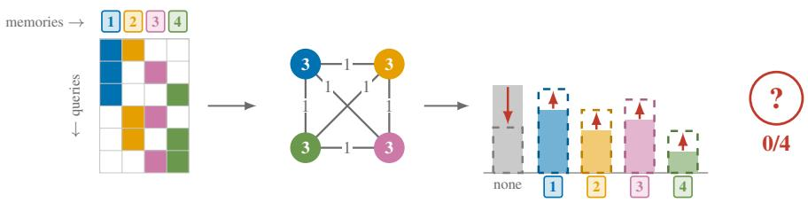
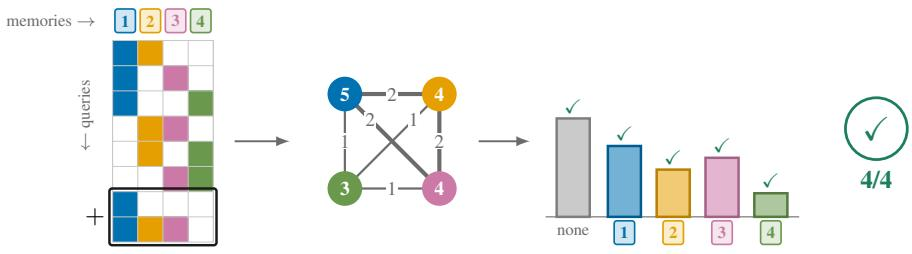
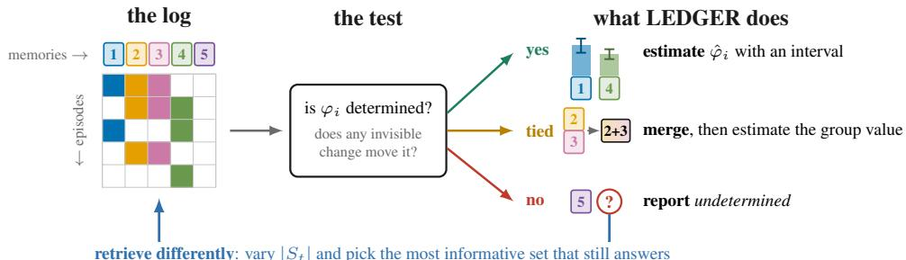
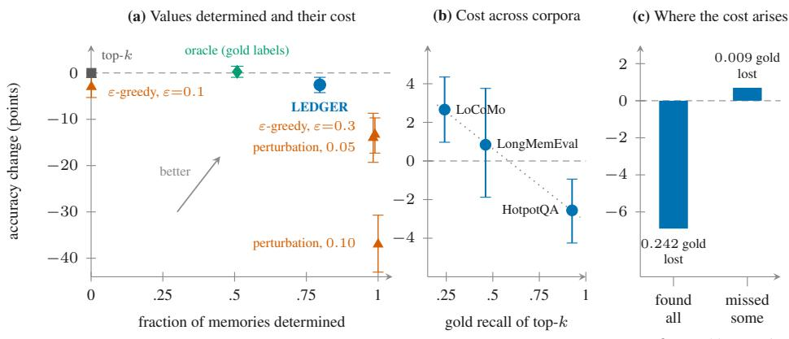

# TOP-k RETRIEVAL LEAVES MEMORY VALUE UNDETERMINED

Arman Behnam Department of Computer Science Illinois Institute of Technology Chicago, IL, USA abehnam@hawk.illinoistech.edu

## ABSTRACT

A memory-augmented agent must decide which memories to keep, merge and retrieve, and its only evidence of their value is its retrieval log: the memories it retrieved in each episode and whether it succeeded. Existing methods assign every memory a value from this log, even when the log cannot separate one memory’s contribution from another’s. We treat the log as an experiment that nobody designed and ask which memory values it determines. Two counts answer this before any outcome is observed: how often each memory was retrieved, and how often each pair was retrieved together. From these counts, we prove that top-k retrieval leaves every memory value undetermined, however many episodes are logged, and that a question with its own memories, asked once, determines at most one of their values. On fourteen standard memory benchmarks, no memory value is determined in any of 55 configurations. Both causes are choices about retrieval. We introduce LEDGER, which estimates each determined Shapley value in closed form with a confidence interval and reports every other value as undetermined. It merges memories with identical histories without losing a determined value, and it retrieves so that the next log determines more. On pooled HotpotQA, LEDGER raises the fraction of memories determined from 0.001 to 0.797, at a cost of 2.6 accuracy points on HotpotQA and with a gain of 2.7 on LoCoMo. Code: https://anonymous.4open.science/r/ledger-review-AF71/.

## 1 INTRODUCTION

Agents that operate over long horizons keep a store of memories and must decide which to retain, which to merge and which to retrieve for each query (Pink et al., 2025; Du et al., 2025). Each of these decisions depends on how much every memory contributes to the agent’s success. A deployed agent can learn this only from its own history: in each episode it retrieved some memories and then succeeded or failed. This paper asks what that history can tell us about the value ofeach memory, and when it can tell us nothing.

Existing systems follow three approaches. The first scores memories with proxies such as recency, access frequency or similarity to the query (Wei et al., 2026a; Wu et al., 2026a;b). The second learns a value signal from downstream reward (Tan et al., 2025; Zhang et al., 2026; Yang et al., 2026). The third computes the Shapley value (Shapley, 1953), which divides the agent’s success fairly among the memories it used (Wei et al., 2026b; Ye & Yoganarasimhan, 2025; Patel et al., 2025). Three challenges stand in the way. First, a deployed agent cannot experiment on its memory: Shapley methods need outcomes for sets of memories that were never retrieved together, and the agent cannot go back and retrieve them. Second, memories are retrieved in groups, so the history may not separate the contribution of one memory from that of another. When it does not, a method still returns a number, but the number is set by the method and not by the data, and nothing in the output reveal this. Third, making the history more informative can lower accuracy, because it means changing what the agent retrieves.

We treat the history as an experiment that nobody designed. Each episode is a trial in which a set of memories was retrieved and an outcome was observed, and the theory of experimental design states which quantities a set of trials determines (Rao, 1973; Pukelsheim, 2006). This view answers each challenge. First, it needs no new trials, because it asks only what the recorded ones determine.

Second, it decides, for every memory, whether the history determines its value before any value is estimated, so a method can decline to report a value that the data do not support. Third, it identifies which changes to retrieval make the history informative, so their cost in accuracy can be measured.

The analysis needs only two counts that any retrieval log contains: how often each memory was retrieved, and how often each pair was retrieved together. From these counts alone, before any outcome is used, it decides which memory values the history determines. Applied to standard memory benchmarks (Yang et al., 2018; Maharana et al., 2024; Wu et al., 2025), it finds that none is determined. One common convention is enough to cause this: retrieving the same number of memories for every query. A second, giving each question its own memories, limits each question to as many determined values as it has episodes. Both conventions are choices about retrieval, so the remedy changes retrieval: share one store across queries, vary how many memories are retrieved, and fill part of each retrieval with the relevant memories retrieved least often. On pooled HotpotQA most values then become determined, fewer on other stores, while accuracy falls slightly on one corpus and rises on another. Our method, LEDGER, estimates the determined values with confidence intervals and reports the rest as undetermined.

what each query retrieved how often how much each memory helps

  
(b) queries retrieve 1, 2 or 3 memories

  
Figure 1: A history that looks sufficient and determines nothing. Rows are episodes, labelled by the memories they retrieve; the column $| S _ { t } |$ gives each retrieval size. Left: each pair of four memories retrieved once. Right: the same episodes plus retrievals of sizes 1 and 3.

Figure 1 shows the first convention on four memories. Each pair is retrieved once, giving six episodes for four unknown values, which looks sufficient. Yet every episode retrieves two memories, so adding the same amount to every value and removing twice that amount from the baseline leaves every predicted outcome unchanged: the history fixes only the differences between values. One episode of size one and one of size three determine all four. Appendix H discusses the scope, applications and limitations of these results, and Appendix I collects the notation and terms.

This paper makes three contributions. First, it answers a question that prior work leaves open: which memory values a deployed agent’s history determines. Proxy and learned methods report values without asking it, and Shapley methods avoid it by replaying sets of memories; we answer it exactly from the history, and show that a fixed retrieval size leaves every value undetermined however long the history grows (Section 3). Second, it gives LEDGER, which computes each determined value in closed form with a confidence interval, reports every other value as undetermined, and merges memories with identical histories without losing any determined value (Section 4). Third, it shows that the conventions the field uses to evaluate memory leave every memory value undetermined, and that changing how memories are retrieved makes most values determined on pooled HotpotQA and fewer on other stores, at a measured cost in accuracy (Sections 4 and 5). The same counts appear in slate off-policy evaluation, which sets the undetermined part aside because it does not affect the value of a policy (Swaminathan et al., 2017); for memory, the undetermined part is the finding.

## 2 BACKGROUND AND PROBLEM FORMULATION

Preliminaries. We use three concepts from prior work. Möbius dividends: every set function v on the subsets of $[ n ] = \{ 1 , \dots , n \}$ can be written uniquely as $\begin{array} { r } { v ( S ) = \sum _ { B \subset S } \dot { \theta } _ { B } } \end{array}$ , where the dividend $\theta _ { B }$ is the part of the value that the set B creates jointly and none of its proper subsets creates (Harsanyi, 1963; Grabisch et al., 2000). The Shapley value of element i is the unique attribution satisfying efficiency, symmetry, null player and additivity (Shapley, 1953); in dividends it is $\textstyle \varphi _ { i } = \sum _ { B \ni i } \bar { \theta } _ { B } \bar { \big / } | B |$ , so each dividend is shared equally among its members (Harsanyi, 1963). Estimability: in a linear model $\mathbf { r } = \mathbf { A } { \boldsymbol { \beta } } + \varepsilon ,$ , a combination $\mathbf { c } ^ { \top } \boldsymbol { \beta }$ is estimable when some linear function of r has expectation $\mathbf { c } ^ { \top } \boldsymbol { \beta }$ for every $\beta ,$ , which holds exactly when c lies in the row space of A (Rao, 1973, Section 4a.2); otherwise all least-squares solutions fit the data equally well and give $\mathbf { c } ^ { \top } \boldsymbol { \beta }$ every real value (Lemma A.2). Appendices $\mathrm { A . 1 }$ and $\mathrm { A } . 2$ state these concepts formally.

Setting. An agent holds a store of n memories $m _ { 1 } , \ldots , m _ { n } ,$ identified with [n]. In episode $t \in [ T ]$ it receives a query $q _ { t }$ drawn from a distribution $\mathcal { D } _ { Q }$ , retrieves a non-empty set $S _ { t } \subseteq [ n ]$ , answers, and observes an outcome $r _ { t } \in [ 0 , 1 ]$ , for example whether the answer was correct. We make two assumptions; Appendix ${ \mathrm { A } } . 3$ discusses what each requires and what is lost when it fails.

Assumption 1 (Outcome model). For each query $q$ there is a set function $v _ { q } : 2 ^ { [ n ] } \to [ 0 , 1 ]$ such that $\mathbb { E } [ r _ { t } \mid \hat { \mathcal { F } } _ { t - 1 } , q _ { t } , S _ { t } ] = v _ { q _ { t } } ( S _ { t } )$ , where $\mathcal { F } _ { t - 1 }$ is the history before episode $t ,$ and $\eta _ { t } = r _ { t } - v _ { q _ { t } } ( S _ { t } )$ is conditionally σ-sub Gaussian.

Assumption 2 (Resolution $d )$ . The query-averaged value $v ( S ) = \mathbb { E } _ { q \sim \mathcal { D } _ { Q } } [ v _ { q } ( S ) ]$ has $\theta _ { B } \ = \ 0$ whenever $| B | > d .$

The baseline $\theta _ { \varnothing } = v ( \varnothing )$ is the expected outcome with nothing retrieved, and the value of memory i is its Shapley value $\varphi _ { i }$ under $v ,$ , which the baseline does not enter.

Input and output. The method reads only what an agent already records: for each episode $t ,$ the retrieved set $S _ { t }$ and the outcome $r _ { t }$ . We store the sets as a binary matrix $\mathbf { X } \in \{ 0 , 1 \} ^ { T \times n }$ , one row per episode and one column per memory, with $\mathbf { X } _ { t i } = 1$ exactly when $m _ { i } \in S _ { t }$ , and the outcomes as a vector r. The product $\mathbf { X } ^ { \top } \mathbf { X }$ holds the two counts of the introduction,

$$
\begin{array} { r } { \left( \mathbf { X } ^ { \top } \mathbf { X } \right) _ { i i } = \operatorname { f r e q } ( m _ { i } ) , \qquad \left( \mathbf { X } ^ { \top } \mathbf { X } \right) _ { i j } = \operatorname { c o } ( m _ { i } , m _ { j } ) , } \end{array}\tag{1}
$$

how often $m _ { i }$ was retrieved and how often $m _ { i }$ and $m _ { j }$ were retrieved together. By Assumption $2 ,$ each outcome is the sum of the dividends of the retrieved sets of at most d memories plus noise $\varepsilon _ { t } = r _ { t } - v ( S _ { t } )$ . This gives the linear model derived in Appendix ${ \mathrm { A . 4 } } .$

$$
\mathbf { r } = \mathbf { X } _ { d } { \pmb \theta } + \varepsilon , \qquad ( \mathbf { X } _ { d } ) _ { t B } = \mathbf { 1 } [ B \subseteq S _ { t } ] , \quad | B | \leq d ,\tag{2}
$$

whose column for $B = \emptyset$ is all ones and carries the baseline; at $d = 1 , \mathbf { X } _ { 1 } = \left[ \mathbf { 1 } _ { T } \mid \mathbf { X } \right]$ . The output has one entry per memory: an estimate of $\varphi _ { i }$ with a confidence interval when the log determines $\mathrm { i t . }$ and undetermined otherwise.

Problem. Given this log, we first ask which memory values it determines. Memory i is identifiable when the log determines $\varphi _ { i } \mathbf { : }$ writing $\varphi _ { i } = ( \mathbf { c } ^ { ( i ) } ) ^ { \top } \pmb { \theta }$ with $c _ { B } ^ { ( i ) } = \mathbf { 1 } [ i \in B ] / | B |$ , this holds exactly when $\mathbf { c } ^ { ( i ) }$ lies in the row space of $\mathbf { X } _ { d }$ (Definition $_ { \mathrm { A . 4 ) } }$ , and it is decided from $\mathbf { X } _ { d }$ alone, before any outcome is seen. The determined values then guide how the agent manages its store: which memories to merge without losing a value, which to keep under a budget (Appendix F.7), and how to retrieve so that the next log determines more, at a cost in accuracy that we measure.

## 3 WHAT A TOP-k LOG DETERMINES

The problem began with one decision for each memory: whether the log determines its value. This section makes that decision for the logs that agents actually produce. It first shows that whether $\mathbf { c } ^ { ( i ) }$ lies in the row space of $\mathbf { X } _ { d }$ depends only on counts the agent already keeps, and then checks this condition under three common retrieval conventions: retrieving a fixed number of memories per query, giving each query its own memories, and retrieving some memories always together. For each convention, it identifies what the log cannot see and the change to retrieval that restores it. All proofs are in Appendix B.

What a log cannot see. By Section 2, memory i is identifiable exactly when $\mathbf { c } ^ { ( i ) }$ lies in the row space of $\mathbf { X } _ { d } ^ { \top } ,$ , that is, when it is orthogonal to the kernel ker $\mathbf { X } _ { d }$ . We call each h ∈ ker $\mathbf { X } _ { d }$ an invisible change: θ and $\theta +$ sh predict the same expected outcome in every episode for every $s \in \mathbb { R } .$ , while $\varphi _ { i }$ moves by $s ( \mathbf { c } ^ { ( i ) } ) ^ { \intercal }$ h. Hence $\varphi _ { i }$ is determined exactly when $( \mathbf { c } ^ { ( i ) } ) ^ { \top } \mathbf { h } = 0$ for every h ∈ ker $\mathbf { X } _ { d } .$ Since ker $\dot { \mathbf { X } _ { d } } = \ker ( \mathbf { X } _ { d } ^ { \top } \mathbf { X } _ { d } )$ (Appendix B.1), the invisible changes depend only on $\mathbf { X } _ { d } ^ { \top } \mathbf { X } _ { d } ,$ which at $d = 1$ is

$$
\mathbf { X } _ { 1 } ^ { \top } \mathbf { X } _ { 1 } = \left[ \begin{array} { c c } { T } & { \mathbf { f } ^ { \top } } \\ { \mathbf { f } } & { \mathbf { X } ^ { \top } \mathbf { X } } \end{array} \right] , \qquad f _ { i } = \mathrm { f r e q } ( m _ { i } ) .\tag{3}
$$

Whether each memory is identifiable is therefore decided by $T ,$ , the retrieval frequencies and the co-retrieval counts alone, and at resolution d by the number of episodes that retrieve each set of at most $2 d$ memories (Lemma B.1). The retrieval convention that produces these counts therefore decides which memory values a log can determine, before any outcome is observed and whatever the memories contain.

A fixed retrieval size. The most common convention retrieves the k memories most relevant to the query, so every episode retrieves the same number of memories; we call such a log a top-k log. In a top-k log, an episode that retrieves a set $B$ of fewer than k memories retrieves exactly $\boldsymbol { \dot { k } } - | \boldsymbol { B } |$ other memories with it. In every episode, therefore, the columns of $\mathbf { X } _ { d }$ for the sets $B \cup \dot { \{ \ j \} }$ with $j \notin B$ sum to $k - | B |$ times the column for $B ,$ which gives the invisible change

$$
\mathbf { h } _ { B } = \sum _ { j \notin { B } } \mathbf { e } _ { B \cup \{ j \} } - \mathbf { \eta } ( k - | B | ) \mathbf { e } _ { B } \in \mathrm { ~ k e r } \mathbf { X } _ { d } , \qquad | B | < d ,\tag{4}
$$

where $\mathbf { e } _ { B }$ is the unit vector for $\theta _ { B }$ . For $B = \varnothing , ( \mathbf { c } ^ { ( i ) } ) ^ { \top } \mathbf { h } _ { \varnothing } = 1$ for every memory i, so adding $\mathbf { h } _ { \varnothing }$ changes every $\varphi _ { i }$ without changing any predicted outcome.

Theorem 1 (Top-k leaves every value undetermined). Ifevery episode retrieves exactly k memories, no memory is identifiable, at any resolution d and any number ofepisodes T. If, in addition, outcomes are binary and each $v _ { q }$ takes values in $( 0 , 1 )$ , no estimator of any $\varphi _ { i }$ is consistent.

$\mathrm { A t } d = 1$ , the invisible change $\mathbf { h } _ { \varnothing }$ raises every memory’s value by s and lowers the baseline by ks; this is the ambiguity of Figure 1. No estimator is consistent because adding a small multiple of $\mathbf { h } _ { \varnothing }$ to the dividends of every $v _ { q }$ leaves the distribution of the log unchanged, so two different values of $\varphi _ { i }$ produce the same data (Appendix B.2). More episodes do not help, because each new episode again retrieves exactly k memories. The invisible changes disappear only if the retrieval size varies, and the next proposition gives how many sizes are needed.

Proposition 1 (Sizes needed). If the retrieval sizes take at most d distinct values, then ker $\mathbf { X } _ { d }$ contains a nonzero invisible change at every $T .$

At least $d + 1$ distinct sizes are therefore needed for the log to determine every dividend; at $d = 1$ two. With at most d sizes, all below $n / 2 ,$ , no memory is identifiable at all (Corollary B.1). Under deterministic retrieval, where each query’s sets are the top of one fixed ranking, the sets retrieved for a query at different sizes are nested, and nested sets can leave an invisible change of the same kind as $\mathbf { h } _ { \varnothing } .$ , one that raises some memories’ values and lowers the baseline (Lemma B.2). Section 4 removes both obstacles by varying the size and breaking the nesting, and Section 5.3 observes the nesting on real logs.

Private memories per query. The second convention gives each query b its own $n _ { b }$ memories. The $T _ { b }$ episodes of query b then retrieve only from these memories, so X splits into one block per query, and the block of query b has rank at most $T _ { b }$

Proposition 2 (Private memories). If each query b has its own $n _ { b }$ memories and $T _ { b }$ episodes, at least ${ \sum _ { b } \mathrm { \bar { m a x } } ( n _ { b } - T _ { b } , 0 ) }$ memories are not identifiable at $d = 1$

A query asked once determines at most one of its $n _ { b }$ memory values. Sharing one store across queries lifts this limit, but a fixed retrieval size leaves $\mathbf { h } _ { \varnothing }$ in the log (Theorem 1), so a shared store must be combined with varied retrieval sizes.

Memories always retrieved together. The third convention follows from ranking by relevance: memories that rank high for exactly the same queries are retrieved in the same episodes, and their columns of X are then identical. $\mathbf { A } \mathbf { t } d = 1$ , the invisible change ${ \bf e } _ { \{ i \} } - { \bf e } _ { \{ j \} }$ raises $\varphi _ { i }$ and lowers $\varphi _ { j }$ by the same amount, leaving $\varphi _ { i } + \varphi _ { j }$ unchanged; this is aliasing (Rosenbaum & Zubizarreta, 2025). It accounts for the spurious credit that memory systems report for memories co-retrieved with useful ones (Yang et al., 2026; Yan et al., 2026a). Because this change leaves the sum unchanged, Section 4 merges such memories into one.

Retrieval decides what the log can determine. Theorem 1 and Propositions 1 and 2 identify, from counts alone, which memory values a log leaves undetermined and why. Each undetermined value comes from an invisible change, and each invisible change comes from a retrieval convention (Table 1): a fixed size gives $\mathbf { h } _ { B } ,$ , nested sets give a change like h∅, private memories give changes inside each block, and tied memories give $\mathbf { e } _ { \{ i \} } - \mathbf { e } _ { \{ j \} }$ . Every invisible change can be found from the log before any value is estimated, and a change to retrieval can remove it. Memory valuation thus becomes a question of design: which retrievals make the values an agent needs determinable.

Table 1: Retrieval conventions and their invisible changes. Each icon is a small log: rows are episodes, columns are memories, and a filled cell marks a retrieval.
<table><tr><td>Log</td><td>Convention</td><td>Invisible change</td><td>Undetermined</td><td>Remedy (Section 4)</td></tr><tr><td></td><td>Fixed size k</td><td> $\mathbf { h } _ { B } , | B | < d$ </td><td>every value, at any  $T$ </td><td>d + 1 distinct sizes</td></tr><tr><td></td><td>Nested top-k</td><td>like  $\mathbf { h } _ { \varnothing }$ </td><td></td><td>the top-ranked memories&#x27; values among equally relevant sets</td></tr><tr><td></td><td></td><td>Private memories inside each block</td><td> $\begin{array} { r } { \ge \sum _ { b } \operatorname* { m a x } ( n _ { b } - T _ { b } , 0 ) } \end{array}$ </td><td>values share one store</td></tr><tr><td></td><td>Tied memories</td><td> $\mathbf { e } _ { \{ i \} } - \mathbf { e } _ { \{ j \} }$ </td><td>the split of  $\varphi _ { i } + \varphi _ { j }$ </td><td>merge, or retrieve apart</td></tr></table>

## 4 LEDGER: VALUING MEMORY WHERE THE LOG ALLOWS

Section 3 showed that every undetermined value comes from an invisible change of the log, and that retrieval decides which invisible changes a log contains. This section presents LEDGER, a method built on one object, the invisible changes of the log: every value it reports is one that no invisible change moves, and each of its later actions removes invisible changes (Figure 2). With the log the agent already has, LEDGER first estimates each determined value with a confidence interval and reports every other value as undetermined. It then merges memories that are always retrieved together, which removes the invisible changes between them and keeps every determined value. For the logs the agent will collect, it removes the invisible changes that remain: it varies the retrieval size and fills part of each retrieval with the relevant memories retrieved least often. Appendix C gives the three actions as algorithms.

  
Figure 2: LEDGER reads the kernel of the log from its counts and acts on each memory accordingly: it estimates the values the log determines, merges memories the log cannot separate, abstains on the rest. In the log shown, memories 2 and 3 are always retrieved together.

Estimation. LEDGER checks the condition of Section 3 numerically (Algorithm 1): with U an orthonormal basis of ker $\mathbf { X } _ { d } .$ , memory i counts as determined when $\| \mathbf { U } ^ { \top } \mathbf { \bar { c } } ^ { ( i ) } \| \leq \tau \| \mathbf { c } ^ { ( i ) } \|$ , with $\tau = 1 0 ^ { - 8 }$ . This check must come first, because a standard solver, such as least squares or ridge regression, returns a number for every memory, including undetermined ones (Lemma $\mathrm { A } . 2 )$ ). For an undetermined memory, that number estimates only the part of $\varphi _ { i }$ that no invisible change moves. For each determined memory, LEDGER estimates $\varphi _ { i }$ from a ridge fit with an interval,

$$
\begin{array} { r } { \hat { \varphi } _ { i } = ( \mathbf { c } ^ { ( i ) } ) ^ { \top } \hat { \theta } , \quad \hat { \theta } = ( \mathbf { X } _ { d } ^ { \top } \mathbf { X } _ { d } + \lambda \mathbf { I } ) ^ { - 1 } \mathbf { X } _ { d } ^ { \top } \mathbf { r } , \quad \quad \hat { \varphi } _ { i } \pm z _ { 1 - \delta / ( 2 n ) } \hat { \sigma } \left\| \mathbf { X } _ { d } ( \mathbf { X } _ { d } ^ { \top } \mathbf { X } _ { d } + \lambda \mathbf { I } ) ^ { - 1 } \mathbf { c } ^ { ( i ) } \right\| , } \end{array}\tag{5}
$$

where $\lambda = 1 0 ^ { - 2 }$ and $\hat { \sigma }$ is the residual standard deviation. The interval rests on the following:

Proposition 3 (Intervals for determined values). Suppose the noise $\varepsilon _ { t }$ has mean zero and is σ-sub-Gaussian given the retrieved sets, and the retrieved sets do not depend on past outcomes. Then for each determined memory i, with probability at least $1 - \delta / n ,$

$$
\begin{array} { r } { | \hat { \varphi } _ { i } - \varphi _ { i } | \le \sigma \sqrt { 2 \log ( 2 n / \delta ) } \left\| \mathbf { X } _ { d } \mathbf { V } ^ { - 1 } \mathbf { c } ^ { ( i ) } \right\| + \lambda \left| ( \mathbf { c } ^ { ( i ) } ) ^ { \top } \mathbf { V } ^ { - 1 } \pmb { \theta } \right| , \qquad \mathbf { V } = \mathbf { X } _ { d } ^ { \top } \mathbf { X } _ { d } + \lambda \mathbf { I } , } \end{array}\tag{6}
$$

so the bound holdsfor all n memories at once with probability at least $1 - \delta .$

The first term is the width of Eq. (5), with the Gaussian quantile $z _ { 1 - \delta / ( 2 n ) }$ in place of $\sqrt { 2 \log ( 2 n / \delta ) }$ the second is the ridge bias, which vanishes as $\lambda  0$ for determined values and does not for undetermined ones (Appendix B.7). The retrieval rule of this section reads the past only through the retrieval counts, so it satisfies the second condition. Every other memory is reported as undetermined, and only determined values guide which memories to keep. Memories that are always retrieved together are among the undetermined ones, and the next action handles them.

Merging. When memories i and $j$ are always retrieved together, the invisible change $\mathbf { e } _ { \{ i \} } - \mathbf { e } _ { \{ j \} }$ raises $\varphi _ { i }$ and lowers $\varphi _ { j }$ by the same amount, so the log can determine at most the pair’s total value. LEDGER treats the pair as one memory. It groups memories whose columns of X are identical, which hashing the columns finds in $O ( \overset { \cdot } { n } T )$ time (Algorithm 2), and replaces each group g by one memory whose column is the shared one and whose value is the sum $\begin{array} { r } { \overline { { \theta } } _ { g } = \sum _ { i \in g } \theta _ { \{ i \} } } \end{array}$ ; this gives a merged matrix $\bar { \bf X }$ . Replacing memories changes the parameters, so the question is whether it changes what the log determines. Theorem 2 shows that every determined value is kept.

Theorem 2 (Merging keeps every determined value). At $d = 1$ , range $\mathbf { X } _ { 1 } = \mathrm { r a n g e } \bar { \mathbf { X } } _ { 1 }$ , so the two matrices give the same outcomes. A combination c⊤ $\mathbf { \delta } _ { \mathbf { \hat { \theta } } }$ is determined by $\mathbf { X } _ { 1 }$ exactly when c takes one value on each group and the corresponding combination ofgroup values is determined by $\bar { \bf X } _ { 1 }$

Every value determined before merging is determined after it, and every invisible change between tied memories is gone; the first action then estimates each group value that $\bar { \bf X } _ { 1 }$ determines. The rule reads only retrieval histories: two unrelated memories with the same history are merged, and two near-duplicates retrieved in different episodes stay separate. Merging memories whose histories differ slightly is an approximation. For any grouping at $d = 1$ , let a merged memory count as retrieved whenever one of its members ${ \mathrm { i s } } ,$ let $D _ { g }$ be the largest number of episodes in which group g was retrieved while one of its members was not, let $\begin{array} { r } { \bar { s _ { g } } ( \pmb { \theta } ) = \sum _ { i \in g } \bar { \theta _ { \{ i \} } } } \end{array}$ , and let $\bar { \pmb { \theta } } = ( \theta _ { \emptyset } , s _ { g _ { 1 } } ( \pmb { \theta } ) , \dots , s _ { g _ { m } } ( \pmb { \theta } ) )$

Theorem 3 (Merging memories with similar histories). For every combination c in the row space of $\bar { \mathbf { X } } _ { 1 } ,$ the value that the merged log determines for c⊤θ¯ differs from it by at most

$$
\frac { \| { \mathbf { c } } \| } { \sigma _ { \operatorname* { m i n } } ^ { + } ( { \bar { \mathbf { X } } } _ { 1 } ) } \sum _ { i = 1 } ^ { n } | \theta _ { \{ i \} } | \sqrt { D _ { g ( i ) } } ,\tag{7}
$$

where $\sigma _ { \mathrm { m i n } } ^ { + }$ is the smallest nonzero singular value and $g ( i )$ is the group ofmemory i. The bound is zero when every $D _ { g } = 0 ;$ , which is Theorem 2, and neither its dependence on $\sqrt { D _ { g } }$ nor on $1 / \sigma _ { \mathrm { m i n } } ^ { + }$ can be improved.

Replacing $| \theta _ { \{ i \} }$ | by the upper end of its interval from $\operatorname { E q . }$ (5) makes the bound computable.

Retrieval. The next log needs a store shared across queries, at least $d + 1$ distinct retrieval sizes (Proposition 1), and sets that are not nested (Table 1). LEDGER keeps the store shared and draws the size $k _ { t }$ of each retrieval from at least $d + 1$ values. Let $R _ { t }$ be the $M$ memories most similar to $q _ { t }$ , and let $f _ { i } ( t )$ be the number of episodes before t that retrieved memory i. LEDGER retrieves

$$
S _ { t } = L _ { t } \cup H _ { t } ,\tag{8}
$$

where $L _ { t }$ holds the max(1, round $\left( \rho k _ { t } \right) )$ ) memories of $R _ { t }$ with the smallest $f _ { i } ( t )$ , and $H _ { t }$ holds the $k _ { t } - | L _ { t } |$ memories of $R _ { t }$ most similar to $q _ { t }$ (Algorithm 3). When $L _ { t }$ and $H _ { t }$ overlap, $| S _ { t } | < k _ { t }$ . The memories in $H _ { t }$ keep the answer within reach. The memories in $L _ { t }$ target the least certain estimates: for small λ, the variance of ${ \hat { \theta } } _ { \{ i \} }$ is at least $\sigma ^ { 2 } / ( f _ { i } ( t ) + \lambda )$ , since $( \mathbf { V } ^ { - 1 } ) _ { i i } \geq 1 / V _ { i i }$ for every positive definite V (Appendix $\mathbf { A . } 5 )$ . Because $f _ { i } ( t )$ changes from pass to pass, one query retrieves different sets over time, which breaks the nesting of top-k. The baseline test (Definition $_ { \mathrm { A } . 6 ) }$ checks from the log whether a change like h remains. We use $\rho = 0 . 4$ and $M = 2 0$ . Because this rule changes which memories the reader sees, it trades answer quality for determined values.

## 5 EXPERIMENTS

Sections 3 and 4 make four claims that only data can test. First, by Theorem 1 and Proposition $^ { 2 , }$ the logs of standard benchmarks leave every memory value undetermined; Section 5.2 checks this on fourteen benchmarks. Second, by Proposition 1 and the retrieval rule Eq. (8), LEDGER’s retrieval makes many more values determined; Section 5.3 measures how many, and at what cost in accuracy. Third, by Proposition 3, the interval in Eq. (5) contains each value LEDGER reports at the stated rate. Fourth, by Theorem 2, merging keeps every determined value and makes the total value of each group of tied memories determinable. Section 5.4 tests both.

## 5.1 SETUP

The audit (Section 5.2 and Appendix E) runs fourteen memory benchmarks, each with the retrieval it specifies. The retrieval experiments use three corpora with different structure: HotpotQA (Yang et al., 2018) and LongMemEval (Wu et al., 2025), whose questions we pool into one shared store per corpus, and LoCoMo (Maharana et al., 2024), whose questions already share a store within each conversation. Memories are turn- or paragraph-level spans, retrieved by dense similarity over sentence embeddings (Reimers & Gurevych, 2019). Answers come from a hosted reader, gemini-2.5-flash-lite, and are scored by exact match, with the same model as judge otherwise; two further readers, gemini-3.6-flash and gemini-3.7-flash, measure the cost of pooling a store, and they and the use of determined values to decide which memories to keep appear in Appendix F. We compute every identifiability number from X alone, and compare retrieval rules on the same questions, reporting each accuracy difference with a 95% interval and a paired permutation test. Coverage of the intervals is measured on synthetic logs (Appendix D.4). Table 4 names the artifact behind each number below.

## 5.2 WHAT STANDARD BENCHMARKS DETERMINE

For every memory, we checked whether $\mathbf { c } ^ { ( i ) }$ lies in the row space of $\mathbf { X } _ { 1 }$ , on the logs of fourteen memory benchmarks, each run with the retrieval it specifies and at every k it uses (Table 2). We ran fourteen benchmarks, each with its own retrieval at every k it uses, and tested every memory at $d = 1$ Two conventions cause this. Within each block of the log, every episode retrieves the same number of memories (Theorem 1). Most benchmarks also give each question or document its own store, which splits the log into many blocks (Proposition 2). A block is a group of memories never retrieved with a memory outside it, and even a shared store splits into blocks. Block counts follow the order of k, and “all” retrieves every memory of the context.

All 55 configurations leave every memory value undetermined, for two reasons. Within each context, every episode retrieves the same number of memories, so a change like $\mathbf { h } _ { \varnothing }$ is invisible in every log (Theorem 1). Twelve of the fourteen benchmarks also give each question, document or conversation its own memories, which splits the log into blocks (Proposition 2). The two benchmarks with one shared store, MultiHopRAG and HELMET, leave every value undetermined because their retrieval size is fixed. LoCoMo shares a store within each conversation and splits its 1,542 questions into 13 blocks at $k = 5$ , with the same result. A shared store is therefore necessary and not sufficient. Figure 3a compares LEDGER’s retrieval rule Eq. (8) with deterministic top-k and with two random rules, ε-greedy and score perturbation, on pooled HotpotQA. The fraction of memories determined is measured on 300 questions retrieved over $2 4$ passes $( n = 2 , 9 7 1$ memories, T = 7,200 episodes), and accuracy on 1,600 held-out questions against a pooled store of 15,900 memories.

Table 2: No memory benchmark determines a single memory value.
<table><tr><td>Benchmark</td><td>k</td><td>Store</td><td>T</td><td>n</td><td>Blocks</td><td>Determined</td></tr><tr><td>HotpotQA</td><td>3,5,10</td><td>per question</td><td>300</td><td>2,971</td><td>300</td><td>0</td></tr><tr><td>HotpotQA (1,200 q.)</td><td>3,5,10</td><td>per question</td><td>1,200</td><td>11,912</td><td>1,200</td><td>0</td></tr><tr><td>MuSiQue</td><td>3,5,10</td><td>per question</td><td>300</td><td>5,999</td><td>300</td><td>0</td></tr><tr><td>WikiHop</td><td>3,5,10</td><td>per question</td><td>300</td><td>4,560</td><td>300</td><td>0</td></tr><tr><td>TriviaQA</td><td>3,5,10</td><td>per question</td><td>300</td><td>27,456</td><td>300</td><td>0</td></tr><tr><td>LongMemEval</td><td>3,5,10</td><td>per question</td><td>300</td><td>6,845</td><td>300</td><td>0</td></tr><tr><td>MSC-Self-Instruct</td><td>3,5,10</td><td>per dialogue</td><td>300</td><td>18,916</td><td>300</td><td>0</td></tr><tr><td>BABILong</td><td>3,5, 10, all</td><td>per item</td><td>40</td><td>4,158</td><td>40</td><td>0</td></tr><tr><td>InfiniteBench</td><td>3,5, 10, all</td><td>per book</td><td>40</td><td>37,697</td><td>40</td><td>0</td></tr><tr><td>NarrativeQA (summary)</td><td>3,5, 10, all</td><td>per document</td><td>300</td><td>115</td><td>11</td><td>0</td></tr><tr><td>NarrativeQA (full)</td><td>3,5, 10, all</td><td>per document</td><td>300</td><td>14,282</td><td>121, 60, 27, 11</td><td>0</td></tr><tr><td>QuALITY</td><td>3,5, 10, all</td><td>per article</td><td>219</td><td>1,495</td><td>47, 22, 12, 12</td><td>0</td></tr><tr><td>LoCoMo</td><td>3,5,10</td><td>per conversation</td><td>1,542</td><td>5,882</td><td>37, 13,11</td><td>0</td></tr><tr><td>MemoryAgentBench</td><td>3,5,10</td><td>per context</td><td>360</td><td>33,686</td><td>94,65,44</td><td>0</td></tr><tr><td>MultiHopRAG</td><td>3,5,6,10</td><td>shared</td><td>2,556</td><td>23,078</td><td>269, 98, 66, 15</td><td>0</td></tr><tr><td>HELMET</td><td>3,5, 10, 14</td><td>shared</td><td>356</td><td>40,000</td><td>41</td><td>0</td></tr></table>

Table 2 tests every memory on 55 configurations of the 14 benchmarks, at d = 1 and therefore at every resolution (Lemma B.3). The first reason is the retrieval size. In every log, all episodes of a context retrieve the same number of memories, k or the whole context, so the log contains a change like h∅ that reaches every memory (Theorem 1, and Lemma E.1 when the size differs between contexts). The second reason is the store. Twelve of the fourteen benchmarks give each question, document or conversation its own memories, which splits the log into blocks (Proposition 2). In HotpotQA, for example, each question has about ten memories of its own and is asked once, so varying the size would determine at most one of its ten values. A shared store also splits: MultiHopRAG’s 2,556 questions fall into 269 blocks at $k = 3$ and 15 at k = 10, and HELMET’s 356 into 41. A shared store is necessary and not sufficient.

## 5.3 RETRIEVAL AND ITS COST

Hence, we vary the retrieval size on a shared store. On pooled HotpotQA, four rules draw the size from {3, 5, 8} (Figure 3a): deterministic top-k, LEDGER’s rule in Eq. (8), ε greedy and score perturbation. LEDGER’s sets fall below the drawn size in 6.7% of episodes, when $L _ { t }$ and $H _ { t }$ overlap (Appendix D). The fraction of memories determined is measured on 300 questions retrieved over 24 passes $( n = 2 , 9 7 1$ memories, T = 7,200 episodes). Accuracy is measured on 1,600 held-out questions against a pooled store of 15,900 memories. The accuracy of the random rules is measured on 300 questions, with Holm corrected intervals. Deterministic top-k determines 0.001 of the memories, although its size varies. The reason is nesting: for each question, it retrieves the top of one ranking, so the set at each size contains the smaller ones. In this log, $\mathbf { X } \mathbf { w } = \mathbf { 1 } _ { T }$ has a least-squares solution with residual $3 . 1 \times 1 0 ^ { - 1 5 }$ . Lowering the baseline by s and raising each $\theta _ { \{ i \} }$ by $s w _ { i }$ then leaves every predicted outcome unchanged, an invisible change (h ). Pooling the store has its own cost, which this comparison does not include: on LongMemEval, answering from a pooled store costs 15.7 points against each question’s own store (Appendix F.4).

LEDGER’s rule fills part of each set with the relevant memories retrieved least often, and these change from pass to pass, which breaks the nesting. Its residual is $9 . 2 \times 1 0 ^ { - 2 }$ , so ${ \bf 1 } _ { T }$ lies outside the range of X and this change is gone. The fraction determined rises to 0.797, at a cost of 2.6 accuracy points (95% interval $[ - 4 . 2 , - 0 . 9 ]$ , permutation $p = 0 . 0 0 4 )$ . The random rules trade worse. At about LEDGER’s cost, ε-greedy with $\varepsilon = 0 . { \dot { } }$ 1 loses 3.0 points and determines 0.001. To determine 0.98 or more, the random rules lose at least 13.3 points.

LEDGER’s effect on accuracy depends on how much evidence top-k already finds. We call a memory gold when it holds evidence for the answer. On HotpotQA, LongMemEval and LoCoMo, top-k retrieves 0.93, 0.46 and 0.24 of the gold memories, and LEDGER changes accuracy by −2.6, +0.8 $( [ - 1 . 9 , + 3 . 8 ] )$ and +2.7 points $( [ + 1 . 0 , + 4 . 4 ] )$ . Figure 3b shows the mechanism on HotpotQA. LEDGER replaces some of the similar memories with less-retrieved ones, which can displace gold memories that top-k had found. On questions where top-k retrieved every gold memory, LEDGER drops 0.242 of them per question and loses 6.9 points. On the other questions, it drops 0.009 and gains 0.7. An oracle that applies LEDGER only to the questions where top-k missed a gold memory removes the cost $( [ - 0 . 9 4 , \stackrel { \sim } { + } 1 . 4 4 ] )$ . It determines 0.509 of the memories, 64% of LEDGER’s gain.

  
Figure 3: What LEDGER’s retrieval determines, what it costs, and where the cost arises.

## 5.4 INTERVALS AND MERGING

Checking whether the intervals are valid requires the true values, so we use synthetic logs drawn from the model Eq. (2) with known θ, over 36 settings of $n , k , T$ and λ at each resolution, with 20 random designs per setting (Appendix D). A log counts as covered when the interval in Eq. (5), with the noise scale known, contains $\varphi _ { i }$ for every memory LEDGER reports, and at $\delta = 0 . 0 5$ at least 95% of logs should be covered. $\mathbf { A } \mathbf { t } d = 1$ , every design has full rank, and at least 97.7% of logs are covered in every setting. At $d = 2 .$ , 24 settings give rank-deficient designs, and at least 99.4% of logs are covered in all 36 settings, in a post hoc analysis (Appendix G.3). Counting every memory instead, coverage falls to 57.2% in the worst setting, but every memory there is undetermined. The intervals are 1.52 and 1.43 times as wide as the pointwise Gaussian interval with the true σ at $d = 1$ and $d = 2 .$ . The confidence set of Abbasi-Yadkori et al. (2011) is a median 6.6 and 36 times as wide at $\lambda = 1$ , because it bounds every direction of θ, while LEDGER bounds only the n directions $\mathbf { c } ^ { ( i ) }$ that define the memory values.

Merging replaces tied memories by groups. The value of each tied memory is undetermined, but the total value of its group can be determined, and by Theorem 2 every other memory keeps its status. We therefore count units, meaning memories and groups. On pooled HotpotQA with 100 questions and LEDGER’s retrieval $( n = 9 9 2$ memories, $T = 2 \small { , } 4 0 0 )$ , merging identical histories leaves 869 units and raises the fraction determined from 0.815 to 0.992. Merging also helps on conversational memory. On two LoCoMo conversations (n = 788 memories), the standard log determines no value (Table 2). Three passes of retrieval with score perturbation determine 79.0% of their memories, and merging raises this to 95.7% of the units.

## 6 CONCLUSION

A retrieval log determines a memory’s value only if the retrievals separate that memory from the others, and this can be checked from the log before any outcome is seen. Standard benchmarks fail this check: a fixed retrieval size and private stores leave every memory value undetermined in all 55 configurations of fourteen benchmarks. Both causes are choices about retrieval, so changing retrieval removes them. LEDGER raises the fraction of memories determined from 0.001 to 0.797 at a cost of 2.6 accuracy points. Every value LEDGER reports is determined by the log and comes with a confidence interval, and every other value is reported as undetermined. Memory benchmarks should report which values their logs determine alongside accuracy. Finding at query time the questions where spreading retrieval costs nothing is the open problem that remains.

## AI USE STATEMENT

Generative AI tools helped design experiments and choose their parameters, generate synthetic data, write code, and clean datasets. On the literature, they helped search, summarize, and analyze prior work and format references. On the paper, they helped create figures and tables, draft text, and edit it. We reviewed all AI-assisted work and checked it in four ways. Every empirical claim was preregistered with a decision rule, and three claims that failed their rule were withdrawn (Appendix G). Every reported number is reproduced from committed artifacts and was reconciled against them in a separate audit. Every theoretical claim was tested on synthetic designs with known ground truth. Every bibliography entry was verified against its source. We take full responsibility for the content of this paper.

## ETHICS STATEMENT

This work involves no human subjects, no new data collection, and no release of new data, so no IRB review was required. All experiments use public benchmarks under their published licenses; their contents are encyclopedic text and synthetically generated dialogue, and we neither collected nor inferred personal information from them. Two consequences of the method deserve explicit statement. First, the instrumentation we recommend is not free to the end user: an A-optimal tie-break deliberately selects among answer-preserving retrieval sets by information gain, and we measure an accuracy cost whose sign depends on the corpus, so a practitioner adopting it trades some answer quality for the ability to value memory at all. We report both signs, the mechanism that produces them (Section 4), and a restriction that removes the cost on the corpus where it is largest, so that this trade is made deliberately and not inherited from a default. Second, a framework that makes the value of an individual stored memory identifiable thereby makes attribution to that memory identifiable. The same quantity that justifies retaining or deleting a record supports profiling the interactions the record was derived from. We declare no conflicts of interest. On research integrity, claims here are pre-registered, null and negative results are reported alongside positive ones (Appendix F), and corrections to values that appeared in earlier drafts are recorded in the paper.

## REPRODUCIBILITY STATEMENT

The two modeling assumptions are stated in Section 2 and their scope is discussed in Appendix A.3; every theoretical claim in Sections 3 to 4 is proved in full in Appendix B, with the merge-map construction and its complexity given as explicit algorithms in Appendix C; the synthetic generator used to check those claims against known ground truth is specified in Appendix D, and the tables reporting every headline number are generated from committed artifacts and collected in Appendix F. Anonymous source code, the dated pre-registration documents, the exact benchmark preparation and store-construction steps, and the artifacts from which every table is generated are available at https://anonymous.4open.science/r/ledger-review-AF71/. The theoretical track (identifiability verdicts, ranks, the exact quotient, and all synthetic experiments) is fully reproducible and deterministic from the released code and a fixed seed, since it consults no model. The empirical track is reproducible in its design and not claimed to be bit-reproducible in its outcomes: the retrieval logs, design matrices and identifiability measurements regenerate byte-identically from the released inputs, while the reader accuracies depend on hosted model inference that we cannot pin, so we report paired comparisons with intervals and the sample sizes they were computed at. Appendix G documents the defects we found in our own pipeline, the values they affected, and the corrected values, so that a reader attempting to reproduce this work knows which numbers changed and why.

## REFERENCES

Yasin Abbasi-Yadkori, Dávid Pál, and Csaba Szepesvári. Improved algorithms for linear stochastic bandits. In Advances in Neural Information Processing Systems (NeurIPS), 2011.

Aman Agarwal, Ivan Zaitsev, Xuanhui Wang, Cheng Li, Filip Radlinski, and Thorsten Joachims. Estimating position bias without intrusive interventions. In ACM International Conference on Web Search and Data Mining (WSDM), 2019.

John R Anderson and Lael J Schooler. Reflections of the environment in memory. Psychological science, 2(6):396–408, 1991.

Mustafa Arslan. Aeon: High-performance neuro-symbolic memory management for long-horizon LLM agents. arXiv preprint arXiv:2601.15311, 2026. URL https://arxiv.org/abs/26 01.15311.

John F Banzhaf III. Weighted voting doesn’t work: A mathematical analysis. Rutgers L. Rev., 19: 317, 1964.

Niv Buchbinder, Moran Feldman, Joseph Naor, and Roy Schwartz. Submodular maximization with cardinality constraints. In ACM-SIAM Symposium on Discrete Algorithms (SODA), 2014.

Zana Buçinca, Maja Barbara Malaya, and Krzysztof Z Gajos. To trust or to think: cognitive forcing functions can reduce overreliance on ai in ai-assisted decision-making. Proceedings of the ACM on Human-computer Interaction, 5(CSCW1):1–21, 2021.

Cheng Chen, Maria D Molina, Mengqi Liao, and Eugene Cho Snyder. Relational gains, privacy strains: Exploring users’ perceptions and experiences with chatgpt’s memory feature. In Proceedings of the 2026 CHI Conference on Human Factors in Computing Systems, pp. 1–17, 2026a.

Wei Chen, Yajun Wang, and Yang Yuan. Combinatorial multi-armed bandit: General framework and applications. International Conference on Machine Learning (ICML), 2013.

Yanqiao Chen, Dongsheng Hou, Yuhan Rui, Zhen Cao, and Yepang Liu. Shapley context pruning: A cooperative game perspective for context reranking and pruning. arXiv preprint arXiv:2607.16209, 2026b. URL https://arxiv.org/abs/2607.16209.

Benjamin Cohen-Wang, Harshay Shah, Kristian Georgiev, and Aleksander M ˛adry. Contextcite: Attributing model generation to context. Advances in Neural Information Processing Systems, 37: 95764–95807, 2024.

Michele Conforti and Gérard Cornuéjols. Submodular set functions, matroids and the greedy algorithm. Discrete Applied Mathematics, 7(3):251–274, 1984.

Yiming Du, Wenyu Huang, Danna Zheng, Zhaowei Wang, Sebastien Montella, Mirella Lapata, Kam-Fai Wong, and Jeff Z. Pan. Rethinking memory in LLM based agents: Representations, operations, and emerging topics. arXiv preprint arXiv:2505.00675, 2025. URL https://arxi v.org/abs/2505.00675.

Fabian Fumagalli, Maximilian Muschalik, Patrick Kolpaczki, Eyke Hüllermeier, and Barbara Hammer. SHAP-IQ: Unified approximation of any-order shapley interactions. In Advances in Neural Information Processing Systems (NeurIPS), 2023. URL https://arxiv.org/abs/2303 .01179.

Amirata Ghorbani and James Zou. Data shapley: Equitable valuation of data for machine learning. In International Conference on Machine Learning (ICML), 2019.

Manu Ghulyani, Arunabh Singh, Karan Bharadwaj, Ankit Nath, and Suranjan Goswami. PACMS: Submodular context selection as a pluggable engine for LLM agents. arXiv preprint arXiv:2606.20047, 2026. URL https://arxiv.org/abs/2606.20047.

Michel Grabisch, Jean-Luc Marichal, and Marc Roubens. Equivalent representations of set functions. Mathematics ofOperations Research, 25(2):157–178, 2000.

Daya Guo, Dejian Yang, Haowei Zhang, Junxiao Song, Peiyi Wang, Qihao Zhu, Runxin Xu, Ruoyu Zhang, Shirong Ma, Xiao Bi, et al. Deepseek-r1: Incentivizing reasoning capability in llms via reinforcement learning. arXiv preprint arXiv:2501.12948, 2025.

Xiaoxue Han, Zhuo Feng, and Yue Ning. A topology-aware graph coarsening framework for continual graph learning. In Advances in Neural Information Processing Systems (NeurIPS), 2024. URL https://proceedings.neurips.cc/paper\_files/paper/2024/hash/ef283 d62b4bce30854a8d4827f331229-Abstract-Conference.html.

John C. Harsanyi. A simplified bargaining model for the n-person cooperative game. International Economic Review, 4(2):194–220, 1963.

Xiaoxin He, Yijun Tian, Yifei Sun, Nitesh V. Chawla, Thomas Laurent, Yann LeCun, Xavier Bresson, and Bryan Hooi. G-Retriever: Retrieval-augmented generation for textual graph understanding and question answering. In Advances in Neural Information Processing Systems (NeurIPS), 2024. URL https://proceedings.neurips.cc/paper\_files/paper/2024/hash/e faf1c9726648c8ba363a5c927440529-Abstract-Conference.html.

Yudai Honda, Yuki Fujita, Keiichi Zempo, and Shogo Fukushima. Human-like remembering and forgetting in LLM agents: An ACT-R-inspired memory architecture. In Proceedings of the 13th International Conference on Human-Agent Interaction (HAI), 2025. doi: 10.1145/3765766.3765 803.

Yuanzhe Hu, Yu Wang, and Julian McAuley. Evaluating memory in llm agents via incremental multi-turn interactions. In International Conference on Learning Representations, volume 2026, pp. 156259–156291, 2026.

Yu Huo, Kun Zeng, Siyu Zhang, Yuquan Lu, Cheng Yang, Yifu Guo, and Xiaoying Tang. RepoShapley: Shapley-enhanced context filtering for repository-level code completion. arXiv preprint arXiv:2601.03378, 2026. URL https://arxiv.org/abs/2601.03378.

Xinke Jiang, Rihong Qiu, Yongxin Xu, Wentao Zhang, Yichen Zhu, Ruizhe Zhang, Yuchen Fang, Xu Chu, Junfeng Zhao, and Yasha Wang. RAGraph: A general retrieval-augmented graph learning framework. In Advances in Neural Information Processing Systems (NeurIPS), 2024. URL https://papers.nips.cc/paper\_files/paper/2024/hash/34d6c7090bc5a f0b96aeaf92fa074899-Abstract-Conference.html.

Bernal Jiménez Gutiérrez, Yiheng Shu, Yu Gu, Michihiro Yasunaga, and Yu Su. HippoRAG: Neurobiologically inspired long-term memory for large language models. In Advances in Neural Information Processing Systems (NeurIPS), 2024. URL https://papers.nips.cc/pap er\_files/paper/2024/hash/6ddc001d07ca4f319af96a3024f6dbd1-Abstr act-Conference.html.

Antonin Joly and Nicolas Keriven. Graph coarsening with message-passing guarantees. In Advances in Neural Information Processing Systems (NeurIPS), 2024. URL https://proceedings. neurips.cc/paper\_files/paper/2024/hash/d041d6bb47c01a4ce327a1773 703e9a0-Abstract-Conference.html.

Mandar Joshi, Eunsol Choi, Daniel S Weld, and Luke Zettlemoyer. Triviaqa: A large scale distantly supervised challenge dataset for reading comprehension. In Proceedings of the 55th Annual Meeting of the Association for Computational Linguistics (Volume 1: Long Papers), pp. 1601– 1611, 2017.

Justin Singh Kang, Landon Butler, Abhineet Agarwal, Yigit Efe Erginbas, Ramtin Pedarsani, Kannan Ramchandran, and Bin Yu. SPEX: Scaling feature interaction explanations for LLMs. arXiv preprint arXiv:2502.13870, 2025. URL https://arxiv.org/abs/2502.13870.

Haruka Kiyohara, Masahiro Nomura, and Yuta Saito. Off-policy evaluation of slate bandit policies via optimizing abstraction. arXiv preprint arXiv:2402.02171, 2024. URL https://arxiv.or g/abs/2402.02171.

Tomáš Kociskˇ y, Jonathan Schwarz, Phil Blunsom, Chris Dyer, Karl Moritz Hermann, Gábor Melis,\` and Edward Grefenstette. The narrativeqa reading comprehension challenge. Transactions ofthe Associationfor Computational Linguistics, 6:317–328, 2018.

Yuri Kuratov, Aydar Bulatov, Petr Anokhin, Ivan Rodkin, Dmitry Sorokin, Artyom Sorokin, and Mikhail Burtsev. Babilong: Testing the limits of llms with long context reasoning-in-a-haystack. Advances in Neural Information Processing Systems, 37:106519–106554, 2024.

Chingkwun Lam, Jiaxin Li, Lingfei Zhang, and Kuo Zhao. Governing evolving memory in LLM agents: Risks, mechanisms, and the stability and safety governed memory (SSGM) framework. arXiv preprint arXiv:2603.11768, 2026. URL https://arxiv.org/abs/2603.11768.

Patrick Lewis, Ethan Perez, Aleksandra Piktus, Fabio Petroni, Vladimir Karpukhin, Naman Goyal, Heinrich Küttler, Mike Lewis, Wen-tau Yih, Tim Rocktäschel, Sebastian Riedel, and Douwe Kiela. Retrieval-augmented generation for knowledge-intensive NLP tasks. In Advances in Neural Information Processing Systems (NeurIPS), 2020.

Qinfeng Li, Yuntai Bao, Xinyan Yu, Hongze Chen, Wenqi Zhang, and Xuhong Zhang. AttriMem: Attribution-guided process feedback for agent memory learning. arXiv preprint arXiv:2607.21106, 2026. URL https://arxiv.org/abs/2607.21106.

Zhuoqun Li, Xuanang Chen, Haiyang Yu, Hongyu Lin, Yaojie Lu, Qiaoyu Tang, Fei Huang, Xianpei Han, Le Sun, and Yongbin Li. StructRAG: Boosting knowledge intensive reasoning of LLMs via inference-time hybrid information structurization. In International Conference on Learning Representations (ICLR), 2025. URL https://iclr.cc/virtual/2025/poster/3026 5.

Hao Liu, Zhengren Wang, Xi Chen, Zhiyu Li, Feiyu Xiong, Qinhan Yu, and Wentao Zhang. HopRAG: Multi-hop reasoning for logic-aware retrieval-augmented generation. In Findings ofthe Association for Computational Linguistics (ACL), 2025. URL https://aclanthology.org/2025. findings-acl.97/.

Linhao Luo, Yuan-Fang Li, Gholamreza Haffari, and Shirui Pan. Reasoning on graphs: Faithful and interpretable large language model reasoning. In International Conference on Learning Representations (ICLR), 2024. URL https://arxiv.org/abs/2310.01061.

Shengjie Ma, Chengjin Xu, Xuhui Jiang, Muzhi Li, Huaren Qu, Cehao Yang, Jiaxin Mao, and Jian Guo. Think-on-graph 2.0: Deep and faithful large language model reasoning with knowledgeguided retrieval augmented generation. In International Conference on Learning Representations (ICLR), 2025. URL https://iclr.cc/virtual/2025/poster/28367.

Adyasha Maharana, Dong-Ho Lee, Sergey Tulyakov, Mohit Bansal, Francesco Barbieri, and Yuwei Fang. Evaluating very long-term conversational memory of LLM agents. In Proceedings of the 62nd Annual Meeting of the Association for Computational Linguistics (ACL), 2024. URL https://arxiv.org/abs/2402.17753.

George L. Nemhauser, Laurence A. Wolsey, and Marshall L. Fisher. An analysis of approximations for maximizing submodular set functions—I. Mathematical Programming, 14(1):265–294, 1978.

Richard Yuanzhe Pang, Alicia Parrish, Nitish Joshi, Nikita Nangia, Jason Phang, Angelica Chen, Vishakh Padmakumar, Johnny Ma, Jana Thompson, He He, et al. Quality: Question answering with long input texts, yes! In Proceedings of the 2022 Conference of the North American Chapter ofthe Associationfor Computational Linguistics: Human Language Technologies, pp. 5336–5358, 2022.

Joon Sung Park, Joseph O’Brien, Carrie Jun Cai, Meredith Ringel Morris, Percy Liang, and Michael S Bernstein. Generative agents: Interactive simulacra of human behavior. In Proceedings ofthe 36th annual acm symposium on user interface software and technology, pp. 1–22, 2023.

Sara Patel, Mingxun Zhou, and Giulia Fanti. MaxShapley: Towards incentive-compatible generative search with fair context attribution. arXiv preprint arXiv:2512.05958, 2025. URL https: //arxiv.org/abs/2512.05958.

Mathis Pink, Qinyuan Wu, Vy A. Vo, Javier Turek, Jianing Mu, Alexander Huth, and Mariya Toneva. Position: Episodic memory is the missing piece for long-term LLM agents. arXiv preprint arXiv:2502.06975, 2025. URL https://arxiv.org/abs/2502.06975.

Friedrich Pukelsheim. Optimal Design of Experiments. SIAM, 2006.

C. Radhakrishna Rao. Linear Statistical Inference and Its Applications. Wiley, 2nd edition, 1973.

Nils Reimers and Iryna Gurevych. Sentence-BERT: Sentence embeddings using siamese BERTnetworks. In Proceedings ofthe 2019 Conference on Empirical Methods in Natural Language Processing (EMNLP-IJCNLP), 2019. URL https://aclanthology.org/D19-1410/.

Idan Rejwan and Yishay Mansour. Top-k combinatorial bandits with full-bandit feedback. In Algorithmic Learning Theory (ALT), 2020. URL https://arxiv.org/abs/1905.12624.

Paul R. Rosenbaum and José R. Zubizarreta. Effect aliasing in observational studies. Journal ofthe American Statistical Association, 2025. doi: 10.1080/01621459.2025.2537456. Published online; arXiv:2408.16708.

Max Schemmer, Niklas Kuehl, Carina Benz, Andrea Bartos, and Gerhard Satzger. Appropriate reliance on ai advice: Conceptualization and the effect of explanations. In Proceedings ofthe 28th international conference on intelligent user interfaces, pp. 410–422, 2023.

Zhihong Shao, Peiyi Wang, Qihao Zhu, Runxin Xu, Junxiao Song, Xiao Bi, Haowei Zhang, Mingchuan Zhang, YK Li, Yang Wu, et al. Deepseekmath: Pushing the limits of mathematical reasoning in open language models. arXiv preprint arXiv:2402.03300, 2024.

Lloyd S. Shapley. A value for n-person games. In Harold W. Kuhn and Albert W. Tucker (eds.), Contributions to the Theory ofGames II, pp. 307–317. Princeton University Press, 1953.

Adith Swaminathan, Akshay Krishnamurthy, Alekh Agarwal, Miroslav Dudík, John Langford, Damien Jose, and Imed Zitouni. Off-policy evaluation for slate recommendation. In Advances in Neural Information Processing Systems (NeurIPS), 2017. URL https://arxiv.org/abs/ 1605.04812.

Zhen Tan, Jun Yan, I-Hung Hsu, Rujun Han, Zifeng Wang, Long Le, Yiwen Song, Yanfei Chen, Hamid Palangi, George Lee, Anand Rajan Iyer, Tianlong Chen, Huan Liu, Chen-Yu Lee, and Tomas Pfister. In prospect and retrospect: Reflective memory management for long-term personalized dialogue agents. In Proceedings of the 63rd Annual Meeting of the Association for Computational Linguistics (ACL), 2025. URL https://aclanthology.org/2025.acl-long.413/.

Yixuan Tang and Yi Yang. Multihop-rag: Benchmarking retrieval-augmented generation for multi-hop queries. arXiv preprint arXiv:2401.15391, 2024.

Harsh Trivedi, Niranjan Balasubramanian, Tushar Khot, and Ashish Sabharwal. musique: Multihop questions via single-hop question composition. Transactions of the Association for Computational Linguistics, 10:539–554, 2022.

Che-Ping Tsai, Chih-Kuan Yeh, and Pradeep Ravikumar. Faith-shap: The faithful shapley interaction index. Journal ofMachine Learning Research, 24, 2023. URL https://jmlr.org/paper s/v24/22-0202.html.

Robert J Weber. Probabilistic values for games. The Shapley Value. Essays in Honor of Lloyd S. Shapley, pp. 101–119, 1988.

Lei Wei, Xiao Peng, Xu Dong, Niantao Xie, and Bin Wang. FadeMem: Biologically-inspired forgetting for efficient agent memory. arXiv preprint arXiv:2601.18642, 2026a. URL https: //arxiv.org/abs/2601.18642.

Shuyue Wei, Chang Liu, Zimu Zhou, Yongxin Tong, and Lizhen Cui. MemLens: A value-aware memory management system with interactive analytics for LLM-based agents. arXiv preprint arXiv:2607.25992, 2026b. URL https://arxiv.org/abs/2607.25992.

Johannes Welbl, Pontus Stenetorp, and Sebastian Riedel. Constructing datasets for multi-hop reading comprehension across documents. Transactions ofthe Associationfor Computational Linguistics, 6:287–302, 2018.

Beining Wu, Zihao Ding, Jun Huang, and Yanxiao Zhao. Forget to improve: On-device LLM-agent continual learning via budget-curated memory. arXiv preprint arXiv:2606.25115, 2026a. URL https://arxiv.org/abs/2606.25115.

Di Wu, Hongwei Wang, Wenhao Yu, Yuwei Zhang, Kai-Wei Chang, and Dong Yu. LongMemEval: Benchmarking chat assistants on long-term interactive memory. In International Conference on Learning Representations (ICLR), 2025. URL https://arxiv.org/abs/2410.10813.

Zhaofen Wu, Hanrong Zhang, Fulin Lin, Wujiang Xu, Xinran Xu, Yankai Chen, Henry Peng Zou, Shaowen Chen, Weizhi Zhang, Xue Liu, Philip S. Yu, and Hongwei Wang. GAM: Hierarchical graph-based agentic memory for LLM agents. In Proceedings ofthe 64th Annual Meeting ofthe Association for Computational Linguistics (ACL), 2026b. URL https://aclanthology.o rg/2026.acl-long.1600/.

J Xu, A Szlam, and J Weston. Beyond goldfish memory: Long-term open-domain conversation. arxiv 2021. arXiv preprint arXiv:2107.07567, 2021.

Sikuan Yan, Ahmed Bahloul, Ercong Nie, Susanna Schwarzmann, Riccardo Trivisonno, Volker Tresp, and Yunpu Ma. Memory-r2: Fair credit assignment for long-horizon memory-augmented LLM agents. arXiv preprint arXiv:2605.21768, 2026a. URL https://arxiv.org/abs/2605.2 1768.

Sikuan Yan, Xiufeng Yang, Zuchao Huang, Ercong Nie, Zifeng Ding, Zonggen Li, Xiaowen Ma, Jinhe Bi, Kristian Kersting, Jeff Z Pan, et al. Memory-r1: Enhancing large language model agents to manage and utilize memories via reinforcement learning. In Proceedings of the 64th Annual Meeting of the Association for Computational Linguistics (Volume 1: Long Papers), pp. 12805–12825, 2026b.

Yi Yang, Zhennan Chen, Yihong Zhuang, Tiehan Fan, Yinan Chen, Jian Li, Jian Yang, and Ying Tai. RoMeRL: Balancing feedback coverage and the memory-reward trap in self-evolving agent memory via reduced-order utility states. arXiv preprint arXiv:2608.02508, 2026. URL https: //arxiv.org/abs/2608.02508.

Zhilin Yang, Peng Qi, Saizheng Zhang, Yoshua Bengio, William W. Cohen, Ruslan Salakhutdinov, and Christopher D. Manning. HotpotQA: A dataset for diverse, explainable multi-hop question answering. In Proceedings of the 2018 Conference on Empirical Methods in Natural Language Processing (EMNLP), 2018. URL https://aclanthology.org/D18-1259/.

Zikun Ye and Hema Yoganarasimhan. Document valuation in LLM summaries: A cluster shapley approach. arXiv preprint arXiv:2505.23842, 2025. URL https://arxiv.org/abs/2505 .23842.

Howard Yen, Tianyu Gao, Minmin Hou, Ke Ding, Daniel Fleischer, Peter Izsak, Moshe Wasserblat, and Danqi Chen. Helmet: How to evaluate long-context models effectively and thoroughly. In International Conference on Learning Representations, volume 2025, pp. 98914–98965, 2025.

Shengtao Zhang, Jiaqian Wang, Ruiwen Zhou, Junwei Liao, Yuchen Feng, Zhuo Li, Yujie Zheng, Weinan Zhang, Ying Wen, Zhiyu Li, Feiyu Xiong, Yutao Qi, Bo Tang, and Muning Wen. MemRL: Self-evolving agents via runtime reinforcement learning on episodic memory. arXiv preprint arXiv:2601.03192, 2026. URL https://arxiv.org/abs/2601.03192.

Xinrong Zhang, Yingfa Chen, Shengding Hu, Zihang Xu, Junhao Chen, Moo Hao, Xu Han, Zhen Thai, Shuo Wang, Zhiyuan Liu, et al. Bench: Extending long context evaluation beyond 100k tokens. In Proceedings ofthe 62nd Annual Meeting ofthe Associationfor Computational Linguistics (Volume 1: Long Papers), pp. 15262–15277, 2024.

Wanjun Zhong, Lianghong Guo, Qiqi Gao, He Ye, and Yanlin Wang. Memorybank: Enhancing large language models with long-term memory. In Proceedings of the AAAI conference on artificial intelligence, volume 38, pp. 19724–19731, 2024.

Qiming Zhu, Shunian Chen, Rui Yu, Zhehao Wu, and Benyou Wang. From lossy to verified: A provenance-aware tiered memory for agents. arXiv preprint arXiv:2602.17913, 2026. URL https://arxiv.org/abs/2602.17913.

## Appendix

A Preliminaries and Related Work 18   
A.1 Linear models and estimability 18   
A.2 Set functions, dividends and values 18   
A.3 Assumptions and their scope 19   
A.4 The design of a retrieval log 20   
A.5 Optimal design and confidence sets . 21   
A.6 Related work 21   
B Proofs 23   
B.1 Counts decide identifiability 24   
B.2 A fixed retrieval size 24   
B.3 Sizes needed . 24   
B.4 Nested sets 25   
B.5 Private memories 25   
B.6 Resolution . 26   
B.7 Intervals 26   
B.8 Merging . 26   
C Algorithms 27   
C.1 The test and the estimates . 28   
C.2 Merging 28   
C.3 Retrieval . 29   
C.4 The baseline test and costs 29   
D Experimental Setup 30   
D.1 Corpora and stores 30   
D.2 Retrieval and reading 30   
D.3 Retrieval rules . 30   
D.4 Synthetic logs 31   
D.5 Statistics . 31   
D.6 Runs behind the main text 31   
E Benchmark Audit 31   
E.1 Protocol . 31   
E.2 Why every configuration determines nothing . 32   
E.3 The benchmarks . 33   
F Additional Results 34   
F.1 Retrieval on pooled HotpotQA . 34   
F.2 Replications on LoCoMo and LongMemEval 34   
F.3 The mechanism of the accuracy cost . 34   
F.4 Pooling across readers 35   
F.5 Intervals 35   
F.6 Merging 36   
F.7 Uses of the determined values 36   
G Pre-registration and Corrections 36   
G.1 Pre-registered claims 36   
G.2 Withdrawn claims 37   
G.3 The post hoc analysis 38   
G.4 Amendment on the retrieval rule 38   
G.5 Errata 38   
H Discussion 38   
H.1 Interpreting the results 38   
H.2 Scope and open problems . 40   
H.3 Applications 41   
H.4 Limitations 42   
I Notation and Terms 42

## A PRELIMINARIES AND RELATED WORK

This appendix collects the classical results the paper builds on and fixes the quantities it reports. Appendix A.1 states when a linear model determines a linear functional, Appendix $_ { \mathrm { A } . 2 }$ writes memory values as such functionals, and Appendix A.3 discusses the scope of the two assumptions. Appendix $\mathrm { A . 4 }$ applies these results to a retrieval log, Appendix $_ { \mathrm { A . 5 } }$ gives the optimal-design and confidence-set results that Sections 4 and 5 use, and Appendix A.6 relates the work to the literature. Notation and terms are collected in Appendix I.

## A.1 LINEAR MODELS AND ESTIMABILITY

Consider the linear model $\mathbf { r } = \mathbf { A } \beta + \varepsilon$ with a known matrix $\mathbf { A } \in \mathbb { R } ^ { T \times p }$ , an unknown parameter $\beta \in \mathbb { R } ^ { p }$ and E $\varepsilon = 0$ . The question is which linear functionals $\mathbf { c } ^ { \top } \boldsymbol { \beta }$ the data determine.

Definition ${ \bf A . 1 }$ (Estimable functional). A linear functional $\mathbf { c } ^ { \top } \boldsymbol { \beta }$ is estimable if some $\mathbf { a } \in \mathbb { R } ^ { T }$ satisfies $\mathbb { E } [ \mathbf { a } ^ { \top } \mathbf { r } ] = \mathbf { c } ^ { \top } \boldsymbol \beta$ for every $\beta \in \mathbb { R } ^ { p }$

Lemma A.1 (Rao, 1973, Section 4a.2). $\mathbf { c } ^ { \top } \boldsymbol { \beta }$ is estimable ifand only $i f \mathbf { c } \in \mathrm { r a n g e } \mathbf { A } ^ { \top }$ , equivalently $\mathbf { c } ^ { \top } \mathbf { h } = 0 f o r$ every h $\in$ ker A. If it is estimable, $\mathbf { c } ^ { \top } \hat { \boldsymbol { \beta } }$ takes the same value for every least-squares solution ${ \hat { \beta } } ,$ and when Cov $\varepsilon = \sigma ^ { 2 } \mathbf { I }$ this value is the best linear unbiased estimator of $\mathbf { \dot { c } } ^ { \top } \mathbf { \boldsymbol { \beta } } .$

The first statement follows in one line: $\mathbb { E } [ { \mathbf { a } } ^ { \top } { \mathbf { r } } ] = ( { \mathbf { A } } ^ { \top } { \mathbf { a } } ) ^ { \top } \beta$ equals $\mathbf { c } ^ { \top } \boldsymbol { \beta }$ for every $\beta$ exactly when $\mathbf { A } ^ { \top } \mathbf { a } = \mathbf { c } .$ . The equivalence with the kernel condition is range $\mathbf { A } ^ { \dagger } = ( \ker \mathbf { A } ) ^ { \perp } .$ Two further facts are used throughout. First, ker $\mathbf { A } = \ker ( \mathbf { A } ^ { \top } \mathbf { A } )$ : if $\mathbf { A } ^ { \top } \mathbf { A } \mathbf { h } = \mathbf { 0 } .$ , then $\| \mathbf { A } \mathbf { h } \| ^ { 2 } = \mathbf { h } ^ { \top } \mathbf { A } ^ { \top } \mathbf { A } \mathbf { h } = 0 .$ , and the converse is immediate. Estimability is therefore decided by the Gram matrix $\mathbf { A } ^ { \top } \mathbf { A }$ alone. Second, a vector h ∈ ker A is invisible in the data: $\beta$ and $\beta + s \mathbf { h }$ give the same distribution of r for every $s \in \mathbb { R }$ , while $\mathbf { c } ^ { \top } \boldsymbol { \beta }$ changes by $s \mathbf { c } ^ { \intercal }$ h. The next lemma states what a solver reports for a functional that is not estimable.

Lemma A.2 (What a solver reports). Write $\mathbf { c } = \mathbf { c } _ { 1 } + \mathbf { c } _ { 2 }$ with $\mathbf { c } _ { 1 } \in$ range $\mathbf { A } ^ { \top }$ and $\mathbf { c } _ { 2 } \in$ ker A. The least-squares solutions are $\mathbf { A } ^ { \dagger } \mathbf { \bar { r } } + \mathrm { k e r } \mathbf { A }$ , where $\mathbf { A } ^ { \dagger }$ is the Moore–Penrose pseudoinverse. $I f \mathbf { c } _ { 2 } \neq \mathbf { 0 } ,$ then c⊤ $\bar { \boldsymbol { \beta } }$ takes every real value as $\hat { \beta }$ ranges over these solutions. The minimum-norm solution and the ridge solution $( \mathbf { A } ^ { \top } \mathbf { A } + \lambda \mathbf { I } ) ^ { - 1 } \mathbf { A } ^ { \top } \mathbf { r } ,$ for every $\lambda > 0 ,$ , lie in range $\mathbf { A } ^ { \top }$ , so each reports $\mathbf { c } _ { 1 } ^ { \top } \hat { \boldsymbol { \beta } } \mathrm { : }$ an estimate of $\mathbf { \bar { c } } _ { 1 } ^ { \top } \boldsymbol { \beta } ,$ which differs from c⊤ $\dot { \boldsymbol { \beta } }$ by $\mathbf { c } _ { 2 } ^ { \top } \boldsymbol { \beta } .$

Proof. $\operatorname { I f } { \hat { \boldsymbol { \beta } } }$ is a least-squares solution, so is ${ \hat { \beta } } + s \mathbf { c } _ { 2 }$ for every $s ,$ and $\mathbf { c } ^ { \top } ( \hat { \beta } + s \mathbf { c } _ { 2 } ) = \mathbf { c } ^ { \top } \hat { \beta } + s \| \mathbf { c } _ { 2 } \| ^ { 2 }$ takes every real value. The minimum-norm solution $\mathbf { A } ^ { \dagger } \mathbf { r }$ lies in range $\mathbf { A } ^ { \top }$ by definition of the pseudoinverse, and the ridge solution equals $\mathbf { A } ^ { \top } ( \mathbf { A A } ^ { \top } + \lambda \mathbf { I } ) ^ { - 1 } \mathbf { r } .$ , which lies there as well. For any $\hat { \beta } \in \mathrm { r a n g e } \mathbf { A } ^ { \top } , \mathbf { c } _ { 2 } ^ { \top } \hat { \beta } = 0$ □

The reported number and its standard error look the same whether or not $\mathbf { c } _ { 2 } = \mathbf { 0 } .$ so nothing in the output shows that the part $\mathbf { c } _ { 2 } ^ { \top } \boldsymbol { \beta }$ was set to zero by the solver. LEDGER therefore tests $\mathbf { c } _ { 2 } = \mathbf { 0 }$ before it estimates (Section 4).

Lemma A.3 (Appending a column). For $\mathbf { A } \in \mathbb { R } ^ { T \times p }$ and $\mathbf { a } \in \mathbb { R } ^ { T }$ , rank $[ \mathbf { a } \mid \mathbf { A } ] =$ rank $\mathbf { A } + \mathbf { 1 }$ [a ∈/ range A]. Appending columns to A never makes a functional of the original parameters estimable that was not estimable before.

Proof. The first statement is the definition of rank. For the second, let $\mathbf { h } \in$ ker A with $\mathbf { c } ^ { \top } \mathbf { h } \neq 0$ Then $( \mathbf { h } , \mathbf { 0 } ) \in \ker [ \mathbf { A }$ | B] for any appended block B, and its inner product with $( \mathbf { c } , \mathbf { 0 } )$ is $\mathbf { c } ^ { \top } \mathbf { h } \neq 0 .$ so (c, 0) is not estimable by Lemma A.1. □

## A.2 SET FUNCTIONS, DIVIDENDS AND VALUES

The results of Appendix A.1 apply to memory values once each value is a linear functional of a parameter vector. Möbius dividends provide that vector.

Definition A.2 (Möbius dividends; Harsanyi, 1963; Grabisch et al., 2000). For $v : 2 ^ { [ n ] } \to \mathbb { R }$ , the Möbius dividend of $B \subseteq [ n ]$ is $\begin{array} { r } { \theta _ { B } = \sum _ { A \subset B } ( - 1 ) ^ { | B \setminus A | } v ( A ) } \end{array}$ . Then $\begin{array} { r } { v ( S ) = \sum _ { B \subset S } \theta _ { B } } \end{array}$ for every $S \subseteq [ n ]$ , and the dividends are the unique numbers with this property. We call v d-additive if $\theta _ { B } = 0$ whenever $| B | > d .$

The dividend $\theta _ { B }$ is the part of v that the members of B create jointly and no proper subset of B creates. The dividend of the empty set is $\theta _ { \varnothing } = v ( \varnothing )$ ), the baseline. The Shapley value (Shapley, 1953) of element i is

$$
\varphi _ { i } ( v ) = \sum _ { S \subseteq [ n ] \backslash \{ i \} } { \frac { | S | ! ( n - | S | - 1 ) ! } { n ! } } { \big [ } v ( S \cup \{ i \} ) - v ( S ) { \big ] } ,
$$

the average marginal contribution of i over all orders in which the elements can be added.

Lemma A.4 (Harsanyi, 1963). $\textstyle \varphi _ { i } = \sum _ { B \ni i } \theta _ { B } / { \left| B \right| }$ . Ifv is d-additive, then $\varphi _ { i } = ( \mathbf { c } ^ { ( i ) } ) ^ { \top } \pmb { \theta } ,$ , where $\pmb { \theta } = ( \theta _ { B } ) _ { | B | \leq d } a n d c _ { B } ^ { ( i ) } = \mathbf { 1 } [ i \in B ] / | B |$ . The baseline $\theta _ { \varnothing }$ does not enter $\varphi _ { i }$

Each dividend is thus shared equally among its members. Other values are linear in the dividends with other coefficients. The Banzhaf value (Banzhaf III, 1964), which averages the marginal contribution of i over all subsets with equal weight, is $\sum _ { B \ni i } 2 ^ { 1 - \lvert B \rvert } \theta _ { B }$ . More generally, every probabilistic value (Weber, 1988) averages the marginal contributions $\begin{array} { r } { v ( S \cup \{ i \} ) - v ( S ) = \sum _ { A \subset S } \theta _ { A \cup \{ i \} } } \end{array}$ with some weights, so it is linear in $\theta ,$ and the estimability test of Appendix A.1 applies to it with its own coefficient vector. $\mathrm { A t } d = 1$ every marginal contribution equals $\theta _ { \{ i \} }$ , so every probabilistic value of $i ,$ the Shapley value included, equals $\theta _ { \{ i \} }$

## A.3 ASSUMPTIONS AND THEIR SCOPE

Section 2 states two assumptions. This subsection says what each requires, what is lost when it fails, and the further condition that estimation needs.

Assumption 1. The assumption restricts neither the language model, the encoder nor the query distribution. It states that the expected outcome of an episode is a function of the query and the retrieved set, which is what it means for retrieval to matter, and that the deviations from this function are conditionally sub-Gaussian, which holds for every bounded outcome. The outcome may be binary or graded. Decisions about the whole store, such as what to keep and what to merge, need the query-averaged value

$$
v ( S ) \ = \ \mathbb { E } _ { q \sim \mathcal { D } _ { Q } } \big [ v _ { q } ( S ) \big ] ,\tag{9}
$$

and the paper values memories under this v.

Assumption 2. The Shapley value is defined for every $v ,$ and Lemma A.4 writes it in dividends of every order. The resolution d keeps the dividends of order at most $d ,$ and the next proposition gives exactly what the others contribute.

Proposition A.1 (Truncation error). For any v and any d, let $\begin{array} { r } { v ^ { ( d ) } ( S ) = \sum _ { B \subseteq S , | B | \leq d } \theta _ { B } } \end{array}$ . Then

$$
\varphi _ { i } ( v ) - \varphi _ { i } \big ( v ^ { ( d ) } \big ) \ = \ \sum _ { \substack { B \ni i , | B | > d } } \frac { \theta _ { B } } { | B | } , \qquad s o \qquad \big | \varphi _ { i } ( v ) - \varphi _ { i } \big ( v ^ { ( d ) } \big ) \big | \leq \frac { 1 } { d + 1 } \sum _ { \substack { B \ni i , | B | > d } } \big | \theta _ { B } \big | .\tag{10}
$$

Proof. The dividends of $v ^ { ( d ) }$ are those of v of order at most d and zero otherwise, by uniqueness in Definition $_ { \mathrm { A } . 2 }$ . Subtracting the two expressions of Lemma A.4 gives the identity, and $| \bar { B | } \geq d + 1$ gives the bound. □

The proposition needs no assumption on v. When Assumption 2 fails, the omitted dividends also enter the noise $\varepsilon _ { t } ,$ , and the estimates at resolution d are biased wherever these dividends correlate with the design. A memory undetermined at resolution d remains undetermined at every higher resolution (Appendix H.1), so the negative results of Section 5 hold whatever the true order of v.

Exogeneity. Write $\boldsymbol { v } _ { q } = \boldsymbol { v } + \boldsymbol { \delta } _ { q }$ , so that $\mathbb { E } _ { q } \delta _ { q } ( S ) = 0$ for every S. The noise of Eq. (2) is then $\varepsilon _ { t } = \eta _ { t } + \delta _ { q _ { t } } ( S _ { t } )$ . Retrieval reads $q _ { t }$ when it chooses $S _ { t } , \mathbf { s o } \delta _ { q _ { t } } ( \dot { S _ { t } } )$ can correlate with the design. Definition A.3 (Exogeneity). A log is exogenous at resolution d if $\mathbb { E } \big [ \mathbf { X } _ { d } ^ { \top } \pmb { \delta } \big ] = \mathbf { 0 }$ , where $\delta _ { t } = \delta _ { q _ { t } } ( S _ { t } )$

A log is exogenous, for example, when $S _ { t }$ is independent of $q _ { t } \colon$ then $\mathbb { E } [ { \bf 1 } [ B \subseteq S _ { t } ] \delta _ { q _ { t } } ( S _ { t } ) ] =$ $\mathbb { E } _ { S _ { t } } \big [ { \bf 1 } [ B \ \subseteq \ S _ { t } ] \mathbb { E } _ { q } \delta _ { q } ( S _ { t } ) \big ] = 0$ . Retrieval by relevance makes $S _ { t }$ depend on $q _ { t } ,$ so the logs of

Section 5 need not be exogenous, and the values LEDGER reports on them describe the association between retrieval and outcome in the log. Identifiability involves $\mathbf { X } _ { d }$ alone, so it is unaffected; only estimation is. Appending query features $\psi ( q _ { t } )$ as columns of the design removes the part of δ in their span, and by Lemma A.3 every result on identifiability in Section 3 holds for the augmented design. Estimation needs one further condition, on adaptivity: Proposition 3 requires that the retrieved sets do not depend on past outcomes. LEDGER’s rule Eq. (8) depends on the past only through X, so it satisfies this condition.

## A.4 THE DESIGN OF A RETRIEVAL LOG

The linear model. Under Assumptions 1 and 2, $r _ { t } = v ( S _ { t } ) + \varepsilon _ { t }$ with v d-additive. By Definition $\mathrm { A } . 2$

$$
v ( S _ { t } ) = \sum _ { | B | \leq d } \theta _ { B } { \bf 1 } [ B \subseteq S _ { t } ] , \qquad \mathrm { s o } \qquad { \bf r } = { \bf X } _ { d } \theta + \varepsilon ,
$$

which is Eq. (2). The design $\mathbf { X } _ { d }$ has $\begin{array} { r } { p _ { d } = \sum _ { \ell = 0 } ^ { d } \binom { n } { \ell } } \end{array}$ columns, one for each set of at most d memories, and its column for ∅ is ${ \bf 1 } _ { T }$ ${ \mathrm { A t ~ } } d = 1 , { \mathrm { X } } _ { 1 } = \left[ \mathbf { 1 } _ { T } \mid \mathbf { X } \right]$ , and its Gram matrix is Eq. (3): the number of episodes $T .$ , the retrieval frequencies f and the co-retrieval counts $\mathbf { X } ^ { \top } \mathbf { X }$ of Eq. (1). By Appendix A.1, these counts decide every question of estimability at $d = 1$

Determined values. The paper uses the following definition throughout.

Definition A.4 (Determined value, fraction determined). At resolution d, memory i is identifiable, and its value is determined, if $\varphi _ { i }$ is estimable in $\mathbf { r } = \mathbf { X } _ { d } \pmb { \theta } + \pmb { \varepsilon }$ , that is, if $\mathbf { c } ^ { ( i ) } \in$ range $\mathbf { X } _ { d } ^ { \top }$ . Otherwise its value is undetermined. The fraction determined is the number of identifiable memories divided by $n ;$ after merging, it is the number of determined units divided by the number of units.

At $d = 1 , \mathbf { c } ^ { ( i ) } = ( 0 , \mathbf { e } _ { i } )$ , so memory i is identifiable exactly when $( 0 , \mathbf { e } _ { i } )$ is orthogonal to ker $\mathbf { X } _ { 1 }$ Numerically, LEDGER computes an orthonormal basis U of ker $\mathbf { X } _ { d }$ and declares memory i determined when $\| \mathbf { U } ^ { \top } \mathbf { c } ^ { ( i ) } \| \leq \tau \| \bar { \mathbf { c } } ^ { ( i ) } \|$ (Section 4). Unless stated otherwise, every fraction in the paper is computed at $d = 1$ with the baseline column included.

Blocks. The co-retrieval graph has one vertex per memory and an edge between $m _ { i }$ and $m _ { j }$ whenever $\mathrm { c o } ( m _ { i } , m _ { j } ) > 0$

Definition A.5 (Blocks). The blocks of a log are the connected components of the co-retrieval graph restricted to the memories retrieved at least once. Block b contains $n _ { b }$ memories and the $T _ { b }$ episodes whose retrieved sets lie in it.

The members of one retrieved set are pairwise adjacent, so every episode belongs to exactly one block.

Lemma A.5 (Block rank). After permuting rows and columns, the columns ofXfor the retrieved memoriesform a block-diagonal matrix with diagonal blocks $\mathbf X ^ { ( b ) } \in \{ 0 , 1 \} ^ { T _ { b } \times n _ { b } }$ , and the columns for memories never retrieved are zero. Hence rank $\mathbf { X } = \sum _ { b }$ rank $\mathbf { X } ^ { ( b ) } \leq \sum _ { b }$ min $( T _ { b } , n _ { b } )$

The baseline column ${ \bf 1 } _ { T }$ meets every block, so $\mathbf { X } _ { 1 }$ is not block-diagonal, and rank ${ \bf X } _ { 1 } \le$ rank $\mathbf { X } + 1$ by Lemma A.3. A memory that is never retrieved has a zero column, so $\mathbf { e } _ { i }$ lies in ker $\mathbf { X } _ { 1 }$ and its value is undetermined.

Tied memories. If memories i and j are retrieved in exactly the same episodes, their columns of X are equal, and ${ \bf e } _ { \{ i \} } - { \bf e } _ { \{ j \} } \in$ ker $\mathbf { X } _ { 1 }$ . Its inner product with $\mathbf { c } ^ { ( i ) }$ is 1, so neither value is determined, while the sum $\grave { \theta } _ { \{ i \} } + \grave { \theta } _ { \{ j \} }$ is orthogonal to this change. Merging (Section 4) replaces each such group by one unit valued by this sum.

The baseline test. Whether a log contains a change of the kind of $\mathbf { h } _ { \varnothing }$ is decided by one linear system.

Definition $\mathbf { A . 6 }$ (Baseline test). The baseline test solves $\mathbf { X } \mathbf { w } = \mathbf { 1 } _ { T }$ by least squares and reports the residual $\| \mathbf { X } \hat { \mathbf { w } } - \mathbf { 1 } _ { T } \|$

A zero residual means ${ \bf 1 } _ { T } \in \mathrm { r a n g e } { \bf X }$ . Then $( - 1 , \hat { \mathbf { w } } ) \in$ ker $\mathbf { X } _ { 1 } \mathbf { : }$ lowering the baseline by s and raising each $\theta _ { \{ i \} }$ by $s w _ { i }$ leaves every predicted outcome unchanged, and every memory with $\hat { w } _ { i } \neq 0$ is undetermined. $\mathbf { A }$ nonzero residual means that no change of this form exists, and by Lemma ${ \mathrm { A } } . 3$ it is equivalent to rank ${ \bf X } _ { 1 } = \mathrm { r a n k } { \bf X } + 1$ . The test says something about retrieval only when rank $\mathbf x < T$ : when rank $\mathbf { X } = T , \mathbf { 1 } _ { T }$ lies in range $\mathbf { X } = { \dot { \mathbb { R } } } ^ { T }$ whatever the retrieval. In a top-k log, $\hat { \bf w } = { \bf 1 } _ { n } / k$ solves the system exactly, which gives $\mathbf { h } _ { \varnothing } ;$ under deterministic top-k at several sizes, nesting can make the residual zero as well, and Section 5.3 measures it.

The example of Figure 1. In the left log, each of the ${ \binom { 4 } { 2 } } = 6$ pairs of four memories is retrieved once. Every row of X has two ones, so $\mathbf { X } \mathbf { w } = \mathbf { 1 } _ { 6 }$ with $\mathbf { w } = \mathbf { \textstyle \frac { 1 } { 2 } } \mathbf { 1 } _ { 4 } $ , and ker $\mathbf { X } _ { 1 }$ is spanned by $\mathbf { h } _ { \varnothing } = \left( - 2 , 1 , 1 , 1 , 1 \right)$ , since rank ${ \bf { X } } _ { 1 } = { }$ rank $\mathbf { X } = 4$ for five parameters. Each $( 0 , \mathbf { e } _ { i } )$ has inner product 1 with $\mathbf { h } _ { \varnothing }$ , so no memory is identifiable, while each difference $\theta _ { \{ i \} } - \theta _ { \{ j \} }$ is orthogonal to it and is determined. The right log adds one episode of size 1 and one of size $3 .$ Their rows break $\mathbf { X } \mathbf { w } = \mathbf { 1 } _ { 8 } \colon$ a solution would need $\begin{array} { r } { w _ { i } = \frac { 1 } { 2 } } \end{array}$ for every i from the pairs, and then the episode of size 1 has row sum ${ \frac { 1 } { 2 } } \neq 1$ . Hence rank $\mathbf { X } _ { 1 } = 5 ,$ , the kernel is trivial, and all four memories are identifiable.

## A.5 OPTIMAL DESIGN AND CONFIDENCE SETS

The variance of an estimate. With $\begin{array} { r } { \mathbf { V } = \mathbf { X } _ { d } ^ { \top } \mathbf { X } _ { d } + \lambda \mathbf { I } } \end{array}$ and noise covariance $\sigma ^ { 2 } \mathbf { I }$ , the ridge estimate of Eq. (5) satisfies

$$
\operatorname { V a r } \left( \mathbf { c } ^ { \top } \hat { \pmb { \theta } } \right) = \sigma ^ { 2 } \mathbf { c } ^ { \top } \mathbf { V } ^ { - 1 } \mathbf { X } _ { d } ^ { \top } \mathbf { X } _ { d } \mathbf { V } ^ { - 1 } \mathbf { c } = \sigma ^ { 2 } \big ( \mathbf { c } ^ { \top } \mathbf { V } ^ { - 1 } \mathbf { c } - \lambda \| \mathbf { V } ^ { - 1 } \mathbf { c } \| ^ { 2 } \big ) ,
$$

since $\mathbf { X } _ { d } ^ { \top } \mathbf { X } _ { d } = \mathbf { V } - \lambda \mathbf { I }$ . The first term dominates for small $\lambda ,$ so t $\mathbf { \partial } \cdot ( \mathbf { V } ^ { - 1 } )$ is, up to $\sigma ^ { 2 }$ , the total variance of the coordinate estimates. A-optimal design chooses the design to minimise it (Pukelsheim, 2006). For invertible V, the Sherman–Morrison identity

$$
( \mathbf { V } + \mathbf { x x } ^ { \top } ) ^ { - 1 } = \mathbf { V } ^ { - 1 } - \frac { \mathbf { V } ^ { - 1 } \mathbf { x x } ^ { \top } \mathbf { V } ^ { - 1 } } { 1 + \mathbf { x } ^ { \top } \mathbf { V } ^ { - 1 } \mathbf { x } }
$$

shows that adding an episode with row x reduces $\operatorname { t r } ( \mathbf { V } ^ { - 1 } ) \log \| \mathbf { V } ^ { - 1 } \mathbf { x } \| ^ { 2 } / ( 1 + \mathbf { x } ^ { \top } \mathbf { V } ^ { - 1 } \mathbf { x } )$ , and updates $\mathbf { V } ^ { - 1 }$ in $O ( p _ { d } ^ { 2 } )$ time.

The bound behind LEDGER’s retrieval rule. For every positive definite V and every $i ,$

$$
( { \bf V } ^ { - 1 } ) _ { i i } \ \geq \ \frac { 1 } { V _ { i i } } ,
$$

by the Cauchy–Schwarz inequality: $1 = ( \mathbf { e } _ { i } ^ { \top } \mathbf { V } ^ { 1 / 2 } \mathbf { V } ^ { - 1 / 2 } \mathbf { e } _ { i } ) ^ { 2 } \leq ( \mathbf { e } _ { i } ^ { \top } \mathbf { V } \mathbf { e } _ { i } ) ( \mathbf { e } _ { i } ^ { \top } \mathbf { V } ^ { - 1 } \mathbf { e } _ { i } )$ . At $d = 1$ , the diagonal entry of V for memory $i \ \mathrm { i s } \ f _ { i } + \lambda ,$ , so the variance of ${ \hat { \theta } } _ { \{ i \} }$ is, for small $\lambda ,$ , at least $\sigma ^ { 2 } / ( f _ { i } + \lambda )$ Memories retrieved rarely therefore have the largest lower bound on their variance, and LEDGER’s rule Eq. (8) retrieves them first among the candidates $R _ { t }$ . The rule is motivated by A-optimal design and optimises no criterion: the bound is a lower bound, and the rule uses only the counts $f _ { i } ( t )$

Confidence sets. For ridge regression with conditionally σ-sub-Gaussian noise, an adaptively chosen design and $\lVert { \boldsymbol { \theta } } \rVert \leq { \bar { \boldsymbol { S } } }$ , Abbasi-Yadkori et al. (2011) show that, with probability at least $1 - \bar { \delta }$

$$
\| \hat { \pmb \theta } - \pmb \theta \| _ { \mathbf { V } } \leq \sigma \sqrt { 2 \log \Bigl ( \frac { \operatorname * { d e t } ( \mathbf { V } ) ^ { 1 / 2 } \operatorname * { d e t } ( \lambda \mathbf { I } ) ^ { - 1 / 2 } } { \delta } \Bigr ) } + \lambda ^ { 1 / 2 } S ,
$$

where $\| \mathbf { z } \| _ { \mathbf { V } } = ( \mathbf { z } ^ { \top } \mathbf { V } \mathbf { z } ) ^ { 1 / 2 }$ . By the Cauchy–Schwarz inequality this bounds $\lvert \mathbf { c } ^ { \top } ( \hat { \pmb { \theta } } - \pmb { \theta } )$ | by $\lVert \mathbf { c } \rVert _ { \mathbf { V } ^ { - 1 } }$ times the right-hand side, for every c at once. The set remains valid when the design depends on past outcomes, and its log-determinant grows with $p _ { d } .$ . LEDGER’s interval bounds only the n functionals $\mathbf { c } ^ { ( i ) }$ and requires a design that ignores past outcomes (Proposition 3); Section 5.4 compares the two widths.

## A.6 RELATED WORK

This work meets six lines of research: memory management by proxy statistics, memory value learned from outcomes, cooperative-game attribution, budgeted selection, graph-structured retrieval, and the classical theory of estimation and design. Each has produced strong systems, and this paper adopts much of their machinery. It asks a question none of them poses: which memory values a retrieval log determines.

Memory management by proxy. Persistent memory is a primary determinant of long-horizon agent performance (Pink et al., 2025; Du et al., 2025), and a body of work decides what to retain. FadeMem (Wei et al., 2026a) applies differential decay across a two-layer hierarchy, modulating an exponential forgetting rate by semantic relevance, access frequency and recency. Budget-curated forgetting (Wu et al., 2026a) formulates retention as bounded optimisation over similar statistics, and ACT-R-inspired architectures (Honda et al., 2025) import the activation equation of a model of human memory. SSGM (Lam et al., 2026) decouples memory evolution from execution with consistency checks, temporal decay and access control, and Aeon (Arslan, 2026) targets the throughput of the same operations. These systems differ in the statistic they use and share its status: it is a function of content and access, fixed before any outcome is observed, and validated by downstream accuracy. Two memories with the same content and access pattern therefore receive the same score whatever they contribute. Access frequency is the diagonal of X⊤X in Eq. (1), so these statistics record how often a memory is used, which decides whether its contribution can be learned and does not measure it (Appendix H.3).

Memory value learned from outcomes. A second line learns a value signal from downstream reward. RMM (Tan et al., 2025) refines retrieval online by reinforcement learning from the evidence the model cites. MemRL (Zhang et al., 2026) applies reinforcement learning to episodic memory updates, with a two-phase retrieval that filters for high-utility entries. AttriMem (Li et al., 2026) uses token-level attribution to the final answer as a local reward for a memory-construction policy, and Memory-R1 (Yan et al., 2026b) and Memory-R2 (Yan et al., 2026a) train memory operations from outcome rewards, the latter with explicit credit assignment over operations. RoMeRL (Yang et al., 2026) names the memory-reward trap: irrelevant memories accrue positive credit because they are retrieved together with useful ones. These methods learn a signal and show that it helps; none characterises when the signal is recoverable. The memory-reward trap is the invisible change ${ \bf e } _ { \{ i \} } - { \bf e } _ { \{ j \} }$ of tied memories (Section 3): when two memories share a retrieval history, no procedure that reads the log can separate their credit, and the answer consistent with the data is to report the pair as undetermined and merge it. When every rollout retrieves the same number of memories, the credit of every memory is undetermined (Theorem 1). Both statements constrain every method in this line, LEDGER included.

Cooperative-game attribution. The Shapley value (Shapley, 1953) is the canonical answer to what a participant contributes to a joint outcome, and Data Shapley (Ghorbani & Zou, 2019) brought it to machine learning. It has since been applied to retrieved content. Ye & Yoganarasimhan (2025) value source documents in summaries with a clustering approximation and accuracy bounds. MaxShapley (Patel et al., 2025) obtains exact values in polynomial time from a decomposable maxsum utility. Shapley context pruning (Chen et al., 2026b) and RepoShapley (Huo et al., 2026) apply the same machinery to passage reranking and to repository-level code context, and MemLens (Wei et al., 2026b) defines a Memory Shapley value and uses it to drive retention. General estimators approximate interactions of any order by sampling coalitions (Tsai et al., 2023; Fumagalli et al., 2023; Kang et al., 2025), and context attribution fits a surrogate to random ablations of the prompt (Cohen-Wang et al., 2024). We adopt the same notion of value. The difference is access. Each method above evaluates v(S) on coalitions of its choosing, which requires replaying the system on subsets that never occurred. A deployed agent has only the coalitions that did occur, and LEDGER asks which values those determine. Because the Shapley value is a fixed linear functional of the Möbius dividends (Harsanyi, 1963; Grabisch et al., 2000) (Lemma A.4), the answer is exact and requires no sampling, and the error of truncating to resolution d is written in closed form (Proposition A.1).

Budgeted selection. Retention under a budget is a selection problem, and submodular maximisation supplies its standard guarantees (Nemhauser et al., 1978; Conforti & Cornuéjols, 1984; Buchbinder et al., 2014). PACMS (Ghulyani et al., 2026) applies a facility-location objective with lazy greedy selection to pooled memory entries, turns and tool outputs. These guarantees hold for a proxy objective defined in embedding space, and coverage in that space is assumed to track usefulness. LEDGER’s retention objective (Appendix F) is the estimated value itself. We do not assume that it is submodular, and we claim no guarantee that would require it.

Graph-structured retrieval and coarsening. Retrieval-augmented generation (Lewis et al., 2020) conditions generation on a retrieved set, and graphs structure what is retrieved. HippoRAG (Jiménez Gutiérrez et al., 2024) combines a knowledge graph with Personalized PageRank, G-Retriever (He et al., 2024) retrieves subgraphs as a prize-collecting Steiner tree, and RAGraph (Jiang et al., 2024) provides a general framework for retrieval-augmented graph learning. For multi-hop reasoning, RoG (Luo et al., 2024) generates relation paths as plans, ToG-2 (Ma et al., 2025) alternates knowledge-guided and context-enhanced retrieval, StructRAG (Li et al., 2025) structures information at inference time, and HopRAG (Liu et al., 2025) traverses passages with logic-aware hops. GAM (Wu et al., 2026b) and TierMem (Zhu et al., 2026) organise agent memory hierarchically. The graphs in these systems encode relations between contents. The graph in this paper encodes usage: an edge joins two memories retrieved in the same episode, and by Eq. (1) its weighted adjacency matrix is the Gram matrix of the valuation problem. Merging is likewise distinct from graph coarsening (Joly & Keriven, 2024; Han et al., 2024), whose guarantees state that a coarsened graph approximates the original within a constant. Merging memories with identical retrieval histories keeps every determined value exactly (Theorem 2), because the only quantities it removes are the splits of each group’s total, which the log never determined.

Estimation, design and bandits. Estimability of linear functionals under a rank-deficient design is classical (Rao, 1973), and so is the aliasing of effects that never vary apart (Rosenbaum & Zubizarreta, 2025). Our contribution here is the identity Eq. (1): the design matrix of memory valuation is determined by counts that memory systems already record, so these results apply to them. LEDGER’s intervals are per-functional; the self-normalised confidence set of Abbasi-Yadkori et al. (2011) bounds every direction at once and remains valid under adaptive designs, at a width we compare in Section 5.4. Because only a set-level outcome is observed, the setting has the full-bandit feedback of combinatorial and top-k bandits (Chen et al., 2013; Rejwan & Mansour, 2020), and this is why the design, and not the reward model, limits what can be learned. LEDGER’s retrieval rule is motivated by optimal design (Pukelsheim, 2006), with one constraint that classical design does not have: it may choose only among memories relevant to the query, which is the source of the accuracy cost measured in Section 5.3.

Slate evaluation and intervention harvesting. Two neighbours are close enough to state the difference precisely. Slate off-policy evaluation (Swaminathan et al., 2017) builds the same Gram matrix from logged set-valued actions. Its estimand is the value of a policy, for which the kernel can be projected out; ours is the value of each memory, and the kernel decides which of those the log determines. Recent work there reduces variance by learning an abstraction of the slate space (Kiyohara et al., 2024), which resembles merging; merging is forced by Theorem 2 and is exact. Intervention harvesting (Agarwal et al., 2019) recovers position bias from variation that occurs naturally across deployed rankers. LEDGER addresses the complementary case, in which that variation does not occur, and measures what it costs to create it (Section 5.3).

Evaluation protocols. Benchmarks for long-horizon memory and multi-hop retrieval, including LoCoMo (Maharana et al., 2024), LongMemEval (Wu et al., 2025) and HotpotQA (Yang et al., 2018), measure answer accuracy under a fixed retrieval protocol, and they measure it well. Their protocols give each question its own memories or retrieve a fixed number of items, and under either protocol the log determines no memory value (Section 5.2). Appendix E lists the fourteen benchmarks we audit and the protocol of each.

## B PROOFS

This appendix proves every result of Sections 3 and 4, in the order in which they appear, together with four supporting results: the form of the Gram matrix at every resolution (Lemma B.1), a sharper form of Proposition 1 (Corollary B.1), a sufficient condition for nested sets to leave a change like $\mathbf { h } _ { \varnothing }$ (Lemma B.2), and the monotonicity of identifiability in the resolution (Lemma B.3). Throughout, $1 \leq d \leq n$ , every retrieved set is non-empty, and $\mathbf { e } _ { B }$ denotes the unit vector of Rpd for the coordinate $\theta _ { B }$ . We use the facts of Appendix $\mathrm { A . 1 } \colon \varphi _ { i }$ is determined exactly when $( \mathbf { c } ^ { ( i ) } ) ^ { \top } \mathbf { h } = 0$ for every h ∈ ker $\mathbf { X } _ { d }$ (Lemma A.1), and ker $\mathbf { X } _ { d } = \operatorname { k e r } ( \mathbf { X } _ { d } ^ { \top } \mathbf { X } _ { d } )$

## B.1 COUNTS DECIDE IDENTIFIABILITY

Lemma B.1 (Gram matrix at resolution d). For all sets B, B′ ofat most d memories, $( \mathbf { X } _ { d } ^ { \top } \mathbf { X } _ { d } ) _ { B B ^ { \prime } } =$ $| \{ t \in [ T ] : B \cup B ^ { \prime } \subseteq S _ { t } \} | . A t d = 1 , \mathbf { X } _ { 1 } ^ { \top } \mathbf { X } _ { 1 }$ is the matrix of Eq. (3).

Proof. $\begin{array} { r } { ( \mathbf { X } _ { d } ^ { \top } \mathbf { X } _ { d } ) _ { B B ^ { \prime } } = \sum _ { t } \mathbf { 1 } [ B \subseteq S _ { t } ] \mathbf { 1 } [ B ^ { \prime } \subseteq S _ { t } ] = \sum _ { t } \mathbf { 1 } [ B \cup B ^ { \prime } \subseteq S _ { t } ] . \mathrm { ~ A t } d = 1 } \end{array}$ , the pairs (∅, ∅), (∅, {i}) and $( \{ i \} , \{ j \} )$ give $T , f _ { i }$ and $\mathrm { c o } ( m _ { i } , m _ { j } )$ , with $\cot ( m _ { i } , m _ { i } ) = f _ { i }$ □

Since ker $\mathbf { X } _ { d } = \ker ( \mathbf { X } _ { d } ^ { \top } \mathbf { X } _ { d } )$ , the set of determined values depends on the log only through these counts: at $d = 1$ through T, the frequencies and the co-retrieval counts, and at resolution d through the number of episodes that retrieve each set of at most 2d memories.

## B.2 A FIXED RETRIEVAL SIZE

Proof of the kernel identity $E q .$ (4). Let $| B | < d ,$ so that every set $B \cup \{ j \}$ indexes a column of $\mathbf { X } _ { d } .$ The entry of ${ \bf X } _ { d } { \bf h } _ { B }$ for episode t is

$$
\sum _ { j \not \in B } { \bf 1 } [ B \cup \{ j \} \subseteq S _ { t } ] - ( k - | B | ) { \bf 1 } [ B \subseteq S _ { t } ] .
$$

$\operatorname { I f } \ B \ \mathcal { Z } \ S _ { t }$ , both terms vanish. If $B \subseteq S _ { t }$ , the sum counts the members of $S _ { t } \setminus B$ , which number $| S _ { t } | \dot { - } | B | = k - | B |$ |, so the entry is 0. □

ProofofTheorem 1. Identifiability. Take $B = \emptyset$ , which satisfies $| B | < d$ because $d \ge 1 \colon \mathbf { h } _ { \emptyset } =$ $\begin{array} { r } { \sum _ { j = 1 } ^ { n } \mathbf { e } _ { \{ j \} } - k \mathbf { e } _ { \emptyset } \in \ker \mathbf { X } _ { d } . } \end{array}$ Since $c _ { \varnothing } ^ { ( i ) } = 0$ and $c _ { \{ j \} } ^ { ( i ) } = \mathbf { 1 } [ j = i ]$

$$
( \mathbf { c } ^ { ( i ) } ) ^ { \top } \mathbf { h } _ { \varnothing } = \sum _ { j = 1 } ^ { n } c _ { \{ j \} } ^ { ( i ) } = 1 \neq 0
$$

for every memory i. By Lemma $\mathrm { A . 1 }$ , no $\varphi _ { i }$ is estimable. The argument uses only that every row of X has k ones, so it holds for every $d \geq 1$ and every $T$

Consistency. Let outcomes be binary with $\operatorname* { P r } ( r _ { t } = 1 \mid \mathcal { F } _ { t - 1 } , q _ { t } , S _ { t } ) = v _ { q _ { t } } ( S _ { t } )$ , where each $v _ { q }$ takes values in (0, 1), and let the queries and the retrieval rule be fixed. The law of the log $( q _ { t } , S _ { t } , \dot { r } _ { t } ) _ { t \le T }$ depends on the functions $v _ { q }$ only through their values on sets of size $k ,$ since no other set is ever retrieved. Define $u ( S ) = { | \dot { S } | } - \mathbf { \dot { k } }$ and, for $s \in \mathbb { R } , v _ { q } ^ { s } = v _ { q } + s u$ . Because each $v _ { q }$ takes finitely many values, all in $( 0 , 1 )$ , there is $\epsilon > 0$ with $\epsilon \le \bar { v _ { q } } ( S ) \le 1 - \epsilon$ for all q and $S ;$ for $| s | < \epsilon / n$ every $v _ { q } ^ { s }$ takes values in $( 0 , 1 )$ , so the perturbed model is valid. Moreover $v _ { q } ^ { s } ( S ) = v _ { q } ( S )$ whenever $| S | = k ,$ , so the law of the log is the same under $( v _ { q } )$ and $( v _ { q } ^ { s } )$ for every $T$ . The dividends of u are −k on ∅, 1 on each singleton and 0 otherwise, that is, u has dividend vector $\mathbf { h } _ { \varnothing }$ . Averaging over queries, $v ^ { s } = v + s \iota$ u has dividends $\mathbf { \theta } \theta + s \mathbf { h } _ { \varnothing } .$ which is d-additive whenever $\pmb \theta$ is, and by Lemma $\mathrm { A . 4 }$ $\varphi _ { i } ( v ^ { s } ) = \varphi _ { i } ( v ) + s$ . Suppose an estimator $\hat { \varphi } _ { i , T } ,$ a function of the first $T$ episodes, converged in probability to $\varphi _ { i }$ under every valid model. Fix $\displaystyle { 0 < s < \epsilon / n }$ . Under $( v _ { q } )$ it converges to $\varphi _ { i } ( v )$ , and under $( v _ { q } ^ { s } )$ , which gives the same law for every $T ,$ , it converges to $\varphi _ { i } ( v ) + s .$ A sequence of random variables with a fixed law for each $T$ cannot converge in probability to two different constants, a contradiction. □

## B.3 SIZES NEEDED

ProofofProposition 1. Let K be the set of retrieval sizes, with $| K | \leq d .$ . For a polynomial $P$ of degree at most $d ,$ write $\begin{array} { r } { P ( x ) = \sum _ { \ell = 0 } ^ { d } a _ { \ell } { \binom { x } { \ell } } } \end{array}$ ; the binomial polynomials ${ \binom { x } { 0 } } , \ldots , { \binom { x } { d } }$ form a basis of the polynomials of degree at most $d ,$ so the coefficients $a \ell$ exist and are unique. Define $\mathbf { h } ^ { P } \in \mathbb { R } ^ { p _ { d } }$ by $h _ { B } ^ { P } = \dot { a } _ { | B | }$ |. For every episode $t ,$

$$
( \mathbf { X } _ { d } \mathbf { h } ^ { P } ) _ { t } = \sum _ { \substack { B \subseteq S _ { t } , | B | \leq d } } a _ { | B | } = \sum _ { \ell = 0 } ^ { d } { \binom { | S _ { t } | } { \ell } } a _ { \ell } = P ( | S _ { t } | ) .
$$

Take $\begin{array} { r } { P ( x ) = \prod _ { k \in K } ( x - k ) } \end{array}$ , a nonzero polynomial of degree $| K | \leq d$ that vanishes at every retrieval size. Then ${ \bf X } _ { d } { \bf h } ^ { P } = { \bf 0 }$ , and $\mathbf { h } ^ { P } \neq \mathbf { 0 }$ because $P \neq 0$ and $d \leq n$ , so every coefficient $a \ell$ with $\ell \leq d$ is carried by at least one coordinate. The construction does not depend on $T$ □

If every dividend were determined, ker $\mathbf { X } _ { d }$ would be trivial, so the proposition implies that a log with at most d distinct sizes leaves some dividend undetermined. The same construction shows more: under a mild condition on the sizes, it leaves every memory value undetermined.

Corollary B.1 (Few sizes leave every value undetermined). If the retrieval sizes take at most d distinct values and every size is smaller than $n / 2 ,$ , no memory is identifiable at resolution d.

Proof. For the vector $\mathbf { h } ^ { P }$ of the previous proof,

$$
( \mathbf { c } ^ { ( i ) } ) ^ { \top } \mathbf { h } ^ { P } = \sum _ { \ell = 1 } ^ { d } { \binom { n - 1 } { \ell - 1 } } { \frac { a _ { \ell } } { \ell } } = { \frac { 1 } { n } } \sum _ { \ell = 1 } ^ { d } { \binom { n } { \ell } } a _ { \ell } = { \frac { P ( n ) - P ( 0 ) } { n } } ,
$$

using $\textstyle { \binom { n - 1 } { \ell - 1 } } / \ell = { \binom { n } { \ell } } / n$ and $a _ { 0 } = P ( 0 )$ . With $\begin{array} { r } { P ( x ) = \prod _ { k \in K } ( x - k ) } \end{array}$ and $1 \leq k < n / 2$ for every $k \in K$ , we have $n - k > k ,$ so $\begin{array} { r } { | P ( n ) | = \prod _ { k } ( n - k ) > \prod _ { k } k = | P ( 0 ) | } \end{array}$ , hence $P ( n ) \neq P ( 0 )$ , and the inner product is nonzero for every i. □

At $d = 1$ with one size k, $P ( x ) = x - k$ gives $\mathbf { h } ^ { P } = \mathbf { h } _ { \emptyset }$ and $( P ( n ) - P ( 0 ) ) / n = 1$ , recovering Theorem 1 without the condition $k < n / 2 .$ . The condition cannot be dropped in general: with $n = 6$ $d = 2$ and every set of sizes 2 and 4 retrieved, $P ( 6 ) = P ( 0 ) = 8 .$ , and every memory is identifiable although ker $\dot { \bf X } _ { 2 } \neq \{ { \bf 0 } \}$ . Conversely, $d + 1$ distinct sizes are necessary for every dividend to be determined, and they are not sufficient: which values are determined still depends on which sets are retrieved.

## B.4 NESTED SETS

Under deterministic top-k, each query q has a fixed ranking of the memories, and every set retrieved for q is a prefix of it. Let $k _ { 1 }$ be the smallest retrieval size, let $A _ { q }$ be the $k _ { 1 }$ memories ranked highest for $q ,$ and let $C = \textstyle \bigcup _ { q } A _ { q }$

Lemma B.2 (Nesting leaves a change like $\mathbf { h } _ { \varnothing } )$ . Suppose every set S retrieved for any query q satisfies $S \cap C = A _ { q }$ . Then ${ \bf w } = { \bf 1 } _ { C } / k _ { 1 }$ solves $\mathbf { X } \mathbf { w } = \mathbf { 1 } _ { T }$ , the vector $( - 1 , \mathbf { w } )$ lies in ker $\mathbf { X } _ { 1 }$ , and no memory in C is identifiable at $d = 1$

Proof. Every retrieved set contains $A _ { q } ,$ because the sets for q are prefixes of one ranking of length at least $k _ { 1 }$ . By hypothesis it contains no other member of C, so $( \mathbf { X } \bar { \mathbf { w } } ) _ { t } = | S _ { t } \cap C | / k _ { 1 } = | \bar { A } _ { q _ { t } } | / \bar { k _ { 1 } } = 1$ Then $\mathbf { X } _ { 1 } ( - 1 , \mathbf { \bar { w } } ) = - \mathbf { 1 } _ { T } + \mathbf { X } \mathbf { w } = \mathbf { 0 }$ , and for $i \in C$ the inner product of $( 0 , \mathbf { e } _ { i } )$ with $\bar { ( - 1 , { \bf w } ) }$ is $1 / k _ { 1 } \neq 0 .$ □

The hypothesis holds whenever the queries have private stores, and in a shared store it holds when no set retrieved for one query contains a memory ranked in the top $k _ { 1 }$ for another. The lemma does not require a single retrieval size, so varying the size does not remove this change. The baseline test (Definition $_ { \mathrm { A } . 6 ) }$ detects the resulting change whether or not the hypothesis holds exactly: under deterministic top-k on pooled HotpotQA its residual is $3 . 1 \times 1 0 ^ { - 1 5 }$ , zero up to rounding (Section 5.3).

## B.5 PRIVATE MEMORIES

Proof of Proposition 2. Order the memories by query and the episodes by query. Because query b retrieves only from its own $n _ { b }$ memories, X is block-diagonal with blocks $\mathbf { X } ^ { \left( b \right) } \in \{ 0 , 1 \} ^ { \bar { T } }$ b×nb (Lemma $\mathbf { A . } 5 )$ . For any ${ \bf g } \in \mathrm { \bf { \Lambda } }$ ker $\mathbf { X } ^ { ( b ) }$ , the vector that equals $\mathbf { g }$ on the memories of b and 0 on the baseline and on every other memory lies in ker $\mathbf { X } _ { 1 }$ . If memory i of query b is identifiable, $( 0 , \mathbf { e } _ { i } )$ is orthogonal to all these vectors, so $\mathbf { e } _ { i } ,$ restricted to the memories of $b ,$ lies in $( \ker \mathbf { X } ^ { ( b ) } ) ^ { \perp } \ =$ $\mathrm { r a n g e } { \mathbf X } ^ { ( b ) \top }$ . The identifiable memories of b thus give linearly independent vectors in a space of dimension rank $\mathbf X ^ { ( b ) } \le \mathrm { m i n } ( T _ { b } , n _ { b } )$ , so at most $T _ { b }$ of them are identifiable and at least max $( n _ { b } \mathrm { ~ - ~ }$ $T _ { b } , 0 )$ are not. Summing over queries gives the bound. □

## B.6 RESOLUTION

Lemma B.3 (Undetermined values stay undetermined). Ifmemory i is not identifiable at resolution $d ,$ it is not identifiable at any resolution $d ^ { \prime } > d .$

Proof. It suffices to take $d ^ { \prime } = d + 1 \leq n$ . The columns of $\mathbf { X } _ { d + 1 }$ are those of $\mathbf { X } _ { d }$ followed by the columns for sets of size $d + 1$ . Let h ∈ ker $\mathbf { X } _ { d }$ with $( \mathbf { c } ^ { ( i ) } ) ^ { \top } \mathbf { h } \neq 0 .$ , and let h˜ extend h by zeros. Then $\mathbf { X } _ { d + 1 } \tilde { \mathbf { h } } = \mathbf { X } _ { d } \mathbf { h } = \mathbf { 0 }$ . The coefficient vector of $\varphi _ { i }$ at resolution $d + 1$ agrees with $\mathbf { c } ^ { ( i ) }$ on every set of size at most $d ,$ since both equal $\mathbf { 1 } [ i \in B ] / | B |$ , so its inner product with $\tilde { \mathbf { h } }$ is $( \mathbf { c } ^ { ( i ) } ) ^ { \top } \mathbf { h } \neq 0$ □

## B.7 INTERVALS

We state the conditions of Proposition 3 formally. Let $ { \boldsymbol { S } } = \sigma ( S _ { 1 } , \ldots , S _ { T } )$ . The proposition assumes that for every t and every $s \in \mathbb { R }$

$$
\mathbb { E } \left[ \varepsilon _ { t } | \ S , \varepsilon _ { 1 : t - 1 } \right] = 0 , \qquad \mathbb { E } \left[ e ^ { s \varepsilon _ { t } } \ | \ S , \varepsilon _ { 1 : t - 1 } \right] \leq e ^ { s ^ { 2 } \sigma ^ { 2 } / 2 } .\tag{11}
$$

Conditioning on all sets, including later ones, is what requires the sets not to depend on past outcomes: if $S _ { t + 1 }$ depended on $r _ { t } ,$ , it would carry information about $\varepsilon _ { t }$ and Eq. (11) would fail in general. The mean-zero part of $\operatorname { E q . } \left( 1 1 \right)$ also requires the query-specific part $\delta _ { q _ { t } } ( S _ { t } )$ of the noise to average out given the sets, which is the exogeneity of Appendix $\bar { \mathrm { A } } . 3$

Proof of Proposition 3. With $\mathbf { r } = \mathbf { X } _ { d } \pmb { \theta } + \pmb { \varepsilon }$ and $\begin{array} { r } { \mathbf { X } _ { d } ^ { \top } \mathbf { X } _ { d } = \mathbf { V } - \lambda \mathbf { I } . } \end{array}$

$$
\widehat { \theta } - \theta = \mathbf { V } ^ { - 1 } ( \mathbf { V } - \lambda \mathbf { I } ) \pmb { \theta } + \mathbf { V } ^ { - 1 } \mathbf { X } _ { d } ^ { \top } \pmb { \varepsilon } - \pmb { \theta } = - \lambda \mathbf { V } ^ { - 1 } \pmb { \theta } + \mathbf { V } ^ { - 1 } \mathbf { X } _ { d } ^ { \top } \pmb { \varepsilon } .
$$

Fix $\mathbf { c } = \mathbf { c } ^ { ( i ) }$ and let $\mathbf { a } = \mathbf { X } _ { d } \mathbf { V } ^ { - 1 } \mathbf { c } ,$ so that $\hat { \varphi } _ { i } - \varphi _ { i } = - \lambda \mathbf { c } ^ { \mathsf { T } } \mathbf { V } ^ { - 1 } \pmb \theta + \mathbf { a } ^ { \mathsf { T } } \pmb \varepsilon$ . The vector a is a function of the sets, hence $s .$ -measurable. Conditioning successively on $s$ and $\varepsilon _ { 1 : T - 1 } , \dots , \varepsilon _ { 1 : 0 }$ and applying Eq. (11) at each step gives, for every $s \in \mathbb { R }$

$$
\mathbb { E } \left[ e ^ { s \mathbf { a } ^ { \intercal } \boldsymbol { \varepsilon } } \mid \boldsymbol { \mathcal { S } } \right] \leq \prod _ { t = 1 } ^ { T } e ^ { s ^ { 2 } a _ { t } ^ { 2 } \sigma ^ { 2 } / 2 } = e ^ { s ^ { 2 } \sigma ^ { 2 } \| \mathbf { a } \| ^ { 2 } / 2 } .
$$

The Chernoff bound then gives, with $u = \sigma \| \mathbf { a } \| \sqrt { 2 \log ( 2 n / \delta ) }$

$$
\mathrm { P r } \big ( | { \boldsymbol { \mathsf { a } } } ^ { \top } { \boldsymbol { \varepsilon } } | > u \mid { \mathcal { S } } \big ) \leq 2 \exp \biggl ( - \frac { u ^ { 2 } } { 2 \sigma ^ { 2 } \| { \boldsymbol { \mathsf { a } } } \| ^ { 2 } } \biggr ) = \frac { \delta } { n } .
$$

On the complementary event, $\left| \hat { \varphi } _ { i } - \varphi _ { i } \right| \leq u + \lambda | \mathbf { c } ^ { \top } \mathbf { V } ^ { - 1 } \pmb \theta |$ , which is Eq. (6). A union bound over the n memories gives the simultaneous statement with probability at least $1 - \delta$ □

The proof does not use that memory i is determined; the bias term shows why the proposition is stated for determined memories. Write $\mathbf { c } = \mathbf { c } _ { 1 } + \mathbf { c } _ { 2 }$ with $\mathbf { c } _ { 1 } \in \mathrm { r a n g e } \mathbf { X } _ { d } ^ { \top }$ and $\mathbf { c } _ { 2 } \in \ker \mathbf { X } _ { d }$ . Since $\mathbf { V } \mathbf { c } _ { 2 } = \lambda \mathbf { c } _ { 2 } , \lambda \mathbf { c } ^ { \top } \mathbf { V } ^ { - 1 } \pmb \theta = \lambda \mathbf { c } _ { 1 } ^ { \top } \mathbf { V } ^ { - 1 } \pmb \theta + \mathbf { c } _ { 2 } ^ { \top } \pmb \theta .$ For a determined memory, $\mathbf { c } _ { 2 } = \mathbf { 0 }$ , and because $\mathbf { V } ^ { - 1 } \mathbf { c } _ { 1 }$ lies in the row space, where the eigenvalues of $\mathbf { V } ^ { - 1 }$ are at most $1 / \overset { \cdot } { ( } \sigma _ { \operatorname* { m i n } } ^ { + } ( \mathbf { X } _ { d } ) ^ { 2 } + \lambda )$

$$
\lambda | \mathbf { c } ^ { \mathsf { T } } \mathbf { V } ^ { - 1 } \pmb { \theta } | \leq \frac { \lambda \| \mathbf { c } \| \| \pmb { \theta } \| } { \sigma _ { \operatorname* { m i n } } ^ { + } ( \mathbf { X } _ { d } ) ^ { 2 } + \lambda } \longrightarrow 0 \quad ( \lambda  0 ) .
$$

For an undetermined memory, the bias contains $\mathbf { c } _ { 2 } ^ { \top } \pmb { \theta } ,$ which does not shrink with λ or with $T ;$ this is the undercoverage observed on undetermined values in Section 5.4. The interval $\operatorname { E q . } \left( 5 \right)$ replaces $\sigma  { \mathrm { b y } } \hat { \sigma }$ and $\sqrt { 2 \log ( 2 n / \delta ) }$ by the Gaussian quantile $z _ { 1 - \delta / ( 2 n ) } ,$ which is smaller, and omits the bias term; its coverage is therefore measured empirically (Section 5.4).

## B.8 MERGING

Let the groups $g _ { 1 } , \ldots , g _ { m }$ partition $[ n ]$ , and let $\mathbf { G } \in \{ 0 , 1 \} ^ { n \times m }$ have $G _ { i g } \ : = \ : { \bf 1 } [ i \in \ : g ]$ . Write $\bar { \mathbf { G } } = \mathrm { d i a g } ( 1 , \mathbf { G } ) \in \{ 0 , 1 \} ^ { ( 1 + n ) \times ( 1 + \bar { m } ) }$ for its extension by the baseline coordinate. Its columns have disjoint non-empty supports, so G¯ has full column rank and $\bar { \mathbf { G } } ^ { \top }$ is surjective. For $\pmb { \theta } =$ $( \theta _ { \emptyset } , \theta _ { \{ 1 \} } , \ldots , \theta _ { \{ n \} } )$ , the vector $\bar { \pmb { \theta } } = \bar { \bf G } ^ { \top } \pmb { \theta } = ( \theta _ { \emptyset } , s _ { g _ { 1 } } ( \pmb { \theta } ) , \dots , s _ { g _ { m } } ( \pmb { \theta } ) )$ ) collects the baseline and the group values; Theorem 3 writes ${ \bf s } ( \pmb \theta )$ for it.

Proof of Theorem 2. When each group consists of memories with identical columns, the column of X for memory i equals the column of X¯ for its group, so $\mathbf { X } = \bar { \mathbf { X } } \mathbf { G } ^ { \top }$ and $\mathbf { X } _ { 1 } = \bar { \mathbf { X } } _ { 1 } \bar { \mathbf { G } } ^ { \top }$ . Because $\bar { \mathbf { G } } ^ { \top }$ is surjective, range $\mathbf { X } _ { 1 } = \bar { \mathbf { X } }$ 1 range $\bar { \mathbf { G } } ^ { \top } = \mathrm { r a n j e } \bar { \mathbf { X } } _ { 1 }$ , and the least-squares fitted outcomes, the projection of r onto this common range, agree. For the row spaces, range $\mathbf { X } _ { 1 } ^ { \top } = \bar { \mathbf { G } } \mathrm { r a n g e } \bar { \mathbf { X } } _ { 1 } ^ { \top }$ Hence $\mathbf { c } \in \mathrm { r a n g e } \mathbf { X } _ { 1 } ^ { \top }$ exactly when $\mathbf { c } = \bar { \mathbf { G } } \bar { \mathbf { c } }$ for some $\bar { \mathbf { c } } \in \mathrm { r a n g e } \bar { \mathbf { X } } _ { 1 } ^ { \top }$ . The condition $\mathbf { c } = \bar { \mathbf { G } } \bar { \mathbf { c } }$ says that $c _ { \{ i \} } = \bar { c } _ { g ( i ) }$ for every i and $c _ { \varnothing } = \bar { c } _ { \varnothing }$ , that is, c takes one value on each group; c¯ is then unique because G¯ has full column rank. In that case c⊤ $\mathbf { \bar { \theta } } = \bar { \mathbf { c } } ^ { \top } \bar { \mathbf { G } } ^ { \top } \mathbf { \theta } = \bar { \mathbf { c } } ^ { \top } \bar { \theta }$ , the corresponding combination of group values. □

In particular, for a memory i in a group with at least two members, $( 0 , \mathbf { e } _ { i } )$ does not take one value on that group, so $\varphi _ { i }$ is undetermined, while the group value $s _ { g ( i ) } ( \pmb \theta )$ is determined exactly when $\bar { \bf X } _ { \bar { \bf \Lambda } }$ determines it.

For an arbitrary grouping, the merged column of group g is $\bar { \mathbf { x } } _ { g } = \operatorname* { m a x } _ { i \in g } { \mathbf { x } } _ { i }$ entrywise, where $\mathbf { x } _ { i }$ is the column of X for memory i. Let $\mu = \mathbf { X } _ { 1 } \pmb { \theta }$ be the vector of expected outcomes. The value that the merged log determines for a combination $\bar { \mathbf { c } } ^ { \top } \bar { \pmb { \theta } }$ with $\bar { \mathbf { c } } \in \mathrm { r a n g e } \bar { \mathbf { X } } _ { 1 } ^ { \top } \mathrm { i s } \bar { \mathbf { c } } ^ { \top } \bar { \mathbf { X } } _ { 1 } ^ { \dag } \pmb { \mu } .$ , the common value of $\bar { \mathbf { c } } ^ { \top } \boldsymbol { \beta }$ over all least-squares solutions $\beta$ of $\bar { \mathbf { X } } _ { 1 } \beta \approx \mu$ (Lemma $\mathrm { A . 1 } ) { \mathrm { : } }$ ; it is the limit of the merged estimate as the noise vanishes.

ProofofTheorem 3. The bound. Since $\begin{array} { r } { \bar { \mathbf { X } } _ { 1 } \bar { \theta } = \theta _ { 0 } \mathbf { 1 } _ { T } + \sum _ { g } s _ { g } ( \pmb { \theta } ) \bar { \mathbf { x } } _ { g } = \theta _ { 0 } \mathbf { 1 } _ { T } + \sum _ { i } \theta _ { \{ i \} } \bar { \mathbf { x } } _ { g ( i ) } , } \end{array}$

$$
{ \pmb \mu } = \bar { \bf X } _ { 1 } \bar { \pmb \theta } + { \bf e } , \qquad { \bf e } = \sum _ { i = 1 } ^ { n } \theta _ { \{ i \} } \left( { \bf x } _ { i } - \bar { \bf x } _ { g ( i ) } \right) .
$$

For $\bar { \mathbf { c } } \in$ range $\bar { \mathbf { X } } _ { 1 } ^ { \top } , \bar { \mathbf { c } } ^ { \top } \bar { \mathbf { X } } _ { 1 } ^ { \dagger } \bar { \mathbf { X } } _ { 1 } = \bar { \mathbf { c } } ^ { \top }$ , because $\bar { \bf X } _ { 1 } ^ { \dag } \bar { \bf X } _ { \dag }$ 1 is the orthogonal projection onto the row space. Hence

$$
\bar { \mathbf { c } } ^ { \top } \bar { \mathbf { X } } _ { 1 } ^ { \dagger } \boldsymbol { \mu } - \bar { \mathbf { c } } ^ { \top } \bar { \boldsymbol { \theta } } = \bar { \mathbf { c } } ^ { \top } \bar { \mathbf { X } } _ { 1 } ^ { \dagger } \mathbf { e } , \qquad \left| \bar { \mathbf { c } } ^ { \top } \bar { \mathbf { X } } _ { 1 } ^ { \dagger } \mathbf { e } \right| \leq \left\| \bar { \mathbf { c } } \right\| \left\| \bar { \mathbf { X } } _ { 1 } ^ { \dagger } \right\| \left\| \mathbf { e } \right\| = \frac { \left\| \bar { \mathbf { c } } \right\| \left\| \mathbf { e } \right\| } { \sigma _ { \operatorname* { m i n } } ^ { + } ( \bar { \mathbf { X } } _ { 1 } ) } .
$$

Each vector $\mathbf x _ { i } - \bar { \mathbf x } _ { g ( i ) }$ has entries in $\{ - 1 , 0 \}$ , with −1 exactly in the episodes where group $g ( i )$ was retrieved and memory i was not; there are at most $D _ { g ( i ) }$ of them, so $\| \mathbf { x } _ { i } - \bar { \mathbf { x } } _ { g ( i ) } \| \leq \sqrt { D _ { g ( i ) } }$ . The triangle inequality gives $\begin{array} { r } { \| \mathbf { e } \| \leq \sum _ { i } | \theta _ { \{ i \} } | \sqrt { D _ { g ( i ) } } } \end{array}$ , which proves Eq. (7). When every $D _ { g } = 0 , \mathbf { e } = \mathbf { 0 }$ and the merged log determines every $\bar { \mathbf { c } } ^ { \top } \bar { \pmb { \theta } }$ exactly, as in Theorem 2.

Sharpness. Fix integers $1 \leq a < T$ . Take two memories forming one group, where memory 2 is retrieved in episodes $1 , \ldots , a$ and memory 1 is never retrieved, and let $\pmb { \theta } \overset { - } { = } ( 0 , \theta , 0 )$ with $\dot { \theta } \neq 0$ Then $D _ { g } = \bar { a } , \bar { \mathbf { X } } _ { 1 } = [ \mathbf { 1 } _ { T } \ | \ \mathbf { 1 } _ { [ a ] } ]$ has full column rank, and $\pmb { \mu } = \mathbf { X } _ { 1 } \pmb { \theta } = \mathbf { 0 }$ , so for $\bar { \mathbf { c } } = ( 0 , 1 )$ the merged log determines the value 0 for the group value $s _ { g } = \theta \colon$ the error is $| \theta |$ . The bound Eq. (7) equals $| \theta | \sqrt { a } / \sigma _ { \mathrm { m i n } } ^ { + } ( \bar { \bf X } _ { 1 } )$ , where

$$
\sigma _ { \operatorname* { m i n } } ^ { + } ( \bar { \mathbf { X } } _ { 1 } ) ^ { 2 } = \lambda _ { \operatorname* { m i n } } [ \begin{array} { l l } { T } & { a } \\ { a } & { a } \end{array} ] = \frac { T + a - \sqrt { ( T - a ) ^ { 2 } + 4 a ^ { 2 } } } { 2 } \longrightarrow a ( T  \infty ) .
$$

The ratio of the error to the bound therefore tends to 1. Consider any bound of the form $\begin{array} { r l } { \| \bar { \mathbf { c } } \| \gamma ( \sigma _ { \operatorname* { m i n } } ^ { + } ) \sum _ { i } | \theta _ { \{ i \} } | \rho ( D _ { g ( i ) } ) } & { { } } \end{array}$ . With $\gamma ( \sigma ) = 1 / \sigma$ , the family forces $\rho ( a ) \bar { { \bf \rho } } \geq \sigma _ { \mathrm { m i n } } ^ { + } ( \bar { \bf X } _ { 1 } ) \to \sqrt { a }$ for every integer a, so $\rho ( D ) \geq \sqrt { D }$ . With $\rho ( D ) = \sqrt { D } .$ , it forces $\sigma _ { \operatorname* { m i n } } ^ { + } \gamma ( \sigma _ { \operatorname* { m i n } } ^ { + } ) \geq \sigma _ { \operatorname* { m i n } } ^ { + } / \sqrt { a }$ , and the right-hand side tends to 1, so no bound of this form improves $1 / \sigma _ { \mathrm { m i n } } ^ { + }$ by a constant factor below one on these logs. Neither factor can be improved while the other is kept. □

## C ALGORITHMS

This appendix gives LEDGER’s three actions as algorithms, in the order of Section 4: the test and the estimates (Algorithm 1), merging (Algorithm 2) and retrieval (Algorithm 3), followed by the baseline test and the cost of each step. The released code implements them as stated; its names for the parameters are given where they differ from the paper’s.

## C.1 THE TEST AND THE ESTIMATES

Algorithm 1 decides, for each memory, whether the log determines its value, and estimates only the values it determines. The test comes first, because the ridge solution returns a number for every memory (Lemma A.2). It uses the kernel of the Gram matrix, which equals ker $\mathbf { X } _ { d }$ (Appendix A.1) and has $p _ { d }$ rows whatever T is.

Algorithm 1 Test and estimate   
Require: retrieved sets $\overline { { S _ { 1 } , \ldots , S _ { T } } } ;$ outcomes $\mathbf { r } ;$ resolution d; ridge parameter λ; tolerance $\tau ;$ level δ   
Ensure: for each memory i: an estimate with an interval, or undetermined   
1: build $\mathbf { X } _ { d }$ with $( \mathbf { X } _ { d } ) _ { t B } ^ { \bullet } = \mathbf { 1 } [ B \subseteq S _ { t } ]$ for $| B | \leq d$   
2: $\mathbf { M } \gets \mathbf { X } _ { d } ^ { \top } \mathbf { X } _ { d }$ ▷ counts only, Lemma B.1   
3: U ← orthonormal eigenvectors of M with eigenvalue at most $\epsilon _ { \mathrm { r a n k } } \| { \bf M } \|$ ▷ basis of ker $\mathbf { X } _ { d }$   
4: $\mathbf { V }  \mathbf { M } + \lambda \mathbf { I } ; \quad { \hat { \boldsymbol { \theta } } }  \mathbf { V } ^ { - 1 } \mathbf { X } _ { d } ^ { \top } \mathbf { r }$   
5: $\hat { \sigma } \gets \lVert \mathbf { r } - \mathbf { X } _ { d } \hat { \pmb { \theta } } \rVert / \sqrt { T - \operatorname { t r } ( \mathbf { V } ^ { - 1 } \mathbf { M } ) }$   
6: for $i = 1 , \ldots , n$ do   
7: $c _ { B } ^ { ( i ) }  \mathbf { 1 } [ i \in B ] / | B |$ for $| B | \leq d$   
8: $\mathbf { i } \mathbf { \bar { f } } \| \mathbf { U } ^ { \top } \mathbf { c } ^ { ( i ) } \| \leq \tau \| \mathbf { c } ^ { ( i ) } \|$ then   
9: $\begin{array} { r } { \hat { \varphi } _ { i } \gets ( \mathbf { c } ^ { ( i ) } ) ^ { \top } \hat { \pmb { \theta } } ; ~ w _ { i } \gets z _ { 1 - \delta / ( 2 n ) } \hat { \sigma } \ : \lVert \mathbf { X } _ { d } \mathbf { V } ^ { - 1 } \mathbf { c } ^ { ( i ) } \rVert } \end{array}$   
10: report $\hat { \varphi } _ { i } \pm w _ { i }$   
11: else   
12: report undetermined   
13: end if   
14: end for

In all experiments, $\lambda = 1 0 ^ { - 2 } , \tau = 1 0 ^ { - 8 }$ and $\delta = 0 . 0 5$ . The basis U keeps the eigenvectors of M   
with eigenvalue at most $p _ { d } \epsilon _ { \mathrm { m a c h } } \operatorname* { m a x } ( \lambda _ { \mathrm { m a x } } ( \mathbf { M } ) , 1 )$ , and σˆ uses the effective degrees of freedom   
$\mathrm { t r } ( { \bf V } ^ { - 1 } { \bf M } )$ . For $p _ { d } > 4 , 0 0 0$ , the test solves one least squares problem per memory by LSMR instead   
of forming U. The width uses $\| { \bf X } _ { d } { \bf V } ^ { - 1 } { \bf c } \| ^ { 2 } = { \bf c } ^ { \top } { \bf V } ^ { - 1 } { \bf M } \dot { \bf V } ^ { - 1 } { \bf c } ,$ so it needs M and not $\mathbf { X } _ { d } .$ . At   
$d = 1 , \mathbf { c } ^ { ( i ) } = \left( 0 , \mathbf { e } _ { i } \right)$ , so the test reads the i-th row of U and the estimate is ${ \hat { \theta } } _ { \{ i \} }$

## C.2 MERGING

Algorithm 2 groups memories with identical columns of X and builds the merged matrix of Theorem 2.   
Hashing makes it linear in the size of the log.

Algorithm 2 Merge memories with identical histories   
Require: the matrix $\mathbf { X } \in \{ 0 , 1 \} ^ { T \times n }$   
Ensure: groups $g _ { 1 } , \ldots , g _ { m }$ and the merged matrix $\bar { \mathbf { X } } \in \{ 0 , 1 \} ^ { T \times }$ m   
1: H ← empty hash table from column keys to groups   
2: for $i = 1 , \ldots , n$ do   
3: κ ← the set $\{ t : \mathbf { X } _ { t i } = 1 \}$ , as a sorted tuple ▷ the retrieval history of $m _ { i }$   
4: append i to the group $H [ \kappa ]$ , creating it if absent   
5: end for   
6: $g _ { 1 } , \dotsc , g _ { m } $ the groups of H   
7: $\bar { \mathbf { X } } _ { \cdot g } \gets$ the column of any member of $^ { g , }$ for each group $g$   
8: return $g _ { 1 } , \ldots , g _ { m }$ and $\bar { \bf X }$

The memories never retrieved share the empty history and form one group with a zero column, which stays undetermined. LEDGER then applies Algorithm 1 to X¯ , with one unit per group; by Theorem 2, every value determined before merging is determined after it.

Merging similar histories. Theorem 3 bounds the error of merging memories whose histories differ. Theorem 3 bounds the error of merging memories whose histories differ. LEDGER finds candidate pairs of units by locality-sensitive hashing of their columns and keeps those whose columns differ in at most $\delta _ { \mathrm { m a x } } = \mathrm { \dot { 8 } }$ episodes. It accepts a candidate unconditionally when the merged unit’s total is undetermined before the merge and determined after it, and otherwise when the bound Eq. (7), with each $| \theta _ { \{ i \} } |$ replaced by $| \hat { \theta } _ { \{ i \} } | + 1 . 9 6 \mathrm { s e } _ { i } .$ , gives a positive gain in determined values. On the pooled HotpotQA log of Section 5.4, it accepts two merges, both of the first kind.

## C.3 RETRIEVAL

Algorithm 3 implements the rule Eq. (8). It keeps one counter per memory, and its only state across episodes is the vector of counts $\mathbf f ( t )$

Algorithm 3 LEDGER’s retrieval (one episode)   
Require: query $q _ { t } ;$ similarities sim $( q _ { t } , m _ { i } )$ for all i; counts $\mathbf { f } ( t ) ;$ sizes K with at least $d + 1$ values;   
window ${ \mathit { M } } ;$ share $\rho$   
Ensure: retrieved set $S _ { t }$ and updated counts   
1: draw $k _ { t }$ from $\kappa$   
2: $R _ { t } \gets$ the $M$ memories most similar to $q _ { t }$   
3: $\ell _ { t } \gets$ max(1, round $\left| \left( \rho k _ { t } \right) \right)$   
4: $L _ { t } \gets$ the $\ell _ { t }$ members of ${ \dot { R } } _ { t }$ with the smallest $f _ { i } ( t )$   
5: $H _ { t } \gets$ the $k _ { t } - \ell _ { t }$ members of $R _ { t }$ most similar to $q _ { t }$   
6: $S _ { t } \gets L _ { t } \cup H _ { t }$ ▷ $| S _ { t } | < k _ { t }$ when $L _ { t }$ and $H _ { t }$ overlap   
7: $f _ { i } ( t + 1 ) \gets \bar { f } _ { i } ( t ) + \mathbf { 1 } [ i \in S _ { t } ]$ for every i   
8: return $S _ { t }$

In the experiments, $\mathcal { K } = \{ 3 , 5 , 8 \}$ , M = 20 and $\rho = 0 . 4 ,$ so $\ell _ { t } = 1 , 2 , 3$ at $k _ { t } = 3 , 5 , 8 ;$ the code calls the rule aopt0.4 and the window M\_CAND. The size $k _ { t }$ is drawn uniformly from K by a generator seeded with the seed, the question and the pass, shared by every rule compared in Section $5 . 3 ,$ , so the rules differ only in which memories they retrieve. Ties in $f _ { i } ( t )$ are broken in a fixed order that the sort determines. The rule reads the past only through $\mathbf f ( t )$ , a function of X, so it satisfies the condition of Proposition 3. Because the counts change from pass to pass, one query retrieves different sets over time, which breaks the nesting of Lemma B.2.

## C.4 THE BASELINE TEST AND COSTS

The baseline test (Definition $_ { \mathrm { A } . 6 ) }$ solves $\mathbf { X } \mathbf { w } \ = \ \mathbf { 1 } _ { T }$ by least squares and reports the residual $\| \mathbf { X } \hat { \mathbf { w } } - \mathbf { 1 } _ { T } \| .$ . A residual at the level of rounding, such as $\mathrm { { \dot { 3 } } . 1 \times 1 0 ^ { - 1 5 } }$ on pooled HotpotQA under deterministic top-k, means that ${ \bf 1 } _ { T }$ lies in range X and the log contains a change like $\mathbf { h } _ { \varnothing }$

Table 3 gives the cost of each step, with $\begin{array} { r } { \bar { k } = \frac { 1 } { T } \sum _ { t } | S _ { t } | } \end{array}$ and $\begin{array} { r } { p _ { d } = \sum _ { \ell \leq d } { \binom { n } { \ell } } } \end{array}$ . Building M touches each pair of memories in each retrieved set once, which is why its cost depends on $\bar { k }$ and not on n.

Table 3: Cost of each step at $d = 1 ,$ , where $p _ { 1 } = n + 1 .$
<table><tr><td>Step</td><td>Time</td><td>Memory</td></tr><tr><td>Gram matrix M</td><td> $O ( T \bar { k } ^ { 2 } + n ^ { 2 } )$ </td><td> $O ( n ^ { 2 } )$ </td></tr><tr><td>Kernel basis U and  $\mathbf { V } ^ { - 1 }$ </td><td> $O ( n ^ { 3 } )$ </td><td> $O ( n ^ { 2 } )$ </td></tr><tr><td>Test for all memories</td><td> $O ( n \cdot \dim \ker \mathbf { X } _ { 1 } )$ </td><td> $O ( n ^ { 2 } )$ </td></tr><tr><td>Estimates and intervals</td><td> $O ( n ^ { 3 } ) , { \mathrm { o n c e } }$ </td><td> $O ( n ^ { 2 } )$ </td></tr><tr><td>Merging (Algorithm 2)</td><td> $O ( T \bar { k } + n ) \mathop { \mathrm { e x p e c t e d } }$ </td><td> $O ( T \bar { k } + n )$ </td></tr><tr><td>Retrieval, one episode</td><td> $O ( n + M \log M )$ </td><td> $O ( n )$ </td></tr><tr><td>Rank-one update of  $\mathbf { V } ^ { - 1 }$ </td><td> $O ( n ^ { 2 } )$ </td><td> $O ( n ^ { 2 } )$ </td></tr></table>

The cubic step dominates. On pooled HotpotQA, with $n = 2 { , } 9 7 1$ , it is one eigendecomposition of $\mathbf { a } \ 2 , 9 7 2 \times 2 , 9 7 2$ matrix. Merging reads each retrieval once, since the history of $m _ { i }$ is the list of episodes that retrieved it; this is the ${ \bf \bar { \Lambda } } _ { O ( n T ) }$ bound of Section 4 for a dense representation of $\mathbf { X }$ , and $\bar { O } ( T \bar { k } + n )$ for the sparse one.

## D EXPERIMENTAL SETUP

This appendix specifies every experiment of Section 5: the corpora and stores (Appendix D.1), retrieval and reading (Appendix D.2), the retrieval rules (Appendix D.3), the synthetic logs (Appendix D.4), and the statistics (Appendix D.5). Table 4 maps each number in the main text to the run that produces it. The audit of fourteen benchmarks has its own protocol, given in Appendix E.

## D.1 CORPORA AND STORES

The retrieval experiments use three corpora with different structure.

HotpotQA. Each question of HotpotQA (Yang et al., 2018) comes with ten paragraphs, two of which support the answer. We use the paragraphs as memories and pool the paragraphs of many questions into one shared store, so that a paragraph of one question can be retrieved for another. A few validation items ship fewer than ten paragraphs, and we do not de-duplicate, so 300 questions give n = 2,971 memories. The gold memories of a question are its supporting paragraphs.

LongMemEval. Each question of LongMemEval (Wu et al., 2025) comes with a chat history. We use its turns as memories and pool the histories of the questions into one shared store. We use the oracle split. The gold memories of a question are its turns flagged has answer; the accuracy comparison uses the 479 of 500 questions that have at least one such turn.

LoCoMo. LoCoMo (Maharana et al., 2024) contains long conversations, each with its own questions. We use the turns of a conversation as memories, and all questions of a conversation share its store; retrieval for a question is restricted to its conversation. The gold memories of a question are the turns cited as its evidence. 9 of the 1,542 questions cite no evidence and are excluded from gold recall.

## D.2 RETRIEVAL AND READING

Every memory and every question is embedded with the sentence encoder all-MiniLM-L6 v2 (Reimers & Gurevych, 2019), normalised to unit length, so similarity is the cosine of the embeddings. All rules rank memories by this similarity; they differ in which memories of the ranking they retrieve (Appendix D.3). The reader is gemini-2.5-flash-lite at temperature 0, prompted with the question and the retrieved memories in retrieval order, up to 24,000 characters. An answer that matches a gold answer exactly after normalization is correct; otherwise the same model, with a fixed judge prompt, decides. Both prompts are released with the code. Two further readers, gemini-3.6-flash and gemini-3.7-flash, are used only to measure the cost of pooling a store on LongMemEval (Appendix F.4). Hosted models cannot be pinned, so accuracies are reproducible in design and not bit for bit; the retrieval logs and every identifiability number regenerate byte for byte from the released inputs.

## D.3 RETRIEVAL RULES

Four rules are compared in Section 5.3. All four draw the size $k _ { t }$ of each retrieval from $\mathcal { K } = \{ 3 , 5 , 8 \}$ with the same seeded function of the question and the pass, so they differ only in which memories they retrieve.

• Deterministic top-k retrieves the $k _ { t }$ memories most similar to the query.

• LEDGER applies the rule Eq. (8) with $M = 2 0$ and $\rho = 0 . 4 \ : ( \mathrm { A l g o r i t h m } \ : 3 )$ ; the code calls it aopt0.4.

• ε-greedy replaces, with probability $\varepsilon ,$ the top- $\cdot k _ { t }$ set by a uniformly random $k _ { t }$ -subset of the whole store; we use $\varepsilon \in \{ 0 . 1 , 0 . 3 \}$

• Score perturbation adds independent Gumbel noise of scale $\beta$ to each similarity and retrieves the top $k _ { t }$ of the perturbed scores; we use $\beta \in \{ 0 . 0 5 , 0 . 1 0 \}$

LEDGER’s sets fall below the drawn size when $L _ { t }$ and $H _ { t }$ overlap. On pooled HotpotQA this happens in 1.0%, 3.3% and 15.9% of episodes at $k _ { t } = 3 , 5$ and 8, for a mean size of 5.25 against 5.33 for the other rules, whose sets always have size $k _ { t } .$ . The realized sizes take at least three distinct values, so Proposition 1 is satisfied at $\dot { d } = 1$ and $d = 2$ . The LoCoMo merging run of Section 5.4 uses score perturbation with $\beta = 0 . 0 8$

## D.4 SYNTHETIC LOGS

Coverage requires the true values, so the intervals are tested on synthetic logs drawn from the model $\operatorname { E q . } ( 2 ) . \mathbf { A }$ setting fixes the number of memories $n \in \{ 1 0 , 3 0 \}$ , the retrieval size $k \in \{ 3 , 5 \}$ , the ratio $T / \bar { n } \in \{ 2 , 1 0 , 5 0 \}$ and the ridge parameter $\lambda \in \{ 1 0 ^ { - 4 } , 1 0 ^ { - 2 } , 1 0 ^ { - 1 } \}$ , which gives 36 settings at each resolution $d \in \{ 1 , 2 \}$ . For each setting we draw 20 random designs and, for each design, 100 noise vectors, and we record whether every interval that Algorithm 1 reports contains its true value. Joint coverage is the fraction of the 2,000 draws in which all reported intervals do. Each design draws, for every episode, a size uniformly from $\{ 1 , \ldots , k \}$ and a uniformly random set of that size, so k is the largest size. The dividends are independent standard normal, and the noise is standard normal with $\sigma = 1$ , which the interval is given. $\mathrm { A t } d = 1$ every design has full rank; at $d = 2 , 2 4$ of the 36 settings give rank-deficient designs. The restriction of coverage to reported values (Section 5.4) is a post hoc analysis of the same draws; Appendix G records it as such.

The baselines of the width comparison are the pointwise Gaussian interval, which uses the true σ and no multiplicity correction, and the self-normalised confidence set of Abbasi-Yadkori et al. (2011), evaluated at $\lambda = 1$ on a separate grid of $n ,$ k and T (Appendix F).

## D.5 STATISTICS

Every accuracy comparison is paired: two rules answer the same questions, and we report the mean difference in accuracy with a 95% interval computed by 10,000 paired bootstrap resamples over questions (percentile interval) and a two-sided paired permutation test with 10,000 sign flips. The four comparisons against the random rules share a family and are Holm-corrected. Fractions determined on pooled HotpotQA are averaged over five seeds (0 to 4), with a range across seeds reported in Appendix F. Every claim with a decision rule was pre-registered before its measurement; Appendix G lists the pre-registered claims, the three that were withdrawn, and the one post hoc analysis.

## D.6 RUNS BEHIND THE MAIN TEXT

Compute. All identifiability computations, merging and synthetic experiments run on a CPU; the largest step is one eigendecomposition of a $2 , 9 7 2 \times 2 , 9 7 2$ matrix per log. Reader and judge calls ${ \bf g 0 }$ to hosted APIs; the number of calls per experiment is not logged per run; the per-row records account for at least $1 6 , 7 4 2$ reader calls.

## E BENCHMARK AUDIT

This appendix gives the protocol of the audit in Section 5.2 (Appendix E.1), proves that every one of its 55 configurations determines no memory value (Appendix E.2), and describes each benchmark (Appendix E.3).

## E.1 PROTOCOL

For each benchmark, we build its store as the benchmark specifies and run its retrieval once over it questions, one episode per question, at each retrieval size it uses. We add the sizes 3, 5 and 10, at the size it specifies where that differs, and at all for the four long-context benchmarks. Each configuration gives a log $S _ { 1 } , \ldots , S _ { T }$ , from which we build X and test every memory with Algorithm 1 at $d = 1$ with the baseline column included. We also compute the blocks of the log (Definition $\mathrm { A } . 5 )$ , the mean retrieval size, and the number of memories never retrieved. The audit uses the retrieved sets and no outcome, so it calls no reader: by Appendix $\mathrm { A . 1 }$ , whether a value is determined does not depend on the outcomes. By Lemma B.3, a memory undetermined at $d = 1$ is undetermined at every $\bar { d } ,$ so the audit covers every resolution.

Table 4: The run behind each result in Section 5. Artifacts are named as in the released code.
<table><tr><td>Result</td><td>Design</td><td>Artifact</td></tr><tr><td>Audit, 55 configurations (Table 2)</td><td>fourteen benchmarks, one pass, their own retrieval</td><td>audit_stageB.csv</td></tr><tr><td>Fraction determined, four rules (Figure 3a)</td><td>pooled HotpotQA, 300 questions × 24 passes,  $n = 2 , 9 7 1 , T = 7 , 2 0 0$  seeds 0-4</td><td>e1_</td></tr><tr><td>Baseline-test residuals</td><td>same log as above</td><td>identifiability.csv e1_ident_</td></tr><tr><td>Accuracy, LEDGER against</td><td>pooled HotpotQA, 1,600 held-out questions, store of 15,900 memories</td><td>both_bases.csv e1_primary.csv</td></tr><tr><td>top-k Accuracy, random rules</td><td>pooled HotpotQA, 300 questions, one</td><td>e1_frontier_</td></tr><tr><td></td><td>pass, Holm-corrected</td><td>table.csv</td></tr><tr><td>Accuracy on LoCoMo and</td><td>1,542 and 479 questions, deterministic</td><td>e1_replicate_</td></tr><tr><td>LongMemEval (Figure 3b)</td><td>against aopt0.4</td><td></td></tr><tr><td>Mechanism and oracle</td><td>pooled HotpotQA, split by gold recall of e1_mechani sm . csv,</td><td>summary.csv</td></tr><tr><td>(Figure 3c)</td><td>top-k</td><td></td></tr><tr><td>Coverage and widths</td><td>36 settings × 20 designs × 100 draws</td><td>e1_gated.csv v14_recommended.csv,</td></tr><tr><td></td><td>per d</td><td></td></tr><tr><td>Coverage on reported values</td><td>same draws as above</td><td>v12ab_all_cells.csv</td></tr><tr><td>(post hoc)</td><td></td><td>posthoc/v14_guard_</td></tr><tr><td>Merging on HotpotQA</td><td>pooled HotpotQA, 100 questions × 24</td><td>coverage.csv x1_merge.csv</td></tr><tr><td></td><td>passes, n = 992, T = 2,400, aopt0.4</td><td></td></tr><tr><td>Merging on LoCoMo</td><td>two conversations, 304 questions, n = 788, T = 912, three passes, score</td><td>locomo_</td></tr><tr><td></td><td>perturbation β = 0.08, 300 sampled columns</td><td></td></tr><tr><td></td><td></td><td></td></tr><tr><td></td><td></td><td>identifiability.csv</td></tr></table>

## E.2 WHY EVERY CONFIGURATION DETERMINES NOTHING

The audit finds no determined value in any of the 55 configurations (Table 2). The following lemma explains all of them at once. It extends Theorem 1 from one retrieval size to one size per block.

Lemma E.1 (Constant size within each block). Suppose that, within each block b of a log, every episode retrieves the same number kb ofmemories. Then no memory is identifiable at any resolution.

Proof. Define $\mathbf { w } \in \mathbb { R } ^ { n }$ by $w _ { i } = 1 / k _ { b }$ for every memory i of block $b ,$ and $w _ { i } = 0$ for memories never retrieved. An episode of block b retrieves $k _ { b }$ memories, all in block b, so $( \mathbf { X } \mathbf { w } ) _ { t } = k _ { b } \cdot ( 1 / k _ { b } ) = 1$ for every t. Hence $( - 1 , \mathbf { w } ) \in \ker \mathbf { X } _ { 1 }$ , and for every retrieved memory i the inner product of $( 0 , \mathbf { e } _ { i } )$ with this vector is $w _ { i } \neq 0 . \mathrm { A }$ memory never retrieved has a zero column, so $( 0 , \mathbf { e } _ { i } ) \in$ ker $\mathbf { X } _ { 1 }$ and its inner product with itself is 1. No memory is identifiable at $d = 1$ , and by Lemma B.3 at no higher resolution. □

We verified its hypothesis on every one of the 55 configurations. The hypothesis holds in every configuration of the audit. At a fixed $k ,$ every episode of the log retrieves k memories. $\mathrm { A t \ ^ { 6 6 } a l l ^ { 5 } }$ , every episode of a context retrieves the whole context, so the size is constant within each context, and each block lies within one context. The vector $( - 1 , \mathbf { w } )$ is a change like $\mathbf { h } _ { \varnothing } { \mathrm { : } }$ it lowers the baseline and raises each memory’s value by the inverse of its block’s retrieval size.

Blocks limit the log further, and would limit it even if the sizes varied. In the six benchmarks with a store per question and one episode per question, every block has $T _ { b } = 1$ , so by Proposition 2 at most one value per question could be determined, whatever the retrieval. The larger HotpotQA run, with 1,200 questions, confirms that more questions do not help: the number of blocks grows with the number of questions, and every block still has one episode. The two benchmarks with a shared store, MultiHopRAG and HELMET, split into fewer and larger blocks: MultiHopRAG from 269 blocks at $k = 3$ to 15 at $k = 1 0$ , and HELMET into 41 blocks of 8.7 episodes on average at every k. Their blocks have several episodes each, and the fixed size alone leaves every value undetermined. A shared store is therefore necessary and not sufficient, as Section 5.2 states.

## E.3 THE BENCHMARKS

Table 5 gives, for each benchmark, the unit we use as a memory, the scope of its store and the retrieval sizes of the audit. The size the benchmark itself specifies is in bold. The counts T, n and the blocks are in Table 2.

Table 5: The fourteen audited benchmarks. “All” retrieves every memory of the context; bold marks the size the benchmark specifies, where it specifies one.
<table><tr><td>Benchmark</td><td>Memory</td><td>Store</td><td>Sizes</td></tr><tr><td>HotpotQA (Yang et al., 2018)</td><td>paragraph</td><td>per question</td><td>3,5,10</td></tr><tr><td>MuSiQue (Trivedi et al., 2022)</td><td>paragraph</td><td>per question</td><td>3,5,10</td></tr><tr><td>WikiHop (Welbl et al., 2018)</td><td>supporting document</td><td>per question</td><td>3,5,10</td></tr><tr><td>TriviaQA (Joshi et al., 2017)</td><td>paragraph of the Wikipedia contex</td><td>per question</td><td>3,5,10</td></tr><tr><td>LongMemEval (Wu et al., 2025)</td><td>turn</td><td>per question</td><td>3,5,10</td></tr><tr><td>MSC-Self-Instruct (Xu et al., 2021)</td><td>turn</td><td>per dialogue</td><td>3,5,10</td></tr><tr><td>BABILong (Kuratov et al., 2024)</td><td>sentence</td><td>per item</td><td>3,5,10</td></tr><tr><td>InfiniteBench (Zhang et al., 2024)</td><td>paragraph, first 1,000 per book</td><td>per book</td><td>3,5,10</td></tr><tr><td>NarrativeQA, summary (Kočiskò et al.,</td><td>paragraph of the full text</td><td>per document</td><td>3,5,10</td></tr><tr><td>2018) NarrativeQA, full text</td><td>chunk of the full text</td><td>per document</td><td>3,5,10</td></tr><tr><td>QuALITY (Pang et al., 2022)</td><td>paragraph</td><td>per article</td><td>3,5,10</td></tr><tr><td>LoCoMo (Maharana et al., 2024)</td><td>turn</td><td>per conversation</td><td>3,5,10</td></tr><tr><td>MemoryAgentBench (Hu</td><td>paragraph</td><td>per context</td><td>3,5,10</td></tr><tr><td>et al., 2026) MultiHopRAG (Tang &amp;</td><td>paragraph</td><td>shared</td><td>3,5,6,10</td></tr><tr><td>Yang, 2024) HELMET (Yen et al., 2025)</td><td>passage</td><td>shared, 40,000</td><td>3, 5, 10, 14</td></tr></table>

Three details affect the counts. In HotpotQA, n = 2,971 for 300 questions because a few validation items ship fewer than ten paragraphs; at $k = 1 0 ,$ , every paragraph of a question is retrieved. In the “all” configurations, the log keeps T equal to the number of questions and changes only the retrieval size, whose mean is 104.0 for BABILong, 942.4 for InfiniteBench, 125.5 for QuALITY and 1,372.5 for NarrativeQA on the full text. The HELMET store is capped at 40,000 passages by us, for compute.

## F ADDITIONAL RESULTS

This appendix reports the full results behind Section 5, in its order: retrieval on pooled HotpotQA (Appendix F.1), the replications on LoCoMo and LongMemEval (Appendix F.2), the mechanism of the accuracy cost (Appendix F.3), additional readers (Appendix F.4), intervals (Appendix F.5), merging (Appendix F.6), and the uses of the determined values (Appendix F.7). Appendix D specifies every run, and Table 4 names its artifact.

## F.1 RETRIEVAL ON POOLED HOTPOTQA

Table 6 gives every point of Figure 3a. The fraction determined is computed on 300 questions over 24 passes $( n = 2 , \bar { 9 } \bar { 7 } 1 , T = 7 , \bar { 2 0 } 0 )$ and averaged over five seeds; LEDGER’s accuracy is measured on 1,600 held-out questions, and the random rules’ on 300 questions with Holm-corrected tests.

Table 6: Retrieval rules on pooled HotpotQA. Fractions determined are with the baseline column fitted and, in parentheses, without it; accuracy changes are against deterministic top-k, in points, with 95% intervals in brackets. LEDGER’s accuracy is measured on 1,600 questions; the random rules’ on 300, with Holm-corrected p-values.
<table><tr><td>Rule</td><td>Parameter</td><td>Determined</td><td>Mean  $\lvert S _ { t } \rvert$ </td><td>Accuracy change</td><td>p</td></tr><tr><td>Top-k</td><td></td><td>0.001 (0.003)</td><td>5.33</td><td></td><td></td></tr><tr><td>LEDGER</td><td> $\rho = 0 . 4 , M = 2 0$ </td><td>0.797 (0.797)</td><td>5.25</td><td> $- 2 . 6 \left[ - 4 . 2 , - 0 . 9 \right]$ </td><td>0.004</td></tr><tr><td>ε-greedy</td><td> $\varepsilon = 0 . 1$ </td><td>0.001 (0.003)</td><td>5.33</td><td> $- 3 . 0 \ [ - 5 . 3 , - 1 . 0 ]$ </td><td>0.012</td></tr><tr><td>ε-greedy</td><td> $\varepsilon = 0 . 3$ </td><td>0.989 (0.989)</td><td>5.33</td><td> $- 1 3 . 3 \ : [ - 1 7 . 3 , - 9 . 7 ]$ </td><td> $< 0 . 0 0 1$ </td></tr><tr><td>Perturbation</td><td> $\beta = 0 . 0 5$ </td><td>0.983 (0.983)</td><td>5.33</td><td> $- 1 4 . 0 \left[ - 1 9 . 3 , - 8 . 7 \right]$ </td><td> $< 0 . 0 0 1$ </td></tr><tr><td>Perturbation</td><td> $\beta = 0 . 1 0$ </td><td>1.000 (1.000)</td><td>5.33</td><td> $- 3 7 . 0 \ [ - 4 3 . 0 , - 3 0 . 7 ]$ </td><td>&lt; 0.001</td></tr></table>

The fraction determined under ε-greedy with $\varepsilon = 0 . 1$ equals that of top-k with and without the baseline column. The baseline-test residual is $3 . 1 \times 1 0 ^ { - 1 5 }$ under deterministic top-k, between $2 . 8 \times 1 0 ^ { - 1 5 }$ and $3 . 4 \times 1 0 ^ { - 1 5 }$ across the five seeds, and $9 . 2 \times 1 0 ^ { - 2 }$ under LEDGER’s rule.

## F.2 REPLICATIONS ON LOCOMO AND LONGMEMEVAL

Table 7 gives the accuracy comparison on the two other corpora, with the same rules and sizes. On LoCoMo, LEDGER raises accuracy; on LongMemEval, the change is not distinguishable from zero.

Table 7: Accuracy of deterministic top-k and LEDGER on LoCoMo and LongMemEval, with the change in points and its 95% interval.
<table><tr><td>Corpus</td><td>Questions</td><td>Top-k</td><td>LEDGER</td><td>Change</td><td>95% interval</td></tr><tr><td>LoCoMo</td><td>1,542</td><td>0.191</td><td>0.217</td><td>+2.7</td><td> $[ + 1 . 0 , + 4 . 4 ]$ </td></tr><tr><td>LongMemEval</td><td>479</td><td>0.263</td><td>0.271</td><td>+0.8</td><td> $[ - 1 . 9 , + 3 . 8 ]$ </td></tr></table>

On LoCoMo we also compare the fraction determined across rules, on two conversations with $n = 7 8 8$ memories and 120 questions over 12 passes $( T = 1 , 4 4 0 )$ . Deterministic top-k determines 0.193 of the memories, ε-greedy with $\varepsilon = 0 . 3$ determines 0.217, LEDGER 0.321, and score perturbation 0.445 at $\beta = 0 . 0 5$ and 0.532 at $\beta = 0 . 1 0$ . On this store, deterministic top-k determines more than on pooled HotpotQA, and LEDGER determines less than score perturbation.

## F.3 THE MECHANISM OF THE ACCURACY COST

Table 8 gives the split of Figure 3. On pooled HotpotQA, top-k retrieves 0.93 of the gold memories, and LEDGER lowers the number of gold memories retrieved per question from 2.000 to 1.758 on questions where top-k retrieved both.

The pre-registered query-time substitute applies LEDGER when the $\mathrm { \ q u e r y { ' s } }$ top-1 similarity is below its median over the 1,600 questions, 0.647. It changes accuracy by −1.3 points $( [ - 2 . 6 , - 0 . { \dot { 1 } } ] )$ against

Table 8: LEDGER against top-k on pooled HotpotQA, split by whether top-k retrieved every gold memory of the question.
<table><tr><td>Questions</td><td>Share</td><td>Gold lost per question</td><td>Accuracy change</td><td>95% interval</td></tr><tr><td>Top-k found all gold</td><td>0.42</td><td>0.242</td><td> $- 6 . 9 \left[ - 9 . 6 , - 4 . 3 \right]$ </td><td>0.242</td></tr><tr><td>Top-k missed some gold</td><td>0.58</td><td>0.009</td><td> $+ 0 . 7 \ [ - 1 . 4 , + 2 . 7 ]$ </td><td>0.009</td></tr></table>

top-k and by +1.25 $( [ 0 . 0 , + 2 . 4 ] )$ against ungated LEDGER, and determines 0.520 of the memories. The pre-registered rule required the second interval to exclude zero, so the gate does not transfer the oracle’s result (Appendix G).

## F.4 POOLING ACROSS READERS

Table 9 repeats the comparison of LEDGER and top-k on pooled HotpotQA with two further readers. The retrieval logs, and therefore every fraction determined, are the same for all readers; only the accuracies change.

Table 9: Accuracy of three readers on LongMemEval when each question retrieves from its own store and from one pooled store, with the cost of pooling in points and its 95% interval; 300 questions per cell. The gold column gives the reader only the evidence sessions.
<table><tr><td>Reader</td><td>Gold</td><td>Own store</td><td>Pooled store</td><td>Cost of pooling</td></tr><tr><td>gemini-2.5-flash-lite</td><td>0.607</td><td>0.417</td><td>0.260</td><td>15.7 [11.0, 20.7]</td></tr><tr><td>gemi  $\mathrm { n } \mathrm { i } - 3 . 6 \mathrm { - } \mathrm { f } \mathrm { 1 } \mathsf { a } \mathsf { s h }$ </td><td>0.783</td><td>0.497</td><td>0.287</td><td>21.0 [15.7, 26.3]</td></tr><tr><td>gemini-3.7-flash</td><td>0.757</td><td>0.477</td><td>0.280</td><td>19.7 [14.7, 25.0]</td></tr></table>

## F.5 INTERVALS

Table 10 gives joint coverage at $\delta = 0 . 0 5$ on the synthetic logs of Appendix D.4, as the minimum over settings. Coverage over every memory counts the intervals of undetermined memories, which LEDGER does not report; coverage over reported values counts only the intervals that Algorithm 1 returns.

Table 10: Lowest joint coverage over settings at $\delta = 0 . 0 5$ , with the target 0.95. The last column restricts coverage to the values LEDGER reports; it is a post hoc analysis.
<table><tr><td> $d$ </td><td>Designs</td><td>Settings</td><td>Settings reporting</td><td>Every memory</td><td>Reported values</td></tr><tr><td>1</td><td>full rank</td><td>36</td><td>36</td><td>0.977</td><td>0.977</td></tr><tr><td>2</td><td>full rank</td><td>12</td><td>12</td><td>0.994</td><td>0.994</td></tr><tr><td>2</td><td>rank-deficient</td><td>24</td><td>6</td><td>0.572</td><td>0.995</td></tr></table>

In the 18 rank-deficient settings that report nothing, every memory of every design is undetermined. Their coverage over every memory ranges down to 0.572, and adding the exact ridge-bias term of Proposition ${ \bar { 3 } } ,$ which needs the true $\theta ,$ raises the minimum over all 36 settings at $d = 2$ to 0.992. This confirms the explanation of Appendix B.7: the undercoverage comes from the part $\mathbf { c } _ { 2 } ^ { \top } \pmb { \theta }$ of undetermined values. The coverage of a design does not predict whether it reports: one rank-deficient setting $( n = 3 0 , k = 3 , T = 3 0 0 )$ has coverage 0.976 over every memory and reports nothing, because every memory there has a component in the kernel. A separate grid at $\lambda = 1$ contains one rank-deficient design at $d = 1$ , with coverage 0.964 over 20,000 draws.

Table 11 compares widths. LEDGER’s interval is close to the pointwise Gaussian interval that knows $\sigma ;$ the self-normalised confidence set is several times wider at $\bar { d } = 1$ and an order of magnitude wider at $d = 2 .$ , because its width grows with the number of dividends.

Table 11: Width of each interval relative to the pointwise Gaussian interval with the true σ: median over settings, with the range.
<table><tr><td>Interval</td><td> $d = 1$ </td><td> $d = 2$ </td></tr><tr><td>LEDGER, Eq. Eq. (5)</td><td>1.52</td><td>1.43</td></tr><tr><td>Abbasi-Yadkori et al. (2011), λ = 1 6.6 (4.7–9.4)</td><td></td><td>35.9 (11.0–365.7)</td></tr></table>

## F.6 MERGING

Table 12 gives the merging results on pooled HotpotQA with 100 questions over 24 passes $( n = 9 9 2 { \mathrm { . } }$ $T = 2 { , } 4 0 0 )$ , for two retrieval rules. Fractions are over memories before merging and over units after it.

Table 12: Units and fraction determined before and after merging on pooled HotpotQA.
<table><tr><td></td><td colspan="2">Log</td><td colspan="2">Identical histories</td><td colspan="2">Similar histories</td></tr><tr><td>Rule</td><td>Units</td><td>Determined</td><td>Units</td><td>Determined</td><td>Units</td><td>Determined</td></tr><tr><td>LEDGER</td><td>992</td><td>0.815</td><td>869</td><td>0.992</td><td>867</td><td>0.995</td></tr><tr><td>Perturbation,  $\beta = 0 . 0 5$ </td><td>992</td><td>0.969</td><td>964</td><td>0.999</td><td>964</td><td>0.999</td></tr></table>

Merging identical histories removes 123 units under LEDGER and 28 under score perturbation, which ties fewer memories. Merging similar histories, with candidates that differ in at most eight episodes, accepts two merges under LEDGER and none under perturbation. On LoCoMo, after three passes of score perturbation with $\beta = 0 . 0 8$ , 79.0% of the memories are determined, and merging raises this to 95.7% of the units, both estimated on 300 randomly sampled columns.

## F.7 USES OF THE DETERMINED VALUES

Value recovery. On synthetic logs with 40 memories and $T = 4 { , } 0 0 0 { \mathrm { ; } }$ , over 30 seeds, the Spearman correlation with the true Shapley values is 0.892 for LEDGER on the 31 memories it reports, 0.804 when LEDGER splits each group total equally to score all 40, 0.724 for reward averaging and 0.118 for retrieval frequency.

Retention under a budget. Ranking undetermined memories last and keeping 30% of the store, the retained store succeeds in 5.52 of 300 evaluation episodes under LEDGER, 6.55 under the equal split, 7.14 under reward averaging and 6.48 under the true Shapley values; the pre-registered real-data retention test was not completed.

## G PRE-REGISTRATION AND CORRECTIONS

This appendix records how the empirical claims were tested: which were pre-registered and with what decision rule (Appendix G.1), which were withdrawn (Appendix G.2), the one analysis that was not pre-registered (Appendix G.3), an amendment on the name of the retrieval rule (Appendix G.4), and the defects we found in our own pipeline with the values they changed (Appendix G.5). The dated documents are in the preregistration/ directory of the released code, and the errata in docs/errata.md.

## G.1 PRE-REGISTERED CLAIMS

Before each measurement, we recorded the claim, the quantity that tests it and the rule that decides it, in a dated document committed to the repository. Table 13 lists the claims and their outcomes. A claim holds when its measured quantity, with its interval, satisfies the rule; otherwise it is withdrawn and reported as such.

Table 13: Pre-registered claims, their decision rules and outcomes, in the order of the pre-registration documents. “Where” gives the section that reports the result; a dash marks a claim reported only in the released documents.
<table><tr><td>Claim</td><td>Decision rule</td><td>Where</td><td>Outcome</td></tr><tr><td>Standard benchmarks determine no memory value</td><td>falsified if a private-store protocol gives fewer than 0.9 times as many blocks as contexts, or a fraction above 0.01 at a fixed k</td><td>5.2</td><td>held: 0 of 55 configurations</td></tr><tr><td>The remedy recovers identifiability on three</td><td>fractions above floors of 0.50, 0.22, 0.13; falsified below 0.10 or a quarter</td><td>F</td><td>failed: 0.46, 0.13, 0.08; falsified on</td></tr><tr><td>audited benchmarks Reach is the binding ceiling</td><td>of the rank bound falsified if the window arm is flat or non-monotone, or the passes arm rises</td><td></td><td>MemoryAgentBench failed on two of three benchmarks</td></tr><tr><td>The crossover rule on synthetic logs</td><td>by 0.05 or more rises below R = T, falls above, peak in [0.5, 2], range at least 0.02</td><td></td><td>held: peak at R/T = 0.75, range</td></tr><tr><td>Instrumentation is approximately free</td><td>interval contains zero with half-width</td><td>5.3</td><td>0.14 withdrawn: —2.6</td></tr><tr><td>Displacement is the mechanism</td><td>below 0.025 gold retrieved per question on found-gold questions below 2.00</td><td>5.3</td><td>[−4.2, −0.9] held: 1.758</td></tr><tr><td>The effect&#x27;s sign differs by partition</td><td>negative where top-k found all gold; non-negative elsewhere</td><td>5.3</td><td>held: -6.9 [−9.6, −4.3]; +0.7</td></tr><tr><td>A label-free gate transfers the oracle&#x27;s result</td><td>interval of gated minus ungated excludes zero</td><td>F.3</td><td>[−1.4, +2.7] failed: +1.25 [0.0, +2.4]</td></tr><tr><td>The pooling cost grows with store size</td><td>interval of largest minus smallest store excludes zero</td><td></td><td>held at 100 questions (+11 [+4, +18]); null</td></tr><tr><td>The pooling cost grows with reader quality</td><td>pairwise differences between readers</td><td>F.4</td><td>at 300 (+2 [−2, +6]) withdrawn: two of three</td></tr><tr><td>Retention by LEDGER loses less than retention by</td><td>exclude zero paired interval at a 50% budget excludes zero</td><td></td><td>contain zero not completed</td></tr><tr><td>frequency The sample-complexity</td><td>fitted slope at least 1.00</td><td></td><td>withdrawn: slope 0.82</td></tr><tr><td>bound (check V7) The validation suite</td><td>each check&#x27;s pass criterion</td><td></td><td>21 of 22 checks pass; V7 fails</td></tr></table>

## G.2 WITHDRAWN CLAIMS

Three pre-registered claims were withdrawn because their measured values did not meet their decision rules. We report each with the value it was measured at.

1. Instrumentation is approximately free. The rule required the interval on LEDGER’s accuracy change against top-k to contain zero with a half-width below 0.025. On 1,600 questions of pooled HotpotQA the change is −2.6 points ([−4.2, −0.9], permutation $p = 0 . 0 0 4 )$ , so the paper reports a cost (Section 5.3).

2. The cost ofpooling grows with reader quality. The rule required the pairwise differences between readers to exclude zero. The costs are 15.7, 21.0 and 19.7 points, and two of the three pairwise intervals contain zero (Appendix F.4).

3. The sample-complexity bound. Validation check V7 required the fitted slope of the error against the bound to be at least 1.00; it is 0.82, which is why 21 of the 22 checks pass.

Four further pre-registered tests had negative or incomplete outcomes and are reported in Table 13: the remedy on three audited benchmarks, the reach ceiling, the label-free gate and the retention comparison. The gate was pre-registered as a query-time substitute for the oracle of Section 5.3. It applies LEDGER when the query’s top-1 similarity is below its median, and it did not transfer the oracle’s result (Appendix F.3).

## G.3 THE POST HOC ANALYSIS

One result in the paper was not pre-registered: joint coverage restricted to the values that LEDGER reports (Section 5.4 and Table 10). The pre-registered coverage test counted the intervals of every memory, including undetermined ones that LEDGER does not report, and at $d = 2$ it fell to 0.572 on rank-deficient designs. After seeing this, we restricted coverage to the reported values, which gives a minimum of 0.994 over all 36 settings at $d = 2 .$ . The restriction was chosen after the failure was observed, so it is an analysis and not a test. It uses the same seeds, settings and draws as the pre-registered test, whose numbers are unchanged. Its script and output are released separately from the pre-registeredchecks, and the errata record it as post hoc with its date.

## G.4 AMENDMENT ON THE RETRIEVAL RULE

One pre-registration document describes LEDGER’s retrieval rule as A-optimal tie-breaking. The rule that was run is Eq. (8): it fills max(1, round $\left( \rho k _ { t } \right) )$ places with the least-retrieved of the M most similar memories and the rest by similarity. It is motivated by A-optimal design (Appendix $\mathrm { A } . 5 )$ and optimises no criterion, and we did not compare it with an A-optimal choice. The pre-registration is left verbatim, and a dated amendment records this; the name is the only thing at issue, and no number changes. The code and its artifacts keep the label aopt0.4 for this rule.

## G.5 ERRATA

Table 14 lists the defects we found in our pipeline and in the reporting of its results, with the values they affected. Every value in the main text is the corrected one.

## H DISCUSSION

## H.1 INTERPRETING THE RESULTS

What the results add to estimability. The condition that decides identifiability is classical: a linear functional $\mathbf { c } ^ { \top } \pmb { \theta }$ is estimable exactly when c lies in the row space of the design matrix (Rao, 1973). The paper adds three things. First, for a retrieval log the design is determined by the retrieved sets, and its Gram matrix at $d = 1$ consists of the retrieval counts Eq. (3), so the condition can be checked from counts that every agent already records. Second, the structure of these counts under common conventions forces specific invisible changes. A fixed retrieval size places $\mathbf { h } _ { B }$ in ker $\mathbf { X } _ { d }$ for every $| B | < d$ (Theorem 1). Since $( \mathbf { c } ^ { ( i ) } ) ^ { \top } \mathbf { h } _ { \varnothing } = 1$ for every memory at $d = 1$ , no memory is identifiable at any number of episodes. For binary outcomes the conclusion is stronger than the absence of an unbiased linear estimator: the distribution of the log is the same for two different values of $\varphi _ { i }$ , so no estimator is consistent. Third, the condition fails on every one of the 55 configurations of fourteen standard benchmarks (Table 2). Methods that assign a value to every memory therefore report, on these logs, numbers that the solver chooses and the data do not constrain. Slate off-policy evaluation works with the same counts and sets the undetermined part aside, because it does not change the value of a policy (Swaminathan et al., 2017); for memory valuation, the undetermined part names the memories that cannot be valued.

Why Shapley values and Möbius dividends. The Shapley value is the unique attribution that satisfies efficiency, symmetry, null player and additivity (Shapley, 1953), and it is the notion used by attribution-based memory systems (Wei et al., 2026b; Ye & Yoganarasimhan, 2025; Patel et al., 2025). Writing v in dividends makes the expected outcome of each episode linear in θ and makes each value a linear functional $( \mathbf { c } ^ { ( i ) } ) ^ { \top } \pmb { \theta }$ , which is what turns valuation into a question about the row space of $\mathbf { X } _ { d } .$ The same test applies to any value that is linear in θ, with its own coefficient vector. The Banzhaf value (Banzhaf III, 1964), for example, is $\begin{array} { r } { \sum _ { B \ni i } 2 ^ { 1 - | B | } \theta _ { B \cdot } \mathrm { A t } d = 1 } \end{array}$ the choice does not matter: every marginal contribution $v ( S \cup \{ i \} ) - v ( S { \bar { ) } }$ equals $\theta _ { \{ i \} }$ , so every probabilistic value (Weber, 1988) of memory i equals $\theta _ { \{ i \} }$ , and our results at $d = 1$ hold for all of them.

Table 14: Defects found and the values they changed. Every value in the paper is the corrected one; each entry in docs/errata.md gives the full account.
<table><tr><td>Defect</td><td>Earlier value</td><td>Corrected value</td></tr><tr><td>Pipeline</td><td></td><td></td></tr><tr><td>Baseline offset mishandled in eight estimator methods and four callers</td><td>coverage 0.102; value recovery at chance</td><td>coverage 1.000; recovery restored</td></tr><tr><td>Three bugs in the merging rule for undetermined totals (Case 1)</td><td>60 of 60 accepted</td><td>17 and 25 of 60</td></tr><tr><td>A shadowed tolerance and a ridge-inverted kernel in one validation test, and a fixed-size test that divided by zero</td><td>tests passed without measuring</td><td>tests measure coverage</td></tr><tr><td>Paragraph splitter fell back silently</td><td>NarrativeQA as 11 memories; InfiniteBench</td><td>115 and 14,282 memories; 40 episodes</td></tr><tr><td>Audit rows with rank X = T read as evidence Cross-item figure derived from retrieval</td><td>as 4 episodes 29 of 55 counted 94.1%</td><td>reported as automatic withdrawn; replaced by block counts</td></tr><tr><td>Store-size sweep built on prefixes of one store Synthetic configuration changed on 2026-08-16</td><td>cost appeared to shrink retention table unreproducible</td><td>cost rises with store size regenerated from the current configuration regenerated and guarded</td></tr><tr><td>incident</td><td></td><td></td></tr><tr><td>Sample size and attribution LEDGER&#x27;s accuracy cost at 300 questions</td><td>interval containing zero</td><td>-2.6 [−4.2, −0.9] at 1,600</td></tr><tr><td>LoCoMo accuracy change at 120 questions</td><td>+6.7</td><td>+2.7 at 1,542</td></tr><tr><td>Pooling cost not attributed to a reader</td><td>16.7</td><td>15.7, 21.0, 19.7 by reader</td></tr><tr><td>Reporting, corrected before submission Width of the self-normalised set taken from</td><td>6.5× and 96×</td><td>6.6× and 36× (median)</td></tr><tr><td>single settings</td><td></td><td></td></tr><tr><td>LoCoMo merging run attributed to LEDGER&#x27;s retrieval</td><td>LEDGER, three conversations</td><td>score perturbation, two conversations</td></tr><tr><td>Coverage settings described as designs</td><td>36 designs</td><td>36 settings of 20 designs</td></tr><tr><td>Extra readers described as repeating the</td><td>LEDGER against top-k</td><td>cost of pooling only</td></tr><tr><td>LEDGER comparison Coverage described with the estimated noise</td><td>ô</td><td>known σ = 1</td></tr></table>

Resolution. The experiments on real logs test identifiability at $d = 1$ , and this suffices for the audit. If h ∈ ker $\mathbf { X } _ { d }$ and $( \mathbf { c } ^ { ( i ) } ) ^ { \top } \mathbf { h } \neq 0 .$ , extending h by zeros on the columns of order $d + 1$ gives a vector in ker $\mathbf { X } _ { d + 1 }$ , and its inner product with the coefficients of $\varphi _ { i }$ at resolution $d + 1$ is the same nonzero number, because the two coefficient vectors agree on sets of size at most d. A memory undetermined at resolution d is therefore undetermined at every higher resolution, and the 55 configurations determine no value at any d. The positive results use $d = 1$ for a different reason. The design $\mathbf { X } _ { d }$ has $\begin{array} { r } { p _ { d } = \sum _ { \ell = 0 } ^ { d } \binom { n } { \ell } } \end{array}$ columns and rank at most $T .$ , and the log needs at least d + 1 distinct retrieval sizes (Proposition 1); at d = 2 and $n = 2 , 9 7 1 , p _ { 2 } \approx 4 . 4 \times 1 0 ^ { 6 }$ , far above $T = 7 { , } 2 0 0$ We therefore study $d = 2$ on synthetic logs only (Section 5.4). What $d = 1$ omits is bounded by Proposition A.1: $\begin{array} { r } { | \varphi _ { i } ( v ) - \varphi _ { i } ( v ^ { ( 1 ) } ) | \leq \frac { 1 } { 2 } \sum _ { B \ni i , | B | > 1 } | \theta _ { B } | . } \end{array}$

Associational and causal values. Identifiability depends on $\mathbf { X } _ { d }$ alone, and so do all results of Section 3. Estimation depends also on the noise. Writing $\begin{array} { r } { { v _ { q } } \ = \ v + \delta _ { q } , } \end{array}$ the noise of the linear model is $\varepsilon _ { t } = \eta _ { t } + \delta _ { q _ { t } } ( S _ { t } )$ , and because retrieval reads the query, $\delta _ { q _ { t } } ( { \bar { S _ { t } } } )$ ) can correlate with the design. The estimates then describe the log: they equal the dividends of v when the log is exogenous (Definition A.3), for example when $S _ { t }$ is independent of $q _ { t } .$ , and they can be biased otherwise. Appending query features to the design removes the part of δ in their span and leaves every result on identifiability unchanged, since appending columns never makes a non-estimable functional estimable (Appendix A.3). A separate condition concerns adaptivity: Proposition 3 requires that the retrieved sets do not depend on past outcomes. LEDGER’s rule Eq. (8) depends on the past only through the counts $f _ { i } ( t )$ , which are functions of X, so it satisfies this condition.

Random retrieval. Randomising retrieval also breaks the nesting of top-k, and at high enough rates ε-greedy and score perturbation determine more values than LEDGER (Figure 3a). They draw replacements from the whole store, so the reader loses evidence: reaching a fraction of 0.98 or more costs them between 13.3 and 37.0 accuracy points. LEDGER draws its replacements from the M memories most similar to the query and keeps the most similar ones in $H _ { t }$ , which bounds how much evidence it can displace.

The accuracy cost. LEDGER’s effect on accuracy ranges from −2.6 points on HotpotQA to +2.7 on LoCoMo and falls as the gold recall of top-k rises (Figure 3b). Its mechanism is displacement: the loss comes from questions where top-k had already retrieved every gold memory (Figure 3c). Where top-k misses evidence, spreading retrieval costs nothing measurable, and an oracle that applies LEDGER only there keeps 64% of the gain with no measurable loss. The pre-registered query-time substitute, top-1 similarity, did not reproduce this result (Appendix F).

## H.2 SCOPE AND OPEN PROBLEMS

Scope. The analysis uses three properties of the setting: in each episode a system chooses a set of items from a pool, it observes one scalar outcome, and the expected outcome is a sum of dividends of order at most d. It does not use the fact that the items are memories. The same test therefore applies to the tools an agent calls in an episode, the passages a retrieval-augmented generator reads, and the slates a recommender shows (Swaminathan et al., 2017), and each of these settings has its own versions of the fixed size, the private pool and the tied items.

A query-time gate. The oracle of Section 5.3 shows that most of the gain is available without cost when LEDGER is applied only to questions where top-k misses evidence. A deployed agent has no gold labels, and the first substitute we pre-registered failed. A gate that predicts, at query time, whether top-k has found the evidence would make this trade available in deployment.

An exact optimal-design rule. LEDGER’s rule Eq. (8) targets the diagonal of $\mathbf { V } ^ { - 1 }$ through retrieval counts, using $( \mathbf { \tilde { V } } ^ { - 1 } ) _ { i i } \geq 1 / V _ { i i }$ . The A-optimal choice (Pukelsheim, 2006) among sets drawn from $R _ { t }$ would maximise the reduction in t $\mathbf { \partial } : ( \mathbf { \dot { V } } ^ { - 1 } )$ ), which by the Sherman–Morrison identity is $\| \mathbf { V } ^ { - 1 } \mathbf { x } _ { S } \| ^ { 2 } / ( 1 + \mathbf { x } _ { S } ^ { \top } \mathbf { V } ^ { - 1 } \mathbf { x } _ { S } )$ for a set with row $\mathbf { x } _ { S } .$ . A greedy search over $R _ { t }$ costs $O ( M k _ { t } p _ { d } )$ per episode given $\mathbf { V } ^ { - \tilde { 1 } }$ , and a rank-one update of $\mathbf { V } ^ { - 1 }$ costs ${ \dot { O ( p _ { d } ^ { 2 } ) } }$ ). Whether it determines more values than the count-based rule, and at what cost in accuracy, is open.

Higher resolution. $\operatorname { A t } d \geq 2$ , the number of dividends grows as $n ^ { d } .$ , and most values need T of the same order to be determined. If only a few dividends of order two are nonzero, identifiability becomes a question of sparse recovery, whose conditions on $\mathbf { X } _ { d }$ differ from the row-space condition used here.

Other outcome models. For a binary outcome with an invertible link $g , \mathbb { E } [ r _ { t } ] = g ^ { - 1 } \big ( ( \mathbf { X } _ { d } \pmb { \theta } ) _ { t } \big )$ , the distribution of the log determines $\mathbf { X } _ { d } \pmb \theta ,$ , so the row-space condition and every result of Section 3 carry over unchanged. The dividends then describe the value on the scale of the link, and the estimator and its intervals would need to change.

Adaptive and changing stores. Rules that choose sets from past outcomes, such as bandit algorithms, violate the condition of Proposition 3. Intervals that remain valid under such rules exist, such as the confidence set of Abbasi-Yadkori et al. (2011), but they are 6.6 to 36 times as wide in our synthetic study. A store that grows over time adds columns that start at zero: a new memory is undetermined until it has been retrieved with varied partners and at varied sizes, which gives a natural schedule for when its value can first be reported.

## H.3 APPLICATIONS

Attribution in language models. Attribution asks which parts of a model’s input or training data an output depends on. Data attribution values training examples by their effect on a trained model (Ghorbani & Zou, 2019), context attribution values the sources in a prompt by their effect on a generation (Cohen-Wang et al., 2024), and Shapley-based methods value the passages of a retrieval-augmented generator (Patel et al., 2025; Ye & Yoganarasimhan, 2025). These methods obtain their evidence by design: they ablate random subsets of the sources and fit a surrogate to the outcomes. A deployed system cannot run such ablations on its own traffic, and when the same estimators are fitted to logged data, they return a number for every source whether or not the log determines it. Our results supply the missing check. Whether a log determines an attribution depends only on the log’s counts, so it can be decided before any attribution is estimated, and it applies to every attribution that is linear in the dividends (Appendix H.1). The results also explain why designed ablations succeed: independent random subsets vary in size and are not nested, so with enough of them $\mathbf { X } _ { 1 }$ has full column rank, while the logs that retrieval produces under a fixed size have a nonzero kernel at every T (Theorem 1).

Cognitive models of memory. The rational analysis of human memory holds that the availability of a memory tracks the probability that it will be needed, which the environment reveals through the frequency and recency of past use (Anderson & Schooler, 1991). Agent memory systems adopted these signals directly: they score memories by recency, importance and relevance (Park et al., 2023), decay them along a forgetting curve (Zhong et al., 2024), or rank them by access frequency (Wei et al., 2026a; Wu et al., 2026a). Frequency and recency measure how often a memory is needed. They do not measure how much a memory contributes to the outcome when it is retrieved, and a store managed for an agent needs both. Our results separate the two quantities within one object. The retrieval frequencies are the diagonal of X⊤X Eq. (1), so they are exactly what a log records about need, while the contribution $\varphi _ { i }$ is a functional of the outcomes. The same counts decide whether the contribution can be learned: a memory retrieved in every episode of a top-k log has the largest frequency and an undetermined value (Theorem 1). A model of agent memory built on need alone therefore cannot tell a frequently retrieved memory that helps from one that is only retrieved often, and LEDGER supplies the missing quantity where the log determines it.

Human control of personal memory. Assistants with persistent memory store facts about their users across conversations. Users value the personalization this brings, and they ask for transparent control over what is stored and for accurate memories (Chen et al., 2026a). Control requires knowing which memories matter. Research on human–AI decision-making shows that people should rely on a system’s advice only when it is correct (Schemmer et al., 2023), and that over-reliance on incorrect advice resists simple remedies such as explanations (Buçinca et al., 2021). A user deciding whether to delete, correct or keep a memory relies on the system’s account of that memory, and current systems show what is stored without any statement of what each memory does. LEDGER gives each memory one of two answers that a user can rely on. A determined value comes with a confidence interval, so its uncertainty is stated. An undetermined value is reported as such, so the system makes no claim that its log cannot support. Merging reduces the store without losing a determined value (Theorem 2), which makes it safe to present fewer, larger units to a user. The same statements identify which memories an agent relies on, which supports profiling as well as control, and they should be governed by the policy that governs the store.

Training memory agents with reinforcement learning. Reinforcement learning from outcome rewards underlies recent reasoning models (Shao et al., 2024; Guo et al., 2025), and it now trains agents to manage memory: which entries to add, update or delete, and which to use in an answer (Yan et al., 2026b). Related methods learn a value for each memory from downstream reward (Tan et al., 2025; Zhang et al., 2026; Yang et al., 2026). Every such method faces a credit-assignment problem: the reward belongs to the episode, and the value of each memory must be inferred from which memories the episode retrieved. This is the inverse problem of this paper, with the rollouts as the log and the reward as the outcome. When rollouts retrieve a fixed number of memories, the rewards leave every memory’s credit undetermined (Theorem 1), so a learned per-memory value is fixed by the learner and not by the rewards; co-retrieved memories then receive spurious credit (Yang et al., 2026; Yan et al., 2026a). Our test applies to the rollout log before training, because it reads only which memories each rollout retrieved. LEDGER’s retrieval makes rollouts that determine more values, and its determined values, with their intervals, can serve as per-memory rewards that no undetermined memory receives. Rollout policies that adapt to past rewards violate the condition of Proposition 3, so their intervals need the wider self-normalized bounds of Abbasi-Yadkori et al. (2011); identifiability is unaffected, since it depends on $\mathbf { X } _ { d }$ alone.

Evaluating memory systems. Memory benchmarks have moved from single questions to long conversations and multi-session interactions, and from answer accuracy toward the operations a memory system performs over time (Maharana et al., 2024; Wu et al., 2025; Hu et al., 2026). They still score a memory system by the answers it produces. None of them can score its valuation, because none of them provides ground truth for the value of a memory, and their own protocols leave every value undetermined (Table 2). Our results provide ground truth of two kinds. Whether a value is determined is a theorem about the log, so a benchmark can report the fraction of values its logs determine alongside accuracy, and a valuation method can be tested on whether it abstains exactly on the undetermined memories. Where a value is determined, synthetic logs with known dividends test its interval, as in Section 5.4. The changes a benchmark needs are small and are all changes to its protocol: a shared store, several retrieval sizes and several passes per question.

## H.4 LIMITATIONS

Model. The results assume that the query-averaged value has no dividends above order d (Assump tion 2), and the real-data experiments use $\overset { \cdot } { d } = 1$ . Omitted dividends bias the estimates wherever they correlate with the design, and Proposition A.1 bounds only their direct effect on each value. The noise is assumed conditionally sub-Gaussian (Assumption 1). The reported values are associational unless the log is exogenous (Appendix H.1).

Estimation. Coverage of the intervals is measured on synthetic logs drawn from the model, where the true values are known; on real logs it cannot be measured. The result that coverage holds on every reported value at $d = 2$ comes from a post hoc analysis (Appendix G). The interval in Eq. (5) omits the ridge-bias term of Proposition 3, which is small for $\lambda = 1 0 ^ { - 2 }$ on the values LEDGER reports and is the cause of undercoverage on values it does not report.

Retrieval. LEDGER’s rule is a count-based heuristic motivated by A-optimal design; it optimises no criterion. Its sets fall below the drawn size in 6.7% of episodes on pooled HotpotQA (Appendix D). The rule treats the $M = 2 0$ memories most similar to the query as candidates of comparable relevance, and we did not test this assumption directly. Its effect on accuracy depends on the corpus, from −2.6 to +2.7 points, and the only rule that removes the cost is an oracle that needs gold labels.

Experiments. The accuracy experiments use hosted readers that cannot be pinned and a single judge model, so they are reproducible in design and not bit for bit. The pooled stores for HotpotQA and LongMemEval are our construction; the benchmarks define private stores. The audit runs each benchmark at one pass. The LoCoMo merging result uses score perturbation, not LEDGER’s rule, on three conversations, with fractions estimated on 300 sampled columns. The random rules’ accuracy is measured on 300 questions, and LEDGER’s on 1,600.

## I NOTATION AND TERMS

Vectors are bold lowercase and matrices bold uppercase. We write $[ n ] = \{ 1 , \dots , n \}$ , 1T for the all-ones vector in $\mathbb { R } ^ { T }$ , and I for the identity. For a matrix A, range A is its column space, range $\mathbf { A } ^ { \top }$ its row space and ker A its kernel. Memory mi is identified with its index i, so $S _ { t } \subseteq [ n ]$ ]. Table 15 lists the symbols, and Table 16 defines the terms.

Table 15: Symbols, in the order they appear.
<table><tr><td>Store, episodes and retrieval</td><td></td></tr><tr><td> $n$ </td><td>number of memories in the store</td></tr><tr><td> $m _ { i }$ </td><td>memory i, for i ∈ [n]</td></tr><tr><td> $T$ </td><td>number of episodes</td></tr><tr><td> $q _ { t } , \ D _ { Q }$ </td><td>query of episode t; the distribution it is drawn from</td></tr><tr><td> $S _ { t }$ </td><td>set of memories retrieved in episode t</td></tr><tr><td> $k _ { t } = | S _ { t } |$ </td><td>retrieval size of episode t; written k when every episode retrieves the same</td></tr><tr><td></td><td>number</td></tr><tr><td> $r _ { t } , \textbf { r }$   $\mathcal { F } _ { t - 1 }$ </td><td>outcome of episode t; the vector of outcomes history before episode t</td></tr><tr><td>Model</td><td></td></tr><tr><td></td><td>expected outcome for query q as a function of the retrieved set (Assumption 1)</td></tr><tr><td> $v _ { q }$ </td><td></td></tr><tr><td> $v$ </td><td>query-averaged value,  $v ( S ) = \mathbb { E } _ { q } [ v _ { q } ( S ) ]$ </td></tr><tr><td> $\eta _ { t }$ </td><td> $r _ { t } - v _ { q _ { t } } ( S _ { t } )$  , conditionally σ-sub-Gaussian</td></tr><tr><td> $\varepsilon _ { t }$ </td><td> $r _ { t } - v ( S _ { t } )$  , the noise of the linear model  $\operatorname { E q . } \left( 2 \right)$ </td></tr><tr><td> $\sigma$ </td><td>sub-Gaussian noise scale</td></tr><tr><td> $\theta _ { B } , \theta$ </td><td>Möbius dividend of the set B; the vector of dividends with  $| B | \leq d$ </td></tr><tr><td> $\theta _ { \varnothing }$ </td><td>baseline: the expected outcome with nothing retrieved</td></tr><tr><td> $d$ </td><td>resolution:  $\theta _ { B } = 0$  for  $| B | > d ($  (Assumption 2)</td></tr><tr><td> $\varphi _ { i }$   $\mathbf { c } ^ { ( i ) }$ </td><td>value of memory i: its Shapley value under  $v , \sum _ { B \ni i } \theta _ { B } / | B |$   $\varphi _ { i } = ( \mathbf { c } ^ { ( i ) } ) ^ { \top } \pmb { \theta } \colon c _ { B } ^ { ( i ) } = \mathbf { 1 } [ i \in B ] / | B |$ </td></tr><tr><td></td><td>coefficients with</td></tr><tr><td> $L o g$  and design</td><td> $T \times n$  binary matrix,  $\mathbf { X } _ { t i } = \mathbf { 1 } [ i \in S _ { t } ]$ </td></tr><tr><td> $\mathbf { X }$ </td><td></td></tr><tr><td> $\mathbf { X } _ { d }$ </td><td>design at resolution d,  $( \mathbf { X } _ { d } ) _ { t B } = \mathbf { 1 } [ B \subseteq S _ { t } ] \mathrm { f o r } | B | \leq d$ </td></tr><tr><td> $\mathbf { X } _ { 1 }$ </td><td> $\left[ \mathbf { 1 } _ { T } \mid \mathbf { X } \right]$  , the design at  $d = 1$ </td></tr><tr><td> $\operatorname { f r e q } ( m _ { i } )$ </td><td> $( \mathbf { X } ^ { \top } \mathbf { X } ) _ { i i } .$  , the number of episodes that retrieve  $m _ { i }$ </td></tr><tr><td> $\mathrm { c o } ( m _ { i } , m _ { j } )$ </td><td> $( \mathbf { X } ^ { \top } \mathbf { X } ) _ { i j }$  , the number of episodes that retrieve both</td></tr><tr><td> $\mathbf { f }$ </td><td>vector of retrieval frequencies,  $f _ { i } = \mathrm { f r e q } ( m _ { i } )$ </td></tr><tr><td> $\mathbf { h }$ </td><td>an invisible change,  $\mathbf { h } \in$  ker  $\mathbf { X } _ { d }$ </td></tr><tr><td> $\mathbf { e } _ { B }$ </td><td>unit vector for  $\theta _ { B }$ </td></tr><tr><td> $\mathbf { h } _ { B }$ </td><td>invisible change of a top-k log, Eq. Eq. (4)</td></tr><tr><td> $s$ </td><td>scalar multiple of an invisible change</td></tr><tr><td> $\mathbf { w }$   $n _ { b } , \textit { T } _ { b }$ </td><td>least-squares solution of  $\mathbf { X } \mathbf { w } = \mathbf { 1 } _ { T }$ </td></tr><tr><td>Estimation</td><td>memories and episodes of block b</td></tr><tr><td> $\lambda$ </td><td>ridge parameter,  $1 0 ^ { - 2 }$ </td></tr><tr><td> $\mathbf { V }$ </td><td> $\mathbf { X } _ { d } ^ { \top } \mathbf { X } _ { d } + \lambda \mathbf { I }$ </td></tr><tr><td></td><td>ridge estimate of the dividends; estimate of</td></tr><tr><td> $\hat { \pmb { \theta } } , \hat { \varphi } _ { i }$ </td><td> $\varphi _ { i } , \operatorname { E q . } \operatorname { E q . } \left( 5 \right)$ </td></tr><tr><td> $\hat { \sigma }$ </td><td>residual standard deviation</td></tr><tr><td> $\delta$ </td><td>error level of the intervals; 0.05 in Section 5</td></tr><tr><td> $z _ { 1 - \delta / ( 2 n ) }$   $\mathbf { U }$ </td><td>Gaussian quantile of the Bonferroni interval</td></tr><tr><td> $\tau$ </td><td>orthonormal basis of ker  $\mathbf { X } _ { d }$  tolerance of the identifiability test.  $1 0 ^ { - 8 }$ </td></tr><tr><td>Merging</td><td></td></tr><tr><td> $g , \ g ( \boldsymbol { i } )$ </td><td>a group of memories; the group of memory i</td></tr><tr><td> $\bar { \mathbf { X } } , \ \bar { \mathbf { X } } _ { 1 }$ </td><td>merged matrix, one column per group; with the baseline column</td></tr><tr><td> $\bar { \theta } _ { g }$ </td><td>value of group g,  $\textstyle \sum _ { i \in g } \theta _ { \{ i \} }$ </td></tr><tr><td> $s _ { g } ( \pmb \theta )$ </td><td> $\textstyle \sum _ { i \in g } \theta _ { \{ i \} }$  for an arbitrary grouping (Theorem 3)</td></tr><tr><td> $D _ { g }$ </td><td>largest number of episodes in which group g was retrieved while one of its</td></tr><tr><td></td><td>members was not</td></tr><tr><td> $\sigma _ { \mathrm { m i n } } ^ { + }$ </td><td>smallest nonzero singular value</td></tr><tr><td>Retrieval</td><td></td></tr><tr><td> $R _ { t }$   $M$ </td><td>the M memories most similar to  $q _ { t }$ </td></tr><tr><td></td><td>candidate window, 20</td></tr><tr><td> $f _ { i } ( t )$ </td><td>number of episodes before t that retrieved memory i</td></tr><tr><td> $L , \ H _ { t }$ </td><td>least-retrieved and m9s similar parts of  $S _ { t } ,$  Eq. Eq. (8) share of  $S _ { t }$  filled by  $\tilde { L } _ { t } ^ { 3 } { _ { 0 . 4 } }$ </td></tr><tr><td colspan="2">Table 16: Terms, in the order they appear.</td></tr><tr><td>Episode</td><td>one query, one retrieval, one answer and its outcome</td></tr><tr><td>Log Determined, identifiable</td><td>the retrieved sets and outcomes of all episodes, stored as X and r  $\mathbf { c } ^ { ( i ) }$ </td></tr><tr><td></td><td>the log determines  $\varphi _ { i }$  exactly when lies in the row space of  $\mathbf { X } _ { d } ;$  the two words are used interchangeably</td></tr><tr><td>Undetermined Invisible change</td><td>not determined; LEDGER reports no estimate for such a memory</td></tr><tr><td>Convention</td><td>a vector h ∈ ker  $\mathbf { X } _ { d } \colon$  θ and θ + sh predict the same outcome in every episode a habit of retrieval or evaluation that fixes the counts of the log, such as a</td></tr><tr><td>Top-k log</td><td>fixed size or a private store</td></tr><tr><td>Nested sets</td><td>a log in which every episode retrieves exactly k memories sets retrieved for one query at several sizes, each containing the smaller ones,</td></tr><tr><td>Private store</td><td>as under deterministic top-k</td></tr><tr><td>Shared store</td><td>each question, document or conversation has its own memories</td></tr><tr><td>Block</td><td>one store used by all queries</td></tr><tr><td></td><td>a group of memories never retrieved together with a memory outside it, with the episodes that retrieve them</td></tr><tr><td>Tied memories Merging</td><td>memories with identical columns of X, that is, retrieved in the same episodes</td></tr><tr><td></td><td>replacing each group of tied memories by one memory whose value is the group total</td></tr><tr><td>Unit</td><td>a memory or a group after merging; fractions after merging are over units</td></tr><tr><td>Fraction determined</td><td>share of memories, or units after merging, whose value the log determines</td></tr><tr><td>Pass</td><td></td></tr><tr><td>Configuration</td><td>one round in which every question of the experiment is asked once</td></tr><tr><td>Gold memory</td><td>one benchmark run at one retrieval size k in the audit</td></tr><tr><td>Gold recall</td><td>a memory that holds evidence for the answer</td></tr><tr><td>Oracle</td><td>share of gold memories that top-k retrieves LEDGER applied only to questions where top-k misses a gold memory, which</td></tr><tr><td>Joint coverage</td><td>requires gold labels share of synthetic logs in which every reported interval contains its true value</td></tr></table>