# Think Globally, Generate Personally: Multi-View Thinking with Adaptive Generation for Generative Recommendation

Yuxuan Hu   
City University of Hong Kong Hong Kong, China   
yuxuanhu7-c@my.cityu.edu.hk Chao Zhang   
City University of Hong Kong Hong Kong, China   
czhang2328-c@my.cityu.edu.hk Jiancheng Dong   
City University of Hong Kong Hong Kong, China   
jiancdong2-c@my.cityu.edu.hk   
Lei Cheng   
Platform and Content Group   
Tencent   
Shenzhen, China   
raycheng@tencent.com

Wanyu Wang City University of Hong Kong Hong Kong, China wanyuwang4-c@my.cityu.edu.hk

Yingyi Zhang   
City University of Hong Kong Hong Kong, China   
yzhang6375-c@my.cityu.edu.hk Haotian Nan   
City University of Hong Kong Hong Kong, China   
haotianan2-c@my.cityu.edu.hk Tongzhou Wu   
City University of Hong Kong Hong Kong, China   
tongzhouw3-c@my.cityu.edu.hk   
Chengxiang Zhuo   
Platform and Content Group   
Tencent   
Shenzhen, China   
felixzhuo@tencent.com

Xiangyu Zhao∗ City University of Hong Kong Hong Kong, China xianzhao@cityu.edu.hk

Wenlin Zhang City University of Hong Kong Hong Kong, China wl.z@my.cityu.edu.hk

Ziwei Liu City University of Hong Kong Hong Kong, China lziwei2-c@my.cityu.edu.hk

Beibei Kong   
Platform and Content Group   
Tencent   
Shenzhen, China   
echokong@tencent.com   
Zang Li   
Platform and Content Group   
Tencent   
Shenzhen, China   
gavinzli@tencent.com

## Abstract

Semantic-ID-based (SID) generative recommendation (GR) repre sents each item as a sequence of discrete tokens and predicts the next item through autoregressive SID generation. However, existing methods face two challenges. First, insuficient shared context modeling for user sequences: full-history and recent behaviors provide overlapping yet complementary evidence, but modeling them within a single sequence may dilute current cues, whereas processing them through separate streams may fail to coordinate them. Second, insuficient personalized adaptation in progressive SID decisions: although decoder states evolve with generated prefixes, existing models typically use a shared output-side transformation across recommendation instances, without explicitly selecting a transformation suited to the current user need.

To address these challenges, we propose Multi-View Thinking with Adaptive Generation (MV-Thinker), a framework that Thinks Globally and Generates Personally. First, Multi-View Tem poral Thinking uses view-specific thinking queries and readers over overlapping full-history and recent-history views, coordinating both sources into complementary user-conditioned contexts before SID generation. Second, Hierarchical Residual

Adaptation organizes lightweight adapters into nested residual paths before a shared vocabulary projection, adaptively transforming context-bearing decoder states for SID decisions. Extensive experiments on four public datasets demonstrate that MV-Thinker consistently outperforms strong discriminative and generative recommendation baselines across multiple ranking metrics. The implementation code and datasets are available on: https://anonymous.4open.science/r/MV-Thinker.

## CCS Concepts

• Information systems → Recommender systems.

## Keywords

Generative Recommendation, Temporal Preference Modeling, Latent Thinking, Adaptive Generation

## 1 Introduction

Recommender systems [6, 9, 69] traditionally handle large item catalogs through multi-stage pipelines consisting of retrieval, coarse ranking, and fine ranking. Generative Recommendation (GR) [3, 12] provides an alternative by representing each item as a sequence of discrete semantic identifier (SID) tokens and formulating nextitem prediction as autoregressive generation [46, 58]. Although the prediction target is a specific item, a user’s interaction history may support multiple plausible needs [5, 50]. The full history provides a broad behavioral background, whereas recent interactions highlight the user’s current activity [36, 49, 56]. Efective recommendation therefore requires not only forming an appropriate preference context from these behavioral signals [26], but also translating that context into an item prediction suited to the current need.

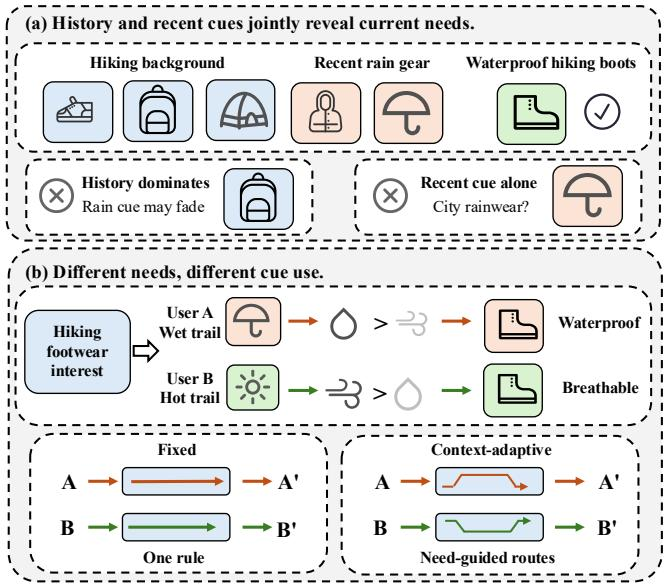  
Figure 1: Illustration of two interconnected challenges in SID-based generative recommendation. (a) Insuficient coordination between the full history and recent interactions may either dilute current cues or remove the historical background needed to interpret them. (b) Diferent recommendation needs may require diferent uses of contextual cues, whereas a fixed transformation follows the same rule across contexts and lacks need-guided adaptation.

Recent studies [31, 60] have enhanced both user-sequence modeling and SID generation beyond the basic autoregressive framework. For user-sequence modeling, CARE [32] progressively refines historical semantics through query-anchored reasoning, while GEMs [73] introduces behavioral evidence from recent, mid-term, and long term histories through multiple temporal streams. These methods [32, 73] improve preference representations through semantic refinement and multi-timescale modeling. However, they still have dificulty coordinating thefull history and recent interactions within a shared context, preventing complementary evidence from jointly characterizing the current need. For SID generation, APAO [66] improves the consistency between teacher-forced training and autoregressive inference through prefix-level optimization, while Latte [18] introduces latent-token-conditioned decoding paths to enhance generation flexibility. These methods improve the generation of target SIDs from the perspectives of training objectives and decoding paths. Nevertheless, they generally transform and use decoder states in a fixed manner, making it dificult to adapt the SID-prediction context to the current user need.

Consequently, despite advances in user-sequence modeling and SID generation, existing methods face two interconnected challenges: Challenge 1: Insuficient shared context modelingfor user sequences. The full history provides broad preference context for interpreting user behavior, whereas recent interactions highlight the user’s current activity [49, 56]. Modeling the full history as a single sequence may dilute recent cues with long-term behavioral patterns, while processing diferent temporal scopes through separate streams may inadequately coordinate their overlapping yet complementary evidence. For example, Figure 1(a) shows that rainrelated cues may be diluted by frequent hiking behaviors, while recent activities alone may leave the current need ambiguous. A shared modeling mechanism is therefore needed to preserve immediate cues and the historical background needed to interpret them, forming a user-conditioned context to guide SID generation for the current recommendation instance. Challenge 2: Insufficient personalized adaptation in progressive SID decisions. Recommendation instances may require diferent degrees of refinement of context-bearing decoder states. Although these states evolve with generated prefixes, existing methods typically apply a shared output-side transformation across instances, without explicitly selecting one suited to the current recommendation context. As illustrated in Figure 1(b), users with similar broad interests may have diferent current needs and therefore require diferent uses of preference cues. The challenge is to select a suitable transformation per recommendation instance and consistently apply it to evolving decoder states throughout coarse-to-fine SID generation. Accordingly, our research question is: How can GR think globally by integrating full-history and recent-history behaviors into a shared preference context, while generating personally through instanceadaptive transformation ofdecoder states throughout SID generation?

To answer this question, we propose MV-Thinker, which combines shared user-sequence context modeling with personalized adaptive transformation for SID prediction, enabling the model to Think Globally, Generate Personally. To think globally, Multi-View Temporal Thinking (MVT) constructs overlapping full-history and recent-history views and uses dedicated thinking queries and viewspecific readers, whose parameters are shared across users, to form complementary user-conditioned contexts before SID generation. In this way, recent cues are preserved without discarding the broader historical background needed to interpret them. To generate personally, Hierarchical Residual Adaptation (HRA) organizes lightweight adapters into nested residual paths that transform context-bearing decoder states before the SID vocabulary projection, allowing diferent recommendation contexts to use suitable transformation depths without maintaining a separate model for each user.

Our contributions are summarized as follows:

• We identify two challenges in GR: insuficient shared context modeling of full and recent behaviors, and insuficient personalized adaptation for SID prediction, motivating the perspective of Think Globally, Generate Personally.

• We propose MV-Thinker, where MVT organizes full-history and recent-history evidence, and HRA adapts context-bearing decoder states before a shared vocabulary projection.

• Extensive experimental results on four public benchmark datasets validate the efectiveness of MV-Thinker.

## 2 Preliminary

## 2.1 Generative Recommendation

Let U and I denote the sets of users and items. For a user $u \in \mathcal { U } ,$ the interaction history is $H _ { u } = \left( i _ { 1 } , i _ { 2 } , \ldots , i _ { n } \right)$ and the next item is �. In semantic-ID-based generative recommendation, each item � ∈ I is represented by a sequence of discrete tokens, denoted as $S _ { i } = [ t _ { 1 } ^ { i } , t _ { 2 } ^ { i } , \ldots , t _ { L } ^ { i } ]$ , where � is the SID length. Given $H _ { u }$ , the model generates the SID of� token by token [46, 58]:

$$
P ( S _ { y } \mid H _ { u } ) = \prod _ { l = 1 } ^ { L } P ( t _ { l } ^ { y } \mid H _ { u } , t _ { < l } ^ { y } ) ,\tag{1}
$$

where $t _ { < l } ^ { y }$ denotes the previously generated SID tokens of the item �. Given the training set D, the model is optimized by the standard token-level cross-entropy:

$$
\mathcal { L } _ { \mathrm { G R } } = - \sum _ { ( H _ { u } , y ) \in \mathcal { D } } \sum _ { l = 1 } ^ { L } \log P ( t _ { l } ^ { y } \mid H _ { u } , t _ { < l } ^ { y } ) .\tag{2}
$$

During inference, valid-prefix constraints are applied so that each generated SID corresponds to an item in the catalog.

## 2.2 Latent Thinking

Latent thinking performs intermediate computation in the hidden space to organize preference evidence before item generation [32]. It commonly uses learnable queries to read the encoded interaction history and construct additional context for the decoder. Unlike explicit chain-of-thought reasoning, the resulting states are continuous representations rather than generated text. In this work, latent thinking specifically refers to query-based preference-context construction before SID generation. It is performed once for the current history and does not introduce iterative reasoning at every SID position. The query parameters are shared across users, while their outputs depend on each user’s interaction history.

## 3 Method

## 3.1 Overview

To answer our research question, we propose MV-Thinker, as shown in Figure 2, to integrate full-history and recent-history behaviors into a shared preference context and adapt decoder states for instance-specific progressive SID generation. First, Multi-View Temporal Thinking (MVT) constructs overlapping full-history and recent-history views and forms complemen tary user-conditioned contexts through view-specific reading before generation. Second, Hierarchical Residual Adaptation (HRA) applies context-dependent residual transformations to decoder states before the shared vocabulary projection, supporting progressive SID decisions at diferent semantic granularities.

## 3.2 Multi-View Temporal Thinking

Modeling a suficiently informative shared preference context for the current user need is challenging because the full history contains diverse interests, while recent interactions alone provide limited preference background [32, 73]. To address this challenge, we introduce MVT, which allows the full history to contextualize recent behavior while preserving signals closely related to the current need. As shown in Figure 2(a), MVT contains two parts: Full–Recent Temporal Views defines the full- and recent-history scopes at the item level; View-Specific Thinking and Reading assigns a dedicated thinking query to each view and extracts complementary temporal contexts that jointly condition the shared SID generator.

3.2.1 Full–Recent Temporal Views. To balance long-term preference patterns with recent preference shifts, we construct two overlapping item-level history views. The full view captures the user’s general preference background, while the recent view emphasizes evidence closely related to the current need. The recent view is a sufix of the full history rather than a separate temporal stream. Both views are defined at the item level, so that no item SID is split.

Let $H _ { u } = \left( i _ { 1 } , \ldots , i _ { n } \right)$ be the interaction history. Given a recentwindow size �, the two views are defined as:

$$
H _ { u } ^ { f } = H _ { u } , \qquad H _ { u } ^ { r } = ( i _ { \operatorname* { m a x } ( 1 , n - w + 1 ) } , \ldots , i _ { n } ) ,\tag{3}
$$

where � and � denote the full and recent views, respectively. The encoder maps the tokenized history into contextualized hidden states $E _ { u } .$ . Accordingly, $E _ { u } ^ { f }$ contains all valid history positions, whereas $E _ { u } ^ { r }$ contains the positions associated with the last min(�, �) complete items. The recent view is thus defined at the item level and then mapped to corresponding encoder positions, ensuring that all SID tokens of every selected item are retained.

3.2.2 View-Specific Thinking and Reading. Preserving the distinct roles of full- and recent-history evidence within one generator is challenging: a shared reader may conflate the two views, while directly combining their encoder states may let the longer full view dominate recent evidence. To address this issue, we introduce viewspecific thinking and reading, pairing each view with a dedicated thinking query and an independent cross-attention reader.

MVT introduces two special tokens, <think\_1> and <think\_2>. Their embeddings $q _ { f }$ and $q _ { r }$ serve as the full-view and recentview thinking queries, respectively. They are inserted immediately after the decoder start token and before the target SID, forming [START, $q _ { f } , q _ { r } , t _ { < l } ^ { y } ]$ . The former summarizes the general preference context, while the latter focuses on recent behavioral evidence.

The two queries read their corresponding encoder states through separate multi-head cross-attention readers. For $v \in \{ f , r \}$ , the reader output and the enhanced query are defined as:

$$
\begin{array} { r } { z _ { v } = \mathrm { M H A } _ { v } \big ( \mathrm { L N } ( q _ { v } ) , \mathrm { L N } ( E _ { u } ^ { v } ) , \mathrm { L N } ( E _ { u } ^ { v } ) \big ) , \qquad \bar { q } _ { v } = q _ { v } + s z _ { v } , } \end{array}\tag{4}
$$

where LN(·) denotes layer normalization [1], and � is a learnable residual scale. The two independent readers let the full-view query aggregate the user’s stable interests and the recent-view query focus on the user’s latest behaviors.

At SID position �, the decoder state is obtained as:

$$
h _ { l } = \mathrm { D e c } \big ( E _ { u } , [ \mathsf { S T A R T } , \bar { q } _ { f } , \bar { q } _ { r } , t _ { < l } ^ { y } ] \big ) .\tag{5}
$$

## 3.3 Hierarchical Residual Adaptation

Transforming context-bearing decoder states according to the current recommendation context to support personalized progressive SID decisions is challenging. To address this challenge, we introduce HRA, which provides context-dependent residual transformations at diferent depths for personalization while retaining a shared backbone and vocabulary projection. As shown in Figure 2(b), HRA contains three parts: Nested Residual Paths builds transformations of increasing depth; Loss-Aware Roulette Training encourages path specialization without early collapse; and Confidence-Based Inference selects one path and keeps it fixed throughout SID generation.

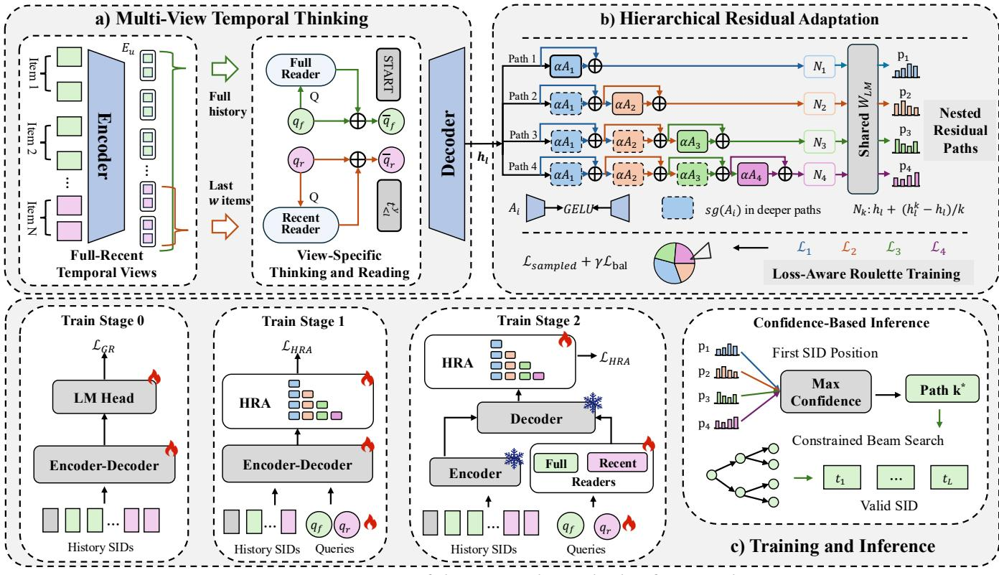  
Figure 2: Overview of the proposed MV-Thinker framework.

3.3.1 Nested Residual Paths. Diferent recommendation situations may require diferent degrees of representation refinement, which a single decoder transformation shared by all instances cannot provide [10]. We therefore organize lightweight adapters into nested residual paths, where each deeper path reuses the preceding transformations and adds a further residual update.

Let $A _ { k }$ 1 2 3 4denote the �-th bias-free bottleneck adapter, defined as:

$$
A _ { k } ( x ) = W _ { \mathrm { u p } } ^ { k } \mathrm { G E L U } ( W _ { \mathrm { d o w n } } ^ { k } x ) ,\tag{6}
$$

where $W _ { \mathrm { d o w n } } ^ { k }$ and $W _ { \mathrm { u p } } ^ { k }$ are the down- and up-projection matrices of the �-th adapter, respectively.

To provide diferent degrees of state refinement without learning independent experts, we organize the adapters into nested paths. A shallow path makes a small correction to the decoder state, whereas a deeper path progressively refines it by reusing all shallower transformations and adding further residual updates. Specifically, path � contains the ordered adapter sequence $( A _ { 1 } , \ldots , A _ { k } )$ : path 1 uses only $A _ { 1 } ,$ , path 2 composes $A _ { 1 } \to A _ { 2 } ,$ and path 4 uses the complete hierarchy $A _ { 1 }  A _ { 2 }  A _ { 3 }  A _ { 4 }$ . Starting from $h _ { l } ^ { 0 } \ = h _ { l } ,$ path � recursively applies its adapters. To keep the residual magnitude comparable across diferent depths, the accumulated residual is normalized by the path depth as follows:

$$
\begin{array} { r } { h _ { l } ^ { k } = h _ { l } ^ { k - 1 } + \alpha A _ { k } \left( h _ { l } ^ { k - 1 } \right) , \qquad \bar { h } _ { l } ^ { k } = h _ { l } + \frac { 1 } { k } \big ( h _ { l } ^ { k } - h _ { l } \big ) , } \end{array}\tag{7}
$$

where � is a residual scaling coeficient that controls the contribution of each adapter update.

All paths retain the original vocabulary projection. The token distribution of path � is defined as:

$$
{ p } _ { l } ^ { k } = \mathrm { s o f t m a x } ( W _ { \mathrm { L M } } \bar { h } _ { l } ^ { k } ) ,\tag{8}
$$

where $W _ { \mathrm { L M } }$ is the shared vocabulary projection matrix of the original decoder. Therefore, all paths predict tokens in the same semantic vocabulary and difer only in state transformation.

3.3.2 Loss-Aware Roulete Training. To select suitable adaptation paths for diferent instances without premature hard routing, we introduce loss-aware roulette training, which favors better-performing paths while preserving exploration through instance-wise stochastic sampling during training.

Specifically, we adopt roulette-wheel selection [34], assigning higher selection probabilities to lower-loss paths. During teacherforced training, the residual paths are applied at every supervised decoder position. Let $\Omega _ { u }$ denote the stage-specific set of supervised positions and $y _ { u , l }$ the corresponding label. For user �, the sequence loss of path � is defined as:

$$
\mathcal { L } _ { u } ^ { k } = - \frac { 1 } { \left| \Omega _ { u } \right| } \sum _ { l \in \Omega _ { u } } \log p _ { l } ^ { k } ( y _ { u , l } ) ,\tag{9}
$$

and $\mathcal { L } _ { u } ~ = ~ ( \mathcal { L } _ { u } ^ { 1 } , \ldots , \mathcal { L } _ { u } ^ { K } )$ collects the losses of all � paths. The roulette distribution and sampled path are defined as:

$$
\begin{array} { r } { \rho _ { u } = \mathrm { s o f t m a x } ( - \mathrm { s g } ( \mathcal { L } _ { u } ) / \tau ) , \qquad k _ { u } \sim \mathrm { C a t } ( \rho _ { u } ) , } \end{array}\tag{10}
$$

where sg(·) denotes stop-gradient, � is the sampling temperature, $\rho _ { u }$ is the path probability vector, and $\operatorname { C a t } ( \rho _ { u } )$ is the categorical distribution from which the index $k _ { u }$ is sampled. Although all paths are evaluated to construct the roulette distribution, only the sampled path supplies the main cross-entropy update per example.

Because deeper paths reuse shallower adapters, updating all preceding adapters whenever a deeper path is sampled may interfere with their learned transformations. We therefore retain the outputs of shallower adapters during forward computation while detaching them from back-propagation as follows:

$$
\widetilde { A } _ { i } ^ { ( k ) } ( x ) = \left\{ \begin{array} { l l } { \mathrm { s g } ( A _ { i } ( x ) ) , } & { i < k , } \\ { A _ { i } ( x ) , } & { i = k , } \end{array} \right.\tag{11}
$$

where ${ \widetilde A } _ { i } ^ { ( k ) }$ denotes the training-time output of adapter � under path �. Thus, the terminal adapter is optimized on top of the preserved shallower transformations, maintaining the nested dependency while giving each depth a distinct optimization role.

Roulette sampling may still favor a small subset of paths early in training. To prevent such collapse and ensure that all paths receive suficient training examples, we recompute the non-detached probabilities $\bar { \rho } _ { u } =$ softmax $\left( - \mathcal { L } _ { u } / \tau \right)$ and add a load-balancing term on their mini-batch average. The overall objective of loss-aware sampling is as follows:

$$
\begin{array} { r } { \mathcal { L } _ { \mathrm { H R A } } = \mathcal { L } _ { \mathrm { s a m p l e d } } + \gamma \mathcal { L } _ { \mathrm { b a l } } , } \end{array}\tag{12}
$$

with

$$
\mathcal { L } _ { \mathrm { s a m p l e d } } = \frac { 1 } { | \mathcal { B } | } \sum _ { u \in \mathcal { B } } \mathcal { L } _ { u } ^ { k _ { u } } , \qquad \mathcal { L } _ { \mathrm { b a l } } = \sum _ { k = 1 } ^ { K } \left( \frac { 1 } { | \mathcal { B } | } \sum _ { u \in \mathcal { B } } \bar { \rho } _ { u } ^ { k } - \frac { 1 } { K } \right) ^ { 2 } ,\tag{13}
$$

where B denotes a mini-batch, $\mathcal { L } _ { \mathrm { s a m p l e d } }$ is the average loss of the sampled paths, $\mathcal { L } _ { \mathrm { b a l } }$ penalizes the deviation of the average nondetached path probability $\bar { \rho } _ { u } ^ { k }$ from the uniform distribution, and � controls the regularization strength.

3.3.3 Confidence-Based Inference. During inference, performing complete beam search separately for every path introduces substantial decoding overhead [55], while switching paths across SID positions may lead to inconsistent state transformations [66]. Therefore, we introduce confidence-based inference, which selects one path at the first real SID position and fixes it throughout the subsequent item generation. This maintains path consistency while avoiding repeated beam search over all paths.

Specifically, we evaluate all � residual paths at the first real SID position and select the path with the highest predicted next-token log-probability as follows:

$$
k _ { u } ^ { * } = \arg \operatorname* { m a x } _ { k } \operatorname* { m a x } _ { t \in \mathcal { V } } \log p _ { 1 } ^ { k } ( t ) ,\tag{14}
$$

where $_ \mathrm { c } { } _ { V }$ is the SID vocabulary and $k _ { u } ^ { * }$ is the path selected for user �. The selected path remains fixed for all subsequent SID positions and beam descendants. Accordingly, the score of candidate item � is accumulated under the same path as follows:

$$
P ( S _ { i } \mid H _ { u } , k _ { u } ^ { * } ) = \prod _ { l = 1 } ^ { L } p _ { l } ^ { k _ { u } ^ { * } } ( t _ { l } ^ { i } ) .\tag{15}
$$

During decoding, constrained beam search restricts each extension to a valid SID prefix in the item catalog and maps each completed sequence back to its corresponding item.

## 3.4 Training and Inference

To address the challenge that jointly learning all components from scratch may entangle basic SID generation with the specialization of newly introduced modules, we adopt a progressive training strategy that preserves previously learned generative knowledge while gradually adding context construction and adaptive generation. As shown in Figure 2(c), the procedure contains three training stages and one inference process, and Algorithm 1 in Appendix A summarizes the complete procedure.

Stage 0: Base Generative Recommendation. We train the encoder–decoder backbone with $\mathcal { L } _ { \mathrm { G R } }$ in Equation (2), establishing a stable mapping from interaction histories to valid item SIDs.

Stage 1: Thinking-Query and HRA Learning. We insert <think\_1> and <think\_2> before the target SID and introduce HRA. With thinking-token labels unmasked, the model predicts <think\_1>, <think\_2>, the target SID, and EOS, while the backbone, queries, and adapters are jointly optimized by Equation (12). This stage learns the thinking queries and nested residual paths before view-specific extraction.

Stage 2: Multi-View Temporal Refinement. We add the fullview and recent-view readers and freeze the backbone. The thinking tokens remain as the decoder prefix with their labels masked, so the loss covers only the target SID and EOS, while the readers, queries, and adapters are optimized by Equation (12). This stage focuses optimization on temporal evidence organization and output-side adaptation without disturbing the learned SID semantics.

Inference. The model constructs both temporal views, selects a residual path by Equation (14), and generates SIDs by constrained beam search following Equation (15).

## 4 Experiments

We conduct experiments on four public datasets to answer the following research questions:

• RQ1: What is the performance of MV-Thinker compared with SOTA baseline methods?

• RQ2: How does MV-Thinker benefit from coordinating full history and recent-history evidence in a shared context?

• RQ3: Do diferent user contexts favor diferent transformation depths for progressive SID prediction?

• RQ4: How do MVT and HRA contribute to the recommendation performance of MV-Thinker?

• RQ5: What are the efects of the thinking mechanism, temporal modeling, and the global and recent views?

## 4.1 Experimental Settings

4.1.1 Datasets. We use four real-world recommendation datasets from diferent domains: 1) Instruments, Beauty, and Games are three categories of the Amazon review datasets [42], containing user interactions with musical instruments, beauty products, and video games, respectively; and 2) $\mathbf { Y e l p } ^ { 1 }$ is a popular dataset containing user interactions with local businesses on the Yelp platform. Following previous generative recommendation studies [46, 58], we discard users and items with fewer than five interactions and adopt the leave-one-out strategy for sequential recommendation. For each user, the last interaction is used for testing, the penultimate interaction for validation, and the remaining interactions for training. The dataset statistics are summarized in Table 1.

Table 1: Statistics of the processed datasets.
<table><tr><td>Dataset</td><td>Users</td><td>Items</td><td>Interactions</td><td>Avg. length</td></tr><tr><td>Instruments</td><td>24,772</td><td>9,922</td><td>206,153</td><td>8.32</td></tr><tr><td>Beauty</td><td>22,363</td><td>12,101</td><td>198,502</td><td>8.88</td></tr><tr><td>Games</td><td>50,546</td><td>16,859</td><td>452,989</td><td>8.96</td></tr><tr><td>Yelp</td><td>30,431</td><td>20,033</td><td>316,354</td><td>10.40</td></tr></table>

4.1.2 Evaluation Metrics. Following previous works [32, 46, 58], we adopt two standard Top-� recommendation metrics, including Hit Ratio (H@�) and Normalized Discounted Cumulative Gain (N@�), with $k \in \{ 5 , 1 0 , 2 0 \}$ . H@� measures whether the ground-truth item appears among the top-� recommendations, while N@� further considers its ranking position in the recommendation list. Higher H@� and N@� indicate better recommendation performance.

4.1.3 Baselines. To evaluate the efectiveness of MV-Thinker, we compare it with representative baseline methods, which can be divided into two categories: discriminative recommendation methods and generative recommendation methods.

Discriminative Recommendation. These methods learn user preferences directly from historical interaction sequences and predict the next item through conventional ranking objectives.

• Caser [53] applies convolutional filters to capture local and sequential patterns in recent user interactions.

• GRU4Rec [16] models user behavior sequences with gated re current units to capture evolving user preferences.

• BERT4Rec [48] employs bidirectional self-attention and maskeditem prediction to learn contextual dependencies among items in user behavior sequences.

• SASRec [23] adopts unidirectional self-attention to capture sequential dependencies in a user’s interaction history.

Generative Recommendation. These methods represent items with semantic identifiers and formulate next-item recommendation as autoregressive sequence generation.

• TIGER [46] employs RQ-VAE to construct semantic IDs and uses an encoder–decoder model to autoregressively generate the SID of the next item.

• LETTER [58] incorporates collaborative signals and diversity regularization for recommendation-oriented item tokenization.

• CARE [32] introduces cascaded latent reasoning to refine the preference context before SID generation, making it closely related to our latent thinking design.

• GEMs [73] captures user preferences at recent, mid-term, and lifecycle scales through separate generative streams.

• APAO [66] adaptively optimizes SID prefixes to reduce the discrepancy between training and autoregressive generation.

• Latte [18] conditions SID generation on latent tokens and provides multiple decoding paths.

• IBA [65] adaptively allocates latent refinement steps to SID positions according to their information gain, providing positiondependent computation during generation.

4.1.4 Implementation Details. All experiments are repeated with three random seeds, {42, 43, 44}, and the average results are reported on 8 NVIDIA RTX PRO 6000 GPUs. We use the SIDs generated by the RQ-VAE-based tokenization pipeline and adopt a T5-style [45] encoder–decoder backbone with a hidden dimension of 128 and four Transformer layers [54]. For MVT, we set the recentwindow size to $w = 5$ items. HRA contains four nested residual paths with a bottleneck dimension of 32, a residual scaling coefficient $\alpha = 0 . 2 ,$ , and a roulette temperature $\tau = 1 . 0$ . We optimize the model using AdamW [37] with a batch size of 256 and two gradient accumulation steps. The learning rates are set to $5 \times 1 0 ^ { - 4 }$ for Stages 0 and 1 and $2 \times 1 0 ^ { - 4 }$ for Stage 2, with a weight decay of 0.01, a warm-up ratio of 0.01, and cosine learning-rate decay. The training epochs is 200. During inference, we use constrained beam search with a beam size of 20.

## 4.2 Overall Performance (RQ1)

To evaluate whether MV-Thinker outperforms state-of-the-art recommendation methods, we compare it with discriminative and generative baselines on four datasets under both TIGER and LET-TER backbones (Table 2). We can find: 1) MV-Thinker achieves the best results on all metrics under both backbones, demonstrating consistent gains in both hit accuracy and ranking quality. 2) Both generative backbones outperform the strongest discriminative baseline, demonstrating the efectiveness of SID-based generation in these settings. MV-Thinker further improves both backbones, suggesting that its gains extend across the two tested item-tokenization schemes. 3) The strongest baseline varies by dataset, backbone, and metric: sequence-side methods (CARE and GEMs) are often competitive on Beauty and Games, while generator-side methods (APAO, Latte, and IBA) frequently lead on Instruments, with metric-specific exceptions. MV-Thinker consistently outperforms both types of enhancement, supporting its joint design of coordinating full-history and recent-history evidence through MVT and adapting SID prediction through HRA.

## 4.3 Shared Context Modeling (RQ2)

To verify whether MV-Thinker can suficiently model shared context for user sequences, we compare the recommendation behavior of MV-Thinker and TIGER on Instruments through SID catalog coverage (Table 3) and coverage visualization (Figure 3). We aggregate each model’s recommended SIDs across all test users and count distinct codes, defining coverage as:

$$
\mathrm { C o v e r a g e } _ { M } @ K = \frac { \left| \bigcup _ { u \in \mathcal { U } } \mathcal { R } _ { M } ^ { K } ( u ) \right| } { | C | } \times 1 0 0 \% ,\tag{16}
$$

where U denotes the evaluated test users, C denotes all unique catalog SIDs, and $\mathcal { R } _ { M } ^ { K } ( u )$ denotes the top-� SIDs recommended by model � to user �.

Table 2: Overall performance with TIGER and LETTER backbones on four datasets. “+” denotes a method applied to the preceding backbone. H@� and N@� denote Hit Ratio and NDCG at �, respectively. The best reported results within each backbone group are boldfaced, and shaded rows denote our method. ∗ indicates significant improvements over the strongest baseline in the same backbone group under a two-tailed �-test.
<table><tr><td>Dataset</td><td>Method</td><td>H@5</td><td>H@10</td><td>H@20</td><td>N@5</td><td>N@10</td><td>N@20</td><td>| Dataset </td><td>Method</td><td>H@5</td><td>H@10</td><td>H@20</td><td>N@5</td><td>N@10</td><td>N@20</td></tr><tr><td rowspan="12">Instruments Beauty</td><td>Caser</td><td>0.0720</td><td>0.0856</td><td>0.1099</td><td>0.0640</td><td>0.0683</td><td>0.0744</td><td></td></tr><tr><td>0.0782</td><td>0.0925</td><td>0.1122</td><td>0.0688</td><td>0.0734</td><td>0.0783</td><td>Caser GRU4Rec</td><td></td><td>0.0111 0.0176</td><td>0.0205 0.0258</td><td>0.0317 0.0384</td><td>0.0079 0.0127</td><td>0.0109 0.0137 0.0133 0.0166</td></tr><tr><td>GRU4Rec BERT4Rec</td><td>0.0816</td><td>0.1040</td><td>0.1227</td><td>0.0674 0.0745</td><td>0.0795</td><td></td><td>BERT4Rec</td><td>0.0182</td><td>0.0285</td><td>0.0451</td><td>0.0125</td><td>0.0158 0.0199</td></tr><tr><td>SASRec</td><td>0.0828</td><td>0.1019</td><td>0.1283 0.0710</td><td>0.0772</td><td>0.0838</td><td>SASRec</td><td>0.0202</td><td>0.0313</td><td>0.0469</td><td>0.0135</td><td>0.0171</td><td>0.0210</td></tr><tr><td></td><td>0.0853</td><td>0.1047</td><td>0.1293 0.0727</td><td>0.0790</td><td>0.0852</td><td>TIGER</td><td>0.0216</td><td>0.0354</td><td>0.0531</td><td>0.0138</td><td>0.0182</td><td>0.0227</td></tr><tr><td>TIGER</td><td>0.0859</td><td>0.1052</td><td>0.1307 0.0731</td><td>0.0792</td><td>0.0855</td><td>+CARE</td><td>0.0247</td><td>0.0359</td><td>0.0532</td><td>0.0159</td><td>0.0201</td><td>0.0249</td></tr><tr><td>+CARE +APAO</td><td>0.0875</td><td>0.1085</td><td>0.1297 0.0743</td><td>0.0810</td><td>0.0869</td><td>+APAO</td><td>0.0222</td><td>0.0365</td><td>0.0543</td><td>0.0144</td><td>0.0189</td><td>0.0234</td></tr><tr><td></td><td>0.0866</td><td>0.1066</td><td>0.1306</td><td>0.0737 0.0801</td><td>0.0867</td><td>+Latte</td><td>0.0230</td><td>0.0373</td><td>0.0566</td><td></td><td>0.0146 0.0192</td><td>0.0244</td></tr><tr><td>+Latte +GEMs</td><td>0.0866</td><td>0.1083</td><td>0.1296</td><td>0.0739</td><td>0.0809 0.0866</td><td>Yelp +GEMs</td><td>0.0228</td><td>0.0376</td><td>0.0557</td><td></td><td>0.0143 0.0190</td><td>0.0236</td></tr><tr><td>+IBA</td><td>0.0861</td><td>0.1066</td><td>0.1317</td><td>0.0738</td><td>0.0805 0.0872</td><td></td><td></td><td>0.0241</td><td>0.0383</td><td>0.0567</td><td>0.0155 0.0204</td><td>0.0247</td></tr><tr><td>+MV-Thinker</td><td>0.0882*</td><td>0.1088*</td><td>0.1325*</td><td>0.0751*</td><td>0.0817*</td><td>0.0877*</td><td>+IBA +MV-Thinker</td><td>0.0251*</td><td>0.0387*</td><td>0.0579*</td><td>0.0163* 0.0207*</td><td>0.0255*</td></tr><tr><td>LETTER</td><td>0.0854</td><td>0.1049</td><td>0.1291</td><td>0.0762</td><td>0.0827</td><td>0.0893</td><td>LETTER</td><td>0.0220</td><td>0.0358</td><td>0.0544</td><td>0.0143</td><td>0.0186</td><td>0.0233</td></tr><tr><td>+CARE</td><td>0.0860</td><td>0.1054</td><td>0.1298</td><td>0.0766</td><td>0.0833</td><td>0.0892</td><td>+CARE</td><td></td><td>0.0223</td><td>0.0362</td><td>0.0548</td><td>0.0144</td><td>0.0188</td><td>0.0235</td></tr><tr><td>+APAO</td><td>0.0881</td><td>0.1119</td><td></td><td>0.1332 0.0777</td><td>0.0856</td><td>0.0912</td><td></td><td>+APAO</td><td>0.0239</td><td>0.0371</td><td>0.0553</td><td>0.0156</td><td>0.0195</td><td>0.0242</td></tr><tr><td>+Latte</td><td>0.0867</td><td>0.1100</td><td>0.1327</td><td>0.0760</td><td>0.0837</td><td>0.0897</td><td></td><td>+Latte</td><td>0.0236</td><td>0.0388</td><td>0.0585</td><td>0.0154</td><td>0.0199</td><td>0.0249</td></tr><tr><td>+GEMs</td><td>0.0882</td><td>0.1115</td><td>0.1352</td><td>0.0772</td><td>0.0849</td><td>0.0912</td><td></td><td>+GEMs</td><td>0.0238</td><td>0.0377</td><td>0.0565</td><td>0.0158</td><td>0.0198</td><td>0.0247</td></tr><tr><td>+IBA</td><td>0.0875</td><td>0.1102</td><td>0.1369</td><td>0.0779</td><td>0.0854</td><td>0.0924</td><td></td><td>+IBA</td><td>0.0228</td><td>0.0375</td><td>0.0589</td><td>0.0150</td><td>0.0194</td><td>0.0253</td></tr><tr><td rowspan="11"></td><td>+MV-Thinker</td><td>0.0906*</td><td>0.1122*</td><td>0.1404*</td><td>0.0801*</td><td>0.0873*</td><td>0.0947*</td><td></td><td>+MV-Thinker</td><td>0.0250*</td><td>0.0391*</td><td>0.0595*</td><td>0.0164*</td><td>0.0208* 0.0260*</td></tr><tr><td>Caser</td><td>0.0235</td><td>0.0353</td><td>0.0557</td><td>0.0144</td><td>0.0183</td><td>0.0234 0.0308</td><td>Caser GRU4Rec</td><td>0.0401 0.0454</td><td></td><td>0.0683 0.0719</td><td>0.0985 0.1117</td><td>0.0258</td><td>0.0349 0.0423</td></tr><tr><td>GRU4Rec BERT4Rec</td><td>0.0303 0.0341</td><td>0.0441 0.0515</td><td>0.0657 0.0733</td><td>0.0210 0.0239</td><td>0.0254 0.0295</td><td>0.0350</td><td>BERT4Rec</td><td>0.0490</td><td>0.0801</td><td>0.1228</td><td>0.0309 0.0293</td><td>0.0394 0.0393</td><td>0.0495 0.0500</td></tr><tr><td>SASRec</td><td>0.0362</td><td>0.0523</td><td>0.0732</td><td>0.0234</td><td>0.0287</td><td>0.0339</td><td>SASRec</td><td>0.0507</td><td>0.0800</td><td>0.1193</td><td>0.0343</td><td>0.0437</td><td>0.0536</td></tr><tr><td></td><td>0.0380</td><td>0.0575</td><td>0.0858</td><td>0.0246</td><td>0.0309</td><td>0.0380 0.0394</td><td>TIGER</td><td>0.0533</td><td>0.0825</td><td>0.1230</td><td>0.0356</td><td></td><td></td></tr><tr><td>TIGER +CARE</td><td>0.0381</td><td>0.0604</td><td>0.0883</td><td>0.0247</td><td>0.0324</td><td></td><td>+CARE</td><td>0.0534</td><td>0.0831</td><td>0.1309</td><td>0.0357</td><td>0.0450 0.0456</td><td>0.0559 0.0564</td></tr><tr><td>+APAO</td><td>0.0397</td><td>0.0590</td><td>0.0865</td><td>0.0264</td><td>0.0334</td><td>0.0408</td><td>+APAO</td><td>0.0544</td><td>0.0862</td><td>0.1286</td><td>0.0370</td><td>0.0469</td><td>0.0576</td></tr><tr><td>+Latte</td><td>0.0390</td><td>0.0572</td><td>0.0863</td><td>0.0256</td><td>0.0322</td><td>0.0398</td><td>+Latte</td><td>0.0541</td><td>0.0850</td><td>0.1279</td><td>0.0365</td><td>0.0464</td><td>0.0572</td></tr><tr><td></td><td>0.0401</td><td>0.0602</td><td>0.0867</td><td>0.0266</td><td>0.0337</td><td>0.0409</td><td>Games +GEMs</td><td>0.0548</td><td>0.0876</td><td>0.1293</td><td>0.0374</td><td>0.0480</td><td>0.0585</td></tr><tr><td>+GEMs +IBA</td><td>0.0387</td><td>0.0593</td><td>0.0881</td><td>0.0252</td><td>0.0326</td><td>0.0404</td><td>+IBA</td><td>0.0534</td><td>0.0861</td><td>0.1297</td><td>0.0358</td><td>0.0462</td><td>0.0580</td></tr><tr><td>+MV-Thinker</td><td>0.0405*</td><td>0.0607*</td><td>0.0887*</td><td>0.0275*</td><td>0.0340*</td><td>0.0411*</td><td>+MV-Thinker</td><td>0.0557*</td><td>0.0884*</td><td>0.1319*</td><td>0.0379*</td><td>0.0484*</td><td>0.0594*</td></tr><tr><td>|LETTER +CARE</td><td></td><td></td><td></td><td></td><td></td><td></td><td></td><td></td><td></td><td></td><td></td><td></td><td></td></tr><tr><td rowspan="7">+APAO +Latte +GEMs</td><td></td><td>0.0379 0.0381</td><td>0.0594 0.0604</td><td>0.0849 0.0884</td><td>0.0248 0.0251</td><td>0.0318 0.0328</td><td>0.0382 0.0392</td><td>LETTER +CARE</td><td>0.0541</td><td>0.0839</td><td>0.1274</td><td>0.0364</td><td>0.0460</td><td>0.0570</td></table>

Table 3: SID catalog coverage (%) on Instruments under different recommendation budgets �.
<table><tr><td>Model</td><td>K = 1</td><td> $K = 3$ </td><td>K = 5</td><td> $K = 1 0$ </td><td>K = 20</td></tr><tr><td>TIGER</td><td>4.31</td><td>7.15</td><td>9.27</td><td>13.05</td><td>19.56</td></tr><tr><td>MV-Thinker</td><td>5.51</td><td>9.75</td><td>12.13</td><td>17.59</td><td>25.50</td></tr></table>

As shown in Table 3, we can find: 1)MV-Thinker achieves higher coverage at every cutof, increasing coverage from 19.56% to 25.50% at � = 20. Figure 3 ofers a complementary view of the covered SIDs on a shared catalog map. Together with the improved Hit@20 and NDCG@20 in Table 2, these results show broader catalog exposure alongside better target ranking under the same recommendation budget. 2) MV-Thinker broadens catalog coverage while improving ranking accuracy, exposing more distinct SIDs without an accuracy trade-of. Its shared context combines recent behavioral cues with the historical background needed to interpret them, providing coordinated temporal evidence for SID generation.

The joint gains suggest that this design helps accommodate heterogeneous user needs through broader yet relevant recommendations, alleviating the limitations of insuficient coordination between fullhistory and recent-history evidence.

## 4.4 Personalized Context Adaptation (RQ3)

To verify whether MV-Thinker can adapt personally in progressive SID decisions, we examine its actual routing decisions over HRA paths. For 160 uniformly sampled Beauty test users, we compute each path’s log confidence, defined as the log of its maximum nexttoken probability at the first SID prediction position, using only the observed history. As shown in Figure 4, which presents within-user min–max-normalized scores with users grouped by their selected path, we find that HRA learns complementary context transformations suited to diferent user sequences: depths 1–4 are selected for 40.6%, 18.1%, 26.3%, and 15.0% of users, respectively. The selected path remains fixed throughout SID generation for each recommendation instance. Its hierarchical paths thus provide distinct refinement options for personalized SID prediction, alleviating the restriction of applying a single fixed output-side transformation across heterogeneous user contexts.

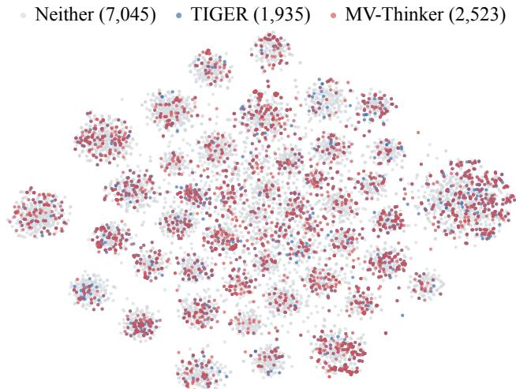  
Figure 3: Visualization of Top-20 SID coverage on Instruments. Each point represents a unique SID on a shared t-SNE map. Gray points are uncovered, while blue and red markers indicate coverage by TIGER and MV-Thinker, respectively.

User-dependent inference routing over HRA paths  
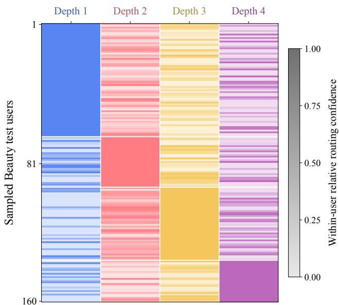  
Figure 4: User-dependent inference routing over HRA paths on Beauty. Rows represent sampled test users, and columns indicate residual depths. Scores are first-position log confi dences, min–max normalized per user. Darker cells indicate higher relative confidence, and users are grouped by the path selected during inference.

## 4.5 Ablation Study (RQ4)

To investigate how MVT and HRA contribute to recommendation performance, we conduct an ablation study on Instruments and Beauty by separately removing each module from the framework.

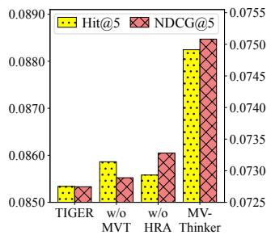  
(a) Instruments

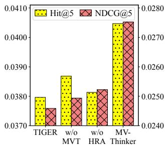  
(b) Beauty

Figure 5: Ablation study of MV-Thinker on the Instruments and Beauty datasets. “w/o MVT” and “w/o HRA” denote the variants without Multi-View Temporal Thinking and Hierarchical Residual Adaptation, respectively.  
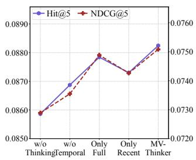  
(a) Instruments

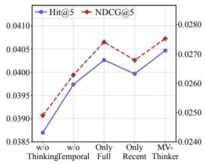  
(b) Beauty  
Figure 6: Component analysis of MV-Thinker on Instruments and Beauty. “Only Full” and “Only Recent” retain only the full-history and recent-history views, respectively.

As shown in Figure 5(a–b), removing either module reduces Hit@5 and NDCG@5, while both single-module variants still outperform TIGER. Removing HRA causes a larger drop in Hit@5, whereas removing MVT causes a larger drop in NDCG@5 on both datasets. These observations indicate that the two modules contribute diferently to recommendation performance. Overall, both MVT and HRA improve recommendation quality, and combining them achieves better performance than either module alone on both datasets, demonstrating their complementary contributions to the gains of MV-Thinker.

## 4.6 Component Analysis (RQ5)

To investigate the efects of latent thinking, temporal modeling, and the two history views, we compare w/o Thinking, w/o Temporal, Only Full, and Only Recent on Instruments and Beauty. The variants remove thinking or temporal modeling, or retain only the full-history or recent-history view. Figure 6(a–b) shows that MV-Thinker achieves the highest Hit@5 and NDCG@5 on both datasets. Removing thinking causes the largest decline, and removing temporal modeling also reduces performance. Only Full outperforms Only Recent, but both trail the complete model. These results suggest that latent thinking and temporal modeling improve recommendation quality, with full-history evidence providing a stronger foundation and recent-history cues adding complementary information. Combining both views through latent thinking yields the best performance in these comparisons.

## 5 Related Work

## 5.1 Generative Recommendation with Adaptive Generation

Semantic-ID-based generative recommendation predicts next items through conditional identifier generation [8, 17, 41, 57], unifying retrieval and ranking [14, 22, 29, 30, 68]. TIGER [46] autoregressively generates content-derived semantic IDs. Subsequent work improves tokenization and generation [9, 59, 63, 64, 70]: LETTER [58] integrates semantic and collaborative signals, SETRec [33] removes within-identifier token-order dependencies, and RPG [19] gen erates long SIDs in parallel. General adaptation includes expert routing [11, 38, 47, 51], dynamic depth [10, 62], adapters and lowrank updates [20, 21], module composition and conditional sharing [39, 40, 43], and continuous prompts [24, 28]. In generative retrieval, prefix pruning may misalign intermediate decisions with complete identifier quality [61]. APAO [66] addresses this through adaptively weighted prefix objectives, while Latte [18] uses discrete latent prefixes to create multiple generation paths per item.

These studies improve identifier design, training objectives, and decoding flexibility. However, personalized contextual adaptation for progressive SID decisions remains underexplored. We adapt the SID-prediction context to the current user need rather than apply a fixed transformation across recommendation situations.

## 5.2 Temporal Preference Modeling and Latent Thinking

Temporal preference modeling captures evolving interests through interaction order, time intervals, and historical context [27, 44, 48, 71, 72], while multi-interest models represent heterogeneous needs with multiple vectors [4, 25]. SASRec [23] identifies relevant historical interactions through causal self-attention, whereas GEMs [73] organizes long histories into recent, mid-term, and lifecycle streams. Iterative and adaptive computation supports hidden-state refinement [2, 7, 13]; language models explore continuous latent reasoning [15] and internal rationales before prediction [67]. ReaRec [52] and LARES [35] iteratively refine hidden states, while CARE [32] employs query-anchored reasoning and progressively exposes finergrained historical SID semantics before token generation.

These methods model temporal preferences within a sequence or separate streams, or refine the entire history. However, they rarely coordinate overlapping full- and recent-history evidence within a shared preference context for each user. We therefore use shared queries and view-specific readers to contextualize recent activity with the full history before SID generation.

## 6 Conclusion

In this paper, we propose MV-Thinker, a semantic-ID-based generative recommendation framework that separates the organization of behavioral evidence from the adaptation of output-side transformations. Multi-View Temporal Thinking uses shared queries and independent readers to expose full-history and recent-history evidence before generation. Hierarchical Residual Adaptation supplies nested transformations of decoder states while retaining a common vocabulary projection, with loss-aware sampling during training and confidence-based selection at inference.

## References

[1] Jimmy Lei Ba, Jamie Ryan Kiros, and Geofrey E Hinton. 2016. Layer normalization. arXiv preprint arXiv:1607.06450 (2016).

[2] Andrea Banino, Jan Balaguer, and Charles Blundell. 2021. Pondernet: Learning to ponder. arXiv preprint arXiv:2107.05407 (2021).

[3] Keqin Bao, Jizhi Zhang, Wenjie Wang, Yang Zhang, Zhengyi Yang, Yanchen Luo, Chong Chen, Fuli Feng, and Qi Tian. 2025. A bi-step grounding paradigm for large language models in recommendation systems. ACM Transactions on Recommender Systems 3, 4 (2025), 1–27.

[4] Yukuo Cen, Jianwei Zhang, Xu Zou, Chang Zhou, Hongxia Yang, and Jie Tang. 2020. Controllable multi-interest framework for recommendation. In Proceedings ofthe 26th ACM SIGKDD international conference on knowledge discovery & data mining. 2942–2951.

[5] Jianxin Chang, Chen Gao, Yu Zheng, Yiqun Hui, Yanan Niu, Yang Song, Depeng Jin, and Yong Li. 2021. Sequential recommendation with graph neural networks. In Proceedings ofthe 44th international ACM SIGIR conference on research and development in information retrieval. 378–387.

[6] Paul Covington, Jay Adams, and Emre Sargin. 2016. Deep neural networks for youtube recommendations. In Proceedings ofthe 10th ACM conference on recommender systems. 191–198.

[7] Mostafa Dehghani, Stephan Gouws, Oriol Vinyals, Jakob Uszkoreit, and Łukasz Kaiser. 2018. Universal transformers. arXiv preprint arXiv:1807.03819 (2018).

[8] Yashar Deldjoo, Zhankui He, Julian McAuley, Anton Korikov, Scott Sanner, Arnau Ramisa, René Vidal, Maheswaran Sathiamoorthy, Atoosa Kasirzadeh, and Silvia Milano. 2024. A review of modern recommender systems using generative models (gen-recsys). In Proceedings of the 30th ACM SIGKDD conference on Knowledge Discovery and Data Mining. 6448–6458.

[9] Jiaxin Deng, Shiyao Wang, Kuo Cai, Lejian Ren, Qigen Hu, Weifeng Ding, Qiang Luo, and Guorui Zhou. 2025. Onerec: Unifying retrieve and rank with generative recommender and iterative preference alignment. arXiv preprint arXiv:2502.18965 (2025).

[10] Maha Elbayad, Jiatao Gu, Edouard Grave, and Michael Auli. 2019. Depth-adaptive transformer. arXiv preprint arXiv:1910.10073 (2019).

[11] William Fedus, Barret Zoph, and Noam Shazeer. 2022. Switch transformers: Scaling to trillion parameter models with simple and eficient sparsity. Journal ofMachine Learning Research 23, 120 (2022), 1–39.

[12] Shijie Geng, Shuchang Liu, Zuohui Fu, Yingqiang Ge, and Yongfeng Zhang. 2022. Recommendation as language processing (rlp): A unified pretrain, personalized prompt & predict paradigm (p5). In Proceedings of the 16th ACM conference on recommender systems. 299–315.

[13] Alex Graves. 2016. Adaptive computation time for recurrent neural networks. arXiv preprint arXiv:1603.08983 (2016).

[14] Xiao Han, Zimo Zhao, Wanyu Wang, Maolin Wang, Zitao Liu, Yi Chang, and Xiangyu Zhao. 2026. Data eficient adaptation in large language models via continuous low-rank fine-tuning. Advances in Neural Information Processing Systems 38 (2026), 165157–165182.

[15] Shibo Hao, Sainbayar Sukhbaatar, DiJia Su, Xian Li, Zhiting Hu,Jason Weston, and Yuandong Tian. 2024. Training large language models to reason in a continuous latent space. arXiv preprint arXiv:2412.06769 (2024).

[16] Balázs Hidasi, Alexandros Karatzoglou, Linas Baltrunas, and Domonkos Tikk. 2015. Session-based recommendations with recurrent neural networks. arXiv preprint arXiv:1511.06939 (2015).

[17] Min Hou, Le Wu, Yuxin Liao, Yonghui Yang, Zhen Zhang, Yu Wang, Changlong Zheng, Han Wu, and Richang Hong. 2026. A survey on generative recommendation: Data, model, and tasks. AI Open (2026).

[18] Yupeng Hou, Haven Kim, Clark Mingxuan Ju, Eduardo Escoto, Neil Shah, and Julian McAuley. 2026. Expressiveness Limits of Autoregressive Semantic ID Generation in Generative Recommendation. arXiv preprint arXiv:2605.06331 (2026).

[19] Yupeng Hou, Jiacheng Li, Ashley Shin, Jinsung Jeon, Abhishek Santhanam, Wei Shao, Kaveh Hassani, Ning Yao, and Julian McAuley. 2025. Generating long semantic ids in parallel for recommendation. In Proceedings of the 31st ACM SIGKDD Conference on Knowledge Discovery and Data Mining V. 2. 956–966.

[20] Neil Houlsby, Andrei Giurgiu, Stanislaw Jastrzebski, Bruna Morrone, Quentin De Laroussilhe, Andrea Gesmundo, Mona Attariyan, and Sylvain Gelly. 2019. Parameter-eficient transfer learning for NLP. In International conference on machine learning. PMLR, 2790–2799.

[21] Edward J Hu, Yelong Shen, Phillip Wallis, Zeyuan Allen-Zhu, Yuanzhi Li, Shean Wang, Lu Wang, and Weizhu Chen. 2021. Lora: Low-rank adaptation of large

language models. arXiv preprint arXiv:2106.09685 (2021).

[22] Jianchao Ji, Zelong Li, Shuyuan Xu, Wenyue Hua, Yingqiang Ge, Juntao Tan, and Yongfeng Zhang. 2024. Genrec: Large language model for generative recommen dation. In European Conference on Information Retrieval. Springer, 494–502.

[23] Wang-Cheng Kang and Julian McAuley. 2018. Self-attentive sequential recommendation. In 2018 IEEE international conference on data mining (ICDM). IEEE, 197–206.

[24] Brian Lester, Rami Al-Rfou, and Noah Constant. 2021. The power of scale for parameter-eficient prompt tuning. In Proceedings of the 2021 conference on empirical methods in natural language processing. 3045–3059.

[25] Chao Li, Zhiyuan Liu, Mengmeng Wu, Yuchi Xu, Huan Zhao, Pipei Huang, Guoliang Kang, Qiwei Chen, Wei Li, and Dik Lun Lee. 2019. Multi-interest network with dynamic routing for recommendation at Tmall. In Proceedings of the 28th ACM international conference on information and knowledge management. 2615–2623.

[26] Jing Li, Pengjie Ren, Zhumin Chen, Zhaochun Ren, Tao Lian, and Jun Ma. 2017. Neural attentive session-based recommendation. In Proceedings ofthe 2017 ACM on Conference on Information and Knowledge Management. 1419–1428.

[27] Jiacheng Li, Yujie Wang, and Julian McAuley. 2020. Time interval aware selfattention for sequential recommendation. In Proceedings ofthe 13th international conference on web search and data mining. 322–330.

[28] Xiang Lisa Li and Percy Liang. 2021. Prefix-tuning: Optimizing continuous prompts for generation. In Proceedings ofthe 59th annual meeting ofthe association for computational linguistics and the 11th international joint conference on natural language processing (volume 1: Long papers). 4582–4597.

[29] Zixuan Li, Binzong Geng, Jing Xiong, Yong He, Yuxuan Hu, Jian Chen, Ding wei Chen, Xiyu Chang, Ngai Wong, Liang Zhang, et al. 2025. Ctr-sink: Attention sink for language models in click-through rate prediction. arXiv preprint arXiv:2508.03668 (2025).

[30] Zixuan Li, Jing Xiong, Fanghua Ye, Chuanyang Zheng, Xun Wu, Jianqiao Lu, Zhongwei Wan, Xiaodan Liang, Chengming Li, Zhenan Sun, et al. 2024. Uncertaintyrag: Span-level uncertainty enhanced long-context modeling for retrievalaugmented generation. arXiv preprint arXiv:2410.02719 (2024).

[31] Jiayi Liao, Sihang Li, Zhengyi Yang, Jiancan Wu, Yancheng Yuan, Xiang Wang, and Xiangnan He. 2024. Llara: Large language-recommendation assistant. In Proceedings of the 47th international ACM SIGIR conference on research and development in information retrieval. 1785–1795.

[32] Xinyu Lin, Pengyuan Liu, Wenjie Wang, Yicheng Hu, Chen Xu, Fuli Feng, Qifan Wang, and Tat-Seng Chua. 2026. Bringing reasoning to generative recommendation through the lens of cascaded ranking. In Proceedings of the ACM Web Conference 2026. 8939–8949.

[33] Xinyu Lin, Haihan Shi, Wenjie Wang, Fuli Feng, Qifan Wang, See-Kiong Ng, and Tat-Seng Chua. 2025. Order-agnostic identifier for large language model-based generative recommendation. In Proceedings ofthe 48th international ACM SIGIR conference on research and development in information retrieval. 1923–1933.

[34] Adam Lipowski and Dorota Lipowska. 2012. Roulette-wheel selection via stochastic acceptance. Physica A: Statistical Mechanics and its Applications 391, 6 (2012), 2193–2196.

[35] Enze Liu, Bowen Zheng, Xiaolei Wang, Wayne Xin Zhao, Jinpeng Wang, Sheng Chen, and Ji-Rong Wen. 2025. Lares: Latent reasoning for sequential recommen dation. arXiv preprint arXiv:2505.16865 (2025).

[36] Qiao Liu, Yifu Zeng, Refuoe Mokhosi, and Haibin Zhang. 2018. STAMP: shortterm attention/memory priority model for session-based recommendation. In Proceedings ofthe 24th ACM SIGKDD international conference on knowledge discovery & data mining. 1831–1839.

[37] Ilya Loshchilov. 2017. Decoupled weight decay regularization. arXiv preprint arXiv:1711.05101 (2017).

[38] Jiaqi Ma, Zhe Zhao, Xinyang Yi, Jilin Chen, Lichan Hong, and Ed H Chi. 2018. Modeling task relationships in multi-task learning with multi-gate mixture-ofexperts. In Proceedings of the 24th ACM SIGKDD international conference on knowledge discovery & data mining. 1930–1939.

[39] Rabeeh Karimi Mahabadi, Sebastian Ruder, Mostafa Dehghani, and James Henderson. 2021. Parameter-eficient multi-task fine-tuning for transformers via shared hypernetworks. In Proceedings of the 59th Annual Meeting of the Association for Computational Linguistics and the 11th International Joint Conference on Natural Language Processing (Volume 1: Long Papers). 565–576.

[40] Yuning Mao, Lambert Mathias, Rui Hou, Amjad Almahairi, Hao Ma, Jiawei Han, Wen-tau Yih, and Madian Khabsa. 2022. Unipelt: A unified framework for parameter-eficient language model tuning. In Proceedings of the 60th Annual Meeting of the Association for Computational Linguistics (Volume 1: Long Papers). 6253–6264.

[41] Dina Nawara and Rasha Kashef. 2025. A comprehensive survey on LLMpowered recommender systems: From discriminative, generative to multi-modal paradigms. IEEE Access (2025).

[42] Jianmo Ni, Jiacheng Li, and Julian McAuley. 2019. Justifying Recommendations using Distantly-Labeled Reviews and Fine-Grained Aspects. In Proceedings of the 2019 Conference on Empirical Methods in Natural Language Processing and the 9th International Joint Conference on Natural Language Processing (EMNLP-IJCNLP),

Kentaro Inui, Jing Jiang, Vincent Ng, and Xiaojun Wan (Eds.). Association for Computational Linguistics, Hong Kong, China, 188–197. doi:10.18653/v1/D19- 1018

[43] Jonas Pfeifer, Aishwarya Kamath, Andreas Rücklé, Kyunghyun Cho, and Iryna Gurevych. 2021. Adapterfusion: Non-destructive task composition for transfer learning. In Proceedings of the 16th conference of the European chapter of the association for computational linguistics: main volume. 487–503.

[44] Qi Pi, Guorui Zhou, Yujing Zhang, Zhe Wang, Lejian Ren, Ying Fan, Xiaoqiang Zhu, and Kun Gai. 2020. Search-based user interest modeling with lifelong sequential behavior data for click-through rate prediction. In Proceedings of the 29th ACM International Conference on Information & Knowledge Management. 2685–2692.

[45] Colin Rafel, Noam Shazeer, Adam Roberts, Katherine Lee, Sharan Narang, Michael Matena, Yanqi Zhou, Wei Li, and Peter J Liu. 2020. Exploring the limits of transfer learning with a unified text-to-text transformer. Journal of machine learning research 21, 140 (2020), 1–67.

[46] Shashank Rajput, Nikhil Mehta, Anima Singh, Raghunandan Hulikal Keshavan, Trung Vu, Lukasz Heldt, Lichan Hong, Yi Tay, Vinh Tran, Jonah Samost, et al. 2023. Recommender systems with generative retrieval. Advances in Neural Information Processing Systems 36 (2023), 10299–10315.

[47] Noam Shazeer, Azalia Mirhoseini, Krzysztof Maziarz, Andy Davis, Quoc Le, Geofrey Hinton, and Jef Dean. 2017. Outrageously large neural networks: The sparsely-gated mixture-of-experts layer. arXiv preprint arXiv:1701.06538 (2017).

[48] Fei Sun, Jun Liu, Jian Wu, Changhua Pei, Xiao Lin, Wenwu Ou, and Peng Jiang. 2019. BERT4Rec: Sequential recommendation with bidirectional encoder representations from transformer. In Proceedings of the 28th ACM international conference on information and knowledge management. 1441–1450.

[49] Ke Sun, Tieyun Qian, Tong Chen, Yile Liang, Quoc Viet Hung Nguyen, and Hongzhi Yin. 2020. Where to go next: Modeling long-and short-term user preferences for point-of-interest recommendation. In Proceedings ofthe AAAIconference on artificial intelligence, Vol. 34. 214–221.

[50] Qiaoyu Tan, Jianwei Zhang, Jiangchao Yao, Ninghao Liu, Jingren Zhou, Hongxia Yang, and Xia Hu. 2021. Sparse-interest network for sequential recommendation. In Proceedings of the 14th ACM international conference on web search and data mining. 598–606.

[51] Hongyan Tang, Junning Liu, Ming Zhao, and Xudong Gong. 2020. Progressive layered extraction (ple): A novel multi-task learning (mtl) model for personalized recommendations. In Proceedings ofthe 14th ACM conference on recommender systems. 269–278.

[52] Jiakai Tang, Sunhao Dai, Teng Shi, Jun Xu, Xu Chen, Wen Chen, Jian Wu, and Yuning Jiang. 2026. Think before recommend: Unleashing the latent reasoning power for sequential recommendation. IEEE Transactions on Knowledge and Data Engineering (2026).

[53] Jiaxi Tang and Ke Wang. 2018. Personalized top-n sequential recommenda tion via convolutional sequence embedding. In Proceedings ofthe eleventh ACM international conference on web search and data mining. 565–573.

[54] Ashish Vaswani, Noam Shazeer, Niki Parmar, Jakob Uszkoreit, Llion Jones, Aidan N Gomez, Łukasz Kaiser, and Illia Polosukhin. 2017. Attention is all you need. Advances in neural information processing systems 30 (2017).

[55] Ashwin K Vijayakumar, Michael Cogswell, Ramprasath R Selvaraju, Qing Sun, Stefan Lee, David Crandall, and Dhruv Batra. 2016. Diverse beam search: Decoding diverse solutions from neural sequence models. arXiv preprint arXiv:1610.02424 (2016).

[56] Kiewan Villatel, Elena Smirnova, Jérémie Mary, and Philippe Preux. 2018. Recurrent neural networks for long and short-term sequential recommendation. arXiv preprint arXiv:1807.09142 (2018).

[57] Hao Wang, Wei Guo, Luankang Zhang, Jin Yao Chin, Yufei Ye, Huifeng Guo, Yong Liu, Defu Lian, Ruiming Tang, and Enhong Chen. 2025. Generative large recommendation models: Emerging trends in llms for recommendation. In Companion Proceedings ofthe ACM on Web Conference 2025. 49–52.

[58] Wenjie Wang, Honghui Bao, Xinyu Lin, Jizhi Zhang, Yongqi Li, Fuli Feng, See-Kiong Ng, and Tat-Seng Chua. 2024. Learnable item tokenization for generative recommendation. In Proceedings of the 33rd ACM International Conference on Information and Knowledge Management. 2400–2409.

[59] Yidan Wang, Zhaochun Ren, Weiwei Sun, Jiyuan Yang, Zhixiang Liang, Xin Chen, Ruobing Xie, Su Yan, Xu Zhang, Pengjie Ren, et al. 2024. Content-based collaborative generation for recommender systems. In Proceedings of the 33rd ACM International Conference on Information and Knowledge Management. 2420– 2430.

[60] Ye Wang, Jiahao Xun, Minjie Hong, Jieming Zhu, Tao Jin, Wang Lin, Haoyuan Li, Linjun Li, Yan Xia, Zhou Zhao, et al. 2024. Eager: Two-stream generative recommender with behavior-semantic collaboration. In Proceedings of the 30th ACM SIGKDD Conference on Knowledge Discovery and Data Mining. 3245–3254.

[61] Shiguang Wu, Zhaochun Ren, Xin Xin, Jiyuan Yang, Mengqi Zhang, Zhumin Chen, Maarten de Rijke, and Pengjie Ren. 2025. Constrained auto-regressive decoding constrains generative retrieval. In Proceedings of the 48th International ACM SIGIR Conference on Research and Development in Information Retrieval. 2429–2440.

Algorithm 1 Training and Inference Process of MV-Thinker   
1: Input: training set D and tokenized item SIDs   
2: Initialize: encoder–decoder backbone   
Training Process   
3: Stage 0: Train the backbone with $\mathcal { L } _ { \mathrm { G R } }$   
4: Stage 1: Add thinking tokens and nested residual paths   
5: for each batch ${ \mathcal { B } } \subseteq { \mathcal { D } }$ do   
6: Compute the sequence loss of each path   
7: Sample a path for each example by Eq. (10)   
8: Update the backbone, queries, and adapters by Eq. (12)   
9: end for   
10: Stage 2: Add temporal readers and freeze the backbone   
11: for each batch ${ \mathcal { B } } \subseteq { \mathcal { D } }$ do   
12: Construct two views and enhance their queries   
13: Compute the sequence loss of each path   
14: Sample a path for each example by Eq. (10)   
15: Update the readers, queries, and adapters by Eq. (12)   
16: end for   
Inference Process   
17: for each user � do   
18: Encode $H _ { u }$ and enhance the thinking queries   
19: Select $k _ { u } ^ { * }$ by Eq. (14)   
20: Run constrained beam search with $k _ { u } ^ { * }$ fixed   
21: Decode valid SIDs and return the ranked items   
22: end for

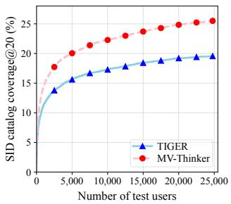  
(a) Cumulative SID coverage

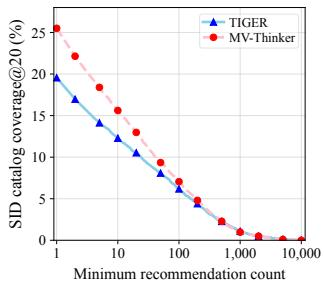  
(b) Frequency-threshold coverage  
Figure 7: SID coverage and repeated recommendation exposure on Instruments dataset at $K = 2 0 .$ . (a) Cumulative SID coverage in the same fixed random user order. (b) Coverage of SIDs recommended to at least the specified number of users (logarithmic horizontal axis).

[62] Ji Xin, Raphael Tang, Jaejun Lee, Yaoliang Yu, and Jimmy Lin. 2020. DeeBERT: Dynamic early exiting for accelerating BERT inference. In Proceedings ofthe 58th annual meeting ofthe association for computational linguistics. 2246–2251.

[63] Haibo Xing, Hao Deng, Yucheng Mao, Lingyu Mu, Jinxin Hu, Yi Xu, Hao Zhang, Jiahao Wang, Shizhun Wang, Yu Zhang, et al. 2026. Reg4rec: Reasoning-enhanced generative model for large-scale recommendation systems. In 2026 IEEE 42nd International Conference on Data Engineering (ICDE). IEEE, 3799–3812.

[64] Yi Xu, Moyu Zhang, Chaofan Fan, Jinxin Hu, Xiaochen Li, Yu Zhang, Xiaoyi Zeng, and Jing Zhang. 2025. Mmq-v2: Align, denoise, and amplify: Adaptive behavior mining for semantic ids learning in recommendation. arXiv e-prints (2025), arXiv–2510.

[65] Shangxin Yang, Min Gao, Zongwei Wang, and Junliang Yu. 2026. Where Rea soning Matters: Rethinking Latent Reasoning in Semantic ID-based Generative Recommendation. arXiv preprint arXiv:2607.12425 (2026).

[66] Yuanqing Yu, Yifan Wang, Weizhi Ma, Zhiqiang Guo, and Min Zhang. 2026. APAO: Bridging the Training-Inference Gap in Generative Recommendation via Adaptive Prefix-Aware Optimization. In Proceedings ofthe 32nd ACM SIGKDD Conference on Knowledge Discovery and Data Mining V. 2. 6338–6349.

[67] Eric Zelikman, Georges Harik, Yijia Shao, Varuna Jayasiri, Nick Haber, and Noah D Goodman. 2024. Quiet-star: Language models can teach themselves to think before speaking. arXiv preprint arXiv:2403.09629 (2024).

[68] Chao Zhang, Yuhao Wang, Derong Xu, Haoxin Zhang, Yuanjie Lyu, Yuhao Chen, Shuochen Liu, Tong Xu, Xiangyu Zhao, Yan Gao, et al. 2026. Tearag: A tokeneficient agentic retrieval-augmented generation framework. ACM Transactions on Information Systems 44, 6 (2026), 1–35.

[69] Zhe Zhao, Lichan Hong, Li Wei, Jilin Chen, Aniruddh Nath, Shawn Andrews, Aditee Kumthekar, Maheswaran Sathiamoorthy, Xinyang Yi, and Ed Chi. 2019. Recommending what video to watch next: a multitask ranking system. In Proceedings ofthe 13th ACM conference on recommender systems. 43–51.

[70] Bowen Zheng, Yupeng Hou, Hongyu Lu, Yu Chen, Wayne Xin Zhao, Ming Chen, and Ji-Rong Wen. 2024. Adapting large language models by integrating collaborative semantics for recommendation. In 2024 IEEE 40th International Conference on Data Engineering (ICDE). IEEE, 1435–1448

[71] Guorui Zhou, Na Mou, Ying Fan, Qi Pi, Weijie Bian, Chang Zhou, Xiaoqiang Zhu, and Kun Gai. 2019. Deep interest evolution network for click-through rate prediction. In Proceedings of the AAAI conference on artificial intelligence, Vol. 33. 5941–5948.

[72] Guorui Zhou, Xiaoqiang Zhu, Chenru Song, Ying Fan, Han Zhu, Xiao Ma, Yanghui Yan, Junqi Jin, Han Li, and Kun Gai. 2018. Deep interest network for click-through rate prediction. In Proceedings ofthe 24th ACM SIGKDD international conference on knowledge discovery & data mining. 1059–1068.

[73] Yu Zhou, Chengcheng Guo, Kuo Cai, Ji Liu, Qiang Luo, Ruiming Tang, Han Li, Kun Gai, and Guorui Zhou. 2026. Gems: Breaking the long-sequence barrier in generative recommendation with a multi-stream decoder. arXiv preprint arXiv:2602.13631 (2026).

## A Training and Inference Algorithm

Algorithm 1 summarizes the progressive training and confidencebased inference of MV-Thinker described in Section 3.4.

## B Catalog Coverage and Repeated Exposure

To examine whether broader catalog coverage extends beyond oneof recommendations, we compare MV-Thinker and TIGER on Instruments test users using the same RQ-VAE index, histories, and constrained beam search (width 20), returning 20 distinct valid SIDs per user. Figure 7(a) shows higher cumulative coverage for MV-Thinker, reaching 25.50% versus 19.56%. Panel (b) further shows that 1,545 SIDs reach at least 10 users, compared with 1,216 for TIGER, although the advantage is not uniform at high thresholds. Together with the ranking gains in Table 2, these results show that MV-Thinker extends repeated exposure to more SIDs without sacrificing overall recommendation accuracy, rather than merely increasing one-of outputs. They suggest that coordinating full-history and recent-history evidence helps provide a more informative shared context for SID generation. By preserving recent cues alongside the historical background needed to interpret them, this design supports recommendations that reflect current interests without discarding useful longer-term preferences.

## C Hyper-Parameter Analysis

To investigate how thinking placement afects recommendation performance, we compare MV-Thinker with four positional layouts, as illustrated in Figure 8. Each layout is denoted by �-�-�-�, where the four numbers give the number of thinking tokens inserted before the first to fourth target SID tokens. For example, 2-2-0-0 places a pair of thinking tokens before $t _ { 1 } ^ { y }$ and $t _ { 2 } ^ { y } { } _ { ; }$ , 0-0-2-2 and 0-0-0-2 move them to later SID positions, and 2-2-2-2 inserts a pair before every SID token. These layouts only change where thinking occurs, without view-specific temporal reading, whereas MV-Thinker inserts a single pair after the start token, with $\bar { q } _ { f }$ reading the full history and $\bar { q } _ { r }$ reading the last � items. As shown in Table 4, no positional layout performs best across all metrics: 2-2-0-0 outperforms 0-0- 2-2 on five metrics, while 0-0-2-2 and 0-0-0-2 achieve the highest H@20 and H@10 among positional layouts, respectively, and the denser 2-2-2-2 layout ofers no consistent advantage. In contrast, MV-Thinker achieves the best results on all six metrics. These results suggest that emphasizing finer-grained item information or repeating thinking across semantic levels does not necessarily provide better guidance for recommendation. Instead, MV-Thinker first integrates full-history and recent-history evidence into a holistic preference context, providing a common foundation for subsequent coarse-to-fine SID prediction. The comparison supports the benefit of global preference synthesis before generation over concentrating thinking on fine-grained SID.

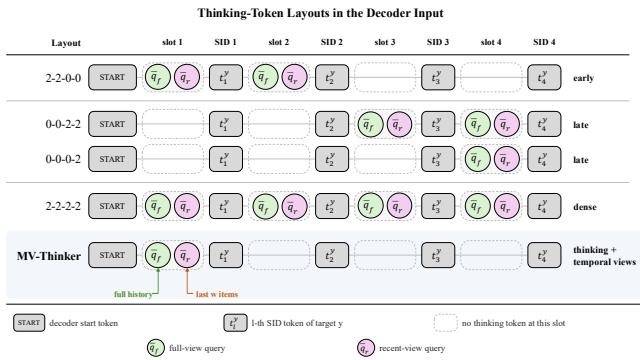  
Figure 8: Thinking-token layouts compared in Table 4. In �-�-�-�, each number denotes the thinking tokens inserted before the corresponding target SID token. Only MV-Thinker reads the full-history and recent-history views.

Table 4: Performance comparison of diferent thinking layouts and MV-Thinker. H@� and N@� denote Hit Ratio and NDCG at �, respectively. The best results are boldfaced.
<table><tr><td>Layout</td><td>H@5</td><td>H@10</td><td>H@20</td><td>N@5</td><td>N@10</td><td>N@20</td></tr><tr><td>2-2-0-0</td><td>0.0872</td><td>0.1079</td><td>0.1314</td><td>0.0740</td><td>0.0807</td><td>0.0866</td></tr><tr><td>0-0-2-2</td><td>0.0862</td><td>0.1071</td><td>0.1321</td><td>0.0732</td><td>0.0799</td><td>0.0863</td></tr><tr><td>0-0-0-2</td><td>0.0865</td><td>0.1081</td><td>0.1314</td><td>0.0736</td><td>0.0805</td><td>0.0865</td></tr><tr><td>2-2-2-2</td><td>0.0858</td><td>0.1073</td><td>0.1314</td><td>0.0734</td><td>0.0803</td><td>0.0864</td></tr><tr><td>MV-Thinker</td><td>0.0882</td><td>0.1088</td><td>0.1325</td><td>0.0751</td><td>0.0817</td><td>0.0877</td></tr></table>

## D Efect of Path Organization

To address the need for flexible context adaptation during SID generation, we compare MV-Thinker with independently trained single-path variants (Single-Path 1–3) and parallel paths with temporal modeling (Parallel Paths) on Instruments, with TIGER as the baseline. Table ?? shows that Single-Path 1 performs best among the single-path variants on five metrics, whereas Single-Path 2 leads on

H@5, suggesting that no single tested path is uniformly preferable. MV-Thinker surpasses all single-path variants and Parallel Paths on all six metrics. These gains show improved top-ranked relevance and ranking quality across recommendation cutofs compared with the tested isolated or parallel alternatives. They suggest that organizing residual refinements hierarchically helps MV-Thinker adapt user-conditioned context more efectively during progressive generation. By reusing shared transformations while supporting diferent refinement depths, this design accommodates varying contextual requirements across recommendation instances rather than imposing a uniform adaptation on all users.

## E Case Study

To examine how MVT and HRA influence intent recognition and fine-grained item discrimination, we compare the top-1 recommendations and target ranks of MV-Thinker, TIGER, and two mod ule ablations in three illustrative Instruments scenarios (Table 5). Histories are divided into earlier context and recent activity to relate recommendation behavior to historical interests and current product requirements. In Case I, earlier interactions involve guitar strings, straps, and tuners, whereas recent activity shifts toward drum equipment and Zildjian drumsticks. TIGER and w/o MVT still recommend guitar accessories and miss the target within the top 20. In contrast, w/o HRA recommends Zildjian 5A drum sticks and ranks the target 5B nylon-tip drumsticks sixth, while MV-Thinker recommends 5B wood-tip sticks and ranks the tar get third. This contrast suggests that MVT helps capture recent drum-related intent, while HRA supports finer target ranking. In Case II, recent interactions concentrate on Ernie Ball strings across multiple gauges. TIGER and w/o HRA recommend Super Slinky (.009–.042) and Baritone (.013–.072), ranking the target Not Even Slinky (.012–.056) sixth and eighth, respectively. w/o MVT recommends Regular Slinky (.010–.046) and ranks the target third, whereas MV-Thinker recommends Beefy Slinky (.011–.054) and ranks it second. All top-1 recommendations belong to the relevant product family but difer in variant. The larger ranking decline without HRA suggests that context refinement helps prioritize the desired item beyond recognizing its general category. In Case III, recent activity shifts from guitar strings to Dunlop .73-mm nylon picks. TIGER and w/o MVT recommend a tuner and a string set, respectively, missing the target within the top 20. w/o HRA recommends .88-mm picks and ranks the target Max-Grip .73-mm picks twelfth. MV-Thinker recommends standard .73-mm nylon picks and ranks the target third, matching the desired thickness but not the Max-Grip variant. This case suggests complementary bene fits from recent-intent recognition and attribute-level refinement, while distinguishing better target ranking from exact top-1 selec tion. Overall, MVT helps interpret current activity within historical context, while HRA supports finer item ranking through context refinement. Their combination improves target ranking in these examples, supporting recommendations that better reflect both the user’s current activity and specific product requirements.

Table 5: Illustrative case-study scenarios on Instruments. Histories are divided into earlier context ( gray ) and recent activity ( blue ). Top-1 recommendations are highlighted as intent-consistent but diferent from the target ( orange ), or inconsistent with the current activity ( red ). Rank denotes the position of the ground-truth item.
<table><tr><td colspan="2">Case I: Recent intent shift</td><td colspan="2">Case II: Fine-grained variant</td><td colspan="2">Case III: Intent + variant</td></tr><tr><td>Target</td><td colspan="2">Zildjian 5B nylon-tip drumsticks</td><td colspan="2">Ernie Ball Not Even Slinky (.012–.056)</td><td colspan="2">Dunlop Max-Grip nylon picks (.73 mm)</td></tr><tr><td>Earlier</td><td colspan="2">Guitar strings Guitar straps Guitar tuners Zildjian sticks ×3</td><td colspan="2">Electric-guitar accessories Amplifiers</td><td colspan="2">Broad guitar accessories</td></tr><tr><td>Recent</td><td colspan="2">E-drum kit Drum throne</td><td colspan="2">Ernie Ball strings, multiple gauges</td><td colspan="2">Guitar strings Dunlop .73 mm nylon picks</td></tr><tr><td>Method</td><td>Top-1</td><td>Rank</td><td>Top-1</td><td>Rank</td><td>Top-1</td><td>Rank</td></tr><tr><td>TIGER</td><td>Guitar tuner</td><td>&gt; 20</td><td>Super Slinky (.009–.042)</td><td>6</td><td>Clip-on tuner</td><td>&gt; 20</td></tr><tr><td>w/o MVT</td><td>Guitar strings</td><td>&gt; 20</td><td>Regular Slinky (.010–.046)</td><td>3</td><td>Guitar-string set</td><td>&gt; 20</td></tr><tr><td>w/o HRA</td><td>Zildjian 5A drumsticks</td><td>6</td><td>Baritone (.013–.072)</td><td>8</td><td>Dunlop picks (.88 mm)</td><td>12</td></tr><tr><td>Ours</td><td>Zildjian 5B wood-tip sticks</td><td>3</td><td>Beefy Slinky (.011–.054)</td><td>2</td><td>Dunlop standard nylon (.73 mm)</td><td>3</td></tr><tr><td>Takeaway</td><td colspan="2">MVT recovers the recent drum intent hidden by long-term guitar history.</td><td colspan="2">HRA separates gauge-level variants within the correct category.</td><td colspan="2">MVT + HRA are both needed for the new intent and exact thickness.</td></tr></table>