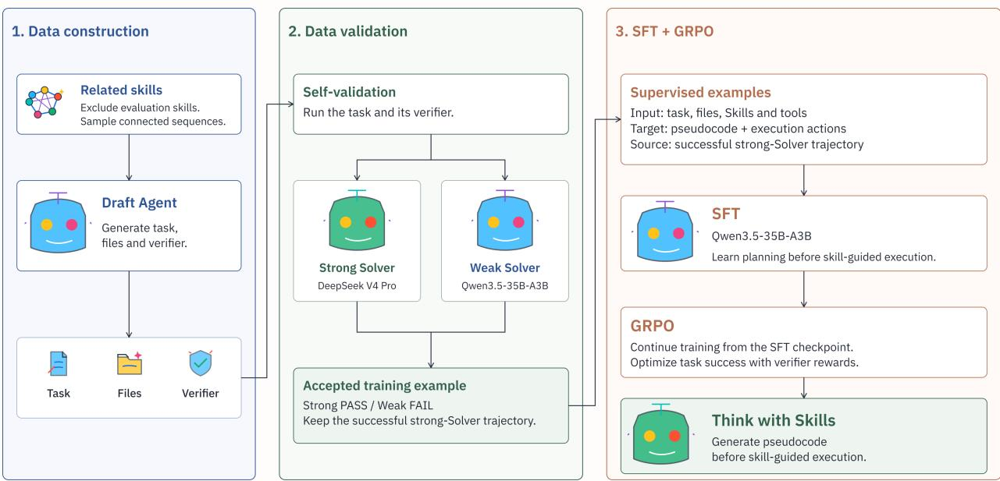
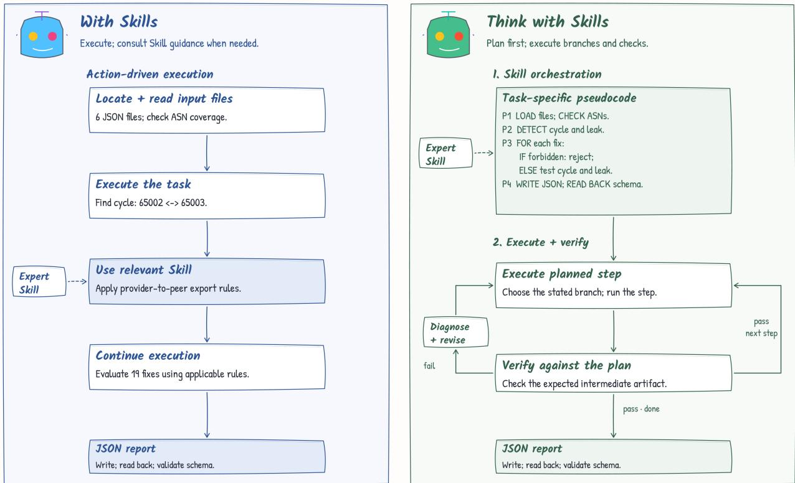
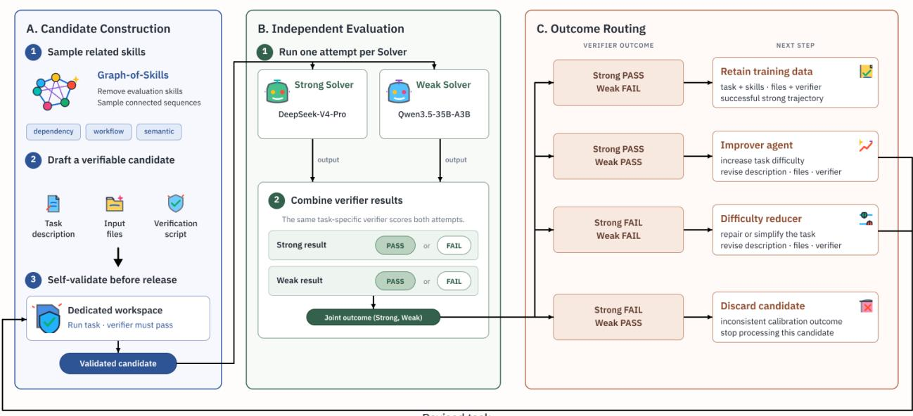

# Think with Skills: Pseudocode Planning Before Execution for Advanced Reasoners

Boshen Zhou \* 1 Boxuan Yue \* 1 Xiang Li 1 Shanchao Yang 1

## Abstract

Language model agents often struggle with complex tasks even when equipped with expertwritten skills. Such skills encode declarative knowledge, whereas successful execution requires procedural knowledge tailored to the task at hand. Natural language skills may leave conditions and dependencies implicit, and tasks involving multiple skills further require agents to coordinate intermediate results and execution order. We introduce Think with Skills, a method that trains reasoning models to turn relevant skill descriptions into task-specific pseudocode plans before execution. The pseudocode explicitly represents operations, conditions, intermediate results, and dependencies, providing a structured bridge from skill descriptions to agent actions. We construct training data that pairs tasks and skills with pseudocode plans and execution trajectories, use supervised fine tuning to initialize this behavior, and further optimize end-to-end task performance with Group Relative Policy Optimization. On Skills-Bench, Think with Skills raises task success from 35.0% to 62.0%. These results show that proceduralizing expert knowledge before execution substantially improves skill use.

## 1. Introduction

A medical student may memorize the symptoms of many diseases and detailed descriptions of surgical procedures, yet still require extensive clinical training before becoming a qualified physician. Memorization gives the student declarative knowledge about medicine, while clinical practice develops the procedural knowledge needed to apply it to real patients. Cognitive theories distinguish these two forms of knowledge: declarative knowledge represents facts and explicit instructions, whereas procedural knowledge determines how that information guides action (Anderson, 1982). Completing a complex task requires both knowing what is relevant and knowing how to apply that knowledge in the current situation.

Large language models are increasingly used as agents that reason, invoke tools, observe their results, and decide what to do next (Yao et al., 2023). To provide agents with expertise for specialized tasks, recent systems augment them with Agent Skills. A skill packages domain knowledge, instructions, and tool usage conventions written by human experts, allowing an agent to receive reusable task guidance without changing its parameters (Li et al., 2026). Curated skills can substantially improve task success, but their benefits vary widely across tasks, and access to a skill does not guarantee correct execution. From the agent’s perspective, the contents of a skill remain natural language descriptions. They make expert knowledge available, but the agent must still learn how to apply that knowledge in the current task.

Turning a skill description into action is difficult for several reasons. First, guidance written by human experts may describe execution logic incompletely and leave conditions, intermediate states, and dependencies implicit. Second, a skill usually describes a general procedure, while the agent must adapt it to the current objective, available tools, files, observations, and intermediate results. Third, a complex task may require several skills whose procedures were written independently. The agent must determine when each skill applies, connect the output of one skill to the input of another, and establish a coherent execution order. Studies of natural language described algorithms similarly suggest that understanding an instruction and reliably carrying out its control flow are separate challenges for language models (Zheng et al., 2024). We call the gap between receiving expert guidance and turning it into an executable procedure for the current task the skill proceduralization gap.

Research on intermediate reasoning suggests a possible path forward. Chain of thought prompting allows models to express reasoning steps before producing an answer (Wei et al., 2022), while least to most prompting and Plan and Solve separate problem decomposition from solution generation (Zhou et al., 2023; Wang et al., 2023). Program aided methods use code as an intermediate representation for numerical and symbolic reasoning (Gao et al., 2023; Chen et al., 2023). Think and Execute extracts logic shared across instances of an algorithmic task, represents it as task level pseudocode, and asks a language model to simulate its execution (Chae et al., 2024). These methods show that both prior thinking and structured intermediate representations can improve reasoning. However, they do not teach agents to convert one or more external skills into an instance specific procedure grounded in the current environment.

  
Figure 1. Overview of the Think with Skills training pipeline. A Draft Agent constructs and validates tasks from related skills. Strong and weak Solvers then attempt each task. Tasks solved by the strong Solver but not the weak Solver are retained, and the corresponding trajectories provide pseudocode and execution supervision for SFT. GRPO continues training from the SFT checkpoint with verifier rewards.

We introduce Think with Skills, a training approach that teaches reasoning models to perform this conversion before execution. Given a task and its relevant skills, the model first generates a task specific pseudocode plan in its thinking process. The plan makes operations, applicable conditions, execution order, intermediate results, and dependencies across skills explicit. The agent then follows this plan while interacting with the environment. In this way, pseudocode serves as a structured intermediate representation between natural language skill descriptions and concrete agent actions, allowing general expert guidance to be organized around the requirements of the current task.

Existing rationale supervision primarily teaches models to derive answers from questions (Zelikman et al., 2022; Hsieh et al., 2023). To supervise skill proceduralization, we construct training examples that pair tasks and relevant skills with pseudocode plans and their corresponding execution trajectories. We first use these examples for supervised fine tuning, teaching the model to generate a plan from the provided skills and carry out the task according to that plan. We then apply Group Relative Policy Optimization (GRPO) (Shao et al., 2024), using executable verification feedback to optimize whether the complete planning-and-execution process leads to task success. This two-stage procedure combines explicit trajectory supervision with outcome-based optimization, as summarized in Figure 1.

We apply Think with Skills to Qwen3.5-35B-A3B and evaluate the resulting model on SkillsBench. Our two-stage training procedure increases the task success rate from 35.0% to 62.0%, an improvement of 27.0 percentage points. Our contributions are threefold. First, we formulate the skill proceduralization gap and introduce pseudocode planning as an intermediate step between reading skills and executing them. Second, we develop a data construction method and training procedure that teach models to convert expert skills into task specific plans and execution trajectories. Third, we demonstrate that learning this behavior substantially improves skill use on SkillsBench, showing that expert guidance becomes more effective when agents first organize it into an explicit procedure for the current task.

## 2. Related Work

## 2.1. Agent Skills

Agent skills are reusable artifacts that encode knowledge and procedures for recurring tasks as natural language instructions, tool-use conventions, or executable programs. They allow agents to reuse prior experience without deriving the complete procedure for every new instance. SkillsBench shows that human-curated skills improve the average pass rate by 16.2 percentage points across diverse tasks and agent configurations (Li et al., 2026).

## SKILL CONSTRUCTION AND REFINEMENT

Prior work has studied both skill acquisition and skill refinement. Demonstration- and experience-based approaches abstract reusable procedures from task demonstrations or accumulated interactions (Liu et al., 2024a; Zhao et al., 2024). Other methods improve these procedures through reinforcement learning, execution-trace-based revision, or the compilation of heterogeneous external knowledge into structured skill representations (Wang et al., 2025; Liu et al., 2026c; Pan et al., 2026). This line of work broadens the sources of reusable skills and improves the quality of their representations. How a general procedure should be grounded in the task-specific objective, input files, available tools, and evolving observations is still left to the executor.

## SKILL RETRIEVAL AND COMPOSITION

Voyager represents each acquired skill as executable code, indexes it by an embedding of an automatically generated description, and retrieves the five skills most similar to a query formed from a task-solving suggestion and the current environment feedback (Wang et al., 2024). SRA studies retrieval from a much larger external corpus. Sparse or dense retrievers produce a candidate set, an optional LLM reranker refines its ordering, and the agent either receives the top-ranked skill directly or selects which full instructions to load from a metadata-only catalog (Su et al., 2026). SkillComposer goes beyond independently ranking candidates by encoding the task, environment, and compact skill metadata, then autoregressively decoding a variable-length sequence of skill identifiers whose membership, cardinality, and order are predicted jointly (Zhao et al., 2026). These methods improve access to relevant skills and provide a coarse execution order, but they do not instantiate the selected instructions as a task-specific procedure that binds each step to current inputs and tools, specifies the flow of intermediate results, and adapts its control flow to new observations.

## SKILL EXECUTION CONTROL

Execution-oriented methods add explicit constraints to the supplied procedure. Grounded Skill-Following uses a contract runtime to define required phases, legal actions, state transitions, and accepted termination, making procedural compliance verifiable during execution (Shen et al., 2026). Such verification depends on a formal contract and a statetracking runtime supplied alongside the natural language skill. Ordinary expert-written skills provide neither structure by default, leaving task-specific conditions, intermediate states, and dependencies implicit.

## 2.2. Planning and Programmatic Reasoning

Planning methods organize agent behavior either by interleaving reasoning with actions and feedback-based replanning, or by separating a high-level planner from a low-level executor (Yao et al., 2023; Liu et al., 2024b; Erdogan et al., 2025). Recent post-training approaches further learn planning from synthesized or distilled trajectories and favor examples whose plans align with their execution (Parmar et al., 2025; Liu et al., 2026b). Complementary work studies how such reasoning procedures should be represented. Program-aided methods translate natural language problems into executable programs that are run by an external interpreter (Gao et al., 2023; Chen et al., 2023), whereas pseudocode-based methods express reusable task logic as a structured intermediate representation for the model to simulate (Chae et al., 2024; Zheng et al., 2024). Across both lines of work, plans and programs are generally derived from task descriptions, worked examples, or interaction trajectories. They do not address how an external expert skill should be converted into pseudocode tailored to the current objective, inputs, and tools before the agent begins acting.

## 3. Method

Think with Skills trains an agent to proceduralize expertwritten skills before interacting with tools. Given a task, its input files, the available tools, and one or more relevant skills, the agent first transforms the skills into task-specific pseudocode and then executes the resulting procedure. Our method has three components. First, skill proceduralization converts general natural-language guidance into a structured procedure grounded in the current task. Second, a skill-grounded data pipeline constructs paired pseudocode plans and execution trajectories. Third, a two-stage training procedure uses supervised fine-tuning to initialize planning and execution, followed by GRPO to optimize end-toend task success. Figure 1 summarizes the overall workflow, Figure 2 illustrates proceduralized execution through a routing-diagnosis example, and Figure 3 expands the dataconstruction and validation stages.

  
Figure 2. Illustrative comparison of direct skill use and Think with Skills on a routing-diagnosis task with the same input files and expert skill. Direct skill use consults relevant guidance during execution. Think with Skills first expresses the skill as task-specific pseudocode, then follows its branches and checks while executing. Failed checks trigger diagnosis and revision of the affected step. Passed checks allow execution to continue or finish.

## 3.1. Pre-Execution Skill Proceduralization

As shown in Figure 2, we separate skill use into taskspecific pseudocode construction and plan-aligned execution. Expert-written skills are usually expressed as naturallanguage guidance. They may describe useful operations without specifying how those operations should be instantiated for the current files, tools, and intermediate states. Before performing any skill-guided work, Think with Skills requires the model to rewrite the relevant guidance as taskspecific pseudocode. This pseudocode is not a summary of the skill. It is a prospective execution specification that states how the skill will be applied to the current task.

Pseudocode specification. Each plan must contain five elements. First, it decomposes the intended workflow into explicitly numbered steps, with each step describing a concrete operation rather than a general objective. Second, it identifies the inputs required by each step and the output or artifact that the step is expected to produce. Third, it represents control flow explicitly: if/else branches specify how execution should respond to alternative observations, and loops specify when an operation should be repeated. Fourth, it defines the prerequisites and dependencies of later steps, including which intermediate result must be available before execution can continue. Fifth, it states success, failure, and verification conditions for the produced artifacts. The resulting plan therefore exposes operation order, data flow, control flow, and completion criteria that may remain implicit in the original skill description.

Plan-aligned execution. The pseudocode remains available throughout execution and is used to constrain each subsequent action. Before acting, the model identifies the numbered step and control-flow branch currently being executed, checks whether its prerequisites have been satisfied, and specifies the expected artifact. After acting, it verifies the observed result against the condition written in the plan. Execution advances only after the current output has been validated. When validation fails, the model attributes the failure to the relevant part of the procedure, such as an incorrect branch, a missing prerequisite, an invalid assumption, or an execution error, and revises the affected step instead of repeating the same action without diagnosis.

This representation has three properties. It is skill-grounded because its operations are derived from the supplied expert guidance. It is instance-specific because abstract instructions are bound to the current task, files, tools, and observations. It is verifiable because intermediate artifacts and completion conditions are stated before execution. For tasks involving multiple skills, named intermediate artifacts make the output of one procedure available as the input to another and clarify their execution dependencies. The pseudocode is not passed to an external interpreter. It functions as an explicit reasoning scaffold that the model follows and updates while interacting with the environment.

## 3.2. Skill-Grounded Data Construction

We construct tasks that are automatically verifiable, solvable by a stronger model, and challenging for the target model. Figure 3 organizes the pipeline into candidate construction, independent Solver evaluation, and outcome routing. We begin with Graph-of-Skills (GoS), a typed directed graph in which skills are connected by dependency, workflow, semantic, and alternative relations (Liu et al., 2026a). After removing skills reserved for evaluation, we sample connected skill sequences from the remaining graph. These sequences provide a structural basis for generating tasks that require one or more related skills rather than arbitrary skill combinations.

Candidate construction and self-validation. The Draft Agent receives the sampled skills and freely constructs a task description, its input files, and a verification script without relying on a predefined task template. The verifier provides an executable criterion for task completion. The Draft Agent must run the task once in its own workspace and pass the verifier before the candidate proceeds to model-based validation. This step filters out tasks with inconsistent instructions, malformed inputs, or unusable verification logic.

Independent Solver evaluation. Each self-validated task is attempted once by DeepSeek-V4-Pro as the strong Solver and once by Qwen3.5-35B-A3B as the weak Solver. To elicit the target behavior, we provide both Solvers with the same explicit prompt. Before each skill-guided execution stage, the prompt instructs each Solver to read the supplied skills and express a task-specific plan in the Think with Skills pseudocode format, specifying concrete operations, inputs and outputs, control-flow branches, intermediate artifacts, dependencies, and verification conditions. Each Solver then executes the task with this pseudocode retained in its context, producing an aligned plan-and-execution trajectory rather than a post-hoc rationale. The two Solvers start from separate copies of the same candidate state, and the task-specific verification script evaluates their outputs independently.

Outcome routing and task revision. A task is accepted when the strong Solver succeeds and the weak Solver fails, indicating that it is solvable but remains informative for training the target model. If both Solvers succeed, an Improver Agent raises the difficulty. If both fail, a Difficulty Reducer Agent repairs the task or lowers its difficulty. If the strong Solver fails while the weak Solver succeeds, the inconsistent candidate is discarded. The Improver and Difficulty Reducer may revise the task description, input files, and verification script. Each revised task must pass selfvalidation again before both Solvers retry it. A candidate undergoes at most three revisions before acceptance or rejection, as detailed in Section 4.1.

For each accepted task, we retain the sampled skills, task description, input files, verification script, and successful strong-Solver trajectory. The trajectory records the pseudocode produced before each skill-guided stage together with the subsequent execution process, and is used as supervision in the first training stage. Weak-Solver trajectories are used only for filtering and are not included in the training corpus. During GRPO training, the retained verification script supplies an executable task-level reward.

## 3.3. Two-Stage Training

Supervised fine-tuning. We first fine-tune the target model on the collected trajectories. For each example, the task instruction, input files, relevant skills, and available tools form the input context. Each training example includes a target trajectory in which a task-specific pseudocode plan appears immediately before the corresponding skill-guided execution stage. This ordering directly supervises the behavior required by Think with Skills. The model learns to convert each provided skill into a concrete procedure before using it to guide tool interactions.

Group Relative Policy Optimization. Starting from the supervised checkpoint, we further train the model with standard outcome-supervised GRPO (Shao et al., 2024). For each task, the policy samples a group of complete agent rollouts in which the model generates task-specific pseudocode and then interacts with the environment. The task-specific verifier assigns a reward to the final outcome of each rollout, and GRPO uses group-normalized rewards as relative advantages under its standard clipped objective with KL regularization. Because the verifier scores the final task outcome, GRPO propagates the resulting reward through the entire rollout, updating the policy for both pseudocode generation and subsequent task execution. The single-attempt strong and weak Solver evaluations in Section 3.2 are used only for data construction. GRPO samples a separate group of rollouts during training. Training hyperparameters are reported in Section 4.2.

  
Figure 3. Verifiable and difficulty-calibrated data construction. (A) A Draft Agent constructs a task, input files, and verifier from related skills and self-validates the candidate. (B) The strong and weak Solvers independently attempt the same candidate once, and the task-specific verifier scores both outputs. (C) Their joint outcome determines whether to retain the candidate, increase its difficulty, repair or simplify it, or discard it. Revised tasks return to self-validation before another independent evaluation by both Solvers.

## 4. Experiments

## 4.1. Constructed Training Corpus

## SKILL SOURCE AND TASK CONSTRUCTION

We construct the training corpus from connected skill sequences sampled from Graph-of-Skills after excluding skills reserved for SkillsBench evaluation. Of the 2,000 skills in the original graph, we exclude the 174 that appear in Skills-Bench. Graph-of-Skills connects skills through dependency, workflow, semantic, and alternative relations (Liu et al., 2026a). From the remaining graph, we sample connected sequences of one to three skills and use each sequence to condition the generation of a task that uses the selected skills.

Following the pipeline in Section 3.2, the Draft Agent, implemented with DeepSeek-V4-Pro, generates each task, its input files, and its verifier. DeepSeek-V4-Pro and Qwen3.5- 35B-A3B serve as the strong and weak Solvers and attempt each candidate once. The Improver and Difficulty Reducer use DeepSeek-V4-Pro, and a candidate undergoes at most 3 revisions before acceptance or rejection.

## 4.2. Experimental Setup

We evaluate on SkillsBench using its official tasks, expertwritten skills, environments, and task-success criteria. The primary metric is task success rate. Think with Skills is initialized from Qwen3.5-35B-A3B and trained with SFT followed by GRPO. Our evaluations use Claude Code as the inference-time agent framework. Table 1 reports the agent framework, model, and SkillsBench result for each configuration. External results may use different inference frameworks and evaluation settings.

## 4.3. Main Results

Table 1 presents Think with Skills and its unmodified Qwen3.5-35B-A3B base model first, followed by selected reference configurations. Officially reported scores are marked with † and retain their original inference frameworks. All five of our evaluation rows use Claude Code.

Our evaluations of MiniMax M2.7, DeepSeek V4 Pro and Kimi K2.5 use Claude Code, with success rates of 42.76%, 61.67% and 62.5%, respectively. These scores retain the precision supplied in our evaluation records.

Think with Skills increases the success rate recorded for Qwen3.5-35B-A3B from 35.0% to 62.0%, an absolute gain of 27.0 percentage points. This controlled comparison against the base model is the primary evidence for the method’s improvement. External scores are included as reference values and do not establish a controlled ranking across different agent frameworks and evaluation settings.

Table 1. SkillsBench results with expert skills.
<table><tr><td>Agent framework</td><td>Model</td><td>SkillsBench result (%)</td></tr><tr><td rowspan="5">Claude Code</td><td>Think with Skills (Qwen3.5-35B-A3B)</td><td>62.0 (+27.0 pp)</td></tr><tr><td>Qwen3.5-35B-A3B</td><td>35.0</td></tr><tr><td>Kimi K2.5</td><td>62.5</td></tr><tr><td>DeepSeek V4 Pro</td><td>61.67</td></tr><tr><td>MiniMax M2.7</td><td>42.76</td></tr><tr><td rowspan="2">OpenHands</td><td>GLM 5.1</td><td>58.4†</td></tr><tr><td>Opus 4.8</td><td>54.1†</td></tr><tr><td>Gemini CLI</td><td>Gemini 3 Flash</td><td>54.6†</td></tr></table>

Note. † denotes an official SkillsBench v1.1 result on 87 tasks. External scores are included for reference because agent frameworks and evaluation settings may differ.

## 5. Analysis

The main results evaluate Think with Skills as a complete system. We next isolate the effects of the pseudocode representation and the two post-training stages. We then examine how the number of skills per training task affects downstream performance. All variants are initialized from the same Qwen3.5-35B-A3B base model and use the same SkillsBench evaluation tasks, tools, and interaction budget unless otherwise stated.

## 5.1. Effects of Pseudocode Planning and Post-Training

Table 2 compares four configurations of Qwen3.5-35B-A3B. The configurations include direct skill use by the base model, pseudocode prompting applied to the base model without additional training, SFT, and SFT followed by GRPO. The direct and prompted base-model settings receive the same task inputs, tools, and expert-written skills under the same execution budget. In the prompt-only configuration, an explicit prompt instructs the base model to express its plan in the Think with Skills pseudocode format before execution, without any parameter updates. SFT jointly supervises pseudocode plans and their corresponding execution trajectories, as described in Section 3.3. Both post-trained configurations generate pseudocode before execution.

Pseudocode prompting raises the base model’s success rate from 35.0% to 45.0%, a gain of 10.0 percentage points without additional training. SFT raises success to 60.0%, adding 15.0 percentage points over prompting alone. Continuing from the SFT checkpoint with GRPO raises success to 62.0%, a further gain of 2.0 percentage points. The complete Think with Skills procedure therefore improves success by 27.0 percentage points over the base model.

Table 2. SkillsBench task success rates for Qwen3.5-35B-A3B under direct skill use, pseudocode prompting, SFT, and SFT followed by GRPO.
<table><tr><td>Model / Training Configuration</td><td>SkillsBench Score (%)</td></tr><tr><td>Qwen3.5-35B-A3B (base model, direct skill use)</td><td>35.0</td></tr><tr><td>Qwen3.5-35B-A3B + pseudocode prompting</td><td>45.0</td></tr><tr><td>Qwen3.5-35B-A3B + SFT</td><td>60.0</td></tr><tr><td>Qwen3.5-35B-A3B + SFT + GRPO (Think with Skills)</td><td>62.0</td></tr></table>

## 5.2. Effect of the Number of Skills per Training Task

We compare training on tasks involving a single skill with training on tasks involving multiple skills. The single-skill setting uses 1,000 training examples, each involving one skill. The multi-skill setting uses 900 training examples, each involving more than one skill. Table 3 reports downstream SkillsBench task success for the two training-data settings using Qwen3.5-35B-A3B as the base model.

Table 3. Comparison of single-skill and multi-skill training on SkillsBench.
<table><tr><td>Skills per Training Task</td><td>Training Examples</td><td>SkillsBench Success (%)</td></tr><tr><td>Single skill (1)</td><td>901</td><td>55.0</td></tr><tr><td>Multiple skills (&gt;1)</td><td>913</td><td>60.0</td></tr></table>

Training on multi-skill tasks yields a success rate of 60.0%,

compared with 55.0% for single-skill tasks, an absolute gain of 5.0 percentage points. The multi-skill setting performs better despite using 100 fewer training examples. This result suggests that training on tasks requiring coordination across skills can improve downstream skill use.

## 6. Conclusion and Limitations

We introduced Think with Skills, a training framework that teaches language model agents to convert expert-written skills into task-specific pseudocode before execution. The method combines a verifiable, difficulty-calibrated data construction pipeline with supervised fine-tuning and outcomebased reinforcement learning. On SkillsBench, it raises the success rate of Qwen3.5-35B-A3B from 35.0% to 62.0%, showing that explicit proceduralization can make expert guidance substantially more useful to an agent.

## References

Anderson, J. R. Acquisition of cognitive skill. Psychological Review, 89(4):369–406, 1982. doi: 10.1037/0033-295X. 89.4.369.

Chae, H., Kim, Y., Kim, S., iunn Ong, K. T., woo Kwak, B., Kim, M., Kim, S., Kwon, T., Chung, J., Yu, Y., and Yeo, J. Language models as compilers: Simulating pseudocode execution improves algorithmic reasoning in language models. In Proceedings of the 2024 Conference on Empirical Methods in Natural Language Processing, pp. 22471–22502, Miami, Florida, USA, November 2024. Association for Computational Linguistics. doi: 10.18653/v1/2024.emnlp-main.1253. URL https://aclanthology.org/2024.emnlp-m ain.1253/.

Chen, W., Ma, X., Wang, X., and Cohen, W. W. Program of thoughts prompting: Disentangling computation from reasoning for numerical reasoning tasks. Transactions on Machine Learning Research, 2023. ISSN 2835-8856. URL https://openreview.net/forum?id= YfZ4ZPt8zd.

Erdogan, L. E., Lee, N., Kim, S., Moon, S., Furuta, H., Anumanchipalli, G., Keutzer, K., and Gholami, A. Planand-act: Improving planning of agents for long-horizon tasks. In Singh, A., Fazel, M., Hsu, D., Lacoste-Julien, S., Berkenkamp, F., Maharaj, T., Wagstaff, K., and Zhu, J. (eds.), Proceedings ofthe 42nd International Conference on Machine Learning, volume 267 of Proceedings of Machine Learning Research, pp. 15419–15462. PMLR, 2025. URL https://proceedings.mlr.pres s/v267/erdogan25a.html.

Gao, L., Madaan, A., Zhou, S., Alon, U., Liu, P., Yang, Y., Callan, J., and Neubig, G. PAL: Program-aided language

models. In Krause, A., Brunskill, E., Cho, K., Engelhardt, B., Sabato, S., and Scarlett, J. (eds.), Proceedings ofthe 40th International Conference on Machine Learning, volume 202 of Proceedings ofMachine Learning Research, pp. 10764–10799. PMLR, 2023. URL https://proc eedings.mlr.press/v202/gao23f.html.

Hsieh, C.-Y., Li, C.-L., kuan Yeh, C., Nakhost, H., Fujii, Y., Ratner, A., Krishna, R., Lee, C.-Y., and Pfister, T. Distilling step-by-step! outperforming larger language models with less training data and smaller model sizes. In Findings of the Association for Computational Linguistics: ACL 2023, pp. 8003–8017, Toronto, Canada, July 2023. Association for Computational Linguistics. doi: 10.18653/v1/2023.findings- acl.507. URL https://aclanthology.org/2023.findin gs-acl.507/.

Li, X., Chen, W., Liu, Y., Zheng, S., Chen, X., He, Y., Li, Y., You, B., Shen, H., Sun, J., Wang, S., Zeng, Q., Wang, D., Zhao, X., Wang, Y., Chaim, R. B., Di, Z., Gao, Y., He, J., He, Y., Jing, L., Kong, L., Lan, X., Li, J., Li, S., Li, Y., Lin, Y., Liu, X., Liu, X., Lyu, H., Ma, Z., Wang, B., Wang, R., Wang, T., Ye, W., Zhang, Y., Xing, H., Xue, Y., Dillmann, S., and chung Lee, H. SkillsBench: Benchmarking how well agent skills work across diverse tasks, 2026. URL https://arxiv.org/abs/26 02.12670v1. Version 1.

Liu, A. Z., Choi, J., Sohn, S., Fu, Y., Kim, J., Kim, D.- K., Wang, X., Yoo, J., and Lee, H. SkillAct: Using skill abstractions improves LLM agents. In ICML 2024 Workshop on LLMs and Cognition, 2024a. URL https: //openreview.net/forum?id=6LG3cIRrF4.

Liu, D., Li, Z., Du, H., Wu, X., Gui, S., Kuang, Y., and Sun, L. Graph-of-skills: Dependency-aware structural retrieval for massive agent skills. arXiv preprint arXiv:2604.05333, 2026a. URL https://arxiv.or g/abs/2604.05333.

Liu, H., Hu, K., Wang, Q., Zhai, Y., Dawei, F., Ding, B., and Wang, H. CoPE: A framework for optimizing coordination between planning and execution in LLM-based agents. In Zhang, T., Dudik, M., Jaggi, M., Agarwal, A., Li, S., Schuurmans, D., Zhu, J., Berkenkamp, F., Dong, H., and Bietti, A. (eds.), Proceedings ofthe 43rd International Conference on Machine Learning, volume 306 of Proceedings ofMachine Learning Research, pp. 76571– 76601. PMLR, 2026b. URL https://proceeding s.mlr.press/v306/liu26az.html.

Liu, Y., Su, Z., Xie, L., Zhang, Y., Zong, Q., Guo, J., Xie, Z., Ji, Y., Yim, Y., Luo, H., Ren, X., Chenyu, R., Li, H., and Song, Y. SkillRevise: Improving LLM-authored agent skills via trace-conditioned skill revision, 2026c.

URL https://arxiv.org/abs/2606.01139. Accepted to Findings of EMNLP 2026.

Liu, Z., Hu, H., Zhang, S., Guo, H., Ke, S., Liu, B., and Wang, Z. Reason for future, act for now: A principled architecture for autonomous LLM agents. In Salakhutdinov, R., Kolter, Z., Heller, K., Weller, A., Oliver, N., Scarlett, J., and Berkenkamp, F. (eds.), Proceedings of the 41st International Conference on Machine Learning, volume 235 of Proceedings ofMachine Learning Research, pp. 31186–31261. PMLR, 2024b. URL https://proc eedings.mlr.press/v235/liu24ab.html.

Pan, Q., Yang, Y., Li, J., Zhou, J., Chen, K., Li, X., Chen, Q., and He, L. Anything2Skill: Compiling external knowledge into reusable skills for agents, 2026. URL https://arxiv.org/abs/2606.09316.

Parmar, M., Goyal, P., Liu, X., Song, Y., Ling, M., Baral, C., Palangi, H., and Pfister, T. PLAN-TUNING: Posttraining language models to learn step-by-step planning for complex problem solving. In Proceedings of the 2025 Conference on Empirical Methods in Natural Language Processing, pp. 21419–21433, Suzhou, China, November 2025. Association for Computational Linguistics. doi: 10.18653/v1/2025.emnlp-main.1087. URL https: //aclanthology.org/2025.emnlp-main.10 87/.

Shao, Z., Wang, P., Zhu, Q., Xu, R., Song, J., Bi, X., Zhang, H., Zhang, M., Li, Y. K., Wu, Y., and Guo, D. Deepseekmath: Pushing the limits of mathematical reasoning in open language models. arXiv preprint arXiv:2402.03300, 2024. URL https://arxiv.org/abs/2402.0 3300.

Shen, J., Liu, Z., Li, Y., Huang, J., Luo, S., Cheng, Y., Yao, Y., Zhang, K., Tang, C., Zhang, M., Hu, M., Chen, Y., and Huang, Z. Beyond instruction following: Learning grounded skill-following with skill contracts, 2026. URL https://arxiv.org/abs/2610.05161.

Su, W., Long, J., Ai, Q., Tang, Y., Wang, C., Tu, Y., and Liu, Y. Skill retrieval augmentation for agentic AI, 2026. URL https://arxiv.org/abs/2604.24594.

Wang, G., Xie, Y., Jiang, Y., Mandlekar, A., Xiao, C., Zhu, Y., Fan, L., and Anandkumar, A. VOYAGER: An openended embodied agent with large language models. Transactions on Machine Learning Research, 2024. ISSN 2835-8856. URL https://openreview.net/f orum?id=ehfRiF0R3a.

Wang, J., Yan, Q., Wang, Y., Tian, Y., Mishra, S. S., Xu, Z., Gandhi, M., Xu, P., and Cheong, L. L. Reinforcement learning for self-improving agent with skill library, 2025. URL https://arxiv.org/abs/2512.17102.

Wang, L., Xu, W., Lan, Y., Hu, Z., Lan, Y., Lee, R. K.-W., and Lim, E.-P. Plan-and-solve prompting: Improving zero-shot chain-of-thought reasoning by large language models. In Proceedings of the 61st Annual Meeting of the Association for Computational Linguistics (Volume 1: Long Papers), pp. 2609–2634, Toronto, Canada, July 2023. Association for Computational Linguistics. doi: 10.18653/v1/2023.acl-long.147. URL https://acla nthology.org/2023.acl-long.147/.

Wei, J., Wang, X., Schuurmans, D., Bosma, M., Ichter, B., Xia, F., Chi, E. H., Le, Q. V., and Zhou, D. Chain-ofthought prompting elicits reasoning in large language models. In Advances in Neural Information Processing Systems, volume 35, pp. 24824–24837. Curran Associates, Inc., 2022. doi: 10.52202/068431-1800. URL https://proceedings.neurips.cc/paper /2022/hash/9d5609613524ecf4f15af0f7b 31abca4-Abstract.html.

Yao, S., Zhao, J., Yu, D., Du, N., Shafran, I., Narasimhan, K., and Cao, Y. ReAct: Synergizing reasoning and acting in language models. In The Eleventh International Conference on Learning Representations, 2023. URL https: //openreview.net/forum?id=WE\_vluYUL-X.

Zelikman, E., Wu, Y., Mu, J., and Goodman, N. STaR: Bootstrapping reasoning with reasoning. In Advances in Neural Information Processing Systems, volume 35, pp. 15476–15488. Curran Associates, Inc., 2022. doi: 10.52202/068431-1126. URL https://proceedi ngs.neurips.cc/paper\_files/paper/202 2/hash/639a9a172c044fbb64175b5fad42e 9a5-Abstract-Conference.html.

Zhao, A., Huang, D., Xu, Q., Lin, M., Liu, Y.-J., and Huang, G. ExpeL: LLM agents are experiential learners. In Proceedings of the AAAI Conference on Artificial Intelligence, volume 38, pp. 19632–19642, 2024. doi: 10.1609/aaai.v38i17.29936. URL https: //ojs.aaai.org/index.php/AAAI/articl e/view/29936.

Zhao, X., Tan, Z., Tadiparthi, V., Agarwal, N., Lee, K., Pari, E. M., Mahjoub, H. N., and Chen, T. Generative skill composition for LLM agents, 2026. URL https: //arxiv.org/abs/2606.32025.

Zheng, X., Zhu, Q., Lin, H., Lu, Y., Han, X., and Sun, L. Executing natural language-described algorithms with large language models: An investigation. In Proceedings ofthe 2024 Joint International Conference on Computational Linguistics, Language Resources and Evaluation (LREC-COLING 2024), pp. 6752–6837, Torino, Italia, May 2024. ELRA and ICCL. URL https://aclant hology.org/2024.lrec-main.596/.

Zhou, D., Schärli, N., Hou, L., Wei, J., Scales, N., Wang, X., Schuurmans, D., Cui, C., Bousquet, O., Le, Q. V., and Chi, E. H. Least-to-most prompting enables complex reasoning in large language models. In The Eleventh International Conference on Learning Representations, 2023. URL https://openreview.net/forum ?id=WZH7099tgfM.