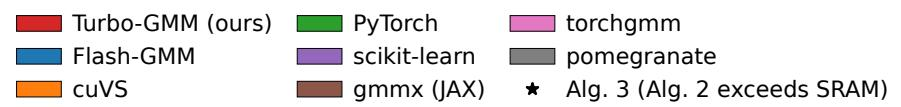
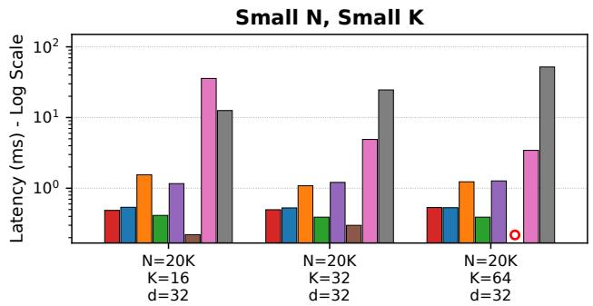
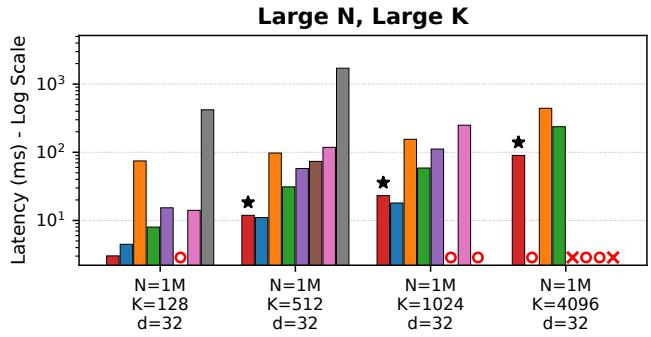
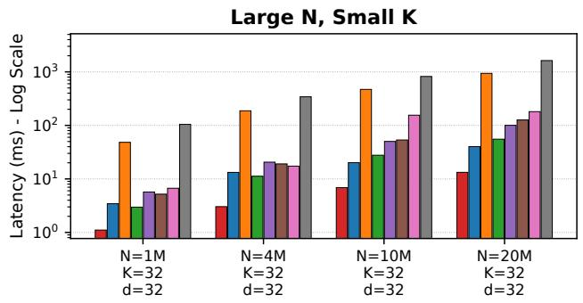
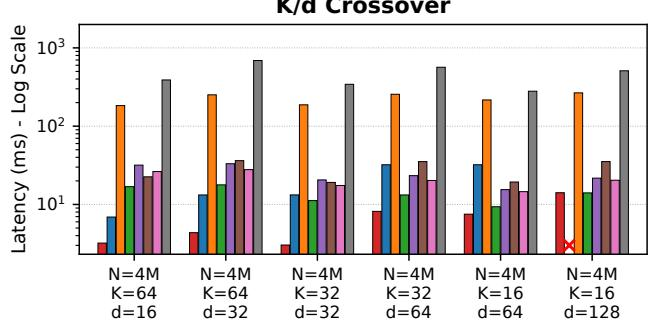
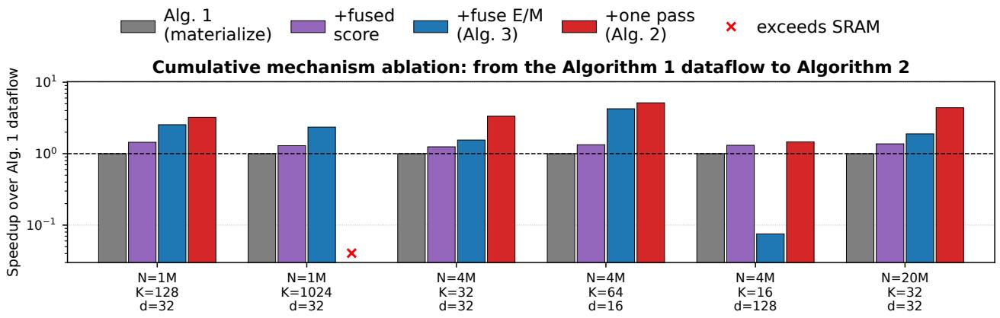

# Turbo-GMM: FlashAttention-Inspired GPU-Accelerated Gaussian Mixture Model

Momin Abbas 1 Sadia Asif2 Asad Ul Haq 2 Kaoutar El Maghraoui 1

§ github.com/mominabbass/turbo-gmm

## Abstract

Expectation-maximization (EM) for Gaussian mixture models (GMMs) requires scoring N data points against K mixture components. Prior fused GPU implementations, notably Flash-GMM, eliminate materialization of the N × K res onsibilit matrix but traverse the com onent dimension twice to com ute normalization terms and accumulate suficient statistics. We introduce Turbo-GMM, a single-sweep fused EM kernel that completes responsibility normalization and suficient-statistic accumulation within one traversal of the component dimension. By retaining the complete component axis on chip, Turbo-GMM avoids the second score computation required by the released two-sweep Flash-GMM implementation. Its applicability is limited by register pressure, occupancy, and the component and feature dimensions, making it particularly suitable for large datasets with relatively small numbers of components. For larger configurations, Turbo-GMM employs a two-pass fallback following the established fused design. We establish algebraic equivalence to standard EM in real arithmetic and evaluate sixteen configurations on an NVIDIA A100. Under the reported benchmarking protocol, Turbo-GMM achieves a median 2.15× speedup over the evaluated Flash-GMM implementation and up to 5.3× and 9.9× over PyTorch and scikit-learn, respectively. The results demonstrate the potential of single-sweep component traversal while identifying on-chip resource constraints as the principal limitation of this approach.

## 1 Introduction

Gaussian mixture models (GMMs), commonly fitted using expectation-maximization (EM), are widely used for density estimation and soft clustering (Dempster et al., 1977). Each EM iteration evaluates the likelihood of N data points under K mixture components, normalizes these scores into responsibilities, and accumulates suficient statistics for parameter updates. Eficient execution on GPUs requires managing both the computational cost of these operations and the movement of intermediate data.

Conventional implementations may materialize an N × K responsibility matrix, introducing substantial memory trafic and storage overhead. Flash-GMM (Bloch et al., 2026) addresses this limitation by fusing the expectation and maximization steps without materializing the responsibility matrix. Consequently, eliminating this intermediate and its associated memory overhead is an established benefit of fused GMM implementations rather than a contribution unique to Turbo-GMM.

An additional opportunity arises from the traversal of the mixture components within a fused EM iteration. The released Flash-GMM implementation processes the compo- nent dimension twice: first to compute the normalization terms and then to recompute component scores and accu- mulate suficient statistics. Although the Flash-GMM paper also proposes a schedule that retains input data across both traversals, its released diagonal-covariance implementation reloads the data during the second pass. Thus, reading the input data once is not itself a new conceptual contribution. The distinction we investigate is whether the second traversal of the component dimension can be eliminated altogether.

The challenge follows from a dependency between the two EM reductions. Responsibility normalization requires scores from all K components for each data point, whereas suficient-statistic accumulation reduces over the data-point dimension. A conventional component-tiled fused imple- mentation completes the normalization before revisiting the component scores to compute the statistics. However, when the entire component dimension can be retained on chip alongside a tile of data points, both reductions can be completed during a single traversal. This eliminates the need to recompute component scores in a second sweep.

Motivated by this observation, we introduce Turbo-GMM, a single-sweep fused EM kernel for diagonal-covariance GMMs. Turbo-GMM retains the complete component di- mension on chip, computes responsibilities, and accumulates suficient statistics within the same tile visit. The kernel therefore performs one component traversal and one read of the input tile. Relative to two-sweep fused implementa- tions, its distin uishin im rovement is the elimination of the second component traversal and its associated recom- putation, rather than the elimination of the responsibility matrix itself. The single-sweep design requires on-chip state proportional to Kd, making register pressure and occupancy limiting factors as K or d increases. On the evaluated A100, the dispatch rule selects this kernel when $K _ { \mathrm { p a d } } \leq 1 2 8$ and $K _ { \mathrm { p a d } } d _ { \mathrm { p a d } } \leq 4 0 9 6 ( \ S 5 . 2 )$ ; these are implementation-specific thresholds, not universal hardware limits. Otherwise, Turbo- GMM uses a two-pass fused fallback.

We analyze the equivalence of the single-sweep and two-pass formulations to standard EM in real arithmetic, including arbitrary tilings and partial tiles (Theorem 1). We also characterize their data-access costs under an explicit memory- trafic model (Theorem 2). These analyses distinguish the existing benefit of avoiding materialized responsibilities from the additional savings in data traversal and score recomputation enabled by the single-sweep kernel.

We evaluate Turbo-GMM on sixteen configurations covering diferent dataset sizes, component counts, and feature dimen- sions using an NVIDIA A100 GPU. Under the reported ex- perimental protocol, Turbo-GMM achieves a median 2.15× speedup over the evaluated Flash-GMM implementation, with improvements depending on whether the component dimension can be retained eficiently on chip. The results also identify cases in which resource limitations make the two-pass fallback necessary or preferable. The performance comparisons are discussed in §5.3, with limitations in $^ { \ S 7 }$

## Contributions.

• We develop a single-sweep fused EM kernel that com-pletes responsibility normalization and suficient-statistic accumulation within one traversal of the component di- mension. Unlike existing two-sweep fused implementa- tions, the kernel avoids recomputing component scores in a second traversal when the full component axis fits on chip (§3.1).

• We characterize the resource constraints and operating regime of single-sweep execution, including the efects of component count, feature dimension, register pressure, and occupancy. An empirically determined dispatch rule selects the single-sweep implementation where efective and a two-pass fallback otherwise (§5.2).

• We establish algebraic correctness in real arithmetic and analyze the data-access costs of both implementations, explicitly distinguishing inherited fusion benefits from the additional reductions associated with single-sweep execution (§4).

• We experimentally evaluate Turbo-GMM against fused GPU implementations and established GMM libraries, identifying the workloads in which single-sweep traversal improves latency and the configurations in which on-chip resource limitations restrict its benefits (§5.3).

## 2 Background and the Standard Implementation

In this section we establish the baseline that the rest of the paper measures against: the EM iteration and our notation (§2.1), the expanded score that libraries evaluate in practice and the standard dataflow it yields (§2.2, Algorithm 1), and the two properties of that dataflow which decide whether the iteration can be fused at all (§2.3)—the second of which §3 exploits.

## 2.1 The EM Iteration

Data and notation. Throughout, $X \in \mathbb { R } ^ { N \times d }$ holds N data points as its rows $x _ { i } ,$ where d is the dimension of each point. We denote by ⊙ the elementwise product and by ⊘ elementwise division, and let shapes broadcast in the usual way.

The mixture model. We follow the standard parameterization of a Gaussian mixture (Bishop, 2006). A mixture of K diagonal Gaussians is described by three parameters: mixture weights $\pi \in \mathbb { R } ^ { K }$ , strictly positive and summing to one, which say how much of the data each component accounts for; means $M \in \mathbb { R } ^ { K \times d }$ with rows $\mu _ { k }$ , one centre per component; and variances $V \in \mathbb { R } _ { > 0 } ^ { K \times d }$ with rows $\sigma _ { k } ^ { 2 } ,$ one width per component and per dimension. Positivity is what makes log $\pi _ { k }$ and $1 \oslash V$ well defined, and the algo- rithm uses both. EM fits these parameters by ascending the log-likelihood

$$
\ell ( { \boldsymbol { \pi } } , M , V ) = \sum _ { i = 1 } ^ { N } \log \sum _ { k = 1 } ^ { K } \pi _ { k } { \mathcal { N } } { \big ( } x _ { i } ; \mu _ { k } , \mathrm { d i a g } \sigma _ { k } ^ { 2 } { \big ) }\tag{1}
$$

in two alternating stages.

The E-step. The first stage asks how strongly each compo-nent explains each point. It forms a score matrix $S \in \mathbb { R } ^ { N \times K }$ of log joint densities, then normalizes it along the component axis:

$$
\begin{array} { l } { { S _ { i k } ~ = ~ \displaystyle \log \pi _ { k } ~ - ~ \frac { d } { 2 } \log 2 \pi ~ - ~ \frac { 1 } { 2 } \sum _ { c = 1 } ^ { d } \log \sigma _ { k c } ^ { 2 } } } \\ { { ~ - ~ \frac { 1 } { 2 } \sum _ { c = 1 } ^ { d } \frac { ( x _ { i c } - \mu _ { k c } ) ^ { 2 } } { \sigma _ { k c } ^ { 2 } } , } } \end{array}\tag{2}
$$

$$
L _ { i } = \log \sum _ { k = 1 } ^ { K } \exp S _ { i k } , \Gamma _ { i k } = \exp ( S _ { i k } - L _ { i } )\tag{3}
$$

We call $\boldsymbol { L } \in \mathbb { R } ^ { N }$ the row normalizers and $\Gamma \in \mathbb { R } ^ { N \times K }$ the responsibilities: $\Gamma _ { i k }$ is the posterior probability that point i was generated by component $k ,$ so every row of Γ sums to one. This is the matrix the paper is about.

The M-step. The second stage refits each component to the points it now owns, weighting every point by its respon- sibility. It reduces Γ into three suficient statistics, then renormalizes them into parameters:

$$
\begin{array} { c } { { n _ { k } = \displaystyle \sum _ { i = 1 } ^ { N } \Gamma _ { i k } , \qquad s _ { k } = \displaystyle \sum _ { i = 1 } ^ { N } \Gamma _ { i k } x _ { i } , } } \\ { { { } } } \\ { { u _ { k } = \displaystyle \sum _ { i = 1 } ^ { N } \Gamma _ { i k } x _ { i } \odot x _ { i } , } } \\ { { { } } } \\ { { \pi _ { k }  \displaystyle \frac { n _ { k } } { N } , \qquad \mu _ { k }  \displaystyle \frac { s _ { k } } { n _ { k } } , \qquad \sigma _ { k } ^ { 2 }  \displaystyle \frac { u _ { k } } { n _ { k } } - \mu _ { k } \odot \mu _ { k } + \varepsilon , } } \end{array}\tag{5}
$$

Here $n _ { k }$ is the soft number of points assigned to component k, while $s _ { k }$ and $u _ { k }$ are the responsibility-weighted first and second moments of the data; $\mu _ { k }$ on the right of (5) is the updated mean, and we assume $n _ { k } > 0$ . The additive covari- ance regularizer $\varepsilon \geq 0$ (scikit-learn’s reg covar) ensures strictly positive variances when $\varepsilon > 0$ in real arith- metic. For $\varepsilon = 0 ,$ , (5) is the standard maximum-likelihood M-step, and EM does not decrease (1) when the updates remain well defined (Wu, 1983). For $\varepsilon > 0 .$ the variance up date is regularized and is not the exact maximum-likelihood M-step; we make no monotonicity claim for (1) or for an unspecified penalized objective. Since $\sum _ { i } L _ { i }$ equals (1) at the incoming parameters, the E-step also provides the log-likelihood used for convergence monitoring.

## 2.2 The Score as a Single Bilinear Product

Evaluated as written, (2) sums d elementwise terms for each of the NK pairs, which leaves idle the matrix-multiply units that supply most of a GPU’s throughput. No library evaluates it that way. Instead they expand the quadratic form and assemble the score from matrix products, exactly as k-means expands $\| \boldsymbol { x } _ { i } - \boldsymbol { c } _ { k } \| _ { 2 } ^ { 2 }$ to reuse norms and reach the same units (Johnson et al., 2021). We state the form we use below, since the fused kernels of §3 inherit it.

Lemma 1 (Lift). Let $\tau = 1 \oslash V \in \mathbb { R } ^ { K \times d }$ be the precisions, and define

$$
\begin{array} { r l } & { \tilde { X } = \left[ X \mid X \odot X \right] \in \mathbb { R } ^ { N \times 2 d } , } \\ & { \tilde { W } = \left[ M \odot \tau \mid - \frac { 1 } { 2 } \tau \right] \in \mathbb { R } ^ { K \times 2 d } , } \end{array}\tag{6}
$$

$$
\begin{array} { r l r } {  { \boldsymbol { b } \in \mathbb { R } ^ { K } , \qquad b _ { k } = \log \pi _ { k } - \frac { d } 2 \log 2 \pi + \frac 1 2 \sum _ { c = 1 } ^ { d } \log \tau _ { k c } } } \\ & { - \frac 1 2 \sum _ { c = 1 } ^ { d } \mu _ { k c } ^ { 2 } \tau _ { k c } . } & { ( 7 ) } \end{array}
$$

Then the score matrix of (2) satisfies exactly, with $\mathbf { 1 } \in \mathbb { R } ^ { N }$ the all-ones column,

$$
S = \tilde { X } \tilde { W } ^ { \top } + \mathbf { 1 } b ^ { \top } .\tag{8}
$$

Algorithm 1 Standard GMM-EM implementation (one   
iteration)   
Require: Data $\boldsymbol { X } \in \mathbb { R } ^ { N \times d }$ and parameters $\pi , M , V$ resident in   
HBM   
Ensure: Updated $( \pi _ { \mathrm { n e w } } , M _ { \mathrm { n e w } } , V _ { \mathrm { n e w } } ) .$ log-likelihood ℓ   
1: Precompute the lift τ ← 1 ⊘ V , W˜ , b by (6)-(7)   
2: // Stage 1: E-step   
3: Kernel 1 (Score): Load blocks of X and of $\tilde { W }$ from HBM   
4: Compute $\bar { \boldsymbol { S } } \gets \tilde { \boldsymbol { X } } \tilde { \boldsymbol { W } } ^ { \top } + \mathbf { 1 } \boldsymbol { b } ^ { \top }$ by (8), as two products against   
X and $X \odot X$   
5: Write $S \in \mathbb { R } ^ { N \times K }$ to HBM // NK floats committed to   
HBM   
6: Kernel 2 (Normalize):   
7: for all row ${ \bf \Xi } ; \in \{ 1 , \ldots , N \}$ do   
8: Load Si∗ from HBM, compute Li = log $\scriptstyle \sum _ { k }$ exp $S _ { i k }$ and Γi∗ ←   
exp $\boldsymbol { S } _ { i * } - \boldsymbol { L } _ { i } )$   
9: end for   
10: Write responsibilities $\Gamma \in \mathbb { R } ^ { N \times K }$ to HBM $/ /$ Second $N \times K$ round   
trip   
11: Write normalizers $\boldsymbol { L } \in \mathbb { R } ^ { N }$ to HBM   
12: // Stage 2: M-step   
13: Kernel 3 (Square): Read X from HBM   
14: Write $\boldsymbol { X } \odot \boldsymbol { X } \in \mathbb { R } ^ { N \times d }$ to HBM // Recomputable from X in   
registers   
15: Kernel 4 (Accumulate): Initialize n $\in \mathbb { R } ^ { K } , s , u \in \mathbb { R } ^ { K \times d }$ to 0 in HBM   
16: Read Γ, gemv: $n  \dot { \Gamma } ^ { \top } \mathbf { 1 }$ // 1st read of Γ   
17: Read Γ, X, gemm: $s  \Gamma ^ { \top } X$ // 2nd read of Γ   
18: Read Γ, X ⊙ X, gemm: $\boldsymbol { u } \gets \Gamma ^ { \top } ( \boldsymbol { X } \odot \boldsymbol { X } )$ // 3rd read of Γ   
19: Kernel 5 (Normalization): Read $n , { \dot { s } } ,$ u from HBM   
20: Apply the parameter updates (5)   
21: Write $( \pi _ { \mathrm { n e w } } , M _ { \mathrm { n e w } } , ^ { \bullet } V _ { \mathrm { n e w } } )$ to HBM, and set $\ell = \textstyle \sum _ { i } L _ { i }$

The proof, by expanding the squared distance, is given in Appendix C.1.

In words, (8) says that the entire score matrix is one matrix product plus a per-component ofset. This is what libraries already compute: scikit-learn evaluates the same form for diagonal covariances, as two matrix products against X and X ⊙ X plus a per-component constant (Pedregosa et al., 2011), and Lemma 1 merely writes the two products as one of width 2d. Two consequences matter for a fused kernel. First, the score is bilinear in (X,˜ W˜ ), so a tile of rows and the parameters determine a tile of S, which lets a kernel build S on chip. Second, the block $X \odot X$ depends on $x _ { i }$ alone, so the kernel forms it in registers and never stores it. Building $\tilde { W }$ and b costs $\Theta ( K d )$ once per iteration, after which both stay resident. Algorithm 1 writes (2)-(5) in these terms: five kernels handing S and Γ through HBM.

Algorithm 1 is an archetype, not a transcription of one library: every count in §2.3, the four $N \times K$ reads of S and Γ included, prices Algorithm 1 as written and measures no library. Its dataflow resembles the array-API path of scikit-learn (Pedregosa et al., 2011), which keeps score and log-responsibilities as two concurrent $N \times K$ arrays, forms X ⊙ X as an $N \times d$ temporary, and traverses Γ once per statistic. cuVS (RAPIDS Development Team, 2026) instead tiles the row axis and normalizes in place, bounding the live responsibility block; $^ { \ S 7 }$ treats that stronger baseline.

## 2.3 What Governs Whether the Iteration Can Be Fused

Two properties of Algorithm 1 govern what a fused kernel can achieve. The first says that removing the intermediate is worth doing at all; the second says how many times a kernel that removes it must still read the data.

A trafic ledger for Algorithm 1. What follows counts ele-ments moved by each kernel’s own definition, not a profiled DRAM-counter measurement (§4 makes this explicit for the fused forms as well). Two $N \times K$ arrays dominate its HBM trafic: Kernel 1 writes S, Kernel 2 reads it and writes Γ, and Kernel 4 reads Γ once per statistic. The subtotal is 2NK elements written and 4NK read, none of it output. On the input side X is read three times, by Kernels 1, 3 and $^ { 4 , }$ and the $X \odot X$ temporary adds a round trip for a quantity Lemma 1 recovers in one instruction, so the input side costs 5Nd against Θ(Kd) for the parameters and the statistics. Once $\bar { K }$ passes $5 d / 6$ (Theorem 2), an array no consumer inspects prices the iteration, and Kernel 1 already runs at full throughput. Yang et al. (2026) argue this for the k-means distance matrix, and Bloch et al. (2026) for the responsibilities.

The two reductions run along opposite axes. An EM iteration contains two reductions, and they are not alike. The statistics (4) sum over the point index i, so they decompose over any partition of the rows and combine by ordinary addition: a kernel may accumulate them from row blocks in any order. The normalizer (3) sums over the component index k instead, and admits no such partial commitment, because $\Gamma _ { i k }$ cannot be formed until the whole row $S _ { i * }$ is known. The consequence is the one the next section exploits. Since Lemma 1 already lets a kernel build a tile of S on chip, one pass over the data sufices exactly when the component axis is resident there too, for then the normalizer completes within a single tile visit and leaves the statistics nothing further to read. That condition is what separates Algorithm 2 from Algorithm 3.

## 3 Method

In this section we introduce Turbo-GMM, a fused EM iteration that keeps the responsibility matrix on chip and never gives it an address in memory. Which of two forms runs is decided by one property of the problem shape: whether a whole component axis fits on chip beside a block of rows. When it does, a single traversal of that axis sufices and the kernel reads the data exactly once (§3.1); when it does not, a second traversal becomes unavoidable, and we fall back to the design point of prior fused work (§B). §5.2 states the rule that chooses between the two, and §4 proves that both compute the iteration of §2.1 exactly.

Algorithm 2 Turbo-GMM, one-pass form (fused E-step and   
M-step, nothing materialized)   
Require: $X \in \mathbb { R } ^ { N \times d } ,$ , parameters $\pi , M , V ,$ tiles $B _ { N }$ (points) and   
$B _ { K } \geq K$ (components), so the component axis is resident;   
padded lanes predicated out   
Ensure: $( \pi _ { \mathrm { n e w } } , \hat { M } _ { \mathrm { n e w } } , V _ { \mathrm { n e w } } )$ , log-likelihood ℓ   
1: Precompute the ${ \mathrm { l i f t } } \tau \gets 1 \oslash V , \tilde { W } , b$ by $( 6 ) – ( 7 )$   
2: Initialize $n , s , u , \ell \gets 0$ in HBM   
3: for all point tile $X _ { \mathrm { t i l e } }$ of size $B _ { N }$ in parallel do   
4: Load W , b ˜ into registers; initialize on-chip $\hat { n } , \hat { s } , \hat { u } , \hat { \ell } \gets 0$   
5: Load $X _ { \mathrm { t i l e } } \in \mathbb { R } ^ { B _ { N } \times d }$ from HBM on chip // X read   
exactly once   
6: Form $X _ { \mathrm { t i l e } } ^ { \widehat { 2 } } \gets X _ { \mathrm { t i l e } } \odot X _ { \mathrm { t i l e } }$ in registers $/ / { \tilde { X } }$ never   
materialized   
7: Compute $\mathbf { \Psi } _ { S } ^ { * \bot } \breve { S } _ { \mathrm { t i l e } } \breve { W } ^ { \top } + \mathbf { 1 } b ^ { \top }$ on chip, $\tilde { X } _ { \mathrm { t i l e } } = \left[ X _ { \mathrm { t i l e } } \mid X _ { \mathrm { t i l e } } ^ { 2 } \right] / /$   
S never in HBM   
8: Per row i of the tile: mi ← maxk $\begin{array} { r } { S _ { i k } , \lambda _ { i }  \sum _ { k } } \end{array}$ exp(Sik − mi),   
$L _ { i } \gets m _ { i } +$ log $\lambda _ { i } , \Gamma _ { i * } \gets \exp ( S _ { i * } - m _ { i } ) \oslash \overline { { \lambda } } _ { i } ^ { * }$   
9: Accumulate $\begin{array} { r } { ( 4 ) \colon \hat { n } \ + = \ \sum _ { i } \Gamma , \hat { s } \ + = \ \Gamma ^ { \top } X _ { \mathrm { t i l e } } , \hat { u } \ + = \ \Gamma ^ { \top } X _ { \mathrm { t i l e } } ^ { 2 } , } \end{array}$   
$\begin{array} { r } { \hat { \ell } + = \sum _ { i } L _ { i } } \end{array}$   
10: atomic add $( \hat { n } , \hat { s } , \hat { u } , \hat { \ell } )$ into $\left( n , s , u , \ell \right) / /$ additive: atomics   
legal   
11: end for   
12: Compute $( \pi _ { \mathrm { n e w } } , M _ { \mathrm { n e w } } , V _ { \mathrm { n e w } } )$ by (5)

## 3.1 Turbo-GMM: Single-Sweep Component Traversal

Our goal is an iteration that reads X once. The obstacle is the one §2.3 identified: a responsibility cannot be used until its whole row of scores is known. Our way around it is to arrange that the row is completed inside a single tile visit. Let $B _ { N }$ denote the number of rows a kernel instance holds on chip and $B _ { K }$ the number of components it holds alongside them. When $B _ { K } \geq K$ the component axis is resident, so one visit sees an entire row of S, the normalization of (3) finishes there, and the E-step and the M-step collapse into a single kernel. We describe it formally in Algorithm 2.

The kernel computes the score of Kernel 1 of Algorithm 1 arithmetically unchanged—only its address difers—reads X once, forms $X \odot X$ in registers, and writes out nothing but the $\Theta ( K + K d )$ statistics.

Masking partial tiles. When K does not fill a tile, the padding columns must be masked with a large finite sentinel $- \beta ( \beta = 3 \times 1 0 ^ { 3 8 }$ in our kernel, just inside the float32 range) rather than with −∞, since −∞ propagates −∞ − $( - \infty ) \ = \ \mathrm { N a N }$ into the reduction. The price is that in real arithmetic −β still contributes ex $\mathrm { p } \mathrm { ( - } \beta - m _ { i } ) > 0$ to $\lambda _ { i } .$ , vanishing only by float32 underflow. Theorem 1 predicates padded lanes out exactly, so the kernel realizes it only up to that underflow.

Reusing the exponentials. Form Γ as exp $\left( S - m \right) \oslash \lambda$ which reuses the exponentials already computed for λ, rather than as a second exp(S − L). Only the one-pass form ofers this reuse, because only there are those exponentials still on chip.

The ledger after fusion. Algorithm 2 gives neither S nor Γ an address, so both round trips counted in §2.3 vanish, as does the $X \odot X$ temporary; all that remains proportional to N is the single read of X. Theorem 2 states the three led ers exactl , and the savin over Al orithm 1 rows with $K / d .$ Measured latency follows that prediction in the d direction but not in the K direction, where our margin falls below parity from $K = 5 1 2$ upward—the width at which the component axis stops fitting on chip, so that Algorithm 3 carries the comparison instead (§5.3).

## 3.2 The General Case: Two Passes When the Component Axis Does Not Fit

When K is too large for the component axis to stay resident, no single tile visit can complete a row’s normalizer, so Turbo-GMM falls back to a two-pass design at the point Bloch et al. (2026) occupy: pass 1 sweeps the component axis once to accumulate only the row normalizers, $\Theta ( N )$ state rather than $\Theta ( N K )$ ; pass 2 then re-reads the data once per component tile, recomputes the score from the stored normalizer, and accumulates the suficient statistics. This trades one extra read of the data for covering every $K ,$ , at the cost of the score recomputation that Algorithm 2 avoids. Algorithm 3, including the online-softmax merge rule it uses to combine partial normalizers exactly, is given in full in Appendix B.

## 4 Exactness and Cost

We establish that both fused kernels compute the standard EM updates (Theorem 1) and characterize their HBM trafic (Theorem 2). Proofs are provided in Appendix C.

Theorem 1 (Exactness). Fix N, $K \geq 1$ , data $X \in \mathbb { R } ^ { N }$ ×d with $d \geq 1$ , weights $\pi > 0$ and variances $V > 0 ;$ take $B _ { K } \geq K$ in Algorithm 2, so that its single component tile is the whole axis, and assume padded lanes are predicated out on both axes, the statistic accumulators seeded at 0 and the fold of (10) seeded with any pair whose second coordinate is 0. Partition the rows $\{ 1 , \ldots , N \}$ into nonempty tiles, andfor Algorithm 3 partition the components $\{ 1 , \ldots , K \}$ likewise, each of its two passes choosing its partitions independently and pass 2 running after pass 1 has written $L ;$ tile sizes need divide neither N nor K. Then, in real arithmetic, Algorithms 2 and 3 return the statistics $n , \ s ,$ u of (4) and the log-likelihood ℓ of (1) at the incoming $( \pi , M , V ) , f o r$ every such partition and every order in which the tiles are visited. Moreover $n _ { k } > 0 f o r$ every k, so the updates (5) are defined and also agree.

Its content is that the two reductions of an iteration reasso- ciate independently: the statistics (4) fold over addition on the row axis, and the normalizer of (3) folds over the ⊕ of (10) on the component axis. We state exactness against (1)– (4) rather than against Algorithm 1, which is an archetype (§2.2) and so a weaker reference. The theorem also chains across the iterations of a run: each row of Γ sums to one, so $\textstyle \sum _ { k } n _ { k } = N$ and the updated weights again lie in the open simplex, while $u _ { k } \oslash n _ { k } - \mu _ { k } \odot$ µk is a weighted variance and hence nonnegative, so $V _ { \mathrm { n e w } } \geq \varepsilon$ and the output of one iteration satisfies the hypotheses of the next whenever $\varepsilon > 0$ (Appendix C).

Theorem 2 (HBM trafic). Count elements moved between HBM and the chip, charging one for a read, one for a write, and twofor an atomic update, with no cache between the two; on-chip state is free. Let $T _ { N } = \lceil N / B _ { N } \rceil$ and $T _ { K } = \lceil K / B _ { K } \rceil$ be the tile counts. In $A l g o r i t h m \ 2$ the $T _ { N }$ row tiles are distributed over $P \leq T _ { N }$ programs, each loading the lift once and committing its partial statistics once; this is the launch our kernel uses and the only place the mapping enters a ledger. Then one iteration moves

$$
\begin{array} { r l } & { \underbrace { 5 N d + 6 N K + \Theta ( N + K d ) } _ { \mathrm { A l g o r i t h m 1 } } , } \\ & { \underbrace { N d + \Theta ( P K d ) } _ { \mathrm { A l g o r i t h m 2 } } , } \\ & { \underbrace { ( 1 + T _ { K } ) ( N d + N ) + \Theta ( T _ { N } K d ) } _ { \mathrm { A l g o r i t h m 3 } } } \end{array}\tag{9}
$$

elements, the parameter terms $\Theta ( P K d )$ and $\Theta ( T _ { N } K d )$ being upper bounds, since the lift is only $2 K d + K$ elements and may in practice stay resident in a last-level cache across row tiles. Whenever $P K = O ( N + K )$ , Algorithm 2 moves $\Theta ( N d + K d )$ , which is optimal up to constants among exact algorithms that receive X and return $( \pi _ { \mathrm { n e w } } , M _ { \mathrm { n e w } } , V _ { \mathrm { n e w } } )$ in HBM, while Algorithm 1 moves $\Theta ( N d + N K )$ whenever min $( K , d ) = O ( N )$ , in particular whenever $K \leq N$

The full term-by-term accounting of each ledger, including why the two-pass form’s refetched lift term dominates its reads of X, is in Appendix C.

Our verification is stronger than the theorem needs: it com- pares against the centered (2), which also covers Lemma 1. That lemma is an exact algebraic identity, true by direct ex- pansion for every d (Appendix C). We check both tiled forms against a 60-decimal-digit mpmath extended-precision reference (mpmath development team, 2026) on a battery of small cases, including K = 1 and $K > N$ , at both of our numeric paths (ieee and $\ t \pm 3 2 \mathrm { x } 3$ , three tensor-core passes at reduced input precision with an $\tt f p 3 2$ accumulator, against one pass for bf16), and against scikit-learn’s and PyTorch’s own E- and M-step primitives; separately, we sweep a double-precision materializing oracle over multiple larger shapes and tile sizes. Across both checks the tiled algorithms agree with the untiled computation to within ordinary floating-point roundof, not a diference in the un- derlying mathematics. In float64 the summation order difers, so agreement there is a relative bound rather than a bitwise one.

What the theorem does not cover. Theorem 1 and the checks above concern real arithmetic, and the $\pm 1 0 \mathsf { a t } 3 2$ kernel departs from its hypotheses twice. It masks padded columns with the finite sentinel of §3.1 rather than predi-cating them away, so it realizes the theorem only inside the single-precision exponent range; and where a well-separated component underflows $\Gamma _ { i k }$ , and $n _ { k }$ with it, it divides by $n _ { k }$ plus ten float64 machine epsilons, returning (5) of a perturbed argument. We check it by measurement instead (§5.3, §5.4).

A numerical precondition inherited from the expansion. The lifted score subtracts terms of magnitude $\| \boldsymbol { x } \| ^ { 2 } \tau$ , losing relative accuracy as the data moves away from the origin, so implementations must center the data (§7); Appendix C quantifies the loss and traces it to the same cancellation that destabilizes a naive sum-of-squares variance formula (Chan et al., 1983).

## 5 Experiments

Theorem 1 says the fused iteration computes the right thing and Theorem 2 that it moves less data. Neither says it runs faster: fusion buys the trafic it saves with on-chip state, and in the two-pass form with a recomputed score. What the experiments locate is the boundary of that trade over (N, K, d). We evaluate three claims.

• Latency. Against the closest fused kernel, Turbo-GMM is faster on eleven of the fifteen shapes both complete, by a median 2.15×; against the libraries a practitioner would reach for, by up to 5.3× over PyTorch and 9.9× over scikit-learn. The advantage is conditional, and we identify the three conditions that remove it.

• Memory. Peak memory is flat in the number of components—128 to 139 MB from K = 128 to 4096, against 3.2 to 47 GB for implementations that materialize the responsibilities. This claim carries no condition, and at the widest setting it decides feasibility rather than speed.

• Where the gain comes from. An ablation separates the single sweep of the component axis, the one change without precedent, from the two fusions that precede it. The single sweep is worth up to 19.4× over our own two-pass fallback (not a margin over Flash-GMM; the comparable Flash-GMM control point is 2.07×, Appendix F), and at d = 128 it is the only one of the three that keeps fusion profitable at all.

Latency is always reported at fixed quality: we re-score every arm’s returned parameters in double precision and admit only valid fits. For the full protocol, the dispatch measurements, the ablation ladder and the cells that failed, see Appendix D, whose Table 1 gives every arm’s latency, memory and gate outcome at all sixteen shapes; the comparison against prior fused work has its own Appendix F.

## 5.1 Setup

Baselines. Figure 1 compares Turbo-GMM against seven baselines. Flash-GMM (Bloch et al., 2026) is the closest prior work: it fuses the same iteration but traverses the component axis twice, isolating the contribution of our single sweep (§B). cuVS (RAPIDS Development Team, 2026) is the strongest library baseline and the only other rowtiled implementation. The remaining libraries are PyTorch (Paszke et al., 2019), scikit-learn (Pedregosa et al., 2011), gmmx (Donath, 2024), torchgmm (Varrone, 2023), and pomegranate (Schreiber, 2018); versions are listed in Appendix E.

Protocol. Every arm is diagonal-covariance and starts from one seeded dataset and one shared initialization, on one NVIDIA A100-SXM4-80GB. The sweep covers sixteen shapes (N, K, d) in four regimes—large N, large K, a K/d sweep, and small N—one of which belongs to two, so Figure 1 shows seventeen bar groups. Both fused kernels run at tf32x3, which makes the comparison between them one of dataflow rather than of number format; the libraries run at fp32—for PyTorch specifically this means explicitly disabling its allow tf32 matmul setting, an exposed control we turn of rather than a default the library lacks. Two choices run against us, and we flag them here rather than in an appendix: the latency estimator is not identical across arms, mildly favouring cuVS, and we widened Flash- GMM’s published autotune list so that it could select the small blocks fp32 needs, cutting our largest margin from 4.37× to 2.46× (Appendix D).

What counts as a result. A latency means nothing without the objective the arm reached, and some libraries return an unusable model without saying so. We therefore re- score every arm’s returned parameters in double precision and accept a fit only if its log-likelihood is finite and, for arms that return mixture weights, $\textstyle \sum _ { k } \pi _ { k } = 1$ . Runs that fail the gate sit at the axis floor of Figure 1 and drop out of every memory and aggregate-count comparison below, with one disclosed exception: §5.3 and Appendix F keep and explicitly flag Flash-GMM’s K = 4096 latency point even though it fails this gate, since a single E-step there is itself exact (Appendix G) and we would rather disclose a borderline inclusion than silently drop a data point that completed.

## 5.2 Which algorithm runs where

Algorithm 2 runs wherever the component axis fits on chip and Algorithm 3 only where it does not, so before reading any latency we have to fix which of the two produced it. Two limits bound the fit. The first is capacity: the loop-carried state (ˆn, s,ˆ uˆ) spans the whole component axis, $\Theta ( K d )$ , and past $K _ { \mathrm { p a d } } d _ { \mathrm { p a d } } \approx 1 0 ^ { 4 }$ the compiler cannot place it in the NVIDIA A100’s shared memory at all. The

OOM / unsupported

no valid mixture

  
Figure 1. Latency per EM iteration against seven baselines on one NVIDIA A100-SXM4-80GB, four regimes, logarithmic axis, lower is better. A star marks the three configurations that fall back to Algorithm 3 because Algorithm 2 does not fit on chip; Algorithm 2 runs elsewhere. Axis-floor markers returned no valid fit, keyed in the legend; one such point, Flash-GMM at $K = 4 0 9 6$ , is nonetheless discussed by latency in §5.3 and Appendix F as a disclosed exception to this criterion, so it is absent from this figure but present in those aggregate numbers. Protocol and validity criterion: §5.1; dispatch: §5.2.

## 5.3 Latency and memory

second is occupancy, and it binds first: the accumulator spills registers well inside the capacity bound, and the clif does not follow $K _ { \mathrm { p a d } } d _ { \mathrm { p a d } }$ . Dispatching on capacity alone would therefore be wrong, and measurably so: holding the footprint fixed and trading K against d swings the ratio between the two algorithms by 250×, and one configuration that capacity admits costs the one-pass form 17×. We consequently dispatch on two measured conditions rather than one derived one, taking Algorithm 2 when $K _ { \mathrm { p a d } } \leq 1 2 8$ and $K _ { \mathrm { p a d } } d _ { \mathrm { p a d } } \leq 4 0 9 6$ . For the capacity arithmetic and the probes behind the rule, see Appendix D.

Under that rule three of the sixteen shapes, $K \in$ {512, 1024, 4096} at $N = 1 0 ^ { 6 }$ , fall to Algorithm 3 and carry a star in Figure 1. On the other thirteen, where both of our algorithms run, the one-pass form wins every shape— median 2.1× over our own two-pass fallback, and 19.5× over it at $d = 1 2 8 .$ , one measured point rather than a curve in d—because it sweeps the component axis once and never recomputes the score. (This is a margin over our own fallback, not over Flash-GMM; §5.3 and Appendix F give the margins over Flash-GMM.)

All arms reach the same optimum. Where two or more arms produced a valid fit, they agree to $2 . 2 \times 1 0 ^ { - 6 }$ relative on the final log-likelihood and to $1 . 1 \times 1 0 ^ { - 3 }$ on the adjusted Rand index of the induced clustering, and the two fused kernels agree to $4 . 4 \times 1 0 ^ { - 7 }$ . What follows compares cost at fixed quality.

Peak memory is flat in K, and at the widest setting it decides feasibility. Turbo-GMM never writes the $N \times$ K responsibilities, so its inputs govern its peak: from K = 128 to K = 4096 at $N = 1 0 ^ { 6 }$ that peak grows only from 128 to 139 MB, a factor of 1.1, against 3.2 to 47 GB for the largest baseline peak with a valid fit— 25× to 338× ours, over the four library arms that report peak memory at all. The consequence is not a constant factor. At K = 4096, scikit-learn exhausts the 80 GB device and pomegranate fails outright, while Turbo-GMM completes in 139 MB.

Against libraries, the advantage is ordered in d and disappears at small N. Measured against the fastest library with a valid fit at each shape, Turbo-GMM is 2.7–4.2× faster at large N and 2.5–2.6× at large K; taken one library at a time the maxima are 5.3× over PyTorch and 9.9× over scikit-learn. Across the $K / d$ sweep the range is wider, $0 . 9 9 \mathrm { - } 5 . 3 \times .$ , and it falls in d at every fixed K we measure, reaching parity at $K = 1 6 , d = 1 2 8$ : this is the shape at which the $\Theta ( N K )$ intermediate we remove drops below the input trafic that no implementation avoids, so a trafic argument no longer separates us (Theorem 2). At $N = 2 0 0 0 0$ we are slower still, 0.45–0.73× the best baseline, because the responsibility matrix is too small there for its removal to pay against launch and reduction overheads. Fit a small mixture with a library.

Against the closest fused kernel, the comparison splits at the on-chip boundary. Flash-GMM times fifteen of the sixteen shapes, failing to launch at $d = 1 2 8$ on its published list. Turbo-GMM, dispatched by §5.2, wins eleven of the fifteen by 1.06× to 4.28×—median 2.15× over all fifteen and 3.02× over the wins. The four exceptions are placed rather than scattered. One is the small-N tie (0.99×). The other three are exactly the shapes at which Algorithm 2 has left the chip and our two-pass fallback meets their kernel at its own design point, and we lose all three: $0 . 9 3 \times , 0 . 7 8 \times$ and 0.73× at $K = 5 1 2$ , 1024 and 4096. The margin is thus ordered in K only through the dispatch boundary: at $d = 3 2$ it falls monotonically as K rises and reverses exactly where the fallback takes over (Appendix F). We have not identified the mechanism of that reversal, and Theorem 2 does not supply one, since it separates the two designs on no term (§7). One caveat at $K = 4 0 9 6 \colon$ : their kernel completes in 65.2 ms but returns mixture weights of the simplex $( \sum _ { k } \pi _ { k } = 4 . 3 \times 1 0 ^ { 3 } )$ , traced in Appendix G to a collapsed component variance, so its latency counts against a fit our own gate rejects. Appendix F places the two designs side by side.

Three libraries fail silently. The gate rejected six otherwisesuccessful runs, spread over gmmx, torchgmm and pomegranate, which completed, reported success, and returned a non-finite log-likelihood. Four of the six sit at $K \ge 1 0 2 4$ , the regime this paper is about, so a harness that trusted exit status rather than re-scoring the returned parameters would enter all six in its table (Appendix D). Turbo-GMM returned a valid fit at all sixteen shapes.

## 5.4 Where the gain comes from

Figure 1 says where the fused iteration is faster; it does not say which change is responsible, and the changes are not equally novel. Three separate Algorithm 1 from Algorithm 2: fusing the score into one kernel, which any library could adopt; fusing the E- and M-steps to remove the $N \times K$ intermediate, which Bloch et al. (2026) also do; and the single sweep of the component axis, which has no precedent. If the first two carried the margin, the advice this paper gives would stop at a fused two-pass kernel. We therefore build a cumulative ladder, each rung adding one change to the ones below it so that the factors compose, and run all four rungs on six configurations from Figure 1. Every rung agrees with the baseline to $5 \times 1 0 ^ { - 6 }$ relative on all four returned quantities, so the ladder varies dataflow and not arithmetic. For the rungs, the protocol and two caveats, see Appendix D.

The three factors are unequal, and which of them dominates depends on the shape. The score kernel returns 1.25–1.44×; the E/M fusion 1.24–3.18× where it helps at all; the single sweep $1 . 2 1 { - } 2 . 3 2 \times \mathrm { a t } d \leq 3 2$ . Where all four rungs run—five configurations—the product ranges from $1 . 4 6 \times \mathrm { t o ~ 5 . 1 4 } \times$ . What licenses reading the rest is that the first rung is also the most tightly bounded: the one rung that confounds dataflow with implementation language never exceeds 1.44×, so it cannot account for a product of 5.14×.

At d = 128 the single sweep is not an optimization but the reason fusion pays at all. The middle rung is not monotone, and this is the central result of the ablation. At $N = 4 \times 1 0 ^ { 6 } , K = 1 6 , d = 1 2 8 .$ , our two-pass Algorithm 3 runs 17.4× slower than leaving the steps apart and 13.3× slower than the materializing baseline; the single sweep then recovers 19.4× relative to our own two-pass form (not a margin over Flash-GMM), a net 1.46× over the standard dataflow, re-measuring the 19.5× of §5.2 (also vs. our own two-pass form) to within 1%. The mechanism is the score recomputation that a second sweep forces. Two limits bound how far this generalizes. A control at the same shape charges most of the 17.4× to our implementation rather than to two-sweep fusion as such—at this shape, Flash-GMM (an independently written two-sweep kernel) regresses by only 2.07× against the materializing baseline, not by an order of magnitude (Appendix F): this is Flash-GMM’s own number at $d = 1 2 8$ , the one to use for competing published work, not the internal 19.4× above. And $d = 1 2 8$ is the widest configuration we measure and the only one at which the inversion appears, so this is an existence result rather than a curve in d.

Latency and footprint come from diferent rungs. The ladder also localizes the memory result of §5.3: at every shape but the widest d we measure, the score rung leaves peak memory unchanged, the E/M rung cuts it 87-fold— 12.4 GB to 142 MB at $N = 1 0 ^ { 6 } , K = 1 0 2 4 \cdot$ —and the single sweep barely moves it further. At d = 128 the score rung alone already sheds 27.7% (6.4 GB to 4.6 GB), because that is where Algorithm 1’s N × d squared-data temporary is largest; the E/M and single-sweep rungs account for the remaining reduction there. No saving is counted twice either way, and at $d = 1 2 8$ the net margin over the standard dataflow is 1.46×; Figure 2 supports no more.

  
Figure 2. Cumulative mechanism ablation. Each bar adds one dataflow chan e to the ones below it hei ht is s eedu over the Algorithm 1 dataflow, so the bars multiply and the dashed line is parity. The middle rung is not monotone: at $d = 1 2 8$ our two-pass Algorithm 3 runs 17× slower than not fusing, and only the one-pass Algorithm 2 recovers it—opposite in direction to the 17× of $\ S 5 . 2 ,$ a loss of Algorithm 2 at $K = 2 5 6 , d = 1 6$ . A red × marks a rung that exceeds SRAM. Every rung agrees with the reference to $5 \times 1 0 ^ { - 6 }$ see §5.4.

## 6 Related Work

Online normalizers and IO-aware kernels. The mergeable summary we fold over component blocks originates with Milakov & Gimelshein (2018): one pass for the softmax maximum and normalizer, merged by a binary operator on (m, λ). Rabe & Staats (2021) apply the recurrence to attention without materializing the logit matrix; Dao et al. (2022) make it IO-aware, with an explicit HBM bound—an arithmetic-intensity argument in the sense of Williams et al. (2009): once an array’s bytes moved exceed what its FLOPs can hide, removing the array outright is what changes which resource binds, the crossover §2.3 locates at $K > 5 d / 6$ Ivanov et al. (2021) make the identical trafic-dominates-compute case for transformer training, by relaying out and fusing kernels rather than removing an intermediate outright. Dao (2023) contribute the storage our two-pass variant reuses: the single quantity $L = m + \log \lambda$ , from which a second pass recovers the responsibilities out of Θ(N) state. Their un-scaled output accumulator does not transfer to a mixture M-step (§2.3). Shah et al. (2024) push the same two-sweep design to Hopper’s asynchronous tensor cores and fp8, a hardware-scheduling gain orthogonal to the pass count we remove. Wijmans et al. (2025) and the Liger kernel library (Hsu et al., 2024) apply the identical refusal to cross-entropy’s $N \times | \mathcal { V } |$ logit matrix, evaluating the loss chunk by chunk rather than materializing it; ours is the same shape of intermediate for a diferent reduction. Blanchard et al. (2021) analyze batched log-sum-exp accuracy, complementary to our exactness question. That change of variables is standard in online-softmax derivations; what Theorem 1 adds is that the mixture suficient statistics reassociate over any partition, with tile sizes that need not divide N or K.

Fused clustering and mixtures. Yang et al. (2026) fuse the assignment step of Lloyd’s algorithm (Lloyd, 1982), streaming centroid tiles past a resident point tile with a running (min, arg min) in registers, at $\Theta ( N d + K d )$ trafic. Theirs is the hard-assignment limit of ours—k-means is a mixture with vanishing variances—and the easier one, since a minimum admits no normalizer, hence no rescaling of weighted statistics. Bloch et al. (2026) are the closest prior work and our main baseline: they fuse the EM iteration in Triton at the same trafic, for the isotropic case, of which our diagonal case is the generalization, and with a pointwise score rather than the single matrix product of §2.2. Their kernel sweeps the component axis twice, recomputing the score—the design of Algorithm 3 rather than Algorithm 2— and their released code splits the two sweeps across two launches, so the row normalizer round-trips HBM. That is the design point Algorithm 3 occupies, and where their kernel wins (§7). Appendices F and G set the two constructions side by side and give the protocol by which we benchmark theirs.

Online and incremental EM. A diferent sense ofpass runs through the classical EM literature. Neal & Hinton (1998) recast EM as coordinate ascent on a free-energy functional, which justifies updating suficient statistics after each point or block rather than waiting for a full sweep; Cappe &´ Moulines (2009) give a stochastic-approximation EM for data arriving as a stream, with a decreasing step size standing in for the M-step. Both shrink how many times the outer loop over the dataset must repeat to converge—a statistical question. Ours is orthogonal: X is already resident and fixed, and the pass we remove is the inner one, the second sweep of the component axis a single EM iteration would otherwise make; incremental and online EM still call that iteration once per update, and so inherit whatever trafic it costs.

GPU implementations of mixture fitting. Earlier work GPU-accelerates only the scoring half of an iteration: Vanekˇ et al. (2011) evaluate Gaussian-mixture likelihoods on GPU for speech-recognition acoustic models, without the M-step or the exactness question we address. Several GPU imple- mentations of complete mixture fitting predate ours: cuVS (RAPIDS Development Team, 2026); scikit-learn (Pedregosa et al., 2011), dispatching through the Array API to GPU libraries; torchgmm (Varrone, 2023) and gmmx (Donath, 2024) in PyTorch and JAX; and pomegranate, whose version-1 series is a PyTorch rewrite of Schreiber (2018). All materialize a responsibility block; a wellimplemented library tiles the row axis, so the live block stays bounded, not $N \times K \left( \ S 7 \right)$ ). §5 measures every im-plementation named here; the fastest beats Turbo-GMM at N = 20 000. We write our kernels in Triton (Tillet et al., 2019) on P Torch (Paszke et al., 2019).

## 7 Discussion

What the results establish. Two findings survive the sweep, and they point in diferent directions. Removing the inter- mediate changes what fits on a device: peak memory is flat in the number of components, so a 4096-component mixture at a million points becomes a single-device job at 139 MB where scikit-learn exhausts 80 GB. That holds at every shape and asks nothing of the hardware. La- tency is the conditional half, and its condition is a hardware quantity rather than a property of the data: one pass pays wherever the component axis fits on chip—on an NVIDIA A100, K ≤ 128 at d = 32—and pays a median 2.15× over the closest fused kernel there. Because the binding resource is on-chip capacity rather than bandwidth, this predicts that the envelope widens with each generation of hardware rather than with a better kernel: capacity itself has grown 128 KB to 192 KB to 256 KB over three successive architectures (NVIDIA Corporation, 2026), a vendor-documented hardware fact rather than something we measured ourselves— every latency and memory number in this paper comes from one NVIDIA A100, and we make no claim about how the dispatch boundary moves on any other device.

The single sweep is the change worth making. The ablation carries a recommendation for anyone building one of these kernels. Fusing the E- and M-steps, the change prior fused work already makes, is not where the margin lives: at d = 128 our two-pass form runs 17.4× slower than not fusing at all, and only the single sweep recovers it (§5.4). A kernel that sweeps the component axis twice is the easier artifact to build and the wrong place to stop.

Scope. Algorithms 2 and 3 cover diagonal covariances, of which spherical is the broadcast special case. Tied and full covariances need lifts of width d + 1 and $d + d ( d + 1 ) / 2 -$ the tied case needs the extra column because its quadratic term cancels in Γ but not in L—and both widths change the register budget. We do not treat them.

Our cost model bounds the eager baseline, not a tiled one. Theorem 2 counts Algorithm 1, the archetype of the un-tiled implementations, and fusion improves on it by the largest margin. A library that tiles the row axis instead keeps only a bounded $( B _ { N } , K )$ block live, and that block may stay cache-resident—at K = 64 in single precision it is 16 MiB, inside the last-level cache of a current datacenter GPU—so its round trips need not reach HBM at all; it may also evaluate (2) in centered form, better conditioned than the lift by the factors of §4. cuVS is such an implementation, and Turbo-GMM beats it at all sixteen shapes, by 2.2× rising to $7 0 . 6 \times ;$ but the two difer in language, autotuning and initialization as well as in tiling, so none of that margin is attributable to fusion.

One measurement we cannot explain. Where the one-pass form leaves the chip, our two-pass fallback loses to Flash-GMM at K = 512 and K = 1024, and we have not identified the mechanism. Theorem 2 does not supply one: both kernels read X once per component tile, and trafic is not the binding resource at those shapes—Algorithm 3 moves 3.4 GB at $( 1 0 ^ { 6 } , 5 1 2 , 3 2 )$ in 11.9 ms, a seventh of this device’s bandwidth. Every latency and memory number here comes from one NVIDIA A100, one seeded dataset and one shared initialization, and our margins over Flash-GMM rest on the autotune list of §5.1.

## 8 Conclusion

We introduced Turbo-GMM, an IO-aware Gaussian-mixture EM implementation that eliminates materialization of the $N \times K$ responsibility matrix and, when the component axis fits on chip, completes the E-step and M-step in a single traversal. By exploiting the opposing reduction axes of responsibility normalization and suficient-statistic ac- cumulation, Turbo-GMM avoids redundant reads without changing the EM updates. We establish exactness in real arithmetic under arbitrary tilings (Theorem 1) and show that the one-pass form reduces HBM trafic to Θ(Nd+Kd) under the stated execution conditions (Theorem 2). Across sixteen configurations on an NVIDIA A100, Turbo-GMM achieves a median 2.15× speedup over the closest fused baseline and up to 5.3× and 9.9× over PyTorch and scikit-learn, respectively, while reducing peak memory by up to 338× relative to materializing implementations. Latency gains depend on component residency and problem shape, while eliminating the $N \times K$ responsibility workspace benefits even configurations requiring the two-pass fallback. These results demonstrate how reduction-aware kernel design im- proves the eficiency and scalability of probabilistic learning.

## References

Bishop, C. M. Pattern Recognition and Machine Learning. Information Science and Statistics. Springer, 2006. doi: 10.1007/978-0-387-45528-0.

Blanchard, P., Higham, D. J., and Higham, N. J. Accurately computing the log-sum-exp and softmax functions. IMA Journal ofNumerical Analysis, 41(4):2311–2330, 2021. doi: 10.1093/imanum/draa038.

Bloch, G., Gera, A., Orbach, M., Eytan, O., and Toledo, A. Flash-GMM: A memory-eficient kernel for scalable soft clustering. arXiv preprint arXiv:2606.10896, 2026.

Cappe, O. and Moulines, E. On-line expectation– ´ maximization algorithm for latent data models. Journal ofthe Royal Statistical Society, Series B, 71(3):593–613, 2009. doi: 10.1111/j.1467-9868.2009.00698.x.

Chan, T. F., Golub, G. H., and LeVeque, R. J. Algorithms for computing the sample variance: Analysis and recom- mendations. The American Statistician, 37(3):242–247, 1983. doi: 10.1080/00031305.1983.10483115.

Dao, T. FlashAttention-2: Faster attention with bet- ter parallelism and work partitioning. arXiv preprint arXiv:2307.08691, 2023.

Dao, T., Fu, D. Y., Ermon, S., Rudra, A., and Re, C.´ FlashAttention: Fast and memory-eficient exact attention with IO-awareness. In Advances in Neural Information Processing Systems, 2022.

Dempster, A. P., Laird, N. M., and Rubin, D. B. Maximum likelihood from incomplete data via the EM algorithm. Journal of the Royal Statistical Society, Series B, 39(1): 1–22, 1977. doi: 10.1111/j.2517-6161.1977.tb01600.x.

Donath, A. GMMX: Gaussian mixture models in Jax. github.com/adonath/gmmx, 2024. Software library; Zenodo DOI 10.5281/zenodo.14515326.

Hoefler, T. and Belli, R. Scientific benchmarking of parallel computing systems: Twelve ways to tell the masses when reporting performance results. In Proceedings ofthe International Conference for High Performance Computing, Networking, Storage and Analysis (SC15), 2015. doi: 10.1145/2807591.2807644.

Hsu, P.-L., Dai, Y., Kothapalli, V., Song, Q., Tang, S., Zhu, S., Shimizu, S., Sahni, S., Ning, H., and Chen, Y. Liger kernel: Eficient triton kernels for LLM training. arXiv preprint arXiv:2410.10989, 2024.

Ivanov, A., Dryden, N., Ben-Nun, T., Li, S., and Hoefler, T. Data movement is all you need: A case study on optimizing transformers. In Proceedings of Machine Learning and Systems (MLSys), 2021.

Johnson, J., Douze, M., and Jegou, H. Billion-scale similarity´ search with GPUs. IEEE Transactions on Big Data, 7(3): 535–547, 2021. doi: 10.1109/tbdata.2019.2921572.

Lloyd, S. Least squares quantization in PCM. IEEE Transactions on Information Theory, 28(2):129–137, 1982. doi: 10.1109/TIT.1982.1056489.

Milakov, M. and Gimelshein, N. Online normalizer cal- culation for softmax. arXiv preprint arXiv:1805.02867, 2018.

mpmath development team, T. mpmath: a Python library for arbitrary-precision floating-point arithmetic (version 1.4.0), 2026. http://mpmath.org/.

Neal, R. M. and Hinton, G. E. A view of the EM algorithm that justifies incremental, sparse, and other variants. In Learning in Graphical Models. Springer Netherlands, 1998. doi: 10.1007/978-94-011-5014-9 12.

NVIDIA Corporation. CUDA C++ Programming Guide. https://docs.nvidia.com/cuda/ cuda-c-programming-guide/, 2026. Release 13.4.

Paszke, A., Gross, S., Massa, F., Lerer, A., Bradbury, J., Chanan, G., Killeen, T., Lin, Z., Gimelshein, N., Antiga, L., Desmaison, A., Kopf, A., Yang, E., DeVito, Z., Raison, M., Tejani, A., Chilamkurthy, S., Steiner, B., Fang, L., Bai, J., and Chintala, S. PyTorch: An imperative style, high-performance deep learning library. In Advances in Neural Information Processing Systems, volume 32. Curran Associates, Inc., 2019.

Pedregosa, F., Varoquaux, G., Gramfort, A., Michel, V., Thirion, B., Grisel, O., Blondel, M., Prettenhofer, P., Weiss, R., Dubourg, V., Vanderplas, J., Passos, A., Cour- napeau, D., Brucher, M., Perrot, M., and Duchesnay, E.´ Scikit-learn: Machine learning in Python. Journal of Machine Learning Research, 12(85):2825–2830, 2011.

Rabe, M. N. and Staats, C. Self-attention does not need O(n2) memory. arXiv preprint arXiv:2112.05682, 2021.

RAPIDS Development Team. cuVS: Vector search and clustering on the GPU. github.com/rapidsai/ cuvs, 2026. Software library.

Schreiber, J. pomegranate: Fast and flexible probabilis- tic modeling in Python. Journal of Machine Learning Research, 18(164):1–6, 2018.

Shah, J., Bikshandi, G., Zhang, Y., Thakkar, V., Ramani, P., and Dao, T. FlashAttention-3: Fast and accurate atten- tion with asynchrony and low-precision. arXiv preprint arXiv:2407.08608, 2024.

Tillet, P., Kung, H. T., and Cox, D. Triton: an intermediate language and compiler for tiled neural network computa- tions. In Proceedings ofthe 3rd ACM SIGPLAN International Workshop on Machine Learning and Programming Languages, pp. 10–19. Association for Computing Ma-chinery, 2019. doi: 10.1145/3315508.3329973.

Vanek, J., Trmal, J., Psutka, J. V., and Psutka, J. Optimizationˇ of the Gaussian mixture model evaluation on GPU. In Proceedings of Interspeech 2011, pp. 1737–1740, 2011. doi: 10.21437/Interspeech.2011-195.

Varrone, M. TorchGMM: Gaussian mixture models in Py- Torch. github.com/CSOgroup/torchgmm, 2023. Software library; a fork of PyCave and LightKit by Oliver Borchert.

Wijmans, E., Huval, B., Hertzberg, A., Koltun, V., and Krahenb¨uhl, P. Cut your losses in large-vocabulary lan-¨ guage models. In International Conference on Learning Representations (ICLR), 2025. Oral; arXiv:2411.09009.

Williams, S., Waterman, A., and Patterson, D. Roofline: An insightful visual performance model for multicore architectures. Communications ofthe ACM, 52(4):65–76, 2009. doi: 10.1145/1498765.1498785.

Wu, C. F. J. On the convergence properties of the EM algorithm. The Annals of Statistics, 11(1):95–103, 1983. doi: 10.1214/aos/1176346060.

Yang, S., Xi, H., Zhao, Y., Li, M., Fan, X., Zhang, J., Cai, H., Lin, Y., Li, X., Keutzer, K., Han, S., Xu, C., and Stoica, I. Flash-KMeans: Fast and memory-eficient exact K-means. arXiv preprint arXiv:2603.09229, 2026.

## A AI Usage Disclosure

Claude Opus 4.8 (Anthropic) and GPT-5.6 Sol (OpenAI) were used for editing, proofreading, resolving LATEX for- matting issues, and to assist with code development for the implementation of the proposed methods. All AI-assisted text and code were reviewed, verified, and, where necessary, modified by the authors.

## B The General Case: Two Passes When the Component Axis Does Not Fit

Suppose now that K exceeds $B _ { K }$ . A row of S then spans several component tiles, no single visit can complete its normalizer, and the kernel must carry a partial normalizer from one tile to the next. The running pair $( m , \lambda ) { \ - } - \mathbf { a }$ maximum seen so far, and a sum of exponentials rescaled by it—does so exactly, through the standard online softmax merge

$$
\begin{array} { c c c } { { ( m ^ { \prime } , \lambda ^ { \prime } ) \oplus ( m ^ { \prime \prime } , \lambda ^ { \prime \prime } ) \ = \ \left( \bar { m } , \ \lambda ^ { \prime } { e } ^ { m ^ { \prime } - \bar { m } } + \lambda ^ { \prime \prime } { e } ^ { m ^ { \prime \prime } - \bar { m } } \right) , } } & { { } } & { { } } \\ { { } } & { { } } & { { \bar { m } = \mathrm { m a x } ( m ^ { \prime } , m ^ { \prime \prime } ) , \quad \quad ( 1 0 ^ { \prime \prime } , m ^ { \prime \prime } ) } } \end{array}\tag{0}
$$

which is associative and commutative, so every component tiling and every visit order is legal. The change of variables standard in online-softmax derivations gives both properties (Milakov & Gimelshein, 2018): on $\mathcal { D } = \left( \mathbb { R } \times \mathbb { R } _ { \geq 0 } \right)$ ∪ $\{ ( - \infty , 0 ) \}$ the map $\Phi ( m , \lambda ) = ( m , \lambda e ^ { m } )$ is injective, and it embeds ⊕ in the componentwise (max, +) monoid, whose two-sided identity is $( - \infty , 0 )$ . Both properties therefore transport back to ⊕; its second coordinate, $\Psi ( m , \lambda ) = \lambda e ^ { m }$ is the quantity Appendix C folds. The kernel seeds the fold with the same $( - \beta , 0 )$ rather than with $( - \infty , 0 )$ , for the reason the padding mask of §3.1 is finite; since $\lambda = 0$ there, the seed contributes nothing to the sum either way.

That same property is what forces a second pass. Because ⊕ is not addition, a kernel cannot commit partial normalizers by atomic update the way it commits partial statistics; it must finish a row’s normalizer before any statistic can absorb that row. Pass 1 therefore does nothing else, storing only $L \in \mathbb { R } ^ { N } { \mathrm { - } } \Theta ( N )$ state rather than $\Theta ( N K )$ . Pass 2 then re-reads X once per component tile, recomputes S on chip, and forms $\Gamma = \exp ( S - L )$ without a divide, since $L _ { i } \geq S _ { i k }$ places $\Gamma _ { i k }$ in (0, 1]—but only while the recomputed score is the score $L _ { i }$ was built from. Appendix G reports a floating- point case where the two drift apart and $\exp ( S - L ) \leq 1$ fails; the released kernel of Bloch et al. (2026) also stores its row normalizer to HBM and re-derives the score, so the same mechanism reaches it. We do not clamp; the validity gate of §5.1 rejects any fit whose weights leave the simplex, and Theorem 1 shows the bound holds exactly in real arithmetic.

Pass 2 puts the component tile on the grid rather than the row tile, so that its accumulator stays $\Theta ( B _ { K } d )$ at every K. The price is one re-read of X per component tile, which Theorem 2 counts and §5.3 pays.

Algorithm 3 Turbo-GMM, two-pass form (general K, used   
wherever Algorithm 2 does not fit on chip, §5.2)   
Require: $X \in \mathbb { R } ^ { N \times d } ,$ parameters $\pi , M , V ,$ tiles $B _ { N }$ (points)   
and $B _ { K }$ (components), so $T _ { K } = \lceil K / B _ { K } \rceil$ component tiles;   
padded lanes predicated out   
Ensure: $( \pi _ { \mathrm { n e w } } , \bar { M } _ { \mathrm { n e w } } , V _ { \mathrm { n e w } } )$ , log-likelihood ℓ   
1: Precompute the lift W, b˜ as in Algorithm 2   
2: // Pass 1: row normalizers only   
3: Initialize $\ell \gets 0$ in HBM   
4: for all point tile $X _ { \mathrm { t i l e } }$ of size $B _ { N }$ in parallel do   
5: Load $X _ { \mathrm { t i l e } }$ from HBM; form $X _ { \mathrm { t i l e } } ^ { 2 ^ { \circ } }$ in registers; initialize   
on-chip m $\langle - - \beta , \lambda  0 \quad \quad / / \ d \ d X \qquad $ read once in this   
pass   
6: for $t  0 \mathrm { t o } T _ { K , - } 1$ do   
7: Load $\tilde { W } ^ { ( t ) } , \tilde { b } ^ { ( t ) }$ // refetched per row tile   
8: Compute the score tile $S ^ { ( t ) }$ on chip by (8)   
9: $\begin{array} { r } { m ^ { ( t ) } \gets \operatorname* { m a x } _ { k } S ^ { ( t ) } , \lambda ^ { ( t ) } \gets \hat { \sum _ { k } } \mathrm { \tilde { e x p } } ( S ^ { ( t ) } - m ^ { ( t ) } ) } \end{array}$   
10: $( m , \lambda ) \gets ( m , \lambda ) \oplus ( m ^ { ( t ) } , \bar { \lambda ^ { ( t ) } } )$ by (10)   
11: end for   
12: Write $L _ { i } \gets m$ + log λ to HBM; atomic add $\textstyle \sum _ { i } L _ { i }$ into ℓ // Θ(N)   
state, not Θ(NK)   
13: end for   
14: // Pass $\begin{array} { r l r } { 2 : } & { { } } & { s \mathsf { t a t i s t i c s } , } \end{array}$ , component tile   
on the grid   
15: Initialize $n , s , u \gets 0$ in HBM   
16: for all component tile $t < T _ { K }$ in parallel do   
17: Load $\tilde { W } ^ { ( t ) } , b ^ { ( t ) } ;$ ; initialize on-chip $\hat { n } , \hat { s } , \hat { u } \gets 0$   
18: for all point tile $X _ { \mathrm { t i l e } }$ of size $B _ { N } ^ { \phantom { \dagger } }$ do   
19: Load $X _ { \mathrm { t i l e } }$ and its normalizers $L ;$ form $X _ { \mathrm { t i l e } } ^ { 2 } ~ / /$ one   
re-read of X per tile   
20: Recompute $S ^ { ( t ) }$ on chi from the ass-1 arameter //   
recomputation beats storage   
21: $\Gamma ^ { ( t ) } \gets \exp \Big ( S ^ { ( t ) } - L \Big )$ // no divide; $\Gamma \in ( 0 , 1 ]$   
22: Accumulate (4) for $\Gamma ^ { ( t ) }$ into $( \hat { n } , \hat { s } , \hat { u } )$   
23: end for   
24: atomic add the partials into the tile-t slices of $\left( n , s , u \right) / /$   
additive: atomics legal   
25: end for   
26: Compute $( \pi _ { \mathrm { n e w } } , M _ { \mathrm { n e w } } , V _ { \mathrm { n e w } } )$ as in Algorithm 2

Algorithm 3 occupies the design point of Bloch et al. (2026), whose released kernel fuses the same iteration in the same two sweeps. That makes it the closest prior work and the one baseline able to isolate what §3.1 adds, since it difers from Algorithm 2 in the number of traversals and little else; Appendix F sets the two constructions side by side. Algorithm 3 exists here only to cover the values of K that leave Algorithm 2 no room on chip, and §5.2 states the rule that decides between them.

## C Proofs

Throughout, S denotes the score matrix of (2), $\{ R _ { 1 } , \ldots , R _ { T _ { N } } \}$ the row tiles and, for Algorithm 3, $\{ C _ { 1 } , \ldots , C _ { T _ { K } } \}$ the component tiles. Both families are partitions: their members are nonempty, pairwise disjoint, and cover their axis. Padded lanes are predicated out, so a partial tile contributes nothing on either axis.

## C.1 Proof of Lemma 1

With $\tau _ { k c } = 1 / \sigma _ { k c } ^ { 2 }$

$$
\begin{array} { l } { { \mathrm { \displaystyle - \frac { 1 } { 2 } \sum _ { c } ( } x _ { i c } - \mu _ { k c } ) ^ { 2 } \tau _ { k c } ~ = ~ \displaystyle \sum _ { c } x _ { i c } \mu _ { k c } \tau _ { k c } ~ - ~ \frac { 1 } { 2 } \sum _ { c } x _ { i c } ^ { 2 } \tau _ { k c } } } \\ { { ~ - ~ \frac { 1 } { 2 } \displaystyle \sum _ { c } \mu _ { k c } ^ { 2 } \tau _ { k c } . } } \end{array}
$$

The first two sums are the two blocks of $\tilde { X } \tilde { W } ^ { \top }$ . The third is independent of i, so we put it in $b _ { k }$ with log $\pi _ { k } .$ , the con- stant $- \frac { d } { 2 }$ log 2π, and the log-determinant $\begin{array} { r l r } { - \frac { 1 } { 2 } \bar { \sum _ { c } } \log \sigma _ { k c } ^ { 2 } = } & { { } } & { } \end{array}$ $+ \textstyle { \frac { 1 } { 2 } } \sum _ { c } { \bar { \log } } \tau _ { k c } .$

## C.2 Proof of Theorem 1

The score is exact. Both algorithms evaluate $S _ { \mathrm { t i l e } } ~ =$ $\tilde { X } _ { \mathrm { t i l e } } \tilde { W } ^ { \top } + { \mathbf { 1 } } b ^ { \top }$ on the tile they hold. Since $\pi > 0$ and $V > 0 ,$ , the precisions $\tau = 1 \oslash V$ and the bias b of (6)–(7) are finite, so with $X \in \mathbb { R } ^ { N \times d }$ every entry of S is finite; and Lemma 1 gives $( S _ { \mathrm { t i l e } } ) _ { i k } = S _ { i k }$ for every (i, k) in the tile. Tiling selects which entries are formed, not their values.

The normalizer is exact. For Algorithm 2, $B _ { K } \geq K$ means a tile visit holds the whole row $S _ { i * } , s _ { 0 } m _ { i } = \operatorname* { m a x } _ { k } S _ { i k }$ and $\begin{array} { r } { \lambda _ { i } = \sum _ { k } \exp ( S _ { i k } - m _ { i } ) } \end{array}$ are formed exactly as Algorithm 2 prescribes, and $\begin{array} { r } { L _ { i } = m _ { i } + \log \lambda _ { i } = \log \sum _ { k } \exp S _ { i k } } \end{array}$ , which is the $L _ { i }$ of (3).

For Algorithm 3 the row spans $C _ { 1 } , \dots , C _ { T _ { K } }$ and $L _ { i }$ is assembled by folding (10). Fix a row i and let $\rho$ be the permutation giving the order in which the tiles are visited. We show by induction on t that after t visits the on-chip pair $( m , \lambda )$ satisfies the invariant

$$
\begin{array} { r l r } & { m = \displaystyle \operatorname* { m a x } _ { k \in { \cal U } _ { t } } S _ { i k } , \quad } & { \lambda = \displaystyle \sum _ { k \in { \cal U } _ { t } } \exp ( S _ { i k } - m ) , } \\ & { } & \\ & { U _ { t } = C _ { \rho ( 1 ) } \cup \cdots \cup C _ { \rho ( t ) } , } \end{array}\tag{11}
$$

with the conventions max $\varnothing = - \infty$ and $\textstyle \sum _ { \varnothing } = 0$ . Indexing by the visited set $U _ { t }$ rather than by a prefix length is what makes the statement independent of both the partition and the order.

For $t = 0$ we have $U _ { 0 } = \emptyset$ , and the initializer $( - \infty , 0 )$ satis- fies (11). Algorithm 3 seeds instead with a finite $( - \beta , 0 )$ , for which the first clause reads $m = \operatorname* { m a x } ( - \beta$ , max $\ k { \in { \cal U } _ { t } } \ S _ { i k } )$ and the second is taken with that m; since $\lambda = 0$ makes the seed contribute nothing to the sum, the induction and the extracted $L _ { i }$ are unchanged, so we argue with $( - \infty , 0 )$ . Suppose (11) holds after t visits and the ker-nel now visits $C = C _ { \rho ( t + 1 ) }$ , forming the tile quantities $m _ { C } = \operatorname* { m a x } _ { k \in C } S _ { i k }$ and $\begin{array} { r } { \lambda _ { C } ^ { ' } = \sum _ { k \in C } \exp ( S _ { i k } - m _ { C } ) } \end{array}$ Write $\Psi ( m , \lambda ) = \lambda e ^ { m }$ for the second coordinate of the Φ of $\ S \mathbf { B } _ { \mathrm { {  } } }$ , with $\Psi ( - \infty , 0 ) = 0$ and with $\lambda e ^ { m - \bar { m } }$ read as 0 whenever $\lambda = 0 ,$ . One line of algebra gives

$$
\begin{array} { l } { { \Psi \bigl ( ( m , \lambda ) \oplus ( m _ { C } , \lambda _ { C } ) \bigr ) \ = \ \bigl ( \lambda e ^ { m - { \bar { m } } } + \lambda _ { C } e ^ { m _ { C } - { \bar { m } } } \bigr ) e ^ { { \bar { m } } } } } \\ { { \ = \ \lambda e ^ { m } + \lambda _ { C } e ^ { m _ { C } } } } \\ { { \ = \ \Psi ( m , \lambda ) + \Psi ( m _ { C } , \lambda _ { C } ) , } } \end{array}\tag{12}
$$

where $\bar { m } \ = \ \operatorname* { m a x } ( m , m _ { C } )$ is the merged maximum of $( 1 0 ) . \quad \mathbf { B } \mathbf { y } \ ( 1 1 )$ and the definition of $\lambda _ { C } , ~ \Psi ( m , \lambda ) ~ =$ $\sum { _ { k \in U _ { t } } \exp S _ { i k } }$ and $\begin{array} { r } { \Psi ( m _ { C } , \lambda _ { C } ) \ = \ \sum _ { k \in C } \exp { S _ { i k } } } \end{array}$ , and $U _ { t }$ and $C$ are disjoint, so the right-hand side of (12) is $\sum _ { k \in U _ { t + 1 } } \exp S _ { i k }$ The merged maximum is $\begin{array} { r l } { \bar { m } } & { { } = } \end{array}$ $\operatorname* { m a x } _ { k \in U _ { t + 1 } } S _ { i k } .$ , because a maximum splits over the union $U _ { t + 1 } = U _ { t } \cup C ;$ and dividing (12) by $e ^ { \bar { m } }$ gives $\begin{array} { r } { \sum _ { k \in U _ { t + 1 } } \exp ( S _ { i k } - \bar { m } ) } \end{array}$ , the second clause of (11) at $t + 1 .$ This closes the induction. $\mathrm { ~ A t ~ } t \ = \ T _ { K }$ we have $U _ { T _ { K } } ~ = ~ \{ 1 , \ldots , K \}$ , hence $L _ { i } ~ = ~ m + \log \lambda ~ =$ log $\begin{array} { r } { \Psi ( m , \lambda ) = \log { \sum _ { k = 1 } ^ { K } \exp { S _ { i k } } } } \end{array}$ , which is (3). Beyond the splitting of the maximum, only the homomorphism (12) is needed: the algorithm extracts $L _ { i } ,$ a function of Ψ alone, so ⊕ never has to be inverted, and no injectivity is required of Ψ.

The responsibilities are exact. Algorithm 2 forms $\Gamma _ { i * } =$ $\exp ( S _ { i * } - m _ { i } ) \oslash \lambda _ { i }$ , which equals exp $\left( { { S _ { i * } } - L _ { i } } \right)$ because $L _ { i } = m _ { i } +$ log $\lambda _ { i } .$ Algorithm 3 forms exp $\left( { { S _ { i * } } - L _ { i } } \right)$ from the L of pass 1 and the score recomputed in pass 2; tiling does not change the value of $S ,$ so this is the same S provided both passes use the same $( \pi , M , V )$ , and their tile partitions and visit orders need not agree. Both therefore equal Γ of (3). Every term of $\sum _ { k ^ { \prime } }$ exp $S _ { i k ^ { \prime } }$ is positive, so that sum dominates its k-th term and $L _ { i } \ge S _ { i k }$ for every k; hence $\Gamma _ { i k } \leq 1$ exactly, and the violation of that bound reported in §B is a floating-point efect, not a property of the algorithm.

The statistics reassociate. Each of $n _ { k } , s _ { k } , u _ { k }$ in (4) is a sum over i of a term determined by $( \Gamma _ { i k } , x _ { i } )$ alone. We assume each atomic update is linearizable, so that the value left in an HBM location is the sum, in some serial order, of the partials committed to it; commutativity of addition makes that order immaterial, and what remains to check is that the partials partition the index set. Both algorithms accumulate the partial sums over $R _ { 1 } , \ldots , R _ { T _ { N } }$ and commit them by addition, which is associative and commutative, so $\begin{array} { r } { \sum _ { r } \dot { \sum } _ { i \in R _ { r } } = } \end{array}$ $\textstyle \sum _ { i = 1 } ^ { N }$ for every partition and order; here the $R _ { r }$ being disjoint and covering is what rules out double counting. In Algorithm 2 the row tiles may be further grouped, as the launch of Theorem 2 groups them, and any such grouping gives each tile to exactly one group and so is one more reassociation of the same sum; in pass 2 of Algorithm 3 the visit of component tile $C _ { t }$ writes only the slice of $( n , s , u )$ that $C _ { t }$ indexes, so $\{ C _ { t } \}$ being a partition rules out double counting on the component axis too. The same argument gives $\ell = \sum _ { i } L _ { i }$ , which equals (1): exponentiating (2) gives exp $\cdot S _ { i k } = \overline { { \pi } } _ { k } \bar { \mathcal { N } } ( x _ { i } ; \mu _ { k } , \mathrm { d i a g } \sigma _ { k } ^ { 2 } )$ , so the normalizer identity above reads $\begin{array} { r } { L _ { i } = \log \sum _ { k } \pi _ { k } \mathcal { N } ( x _ { i } ; \mu _ { k } , \mathrm { d i a g } \sigma _ { k } ^ { 2 } ) } \end{array}$

The parameter update is well defined. Every $S _ { i k }$ is finite because $\pi > 0 , V > 0$ and $X \in \mathbb { R } ^ { N \times d }$ , so $\Gamma _ { i k } = \exp ( S _ { i k } -$ $L _ { i } ) > 0$ and $\begin{array} { r } { n _ { k } = \sum _ { i } \Gamma _ { i k } > 0 } \end{array}$ for $N \geq 1$ . The updates (5) are a function of $( n , s , u )$ alone and are therefore defined and identical.

For the chaining claim of §4: the normalizer identity above gives $\begin{array} { r } { \sum _ { k } \Gamma _ { i k } = e ^ { - L _ { i } } \sum _ { k } } \end{array}$ exp $S _ { i k } = 1$ , so $\textstyle \sum _ { k } n _ { k } = N$ and the updated weights $n _ { k } / N$ are positive and sum to one. The numbers $\Gamma _ { i k } / n _ { k }$ are positive and sum to one over i, so for each coordinate c

$$
{ \frac { u _ { k c } } { n _ { k } } } - \mu _ { k c } ^ { 2 } = \sum _ { i } { \frac { \Gamma _ { i k } } { n _ { k } } } x _ { i c } ^ { 2 } - \left( \sum _ { i } { \frac { \Gamma _ { i k } } { n _ { k } } } x _ { i c } \right) ^ { 2 }
$$

with $\mu _ { k }$ the updated mean of (5), a weighted variance of $x _ { 1 c } , \ldots , x _ { N c }$ . It is nonnegative by Cauchy–Schwarz, and zero exactly when that coordinate is constant across the data, so $V _ { \mathrm { n e w } } \geq \varepsilon$ and $V _ { \mathrm { n e w } } > 0$ whenever $\varepsilon > 0$

## C.3 Proof of Theorem 2

We count array by array, as Dao et al. (2022) do for attention.

Algorithm 1. Kernel 1 writes S and Kernel 2 reads it, 2NK elements; Kernel 2 writes Γ and Kernel 4 reads it once per statistic, 4NK; the total on the intermediate is 6NK, none of it input or output. X is read by Kernels 1, 3 and 4, 3Nd (only Kernel 3 gives X ⊙ X an address; Kernel 1 forms it in registers), and the temporary $X \odot X$ is written by Kernel 3 and read by Kernel 4, 2Nd, for 5Nd on the input side. The normalizers contribute 2N and the lift, the statistics and the updated parameters $\Theta ( K d )$ Comparing 6NK with $5 N d + 2 N$ and with the $\Theta ( K d )$ residual, the intermediate exceeds every other term combined once $K > 5 d / 6 + \Theta ( 1 )$ the residual bein dominated as soon as $N = \Omega ( K d )$

Algorithm 2. Neither S nor Γ nor X⊙X is given an address, so the NK terms are absent. The row tiles partition the rows, and the stride $p , p + P , . .$ . assigns each tile to exactly one program, which visits it once, so every element of X is read exactly once: Nd. Each of the P programs loads W, b˜ once, before its row loop, and commits one atomic set of partial statistics after it, giving $\Theta ( P K d )$ ; nothing else crosses HBM. If $P K = O ( N + K )$ then $\Theta ( P K d ) = O ( N d + K d )$ and the total is $\Theta ( N d + K d )$ . For the lower bound, X occupies Nd elements of HBM and the parameters and statistics $\Theta ( K d )$ . Every row of Γ sums to one, so summing (4) over k gives

$$
\sum _ { k = 1 } ^ { K } s _ { k } \ = \ \sum _ { k = 1 } ^ { K } \sum _ { i = 1 } ^ { N } \Gamma _ { i k } x _ { i } \ = \ \sum _ { i = 1 } ^ { N } \Bigl ( \sum _ { k = 1 } ^ { K } \Gamma _ { i k } \Bigr ) x _ { i } \ = \ \sum _ { i = 1 } ^ { N } x _ { i } .\tag{13}
$$

The returned statistics therefore determine every column sum of X exactly. An algorithm that leaves some $x _ { i c }$ unread cannot distinguish two inputs difering in it, whose column sums difer, so it cannot be exact; it must read all Nd entries and write the $\Theta ( K d )$ updated parameters, giving $\Omega ( N d + K d )$ . Algorithm 2 is therefore optimal up to constants.

Algorithm 3. Pass 1 reads each element of X once, $N d ,$ writes $L , N$ , and accumulates ℓ by one atomic per row tile. Pass 2 launches one program group per component tile, and each group strides over every row tile, so it reads all of X and all of L once per component tile: $T _ { K } N d$ and $T _ { K } N$ The reads of X therefore total $( 1 + T _ { K } ) N d .$ . Parameters and statistics are charged diferently in the two passes. Pass 2 loads each lift tile once per component tile and commits one atomic set per component tile, $\Theta ( P K d )$ . Pass 1 cannot hoist, because its component loop sits inside its row loop, so it refetches all $T _ { K }$ lift tiles for every row tile, $\Theta ( T _ { N } K d )$ which dominates $\Theta ( K d )$ ; pass 1 commits ℓ with one atomic per row tile, $\Theta ( T _ { N } )$ , and both terms are dominated by the refetch. The L trafic is $( 1 + T _ { K } ) N$ elements, one write in pass 1 and one read per component tile in pass 2; it carries the same factor $1 + T _ { K }$ as the reads of X and is smaller by exactly d, so it belongs beside them rather than in the residual. Collecting terms gives $( 1 + T _ { K } ) ( N d + N ) + \Theta ( T _ { N } K d )$

Pricing the three ledgers. The three ledgers price the design. In Algorithm 1 the 6NK is the intermediate itself, 2NK written and 4NK read, none of it input or output, and it dominates once K passes $5 d / 6$ . Both fused forms delete that term; what separates them is the coeficient on Nd. The one-pass form reads the data once, which is optimal: because every row of Γ sums to one, the statistics it returns determine every column sum of $X ,$ , so an exact algorithm must read all Nd entries and write the $\Theta ( K d )$ updated parameters. The launch caps the program count at a multiple of the multiprocessor count, so $P K = O ( K )$ and the side condition of Theorem 2 holds. The two-pass form pays $1 + T _ { K }$ reads instead, because its second pass places the component tile on the grid to keep the accumulator bounded, and that factor grows with K: at $K = 5 1 2$ and $B _ { K } = 6 4 \mathrm { i t }$ is nine reads of X. Its $\Theta ( T _ { N } K d )$ term is not a remainder, however. Pass 1 cannot hoist the lift out of its row loop, so it refetches all $2 K d + K$ elements of it per row tile, which stands to the reads of X in the ratio $2 B _ { K } / B _ { N }$ and is therefore the larger of the two at the tiles we run. The released kernel of Bloch et al. (2026) schedules its second pass the same way, so the ledger does not separate the two two-sweep designs, and it does not explain why theirs is the faster of them (§7). The ledgers are derived rather than profiled: no experiment here counts HBM bytes.

Numerical conditioning of the lift: a case study. The lifted score subtracts terms of magnitude $\| \boldsymbol { x } \| ^ { 2 } \tau$ , losing relative accuracy as the data moves away from the origin, the same cancellation that makes a naive sum-of-squares formula for variance less stable than a centered one (Chan et al., 1983). At $d = 6 4$ in single precision, against a double-precision centered reference, the lifted form is $9 . 2 \times$ less accurate than the centered form at the origin and $3 . 6 \times 1 0 ^ { 6 }$ times less accurate at ofset $1 0 ^ { 5 }$ , a decade per decade. Algorithm 1 expands identically, so fusion inherits this loss rather than introducing it.

## D Experimental Details

This appendix records what §5 defers: the measurement protocol, the validity gate, the two limits behind the dispatch rule, and the ablation ladder. Appendix F compares our design against prior fused work and Appendix G records how we ran their kernel.

The latency estimator. Each arm script times three rep-etitions for Flash-GMM, for both of our kernels and for every library arm but cuVS, which times five; the plotting pipeline discards each arm’s own stored summary statistic and recomputes the minimum of its repetitions uniformly, since the arm scripts otherwise disagree on which statistic they report. The repetition count is thus not identical across arms, and a minimum over five is not larger in expectation than a minimum over three, so the convention mildly favours cuVS, the strongest library baseline— exactly the kind of summary-statistic choice Hoefler & Belli (2015) warn can distort cross-system comparisons.

The widened autotune list, and what it costs the comparison. One asymmetry runs against Flash-GMM: their published autotune list was authored for bf16 operands and holds no block small enough for fp32, so we widened it, with the consequences Appendix G details. Our margin then falls to 2.46× at $( 4 \times 1 0 ^ { 6 } , 3 2 , 3 2 )$ ) and to 2.28× at $( 2 \times 1 0 ^ { 7 } , 3 2 , 3 2 )$ , from 4.37× and 3.02× unwidened. The widened figures supersede the unwidened ones at those two shapes; the other thirteen margins rest on the unwidened list and read as upper estimates.

The validity gate, and the six cells that failed it. We score every arm’s returned parameters in double precision from the same data the arm was fitted on, and accept the fit only if the resulting log-likelihood is finite and, for arms that return mixture weights, $\textstyle \sum _ { k } \pi _ { k } = 1$ . Six otherwise-successful runs fail it: gmmx at $( 2 \times 1 0 ^ { 4 } , 6 4 , 3 2 )$ and at $K = 1 2 8 .$ , 1024 and 4096 with $N = 1 0 ^ { 6 } , d = 3 2$ ; torchgmm at K = 4096 and pomegranate at $K = 1 0 2 4$ , same N and d. All six exit cleanly and report success, so the failure stays silent unless a harness checks: each returns a latency, a parameter set and a success code, and only re-scoring the parameters reveals that the fit does not exist. Four of the six sit at $K \geq 1 0 2 4$ the regime this paper is about, and one of those is the widest shape we measure. A harness that trusted exit status would enter all six in its table. Flash-GMM fails the weight test at $K = 4 0 9 6$ for the separate reason Appendix G traces.

Dispatch, first limit: capacity. Algorithm 2 carries $( \hat { n } , \hat { s } , \hat { u } )$ across the whole component axis, a loop-carried state of $\Theta ( K d )$ For $\begin{array} { r c l } { K _ { \mathrm { p a d } } } & { = } & { \operatorname* { m a x } ( 1 6 , \bar { 2 } ^ { \lceil \log _ { 2 } K \rceil } ) } \end{array}$ and $d _ { \mathrm { p a d } } ~ = ~ \mathrm { m a x } ( 1 6 , 2 ^ { \lceil \log _ { 2 } d \rceil } )$ the compiler reports $1 6 K _ { \mathrm { p a d } } d _ { \mathrm { p a d } }$ bytes of shared memory against the 166 912- byte NVIDIA A100 budget (NVIDIA Corporation, 2026), so the kernel stops being launchable once $K _ { \mathrm { p a d } } d _ { \mathrm { p a d } } > 1 0 4 3 2$ That predicate accounts exactly for the launch failures we observe: at $K = 1 0 2 4 , d = 3 2$ it asks for 524 288 B.

Dispatch, second limit: occupancy, and it binds first. The accumulator spills registers well inside the capacity bound, and the clif does not follow $K _ { \mathrm { p a d } } d _ { \mathrm { p a d } }$ . On auxiliary dispatch probes at $N = 1 0 ^ { 6 }$ and $K _ { \mathrm { p a d } } d _ { \mathrm { p a d } } = 4 0 9 6$ , rather than on the sixteen shapes of Figure 1, Algorithm 2 runs $1 4 . 7 \times$ faster than Algorithm 3 at $( K , d ) = ( 3 2 , 1 2 8 )$ and 17× slower at (256, 16): a 250× swing at one footprint, so dispatching on capacity alone would be wrong by $1 7 \times \mathrm { o n }$ a configuration capacity admits. This $1 7 \times$ is the one-pass form losing at small d and large K; the 17.4× of §5.4 runs the other way, the two-pass form losing at $d = 1 2 8 . \ K _ { \mathrm { p a d } }$ alone separates the two, since it sets the live accumulator registers per lane, which is why the rule of §5.2 tests it separately. Algorithm 3 runs at $B _ { K } = 6 4$ at every shape we report, so its $T _ { K }$ of Theorem 2 is 8, 16 and 64 at $K = 5 1 2$ 1024 and 4096.

The ablation ladder. Every rung shares the lift of §2.2, so credit divides among the three dataflow changes. The baseline rung, the dataflow of Algorithm 1, writes the lifted score to HBM, normalizes it there, and reads the responsi- bilities back three times, once per statistic. Above it, the rungs fuse the score kernel, skipping the $\Theta ( N d )$ temporary for $X \odot X$ but still materializing the responsibilities; then the E- and M-steps (Algorithm 3); then the single sweep (Algorithm 2). Each rung keeps the changes below it, so the factors compose.

Ablation protocol, and two caveats. We run every rung on six configurations from Figure 1, covering its large-N and $K / d$ regimes, on one NVIDIA A100-SXM4-80GB at $\ t \pm 3 2 \mathrm { x } 3$ . Latency here is the minimum over five repeti- tions; the arms of Figure 1 are timed over three repetitions, except cuVS over five, with the minimum taken uniformly as described above. All four returned quantities of every rung agree with the baseline to $5 \times 1 0 ^ { - 6 }$ relative, so the ladder varies dataflow and not arithmetic. Two caveats. The first fused rung changes implementation language as well as dataflow—the baseline composes library calls, the fused kernels are ours—and the two do not separate: a library that fused its score kernel would no longer be the baseline. The top rung is unavailable wherever loop-carried state exceeds the on-chip budget above; we mark those cells rather than estimate them.

The complete per-shape results. Table 1 gives every arm’s latency, memory, speedup relative to Turbo-GMM, and validity-gate outcome at all sixteen shapes.

Table 1: Every arm at every shape. Shape is $N / K / d .$ Speedup is this arm’s latency relative to Turbo-GMM’s (or Turbo-GMM Algorithm 3 where the dispatch rule of §5.2 selects it, marked “Alg. 3”); Turbo-GMM’s own row is the reference and carries no speedup entry. Peak memory is omitted (—) for the two arms (cuVS, gmmx) that do not report it. The gate column applies §5.1’s validity rule; one point, Flash-GMM at K = 4096, is kept and flagged rather than dropped, per the disclosed exception in §5.1.
<table><tr><td>Shape</td><td>Arm</td><td>ms/iter</td><td>Speedup</td><td>Mem (MB)</td><td>Gate</td></tr><tr><td>20K/16/32</td><td>Turbo-GMM</td><td>0.49</td><td></td><td>3</td><td>valid</td></tr><tr><td></td><td>Flash-GMM</td><td>0.54</td><td>1.11× slower</td><td>3</td><td>valid</td></tr><tr><td></td><td>cuVS</td><td>1.55</td><td>3.18× slower</td><td></td><td>valid</td></tr><tr><td></td><td>PyTorch</td><td>0.41</td><td>1.18× faster</td><td>17</td><td>valid</td></tr><tr><td></td><td>scikit-learn</td><td>1.16</td><td>2.39× slower</td><td>18</td><td>valid</td></tr><tr><td></td><td>gmmx</td><td>0.22</td><td>2.20× faster</td><td></td><td>valid</td></tr><tr><td></td><td>torchgmm</td><td>35.73</td><td>73.45× slower</td><td>17</td><td>valid</td></tr><tr><td></td><td>pomegranate</td><td>12.56</td><td>25.81× slower</td><td>12</td><td>valid</td></tr><tr><td>20K/32/32</td><td>Turbo-GMM</td><td>0.50</td><td></td><td>3</td><td>valid</td></tr><tr><td></td><td>Flash-GMM</td><td>0.53</td><td>1.06× slower</td><td>3</td><td>valid</td></tr><tr><td></td><td>cuVS</td><td>1.08</td><td>2.18× slower</td><td></td><td>valid</td></tr><tr><td></td><td>PyTorch</td><td>0.39</td><td>1.27× faster</td><td>20</td><td>valid</td></tr><tr><td></td><td>scikit-learn</td><td>1.21</td><td>2.43× slower</td><td>26</td><td>valid</td></tr><tr><td></td><td>gmmx</td><td>0.30</td><td>1.66× faster</td><td></td><td>valid</td></tr><tr><td></td><td>torchgmm</td><td>4.90</td><td>9.86× slower</td><td>23</td><td>valid</td></tr><tr><td>20K/64/32</td><td>pomegranate</td><td>24.59</td><td>49.49× slower</td><td>15</td><td>valid</td></tr><tr><td></td><td>Turbo-GMM</td><td>0.53</td><td></td><td>3</td><td>valid</td></tr><tr><td></td><td>Flash-GMM</td><td>0.53</td><td>1.01× faster</td><td>3</td><td>valid</td></tr><tr><td></td><td>cuVS</td><td>1.23</td><td>2.31× slower</td><td></td><td>valid</td></tr><tr><td></td><td>PyTorch</td><td>0.39</td><td>1.37× faster</td><td>28</td><td>valid</td></tr><tr><td></td><td>scikit-learn</td><td>1.27</td><td>2.38× slower</td><td>42</td><td>valid</td></tr><tr><td></td><td>gmmx</td><td>0.43</td><td>1.25× faster</td><td></td><td>rejected (non-finite LL)</td></tr><tr><td></td><td>torchgmm</td><td>3.43</td><td>6.44× slower</td><td>36</td><td>valid</td></tr><tr><td>1M/32/32</td><td>pomegranate</td><td>51.87</td><td>97.22× slower</td><td>21</td><td>valid</td></tr><tr><td></td><td>Turbo-GMM</td><td>1.11</td><td></td><td>128</td><td>valid</td></tr><tr><td></td><td>Flash-GMM</td><td>3.45</td><td>3.11× slower</td><td>136</td><td>valid</td></tr><tr><td></td><td>cuVS</td><td>48.29</td><td>43.54× slower</td><td></td><td>valid</td></tr><tr><td></td><td>PyTorch</td><td>2.97</td><td>2.68× slower</td><td>622</td><td>valid</td></tr><tr><td></td><td>scikit-learn</td><td>5.70</td><td>5.14× slower</td><td>905</td><td>valid</td></tr><tr><td></td><td>gmmx</td><td>5.19</td><td>4.68× slower</td><td></td><td>valid</td></tr><tr><td></td><td>torchgmm</td><td>6.69</td><td>6.03× slower</td><td>741</td><td>valid</td></tr><tr><td>1M/128/32</td><td>pomegranate</td><td>104.37</td><td>94.11× slower</td><td>737</td><td>valid</td></tr><tr><td></td><td>Turbo-GMM</td><td>3.02</td><td></td><td>128</td><td>valid</td></tr><tr><td></td><td>Flash-GMM</td><td>4.47</td><td>1.48× slower</td><td>136</td><td>valid</td></tr><tr><td></td><td>cuVS</td><td>74.65</td><td>24.69× slower</td><td></td><td>valid</td></tr><tr><td></td><td>PyTorch</td><td>8.00</td><td>2.64× slower</td><td>1721</td><td>valid</td></tr><tr><td></td><td>scikit-learn</td><td>15.34</td><td>5.07× slower</td><td>3194</td><td>valid</td></tr><tr><td></td><td>gmmx</td><td>18.94</td><td>6.26× slower</td><td></td><td>rejected (non-finite LL)</td></tr><tr><td></td><td>torchgmm</td><td>14.07</td><td>4.65× slower</td><td>2572</td><td>valid</td></tr><tr><td>1M/512/32</td><td>pomegranate</td><td>419.87</td><td>138.84× slower</td><td>1592</td><td>valid</td></tr><tr><td></td><td>Turbo-GMM (Alg. 3)</td><td>11.89</td><td></td><td>133</td><td>valid</td></tr><tr><td></td><td>Flash-GMM</td><td>11.03</td><td>1.08× faster</td><td>137</td><td>valid</td></tr><tr><td></td><td>cuVS</td><td>97.49</td><td>8.20× slower</td><td></td><td>valid</td></tr><tr><td></td><td>PyTorch</td><td>31.11</td><td>2.62× slower</td><td>6119</td><td>valid</td></tr><tr><td></td><td>scikit-learn</td><td>57.76</td><td>4.86× slower</td><td>12355</td><td>valid</td></tr><tr><td></td><td>gmmx</td><td>73.60</td><td>6.19× slower</td><td></td><td>valid</td></tr><tr><td></td><td>torchgmm</td><td>118.12</td><td>9.93× slower</td><td>9901</td><td>valid</td></tr><tr><td>1M/1024/32</td><td>pomegranate</td><td>1710.17</td><td>143.82× slower</td><td>5993</td><td>valid</td></tr><tr><td></td><td>Turbo-GMM (Alg. 3)</td><td>23.11</td><td></td><td>134</td><td>valid</td></tr><tr><td></td><td>Flash-GMM</td><td>18.03</td><td>1.28× faster</td><td>138</td><td>valid</td></tr><tr><td></td><td>cuVS</td><td>155.07</td><td>6.71× slower</td><td></td><td>valid</td></tr><tr><td></td><td>PyTorch</td><td>58.79</td><td>2.54× slower</td><td>11976</td><td>valid</td></tr><tr><td></td><td>scikit-learn</td><td>111.43</td><td>4.82× slower</td><td>24558</td><td>valid</td></tr><tr><td></td><td>gmmx</td><td>145.34</td><td>6.29× slower</td><td></td><td>rejected (non-finite LL)</td></tr><tr><td></td><td>torchgmm</td><td>249.61</td><td>10.80× slower</td><td>19662</td><td>valid</td></tr><tr><td rowspan="2">Shape</td><td colspan="4">Table 1 – continued</td><td rowspan="2">Gate</td></tr><tr><td>Arm</td><td>ms/iter</td><td>Speedup</td><td>Mem (MB)</td></tr><tr><td></td><td>pomegranate</td><td>3407.38</td><td>147.45× slower</td><td>11856</td><td>rejected (non-finite LL)</td></tr><tr><td rowspan="2">1M/4096/32</td><td>Turbo-GMM (Alg. 3)</td><td>89.97</td><td></td><td>139</td><td>valid</td></tr><tr><td>Flash-GMM</td><td>65.24</td><td>1.38× faster</td><td>146</td><td>rejected  $( \sum \pi \neq 1 )$ </td></tr><tr><td rowspan="12">4M/16/64</td><td>cuVS</td><td>442.04</td><td>4.91× slower</td><td></td><td>valid</td></tr><tr><td>PyTorch</td><td>237.27</td><td>2.64× slower</td><td>47138</td><td>valid</td></tr><tr><td>scikit-learn</td><td></td><td></td><td></td><td>fail (OOM)</td></tr><tr><td>gmmx</td><td>579.30</td><td>6.44× slower</td><td></td><td>rejected (non-finite LL)</td></tr><tr><td>torchgmm</td><td>559.60</td><td>6.22× slower</td><td>78264</td><td>rejected (non-finite LL)</td></tr><tr><td>pomegranate</td><td></td><td></td><td></td><td>fail (ERROR)</td></tr><tr><td>Turbo-GMM Flash-GMM</td><td>7.51</td><td></td><td>1024</td><td>valid</td></tr><tr><td></td><td>32.15</td><td>4.28× slower</td><td>1057</td><td>valid</td></tr><tr><td>cuVS</td><td>216.27</td><td>28.78× slower</td><td></td><td>valid</td></tr><tr><td>PyTorch</td><td>9.35</td><td>1.24× slower</td><td>2709</td><td>valid</td></tr><tr><td>scikit-learn</td><td>15.47</td><td>2.06× slower</td><td>2694</td><td>valid</td></tr><tr><td>gmmx</td><td>19.35</td><td>2.58× slower</td><td></td><td>valid</td></tr><tr><td></td><td>torchgmm</td><td>14.58</td><td>1.94× slower</td><td>2465</td><td>valid</td></tr><tr><td>4M/16/128</td><td>pomegranate</td><td>279.66</td><td>37.21× slower</td><td>4410</td><td>valid</td></tr><tr><td></td><td>Turbo-GMM</td><td>14.12</td><td></td><td>2049</td><td>valid</td></tr><tr><td></td><td>Flash-GMM</td><td></td><td></td><td></td><td>fail (OutOfResources)</td></tr><tr><td></td><td>cuVS</td><td>266.32</td><td>18.86× slower</td><td></td><td>valid</td></tr><tr><td></td><td>PyTorch</td><td>14.05</td><td>1.00× faster</td><td>4664</td><td>valid</td></tr><tr><td></td><td>scikit-learn</td><td>21.69</td><td>1.54× slower</td><td>4649</td><td>valid</td></tr><tr><td></td><td>gmmx</td><td>35.28</td><td>2.50× slower</td><td></td><td>valid</td></tr><tr><td></td><td>torchgmm</td><td>20.39</td><td>1.44× slower</td><td>4420</td><td>valid</td></tr><tr><td>4M/32/32</td><td>pomegranate</td><td>509.99</td><td>36.11× slower</td><td>8320</td><td>valid</td></tr><tr><td></td><td>Turbo-GMM</td><td>3.03</td><td></td><td>512</td><td>valid</td></tr><tr><td></td><td>Flash-GMM cuVS</td><td>13.24</td><td>4.37× slower</td><td>545</td><td>valid</td></tr><tr><td></td><td>PyTorch</td><td>187.37</td><td>61.77× slower</td><td></td><td>valid</td></tr><tr><td></td><td>scikit-learn</td><td>11.21</td><td>3.69× slower</td><td>2465</td><td>valid</td></tr><tr><td></td><td>gmmx</td><td>20.58</td><td>6.79× slower</td><td>3594</td><td>valid</td></tr><tr><td></td><td>torchgmm</td><td>19.12</td><td>6.30× slower</td><td></td><td>valid</td></tr><tr><td></td><td>pomegranate</td><td>17.47</td><td>5.76× slower</td><td>2938</td><td>valid</td></tr><tr><td>4M/32/64</td><td>Turbo-GMM</td><td>342.56</td><td>112.92× slower</td><td>2945</td><td>valid</td></tr><tr><td></td><td>Flash-GMM</td><td>8.16</td><td></td><td>1024</td><td>valid</td></tr><tr><td></td><td>cuVS</td><td>32.15 255.61</td><td>3.94× slower 31.32× slower</td><td>1057</td><td>valid</td></tr><tr><td></td><td>PyTorch</td><td>13.23</td><td>1.62× slower</td><td></td><td>valid</td></tr><tr><td></td><td>scikit-learn</td><td>23.34</td><td>2.86× slower</td><td>3441</td><td>valid</td></tr><tr><td></td><td>gmmx</td><td>35.27</td><td>4.32× slower</td><td>4082</td><td>valid valid</td></tr><tr><td></td><td>torchgmm</td><td>20.24</td><td>2.48× slower</td><td>3426</td><td>valid</td></tr><tr><td></td><td>pomegranate</td><td>565.88</td><td>69.33× slower</td><td>4898</td><td>valid</td></tr><tr><td>4M/64/16</td><td>Turbo-GMM</td><td>3.21</td><td></td><td>257</td><td>valid</td></tr><tr><td></td><td>Flash-GMM</td><td>6.91</td><td>2.15× slower</td><td>289</td><td>valid</td></tr><tr><td></td><td>cuVS</td><td>183.10</td><td>57.01× slower</td><td></td><td>valid</td></tr><tr><td></td><td>PyTorch</td><td>16.88</td><td>5.25× slower</td><td>3441</td><td>valid</td></tr><tr><td></td><td>scikit-learn</td><td>31.79</td><td>9.90× slower</td><td>6402</td><td>valid</td></tr><tr><td></td><td>gmmx</td><td>22.55</td><td>7.02× slower</td><td></td><td>valid</td></tr><tr><td></td><td>torchgmm</td><td>26.35</td><td>8.20× slower</td><td>5135</td><td>valid</td></tr><tr><td></td><td>pomegranate</td><td>389.34</td><td>121.22× slower</td><td>3190</td><td>valid</td></tr><tr><td>4M/64/32</td><td>Turbo-GMM</td><td>4.36</td><td></td><td>512</td><td>valid</td></tr><tr><td></td><td>Flash-GMM</td><td>13.23</td><td>3.03× slower</td><td>545</td><td>valid</td></tr><tr><td></td><td>cuVS</td><td>251.44</td><td>57.66× slower</td><td></td><td>valid</td></tr><tr><td></td><td>PyTorch</td><td>17.80</td><td>4.08× slower</td><td>3930</td><td>valid</td></tr><tr><td></td><td>scikit-learn</td><td>33.13</td><td>7.60× slower</td><td>6646</td><td>valid</td></tr><tr><td></td><td>gmmx</td><td>36.28</td><td>8.32× slower</td><td></td><td>valid</td></tr><tr><td></td><td>torchgmm</td><td>27.86</td><td>6.39× slower</td><td>5379</td><td>valid</td></tr><tr><td>10M/32/32</td><td>pomegranate</td><td>689.55</td><td>158.14× slower</td><td>3922</td><td>valid</td></tr><tr><td></td><td>Turbo-GMM</td><td>6.88</td><td></td><td>1280</td><td>valid</td></tr><tr><td></td><td>Flash-GMM</td><td>20.15</td><td>2.93× slower</td><td>1360</td><td>valid</td></tr><tr><td></td><td>cuVS</td><td>470.49</td><td>68.35× slower</td><td></td><td>valid</td></tr><tr><td></td><td>PyTorch</td><td>27.72</td><td>4.03× slower</td><td></td><td></td></tr><tr><td></td><td>scikit-learn</td><td>50.17</td><td>7.29× slower</td><td>6150 8973</td><td>valid valid</td></tr></table>

Turbo-GMM: GPU-Accelerated Gaussian Mixture Models
<table><tr><td colspan="6">Table 1 – continued</td></tr><tr><td>Shape</td><td>Arm</td><td>ms/iter</td><td>Speedup</td><td>Mem (MB)</td><td>Gate</td></tr><tr><td rowspan="9">20M/32/32</td><td>gmmx</td><td>53.40</td><td>7.76× slower</td><td></td><td>valid</td></tr><tr><td>torchgmm</td><td>155.08</td><td>22.53× slower</td><td>7332</td><td>valid</td></tr><tr><td>pomegranate</td><td>820.88</td><td>119.25× slower</td><td>7363</td><td>valid</td></tr><tr><td>Turbo-GMM</td><td>13.28</td><td></td><td>2561</td><td>valid</td></tr><tr><td>Flash-GMM</td><td>40.16</td><td>3.02× slower</td><td>2721</td><td>valid</td></tr><tr><td>cuVS</td><td>938.00</td><td>70.64× slower</td><td></td><td>valid</td></tr><tr><td>PyTorch</td><td>55.26</td><td>4.16× slower</td><td>12294</td><td>valid</td></tr><tr><td>scikit-learn</td><td>100.27</td><td>7.55× slower 9.52× slower</td><td>17941</td><td>valid</td></tr><tr><td>gmmx</td><td>126.47 180.67</td><td>13.61× slower</td><td>14660</td><td>valid</td></tr><tr><td>torchgmm</td><td></td><td></td><td></td><td>14729</td><td>valid</td></tr><tr><td></td><td>pomegranate</td><td>1626.24</td><td>122.47× slower</td><td></td><td>valid</td></tr></table>

## E Implementations compared

Table 2 lists every implementation benchmarked in §5. Versions matter for three of the comparisons: cuVS’s GMM exists only on main and has no released version to cite; the three arms built against a newer torch are pinned by their own Python requirements, not by our choice; and Flash-GMM is a source checkout with no version at all.

## F Relationship to Flash-GMM

Flash-GMM (Bloch et al., 2026) fuses the same EM iteration we fuse. This appendix states what the two constructions share and where they part; §G records how we ran theirs.

What the two share. Both avoid materializing the $N \times K$ responsibilities, stream component blocks against a resident row block, accumulate the statistics on chip, commit them with atomic additions, and cut dominant HBM trafic from Θ(NK) to a cost linear in the inputs. That pattern, and the observation that the responsibility matrix is a pure intermediate, are theirs as much as ours.

Algorithm 3 occupies their design point. Our two-pass variant and their released kernel are one idea: a first sweep of the component axis for the row normalizer, a second that recomputes the score and accumulates the statistics. It exists only because some values of K leave Algorithm 2 no room on chip (§5.2).

Their paper and their released code part on the row block. Their paper puts both sweeps inside one residency of the row block, which would read X once; the released diagonal kernel does not (§6). In flash gmm diag h100.py at commit 57c3621, two @triton.jit kernels are declared at lines 64 and 164, the row normalizer reaches HBM at line 130, and tl.load reads X at line 82 and again at line 233. We benchmark that code, so its row of Table 3 matches the Algorithm 3 row in all five columns.

Algorithm 2 has no counterpart in their work. They sweep the component axis twice at every shape; neither their paper nor their code holds a one-sweep variant. Table 3 places the three designs on the two axes that govern cost, and Algorithm 2 reduces the number of component traversals and avoids score recomputation relative to the evaluated two-sweep implementations, subject to the on-chip resource constraints described in §5.2.

The table accounts for one side of §5.3 and not the other. Of the fifteen shapes at which both kernels ran to completion we win eleven, by $1 . 0 6 \times \mathrm { \ t o \ 4 . 3 7 } \times \mathrm { : }$ median 3.02× over the wins, 2.15× over all fifteen. The widened autotune list of §G supersedes that maximum—4.37× becomes 2.46× at $( N , K , d ) = ( 4 \times 1 0 ^ { 6 } , 3 2 , 3 2 )$ —leaving 4.28× at (4 × $1 0 ^ { 6 } , 1 6 , 6 4 )$ as the largest margin we stand behind. The advantage is not ordered in K: at d = 32 and $N = 1 0 ^ { 6 }$ it falls through $3 . 1 1 \times , 1 . 4 8 \times , 0 . 9 3 \times , 0 . 7 8 \times \mathrm { a n d } 0 . 7 3 \times$ at K = 32, 128, 512, 1024 and 4096, reversing from $K = 5 1 2$ up, where Algorithm 2 stops fitting on chip. With 0.99× at $N = 2 0 0 0 0$ , K = 64, those are our four losses. Three run Algorithm 3, where the table separates the kernels on no column and the mechanism stays unidentified (§7); the fourth is the small-N regime in which fusion pays little. At $K = 4 0 9 6$ their kernel completes but its mixture weights leave the simplex (§G), so 0.73× compares against a fit our validity gate rejects.

Four further diferences. §6 names them; four details belong here. Their paper argues against full covariances on statistical grounds, yet their repository also ships diagonal and full kernels. Our lift costs conditioning (§4), and no experiment here prices the matrix form against their pointwise score in latency. Their paper makes no exactness claim, whereas we prove that both algorithms reproduce standard EM exactly under every tiling and verify the proof against an extended-precision reference (Theorem 1).

A control at $d = 1 2 8 .$ Two 17× figures here run in op-posite directions: §5.2 times Algorithm 2 17× slower than Algorithm 3 at $( K , d ) \ = \ ( 2 5 6 , 1 6 )$ , while §5.4 times our two-pass form 17.4× slower than not fusing at $( N , K , d ) = ( 4 \times 1 0 ^ { 6 } , 1 6 , 1 2 8 )$ . To separate our implemen- tation from two-sweep fusion as such, we timed three further dataflows at the second shape over 10 EM iterations on one NVIDIA A100 at tf32x3, widening their autotune list (§G) so that their kernel launches at d = 128; for the materializing baseline we use the ablation ladder’s own logged run at this identical shape (§5.4, rung “A1”) rather than re-timing it, 205.9 ms. Algorithm 2, one pass, 141.2 ms (1.46×faster, matching the net margin §5.4 reports for this shape); Flash-GMM widened, 425.1 ms (2.07× slower, its E-step only, so a lower bound on their full iteration); Algorithm 3, our two pass, 2736.6 ms (13.3× slower, matching §5.4’s own figure for this shape). Flash-GMM’s regression is modest next to our own two-pass implementation’s, so most of the 17.4× belongs to our Algorithm 3 implementation rather than to two-sweep fusion in general. What survives still decides the design: at d = 128 the one-pass form beats materializing outright, the best available two-sweep kernel is 2.07× of it, and ours is worse still.

What we would tell a practitioner. Use one sweep when the component axis fits on chip: on an NVIDIA A100 at $d = 3 2 , K \leq 1 2 8$ . Over the thirteen shapes where both of our algorithms run, one sweep gains a median 2.1× over our own two-pass fallback, and 19.5× over it at the single d = 128 shape we measure—an existence result, not a trend in d, and not a margin over Flash-GMM—at no cost in accuracy. Outside that envelope the two designs are close, and we would choose on engineering grounds. A schedule holding both sweeps in one residency of the row block would read X once; no released kernel does this, and building it inside Algorithm 3 is the obvious improvement we have not made.

Table 2. Implementations compared in Figure 1. Versions are those the harness recorded at run time, not reconstructed afterwards. GitHub repositories are abbreviated owner/name.
<table><tr><td>Arm</td><td>Package</td><td>Version</td><td>Upstream source</td></tr><tr><td>Turbo-GMM (ours, Algs. 2–3)</td><td>torch+triton</td><td> $2 . 6 . 0 \substack { + \mathtt { c u l } 2 4 } / 3 . 2 . 0$ </td><td>this work</td></tr><tr><td>Flash-GMM</td><td>(source checkout)</td><td>57c3621 (2026-07-30)</td><td>IBM/Flash-GMM</td></tr><tr><td>cuVS</td><td>libcuvs_cu12</td><td>26.12.0a14(nightly)</td><td>RAPIDS nightly C++ wheel</td></tr><tr><td>PyTorch</td><td>torch</td><td>2.6.0+cu124</td><td>pytorch.org</td></tr><tr><td>scikit-learn</td><td>scikit-learn</td><td>1.9.1</td><td>scikit-learn.org</td></tr><tr><td>gmmx (JAX)</td><td>gmmx</td><td>0.7</td><td>adonath/gmmx</td></tr><tr><td>torchgmm</td><td>torchgmm</td><td>0.1.4</td><td>CSOgroup/torchgmm</td></tr><tr><td>pomegranate</td><td>pomegranate</td><td>1.1.2</td><td>jmschrei/torchegranate</td></tr></table>

We installed ever P thon acka e from P PI. Flash-GMM shi s as source with no released version, so we record the commit; we ran its flash gmm diag h100 kernel with the interventions of Appendix G. libcuvs is an archived RAPIDS nightly wheel, because cuVS’s GMM is unreleased: published versions stop at $2 6 . 8 . 1$ and ex ort no GMM s mbols. Each arm runs in its own virtual environment and subprocess, so one failure cannot afect another. scikit-learn, torchgmm and pomegranate build against torch 2.14.0+cu130, gmmx a ainst jax 0.10.2. pomegranate v1.x is the P Torch rewrite, whose re ositor retains its former name.

Table 3. The three designs on the two axes that set the cost of an iteration. Algorithm 2 dominates on both, and $T _ { K } = \lceil K / B _ { K } \rceil$ is the number of component tiles: both two-sweep designs put it on the grid in their second pass, so both re-read X once per tile. The Flash-GMM row records their released dia onal kernel, not the schedule their a er describes; the last column records that onl the two-pass designs park row normalizers outside the row block.
<table><tr><td></td><td>Sweeps of comp. axis</td><td>Reads of X</td><td>Score recomputed</td><td>On-chip state</td><td>Per-row HBM state</td></tr><tr><td>Alg. 2 (ours, one pass)</td><td>1</td><td>1</td><td>no</td><td> $\Theta ( K _ { \mathrm { p a d } } d _ { \mathrm { p a d } } )$ </td><td>none</td></tr><tr><td>Flash-GMM (Bloch et al., 2026)</td><td>2</td><td> $1 + T _ { K }$ </td><td>yes</td><td> $\Theta ( B _ { K } d )$ </td><td>Θ(N)</td></tr><tr><td>Alg. 3 (ours, two pass)</td><td>2</td><td> $1 + T _ { K }$ </td><td>yes</td><td> $\Theta ( B _ { K } d )$ </td><td>Θ(N)</td></tr></table>

## G Protocol for the Flash-GMM Comparison

Appendix F compares the designs; here we record how we ran theirs. Of the isotropic, diagonal and full kernels their repository holds, we benchmark the released diagonal kernel, so that both methods fit the same model class. Three choices make Figure 1 a comparison of methods, and each moves the result; the latency estimator, which is shared with every other arm, is in Appendix D.

Precision. Their kernel casts both matrix-multiply operands to bf16 with an fp32 accumulator, one tensor-core pass; our tf32x3 is three. That diference alone accounts for 1.75– 2.17×, so comparing the two as shipped would measure the number format. We removed their five in-kernel and two host- side bf16 casts and set input\_precision="tf32x3" on all six tl.dot calls.

A correctness fix. Their pass-2 kernel iterates range(n start, n end, BLOCK N) but masks rows with n off < N rather than n off < n end. When the per-CTA row slab is not a multiple of BLOCK N, each slab’s final tile reaches into the next and counts its rows twice. The efect is systematic: at $N = 1 0 ^ { 6 }$ a row of responsibilities sums to 1.0034 rather than 1, and the excess is exactly zero when the slab length divides evenly, which identifies the mechanism. We applied their own one-line correction, so our figures for them are those of a partition-respecting kernel; otherwise we would measure their fit rather than their speed.

Autotuning, and what it costs the comparison. Out-side the precision port and the row mask, our first run left their kernel byte-identical: grid shapes, loop bounds, accumulator shapes, the log-sum-exp merge, the atomic placement and both autotune lists. One asymmetry re- mains, against them. They hand-authored their list for bf16 register and shared-memory footprints, and its smallest can- didate block, BLOCK N = 64, BLOCK K = 32, exceeds the BLOCK N = 16 our kernel selects at $d = 1 2 8 .$ At fp32 their autotuner cannot reach a block small enough: at d = 128 the retained configurations no longer fit (196 608 B requested against 166 912 B available) and the kernel does not launch. We re-measured with their list widened by (16, 16), (16, 32), (32, 16), (32, 32), (32, 64) and (64, 16), the bf16 casts again replaced by input\_precisi $\mathtt { . o n { = }" \mathtt { t f } 3 2 \mathbf { x } 3 " }$ . Both re- measured margins fell: at $( N , K , d ) = ( 4 \times 1 0 ^ { 6 } , 3 2 , 3 2 )$ from 4.37× to 2.46×, and at $( 2 \times 1 0 ^ { 7 } , 3 2 , 3 2 )$ from 3.02× to 2.28×. The widened list is the fairer configuration for them, so those are the margins we stand behind at those two shapes; we report both runs to keep the intervention visible, and every other shape carries the first list, which we did not re-measure. The widened list also launches at $d = 1 2 8 .$ which their published list cannot, and Appendix F times it there.

With the precision port and the row-mask fix in place, their kernel produces a valid fit at fourteen of the sixteen configurations. At $d = 1 2 8$ it does not launch on their published list, for that autotuning reason rather than an algorithmic one. At $K = 4 0 9 6$ it completes in 65.2 ms per iteration, but its mixture weights leave the simplex $( \sum _ { k } \pi _ { k } \ : = \ : 4 . 3 \times 1 0 ^ { 3 } )$ . A single E-step there is exact $\begin{array} { r } { ( \sum _ { k } n _ { k } / N = 1 . 0 0 0 0 0 ) } \end{array}$ , so the EM trajectory rather than a kernel defect is the cause: with 244 points per component a variance collapses, and since pass 1 stores the normalizer while pass 2 recomputes the score, the recomputed score drifts from the stored normalizer and $\exp ( S - L ) \leq 1$ fails.