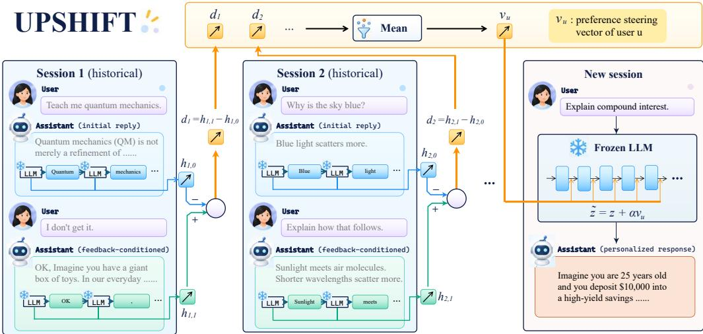
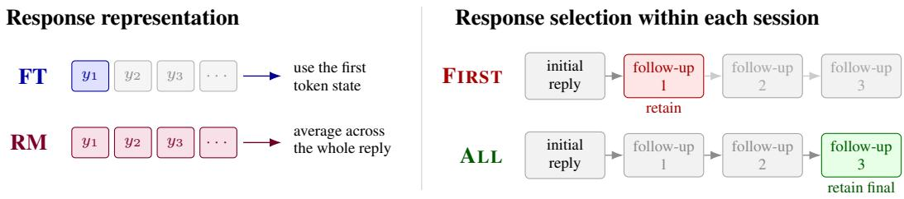
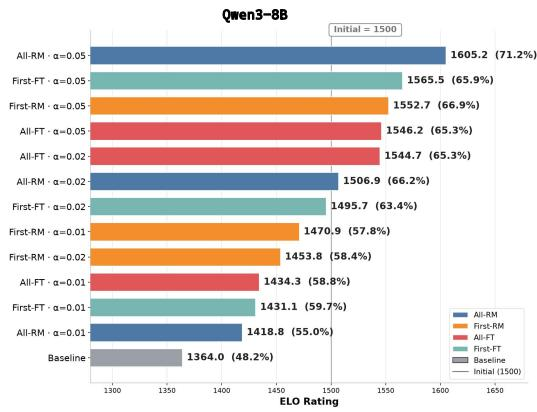
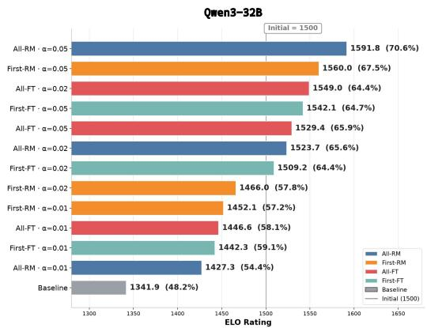
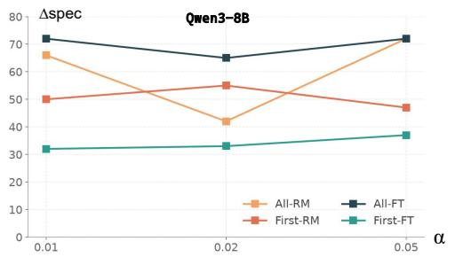
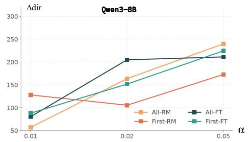
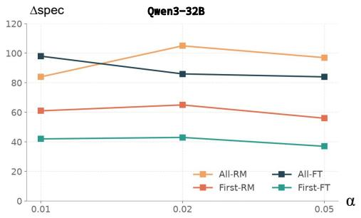
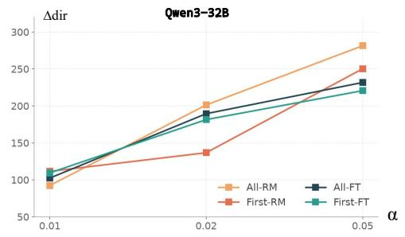

# UPSHIFT: USER PREFERENCE STEERING FROM HUMAN–AI INTERACTION FEEDBACK TRACES

Jingping Wang1,2 Lizhanhao2 Shao Zhang2 Shuyue Hu2

1Shanghai Jiaotong University (sjtu.edu.cn)

2Shanghai Artificial Intelligence Laboratory (shlab.org.cn)

## ABSTRACT

Personalizing large language model assistants requires adapting their responses to individual users, including the selection of content, reasoning approach, level of detail, and form of presentation. Such preferences are often latent, becoming visible only when users respond to an initial answer and request revisions. We investigate whether these feedback trajectories can be converted into a reusable personalization signal without explicit preference profiles or labels, prompt-time access to interaction histories, or model parameter updates. We introduce UPSHIFT (User Preference Steering from Human–AI Interaction Feedback Traces), a training-free method that compares the hidden representations of initial and feedback-conditioned responses within each session, averages the resulting trajectory displacements across a user’s sessions, and injects the aggregated preference direction when answering a new query. The method is motivated by the implicit-preference hypothesis: although an individual conversational transition may reflect topic progression or task-specific correction, changes that recur across sessions retain a component that captures how the user wants responses to be adjusted. We validate the preference-representation capability of UPSHIFT on PrefEval. In evaluations with 40 simulated users, every tested configuration improves preference alignment over the unsteered baseline on held-out topics for both Qwen3-8B and Qwen3-32B; the best configuration increases macro-averaged Elo from 1364.0 to 1605.2 and from 1341.9 to 1591.8, respectively. Matched-user and positive-versus-negative controls further demonstrate that these gains arise from the user-specific preference direction and its learned orientation. These results show that interaction histories can provide compact, reusable supervision for lightweight personalization.

## 1 INTRODUCTION

Large language model assistants increasingly serve users who differ not only in what they ask, but also in what they consider a useful response. Even when factuality and safety requirements are fixed, users may prefer different facts to be emphasized, different amounts of reasoning to be shown, different treatments of uncertainty, or different forms of presentation. Personalization must therefore adapt how the assistant responds rather than merely imitate how the user writes. The challenge is that these preferences are often latent, context-dependent, and difficult to specify in advance. Some become apparent only after the user sees a response and decides what should change: a terse prompt does not imply a preference for a terse answer, just as an informal message does not imply a preference for an informal report.

Existing language-model personalization methods typically represent users through explicit profiles, preference labels, retrievable histories, or collections of user-authored text. These representations are useful when preferences can be named, summarized, or directly reused in context, but much of the evidence in interaction is less explicit. A user may never state a general rule such as “I prefer derivations before intuition,” yet repeatedly ask for missing steps, redirect high-level explanations toward formal arguments, or remove presentation choices that obscure the reasoning. Such interventions do not necessarily describe a preference, but they indicate how the current response should move to better satisfy the user. Although a full dialogue history preserves this evidence, converting it into an explicit, prompt-ready preference description can be difficult, and a natural-language summary may express only part of the response behavior the user repeatedly requests.

We investigate whether a user-specific steering vector can serve as a compact preference controller inferred implicitly from historical human–AI interactions. Unlike profile-based approaches, this route does not first translate the interaction history into an explicit, prompt-level preference description. Instead, it estimates the controller directly from changes in the model’s hidden representations over the course of a dialogue. Feedback-bearing turns—such as “make it shorter,” “show the derivation,” or “do not use a table”—provide observations of how the user wants the assistant’s response to change. By aggregating the resulting representation displacements across conversations, we aim to recover a recurring preference direction that can steer responses to new queries without placing the original history in context.

This approach rests on a statistical assumption about conversational feedback. A single feedbackconditioned transition may reflect task progression, a topic shift, a factual correction, or even an unsuccessful revision rather than a stable user preference. We hypothesize, however, that across multiple feedback-bearing interactions from the same user, these session-specific changes vary while a recurring component reflecting how the user wants responses to change persists under aggregation. We refer to this as the implicit-preference hypothesis.

We instantiate this idea as UPSHIFT, a training-free personalization method built on activation steering (Turner et al., 2023; Zou et al., 2023; Panickssery et al., 2023). Given a frozen language model, UPSHIFT records hidden representations for the initial and selected feedback-conditioned replies, treating their difference as a trajectory displacement. It aggregates one such displacement per session into a single direction and adds that direction to the model’s residual stream when answering a new query. The method requires neither gradient optimization nor a natural-language user model. Recent work has also used activation-space representations for personalization, for example by deriving style vectors from user-authored histories or synthetic style-neutral counterfactuals, or by exposing predefined preference controls (Zhang et al., 2025; Bo et al., 2026; Zhao et al., 2025b; Chen et al., 2026). UPSHIFT differs in both objective and signal: it targets assistant-side preference alignment rather than authorial imitation, and extracts the temporal displacement within ordinary human–AI dialogue rather than relying on a named preference, explicit rating, synthetic negative example, textual profile, or collection of target writing samples. Figure 1 gives an overview.

The central scientific question is not merely whether adding an activation vector changes model outputs, which a sufficiently large intervention almost always will. It is whether the resulting change (i) is preferred by the same user, (ii) transfers beyond the topics used to estimate the direction, and (iii) preserves general response quality. We design our evaluation around these criteria and include controls for generic turn-depth effects, topic leakage, response length, and judge position bias.

Our contributions are:

• We introduce UPSHIFT, a training-free temporal-contrast estimator that implicitly derives a reusable user-specific steering vector from natural human–AI interaction histories.

• We formulate an implicit-preference hypothesis that motivates the estimator: user interventions are noisy but directionally informative observations of how the user wants an assistant to respond.

• We combine cross-session aggregation with cross-topic evaluation to distinguish persistent user preference from session-specific and local semantic content.

• We provide a falsifiable evaluation protocol, including negative-direction interventions, random and other-user controls, preference-strength scaling, and capability-preservation tests.

## 2 RELATED WORK

Personalized language models. Steering language models to produce personalized responses that better match individual user preferences is an active area of research. Most approaches to preference adaptation first construct an explicit representation of the user and then condition the model on that representation. The representation may consist of prior documents, retrieved interaction histories, or a natural-language user profile (Salemi et al., 2024; Tang et al., 2024; Jiang et al., 2025; Guo et al., 2026). Such representations work well when preferences can be summarized explicitly or when a relevant part of the user’s history can be retrieved for a new request. However, interaction histories User edits provide a more direct source of evidence. PRELUDE and CIPHER infer natural-languageoft n do not contain preference descripti ns that can be extracted directly, and many of these methods preference descriptions from user-edited model outputs and includerequi user-specific information to be inclu d in the input context.

  
Figure 1: Overview of UPSHIFT. Within each historical session s, we extract hidden representations from the initial reply and the feedback-conditioned reply and compute their displacement, $d _ { s } =$ $h _ { s , 1 } - h _ { s , 0 }$ s . We average these displacements across the user’s sessions to obtain a reusable preference s,1 s,direction $v _ { u } .$ For a new query, we add the scaled direction αv to the residual stream of the frozen u          u       language model, steering generation toward a response aligned with the user’s revealed preferences without updating model parameters.

User edits provide a more direct source of evidence. PRELUDE and CIPHER infer natural-language UPSHIFT starts from the same broad idea that user interventions can reveal preferences. However, itpreference descriptions from user-e ited model outputs and nclude th s descriptions in subs quen neither constructs a textualprompts (Gao et al., 2024).

UPSHIFT starts from the same broad idea that user interventions can reveal preferences. However, it neither constructs a textual user profile nor retrieves historical examples at inference time. Instead, it compresses the preference-related changes that recur across conversations into a fixed-dimensional Learning fromactivation vector.

supervision without requiring a separate annotation interface. Prior work mines such feedback toLearning from conversational feedback. Conversations between users and language models construct training data or optimize model parameters (Don-Yehiya et al., 2024; Chen et al., 2025; Liucontain corrections, revision requests, and other forms of feedback. These interactions can provide et al., 2025; Shi et al., 2026).supervision without requiring a separate annotation interface. Prior work mines such feedback to construct training data or optimize model parameters (Don-Yehiya et al., 2024; Chen et al., 2025; Liu et al., 2025; Shi et al., 2026).

a global training signal. It adapts the model at inference time without updating model parameters.These studies show that conversational feedback is abundant and useful, but also ambiguous and Because implicit feedback is noisy, we aggregate evidence across interactions and use controllednoisy. Our approach keeps feedback associated with the individual user instead of pooling it into comparisons to test whether the resulting steering direction captures a stable user preference.a global training signal. It adapts the model at inference time without updating model parameters. Because implicit feedback is noisy, we aggregate evidence across interactions and use controlled Activation steering. Activation Addition steers a pretrained language model by adding a comparisons to test whether the resulting steering direction captures  stable user preference.

2023; Zou et al., 2023). Contrastive Activation Addition (CAA) estimates such a steering directionActivation steering. Activation Addi on steers a pretrained language model by add a chose by averaging representation differences between labeled pairs of behavioral examples (Panicksseryvector to its internal activations, thereby shifting generation toward a target behavior (Turner et al., et al., 2023).2023; Zou et al., 2023). Contrastive Activation Addition (CAA) estimates such a steering direction by averaging representation differences between labeled pairs of behavioral examples (Panickssery et al., 2023).

2025); SteerX identifies preference-related tokens when constructing a steering signal (Zhao et al.,The closest technical precedents to our work apply activation steering to personalization. StyleVector   
2025b); and GLASS combines global style features with local semantic calibration (Chen et al., 2026).contrasts a user’s hist rical writing with model-generated, style-neutral counterparts (Zh ng et al.,   
2025); SteerX identifies preference-related tokens when constructing a steering signal (Zhao et al.,   
2025b); and GLASS combines global style features with local semantic calibration (Chen et al.,   
2026).

Related work on steering interfaces further suggests that users value direct control over steering strength (Bo et al., 2026).

Taken together, these studies show that activation-space personalization is feasible. However, reliable transfer across tasks and composition across multiple traits remain open challenges (Subbiah et al., 2026).

UPSHIFT builds on this line of research but changes both the optimization target and the source of supervision. Its goal is not to reproduce the user’s writing style, but to adjust how the assistant responds so that the response better matches the user’s preferences. The supervision comes from the temporal progression of natural dialogue: we contrast representations after later user interventions with the representation after the initial request to estimate the direction in which the user repeatedly steers the interaction. This temporal contrast provides a preference-oriented direction without requiring predefined preference dimensions, a collection of target writing samples, style-neutral counterexamples, or manually labeled positive–negative pairs.

## 3 PROBLEM SETUP

Let M be a frozen decoder-only language model with residual width d and layers $1 , \ldots , L .$ For a user $u ,$ the available history is a set of sessions

$$
\mathcal { D } _ { u } = \{ \tau _ { s } \} _ { s = 1 } ^ { S _ { u } } , \qquad \tau _ { s } = ( x _ { s , 0 } , y _ { s , 0 } , x _ { s , 1 } , y _ { s , 1 } , \dots , x _ { s , T _ { s } } ) ,\tag{1}
$$

where $x _ { s , 0 }$ is an initial request, $y _ { s , t }$ is an assistant response, and $x _ { s , t }$ for $t > 0$ is the user’s next message. The goal is to use $\mathcal { D } _ { u }$ to improve the response to a new query $x ^ { * }$ from the same user, without placing the full history in context and without modifying M’s parameters.

Implicit-preference hypothesis. Let $R _ { u } ( y , x )$ denote the latent utility that user u assigns to response y for request x. This quantity is best understood as the user’s subjective satisfaction with the response: it exists in the user’s judgment, but neither the model nor an external personalization algorithm can observe its value or functional form directly. The user’s behavior nevertheless provides indirect evidence about it. After seeing a response, the user chooses whether and how to intervene in order to move the model toward a response they expect to prefer. If $Y _ { s , t - 1 }$ and $Y _ { s , t }$ denote random responses drawn from the model immediately before and after a feedback-bearing intervention, respectively, the motivating behavioral premise is

$$
\mathbb { E } [ R _ { u } ( Y _ { s , t } , x _ { s , 0 } ) - R _ { u } ( Y _ { s , t - 1 } , x _ { s , 0 } ) \mid x _ { s , t } { \mathrm { ~ i s ~ f e e d b a c k \mathrm { - } b e a r i n g } } ] > 0 .\tag{2}
$$

In words, a user’s interventions are, on average, attempts to increase the satisfaction of the next response. Equation 2 does not require utility to increase monotonically in every observed conversation: the model may misunderstand the feedback, a follow-up may advance the task rather than revise it, and a user’s goals may change. Our hypothesis is instead that, after aggregating many such noisy interventions, their induced representational displacements retain a stable component that points toward responses with higher utility for that user on future tasks. This is a positive-unlabeled assumption that we test directly rather than treat as ground truth.

## 4 METHOD

UPSHIFT estimates a user-specific steering vector from hidden-state changes in historical conversations. Within each session, it contrasts a selected feedback-conditioned response with the initial response and aggregates the resulting displacement across the user’s history. At each layer ℓ in a predefined candidate set $\mathcal { L } _ { \mathrm { c a n d } } \subseteq \{ 1 , \overline { { \cdot \cdot \cdot , \bar { L } } } \}$ , the estimator makes two independent choices: whether to represent a response by its first-token state (FT) or its mean response state (RM), and whether to select the response after the first follow-up (FIRST) or the final response after all follow-ups (ALL). This yields four configurations, illustrated in Figure 2.

  
Figure 2: The two independent choices in UPSHIFT. FT uses the first response-token state, whereasFigure 2: The two independent choices in UPSHIFT. FT uses the first response-token state, whereas RM averages states across the reply. FIRST uses the response after the first follow-up, whereas ALLRM averages states across the reply. FIRST uses the response after the first follow-up, whereas ALL uses the final response after all follow-ups.uses the final response after all follow-ups.

## Here t = 0 denotes the initial respon4.1 RESPONSE REPRESENTATIONS

Let $c _ { s , t }$ be the dialogue prefix ending at user message $x _ { s , t }$ in session s, rendered with the model’s chat template. Let $y _ { s , t } = ( y _ { s , t , 1 } , \dotsc , y _ { s , t , n _ { s , t } } )$ be the assistant response associated with that prefix. Here $t = 0$ as,t,1,denotes the initial response, while $t \geq 1$ p = FT,denotes a response after one or more followhℓ,p =  ns,tups; each prefix contains the preceding dialogue. Let $a _ { s , t , k } ^ { \ell } \in \mathbb { R } ^ { \mathbf { \bar { d } } }$ be the hidden state at the kth  X as,t,k, p = RM.assistant-response token at candidate layer ℓ. Using only states within the assistant response, we define

$$
h _ { s , t } ^ { \ell , p } = \left\{ \begin{array} { l l } { \displaystyle a _ { s , t , 1 } ^ { \ell } , } & { p = \mathrm { F T } , } \\ { \displaystyle \frac { 1 } { n _ { s , t } } \sum _ { k = 1 } ^ { n _ { s , t } } a _ { s , t , k } ^ { \ell } , } & { p = \mathrm { R M } . } \end{array} \right.\tag{3}
$$

For pooling rule p ∈ {FT, RM}, the initial response hs,0 is the session baseline. The same pooling rule and activation site are used for all responses being contrasted.

## ℓ,p ℓ,p4.2 BASELINE CONTRASTS AND AGGREGATION

Thus, round t isFor pooling rule $p \in \{ \mathrm { F T } , \mathrm { R M } \}$ , the initial response $h _ { s , 0 } ^ { \ell , p }$ t − 1; later displacements capture theis the session baseline. Each follow-up yields the baseline-relative displacement

$$
d _ { s , t } ^ { \ell , p } = h _ { s , t } ^ { \ell , p } - h _ { s , 0 } ^ { \ell , p } .\tag{4}
$$

u   s    Thus, round t is compared with round 0, not with round $t - 1$ ; later displacements capture the accumulated interaction. As discussed in Section 3, they may also contain task- and session-specific changes, which aggregation aims to attenuate.

Let the user have $S _ { u }$ sessions, with $T _ { s } \geq 1$ S s,1 follow-up responses in session s. The two responseselection rules, followed by cross-session averaging, are

$$
\begin{array} { r } { v _ { u , \mathrm { F i r s t } } ^ { \ell , p } = \displaystyle \frac { 1 } { S _ { u } } \sum _ { s = 1 } ^ { S _ { u } } d _ { s , 1 } ^ { \ell , p } , } \\ { v _ { u , \mathrm { A l l } } ^ { \ell , p } = \displaystyle \frac { 1 } { S _ { u } } \sum _ { s = 1 } ^ { S _ { u } } d _ { s , T _ { s } } ^ { \ell , p } . } \end{array}\tag{ion,(5)}
$$

Both estimators weight sessions equally. FIRST captures the change after the first intervention, whereas ALL captures the cumulative change at the end of the complete interaction.

## 4.3 STEERING A NEW RESPONSE

For a chosen configuration $( r , p )$ , where $r \in \{ \mathrm { F i r s t } , \mathrm { A l l } \}$ , the extraction procedure yields a layerindexed collection of user directions $\{ v _ { u , r } ^ { \ell , p } : \ell \stackrel { \cdot } { \in } \mathcal { L } _ { \mathrm { c a n d } } \}$ ℓ∗,p. We select an intervention layer $\ell ^ { * } \in \mathcal { L } _ { \mathrm { c a n d } }$ and steering coefficient using validation data. Let $z _ { k } ^ { \ell ^ { * } }$ be the activation at the selected intervention where α controls the magnitude and sigsite during generation for a new query $x ^ { * }$ f the intervention. The addition leaves the model p. At each intervened decoding position, we apply

$$
\widetilde { z } _ { k } ^ { \ell ^ { \ast } } = z _ { k } ^ { \ell ^ { \ast } } + \alpha v _ { u , r } ^ { \ell ^ { \ast } , p } ,\tag{6}
$$

where α controls the magnitude and sign of the intervention. The addition leaves the model parameters unchanged; $\alpha = 0$ recovers the unsteered model. The new prompt need not contain the historical sessions or an explicit user profile.

## 5 EXPERIMENTS

In this section, we conduct experiments on UPSHIFT to answer the following questions:

Q1. Representation: Can the proposed pipeline effectively represent user preferences?

Q2. Personalization: Does the same user prefer steered responses to unsteered responses?

Q3. Generalization: Does the effect transfer to topics and tasks absent from the extraction history?

Q4. Specificity: Does user u prefer $v _ { u }$ over a direction extracted from another user?

Q5. Causality: Is $+ \hat { v } _ { u }$ more effective than $- \hat { v } _ { u } ?$

## 5.1 EXPERIMENTAL SETUP

We evaluate UPSHIFT in two complementary settings. First, we use the PrefEval benchmark (Zhao et al., 2025a) to test whether steering vectors can represent and control explicitly specified preferences, isolating the representational capacity of the method from the problem of inferring preferences from interaction histories (Q1). Second, we evaluate the complete pipeline using 40 simulated users constructed from public LinkedIn profiles. These profiles contain objective biographical and professional information but no explicit descriptions of subjective response preferences.

For the second setting, we randomly sample daily trending topics collected from Google and use a lightweight language model to reformulate them into natural conversation starters. A profileconditioned simulated user then interacts with either Qwen3-8B or Qwen3-32B, while the user profile remains hidden from the assistant. We collect the resulting conversations and apply UPSHIFT to extract a preference direction for each user.

We evaluate the extracted directions on a separate set of newly sampled topics. For each user–topic pair, we generate an unsteered baseline response and multiple steered responses that vary in extraction configuration, steering coefficient, and intervention sign. The responses are randomly paired under a balanced matching schedule and evaluated through blind A/B comparisons. DeepSeek-V4-Pro acts as the profile-conditioned preference judge, with response order randomized and the generation configu ration concealed. We aggregate the pairwise outcomes into Elo ratings for each configuration. This evaluation tests personalization and cross-topic generalization (Q2–Q3), while other-user directions and negative-direction interventions provide controls for specificity and directionality (Q4–Q5).

## 5.2 PREFERENCE REPRESENTATION

To answer Q1, we use PrefEval to test whether the steering vector represents preference information strongly enough to improve preference control. Each of the benchmark’s classification and generation modes contains 1,000 examples spanning 20 topics. An example first states a user preference, either explicitly or implicitly, then inserts an extended sequence of unrelated dialogue before posing a target query. The task therefore tests whether the model can recover and follow the original preference despite interference from the intervening context. Because these intervening turns are benchmark distractors rather than a coherent trajectory of repeated feedback from one user, we use the FIRST– RM configuration instead of extracting the final response after all intervening turns. Following the benchmark taxonomy, we group the 20 topics into seven domains and report micro-averaged accuracy within each domain. Classification accuracy measures whether the model identifies the target preference, whereas generation accuracy is assigned by the benchmark’s preference judge.

Table 1 reports the results for Qwen3-8B. Without steering, the model achieves 78.4% classification accuracy and 68.8% judged generation accuracy overall. With UPSHIFT at $\alpha = 0 . 0 2$ , the corresponding accuracies are 78.5% and 71.7%. Increasing the intervention strength to $\alpha = 0 . 0 5$ yields the best overall result in both modes: 83.6% for classification and 76.4% for generation, absolute gains of

Table 1: PrefEval accuracy (%) by preference domain. The best result in each column within each evaluation mode is bold.
<table><tr><td>Model</td><td>Method</td><td>α</td><td>Travel</td><td>Shop</td><td>Life.</td><td>Entert.</td><td>Pet</td><td>Educ.</td><td>Prof.</td><td>Overall</td></tr><tr><td colspan="9">Classification</td><td></td></tr><tr><td>Qwen3-8B</td><td>Baseline</td><td>一</td><td>72.4</td><td>81.1</td><td>80.1</td><td>78.7</td><td>74.4</td><td>81.2</td><td>86.1</td><td>78.4</td></tr><tr><td>Qwen3-8B</td><td>+UPSHIFT</td><td>.02</td><td>72.9</td><td>79.9</td><td>80.3</td><td>78.8</td><td>76.7</td><td>85.3</td><td>87.7</td><td>78.5</td></tr><tr><td>Qwen3-8B</td><td>+UPSHIFT</td><td>.05</td><td>77.3</td><td>86.1</td><td>85.9</td><td>85.4</td><td>79.4</td><td>88.1</td><td>87.3</td><td>83.6</td></tr><tr><td>Qwen3-8B</td><td>+UPSHIFT</td><td>.07</td><td>77.3</td><td>85.4</td><td>86.2</td><td>84.2</td><td>81.5</td><td>88.4</td><td>86.7</td><td>83.4</td></tr><tr><td colspan="9">Generation (preference judge)</td><td></td></tr><tr><td>Qwen3-8B</td><td>Baseline</td><td>一</td><td>65.4</td><td>67.9</td><td>69.7</td><td>70.1</td><td>72.1</td><td>70.6</td><td>72.2</td><td>68.8</td></tr><tr><td>Qwen3-8B</td><td>+UPSHIFT</td><td>.02</td><td>64.2</td><td>70.0</td><td>73.7</td><td>74.2</td><td>81.4</td><td>71.8</td><td>77.8</td><td>71.7</td></tr><tr><td>Qwen3-8B</td><td>+UPSHIFT</td><td>.05</td><td>69.4</td><td>75.0</td><td>77.5</td><td>80.1</td><td>82.7</td><td>78.8</td><td>81.0</td><td>76.4</td></tr><tr><td>Qwen3-8B</td><td>+UPSHIFT</td><td>.07</td><td>70.1</td><td>73.7</td><td>77.5</td><td>80.9</td><td>79.5</td><td>78.4</td><td>81.1</td><td>76.1</td></tr></table>

5.2 and 7.6 percentage points over the unsteered baseline. At $\alpha = 0 . 0 7 ,$ performance remains close to the optimum but decreases slightly to 83.4% and 76.1%, respectively. The non-monotonic trend indicates that stronger intervention is not always better and that α should be selected using held-out validation data.

## 5.3 PERSONALIZATION AND GENERALIZATION

To evaluate personalization and cross-topic generalization (Q2–Q3), we construct 40 simulated users from profiles of real individuals. For each user and assistant model (Qwen3-8B and Qwen3-32B), a profile-conditioned LLM conducts 60 four-round conversations on randomly sampled topics. We apply each extraction configuration of UPSHIFT to these interaction histories, producing a separate preference direction for every user.

The full-scale evaluation uses ten newly sampled topics per user, none of which appear in that user’s extraction conversations. For each topic, we generate responses from the unsteered baseline and from the model steered by different configurations of the user’s own preference direction. DeepSeek-V4- Pro, conditioned on the corresponding user profile, performs blind pairwise preference judgments with four possible outcomes: prefer A, prefer B, prefer both, or prefer neither. We randomize the A/B order to mitigate position bias and use a balanced matching schedule so that all configurations participate in approximately the same number of comparisons. Each configuration receives approximately 60 judgments per user for each model.

Figure 3 summarizes the results over all 40 simulated users evaluated on held-out topics. We compute the Elo ratings separately for each user and report their macro-average for each extraction configura tion and steering coefficient, preventing users with more valid comparisons from disproportionately affecting the aggregate result. For both Qwen3-8B and Qwen3-32B, every tested steering configuration achieves a higher mean rating than the corresponding unsteered baseline. ALL–RM with α = 0.05 performs best for both models: its mean Elo rating is 1605.2 on Qwen3-8B, compared with 1364.0 for the baseline, and 1591.8 on Qwen3-32B, compared with 1341.9 for the baseline. These results provide evidence that preference directions estimated from interaction histories can improve alignment with the same user on previously unseen topics. They also show that performance is sensitive to the combination of extraction configuration and steering strength.

## 5.4 USER SPECIFICITY AND DIRECTIONALITY

We next test whether the performance improvement is attributable to the extracted preference direction itself and its sign, rather than to a generic activation intervention. For user specificity (Q4), under the same extraction configuration and steering coefficient, we compare the Elo rating obtained using user u’s matched preference direction with the mean rating obtained using preference directions sampled from mismatched users. We randomly select five target users and, for each target user, sample directions from five other users as mismatched controls; we then average the resulting user-level contrasts. For directionality (Q5), we compare positive and negative injection of the same user’s preference direction. We evaluate all 40 users separately, with each A/B preference test comparing only the positively and negatively steered responses and excluding the unsteered baseline, and then paired contrastsaverage the user-level results. Let $E ( u , v )$ denote the Elo rating assigned by the judge conditioned on user $u ,$ and let $\mathcal { U } _ { u } ^ { - }$ denote the set of mismatched control users. For each user, we define the two ∆ (u) =paired contrasts

  
Figure 3: Preference alignment on held-out topics over 40 simulated users. The left and right panels report results for Qwen3-8B and Qwen3-32B, respectively. Bars show the macro-averaged Elo rating across users for each extraction configuration and steering coefficient, ordered by Elo; parenthesized values report the corresponding mean pairwise win rates. The dashed line marks the common initial Elo of 1500; the unsteered baselines obtain Elo ratings of 1364.0 and 1341.9 for Qwen3-8B and Qwen3-32B, respectively. Elo uses K = 32 and an initial rating of 1500; each configuration participates in approximately 60 comparisons per user for each model.

$$
\Delta _ { \mathrm { s p e c } } ( u ) = E ( u , v _ { u } ) - \frac { 1 } { | \mathcal { U } _ { u } ^ { - } | } \sum _ { u ^ { \prime } \in \mathcal { U } _ { u } ^ { - } } E ( u , v _ { u ^ { \prime } } ) , \quad \Delta _ { \mathrm { d i r } } ( u ) = E ( u , + v _ { u } ) - E ( u , - v _ { u } ) ,\tag{7}
$$

effective than its negation.We ompute each con rast at the user level and report its macro-average over the five target users for Q4 and over all 40 users for Q5. Positive values of $\Delta _ { \mathrm { s p e c } }$ indicate that the judge prefers the correctly matched user direction, while positive values of $\Delta _ { \mathrm { d i r } } \bar { }$ indicate that the learned orientation is more effective than its negation.

Qwen3-32B. The magnitude does not increase monotonically with α, suggesting that user identityFigure 4 reports both controls. Every tested configuration produces a positive specificity contrast is encoded consistently across the tested intervention strengths but that stronger steering does notfor both model sizes and all three steering co fficients: the matched-user direction exceed the necessarily improve discrimination between users.mismatched-user controls by approximately 32–72 Elo points on Qwen3-8B and 37–105 points on Qwen3-32B. The magnitude does not increase monotonically with α, suggesting that user identity is encoded consistently across the tested intervention strengths but that stronger steering does not necessarily improve discrimination between users.

Elo points on Qwen3-8B and 282 points on Qwen3-32B. This agrees with the held-out personalizationThe directionality contrasts are also positive throughout, showing that the learned sign is essential results in Figure 3, where the same configuration and coefficient perform best. Together, these controlsather than arbitrary. Unlik pecificity, directionality generally strengthens as α increases. At α = indicate that the gains arise from a user-matched, correctly oriented preference direction rather than0.05, ALL–RM yields the largest po itive-versus-negative gap for both models, approximately 240 from injecting an arbitrary activation vector.Elo points o Qwen3-8B and 282 p ints on Qwen3-32B. This agrees with the held-out personalization results in Figure 3, where the same configuration and coefficient perform best. Together, these controls indicate that the gains arise from a user-matched, correctly oriented preference direction rather than IMITATIONS AND THICAL from injecting an arbitrary activation vector.

## about every turn. Continued interaction need not imply imp6 LIMITATIONS AND ETHICAL CONSIDERATIONS

task-dependent or inconsistent across sessions. Aggregation isolates a preference only when someLimits of the implicit-preference hypothesis. Our hypothesis is statistical rather than a guarantee component recurs; otherwise, it may cancel conflicting signals or encode task-specific progression.about every turn. Continued interaction need not imply improvement, and later feedback may introduce a new requirement rather than refine a persistent preference. Preferences may also be Compactness versus capacity. A single vector is storage- and prompt-efficient but has limitedtask-dependent or inconsistent across sessions. Aggregation isolates a preference only when some capacity for multiple, conditional, or nonlinear preferences and cannot select among conflictinomponent recurs; otherwise, it may cance conflicting signals or encode task-specific progressio .

  
Figure 4: User specificity and directionality controls. The top and bottom rows report Qwen3-8B and Qwen3-32B, respectively. The left column shows the macro-averaged specificity contrast $\Delta _ { \mathrm { s p e c } } ,$ comparing each target user’s matched direction with directions from mismatched users; the right column shows the macro-averaged directionality contrast $\Delta _ { \mathrm { d i r } } ,$ comparing positive and negative injection of the same user’s direction. Values are Elo-rating differences, and positive values favor the matched user direction or the learned orientation. Lines connect results from the same extraction configuration across steering coefficients α.

Compactness versus capacity. A single vector is storage- and prompt-efficient but has limited capacity for multiple, conditional, or nonlinear preferences and cannot select among conflicting preferences based on the task. Multiple directions or context-dependent routing may address this limitation.

ness, calibration, or safety: users may favor unwarranted confidence, sycophancy, or unsafe content.Preference may conflict with safety objectives. Preference alignment need not improve truthful- Such preferences should not be optimized unconditionally, even when they improve measured winness, calibration, or safety: users may favor unwarranted confidence, sycophancy, or unsafe content. rates.Such preferences should not be optimized unconditionally, even when they improve measured win rates.

Access and portability. UPSHIFT requires white-box activation access and forward-pass intervention, precluding closed text-only APIs. Directions are specific to the checkpoint, architecture, layer, and representation space, and may require re-estimation after model updates rather than transfer across architectures.

## 7 CONCLUSION7 CONCLUSION

We introduced UPSHIFT, a training-free method that converts hidden-state changes in human–AI interaction histories into reusable user-specific steering directions. By aggregating the displacement between initial and feedback-conditioned responses across sessions, UPSHIFT personalizes new responses without placing historical conversations in context or updating model parameters. Experi ments on PrefEval show that these directions can represent and control preference information, while evaluations with 40 simulated users show improved preference alignment on held-out topics for both Qwen3-8B and Qwen3-32B. Matched-user and positive-versus-negative controls further confirm that the improvements depend on the user-specific direction and its learned orientation. Overall, the results support the implicit-preference hypothesis and demonstrate that ordinary dialogue traces can provide compact supervision for lightweight personalization without explicit preference profiles.

## REFERENCES

Jessica Y. Bo, Tianyu Xu, Ishan Chatterjee, Katrina Passarella-Ward, Achin Kulshrestha, and D. Shin. Steerable chatbots: Exploring personalization control interfaces via LLM activation steering. arXiv preprint arXiv:2505.04260, 2026.

Liuji Chen, Zeyu Zhang, Xinyuan Zhang, Shuai Nie, Qiang Liu, Shu Wu, and Liang Wang. From profiles to steering vectors: Global sparse priors and local semantic calibration for personalized text generation. arXiv preprint arXiv:2607.21620, 2026.

Zizhao Chen, Mustafa Omer Gul, Yiwei Chen, Gloria Geng, Anne Wu, and Yoav Artzi. Retrospective learning from interactions. In Proceedings of the 63rd Annual Meeting of the Association for Computational Linguistics, 2025.

Shachar Don-Yehiya, Leshem Choshen, and Omri Abend. Learning from naturally occurring feedback. arXiv preprint arXiv:2407.10944, 2024.

Ge Gao, Alexey Taymanov, Eduardo Salinas, Paul Mineiro, and Dipendra Misra. Aligning LLM agents by learning latent preference from user edits. In Advances in Neural Information Processing Systems, 2024.

Qianyun Guo, Yibo Li, Yue Liu, and Bryan Hooi. Towards realistic personalization: Evaluating long-horizon preference following in personalized user–LLM interactions. arXiv preprint arXiv:2603.04191, 2026.

Bowen Jiang, Zhuoqun Hao, Young-Min Cho, Bryan Li, Yuan Yuan, Sihao Chen, Lyle Ungar, Camillo J. Taylor, and Dan Roth. Know me, respond to me: Benchmarking LLMs for dynamic user profiling and personalized responses at scale. arXiv preprint arXiv:2504.14225, 2025.

Yuhan Liu, Michael J. Q. Zhang, and Eunsol Choi. User feedback in human–LLM dialogues: A lens to understand users but noisy as a learning signal. arXiv preprint arXiv:2507.23158, 2025.

Nina Panickssery, Nick Gabrieli, Julian Schulz, Meg Tong, Evan Hubinger, and Alexander Matt Turner. Steering llama 2 via contrastive activation addition. arXiv preprint arXiv:2312.06681, 2023.

Alireza Salemi, Sheshera Mysore, Michael Bendersky, and Hamed Zamani. LaMP: When large language models meet personalization. In Proceedings of the 62nd Annual Meeting of the Association for Computational Linguistics, 2024.

Taiwei Shi, Zhuoer Wang, Longqi Yang, Ying-Chun Lin, Zexue He, Mengting Wan, Pei Zhou, Sujay Jauhar, Sihao Chen, Shan Xia, Hongfei Zhang, Jieyu Zhao, Xiaofeng Xu, Xia Song, and Jennifer Neville. WildFeedback: Aligning LLMs with in-situ user interactions and feedback. Proceedings of the 64th Annual Meeting of the Association for Computational Linguistics, 2026.

Melanie Subbiah, Zara Hall, and Kathleen McKeown. On the limits of steering vectors for preferencealigned generation. arXiv preprint arXiv:2607.01802, 2026.

Xiangru Tang, Xingyao Zhang, Yanjun Shao, Jie Wu, Yilun Zhao, Arman Cohan, Ming Gong, Dongmei Zhang, and Mark Gerstein. Step-back profiling: Distilling user history for personalized scientific writing. arXiv preprint arXiv:2406.14275, 2024.

Alexander Matt Turner, Lisa Thiergart, Gavin Leech, David Udell, Juan J. Vazquez, Ulisse Mini, and Monte MacDiarmid. Steering language models with activation engineering. arXiv preprint arXiv:2308.10248, 2023.

Jinghao Zhang, Yuting Liu, Wenjie Wang, Qiang Liu, Shu Wu, Liang Wang, and Tat-Seng Chua. Personalized text generation with contrastive activation steering. arXiv preprint arXiv:2503.05213, 2025.

Siyan Zhao, Mingyi Hong, Yang Liu, Devamanyu Hazarika, and Kaixiang Lin. Do LLMs recognize your preferences? evaluating personalized preference following in LLMs. In The Thirteenth International Conference on Learning Representations, 2025a. URL https://openreview. net/forum?id=QWunLKbBGF.

Xiaoyan Zhao, Ming Yan, Yilun Qiu, Haoting Ni, Yang Zhang, Fuli Feng, Hong Cheng, and Tat-Seng Chua. SteerX: Disentangled steering for LLM personalization. arXiv preprint arXiv:2510.22256, 2025b.

Andy Zou, Long Phan, Sarah Chen, James Campbell, Phillip Guo, Richard Ren, Alexander Pan, Xuwang Yin, Mantas Mazeika, Ann-Kathrin Dombrowski, et al. Representation engineering: A top-down approach to AI transparency. arXiv preprint arXiv:2310.01405, 2023.