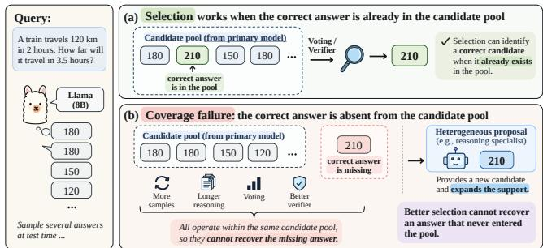
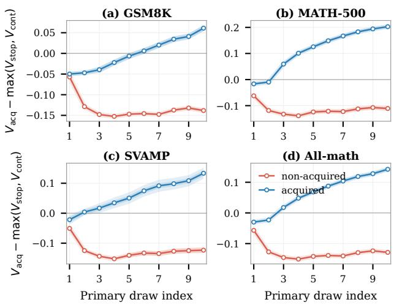
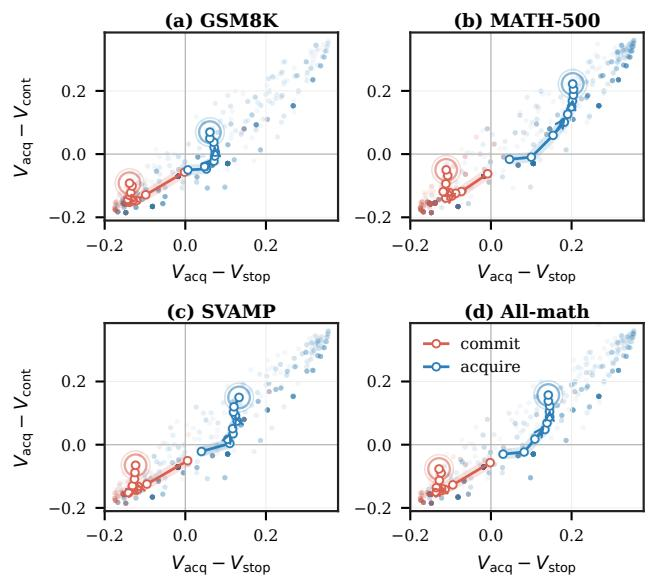
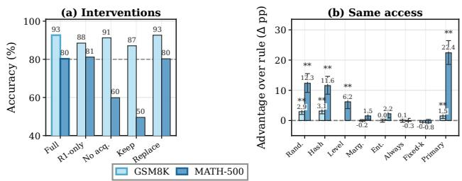

# Value-Conditioned Proposal Acquisition for Test-Time Reasoning

Zeyan Li Shanghai Jiao Tong University Shanghai, China

## Abstract

Sampling and selection spend test-time compute inside a candidate pool, but they cannot recover a correct answer that never enters it. We introduce ValueFormation, a test-time policy that decides after each primary-model draw whether to stop, continue sampling, or acquire one proposal from a heterogeneous reasoning specialist. The three actions are compared on one cost-regularized value scale learned from vote-state features; the calibration is frozen across tasks and primary models, and acquired proposals are accepted only through a frozen posterior comparison. On held-out MATH-500, one Llama-fitted calibration improves over the strongest of eight identically evaluated baselines by more than fifteen points for each of three 8B primaries and transfers unchanged to Qwen3- 14B. Removing acquisition lowers Llama MATH accuracy by 20.43 points, while same-trace and same-access replays attribute the gain to state-conditioned acquisition rather than specialist access alone. Where primary coverage is high, as on GSM8K, acquisition is rare and gains mainly come from cheaper allocation; on MBPP, a fixed code route attains the top accuracy at the lowest interaction cost. Varying the token price monotonically reduces calls without retraining.

## CCS Concepts

• Computing methodologies → Natural language processing;   
Multi-agent systems.

## Keywords

test-time compute, multi-agent systems, large language models, value of information, adaptive sampling

## ACM Reference Format:

Zeyan Li and Jianfeng Xu. 2027. Value-Conditioned Proposal Acquisition for Test-Time Reasoning. In Proc. of the 26th International Conference on Autonomous Agents and Multiagent Systems (AAMAS 2027), Hanoi, Vietnam, 3–7 May 2027, IFAAMAS, 9 pages.

## 1 Introduction

Language agents solve harder problems when they are allowed to spend more computation at inference time [31]. Most of that budget is spent inside one model: it samples several solutions and selects among them by voting [35] or with a trained verifier [7]. A multi-agent alternative is to recruit a diferently trained collaborator that contributes its own proposal [9, 20]. The two currencies are rarely priced against each other: sampling research makes each additional call from the same model cheaper or better timed, while

Jianfeng Xu Shanghai Jiao Tong University Shanghai, China

  
Figure 1: Selection versus coverage failure. Selection works when the correct answer is already in the primary candidate pool; a heterogeneous proposal is useful when the pool lacks that answer.

collaboration research decides whom to invoke without watching how the current attempt is unfolding. This paper treats them as one allocation problem for a single agent under a shared token budget.

Selection, however sophisticated, can only reweight what the current pool contains. Continued stochastic sampling can add new support, but repeated-sampling studies show that coverage on hard problems often grows slowly with budget [3]. Figure 1 illustrates the distinction: voting or verification can identify a correct candidate when it is already present, but cannot recover one that never entered the pool. We call the latter a failure of candidate coverage, distinct from a failure to select a present answer. Coverage failures are dificult to diagnose from agreement alone: a confidently wrong pool can resemble a confidently correct one.

The two bottlenecks require diferent interventions. Better voting or verification addresses selection among present answers. A proposal from a diferently specialized model can instead change the support of the candidate set. This distinction motivates a conditional policy: continue the primary when another draw is valuable, and acquire only when a heterogeneous proposal has higher ex- pected utility.

Existing methods do not make this choice. Those that adapt how much to spend act on the samples of a single model, whether by calibrated stopping [13], budgeted decomposition [24], or vote– verifier aggregation [15, 19, 38]. Those that choose which model to call instead route from the question [27] or escalate a cascade using confidence in an earlier response [4]; neither prices that call against another draw after observing an evolving vote pool. Multiagent systems invite several models to collaborate [9, 20], yet their apparent advantage can disappear when reasoning-token budgets are matched [32].

Between these two lines sits the setting we study: a policy that watches one model’s own samples, detects the state where more of the same will not help, and spends the remaining budget on a diferent kind of call. The open question is whether, under a fixed inference budget, the next call is better spent on one more correlated vote or on a proposal from a model with diferent capabilities.

Our method, ValueFormation, makes this decision on a common value scale. From the current vote histogram it predicts the success of stopping, continuing primary sampling to the cap, and acquiring a reasoning proposal. Each prediction is reduced by the action’s expected token cost under one price �, and the largest utility deter- mines the next call. An acquired proposal is accepted only when frozen posterior evidence favors it over the incumbent leader. The predictors are fitted once on Llama development trajectories pooled across three mathematics tasks, receive no benchmark identity, and are transferred unchanged to Qwen and Ministral primaries. The public code interface selects a fixed code-specialist route for program-synthesis tasks.

The prospective results test both sides of the coverage account. On held-out MATH-500 rows, where primary coverage is scarce, ValueFormation improves over the strongest exact-ID baseline by 17.8 points with a Llama primary, 20.8 with Qwen, and 15.6 with Ministral, and removing acquisition from the Llama policy lowers accuracy from 80.3% to 59.9%. Same-trace and same-access replays attribute this gain to the state-conditioned choice rather than to specialist access: giving every alternative rule the identical payload, integrator, and continuation access still favors the policy by 12.3 points over matched-rate random acquisition, and its acquisitions concentrate on problems whose pool lacks the answer (85% versus 41%). An unconditional control that calls the same specialist once on every problem never exceeds the policy on MATH-500 and scores below it on GSM8K, where primary coverage is already high and the policy instead acquires rarely. The same frozen predictors transfer unchanged to a Qwen3-14B primary, and increasing � reduces realized calls and tokens on every task, as the utility formulation predicts.

Our contributions address these two gaps. First, we separate candidate coverage from candidate selection and formulate het erogeneous collaboration as an action in budgeted metareasoning, making the kind of the next call a decision variable rather than a fixed design choice. Second, we realize that formulation as one task-blind, cost-regularized action-value policy with a monotone cost comparative static; the policy decides from the evolving vote state after problem-specific evidence has accumulated, not in ad- vance from the question alone. Third, we test the resulting pre- dictions prospectively across four primary models: acquisition is load-bearing under a direct intervention, the state-conditioned rule beats every matched-access alternative where coverage is scarce, and the acceptance rule protects the policy under a deliberately weakened specialist.

## 2 Related Work

Test-time compute within one model. The default way to spend inference compute is to sample several solutions from one model and select among them. Self-consistency votes over sampled chains [35]; adaptive stopping decides when the vote has settled and stops drawing [1, 21, 34]; verifiers and process reward models rerank what was sampled [7, 22, 36]. The stopping statistics descend from sequential hypothesis testing [33]. The newest members of this family budget the same-model compute by calibrated confidence, dificulty-adaptive allocation, question decomposition, or principled vote–verifier aggregation [13, 15, 19, 24, 31, 38]. These methods all allocate the same object: samples from one model distribution. Repeated-sampling measurements show that on hard problems the correct answer often never enters the pool at all [3], and no reranker or stopping rule can select an answer that was never sampled. Our work keeps the budgeted-decision frame but changes what is being bought: not only further draws from the same distribution, but proposals from outside it.

Choosing among models and agents. A separate literature chooses which model to call. Learned routers map each question directly to a model [14, 27], while cascades can escalate after scoring an earlier response [4]. Staged collaboration adapts execution through planners over executors [17], adaptive cost-aware selection [37], or roles invited to interact [9, 20, 25, 26, 30, 39]; runtime-eficiency work budgets the token spend of such systems explicitly [23], yet matched-budget studies show that multi-agent architectures need not outperform a single agent when reasoning tokens are held constant [32]. The classical pricing ingredients predate all of this: rational metareasoning prices a costly computation by its expected value [29], and pooling correlated raters with fitted per-source reliabilities is Dawid–Skene [8]. What remains uncombined is the local choice among stopping, another draw from the current model, and one heterogeneous proposal after a vote state has formed. Our pol icy prices exactly those three actions on the evidence accumulated for the current problem.

Program-aided and execution-grounded reasoning. Generating and executing programs grounds answer selection in task-specific feedback: a candidate that runs and passes visible checks carries evidence that merely plausible text does not [6, 10, 18], and voting over code candidates has its own selection dynamics [16]. Our code route uses this feedback where the public interface supplies it, through literal public examples and a fixed specialist route, and the mathematics experiments carry the central acquisition claim.

## 3 Value-Conditioned Team Formation

ValueFormation treats collaboration as a metareasoning decision. After each primary-model draw, it chooses among three actions un- der one utility scale: stop with the current leader, continue primary sampling, or acquire one proposal from a reasoning-specialized model. The policy is calibrated once on disjoint development trajectories and receives no benchmark identity at inference time.

## 3.1 Problem setting

Definition 3.1 (Vote-state episode). For a problem � and primary model �, an episode draws responses from � sequentially, up to a cap of $K = 1 0$ draws and outer hard limits of $B _ { c }$ calls and $B _ { t }$ tokens. Each response is parsed and canonicalized to one answer identity or fails to parse; parsed answers accumulate in a vote histogram A. After each draw $k \geq 1$ , the policy chooses on the basis of the vote histogram alone among returning the incumbent leader (stop), drawing once more from � (primary), and terminating sampling to acquire one proposal from a reasoning specialist (acqire). The episode ends when the policy stops, acquires, or reaches the cap.

Definition 3.2 (Budgeted action policy). Fix a token price $\lambda \geq$ 0. For a policy � that returns answer $a _ { \pi } ( x )$ after spending $t _ { \pi } ( x )$ prompt-plus-completion tokens, its value is

$$
J ( \pi ) = \mathbb { E } \Big [ 1 \{ a _ { \pi } ( x ) \mathrm { c o r r e c t } \} - \lambda t _ { \pi } ( x ) / 1 0 0 0 \Big ] ,\tag{1}
$$

and the budgeted action-selection problem is $\pi ^ { \star } = \arg \operatorname* { m a x } _ { \pi } J ( \pi )$ over policies respecting the caps of Definition 3.1.

Solving Equation 1 exactly requires a model of how future vote states evolve: which answer identities further draws from � would add, and what the specialist would propose. No such model is avail- able at inference time, and estimating one on the target task would itself consume the budget being allocated. ValueFormation there- fore freezes, once and on disjoint development trajectories, one-step surrogates for each action’s success probability and charges every action by its expected token cost under the single price �. The result is a sequential policy that maximizes a conservative one-step utility at every state. Neither the surrogates nor the state carries task identity, so one frozen calibration serves every task and primary model.

The distinctive action is acqire, and it is worth separating from verification before constructing the policy. Verifier methods can recover a correct but outvoted candidate, yet their output remains in the support of the primary pool. ValueFormation changes that support. Section 4.4 intervenes on this distinction in two ways: it removes acquisition prospectively, and it replays the same ac-quired traces while either keeping the primary leader or accepting every parseable proposal. The resulting ladder separates the value of obtaining new candidates from the value of integrating them correctly.

## 3.2 Budgeted action selection

After � draws, write $\hat { y } _ { i }$ for the canonicalized answer of draw � when it parses. The histogram $\mathcal { A }$ is the vote tally

$$
v _ { a } ( k ) = \sum _ { i = 1 } ^ { k } 1 \{ \hat { y } _ { i } = a \} , \qquad n _ { \mathrm { p a r s e } } = \sum _ { a } v _ { a } ( k ) ,\tag{2}
$$

so each parsed response casts exactly one vote. The leader $L _ { k }$ is the identity with the largest count $v _ { 1 } .$ , the runner-up has count $v _ { 2 } ,$ � counts distinct identities, and $\begin{array} { r } { H = - \sum _ { a } \frac { v _ { a } } { n _ { \mathrm { p a r s e } } } \log { \frac { v _ { a } } { n _ { \mathrm { p a r s e } } } } } \end{array}$ is the entropy of the vote distribution — large when votes scatter across answers and zero under unanimity. The policy observes

$$
\begin{array} { r } { z _ { k } = \left[ \frac { k } { K } , \ \frac { n _ { \mathrm { p a r s e } } } { k } , \ \frac { v _ { 1 } } { n _ { \mathrm { p a r s e } } } , \ \frac { v _ { 2 } } { n _ { \mathrm { p a r s e } } } , \ \frac { v _ { 1 } - v _ { 2 } } { n _ { \mathrm { p a r s e } } } , \ \frac { d } { n _ { \mathrm { p a r s e } } } , \ \frac { H } { \log \operatorname* { m a x } ( n _ { \mathrm { p a r s e } } , 2 ) } \right] . } \end{array}\tag{3}
$$

Each component has a decision-relevant reading: $k / K$ is spent effort, how much of the sampling cap remains purchasable; $n _ { \mathrm { p a r s e } } / k$ is parse reliability, since a histogram built from few parses sup- ports weaker vote inferences; $v _ { \mathrm { 1 } } / n _ { \mathrm { p a r s e } }$ and $( v _ { 1 } - v _ { 2 } ) / n _ { \mathrm { p a r s e } }$ are the leader’s share and margin, the primary evidence that stopping is safe; $d / n _ { \mathrm { p a r s e } }$ counts distinct identities; and the entropy ratio bounds overall disagreement in [0, 1], keeping early and late states compa-rable. The representation contains no task or dataset feature. If no draw parses, all vote-derived components are defined as zero.

For each action $a \in$ {stop, primary, acqire}, a regularized logistic model estimates a success probability

$$
\hat { q } _ { a } ( z _ { k } ) = \sigma \big ( w _ { a } ^ { \top } z _ { k } + b _ { a } \big ) , \qquad \sigma ( u ) = \frac { 1 } { 1 + e ^ { - u } } .\tag{4}
$$

The same seven features feed all three predictors, so the actions are compared on one shared representation and each contributes a single interpretable score. The targets have operational meanings. �ˆsto predicts whether the current leader is correct; $\hat { q } _ { \mathrm { p r i m a r y } } ,$ fitted on nonterminal states, predicts whether plurality will be correct at the �-draw cap; and $\hat { q } _ { \mathrm { a c q u i r e } }$ predicts whether a reasoning-specialist proposal is correct. With empirical mean token costs �¯� and $\bar { c } _ { R } ,$ , the action utilities are

$$
\begin{array} { r l } & { U _ { \mathrm { s t o p } } ( z _ { k } ) = \hat { q } _ { \mathrm { s t o p } } ( z _ { k } ) , } \\ & { U _ { \mathrm { p r i m a r y } } ( z _ { k } ) = \hat { q } _ { \mathrm { p r i m a r y } } ( z _ { k } ) - \lambda ( K - k ) \bar { c } _ { P } / 1 0 0 0 , } \\ & { U _ { \mathrm { a c q u i r e } } ( z _ { k } ) = \hat { q } _ { \mathrm { a c q u i r e } } ( z _ { k } ) - \lambda \bar { c } _ { R } / 1 0 0 0 . } \end{array}\tag{5}
$$

Writing $A _ { k }$ for the available actions (all three, except that primary is removed at $k = K )$ , the policy selects

$$
a _ { k } ^ { \star } = \arg \operatorname* { m a x } _ { a \in A _ { k } } U _ { a } ( z _ { k } ) ,\tag{6}
$$

breaking exact ties toward stopping. At least one primary draw is always made before any decision, so the first action choice occurs at $k = 1 , \Lambda$ primary action draws once and recomputes all values, so Equation 5 is a conservative receding-horizon approximation: it charges continuation as if the remaining cap were used even though a later state may stop sooner.

Calibration. The three predictors are fitted on Llama-primary trajectories from rows $3 2 \mathrm { - } 1 2 7$ of GSM8K, MATH-500, and SVAMP, disjoint from every evaluation row. These 288 development prob- lems provide 2,880 stop states, 2,592 primary transitions, and 60 observed reasoning-proposal outcomes. All states are pooled across tasks, which is what makes the predictors task-blind by construc- tion rather than by post hoc filtering. The measured mean costs are 466 tokens for a primary draw and 4,602 tokens for a reasoning pro- posal; the frozen default is $\lambda = 0 . 0 0 2 5$ . Decoding and regularization settings are reported in Section 4.

The predictors need only rank actions under a shared cost scale; they are not required to be calibrated probabilities on every trans- ferred primary. The transfer experiment in Section 4.3 keeps every coeficient and cost fixed when the primary changes to Qwen3-8B or Ministral-8B.

Cost monotonicity. At a fixed state $z _ { k }$ with action scores $\hat { q } _ { a } - \lambda c _ { a }$ and $c _ { \mathrm { s t o p } } = 0 _ { \mathrm { \small s t o p } }$ , increasing the token price cannot switch the argmax to a more expensive action: if $\left| a _ { 1 } \right.$ is optimal at $\lambda _ { 1 }$ and $a _ { 2 }$ is optimal at $\lambda _ { 2 } > \lambda _ { 1 } ,$ , adding the two optimality inequalities gives $( \lambda _ { 2 } - \lambda _ { 1 } ) ( c _ { a _ { 1 } } -$ $c _ { a _ { 2 } } ) \geq 0 ,$ hence $c _ { a _ { 2 } } \leq c _ { a _ { 1 } }$ . Section 4.5 tests the realized implication after sequential state changes: mean calls and tokens should fall as � rises.

## 3.3 Accepting an acquired proposal

Acquisition terminates primary sampling and obtains one proposal from DeepSeek-R1-Distill-Qwen-7B at temperature zero, with an 8,192-token completion cap [11]. The final answer must then be chosen between the incumbent leader and the proposal. Value- Formation makes this choice with a frozen posterior comparison that retains the incumbent unless pooled evidence favors the pro- posal. The comparison is an equal-weight log-opinion pool of three development source profiles.

Each profile contains a wrong-answer concentration parameter �, proposal accuracy $\rho ,$ and an echo rate � measuring how often an incorrect proposal repeats an existing primary error rather than in troduces a new identity. Let � be the incumbent leader, � the parsed proposal, $n = n _ { \mathrm { p a r s e } } $ , and $c = \hat { q } _ { \mathrm { s t o p } } ( z _ { k } )$ the incumbent-confidence prior supplied by the stop predictor; let $v _ { L }$ and �� be the vote counts of the leader and of the pooled answer that � repeats, and let $\eta = 0 . 1$ be the frozen novel-identity mass. Profile $j = ( \alpha _ { j } , \rho _ { j } , \kappa _ { j } )$ fixes a proposal prior mass $m _ { j }$ and a wrong-proposal likelihood $w _ { j }$

$$
( m _ { j } , w _ { j } ) = \left\{ \begin{array} { l l } { \displaystyle \Big ( \frac { v _ { P } } { n - v _ { L } } , ~ ( 1 - \rho _ { j } ) \kappa _ { j } ~ \frac { v _ { P } } { n - v _ { L } } \Big ) , } & { P \in \mathcal { A } , } \\ { \displaystyle \Big ( \frac { \alpha _ { j } } { n + \alpha _ { j } } \eta , ~ ( 1 - \rho _ { j } ) ( 1 - \kappa _ { j } ) \eta \Big ) , } & { P \notin \mathcal { A } , } \end{array} \right.\tag{7}
$$

and its posterior log odds in favor of the incumbent after observing the proposal are

$$
\ell _ { j } = \log \frac { c } { ( 1 - c ) m _ { j } } - \log \frac { \rho _ { j } } { w _ { j } } .\tag{8}
$$

The two cases of Equation 7 encode how much the proposal’s arrival should move the incumbent’s odds. A proposal repeating an identity already in the histogram $( P \in { \mathcal { A } } )$ carries mass proportional to that identity’s share of non-leader votes — an answer the primary itself produced repeatedly is harder to dismiss — while a novel identity $( P \notin \mathcal { A } )$ is a priori implausible, its mass shrinking as the parsed pool grows. The wrong-proposal likelihood applies the same decomposition to failure: a wrong proposal most plausibly echoes one ofthe primary’s existing errors. Equation 8 nets the incumbent’s prior odds $c / ( 1 - c )$ against the proposal’s prior mass and its wrong- to-correct likelihood ratio, so strong incumbent confidence, low proposal plausibility, or easily explained wrongness each favor retaining the leader.

The policy averages the three profiles into a pooled score

$$
\bar { \ell } = \frac { 1 } { 3 } \sum _ { j = 1 } ^ { 3 } \ell _ { j } ,\tag{9}
$$

and retains the incumbent if $\bar { \ell } \geq 0 ,$ returning the proposal oth-erwise. If $P = L$ , the leader is retained directly; a truncated or unparseable proposal carries no evidence and leaves the incum- bent unchanged. The pool is task-blind: no dataset identity selects among the profiles. Supplementary Appendix A gives the frozen profile values and the full calculation.

## 3.4 Algorithm, complexity, and code route

The implementation rebuilds the vote counter and entropy from the parsed prefix after each draw, giving $O ( K ^ { 2 } )$ worst-case state computation; $K = 1 0$ makes this negligible beside inference. Each loop iteration costs one primary call followed by constant-time scoring, so a mathematics episode issues at most � primary draws and at most one specialist call. Evaluating the three linear predictors is constant-time for the fixed seven-dimensional representation, and fusion scores only the incumbent and proposal under three fixed profiles. The control computation adds no model calls. Calibration is a one-time �(��) pass over � development trajectories, followed by small convex logistic fits.

Algorithm 1 ValueFormation inference policy for mathematics.   
1: input: problem �; primary �; cap �; token price �   
2: $\mathcal { A }  \emptyset$   
3: for $k = 1 , \ldots , K$ do   
4: draw one response from � and update answer histogram A   
5: compute $z _ { k }$ by Equation 3   
6: compute available utilities by Equation 5   
7: $a ^ { \star } \gets \arg \operatorname* { m a x } _ { a } U _ { a } ( z _ { k } )$   
8: if $a ^ { \star } =$ stop then   
9: return the primary leader   
10: else if �★ = acqire then   
11: obtain one reasoning proposal   
12: return posterior acceptance decision (Section 3.3)   
13: end if   
14: end for   
15: return the primary leader

Public-interface code route. Code tasks are identified from the public task interface before the mathematics loop. Literal public doctests activate execution-grounded adaptive sampling. Without such examples, the policy returns one proposal from a non-thinking Qwen3-8B code specialist. No generated hidden test, benchmark name, or gold label enters the decision, and the route is fixed across nominal primary models. The mathematics experiments carry the central acquisition claim, since only there do all three actions com- pete under Equation 5; the code route extends the same interface to a task family with executable feedback.

## 4 Experiments

We organize the evaluation around four questions: whether the final unified policy improves over established alternatives, whether its Llama-fitted values transfer to other primaries, whether acquisition is load-bearing, and whether the common token price controls realized cost as predicted.

## 4.1 Experimental setup

Tasks and population. We use GSM8K [7], MATH-500 [12, 22], SVAMP [28], and HumanEval [5]. Calibration uses mathematics rows 32–127. Evaluation uses every public-test row from index 128 onward: 1,191/372/172/36 problems. The three fixed seeds are shared across the final-policy conditions. The code-breadth analysis additionally evaluates the 257-problem sanitized MBPP suite [2] with oficial tests.

Models and budgets. The primary is Llama-3.1-8B-Instruct, Qwen3-8B, or Ministral-8B-Instruct. Qwen runs in non-thinking mode. Mathematics acquisition uses DeepSeek-R1-Distill-Qwen-7B; the code route uses non-thinking Qwen3-8B. Three further models appear only in the transfer, stress, breadth, and payload-swap anal- yses: the larger primary Qwen3-14B (non-thinking; run in thinking mode it also supplies an equal-strength acquisition payload), the weaker payload Qwen3-4B-Thinking-2507, and the weak stress specialist DeepSeek-R1-Distill-Qwen-1.5B. The hard per-problem limits are 13 calls, 40,960 completion tokens, and 98,304 prompt tokens. Development and evaluation trajectories draw from the primary at temperature 0.7 with top-� 0.95 and a 2,048-token completion cap; the logistic predictors use standardized features, an unpenalized intercept, and $\ell _ { 2 }$ regularization with strengths 2, 2, and 4 for the stop, primary, and acquisition models. Unless varied explicitly, $\lambda = 0 . 0 0 2 5$

Table 1: Claim-population accuracy $( \mathbf { m e a n } \pm \mathbf { S D } ,$ %). Bold/underline mark best/second-best; blue marks ValueFormation. Δ best uses problem-cluster 95% intervals.
<table><tr><td></td><td colspan="3">GSM8K</td><td colspan="3">MATH-500</td><td colspan="3">SVAMP</td><td colspan="3">HumanEval†</td></tr><tr><td>Policy</td><td>Llama</td><td>Qwen</td><td>Ministral</td><td>Llama</td><td>Qwen</td><td>Ministral</td><td>Llama</td><td>Qwen</td><td>Ministral</td><td>Llama</td><td>Qwen</td><td>Ministral</td></tr><tr><td>greedy</td><td> $8 6 . 0 1 \pm 0 . 2 6$ </td><td> $8 7 . 3 5 \pm 0 . 4 2$ </td><td> $8 9 . 2 2 \pm 0 . 1 0$ </td><td> $4 9 . 9 1 \pm 0 . 4 1$ </td><td> $5 6 . 2 7 \pm 2 . 1 9$ </td><td>54.39 ±1.33</td><td> $8 3 . 9 1 \pm 0 . 8 9$ </td><td> $8 7 . 4 0 \pm 1 . 6 8$ </td><td> $8 8 . 1 8 \pm 0 . 6 7$ </td><td> $4 1 . 6 7 \pm 0 . 0 0$ </td><td> $5 3 . 7 0 \pm 8 . 0 2$ </td><td>46.30 ±1.60</td></tr><tr><td>sample1</td><td>86.12 ±0.65</td><td>87.83 ±0.91</td><td> $8 7 . 3 5 \pm 0 . 8 4$ </td><td> $4 8 . 5 7 \pm 1 . 4 8 $ </td><td> $5 6 . 4 5 \pm 0 . 9 3$ </td><td>53.85 ±3.00</td><td> $8 1 . 0 1 \pm 1 . 4 6 $ </td><td> $8 7 . 4 0 \pm 0 . 6 7$ </td><td> $8 5 . 8 5 \pm 1 . 4 6$ </td><td> $4 2 . 5 9 \pm 3 . 2 1$ </td><td> $5 2 . 7 8 \pm 2 . 7 8$ </td><td>48.15 ±6.42</td></tr><tr><td>SC-10</td><td> $9 1 . 3 5 \pm 0 . 7 5$ </td><td> $9 1 . 4 6 \pm 0 . 0 5$ </td><td> $9 2 . 3 9 \pm 0 . 1 7$ </td><td> $5 8 . 5 1 \pm 1 . 5 3 $ </td><td> $5 9 . 2 3 \pm 1 . 0 9$ </td><td> $6 1 . 3 8 \pm 1 . 0 9$ </td><td> $8 8 . 5 7 \pm 2 . 0 4 $ </td><td> $9 0 . 5 0 \pm 1 . 2 1$ </td><td> $9 1 . 6 7 \pm 0 . 6 7$ </td><td> $4 7 . 2 2 \pm 0 . 0 0$ </td><td> $4 9 . 0 7 \pm 1 . 6 0$ </td><td>54.63 ±1.60</td></tr><tr><td>ASC</td><td> $9 2 . 0 5 \pm 0 . 2 4$ </td><td> $9 2 . 8 4 \pm 0 . 2 4$ </td><td> $9 2 . 7 8 \pm 0 . 1 7 $ </td><td> $6 1 . 0 2 \pm 0 . 9 3$ </td><td> $6 2 . 5 4 \pm 1 . 1 2$ </td><td> $6 2 . 9 0 \pm 0 . 7 1$ </td><td> $\underline { { 8 9 . 1 5 \pm 0 . 8 9 } }$ </td><td> $9 1 . 2 8 \pm 1 . 0 1 $ </td><td> $9 1 . 8 6 \pm 0 . 5 8 $ </td><td> ${ \underline { { 5 0 . 9 3 \pm 4 . 2 4 } } } $ </td><td> ${ \underline { { 5 4 . 6 3 \pm 5 . 7 8 } } }$ </td><td> $5 1 . 8 5 \pm 1 . 6 0 $ </td></tr><tr><td>ESC</td><td> $9 1 . 8 3 \pm 0 . 2 6$ </td><td> $9 3 . 0 0 \pm 0 . 1 3 $ </td><td> $9 2 . 5 0 \pm 0 . 1 0$ </td><td> $6 2 . 4 6 \pm 0 . 5 6$ </td><td> $6 1 . 6 5 \pm 1 . 3 3$ </td><td>64.25 ±0.71</td><td> $\underline { { 8 9 . 1 5 \pm 0 . 6 7 } }$ </td><td> $9 1 . 2 8 \pm 0 . 5 8 $ </td><td>92.05 ±0.34</td><td> $4 8 . 1 5 \pm 3 . 2 1$ </td><td> $5 1 . 8 5 \pm 4 . 2 4$ </td><td> $5 1 . 8 5 \pm 3 . 2 1$ </td></tr><tr><td>USC</td><td> $8 9 . 2 5 \pm 0 . 1 7$ </td><td> $9 0 . 8 8 \pm 0 . 5 5$ </td><td> $8 9 . 7 3 { \scriptstyle \pm 0 . 2 7 }$ </td><td> $5 3 . 9 4 \pm 4 . 5 0$ </td><td> $6 3 . 3 5 \pm 0 . 4 1$ </td><td>58.69 ±3.02</td><td> $8 4 . 5 0 \pm 1 . 2 1$ </td><td> $8 9 . 1 5 \pm 0 . 8 9$ </td><td> $8 9 . 7 3 { \scriptstyle \pm 0 . 8 9 }$ </td><td> $4 6 . 3 0 \pm 5 . 7 8$ </td><td> $4 8 . 1 5 \pm 4 . 2 4$ </td><td> $5 8 . 3 3 \pm 4 . 8 1$ </td></tr><tr><td>GDV</td><td>92.05 ±0.35</td><td> $9 1 . 4 6 \pm 0 . 3 5$ </td><td> $9 1 . 8 6 \pm 0 . 2 5$ </td><td> $5 9 . 8 6 \pm 2 . 2 9$ </td><td>59.86 ±0.94</td><td>60.30 ±0.86</td><td> $8 8 . 1 8 \pm 0 . 8 9$ </td><td> $9 0 . 1 2 \pm 1 . 5 4$ </td><td> $9 0 . 8 9 \pm 1 . 2 1$ </td><td> $4 2 . 5 9 \pm 1 . 6 0$ </td><td> $5 1 . 8 5 \pm 5 . 7 8$ </td><td> $5 0 . 9 3 \pm 4 . 2 4$ </td></tr><tr><td> $\mathtt { R e A S C }$ </td><td>92.28 ±0.08</td><td> $9 1 . 8 3 \pm 0 . 4 8 $ </td><td> $9 2 . 0 5 \pm 0 . 5 1$ </td><td> $6 0 . 3 9 \pm 0 . 7 8$ </td><td>60.04±0.41</td><td>60.13 ±2.24</td><td> $\mathbf { 9 0 . 1 2 \pm 0 . 5 8 }$ </td><td> $9 0 . 1 2 \pm 1 . 0 1$ </td><td> $9 1 . 4 7 \pm 0 . 8 9$ </td><td> $5 0 . 0 0 \pm 5 . 5 6$ </td><td> $4 9 . 0 7 \pm 5 . 7 8$ </td><td> $5 2 . 7 8 \pm 2 . 7 8$ </td></tr><tr><td>ValueFormation 92.67 ±0.21 94.85 ±0.34</td><td></td><td></td><td> ${ \bf 9 3 . 0 9 \pm 0 . 5 6 }$  </td><td> $\mathbf { 8 0 . 2 9 \pm 1 . 5 3 }$ </td><td>84.14±0.97</td><td>79.84±1.76</td><td>89.15 ±0.67</td><td> $\mathbf { 9 1 . 6 7 \pm 0 . 6 7 }$  </td><td> $9 1 . 2 8 \pm 0 . 5 8 $ </td><td>71.30±1.60 71.30 ±1.60</td><td></td><td>71.30±1.60</td></tr><tr><td>∆ best (95% CI)</td><td>+0.39  $[ - 0 . { \dot { 4 } } 2 , + 1 . 2 0 ]$ </td><td>+1.85  $[ + 0 . 9 0 , + 2 . 8 5 ]$ </td><td>+0.31  $[ - 0 . 5 0 , + 1 . 1 2 ]$ </td><td>+17.83  $\left[ + 1 3 . 1 7 , + 2 2 . 4 9 \right]$ </td><td>+20.79 [+16.31, +25.27]</td><td>+15.59 [+11.29, +19.89]</td><td>-0.97 [-3.88, +1.94]</td><td>+0.39 [-2.52, +3.29]</td><td>-0.78  $\left[ - 2 . 5 2 , + 0 . 7 8 \right]$ </td><td>+20.37  $[ + 5 . 5 6 , + 3 6 . 1 1 ]$ </td><td>+16.67  $\left[ - 0 . 9 3 , + 3 4 . 2 6 \right]$ </td><td>+12.96  $\left[ - 3 . 7 0 , + 2 9 . 6 3 \right]$ </td></tr></table>

Baselines and uncertainty. The frozen comparison bundle contains greedy, one-sample, SC-10, ASC, ESC, USC, GDV, and ReASC under three seeds. For each primary and task, we report the highest baseline accuracy after restricting its saved per-problem outcomes to the exact evaluation IDs. Intervals are 20,000-replicate problem cluster bootstraps of the diference between the two three-seed mean correctness vectors, retaining all seed outcomes per sam-pled problem, so they quantify problem-population uncertainty rather than treating seeds as independent examples. Baseline us- age is recomputed per evaluation ID from the frozen per-problem traces (median over the three seeds), so reported baseline costs are exact-subset costs on the same rows as the policy.

## 4.2 RQ1: Does the unified policy improve the claim population?

Table 1 reports the claim-population comparison. On MATH-500, ValueFormation reaches 80.29%, 17.83 points above ESC, with a 95% interval of [+13.17, +22.49]. HumanEval improves by 20.37 points over ASC on the fixed code route; with 36 problems this serves as breadth evidence, and the mechanism claims below rest on the math- ematics tasks. GSM8K improves by 0.39 points, with an interval that includes zero, while SVAMP is neutral: the Llama/Qwen/Ministral deltas are −0.97, +0.39, and −0.78, and all three intervals include zero.

The margin on MATH-500 lies outside the range that the choice of baseline can explain. Across the eight retained policies, MATH-500 accuracy spans 13.89 points, from 48.57 (one-sample) to 62.46 (ESC); the 17.83-point margin over the strongest of the eight ex-ceeds that entire spread. On GSM8K the arithmetic reverses: the baselines span only 6.27 points and cluster near $^ { 9 2 , }$ and the +0.39 gain sits inside that band. This matches the coverage account of Section 3.1: where ten primary draws usually contain the correct answer, selection alone is nearly suficient, whereas on MATH-500 the incumbent candidate set is often missing the answer that acqui sition can supply — an interpretation the mechanism experiment below tests directly.

This pattern is useful because it separates a performance claim from a mechanism claim. A policy that merely improves selection should help most where the correct answer is already present but hard to identify. Instead, the largest gains appear on the task where the retained baselines difer widely yet still plateau far below the specialist-augmented policy. The small GSM8K and SVAMP deltas are therefore the negative side of the same hypothesis: when pri- mary coverage and existing selection already approach saturation, there is little missing support for acquisition to add.

The Llama policy uses 4.60/4.69/4.27 calls on GSM8K/MATH-500/SVAMP (token means 2,021/5,226/2,159; HumanEval 1.03 calls, 282 tokens) despite allowing ten primary draws and one acquisition: the rule preserves a large benefit where proposal coverage is scarce.

The code-route advantage also holds in breadth: on the 257- problem MBPP suite under free routing (supplementary Appendix F), ValueFormation attains the highest accuracy ofnine methods, 74.19%, at one call and about 40 tokens, with intervals excluding zero against six of eight baselines (+5.71 to +6.36) and the two unresolved methods at nine and eleven calls.

## 4.3 RQ2: Does one calibration transfer across primaries?

Across primaries in Table 1, the strongest transfer pattern is on MATH-500: the same frozen policy improves over the best baseline by 17.83 points for Llama, 20.79 for Qwen, and 15.59 for Ministral; all three intervals exclude zero. Qwen also gains 1.85 points on GSM8K with a positive interval. Llama and Ministral show small, unresolved GSM8K gains, and all three SVAMP deltas are unre- solved. The MATH margins are not an artifact of weak baseline ceilings: Ministral’s strongest baseline (ESC, 64.25) is the highest of the three primaries, yet its gain is still 15.59 points, and the smallest interval lower bound across primaries (+11.29) exceeds every non-MATH gain in the table. In absolute terms Qwen benefits most, reaching 84.14 on MATH-500 against its own best baseline of 63.35.

Model identity changes while the full policy does not: the frozen package retains a recurring MATH advantage across primaries, with smaller and less uniformly resolved gains on high-coverage mathe- matics tasks. Across the nine mathematics settings the transferred policy uses 4.18–4.86 calls and 1,692–5,226 tokens per problem (sup- plementary Appendix C), retaining the cost profile of the Llama campaign. On HumanEval the transfer is exact by construction: the fixed code route resolves 35 of 36 problems through the shared code specialist without primary sampling, so both transferred primaries reproduce the Llama per-seed accuracies (mean 71.30 at 1.03 calls), +16.67 [−0.93, +34.26] over the best Qwen baseline and +12.96 [−3.70, +29.63] over the best Ministral baseline; with 36 problems these intervals include zero, so the HumanEval transfer remains breadth evidence.

The cross-primary result also constrains what can explain the MATH gains. The policy receives no primary-model identifier, and the value models are not refit when answer style, token length, and baseline strength change. If the learned rule were only exploiting idiosyncrasies of Llama development traces, the transferred rows would be expected to lose both accuracy and cost discipline. In- stead, the same qualitative operating point recurs: a few primary samples are collected, acquisition is purchased on dificult states, and the final cost stays far below exhaustive self-consistency or verifier-heavy baselines. This is the main evidence that the state representation captures a portable signal rather than a memorized task route.

The same untouched policy transfers to a fourth, larger pri- mary: on Qwen3-14B (non-thinking) over the identical claim rows it reaches 95.83 GSM8K and 84.86 MATH-500 (three seeds) at 4.20/4.26 calls and 1,849/4,479 tokens, beating the unconditional R1-only control by +7.33 [+5.74, +8.98] and +3.67 [+1.08, +6.36] (supplementary Appendix F). With this stronger primary the conditional policy exceeds the always-on specialist on both tasks, and the 84.86 exceeds every Qwen3-8B exact-ID baseline by more than 21 points.

## 4.4 RQ3: Is acquisition load-bearing?

Removing acquisition reduces Llama MATH accuracy from 80.29% to 59.86%, a 20.43-point efect with interval [+16.85, +24.19], while GSM8K falls by 1.40 points $\left[ + 0 . 6 2 , + 2 . 2 1 \right]$ . The complementary R1-only control clarifies the mechanism: one greedy specialist call scores 81.18 on MATH-500, statistically tied with the Llama policy, but only 88.50 on GSM8K, 4.17 points below the policy. Acquisition is therefore load-bearing when the primary candidate set lacks coverage; when primary coverage is already high, the value is conditional allocation rather than always-on specialization.

A coverage cross-tabulation locates where the rule spends. On MATH-500 the independent no-acquisition pool lacks a correct candidate on 28.85% of rows; the policy acquires on 85.09% of those rows, versus 40.81% when the pool already contains the answer, and fires on 94.67% of rows where the specialist supplies the missing an-swer. GSM8K shows the same direction at lower rate because 96.31% of pools already contain the answer (supplementary Appendix G).

Figures 2 and 3 visualize the same allocation geometry. Trajectories that eventually acquire move into the region where acquisition beats both stopping and continuing, and their draw-index curves cross into positive acquisition advantage as evidence accumulates. These plots are diagnostics; the efect sizes come from the ablations and replays.

The diagnostics are useful for ruling out two simpler readings. The policy does not acquire immediately on every dificult-looking problem; it waits for the primary pool to reveal whether the leader is stable, whether alternatives are accumulating, and whether another same-model draw is likely to resolve the state. Acquired trajectories therefore mark a movement from ambiguity toward positive

Figure 2: Inference trajectories in value-state space. Points are primary-sampling prefixes projected onto $V _ { \mathrm { a c q } } - V _ { \mathrm { s t o p } }$ and $V _ { \mathrm { a c q } } - V _ { \mathrm { c o n t } } ;$ arrows show draw-index direction. Blue trajectories acquire; red trajectories commit.

Figure 3: Inference dynamics over primary-sampling prefixes. Curves show mean acquisition advantage, $V _ { \mathrm { a c q } } ~ -$ max $( V _ { \mathrm { s t o p } } , V _ { \mathrm { c o n t } } )$ , with ± one standard error. Blue trajectories acquire; red trajectories commit.

acquisition margin, not a static route chosen from the prompt. Conversely, commit trajectories include both confident stops and states where continuing the primary remains more valuable than buying the specialist. This is the behavior expected from a three-action value policy rather than from a binary specialist detector.

Figure 4 turns this into a compact intervention summary. Panel (a) shows that removing acquisition creates the large MATH gap and that replace-on-parse recovers the full policy on ac- quired traces; panel (b) gives every alternative rule the same trajectories, continuation access, specialist payload, and posterior integrator. The shared-payload policy anchor is 93.06/81.81 on GSM8K/MATH-500; rule scalars are calibrated on a disjoint hash split and the 15-comparison family is corrected by Holm and per-dataset Westfall–Young max-� (supplementary Appendix G).

  
Figure 4: Acquisition interventions and same-access rules. Left: Llama-primary accuracies. Right: ValueFormation advantage over each shared-payload rule. Intervals are problemcluster 95% CIs; ∗/∗∗ denote max-� < 0.05/0.01.

The state-conditioned rule is strongest where coverage is scarce. On MATH-500 it beats matched-rate random acquisition by 12.31 points [+9.32, +15.50], identity-hash selection by 11.56, level routing by 6.18, and primary-only by 22.40; these survive the corrected max-� tests. On GSM8K the corrected wins are smaller, against random (+2.92), hash (+3.13), and primary-only (+1.51), while mar-gin/entropy thresholds tie it and always-acquire matches accuracy at 35% more tokens. The rule-level account is thus causal: scarce- coverage rows require state-conditioned selection, whereas saturated rows mainly require cheap allocation.

Two alternatives are especially important. Always acquiring tests whether the specialist should simply be called by default; it is com- petitive only when the primary is already strong enough that extra calls rarely change the answer, and it spends more tokens in that regime. Primary-only tests the opposite story, that enough same-model samples substitute for heterogeneity; it remains far behind on MATH-500 under the same trace budget. The useful behavior is therefore neither “always collaborate” nor “sample deeper”, but a switch conditioned on the current pool’s evidence.

Fixed-trajectory replays isolate the acquired answer from the choice to acquire. On MATH-500, keeping the primary leader on acquired traces scores 49.55%, whereas replacing with every complete parseable proposal reaches 80.29%, exactly matching the full policy; GSM8K shows the same equality. These acceptance decisions are not fragile: 1,114 genuine proposal comparisons have median pooled log-odds margin −3.20 and at most one decision flips under 20% profile perturbations. Under a much weaker specialist, the posterior rule still beats keep-leader in all six cells, while an equal-strength Qwen3-14B payload replays MATH-500 to 81.36 versus the deployed 81.81. Finally, refitting the acquisition predictor on 1,790 rebuilt outcomes changes only 6.85% of visited actions, retains all realized acquisitions, improves pooled MATH-500 by +2.05 [+0.49, +3.71], and reduces mean calls. The acquisition predictor scores acquisition against stopping and continuation, not only against specialist correctness; a probe-only threshold rule that does the latter improves selected rows but withholds from weak-primary rows and trails the policy overall.

Table 2: Cost-weight sensitivity with a Llama primary. Accuracy is mean ± SD; tokens are per problem.
<table><tr><td>Task</td><td>λ</td><td>Accuracy</td><td>Calls</td><td>Tokens / R1 share</td></tr><tr><td>GSM8K</td><td>0</td><td> $9 2 . 8 4 \pm 0 . 1 0$ </td><td>6.14</td><td>2,586 / 15.59%</td></tr><tr><td></td><td>0.0025</td><td> $9 2 . 6 7 \pm 0 . 2 1$ </td><td>4.60</td><td>2,021 / 15.00%</td></tr><tr><td></td><td>0.005</td><td> $9 2 . 5 0 \pm 0 . 4 6$ </td><td>2.70</td><td>1,314 / 12.90%</td></tr><tr><td>MATH-500</td><td>0</td><td> $8 0 . 0 2 \pm 0 . 6 8$ </td><td>5.38</td><td>5,656 / 55.82%</td></tr><tr><td></td><td>0.0025</td><td> $8 0 . 2 9 \pm 1 . 5 3$ </td><td>4.69</td><td>5,226 / 53.58%</td></tr><tr><td></td><td>0.005</td><td> $7 6 . 7 9 \pm 1 . 4 8$ </td><td>3.43</td><td> $4 { , } 3 7 5 \mathrm { ~ / ~ } 4 9 { . } 1 9 \%$ </td></tr></table>

## 4.5 RQ4: Does the token price control realized cost?

The realized costs follow the cost-monotonicity argument in Section 3.2. Raisin � from zero to 0.005 reduces mean calls from 6.14 to 2.70 on GSM8K and from 5.38 to 3.43 on MATH-500, and to- ken use falls at every step on both tasks (2,586/2,021/1,314 and 5,656/5,226/4,375). Accuracy responds unevenly. GSM8K varies by only 0.34 points across the sweep. MATH-500 is slightly more accurate at the middle price than at zero (80.29 versus 80.02) while saving 13% of calls and 8% of tokens, and the high price trades a further 3.50 points for another 16% of MATH tokens.

The acquisition share changes less than the number of primary draws: across the sweep the R1 share falls by 2.69 points on GSM8K and 6.63 on MATH-500, while mean calls fall by 56% and 36%. The price therefore acts mainly on continuation, with a modest efect on whether to buy R1, consistent with acquisition being where the policy’s marginal value concentrates. One utility scale thus traces a family of operating points without task-specific routing rules.

On the identical claim rows the strongest Llama GSM8K baseline (ReASC) reaches 92.28 at 2,105 tokens and 5.17 calls, where the policy scores 92.67 at 2,021; on Llama MATH-500 the strongest baseline (ESC) needs 21,319 tokens and 21.6 calls for 62.46, against the policy’s 80.29 at 5,226 — 4.1 times cheaper. Table 3 situates these exact-subset policy costs against every retained policy’s full-test usage for all three primaries. The MATH premium is compositional: the 5,226 tokens split as 2,919 primary plus 2,307 specialist at the 53.58% acquisition rate.

The cost table also shows why calls alone are an incomplete budget measure. Verification-heavy baselines may use few genera- tion calls but spend many accounted tokens through long prompts, repeated completions, or teacher-forcing passes. ValueFormation’s cost advantage comes from shortening both parts of the computa- tion: it stops before the ten-draw cap on easy states and reserves expensive specialist calls for states where the predicted value of new support is high enough to pay for them. The relevant operating point is therefore not the cheapest possible run, but the frontier point that retains the MATH gain while avoiding the cost of apply- ing the specialist or a verifier to every problem.

This matters for deployment because the same accuracy can im- ply diferent usage profiles. Always acquiring fixes the collaboration pattern before observing problem-specific evidence; primary-only deepening keeps the system simple but pays for correlated samples on cases already decided by the early vote state. The value formula tion exposes a single control knob: increasing � moves the operating point toward shorter primary prefixes and fewer specialist calls while leaving the learned predictors unchanged.

Table 3: Inference cost per problem (calls/tokens). Blue marks ValueFormation; baselines use full-test means.
<table><tr><td></td><td colspan="3">GSM8K</td><td colspan="3">MATH-500</td><td colspan="3">SVAMP</td><td colspan="3">HumanEval†</td></tr><tr><td>Policy</td><td>Llama</td><td>Qwen</td><td>Ministral</td><td>Llama</td><td>Qwen</td><td>Ministral</td><td>Llama</td><td>Qwen</td><td>Ministral</td><td>Llama</td><td>Qwen</td><td>Ministral</td></tr><tr><td>greedy</td><td>1.00/364</td><td>1.00/1,740</td><td>1.00/399</td><td>1.00/767</td><td>1.00/2,094</td><td>1.00/641</td><td>1.00/331</td><td>1.00/1,531</td><td>1.00/323</td><td>1.00/283</td><td>1.00/1,755</td><td>1.00/252</td></tr><tr><td>sample1</td><td>1.00/365</td><td>1.00/1,757</td><td>1.00/398</td><td>1.00/774</td><td>1.00/2,099</td><td>1.00/617</td><td>1.00/320</td><td>1.00/1,545</td><td>1.00/309</td><td>1.00/288</td><td>1.00/1,766</td><td>1.00/247</td></tr><tr><td>SC-10</td><td>10.00/3,658</td><td>10.00/17,557</td><td>10.00/3,984</td><td>10.00/7,771</td><td>10.00/20,975</td><td>10.00/6,132</td><td>10.00/3,154</td><td>10.00/15,458</td><td>10.00/3,092</td><td>11.00/3,502</td><td>11.00/18,644</td><td>11.00/3,112</td></tr><tr><td>ASC</td><td>8.03/3,401</td><td>10.51/21,019</td><td>7.35/3,170</td><td>20.15/19,644</td><td>24.65/53,650</td><td>18.99/14,095</td><td>8.33/3,581</td><td>10.70/20,547</td><td>6.36/2,264</td><td>10.29/3,514</td><td>5.27/8,659</td><td>10.56/3,144</td></tr><tr><td>ESC</td><td>8.07/3,450</td><td>14.14/28,672</td><td>6.98/3,038</td><td>21.03/20,838</td><td>28.93/62,812</td><td>19.86/14,849</td><td>8.82/3,981</td><td>12.65/24,638</td><td>6.44/2,326</td><td>10.37/3,598</td><td>5.28/8,640</td><td>10.68/3,155</td></tr><tr><td>USC</td><td>9.00/5,038</td><td>9.00/27,673</td><td>9.00/5,634</td><td>9.00/11,476</td><td>9.00/33,354</td><td>9.00/9,008</td><td>9.00/4,339</td><td>9.00/24,430</td><td>9.00/4,326</td><td>9.00/3,288</td><td>9.00/27,468</td><td>9.00/2,809</td></tr><tr><td>GDV</td><td>10.06/3,759</td><td>10.05/17,658</td><td>10.05/4,024</td><td>10.34/8,677</td><td>10.07/21,123</td><td>10.31/6,556</td><td>10.08/3,284</td><td>10.03/15,557</td><td>10.03/3,112</td><td>11.00/5,087</td><td>11.00/34,002</td><td>11.00/3,325</td></tr><tr><td>ReASC</td><td>5.18/4,233</td><td>6.24/23,787</td><td>4.25/3,637</td><td>8.98/17,152</td><td>11.19/48,265</td><td>8.32/12,199</td><td>4.65/4,053</td><td>6.01/21,230</td><td>3.67/2,564</td><td>6.61/4,093</td><td>4.29/13,686</td><td>6.14/3,325</td></tr><tr><td>ValueFormation</td><td>4.60/2,021</td><td>4.29/1,981</td><td>4.54/2,066</td><td>4.69/5,226</td><td>4.18/4,584</td><td>4.86/4,830</td><td>4.27/2,159</td><td>4.25/1,692</td><td>4.44/1,717</td><td>1.03/282</td><td>1.03/282</td><td>1.03/281</td></tr></table>

Taken together, the four research questions give a consistent failure analysis rather than four independent wins. RQ1 establishes where the policy changes accuracy, RQ2 shows that the useful signal is not tied to one primary model, RQ3 identifies acquisition as the load-bearing action in scarce-coverage rows, and RQ4 shows that the same utility can be priced to control cost. The weak and equal strength payload replays further delimit the claim: ValueFormation is not a promise that any second model helps, nor that acquisition should be used uniformly. It helps when the external proposal is suficiently diferent and when the observed primary pool makes new support more valuable than another correlated draw. That is the operational distinction between adaptive team formation and fixed model routing.

The remaining negative cases are part of the same picture. GSM8K and SVAMP are not strong acquisition benchmarks in this setup because the strongest primary-side baselines already sit near the policy, so stronger selection and earlier stopping dominate the budget calculus. HumanEval and MBPP are reported as interface breadth rather than adaptive-acquisition evidence because the pub- lic code route fixes the specialist decision before the mathematics loop begins. These boundaries keep the empirical claim narrow: the ada tive action olic is su orted where mathematics covera e is scarce, while code tasks show that the same system interface can accommodate a diferent evidence source.

This reading also explains why the cost result should not be reduced to a raw eficiency claim. The policy avoids paying for redundant same-model evidence while preserving the option to buy a qualitatively diferent proposal when the current pool has become uninformative. On saturated tasks, it behaves like a conser- vative stopping rule with occasional acquisition; on MATH-500, the same rule spends more specialist tokens because missing support is much more likely. A fixed router cannot express this distinction after observing the sampled candidates, and a pure sampler cannot change the source of support. The experiment section therefore supports a specific allocation claim rather than a general claim that collaboration is always cheaper or always more accurate.

Validity and boundaries. All 57 registered conditions completed with coverage one and zero model-call errors, totaling 31,338 eval- uated problem instances; the specialist controls, Qwen3-14B transfer, randomized-state probe, weak-specialist replay, MBPP breadth run, complementary-payload replays, and HumanEval transfer also completed without call errors. The claim population is bounded by construction: calibration and evaluation use disjoint rows of related benchmark families, and the code route is fixed capability routing rather than adaptive code acquisition. The acquisition predictor is selection-conditioned, with randomized-state support at AUC 0.653 and 0.636 under a held-out refit. Two reporting asymmetries are worth noting: MATH-500 accuracy carries a token premium over one unconditional specialist call, and Figure 4b’s rule family is multiplicity-corrected while Table 1’s best-baseline selections are not.

## 5 Conclusion

This paper treated test-time collaboration as a value-conditioned choice among stopping, continuing one model, and acquiring a heterogeneous proposal. The starting observation was that selection and coverage are diferent bottlenecks: voting and verification reweight what the candidate pool contains, and neither can recover an answer that never enters it. We found that the vote state itself signals which regime a problem is in, and that one frozen, task-blind calibration is enough to act on that signal.

The resulting policy transfers a large MATH-500 advantage across Llama, Qwen, and Ministral primaries and, unchanged, to Qwen3-14B; the fixed code route also reaches the top MBPP accuracy at the lowest interaction cost. Three interventions tie the gain to the mechanism rather than to specialist access: removing acquisition costs 20.4 Llama MATH points, fixed-trace replay attributes the gain to accepted external proposals, and a same-access replay with identical payload, integrator, and continuation access still favors the state-conditioned rule by 12.3 points over matched-rate random acquisition. A single token price traces cheaper operating points without retraining.

Overall, the results suggest pricing each test-time call by what it can add to the current candidate set rather than committing collaborators in advance. The boundary is equally clear: when primary coverage saturates, acquisition stops paying and value reduces to cheaper allocation.

## References

[1] Pranjal Aggarwal, Aman Madaan, Yiming Yang, and Mausam. 2023. Let’s Sample Step by Step: Adaptive-Consistency for Eficient Reasoning and Coding with LLMs. In Proceedings ofthe 2023 Conference on Empirical Methods in Natural Language Processing. 12375–12396. arXiv:2305.11860. doi:10.18653/v1/2023.emnlpmain.761

[2] Jacob Austin, Augustus Odena, Maxwell Nye, Maarten Bosma, Henryk Michalewski, David Dohan, Ellen Jiang, Carrie Cai, Michael Terry, Quoc Le, and Charles Sutton. 2021. Program Synthesis with Large Language Models. arXiv preprint arXiv:2108.07732 (2021).

[3] Bradley Brown, Jordan Juravsky, Ryan Ehrlich, Ronald Clark, Quoc V. Le, Christo pher Ré, and Azalia Mirhoseini. 2024. Large Language Monkeys: Scaling Inference Compute with Repeated Sampling. arXiv preprint arXiv:2407.21787 (2024).

[4] Lingjiao Chen, Matei Zaharia, and James Zou. 2024. FrugalGPT: How to Use Large Language Models While Reducing Cost and Improving Performance. Transactions on Machine Learning Research (TMLR) (2024). arXiv:2305.05176.

[5] Mark Chen,Jerry Tworek, HeewooJun, Qiming Yuan, Henrique Ponde de Oliveira Pinto, Jared Ka lan, Harri Edwards, Yuri Burda, Nicholas Jose h, Gre Brockman, Alex Ra , Raul Puri, Gretchen Krue er, Michael Petrov, Heid Khlaaf, Girish Sastr , Pamela Mishkin, Brooke Chan, Scott Gra , Nick R der, Mikhail Pavlov, Alethea Power, Lukasz Kaiser, Mohammad Bavarian, Clemens Winter, Philippe Tillet, Feli e Petroski Such, Dave Cummings, Matthias Pla ert, Fotios Chantzis, Elizabeth Barnes, Ariel Herbert-Voss, William Hebgen Guss, Alex Nichol, Alex Paino, Nikolas Tezak, Jie Tan , I or Babuschkin, Suchir Balaji, Shantanu Jain, William Saunders, Christopher Hesse, Andrew Carr, Jan Leike, Josh Achiam, Vedant Misra, Evan Morikawa, Alec Radford, Matthew Knight, Miles Brundage, Mira Murati, Katie Mayer, Peter Welinder, Bob McGrew, Dario Amodei, Sam McCandlish, Ilya Sutskever, and Wojciech Zaremba. 2021. Evaluating Large Language Models Trained on Code. arXiv preprint arXiv:2107.03374 (2021).

[6] Wenhu Chen, Xueguang Ma, Xinyi Wang, and William W. Cohen. 2023. Program of Thoughts Prompting: Disentangling Computation from Reasoning for Numerical Reasoning Tasks. Transactions on Machine Learning Research (TMLR) (2023). arXiv:2211.12588.

[7] Karl Cobbe, Vineet Kosaraju, Mohammad Bavarian, Mark Chen, Heewoo Jun, Lukasz Kaiser, Matthias Plappert, Jerry Tworek, Jacob Hilton, Reiichiro Nakano, Christopher Hesse, and John Schulman. 2021. Training Verifiers to Solve Math Word Problems. arXiv preprint arXiv:2110.14168 (2021).

[8] A. P. Dawid and A. M. Skene. 1979. Maximum Likelihood Estimation of Observer Error-Rates Using the EM Algorithm. Journal of the Royal Statistical Society: Series C (Applied Statistics) 28, 1 (1979), 20–28. doi:10.2307/2346806

[9] Yilun Du, Shuang Li, Antonio Torralba, Joshua B. Tenenbaum, and Igor Mordatch. 2024. Improving Factuality and Reasoning in Language Models through Multiagent Debate. In Proceedings ofthe 41st International Conference on Machine Learning (Proceedings ofMachine Learning Research, Vol. 235). 11733–11763. arXiv:2305.14325.

[10] Luyu Gao, Aman Madaan, Shuyan Zhou, Uri Alon, Pengfei Liu, Yiming Yang, Jamie Callan, and Graham Neubig. 2023. PAL: Program-aided Language Models. In Proceedings ofthe 40th International Conference on Machine Learning (Proceedings ofMachine Learning Research, Vol. 202). 10764–10799. arXiv:2211.10435.

[11] Daya Guo et al. 2025. DeepSeek-R1 Incentivizes Reasoning in LLMs Through Reinforcement Learning. Nature 645 (2025), 633–638. arXiv:2501.12948. doi:10. 1038/s41586-025-09422-z

[12] Dan Hendr cks, Collin Burns, Saurav Kadavath, Akul Arora, Steven Basart, Eric Tang, Dawn Song, and Jacob Steinhardt. 2021. Measuring Mathematical Problem Solving With the MATH Dataset. In Proceedings ofthe Neural Information Processing Systems Track on Datasets and Benchmarks, Vol. 1. arXiv:2103.03874.

[13] Chengsong Huang, Langlin Huang, Jixuan Leng, Jiacheng Liu, and Jiaxin Huang. 2026. CaTS: Calibrated Test-Time Scaling for Eficient LLM Reasoning. In International Conference on Learning Representations (ICLR). OpenReview: jrSc4RJXy1.

[14] Wittawat Jitkrittum, Harikrishna Narasimhan, Ankit Singh Rawat, Jeevesh Juneja, Congchao Wang, Zifeng Wang, Alec Go, Chen-Yu Lee, Pradeep Shenoy, Rina Panigrahy, Aditya Krishna Menon, and Sanjiv Kumar. 2026. Universal Mode Routing for Eficient LLM Inference. In International Conference on Learning Representations (ICLR). arXiv:2502.08773; OpenReview: ka82fvJ5f1.

[15] Peng Kuang, Yanli Wang, Xiaoyu Han, Yaowenqi Liu, Kaidi Xu, and Haohan Wang. 2026. Optimal Aggregation of LLM and PRM Signals for Eficient Test-Time Scaling. In International Conference on Learning Representations (ICLR). arXiv:2510.13918; OpenReview: x85kiYqL4y.

[16] Tim Launer, Jonas Hübotter, Marco Bagatella, Ido Hakimi, and Andreas Krause. 2026. Majority Voting for Code Generation. In ICLR 2026 Workshop on Test-Time Updates. arXiv:2604.15618.

[17] Byeongchan Lee, Jonghoon Lee, Dongyoung Kim, Jaehyung Kim, Kyungjoon Park, Dongjun Lee, and Jinwoo Shin. 2025. Eficient LLM Collaboration via Planning. arXiv preprint arXiv:2506.11578 (2025).

[18] Dacheng Li, Shiyi Cao, Chengkun Cao, Xiuyu Li, Shangyin Tan, Kurt Keutzer, Jiarong Xing, Joseph E. Gonzalez, and Ion Stoica. 2025. S\*: Test Time Scaling for Code Generation. In Findings ofthe Association for Computational Linguistics:

EMNLP 2025. 15964–15978. doi:10.18653/v1/2025.findings-emnlp.865

[19] Jiachun Li, Pengfei Cao, Zhuoran Jin, Yubo Chen, Jiexin Xu, Huaijun Li, Xiaojian Jiang, Kang Liu, and Jun Zhao. 2026. Fixing the Broken Compass: Diagnosing and Improving Inference-Time Reward Modeling. In International Conference on Learning Representations (ICLR). arXiv:2503.05188; OpenReview: hsBBYOqph2.

[20] Junyou Li, Qin Zhang, Yangbin Yu, Qiang Fu, and Deheng Ye. 2024. More Agents Is All You Need. Transactions on Machine Learning Research (TMLR) (2024). arXiv:2402.05120; OpenReview: bgzUSZ8aeg.

[21] Yiwei Li, Peiwen Yuan, Shaoxiong Feng, Boyuan Pan, Xinglin Wang, Bin Sun, Heda Wang, and Kan Li. 2024. Escape Sky-high Cost: Early-stopping Self-Consistency for Multi-step Reasoning. In International Conference on Learning Representations (ICLR). arXiv:2401.10480.

[22] Hunter Lightman, Vineet Kosaraju, Yura Burda, Harri Edwards, Bowen Baker, Teddy Lee, Jan Leike, John Schulman, Ilya Sutskever, and Karl Cobbe. 2024. Let’s Verify Step by Step. In International Conference on Learning Representations (ICLR). arXiv:2305.20050.

[23] Fulin Lin, Shaowen Chen, Ruishan Fang, Hongwei Wang, and Tao Lin. 2026. Stop Wasting Your Tokens: Towards Eficient Runtime Multi-Agent Systems. In International Conference on Learning Representations (ICLR). arXiv:2510.26585.

[24] Junhong Lin, Xinyue Zeng, Jie Zhu, Song Wang, Julian Shun, Jun Wu, and Dawei Zhou. 2026. Plan and Budget: Efective and Eficient Test-Time Scaling on Rea- soning Large Language Models. In International Conference on Learning Representations (ICLR). arXiv:2505.16122; OpenReview: ctspw4CqbS.

[25] Zijun Liu, Yanzhe Zhang, Peng Li, Yang Liu, and Diyi Yang. 2024. A Dynamic LLM-Powered A ent Network for Task-Oriented A ent Collaboration. In Conference on Language Modeling (COLM). arXiv:2310.02170.

[26] Aman Madaan, Niket Tandon, Prakhar Gupta, Skyler Hallinan, Luyu Gao, Sarah Wie refe, Uri Alon, Nouha Dziri, Shrimai Prabhumo e, Yimin Yan , Shashank Gu ta, Bodhisattwa Prasad Majumder, Katherine Hermann, Sean Welleck, Amir Yazdanbakhsh, and Peter Clark. 2023. Self-Refine: Iterative Refinement with Self-Feedback. In Advances in Neural Information Processing Systems, Vol. 36. 46534–46594 rXi :2303 17651 d i:10 52202/075280-2019

[27] Isaac Ong, Amjad Almahairi, Vincent Wu, Wei-Lin Chiang, Tianhao Wu, Joseph E. Gonzalez, M. Waleed Kadous, and Ion Stoica. 2025. RouteLLM: Learning to Route LLMs from Preference Data. In International Conference on Learning Representations (ICLR). arXiv:2406.18665.

[28] Arkil Patel, Satwik Bhattamishra, and Navin Goyal. 2021. Are NLP Models Really Able to Solve Simple Math Word Problems?. In Proceedings ofthe 2021 Conference of the North American Chapter of the Association for Computational Linguistics: Human Language Technologies. 2080–2094. doi:10.18653/v1/2021.naacl-main.168

[29] Stuart Russell and Eric Wefald. 1991. Principles of Metareasoning. Artificial Intelligence 49, 1–3 (1991), 361–395. doi:10.1016/0004-3702(91)90015-C

[30] Noah Shinn, Federico Cassano, Ashwin Gopinath, Karthik Narasimhan, and Shunyu Yao. 2023. Reflexion: Language Agents with Verbal Reinforcement Learning. In Advances in Neural Information Processing Systems, Vol. 36. 8634– 8652. arXiv:2303.11366. doi:10.52202/075280-0377

[31] Charlie Snell, Jaehoon Lee, Kelvin Xu, and Aviral Kumar. 2025. Scaling LLM Test-Time Compute Optimally Can Be More Efective than Scaling Parameters for Reasoning. In International Conference on Learning Representations (ICLR). arXiv:2408.03314; OpenReview: 4FWAwZtd2n.

[32] Dat Tran and Douwe Kiela. 2026. Single-Agent LLMs Outperform Multi-Agent Systems on Multi-Hop Reasoning Under Equal Thinking Token Budgets. arXiv preprint arXiv:2604.02460 (2026).

[33] Abraham Wald. 1945. Sequential Tests of Statistical Hypotheses. The Annals of Mathematical Statistics 16, 2 (1945), 117–186. doi:10.1214/aoms/1177731118

[34] Xinglin Wang, Shaoxiong Feng, Yiwei Li, Peiwen Yuan, Yueqi Zhang, Chuyi Tan, Boyuan Pan, Yao Hu, and Kan Li. 2025. Make Every Penny Count: Dificulty- Adaptive Self-Consistency for Cost-Eficient Reasoning. In Findings of the Association for Computational Linguistics: NAACL 2025. 6904–6917. arXiv:2408.13457. doi:10.18653/v1/2025.findings-naacl.383

[35] Xuezhi Wang, Jason Wei, Dale Schuurmans, Quoc Le, Ed Chi, Sharan Narang, Aakanksha Chowdhery, and Denny Zhou. 2023. Self-Consistency Improves Chain of Thought Reasoning in Language Models. In International Conference on Learning Representations (ICLR). arXiv:2203.11171; OpenReview: 1PL1NIMMrw.

[36] Lunjun Zhang, Arian Hosseini, Hritik Bansal, Mehran Kazemi, Aviral Kumar, and Rishabh Agarwal. 2025. Generative Verifiers: Reward Modeling as Next Token Prediction. In International Conference on Learning Representations (ICLR). arXiv:2408.15240.

[37] Yifan Zhang, Xinkui Zhao, Zuxin Wang, Guanjie Cheng, Yueshen Xu, Shuiguang Deng, and Jianwei Yin. 2025. LightRouter: Towards Eficient LLM Collaboration with Minimal Overhead. arXiv preprint arXiv:2505.16221 (2025).

[38] Yefan Zhou, Austin Xu, Yilun Zhou, Janvijay Singh, Jiang Gui, and Shafiq Joty. 2026. Variation in Verification: Understanding Verification Dynamics in Large Language Models. In International Conference on Learning Representations (ICLR). arXiv:2509.17995; OpenReview: DcEuBwrWnB.

[39] Andrew Zhu, Liam Dugan, and Chris Callison-Burch. 2024. ReDel: A Toolkit for LLM-Powered Recursive Multi-Agent Systems. In Proceedings ofthe 2024 EMNLP System Demonstrations. 162–171. doi:10.18653/v1/2024.emnlp-demo.17