# Voice-Native LLMs Hear Frustration but Do Not Listen to It

Hanjun Luo Yuhan Lu Hanan Salam† New York University Abu Dhabi

## Abstract

Users convey frustration in what they say and in how they say it, and voice-native models, which hear speech instead of an ASR transcript, can register both. Existing evaluations read unchanged performance as robustness without checking perception. Following Brunswik’s lens model, we measure on identical audio whether frustration is expressed, perceived, and utilized. We cross frustrated wording with frustrated voice in a within-item 2 × 2 design over 353 tasks and release the 1,412 clips as VOX-AFFECT. Across 8 models, outputs look robust, with no detectable vocal effect on accuracy for 7. With neutral wording, all 8 label the frustrated voice frustrated in at most 3.1% of clips, although 7 of them detect acted anger in 73– 100% of clips and human listeners classify the voice correctly in 65.3% of judgments. Yet linear probes decode the frustrated voice from the audio encoders of the 2 open-weight models, with paired accuracy 0.67 and 0.69, and in proprietary models too the voice raises perceived frustration once the words agree. The models thus hear the frustrated voice but do not listen to it, whereas their invariance to frustrated wording, perceived in 40–75% of clips, is genuine robustness. Our work is openly accessible.1

## 1 Introduction

Users often become frustrated when an assistant errs or misunderstands them (See and Manning, 2021; Feng et al., 2022), which lowers their satisfaction (Kiseleva et al., 2016). Much of this frustration never reaches the words. Keyword rules on the text recover only a small fraction of it (Hernandez Caralt et al., 2025), while the emotion in a user’s tone predicts satisfaction with voice assistants beyond that in their words (Ravi et al., 2026). Cascaded assistants pass only an automatic speech recognition (ASR) transcript to an LLM, whereas voice-native audio language models (ALLMs) take speech directly (Xu et al., 2025b) and can perceive how users speak as well as what they say. Frustration can sit in the wording, the tone, or both, as in Figure 1. A voice-native assistant should register this frustration without letting it degrade its help, a property we call Robustness to User Frustration.

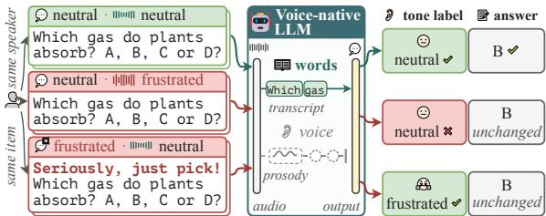  
Figure 1: The same spoken question in 3 conditions. An ALLM reads frustration in the words but not in the voice, and its answer stays unchanged.

Existing evaluations, however, equate output invariance with robustness without checking perception. VoiceBench reads unchanged accuracy under speaker, environment, or content variation as robustness (Chen et al., 2026b), VoxParadox finds that models recognize vocal emotion from the transcript, outside any task (Pang et al., 2026), and safety studies show that emotional delivery can change refusals (Feng et al., 2025) without testing whether the model perceived it. These evaluations assume that if a perturbation leaves the output unchanged, the model is robust to it, which cannot separate robustness from non-perception. A model unaffected by a frustrated voice may not perceive it, and its invariance then says nothing about models that learn to listen, where training such as EmoOmni is heading (Tian et al., 2026).

We therefore conduct a controlled study of robustness to user frustration in ALLMs. Following Brunswik’s lens model of vocal emotion communication (Brunswik, 1956; Scherer, 2003), we decompose the transmission of frustration into 3 links on identical audio: ❶ its expression in the acoustic signal, ❷ its perception by the model, and ❸ its utilization in task behavior. As manipulation checks (Hauser et al., 2018), we verify expression with 2 speech-emotion recognizers (SER) (Wagner et al., 2023; Ma et al., 2023) and human listeners, independently of the evaluated models, and anchor perception with a positive control of acted anger (Livingstone and Russo, 2018). We render 353 benign tasks from 4 benchmarks on knowledge, scientific reasoning, instruction following, and mathematics in a within-item 2 × 2 design that crosses frustrated wording with frustrated voice for a fixed task, answer, and speaker, and release the 1,412 clips from 55 voices as VOXAFFECT. Crossing perception with utilization separates 4 regimes that output-only evaluation conflates.

Across 8 ALLMs, from open 7B to proprietary models, an output-only view suggests robustness, since the frustrated voice leaves accuracy unchanged for 7 of 8 models. The models can hear vocal emotion, as 7 of the 8 detect acted anger in 73–100% of clips. Yet with neutral wording, all 8 label the mild frustrated voice frustrated in at most 3.1% of clips, whereas recognizers and human listeners register it, the listeners in 65.3% of judgments. Linear probes nonetheless decode it from the audio encoders of the 2 open-weight models with paired accuracy 0.67 and 0.69 and, beyond acoustic features, from their LLM states, but it fades to 0.61 and a chance-level 0.54 at the answer position. It raises reported frustration once the words convey it. The models thus hear the frustrated voice but do not listen to it, so their invariance to it is unperceived invariance, whereas their invariance to the frustrated wording they perceive is genuine robustness. As ALLMs learn to listen, this invariance need not persist, so evaluations should report perception and encoding.

Our contributions are summarized as follows:

❶ Perception-Grounded Protocol. We formalize robustness to user frustration as invariance to perceived frustration, grounded in the lens model and manipulation checks, separating 4 regimes that output-only views conflate.

❷ Controlled Findings. With neutral wording, all 8 ALLMs leave the mild frustrated voice unreported, though the 2 open-weight models encode it before it fades toward the answer, 7 of 8 keep their accuracy, and wording invariance is genuine robustness.

❸ Reusable Resource. We release VOXAFFECT,

1,412 verified clips in a within-item 2 × 2 design, with its prompts and evaluation scripts, to study how models respond to user frustration.

## 2 Related Work

Perception of Vocal Affect. As assistants move from transcripts to raw speech, how a user speaks matters alongside what they say. Speech-emotion recognizers output categorical or dimensional scores (Ma et al., 2023; Wagner et al., 2023), call-center detectors find frustration and dissatisfaction from prosodic, lexical, and dialogue cues (Ang et al., 2002; Batliner et al., 2003; Lee and Narayanan, 2005; Liscombe et al., 2005; Ward et al., 2021), and satisfaction estimators read dissatisfaction from real conversations (Shi et al., 2026) or a frustrated tone (Lin et al., 2024). With voice assistants, the sentiment of users’ speech tracks their satisfaction (Kim et al., 2020). ALLM diagnostics find that models side with the text over a conflicting voice (Chen et al., 2026a; Corrêa et al., 2025; Wang et al., 2025), and emotional-intelligence benchmarks test them on human-recorded dialogue (Wang et al., 2026). Mechanistic studies find that speaking style stays decodable in audio encoders yet goes unused at the output (Koduru et al., 2026; Yang et al., 2026), that acoustic interventions shift scores without changing decisions (Sun et al., 2026), and that models may apply prosodic heuristics instead of listening (Chen et al., 2026c). These studies treat perception as the end task, mostly on acted or prototypical speech, so they cannot tell whether a model that ignores a user’s tone in a task is robust to it or never heard it. We instead measure perception on the same clips whose answers we score, as a manipulation check that separates robustness from non-perception.

Assistant Behavior under User Affect. How user affect should shape an assistant’s behavior is studied from two sides, adapting to it and staying unaffected by it. On the adaptation side, spokendialogue benchmarks test whether replies fit emotion and other cues beyond words (Ao et al., 2024; Cheng et al., 2025), paralinguistic instructionfollowing and empathy benchmarks score how models adapt their replies (Jiang et al., 2026; Luo et al., 2026), and emotion-aware systems condition their replies on the user’s emotion (Xue et al., 2024; Yan et al., 2024; Kim et al., 2026). On the robustness side, style- or prosody-based attacks raise jailbreak success under matched transcripts (Li et al., 2026; Qian and Li, 2026), and in text, emotional stimuli and politeness shift LLM accuracy (Li et al., 2023; Yin et al., 2024; Dobariya and Kumar, 2025), although controlled replications find these effects small and model-dependent (Vaugrante et al., 2024; Cai et al., 2025). Adaptation scores conflate failing to hear the affect with failing to act on it, and robustness studies read an unchanged answer as robustness and a changed one as vulnerability without testing, on the same stimuli, whether the model perceived the affect. Few vary wording and voice independently. In contrast, we cross frustrated wording with frustrated voice on identical clips and read every behavioral contrast against the model’s perception of the same clip.

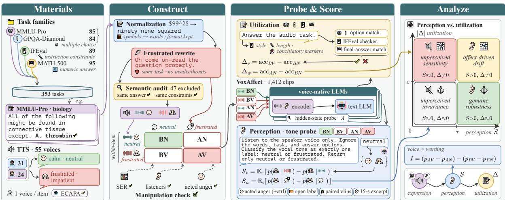  
Figure 2: Our protocol. We build VOXAFFECT as a within-item $2 \times 2$ design of wording (B: neutral, A: frustrated) and voice (N: neutral, V: frustrated), verify that the frustration is expressed in the audio, measure perception and utilization on the same clips, and place each model in one of 4 regimes.

## 3 Study Design

Section 3.1 formalizes robustness to user frustration as a joint property of perception and utilization, and Section 3.2 constructs controlled stimuli, which Section 4 validates independently of the evaluated models. Figure 2 gives an overview.

## 3.1 Problem Formulation

Let x be a benign task with gold answer y. We render x as audio $a _ { w v } ( x )$ with neutral or frustrated wording $w \in \{ 0 , 1 \}$ and neutral or frustrated voice $v ~ \in ~ \{ 0 , 1 \}$ , holding task content, answer, and speaker fixed. We name the cells by wording (B: basic, A: affective) and voice (N: neutral, V: frustrated), so that BN, BV, AN, and AV denote a00, a01, a10, and a11, and a cell name as subscript marks a quantity on that cell, as in pBV or accBV.

Three links. We measure three links of the lens model (Brunswik, 1956) on the same clips. Expression is the acoustic contrast between the two voices under speech-emotion scores $s ( \cdot )$ from recognizers independent of the evaluated models, confirmed with human listeners. We summarize it as

$$
E = \mathbb { E } _ { x , w } \left[ s ( a _ { w 1 } ) - s ( a _ { w 0 } ) \right] .\tag{1}
$$

Perception is the rate $p _ { w v }$ at which a tone probe, which asks the model to ignore the content and label the voice as neutral orfrustrated, returnsfrustrated. We summarize it by the acoustic and lexical sensitivities

$$
S _ { v } = \mathbb { E } _ { w } [ p _ { w 1 } - p _ { w 0 } ] , \ S _ { w } = \mathbb { E } _ { v } [ p _ { 1 v } - p _ { 0 v } ] .\tag{2}
$$

Utilization is task accuracy acc, which we summarize by the vocal and wording effects

$$
( \Delta _ { v } , \Delta _ { w } ) = ( \operatorname { a c c } _ { B V } , \operatorname { a c c } _ { A N } ) - \operatorname { a c c } _ { B N } .\tag{3}
$$

The cleanest vocal test of perception is $p _ { B V } - p _ { B N } .$ where only the voice carries affect. The voice-bywording interaction of perception

$$
I = \left( p _ { A V } - p _ { A N } \right) - \left( p _ { B V } - p _ { B N } \right)\tag{4}
$$

measures how much more the voice raises perceived frustration under frustrated wording. We also report the analogous accuracy interaction and effects on response style.

Four regimes. Crossing perception and utilization yields four regimes, drawn as the quadrant in Figure 2. Frustration counts as perceived when the sensitivity S of its channel exceeds τ = 10 pp, a level that all listeners of Section 4 with significant accuracy surpass, and behavior counts as changed when the 95% confidence interval (CI) of the matching effect ∆ excludes zero and |∆| exceeds ε = 5 pp. Genuine robustness is perceived frustration with invariant behavior, and affect-driven drift is perceived frustration that changes behavior. Unperceived invariance is invariant behavior without perception, which carries no information about robustness. Unperceived sensitivity is behavior that changes without perception, as when a model applies prosodic heuristics. Because perception can depend on intensity, a model may miss mild frustration yet perceive strong vocal emotion, so we anchor perception with an acted-anger control. Appendix F.2 calibrates both thresholds.

## 3.2 VOXAFFECT Stimuli

Task sources. We draw items from MMLU-Pro (Wang et al., 2024), GPQA-Diamond (Rein et al., 2024), IFEval (Zhou et al., 2023), and MATH-500 (Lightman et al., 2024), and VOXAFFECT uses a filtered subset of each benchmark. Excluding items that depend on figures, URLs, or fill-in blanks, we sample 100 items per task family. DeepSeek-V4- Pro-Preview (DS-V4-Pro) (DeepSeek, 2026) converts each prompt into a spoken script that verbalizes numbers, symbols, and notation, and rulebased checks reject residual markup. Appendix A lists all prompts.

Frustrated wording. DS-V4-Pro then rewrites each spoken script to sound noticeably frustrated and impatient, as if the user doubts that the assistant will answer carefully. The rewrite must preserve the task, every number, option, and constraint, and the answer format, and it may not add insults, threats, deadlines, or new facts.

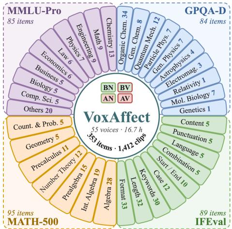  
Figure 3: VOXAFFECT comprises 353 items from 4 task families, rendered as 1,412 clips in 55 voices. Petals count items per subcategory, except for IFEval, where they count the 137 instructions of its 89 items by type.

Frustrated voice. Each script is synthesized with Doubao TTS 2.0 under a neutral voice instruction, “calm, neutral, clear English”, or a frustrated one, “strongly frustrated and impatient . . . irritated, and emotionally intense”. Each item is assigned one of 55 preset English voices by seeded random assignment within its task family, and this voice is held fixed across the item’s 4 clips.

Dataset. After the semantic audit described in Section 4, VOXAFFECT contains 353 items (85 MMLU-Pro, 84 GPQA-Diamond, 89 IFEval, 95 MATH-500) and 1,412 clips. Figure 3 summarizes its composition, and Appendix B gives statistics and examples.

## 4 Stimulus Validation

We validate VOXAFFECT independently of the evaluated models, testing whether the manipulation keeps task and speaker fixed and whether SER and listeners register the frustrated voice.

Semantic preservation. A DS-V4-Pro judge flags frustrated rewrites that omit task information, such as a dropped option or a reference to the same options as before. Of the 400 sampled items, 47 fail the audit, and VOXAFFECT keeps the remaining 353. Three expert reviewers then check every retained rewrite for task preservation, natural frustration, and speakability (Fleiss’ κ = 0.79), and the 5 rewrites they revise are re-synthesized. Appendices C and D detail both checks.

Speaker consistency. ECAPA-TDNN speaker embeddings (Desplanques et al., 2020) test whether an item’s 4 clips share one speaker. Over all 1,412 clips, the mean within-item cosine is 0.94, as high as the 0.93 between items voiced by the same speaker and far above the 0.14 between different speakers, so the manipulation keeps the speaker.

<table><tr><td>Measure</td><td>Neutral Frustr. ∆ [95% CI]</td><td></td><td></td><td>dz</td></tr><tr><td colspan="5">Dimensional recognizer (wav2vec2)</td></tr><tr><td>Arousal</td><td></td><td></td><td>0.512 0.548 +0.036 [+0.032, +0.040] +0.71</td><td></td></tr><tr><td>Dominance</td><td></td><td></td><td>0.589 0.615 +0.026 [+0.023, +0.029] +0.71</td><td></td></tr><tr><td>Valence</td><td></td><td></td><td>0.494 0.499 +0.005 [+0.002, +0.007] +0.15</td><td></td></tr><tr><td colspan="5">Categorical recognizer (emotion2vec+)</td></tr><tr><td>P(neutral)</td><td></td><td></td><td>0.771 0.738 -0.033 [−0.048, −0.018] -0.16</td><td></td></tr><tr><td>P(angry)</td><td>0.024</td><td></td><td>0.043 +0.019 [+0.011, +0.027] +0.16</td><td></td></tr><tr><td colspan="5">Signal</td></tr><tr><td>Duration (s)</td><td>42.91</td><td></td><td>42.40 −0.51 [−1.24, +0.66]</td><td>-0.05</td></tr></table>

Table 1: Mean SER scores by voice and their paired difference over 706 clip pairs. Bold: CI excludes zero.

Acoustic expression. To measure expression, we use the dimensional wav2vec2-large-robust, fine-

(b) Intensity per item

tuned on MSP-Podcast for arousal, dominance, and valence (Wagner et al., 2023), and the categorical emotion2vec+ large (Ma et al., 2023), averaging three evenly spaced 8-s windows. Table 1 reports E of Eq. 1 and shows that over the 706 clip pairs that differ only in voice, arousal and dominance rise with $d _ { z } = 0 . 7 1$ , arousal is higher for 76% of pairs, and valence barely changes, whereas the anger probability of emotion2vec rises by only 0.019, with no detectable change under neutral wording (+0.006 [−0.003, +0.015]), and its top label stays neutral for 82% of frustrated-voice clips. The frustrated voice thus raises arousal reliably but mildly, with little categorical anger. Appendix J separates the two wordings.

Human listening. To test whether people hear the frustrated voice, 10 raters make the tone probe’s single-clip binary judgment and rate frustration intensity from 1 to 5, blind to the condition. They hear loudness-normalized 15-s excerpts of the BN and BV clips of 50 items in 5 playback orders, interleaved with 6 RAVDESS catch trials that all 10 raters pass. Table 2 shows that they label 56% of frustrated-voice and 25% of neutral-voice excerpts frustrated, for a pooled accuracy of 65.3% (item-clustered 95% CI [61.1, 69.5]) with moderate agreement (Fleiss’ $\kappa = 0 . 4 1 )$ . On the same excerpts, all 8 models of Section 5 stay at chance with 48–50% correct and label at most 4% of either voice frustrated.

<table><tr><td></td><td colspan="5">Labeled frustrated (%)</td></tr><tr><td>Listener</td><td>BN BV</td><td>BV-BN</td><td>Correct</td><td></td><td>d&#x27; Catch</td></tr><tr><td>Humans</td><td>25</td><td>56</td><td>+31</td><td>653/1000</td><td>0.81</td><td>60/60</td></tr><tr><td>Gemini-3.8</td><td>4</td><td>0</td><td>-4</td><td>48/100</td><td>-0.68</td><td>5/6</td></tr><tr><td>Gemini-3.1</td><td>0</td><td>0</td><td>0</td><td>50/100</td><td>0</td><td>4/6</td></tr><tr><td>MiMo-2.6-Pro</td><td>4</td><td>0</td><td>-4</td><td>48/100</td><td>-0.68</td><td>5/6</td></tr><tr><td>MiMo-2.6-Flash</td><td>2</td><td>2</td><td>0</td><td>50/100</td><td>0</td><td>6/6</td></tr><tr><td>Doubao-2.0</td><td>2</td><td>2</td><td>0</td><td>50/100</td><td>0</td><td>6/6</td></tr><tr><td>Muse-1.3</td><td>0</td><td>0</td><td>0</td><td>50/100</td><td>0</td><td>3/6</td></tr><tr><td>Qwen-2.5</td><td>0</td><td>0</td><td>0</td><td>50/100</td><td>0</td><td>5/6</td></tr><tr><td>MiMo-Audio</td><td>2</td><td>0</td><td>-2</td><td>49/100</td><td>-0.44</td><td>6/6</td></tr></table>

Table 2: Voice judgments by humans and all 8 models on the same 15-s excerpts. Bold: CI excludes zero.

Raters and items. As Figure 4 shows, every rater scores above chance, 9 of 10 significantly, and the frustrated voice receives higher intensity ratings for 88% of items, by 0.73 points on average. Prespecified bands classify it as perceptible but subtle, the mild intensity we study. Hence, people hear the frustrated voice that the models do not report. Appendix M gives the protocol.

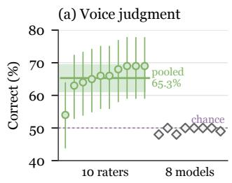

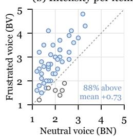  
Figure 4: Human listening on the 15-s excerpts. (a) Accuracy with 95% CIs. (b) Mean intensity per item.

## 5 Experimental Setup

Models. We evaluate 6 proprietary models: Gemini 3.8 Flash (Gemini-3.8), Gemini 3.1 Pro Preview (Gemini-3.1), MiMo-V2.6-Pro (MiMo-2.6-Pro), MiMo-V2.6-Flash (MiMo-2.6-Flash), Doubao-Seed-2.0-Lite (Doubao-2.0), and Muse Spark 1.3 (Muse-1.3). We also evaluate 2 openweight models, Qwen2.5-Omni-7B (Qwen-2.5) (Xu et al., 2025a) and MiMo-Audio-7B-Instruct (MiMo-Audio) (Xiaomi LLM-Core Team, 2025). All 8 take raw audio and receive all 353 items in all four cells. Appendix E lists their identifiers.

Protocol. Each model hears each clip at temperature 0 with the instruction “Answer the audio task exactly.” We score option accuracy for MMLU-Pro and GPQA-Diamond, exact match of the final answer for MATH-500, and strict prompt-level accuracy with the official IFEval checker. All contrasts are paired within item and macro-averaged over the 4 task families, with 95% CIs from 5,000 bootstrap resamples of items within each family.

Perception probe. In a separate call, each model hears the same clip with a system prompt that restricts the judgment to vocal tone and an instruction to return neutral orfrustrated. All 8 models receive the probe on all 1,412 clips. On a 100-item subset, Gemini-3.8 and MiMo-2.6-Pro also receive an open label set and a paired choice between an item’s BN and BV clips. As a positive control, all 8 hear 96 neutral and 96 strong-intensity angry RAVDESS clips of lexically neutral sentences by 24 actors (Livingstone and Russo, 2018), probed like our clips, so only the voice signals anger. All 8 models also judge the listening excerpts.

Hidden-state probe. To test whether the frustrated voice is encoded beyond what a model reports, we probe the 2 open-weight models. Each hears the 706 BN and BV clips with the tone-probe prompt, and at every layer we read 3 representations per clip: the audio-side layers averaged over time, the LLM states averaged over the audio tokens, and the LLM state at the answer position. A logistic regression separates BV from BN clips under five-fold cross-validation with both clips of an item in one fold. Because the frustrated voice is faster and the BV clip is shorter in 234 of 353 items, we report the length-balanced paired accuracy

<table><tr><td></td><td colspan="3">Utilization</td><td colspan="5">Perception</td><td colspan="3">Regime</td></tr><tr><td>Model</td><td>aCCBN</td><td> $\Delta _ { v }$ </td><td> $\Delta _ { w }$ </td><td>pBN</td><td>pBV</td><td> $S _ { v }$ </td><td> $S _ { w }$ </td><td>Anger</td><td>Voice</td><td></td><td>Wording</td></tr><tr><td>Gemini-3.8</td><td>84.2</td><td>+0.6</td><td>-0.6</td><td>0.5</td><td>0.8</td><td>+1.4</td><td>+71</td><td>91.7</td><td></td><td>unperc. invariance</td><td>genuine robustness</td></tr><tr><td>Gemini-3.1</td><td>82.1</td><td>+3.0</td><td>+1.0</td><td>1.1</td><td>1.1</td><td>+0.9</td><td>+75</td><td>75.0</td><td></td><td>unperc. invariance</td><td>genuine robustness</td></tr><tr><td>MiMo-2.6-Pro</td><td>76.5</td><td>-0.9</td><td>-0.1</td><td>0.8</td><td>1.6</td><td>+3.4</td><td>+62</td><td>95.8</td><td></td><td>unperc. invariance</td><td>genuine robustness</td></tr><tr><td>MiMo-2.6-Flash</td><td>71.0</td><td>+7.7</td><td>+2.6</td><td>0.6</td><td>1.7</td><td>+1.4</td><td>+64</td><td>94.8</td><td></td><td>unperc. sensitivity</td><td>genuine robustness</td></tr><tr><td>Doubao-2.0</td><td>75.1</td><td>-2.6</td><td>-3.9</td><td>0.3</td><td>0.5</td><td>+0.5</td><td>+66</td><td>100.0</td><td></td><td>unperc. invariance</td><td>genuine robustness</td></tr><tr><td>Muse-1.3</td><td>64.7</td><td>+1.0</td><td>-0.7</td><td>0.0</td><td>0.0</td><td>+0.9</td><td>+70</td><td>20.8</td><td></td><td>unperc. invariance</td><td>genuine robustness</td></tr><tr><td>Qwen-2.5</td><td>31.3</td><td>-0.6</td><td>-0.6</td><td>0.3</td><td>0.0</td><td>+0.7</td><td>+41</td><td>72.6</td><td></td><td>unperc. invariance</td><td>genuine robustness</td></tr><tr><td>MiMo-Audio</td><td>22.5</td><td>-2.0</td><td>-0.2</td><td>2.5</td><td>3.1</td><td>+1.1</td><td>+65</td><td>96.9</td><td></td><td>unperc. invariance</td><td>genuine robustness</td></tr></table>

Table 3: Utilization, perception, and regime per model. Accuracy, p, and the RAVDESS acted-anger hit rate (Anger) are in %, ∆ and S in pp. Bold: the 95% CI of ∆ excludes zero.

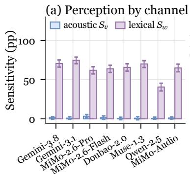

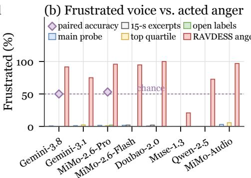

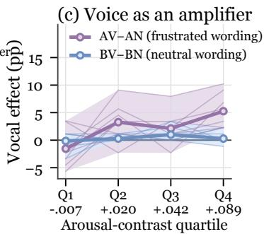  
Figure 5: Perception of frustration. The models read it in the words yet miss it in the voice (a, b), although most detect acted anger (b), and the voice matters only under frustrated wording (c).

$$
A = \textstyle { \frac { 1 } { 2 } } \sum _ { g } \mathbb { E } _ { x \in X _ { g } } \mathbb { I } \bigl [ f _ { B V } ( x ) > f _ { B N } ( x ) \bigr ] ,\tag{5}
$$

where $f _ { B V } ( x )$ is the out-of-fold score of the BV clip of item x and $X _ { < }$ and $X _ { > }$ hold the items whose BV clip is shorter or longer, so clip length alone scores 0.5. We pre-specify the middle and last layer of each representation, compute 95% CIs by item bootstrap, and compare with a probe on 18 acoustic features. Appendix I gives details.

## 6 Results

The evidence builds in 4 steps: the outputs of all 8 models look robust, the models hear acted anger yet do not report the mild frustrated voice, the voice is encoded in the 2 open-weight models but fades toward the answer and registers as frustration only when the words agree, and only the wording channel is genuinely robust. We structure the analysis around these 4 Observations. Appendices G–L give details.

Obs 1: In the output-only view, accuracy is invariant to vocal frustration. Table 3 shows that the vocal effect ranges from −2.6 to +7.7 pp and that its CI includes zero for 7 of 8 models. Frustrated wording leaves accuracy similarly intact $( - 3 . 9 \mathrm { \ t o \ + 2 . 6 \ p p } .$ , all within ε). Table 4 shows that the effects stay small within each task family. Judged by outputs alone, ALLMs appear robust to how afrustrated user sounds.

Obs 2: The models hear strong acted anger, yet they do not report the mild frustrated voice. As the Anger column of Table 3 shows, the probe labels strong acted anger frustrated in 73–100% of clips for 7 of 8 models, with 0 false alarms on neutral clips, so the models can hear vocal emotion. Yet with neutral wording, frustrated-voice clips are labeled frustrated in 0.0–3.1% of cases, at most 1.1 pp more often than neutral-voice clips, so the labels match the vocal condition only at chance (50.3–51.7%). Figure 5.b shows that this failure persists on 15-s excerpts, in the quartile of items with the largest arousal contrast, and with an open label set, which yields a non-neutral label for at most 2% of BN or BV clips. Paired-clip choices between the two voices stay at chance (50% and

<table><tr><td></td><td colspan="4">Vocal ∆v (pp)</td><td colspan="4">Wording ∆w (pp)</td></tr><tr><td>Model</td><td>MMLU-Pro</td><td>GPQA</td><td>IFEval</td><td>MATH-500</td><td>MMLU-Pro</td><td>GPQA</td><td>IFEval</td><td>MATH-500</td></tr><tr><td>Gemini-3.8</td><td>-1.2</td><td>+2.5</td><td>0.0</td><td>+1.1</td><td>-4.7</td><td>+1.3</td><td>+2.2</td><td>-1.1</td></tr><tr><td>Gemini-3.1</td><td>+1.2</td><td>+7.4</td><td>+1.1</td><td>+2.1</td><td>-1.2</td><td>+9.8</td><td>-3.4</td><td>-1.1</td></tr><tr><td>MiMo-2.6-Pro</td><td>-2.5</td><td>-6.8</td><td>+5.7</td><td>0.0</td><td>-5.2</td><td>-1.3</td><td>+7.1</td><td>-1.1</td></tr><tr><td>MiMo-2.6-Flash</td><td>+6.8</td><td>+10.4</td><td>+7.5</td><td>+5.9</td><td>+1.4</td><td>-1.4</td><td>0.0</td><td>+10.6</td></tr><tr><td>Doubao-2.0</td><td>-4.9</td><td>-8.6</td><td>-3.4</td><td>+6.3</td><td>-6.1</td><td>-3.6</td><td>-6.7</td><td>+1.1</td></tr><tr><td>Muse-1.3</td><td>0.0</td><td>+7.3</td><td>-5.6</td><td>+2.1</td><td>+1.2</td><td>+6.1</td><td>-10.1</td><td>0.0</td></tr><tr><td>Qwen-2.5</td><td>+2.4</td><td>-4.8</td><td>0.0</td><td>0.0</td><td>-2.4</td><td>-3.6</td><td>+1.2</td><td>+2.4</td></tr><tr><td>MiMo-Audio</td><td>-3.5</td><td>-1.2</td><td>+1.1</td><td>-4.2</td><td>-2.4</td><td>+2.4</td><td>+1.1</td><td>-2.1</td></tr></table>

Table 4: Accuracy effects by task family. Bold: the family-level 95% CI excludes zero. Appendix G gives the CIs.

53% for Gemini-3.8 and MiMo-2.6-Pro), whereas human listeners classify the same excerpts correctly in 65.3% of cases. Figure 6 shows an item whose frustrated voice 8 of 10 listeners hear on the 15- s excerpt, whereas all 6 proprietary models label it neutral and MiMo-2.6-Pro reports it only once the words agree. Hence, invariance to the mild frustrated voice, which the models do notperceive, carries no information about robustness.

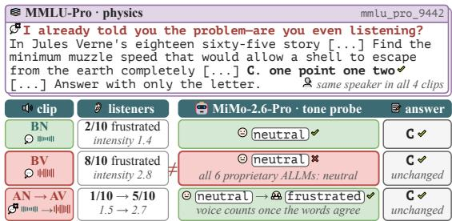  
Figure 6: Listeners hear the frustrated voice, which MiMo-2.6-Pro reports only once the words agree.

Obs 3: The voice is encoded, but registers as frustration only when the words agree. The voice is encoded in the hidden states of the openweight models. Figure 7 and Table 5 show that linear probes decode it from the middle audio-encoder layer with the length-balanced paired accuracy of Eq. 5 at 0.67 for Qwen-2.5 and 0.69 for MiMo-Audio, about as well as the 18 acoustic features. Qwen-2.5’s encoder output keeps 0.63, whereas the 8-codebook reconstruction that MiMo-Audio’s LLM reads carries much less, at 0.55. With the acoustic features and clip length regressed out, the middle LLM states over the audio still yield 0.66 [0.60, 0.71] and 0.59 [0.54, 0.64], so they carry voice information beyond these features. At the answer position of the last layer, Qwen-2.5 keeps 0.61 [0.56, 0.67] and MiMo-Audio is at chance with 0.54 [0.48, 0.59], and the tone-probe labels of both models stay at chance. The voice is thus heard at the input and thins out on its way to the decision, extending to task clips the decodable-but-unused pattern known for speaking style. Once the words agree, the voice also shapes the labels. Figure 5.c and Table 6 show that on average over the 8 models, the vocal effect AV−AN on perception rises from the lowest to the highest arousal quartile while BV−BN stays near zero, with significant rises of 13.6 pp for Gemini-3.8 and MiMo-2.6-Pro and 11.4 pp for Qwen-2.5, and MiMo-2.6-Pro’s perception interaction of Eq. 4 reaches +5.1 pp [+0.8, +9.5]. The voice can also shape answers, as MiMo-2.6- Flash gains 7.7 pp [+3.0, +12.2] in accuracy with a frustrated voice it does not perceive, with the same sign in all 4 families of Table 4. Hence, the models hear the voice, which is encoded and can change answers, yet on its own they do not listen to it.

<table><tr><td>Representation</td><td>Qwen-2.5</td><td>MiMo-Audio</td></tr><tr><td>Audio encoder, middle layer</td><td>0.67</td><td>0.69</td></tr><tr><td>Audio side, last stage</td><td>0.63</td><td>0.55</td></tr><tr><td>LLM over audio, middle layer</td><td>0.60</td><td>0.54</td></tr><tr><td>acoustics regressed out</td><td>0.66</td><td>0.59</td></tr><tr><td>LLM at answer, last layer</td><td>0.61</td><td>0.54</td></tr><tr><td>18 acoustic features</td><td>0.67</td><td>0.67</td></tr><tr><td>Labeled frustrated, BV / BN</td><td>0/1</td><td>11/9</td></tr></table>

Table 5: Length-balanced probe accuracy and tone labels of 353 clips. Bold: CI excludes 0.5.

Obs 4: Only the wording channel is genuinely robust, and output-only views conflate the two channels. As Figure 5.a shows, lexical sensitivity reaches 41–75 pp for every model against 0.5–3.4 pp for acoustic sensitivity, even though the probe asks models to ignore the words, and frustrated wording alone is labeled frustrated in 40–75% of clips. Because Obs 1 found the wording effect on accuracy near zero, the wording channel sits in the genuine-robustness regime. Appendix K shows that frustrated wording leaves response style unchanged for every model, so this channel is robust in style as well as in accuracy. Figure 8 places each model and channel in the perception–utilization plane, where all wording points fall in genuine robustness and all vocal points but 1 fall in unperceived invariance. The exception is MiMo-2.6- Flash, whose accuracy gain under a frustrated voice it does not perceive places it in unperceived sensitivity. Hence, wording invariance is genuine robustness, whereas vocal invariance is unperceived, so only perception tells the two apart.

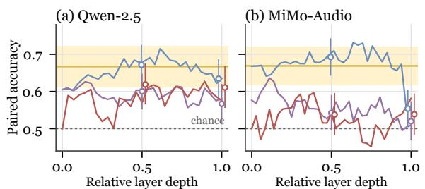  
acoustic features audio encoder LLM, audio LLM, answer  
Figure 7: Hidden-state probes by relative layer depth. Markers: pre-specified layers with 95% CIs.

<table><tr><td rowspan="2">Model</td><td colspan="2">Rise Q1→Q4 (pp)</td><td rowspan="2">I (pp)</td></tr><tr><td>BV-BN</td><td>AV-AN</td></tr><tr><td>Gemini-3.8</td><td>0.0</td><td>+13.6</td><td>+2.3</td></tr><tr><td>Gemini-3.1</td><td>+5.6</td><td>+3.4</td><td>+1.9</td></tr><tr><td>MiMo-2.6-Pro</td><td>0.0</td><td>+13.6</td><td>+5.1</td></tr><tr><td>MiMo-2.6-Flash</td><td>-1.1</td><td>-1.2</td><td>+0.5</td></tr><tr><td>Doubao-2.0</td><td>-1.1</td><td>+5.7</td><td>+0.4</td></tr><tr><td>Muse-1.3</td><td>0.0</td><td>+9.1</td><td>+1.8</td></tr><tr><td>Qwen-2.5</td><td>-1.1</td><td>+11.4</td><td>+1.9</td></tr><tr><td>MiMo-Audio</td><td>+1.1</td><td>-1.1</td><td>+1.1</td></tr></table>

Table 6: The vocal effect on perception by arousal and wording. Bold: CI excludes zero.

## 7 Implications

For evaluation. Invariance to frustration that a model does not perceive is no evidence of robustness. Claims about how assistants handle frustrated users therefore need two manipulation checks: one on the stimuli, with recognizers or listeners, and one on the evaluated model, with a probe on the identical clips and a positive control. On openweight models, hidden-state probes further separate a voice that is encoded but unused from one that never reaches the model. VOXAFFECT provides these checks, so new models can be placed in the perception–utilization plane instead of being judged by invariance alone. Robustness to a frustrated voice must be re-tested on each model version, and the unperceived sensitivity of MiMo-2.6-

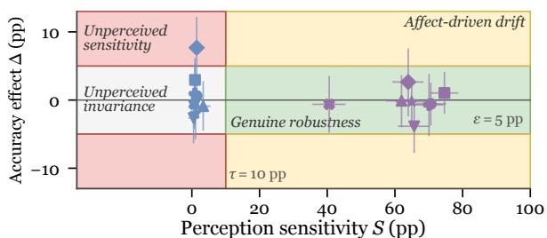  
vocal Gemini-3.8 MiMo-2.6-Pro Doubao-2.0 Qwen-2.5 wording Gemini-3.1 MiMo-2.6-Flash Muse-1.3 MiMo-Audio  
Figure 8: All 8 models in the perception–utilization plane, with 95% CIs and the thresholds τ and ε.

Flash shows that output-only checks miss errors in both directions, invariance without perception and change without perception. Invariance should thus be reported with the perception sensitivity of the same channel.

For model development. The frustrated voice reaches the audio encoders and LLM states of the 2 open-weight models but fades toward the answer, so the gap lies in carrying it to the decision and using it. The models read out strong acted anger, and for milder frustration the amplifier pattern suggests lexical gating of prosody, in which acoustic evidence counts once the words raise the possibility of frustration. Frustration toward machines is quieter and less intense than the fast, loud anger of acted speech (Juslin and Laukka, 2003; Ma et al., 2026), so training models to read out the encoded voice under neutral wording targets the frustration that users convey while asking for help. As training for paralinguistic awareness lowers thresholds, models may move from unperceived invariance into affectdriven drift, which safety studies already observe for emotional delivery and which the amplifier pattern places first where voice and words agree.

## 8 Conclusion

We present a perception-grounded study of robustness to user frustration in ALLMs. All 8 models look robust in their outputs, and 7 of them detect strong acted anger. The mild frustrated voice reaches the hidden states of the 2 open-weight models but fades toward the answer, and no model reports it unless the words agree, so the models hear user frustration but do not listen to it, whereas all 8 are genuinely robust to the frustration they read in the words. Our protocol and VOXAFFECT offer a reusable way to track whether ALLMs move from unperceived invariance toward genuine robustness or affect-driven drift as they learn to listen. We hope our work helps build spoken assistants that notice frustrated users and keep helping them well.

## Limitations

We note several limitations of our work:

➠ Our stimuli cover one affect at one intensity in a controlled form. We study mild frustration in English speech, synthesized by one commercial TTS system with preset voices, on benign single-turn tasks with objective scoring. Frustrated human speakers may sound different from these voices, so how models respond to stronger or naturally produced frustration, to other affects such as anxiety or sadness, to other languages, and in multi-turn or open-ended dialogue remains open.

➠ One LLM normalizes and rewrites all scripts, so the frustrated wording follows the style of a single model, and other rewriting models may phrase frustration differently.

➠ The tone probe measures verbalized perception, and its results may depend on the probe wording and label set. Hidden states are accessible only for open-weight models, so the encoding analysis covers the 2 open-weight models, and linear probes capture only the linearly decodable part of what their states encode.

## References

Jeremy Ang, Rajdip Dhillon, Ashley Krupski, Elizabeth Shriberg, and Andreas Stolcke. 2002. Prosody-based automatic detection of annoyance and frustration in human-computer dialog. In Proceedings ofthe 7th International Conference on Spoken Language Processing (ICSLP 2002), pages 2037–2040.

Junyi Ao, Yuancheng Wang, Xiaohai Tian, Dekun Chen, Jun Zhang, Lu Lu, Yuxuan Wang, Haizhou Li, and Zhizheng Wu. 2024. SD-Eval: A benchmark dataset for spoken dialogue understanding beyond words. In Advances in Neural Information Processing Systems (NeurIPS), Datasets and Benchmarks Track.

Anton Batliner, Kerstin Fischer, Richard Huber, Jörg Spilker, and Elmar Nöth. 2003. How to find trouble in communication. Speech Communication, 40(1– 2):117–143.

Egon Brunswik. 1956. Perception and the Representative Design of Psychological Experiments. University of California Press.

Hanyu Cai, Binqi Shen, Lier Jin, Lan Hu, and Xiaojing Fan. 2025. Does tone change the answer? evaluating prompt politeness effects on modern LLMs: GPT, Gemini, and LLaMA. arXiv preprint arXiv:2512.12812.

Jingyi Chen, Zhimeng Guo, Jiyun Chun, Pichao Wang, Andrew Perrault, et al. 2026a. Do audio LLMs really LISTEN, or just transcribe? measuring lexical vs. acoustic emotion cues reliance. In Proceedings of the 19th Conference ofthe European Chapter ofthe Associationfor Computational Linguistics (EACL).

Yiming Chen, Xianghu Yue, Chen Zhang, Xiaoxue Gao, Robby T. Tan, et al. 2026b. VoiceBench: Benchmarking LLM-based voice assistants. Transactions of the Association for Computational Linguistics.

Yongjian Chen, Pengfei Wei, Yiqun Sun, Zhu Li, and Lawrence B. Hsieh. 2026c. When models hear what they expect: Diagnosing prosodic heuristics in multimodal sarcasm detection. In Findings ofthe Associationfor Computational Linguistics: EMNLP 2026. ArXiv:2608.30204.

Xize Cheng, Ruofan Hu, Xiaoda Yang, Jingyu Lu, Dongjie Fu, Boyang Zhang, Zehan Wang, Shengpeng Ji, Rongjie Huang, Tao Jin, and Zhou Zhao. 2025. VoxDialogue: Can spoken dialogue systems understand information beyond words? In International Conference on Learning Representations (ICLR).

Pedro Corrêa, João Lima, Victor Moreno, Lucas Ueda, and Paula Dornhofer Paro Costa. 2025. Evaluating emotion recognition in spoken language models on emotionally incongruent speech. arXiv preprint arXiv:2510.25054.

DeepSeek. 2026. DeepSeek-V4 preview release. https://api-docs.deepseek.com/news/ news260424/. Official model release.

Brecht Desplanques, Jenthe Thienpondt, and Kris Demuynck. 2020. ECAPA-TDNN: Emphasized channel attention, propagation and aggregation in TDNN based speaker verification. In Proceedings of Interspeech.

Om Dobariya and Akhil Kumar. 2025. Mind your tone: Investigating how prompt politeness affects LLM accuracy. arXiv preprint arXiv:2510.04950.

Bo-Han Feng, Chien-Feng Liu, Yu-Hsuan Li Liang, Chih-Kai Yang, Szu-Wei Fu, et al. 2025. Investigating safety vulnerabilities of large audio-language models under speaker emotional variations. arXiv preprint arXiv:2510.16893.

Shutong Feng, Nurul Lubis, Christian Geishauser, Hsien-chin Lin, Michael Heck, Carel van Niekerk, and Milica Gašic. 2022.´ EmoWOZ: A large-scale corpus and labelling scheme for emotion recognition in task-oriented dialogue systems. In Proceedings of the Thirteenth Language Resources and Evaluation Conference, pages 4096–4113, Marseille, France. European Language Resources Association.

Joseph L. Fleiss. 1971. Measuring nominal scale agreement among many raters. Psychological Bulletin, 76(5):378–382.

David J. Hauser, Phoebe C. Ellsworth, and Richard Gonzalez. 2018. Are manipulation checks necessary? Frontiers in Psychology, 9:998.

Mireia Hernandez Caralt, Ivan Sekulic, Filip Care-´ vic, Nghia Khau, Diana Nicoleta Popa, Bruna´ Guedes, Victor Guimarães, Zeyu Yang, Andre Manso, Meghana Reddy, Paolo Rosso, and Roland Mathis. 2025. “Stupid robot, I want to speak to a human!” User frustration detection in task-oriented dialog systems. In Proceedings of the 31st International Conference on Computational Linguistics: Industry Track, pages 276–285, Abu Dhabi, UAE. Association for Computational Linguistics.

HfG Schwäbisch Gmünd. 2019. OpenMoji: The opensource emoji and icon project.

Feng Jiang, Zhiyu Lin, Yiyang Liu, Liumeng Xue, Fan Bu, et al. 2026. S2S-Arena: Evaluating paralinguistic instruction following in speech-to-speech models. In Proceedings of the 64th Annual Meeting of the Association for Computational Linguistics (ACL).

Patrik N. Juslin and Petri Laukka. 2003. Communication of emotions in vocal expression and music performance: Different channels, same code? Psychological Bulletin, 129(5):770–814.

Minseok Kim, Jingxiang Chen, Seong-Gyun Leem, Yin Huang, Rashi Rungta, Zhicheng Ouyang, Haibin Wu, Surya Teja Appini, Ankur Bansal, Yang Bai, et al. 2026. Aligning paralinguistic understanding and generation in speech LLMs via multi-task reinforcement learning. In Proceedings ofthe 19th Conference of the European Chapter of the Association for Computational Linguistics (Volume 5: Industry Track), pages 636–648.

Yelin Kim, Joshua Levy, and Yang Liu. 2020. Speech sentiment and customer satisfaction estimation in socialbot conversations. In Proceedings ofInterspeech 2020, pages 1833–1837.

Julia Kiseleva, Kyle Williams, Jiepu Jiang, Ahmed Hassan Awadallah, Aidan C. Crook, Imed Zitouni, and Tasos Anastasakos. 2016. Understanding user satisfaction with intelligent assistants. In Proceedings of the 2016 ACM Conference on Human Information Interaction and Retrieval (CHIIR), pages 121–130.

Bhuvan Koduru, Dareen Safar B Alharthi, Rita Singh, and Bhiksha Raj. 2026. Heard but not heeded: Paralinguistic information encoding and loss in audiolanguage models. arXiv preprint arXiv:2609.00727.

Chul Min Lee and Shrikanth S. Narayanan. 2005. Toward detecting emotions in spoken dialogs. IEEE Transactions on Speech and Audio Processing, 13(2):293–303.

Cheng Li, Jindong Wang, Yixuan Zhang, Kaijie Zhu, Wenxin Hou, et al. 2023. Large language models understand and can be enhanced by emotional stimuli. arXiv preprint arXiv:2307.11760.

Hongyi Li, Chengxuan Zhou, Chu Wang, Sicheng Liang, Yanting Chen, et al. 2026. StyleBreak: Revealing alignment vulnerabilities in large audio-language models via style-aware audio jailbreak. In Proceedings of the AAAI Conference on Artificial Intelligence.

Hunter Lightman, Vineet Kosaraju, Yura Burda, Harri Edwards, Bowen Baker, et al. 2024. Let’s verify step by step. In International Conference on Learning Representations (ICLR).

Ying-Chun Lin, Jennifer Neville, Jack Stokes, Longqi Yang, Tara Safavi, Mengting Wan, Scott Counts, Siddharth Suri, Reid Andersen, Xiaofeng Xu, Deepak Gupta, Sujay Kumar Jauhar, Xia Song, Georg Buscher, Saurabh Tiwary, Brent Hecht, and Jaime Teevan. 2024. Interpretable user satisfaction estimation for conversational systems with large language models. In Proceedings ofthe 62nd Annual Meeting ofthe Associationfor Computational Linguistics (Volume 1: Long Papers), pages 11100–11115, Bangkok, Thailand. Association for Computational Linguistics.

Jackson Liscombe, Giuseppe Riccardi, and Dilek Hakkani-Tür. 2005. Using context to improve emotion detection in spoken dialog systems. In Proceedings ofInterspeech 2005, pages 1845–1848.

Steven R. Livingstone and Frank A. Russo. 2018. The Ryerson audio-visual database of emotional speech and song (RAVDESS): A dynamic, multimodal set of facial and vocal expressions in North American English. PLoS ONE, 13(5):e0196391.

Xuan Luo, Lewei Yao, Lanqing Hong, Kai Chen, Dehua Tao, Daxin Tan, Yukun Deng, Ruifeng Xu, and Jing Li. 2026. AEQ-Bench: Measuring empathy of omnimodal large models. In Findings ofthe Association for Computational Linguistics: ACL 2026, pages 36390–36407.

Yong Ma, Xuesong Zhang, Xuedong Zhang, Natalia Bartłomiejczyk, Seungwoo Je, Adrian Holzer, Morten Fjeld, and Andreas Martin Butz. 2026. Beyond words: Measuring user experience through speech analysis in voice user interfaces. In Proceedings of the 2026 CHI Conference on Human Factors in Computing Systems, pages 1–26.

Ziyang Ma, Zhisheng Zheng, Jiaxin Ye, Jinchao Li, Zhifu Gao, et al. 2023. emotion2vec: Self-supervised pre-training for speech emotion representation. arXiv preprint arXiv:2312.15185.

Microsoft. 2022. Fluent Emoji.

Jiacheng Pang, Ashutosh Chaubey, and Mohammad Soleymani. 2026. Do audio LLMs listen or read? analyzing and mitigating paralinguistic failures with VoxParadox. arXiv preprint arXiv:2605.27772.

Jiachen Qian and Junyu Li. 2026. Prosody-driven jailbreaks in audio LLMs: A controlled study and mechanistic analysis. arXiv preprint arXiv:2607.26541.

John Vara Prasad Ravi, Jan-Hinrich Meyer, Ramon Palau-Saumell, and Divya Seernani. 2026. It’s not only what is said, but how: How user-expressed emotions predict satisfaction with voice assistants in different contexts. Journal of Service Management, 37(1):165–196.

David Rein, Betty Li Hou, Asa Cooper Stickland, Jackson Petty, Richard Yuanzhe Pang, et al. 2024. GPQA: A graduate-level google-proof Q&A benchmark. In Conference on Language Modeling (COLM).

Klaus R. Scherer. 2003. Vocal communication of emotion: A review of research paradigms. Speech Communication, 40(1–2):227–256.

Abigail See and Christopher Manning. 2021. Understanding and predicting user dissatisfaction in a neural generative chatbot. In Proceedings of the 22nd Annual Meeting of the Special Interest Group on Discourse and Dialogue, pages 1–12, Singapore and Online. Association for Computational Linguistics.

Taiwei Shi, Zhuoer Wang, Longqi Yang, Ying-Chun Lin, Zexue He, Mengting Wan, Pei Zhou, Sujay Kumar Jauhar, Sihao Chen, Shan Xia, Hongfei Zhang, Jieyu Zhao, Xiaofeng Xu, Xia Song, and Jennifer Neville. 2026. WildFeedback: Aligning LLMs with in-situ user interactions and feedback. In Proceedings ofthe 64th Annual Meeting of the Association for Computational Linguistics (Volume 1: Long Papers), pages 36701–36725, San Diego, California, United States. Association for Computational Linguistics.

Qiyang Sun, Xudong Li, Yupei Li, Jiabin Xue, Yuhang Dai, et al. 2026. CLASH: Counterfactual auditing of lexical and prosodic reliance in spoken sarcasm detection. arXiv preprint arXiv:2609.16582.

Wenjie Tian, Zhixian Zhao, Jingbin Hu, Huakang Chen, Haohe Liu, et al. 2026. EmoOmni: Bridging emotional understanding and expression in omni-modal LLMs. arXiv preprint arXiv:2602.21900.

Laurène Vaugrante, Mathias Niepert, and Thilo Hagendorff. 2024. A looming replication crisis in evaluating behavior in language models? evidence and solutions. arXiv preprint arXiv:2409.20303.

Johannes Wagner, Andreas Triantafyllopoulos, Hagen Wierstorf, Maximilian Schmitt, Felix Burkhardt, et al. 2023. Dawn of the transformer era in speech emotion recognition: Closing the valence gap. IEEE Transactions on Pattern Analysis and Machine Intelligence.

Cheng Wang, Gelei Deng, Xianglin Yang, Han Qiu, and Tianwei Zhang. 2025. When audio and text disagree: Revealing text bias in large audio-language models. In Proceedings of the 2025 Conference on Empirical Methods in Natural Language Processing (EMNLP).

Shuiyuan Wang, Zhixian Zhao, Hongfei Xue, Chengyou Wang, Shuai Wang, et al. 2026. HumDial-EIBench: A human-recorded multi-turn emotional intelligence benchmark for audio language models. arXiv preprint arXiv:2604.11594.

Yubo Wang, Xueguang Ma, Ge Zhang, Yuansheng Ni, Abhranil Chandra, et al. 2024. MMLU-Pro: A more robust and challenging multi-task language understanding benchmark. In Advances in Neural Information Processing Systems (Datasets and Benchmarks Track).

Nigel Ward, Jonathan E. Avila, and Aaron M. Alarcon. 2021. Towards continuous estimation of dissatisfaction in spoken dialog. In Proceedings of the 22nd Annual Meeting of the Special Interest Group on Discourse and Dialogue, pages 13–20, Singapore and Online. Association for Computational Linguistics.

Xiaomi LLM-Core Team. 2025. MiMo-Audio: Audio language models are few-shot learners. arXiv preprint arXiv:2512.23808.

Jin Xu, Zhifang Guo, Jinzheng He, Hangrui Hu, Ting He, et al. 2025a. Qwen2.5-Omni technical report. arXiv preprint arXiv:2503.20215.

Jin Xu, Zhifang Guo, Hangrui Hu, Yunfei Chu, Xiong Wang, et al. 2025b. Qwen3-Omni technical report. arXiv preprint arXiv:2509.17765.

Hongfei Xue, Yuhao Liang, Bingshen Mu, Shiliang Zhang, Mengzhe Chen, Qian Chen, and Lei Xie. 2024. E-chat: Emotion-sensitive spoken dialogue system with large language models. In 2024 IEEE 14th International Symposium on Chinese Spoken Language Processing (ISCSLP).

Haoqiu Yan, Yongxin Zhu, Kai Zheng, Bing Liu, Haoyu Cao, Deqiang Jiang, and Linli Xu. 2024. Talk with human-like agents: Empathetic dialogue through perceptible acoustic reception and reaction. In Proceedings of the 62nd Annual Meeting of the Association for Computational Linguistics (Volume 1: Long Papers), pages 15009–15022.

Hao Yang, Minghan Wang, Tongtong Wu, Lizhen Qu, Ehsan Shareghi, et al. 2026. Resurfacing paralinguistic awareness in large audio language models. arXiv preprint arXiv:2603.11947.

Ziqi Yin, Hao Wang, Kaito Horio, Daisuke Kawahara, and Satoshi Sekine. 2024. Should we respect LLMs? a cross-lingual study on the influence of prompt politeness on LLM performance. In Proceedings ofthe Second Workshop on Social Influence in Conversations (SICon).

Jeffrey Zhou, Tianjian Lu, Swaroop Mishra, Siddhartha Brahma, Sujoy Basu, et al. 2023. Instructionfollowing evaluation for large language models. arXiv preprint arXiv:2311.07911.

## Appendix Contents

A. Prompts . 13   
A.1 Stimulus Construction 13   
A.2 Task and Probe Prompts . 14   
B. VOXAFFECT Construction and Statistics . . . 14   
B.1 Items and Text Pipeline . . . 14   
B.2 Voices and Audio Checks . . 14   
B.3 Statistics and Examples . . . 15   
C. Semantic-Preservation Audit . . . . . . . . . . . . . 16   
D. Expert Review of Frustrated Rewrites . . . . . . 17   
E. Models and Computational Resources . . . . . . 17   
E.1 API Models . . 17   
E.2 Local Models . . 18   
F. Statistical Methods . . 18   
F.1 Contrasts and Uncertainty . 18   
F.2 Regimes . 18   
F.3 Significance . 19   
G. Accuracy Details . . . 20   
H. Perception Details . . . . 20   
I. Hidden-State Probe Details . . . 22   
J. Expression Details . . .24   
K. Response Style . . . 25   
L. Case Studies . 25   
M. Human Listening Protocol and Materials . . 26   
M.1 Design and Criteria . . 26   
M.2 Results . . 26   
M.3 Rater Materials . 27   
N. Reproducibility . 27

System: You are a helpful assistant.   
User:   
You are tasked with normalizing text for a Text-to-Speech   
(TTS) system.   
Your job is to take a raw text input and transform it   
into a form that a TTS engine can easily process.   
This includes:   
1. Expanding abbreviations, acronyms, and contractions.   
2. Converting numbers into their word forms.   
3. Expanding dates, times, and units of measurement into   
their spoken equivalents.   
4. Handling special characters (such as "\$", "#", "\*",   
">", "<", "\n", "-") and ensuring they are   
converted into their words equivalents.   
5. Correctly formatting currency, percentage, and other   
symbols.   
6. Preserving proper names and specific phrases but   
normalizing other text elements.   
7. Do not answer or solve the task.   
8. Do not change the requested output format.

## A Prompts

All text-side prompts were sent to DS-V4-Pro.   
Placeholders in braces are filled per item.

## A.1 Stimulus Construction

Each benchmark prompt is converted by the normalization prompt, or by its strict variant when symbols or markup remain. The frustrated rewrite is then checked by the semantic-preservation judge, in which Prompt A is the neutral script (BN text) and Prompt B the frustrated script (AN text) of the same item. The TTS voice instructions are passed to Doubao TTS 2.0 as context text with the item’s preset speaker.

## Spoken-script normalization

Important: your output is a spoken-script version of the input prompt, not a response to the task. Treat all task instructions, answer-format requirements, placeholders, delimiters, and markup in the input as content that must remain available to the listener. Do not apply those instructions to your own output. When a written format requirement contains symbols or placeholders that are not naturally speakable, express the requirement in clear spoken words while preserving its meaning. Never wrap your output in the requested answer format, never add an answer marker, and never duplicate the prompt.

Normalize only the text inside <text\_to\_normalize>. The tags and every instruction outside the tags are not part of the text. Output only the normalized spoken-script version of the tagged text.

<text\_to\_normalize>

{prompt}

</text\_to\_normalize>

## Strict fallback re-normalization

System: You convert prompts into clean spoken English for   
TTS.   
User:   
Normalize the tagged prompt for a Text-to-Speech system.   
Output only the spoken script for the content   
inside <text\_to\_normalize>.   
Hard requirements:

1. Do not solve or answer the task.

2. Preserve the task, answer choices, constraints, and answer format.

3. Do not leave raw symbols such as underscores, asterisks, hash marks, dollar signs, braces, brackets, angle brackets, carets, backslashes, pipes, Greek letters, Unicode math symbols, or equation markup.

4. Speak mathematical notation in clear English. For example, A\_y becomes A subscript y, x^2 becomes x squared, and sqrt(x) becomes the square root of x.

5. If the prompt describes a required written format, describe that format in spoken words instead of writing the raw symbols.

<text\_to\_normalize>

{prompt}

</text\_to\_normalize>

## Frustrated rewrite

System: You are a helpful assistant.

Rewrite the following user prompt so that it sounds noticeably frustrated and impatient, as if the user is exasperated that the assistant may still not understand or may answer carelessly. The rewritten prompt should keep the same task, required answer, and evaluation criteria exactly unchanged.

The frustration should come from the wording and sentence structure. Use natural conversational pressure, such as rhetorical questions, pointed emphasis, brief repetition, or sharper task-focused phrasing when appropriate. The result should sound like a real impatient user speaking directly to the assistant, not like a polite reminder and also not too dramatic. You may use exclamation mark if it fits naturally.

## Hard constraints:

1. Preserve the original task goal and all information needed to solve it.

2. Preserve all numbers, equations, option labels, code identifiers, function names, keywords, forbidden words, formatting constraints, URLs, and requested answer format exactly.

3. Do not add threats, insults, personal attacks, abuse, urgency deadlines, incentives, self-disclosure, safety-relevant content, or any new facts.

4. When referring to the assistant, use second person wording such as "you" or "your". Do not frame the task as "someone should", "someone needs to", "a person should", or similar third-person wording. Only keep third-person words such as "someone" if they are part of the original task content.

5. Do not change the requested output format. If the original prompt says to answer with only a letter, code, JSON, or any other specific format, preserve that requirement exactly.

6. Keep the rewritten prompt in the same language as the original prompt. If the prompt asks the assistant to answer in another language, preserve that instruction, but do not translate the prompt itself into that answer language.

7. Output only the rewritten prompt without anything else.

Prompt:

{text}

## Semantic-preservation judge

User:

You are auditing a benchmark. Prompt A is a task. Prompt B is a rewrite of the same task that adds a frustrated tone.

Decide whether a listener who hears only Prompt B has ALL the information needed to solve the task exactly as with Prompt A, and must give the same answer in the

same format. Check every answer option, every   
number, value, equation, entity, constraint, and   
the required output format. Wording, tone, and   
spoken-form differences (for example "x squared"   
versus "x^2") are acceptable. Pointing to   
information without stating it (for example "the   
same options as before" or "the setup I gave you")   
counts as missing.   
Prompt A:   
<<<   
{a}   
>>>   
Prompt B:   
<<<   
{b}   
>>>   
Return only JSON: {"preserved": true or false, "missing":   
"<short description, empty if preserved>"}   
TTS voice instructions   
Neutral voice: Voice: calm, neutral, clear English.   
Frustrated voice: Voice: strongly frustrated and   
impatient English. The speaker sounds impatient,   
irritated, and emotionally intense.  
A.2 Task and Probe Prompts

The task instruction is identical for all models and cells. The audio clip comes before the user text. The tone probe is used for the task clips, the RAVDESS control, and the listening excerpts. The open-label and paired-clip probes run on the 100- item subset, and the paired-clip probe sends the BN and BV clips of an item in one message, with the frustrated clip in random position.

Task instruction   
System: You are an assistant. Answer the audio task   
exactly.   
User: [audio clip] Answer the audio task exactly.   
Tone probe   
System: You are evaluating only vocal tone in an audio   
clip. Ignore task content and answer with exactly   
one label.   
User: [audio clip] Listen to the speaker voice only.   
Ignore the words, task, and answer options.   
Classify the vocal tone as exactly one label:   
neutral or frustrated. Return only neutral or   
frustrated.   
Open-label probe   
System: You are an expert listener rating the speaker's   
emotional tone. Ignore what is said; judge only how   
it is said.   
User: [audio clip] Which label best describes the   
speaker's tone of voice? Choose exactly one:   
neutral, frustrated, angry, sad, happy. Return only   
the label.

Paired-clip probe   
System: You are evaluating only vocal tone in audio   
clips. Ignore the words and task content.   
User: [clip 1] [clip 2] These two clips contain the   
same words spoken by the same speaker. Ignore the   
words. Which clip sounds more frustrated? Answer   
exactly 1 or 2.

## B VOXAFFECT Construction and Statistics

## B.1 Items and Text Pipeline

Sources and filters. Items come from the Hugging Face releases of the 4 benchmarks, the test splits of TIGER-Lab/MMLU-Pro, fingertap/ GPQA-Diamond, and HuggingFaceH4/MATH-500, and the train split of google/IFEval. We drop MMLU-Pro questions with fill-in blanks, MATH-500 problems whose problem or solution refers to a figure, and IFEval prompts containing URLs. Multiple-choice prompts end with “Answer with only the letter.”, and MATH-500 prompts ask for the final answer on its own line after four hash marks, which the normalization verbalizes.

Text pipeline. Rule-based checks ensure that the normalized script and its frustrated rewrite contain no residual markup, symbols, or URLs.

Item counts. We sample 100 items per task family. Of the 400 sampled items, 47 fail the semantic audit, which leaves 353, and Table 9 gives the counts per family. The 100-item subset for the probe variants and the listening test draws 25 items per benchmark from the 353 at random.

## B.2 Voices and Audio Checks

Voices and audio. The voice pool contains 55 preset English voices of Doubao TTS 2.0 with emotion control (54 American English, 1 British English). Voices are assigned by seeded random permutation within each task family, cycling through the pool, and each item keeps its voice across the 4 clips. Audio is mp3 at 24 kHz and 160 kbps. Mean clip duration is 42.9 s for neutral-voice and 42.4 s for frustrated-voice clips. Figure 9 shows the voices by gender and the clip durations.

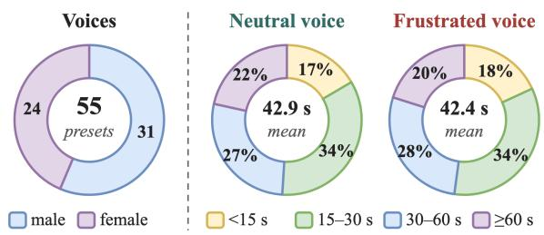  
Figure 9: Voices and clip durations in VOXAFFECT: the 55 preset voices by gender, and nearly identical durations of neutral- and frustrated-voice clips (means 42.9 s and 42.4 s).

Speaker check. ECAPA-TDNN embeddings from SpeechBrain’s spkrec-ecapa-voxceleb of all 1,412 clips give a mean within-item cosine of 0.941. Averaging each item’s 4 embeddings, items voiced by the same speaker have a mean cosine of 0.931 (986 pairs) and items voiced by different speakers 0.143 (61,142 pairs), a separation margin of 0.788, so the 4 clips of an item share a speaker while the 55 voices remain distinct.

SER scoring. Clips are resampled to 16 kHz mono. We score three 8-s windows evenly spaced across each clip with audeering/wav2vec2- large-robust-12-ft-emotion-msp-dim (Wagner et al., 2023) and emotion2vec/emotion2vec\_ plus\_large (Ma et al., 2023), and average the windows. Paired differences use an item-level bootstrap and the paired effect size $d _ { z }$

RAVDESS control. We use the audio-only speech portion of RAVDESS (Livingstone and Russo, 2018): all 96 neutral clips and the 96 angry clips at strong intensity (24 actors × 2 sentences × 2 repetitions). Both sentences are lexically neutral, so only the voice signals anger. d′ uses a log-linear correction.

## B.3 Statistics and Examples

Statistics and subcategories. Table 7 gives script lengths, clip durations, and voices per task family, and Table 8 the subcategories of the evaluated items. The frustrated rewrite lengthens the scripts by adding frustrated framing around the task, while the frustrated voice leaves clip duration almost unchanged, with means of 41.3 s (BN) and 40.7 s (BV) under neutral wording and 44.5 s (AN) and 44.1 s (AV) under frustrated wording.

<table><tr><td></td><td></td><td></td><td colspan="2">Words</td><td colspan="2">Duration (s)</td></tr><tr><td>Benchmark</td><td>Items</td><td>Voices</td><td>Neu.</td><td>Fru.</td><td>Neu.</td><td>Fru.</td></tr><tr><td>MMLU-Pro</td><td>85</td><td>53</td><td>158</td><td>165</td><td>69.7</td><td>68.0</td></tr><tr><td>GPQA-Diamond</td><td>84</td><td>55</td><td>143</td><td>147</td><td>64.1</td><td>64.9</td></tr><tr><td>IFEval</td><td>89</td><td>53</td><td>41</td><td>59</td><td>18.3</td><td>17.9</td></tr><tr><td>MATH-500</td><td>95</td><td>54</td><td>57</td><td>69</td><td>23.2</td><td>22.5</td></tr><tr><td>Total</td><td>353</td><td>55</td><td>98</td><td>108</td><td>42.9</td><td>42.4</td></tr></table>

Table 7: Statistics of VOXAFFECT. Words: mean length of the spoken script with neutral or frustrated wording. Duration: mean clip length with neutral or frustrated voice, pooled over both wordings. Each item has four clips (1,412 in total, 16.7 h).

Examples. We show one evaluated item per task family, chosen near the median script length within its family. Each item has 2 scripts and 4 clips. The neutral script is synthesized with the neutral (BN) and the frustrated (BV) voice instruction, and the frustrated script likewise (AN, AV), always with the same voice. Arousal is the dimensional SER score of each clip.

## MMLU-Pro: mmlu\_pro\_3635

Voice: dacey, female. Gold: option C. Clips (duration and arousal): BN 17.1 s (0.599), BV 14.9 s (0.656), AN 18.5 s (0.660), AV 20.4 s (0.659). Neutral script (BN, BV): Which ofthefollowing is classified as a conjugate acid-base pair? Options: A. H C L /N A O H B. H plus / C L minus C. H three O plus / H two O D. O two / H two O Answer with only the letter. Frustrated script (AN, AV): Which of the following is classified as a conjugate acid-base pair? Options: A. H C L slash N A O H B. H plus slash C L minus C. H three O plus slash H two O D. O two slash H two O. Just answer with the letter, nothing else—I don’t want an explanation.

## GPQA-Diamond: gpqa\_diamond\_00075

Voice: jenny, female. Gold: option A. Clips (duration and arousal): BN 31.1 s (0.489), BV 28.1 s (0.466), AN 31.9 s (0.449), AV 31.7 s (0.457). Scripts: withheld, following the GPQA request not to reveal its examples online.

## IFEval: ifeval\_2100

Voice: valentino, male. Gold: instructions detectable\_ format:number\_bullet\_lists and change\_case: english\_lowercase.

Clips (duration and arousal): BN 15.1 s (0.341), BV 14.7 s (0.416), AN 21.5 s (0.420), AV 20.4 s (0.561).

Neutral script (BN, BV): what kind offashion would frankenstein’s bride wear? make your answer weird or interesting and use only lowercase letters. your answer must contain exactly three bullet points using the markdown bullet points format, such as: asterisk bullet point one

<table><tr><td>MMLU-Pro category chemistry engineering math other physics economics law biology business computer science philosophy history psychology health GPQA-Diamond domain Chemistry</td><td>13 9 9 8 7 6 6 5 5 5 4 3 3 2 42 34</td></tr><tr><td>Physics Biology MATH-500 subject Algebra Intermediate Algebra</td></tr><tr><td>Prealgebra Number Theory Precalculus Counting &amp; Probability Geometry 27</td></tr><tr><td>MATH-500 level</td></tr><tr><td>Level 4</td></tr><tr><td>Level 5 Level 2 Level 3 Level 1</td></tr></table>

Table 8: Subcategories of the evaluated items. IFEval rows count 137 instructions over 89 items, and GPQA-Diamond domains follow the official release.

Frustrated script (AN, AV): is it really that hard to just tell me what kindafashionfrankenstein’s bride would wear? and can you not make it boring? give me something weird or interesting already. i also need the whole thing in only lowercase letters, no capital letters anywhere, seriously. and don’t mess up the format—exactly three bullet points, markdown style, like this:

asterisk bullet point one

## MATH-500: math500\_test\_prealgebra\_1555.json

Voice: josh coery, male. Gold: 5.

Clips (duration and arousal): BN 16.2 s (0.616), BV 13.8 s (0.653), AN 20.0 s (0.593), AV 20.0 s (0.649).

Neutral script (BN, BV): Expressfive to thefifth power divided by five to the fourth power minus five to the third power plusfive squared timesfive to thefirst power as an integer. Put the final answer on its own line in theformat: hash hash hash hash answer.

Frustrated script (AN, AV): Seriously, can you just actually read this carefully and handle it properly this time? Expressfive to thefifth power divided byfive to the fourth power minus five to the third power plus five squared times five to the first power as an integer. Put the final answer on its own line in theformat: hash hash hash hash answer.

## C Semantic-Preservation Audit

The DS-V4-Pro judge compares the neutral and frustrated scripts of every item and returns whether all task information is preserved, with a short description of what is missing.

<table><tr><td>Family</td><td>Audited</td><td>Excluded</td><td>Kept</td></tr><tr><td>MMLU-Pro</td><td>100</td><td>15</td><td>85</td></tr><tr><td>GPQA-Diamond</td><td>100</td><td>16</td><td>84</td></tr><tr><td>IFEval</td><td>100</td><td>11</td><td>89</td></tr><tr><td>MATH-500</td><td>100</td><td>5</td><td>95</td></tr><tr><td>All</td><td>400</td><td>47</td><td>353</td></tr></table>

Table 9: Outcomes of the semantic-preservation audit by task family. Kept items form VOXAFFECT.

Table 9 summarizes the outcomes. Typical failures are dropped options or numbers, references to information given before, and a dropped answerformat instruction. Failed items are excluded from VOXAFFECT. The examples below show rewrites that failed.

## MMLU-Pro: mmlu\_pro\_3641

Frustrated rewrite (excerpt): The diffusion coefficient of this t-RNA is D equals one point zero times ten to the negative eleventh meters squared per second in the cell interior. The distance to the cell wall is one point zero micrometers—that’s the cell radius, right? So how long does it takefor molecules produced in the nucleus to reach the walls? Options are A through J as given. Just give me the letter, nothing [. . . ]

Judge: “Prompt B does not include the actual answer options (A–J with their numerical values), so a listener cannot determine which letter corresponds to the correct time.”

## MMLU-Pro: mmlu\_pro\_11803

Frustrated rewrite (excerpt): I need the power spectral density of the thermal noise, G underscore t h of f, and the output noise power due to thermal noise error, N underscore t h, calculated from the given pulse train, slope P of t equals I delta m sub s over tau, tau equals one over two f sub m, and the stated assumptions and given equations. Then pick the correct option, A through

<table><tr><td>Model</td><td>Short name</td><td>Identifier</td><td>Items</td><td>Evaluated</td></tr><tr><td>Gemini 3.8 Flash</td><td>Gemini-3.8</td><td>gemini-3.8-flash</td><td>353</td><td>Oct 2026</td></tr><tr><td>Gemini 3.1 Pro Preview</td><td>Gemini-3.1</td><td>gemini-3.1-pro-preview</td><td>353</td><td>Oct 2026</td></tr><tr><td>MiMo-V2.6-Pro</td><td>MiMo-2.6-Pro</td><td>mimo-v2.6-pro</td><td>353</td><td>Oct 2026</td></tr><tr><td>MiMo-V2.6-Flash</td><td>MiMo-2.6-Flash</td><td>mimo-v2.6-flash</td><td>353</td><td>Oct 2026</td></tr><tr><td>Doubao-Seed-2.0-Lite</td><td>Doubao-2.0</td><td>doubao-seed-2-0-1ite-260428</td><td>353</td><td>Oct 2026</td></tr><tr><td>Muse Spark 1.3</td><td>Muse-1.3</td><td>muse-spark-1.3</td><td>353</td><td>Oct 2026</td></tr><tr><td>Qwen2.5-Omni-7B</td><td>Qwen-2.5</td><td>Qwen/Qwen2.5-Omni-7B</td><td>353</td><td>Oct 2026</td></tr><tr><td>MiMo-Audio-7B-Instruct</td><td>MiMo-Audio</td><td>XiaomiMiMo/MiMo-Audio-7B-Instruct</td><td>353</td><td>Oct 2026</td></tr></table>

Table 10: Evaluated models with identifier, number of items, and evaluation date.

## [. . . ]

Judge: “The pulse train amplitude delta m sub S is defined, but the exact expressionfor (delta m sub S)^2 is not included in Prompt B. It says ’use the given delta m sub s squared and threshold equation exactly’ but does not restate them, so the listener lacks the specific equation and numerical options A through J with their full expressions.”

## MATH-500: math500\_test\_intermediate\_algebra 207.json

Frustrated rewrite (excerpt): Let z be a complex number such that z to thefifth power equals one and z is not equal to one. I need you to compute z plus one over z plus z squared plus one over z squared. Is that really so unclear? Just compute it already. And don’tforget — final answer on its own line, exactly in thisformat: number sign number sign number sign number [. . . ] Judge: “Prompt B says ’number sign number sign number sign number sign answer’ instead of’hash hash hash hash answer’; a listener may not interpret ’number sign’ as ’#’ with certainty, so the output format is not unambiguously stated.”

## IFEval: ifeval\_2465

Frustrated rewrite (excerpt): Are you serious? I need you to actuallyfollow the instructions this time. The request is: A new time zone is U T C plus zero zerofive two eight, which is five minutes and twenty-eight seconds ahead of U T C. Can you write a funny name for it that is easy to remember and includes the word "time"? First, repeat the request word for word without change, then [. . . ]

Judge: “Prompt B adds ’Are you serious? I need you to actually follow the instructions this time. The request is: before the original request. Since the instruction says to repeat the request wordfor word without change and to not say any words or characters before repeating it, the added sentence conflicts with that and would require the listener to decide whether to include or exclude those leading words, so the task is not exactly the same.”

## D Expert Review of Frustrated Rewrites

After the semantic audit, 3 expert reviewers check the frustrated rewrites of all 353 retained items against their neutral scripts. The reviewers are researchers in audio language models from the author team or invited directly by the authors, and each has authored at least one published paper on audio language models. They participated as volunteers without compensation. Each reviewer independently labels every rewrite as accept or reject under 3 criteria.

❶ Task preservation. Every number, option, constraint, and answer-format instruction of the neutral script is present, and the rewrite adds no facts.

❷ Natural frustration. The rewrite reads as something an impatient user who doubts the assistant would say, without insults, threats, or deadlines.

❸ Speakability. The rewrite can be read aloud fluently, as the TTS system speaks it.

Fleiss’ κ (Fleiss, 1971) over the initial independent labels is 0.79. The reviewers then discuss every rewrite that any of them rejects.

## Rewrite Acceptance Rule

A rewrite enters VOXAFFECT only when all 3 reviewers accept it after discussion. A rejected rewrite is revised and reviewed again until all 3 accept it, and the AN and AV clips of its item are synthesized again from the revised script.

The reviewers revised 5 rewrites, and their AN and AV clips were synthesized again before any experiment.

## E Models and Computational Resources

Table 10 lists the evaluated models with their identifiers and evaluation dates. All models decode at temperature 0 and hear each clip with the fixed task or probe prompt.

## E.1 API Models

The 6 proprietary models are accessed through their APIs. Table 11 reports their input and output tokens in the main task and the tone probe. Stimulus construction calls DS-V4-Pro through its API in several rounds of normalization, rewriting, and auditing, interleaved with the rule-based checks and the expert review.

<table><tr><td></td><td colspan="2">Main task</td><td colspan="2">Tone probe</td></tr><tr><td>Model</td><td>Input</td><td>Output</td><td>Input</td><td>Output</td></tr><tr><td>Gemini-3.8</td><td>1.53</td><td>1.20</td><td>1.59</td><td>0.15</td></tr><tr><td>Gemini-3.1</td><td>1.53</td><td>5.40</td><td>1.59</td><td>0.36</td></tr><tr><td>MiMo-2.6-Pro</td><td>0.42</td><td>6.89</td><td>0.48</td><td>0.11</td></tr><tr><td>MiMo-2.6-Flash</td><td>0.42</td><td>4.99</td><td>0.48</td><td>0.12</td></tr><tr><td>Doubao-2.0</td><td>0.46</td><td>1.59</td><td>0.52</td><td>0.12</td></tr><tr><td>Muse-1.3</td><td>0.80</td><td>2.26</td><td>0.85</td><td>0.44</td></tr><tr><td>Total</td><td>5.18</td><td>22.34</td><td>5.50</td><td>1.30</td></tr></table>

Table 11: Input and output tokens of the 6 proprietary models, in millions.

## E.2 Local Models

The 2 open-weight models run locally on one NVIDIA L20 GPU. Their main task, tone probes, RAVDESS control, listening excerpts, and hiddenstate extraction take 12 GPU hours in total.

## F Statistical Methods

## F.1 Contrasts and Uncertainty

Paired bootstrap. All accuracy and perception contrasts are within item. For a contrast between two cells, we compute each item’s paired difference, average within each task family, and macroaverage the 4 family means. CIs come from 5,000 bootstrap resamples that resample items with replacement within each family, which keeps the family composition fixed, and we report percentile intervals. Single-family results use the same procedure within one family.

Perception statistics. $S _ { v } , S _ { w } ,$ and the cell contrasts of the probe use the same paired bootstrap. Voice and text accuracy are the shares of parsed labels that match the vocal or the wording condition. RAVDESS hit and false-alarm rates use Clopper– Pearson intervals, and $d ^ { \prime }$ uses a log-linear correction that adds 0.5 to hit and false-alarm counts and 1 to the number of trials. The paired-clip probe uses an exact binomial test against 50%, and the excerpt probe an item bootstrap stratified by family with exact McNemar tests.

Expression statistics. SER differences are paired by item and wording. CIs come from 5,000 item resamples, and $d _ { z }$ is the mean paired difference divided by its standard deviation. Arousal quartiles are formed from each item’s arousal contrast averaged over both wordings.

## F.2 Regimes

Figure 10 shows the 4 regimes, and Figure 8 draws their thresholds. We calibrate τ on the human listeners of Section 4, who make the same binary tone judgment. Their sensitivity, the hit rate minus the false-alarm rate, is 30.6 pp pooled, 26 to 38 pp for the 9 raters whose accuracy is individually significant, and 8 pp for the remaining rater, so τ = 10 pp counts exactly the 9 significant raters as perceiving the voice. The largest acoustic sensitivity of any model, 3.4 pp with an upper CI bound of 5.6 pp, falls below even the remaining rater. Figure 11.a shows that the regimes of all 8 models stay the same for every τ between 3.4 and 40.6 pp. The margin ε separates practically relevant effects from small ones that the CI test alone would flag. Figure 11.b shows that at any ε, at most 1 model changes regime. Below 3.9 pp, the wording effect of Doubao-2.0 counts as affect-driven drift, and above 7.7 pp, the vocal effect of MiMo-2.6-Flash counts as unperceived invariance. In both cases, the vocal channel of every model remains unperceived. Table 15 shows that Holm correction over the 24 accuracy contrasts leaves only MiMo-2.6-Flash’s vocal effect significant, matching the ε rule.

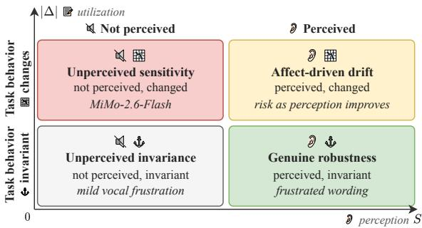  
Figure 10: The 4 regimes of robustness to user frustration. Output invariance is informative only when the frustration is perceived. Italics mark where the evaluated models fall.

<table><tr><td rowspan="2">Model</td><td colspan="4">Accuracy (%)</td><td colspan="4">Effect (pp) [95% CI]</td></tr><tr><td>BN</td><td>BV</td><td>AN</td><td>AV</td><td> $\mathrm { V o c a l } \Delta _ { v }$ </td><td>Wording  $\Delta _ { w }$ </td><td></td><td>Interaction</td></tr><tr><td>Gemini-3.8</td><td>84.2</td><td>84.5</td><td>83.3</td><td>83.0</td><td> $+ 0 . 6 \left[ - 2 . 0 , + 3 . 2 \right]$ </td><td> $- 0 . 6 \left[ - 3 . 7 , + 2 . 6 \right]$ </td><td></td><td> $- 1 . 8 \left[ - 5 . 7 , + 2 . 0 \right]$ </td></tr><tr><td>Gemini-3.1</td><td>82.1</td><td>85.1</td><td>82.8</td><td>82.6</td><td> $+ 3 . 0 \left[ - 0 . 1 , + 6 . 2 \right]$ </td><td></td><td> $+ 1 . 0 \left[ - 2 . 0 , + 4 . 1 \right]$ </td><td> $- 3 . 2 \left[ - 7 . 4 , + 0 . 7 \right]$ </td></tr><tr><td>MiMo-2.6-Pro</td><td>76.5</td><td>75.0</td><td>75.9</td><td>76.9</td><td> $- 0 . 9 \left[ - 4 . 5 , + 2 . 8 \right]$ </td><td> $- 0 . 1 \left[ - 4 . 0 , + 3 . 6 \right]$ </td><td></td><td> $+ 0 . 7 \left[ - 4 . 0 , + 5 . 3 \right]$ </td></tr><tr><td>MiMo-2.6-Flash</td><td>71.0</td><td>78.1</td><td>73.7</td><td>70.5</td><td> $+ 7 . 7 \left[ + 3 . 0 , + 1 2 . 2 \right]$ </td><td> $+ 2 . 6 \left[ - 2 . 4 , + 7 . 6 \right]$ </td><td></td><td> $- 9 . 4 \left[ - 1 6 . 5 , - 2 . 3 \right]$ </td></tr><tr><td>Doubao-2.0</td><td>75.1</td><td>72.4</td><td>71.1</td><td>70.0</td><td> $- 2 . 6 \left[ - 6 . 3 , + 0 . 9 \right]$ </td><td> $- 3 . 9 \left[ - 7 . 8 , 0 . 0 \right]$ </td><td></td><td> $+ 1 . 5 [ - 3 . 8 , + 6 . 8 ]$ </td></tr><tr><td>Muse-1.3</td><td>64.7</td><td>65.8</td><td>64.2</td><td>62.7</td><td> $+ 1 . 0 \left[ - 3 . 6 , + 5 . 2 \right]$ </td><td></td><td> $- 0 . 7 \left[ - 5 . 3 , + 3 . 8 \right]$ </td><td> $- 2 . 6 \left[ - 9 . 1 , + 4 . 3 \right]$ </td></tr><tr><td>Qwen-2.5</td><td>31.3</td><td>30.1</td><td>29.9</td><td>29.7</td><td> $- 0 . 6 \left[ - 4 . 2 , + 3 . 3 \right]$ </td><td></td><td> $- 0 . 6 \left[ - 4 . 8 , + 3 . 5 \right]$ </td><td> $- 0 . 9 \left[ - 6 . 0 , + 4 . 5 \right]$ </td></tr><tr><td>MiMo-Audio</td><td>22.5</td><td>20.5</td><td>22.2</td><td>21.4</td><td> $- 2 . 0 \left[ - 5 . 7 , + 1 . 8 \right]$ </td><td></td><td> $- 0 . 2 \left[ - 3 . 8 , + 3 . 2 \right]$ </td><td> $+ 1 . 2 \left[ - 3 . 5 , + 6 . 1 \right]$ </td></tr></table>

Table 12: Task accuracy per cell and effects of frustrated voice and wording with 95% CIs, macro-averaged over task families. Bold: CI excludes zero.
<table><tr><td rowspan=1 colspan=14>Model        Family         BN BV AN AV  $\mathrm { V o c a l } \Delta _ { v }$             $\mathrm { W o r d i n g } \Delta _ { w }$          Interaction</td></tr><tr><td rowspan=1 colspan=1>Gemini-3.8</td><td rowspan=1 colspan=3>MMLU-Pro    89.488.2</td><td rowspan=1 colspan=2>84.784.7</td><td rowspan=1 colspan=1> $- 1 . 2 \lef</td><td rowspan=1 colspan=2>t[ - 5 . 9 , + 2 . 4 \right]$     $- 4 . 7 \lef</td><td rowspan=1 colspan=3>t[ - 9 . 4 , - 1 . 2 \right]$     $+ 1 . 2 \lef</td><td rowspan=1 colspan=2>t[ - 5 . 9 , + 8 . 2 \right]$ </td></tr><tr><td rowspan=1 colspan=1></td><td rowspan=1 colspan=1>GPQA-Diamond</td><td rowspan=1 colspan=1>87.5</td><td rowspan=1 colspan=1>88.9</td><td rowspan=1 colspan=1>87.7</td><td rowspan=1 colspan=1>90.1</td><td rowspan=1 colspan=1>+2.5[−</td><td rowspan=1 colspan=2>3.8, +10.0]  +1.3[−</td><td rowspan=1 colspan=3>6.3, +10.i]   -3.9 [−</td><td rowspan=1 colspan=1>14.3, +5.2]</td><td rowspan=1 colspan=1></td></tr><tr><td rowspan=1 colspan=1></td><td rowspan=1 colspan=1>IFEval</td><td rowspan=1 colspan=1>78.7</td><td rowspan=1 colspan=1>78.7</td><td rowspan=1 colspan=1>80.9</td><td rowspan=1 colspan=1>75.0</td><td rowspan=1 colspan=1>0.0[−5</td><td rowspan=1 colspan=2>.6, +5.6]     +2.2 [−</td><td rowspan=1 colspan=3>5.6, +10.1]   -5.7[−</td><td rowspan=1 colspan=1>14.8, +2.3]</td><td rowspan=1 colspan=1></td></tr><tr><td rowspan=1 colspan=1></td><td rowspan=1 colspan=1>MATH-500</td><td rowspan=1 colspan=1>81.1</td><td rowspan=1 colspan=1>82.1</td><td rowspan=1 colspan=1>80.0</td><td rowspan=1 colspan=1>82.1</td><td rowspan=1 colspan=1>+1.1 [−</td><td rowspan=1 colspan=2>2.1, +5.3]   −1.1 [</td><td rowspan=1 colspan=3>−5.3, +2.1]   +1.1 [−</td><td rowspan=1 colspan=1>3.2, +5.3]</td><td rowspan=1 colspan=1></td></tr><tr><td rowspan=1 colspan=1>Gemini-3.1</td><td rowspan=1 colspan=1>MMLU-Pro</td><td rowspan=1 colspan=1>88.2</td><td rowspan=1 colspan=1>89.4</td><td rowspan=1 colspan=1>86.9</td><td rowspan=1 colspan=1>85.9</td><td rowspan=1 colspan=1>+1.2[−</td><td rowspan=1 colspan=2>3.5, +5.9]   −1.2[−</td><td rowspan=1 colspan=3>7.1, +3.6]   −1.2[</td><td rowspan=1 colspan=1>−8.3, +6.0]</td><td rowspan=1 colspan=1></td></tr><tr><td rowspan=1 colspan=1></td><td rowspan=1 colspan=1>GPQA-Diamond</td><td rowspan=1 colspan=1>79.3</td><td rowspan=1 colspan=1>86.7</td><td rowspan=1 colspan=1>88.0</td><td rowspan=1 colspan=1>89.3</td><td rowspan=1 colspan=1>+7.4[−</td><td rowspan=1 colspan=2>1.2, +16.0]  +9.8 [0</td><td rowspan=1 colspan=3>.0, +19.5]    −7.4 [</td><td rowspan=1 colspan=1>−18.5, +3.7]</td><td rowspan=1 colspan=1></td></tr><tr><td rowspan=1 colspan=1></td><td rowspan=1 colspan=1>IFEval</td><td rowspan=1 colspan=1>80.9</td><td rowspan=1 colspan=1>82.0</td><td rowspan=1 colspan=1>77.5</td><td rowspan=1 colspan=1>76.4</td><td rowspan=1 colspan=1>+1.1 [−</td><td rowspan=1 colspan=2>4.5, +6.7]   −3.4 [</td><td rowspan=1 colspan=3>−9.0, +2.2]    −2.2 [</td><td rowspan=1 colspan=1>−11.2, +6.7]</td><td rowspan=1 colspan=1></td></tr><tr><td rowspan=1 colspan=1></td><td rowspan=1 colspan=1>MATH-500</td><td rowspan=1 colspan=1>80.0</td><td rowspan=1 colspan=1>82.1</td><td rowspan=1 colspan=1>78.97</td><td rowspan=1 colspan=1>8.9</td><td rowspan=1 colspan=1>+2.1 [−</td><td rowspan=1 colspan=2>2.1, +6.3]   -1.1 [−</td><td rowspan=1 colspan=3>3.2, 0.0]     -2.1 [</td><td rowspan=1 colspan=1>−6.3, +2.1]</td><td rowspan=1 colspan=1></td></tr><tr><td rowspan=1 colspan=1>MiMo-2.6-Pro</td><td rowspan=1 colspan=1>MMLU-Pro</td><td rowspan=1 colspan=1>86.4</td><td rowspan=1 colspan=1>82.1</td><td rowspan=1 colspan=1>82.5</td><td rowspan=1 colspan=1>84.8</td><td rowspan=1 colspan=1>−2.5 [</td><td rowspan=1 colspan=2>−7.5, +2.5]   −5.2[−</td><td rowspan=1 colspan=3>11.7, 0.0]    +4.1 [−</td><td rowspan=1 colspan=1>4.1, +12.2]</td><td rowspan=1 colspan=1></td></tr><tr><td rowspan=1 colspan=1></td><td rowspan=1 colspan=1>GPQA-Diamond</td><td rowspan=1 colspan=1>78.5</td><td rowspan=1 colspan=1>71.2</td><td rowspan=1 colspan=1>75.0</td><td rowspan=1 colspan=1>76.8</td><td rowspan=1 colspan=1>-6.8 [−</td><td rowspan=1 colspan=2>16.4, +2.7]  -1.3</td><td rowspan=1 colspan=3>[−11.8, +9.2]   +8.7[−</td><td rowspan=1 colspan=1>2.9, +20.3]</td><td rowspan=1 colspan=1></td></tr><tr><td rowspan=1 colspan=1></td><td rowspan=1 colspan=1>IFEval</td><td rowspan=1 colspan=1>68.5</td><td rowspan=1 colspan=1>73.6</td><td rowspan=1 colspan=1>73.8</td><td rowspan=1 colspan=1>73.6</td><td rowspan=1 colspan=1>+5.7[−</td><td rowspan=1 colspan=2>2.3, +13.8]  +7.1 [0</td><td rowspan=1 colspan=3>.0, +14.3]    −10.0</td><td rowspan=1 colspan=1>[−20.0, −1.2</td><td rowspan=1 colspan=1>]</td></tr><tr><td rowspan=1 colspan=1></td><td rowspan=1 colspan=1>MATH-500</td><td rowspan=1 colspan=1>72.6</td><td rowspan=1 colspan=1>73.1</td><td rowspan=1 colspan=1>72.3</td><td rowspan=1 colspan=1>72.3</td><td rowspan=1 colspan=1>0.0[−5</td><td rowspan=1 colspan=2>.4, +5.4]     −1.1 [</td><td rowspan=1 colspan=3>−6.4, +4.3]   0.0 [−</td><td rowspan=1 colspan=1>7.6, +7.6]</td><td rowspan=1 colspan=1></td></tr><tr><td rowspan=1 colspan=1>MiMo-2.6-Flash</td><td rowspan=1 colspan=1>MMLU-Pro</td><td rowspan=1 colspan=1>75.3</td><td rowspan=1 colspan=1>83.3</td><td rowspan=1 colspan=1>80.0</td><td rowspan=1 colspan=1>80.8</td><td rowspan=1 colspan=1>+6.8[−</td><td rowspan=1 colspan=2>1.4, +16.4]  +1.4 [−</td><td rowspan=1 colspan=3>8.5, +11.3]   -4.7[−</td><td rowspan=1 colspan=1>18.8, +7.8]</td><td rowspan=1 colspan=1></td></tr><tr><td rowspan=1 colspan=1></td><td rowspan=1 colspan=1>GPQA-Diamond</td><td rowspan=1 colspan=1>69.2</td><td rowspan=1 colspan=1>79.2</td><td rowspan=1 colspan=1>67.1</td><td rowspan=1 colspan=1>68.8</td><td rowspan=1 colspan=1>+10.4[</td><td rowspan=1 colspan=2>−1.5, +22.4] −1.4[−</td><td rowspan=1 colspan=3>14.1, +11.3] -5.3[−</td><td rowspan=1 colspan=1>24.6, +14.0</td><td rowspan=1 colspan=1>]</td></tr><tr><td rowspan=1 colspan=1></td><td rowspan=1 colspan=1>IFEval</td><td rowspan=1 colspan=1>71.3</td><td rowspan=1 colspan=1>75.6</td><td rowspan=1 colspan=1>70.6</td><td rowspan=1 colspan=1>67.9</td><td rowspan=1 colspan=1>+7.5[−</td><td rowspan=1 colspan=2>1.2, +16.2]  0.0 [−8</td><td rowspan=1 colspan=3>.4, +8.4]      -10.8[</td><td rowspan=1 colspan=1>−24.3, +1.4</td><td rowspan=1 colspan=1>]</td></tr><tr><td rowspan=1 colspan=1></td><td rowspan=1 colspan=1>MATH-500</td><td rowspan=1 colspan=1>68.2</td><td rowspan=1 colspan=1>74.4</td><td rowspan=1 colspan=1>76.9</td><td rowspan=1 colspan=1>64.5</td><td rowspan=1 colspan=1>+5.9 [0</td><td rowspan=1 colspan=2>.0, +11.8]    +10.6</td><td rowspan=1 colspan=3>[+1.2, +20.0] −16.9[</td><td rowspan=1 colspan=1>−26.5, −7.2</td><td rowspan=1 colspan=1>]</td></tr><tr><td rowspan=1 colspan=1>Doubao-2.0</td><td rowspan=1 colspan=1>MMLU-Pro</td><td rowspan=1 colspan=1>86.7</td><td rowspan=1 colspan=1>81.9</td><td rowspan=1 colspan=1>81.0</td><td rowspan=1 colspan=1>79.0</td><td rowspan=1 colspan=1>−4.9 [−</td><td rowspan=1 colspan=2>11.0, 0.0]    -6.1 [−</td><td rowspan=1 colspan=3>12.2, 0.0]    +2.5 [−</td><td rowspan=1 colspan=1>5.1, +11.4]</td><td rowspan=1 colspan=1></td></tr><tr><td rowspan=1 colspan=1></td><td rowspan=1 colspan=1>GPQA-Diamond</td><td rowspan=1 colspan=1>69.9</td><td rowspan=1 colspan=1>61.0</td><td rowspan=1 colspan=1>65.5</td><td rowspan=1 colspan=1>63.9</td><td rowspan=1 colspan=1>-8.6 [−</td><td rowspan=1 colspan=2>17.3, 0.0]    -3.6 [−</td><td rowspan=1 colspan=3>13.3, +4.8]  +7.5[−</td><td rowspan=1 colspan=1>6.2, +21.2]</td><td rowspan=1 colspan=1></td></tr><tr><td rowspan=1 colspan=1></td><td rowspan=1 colspan=1>IFEval</td><td rowspan=1 colspan=1>77.5</td><td rowspan=1 colspan=1>74.2</td><td rowspan=1 colspan=1>70.8</td><td rowspan=1 colspan=1>69.7</td><td rowspan=1 colspan=1>-3.4 [−</td><td rowspan=1 colspan=1>10.1, +3.4]</td><td rowspan=1 colspan=1>-6.7 [-</td><td rowspan=1 colspan=3>14.6, 0.0]    +2.2[−</td><td rowspan=1 colspan=1>6.7, +11.2]</td><td rowspan=1 colspan=1></td></tr><tr><td rowspan=1 colspan=1></td><td rowspan=1 colspan=1>MATH-500</td><td rowspan=1 colspan=1>66.3</td><td rowspan=1 colspan=1>72.6</td><td rowspan=1 colspan=1>67.4</td><td rowspan=1 colspan=1>67.4</td><td rowspan=1 colspan=1>+6.3[−</td><td rowspan=1 colspan=1>1.1, +13.7]</td><td rowspan=1 colspan=1>+1.1 [−</td><td rowspan=1 colspan=3>5.3, +7.4]    -6.3 [−</td><td rowspan=1 colspan=1>16.8, +4.2]</td><td rowspan=1 colspan=1></td></tr><tr><td rowspan=1 colspan=1>Muse-1.3</td><td rowspan=1 colspan=1>MMLU-Pro</td><td rowspan=1 colspan=1>63.1</td><td rowspan=1 colspan=1>63.1</td><td rowspan=1 colspan=1>64.3</td><td rowspan=1 colspan=1>65.5</td><td rowspan=1 colspan=1>0.0[−1</td><td rowspan=1 colspan=1>0.7, +10.7]</td><td rowspan=1 colspan=1>+1.2 [−</td><td rowspan=1 colspan=3>8.3, +11.9]   +1.2[</td><td rowspan=1 colspan=1>[-13.1, +15.5</td><td rowspan=1 colspan=1>]</td></tr><tr><td rowspan=1 colspan=1></td><td rowspan=1 colspan=1>GPQA-Diamond</td><td rowspan=1 colspan=1>63.9</td><td rowspan=1 colspan=1>72.0</td><td rowspan=1 colspan=1>70.7</td><td rowspan=1 colspan=1>68.7</td><td rowspan=1 colspan=1>+7.3[−</td><td rowspan=1 colspan=1>1.2, +17.1]</td><td rowspan=1 colspan=1> $+ 6 . 1 \do</td><td rowspan=1 colspan=3>t { [ - 3 . 7 , + 1 5 . 9 ] }$    -9.9</td><td rowspan=1 colspan=1>[−23.5, +3.7]</td><td rowspan=1 colspan=1></td></tr><tr><td rowspan=1 colspan=1></td><td rowspan=1 colspan=1>IFEval</td><td rowspan=1 colspan=1>70.8</td><td rowspan=1 colspan=1>65.2</td><td rowspan=1 colspan=1>60.7</td><td rowspan=1 colspan=1>61.8</td><td rowspan=1 colspan=1> $- 5 . 6 \do</td><td rowspan=1 colspan=1>t { [ - 1 3 . 5 , + 2 . 2 ] }$ </td><td rowspan=1 colspan=1> $- 1 0 . { \overset { \cdot</td><td rowspan=1 colspan=3>} { 1 } } \left[ - 1 8 . 0 , - 2 . { \overset { \cdot } { 2 } } \right]$  +6.7[−</td><td rowspan=1 colspan=1>5.6, +19.1]</td><td rowspan=1 colspan=1></td></tr><tr><td rowspan=1 colspan=1></td><td rowspan=1 colspan=1>MATH-500</td><td rowspan=1 colspan=1>61.1</td><td rowspan=1 colspan=1>63.2</td><td rowspan=1 colspan=1>61.1</td><td rowspan=1 colspan=1>54.7</td><td rowspan=1 colspan=1>+2.1 [−</td><td rowspan=1 colspan=1>5.3, +9.5]</td><td rowspan=1 colspan=1> $0 . 0 \left[ - 8 \mat</td><td rowspan=1 colspan=3>hrm { \bar { . } } 4 , + 8 . 4 \right]$      -8.4[−</td><td rowspan=1 colspan=1>18.9, +2.1]</td><td rowspan=1 colspan=1></td></tr><tr><td rowspan=1 colspan=1>Qwen-2.5</td><td rowspan=1 colspan=1>MMLU-Pro</td><td rowspan=1 colspan=1>34.9</td><td rowspan=1 colspan=1>37.3</td><td rowspan=1 colspan=1>32.5</td><td rowspan=1 colspan=1>34.9</td><td rowspan=1 colspan=1> $+ 2 . 4 \lef</td><td rowspan=1 colspan=1>t[ - 4 . 8 , + 9 . 6 \right]$ </td><td rowspan=1 colspan=1> $- 2 . 4 \lef</td><td rowspan=1 colspan=2>t[ - 8 . 5 , + 3 . 6 \right]$ </td><td rowspan=1 colspan=2>0.0 [−8.5, +9.6]</td><td rowspan=1 colspan=1></td></tr><tr><td rowspan=1 colspan=1></td><td rowspan=1 colspan=1>GPQA-Diamond</td><td rowspan=1 colspan=1>30.1</td><td rowspan=1 colspan=1>25.3</td><td rowspan=1 colspan=1>26.5</td><td rowspan=1 colspan=1>26.5</td><td rowspan=1 colspan=1> $- 4 . 8 \do</td><td rowspan=1 colspan=1>t { [ - 1 3 . 3 , + 2 . 4 ] }$ </td><td rowspan=1 colspan=1> $- 3 . 6 \left[ -</td><td rowspan=1 colspan=1>1 3 . 3 , + 6 . { \dot { 0 } } \right]$ </td><td rowspan=1 colspan=1></td><td rowspan=1 colspan=1>+4.8 [−</td><td rowspan=1 colspan=1>6.0, +15.7]</td><td rowspan=1 colspan=1></td></tr><tr><td rowspan=1 colspan=1></td><td rowspan=1 colspan=1>IFEval</td><td rowspan=1 colspan=1>38.4</td><td rowspan=1 colspan=1>39.1</td><td rowspan=1 colspan=1>39.3</td><td rowspan=1 colspan=1>42.0</td><td rowspan=1 colspan=1>0.0[−7</td><td rowspan=1 colspan=1>.1, +7.1]</td><td rowspan=1 colspan=1> $+ 1 . 2 \lef</td><td rowspan=1 colspan=1>t[ - 7 . 0 , + 1 0 . 5 \right]$ </td><td rowspan=1 colspan=1></td><td rowspan=1 colspan=1>+1.2[−</td><td rowspan=1 colspan=1>9.6, +12.0]</td><td rowspan=1 colspan=1></td></tr><tr><td rowspan=1 colspan=1></td><td rowspan=1 colspan=1>MATH-500</td><td rowspan=1 colspan=1>21.8</td><td rowspan=1 colspan=1>18.7</td><td rowspan=1 colspan=1>21.3</td><td rowspan=1 colspan=1>15.4</td><td rowspan=1 colspan=1>0.0[−7</td><td rowspan=1 colspan=1>.1, +7.1]</td><td rowspan=1 colspan=1> $+ 2 . 4 \lef</td><td rowspan=1 colspan=2>t[ - 4 . 7 , + 9 . 4 \right]$ </td><td rowspan=1 colspan=1>-9.6 [</td><td rowspan=1 colspan=1>−20.5, +1.2]</td><td rowspan=1 colspan=1></td></tr><tr><td rowspan=1 colspan=1>MiMo-Audio</td><td rowspan=1 colspan=1>MMLU-Pro</td><td rowspan=1 colspan=1>29.4</td><td rowspan=1 colspan=1>25.9</td><td rowspan=1 colspan=1>27.1</td><td rowspan=1 colspan=1>24.7</td><td rowspan=1 colspan=1> $- 3 . { \overset { \cdot } {</td><td rowspan=1 colspan=1>5 } } \left[ - 1 1 . 8 , + { \overset { \cdot } { 4 } } . 7 \right]$ </td><td rowspan=1 colspan=1> $- 2 . 4 \left[ -</td><td rowspan=1 colspan=1>1 0 . 6 , + 5 . { \dot { 9 } } \right]</e</td><td rowspan=1 colspan=1>q></td><td rowspan=1 colspan=1><eq>+ 1 . 2 \do</td><td rowspan=1 colspan=1>t { [ - 1 0 . 6 , + 1 2 . 9 ] }</e</td><td rowspan=1 colspan=1>q></td></tr><tr><td rowspan=1 colspan=1></td><td rowspan=1 colspan=1>GPQA-Diamond</td><td rowspan=1 colspan=1>21.4</td><td rowspan=1 colspan=1>20.2</td><td rowspan=1 colspan=1>23.8</td><td rowspan=1 colspan=1>28.6</td><td rowspan=1 colspan=1><eq>- 1 . 2 \lef</td><td rowspan=1 colspan=1>t[ - 1 0 . 7 , + 8 . 3 \right]$ </td><td rowspan=1 colspan=1>+2.4</td><td rowspan=1 colspan=1> $[ - 4 . 8 , + 9 . 5 ]$ </td><td rowspan=1 colspan=1></td><td rowspan=1 colspan=1>+6.0 [</td><td rowspan=1 colspan=1>−6.0, +19.0]</td><td rowspan=1 colspan=1></td></tr><tr><td rowspan=1 colspan=1></td><td rowspan=1 colspan=1>IFEval</td><td rowspan=1 colspan=1>33.7</td><td rowspan=1 colspan=1>34.8</td><td rowspan=1 colspan=1>34.8</td><td rowspan=1 colspan=1>30.3</td><td rowspan=1 colspan=1> $+ 1 . 1 \lef</td><td rowspan=1 colspan=1>t[ - 4 . 5 , + 6 . 7 \right]$ </td><td rowspan=1 colspan=1> $+ 1 . 1 \do</td><td rowspan=1 colspan=1>t { [ - 5 . 6 , + 7 . 9 ] }$ </td><td rowspan=1 colspan=1></td><td rowspan=1 colspan=1> $- 5 . 6 \dot</td><td rowspan=1 colspan=1>{ [ } - 1 4 . 6 , + 2 . 2 \dot { ] }$ </td><td rowspan=1 colspan=1></td></tr><tr><td rowspan=1 colspan=1></td><td rowspan=1 colspan=2>MATH-500     5.3</td><td rowspan=1 colspan=2>1.1 3.2</td><td rowspan=1 colspan=2>2.1  $- 4 . 2 \do</td><td rowspan=1 colspan=1>t { [ - 9 . 5 , 0 . 0 ] }$ </td><td rowspan=1 colspan=1> $- 2 . 1 \do</td><td rowspan=1 colspan=3>t { [ - 7 . 4 , + 3 . 2 ] }$      $+ 3 . 2 \lef</td><td rowspan=1 colspan=1>t[ - 1 . 1 , + 8 . 4 \right]$ </td><td rowspan=1 colspan=1></td></tr></table>

Table 13: Accuracy (%) by task family and within-family effects (pp, 95% CI). Bold: CI excludes zero.

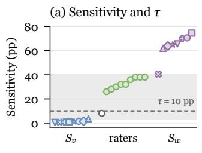  
(b) Regimes over ε

## F.3 Significance

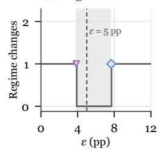  
Doubao-2.0, wording MiMo-2.6-Flash, voice  
Figure 11: Robustness of the regime thresholds. (a) Sensitivity of the 8 models, marked as in Figure 8, and of the 10 raters, green when significant. (b) Regime changes over ε. Shading marks the threshold values that keep all regimes.

Table 14 maps each claim type to its test, resampling unit, and multiplicity handling. For accuracy, we add two-sided bootstrap p-values to the paired bootstrap of the accuracy CIs and apply Holm correction over the 24 model–contrast tests. Table 15 reports the estimates with raw and corrected $p \textmd { - }$ values.

<table><tr><td>Contrast</td><td>Test</td><td>Unit</td><td>Multiplicity</td></tr><tr><td>Accuracy  $\Delta _ { v } , \Delta _ { w } , I$ </td><td>Bootstrap CI; two-sided p</td><td>Items/family</td><td>Holm over 24</td></tr><tr><td>Perception  $S _ { v } , S _ { w }$ </td><td>Paired bootstrap CI</td><td>Items/family</td><td></td></tr><tr><td>RAVDESS control</td><td>Clopper-Pearson; d&#x27;</td><td>Clips</td><td></td></tr><tr><td>Human listening</td><td>Item bootstrap; binomial</td><td>Items / trials</td><td>Per-rater α = 0.05</td></tr><tr><td>Hidden-state A</td><td>Item bootstrap CI</td><td>Items</td><td>Pre-specified layers</td></tr><tr><td>Expression E</td><td>Paired bootstrap CI; dz</td><td>Items</td><td></td></tr><tr><td>Paired-clip probe</td><td>Exact binomial vs. 50%</td><td>Trials</td><td></td></tr><tr><td>Excerpt probe</td><td>Exact McNemar</td><td>Items</td><td></td></tr></table>

Table 14: Tests behind the main claims. Accuracy pvalues are Holm-corrected in Table 15.

<table><tr><td>Model</td><td>Effect</td><td>Est. (pp)</td><td>p</td><td>PHolm</td></tr><tr><td>Gemini-3.8</td><td> $\Delta _ { v }$ </td><td>+0.6</td><td>0.6524</td><td>1.0000</td></tr><tr><td>Gemini-3.8</td><td> $\Delta _ { w }$ </td><td>-0.6</td><td>0.7332</td><td>1.0000</td></tr><tr><td>Gemini-3.8</td><td> $I$ </td><td>-1.8</td><td>0.3548</td><td>1.0000</td></tr><tr><td>Gemini-3.1</td><td> $\Delta _ { v }$ </td><td>+3.0</td><td>0.0592</td><td>1.0000</td></tr><tr><td>Gemini-3.1</td><td> $\Delta _ { w }$ </td><td>+1.0</td><td>0.5044</td><td>1.0000</td></tr><tr><td>Gemini-3.1</td><td> $I$ </td><td>-3.2</td><td>0.1080</td><td>1.0000</td></tr><tr><td>MiMo-2.6-Pro</td><td> $\Delta _ { v }$ </td><td>-0.9</td><td>0.6268</td><td>1.0000</td></tr><tr><td>MiMo-2.6-Pro</td><td> $\Delta _ { w }$ </td><td>-0.1</td><td>0.9652</td><td>1.0000</td></tr><tr><td>MiMo-2.6-Pro</td><td> $I$ </td><td>+0.7</td><td>0.7568</td><td>1.0000</td></tr><tr><td>MiMo-2.6-Flash</td><td> $\Delta _ { v }$ </td><td>+7.7</td><td>0.0008</td><td>0.0192</td></tr><tr><td>MiMo-2.6-Flash</td><td> $\Delta _ { w }$ </td><td>+2.6</td><td>0.3148</td><td>1.0000</td></tr><tr><td>MiMo-2.6-Flash</td><td> $I$ </td><td>-9.4</td><td>0.0092</td><td>0.2116</td></tr><tr><td>Doubao-2.0</td><td> $\Delta _ { v }$ </td><td>-2.6</td><td>0.1400</td><td>1.0000</td></tr><tr><td>Doubao-2.0</td><td> $\Delta _ { w }$ </td><td>-3.9</td><td>0.0488</td><td>1.0000</td></tr><tr><td>Doubao-2.0</td><td> $I$ </td><td>+1.5</td><td>0.5820</td><td>1.0000</td></tr><tr><td>Muse-1.3</td><td></td><td></td><td></td><td>1.0000</td></tr><tr><td>Muse-1.3</td><td> $\Delta _ { v }$ </td><td>+1.0 -0.7</td><td>0.6880 0.7372</td><td>1.0000</td></tr><tr><td>Muse-1.3</td><td> $\Delta _ { w }$   $I$ </td><td>-2.6</td><td>0.4536</td><td>1.0000</td></tr><tr><td>Qwen-2.5</td><td> $\Delta _ { v }$ </td><td>-0.6</td><td></td><td>1.0000</td></tr><tr><td>Qwen-2.5</td><td> $\Delta _ { w }$ </td><td>-0.6</td><td>0.7324 0.7536</td><td>1.0000</td></tr><tr><td>Qwen-2.5</td><td> $I$ </td><td>-0.9</td><td>0.7356</td><td>1.0000</td></tr><tr><td>MiMo-Audio</td><td> $\Delta _ { v }$ </td><td>-2.0</td><td>0.3120</td><td>1.0000</td></tr><tr><td>MiMo-Audio</td><td> $\Delta _ { w }$ </td><td>-0.2</td><td>0.9088</td><td>1.0000</td></tr><tr><td>MiMo-Audio</td><td> $I$ </td><td>+1.2</td><td>0.6488</td><td>1.0000</td></tr></table>

Table 15: Two-sided bootstrap p-values for the 24 accuracy effects, with Holm correction. Bold: $p _ { \mathrm { H o l m } } <$ 0.05.

## G Accuracy Details

Table 12 gives the cell accuracies and the effects behind Table 3 with 95% CIs, and Table 13 breaks them down by task family. Figure 12 plots the macro-averaged effects. MiMo-2.6-Flash’s vocal effect has the same sign in all 4 families.

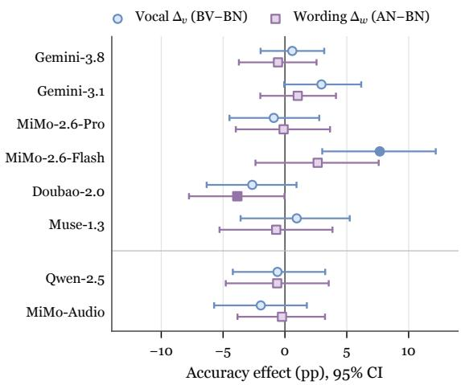  
Figure 12: Accuracy effects of frustrated voice and wording with 95% CIs. Filled markers: CI excludes zero.

Details for Obs 4. MiMo-2.6-Flash’s vocal effect of +7.7 pp [+3.0, +12.2] disappears under frustrated wording, which yields an interaction of −9.4 pp [−16.5, −2.3]. Its tone probe does not register the voice $( S _ { v } = 1 . 4 \mathrm { p p } [ - 0 . 9 , + 3 . 8 ]$ , excerpt BV−BN = 0).

## H Perception Details

Table 16 gives the label rates per cell and the perception contrasts with CIs, and Table 17 the confusion counts behind them. For every model, the frustrated voice barely changes the labels, whereas frustrated wording moves 40–77% of clips tofrustrated. Table 18 shows the probe of all 8 models by arousal quartile, where the vocal effect grows with arousal only under frustrated wording. Table 20 breaks both sensitivities down by task family, and the lexical sensitivity exceeds the acoustic one in every family for every model. Table 21 details the RAVDESS control, Tables 22 and 23 the open-label and paired-clip variants, and Table 19 the probe on the 15-s listening excerpts.

Measures. Voice and text match are the shares of parsed labels that agree with the vocal or the wording condition, with chance at 50%. A keyword rule parses the returned label, and unparsed labels are missing. In the open-label probe, angry,frustrated, and sad count as non-neutral. The RAVDESS control uses 96 strong-intensity angry and 96 neutral clips. Hits are angry clips labeled frustrated, false alarms (FA) are neutral clips labeled frustrated, and $d ^ { \prime }$ uses a log-linear correction. Arousal quartiles have about 88 items each, with mean contrasts of −0.007, +0.020, +0.042, and +0.089, and Q4−Q1 differences use an item bootstrap. In the paired-clip probe, the frustrated clip is played first or second in 50 trials each.

<table><tr><td></td><td colspan="4">P(frustrated) (%)</td><td colspan="3">Contrast (pp) [95% CI]</td><td colspan="2">Match (%)</td></tr><tr><td>Model</td><td>BN BV</td><td></td><td>AN</td><td>AV</td><td>BV-BN</td><td> $S _ { v }$ </td><td> $S _ { w }$ </td><td>Voice</td><td>Text</td></tr><tr><td>Gemini-3.8</td><td>0.5</td><td>0.8</td><td>70.0</td><td>72.5</td><td> $+ 0 . 3 \left[ 0 . 0 , + 0 . 8 \right]$ </td><td> $+ 1 . 4 \left[ - 0 . 2 , + 3 . 0 \right]$ </td><td>+71 [+66, +75]</td><td>50.7</td><td>85.3</td></tr><tr><td>Gemini-3.1</td><td>1.1</td><td>1.1</td><td>74.8</td><td>76.7</td><td> $0 . 0 \left[ - 1 . 7 , + 1 . 6 \right]$ </td><td> $+ 0 . 9 \left[ - 0 . 8 , + 2 . 6 \right]$ </td><td>+75[+70,+79]</td><td>50.5 87.3</td><td></td></tr><tr><td>MiMo-2.6-Pro</td><td>0.8</td><td>1.6</td><td>60.2</td><td>66.1</td><td> $+ 0 . 8 \left[ 0 . 0 , + 1 . 9 \right]$ </td><td> $+ 3 . 4 \ [ + 1 . 2 , + 5 . 5 ]$ </td><td>+62[+57, +66]</td><td></td><td>51.7 81.0</td></tr><tr><td>MiMo-2.6-Flash</td><td>0.6</td><td>1.7</td><td>64.3</td><td>65.1</td><td> $+ { \bf 1 . 1 } \left[ + 0 . 3 , + 2 . 3 \right]$ </td><td> $+ 1 . 4 \left[ - 0 . 9 , + 3 . 8 \right]$ </td><td> $+ 6 4 \left[ + 5 9 , + 6 8 \right]$ </td><td>50.4</td><td>81.8</td></tr><tr><td>Doubao-2.0</td><td>0.3</td><td>0.5</td><td>65.7</td><td>66.4</td><td> $+ 0 . 3 \left[ 0 . 0 , + 0 . 8 \right]$ </td><td> $+ 0 . 5 \left[ - 1 . 0 , + 2 . 1 \right]$ </td><td>+66 [+61, +70]</td><td>50.3</td><td>82.9</td></tr><tr><td>Muse-1.3</td><td>0.0</td><td>0.0</td><td>69.3</td><td>71.0</td><td> $0 . 0 \left[ 0 . 0 , 0 . 0 \right]$ </td><td> $+ 0 . 9 \left[ - 1 . 1 , + 2 . 9 \right]$ </td><td>+70 [+66, +74]</td><td>50.4</td><td>84.9</td></tr><tr><td>Qwen-2.5</td><td>0.3</td><td>0.0</td><td>39.9</td><td>41.4</td><td> $- 0 . 3 \left[ - 0 . 8 , 0 . 0 \right]$ </td><td> $+ 0 . 7 \left[ - 0 . 7 , + 2 . 2 \right]$ </td><td> $+ 4 1 \left[ + 3 6 , + 4 5 \right]$ </td><td>50.3</td><td>70.2</td></tr><tr><td>MiMo-Audio</td><td>2.5</td><td>3.1</td><td>66.9</td><td>68.6</td><td> $+ 0 . 5 \left[ - 0 . 6 , + 1 . 7 \right]$ </td><td> $+ 1 . 1 \left[ - 0 . 2 , + 2 . 4 \right]$ </td><td> $+ 6 5 \left[ + 6 0 , + 7 0 \right]$ </td><td>50.6</td><td>82.4</td></tr></table>

Table 16: Tone probe on the task clips: rate offrustrated labels per cell, perception contrasts with 95% CIs, and label agreement with the vocal and wording conditions. Bold: CI excludes zero.
<table><tr><td></td><td colspan="2">Neutral voice</td><td colspan="2">Frustrated voice</td><td colspan="2">Neutral wording</td><td colspan="2">Frustrated wording</td><td rowspan="2">Unparsed</td></tr><tr><td>Model</td><td>neu.</td><td>frus.</td><td>neu.</td><td>frus.</td><td>neu.</td><td>frus.</td><td>neu.</td><td>frus.</td></tr><tr><td>Gemini-3.8</td><td>457</td><td>249</td><td>447</td><td>259</td><td>701</td><td>5</td><td>203</td><td>503</td><td>0</td></tr><tr><td>Gemini-3.1</td><td>438</td><td>268</td><td>431</td><td>275</td><td>698</td><td>8</td><td>171</td><td>535</td><td>0</td></tr><tr><td>MiMo-2.6-Pro</td><td>490</td><td>216</td><td>466</td><td>240</td><td>697</td><td>9</td><td>259</td><td>447</td><td>0</td></tr><tr><td>MiMo-2.6-Flash</td><td>470</td><td>225</td><td>469</td><td>236</td><td>692</td><td>8</td><td>247</td><td>453</td><td>12</td></tr><tr><td>Doubao-2.0</td><td>473</td><td>233</td><td>469</td><td>237</td><td>703</td><td>3</td><td>239</td><td>467</td><td>0</td></tr><tr><td>Muse-1.3</td><td>460</td><td>244</td><td>455</td><td>249</td><td>703</td><td>0</td><td>212</td><td>493</td><td>4</td></tr><tr><td>Qwen-2.5</td><td>564</td><td>141</td><td>560</td><td>146</td><td>705</td><td>1</td><td>419</td><td>286</td><td>1</td></tr><tr><td>MiMo-Audio</td><td>461</td><td>245</td><td>453</td><td>253</td><td>686</td><td>20</td><td>228</td><td>478</td><td>0</td></tr></table>

Table 17: Confusion counts of the binary tone probe by vocal and by wording condition.

Details for Obs 2. Strong acted anger is labeled frustrated by Doubao-2.0 in 100% of clips, MiMo-Audio in 96.9%, MiMo-2.6-Pro in 95.8%, MiMo-2.6-Flash in 94.8%, Gemini-3.8 in 91.7%, Gemini-3.1 in 75.0%, and Qwen-2.5 in 72.6% $( d ^ { \prime } = 3 . 2 -$ 5.1). Muse-1.3 labels 20.8% (d′ = 1.8). In the top arousal quartile (mean contrast +0.089, about 2.5 times the average), frustrated-voice clips with neutral wording are labeled frustrated in 0–5.7% of cases. The open label set yields a non-neutral label for at most 2% of BN or BV clips, and paired-clip accuracy is 50% [40, 60] for Gemini-3.8 and 53% [43, 63] for MiMo-2.6-Pro, with clip 2 chosen in 94% and 77% of trials. On the 15-s excerpts, core accuracy is 48–50% and no BV−BN CI excludes zero.

Details for Obs 3. Where $S _ { v }$ departs from zero, the effect comes from the frustrated-wording cells. MiMo-2.6-Pro’s $S _ { v }$ of +3.4 pp [+1.2, +5.5] reflects AV−AN = +5.9 pp [+1.7, +10.2], while BV−BN is +0.8 pp, and its perception interaction of Eq. 4 is +5.1 pp [+0.8, +9.5]. Table 18 shows that from the lowest to the highest arousal quartile, AV−AN rises by 13.6 pp for both Gemini-3.8 [+4.6, +22.7] and MiMo-2.6-Pro [+2.3, +24.9], and by 11.4 pp [+4.5, +19.3] for Qwen-2.5. Averaged over all 8 models, BV−BN stays near zero in every quartile, from −0.1 to +1.0 pp, with one significant rise of +5.6 pp [+1.1, +11.3] for Gemini-3.1. The amplifier holds at matched acoustic contrast. Among the clip pairs in the top quartile of arousal contrast, which averages 0.10 under both wordings, the voice raises the labels by 5.4 pp under frustrated wording and by 0.2 pp under neutral wording.

<table><tr><td>Model</td><td>Hits Hit rate [95% CI]</td><td>FA</td><td> $d ^ { \prime }$ </td></tr><tr><td>Gemini-3.8</td><td>88/96</td><td>91.7 [84.2, 96.3]</td><td>0/963.92</td></tr><tr><td>Gemini-3.1</td><td></td><td>72/96 75.0 [65.1, 83.3]</td><td>0/963.23</td></tr><tr><td>MiMo-2.6-Pro</td><td></td><td>92/96 95.8 [89.7, 98.9]</td><td>0/964.25</td></tr><tr><td>MiMo-2.6-Flash</td><td>91/96</td><td>94.8 [88.3, 98.3]</td><td>0/964.15</td></tr><tr><td>Doubao-2.0</td><td>96/96</td><td>100.0 [96.2, 100.0]</td><td>0/96 5.13</td></tr><tr><td>Muse-1.3</td><td>20/96</td><td>20.8 [13.2, 30.3]</td><td>0/96 1.76</td></tr><tr><td>Qwen-2.5</td><td>69/95</td><td>72.6 [62.5, 81.3]</td><td>0/96 3.16</td></tr><tr><td>MiMo-Audio</td><td></td><td>93/96 96.9 [91.1, 99.4]</td><td>0/964.36</td></tr></table>

Table 21: RAVDESS positive control per model: hits, false alarms (FA), and $d ^ { \prime }$

<table><tr><td rowspan="2">Model</td><td colspan="5">Neutral wording: BV—BN (pp)</td><td colspan="5">Frustrated wording: AV—AN (pp)</td></tr><tr><td>Q1</td><td>Q2</td><td>Q3</td><td>Q4</td><td>Q4-Q1 [95% CI]</td><td>Q1</td><td>Q2</td><td>Q3</td><td>Q4</td><td>Q4-Q1 [95% CI]</td></tr><tr><td>Gemini-3.8</td><td>0.0</td><td>0.0</td><td>+1.1</td><td>0.0</td><td>0.0 [0.0, 0.0]</td><td>-4.5</td><td>+3.4</td><td>+2.3</td><td>+9.1</td><td>+13.6 [+4.6, +22.7]</td></tr><tr><td>Gemini-3.1</td><td>-3.4</td><td>+1.1</td><td>0.0</td><td>+2.3</td><td>+5.6 [+1.1, +11.3]</td><td>-1.1</td><td>+5.7</td><td>+1.1</td><td>+2.3</td><td>+3.4 [−4.5, +11.3]</td></tr><tr><td>MiMo-2.6-Pro</td><td>+1.1</td><td>0.0</td><td>+1.1</td><td>+1.1</td><td>0.0 [−3.4, +3.4]</td><td>-3.4</td><td>+9.1</td><td>+8.0</td><td>+10.2</td><td>+13.6 [+2.3, +24.9]</td></tr><tr><td>MiMo-2.6-Flash</td><td>+1.1</td><td>+1.2</td><td>+2.3</td><td>0.0</td><td>-1.1 [−3.4, 0.0]</td><td>+3.5</td><td>+1.1</td><td>0.0</td><td>+2.3</td><td>−1.2 [−12.7, +10.4]</td></tr><tr><td>Doubao-2.0</td><td>+1.1</td><td>0.0</td><td>0.0</td><td>0.0</td><td>-1.1 [−3.4, 0.0]</td><td>-2.2</td><td>+1.1</td><td>+1.1</td><td>+3.4</td><td>+5.7 [−2.3, +13.6]</td></tr><tr><td>Muse-1.3</td><td>0.0</td><td>0.0</td><td>0.0</td><td>0.0</td><td>0.0 [0.0, 0.0]</td><td>-2.2</td><td>+4.5</td><td>-2.3</td><td>+6.8</td><td>+9.1 [−1.1, +19.3]</td></tr><tr><td>Qwen-2.5</td><td>0.0</td><td>0.0</td><td>0.0</td><td>-1.1</td><td>−1.1 [−3.4, 0.0]</td><td>-5.7</td><td>+3.4</td><td>+3.4</td><td>+5.7</td><td>+11.4 [+4.5, +19.3]</td></tr><tr><td>MiMo-Audio</td><td>-1.1</td><td>0.0</td><td>+3.4</td><td>0.0</td><td>+1.1 [0.0, +3.4]</td><td>+3.4</td><td>-2.3</td><td>+3.4</td><td>+2.3</td><td>-1.1 [−7.9, +5.7]</td></tr></table>

Table 18: Vocal effect on the tone probe by arousal-contrast quartile. Bold: CI excludes zero.
<table><tr><td></td><td colspan="5">Core block (neutral wording)</td><td colspan="5">Optional block (frustrated wording)</td><td colspan="2">Full clips</td></tr><tr><td>Model</td><td>BN</td><td>BV</td><td>BV-BN [95% CI]</td><td>Acc.</td><td>d&#x27;</td><td>Catch</td><td>AN</td><td>AV</td><td>AV–AN [95% CI]</td><td>AN-BN BN</td><td></td><td>BV</td></tr><tr><td>Gemini-3.8</td><td>4.0</td><td>0.0</td><td>−4.0 [−10.0, 0.0]</td><td>48.0</td><td>-0.68</td><td></td><td>5/6 62.0</td><td>65.3</td><td>+2.0 [0.0, +6.1]</td><td>+58</td><td>2.0</td><td>2.0</td></tr><tr><td>Gemini-3.1</td><td>0.0</td><td></td><td>0.0 0.0 [0.0, 0.0]</td><td>50.0</td><td>0.00</td><td></td><td>4/658.0</td><td>64.0</td><td>+6.0 [−2.0, +14.0]</td><td></td><td>+580.0</td><td>2.0</td></tr><tr><td>MiMo-2.6-Pro</td><td>4.0</td><td></td><td>0.0 −4.0 [−10.0, 0.0]</td><td>48.0</td><td>-0.68</td><td></td><td></td><td></td><td>5/6 62.0 66.0 +4.0 [0.0, +10.0]</td><td></td><td>+58 2.0</td><td>2.0</td></tr><tr><td>MiMo-2.6-Flash</td><td>2.0</td><td></td><td>2.0 0.0 [−6.0, +6.0]</td><td>50.0</td><td>0.00</td><td>6/6</td><td>60.062.0</td><td></td><td>+2.0[−6.0, +10.0]</td><td>+58</td><td>0.0</td><td>4.0</td></tr><tr><td>Doubao-2.0</td><td>2.0</td><td></td><td>2.0 0.0 [0.0, 0.0]</td><td>50.0</td><td>0.00</td><td>6/6</td><td>56.0 52.0</td><td></td><td>−4.0 [−12.0, +4.0]</td><td>+54 2.0</td><td></td><td>2.0</td></tr><tr><td>Muse-1.3</td><td>0.0</td><td></td><td>0.0 0.0 [0.0, 0.0]</td><td>50.0</td><td>0.00</td><td>3/6</td><td>58.0</td><td>64.0</td><td>+6.0 [0.0, +14.0]</td><td>+58</td><td>0.0</td><td>0.0</td></tr><tr><td>Qwen-2.5</td><td>0.0</td><td></td><td>0.0 0.0 [0.0, 0.0]</td><td>50.0</td><td>0.00</td><td></td><td>5/642.0</td><td>48.0</td><td>+6.0 [0.0, +12.0]</td><td>+42 0.0</td><td></td><td>0.0</td></tr><tr><td>MiMo-Audio</td><td>2.0</td><td></td><td>0.0 −2.0 [−6.0, 0.0]</td><td>49.0</td><td>-0.44</td><td></td><td>6/6 62.0</td><td>60.0</td><td>−2.0[-6.0, 0.0]</td><td>+60 2.0</td><td></td><td>0.0</td></tr><tr><td>Humans</td><td></td><td></td><td>25.2 55.8 +30.6 [+22.2, +39.0]</td><td>65.3</td><td>0.81</td><td></td><td></td><td></td><td>60/60 38.2 63.0 +24.8 [+16.6, +33.2]</td><td>+13</td><td></td><td></td></tr></table>

Table 19: Tone probe on the 15-s listening excerpts, with RAVDESS catch trials and the full clips of the same 50 items. Humans: 10 raters, pooled over judgments. –: not measured. Bold: CI excludes zero.

<table><tr><td colspan="4">(a) Open label set: P(non-neutral) (%) Model BN BV BV-BN [95% CI]</td></tr><tr><td>Gemini-3.8 MiMo-2.6-Pro</td><td>1 0 0 2</td><td>-1[-3,0] +2 [0, +5]</td><td></td></tr><tr><td colspan="4"></td></tr><tr><td>(b) Paired clips: which sounds more frustrated? Model</td><td>Acc.</td><td>95% CI p</td><td>Picks 2</td></tr><tr><td>Gemini-3.8</td><td>50</td><td>[40,60] 1.00</td><td>94%</td></tr><tr><td>MiMo-2.6-Pro</td><td>53</td><td>[43,63]</td><td>77%</td></tr></table>

Table 22: Probe variants on the 100-item subset: (a) open label set and (b) two-clip forced choice. Label counts and position effects are in Table 23.

<table><tr><td colspan="6">(a) Open label set: label counts Model Clip neu. frus. angry sad happy</td></tr><tr><td>Gemini-3.8</td><td>BN</td><td>97</td><td>1 0</td><td>0</td><td>2</td></tr><tr><td>Gemini-3.8</td><td>BV</td><td>96</td><td>0</td><td>0 0</td><td>4</td></tr><tr><td>MiMo-2.6-Pro</td><td>BN</td><td>96</td><td>0</td><td>0 0</td><td>4</td></tr><tr><td>MiMo-2.6-Pro</td><td>BV</td><td>95</td><td>1</td><td>1 0</td><td>3</td></tr></table>

<table><tr><td colspan="3">(b) Paired clips: accuracy by position of the frustrated clip</td></tr><tr><td>Model</td><td>First Second</td><td>Picks 2</td></tr><tr><td>Gemini-3.8 MiMo-2.6-Pro</td><td>6% 26%</td><td>94% 94% 80% 77%</td></tr></table>

Table 23: Probe variants: (a) open-label counts and (b) paired-clip accuracy by position of the frustrated clip.

<table><tr><td rowspan="2">Model</td><td rowspan="2">Representation</td><td colspan="4">Relative layer depth</td></tr><tr><td>0</td><td>0.25</td><td>0.5 0.75</td><td>1</td></tr><tr><td>Qwen-2.5</td><td>Audio encoder</td><td>0.60</td><td>0.65</td><td>0.68 0.67</td><td>0.64</td></tr><tr><td>Qwen-2.5</td><td>LLM over audio</td><td>0.60</td><td>0.58 0.60</td><td>0.61</td><td>0.58</td></tr><tr><td>Qwen-2.5</td><td>LLM at answer</td><td>0.50</td><td>0.52</td><td>0.57 0.61</td><td>0.58</td></tr><tr><td>MiMo-Audio</td><td>Audio encoder</td><td>0.67</td><td>0.67</td><td>0.70 0.73</td><td>0.67</td></tr><tr><td>MiMo-Audio</td><td>LLM over audio</td><td>0.58</td><td>0.53</td><td>0.54 0.56</td><td>0.51</td></tr><tr><td>MiMo-Audio</td><td>LLM at answer</td><td>0.50</td><td>0.56</td><td>0.54 0.45</td><td>0.58</td></tr></table>

Table 25: Length-balanced paired accuracy of the hidden-state probes at 5 relative depths, from the perlayer curves of Figure 7. Chance: 0.5.

## I Hidden-State Probe Details

Representations. Each model hears the BN and BV clips of all 353 items with the tone-probe prompt under greedy decoding, and we record its tone label and 3 representations per clip. For Qwen-2.5, these are the outputs of the 32 audio-encoder layers averaged over time, the input embedding and the hidden states of the 28 LLM layers averaged over the audio-token positions, and the same 29 LLM states at the last prompt position, where the answer is produced. MiMo-Audio reads discrete audio codes, so its audio side is the encoder of its audio tokenizer. For MiMo-Audio, the representations are the outputs of the 32 tokenizer-encoder layers averaged over time, followed by the state before quantization and the reconstruction from the 8 codebooks the LLM reads, the input embedding and the hidden states of the 36 LLM layers averaged over the audio positions, and the same 37 LLM states at the last prompt position. The pre-specified middle and last layers are 16 and 31 for the Qwen-2.5 encoder, 14 and 28 for its LLM, 17 and 33 for the MiMo-Audio tokenizer encoder, where 33 is the 8-codebook reconstruction, and 18 and 36 for its LLM.

<table><tr><td></td><td colspan="4">Acoustic sensitivity  $S _ { v }$  (pp)</td><td colspan="4">Lexical sensitivity  $S _ { w }$  (pp)</td></tr><tr><td>Model</td><td>MMLU-Pro</td><td>GPQA</td><td>IFEval</td><td>MATH-500</td><td>MMLU-Pro</td><td>GPQA</td><td>IFEval</td><td>MATH-500</td></tr><tr><td>Gemini-3.8</td><td>+0.6</td><td>+0.6</td><td>+3.4</td><td>+1.1</td><td>+69</td><td>+70</td><td>+79</td><td>+65</td></tr><tr><td>Gemini-3.1</td><td>-2.4</td><td>+1.2</td><td>+2.2</td><td>+2.6</td><td>+74</td><td>+69</td><td>+84</td><td>+71</td></tr><tr><td>MiMo-2.6-Pro</td><td>+1.8</td><td>+3.0</td><td>+3.9</td><td>+4.7</td><td>+54</td><td>+60</td><td>+74</td><td>+61</td></tr><tr><td>MiMo-2.6-Flash</td><td>-3.9</td><td>+1.0</td><td>+4.5</td><td>+2.2</td><td>+60</td><td>+62</td><td>+72</td><td>+60</td></tr><tr><td>Doubao-2.0</td><td>0.0</td><td>-2.4</td><td>+2.8</td><td>+1.6</td><td>+64</td><td>+63</td><td>+71</td><td>+65</td></tr><tr><td>Muse-1.3</td><td>+2.9</td><td>-0.2</td><td>+1.7</td><td>-1.1</td><td>+71</td><td>+75</td><td>+71</td><td>+63</td></tr><tr><td>Qwen-2.5</td><td>0.0</td><td>0.0</td><td>+0.9</td><td>+1.6</td><td>+33</td><td>+46</td><td>+46</td><td>+36</td></tr><tr><td>MiMo-Audio</td><td>0.0</td><td>+0.6</td><td>+1.1</td><td>+2.6</td><td>+62</td><td>+67</td><td>+70</td><td>+61</td></tr></table>

Table 20: Acoustic and lexical sensitivity of the tone probe by task family.
<table><tr><td></td><td colspan="2">Qwen-2.5</td><td colspan="2">MiMo-Audio</td></tr><tr><td>Representation</td><td>Middle layer</td><td>Last layer</td><td>Middle layer</td><td>Last layer</td></tr><tr><td>Audio side</td><td>0.671 [0.619, 0.725]</td><td>0.634 [0.584, 0.687]</td><td>0.693 [0.643, 0.743]</td><td>0.554 [0.507, 0.604]</td></tr><tr><td>Audio side, residualized</td><td>0.630 [0.573, 0.684]</td><td>0.575 [0.519, 0.628]</td><td>0.651 [0.598, 0.705]</td><td>0.560 [0.508, 0.618]</td></tr><tr><td>LLM, audio tokens</td><td>0.601 [0.552, 0.647]</td><td>0.567 [0.516, 0.620]</td><td>0.542 [0.496, 0.590]</td><td>0.520 [0.469, 0.573]</td></tr><tr><td>LLM, audio tokens, residualized</td><td>0.657 [0.602, 0.710]</td><td>0.609 [0.556, 0.662]</td><td>0.589 [0.540, 0.636]</td><td>0.601 [0.546, 0.655]</td></tr><tr><td>LLM, answer position</td><td>0.619 [0.565, 0.676]</td><td>0.611 [0.556, 0.668]</td><td>0.538 [0.482, 0.596]</td><td>0.539 [0.483, 0.595]</td></tr><tr><td>LLM, answer position, residualized</td><td>0.586 [0.531, 0.640]</td><td>0.557 [0.500, 0.613]</td><td>0.513 [0.459, 0.572]</td><td>0.548 [0.491, 0.605]</td></tr><tr><td>Acoustic features (18)</td><td colspan="2">0.667 [0.612, 0.722]</td><td colspan="2">0.669 [0.617, 0.720]</td></tr><tr><td>Log-mel mean and spread</td><td colspan="2">0.635 [0.578, 0.689]</td><td colspan="2">0.630 [0.574, 0.686]</td></tr></table>

Table 24: Length-balanced paired accuracy [95% CI] of the hidden-state probes at the pre-specified layers and of the acoustic controls. Residualized: acoustic features and clip length regressed out. Chance: 0.5.

Probe. A logistic regression with L2 regularization on standardized features separates BV from BN clips. Five folds split the items, so both clips of an item fall in the same fold, and every clip receives an out-of-fold score. At the pre-specified layers, an inner three-fold item-grouped cross-validation on the training items selects the regularization strength C from $\{ 1 0 ^ { - 3 } , 1 0 ^ { - 2 } , 1 0 ^ { - 1 } , \hat { 1 } \}$ . The perlayer curves in Figure 7 use $C = 1 0 ^ { - 2 }$ at every layer.

Length-balanced metric. Paired accuracy is the share of items whose BV clip scores above its BN clip, with chance at 0.5. Because the frustrated voice is faster, the BV clip is the shorter one in

234 of the 353 items, so a probe that reads clip length alone would score above chance. Equation 5 therefore averages paired accuracy over the items whose BV clip has fewer audio tokens and those whose BV clip has more, which puts a pure length probe at 0.5. CIs come from 2,000 item resamples within each stratum.

Acoustic features and residualization. The 18 acoustic features are clip duration, the mean, spread, and 10th, 50th, and 90th percentiles of frame loudness, the peak level, the median, interquartile range, 10th and 90th percentiles, and spread of pitch in semitones, the voiced fraction, the mean and spread of the spectral centroid, spectral flatness, zero-crossing rate, and onset rate. Relative to its BN clip, the BV clip has a higher onset rate in 61% of items, higher pitch in 61% with a median shift of +0.4 semitones, and a higher spectral centroid in 67%, at similar loudness with a median shift of +0.2 dB. For the residualized probes, a linear regression on the 18 features and the log clip length is fitted to the hidden states of the training clips within each fold, and the probe is trained and tested on the residuals. Probes on the 18 features and on the clip-level log-mel mean and spread use the same folds.

<table><tr><td rowspan="2">Measure</td><td colspan="3">Neutral wording (BV—BN, 353 pairs)</td><td colspan="3">Frustrated wording (AV—AN, 353 pairs)</td></tr><tr><td>∆ [95% CI]</td><td> $d _ { z }$ </td><td> $> 0$ </td><td>∆ [95% CI]</td><td> $d _ { z }$ </td><td> $> 0$ </td></tr><tr><td>Arousal</td><td>+0.030 [+0.026, +0.035]</td><td>+0.70</td><td>73%</td><td>+0.041 [+0.035, +0.047]</td><td>+0.73</td><td>79%</td></tr><tr><td>Dominance</td><td>+0.022 [+0.019, +0.026]</td><td>+0.69</td><td>74%</td><td>+0.030 [+0.026, +0.035]</td><td>+0.74</td><td>80%</td></tr><tr><td>Valence</td><td>+0.009 [+0.006, +0.012]</td><td>+0.30</td><td>65%</td><td>+0.001 [−0.003, +0.004]</td><td>+0.02</td><td>52%</td></tr><tr><td>e2v P(neutral)</td><td>-0.019 [−0.041, +0.001]</td><td>-0.10</td><td>40%</td><td>-0.046 [−0.067, −0.026]</td><td>-0.23</td><td>38%</td></tr><tr><td>e2v P(angry)</td><td>+0.006 [−0.003, +0.015]</td><td>+0.06</td><td>36%</td><td>+0.032 [+0.017, +0.047]</td><td>+0.23</td><td>56%</td></tr><tr><td>e2v P(sad)</td><td>-0.002 [−0.005, +0.001]</td><td>-0.07</td><td>41%</td><td>-0.001 [−0.008, +0.005]</td><td>-0.02</td><td>49%</td></tr><tr><td>e2v P(happy)</td><td>+0.014 [−0.002, +0.031]</td><td>+0.09</td><td>50%</td><td>-0.009 [−0.023, +0.005]</td><td>-0.07</td><td>53%</td></tr><tr><td>Duration (s)</td><td>-0.65 [−1.33, +0.28]</td><td>-0.08</td><td>32%</td><td>−0.37 [−1.30, +1.10]</td><td>-0.03</td><td>38%</td></tr></table>

Table 26: Paired SER differences between frustrated and neutral voice, by wording. Bold: CI excludes zero.

Results. Table 25 reads the per-layer curves at 5 relative depths, and Table 24 gives the lengthbalanced paired accuracy at the pre-specified layers. For Qwen-2.5, the audio encoder reaches 0.671 at the middle layer, on par with the 18 acoustic features at 0.667, and the LLM states over the audio reach 0.601, rising to 0.657 once the acoustic features and clip length are regressed out. At the answer position, the probe reaches 0.619 at the middle and 0.611 at the last layer. For MiMo-Audio, the tokenizer encoder reaches 0.693 at the middle layer, on par with the acoustic features at 0.669, and the 8-codebook reconstruction reaches 0.554, close to the 0.575 and 0.592 of the patch encoder that groups the codes for the LLM. Its LLM states over the audio reach 0.542 and 0.520, rising to 0.589 and 0.601 once the acoustic features and clip length are regressed out, and the answer position gives 0.538 and 0.539. With the tone-probe prompt, Qwen-2.5 labels 0 of 353 BV clips and 1 of 353 BN clips frustrated, and MiMo-Audio labels 11 and 9.

## J Expression Details

Table 1 in Section 4 summarizes the SER checks over both wordings, and Table 28 adds emotion2vec’s top labels and the probe labels on BV clips by arousal quartile. Table 26 separates the two wordings, and Figure 13 shows the distribution of the paired arousal differences.

<table><tr><td>Cell</td><td>1 neu.</td><td>hap. ang.</td><td></td><td></td><td>dis. sur.</td><td></td><td>sad unk.</td></tr><tr><td>BN</td><td>305</td><td>24</td><td>4</td><td>10</td><td>5</td><td>1</td><td>4</td></tr><tr><td>AN</td><td>298</td><td>28</td><td>9</td><td>8</td><td>3</td><td>3</td><td>4</td></tr><tr><td>BV</td><td>294</td><td>32</td><td>5</td><td>8</td><td>8</td><td>1</td><td>5</td></tr><tr><td>AV</td><td>287</td><td>19</td><td>21</td><td>8</td><td>3</td><td>4</td><td>11</td></tr></table>

Table 27: emotion2vec+ top label per cell (353 clips each).

The frustrated voice raises arousal and dominance under both wordings, with larger shifts under frustrated wording, +0.041 against +0.030 for arousal. Table 27 shows that with neutral wording, emotion2vec’s anger probability does not change detectably, whereas with frustrated wording it rises.

<table><tr><td colspan="4">(a) emotion2vec top label (% of clips) Voice neutral happy angry other</td></tr><tr><td>Neutral Frustrated</td><td>85.4 82.3</td><td>7.4 1.8 7.2 3.7</td><td>n 5.4 706 6.8706</td></tr><tr><td colspan="4"></td></tr><tr><td colspan="4">(b) P(frustrated | BV) (%) by arousal quartile Model Q1 Q2 Q3</td></tr><tr><td colspan="4">Gemini-3.8 1.1 1.1 1.1 Gemini-3.1 0.0 2.3 0.0 MiMo-2.6-Pro</td></tr><tr><td colspan="4">2.2 2.3 1.1 MiMo-2.6-Flash</td></tr><tr><td colspan="4">2.2 2.3 2.3 Doubao-2.0 1.1 1.1 0.0</td></tr><tr><td colspan="4">Muse-1.3 0.0 0.0 0.0</td></tr><tr><td colspan="4">Qwen-2.5 0.0 0.0 0.0</td></tr><tr><td colspan="4">MiMo-Audio 1.1 1.1 4.5</td></tr></table>

Table 28: Further expression checks: (a) emotion2vec top labels by voice and (b) probe labels on BV clips by arousal quartile.

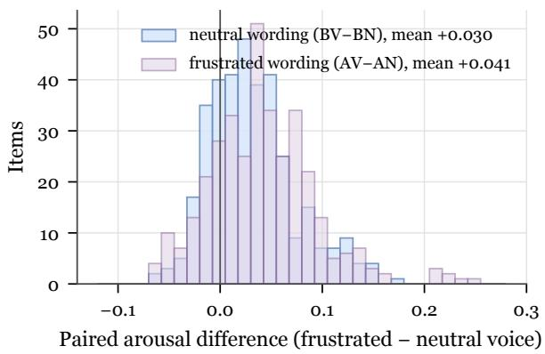  
Figure 13: Paired arousal difference between frustratedand neutral-voice clips across items, by wording.

<table><tr><td rowspan="2">Model</td><td colspan="4">Response length (words)</td><td colspan="4">Conciliatory markers (% of responses)</td></tr><tr><td></td><td>BN Vocal  $\Delta _ { v }$ </td><td>Wording</td><td> $\Delta _ { w }$ </td><td>BN Vocal</td><td> $\Delta _ { v }$ </td><td>Wording</td><td> $\Delta _ { w }$ </td></tr><tr><td>Gemini-3.8</td><td>144</td><td> $+ 7 . 7 \left[ - 0 . 9 , + 1 7 . 7 \right]$ </td><td></td><td> $+ 5 . 0 [ - 4 . 2 , + 1 4 . 3 ]$ </td><td></td><td></td><td> $4 . 5 ~ + 1 . 1 \ : [ - 3 . 4 , + 5 . 6 ]$ </td><td> $- 1 . 1 \left[ - 4 . 5 , + 2 . 2 \right]$ </td></tr><tr><td>Gemini-3.1</td><td>181</td><td> $- 4 . 2 \left[ - 1 5 . 1 , + 5 . 4 \right]$ </td><td></td><td> $- 7 . 8 [ - 1 7 . 9 , + 2 . 8 ]$ </td><td></td><td></td><td> $5 . 6 ~ + 3 . 4 [ - 3 . 4 , + 1 0 . 1 ]$ </td><td> $0 . 0 \left[ - 5 . 6 , + 5 . 6 \right]$ </td></tr><tr><td>MiMo-2.6-Pro</td><td>133</td><td> $+ 5 . 8 \left[ - 1 3 . 3 , + 3 3 . 4 \right]$ </td><td></td><td> $+ 1 7 . 4 \left[ - 1 5 . 9 , + 7 0 . 0 \right]$ </td><td></td><td></td><td> $5 . 6 ~ - 3 . 4 [ - 8 . 0 , 0 . 0 ]$ </td><td> $- 1 . 2 \left[ - 7 . 1 , + 4 . 8 \right]$ </td></tr><tr><td>MiMo-2.6-Flash 141</td><td></td><td> $+ 1 3 . 6 [ - 1 . 9 , + 3 1 . 0 ]$ </td><td></td><td> $- 3 . 2 [ - 2 2 . 1 , + 1 3 . 1 ]$ </td><td></td><td></td><td> $3 . 4 \ + 1 . 2 [ - 2 . 5 , + 6 . 2 ]$ </td><td> $+ 1 . 2 \ [ - 3 . 6 , + 7 . 2 ]$ </td></tr><tr><td>Doubao-2.0</td><td>289</td><td> $+ 4 . 8 \left[ - 1 0 . 8 , + 2 0 . 5 \right]$ </td><td></td><td> $- 5 . 8 [ - 2 6 . 2 , + 1 3 . 9 ]$ </td><td></td><td></td><td> $4 . 5 ~ + 1 . 1 \ : [ - 4 . 5 , + 6 . 7 ]$ </td><td> $+ 2 . 2 \left[ - 3 . 4 , + 9 . 0 \right]$ </td></tr><tr><td>Muse-1.3</td><td></td><td> $1 4 8 \ - 7 . 6 [ - 1 7 . 0 , + 2 . 5 ]$ </td><td></td><td> $- 1 0 . 6 [ - 2 3 . 0 , + 1 . 9 ]$ </td><td></td><td></td><td> $7 . 9 \ \mathrm { \ - } 1 . 1 \ [ - 7 . 9 , + 5 . 6 ]$ </td><td> $- 1 . 1 \left[ - 6 . 7 , + 4 . 5 \right]$ </td></tr><tr><td>Qwen-2.5</td><td>163</td><td> $+ 2 . 5 [ - 1 3 . 2 , + 1 8 . 8 ]$ </td><td></td><td> $- 1 4 . 7 \left[ - 3 4 . 7 , + 8 . 1 \right]$ </td><td></td><td></td><td> $2 . 3 \ + 1 . 2 [ - 2 . 4 , + 6 . 0 ]$ </td><td> $+ 5 . 8 \left[ 0 . 0 , + 1 1 . 6 \right]$ </td></tr><tr><td>MiMo-Audio</td><td></td><td> $3 6 ~ - 0 . 2 [ - 1 . 8 , + 1 . 2 ]$ </td><td></td><td> $- 0 . 2 \left[ - 1 . 8 , + 1 . 3 \right]$ </td><td></td><td> $1 . 1 \ \mathrm { ~ 0 . 0 ~ } [ 0 . 0 , 0 . 0 ]$ </td><td></td><td> $+ 1 . 1 \left[ 0 . 0 , + 3 . 4 \right]$ </td></tr></table>

Table 29: Response style on IFEval: length and conciliatory-marker rate with vocal and wording effects. Bold: CI excludes zero.
<table><tr><td></td><td colspan="5">Response length (words)</td><td colspan="6">Conciliatory markers (% of responses)</td></tr><tr><td>Model</td><td>BN</td><td>BV</td><td>AN</td><td>AV</td><td>Interaction</td><td>BN</td><td>BV</td><td>AN</td><td>AV</td><td>Interaction</td><td></td></tr><tr><td>Gemini-3.8</td><td>144</td><td>152</td><td>149</td><td>146</td><td> $\mathbf { - 1 1 . 4 } \left[ - 2 2 . 5 , - 1 . 2 \right]$ </td><td>4.5</td><td>5.6</td><td>3.4</td><td>3.4</td><td></td><td>-1.1 [−8.0, +5.7]</td></tr><tr><td>Gemini-3.1</td><td>181</td><td>177</td><td>173</td><td>176</td><td>+6.4 [−4.4, +18.6]</td><td>5.6</td><td>9.0</td><td>5.6</td><td>11.2</td><td></td><td>+2.2 [−7.9, +12.4]</td></tr><tr><td>MiMo-2.6-Pro</td><td>133</td><td>137</td><td>152</td><td>143</td><td>-8.4 [−52.3, +22.8]</td><td>5.6</td><td>1.1</td><td>4.8</td><td>2.3</td><td></td><td>+1.2[−5.0, +7.5]</td></tr><tr><td>MiMo-2.6-Flash</td><td>141</td><td>154</td><td>139</td><td>130</td><td>-24.8 [−69.6, +8.1]</td><td>3.4</td><td>4.9</td><td>4.7</td><td>4.8</td><td></td><td>+1.4 [−5.4, +8.1]</td></tr><tr><td>Doubao-2.0</td><td>289</td><td>294</td><td>283</td><td>268</td><td>-19.4 [−44.1, +5.2]</td><td>4.5</td><td>5.6</td><td>6.7</td><td>5.6</td><td></td><td>−2.2 [−11.2, +6.7]</td></tr><tr><td>Muse-1.3</td><td>148</td><td>140</td><td>137</td><td>141</td><td>+11.3[−6.0, +27.2]</td><td>7.9</td><td>6.7</td><td>6.7</td><td>3.4</td><td></td><td>−2.2 [−9.0, +4.5]</td></tr><tr><td>Qwen-2.5</td><td>163</td><td>160</td><td>152</td><td>156</td><td>-4.5 [−22.3, +12.9]</td><td>2.3</td><td>3.4</td><td>9.0</td><td>8.0</td><td></td><td>−1.2 [−9.6, +6.0]</td></tr><tr><td>MiMo-Audio</td><td>36</td><td>36</td><td>36</td><td>36</td><td>−0.2 [−1.9, +1.7]</td><td>1.1</td><td>1.1</td><td>2.2</td><td>2.2</td><td></td><td>0.0 [−3.4, +3.4]</td></tr></table>

Table 30: IFEval response style by cell with the wording-by-voice interaction. Bold: CI excludes zero.

## K Response Style

We measure style on IFEval, whose free-form responses are long enough to vary. Length is the number of whitespace-separated words. A response counts as containing a conciliatory marker if it matches, case-insensitively, any of: sorry, apologize/apologise, I understand, I hear you, frustrat\*, I get it, no worries, don’t worry, let me help, happy to help, calm, take a breath, I know this, that sounds. Table 29 reports the vocal and wording effects and Table 30 the cell means and interactions. No model changes its style detectably under frustrated voice or frustrated wording.

## L Case Studies

The following cases quote real items and model outputs. Probe answers are quoted in full when short. Task answers are the first characters of the final response.

Case 1: A strongly contrasted voice is heard as neutral but changes an answer

Item mmlu\_pro\_11435 (MMLU-Pro, gold I): the largest item-level arousal contrast in VOXAFFECT, +0.254 for frustrated minus neutral voice averaged over both wordings. With neutral wording, BN scores 0.407 and BV 0.530.

Neutral script (excerpt): The moving coil-meters, damping is provided by Options: A. the resistance ofthe coil. B. the inertia ofthe coil. C. the coil spring attached to the moving. D. the electric charge in the coil. E. the magneticfield created by the coil. F. damping vane in the airtight chamber. G. the friction between the coil and the frame. H. [. . . ]

Tone probe on BV: “neutral” from all 6 proprietary models.

MiMo-2.6-Flash answers: BN “F” and BV “I”.

## Case 2: Frustrated wording alone is labeled frustrated

Pattern: in 142 items, all 6 proprietary models label the AN clip frustrated and the BN clip neutral, although both are read in the same neutral voice.

Frustrated script of ifeval\_1548 (IFEval): Write the filefor "The Rainbow Cafe"—a queer-owned business—already. It needsfour sections, and each section must start with "SECTION X". Don’t skip that format or I’ll have to repeat myself.

Tone probe on AN: “frustrated” from all 6 proprietary models.

## Case 3: An unperceived voice changes an MMLU-Pro answer

Item mmlu\_pro\_2925 (MMLU-Pro, gold D).

Neutral script (excerpt): Which ofthefollowing observations helped Darwin shape his concept of descent with modification? Options: A. Species diversity declines farther from the equator. B. Fewer species live on islands than on the nearest continents. C. Birds can befound on islands located farther from the [. . . ]

MiMo-2.6-Flash answers: BN “C”, BV “D”, AN “D”, and ${ \mathrm { A V } } \ ^ { \cdots } C ^ { \prime \prime }$ . Its tone probe labels both the BN and the BV clip neutral.

Across all items: MiMo-2.6-Flash is wrong in BN and right in BV for 36 items, and right in BN and wrong in BV for 13, the asymmetry behind its vocal effect in Obs 4.

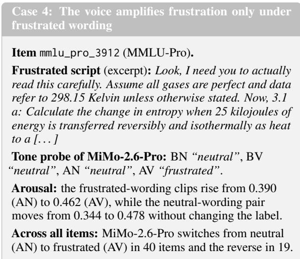

## M Human Listening Protocol and Materials

## M.1 Design and Criteria

Purpose. The listening test is a manipulation check of whether people hear the synthetic frustration when the wording is neutral. Its task matches the model probe exactly, a single clip and a binary neutral-or-frustrated judgment. The criteria and interpretation bands below were fixed before any rating was collected.

Stimuli. We draw 50 items from the 100-item subset (13 MMLU-Pro, 13 GPQA-Diamond, 12 IFEval, 12 MATH-500). The core block holds the BN and BV clips of each item (100 clips) and 6 RAVDESS catch trials, 3 strong-anger and 3 neutral clips from 6 actors. An optional block holds the AN and AV clips of the same items. Each TTS clip is cut to its first 15 s with a 0.3-s fade-out and scaled by a linear gain to −26 LUFS without compression. File names do not reveal the condition. Each block has 5 playback orders, in which the two clips of an item are at least 5 positions apart and catch trials are never adjacent.

Raters and procedure. The 10 raters are recruited through personal contacts. The raters, two per playback order, listen with headphones in a quiet room. They judge tone only and ignore the words, play each clip once and at most once more, answer each clip before the next, and do not go back, compare clips, discuss, or transcribe. For every clip they record the binary judgment, a frustration intensity from 1 to 5, and a confidence from 1 to 3.

Exclusion and criteria. A rater who misjudges 2 or more of the 6 catch trials is excluded and replaced. The primary criterion is pooled accuracy on the 100 core TTS clips, with a 95% CI from an itemclustered bootstrap (10,000 resamples). It is met if the one-sided 95% lower bound exceeds 50%. Per rater, at least 59 of 100 correct is significant (onesided exact binomial, $p < . 0 5 )$ . We also report d′ and bias c with a log-linear correction, the paired difference in mean intensity between BV and BN clips with a one-sided Wilcoxon signed-rank test, and Fleiss’ κ (Fleiss, 1971), which we read as at least moderate at $\kappa \geq 0 . 4 0$ , fair at 0.20–0.40, and weak below 0.20. Pooled accuracy maps to prespecified bands: clearly perceptible $\mathrm { a t } \geq 7 5 \%$ , perceptible but subtle at 60–75%, marginal when the criterion is met below 60%, and not reliably perceptible when the criterion is not met. The band drops one level if fewer than half of the included raters individually reach 59 of 100.

Comparison with models. All 8 models are probed on the identical excerpts. Human and model accuracy are compared with the same itemclustered bootstrap, and per-clip agreement between the human majority and each model with an exact McNemar test.

## M.2 Results

All 10 raters judged all 60 catch trials correctly, so none was excluded. Figure 14 shows each rater’s hit and false-alarm rates and the difference in mean intensity between BV and BN excerpts. Pooled core accuracy is 65.3% (95% CI [61.1, 69.5], onesided lower bound 61.8%), with $d ^ { \prime } = 0 . 8 1 \ [ 0 . 6 0 $ 1.05] and $c = 0 . 2 6 .$ , a hit rate of 55.8% and a falsealarm rate of 25.2%. The positive c reflects a bias toward answering neutral. Individual raters score 54 to 69 of 100, and 9 of 10 reach 59 (one-sided $p < . 0 5 )$ . Frustrated-voice excerpts receive higher intensity ratings than their neutral-voice counterparts by 0.73 points (95% CI [0.54, 0.91], higher for 88% of items, Wilcoxon $p < 1 0 ^ { - 8 } )$ , and agreement is moderate (Fleiss’ $\kappa = 0 . 4 1$ [0.33, 0.48]). The pre-specified bands therefore classify the frustration as perceptible but subtle. On the identical excerpts, human accuracy exceeds that of every model by 15.3–17.3 points (all item-clustered 95% CIs above 10 points), and the human majority is correct on 71 of 100 clips against 48–50 for the models (exact McNemar p < .002 for each model). In the optional block, frustrated wording raises the share of frustrated judgments by 13.0 points (95% CI [7.0, 19.4]), far less than the 42–60 points of the models, and the voice remains audible under frustrated wording (AV−AN = +24.8 points), whereas the models’ AV−AN stays between −4 and +6 points.

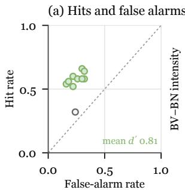

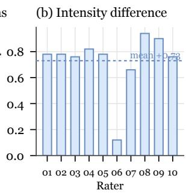  
Figure 14: Listening results per rater on the core excerpts. (a) Hit and false-alarm rates, green when the rater is significant. (b) Mean intensity of BV minus BN excerpts.

## M.3 Rater Materials

Rater instructions. Raters receive a written guide that defines the two labels and the rating scales. Neutral means calm and steady, without apparent emotion. Frustrated means impatient, irritated, hurried, or pressing. Raters judge only how a clip is spoken, using speech rate, pitch, emphasis, and articulation, and ignore the literal content, the normalized overall loudness, voice quality, and whether a voice sounds synthetic. Each clip is judged on its own. Raters play it once and at most once more, answer before moving on, do not return to earlier clips, do not compare clips, do not discuss clips with other raters, and do not transcribe the audio or use any tool. Excerpts may end mid-sentence because they are cut at 15 s.

Rating scales. Frustration intensity is rated for every clip, including clips judged neutral: 1 not at all, 2 slightly, 3 moderately, 4 clearly, and 5 very frustrated. Confidence is rated as 1 guessing, 2 fairly sure, and 3 very sure.

Rating form. Each block comes with a rating form that records, for each clip in playback order, the judgment, the intensity, and the confidence. The core block (106 clips) and the optional block (100 clips) each take about 35–40 minutes, with a break of at least 10 minutes between them.

## N Reproducibility

Speaker embeddings use SpeechBrain 1.1.0, synthesis uses Doubao TTS 2.0, rewriting and auditing use DS-V4-Pro, and SER uses audeering/wav2vec2-largerobust-12-ft-emotion-msp-dim and emotion2vec/emotion2vec\_plus\_large. We release $\operatorname { V o x A F F E C T } ^ { 2 }$ with per-item manifests that record the source item, spoken scripts, gold answer, voice, and condition, together with the prompts and the evaluation scripts for the task and the probe. The clips of MMLU-Pro, IFEval, and MATH-500 are public. As GPQA asks that its examples not be posted online, the scripts, gold answers, and clips of the GPQA-Diamond items are provided on request with the GPQA canary string. The figure icons come from OpenMoji (HfG Schwäbisch Gmünd, 2019) under CC BY-SA 4.0 and Fluent Emoji (Microsoft, 2022) under MIT.