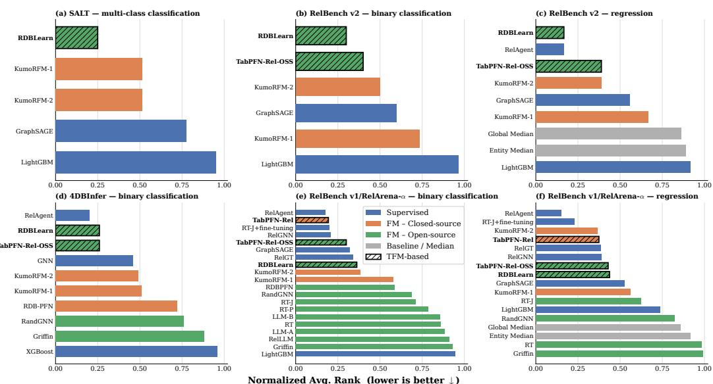
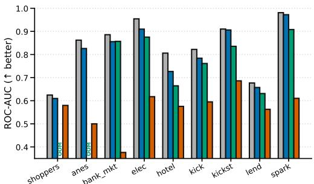
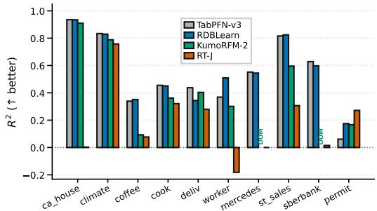
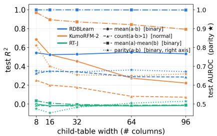
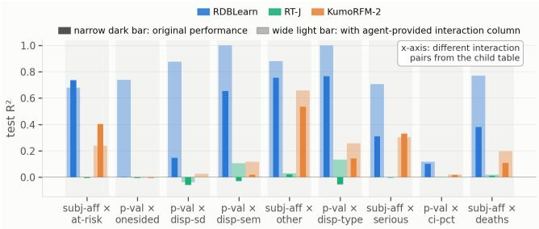

# WHY TABULAR FOUNDATION MODELS EXCEL ON RELATIONAL DATA THEY HAVE NEVER SEEN

Linjie Xu, Yiqun Hu, Jixiang He, & David Wipf∗ University of Hong Kong, Shanghai X-Lab

## ABSTRACT

Given a relational database (RDB) storing heterogeneous tabular information, how can we predict missing (or future) values in some target column of interest? As candidate targets are numerous in enterprise settings, it is preferable to avoid learning a new model from scratch each time there is a new prediction task. Frozen foundation models (FMs) based on in-context learning (ICL) and RDB-specific pre-training provide a viable solution, but the ideal design still remains largely unresolved. Perhaps unexpectedly, preliminary evidence has recently shown that existing single-table FMs (aka TFMs), when combined with suitable parameter-free relational encoders, can be quite competitive in practice despite zero exposure to RDB pre-training or relational data of any kind. In this work we first empirically confirm this phenomenon with a more diverse array of experiments. We then turn to our main contribution, namely, surfacing multiple complementary explanations for why TFMs behave so effectively. These explanations ultimately hinge on innate synergies whereby parameter-free encoders map relational effects to fixedlength embeddings that loosely mimic distributions for which TFMs were originally designed; in so doing, desirable single-table properties transfer to relational settings (e.g., convergent posterior predictive distributions). Collectively, our analysis forges new pathways for improving RDB FMs, particularly when we prioritize interpretability and inevitable integration within agentic systems.

## 1 INTRODUCTION

Relational databases (RDBs), housing collections of interrelated tables, are indispensable across enterprise applications and e-commerce platforms (Garcia-Molina et al., 2009). From a machine learning standpoint, the information stored within just a single RDB often contains countless possibilities for predictive modeling, covering targets such as customer retention, user churn, or click-through rates (Dave et al., 2014; Motl & Schulte, 2015; Ni et al., 2019; Zykov et al., 2022). Of course retraining a new model from scratch to address each new predictive task of interest may be prohibitively laborious or expensive, which motivates a new class of foundation models (FMs) specifically tailored for RDBs. Among others, these vary from LLM-based approaches that digest serialized RDB content (Wydmuch et al., 2024), to specialized Transformers pre-trained based on in-context learning (ICL) (Fey et al., 2025; Hudovernik et al., 2026; Ranjan et al., 2026c; Wang et al., 2026), the common theme in each case being afrozen architecture capable of making predictions involving arbitrary unseen RDBs.

As a robust and scalable alternative, it has recently been demonstrated that single-table FMs (aka TFMs), when combined with suitable parameter-free subgraph encoders for capturing multi-table relational context, can perform well without requiring any RDB-specific pre-training (Grinsztajn et al., 2026; Hayler et al., 2026; Xu et al., 2026). After presenting background RDB context in Section 2, our work herein centers around confirming and explaining this unexpected performance via:

• Comprehensive demonstration. We provide thorough empirical comparison of wide-varying RDB foundation models across diverse benchmarking tasks. These results from Section 3 solidify the surprising effectiveness of TFMs repurposed for relational data.

• Explanatory theory. In Sections 4–7, we elucidate multiple complementary factors that help explain this phenomenon and broader merits of TFMs. Specifically, we show that TFM-based approaches: (i) naturally handle varying degrees of relational context, forming a continuum from single-tables to rich RDB schemas; (ii) transfer desirable asymptotic properties to RDB use cases, helping to compensate for mismatches between pre-training prior and practical deployment distributions; (iii) are not notably limited by expressivity concerns, even with parameter-free encoders and no prior RDB exposure, and (iv) integrate particularly well with agentic systems.

## 2 BASICS OF RDB FOUNDATION MODELS

The goal of an RDB foundation model is to retain applicability across unseen RDBs, ideally with no retraining for each new predictive task. Beyond direct LLM-prompting approaches (Wydmuch et al., 2024), we now discuss recent pipelines designed to natively handle RDB/tabular data.

## 2.1 PREDICTIVE MODELING WITH RELATIONAL CONTEXT

Suppose we have training data $\{ { \pmb x } _ { i } , y _ { i } \} _ { i = 1 } ^ { n } = \{ { \pmb X } , { \pmb y } \}$ composed of instance feature rows $\pmb { x } _ { i } \in \mathcal { X } ^ { d }$ along with associated instance labels $y _ { i } \in \mathcal { V }$ for all $i .$ The objective is to learn a parameterized model $f _ { \theta }$ that achieves $f _ { \theta } ( x _ { \mathrm { t e s t } } ) \approx y _ { \mathrm { t e s t } }$ at any test point $\{ x _ { \mathrm { { t e s t } } } , y _ { \mathrm { { t e s t } } } \}$ , where in practice $y _ { \mathrm { t e s t } }$ is unknown. RDB predictive modeling generalizes this canonical ML scenario by integrating an additional set of auxiliary data tables $\mathcal { T } = \{ \boldsymbol { T } ^ { k } \} _ { k = 1 } ^ { K }$ , where $\pmb { T } ^ { k } \in \mathfrak { T } ^ { n _ { k } \times d _ { k } }$ denotes the k-th table associated with a given entity type. Each table row corresponds with a single instance of that entity (e.g., a purchased item), while columns reflect heterogeneous instance attributes $( \mathrm { e . g . }$ , product information). Note that w.l.o.g., we also assume $\pmb { T } ^ { 1 } = \pmb { X }$ . Lastly, an RDB also includes a set of relations R expressed as primary key (PK), foreign key (FK) pairs (Garcia-Molina et al., 2009); these may be absorbed into the constituent tables of $\tau$ as additional columns when convenient. Both supervised methods and FMs leverage these auxiliary tables for making predictions.

## 2.2 COMPUTING RDB EMBEDDINGS

To make use of relational context for predictive tasks, the basic strategy is to first convert a given labeled RDB $\mathcal { D } : = \{ \mathcal { T } , \mathcal { R } , \boldsymbol { y } \}$ to a heterogeneous graph ${ \mathcal { G } } .$ . This typically involves treating each table $\pmb { T } ^ { k }$ as a node type and each row i within a given $\pmb { T } ^ { k }$ as a node with features $\mathbf { \Delta } _ { t _ { i } } ^ { k }$ (Cvitkovic, 2020; Dwivedi et al., 2025; Fey et al., 2023; Zhang et al., 2023a;b). Directed edges can then be formed using each PK-FK pair within R. We next sample H-hop subgraphs or ego-networks $\mathcal { G } _ { H } ( \pmb { x } _ { i } )$ from $\mathcal { G }$ that are centered at each target row $\mathbf { \Delta } _ { \mathbf { \mathcal { X } } _ { i } }$ within $\mathbf { \hat { X } }$ . Importantly, sampling for temporal RDBs should exclude nodes with time-stamps later than $\mathbf { \Delta } _ { \mathbf { \mathcal { X } } _ { i } }$ . These subgraphs form the input to an RDB encoder $g _ { \phi } ,$ , instantiated as some form of graph neural network or Transformer architecture with (optional) parameters $\phi .$ This facilitates computation of fixed-length embeddings $z _ { i } = g _ { \phi } [ \mathcal { G } _ { H } ( \pmb { x } _ { i } ) ] \in \mathbb { R } ^ { d _ { z } }$

## 2.3 COMBINING WITH RDB PREDICTION HEADS

Schema-agnostic models. Provided the encoder $g _ { \phi }$ is designed to digest a broad spectrum of input RDB schema using a shared representational form, then it is possible to train a single composite model $q _ { \theta } \left( y \mid z _ { \mathrm { t e s t } } \right) \equiv q _ { \theta } \left( y \mid g _ { \phi } \left[ \bar { \mathcal { G } } _ { H } ( \pmb { x } _ { \mathrm { t e s t } } ) \right] \right)$ to assign high probability to labels $y = y _ { \mathrm { { t e s t } } } \left( \mathrm { { o r } } y \approx y _ { \mathrm { { t e s t } } } \right.$ for regression tasks) across a range of real-world RDBs (Ranjan et al., 2026a; Wang et al., 2025; Wu et al., 2025). Here $\scriptstyle { \mathbf { 1 } } \mathrm { e s t }$ can be viewed as an additional unlabeled row(s) appended to X. Such models can in principle be applied to new unseen RDBs without further training.

Pre-trained ICL-based models. A limitation of the schema-agnostic models from above is that the effective context available for making predictions is merely the subgraph $\mathcal { G } _ { H } ( \pmb { x } _ { \mathrm { t e s t } } )$ , which in isolation may not contain sufficient information pertaining to broader labeling patterns across a vast RDB. In-context learning (ICL) provides a natural workaround by granting the prediction head diverse samples of multiple analogous subgraphs extracted from each new RDB of interest. Specifically, ICL-based architectures derive predictions from the revised distribution

$$
q _ { \theta } ( y \mid z _ { \mathrm { t e s t } } , S _ { n } ) , \mathrm { w i t h } S _ { n } = \{ z _ { i } , y _ { i } \} _ { i = 1 } ^ { n } , z = g _ { \phi } [ \mathcal { G } _ { H } ( \pmb { x } ) ] ,
$$

where ${ z _ { \mathrm { t e s t } } }$ and each $z _ { i }$ are obtained by passing unlabeled and labeled rows of X through the shared encoder $g _ { \phi }$ . It is also possible to apply $g _ { \phi }$ to revised tabular embeddings $\mathbf { \boldsymbol { U } } ^ { k }  \mathbf { \boldsymbol { T } } ^ { k }$ rather than original tables (Hudovernik et al., 2026). The prediction head $q _ { \theta }$ is implemented via various Transformer architectures that grant flexibility over n and $d _ { z }$ . Finally, model pre-training is conducted using large volumes of synthetically-generated data, possibly combined with real-world RDBs (Chen et al., 2026; Fey et al., 2025; Hudovernik et al., 2026; Kothapalli et al., 2026; Ranjan et al., 2026b;c).

  
Figure 1: A TFM-based approach outperforms other RDB FMs on each benchmark.

Retrofitting TFMs with a relational encoder. Given the growing range of single-table FMs (Hollmann et al., 2025; Jingang et al., 2025; Qu et al., 2026; Zhang et al., 2025b;a), it is natural to consider combining with a parameter-free encoder $g _ { \mathrm { p f } } .$ for flattening RDB neighborhoods into fixedlength tabular features, such that the entire pipeline requires no RDB-specific training/pre-training (Grinsztajn et al., 2026; Hayler et al., 2026; Xu et al., 2026) (a conversion akin to $U ^ { k }  T ^ { k }$ , as adopted by the pre-trained ICL-based model from Hudovernik et al. (2026) described above, may be optionally considered as an additional pre-processing step, but we do not pursue this possibility further). Herein we aim to confirm and explain the effectiveness of these simple approaches relative to more complex alternatives.

## 3 MORE EMPIRICAL EVIDENCE THAT TFMS EXCEL ON RDBS

Models. For TFM-based approaches, we adopt RDBLearn (Xu et al., 2026) and TabPFN-Rel (Hayler et al., 2026) based on analogous principles; TabPFN-Rel has both open- and closed-source versions (the latter including proprietary text handling and unknown RDB-related modifications). For RDB-native FMs, we include a variety of both open-source and closed-source options with published results based on author-specific tuning. Note that most models only provide results on a subset of available benchmarks. Lastly, we cover a handful of supervised baselines that represent either SOTA performance or classical methodology as a reference point. The appendix includes all baseline model descriptions as well as further details of how results were obtained.

Results. We compare across a suite of six diverse benchmarks from the appendix, each composed of multiple RDB predictive tasks. We remark that it is routine to only report results on RelBenchv1 datasets/tasks (Jager et al., 2026; Hayler et al., 2026; Kothapalli et al., 2026; Ranjan et al.,¨ 2026a;c), which are also equivalent to recent RelArena-α task designations at the time of this writing (Hayler et al., 2026). But this poses greater risk of overfitting to limited benchmarking data, e.g., settings/architectures suitable for RelBench-v1 need not always translate to stronger performance elsewhere. For the expanded benchmark set considered here, results are shown in Figure 1 and the appendix, where TFM-based approaches achieve the best performance among all FMs, including even several variants that may involve pre-training with RDBs structured similarly to the benchmarks. We stress that RDBLearn and TabPFN-Rel-OSS were run directly from open-source repositories for all benchmarks with no task-specific pipeline adjustments and zero exposure to RDB data ofany kind at any stage, i.e., no chance for any implicit test-set alignment on public benchmarks.

Why are TFMs so competitive on RDBs? It is initially reasonable to assume that pre-training RDB-specific FMs using actual RDB data (real or synthetic) is essential for achieving strong inferencetime performance on unseen relational data. So how can TFMs paired with some $g _ { \mathrm { p f } }$ possibly perform well, as we have confirmed in Figure 1. The high-level argument from Xu et al. (2026) is that prior to seeing ICL samples, a data-agnostic encoder is incapable of adjudicating column roles, which may vary from dataset to dataset (or even task to task within a given RDB). This phenomenon advantages RDB encoders that only compress vertically within high-dimensional columns (where shared units facilitate interpretable aggregation), not horizontally across columns, where relevance is largely indeterminate without adequate label information. Conditioned on this restriction to vertical (intracolumn) compression, Xu et al. (2026) detail how $g _ { \mathrm { p f } }$ can result in minimal loss of expressiveness, while naturally pairing with existing TFMs to form a complete RDB pipeline. While promising as an analytical starting point, there remains considerable ambiguity regarding the rationale and surprising empirical efficacy of this simple recipe. In the remainder of this work we take several disambiguating steps, beginning with a discussion of the blurry line between single tables and RDBs, where TFMs already work well on the former.

## 4 SINGLE TABLES AND RDBS ON A CONTINUUM

Inducing RDBs from single tables. Conventionally, TFMs and benchmarking (i.e., single-table regimes) are treated separately from their RDB counterparts. But as we now examine, infinitesimal adjustments to an initial single-table setup facilitate gradual transitioning to multi-table relational scenarios, making any strict partitioning somewhat arbitrary. Concretely, beginning with a singletable scenario, meaning $K = 1$ and features $\pmb { T } ^ { 1 } = \pmb { X }$ , we can trivially transform these data into two or more tables with arbitrarily-small, labeled cross-row relational dependencies as follows:

1. Select any categorical column of $\pmb { T } ^ { 1 }$ ; w.l.o.g. assume $B$ categories. If no categorical columns exist, then we simply chose a numerical column and quantize into B bins.

2. Form a new auxiliary table $\scriptstyle \mathbf { T } ^ { 2 }$ with a single length-B column, where elements are the unique categories obtained from step 1 above. Treat the lone column within $\scriptstyle \mathbf { T } ^ { 2 }$ as a PK, and the original categorical column within $\pmb { T } ^ { 1 }$ as an FK.

3. To induce more complex schema, we may optionally repeat steps 1–2 using other $\pmb { T } ^ { 1 }$ columns.

4. Form subgraphs ${ \mathcal G } _ { H } ( { \pmb x } )$ seeded at any row x; provided $H \geq 2 .$ , these neighborhoods will include multiple nodes associated with different rows of X. This is because the first hop reaches an induced $\pmb { T } ^ { k } \left( k > 1 \right)$ , while any second hop returns to $\pmb { T } ^ { 1 }$ . In doing so, cross-row relational dependencies are introduced via the edges within ${ \mathcal G } _ { H } ( { \pmb x } )$ (Gan et al., 2024).

5. Define the label generation function

$$
y = \psi \big [ ( 1 - \tau ) f _ { 1 } ( { \pmb x } , { \varepsilon } _ { 1 } ) + \tau f _ { 2 } \big ( { \mathcal G } _ { H } ( { \pmb x } ) \backslash { \pmb x } , { \varepsilon } _ { 2 } \big ) \big ] ,\tag{1}
$$

where $\tau \in [ 0 , 1 ]$ represents a continuation parameter and $\{ \varepsilon _ { 1 } , \varepsilon _ { 2 } \} \in \mathbb { R } ^ { 2 }$ are exogenous noise factors. Meanwhile, $f _ { 1 }$ and $f _ { 2 }$ are functions mapping their respective domains to a shared r-dimensional embedding space $\mathbb { R } ^ { r }$ , after which $\bar { \psi } : \mathbb { R } ^ { \bar { r } }  \mathcal { V }$ converts to the final label space.

Continuum perspective. Any possible conditional distribution $p \left( y \vert \mathcal { G } _ { H } ( \pmb { x } ) \right)$ can in principle be obtained by generating data via step 5, subject to mild regularity conditions (Peters et al., 2017)[Proposition 4.1]; likewise for special cases $p ( y | \mathbf { \boldsymbol { x } } )$ (when $\tau = 0 )$ and $p \left( { \boldsymbol { y } } { \big | } { \mathcal { G } } _ { H } ( { \pmb { x } } ) \backslash { \pmb { x } } \right)$ (when $\tau = 1 )$ . Hence given any set of tabular features, we can always generate a continuum of rich label distributions with varying degree of relational dependency, ranging from the canonical single-table regime $( \tau = 0 )$ to an interconnected multi-table structure $( \tau \neq 0 )$ . We emphasize that our point here is not to replicate the most likely real-world processes by which RDBs are generated, nor discount the countless other ways single tables can be normalized into RDB-like schema. Instead, we are merely demonstrating that there is no unambiguous line between single tables and multi-table relational data, as relational effects can diversely form a continuum from non-existence to prominence.

Plausibility of TFMs on RDBs. TFMs by original design excel handling $\tau = 0$ cases, and some real-world RDBs likely approximate this regime (Akhter et al., 2026). Furthermore, if they are equipped with a suitably powerful encoder $g _ { \mathrm { p f } } .$ , such as the encoding strategy endorsed by Xu et al. (2026), then larger τ cases are also within reach as evidenced by Figure 1. Hence, TFMs are reasonable candidates for navigating relational continuums, providing a strong initial plausibility argument for their usage on RDBs. Conversely, if an alternative RDB FM does not work well on single-tables, what about performance on RDBs that are minimally different from single tables, and so on? Again, these considerations motivate RDB FMs that explicitly handle a broad relational spectrum as TFMs already do. In the appendix we closely examine limitations of adopting interpolation/ensembling between single-table FMs and RDB FMs as a simplistic workaround, proving a pessimistic bound (Proposition ??) that occurs even with very minor modeling constraints. See also the appendix for broader benchmarking implications of the continuum perspective.

  
Figure 2: Classification/Regression performance on RDBs induced from single-table temporal data.

Empirical implications. We empirically probe implications of the continuum perspective, particularly the behavior of RDB FMs operating near single-table regimes. For this purpose, we first collect a set of tabular datasets (originally single table), whereby train/test splits are temporal as in typical RDB scenarios; see the appendix for all setup details. We then induce RDBs using steps 1–4 from above; however, we retain the original dataset labels to maintain real-world authenticity. Note that these datasets, designed to test non-IID temporal shifts, may already exhibit small degrees of cross-row dependency even without artificially inducing such dependencies via (1). We compare TFM-based RDBLearn against the top RDB FMs (non-TFM-based) KumoRFM-2 (Hudovernik et al., 2026) and RT-J (Ranjan et al., 2026b;c) in Figure 2 and the appendix. We also include TabPFN-v3 (Grinsztajn et al., 2026) as a non-relational baseline (also shared as the RDBLearn base model).

Overall, RDBLearn shows the best performance among RDB FMs, demonstrating the ability to mostly discard distracting relational effects that are not necessary for making predictions. Meanwhile, although RT-J struggles with some of these tasks, KumoRFM-2 performs significantly better (exclud ing four OOM cases). This is perhaps not surprising given that KumoRFM-2 pre-training explicitly transitions from single tables to relational data over an undisclosed multi-stage process (Hudovernik et al., 2026). Moreover, inspection of the KumoRFM-2 implementation reveals heavy reliance on the TabICL-v2 TFM architecture (Qu et al., 2026). Pure TFM-based methods like RDBLearn and TabPFN-Rel simply take these observations one step further by dispensing with potentially-complex RDB-specific pre-training altogether. Either way, it is our view that Figure 2-style benchmarking represents an informative hurdle for RDB FMs to pass. It is also worth noting that on three regression tasks, RDB FMs actually surpass the performance of the non-relational baseline, and the RDBLearn average regression performance modestly exceeds TabPFN-v3 (see the appendix).

## 5 LOCALITY CONSIDERATIONS FAVOR TFM USAGE

We now turn to an RDB generative process that facilitates the study of locality-based necessary conditions for removing bias. We then find that TFMs, with uniformly drawn ICL samples produced by a suitable $g _ { \mathrm { p f } } .$ , allow us to approximately satisfy these conditions with RDB data.

## 5.1 NECESSARY CONDITIONS FOR UNBIASED RDB FMS

Definition 5.1. (continual RDB generation) Let $\mathcal { P }$ denote a set of RDB distribution sequences $\rho : = \{ p _ { n } \} _ { n = m } ^ { \infty }$ , while $\mathcal { D } _ { n } \sim p _ { n }$ is an RDB associated with $\rho$ for any $n > m \ge 0$ . We stipulate that all such $\mathcal { D } _ { n }$ include a table $\pmb { T } ^ { 1 }$ composed of labeled rows $\{ \pmb { x } _ { i } , y _ { i } \} _ { i = 0 } ^ { n }$ . These labels are assumed to follow the conditional $p \big ( y _ { i } | \mathcal { G } _ { H } ( \pmb { x } _ { i } ) \big )$ that does not vary across $n ,$ , but may vary with different $\rho \in \mathcal P$ (in contrast, we do not prevent the marginal $p \big ( \mathcal { G } _ { H } ( { \pmb x } _ { i } ) \big )$ from varying across n and $\rho )$ . We treat $\{ \mathcal { G } _ { H } ( \pmb { x } _ { 0 } ) , y _ { 0 } \} \equiv \{ \mathcal { G } _ { H } ( \pmb { x } _ { \mathrm { t e s t } } ) , y _ { \mathrm { t e s t } } \}$ as a test sample that remains fixed across n.

By design, Definition 5.1 allows us to consider distributions of RDBs whereby the overall size and number of ICL samples is growing indefinitely (these may extend into the past if timestamps are involved), but with a fixed evaluation point $\{ \mathcal { G } _ { H } ( \pmb { x } _ { \mathrm { t e s t } } ) , y _ { \mathrm { t e s t } } \}$ (akin to typical IID tabular cases). And even if real-world RDBs are not generated in exactly this way, with modest assumptions, the same RDB distribution can often be defined/generated in either a forward or backward fashion. Hence we preserve flexibility with this construction while facilitating asymptotic analyses as follows.

Consider a scenario where, as n becomes large, a given RDB FM achieves two desirable conditions: (i) the variance of the predicted label vanishes, and (ii) the bias relative to the true label distribution, conditioned on an encoder output, tends to zero. Mathematically, these conditions manifest as

$$
\begin{array} { r l } { q _ { \theta } ( y _ { \mathrm { { t e s t } } } \mid \{ z _ { i } , y _ { i } \} _ { i = 1 } ^ { n } , z _ { \mathrm { { t e s t } } } ) - \mathbb { E } _ { \mathcal { D } _ { n } \sim p _ { n } } [ q _ { \theta } ( y _ { \mathrm { { t e s t } } } \mid \{ z _ { i } , y _ { i } \} _ { i = 1 } ^ { n } , z _ { \mathrm { { t e s t } } } ) ] } & {  \mathrm { { } ~ 0 ~ \ ( v a r i a n c e ) } } \\ { p ( y _ { \mathrm { { t e s t } } } \mid z _ { \mathrm { { t e s t } } } ) - \mathbb { E } _ { \mathcal { D } _ { n } \sim p _ { n } } [ q _ { \theta } ( y _ { \mathrm { { t e s t } } } \mid \{ z _ { i } , y _ { i } \} _ { i = 1 } ^ { n } , z _ { \mathrm { { t e s t } } } ) ] } & {  \mathrm { { } ~ 0 ~ \ ( b i a s ) } } \end{array}\tag{2}
$$

almost surely as as $n \to \infty$ . We are assuming here that ${ \pmb z } = g _ { \phi } \big ( { \mathcal G } _ { H } ( { \pmb x } ) \big )$ and that $\{ p _ { n } \} _ { n = m } ^ { \infty }$ represents a sequence of RDB distributions adhering to the generative process from Definition 5.1; likewise for $p \big ( y _ { \mathrm { t e s t } } \big | z _ { \mathrm { t e s t } } \big )$ which does not vary with $n .$ Building on the rich conceptual framework from Nagler (2023), originally designed to analyze IID scenarios over single tables, we now examine necessary conditions on a given $\left\{ q _ { \theta } , g _ { \phi } \right\}$ for achieving (2), noting that $g _ { \mathrm { p f } }$ is a special case of $g _ { \phi }$

Proposition 5.2. Given an RDB FM defined by some $\left\{ q _ { \theta } , g _ { \phi } \right\}$ , and every $\rho ~ \in ~ \mathcal { P }$ adhering to Definition 5.1, assume (2) holds and that $p \big ( y _ { i } | \mathcal { G } _ { H } ( \pmb { x } _ { i } ) \big ) = p \big ( y _ { i } | \boldsymbol { z } _ { i } \big ) \ \forall i = 0 , \ldots , n$ . Then for any $\check { \rho } \in \mathcal { P }$ (and associated label generator pˇ) there exists a sequence $\varepsilon _ { n } \to 0$ such that almost surely

$$
| q _ { \theta } ( y _ { t e s t } \mid \{ z _ { i } , y _ { i } \} _ { i = 1 } ^ { n } , z _ { t e s t } ) - q _ { \theta } ( y _ { t e s t } \mid \{ \check { z } _ { i } , \check { y } _ { i } \} _ { i = 1 } ^ { n } , z _ { t e s t } ) | \xrightarrow { n  \infty } 0 ,\tag{3}
$$

where samples $\{ z _ { i } , y _ { i } \} _ { i = 1 } ^ { n }$ are extracted from $\mathcal { D } _ { n } \sim p _ { n }$ , samples $\{ \check { z } _ { i } , \check { y } _ { i } \} _ { i = 1 } ^ { n }$ from $\check { \mathcal { D } } _ { n } \sim \check { p } _ { n }$ , and $p ( y \mid z ) = { \check { p } } ( y \mid z ) i f \parallel z - z _ { t e s t } \parallel \leq \varepsilon _ { n }$

Intuitively, this result merely indicates that if we wish to obtain unbiased estimates of the label across broad distributional settings within $\mathcal { P }$ (as required by RDB foundation models in particular), then the output of our decoder function $q _ { \theta }$ should depend only on ICL samples with encoder representations $z _ { i }$ that are close to the test representation ${ \boldsymbol { z } } _ { \mathrm { t e s t } } .$ . Note that

$$
\{ z _ { i } , y _ { i } \} _ { i = 1 } ^ { n } = \{ z _ { i } , y _ { i } \} _ { z _ { i } \in \Omega _ { n } } \cup \{ z _ { i } , y _ { i } \} _ { z _ { i } \notin \Omega _ { n } } \mathrm { w i t h } \Omega _ { n } = \{ z : \| z - z _ { \mathrm { t e s t } } \| \le \varepsilon _ { n } \} ,\tag{4}
$$

while $\{ \check { z } _ { i } , \check { y } _ { i } \} _ { i = 1 } ^ { n }$ decomposes analogously. When n grows large, elements of the sets $\{ z _ { i } , y _ { i } \} _ { \pmb { z } _ { i } \in \Omega _ { n } }$ and $\{ \check { z } _ { i } , \check { y } _ { i } \} _ { \check { z } _ { i } \in \Omega _ { n } }$ become indistinguishable as $\Omega _ { n }$ collapses around $z _ { \mathrm { t e s t } } ,$ , hence they may influence the output of qθ without conflicting with (3). In contrast, remaining samples not in $\Omega _ { n }$ must have negligible influence for (3) to hold. This dependency on locality allows the FM to differentiate RDBs that have similar behavior around any given test point, but increasing separation elsewhere. We next discuss the implications for RDB FM design types, particularly those based on TFMs.

## 5.2 NATURAL ALIGNMENT WITH SINGLE-TABLE FMS.

Uniform ICL sampling. When choosing ICL samples, we would like at least some associated with encoder representations $\{ z _ { i } \} _ { i = 1 } ^ { n }$ that are reasonably close to the test point representation $z _ { \mathrm { t e s t } } ,$ , as required for unbiased estimation per Proposition 5.2. In the absence of domain-specific knowledge or strong a priori assumptions such as homophily,1 we may not know in advance where these close samples will be located in a given RDB. And yet FM architectures should ideally address wideranging conditions with a shared data-agnostic strategy. Along these lines, uniform sampling (from rows of X with historical timestamps) is reasonable for approximating the full RDB context across generic new tasks, leading to at least some coverage of any new ${ z _ { \mathrm { t e s t } } }$ with select elements of $\lbrace z _ { i } \rbrace _ { i = 1 } ^ { n } . ^ { 2 }$ Moreover, in a sufficiently large RDB these uniform samples may even behave roughly as though they were IID, mirroring the single-table distributions for which TFMs were originally pre-trained. This alignment can play a critical role in achieving more robust performance as the number of ICL samples grows, which we will investigate next through the lens of posterior predictive distributions (PPDs) (Muller et al., 2021). The PPD serves a critical role, representing the target distribution that¨ ICL-based TFMs attempt to approximate during pre-training (Hollmann et al., 2022).

Leveraging Single-Table PPDs. Given some RDB D drawn from ground-truth distribution $p _ { \mathrm { g t } }$ , suppose we extract samples $\{ { \mathcal G } _ { H } ( { \pmb x } _ { i } ) , y _ { i } \} _ { i = 1 } ^ { n }$ and test point $\{ \mathcal { G } _ { H } ( \pmb { x } _ { \mathrm { t e s t } } ) , y _ { \mathrm { t e s t } } \} = \{ \mathcal { G } _ { H } ( \pmb { x } _ { 0 } ) , y _ { 0 } \}$ satisfying

$$
p _ { \mathrm { g t } } \big ( \{ \mathcal G _ { H } ( \boldsymbol x _ { i } ) , y _ { i } \} _ { i = 0 } ^ { n } \big ) \approx \prod _ { i = 0 } ^ { n } p _ { \mathrm { g t } } \big ( \mathcal G _ { H } ( \boldsymbol x _ { i } ) , y _ { i } \big ) \ \mathrm { a n d } \ p _ { \mathrm { g t } } \big ( y _ { i } | \mathcal G _ { H } ( \boldsymbol x _ { i } ) \big ) \approx p _ { \mathrm { g t } } \big ( y _ { i } | \boldsymbol z _ { i } \big ) \big ) \ \forall i .\tag{5}
$$

These may be reasonable approximations if (i) uniform sampling is conducted over a sufficiently large RDB, and (ii) the embeddings $z _ { i }$ adequately reflect the dominant sources of discriminative information within H-hop neighborhoods. Granting the assumptions from (5) hold as n grows large, we may directly borrow an existing prior $\mu$ over single-table distributions $q \in \mathcal { Q }$ satisfying mild regularity conditions (Nagler, 2023). We then form a PPD that converges towards the ground-truth as

$$
p _ { \mathrm { p o d } } \big ( y _ { \mathrm { t e s t } } | z _ { \mathrm { t e s t } } , S _ { n } \big ) = \int q \big ( y _ { \mathrm { t e s t } } | z _ { \mathrm { t e s t } } \big ) d \mu \big ( q | S _ { n } \big ) \xrightarrow { n \to \infty } \hat { p } \big ( y _ { \mathrm { t e s t } } | z _ { \mathrm { t e s t } } \big ) \approx p _ { \mathrm { g t } } \big ( y _ { \mathrm { t e s t } } | z _ { \mathrm { t e s t } } \big ) ,\tag{6}
$$

where $\hat { p }$ is the KL-optimal approximation of $p _ { \mathrm { g t } }$ in $\mathcal { Q } .$ . This drift towards the ground-truth $p _ { \mathrm { g t } }$ is essential for the following reason. While the distribution of pre-training data for TFMs may loosely resemble trends in real-world tables, there is certainly no exact correspondence. However, a perfect match with the prior is not required to achieve strong performance, provided that: (i) the prior assigns at least some nonzero probability mass to a $\cdot \hat { p }$ reasonably near $p _ { \mathrm { g t } }$ , and (ii) we have collected enough uniformly-distributed ICL samples such that the true PPD narrows as $p _ { \mathrm { p p d } } \left( y _ { \mathrm { t e s t } } | z _ { \mathrm { t e s t } } , S _ { n } \right)$ ≈ $\hat { p } \big ( \boldsymbol { y } _ { \mathrm { t e s t } } \big | \ z _ { \mathrm { t e s t } } \big )$ . Originally motivated from single-tables (Nagler, 2023), this phenomenon may at least partially explain the observed empirical success generalizing to RDBs, whereby conditions mirroring the single-table case have been explicitly engineered through uniform sampling and encoders $g _ { \mathrm { p f } }$ that do not mix across columns, preserving column identity and roles akin to typical tabular regimes (Xu et al., 2026). The latter plausibly increases the chances that condition (i) from above is roughly satisfied in regions around ${ \boldsymbol { z } } _ { \mathrm { t e s t } } .$ . In so doing we effectively align RDB neighborhoods with attributes of input data previously applied to successful TFMs, transferring similar efficacy.

## 5.3 LIMITATIONS OF ALTERNATIVE POSSIBILITIES

Bias from non-uniform sampling. The distance between local RDB neighborhoods, as arbitrated by encoder representations $\{ z _ { i } \} _ { i = 1 } ^ { n }$ , determines the notion of locality upon which Proposition 5.2 is based. But it is nonetheless useful to contrast this notion with distinct options adopted by other types of RDB FMs. For example, the latest SOTA relational Transformer instantiation RT-J (Ranjan et al., 2026b;c), based on RDB-specific pre-training with real-world RDB data, involves forming ICL samples as the set of target rows in $\pmb { T } ^ { \mathrm { i } }$ that are most frequently visited over the course of a large number of fixed-length random walks seeded from $\scriptstyle { \mathbf { 1 } } \mathrm { e s t }$ . In this way we collect samples that are close to $\scriptstyle { \mathbf { 1 } } \mathrm { e s t }$ in the sense of graph distance, but not necessarily in terms of encoder representation. For networks dominated by homophily effects, meaning nearby nodes in the graph have similar labels, this likely works well. But more broadly, within an RDB influenced by heterophily relationships, disconnected regions, or other spurious network effects, similar samples/nodes drawn from random walks may not be similar in terms of encoder representations, in which case the necessary conditions of Proposition 5.2 would not hold. This may also partially explain the performance of RT-J in Figure 2, where the infused relational structure is minimally related to the labels by experimental design.

Implications for the PPD. The distinction between uniform and non-uniform sampling also influences the PPD upon which ICL-based FMs depend. For example, regardless of whether the measure $\mu$ reflects a single-table or a full RDB pre-training prior, if random-walk sampling is adopted to obtain $S _ { n }$ , then the core IID assumption from (5) used to establish (6) will no longer generally hold. Consequently, increasing the number of ICL samples need not approximate a desirable asymptotic regime, and the resulting PPD may bear little resemblance to the target $p _ { \mathrm { g t } } \big ( y _ { \mathrm { t e s t } } \big | z _ { \mathrm { t e s t } } \big )$ See the appendix for a simple example whereby random-walks stall around the test node, failing to capture samples that lie elsewhere in the RDB as required to produce a meaningful PPD (the core issue is that $\mathcal { G }$ is disconnected). Hence instead of having n approximately IID samples from some $p _ { \mathrm { g t } } ( \mathcal G _ { H } ( \pmb { x } ) , y )$ (as with uniform sampling matched with a single-table prior $\mu ) _ { ; }$ , with random walk sampling we instead have just one sample from a much more complex, entangled joint distribution $p _ { \mathrm { g t } } \big ( \dot { \{ \mathcal { G } _ { H } ( \pmb { x } _ { 0 } ) , y _ { 0 } , \} } , \dots , \{ \check { \mathcal { G } } _ { H } ( \pmb { x } _ { n } ) , y _ { n } \} \big )$ This dramatically increases the necessity of an accurate RDB-specific pre-training data prior to resolve ambiguity in the resulting PPD, as (6) need not hold any longer, even approximately. But such priors raise a new issue.

Dilemma of RDB-specific pre-training priors. Now suppose that $\mu$ is no longer simply a prior over distributions of single-tables with IID rows (as assumed by TFMs), but instead over distributions of full RDBs as adopted by multiple RDB FMs (Chen et al., 2026; Fey et al., 2025; Hudovernik et al., 2026; Ranjan et al., 2026b). But designing an accurate prior of this type is more challenging than in the single-table case, simply because of all the new relational dependencies introduced over multiple tables. This implies that misspecifications may actually be greater relative to real-world RDBs, and yet we cannot necessarily compensate with a larger n (as in TFM cases) since this need no longer induce an IID regime or the equivalent of (6). These observations suggest that, outside of specific domains where developing targeted pre-training priors may be more feasible, generic TFM-based pipelines still hold some sway. Plausibly, loose IID approximations with even modest compensatory effects as n grows large might often generalize better in new domains than highly-complex, entangled priors that do not factorize over ICL sample sets $\left( \{ \mathcal { G } _ { H } ( { \pmb x } _ { 0 } ) , y _ { 0 } , \} , . . . , \{ \mathcal { G } _ { H } ( { \pmb x } _ { n } ) , y _ { n } \bar { \} } \right)$

## 6 ADEQUATE ENCODER EXPRESSIVITY EVEN WITH NO PARAMETERS

We next address possible expressivity limitations associated with $g _ { \mathrm { p f } }$ usage, the key ingredient which allows TFMs to avoid any RDB-specific training or pre-training. A natural presumption here is that parameter-free encoders place a potentially-burdensome restriction on the types of RDB neighborhood representations available for constructing ICL samples. We analyze this concern through a case study involving interaction terms, where we find that the added expressivity of parameterized encoders $g _ { \phi }$ need not provide an unequivocal advantage over the much simpler $g _ { \mathrm { p f } }$ adopted by TFMs.

Interaction terms as a case study. Prior work has noted that parameter-free encoders that process RDB columns individually (as mentioned in Section 3 and adopted by RDBLearn/TabPFN-Rel) are incapable of handling interaction terms between columns in auxiliary tables. Along these lines, consider the following representative example of this ostensible limitation discussed by Hudovernik et al. (2026); Huang et al. (2026). Suppose we are given an RDB with only two tables: A labeled target table $\pmb { T } ^ { 1 } = \pmb { y }$ and a child table $\bar { \boldsymbol { T } } ^ { 2 } = [ a , b ]$ composed of two binary feature columns a and $\mathbf { \delta } _ { b . }$ A PK associated with each row of $\pmb { T } ^ { 1 }$ is linked by FKs to one or more rows of $\scriptstyle \mathbf { T } ^ { 2 }$ , where $\mathcal { R } _ { i }$ denotes the set of rows within $\scriptstyle { \pmb { T } } ^ { 2 }$ that have FKs pointing to the PK associated with row i in $\pmb { T } ^ { 1 }$ . Ground-truth labels are then constructed to satisfy

$$
y _ { i } = \operatorname* { m a x } _ { j \in \mathcal { R } _ { i } } \left[ a _ { j } \wedge b _ { j } \right] \ \forall i .\tag{7}
$$

Clearly the element-wise interactions $a _ { j } \wedge b _ { j }$ determine the label, and so the argument goes, excluding such interactions is disproportionately problematic within any $g _ { \mathrm { p f } }$ that encodes columns separately as advocated by Xu et al. (2026). We provide three counter-points to this concern:

All lossy encoding involves negative counter-examples. The labels computed via (7) involve a binary function over a $2 | \mathcal { R } _ { i } |$ |-dimensional input space, giving $2 ^ { 2 | \mathcal { R } _ { i } | } = 4 ^ { | \mathcal { R } _ { i } | }$ possible input configurations. But this is just one possible function sharing this input range. Assuming no permutation invariance across rows, there are $2 ^ { \left( 4 ^ { | \mathcal { \breve { R } } _ { i } | } \right) }$ distinct binary functions expressible over the same input space. Without external knowledge mandating which function is correct, an encoder that fails to losslessly preserve the entire input range will make it impossible to guarantee that a subsequent decoder can determine the correct labeling rule; a single missing bit can flip any labeling rule leading to errors within an arbitrary downstream classifier.

More broadly, all lossy encoding, whether parameterized or not, opens up a set of inevitable counterexamples, whereby learning the correct function is infeasible; see Xu et al. (2026)[Proposition 4.2] as one representative scenario. This remains true even if task-specific labels are included within ${ \mathcal G } _ { H } ( { \pmb x } )$ more on this in the appendix. Consequently, the primary differentiating consideration is not whether counter-examples exist; rather, what matters is the relative frequency with which encoder-specific counter-examples appear in real-world $\mathrm { R D B s } . ^ { 3 }$ In general, functional expressivity is likely more critical in supervised scenarios, where trainable degrees-of-freedom can be mapped to task-specific encoders that mitigate task-specific counter-examples (e.g., a particular set of interaction terms). But for ICL-based FMs restricted to a fixed data-agnostic form, other factors such as interpretability or sample complexity may matter more than parameterized expressivity per se.

Arbitrary interactions challenge any fixed encoder. Even if we restrict label generation to functions of interaction terms similar to $( 7 ) ,$ parameterized encoders still do not have a clear-cut advantage in real-world settings. This is because real-world auxiliary tables often have many columns. Excluding all higher-order interactions, there will still exist a quadratically expanding number of candidate interaction terms as the number of columns grow. Without knowing in advance which are important, lossy encoder compression, parameterized or not, will create the potential for prediction errors (i.e., there will always be cases where needed interaction signal depends on missing information). The appendix analyzes how historical labels within ${ \mathcal G } _ { H } ( { \pmb x } )$ cannot generally resolve this ambiguity under certain settings.

Parameter-free encoders can (sometimes) handle interactions. For arguments sake, the presumption thus far in this section has been that a column-wise parameter-free $g _ { \mathrm { p f } }$ cannot represent interaction terms. But actually, this is not strictly true for the following two reasons. First, models like RDBLearn or TabPFN-Rel can directly handle interactions between compressed representations of individual columns; these representations form additional columns within $\bar { \boldsymbol { Z } } \in \mathbb { R } ^ { n \times \bar { d } _ { z } }$ , and TFMs can readily handle interactions between the constituent ICL features. Secondly, with enough aggregations of a suitable type, lossless compression is possible to enable interactions, at least in principle. For continuous aggregators (Corso et al., 2020), the required cardinality is equal to the number of real-valued elements being aggregated (not surprising), noting that these aggregators need not be permutation invariant (e.g., they could be time-dependent, involve symmetry-breaking projections, etc., for resolving ordered column values). But if arbitrary discontinuities are allowed (which is admittedly not practically feasible to implement), even just a single aggregation is technically capable of reconstructing the full set (Rubio-Madrigal & Burkholz, 2026); this conclusion follows from the Kolmogorov-Arnold representation theorem (Schmidt-Hieber, 2021).

Interaction experiments. We conduct multiple tests to explore the impact of interaction terms; see the appendix for full details. For the first, we generalize the setup of (7) to include 4 different interaction types involving columns $\{ a , b \}$ in $\scriptstyle \mathbf { T } ^ { 2 }$ ; we then compare TFM-based RDBLearn against the top non-TFM-based RDB FMs, KumoRFM-2 and RT-J. Figure 3 (left) shows the prediction results as the width of $\scriptstyle \mathbf { T } ^ { 2 }$ is increased by adding uninformative columns. These distracting columns follow the same distribution as a and b, and models do not know in advance which columns are useful, raising estimation difficulty. Overall, we observe that RT-J does not work well in these settings, likely because the implicit graph is disconnected, which can disrupt the collection of suitable ICL samples (see Section 5.3). Meanwhile, RDBLearn is consistently competitive with KumoRFM-2, and actually displays more stable performance across table width. This occurs because the aggregated features from $g _ { \mathrm { p f } }$ can be combined by the subsequent TFM, at times forming usable approximations despite not explicitly computing most interaction terms (see further details in the appendix). Although we do not pursue further here, expanding the aggregation set within $g _ { \mathrm { p f } }$ can in principle reduce RDBLearn prediction errors beyond what is shown.

For the second test, we begin with the rel-trial dataset (Robinson et al., 2024) and compute new ground-truth labels via interactions between sets of auxiliary table columns. Results are shown in Figure 3 (right) across 9 different column interaction pairs (x-axis) used for generating labels. While these tasks are challenging for all methods, RDBLearn generally outperforms the others (agentic results included on this bar plot are addressed in Section 7).

## 7 TFMS FORM NATURAL PARTNERING WITH AGENTIC SYSTEMS

Feature discrimination in three stages. RDB predictive modeling depends heavily on the ability to differentiate, on a task-specific basis, informative versus non-informative features, relational or otherwise. There are (at least) three candidate stages where such feature screening may plausibly take place: symbolically prior to any FM application, via reasoning agents with access to task-dependent meta-data or domain expertise (stage $I ) ;$ locally at the RDB encoder level using whatever context is available within ${ \mathcal G } _ { H } ( { \pmb x } )$ (stage 2); and globally at the decoder level in a purely data-driven manner, using the full range of labeled ICL samples (stage 3). It is our assertion that TFM-based models are particularly adept at utilizing all three stages as complements, particularly because their $g _ { \mathrm { p f } }$ can reduce potential interference between stages. In support of this conjecture, we offer the following:

Stage 2 as a conduit from the symbolic to the data-driven. Given the previously stated capabilities of stages 1 and 3, a plausible role for stage 2 becomes relatively transparent: Make sure any features that stage 1 judges to have potential are organized, to the extent possible, so as to align with the distribution of single-table features for which the subsequent stage 3 ICL decoder has been optimized. Among other things, this entails that if a particular set of features are designated as possibly useful by stage 1, they are not mixed together; some may be valuable, others ultimately not, but that is for stage 3 to decide in a data-driven manner (per results from Xu et al. (2026), this task is often easier when column-wise axis-alignment is maintained). Most notably, a so-called “golden feature” with designated predictive value by a stage 1 agent should be passed directly through stage 2 without alteration or attenuation. For example, this feature could be a specific interaction term whose a priori importance would be otherwise indeterminate without domain knowledge from stage 1. Or alternatively, various aggregations over temporal windows might be incorporated to reflect known recency biases. Of course numerous other pragmatic possibilities exist as well, which can be iteratively explored by an agentic system, with robust and scalable validation facilitated by TFMs.

  
Figure 3: Left: Prediction quality over synthetic RDBs formed via 4 different interaction types in child table $\pmb { T } ^ { 2 }$ . Colors denote models; line styles distinguish the 4 RDB versions. Results are shown as the width of $\scriptstyle \mathbf { T } ^ { 2 }$ increases by padding with uninformative columns. Right: Performance on quasi-synthetic data, whereby new ground-truth labels are generated via interactions between different column pairs (x-axis) within the real-world RDB rel-trial. Solid/dark bars show original results, while shaded/light bars represent revised performance after explicitly appending needed interaction terms to the appropriate table. The latter simulates a practical agentic scenario described in Section 7.

TFMs innately honor stage 1–3 roles. When we adopt TFMs, equipped with an appropriate $g _ { \mathrm { p f } } ,$ any designated golden feature from stage 1 can simply be appended to others in stage 2 without deviating from the original tabular setting under which stage 3 pre-training was conducted. But this need not be the case for existing RDB FMs with parameterized $g _ { \phi }$ . For the latter, there is no guarantee that any input dimension/feature, golden or not, will be preserved within the output embedding. Moreover, if we simply append such features to the encoder output (bypassing the parameterized encoder itself), we then introduce potential mismatch from the original RDB-specific pre-training regime of these architectures. There is also the larger related issue of interpretability. An agent can directly reason over the SQL-based aggregations used to form $g _ { \mathrm { p f } }$ and offer suggestions regarding what useful factors might be missing. In contrast $g _ { \phi }$ is much more opaque since the output embeddings result from stacked Transformer layers, e.g., there is no obvious way for an agent to tell if a valuable interaction term is attenuated or absent altogether.

Empirical corroboration. Consider the hypothetical scenario whereby an agent (stage 1) with domain knowledge materializes a golden feature; namely, an interaction term which determines the downstream label is added as a new column (see the appendix). Figure 3 (right) results show that RDBLearn leverages this information to consistency boost performance in line with the three-stage perspective from above. RT-J and KumoRFM-2 experience more modest gains, and in certain cases do not capitalize at all on the provided golden feature (e.g., p-val×onesided, p-val×disp-sd cases from the figure), suggesting that the respective pipelines have somehow attenuated or underutilized this golden feature. We further explore real-world implications in the appendix , whereby RDBLearn with a single coding-agent prompt can match the performance of a SOTA multi-agent system (Huang et al., 2026) that trains numerous models supervised on a per-task basis. Moving forward, we also emphasize that a default expectation should be that any agentic system built on top of tabular base models will likely exceed the benchmark performance of pipelines such as RDBLearn and TabPFN Rel-OSS. This is because as public open-source projects, their design choices represent an observable starting point with known performance upon which to calibrate any additional enhancements, albeit at the cost of significant leakage concerns discussed in the appendix.

## 8 TAKE-HOME MESSAGE

Despite never seeing relational data (real or synthetic) during their pre-training stage, empirical results indicate that TFMs paired with a simple $g _ { \mathrm { p f } }$ are competitive with the best alternative RDB FM architectures. Although our core analyses provide multiple complementary rationales for this phenomenon, we readily concede that advancements in the field may plausibly shift the balance moving forward, hopefully catalyzed in part by our findings herein.

## REFERENCES

Kazi F Akhter, Bharath Ajendla, and Manar D Samad. A fair benchmarking of deep relational database learning models. arXiv preprint arXiv:2607.03659, 2026.

Zhikai Chen, Junyu Yin, Jialiang Gu, Siheng Xiong, Xiaoze Liu, Ruowang Zhang, Keren Zhou, and Kai Guo. OpenRFM: Dissecting relational in-context learning. arXiv preprint arXiv:2606.04320, 2026.

Gabriele Corso, Luca Cavalleri, Dominique Beaini, Pietro Lio, and Petar Veli\` ckoviˇ c. Principal´ neighbourhood aggregation for graph nets. Advances in Neural Information Processing Systems, 33:13260–13271, 2020.

Milan Cvitkovic. Supervised learning on relational databases with graph neural networks. arXiv preprint arXiv:2002.02046, 2020.

DM Dave, B Todd, and Will Cukierski. Acquire valued shoppers challenge, 2014. URL https: //kaggle.com/competitions/acquire-valued-shoppers-challenge.

Vijay Prakash Dwivedi, Sri Jaladi, Yangyi Shen, Federico Lopez, Charilaos I Kanatsoulis, Rishi Puri,´ Matthias Fey, and Jure Leskovec. Relational graph transformer. arXiv preprint arXiv:2505.10960, 2025.

Matthias Fey, Weihua Hu, Kexin Huang, Jan Eric Lenssen, Rishabh Ranjan, Joshua Robinson, Rex Ying, Jiaxuan You, and Jure Leskovec. Relational deep learning: Graph representation learning on relational databases. arXiv preprint arXiv:2312.04615, 2023.

Matthias Fey, Vid Kocijan, Federico Lopez, J Lenssen, and Jure Leskovec. KumoRFM: A foundation model for in-context learning on relational data. Online Tech Report, 2025.

Quan Gan, Minjie Wang, David Wipf, and Christos Faloutsos. Graph machine learning meets multi-table relational data. In Proceedings of the 30th ACM SIGKDD Conference on Knowledge Discovery and Data Mining, pp. 6502–6512, 2024.

Hector Garcia-Molina, Jeffrey D. Ullman, and Jennifer Widom. Database Systems: The Complete Book. Prentice Hall, 2009.

Leo Grinsztajn, Klemens Fl´ oge, Oscar Key, Felix Birkel, Philipp Jund, Brendan Roof, Mihir Manium,¨ Shi Bin Hoo, Magnus Buhler, Anurag Garg, Dominik Safaric, Jake Robertson, Benjamin J¨ ager,¨ Simone Alessi, Adrian Hayler, Vladyslav Moroshan, Lennart Purucker, Philipp Singer, Alan Arazi, Julien Siems, Jan Hendrik Metzen, Georg Grab, Nick Erickson, Siyuan Guo, Eliott Kalfon, Simon Bing, David Salinas, Clara Cornu, Lilly Charlotte Wehrhahn, Diana Kriuchkova, Kursat Kaya, Lydia Sidhoum, Marie Salmon, Jerry Chen, Madelon Hulsebos, Yann LeCun, Samuel Muller,¨ Bernhard Scholkopf, Sauraj Gambhir, Noah Hollmann, and Frank Hutter. TabPFN-3: Technical¨ report. arXiv preprint arXiv:2605.13986, 2026.

Adrian Hayler, Klemens Floge, Alan Arazi, Rishabh Ranjan, Jure Leskovec, Felix Birkel, Brendan ¨ Roof, Anurag Garg, Kristina Collins, Lydia Sidhoum, et al. Advancing open and reproducible relational learning: RelArena-α, TabPFN-Rel and RPI. arXiv preprint arXiv:2608.16319, 2026.

Noah Hollmann, Samuel Muller, Katharina Eggensperger, and Frank Hutter. TabPFN: A Transformer¨ that solves small tabular classification problems in a second. arXiv preprint arXiv:2207.01848, 2022.

Noah Hollmann, Samuel Muller, Lennart Purucker, Arjun Krishnakumar, Max K¨ orfer, Shi Bin Hoo,¨ Robin Tibor Schirrmeister, and Frank Hutter. Accurate predictions on small data with a tabular foundation model. Nature, 637(8045):319–326, 2025.

Xingyue Huang, Louis Tichelman, Jinwoo Kim, Krzysztof Olejniczak, and ˙Ismail ˙Ilkan Ceylan. RelAgent: LLM agents as data scientists for relational learning. arXiv preprint arXiv:2605.07840, 2026.

Valter Hudovernik, Federico Lopez, Vid Kocijan, Akihiro Nitta, Jan Eric Lenssen, Jure Leskovec,´ and Matthias Fey. KumoRFM-2: Scaling foundation models for relational learning. arXiv preprint arXiv:2604.12596, 2026.

Benjamin Jager, Nick Erickson, L¨ eo Grinsztajn, Felix Birkel, Klemens Fl´ oge, Oscar Key, K¨ ur¨ s¸at Kaya, Jonas Kubler, Ad¨ ele Frankel, Tobias Schr\` oder, Anurag Garg, Jan Hendrik Metzen, David¨ Salinas, Simon Bing, Kristina Collins, Tuana C¸ elik, Vahid Balazadeh, Lydia Sidhoum, Tomas´ Pereda, Brendan Roof, Andrej Tschalzev, Siyuan Guo, Philipp Singer, Lennart Purucker, Jake Robertson, Marie Salmon, Philipp Jund, Jerry Chen, Diana Kriuchkova, Arthur Cahu, Eliott Kalfon, Adrian Hayler, Georg Grab, Vitor Monteiro, Lilly Wehrhahn, Dominik Safaric, Clara Cornu, Alan Arazi, Rylee Grace, Simone Alessi, Mihir Manium, Bernhard Scholkopf, Yann LeCun, Madelon¨ Hulsebos, Sauraj Gambhir, Noah Hollmann, and Frank Hutter. TabPFN-3.5: Technical report. arXiv preprint arXiv:2609.17895, 2026.

QU Jingang, David Holzmuller, Ga ¨ el Varoquaux, and Marine Le Morvan. TabICL: A tabular¨ foundation model for in-context learning on large data. In International Conference on Machine Learning, 2025.

Vignesh Kothapalli, Rishabh Ranjan, Valter Hudovernik, Vijay Prakash Dwivedi, Johannes Hoffart, Carlos Guestrin, and Jure Leskovec. PluRel: Synthetic data unlocks scaling laws for relational foundation models. arXiv preprint arXiv:2602.04029, 2026.

Jan Motl and Oliver Schulte. The CTU Prague relational learning repository. arXiv preprint arXiv:1511.03086, 2015.

Samuel Muller, Noah Hollmann, Sebastian Pineda Arango, Josif Grabocka, and Frank Hutter.¨ Transformers can do Bayesian inference. arXiv preprint arXiv:2112.10510, 2021.

Thomas Nagler. Statistical foundations of prior-data fitted networks. In International Conference on Machine Learning, pp. 25660–25676. PMLR, 2023.

Jianmo Ni, Jiacheng Li, and Julian McAuley. Justifying recommendations using distantly-labeled reviews and fine-grained aspects. In Proceedings ofthe 2019 Conference on Empirical Methods in Natural Language Processing and the 9th International Joint Conference on Natural Language Processing, pp. 188–197, 2019.

Jonas Peters, Dominik Janzing, and Bernhard Scholkopf.¨ Elements ofCausal Inference: Foundations and Learning Algorithms. MIT Press, Cambridge, MA, USA, 2017.

Jingang Qu, David Holzmuller, Ga ¨ el Varoquaux, and Marine Le Morvan. TabICLv2: A better, faster,¨ scalable, and open tabular foundation model. arXiv preprint arXiv:2602.11139, 2026.

Rishabh Ranjan, Valter Hudovernik, Mark Znidar, Charilaos Kanatsoulis, Roshan Upendra, Mahmoud Mohammadi, Joe Meyer, Tom Palczewski, Carlos Guestrin, and Jure Leskovec. Relational Transformer: Toward zero-shot foundation models for relational data. International Conference on Learning Representations, 2026a.

Rishabh Ranjan, Vignesh Kothapalli, Harshvardhan Agarwal, Charilaos Kanatsoulis, Roshan Upendra, Tom Palczewski, Carlos Guestrin, and Jure Leskovec. RT-J: Large-scale pretraining of relational transformers for context-efficient predictions. arXiv preprint arXiv:2610.17867, 2026b.

Rishabh Ranjan, Vignesh Kothapalli, Harshvardhan Agarwal, Charilaos Kanatsoulis, Roshan Upendra, Tom Palczewski, Carlos Guestrin, and Jure Leskovec. Large-scale pretraining unlocks few-shot prediction for relational data. In Workshop on Graph Foundation Models: A New Era for Graph Machine Learning, 2026c.

Joshua Robinson, Rishabh Ranjan, Weihua Hu, Kexin Huang, Jiaqi Han, Alejandro Dobles, Matthias Fey, Jan Eric Lenssen, Yiwen Yuan, Zecheng Zhang, et al. RelBench: A benchmark for deep learning on relational databases. Advances in Neural Information Processing Systems, 37:21330– 21341, 2024.

Celia Rubio-Madrigal and Rebekka Burkholz. Fixed aggregation features can rival gnns. arXiv preprint arXiv:2601.19449, 2026.

Johannes Schmidt-Hieber. The Kolmogorov–Arnold representation theorem revisited. Neural networks, 137:119–126, 2021.

Yanbo Wang, Xiyuan Wang, Quan Gan, Minjie Wang, Qibin Yang, David Wipf, and Muhan Zhang. Griffin: Towards a graph-centric relational database foundation model. In International Conference on Machine Learning, 2025.

Yanbo Wang, Jiaxuan You, Chuan Shi, and Muhan Zhang. Relational in-context learning via synthetic pre-training with structural prior. In International Conference on Machine Learning, 2026.

Fang Wu, Vijay Prakash Dwivedi, and Jure Leskovec. Large language models are good relational learners. In Proceedings of the 63rd Annual Meeting of the Association for Computational Linguistics (Volume 1: Long Papers), 2025.

Marek Wydmuch, Łukasz Borchmann, and Filip Gralinski. Tackling prediction tasks in relational´ databases with LLMs. arXiv preprint arXiv:2411.11829, 2024.

Linjie Xu, Yanlin Zhang, Quan Gan, Minjie Wang, and David Wipf. No need to train your RDB foundation model. International Conference on Machine Learning, 2026.

Han Zhang, Quan Gan, David Wipf, and Weinan Zhang. GFS: Graph-based feature synthesis for prediction over relational databases. arXiv preprint arXiv:2312.02037, 2023a.

Xingxuan Zhang, Gang Ren, Han Yu, Hao Yuan, Hui Wang, Jiansheng Li, Jiayun Wu, Lang Mo, Li Mao, Mingchao Hao, et al. Limix: Unleashing structured-data modeling capability for generalist intelligence. arXiv preprint arXiv:2509.03505, 2025a.

Xiyuan Zhang, Danielle C Maddix, Junming Yin, Nick Erickson, Abdul Fatir Ansari, Boran Han, Shuai Zhang, Leman Akoglu, Christos Faloutsos, Michael W Mahoney, et al. Mitra: Mixed synthetic priors for enhancing tabular foundation models. arXiv preprint arXiv:2510.21204, 2025b.

Zizhao Zhang, Yi Yang, Lutong Zou, He Wen, Tao Feng, and Jiaxuan You. Rdbench: ML benchmark for relational databases. arXiv preprint arXiv:2310.16837, 2023b.

Roman Zykov, Noskov Artem, and Anokhin Alexander. Retailrocket recommender system dataset, 2022. URL https://www.kaggle.com/dsv/4471234.

## A APPENDIX

Because of an unforeseen issue uploading the full document to arXiv, we are temporarily deferring the appendices to this link. Upon resolution, we will update the arXiv version to reflect the full document.