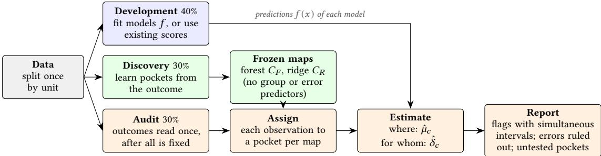
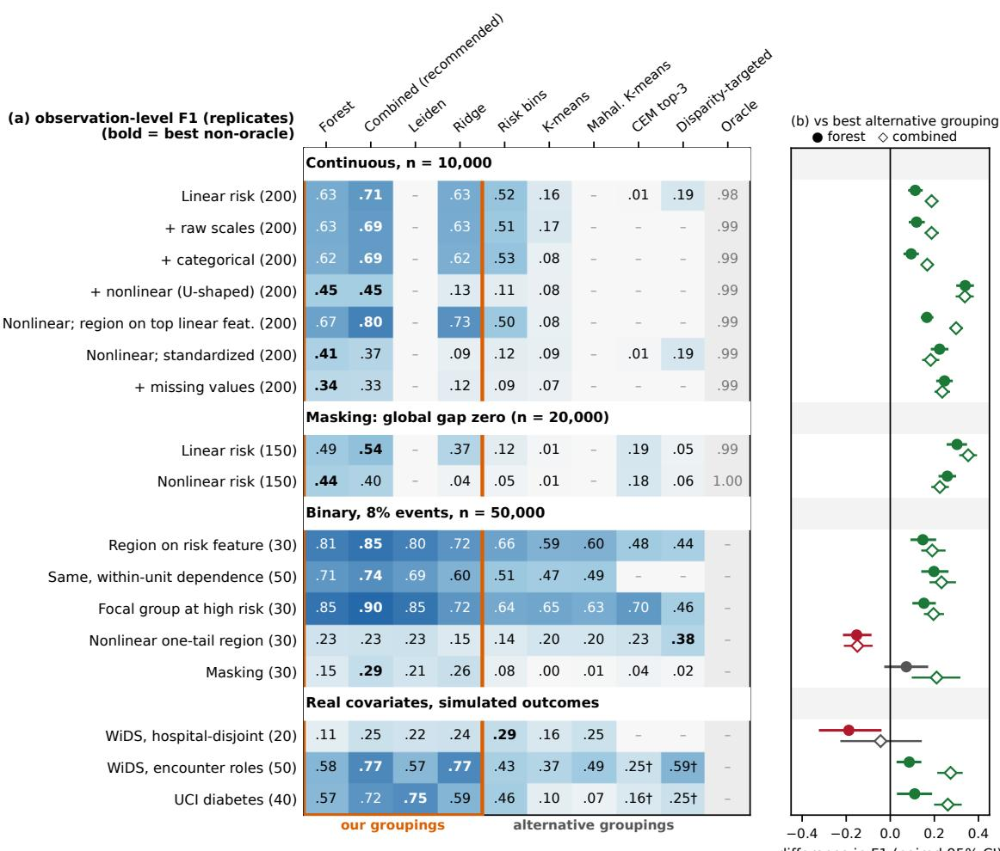
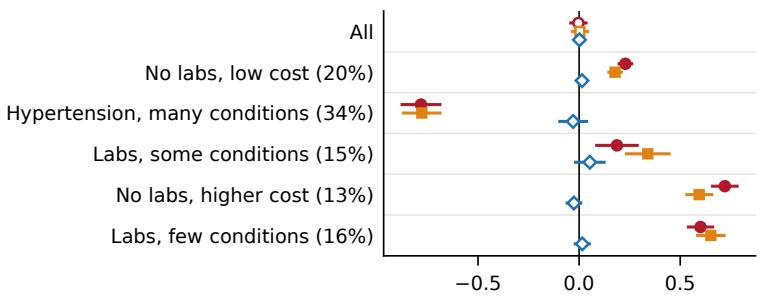
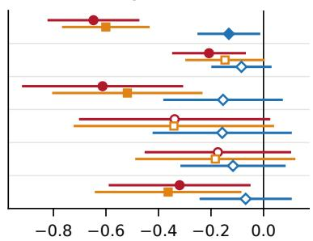
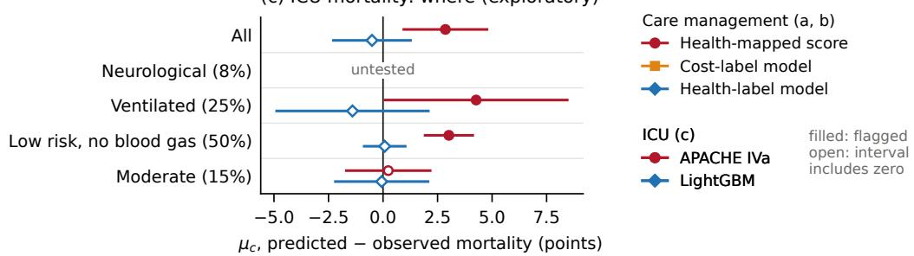

# Where Is a Prediction Model Miscalibrated, and for Whom? Local Audits in Outcome-Learned Pockets

BERNARDO MODENESI, University of Utah, USA; TAOYI CHEN, Ohio State University, USA; SIMA NAJAFZADEHKHOEI, University of Utah, USA; LUCIA WANG, rpotential.ai, USA; AMEYA DIWAN, Google, USA; BEATRICE KNUDSEN, University of Utah, USA

Overall and group-level averages, and ranking metrics such as the AUC, can hide sets of observations for which a prediction model systematically over- or under-predicts, because concentrated errors barely move an average and opposite errors ofset each other. We present an audit that asks where a model is miscalibrated (in which sets of similar observations it over- or under-predicts on average) and for whom (whether its average prediction error difers between demographic groups, such as by race or sex, within the same set) It groups observations into pockets, sets that are similar in how the outcome is predicted from their features, using random-forest similarity, which weighs each feature by its importance for predicting the outcome instead of relying on hand-chosen cuts of the data; a second set of pockets, built on features weighted by ridge-regression coeficients, catches errors that follow one strong predictor, and a combined audit uses both. Pockets are learned on one sample and tested on another, with confidence intervals that hold jointly across pockets and allow for correlation within units such as hospitals. For each pocket, the audit reports the average prediction error, its gaps between demographic groups, the error sizes ruled out, and whether the data sufice to test. It needs only features, outcomes and fixed predictions, not model internals, which can be proprietary or undisclosed. In 17 simulation scenarios (continuous and binary outcomes, nonlinear risk, missing values, dependent observations, real covariates) with an error planted for one demographic group (for whom), the combined audit located it better than the strongest alternative grouping in 15, with false-alarm rates near or below 5%. In 15 scenarios with an error planted for everyone in one feature region (where), it localized the error better than every available alternative in 12 (at the smaller of two error sizes), including errors that ofset overall; it lost to a grouping learned from one model’s residuals when the error was unrelated to the outcome, and with few units of correlated observations it needed a stricter threshold We then audit two deployed scores with documented problems, asking what a local audit adds. First, in public synthetic data from the care-management algorithm studied by Obermeyer et al., with its cost-based score mapped to a prediction of chronic illness, we found no detectable overall error but under-prediction of illness in the sickest pockets and over-prediction in the others. The pockets distinguished Black patients’ concentration where the score under-predicted for both groups from a Black–White gap within pockets Second, an exploratory analysis located APACHE IVa’s previously reported over-prediction of ICU mortality in a pocket of mostly ventilated stays and in a low-risk pocket holding half of the stays with an APACHE prediction, where predicted mortality was more than twice the observed rate; none was detected in a moderate-risk pocket. Two recalibrated chest X-ray classifiers also showed ofsetting local errors behind no detectable overall error. Learning pockets with a forest trained on the outcome, not on any model’s errors, needs no rescaling or imputation of numeric inputs, gives many models one frozen map, and compares groups within shared pockets, turning a reassuring average into evidence, with confidence intervals, of where and for whom a model is miscalibrated.

CCS Concepts: • Computing methodologies → Machine learning; • Applied computing → Health informatics; • Mathematics of computing → Hypothesis testing and confidence interval computation.

Additional Key Words and Phrases: model auditing, calibration, hidden stratification, algorithmic fairness, random forest proximity, simultaneous inference, clinical prediction

## 1 Introduction

An AI model can be accurate on average yet systematically wrong for a particular kind of observation. Decisions act on the predicted value itself. For example, health systems use commercial algorithms to choose which patients enter care-management programs; such tools were estimated in 2019 to be applied to about 200 million people a year in the United States [31]. Intensive care units benchmark mortality with severity scores such as APACHE IVa [48]. When a model reports a 20% risk, about one in five such cases should have the event; a model with this property is calibrated, and a miscalibrated model systematically over- or under-predicts. A useful audit must locate where this happens, show whose predictions are afected, and distinguish a small error from too little data to tell.

Calibration is usually checked overall or within a few predefined groups, alongside ranking metrics such as the AUC. For where, these checks can miss unrecognized, poorly served subsets, known in medical imaging as hidden stratification [30], and errors of opposite sign that ofset each other in any average. Slice-discovery methods search for such subsets, but several target one model’s errors, so the subsets found can depend on the model audited (Section 2). For whom, audits have moved from predefined groups to their intersections [4] and to large classes of subgroups defined by combined attributes [6, 21], and ICU severity scores were found to over-predict mortality for Black and Hispanic patients [39]. Yet a gap between groups can arise in two ways: one group is concentrated where the model errs for everyone, or the model errs diferently for members of the two groups who are alike in what predicts the outcome. The two call for diferent responses, and a group-level comparison cannot tell them apart. The algorithm studied by Obermeyer et al. [31] shows what is at stake: its score was approximately calibrated for costs across racial groups, but because Black patients incurred lower costs at the same level of illness, it understated their health needs, and an audi against costs alone could not see it. In public synthetic data from that study, with the score mapped to a prediction of illness, no overall error is detectable, yet our audit finds under-prediction for a third of patient-years and over-prediction elsewhere; Black patients are over-represented in that third, and a gap remains within it (Section 6).

We ask two questions of a model’s predictions within pockets, sets of observations similar in how their features predict the outcome. Where is the model miscalibrated? And for whom: within a pocket, does the average signed prediction error difer between groups defined by a recorded attribute, such as race or sex? Following the literature on diferential item functioning [17], we call the group under study the focal group and the group it is compared with the reference group. Answering both poses three practical challenges: (1) Where should we look? Checking every combination of features is intractable. (2) Is there enough data? A subpopulation with few observations, few positive outcomes or few focal-group members cannot support a comparison, and pretending otherwise produces false alarms. (3) How sure are we? Auditing many subpopulations multiplies the chances of a false alarm, and observations from the same unit, such as repeated records of one person or patients of one hospital, are not independent.

Our audit learns the pockets from the outcome on a discovery sample used for nothing else, and tests them on a separate audit sample. It estimates each pocket’s local calibration error �, the average prediction error (predicted minus observed outcome), and local calibration gap �, the diference in that error between the focal and reference groups, with confidence intervals that hold simultaneously across pockets and allow for correlated observations within units; an estimate is flagged when its interval excludes zero. Keeping the samples apart costs data, but no pocket is tested on the outcomes that suggested it; whether the intervals then hold at their stated level is checked by simulation.

The main grouping comes from a random forest trained to predict the outcome: two observations are close when many trees send them to the same leaf [3]. Because trees split mostly on features that improve the prediction, observations that difer only in irrelevant features still share most leaves, so this similarity weighs each feature by its relevance to the outcome (a built-in feature selection), whereas K-means on standardized features weighs every feature equally. It needs no rescaling or imputation of numeric features and scales to large data through a sparse nearest-neighbor graph. Because it spreads over all outcome-relevant features, it can blur a failure that follows one strong predictor, so a simpler linear grouping clusters observations on features weighted by their coeficients in a ridge regression of the outcome, and our default, the combined audit, runs both. Neither grouping uses the group attribute or any model’s errors as an input; group counts and predictions enter only the support check, which decides whether a pocket has enough data to test. The same pockets can therefore audit several models from their predictions alone, even when a model’s internals are proprietary or undisclosed. Learning pockets from the outcome also makes the answers interpretable: a pocket’s mean error checks calibration among cases grouped by what predicts the outcome, and a gap within it compares groups that share the pocket.

## Our contributions are:

• Reusable outcome-learned audit maps. A discovery-only procedure learns pockets from the outcome and freezes the rule that assigns observations to them, so several models can be compared, from their predictions alone, through each pocket’s mean prediction error and its between-group gap (Sections 3 and 4).

• Statistical evidence, not only flags. Simultaneous intervals that allow for correlated observations within units such as hospitals; when a pocket’s simultaneous interval lies within (−�, �), a statement that pocket-average errors of size � or larger are ruled out; and an explicit report of pockets too thin to test.

• An evaluation that reports its losses (Section 5). The combined audit located gaps planted between demographic groups better than the strongest alternative grouping in 15 of 17 scenarios, and local miscalibration better than every available alternative in 12 of 15 at the smaller of two error sizes. It lost to groupings learned from the model’s own errors when the error sat on an outcome-irrelevant feature or in one tail of a U-shaped feature. False-flag rates were near or below 5%, except for � under strong within-unit dependence, which needs a stricter level.

• Three applications (Section 6), two of them deployed scores with documented problems, where we ask what a local audit adds. Synthetic care-management data show ofsetting local errors behind a reassuring overall check, and separate Black patients’ concentration in an under-predicted pocket from the gap within pockets; an exploratory ICU audit locates APACHE IVa’s previously reported over-prediction in two of three testable pockets, under hospital dependence and limited support; a briefer audit finds ofsetting local errors in two chest X-ray classifiers.

## 2 Related Work

Calibration and locating model failures. In the calibration hierarchy of Van Calster et al. [43], our local error is mean calibration within a pocket, weaker than calibration at every predicted value, so we treat it as a screening quantity. Slice-discovery methods search for regions of hidden stratification [30] with interpretable feature slices and significance tests [8, 38] or with clusters of learned representations [11, 13, 40]; several organize regions around one model’s errors. LOGAN clusters observations to expose local group gaps [47], and forest-guided clustering groups observations through random-forest decision paths [2]. Our pockets are organized around outcome-relevant similarity and frozen before audit outcomes are read, so the same pockets can compare several models; the price is that they can miss errors unrelated to the outcome. Multicalibration asks for calibration on every subpopulation a function class can identify [16], and multiaccuracy for a zero mean error on each [22]. Our target is narrower, a finite set of learned pockets, for which we report held-out uncertainty and explicit limits on what the data can test.

Fairness and audit inference. Calibration within groups cannot in general be combined with equal error rates across groups unless base rates are equal or prediction is perfect [7, 23, 35], so an audit must choose what it measures;

  
Fig. 1. The audit at a glance. Whole units (e.g., hospitals) are split once into development, discovery and audit roles. Two pocket maps are learned from the outcome on discovery data, without the group atribute or any model’s errors as inputs (group counts and predictions enter only the support check), and frozen: forest pockets $C _ { F }$ and ridge pockets $C _ { R } .$ Audit observations are assigned to a pocket in each map (in the forest map, weak or ambiguous assignments abstain). For each pocket the audit estimates the mean prediction error $\hat { \mu } _ { c }$ and its between-group gap $\hat { \delta } _ { c } ;$ each map’s tested pockets receive simultaneous intervals (Section 4), and an observation inherits its pocket’s flag in either map. The similarity forest � is distinct from the assessed models � (any model or score).

we audit calibration because decisions act on the predicted value itself [33, 42]. Subgroup audits seek fairness violations over structured classes of protected-attribute subgroups [21], and Cherian and Candès [6] treat auditing as inference with simultaneous bootstrap bounds over rich subgroup classes. We distinguish pocket composition from within-pocket gaps, comparing group-average errors in outcome-learned pockets fixed before audit outcomes are read. We use the same max-statistic logic [46] on a finite set of pockets learned on independent data, as honest trees separate the samples that form and estimate subgroups [1, 44], and calibrate it for correlated observations with a wild cluster bootstrap [5, 26, 27].

Supervised similarity. Random forests act as adaptive nearest-neighbor methods whose neighborhoods stretch along directions irrelevant to the outcome and shrink along relevant ones [3, 25]. Individual fairness presupposes a task-specific similarity measure [12, 18]; we use forest similarity only to form pockets, with no guarantee for individuals.

## 3 Method

This section builds the pocket maps of Figure 1; Section 4 sets what is estimated in them.

Setting. An assessed model � maps the features � of an observation to a prediction � (�) of an outcome �: a probability for a binary outcome or a predicted value for a continuous one. The audit requires features, outcomes, each model’s predictions and identifiers of independent sampling units, but not any model’s internals; a between-group contrast also needs a recorded attribute � that defines a focal group $( S = 1 )$ and a reference group $( S = 0 )$ . We take � binary for simplicity; a multi-category attribute is audited as pre-declared focal–reference pairs whose intervals hold jointly (Section 4). A pocket map �(�) sends each observation to one of a finite set of pockets or, if its assignment is weak or ambiguous, to “abstain”. Neither � nor any model’s errors are inputs to the models that form the pockets, although correlated features can still give pockets diferent group compositions. Each row is an observation, such as a patient-year, an image or a transaction; rows come in independent units ℎ of possibly correlated observations, such as hospitals.

Three data roles. An audit is only as credible as the separation between the data that shape it and the data that test it [10]. Whole units are assigned at random, with a fixed seed, to development (40%), where assessed models are fit if needed; discovery (30%), where pockets are learned; and audit (30%), where errors are estimated (Figure 1). Discovery units are split once more: 80% supply the graph observations from which pockets are built and 20% calibrate the rule that assigns new observations to pockets. Audit outcomes are read once, after the models, maps, support rule and inference settings are fixed. We do not rotate the roles, so every audit statement concerns the audit sample.

Forest similarity. A random forest � is grown on the graph observations to predict the outcome. For observations � and � with leaves $l _ { t } ( i )$ and $l _ { t } ( j )$ in tree � of �, their similarity is the number of trees in which they share a leaf, $\begin{array} { r } { s _ { i j } = \sum _ { t = 1 } ^ { T } \pmb { 1 } \{ l _ { t } ( i ) = l _ { t } ( j ) \} } \end{array}$ }. Because splits are chosen to predict the outcome, two observations that difer only in a feature that never predicts it still share most leaves [25]; a finite forest can split on noise, so this is a tendency, not a guarantee. Categorical features enter as integer codes, an arbitrary order that remains a choice. We use 200 trees, at least 20 observations per leaf and $\sqrt { p }$ candidate features per split (� features; 500 trees and $\hbar / 2$ in continuous simulations).

From similarity to pockets. Storing $s _ { i j }$ for every pair needs memory quadratic in the number of observations, so each graph observation is linked to the (approximately) 30 graph observations with whom it shares the most leaves, keeping an unweighted link only when the two are in each other’s lists. This mutual nearest-neighbor graph has at most 15� links for � graph observations and damps observations that are close to everyone [28, 36]. Pockets are the graph’s communities, found with a nested, degree-corrected stochastic block model (SBM) [19, 32], which explains the links by placing observations in blocks whose members link alike, chooses the number of blocks by minimum description length (the most compact description of the graph; best of three seeded fits), and returns a hierarchy from fine to coarse. A finer level localizes an error more sharply but leaves fewer observations to test, so the level is chosen on discovery data only: we take the level with the most pockets projected to meet a stricter version of the audit’s suppor rule (Section 4): at least 150 audit observations per compared group (75 in the continuous simulations) and, for a binary outcome, 10 events and non-events expected from the predictions; ties go to the coarser level. Projections scale the pocket counts of discovery calibration observations to the audit size; audit outcomes never choose the level (supplement). Two comparison partitions of the same graph appear in Sections 5 and 6: Leiden, a standard community-detection algorithm [41], and a tree cut, which cuts the hierarchy at diferent depths in diferent branches, splitting a pocket only when its children yield more pockets projected to meet support. In the continuous-outcome simulations, where the dense similarity matrix is afordable, spectral clustering replaces the SBM.

Frozen assignment with abstention. Audit observations never enter the graph. Each pocket � of $n _ { c }$ graph observations is stored as a profile, the count � $[ c , t , l ]$ of its members in every leaf � of every tree �, and a new observation joins the pocket with the highest afinity $\begin{array} { r } { a _ { c } ( x ) = T ^ { - 1 } \sum _ { t } n [ c , t , l _ { t } ( x ) ] / n _ { c } } \end{array}$ , its average similarity to the pocket’s members. An observation that resembles no pocket abstains if its top afinity, or its lead over the second, falls below the 1st percentile on calibration observations. Abstaining observations count overall; abstention is reported by group.

Linear map. The ridge map $C _ { R }$ covers errors concentrated along one strong linear predictor, which the forest localizes less sharply (Section 5). On the same graph observations, each feature is median-imputed and standardized, then multiplied by the absolute value of its coeficient in a ridge regression of the outcome (logistic for a binary outcome, penalty chosen by cross-validation), so that features count in proportion to their linear relevance. K-means groups the weighted features into as many pockets as the forest map has, and each audit observation joins the nearest centre.

## 4 What We Estimate and How Sure We Are

Where and for whom. All quantities condition on the frozen models and pocket maps. For an assessed model $f$ and a pocket � of either map, the local calibration error and the local calibration gap are

$$
\mu _ { c } = \mathbb { E } [ f ( X ) - Y \mid C = c ] , \qquad \delta _ { c } = \mathbb { E } [ f ( X ) - Y \mid C = c , S = 1 ] - \mathbb { E } [ f ( X ) - Y \mid C = c , S = 0 ] ,\tag{1}
$$

where E is a population mean, � an observation’s features and $C = C ( { \cal { X } } )$ its pocket. $\mu _ { c } > 0$ means the model overpredicts on average in pocket � (where); $\delta _ { c } > 0$ means it over-predicts more, or under-predicts less, for the focal group than for the reference group there (for whom). For a binary outcome, 0.05 is five percentage points; otherwise errors are in outcome units. Both are pocket averages: opposite errors can still cancel inside a pocket, and $\mu _ { c } = 0$ is not calibration at every predicted value. The pocket $\ " a l l \ "$ (every audit observation, abstainers included) gives the usual overall error and group gap, so each audit also reports the result it refines. When two models $f$ and $f ^ { \prime }$ are scored on the same observations, the paired gap $\kappa _ { c } = \delta _ { c } ( f ) - \delta _ { c } ( f ^ { \prime } )$ asks whether one model’s gap is larger. A set of quantities audited together is a family; its target � is the allowed chance of any false flag in it (5% here), and the nominal level � of the intervals below is a setting calibrated to meet that target. For each map, $\mu , \delta$ and � for every declared model and group contrast form one family; each analysis below states its family, and the simulations audit � alone or $\mu$ alone.

Support. A quantity is tested only if each cell it compares (a pocket, or a pocket and group) has at least 100 audit observations (50 in the continuous simulations) and, for a binary outcome, at least 10 expected events and non-events (sums of the predicted probabilities and their complements), never audit outcomes. With hospitals as units, each cell must also draw on at least 15 distinct and 10 efective hospitals $( ( \sum _ { h } n _ { h } ) ^ { 2 } / \sum _ { h } n _ { h } ^ { 2 } ;$ , where $n _ { h }$ counts the cell’s rows from hospital ℎ: the number of equal-sized hospitals that would be as concentrated), and no hospital may hold more than 20% of the cell, because cluster-robust standard errors are unreliable with few or dominant clusters [5, 27]. Pockets that fail the rule stay in the map, are reported as untested, and are never merged to force a test; an estimate with no sampling variability is reported separately. Because the rule never looks at audit outcomes, the tested set cannot be steered toward or away from findings. The cutofs were fixed in advance, not tuned; the supplement explains where they come from.

Simultaneous intervals. Each estimate is a signed sum of cell means. Its standard error, the estimated spread of the estimate over repeated samples, is built from contributions summed within each unit, which allows observations in the same unit to be correlated [15]. To control the chance of any false flag in the family, every estimate, divided by its standard error, is compared with the largest such absolute ratio expected anywhere in the family, a single-step max-� procedure [46]. Its reference distribution comes from a wild cluster bootstrap [5, 27]: in each of � draws $( B = 4 , 9 9 9$ in the applications), every unit receives one random weight (Mammen’s two-point weights [29]) that perturbs all its residuals together, the residuals are centered at the null hypothesis that every tested quantity is zero, and both the estimate and its standard error are recomputed. The critical value � is the $1 - \alpha$ quantile of the per-draw maxima of the absolute standardized estimates; the interval for quantity $j ,$ with estimate $\widehat { \vartheta } _ { j } , \mathrm { i s } \widehat { \vartheta } _ { j } \pm q \widehat { \mathbf { s e } } _ { j }$ , and it is flagged when the interval excludes zero (step-by-step formulas in the supplement). Two refinements address rare binary outcomes. A cell that happens to draw few events looks both biased and falsely precise, so the standard errors of binary $\mu$ and $\delta$ are floored at the value the predictions imply under no error (�, in which the outcome cancels, is not floored); the floor is a stabilizer, not a model of dependence. And because the nominal level need not equal the actual false-flag rate, it is calibrated by simulation: we use $\alpha = 0 . 0 2 5$ with independent units and 0.0125 with hospital units, fixed in development simulations before confirmation and real-data audits, to meet $\gamma = 5 \% ;$ these are settings evaluated for our binary � designs, not validated defaults for arbitrary dependence, and a dependent-unit $\mu$ design exceeded the 5% target at them (Section 5). Continuous outcomes use $\alpha = 0 . 0 5$ without the floor.

Ruling errors out. A pocket that is not flagged is not evidence that the model is calibrated there: its interval may simply be wide. To make the absence of flags informative, we report the equivalence share $E ( t )$ , the share of all focal audit observations (abstained and untested included in the denominator) whose pocket was tested and whose simultaneous interval lies within (−�, �) (for $\mu ,$ over all observations). When the intervals cover their targets, it rules out large pocket-average errors, not errors within a pocket; whether � is small enough is a judgement for the application.

Combining the two maps. The maps are not averaged and no estimate is pooled across them. Each map is audited as its own family with its own bootstrap, at half the nominal level, $\alpha / 2 .$ . An observation receives a directional flag when either map flags its pocket; when the two maps flag opposite directions, it is recorded as a conflict instead. If each map’s actual chance of any false flag is at most $\gamma / 2 ,$ the Bonferroni inequality bounds the chance across both maps by �, whatever the overlap between the maps. Our bootstrap supplies simulation evidence for this premise, not a finite-sample guarantee, so we evaluate the combined procedure directly (Section 5). The price of the split is a slightly higher bar in each map; the gain is that an error along one strong linear feature and an error with curved or interacting structure can both be found by the same audit

## 5 Simulations

Simulations provide known prediction errors against which localization can be scored. We ask whether the audit stays quiet when there is no error (Table 1, for both questions), how well its flags recover the observations that carry a planted between-group gap (for whom; Figure 2) or a planted local miscalibration (where; Table 2), and when outcome-learned similarity wins.

Design. Every replicate of the � designs reruns the whole pipeline: new outcomes (and, in the synthetic designs, new features), a new role split, a new forest and pockets, frozen assignment, and the audit. The assessed model is the true risk (event probability, or conditional mean) plus a planted error: focal-group observations in a region � receive a prediction shifted by a fixed amount (clipped to valid probabilities for binary outcomes), and everyone else is predicted exactly. In the synthetic designs the region covers 20% of observations and the focal group 20–30%. Four families of scenarios form the rows of Figure $2 \colon ( \mathrm { i } )$ a continuous outcome, $n = 1 0 { , } 0 0 0$ , with 12 numeric features (plus 3 categorical in five of the seven specifications) and a shift of 0.4 outcome standard deviations, in a ladder that adds one complication at a time (raw feature scales, categorical features, a U-shaped risk term with the region on that feature’s tail, missing values), with two controls that place the region on the strongest linear feature or remove the transformations; (ii) masking, $n = 2 0 { , } 0 0 0$ , where the focal group’s shift is positive in one half of the region and negative in the other, so that the population-wide gap is zero; (iii) a rare binary outcome, as in clinical risk models, $n = 5 0 { , } 0 0 0$ with 8% events and a 10-point over-prediction, with variants that add within-unit dependence across 150 units, make the focal group more common among high-risk observations, place the region on one tail of a U-shaped feature, or mask; and (iv) real covariates, for realistic feature structure, from the ICU data of Section 6 (WiDS; roles split by stay or by hospital, hospital-disjoint) and diabetes data (UCI; supplement), with outcomes simulated from a model fit to the real data and a 10-point error planted in a region fixed in advance (ventilated patients; two or more prior inpatient stays). These scenarios evaluate localization of the between-group gap $\delta ;$ a separate re-audit of saved replicates evaluates $\mu$ (below).

Comparators and scoring. Every comparator is learned on the same discovery data, assigns audit observations with its own frozen rule, and goes through the same support rule and inference, so only the grouping difers. Methods with a pocket count target the forest map’s count in that replicate. Our groupings are the forest pockets, the same forest graph partitioned by Leiden, and the ridge map alone (ridge-weighted K-means). The alternative groupings are K-means on standardized features; Mahalanobis K-means; risk bins of the similarity forest’s predicted risk; CEM top-3, coarsened exact matching (which forms its own bins) on the three features the forest ranks most important; and a disparity-targeted method that learns, on discovery data, where the assessed model’s errors difer between groups and bins that prediction. A truth-aware oracle handed the planted region is shown as a benchmark, not a competitor. Risk bins and CEM top-3 thus borrow the similarity forest, and the disparity-targeted method uses the group attribute and the model’s errors, which our maps never do. These comparisons isolate the grouping within a common audit; they do not establish superiority over published slice-discovery systems. Scoring concerns focal-group observations, which are afected if they carry the planted error. A correct-direction flag on an afected observation is a true positive; a flag on an unafected observation is a false positive, and a wrong-direction flag on an afected one is both a false positive and a miss; afected observations in unflagged or untested pockets are misses (FN), and conflicting flags from the two maps count as errors. We report observation-level $F _ { 1 } = 2 \mathrm { T P } / ( 2 \mathrm { T P } + \mathrm { F P } + \mathrm { F N } )$ from counts summed over replicates, with paired, pointwise 95% intervals from a bootstrap that resamples the same replicates for every method.

Error control. Table 1 reports how often the audit flags any pocket when no error exists. For $\delta ,$ the two 450-replicate binary designs stayed well below 5% at their calibrated levels, and the continuous designs, at nominal 5%, had intervals that include 5%. For � with independent observations, the combined audit flagged 3.1–5.3% of null replicates in the 150–500-replicate designs, and each map at most 3.3% under a weak null whose errors cancel inside every pocket. With 150 dependent units of unequal size, it flagged 41 of 450 (9.1%; Wilson interval 6.8–12.1%) at the level calibrated for $\delta ,$ and 9–11% per map under the weak null; a retrospective estimate, not yet confirmed on fresh replicates, puts the needed single-map level near 0.0025 (supplement). Plausibly, a pocket’s mean error, unlike a within-pocket gap, does not diference out shared unit-level variation, so $\mu$ under strong within-unit dependence needs its own level calibration.

Coverage and checks on real data. Simultaneous coverage is the share of replicates in which every interval contains its true value. Under a planted gap, among replicates with a tested quantity, forest-map coverage ranged from 138 of 150 replicates in linear masking (92.0%; Wilson interval 86.5–95.4%) to 100% in the synthetic designs, against a 95% target, and was 13 of 15 in hospital-disjoint WiDS (86.7%; 62.1–96.3%); these checks do not establish nominal coverage in every setting. Under a planted local miscalibration at the smaller shift of the $\mu$ designs (below), simultaneous coverage of the pocket errors in the audit sample, among evaluable runs, was 94.0–97.5% for the combined audit and 93.0–97.5% for the forest map. Before the care-management and ICU audits of $\mu ,$ conditional checks, which simulate outcomes for the real audit observations in their frozen pockets (500 replicates per scenario; supplement), gave false-flag rates of 0–0.4% per map in the ICU data (level 1.25%) and 1.0–4.0% for the combined care-management audit, whose family also holds � and �, with simultaneous coverage of at least 96.0%.

Localizing for whom (�). Figure 2a gives each method’s $F _ { 1 }$ in the 17 scenarios and Figure 2b the paired diference between our audit and the strongest available alternative grouping in the same replicates. We call a diference a win or a loss when its paired interval excludes zero, and otherwise say the methods are not distinguishable, which is no evidence that they are equivalent. The combined audit beat the strongest alternative in 15 scenarios, by 0.17–0.35 in $F _ { 1 } ;$ it was not distinguishable in hospital-disjoint WiDS, where support is thin, and lost in the one-tail scenario. The forest pockets alone won 14, were not distinguishable in 1 (binary masking) and lost 2. Against the best single grouping of any kind, ours included, the combined audit won 8, was not distinguishable in 6 and lost 3.

When each grouping wins. Learned similarity pays of when the structure that matters is not a straight line in the features: with a U-shaped risk term the forest pockets reached $F _ { 1 }$ 0.34–0.45 against 0.09–0.13 for ridge-weighted K-means and risk bins, and under masking they separated the two halves (0.49 and 0.44, against 0.37 and 0.18). With linear risk the two maps scored alike (0.62–0.63). The forest lost when the region is the top of the most predictive linear feature, which ridge-weighted K-means slices exactly (0.73 vs 0.67; WiDS ventilated patients, 0.77 vs 0.58); when only one tail of a U-shaped feature is afected, where its pockets mix afected and unafected observations and the disparity-targeted method wins (0.38 vs 0.23); and with hospital-disjoint roles in WiDS, where most afected observations sit in untested pockets $( F _ { 1 } \leq 0 . 2 9$ for every method). The two maps fail in diferent places, which motivates running both. Against its two component maps, the combined audit was better in 9 scenarios, not distinguishable in 6 and worse in 2: each map finds afected observations the other misses, and halving each map’s level costs 3–4 points where the forest alone carries the signal. The combined audit was specified after the single-map runs; fresh continuous seeds confirmed the pattern (supplement), and the binary and real-covariate rows reuse saved replicates retrospectively.

Table 1. False flags when no error exists: the share of replicates in which any pocket (or the overall comparison) is flagged, with 95% Wilson (binomial) intervals (rows of seven specifications: ranges, and the envelope of their intervals). The � rows audit between-group gaps; the � rows audit local errors alone, in the localization simulations. “Forest” is audited at the single-map level; “Combined” audits each map at half of it. Binary levels are simulation-calibrated for � (Section 4); in the � 150-unit design, 50 of 450 forest-map replicates had nothing testable and count as unflagged. No row shows clear inflation above 5% except � with 150 dependent units; the 30-replicate small check is imprecise.
<table><tr><td>Null design</td><td>Single-map α</td><td>Replicates</td><td>Forest</td><td>Combined</td></tr><tr><td colspan="5">Between-group gap δ</td></tr><tr><td>Continuous,  $n = 1 0 , 0 0 0 , 7$  specifications</td><td>.05</td><td>700-900</td><td>.050–.059 [.036, .076]</td><td>.046–.057 [.033, .074]</td></tr><tr><td>Continuous,  $n = 2 0 { , } 0 0 0 { \mathrm { ; } }$  linear risk</td><td>.05</td><td>700</td><td>.059 [.043, .078]</td><td>.049 [.035, .067]</td></tr><tr><td>Continuous,  $n = 2 0 { , } 0 0 0 ,$  nonlinear risk</td><td>.05</td><td>700</td><td>.054 [.040, .074]</td><td>.047 [.034, .065]</td></tr><tr><td>Binary, n = 50,000, independent observations</td><td>.025</td><td>450</td><td>.016 [.008, .032]</td><td>.020 [.011, .038]</td></tr><tr><td>Binary,  $n = 5 0 { , } 0 0 0 { , }$  150 dependent units</td><td>.0125</td><td>450</td><td>.013 [.006, .029]</td><td>.013 [.006, .029]</td></tr><tr><td>Binary, focal group at high risk (small check)</td><td>.025</td><td>30</td><td>.000 [.000, .114]</td><td>.033 [.006, .167]</td></tr><tr><td colspan="5">Local error µ</td></tr><tr><td>Continuous,  $n = 1 0 , 0 0 0 , ^ { \cdot }$  7 specifications</td><td>.05</td><td>500</td><td>.036–.060 [.023, .084]</td><td>.034–.046 [.021, .068]</td></tr><tr><td>Continuous,  $n = 2 0 { , } 0 0 0 ,$  linear risk</td><td>.05</td><td>150</td><td>.060 [.032, .110]</td><td>.047 [.023, .093]</td></tr><tr><td>Continuous,  $n = 2 0 { , } 0 0 0 ,$  nonlinear risk</td><td>.05</td><td>150</td><td>.053 [.027, .102]</td><td>.053 [.027, .102]</td></tr><tr><td>Binary,  $n = 5 0 { , } 0 0 0 { \mathrm { ; } }$  independent observations</td><td>.025</td><td>450</td><td>.029 [.017, .049]</td><td>.031 [.019, .052]</td></tr><tr><td>Binary,  $n = 5 0 { , } 0 0 0 ,$  150 dependent units</td><td>.0125</td><td>450</td><td>.089 [.066, .119]</td><td>.091 [.068, .121]</td></tr></table>

Localizing where ( ). We re-audited saved replicates of 15 scenarios with an error planted for every observation in a region, whatever its group, and audited � alone on the saved maps (supplement). Two scenarios move the region to a feature unrelated to the outcome. The alternatives are risk bins, K-means, Mahalanobis K-means, CEM and CEM top-3, as available in each batch, and an error-targeted grouping refit for each condition, the � analogue of the disparity-targeted method: like slice-finding methods, it bins a boosted model of one model’s residuals learned on discovery data. At the smaller shift (0.2 outcome standard deviations or 5 points), paired pointwise intervals favored the combined audit over every available alternative in 12 of 15 scenarios (Table 2), including masking designs with ofsetting local errors and near-zero overall error, where the overall comparison flagged at most 0.7% of replicates while the combined audit reached $F _ { 1 }$ 0.45–0.62. It lost to the error-targeted grouping in the two irrelevant-feature scenarios (0.17 against 0.07; 0.75 against 0.43) and the binary one-tail region (0.69 against 0.28). At the larger shift of the � designs, it beat every available alternative in 8, lost to at least one in 6 and was not distinguishable in 1: the better discovery target depended on the error’s structure and size.

Settings and cost. The number of candidate features per split changes which structure the forest emphasizes, in ways the forest’s own held-out accuracy does not predict (supplement), so settings are fixed in advance. On discovery graphs of about 22,000 observations the nested SBM took 3–9 minutes and under 2.5 GB; � = 4,999 draws take seconds.

## 6 Applications

We demonstrate the audit on two models with documented problems: a commercial care-management score whose cost basis understated Black patients’ health needs [31], read as a prediction of illness in public synthetic data, and the APACHE IVa ICU mortality score, whose over-prediction in recent cohorts has been reported [39], asking in each what a local audit adds to what is known. The first shows ofsetting local errors and one map serving three models; the second, a black-box score with hospital dependence. A briefer third audit, of two chest X-ray classifiers, shows the method where pockets are learned from image features.

  
Fig. 2. Localization of planted between-group gaps (�) in 17 simulation scenarios. (a) Observation-level $F _ { 1 }$ for each grouping, with the number of replicates; bold marks the best non-oracle method in the row; outlined columns are our groupings. “Forest” is the spectral partition of the forest similarity in the continuous rows and the SBM partition of the forest graph elsewhere; “Combined” is the forest + ridge audit; “Leiden” partitions the forest graph with Leiden; “Ridge” is ridge-weighted K-means. Where a scenario ran in two batches, the displayed batch was selected retrospectively by a fixed rule, the batch in which the strongest method not built on the forest scored highest; †: shown from the other batch and left out of panel (b); –: not run. (b) Paired diferences with 95% replicate-bootstrap intervals against the strongest available alternative grouping (mostly risk bins; named per row in the supplement): dots, forest; diamonds, combined audit. Intervals entirely right of zero favor our audit (green), entirely left favor the alternative (red); they are pointwise, and the 17 comparisons are not simultaneous.

Table 2. Localizing a planted local miscalibration �: observation-level $F _ { 1 : }$ , scored over all observations (Figure 2 scores focal-group observations), of the combined audit, the error-targeted grouping and the best other alternative, chosen separately at each shift (named at the smaller one; CEM-3 is CEM top-3); shifts of 0.2 SD or 5 points (smaller) and 0.4 SD or 10 points (the � designs). Bold: the largest unrounded score of the three. Null flags: replicates with no planted error in which the combined audit flagged any ; 9.1% (150 dependent units) exceeds the 5% target, and dashes mark irrelevant-feature rows, whose null runs are those of the matching risk-feature design. Binary one-tail and masking rows reuse maps frozen under the � design (30–40 replicates); others use 150–500. Two intermediate continuous specifications, which behave like linear risk, and all other groupings are in the supplement.
<table><tr><td></td><td colspan="3">Smaller shift</td><td colspan="3">Larger shift (δ designs)</td><td>Null</td></tr><tr><td>Scenario</td><td>Comb.</td><td>Error-t.</td><td>Best other</td><td>Comb.</td><td></td><td>Error-t. Best other</td><td>flags, %</td></tr><tr><td>Continuous outcome, n = 10,000</td><td></td><td></td><td></td><td></td><td></td><td></td><td></td></tr><tr><td>Linear risk</td><td>.73</td><td>.19</td><td>.55 (risk bins)</td><td>.71</td><td>.56</td><td>.64</td><td>3.6</td></tr><tr><td>+ scales, categories, U-shaped risk</td><td>.56</td><td>.18</td><td>.10 (risk bins)</td><td>.60</td><td>.57</td><td>.30</td><td>3.8</td></tr><tr><td>Nonlinear; region on top linear feature</td><td>.80</td><td>.20</td><td>.52 (risk bins)</td><td>.78</td><td>.57</td><td>.67</td><td>3.8</td></tr><tr><td>Nonlinear; standardized</td><td>.53</td><td>.18</td><td>.10 (risk bins)</td><td>.51</td><td>.57</td><td>.30</td><td>4.6</td></tr><tr><td>+ missing values</td><td>.44</td><td>.14</td><td>.09 (risk bins)</td><td>.50</td><td>.48</td><td>.27</td><td>4.4</td></tr><tr><td>Linear; region on an irrelevant feature</td><td>.07</td><td>.17</td><td>.17 (K-means)</td><td>.23</td><td>.57</td><td>.40</td><td>一</td></tr><tr><td>Masking: overall error zero, n = 20,000</td><td></td><td></td><td></td><td></td><td></td><td></td><td></td></tr><tr><td>Linear risk</td><td>.59</td><td>.04</td><td>.21 (CEM-3)</td><td>.66</td><td>.53</td><td>.60</td><td>4.7</td></tr><tr><td>Nonlinear risk</td><td>.45</td><td>.04</td><td>.22 (CEM-3)</td><td>.49</td><td>.53</td><td>.60</td><td>5.3</td></tr><tr><td>Binary, 8% events,  $n = 5 0 { , } 0 0 0$ </td><td></td><td></td><td></td><td></td><td></td><td></td><td></td></tr><tr><td>Region on risk feature</td><td>.87</td><td>.69</td><td>.71 (K-means)</td><td>.84</td><td>.78</td><td>.75</td><td>3.1</td></tr><tr><td>Region on an irrelevant feature</td><td>.43</td><td>.75</td><td>.74 (Mahal.)</td><td>.35</td><td>.85</td><td>.75</td><td>一</td></tr><tr><td>Within-unit dependence</td><td>.41</td><td>.31</td><td>.32 (K-means)</td><td>.71</td><td>.66</td><td>.59</td><td>9.1</td></tr><tr><td>Nonlinear one-tail region</td><td>.28</td><td>.69</td><td>.28 (K-means)</td><td>.34</td><td>.86</td><td>.38</td><td>0.0</td></tr><tr><td>Masking</td><td>.62</td><td></td><td>.22 .15 (risk bins)</td><td>.68</td><td>.73</td><td>.55</td><td>3.3</td></tr></table>

A care-management algorithm. Obermeyer et al. [31] showed that a commercial algorithm used to enroll patients in care-management programs predicted cost, not health, so that Black patients were sicker than White patients with the same score, and that training on a health label reduced the gap. It is a widely studied case of a deployed model that erred between groups, and its authors released person-level synthetic data generated from the original records: 48,784 patient-years (11% Black). The synthesis does not keep patients’ records together, so we treat rows as independent units; the intervals therefore do not carry the original patients’ sampling uncertainty. The outcome is the number of active chronic conditions in the year of the score (cohort mean 1.35). Pockets are learned from 148 prior-year features (conditions, costs, laboratory tests, medications, age bands), never race or sex. We audit three predictions of the outcome, each mapped to its scale by an isotonic (monotone) regression fit on development rows: the commercial score (the health-mapped score), our reading of a cost score as a prediction of illness, not how it was deployed; and two lasso (penalized linear) regressions on the original study’s model features, one of log(cost + 1) (the cost label) and one of the number of conditions (the health label), the two labels that study compared. The lasso models difer only in their label, so their paired gap � isolates the choice of label for this model class and calibration. The protocol, committed before any pocket-level analysis, fixed the roles, the combined audit at $\alpha / 2 = 0 . 0 2 5$ per map, the families $( \mu ,$ � and � for Black–White and female–male) and equivalence tolerances � of 0.25 and 0.5 conditions. Pre-specified conditional checks of false flags and coverage passed before the audit (Section 5). The forest map has five pockets, named from the typical features of their discovery members; 2% of audit rows abstained.

Where. The health-mapped score showed no detectable overall error in the audit sample (1.35 conditions predicted, 1.36 observed; $\mu = - 0 . 0 0 3 \ \left[ - 0 . 0 4 9 , 0 . 0 4 2 \right] )$ , yet it erred in every forest pocket (Figure 3a). It under-predicted by 0.78 conditions [0.68, 0.88] in the pocket of patients with hypertension and many prior conditions, a third of patient-years, and over-predicted by 0.19–0.72 in the four healthier pockets, most for patients without routine laboratory tests bu with higher prior costs (0.92 predicted, 0.20 observed). The score compresses illness toward the mean, and the overall check averages the two errors away. The ridge map, which slices along the number of prior conditions, found the extreme: in the pocket of the 3% of patient-years with the most prior conditions and renal disease, the score predicted 4.3 conditions against 7.7 observed $( \mu = - 3 . 4 \left[ - 4 . 0 , - 2 . 7 \right] )$ . The cost-label model erred in the same places. The health-labe model’s intervals bounded every forest-pocket error within ±0.25 conditions; no pocket of either map was flagged.

For whom. Overall, the health-mapped score under-predicted Black patients’ conditions by 0.65 more than White patients’ $( \delta = - 0 . 6 5 \ [ - 0 . 8 2 , - 0 . 4 7 ] )$ , in the direction of the original finding. The pockets show two patterns in these synthetic data, matching the two ways a gap can arise (Section 1). Black patients were over-represented where the score under-predicted on average in both groups: 49% of Black patient-years, against 33% of White, were in the hypertension pocket, and in the combined audit 50% of Black against 33% of White patient-years were in a pocket flagged for under-prediction (the two maps flagged opposite directions for 2.2% of rows, reported separately). And a Black–White gap remained within pockets, flagged in three of five forest pockets and largest in the hypertension pocket (−0.61 [−0.92, −0.31]; Figure 3b). For these fitted models, training on the health label substantially reduced the gap: the paired gap between the cost- and health-label models was −0.47 [−0.58, −0.35] overall and was flagged in the hypertension pocket (−0.36) and one other. The health-label model had no flagged pocket gap in either map; in the forest map, 98% of Black patient-years were in pockets whose interval excluded gaps beyond ±0.5 conditions (�(0.5) = 98%), though a small overall gap remained $\left( - 0 . 1 3 \left[ - 0 . 2 5 , - 0 . 0 1 \right] \right)$ . The secondary female–male contrast showed what a check of one attribute misses: the cost-label model over-predicted women’s conditions by 0.73 more than men’s [0.64, 0.82], flagged in every forest pocket, a gap the health-mapped score showed only overall (+0.11 [0.02, 0.21]) and the health-label model did not show. The data are synthetic, so these findings describe the released data, not the original population.

A deployed ICU severity score. The WiDS Datathon 2020 data [24], assembled by the GOSSIS initiative [37] and distributed through PhysioNet [14], contain 91,713 adult ICU stays from 147 hospitals, 8.6% of which ended in death before hospital discharge, with about 90 variables recorded in the first 24 hours. Each stay carries the APACHE IVa predicted probability of death [48], which we use as a black box. We also audit a LightGBM (boosted-tree) model [20] fit on development hospitals and recalibrated with Platt (logistic) scaling [34]. Hospitals are the units, so the 44 audit hospitals (23,216 stays) neither trained a model nor shaped a pocket; 40 of them contributed the 20,923 stays with a valid APACHE probability, used for the comparisons of � below. A protocol committed before any audit outcome was read named the SBM forest pockets as the primary map and a tree cut of the same hierarchy, which yields four clinically nameable pockets, as a pre-declared comparison. It specified the between-group gaps (� and �); the local errors � below use the tree cut, the finer map, and were added after that audit sample had been read, so they are exploratory and form a separate family. Conditional checks on the same stays and pockets passed before � was computed (Section 5).

Where. Overall, APACHE IVa predicted 11.0% mortality against 8.1% observed, an over-prediction of 2.9 percentage points (simultaneous interval [0.9, 4.8]); LightGBM’s error was −0.5 [−2.3, 1.3]. The tree-cut pockets locate APACHE’s error (Figure 3c). It over-predicted in the ventilation pocket (79% ventilated; 21.2% predicted against 16.9% observed; +4.3 [0.03, 8.5]) and in the low-risk pocket of stays mostly without a blood gas, half of the APACHE-valid audit stays, where its predictions were more than twice the observed rate (5.4% against $2 . 4 \% ; + 3 . 0 \ [ 1 . 9 , 4 . 2 ] )$ . In a moderate-risk pocket no error was detected (5.7% against 5.4%; +0.2 [−1.7, 2.2]). Over-prediction was detected in two of the three testable pockets at the reported exploratory level. The neurological pocket could not be tested, because one hospital held more than 20% of its stays. LightGBM, which had never seen these hospitals, showed no detectable error in the three testable pockets, and in the low-risk pocket its interval excluded errors beyond ±1.1 points. Our simulations suggest that � with dependent units can need a stricter level than the one used here (Section 5); at a single-map level of 0.0025, the overall and low-risk flags would remain (family-adjusted $\mathnormal { p } = 0 . 0 0 2$ and 0.0002) and the ventilation flag would not $( p = 0 . 0 1 2 )$

(a) Care management: where  
  
μc (conditions), predicted − observed

(b) Care management: for whom  
  
δc (conditions), Black − White

(c) ICU mortality: where (exploratory)  
  
Fig. 3. Overall errors conceal opposing local errors; the health-label model has smaller errors and gaps. (a) Local calibration error � of three predictions of the number of chronic conditions, by forest pocket of the care-management data. (b) The Black–White gap $\delta _ { c }$ in the same pockets. (c) Exploratory local calibration error of APACHE IVa and LightGBM ICU mortality predictions, by tree-cut pocket. Bars are simultaneous intervals (care management: forest map a $\alpha / 2 = 0 . 0 2 5 ; \mathrm { { } } \mathsf { I C U } ; \alpha = 0 . 0 1 2 5 )$ ; filled markers are flagged (open: interval includes zero); percentages give each pocket’s share of all audit observations (about 2% abstained and belong to no pocket; ICU: APACHE-valid stays). Pocket names summarize the typical features of discovery members, not exact membership rules. The neurological pocket could not be tested because one hospital held more than 20% of its stays.

For whom. The gap analyses of that protocol use each model’s eligible audit stays. With an 11% minority group and a rare outcome, the discovery data supported only two SBM pockets for the Black–White comparison, and no gap was flagged for either model in either map. LightGBM’s overall gap was +1.4 points [−1.1, 3.8], and in the SBM map 97.6% of Black audit stays were in pockets whose interval excluded a pocket-average LightGBM gap larger than 5 points. No female–male gap was flagged, and the Hispanic–White contrast could not be tested, because Hispanic patients were concentrated in about four efective hospitals. Results for the pre-declared comparison maps are in the supplement.

A chest X-ray classifier. Under its own frozen protocol (supplement), we audited two public chest X-ray classifiers [9], recalibrated on development images, against the report-derived label for efusion (fluid around the lung) in NIH ChestX-ray14 [45], one image per patient. As in the care-management data, neither showed a detectable overall error, yet both under-predicted by 23–28 points in a pocket of 3% of images and over-predicted by 5–8 points in a pocket whose discovery images were 95% anteroposterior (AP) views. No female–male gap was flagged, but local sex-gap tests were unavailable for 53% of women’s and 41% of men’s images in the forest map (supplement).

## 7 Discussion and Limitations

Outcome-learned pockets give reusable maps, the same for every model audited, with unit-aware uncertainty and an explicit report of where the data are too thin. Each part of the design guards against a diferent failure: learning pockets from the outcome, not from any model’s errors, keeps them comparable across models and lets groups be compared within shared pockets; separating discovery from audit keeps flags from being tuned to the audit outcomes; and simultaneous intervals with a support rule show how large an undetected error could be and which pockets could not be tested. The two questions answer diferent things: � locates pocket-average errors, and together with group shares across pockets, � distinguishes a group’s concentration in poorly served pockets from gaps within them, as in the care-management data. The forest map helped most with nonlinear or masked structure, the ridge map with one strong linear feature. Conclusions concern tested pocket averages, given the fitted models and frozen maps.

Acting on an audit. A flagged pocket is a starting point for action, not a verdict. Because the assignment rule is frozen and needs only features, a new observation in a flagged pocket can be routed for review at prediction time (the audit gives no individual prediction intervals). The pocket can also guide repair: recalibrating within it, reweighting it in retraining, a separate model, or, as in the care-management example, a label that better reflects what the decision should track. Each repair must be evaluated on data not used to find the pocket. In our examples, the hypertension pocket is a priority population for evaluating a health-target model; APACHE IVa, flagged in two pockets but not a third, shows why a recalibration tuned to the overall error needs pocket-level checks on new data.

What limits a local audit. The main limit is support. A rare outcome, a small group and unit-level dependence leave few testable pockets: in the chest X-ray audit each map tested five local sex gaps per model, against 11–13 pockets for �, which pools a pocket’s observations; the ICU audit adds hospital-level dependence; and what was held out (hospitals or encounters) changed localization far more than the community-detection algorithm did (supplement). With a count outcome and independent rows, every care-management pocket was testable for � and �.

Limitations. The audit compares pocket averages: it is blind to errors that cancel inside a pocket and, for �, to a model that is equally miscalibrated for both groups. Its intervals cover the tested pockets of the frozen maps, conditional on those maps, and say nothing about all possible subgroups. Pockets built from outcome similarity can miss errors unrelated to the outcome, and they dilute an error confined to observations the forest does not separate well, such as one tail of a U-shaped feature; in both cases a grouping learned from the model’s own residuals did better in our simulations. With few, unequal units, � needed a stricter level than �. An audit against the recorded outcome cannot detect bias in the outcome itself [31]; the care-management example works only because a better-aligned outcome was available. The conditional checks do not validate population-sampling coverage for the paired gap �. Our binary levels were calibrated by simulation at the applications’ scale; they are evidence for the evaluated designs, not a finite-sample guarantee, and the combined audit was specified after the single-map confirmation runs. The care-management data are synthetic and drop the original patient clustering, and the ICU analysis of � was added after that audit sample had been read. Recorded race is a social category: a gap describes how a model’s errors fall on recorded groups, not why. Clinical review of the application feature lists and tolerances would strengthen the applications.

Future directions. Swapping the discovery and audit roles would audit every observation; this paper uses a single split. A shared bootstrap across maps, � levels for dependent units and repeated audits need their own error control.

Code and supplement. Code, simulation scripts, data-access instructions and the supplement are at https:// github.com/modenesi/pocket-audit. The supplement holds inference details, further simulations and validation, the diabetes and chest X-ray applications and data processing.

Use of generative AI. We used generative AI tools (Claude, Anthropic; Codex, OpenAI) to help edit the writing and with coding and analysis; the authors reviewed and take full responsibility for all content.

## Acknowledgments

This work was supported by Rocket Companies and the Michigan Institute for Data and AI in Society (MIDAS) at the University of Michigan. The views expressed are the authors’ own and do not represent those of any company or institution, including the authors’ employers and the funders.

## References

[1] Susan Athey and Guido Imbens. 2016. Recursive Partitioning for Heterogeneous Causal Efects. Proceedings of the National Academy of Sciences 113, 27 (2016), 7353–7360. doi:10.1073/pnas.1510489113

[2] Lisa Barros de Andrade e Sousa, Gregor Miller, Ronan Le Gleut, Dominik Thalmeier, Helena Pelin, and Marie Piraud. 2025. Forest-Guided Clustering: Shedding Light into the Random Forest Black Box. arXiv:2507.19455

[3] Leo Breiman. 2001. Random Forests. Machine Learning 45, 1 (2001), 5–32.

[4] Joy Buolamwini and Timnit Gebru. 2018. Gender Shades: Intersectional Accuracy Disparities in Commercial Gender Classification. In Proceedings of the 1st Conference on Fairness, Accountability and Transparency (PMLR, Vol. 81). 77–91

[5] A. Colin Cameron, Jonah B. Gelbach, and Douglas L. Miller. 2008. Bootstrap-Based Improvements for Inference with Clustered Errors. The Review ofEconomics and Statistics 90, 3 (2008), 414–427.

[6] John J. Cherian and Emmanuel J. Candès. 2024. Statistical Inference for Fairness Auditing. Journal of Machine Learning Research 25, 149 (2024), 1–49. https://jmlr.org/papers/v25/23-0739.html

[7] Alexandra Chouldechova. 2017. Fair Prediction with Disparate Impact: A Study of Bias in Recidivism Prediction Instruments. Big Data 5, 2 (2017) 153–163. doi:10.1089/big.2016.0047

[8] Yeounoh Chung, Tim Kraska, Neoklis Polyzotis, Ki Hyun Tae, and Steven Euijong Whang. 2020. Automated Data Slicing for Model Validation: A Big Data–AI Integration Approach. IEEE Transactions on Knowledge and Data Engineering 32, 12 (2020), 2284–2296. doi:10.1109/TKDE.2019.2916074

[9] Joseph Paul Cohen, Joseph D. Viviano, Paul Bertin, Paul Morrison, Parsa Torabian, Matteo Guarrera, Matthew P. Lungren, Akshay Chaudhari, Rupert Brooks, Mohammad Hashir, and Hadrien Bertrand. 2022. TorchXRayVision: A Library of Chest X-Ray Datasets and Models. In Proceedings ofthe International Conference on Medical Imaging with Deep Learning (MIDL) (Proceedings ofMachine Learning Research, Vol. 172). 231–249.

[10] D. R. Cox. 1975. A Note on Data-Splitting for the Evaluation of Significance Levels. Biometrika 62, 2 (1975), 441–444. doi:10.1093/biomet/62.2.441

[11] Greg d’Eon, Jason d’Eon, James R. Wright, and Kevin Leyton-Brown. 2022. The Spotlight: A General Method for Discovering Systematic Errors in Deep Learning Models. In Proceedings ofthe 2022 ACM Conference on Fairness, Accountability, and Transparency. 1962–1981. doi:10.1145/3531146.3533240

[12] Cynthia Dwork, Moritz Hardt, Toniann Pitassi, Omer Reingold, and Richard Zemel. 2012. Fairness through Awareness. In Proceedings of the 3rd Innovations in Theoretical Computer Science Conference. 214–226.

[13] Sabri Eyuboglu, Maya Varma, Khaled Kamal Saab, Jean-Benoit Delbrouck, Christopher Lee-Messer, Jared Dunnmon, James Zou, and Christopher Ré 2022. Domino: Discovering Systematic Errors with Cross-Modal Embeddings. In International Conference on Learning Representations

[14] Ary L. Goldberger, Luís A. N. Amaral, Leon Glass, Jefrey M. Hausdorf, Plamen Ch. Ivanov, Roger G. Mark, Joseph E. Mietus, George B. Moody, Chung-Kang Peng, and H. Eugene Stanley. 2000. PhysioBank, PhysioToolkit, and PhysioNet: Components of a New Research Resource for Complex Physiologic Signals. Circulation 101, 23 (2000), e215–e220.

[15] Bruce E. Hansen and Seojeong Lee. 2019. Asymptotic Theory for Clustered Samples. Journal of Econometrics 210, 2 (2019), 268–290

[16] Ursula Hébert-Johnson, Michael P. Kim, Omer Reingold, and Guy N. Rothblum. 2018. Multicalibration: Calibration for the (Computationally-Identifiable) Masses. In Proceedings ofthe 35th International Conference on Machine Learning (PMLR, Vol. 80). 1939–1948.

[17] Paul W. Holland and Dorothy T. Thayer. 1988. Diferential Item Performance and the Mantel-Haenszel Procedure. In Test Validity, Howard Wainer and Henry I. Braun (Eds.). Lawrence Erlbaum, Hillsdale, NJ, 129–145

[18] Christina Ilvento. 2020. Metric Learning for Individual Fairness. In 1st Symposium on Foundations of Responsible Computing (FORC 2020) (LIPIcs, Vol. 156). 2:1–2:11. doi:10.4230/LIPIcs.FORC.2020.2

[19] Brian Karrer and M. E. J. Newman. 2011. Stochastic Blockmodels and Community Structure in Networks. Physical Review E 83, 1 (2011), 016107.

[20] Guolin Ke, Qi Meng, Thomas Finley, Taifeng Wang, Wei Chen, Weidong Ma, Qiwei Ye, and Tie-Yan Liu. 2017. LightGBM: A Highly Eficient Gradient Boosting Decision Tree. In Advances in Neural Information Processing Systems 30. 3146–3154.

[21] Michael Kearns, Seth Neel, Aaron Roth, and Zhiwei Steven Wu. 2018. Preventing Fairness Gerrymandering: Auditing and Learning for Subgroup Fairness. In Proceedings ofthe 35th International Conference on Machine Learning (PMLR, Vol. 80). 2564–2572

[22] Michael P. Kim, Amirata Ghorbani, and James Zou. 2019. Multiaccuracy: Black-Box Post-Processing for Fairness in Classification. In Proceedings of the 2019 AAAI/ACM Conference on AI, Ethics, and Society. 247–254. doi:10.1145/3306618.3314287

[23] Jon Kleinberg, Sendhil Mullainathan, and Manish Raghavan. 2017. Inherent Trade-Ofs in the Fair Determination of Risk Scores. In 8th Innovations in Theoretical Computer Science Conference (ITCS 2017) (LIPIcs, Vol. 67). 43:1–43:23.

[24] Meredith Lee, Jesse Rafa, Marzyeh Ghassemi, Tom Pollard, Sharada Kalanidhi, Omar Badawi, Karen Matthys, and Leo Anthony Celi. 2020. WiDS (Women in Data Science) Datathon 2020: ICU Mortality Prediction (version 1.0.0). PhysioNet. doi:10.13026/vc0e-th79

[25] Yi Lin and Yongho Jeon. 2006. Random Forests and Adaptive Nearest Neighbors. J. Amer. Statist. Assoc. 101, 474 (2006), 578–590.

[26] James G. MacKinnon, Morten Ørregaard Nielsen, and Matthew D. Webb. 2023. Cluster-Robust Inference: A Guide to Empirical Practice. Journal of Econometrics 232, 2 (2023), 272–299.

[27] James G. MacKinnon and Matthew D. Webb. 2017. Wild Bootstrap Inference for Wildly Diferent Cluster Sizes. Journal ofApplied Econometrics 32, 2 (2017), 233–254. doi:10.1002/jae.2508

[28] Markus Maier, Matthias Hein, and Ulrike von Luxburg. 2009. Optimal Construction of k-Nearest-Neighbor Graphs for Identifying Noisy Clusters Theoretical Computer Science 410, 19 (2009), 1749–1764. doi:10.1016/j.tcs.2009.01.009

[29] Enno Mammen. 1993. Bootstrap and Wild Bootstrap for High Dimensional Linear Models. The Annals of Statistics 21, 1 (1993), 255–285. doi:10.1214/aos/1176349025

[30] Luke Oakden-Rayner, Jared Dunnmon, Gustavo Carneiro, and Christopher Ré. 2020. Hidden Stratification Causes Clinically Meaningful Failures in Machine Learning for Medical Imaging. In Proceedings of the ACM Conference on Health, Inference, and Learning (CHIL ’20). 151–159. doi:10.1145 3368555.3384468

[31] Ziad Obermeyer, Brian Powers, Christine Vogeli, and Sendhil Mullainathan. 2019. Dissecting Racial Bias in an Algorithm Used to Manage the Health of Populations. Science 366, 6464 (2019), 447–453.

[32] Tiago P. Peixoto. 2014. Hierarchical Block Structures and High-Resolution Model Selection in Large Networks. Physical Review X 4, 1 (2014), 011047 doi:10.1103/PhysRevX.4.011047

[33] Stephen R. Pfohl, Agata Foryciarz, and Nigam H. Shah. 2021. An Empirical Characterization of Fair Machine Learning for Clinical Risk Prediction Journal ofBiomedical Informatics 113 (2021), 103621. doi:10.1016/j.jbi.2020.103621

[34] John C. Platt. 1999. Probabilistic Outputs for Support Vector Machines and Comparisons to Regularized Likelihood Methods. In Advances in Large Margin Classifiers. MIT Press, 61–74

[35] Geof Pleiss, Manish Raghavan, Felix Wu, Jon Kleinberg, and Kilian Q. Weinberger. 2017. On Fairness and Calibration. In Advances in Neural Information Processing Systems 30. 5680–5689

[36] Miloš Radovanović, Alexandros Nanopoulos, and Mirjana Ivanović. 2010. Hubs in Space: Popular Nearest Neighbors in High-Dimensional Data Journal ofMachine Learning Research 11 (2010), 2487–2531.

[37] Jesse D. Rafa, Alistair E. W. Johnson, Zach O’Brien, Tom J. Pollard, et al. 2022. The Global Open Source Severity of Illness Score (GOSSIS). Critical Care Medicine 50, 7 (2022), 1040–1050.

[38] Svetlana Sagadeeva and Matthias Boehm. 2021. SliceLine: Fast, Linear-Algebra-based Slice Finding for ML Model Debugging. In Proceedings of the 2021 International Conference on Management ofData (SIGMOD).

[39] Rahuldeb Sarkar, Christopher Martin, Heather Mattie, Judy Wawira Gichoya, David J. Stone, and Leo Anthony Celi. 2021. Performance of Intensive Care Unit Severity Scoring Systems across Diferent Ethnicities in the USA: A Retrospective Observational Study. The Lancet Digital Health 3, 4 (2021), e241–e249. doi:10.1016/S2589-7500(21)00022-4

[40] Nimit S. Sohoni, Jared A. Dunnmon, Geofrey Angus, Albert Gu, and Christopher Ré. 2020. No Subclass Left Behind: Fine-Grained Robustness in Coarse-Grained Classification Problems. In Advances in Neural Information Processing Systems 33. 19339–19352.

[41] Vincent A. Traag, Ludo Waltman, and Nees Jan van Eck. 2019. From Louvain to Leiden: Guaranteeing Well-Connected Communities. Scientific Reports 9 (2019), 5233. doi:10.1038/s41598-019-41695-z

[42] Ben Van Calster, David J. McLernon, Maarten van Smeden, Laure Wynants, and Ewout W. Steyerberg. 2019. Calibration: The Achilles Heel of Predictive Analytics. BMC Medicine 17 (2019), 230. doi:10.1186/s12916-019-1466-7

[43] Ben Van Calster, Daan Nieboer, Yvonne Vergouwe, Bavo De Cock, Michael J. Pencina, and Ewout W. Steyerberg. 2016. A Calibration Hierarchy for Risk Models Was Defined: From Utopia to Empirical Data. Journal ofClinical Epidemiology 74 (2016), 167–176

[44] Stefan Wager and Susan Athey. 2018. Estimation and Inference of Heterogeneous Treatment Efects using Random Forests. J. Amer. Statist. Assoc. 113, 523 (2018), 1228–1242. doi:10.1080/01621459.2017.1319839

[45] Xiaosong Wang, Yifan Peng, Le Lu, Zhiyong Lu, Mohammadhadi Bagheri, and Ronald M. Summers. 2017. ChestX-ray8: Hospital-Scale Chest X-Ray Database and Benchmarks on Weakly-Supervised Classification and Localization of Common Thorax Diseases. In Proceedings ofthe IEEE Conference on Computer Vision and Pattern Recognition (CVPR). 2097–2106

[46] Peter H. Westfall and S. Stanley Young. 1993. Resampling-Based Multiple Testing: Examples and Methods for �-Value Adjustment. Wiley, New York.

[47] Jieyu Zhao and Kai-Wei Chang. 2020. LOGAN: Local Group Bias Detection by Clustering. In Proceedings ofthe 2020 Conference on Empirical Methods in Natural Language Processing (EMNLP). 1968–1977.

[48] Jack E. Zimmerman, Andrew A. Kramer, Douglas S. McNair, and Fern M. Malila. 2006. Acute Physiology and Chronic Health Evaluation (APACHE) IV: Hospital Mortality Assessment for Today’s Critically Ill Patients. Critical Care Medicine 34, 5 (2006), 1297–1310.