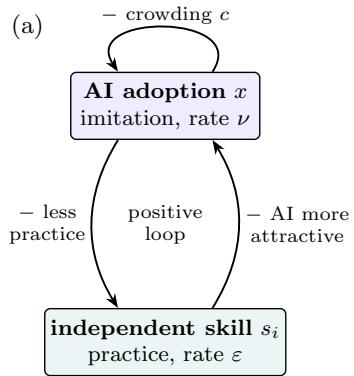
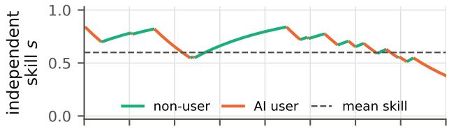
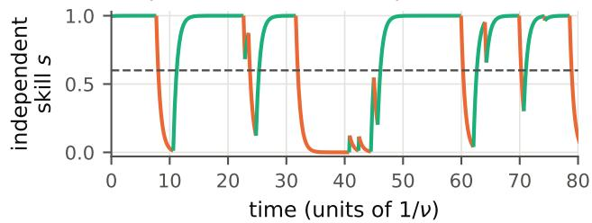
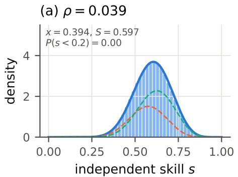
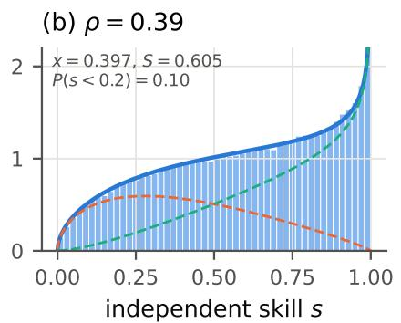
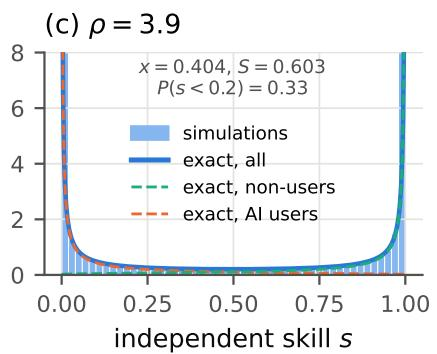
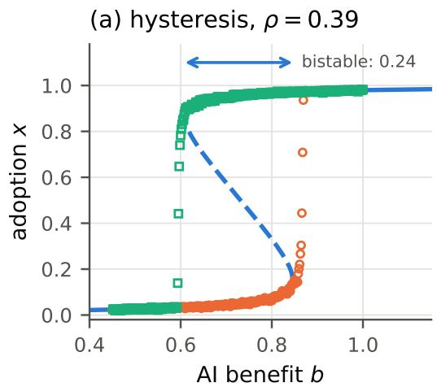
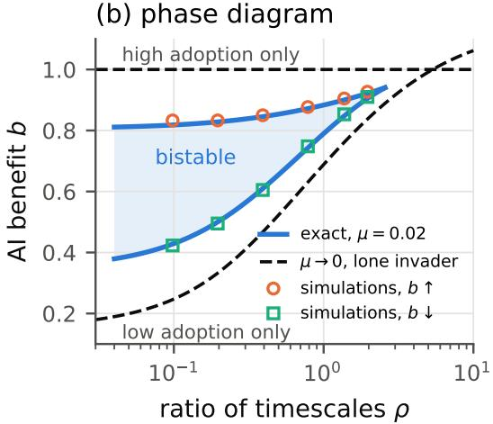
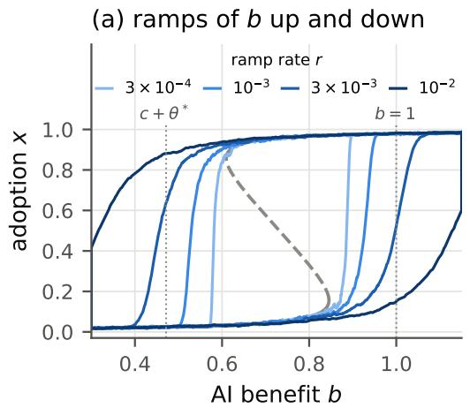
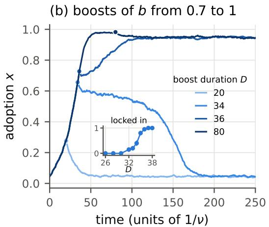

# Modelling lock-in of AI adoption through skill erosion

Renaud Lambiotte1, 2, 3

1Mathematical Institute, University of Oxford, Oxford, United Kingdom

2Institute for New Economic Thinking, University of Oxford, Oxford, United Kingdom

3Complexity Science Hub, Vienna, Austria

(Dated: November 4, 2026)

Generative AI can improve immediate performance but may erode the human skills required for future work. We study a model in which individuals tend to imitate successful peers, while their independent skills grow with practice and erode with reliance on AI. Because each agent’s skill reflects their history, non-users and AI users develop diferent skill distributions, which we derive exactly. Skill erosion can produce bistability and hysteresis between a low-adoption, high-skill state and a high-adoption, low-skill state. When agents rarely change behaviour at random, the two transitions are asymmetric. A single AI user spreads through a population of experts only if AI assisted work earns more than expert work, whatever the timescale of skill adaptation. A single non-user, by contrast, can lead an AI-dependent population back to independent work only if they regain enough skill before returning to AI, which becomes easier the more persistent behaviours are. As AI improves, adoption can jump abruptly, and a suficiently long increase in its benefit, such as a period of low prices, can leave a population relying on AI after the benefit has returned to its initial value. Skill erosion thus creates a history-dependent switching cost that can make widespread AI adoption dificult to reverse.

## I. INTRODUCTION

Generative artificial intelligence (AI) is rapidly becoming part of how people write, code, learn and make decisions. It can improve immediate performance in a wide range of tasks, but it can also reduce performance at two levels. At the individual level, relying on AI may reduce the practice that maintains one’s capacity to work independently: AI assistance can help with a task yet reduce persistence and subsequent independent performance [1]. Whether assistance supports or harms learning also depends on how it engages the user [2, 3]. At the collective level, the value of AI-assisted work may decrease as more people rely on the same tools [4]. Their outputs become more similar, reducing the diversity of ideas and content [5, 6], much as navigation services that give the same advice to many drivers concentrate trafic on the same roads [7]. AI systems retrained on increasingly synthetic data can also progressively lose quality, a phenomenon known as model collapse [8, 9]. The adoption of AI is, moreover, a social process, as for any technology [10]. A software developer adopting a code assistant, a student solving exercises with a chatbot and an analyst drafting reports with a language model all observe how well these tools serve their peers, and may be encouraged to adopt them when others appear to benefit.

Models of social learning and evolutionary game theory provide a natural framework for such adoption dynamics [11, 12]. In conventional models, the payof of a strategy depends on current strategies, but not on the history of the individual who plays it. AI adoption differs, as every individual carries an internal state, their skill, which evolves with their own behavioural history: using AI changes the skill of the user, and therefore the payof of their future decisions. Coevolutionary games, in which strategies coevolve with individual attributes [13], come closest to this setting. We call the dependence of an agent’s skill, and hence of the payof of their next choice, on their own history of actions individual memory. Two AI users can have the same behaviour at a given moment, while one, who has just adopted AI, retains the expertise of years of independent practice, and the other, who has relied on AI for a long time, has lost it. It is thus not memory in the sense of repeated games, in which strategies condition on past moves, but the impact that an agent’s past behaviour leaves on their own skill.

In this article, we show that the erosion of skills can make the adoption of AI abrupt and hard to reverse, in a minimal model with an exact stationary solution and two competing feedbacks [16]. Relying on AI raises immediate productivity but erodes independent skill, which makes AI relatively more attractive and reinforces adoption, whereas widespread adoption leads to a loss of distinctiveness and reduces the advantage of AI-assisted work. As each agent’s skill reflects their own history, non-users and AI users form two populations with different distributions of skill, and the rate at which agents move from one to the other depends on their skill. We derive the stationary skill distributions exactly, allowing us to determine how individual histories afect collective AI adoption and the conditions under which diferent adoption regimes coexist. When skill erosion outweighs crowding, a state of low adoption and high skill and a state of high adoption and low skill can coexist, with hysteresis between them, and the relative timescales of skill adaptation and behavioural change determine the range of benefits of AI over which they do. Note that tipping points, hysteresis and irreversible dependence on AI have also been obtained in population-level models [14, 15], where capability is described by population averages or compartments, whereas here each agent carries their own skill. When exploration is rare, the persistence of behaviour does not change the threshold at which AI invades a population of experts, but it makes the return to independent work easier, as non-users who hold out regain skill before switching back to AI.

Finally, we discuss the implications of our findings for lock-in. Skill erosion acts as a switching cost, a classic source of lock-in in economics [17, 18], but one that is borne through the user’s own eroded capability and grows with the length of use. Simulations of a benefit of AI that rises and then falls, e.g. when a period of low prices ends, show that adoption can jump abruptly as AI improves, that a temporary increase in its benefit locks a population in if it lasts long enough, and that adoption alone does not reveal whether a population is locked in.

This article is organised as follows. Section II introduces the model, and Sec. III derives the exact stationary distributions of skill of non-users and AI users. Section IV uses them to derive the thresholds of adoption and return, and the bistable region and hysteresis that they delimit. Section V discusses the implications of this hysteresis for the adoption of AI, whose benefit rises as tools improve and may fall if their price rises. We discuss our results, including tools that complement the expertise of their users, in Sec. VI. The appendices give the derivations, simulation details and robustness checks.

## II. MODEL

We consider a population of N individuals, or agents. Each agent i has a behaviour $\sigma _ { i } \in \{ \mathrm { H } , \mathrm { A } \}$ , working without AI (H, for human) or with AI (A), and an independent skill $s _ { i } \in [ 0 , 1 ]$ , i.e. the quality of the work they can produce without AI, and we denote by x the fraction of AI users. The observed payof of an action is

$$
\pi _ { \mathrm { H } } ( s ) = s , \qquad \pi _ { \mathrm { A } } = b - c x .\tag{1}
$$

Work without AI is worth what the agent can do on their own. AI-assisted work is worth a benefit b, reduced by a crowding term c x that captures the loss of distinctiveness as more people use the same tools [5, 6]. For simplicity, we assume that the payof of AI-assisted work does not depend on the user’s independent skill; we discuss tools that complement expertise in Sec. VI.

Between changes of behaviour, skills evolve as

$$
\dot { s } _ { i } = \left\{ \begin{array} { l l } { \varepsilon \left( 1 - s _ { i } \right) } & { \mathrm { i f ~ } \sigma _ { i } = \mathrm { H } , } \\ { - \varepsilon s _ { i } } & { \mathrm { i f ~ } \sigma _ { i } = \mathrm { A } . } \end{array} \right.\tag{2}
$$

Practice pulls an agent’s skill towards 1, while reliance on AI lets it erode towards 0. Agents revise their behaviour at rate ν. At a revision, an agent explores with probability $\mu ,$ choosing one of the two behaviours at random, independently of their current behaviour. We include ex ploration to ensure that a population in which all agents, or none, use AI can still change behaviour, as it would otherwise have no peer to imitate (the system would be in an absorbing state). Otherwise, the agent observes a random peer j and, if their behaviours difer, copies the behaviour of j with probability

(b) frequent switching, = 0.1  
  
(c) persistent behaviour, = 3

  
FIG. 1. Feedbacks and individual memory. (a) Feedback structure. Reliance on AI erodes independent skill, and lower skill makes AI relatively more attractive. Crowding restrains adoption. (b,c) Illustrative skill trajectories of a single agent, coloured by behaviour, when behaviour changes often compared with the time skills need to adapt $( \mathrm { b } , \rho = 0 . 1 )$ and when behaviour is persistent (c, $\rho = 3 )$ . For these trajectories, switching is independent of skill and the rates are chosen so that the agent uses AI 40% of the time. The agent has the same mean skill in both cases (dashed line), but skill stays close to the mean in (b) and alternates between expertise and deep erosion in (c).

$$
\begin{array} { r } { P ( i  j ) = \frac { 1 } { 2 } + \frac { \beta } { 2 } \big ( \pi _ { j } - \pi _ { i } \big ) , } \end{array}\tag{3}
$$

a linear pairwise comparison [19, 20]. Here $\beta$ controls the strength of selection: weak selection means $\beta | \pi _ { j } -$ $\pi _ { i } | \ll 1 .$ , so copying is nearly random. For a Fermi rule, $P _ { \mathrm { F } } ( i  j ) = [ 1 + \exp ( - \gamma ( \pi _ { j } - \pi _ { i } ) ) ] ^ { - 1 }$ , the first-order expansion at weak selection is $\begin{array} { r } { \frac { 1 } { 2 } + \frac { \gamma } { 4 } ( \pi _ { j } - \pi _ { i } ) } \end{array}$ ; Eq. (3) is this linear rule with $\gamma = 2 \beta$ . In the main analysis we use Eq. (3) as a linear comparison rule at finite $\beta ,$ rather than assuming weak selection, and require only that it define a probability: $\beta | \pi _ { j } - \pi _ { i } | \le 1$ . Since $| \pi _ { j } - \pi _ { i } |$ ≤ 1.15 in all the cases considered, $\beta | \pi _ { j } - \pi _ { i } | \leq 0 . 9 2$ , so

P remains between 0.04 and 0.96. Importantly, agents compare realised payofs, which carry each peer’s own history of practice.

The model has two timescales, the time $1 / \nu$ between revisions of behaviour and the time $1 / \varepsilon$ over which skills adapt. We compare them through the ratio

$$
\rho = \frac { 2 \varepsilon } { \nu ( 1 + \mu ) } \simeq \frac { 2 \varepsilon } { \nu } .\tag{4}
$$

The denominator $\nu ( 1 + \mu ) / 2$ is the sum of the two switching rates in the absence of selection, and measures how quickly an individual’s behaviour loses memory of its previous state. The ratio $\rho$ thus compares how quickly skills adapt with how quickly behaviours change. Small $\rho$ means that agents typically switch behaviours before their skills have adapted, whereas large $\rho$ means that behaviours persist long enough for skills to approach their respective targets.

Figure 1(b,c) illustrates the two regimes for a single agent: when the agent changes behaviour often, their skill stays close to its mean, whereas when their behaviour is persistent, it alternates between expertise and deep erosion. The correlation between current behaviour and skill, through which individual memory shapes collective behaviour, is strongest for large $\rho ,$ when skill closely follows behaviour. As $\rho \to 0 .$ , rapid switching averages over many behaviours before skill can adapt, so current behaviour carries little information about an agent’s skill. A large $\rho$ has two consequences, which we derive below: agents who stop using AI regain skill before they switch again, which weakens lock-in, whereas AI users lose theirs, which polarises skills. Linear payofs, relaxation and imitation are the simplest choices that keep the two feedbacks of Fig. 1(a); other choices are possible, and we discuss them in Sec. VI.

In the following, we measure time in units of $1 / \nu ,$ and use $\mu = 0 . 0 2$ and $\beta = 0 . 8$ throughout, both for the exact solution and in simulations, except in the limit of rare exploration, $\mu \to 0$ , considered in Sec. IV. The values of $b , \ c$ and $\rho$ are given with each figure, with $\rho = 0 . 3 9$ corresponding to $\varepsilon = 0 . 2 \nu$

## III. EXACT DISTRIBUTIONS OF SKILL

An agent’s skill reflects their own history, so that nonusers are, on average, more skilled than AI users, and populations with the same adoption and the same mean skill can difer widely in how skills are distributed. In Fig. 2, for instance, the fraction of agents with skill below 0.2 ranges from none to a third, for an adoption of 40% and a mean skill of 0.6.

To investigate this behaviour, we describe the population by the densities $n _ { \mathrm { H } } ( s , t )$ and $n _ { \mathrm { A } } ( s , t )$ of nonusers and AI users with skill $s ,$ normalised so that $\begin{array} { r } { \int ( n _ { \mathrm { H } } + n _ { \mathrm { A } } ) d s = 1 } \end{array}$ . In a large well-mixed population, they obey the rate equations

$$
\begin{array} { r l } & { \partial _ { t } n _ { \mathrm { H } } = - \partial _ { s } \big [ \varepsilon ( 1 - s ) n _ { \mathrm { H } } \big ] - k _ { \mathrm { H A } } ( s ) n _ { \mathrm { H } } + k _ { \mathrm { A H } } n _ { \mathrm { A } } , } \\ & { \partial _ { t } n _ { \mathrm { A } } = \partial _ { s } \big [ \varepsilon s n _ { \mathrm { A } } \big ] + k _ { \mathrm { H A } } ( s ) n _ { \mathrm { H } } - k _ { \mathrm { A H } } n _ { \mathrm { A } } . } \end{array}\tag{5}
$$

The first terms transport skills along the deterministic flows (2), and the others describe changes of behaviour, at rates $k _ { \mathrm { H A } } ( s )$ from H to A and $k _ { \mathrm { A H } }$ from A to H $( \mathrm { A p - }$ pendix A). A non-user adopts AI more often the lower their skill, as they gain more by imitating AI users, whereas the rate at which AI users return to working without AI does not depend on their own skill, as their payof does not. Both rates depend on the rest of the population only through the adoption $x = \int n _ { \mathrm { A } }$ ds and the mean skill $m _ { \mathrm { H } }$ of non-users.

As $k _ { \mathrm { H A } } ( s )$ is linear in s, integrating $\operatorname { E q . }$ (5) over s gives an exact equation for adoption,

$$
\begin{array} { l } { \dot { x } = \nu \Big [ \mu \big ( \frac { 1 } { 2 } - x \big ) } \\ { \qquad + \beta ( 1 - \mu ) x ( 1 - x ) \big ( b - c x - m _ { \mathrm { H } } \big ) \Big ] . } \end{array}\tag{6}
$$

Adoption thus follows a replicator equation with exploration, in which the advantage of AI-assisted work, $b - c x - m _ { \mathrm { H } }$ , is evaluated with the mean skill of non-users. This equation is not closed, as $m _ { \mathrm { H } }$ depends, through skilldependent switching, on the variance of skills among nonusers, which in turn depends on higher moments (Appendix A). For other imitation rules, adoption responds to another statistic of the skills of non-users, e.g. a quantile close to their median when agents copy only peers who earn more (Appendix A).

The stationary state of Eq. (5) can nevertheless be found exactly, for an infinite population and at any strength of selection for which the imitation probabil ity (3) lies between 0 and 1. Non-users drift towards high skill and AI users towards low skill, while changes of behaviour move agents between these two flows. At stationarity, the upward flow of non-users through any level of skill must balance the downward flow of AI users: adding the two equations shows that the flux of probability along s, $\varepsilon ( 1 - s ) n _ { \mathrm { H } } - \varepsilon s n _ { \mathrm { A } }$ , is uniform, and it vanishes as no agent leaves [0, 1]. This reduces the problem to a first-order linear diferential equation for the upward flux of non-users through each level of skill, $w ( s ) = \varepsilon ( 1 - s ) n _ { \mathrm { H } } ( s )$ (Appendix B), which can be integrated for general switching rates and gives the stationary densities in closed form for linear imitation,

$$
\begin{array} { r } { n _ { \mathrm { H } } ( s ) = C ( 1 - s ) ^ { A - 1 } s ^ { B } e ^ { - \lambda s } , } \\ { n _ { \mathrm { A } } ( s ) = C ( 1 - s ) ^ { A } s ^ { B - 1 } e ^ { - \lambda s } , } \end{array}\tag{7}
$$

where $A = k _ { \mathrm { H A } } ( 1 ) / \varepsilon , B = k _ { \mathrm { A H } } / \varepsilon$ , and $\lambda \geq 0$ is the decrease of $k _ { \mathrm { H A } } ( s )$ per unit of skill, divided by ε.

The total density of skills, $n _ { \mathrm { H } } + n _ { \mathrm { A } } = \dot { C } s ^ { B - 1 } ( 1 -$ $s ) ^ { A - 1 } e ^ { - \lambda s }$ , is thus a Beta distribution, tilted by an exponential factor that accounts for skill-dependent switching. The exponents compare the rates at which agents change behaviour with the rate at which their skill adapts. The density of non-users diverges at $s = 1$ when $A < 1$ , and that of AI users at $s = 0$ when $B < 1$ , so that the shape of the distribution can change qualitatively at fixed adoption and mean skill, a noise-induced transition in the sense of Ref. [21]. The adoption and the mean skills of non-users and AI users then follow in closed form. However, the switching rates entering these distributions depend themselves on the population. We therefore impose self-consistency: the adoption and mean skills obtained from the distributions must agree with those used to calculate the switching rates. This reduces the stationary problem to a single equation (Appendix B), which we solve at fixed adoption to obtain the corresponding benefit $b ;$ for a given $b ,$ it can have several solutions. For an infinite well-mixed population, these are the exact stationary states, up to three in the regimes that we have explored (Sec. IV). The equation also determines where stationary states merge and disappear (folds), but not their stability, which we infer from simulations (Sec. IV).

FIG. 2. Same adoption and mean skill, diferent distributions of skill $( c = 0 . 9 5 , \mathrm { ~ a ~ }$ single stable state; b is tuned so that $x = 0 . 4$ , and hence $S = 1 - x = 0 . 6 $ in every panel). Histograms of skill in simulations of $2 \times 1 0 ^ { 4 }$ agents, pooled over snapshots, and exact densities (7), for all agents and separately for non-users and AI users, as $\rho$ increases. Each panel gives the adoption x and the mean skill S measured in the simulations, and the fraction of agents with skill below 0.2 predicted by the exact solution; simulations give 0.00, 0.10 and 0.33.  

  
FIG. 3. Bistability and hysteresis. (a) Stationary adoption as a function of the benefit b of AI-assisted work $( c = 0 . 1 5 ,$ $\rho = 0 . 3 9 )$ : exact solution (dashed on the unstable branch) and simulations of $1 0 ^ { 4 }$ agents in which b is slowly increased (circles) or decreased (squares). The arrow gives the width of the bistable window. (b) Phase diagram in the plane of the ratio of timescales $\rho$ and the benefit b: folds of the exact solution for $\mu = 0 . 0 2$ (solid blue lines, bistable region shaded), folds measured in simulations (symbols), and boundaries of the bistable region for $\mu \to 0$ (dashed, with $\rho = 2 \varepsilon / \nu )$ , at which a lone AI user invades a population of non-users $( b = 1 )$ and a lone non-user invades a population of AI users $[ b = c + \theta ^ { * } ( \rho )$ , Eq. (8)]. Below the bistable region, the only stable state has low adoption, and above it, high adoption; beyond the cusp, near $\rho \approx 2 . 7$ for $\mu = 0 . 0 2$ , adoption increases continuously with b.

These distributions reveal a polarisation of skills that averages hide. As non-users pull their skill towards 1 and AI users towards 0, the mean skill S of the population obeys $\dot { S } = \varepsilon ( 1 - x - S )$ exactly (Appendix A), so that $S = 1 - x$ at stationarity: adoption alone fixes the mean skill. Figure 2 illustrates this polarisation for populations tuned to the same adoption, $x = 0 . 4$ , and thus to the same mean skill, 0.6, in a regime with a single stable state. As ρ increases from 0.039 to 3.9, the distribution of skills changes from a narrow peak around the mean to a U-shaped distribution, with non-users close to $s = 1$ and AI users close to $s = 0$ . The fraction of agents whose independent skill is below 0.2 rises from 0.00 to 0.10 and 0.33, i.e. a third of the population has lost most of its capacity for independent work, while adoption and mean skill are unchanged. The exact densities agree with the histograms in all three regimes. In all three panels, AI users and non-users earn the same on average, within 0.011, as required by Eq. (6): at $\rho = 3 . 9$ , AI users, whose mean independent skill is 0.12, earn as much as non-users, whose mean skill is 0.92. The similar average payofs thus conceal substantial diferences in independent skill. In particular, the erosion of skill among AI users is hidden by their continued access to AI assistance, and would become apparent if the tool were no longer available.

These diferences in skill also determine whether AI adoption can be reversed. In a population where almost everyone relies on AI, someone who stops using it initially has little independent skill and performs poorly, but becomes more productive as they practise. Whether independent work can spread depends on whether they recover enough skill to attract imitators before returning to AI.

The coexistence of several self-consistent stationary states raises the questions of which are stable and how transitions between them occur; we examine these questions in the next section.

## IV. THRESHOLDS OF ADOPTION AND RETURN

Having determined the stationary distributions of skill, we now ask which levels of AI adoption are possible and how they change with the benefit of AI. Two feedbacks compete: skill erosion makes AI relatively more attractive as adoption grows, whereas crowding makes it less attractive. When crowding dominates, or when behaviour is persistent enough, the population settles in a single state, whose adoption increases continuously with the benefit of AI. When skill erosion dominates, two stable states may coexist, one with low adoption and high skill and the other with high adoption and low skill, separated by an unstable state. As the benefit of AI changes, one of these states can disappear, leading to an abrupt transition and hysteresis.

The thresholds separating these regimes have a simple interpretation when exploration is rare, $\mu \to 0$ . In this limit, the two stable states approach populations in which everyone follows the same behaviour, and their stability is determined by whether a lone agent choosing the other behaviour can spread. A lone AI user in a population of experts, whose skills are all equal to 1, earns b and attracts imitators if $b > 1 \colon$ a population of experts adopts

AI only when AI-assisted work earns more than expert work, whatever the value of ρ. A lone non-user in a population of AI users, by contrast, starts with almost no skill, but their skill grows as long as they hold out, which makes them increasingly attractive to imitate, although they may switch back to AI at any time. The population returns to working without AI if such a holdout converts, on average, more than one AI user before switching back to AI, i.e. if the skill of a holdout, averaged over the time they hold out, exceeds the payof of AI-assisted work, $b - c .$ . As holdouts return to AI more quickly when AI pays more, this condition defines a threshold, $b - c < \theta ^ { * }$ (Appendix B).

These two thresholds follow analytically from the invasion of lone agents. In all the cases that we have computed, a single unstable branch of stationary states connects them (Appendix B), so that, in these cases, the population is bistable for

$$
c + \theta ^ { * } ( \rho ) < b < 1 ,\tag{8}
$$

whose bounds are the dashed lines of Fig. 3(b). The threshold $\theta ^ { * }$ increases with $\rho \colon$ the longer non-users persist before returning to AI, the more skill they recover and the more likely they are to attract imitators. In the weak-selection, zero-exploration limit, $\theta ^ { * } = \rho / ( 1 + \rho )$ , so the condition for a non-empty bistable interval becomes $c < 1 / ( 1 + \rho )$ This is the efective-feedback criterion $\Gamma _ { \mathrm { e f f } } >$ 8m of Frigerio et al. [22], where $\Gamma _ { \mathrm { e f f } } = 1 / ( 1 + \rho ) - c$ once their benefit of autonomous work is set to 1, their skill floor and their exploration rate m to 0, and the corresponding convention for the timescale ratio is used. The holdout argument gives this criterion a microscopic interpretation; at finite selection in our linear-comparison model, it yields a diferent threshold: for $\beta = 0 . 8$ and $\rho = 0 . 3 9 , \theta ^ { * } = 0 . 3 2$ , compared with the weak-selection value 0.281. When behaviour changes much faster than skill, i.e. for $\rho  0$ , all agents carry nearly the same skill: holdouts switch back to AI before regaining any skill, so that $\theta ^ { * } \to 0$ , as at the left of Fig. 3(b), and the population would be bistable for $c < b < 1$ . In the rareexploration limit, the persistence of behaviour does not change the threshold at which AI invades a population of experts, but it eases the return: the more persistent the behaviours, the more skill the holdouts accumulate, and the more easily the population returns. Skill erosion is thus a cost of returning to working without AI, rather than of adopting it: a holdout starts deskilled and earns little until they have regained skill.

Exploration narrows the bistable region. For $\mu = 0 . 0 2$ imposing self-consistency on the stationary distributions gives the S-shaped curve of adoption as a function of AI benefit shown in Fig. 3(a). Its two turning points, or folds, delimit the region in which the low- and highadoption states coexist. In simulations in which $b$ is slowly varied (Appendix C), the population jumps between the stable branches near these folds, located at $b = 0 . 8 4 5$ on the way up and 0.610 on the way down for $\rho = 0 . 3 9$

  
FIG. 4. Discontinuous adoption and lock-in $( c = 0 . 1 5 , \rho = 0 . 3 9$ , simulations of $1 0 ^ { 4 } ~ \mathrm { a g e n t s } )$ . (a) Adoption against the benefit b when b rises from 0.3 to 1.15 at a rate $r ,$ remains at 1.15 for 300 time units and falls back at the same rate, for four values of $r ,$ with the exact stationary solution (grey, dashed on the unstable branch) and the thresholds (8) for $\mu \to 0$ (dotted). (b) Adoption over time in single runs in which b is raised from 0.7 to 1 for a duration D and then restored to $0 . 7 ;$ ; dots mark the end of the increase. Inset: fraction of 20 runs that remain at high adoption, against $D ,$ with binomial standard errors.

The folds lie inside the corresponding invasion thresholds for $\mu \to 0$ , because exploration continually injects agents of the minority behaviour, so that each stable state loses its stability before a lone invader would succeed on its own. Exploration also makes the threshold of adoption depend on $\rho ,$ as agents who have recently stopped using AI lower the mean skill of non-users, the more so the smaller $\rho .$ This dependence is weak compared with that of the threshold of return: as $\rho$ increases from 0.04 to 2, the former rises from 0.81 to $0 . 9 2$ , and the latter from 0.38 to 0.91. The bistable region thus closes near $\rho \approx 2 . 7 \ [ \mathrm { F i g . 3 ( b ) } ]$ ], and the folds calculated from the exact stationary solution agree with simulations within 0.015, close to their resolution of 0.01 in b. Persistent behaviours thus protect a population against lock-in, but at the price of the polarisation of skills described in Sec. III.

## V. ABRUPT ADOPTION AND LOCK-IN

So far, we have considered stationary states at a fixed benefit of AI. In practice, this benefit changes over time as tools improve or become more expensive. We now ask how quickly such changes afect adoption, and whether a temporary advantage can produce lasting dependence on AI. We investigate two scenarios: a benefit b that increases and then decreases at a constant rate $r \left[ \mathrm { F i g . 4 ( a ) } \right]$ and a temporary increase in b lasting for a duration D [Fig. 4(b)]. Details of the simulations are given in $\mathrm { A p \mathrm { - } }$ pendix C.

First, the speed of change matters. As AI improves, adoption remains low until the benefit crosses the upper stationary fold, after which it rises abruptly. Faster increases delay the transition because a small minority of AI users needs time to grow. On the way down, adoption remains high well below the benefit at which it rose, and the return to independent work is likewise delayed. The faster the changes, the wider the hysteresis observed for the rates considered $\left[ \mathrm { F i g . 4 ( a ) } \right]$ ]. In the infinite-population adiabatic limit, $r  0 .$ the trajectories follow the stable stationary branches and jump at their folds, recovering the hysteresis loop of Fig. $\mathrm { 3 ( a ) }$ , with transitions at $b = 0 . 8 4 5$ and 0.610. For a finite population, this description applies only while the ramp is fast compared with the rare fluctuations that allow escape from a stable state. For illustration, if agents reconsider their use of AI about once a week, so that skills adapt over about five weeks, increasing b from 0.3 to 1.15 takes about five years for $r = 3 \times 1 0 ^ { - 3 }$ and one and a half years for $r = 1 0 ^ { - 2 }$

Second, even a temporary improvement in the benefit of AI can have lasting consequences. In Fig. 4(b), b is raised from 0.7, where the population is initially in a state of low adoption, to 1 for a duration D, before returning to 0.7. Short increases have little lasting efect on adoption, whereas suficiently long ones leave the population in a state of high AI use, where about 92% of agents have an independent skill below 0.2. Although the benefit of AI has returned to its initial value, the skills lost during the period of increased adoption make independent work less attractive. Between these outcomes, finite-size fluctuations determine which state the population reaches. In 20 simulations per duration, the fraction remaining at high adoption rises from 0 for $D \leq 3 0$ to 0.4 for $D = 3 4$ and 1 for $D \ = \ 3 7$ and 38, as in all runs with longer increases [inset of Fig. 4(b)]. The crossover duration is about 35 for these parameters, roughly seven times the timescale $1 / \varepsilon$ of skill adaptation, or eight months with the illustrative time unit above.

Finally, adoption alone does not reveal whether a population is locked in. At the end of an increase lasting

D = 34, adoption exceeds that of the unstable stationary state, x = 0.57 at b = 0.7, in 19 of the 20 simulations. Yet 11 of these 19 populations return to low adoption. In these 11 runs, skills have eroded slightly less than in the 8 runs that remain locked in, and much less than at the unstable state: at the end of the increase, the mean skills of non-users and AI users are about 0.71 and 0.39, against 0.69 and 0.36 in the locked-in runs and 0.61 and 0.29 at the unstable state. Thus, crossing the adoption level of the unstable state does not necessarily imply collective lock-in. The outcome also depends on the distribution of skills, which carries the memory of past AI use. Populations with similar adoption rates can therefore evolve towards diferent states.

## VI. DISCUSSION

In this article, we have studied a model of the coevolution between AI adoption and human skills with an exact stationary solution. Its central mechanism is simple: relying on AI can improve immediate performance while eroding the skills needed to work independently, making further reliance on AI more attractive. This feedback can produce bistability and hysteresis: adoption may increase abruptly as AI improves, and even a temporary increase in its benefit can leave a population relying on AI after the benefit has returned to its initial value. We derived the stationary distributions of skill for non-users and AI users, showing that populations with the same adoption and mean skill can have very diferent distributions of expertise.

An important finding is that skill erosion and the persistence of behaviour play distinct roles. Skill erosion reinforces the adoption of AI, whereas the persistence of individual behaviours allows those who stop using AI to recover their skills before switching back. When exploration is rare, persistence therefore leaves unchanged the threshold at which AI invades a population of experts, but it makes the return to independent work easier. More generally, increasing this persistence narrows the bistable region, but also increases the polarisation of skills between AI users and non-users. Skill erosion thus acts as a history-dependent switching cost, diferent from the investments in equipment or workflows usually considered in economics [18]. The cost emerges through the loss of the user’s own capabilities, and adoption rates alone cannot reveal how far a population is locked into reliance on AI.

These findings depend on modelling choices, but the main qualitative efects persist under alternative imitation rules and unequal rates of skill acquisition and erosion (Appendix C). The precise thresholds and skill distributions nevertheless depend on these choices. The design of AI tools may also matter: when AI-assisted performance benefits from the user’s own expertise, the feedback towards reliance on AI weakens and the bistable region narrows (Appendix B). This suggests that tools complementing human expertise may reduce the risk of collective lock-in, even when reliance on them still erodes independent skills.

Several extensions would bring the model closer to realworld settings. Individuals difer in their skills, tasks and learning rates, and interact through social networks rather than uniformly with the population. The quality and price of AI may also respond to adoption, while users and providers may anticipate the long-term efects of their decisions. Most importantly, the model has not yet been calibrated against data. Following individuals AI use and their performance both with and without assistance would allow its predictions to be tested, particularly the relationship between the persistence of behaviour and the polarisation of independent skills. More generally, our results suggest that understanding the long-term consequences of AI adoption requires measuring not only how many people use AI, but also how their ability to work without it evolves.

## CODE AVAILABILITY

The code that reproduces all the figures, including the exact stationary solution, the loneholdout threshold and the agent-based simulations, is available at https://github.com/rlambiot/ modelling-lock-in-ai-adoption-skill-erosion.

## ACKNOWLEDGMENTS

I warmly thank R. Baeza-Yates, D. Pedreschi, L. Pappalardo, and N. Oliver for discussions on human–AI coevolution. I used Claude Opus 5.5 (Anthropic) as an AI assistant in this work. It was used to write and debug the code for the simulations, solvers and figures, to check derivations and proofs, to validate the interpretation of the results, and to edit the text. I reviewed and edited all stages of the work and take full responsibility for its content. In line with this paper, I used AI sparingly, to preserve my independent skills. I acknowledge support from the EPSRC grants EP/V013068/1, EP/V03474X/1 and EP/Y028872/1.

## Appendix A: Switching rates and moments

This appendix connects the individual revision rule to the population equations used in Sec. III. It also explains why adoption and mean skill alone do not provide a closed description, and how other imitation rules change what aspect of skill matters for adoption.

a. Switching rates. An agent revises their behaviour at rate ν. Exploration contributes a switching rate νµ/2, while imitation depends on the payof of a randomly chosen peer. Averaging over peers gives

$$
\begin{array} { r l } & { k _ { \mathrm { H A } } ( s ) = \frac { \nu } { 2 } \big [ \mu + ( 1 - \mu ) x \big ( 1 + \beta ( b - c x - s ) \big ) \big ] , } \\ & { \quad k _ { \mathrm { A H } } = \frac { \nu } { 2 } \big [ \mu + ( 1 - \mu ) ( 1 - x ) \big ( 1 - \beta ( b - c x - m _ { \mathrm { H } } ) \big ) \big ] , } \end{array}\tag{A1}
$$

so that $k _ { \mathrm { H A } } ( s ) = a _ { 0 } - a _ { 1 } s ,$ , with $a _ { 1 } = \nu \beta ( 1 - \mu ) x / 2 \geq$ 0. Less-skilled non-users are more likely to adopt AI, whereas the rate at which AI users return to independent work does not depend on their own skill.

b. Moments. Integrating Eq. (5) over skill gives the adoption equation (6). Since switching behaviour does not change an agent’s skill, the population mean satisfies $\begin{array} { r } { \dot { S } = \varepsilon ( 1 - x - S ) } \end{array}$ , and hence $S = 1 - x$ at stationarity. The mean skill of non-users, however, does not obey a closed equation: because their switching rate depends on skill, its evolution involves the second moment of their skill distribution, which in turn depends on higher moments. This is why we follow the full distribution rather than adoption and mean skill alone.

c. Other imitation rules. More generally, let $g ( \Delta )$ be the probability of copying a peer, where $\Delta$ is the peer’s payof minus one’s own. For the Fermi rule, $g ( \Delta ) \overset { \cdot } { = } [ 1 +$ $\mathrm { \bar { e x p } } ( - \gamma \Delta ) ] ^ { - 1 }$ , with selection intensity γ. When $g ( \Delta ) +$ $g ( - \Delta ) = 1$ , and writing $\theta = b - c x$ , adoption obeys

$$
\begin{array} { l } { \dot { x } = \nu \Big [ \mu \big ( \frac { 1 } { 2 } - x \big ) } \\ { \qquad + ( 1 - \mu ) x ( 1 - x ) \big \langle 2 g ( \theta - s ) - 1 \big \rangle _ { \mathrm { H } } \Big ] , } \end{array}\tag{A2}
$$

where $\langle \cdot \rangle _ { \mathrm { H } }$ denotes an average over non-users. Thus, the imitation rule determines which aspect of their skill distribution drives adoption. For linear imitation, it is their mean skill. When agents copy only peers who earn more, adoption instead depends on the fraction of non-users whose skill lies above or below θ, corresponding to a quantile close to their median at stationarity when exploration is weak.

## Appendix B: Exact stationary solution

This appendix derives the stationary skill distributions of Sec. III and the adoption branches of Sec. IV. It explains how the distributions are made self-consistent, obtains the invasion thresholds, and extends the solution to AI tools that complement users’ skills.

a. Stationary distributions and moments. At stationarity, the two equations (5) imply that the total skill flux, $\varepsilon ( 1 - s ) n _ { \mathrm { H } } - \varepsilon s n _ { \mathrm { A } }$ , is constant. Since no probability leaves [0, 1], this flux vanishes. Hence $w = \varepsilon ( 1 - s ) n _ { \mathrm { H } } =$ εsnA, and the remaining equation becomes

$$
\frac { d \ln w } { d s } = - \frac { k _ { \mathrm { H A } } ( s ) } { \varepsilon ( 1 - s ) } + \frac { k _ { \mathrm { A H } } ( s ) } { \varepsilon s } .\tag{B1}
$$

This can be integrated for general switching rates. For the linear rates (A1), $k _ { \mathrm { H A } } ( s ) \ = \ k _ { \mathrm { H A } } ( 1 ) + a _ { 1 } ( 1 - s )$

and $k _ { \mathrm { A H } }$ is constant, giving $w \propto ( 1 - s ) ^ { A } s ^ { B } e ^ { - \lambda s }$ , with $A = k _ { \mathrm { H A } } ( 1 ) / \varepsilon , B = k _ { \mathrm { A H } } \bar { / } \varepsilon$ , and $\lambda = a _ { 1 } / \varepsilon$ Dividing by the skill velocities recovers the exact densities $( 7 ) .$ For $\mu > 0$ these describe stationary densities, which may have integrable divergences at the skill boundaries. At $\mu = 0$ , the homogeneous all-H and all-A states are absorbing and correspond to point masses at $s = 1$ and $s = 0$ , respectively.

To normalise these densities and calculate their moments, we use $\begin{array} { r l r } { \int _ { 0 } ^ { 1 } s ^ { p - 1 } ( 1 } & { { } - } & { s ) ^ { q - 1 } e ^ { - \lambda s } d s \ } & { { } = } \end{array}$ $\mathrm { B } ( p , q ) { } _ { 1 } F _ { 1 } ( p ; p + q ; - \lambda ) ^ { \circ }$ , where B and ${ } _ { 1 } F _ { 1 }$ are the Beta and Kummer functions. The integrals of the two unnormalised densities are

$$
\begin{array} { l } { { I _ { \mathrm { H } } = \mathrm { B } ( B + 1 , A ) \ { _ 1 F _ { 1 } } ( B + 1 ; A + B + 1 ; - \lambda ) , } } \\ { { I _ { \mathrm { A } } = \mathrm { B } ( B , A + 1 ) \ { _ 1 F _ { 1 } } ( B ; A + B + 1 ; - \lambda ) . } } \end{array}\tag{B2}
$$

Thus $C = 1 / ( I _ { \mathrm { H } } + I _ { \mathrm { A } } ) , x = I _ { \mathrm { A } } / ( I _ { \mathrm { H } } + I _ { \mathrm { A } } )$ , and the mean skill of non-users is

$$
m _ { \mathrm { H } } = \frac { \mathrm { B } ( B + 2 , A ) \mathrm { ~ } _ { 1 } F _ { 1 } ( B + 2 ; A + B + 2 ; - \lambda ) } { I _ { \mathrm { H } } } .\tag{B3}
$$

The mean skill of AI users follows from the stationary identity S = 1−x (Appendix A): $n _ { \mathrm { A } } = ( 1 { - } x ) ( 1 { - } m _ { \mathrm { H } } ) / x .$

b. Self-consistency. The rates $( \mathrm { A 1 } )$ depend on adoption x and mean non-user skill $m _ { \mathrm { H } }$ , which must match the values calculated from the densities. For a chosen $0 < x < 1$ , the stationary adoption equation (6) fixes the payof advantage,

$$
b - c x - m _ { \mathrm { H } } = { \frac { \mu ( x - { \frac { 1 } { 2 } } ) } { \beta ( 1 - \mu ) x ( 1 - x ) } } .\tag{B4}
$$

This determines $B = k _ { \mathrm { { A H } } } / \varepsilon$ and $\lambda = \nu \beta ( 1 - \mu ) x / ( 2 \varepsilon )$ The remaining unknown A is fixed by requiring the density to reproduce the chosen adoption:

$$
x I _ { \mathrm { H } } = \left( 1 - x \right) I _ { \mathrm { A } } .\tag{B5}
$$

Once A is found, Eq. (B3) gives $m _ { \mathrm { H } }$ and Eq. (B4) gives b. The condition $A = k _ { \mathrm { H A } } ( 1 ) / \varepsilon$ is then automatic: the stationary flux balance and the adoption equation require the same total switching, and the efective and actual Hto-A rates have the same skill dependence. Varying x traces the stationary branches and locates their folds, but does not establish their stability. For $c = 0 . 1 5$ and $\rho = 0 . 3 9$ , the folds are at $b = 0 . 6 1 0$ and 0.845 (Fig. 3).

c. Invasion thresholds and weak selection. When exploration vanishes, $\mu = 0$ , populations consisting entirely of non-users or entirely of AI users are absorbing. Near $x = 0$ , non-users have skill $s = 1$ , and ${ \dot { x } } \simeq \nu \beta x ( b - 1 )$ AI can invade when $b > 1$

Near $x = 1$ , by contrast, a rare non-user starts with almost no skill and gradually recovers it. Writing $\theta = b { - } c$ for the AI payof, such a holdout returns to AI at rate $\begin{array} { r } { k _ { \mathrm { H A } } ( s ) = \frac { \bar { \nu } } { 2 } [ 1 + \beta ( \theta - s ) ] } \end{array}$ . As $x \to 1$ , the rate $k _ { \mathrm { A H } }$ at which a given AI user stops using AI vanishes, so that $B = 0$ in Eq. (B1). This equation then gives the density of the time that a holdout, starting from $s \simeq 0$ , spends at skill s before returning to AI, $n _ { \mathrm { H } } ( s ) \propto ( 1 - s ) ^ { A - 1 } e ^ { - \lambda s }$ where $A = \nu [ 1 + \beta ( \theta - 1 ) ] / ( 2 \varepsilon )$ and $\lambda = \nu \beta / ( 2 \varepsilon )$ A holdout of skill s attracts AI users at rate $_ { \odot } ^ { \nu } [ 1 + \beta ( s - \theta ) ]$ as each of the N AI users revises at rate ν and observes the holdout with probability $1 / N$ . Each convert starts with almost no skill and is itself a new holdout, so that holdouts form a branching process. Let ¯s be the skill of a holdout averaged over the time they hold out. Since a holdout returns to AI exactly once, the expected number of AI users that they convert is $[ 1 + \beta ( { \bar { s } } - \theta ) ] / [ 1 + \beta ( \theta - { \bar { s } } ) ]$ , which exceeds 1 if and only $\operatorname { i f } { \bar { s } } > \theta .$ . As θ increases, A increases and ¯s decreases, so that holdouts invade if and only if $\theta < \theta ^ { * }$ , where $\theta ^ { * }$ solves

$$
\theta = \frac { \int _ { 0 } ^ { 1 } s ( 1 - s ) ^ { A - 1 } e ^ { - \lambda s } d s } { \int _ { 0 } ^ { 1 } ( 1 - s ) ^ { A - 1 } e ^ { - \lambda s } d s } , \qquad A = \frac { \nu [ 1 + \beta ( \theta - 1 ) ] } { 2 \varepsilon } .\tag{B6}
$$

In the zero-exploration case considered here, the weakselection limit $\beta  0$ makes the switching rates independent of skill and sets $\lambda = 0$ The conditional skill distributions then become $\operatorname { B e t a } ( B + 1 , A )$ for non-users and $\operatorname { B e t a } ( B , A + 1 )$ for AI users, with $A \ = \ x / \rho$ and $B = ( 1 - x ) / \rho .$ Their mean-skill gap is $G = m _ { \mathrm { H } } - m _ { \mathrm { A } } =$ $\rho / ( 1 + \rho )$ . For a lone holdout, $A \to 1 / \rho ,$ so $\theta ^ { * } = \rho / ( 1 + \rho )$ in this limit. In this limit, Eq. (4) gives $\rho = 2 \varepsilon / \nu$ , so that $\varepsilon = 0 . 2 \nu$ corresponds to $\rho = 0 . 4 0$ rather than 0.39; this changes $\theta ^ { * }$ by less than 0.01. At $\beta = 0 . 8$ , Eq. (B6) gives $\theta ^ { * } = 0 . 3 2$ for $\rho = 0 . 3 9$ , and, for $c = 0 . 1 5 , c + \theta ^ { * } = 1$ at $\rho = 5 . 3 5$ . We have checked numerically, for twelve values of $\rho$ between 0.03 and 5, that the stationary branch connects the two invasion thresholds monotonically. Thus Eq. (8) gives the full bistable window in these cases, although we have no general proof of monotonicity.

d. Complementarity. Suppose AI-assisted performance also benefits from the user’s skill, $\pi _ { \mathrm { A } } ( s ) = b -$ $c x + \eta s$ , with $0 \leq \eta < 1$ . Both switching rates then depend on skill. In particular, $k _ { \mathrm { A H } } ( s )$ decreases with slope $d _ { 1 } = \nu \beta \eta ( 1 - \mu ) ( 1 - x ) / 2$ , while the $_ \mathrm { H - t o - A }$ rate retains slope $a _ { 1 }$ . The same stationary form (7) applies with $B = k _ { \mathrm { A H } } ( 0 ) / \varepsilon$ and $\lambda = ( a _ { 1 } + d _ { 1 } ) / \varepsilon$ . The payof advantage driving adoption becomes $b - c x + \eta m _ { \mathrm { A } } - m _ { \mathrm { H } } .$

In the same weak-selection, zero-exploration limit, $G = \rho / ( 1 + \rho )$ . Along a mixed stationary branch, the payof advantage $b - c x + \eta m _ { \mathrm { A } } - m _ { \mathrm { H } }$ then has slope $( 1 - \eta ) ( 1 - G ) - c = { ( 1 - \eta ) } / { ( 1 + \rho ) } - c$ with respect to adoption. Complementarity therefore weakens the feedback towards AI dependence. The finite-selection solution shows the same tendency. For $c = 0 . 1 5$ and $\rho = 0 . 3 9$ the bistable window narrows from 0.24 at $\eta = 0$ to 0.14 at $\eta = 0 . 2$ and 0.05 at $\eta = 0 . 4 ;$ ; for $c = 0 . 9 5$ , the skill gap at $x = 0 . 4$ changes only from 0.31 at $\eta = 0$ to 0.30 at $\eta = 0 . 2$ and 0.4.

## Appendix C: Agent-based simulations and robustness

This appendix documents the simulation protocols used to produce the figures and reports robustness checks.

The simulations implement Eqs. (1)–(3) directly for $1 0 ^ { 4 }$ to $2 \times 1 0 ^ { 4 }$ agents. Time advances in steps $\delta t .$ In each step, every agent revises with probability $\bar { 1 } - e ^ { - \nu \delta t }$ using the payofs at the start of the step, and skills then relax exactly over the step. This synchronous updating biases adoption by $O ( \delta t )$ , about 0.01 at $\delta t \ : = \ : 0 . 1$ and $0 . 0 0 2$ at $\delta t = 0 . 0 2$ , so that quantitative comparisons use $\delta t \le 0 . 0 5$ . In Fig. 3(a), b is varied linearly at a rate of $1 0 ^ { - 4 }$ per time unit, from 0.45 to 1 in a population started at $x = 0 . 0 2$ with all skills equal to 1, and from 1 to 0.45 in a separate run started at $x = 0 . 9 8$ with all skills equal to 0; adoption is recorded every 2 time units. The folds shown in $\mathrm { F i g . \ 3 ( b ) }$ are located instead by independent runs at fixed b started in each stable state, with resolution 0.01 in b. Skill distributions are pooled over snapshots of the stationary state.

a. Changing benefit. In Fig. 4(a), the population is first equilibrated for 300 time units at $b ~ = ~ 0 . 3$ The benefit then rises linearly to 1.15 at a rate $r = 3 \times 1 0 ^ { - 4 }$ ， $1 0 ^ { - 3 } , 3 \times 1 0 ^ { - 3 } \mathrm { o r } 1 0 ^ { - 2 }$ , i.e. over a time $0 . 8 5 / r ,$ remains at 1.15 for 300 time units, falls back to 0.3 at the same rate and remains there for 300 time units. The values of b at which adoption crosses $\frac { 1 } { 2 }$ are averaged over three runs, with standard deviations of at most 0.01. In Fig. 4(b), the population is equilibrated at $b = 0 . 7$ in the state of low adoption, after which $b = 1$ for a duration D and then 0.7 for 400 time units. We run five simulations for each of $D = 1 0$ , 20, 28, 32, 34, 36, 40, 60, 80 and 160, of which panel (b) shows one, and 20 further simulations with other seeds for each of $D = 2 6$ , 28, 30 and 32 to 38, for its inset and for the statistics of Sec. V. A run counts as locked in if its adoption still exceeds $\textstyle { \frac { 1 } { 2 } }$ after 400 time units, by which time every run has settled near 0.05 or 0.95. As $\mu > 0$ and N is finite, fluctuations would eventually let a population escape either state, so that ‘locked in’ refers to the duration of the simulations.

b. Robustness. We also tested imitation without decision noise, in which agents copy only peers who earn more, while retaining random exploration. Bistability and skill polarisation persist, although the quantitative results difer: for $c = 0 . 1 5$ and $\rho = 0 . 3 9$ , the bistable window has width 0.20, compared with 0.24 under linear imitation. This rule also produces a persistent core of highly skilled non-users, because those who outperform AI users switch only through exploration. Under the Fermi rule, Eq. (B1) gives the stationary density by quadrature. For selection intensity $\gamma = 4 ,$ i.e. 2.5 times the selection of the main text $( \gamma = 2 \beta = 1 . 6 )$ , and $c = 0 . 1 5$ , the bistable window shrinks from 0.41 at $\rho \approx 0 . 2$ to 0.09 at $\rho \approx 1 . 2$ and for $c = 1 . 2$ the skill gap at $x = 0 . 4$ increases with $\rho ,$ as under linear imitation. When AI users lose skill at rate $\varepsilon / 2$ or 2ε, while non-users gain it at rate ε, the window for $c = 0 . 1 5$ and $\varepsilon = 0 . 2 \nu$ is $0 . 2 3$ in both cases, against 0.24 for equal rates, and the skill gap again increases with ε. For the Fermi rule and the unequal skill-adaptation rates, the folds measured in simulations of $1 0 ^ { 4 }$ agents agree with the corresponding stationary solutions within their resolution of 0.01.

[1] G. Liu, B. Christian, T. Dumbalska, M. A. Bakker, and R. Dubey, AI assistance reduces persistence and hurts independent performance (2026), arXiv:2604.04721 [cs.AI].

[2] K. Z. Gajos and L. Mamykina, Do people engage cognitively with AI? Impact of AI assistance on incidental learning, in Proceedings of the 27th International Conference on Intelligent User Interfaces (IUI ’22) (ACM, New York, 2022) pp. 794–806.

[3] H. Bastani, O. Bastani, A. Sungu, H. $\mathrm { G e } , \ddot { \mathrm { O } } .$ . Kabakcı, and R. Mariman, Generative AI without guardrails can harm learning: Evidence from high school mathematics, Proc. Natl. Acad. Sci. U.S.A. 122, e2422633122 (2025).

[4] D. Pedreschi, L. Pappalardo, E. Ferragina, R. Baeza-Yates, A.-L. Barab´asi, F. Dignum, V. Dignum, T. Eliassi-Rad, F. Giannotti, J. Kert´esz, A. Knott, Y. Ioannidis, P. Lukowicz, A. Passarella, A. S. Pentland, J. Shawe-Taylor, and A. Vespignani, Human-AI coevolution, Artif. Intell. 339, 104244 (2025).

[5] A. R. Doshi and O. P. Hauser, Generative AI enhances individual creativity but reduces the collective diversity of novel content, Sci. Adv. 10, eadn5290 (2024).

[6] L. Meincke, G. Nave, and C. Terwiesch, ChatGPT decreases idea diversity in brainstorming, Nat. Hum. Behav. 9, 1107 (2025).

[7] G. Cornacchia, M. Nanni, D. Pedreschi, and L. Pappalardo, The trafic concentration efects of urban navigation services, Nat. Commun. 17, 8548 (2026).

[8] I. Shumailov, Z. Shumaylov, Y. Zhao, N. Papernot, R. Anderson, and Y. Gal, AI models collapse when trained on recursively generated data, Nature 631, 755 (2024).

[9] D. Gambetta, G. Gezici, F. Giannotti, D. Pedreschi, A. Knott, and L. Pappalardo, Learning by surprise: Adaptive mitigation of model collapse in large language models, ACM Trans. Intell. Syst. Technol. 10.1145/3828663 (2026).

[10] M. Karsai, G. I˜niguez, K. Kaski, and J. Kert´esz, Complex contagion process in spreading of online innovation, J. R. Soc. Interface 11, 20140694 (2014).

[11] G. Szab´o and G. F´ath, Evolutionary games on graphs, Phys. Rep. 446, 97 (2007).

[12] C. Castellano, S. Fortunato, and V. Loreto, Statistical physics of social dynamics, Rev. Mod. Phys. 81, 591 (2009).

[13] M. Perc and A. Szolnoki, Coevolutionary games—A mini review, BioSystems 99, 109 (2010).

[14] J. Park, M. Kim, and S. Han, The enrichment paradox: Critical capability thresholds and irreversible dependency in human–AI symbiosis (2026), arXiv:2603.24391 [cs.CY].

[15] R. Sol´e, G. Rufini, F. Castaldo, M. Tuccio, L. F. Seoane, M. De Domenico, S. F. Elena, D. C. Krakauer, and M. Levin, Large-language models as a cognitive virus (2026), arXiv:2609.03344 [physics.soc-ph].

[16] A recent preprint by Frigerio et al. [22], posted while this work was in preparation, independently studied a closely related model and also reported bistability and hysteresis, a narrowing of the bistable region with increasing timescale ratio, and skill polarisation, including diferent skill distributions at fixed adoption and mean skill. Their weak-selection, covariance-closure analysis gives an efective-feedback coeficient that decreases with the timescale ratio; their main text uses a Beta law as an analytical approximation to the skill-dependent agentbased model. Their Supplementary Information derives Beta distributions for skill-independent switching and a zero-flux stationary density, with a weak-selection correction, for skill-dependent Fermi switching. The present work follows a diferent analytical route: it uses a linear pairwise comparison to obtain explicit self-consistent stationary distributions at finite selection, and it develops a lone-holdout invasion criterion and simulations of finite-duration changes in AI’s benefit.

[17] W. B. Arthur, Competing technologies, increasing returns, and lock-in by historical events, Econ. J. 99, 116 (1989).

[18] P. Klemperer, Markets with consumer switching costs, Q. J. Econ. 102, 375 (1987).

[19] A. Traulsen, J. C. Claussen, and C. Hauert, Coevolutionary dynamics: From finite to infinite populations, Phys. Rev. Lett. 95, 238701 (2005).

[20] A. Traulsen, J. M. Pacheco, and M. A. Nowak, Pairwise comparison and selection temperature in evolutionary game dynamics, J. Theor. Biol. 246, 522 (2007).

[21] W. Horsthemke and R. Lefever, Noise-Induced Transitions: Theory and Applications in Physics, Chemistry, and Biology, Springer Series in Synergetics, Vol. 15 (Springer, Berlin, 1984).

[22] G. Frigerio, S. Caruso, G. Livan, and V. Latora, Modeling the coevolution of human skills and AI adoption (2026), arXiv:2610.24794 [physics.soc-ph].