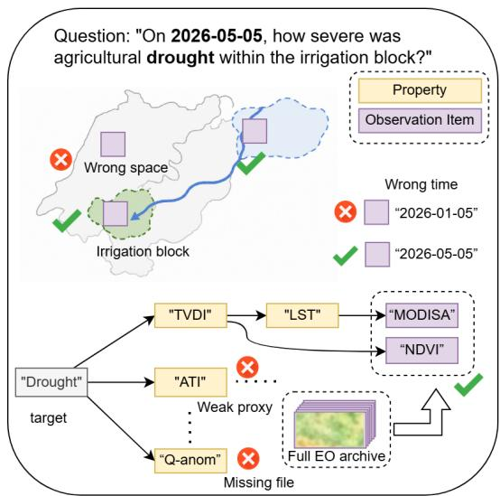
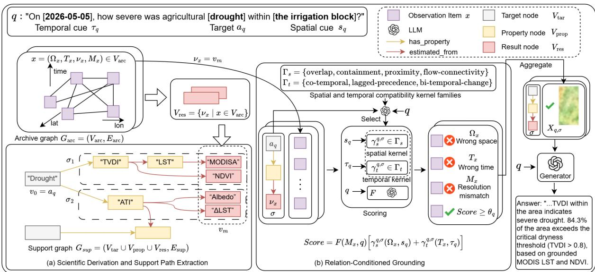
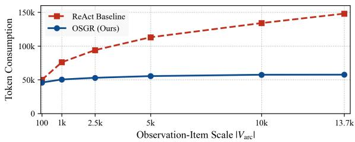
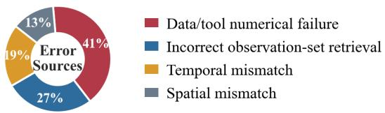

# OSGR: Observation-Support Graph Reasoning for Earth Observation Question Answering

Dazhou Yu\* Emory University

Zerong Wang\* Georgia State University

Longxiang Li Emory University

Yang Liu Emory University

Riyang Bao Emory University

Liang Zhao† Emory University

## Abstract

Answering geographic queries over Earth observation (EO) archives requires solving a joint retrieval-and-derivation problem under strict spatiotemporal constraints. Existing LLM agents fail to ground observation items or suf fer from search-space explosion. We propose OSGR, a two-stage framework that factorizes this search into offline symbolic concept deduction and online Relation-Conditioned Grounding. OSGR leverages an offline Observation-Support Graph to deduce valid target-to-result support paths at the concept level, and applies spatiotemporal compatibility kernels to instantiate grounded observation-item sets. On Earth-Bench and DisasterM3-Reason, OSGR improves GPT-4o accuracy from 49.3% to 63.7% while reducing the execution-step ratio from 2.9 to 2.5.

## 1 Introduction

Earth observation (EO) archives—which store massive amounts of raster data (observation items) such as satellite imagery, climate variables, and reanalysis products—are essential for understanding our planet (Mai et al., 2024). Answering questions using these archives supports consequential applications including disaster response, climate and environmental monitoring, food security, water management, and urban planning (Feng et al., 2025). However, this task is difficult because there is a wide gap between natural-language information needs and the low-level observation items stored in the archive (Janowicz et al., 2019; Rinne et al., 2023).

Recently, geospatial foundation models and Large Language Models (LLMs) have been used for generic geographic question answering (Mai et al., 2021; Zhang et al., 2024a), but vanilla prompting relies entirely on parametric knowledge and lacks a verifiable grounded observation-item set. To address this, retrieval-augmented generation (RAG) and Graph RAG methods inject external text documents, metadata, or relational context into the reasoning loop (Fan et al., 2024; Liang et al., 2025). However, these methods treat EO observation items as plain text or static graph nodes. They ignore the physical structures of observation items, meaning they cannot find a verifiable, accurate set of observation items to answer the query. To interact with observation items directly, toolaugmented agentic systems have recently emerged to interleave multi-step reasoning with active environment execution and dedicated EO toolchains (Feng et al., 2025). Unfortunately, without a clear structural goal to limit their search, general agents must look through an explosive number of possible observation items and operations. This often leads to critical execution failures, such as selecting the wrong observation items, misaligned time windows, wrong locations, or redundant tool sequences (Bao et al., 2026).

The fundamental breakdown of existing systems stems from three intrinsic, compounding challenges that connect human logic, observation-item search, and physical compatibility: (1) Scientific Target-to-Result Derivation: Human queries use abstract environmental phenomena, but archives only store raw or derived physical measurements. Connecting them requires strict scientific derivation, formalized as a support path (e.g., figuring out agricultural drought from a dryness index calculated from Land Surface Temperature (LST) and NDVI, as shown in Fig. 1). LLMs often fail to generate these valid support paths from memory. (2) Massive Search Space of Observation Items: Even if a valid support path is identified, the physical archive contains too many candidate observation items from different sensors, resolutions, and times, as shown in Fig. 1. Searching through the unorganized observation items creates a huge combinatorial search problem for agents. (3) Dynamic Spatiotemporal Compatibility: In the physical world, spatial and temporal validity depends heavily on the specific relationship required by the query. Time lags, spatial coverage, and connectivity (like river flows) impose different strict constraints (Allen, 1983; Randell et al., 1992; Freeman et al., 2007). As shown in Fig. 1, ignoring these constraints leads to physical mismatches that invalidate the entire reasoning.

  
Figure 1: A drought-stress EO question.

To address these challenges, we present Observation-Support Graph Reasoning (OSGR), a framework that reformulates EO question answering as a task of graph-constrained grounded observation-item set selection using a two-stage factorization. Instead of searching blindly, OSGR separates logical scientific derivation from observation-item verification.

The core of our framework is an offline Observation-Support Graph, hereafter referred to as the support graph, built on the ISO/OGC OMS standard (Rinne et al., 2023). This graph organizes messy physical observations into a clear three-layer structure: Target, Property, and Result nodes. Given a specific query, OSGR dynamically extracts target-to-result support paths. This stage answers "what should be derived" before looking at any observation items. It restricts reasoning to documented scientific relations and prunes the downstream candidate space before observationitem grounding, addressing Challenge 1 and Challenge 2. However, a support path is just an abstract blueprint until it matches real-world observation items. In the second stage, OSGR performs

Relation-Conditioned Grounding to ground these support paths to observation items. Using spatial and temporal compatibility kernels, OSGR filters out observation items that do not match the required locations, times, or resolutions. This stage answers "which specific observation items can satisfy the support path" for the query, solving Challenge 3. By factorizing the task and conditioning the final answer on both the logical reasoning chain and verified observation items, OSGR reduces spatiotemporal mismatches and improves grounded answering.

In summary, our core contributions are fourfold:

• We present an EO-specific task formulation that casts question answering as graph-constrained grounded observation-item set selection, systematically coupling observation items, scientific support paths, and spatiotemporal topology. More broadly, this treats retrieval as selecting a relationconstrained executable evidence set rather than independently relevant passages.

• We construct an ISO/OGC OMS-aligned Observation-Support Graph as a cognitive scaffold to organize heterogeneous concepts and dynamically extract query-conditioned scientific support paths, pruning the downstream combinatorial candidate space.

• We propose a Relation-Conditioned Grounding mechanism equipped with spatial and temporal compatibility kernels to ground support paths to candidate observation items in the archive graph, enforcing strict spatiotemporal compatibility.

• Extensive evaluations on Earth-Bench and DisasterM3-Reason demonstrate that OSGR consistently outperforms state-of-the-art baselines in answer accuracy, support path correctness, and spatiotemporal feasibility.

## 2 Related Work

EO and geospatial foundation models. Foundation models have increasingly been adapted to geospatial and EO settings, where language understanding must interact with places, spatial concepts, and gridded observations. GeoLLM extracts geospatial knowledge from LLMs, while BB-GeoGPT adapts language models with GIS-specific corpora and instructions (Manvi et al., 2024; Zhang et al., 2024a). Broader GeoAI studies further emphasize the need to handle spatial semantics, heterogeneous data, and domain-specific reasoning (Mai et al., 2024). In EO, Earth-Agent and related MLLM-based systems expand from singleimage perception toward EO products, spectral data, and tool interfaces (Feng et al., 2025). These works strengthen geospatial knowledge, visual understanding, and tool access, but they do not explicitly model observation items from observable result concepts to answer-supporting concepts.

Retrieval-augmented and graph-based geospatial reasoning. Retrieval-augmented generation injects external evidence into LLMs, and graphbased RAG extends this idea by retrieving relational context such as entities, paths, or subgraphs (Lewis et al., 2020; Fan et al., 2024; Edge et al., 2024). In geospatial settings, Spatial-RAG combines spatial filtering with semantic retrieval, while GeoGraphRAG retrieves geospatial modeling subgraphs to guide workflow and code generation (Yu et al., 2025; Liang et al., 2025). Such methods improve relevance and interpretability, but EO observation selection is not only retrieval over text, POIs, or geoprocessing steps. EO archives are heterogeneous across products, footprints, time intervals, variables, and preprocessing requirements; a retrieved subgraph is not necessarily an observationsupport path; and retrieved nodes still need grounding to concrete observation items with valid spatiotemporal support. Unlike standard GraphRAG, OSGR retrieves a scientific support path and then instantiates it as an executable observation-item set whose members jointly satisfy relation-specific physical constraints.

Agentic geospatial and EO analysis. Tool-using LLM agents such as ReAct and Reflexion interleave reasoning with external actions, motivating geospatial systems that collect data, generate workflows, or execute EO analysis (Yao et al., 2022; Shinn et al., 2023). GeoGPT, GeoTool-GPT, and LLM-Find improve geospatial tool use and data retrieval, while Earth-Agent provides a structured EO tool ecosystem and Spatial-Agent grounds geoanalytical questions in GIScience concepts and executable workflow graphs (Zhang et al., 2024b; Wei et al., 2025; Ning et al., 2025; Feng et al., 2025; Bao et al., 2026). These systems show the importance of tool access and structured intermediate representations, but general agents still search over large action spaces without an explicit groundedobservation objective. OSGR instead constructs support paths using an OMS-aligned graph (Rinne et al., 2023; Janowicz et al., 2019) and grounds them to concrete observation items under relationconditioned spatial and temporal constraints.

## 3 Problem Formulation

We formulate Earth observation question answering as a retrieval-and-derivation problem over large scale archives. Let $V _ { \mathrm { a r c } } = \{ x _ { 1 } , x _ { 2 } , \dots \}$ denote the global Earth observation archive, each observation item (an EO coverage unit) $x \in V _ { \mathrm { a r c } }$ is formalized as a tuple:

$$
x = ( \Omega _ { x } , T _ { x } , \nu _ { x } , M _ { x } ) ,
$$

where $\Omega _ { x }$ is the spatial footprint, $T _ { x }$ is the acquisition epoch, $\nu _ { x }$ is the physical variable, and $M _ { x }$ is the metadata (e.g., resolution). These items induce an archive graph $G _ { \mathrm { a r c } } = ( V _ { \mathrm { a r c } } , E _ { \mathrm { a r c } } )$ . Edges in $E _ { \mathrm { a r c } }$ link observation items through spatial or temporal proximity relations such as overlap or lag. For a natural-language query $q ,$ we write $q \mapsto ( a _ { q } , s _ { q } , \tau _ { q } )$ , where $a _ { q }$ is the abstract target environmental phenomenon of interest (e.g., "drought"), $s _ { q }$ is the spatial cue that denotes the geographic boundary, and $\tau _ { q }$ is the temporal cue. Answering the query q requires identifying a feasible family of observation-item sets, denoted as $\mathcal { X } _ { q } ^ { \theta }$ where each set $X \in \mathcal { X } _ { q } ^ { \theta } \left( X \subseteq V _ { \mathrm { a r c } } \right)$ corresponds to one variable type. The task is formulated as finding the family of subsets satisfying:

$$
\begin{array} { c } { { \chi _ { q } ^ { \theta } = \{ X \subseteq V _ { \mathrm { a r c } } \mid S ( X , q ) \geq \theta _ { q } \} , } } \\ { { S ( X , q ) = F ( X , q ) \big [ C _ { s } ( X , s _ { q } ) + C _ { t } ( X , \tau _ { q } ) \big ] , } } \end{array}\tag{1}
$$

where $S ( X , q )$ is the compatibility score, $\theta _ { q }$ is a query-dependent threshold. $F ( X , q )$ evaluates whether $X$ contains usable variables for the required derivation and checks execution-level compatibility (e.g., sensor resolution), $C _ { s }$ and $C _ { t }$ score spatial and temporal compatibility. A final answer is generated from $\mathcal { X } _ { q } ^ { \theta }$ together with the support paths connecting the selected variables to $a _ { q }$

Existing methods cannot solve this problem effectively due to the following challenges: (1) Scientific derivation: the query target $a _ { q }$ is an abstract phenomenon, the system must verify a valid derivation from $a _ { q }$ to the variables contained in $\mathcal { X } _ { q } ^ { \theta }$ (2) Combinatorial search: constructing $\mathcal { X } _ { q } ^ { \theta }$ from the archive graph $G _ { \mathrm { a r c } }$ creates an explosive search space over products, locations, and times. (3) Dynamic spatiotemporal compatibility: the scores $C _ { s } ( X , s _ { q } )$ and $C _ { t } ( X , \tau _ { q } )$ must enforce query- and derivation-dependent spatial and temporal compatibility, rather than static metadata matching.

## 4 OSGR for Earth Observation Question Answering

## 4.1 Overview

Answering complex Earth observation (EO) queries requires bridging the steep semantic gap between abstract human phenomena (e.g., "agricultural drought") and concrete, low-level gridded rasters. As illustrated in our framework overview (Fig. 2), OSGR factorizes this challenge into a strategic two-stage pipeline: a knowledge-driven concept stage (as detailed in Section 4.2) and a physics-driven spatiotemporal grounding stage (as detailed in Section 4.3).

First, OSGR leverages the pre-constructed, offline support graph representing rigorous scientific derivations over domain concepts. Given a specific user query, we dynamically extract a set of queryconditioned target-to-result support paths from this static graph (Fig. 2(a), Section 4.2). This step decouples qualitative environmental phenomena from concrete observation items, effectively narrowing down the conceptual search space. Second, we ground these support paths to candidate observation items in the archive graph $G _ { \mathrm { a r c } }$ (Fig. 2(b), Section 4.3). Using relation-conditioned spatial and temporal compatibility kernels coupled with metadata verification, OSGR filters out physical mismatches to identify a precise, feasible grounded observation-item set. This grounded observationitem set is finally aggregated and fed into a natural language generator to synthesize a highly accurate, quantified answer.

## 4.2 Scientific Derivation and Support Path Extraction

To address the scale sensitivity of observation-item retrieval, OSGR decouples abstract scientific reasoning from direct archive search. Specifically, we utilize the offline, domain-specific support graph to model physical priors at the conceptual level. Following the ISO/OGC Observations, Measurements, and Samples (OMS) conceptual framework (Rinne et al., 2023), we model this domain prior as a tripartite directed graph that reflects physical measurement hierarchies: Target (the studied environmental phenomenon), Property (the mediating physical quantities), and Result (the digital measurement types). The support graph is constructed offline from EO scientific documentation; details are provided in Appendix A. As shown in Fig. 2(a), we formalize the support graph $G _ { \mathrm { s u p } }$ as:

$$
\begin{array} { r l } & { G _ { \mathrm { s u p } } = ( V _ { \mathrm { s u p } } , E _ { \mathrm { s u p } } ) , } \\ & { V _ { \mathrm { s u p } } = V _ { \mathrm { t a r } } \cup V _ { \mathrm { p r o p } } \cup V _ { \mathrm { r e s } } , } \end{array}\tag{2}
$$

where $V _ { \mathrm { r e s } } = \{ \nu _ { x } \mid x \in V _ { \mathrm { a r c } } \}$ denotes normalized, archive-available Earth Observation (EO) variable types (e.g., result node NDVI in Fig. 2(a)) rather than volatile individual observation items. The set of valid relational transitions $E _ { \mathrm { s u p } }$ is defined directly over these domains:

$$
\begin{array} { r l } & { E _ { \mathrm { s u p } } \subseteq \left( V _ { \mathrm { t a r } } \times \{ \mathsf { h a s } _ { - } \mathsf { p r o p e r t y } \} \times V _ { \mathrm { p r o p } } \right) } \\ & { \qquad \cup \left( V _ { \mathrm { p r o p } } \times \{ \mathsf { e s t i m a t e d } _ { - } \mathsf { f r o m } \} \times V _ { \mathrm { p r o p } } \right) } \\ & { \qquad \cup \left( V _ { \mathrm { p r o p } } \times \{ \mathsf { e s t i m a t e d } _ { - } \mathsf { f r o m } \} \times V _ { \mathrm { r e s } } \right) . } \end{array}\tag{3}
$$

By matching structural walks to the inverse mathematical flow of remote-sensing retrievals, this schema restricts derivation to documented, typed scientific relations before observation-item ingestion.

However, the global support graph $G _ { \mathrm { s u p } }$ remains static and contains pathways irrelevant to a specific user query $q .$ To prune the conceptual search space, we extract a query-conditioned projection $ { \boldsymbol { S } } _ { q }$ containing target-to-result support paths that link the query target $a _ { q } \in V _ { \mathrm { t a r } }$ to archive-available result variable types:

$$
\begin{array} { r l r } & { } & { S _ { q } = \{ \sigma = ( v _ { 0 } , \dotsc , v _ { m } ) \ | \ v _ { 0 } = a _ { q } , \ v _ { m } \in V _ { \mathrm { r e s } } , } \\ & { } & { \forall \ell = 1 , \dotsc , m , \ \exists r : \ ( v _ { \ell - 1 } , r , v _ { \ell } ) \in E _ { \mathrm { s u p } } \} . } \end{array}\tag{4}
$$

Under this formulation, each extracted σ is a minimal, schema-consistent support path supported by the documented relations. Appendix B provides the query-time extraction details. As shown in Fig. 2(a), multiple candidates can be extracted simultaneously. Both enter the spatiotemporal grounding phase, while paths failing this logical derivation are filtered directly at the conceptual level, preventing downstream grounding modules from exploring non-valid search spaces.

## 4.3 Relation-Conditioned Grounding

While support paths $(  { \mathcal { S } } _ { q } )$ establish the abstract scientific derivations, they do not determine which specific observation items in $( V _ { \mathrm { a r c } } )$ are compatible with the requested location $s _ { q }$ and time $\tau _ { q } .$ . In EO, the physical validity is strictly governed by spatial topology (rooted in Region Connection Calculus (RCC) and network routing (Randell et al., 1992; Freeman et al., 2007)) and temporal topology (governed by Allen’s Interval Algebra (Allen,

  
Figure 2: Illustration of OSGR. Given a query q containing target, spatial, and temporal cues, we (a) dynamically extract target-to-result support paths from support graph $G _ { \mathrm { s u p } } .$ . (b) Each support path is grounded to candidate observation items in the archive graph $G _ { \mathrm { a r c } }$ using spatiotemporal compatibility kernels and metadata verification.

1983) for simultaneous or lagged causal feedbacks). To formalize these theoretical, qualitative relations over discrete observation items, we instantiate spatiotemporal constraints as query-conditioned spatial and temporal compatibility kernels:

$$
\begin{array} { r l } & { \Gamma _ { s } = \{ \mathsf { o v e r l a p } , \mathsf { c o n t a i n m e n t } , } \\ & { \mathsf { p r o x i m i t y } , \mathsf { f l o w - c o n n e c t i v i t y } \} , } \\ & { \Gamma _ { t } = \{ \mathsf { c o - t e m p o r a l } , \mathsf { l a g g e d - p r e c e d e n c e } , } \\ & { \mathsf { b i - t e m p o r a l - c h a n g e } \} . } \end{array}\tag{5}
$$

For a given query q and active support path $\sigma =$ $( v _ { 0 } , \ldots , v _ { m } )$ , the terminal result node $v _ { m }$ specifies the required result variable, while $( q , \sigma )$ determines the active compatibility kernels required for grounding. The grounding process dynamically aggregates the feasible observation items $X _ { q , \sigma }$ as:

$$
\begin{array} { r l } & { \qquad ( \gamma _ { s } ^ { q , \sigma } , \gamma _ { t } ^ { q , \sigma } ) \in \Gamma _ { s } \times \Gamma _ { t } , } \\ & { \qquad X _ { q , \sigma } = \{ x \in V _ { \mathrm { a r c } } \mid \nu _ { x } = v _ { m } , } \\ & { \qquad F ( M _ { x } , q ) \big [ \gamma _ { s } ^ { q , \sigma } ( \Omega _ { x } , s _ { q } ) } \\ & { \qquad + \gamma _ { t } ^ { q , \sigma } ( T _ { x } , \tau _ { q } ) \big ] \geq \theta _ { q } \} , } \\ & { \qquad \chi _ { q } ^ { \mathrm { O S G R } } = \{ X _ { q , \sigma } \mid \sigma \in \mathcal { S } _ { q } , \ X _ { q , \sigma } \not = \emptyset \} . } \end{array}\tag{6}
$$

Here, the constraint $\nu _ { x } = v _ { m }$ enforces that each candidate observation item matches the required result variable. As shown in Fig. 2(b), spatial and temporal compatibility kernels in Eq. 6 are selected dynamically, which provide footprint-normalized local compatibility scores used to form candidate grounded observation-item sets. The final setlevel compatibility follows Eq. 1: $C _ { s } ( X , s _ { q } )$ and

$C _ { t } ( X , \tau _ { q } )$ aggregate item-level and relation-level scores, while $F ( X , q )$ checks coverage completeness, resolution, provenance, and execution feasibility for the whole selected set. Appendix C gives the concrete kernel definitions.

Crucially, each non-empty $X _ { q , \sigma }$ remains structurally linked to its support path σ to ensure downstream answer generation is conditioned on both grounded observation items and the logical reasoning chain.

Under the idealized semantic completeness and scoring equivalence assumptions formally defined in Appendix D, the two-stage factorization characterizes when OSGR preserves the feasible family of the original joint search:

Theorem 4.1 (Conditional Lossless Factorization). If the support graph is semantically complete and the grounding scores are equivalent to the original compatibility function, then the two-stage factorized search preserves allfeasible solutions: $\mathcal { X } _ { q } ^ { \mathrm { O S G R } } = \mathcal { X } _ { q } ^ { \theta }$

Proof Sketch. The proof relies on establishing double-inclusion. $\dot { \mathcal { X } } _ { q } ^ { \mathrm { O S G R } } \subseteq \mathcal { X } _ { q } ^ { \theta }$ is guaranteed by scoring equivalence, which ensures any grounded observation-item set meets the original threshold. Conversely, $\mathcal { X } _ { q } ^ { \theta } \subseteq \mathcal { X } _ { q } ^ { \mathrm { O S G R } }$ is guaranteed by semantic completeness, which ensures every feasible observation-item set has a corresponding support path. The complete proof is in Appendix D.

## 4.4 Complexity and Scalability Analysis

Rather than enumerating the exponential space of arbitrary subsets in $V _ { \mathrm { a r c } }$ (scaling as $O ( 2 ^ { | V _ { \mathrm { a r c } } | } ) )$ OSGR restricts evaluation strictly to candidate observation-item sets induced by valid support paths. For a path $\sigma = ( v _ { 0 } , \ldots , v _ { m } )$ , the localized candidate set is:

$$
{ \mathcal { C } } _ { q , \sigma } = \{ x \in V _ { \mathrm { a r c } } \mid \nu _ { x } = v _ { m } \} .
$$

Let $C _ { q } ^ { \operatorname* { m a x } } = \operatorname* { m a x } _ { \sigma \in S _ { q } } | \mathcal { C } _ { q , \sigma } |$ . Since the grounding score in Eq. 6 is evaluated only over these candidate sets, the computational complexity of grounding is:

$$
O \big ( | S _ { q } | \cdot C _ { q } ^ { \mathrm { m a x } } \big ) ,
$$

which is linear in the candidates evaluated across the extracted support paths rather than enumerating arbitrary observation-item subsets. In practice, metadata indexes and spatiotemporal thresholds prune this candidate space further, yielding reduced growth over the evaluated archive scales.

## 5 Experiments

## 5.1 Experimental Setup

Datasets. We evaluate OSGR on two benchmarks. The primary benchmark is Earth-Bench from Earth-Agent (Feng et al., 2025), which contains 248 expert-curated questions associated with approximately 13.7K EO images and provides expert trajectories used only for evaluation. As a complementary benchmark, we use DISASTERM3- REASON based on DisasterM3 (Wang et al., 2025). It contains 7,160 multiple-choice instances from two disaster-response tasks: 4,982 damaged building counting (BDC) and 2,178 damaged road estimation (DRE).

Evaluation Metrics. Following Earth-Bench (Feng et al., 2025), we evaluate the grounded observation-selection pipeline in addition to final answer correctness. We convert each generation into a compact observation-support representation. Evidence Coverage Recall (ECR), Evidence Order Recall (EOR), and Evidence Path Match (EPM) measure whether the predicted path covers, orders, and exactly matches an admissible expert path. Temporal Feasibility Accuracy (TFA) and Spatial Feasibility Accuracy (SFA) evaluate whether the selected EO observations satisfy the query-induced time and space requirements, while Result Grounding Accuracy (RGA) measures whether the answersupporting result endpoint matches a benchmarksupported endpoint. We also report Efficiency (Eff.) and Answer Accuracy (Acc.). Higher is better for all metrics except Eff., whose ideal value is 1; values above 1 indicate redundant execution, whereas values below 1 can indicate missing necessary steps rather than superior efficiency. Formal definitions are in Appendix E.

Baselines. We compare against four baselines. Direct LLM produces a one-shot answer from the raw question without retrieval or graph grounding. ReAct Agent uses the same external execution interface but reasons directly from the question through iterative thought-action-observation loops (Yao et al., 2022). GeoGraphRAG retrieves local subgraphs in the spirit of GeoGraphRAG (Liang et al., 2025). Earth-Agent is the most relevant EO agent baseline on Earth-Bench (Feng et al., 2025).

## 5.2 Main Results on Earth-Bench

Table 1 shows the main comparison results on Earth-Bench, grouped by closed-source and opensource backbone models. Earth-Agent and OSGR are evaluated using matched language models, separating the effect of support-path reasoning and grounding from the basic capabilities of different language models. We observe several clear trends. Limitations of Searching Without Scientific Guidance. First, LLMs without external data retrieval perform poorly. Direct LLM (GPT-4o) achieves moderate evidence coverage (ECR $= 5 6 . 1 \% )$ but low grounding accuracy (RGA = 20.2%) and final accuracy $( \mathrm { A c c . } = 2 1 . 4 \% )$ . This indicates that parametric knowledge alone cannot reliably identify the correct observation items. While tool-using and graph-based baselines improve accuracy, they lack the coupling of scientific derivation and item-level physical constraints. ReAct Agent (GPT-4o) improves temporal and spatial alignments $( \mathrm { T F A } = 6 8 . 1 \% , \mathrm { S F A } = 6 9 . 3 \% )$ via iterative tool use, but over-explores unnecessary observation items, yielding high redundancy $( \mathrm { E f f } . ~ = 3 . 8 )$ . GeoGraphRAG reaches 48.8% answer accuracy, 68.7% RGA, 32.1% EPM, and an Eff. of 3.6, whereas OSGR reaches 63.7%, 80.7%, 41.1%, and 2.5, respectively. This matchedbackbone gap shows that OSGR is not equivalent to retrieving a local graph neighborhood: the supportpath/physical-grounding coupling contributes beyond graph retrieval alone. Performance under Closed-Source Backbones. Second, OSGR consistently outperforms Earth-Agent under matched closed-source backbones. Under GPT-4o-mini, OSGR improves all path matching metrics (ECR, EOR, and EPM improve by +23.9%, +27.0%, and +22.5% relatively) and raises accuracy by +26.1% over Earth-Agent. Upgrading to GPT-4o, OSGR increases accuracy from 49.3% to 63.7% (+14.4 absolute points; +29.2% relative) and temporal alignment (TFA) from 57.6% to 78.2%. Crucially, this gain occurs while the execution-step ratio moves closer to its ideal value of 1, decreasing from 2.9 to 2.5. This joint improvement demonstrates a better observed accuracy–efficiency trade-off. Finally, GPT-5 sets the upper performance bound, achieving 60.4% EPM, 91.5% SFA, and 70.9% accuracy. Framework Generalization across Open-Source LLMs. Third, the same patterns hold for opensource models, demonstrating model-agnostic robustness within the evaluated EO setting. Under Qwen3-MAX, OSGR raises accuracy from 43.3% to 56.0% (+29.3% relative gain), improves RGA to 50.8%, and lowers Eff. from 2.6 to 2.3. Under the smaller Llama-4, OSGR still secures a consistent +15.6% relative accuracy boost (reaching 39.2%) and lowers Eff. from 2.7 to 2.1. In short, these consistent improvements indicate that OSGR’s benefits are not limited to a single language-model family or scale.

<table><tr><td>Method</td><td>ECR↑</td><td>EOR↑</td><td>EPM↑</td><td>TFA↑</td><td>SFA↑</td><td>RGA↑</td><td>Eff. → 1</td><td>Acc.↑</td></tr><tr><td colspan="9">Closed-Source LLMs</td></tr><tr><td>Direct LLM (GPT-4o)</td><td>56.1</td><td>27.4</td><td>22.6</td><td>25.4</td><td>22.5</td><td>20.2</td><td>0.4</td><td>21.4</td></tr><tr><td>ReAct Agent (GPT-4o)</td><td>58.7</td><td>35.2</td><td>32.4</td><td>68.1</td><td>69.3</td><td>63.9</td><td>3.8</td><td>43.6</td></tr><tr><td>GeoGraphRAG (GPT-40)</td><td>64.4</td><td>33.5</td><td>32.1</td><td>67.9</td><td>72.1</td><td>68.7</td><td>3.6</td><td>48.8</td></tr><tr><td>Earth-Agent (GPT-4o-mini)</td><td>53.6</td><td>43.7</td><td>32.9</td><td>54.5</td><td>79.4</td><td>57.3</td><td>2.0</td><td>46.4</td></tr><tr><td>Earth-Agent (GPT-40)</td><td>61.3</td><td>44.1</td><td>33.7</td><td>57.6</td><td>78.5</td><td>69.3</td><td>2.9</td><td>49.3</td></tr><tr><td>OSGR (GPT-4o-mini) OSGR (GPT-40)</td><td>66.4 ↑23.9%</td><td>55.5 ↑27.0%</td><td>40.3 ↑22.5%</td><td>63.2 ↑16.0%</td><td>88.0 ↑10.8%</td><td>69.4 ↑21.1%</td><td>2.1 ↑5.0%</td><td>58.5 ↑26.1%</td></tr><tr><td>OSGR (GPT-5)</td><td>70.6 ↑15.2% 77.3</td><td>52.3 ↑18.6% 71.8</td><td>41.1 ↑22.0%</td><td>78.2 ↑35.8%</td><td>84.6 ↑7.8%</td><td>80.7 ↑16.5%</td><td>2.5 ↓13.8%</td><td>63.7 ↑29.2%</td></tr><tr><td></td><td></td><td></td><td>60.4</td><td>85.7</td><td>91.5</td><td>83.4</td><td>2.4</td><td>70.9</td></tr><tr><td colspan="9">Open-Source LLMs</td></tr><tr><td>Earth-Agent (Qwen3-MAX)</td><td>52.5</td><td>40.4</td><td>30.5</td><td>52.4</td><td>65.9</td><td>45.3</td><td>2.6</td><td>43.3</td></tr><tr><td>Earth-Agent (Llama-4)</td><td>38.8</td><td>32.5</td><td>19.8</td><td>50.9</td><td>38.4</td><td>46.5</td><td>2.7</td><td>33.9</td></tr><tr><td>OSGR (Qwen3-MAX)</td><td>59.9 ↑14.1%</td><td>47.0 ↑16.3%</td><td>35.8 ↑17.4%</td><td>64.3 ↑22.7%</td><td>74.3 ↑12.7%</td><td>50.8 ↑12.1%</td><td>2.3 ↓11.5%</td><td>56.0 ↑29.3%</td></tr><tr><td>OSGR (Llama-4)</td><td>45.7 ↑17.8%</td><td>36.4 ↑12.0%</td><td>21.4 ↑8.1%</td><td>56.2 ↑10.4%</td><td>44.1 ↑14.8%</td><td>56.8 ↑22.2%</td><td>2.1 ↓22.2%</td><td>39.2 ↑15.6%</td></tr></table>

Table 1: Main comparison on Earth-Bench. Earth-Agent and OSGR are paired under matched backbones. Bold/un derline denotes best/second-best for all metrics except Eff. Blue annotations indicate improvements over Earth-Agent with the same backbone, while red annotations indicate degradations.

## 5.3 Search Efficiency and Token Cost Analysis

We evaluate the token efficiency and search-space pruning capability of OSGR across increasing archive scales. Averaged over Earth-Bench, OSGR extracts a highly compact set of only 5.1 abstract support paths per query, which the relationconditioned grounding stage further reduces to 1.3 grounded observation sets, completely bypassing raw archive enumeration. Fig. 3 plots the observed end-to-end token consumption against the number of candidate files in the physical archive. While the ReAct baseline grows sharply because of lengthy tool-observation histories and iterative error correction, OSGR grows more slowly by exposing compact grounded evidence to the LLM. At the maximum evaluated scale of 13.7K archive items, ReAct consumes roughly 150K tokens, whereas OSGR remains below 60K tokens. This observed gap indicates that delegating low-level spatiotemporal filtering to the database layer reduces the growth of LLM reasoning cost over the evaluated archive scales.

  
Figure 3: Scalability over observation-item scale.

## 5.4 Ablation Study

We evaluate OSGR’s two claimed core components on Earth-Bench using GPT-4o (Table 2). The stagelevel design isolates the division between scientific derivation and physical grounding; neither stage alone explains the full gain.

Impact of the Observation-Support Graph. Removing the support graph prior (w/o support graph) disrupts conceptual reasoning, causing path alignment metrics to drop sharply (ECR: 46.2%, EOR: 33.8%, EPM: 29.4%). Without symbolic constraints, the model searches the archive more broadly, inflating execution redundancy (Eff.) to 4.7 and dropping result grounding accuracy (RGA) to 52.9%. This limits final accuracy to 43.9%, supporting the role of the graph in filtering invalid concept spaces.

Table 2: Ablation study of OSGR core components on Earth-Bench using GPT-4o. Best scores are bolded.
<table><tr><td>Variant</td><td>ECR↑</td><td>EOR↑</td><td>EPM↑</td><td>TFA↑</td><td>SFA↑</td><td>RGA↑</td><td>Eff. → 1</td><td>Acc.↑</td></tr><tr><td>w/o support graph</td><td>46.2</td><td>33.8</td><td>29.4</td><td>67.2</td><td>80.6</td><td>52.9</td><td>4.7</td><td>43.9</td></tr><tr><td>w/o relation-conditioned grounding</td><td>73.4</td><td>50.7</td><td>40.0</td><td>58.8</td><td>59.4</td><td>61.3</td><td>3.7</td><td>53.2</td></tr><tr><td>Full OSGR</td><td>70.6</td><td>52.3</td><td>41.1</td><td>78.2</td><td>84.6</td><td>80.7</td><td>2.5</td><td>63.7</td></tr></table>

  
Figure 4: Analysis of incorrect OSGR predictions.

Impact of Relation-Conditioned Grounding. Disabling spatiotemporal verification (w/o relationconditioned grounding) yields a deceptively high ECR (73.4%). Unconstrained by archive-level data feasibility, the symbolic module overfits benchmark text elements. However, these paths fail physical execution: temporal (TFA) and spatial (SFA) feasibility alignments plunge to 58.8% and 59.4%, dragging RGA to 61.3% and accuracy to 53.2% with an inefficient execution score of 3.7.

Synergistic Division of Labor. The contrast establishes a clear division of labor: the support graph eliminates semantically invalid target-toresult derivations at the abstract concept level, while the relation-conditioned grounding determines whether those paths can be physically instantiated under exact spatiotemporal topologies. Coupling both stages allows the full OSGR framework to maximize search efficiency (Eff. = 2.5) and achieve the highest answering accuracy (63.7%).

## 5.5 Error Analysis

We analyze the failure modes of OSGR (GPT-4o) on Earth-Bench by manually inspecting the incorrect predictions (Fig. 4). The largest error category comes from data and backend numerical issues (41%), where selected files contain invalid values like NaN or function parameters do not match the specific data format. Incorrect observation-set retrieval is the second largest source (27%), which typically occurs when queries are vague or multiple satellite products match the same target concept. Temporal and spatial mismatches account for 19% and 13% of the errors, respectively, showing that resolving fine-grained event windows and precise spatial scales remains difficult. This distribution indicates that OSGR successfully minimizes highlevel reasoning errors, moving the remaining challenges down to backend execution reliability and data-level precision.

<table><tr><td>Method</td><td>Avg. Acc.</td><td>BDC</td><td>DRE</td></tr><tr><td colspan="4">Closed-Source LLMs</td></tr><tr><td>Direct LLM (GPT-4o)</td><td>28.5</td><td>28.1</td><td>29.4</td></tr><tr><td>ReAct Agent (GPT-4o)</td><td>36.0</td><td>35.6</td><td>36.8</td></tr><tr><td>GeoGraphRAG (GPT-4o)</td><td>43.1</td><td>43.2</td><td>42.8</td></tr><tr><td>Earth-Agent (GPT-4o)</td><td>46.2</td><td>46.6</td><td>45.2</td></tr><tr><td>OSGR (GPT-40)</td><td>50.1 ↑8.4%</td><td>49.8 ↑6.9%</td><td>50.7 ↑12.2%</td></tr><tr><td colspan="4">Open-Source LLMs</td></tr><tr><td>Earth-Agent (Qwen3-MAX)</td><td>36.3</td><td>36.4</td><td>36.1</td></tr><tr><td>OSGR (Qwen3-MAX)</td><td>39.9 ↑9.9%</td><td>39.1 ↑7.4%</td><td>41.8 ↑15.8%</td></tr></table>

Table 3: Results on DisasterM3-Reason. Avg. Acc. is the instance-weighted average over BDC and DRE. Bold/underline denotes best/second-best.

## 5.6 Evaluation on DisasterM3-Reason

Table 3 reports results on DisasterM3-Reason, a complementary disaster-response benchmark with a query and task distribution distinct from Earth-Bench. The results show that OSGR consistently outperforms the baselines across both closedsource and open-source models. Using the GPT-4o backbone, OSGR increases the instance-weighted average accuracy from 46.2% to 50.1% (an +8.4% relative gain). Notably, the performance improvement is larger on the DRE task (+12.2% relative gain) than on the BDC task (+6.9% relative gain). This difference occurs because estimating road damage highly depends on comparing pre-disaster and post-disaster observation pairs. OSGR’s relation-conditioned grounding uses precise temporal kernels to find these matching pairs, which effectively prevents errors caused by choosing mismatching images. We observe a similar trend with open-source backbones. Under Qwen3- MAX, OSGR raises the average accuracy from 36.3% to 39.9% (+9.9% relative gain), with a clear advantage on the DRE task (+15.8% relative gain). This consistent success across different backbones demonstrates that the improvements stem from our structured observation selection and factorized search mechanism rather than the capabilities of a specific language model.

## 6 Conclusion

We presented OSGR, a factorized retrieval-andderivation framework that decouples symbolic reasoning over an Observation-Support Graph from low-level Relation-Conditioned Grounding over observation items for Earth observation question answering. By resolving scientific validity via abstract support paths and enforcing spatiotemporal compatibility during grounding, OSGR reduces unconstrained search and physical mismatches. Evaluations on two benchmarks show that OSGR consistently improves accuracy and efficiency across multiple LLMs.

## 7 Limitations

OSGR depends on the coverage and correctness of the support graph and archive metadata. Missing support relations, inaccurate footprints, or noisy acquisition times can prevent valid observation-item sets from being recovered. The current empirical evidence is scoped to EO; applying the factorization principle to another scientific archive would require a domain-specific schema and compatibility functions.

## References

José Francisco Aldana-Martín, José García-Nieto, María del Mar Roldán-García, and José Francisco Aldana-Montes. 2022. Semantic modelling of earth observation remote sensing. Expert Systems with Applications, 187:115838.

James F. Allen. 1983. Maintaining knowledge about temporal intervals. Commun. ACM, 26(11):832–843.

Riyang Bao, Cheng Yang, Dazhou Yu, Zhexiang Tang, Gengchen Mai, and Liang Zhao. 2026. Spatial-agent: Agentic geo-spatial reasoning with scientific core concepts. arXiv preprint arXiv:2601.16965.

Darren Edge, Ha Trinh, Newman Cheng, Joshua Bradley, Alex Chao, Apurva Mody, Steven Truitt, Dasha Metropolitansky, Robert Osazuwa Ness, and

Jonathan Larson. 2024. From local to global: A graph rag approach to query-focused summarization. arXiv preprint arXiv:2404.16130.

Wenqi Fan, Yujuan Ding, Liangbo Ning, Shijie Wang, Hengyun Li, Dawei Yin, Tat-Seng Chua, and Qing Li. 2024. A survey on rag meeting llms: Towards retrieval-augmented large language models. In Proceedings ofthe 30th ACM SIGKDD Conference on Knowledge Discovery and Data Mining, KDD ’24, page 6491–6501, New York, NY, USA. Association for Computing Machinery.

Peilin Feng, Zhutao Lv, Junyan Ye, Xiaolei Wang, Xinjie Huo, Jinhua Yu, Wanghan Xu, Wenlong Zhang, Lei Bai, Conghui He, and Weijia Li. 2025. Earthagent: Unlocking the full landscape of earth observation with agents. arXiv preprint arXiv:2509.23141.

Mary C. Freeman, Catherine M. Pringle, and C. Rhett Jackson. 2007. Hydrologic connectivity and the contribution of stream headwaters to ecological integrity at regional scales. JAWRA Journal ofthe American Water Resources Association, 43(1):5–14.

Krzysztof Janowicz, Armin Haller, Simon J.D. Cox, Danh Le Phuoc, and Maxime Lefrançois. 2019. Sosa: A lightweight ontology for sensors, observations, samples, and actuators. Journal of Web Semantics, 56:1–10.

Patrick Lewis, Ethan Perez, Aleksandra Piktus, Fabio Petroni, Vladimir Karpukhin, Naman Goyal, Heinrich Küttler, Mike Lewis, Wen-tau Yih, Tim Rocktäschel, Sebastian Riedel, and Douwe Kiela. 2020. Retrieval-augmented generation for knowledgeintensive nlp tasks. In Advances in Neural Information Processing Systems, volume 33, pages 9459– 9474. Curran Associates, Inc.

Jianyuan Liang, Shuyang Hou, Haoyue Jiao, Yaxian Qing, Anqi Zhao, Zhangxiao Shen, Longgang Xiang, and Huayi Wu. 2025. Geographrag: A graph-based retrieval-augmented generation approach for empowering large language models in automated geospatial modeling. International Journal of Applied Earth Observation and Geoinformation, 142:104712.

G. Mai, K. Janowicz, R. Zhu, L. Cai, and N. Lao. 2021. Geographic question answering: Challenges, uniqueness, classification, and future directions. AGILE: GIScience Series, 2:8.

Gengchen Mai, Weiming Huang, Jin Sun, Suhang Song, Deepak Mishra, Ninghao Liu, Song Gao, Tianming Liu, Gao Cong, Yingjie Hu, Chris Cundy, Ziyuan Li, Rui Zhu, and Ni Lao. 2024. On the opportunities and challenges of foundation models for geoai (vision paper). ACM Trans. Spatial Algorithms Syst., 10(2).

Rohin Manvi, Samar Khanna, Gengchen Mai, Marshall Burke, David Lobell, and Stefano Ermon. 2024. Geollm: Extracting geospatial knowledge from large language models. In International Conference on Learning Representations, volume 2024, pages 38791–38807.

Given an Earth-observation scientific document,   
extract only Target-Property-Result relations explicitly   
supported by it.   
Target:   
The environmental phenomenon or scientific object   
studied or inferred (e.g., drought).   
Property:   
A physical or derived property used to characterize   
or infer the Target (e.g., TVDI).   
Result:   
An observable or computed EO variable, band, index,   
or product used to measure or estimate a Property   
(e.g., MODISA).   
Allowed relations:   
has\_property:   
Maps a Target node to a Property node.   
Target -> Property   
estimated\_from:   
Maps a Property node to another Property node or   
to a Result node.   
Property -> Property   
Property -> Result   
Instructions:   
- Extract only relations supported by the document.   
- Preserve standard scientific names and prioritize   
common English acronyms. For example, use ’NDVI’   
instead of ’Normalized Difference Vegetation Index’.   
- Ignore generic data processing steps (e.g., masking,   
resampling, or aggregation).   
- Focus solely on physical or empirical retrieval logic.   
- Return an empty list when no valid relation is stated.

Huan Ning, Zhenlong Li, Temitope Akinboyewa, and M. Naser Lessani. 2025. An autonomous gis agent framework for geospatial data retrieval. International Journal ofDigital Earth, 18(1):2458688.

David A. Randell, Zhan Cui, and Anthony G. Cohn. 1992. A spatial logic based on regions and connection. In Proceedings ofthe Third International Conference on Principles ofKnowledge Representation and Reasoning, KR’92, page 165–176, San Francisco, CA, USA. Morgan Kaufmann Publishers Inc.

Ilkka Rinne, Linda van den Brink, Sylvain Grellet, Clemens Portele, Hylke van Der Schaaf, and Katharina Schleidt. 2023. OGC Abstract Specification Topic 20: Observations, measurements and samples.

Noah Shinn, Federico Cassano, Ashwin Gopinath, Karthik Narasimhan, and Shunyu Yao. 2023. Reflexion: language agents with verbal reinforcement learning. In Advances in Neural Information Processing Systems, volume 36, pages 8634–8652. Curran Associates, Inc.

Lucas Van der Meer, Martin Sudmanns, Hannah Augustin, Andrea Baraldi, and Dirk Tiede. 2022. Semantic querying in earth observation data cubes. The International Archives of the Photogrammetry, Remote Sensing and Spatial Information Sciences, XLVIII-4/W1-2022:503–510.

Junjue Wang, Weihao Xuan, Heli Qi, Zhihao Liu, Kunyi Liu, Yuhan Wu, Hongruixuan Chen, JIAN SONG, Junshi Xia, Zhuo Zheng, and Naoto YOKOYA. 2025. Disasterm3: A remote sensing vision-language dataset for disaster damage assessment and response. In Advances in Neural Information Processing Systems, volume 38. Curran Associates, Inc.

Cheng Wei, Yifan Zhang, Xinru Zhao, Ziyi Zeng, Zhiyun Wang, Jianfeng Lin, Qingfeng Guan, and Wenhao Yu. 2025. Geotool-gpt: a trainable method for facilitating large language models to master gis tools. International Journal of Geographical Information Science, 39(4):707–731.

Shunyu Yao, Jeffrey Zhao, Dian Yu, Nan Du, Izhak Shafran, Karthik Narasimhan, and Yuan Cao. 2022. React: Synergizing reasoning and acting in language models. arXiv preprint arXiv:2210.03629.

Dazhou Yu, Riyang Bao, Ruiyu Ning, Jinghong Peng, Gengchen Mai, and Liang Zhao. 2025. Spatialrag: Spatial retrieval augmented generation for realworld geospatial reasoning questions. arXiv preprint arXiv:2502.18470.

Yifan Zhang, Zhiyun Wang, Zhengting He, Jingxuan Li, Gengchen Mai, Jianfeng Lin, Cheng Wei, and Wenhao Yu. 2024a. Bb-geogpt: A framework for learning a large language model for geographic information science. Information Processing & Management, 61(5):103808.

Yifan Zhang, Cheng Wei, Zhengting He, and Wenhao Yu. 2024b. Geogpt: An assistant for understanding and processing geospatial tasks. International Journal ofApplied Earth Observation and Geoinformation, 131:103976.

## A Observation-Support Graph Construction

We construct the offline Observation-Support Graph $G _ { \mathrm { s u p } }$ through an LLM-assisted extraction pipeline grounded in EO scientific documentation. The graph schema follows the Target–Property– Result hierarchy described in the main text and is aligned with the ISO/OGC Observations, Measurements, and Samples framework (Rinne et al., 2023; Janowicz et al., 2019). The source corpus contains remote-sensing studies and EO product guides that document how an environmental target is characterized through physical properties and how those properties are measured or estimated from EO results (Aldana-Martín et al., 2022; Van der Meer et al., 2022).

Extraction prompt and schema. For each source document, we use GPT-4 with the following constrained instruction template. The prompt definitions match the three node types and two edge types in Eqs. 2–3.

Each extracted record therefore contains a typed subject, relation, and object. We merge duplicate triples before converting the records into nodes and edges in a Neo4j database. Target, Property, and Result nodes form $V _ { \mathrm { t a r } } , V _ { \mathrm { p r o p } }$ , and $V _ { \mathrm { r e s } } .$ , while has\_property and estimated\_from records form $E _ { \mathrm { s u p } }$ . When several documents support the same semantic relation, the graph stores one edge with multiple provenance records rather than duplicate edges.

Human correction is limited to duplicate-entry checking and merging. Specifically, entries referring to the same concept but separated because of singular/plural forms, abbreviations, or minor naming variants are merged. The graph is consequently an LLM-assisted representation of reusable, documented EO relations rather than question-specific solution paths. Edge-level provenance retains the source document and evidence text or section, which can be retrieved with a support path for downstream traceability.

The support graph is not intended to exhaustively encode all EO science. It organizes stable relations relevant to the target archive, while volatile observation items remain in $G _ { \mathrm { a r c } }$ and are grounded online. Its one-time construction cost is amortized across queries: new files whose variable types are already represented do not require reconstructing the conceptual graph, and previously unseen relations can be added incrementally.

## B Support Path Extraction Details

Support path extraction instantiates Eq. 4 at query time. Starting from the query target $\mathit { a _ { q } } ,$ extraction follows typed support-graph edges toward archiveavailable result nodes in $V _ { \mathrm { r e s } }$ . A zero-length support path is allowed when $a _ { q } \in V _ { \mathrm { r e s } } .$

The implementation keeps extraction finite using three checks. First, typed traversal admits only schema-consistent transitions implied by has\_property and estimated\_from. Second, cycle avoidance prevents a support path from revisiting the same support node. Third, a result-stop rule stops traversal once a result node is reached, because result nodes are grounded to observation items rather than expanded into more concepts.

## C Relation-Conditioned Compatibility Kernels

This section specifies the spatial and temporal compatibility kernels used to instantiate the abstract scores $C _ { s }$ and $C _ { t }$ in Eq. 1. The main text writes these item-level kernels as $\gamma _ { s } ^ { q , \sigma } ( \Omega _ { x } , s _ { q } )$ and $\gamma _ { t } ^ { q , \sigma } ( T _ { x } , \tau _ { q } )$ . In Relation-Conditioned Grounding, the query–path pair $( q , \sigma )$ determines the active kernel type and canonicalizes the raw spatial and temporal cues into the variables required by that kernel. Once these variables are fixed, all compatibility scores are computed deterministically in [0, 1].

For spatial grounding, the raw spatial cue $s _ { q }$ is canonicalized into a spatial reference object $R _ { q } { \mathrm { . } }$ which can be a point, line, polygon, or multipolygon. For point and line cues, we use a tolerance buffer

$$
R _ { q } ^ { \rho } = \{ z \in \mathbb { R } ^ { 2 } \mid d ( z , R _ { q } ) \leq \rho _ { q } \} ,
$$

where $\rho _ { q }$ is determined by the query scale and product resolution. Polygonal cues can be treated as $R _ { q } ^ { \rho } = R _ { q }$ when no buffer is needed. Let $\Omega _ { x }$ denote the footprint of observation item $x , | \cdot |$ denote area, $d ( \cdot , \cdot )$ denote spatial distance, and ϵ be a small positive constant. The spatial kernels measure local compatibility and are normalized by the candidate item’s footprint or overlap scale, so small but correctly located EO coverage units are not unfairly penalized. To keep equations compact, long kernel labels are abbreviated in superscripts.

The overlap kernel measures shared spatial support when the item and query supports are comparable in scale:

$$
\gamma _ { s } ^ { \mathsf { o v e r l a p } } ( \Omega _ { x } , s _ { q } ) = \frac { | \Omega _ { x } \cap R _ { q } ^ { \rho } | } { | \Omega _ { x } \cup R _ { q } ^ { \rho } | + \epsilon } .
$$

The containment kernel measures local containment when the item and query supports differ in scale:

$$
\gamma _ { s } ^ { \mathsf { c o n t } } ( \Omega _ { x } , s _ { q } ) = \frac { \vert \Omega _ { x } \cap R _ { q } ^ { \rho } \vert } { \operatorname* { m i n } ( \vert \Omega _ { x } \vert , \vert R _ { q } ^ { \rho } \vert ) + \epsilon } .
$$

The proximity kernel allows nearby observations when exact overlap is not required:

$$
\gamma _ { s } ^ { \mathsf { p r o x } } ( \Omega _ { x } , s _ { q } ) = \exp \left( - \frac { d ( \Omega _ { x } , R _ { q } ) } { \lambda _ { q } ^ { s } } \right) ,
$$

where $\lambda _ { q } ^ { s }$ is a query- or product-dependent spatial decay scale.

For flow-connectivity, Euclidean distance is replaced by directed network distance. Let H denote the relevant flow or transport network, and let $d _ { H } ^ { \delta _ { q } } ( \Omega _ { x } , R _ { q } )$ be the shortest path distance from $\Omega _ { x }$ to $R _ { q }$ under the query-required direction $\delta _ { q }$ (e.g., upstream-to-downstream). If no directed path exists, we set $d _ { H } ^ { \delta _ { q } } ( \Omega _ { x } , R _ { q } ) = \infty$ . Writing $\Delta _ { H } = d _ { H } ^ { \delta _ { q } } ( \Omega _ { x } , R _ { q } )$ , the connectivity kernel is

$$
\gamma _ { s } ^ { \mathsf { f l o w } } ( \Omega _ { x } , s _ { q } ) = \exp \left( - \frac { \Delta _ { H } } { \lambda _ { q } ^ { H } } \right) ,
$$

where $\exp ( - \infty ) = 0 \quad$

Temporal cues are canonicalized analogously. The raw temporal cue $\tau _ { q }$ is mapped to one or more intervals. A time point is treated as a short interval using tolerance $\eta _ { q } ,$ and an observation acquisition epoch $T _ { x }$ is represented as an interval $[ t _ { x } ^ { - } , t _ { x } ^ { + } ]$ . For intervals I and J, define

$$
d _ { t } ( I , J ) = \operatorname* { m a x } ( 0 , I ^ { - } - J ^ { + } , J ^ { - } - I ^ { + } ) ,
$$

and let $o _ { I J } = \vert I \cap J \vert$ . Define

$$
\begin{array} { l } { \displaystyle { a _ { I J } = \frac { o _ { I J } } { \operatorname* { m i n } ( | I | , | J | ) + \epsilon } , } } \\ { \displaystyle { b _ { I J } = \exp \left( - \frac { d _ { t } ( I , J ) } { \lambda } \right) . } } \end{array}
$$

The soft interval-overlap function is

$$
\mathrm { s o f t o v } ( I , J ; \lambda ) = \left\{ \begin{array} { l l } { a _ { I J } , } & { o _ { I J } > 0 , } \\ { b _ { I J } , } & { o _ { I J } = 0 . } \end{array} \right.
$$

For compactness, write $\begin{array} { r l r } { \mathrm { s o } _ { q } ( I , J ) } & { { } } & { = } \end{array}$ softov $( I , J ; \lambda _ { q } ^ { t } )$ in the temporal kernels below.

For co-temporal grounding, $\tau _ { q }$ is canonicalized as the requested interval $I _ { q } \colon$

$$
\gamma _ { t } ^ { \mathsf { c o } } ( T _ { x } , \tau _ { q } ) = \mathsf { s o } _ { q } ( T _ { x } , I _ { q } ) .
$$

For lagged-precedence grounding, the query specifies a target interval $I _ { q }$ and an admissible lag range $L _ { q } = [ \ell _ { q } ^ { - } , \ell _ { q } ^ { + } ]$ . The supporting observation should fall in the predecessor window

$$
P _ { q } = [ I _ { q } ^ { - } - \ell _ { q } ^ { + } , I _ { q } ^ { + } - \ell _ { q } ^ { - } ] ,
$$

so the kernel is

$$
\begin{array} { r l } & { \gamma _ { t } ^ { \mathrm { l a g } } ( T _ { x } , \tau _ { q } ) = \mathrm { s o } _ { q } ( T _ { x } , P _ { q } ) } \\ & { ~ \cdot \mathbb { I } [ m ( T _ { x } ) \leq m ( I _ { q } ) ] , } \end{array}
$$

where $m ( \cdot )$ denotes the interval midpoint.

For bi-temporal change, $\tau _ { q }$ is canonicalized into a pre-event interval $I _ { q } ^ { \mathrm { p r e } }$ and a post-event interval $I _ { q } ^ { \mathrm { { \hat { p o s t } } } }$ . When scoring a single observation item, the support path provides its temporal role $r _ { x } \in$ {pre, post}. Let $I _ { q } ^ { r _ { x } }$ denote the interval selected by that role:

$$
\gamma _ { t } ^ { \mathrm { c h g } } ( T _ { x } , \tau _ { q } ; r _ { x } ) = \mathrm { s o } _ { q } ( T _ { x } , I _ { q } ^ { r x } ) .
$$

For a pre/post pair $( x _ { i } , x _ { j } )$ , the relation-level score additionally enforces ordering:

$$
\begin{array} { r l } & { \gamma _ { t } ^ { \mathsf { c h g } } ( T _ { i } , T _ { j } , \tau _ { q } ) = \mathrm { s o } _ { q } ( T _ { i } , I _ { q } ^ { \mathrm { p r e } } ) } \\ & { \quad \quad \cdot \mathrm { s o } _ { q } ( T _ { j } , I _ { q } ^ { \mathrm { p o s t } } ) } \\ & { \quad \quad \cdot \mathbb { I } [ m ( T _ { i } ) < m ( T _ { j } ) ] . } \end{array}
$$

For a candidate observation-item set $X$ , the setlevel scores are averages over footprint-normalized item-level kernels inherited from the active support path:

$$
\begin{array} { r l } & { C _ { s } ( X , s _ { q } ) = \arg _ { x \in X } \gamma _ { x } ^ { s } ( \Omega _ { x } , s _ { q } ) , } \\ & { C _ { t } ( X , \tau _ { q } ) = \arg _ { x \in X } \gamma _ { x } ^ { t } ( T _ { x } , \tau _ { q } ) . } \end{array}
$$

The spatial kernels measure local compatibility after normalizing by the candidate item’s footprint or overlap scale, so small but correctly located coverage units are not unfairly penalized. Coverage completeness and executability at the query scale are handled by $F ( X , q )$ , which checks whether the selected set X collectively provides sufficient spatial coverage, temporal support, resolution, and required preprocessing. When a support step depends on relations between observation items, such as pre/post change or flow-connected support, the corresponding relation-level score is folded into the same aggregation.

## D Theoretical Guarantees and Proofs

To state the conditions under which the two-stage factorization is conditionally lossless, we first introduce the axiomatic assumptions underpinning Theorem 4.1. Let $X ~ \preceq ~ \sigma$ denote that the variable types of an observation-item set X match the terminal result node of the support path $\sigma .$

Assumption D.1 (Semantic Completeness). Every feasible observation-item set $X \in \mathcal { X } _ { q } ^ { \theta }$ has a corresponding support path in the offline support graph $G _ { \mathrm { s u p } }$

$$
\forall X \in \mathcal { X } _ { q } ^ { \theta } , \exists \sigma \in S _ { q } : X \preceq \sigma .\tag{7}
$$

Assumption D.2 (Scoring Equivalence). The relation-conditioned spatiotemporal compatibility kernels and metadata verification accurately implement the physical compatibility scoring function:

$$
X = X _ { q , \sigma } \longleftrightarrow X \preceq \sigma \wedge S ( X , q ) \geq \theta _ { q } .\tag{8}
$$

Remark D.3 (Non-ideal support and metadata). The theorem is a conditional characterization, not an assertion that a finite practical graph or noisy archive metadata automatically satisfies its assumptions. If semantic completeness fails, valid solutions whose derivations are absent from $G _ { \mathrm { s u p } }$ may be missed. Under the forward direction of scoring equivalence, however, the grounded sets retained by OSGR remain feasible, so graph incompleteness primarily affects solution recall. Metadata or kernel errors constitute a separate failure source and can affect both false negatives and false positives.

## D.1 Proof of Theorem 4.1

We present the formal proof of Theorem 4.1 by demonstrating mutual subset inclusion between the grounded observation-item-set family $\mathcal { X } _ { q } ^ { \mathrm { O S G R } }$ and the original feasible search space $\mathcal { X } _ { q } ^ { \theta }$

Proof. First, we prove $\mathcal { X } _ { q } ^ { \mathrm { O S G R } } \subseteq \mathcal { X } _ { q } ^ { \theta }$ . For any arbitrary observation-item set $X \in \mathcal { X } _ { q } ^ { \mathrm { \tiny { \hat { O } S G R } } }$ , there must exist a target-to-result support path $\sigma \in { \mathcal { S } } _ { q }$ such that $X = X _ { q , \sigma }$ and $X \neq \emptyset$ . By applying the forward implication of Assumption D.2 (Scoring Equivalence), we obtain:

$$
X = X _ { q , \sigma } \implies X \preceq \sigma \wedge S ( X , q ) \geq \theta _ { q } .\tag{9}
$$

From $S ( X , q ) \ge \theta _ { q } ,$ it immediately follows by the definition of the original feasible family in $\operatorname { E q }$ . 1 that $X \in \mathcal { X } _ { q } ^ { \theta }$ . Therefore, $\mathcal { X } _ { q } ^ { \mathrm { O S G R } } \subseteq \mathcal { X } _ { q } ^ { \theta }$

Conversely, we prove $\mathcal { X } _ { q } ^ { \theta } \subseteq \mathcal { X } _ { q } ^ { \mathrm { O S G R } }$ . For any arbitrary observation-item set $X \in \mathcal { X } _ { q } ^ { \theta }$ , the definition of the original feasible space dictates that $S ( X , q ) ~ \geq ~ \theta _ { q }$ . By Assumption D.1 (Semantic Completeness), there must exist a support path $\sigma \in S _ { q }$ in the pre-constructed offline support graph $G _ { \mathrm { s u p } }$ such that $X \preceq \sigma$ . Combining these two components yields:

$$
X \preceq \sigma \wedge S ( X , q ) \geq \theta _ { q } .\tag{10}
$$

By applying the reverse implication of Assumption D.2, this condition directly resolves to:

$$
X = X _ { q , \sigma } .\tag{11}
$$

Since X ∈ X θ, X is non-empty, meaning $X _ { q , \sigma } \neq$ ∅. Thus, by the definition of the grounded observation-item-set family in Eq. 6, we have $X \in \mathcal { X } _ { q } ^ { \mathrm { O S G R } }$ . This establishes that $\mathbf { \bar { \mathcal { X } } } _ { q } ^ { \theta } \subseteq \mathcal { X } _ { q } ^ { \mathrm { O S G R } }$

Combining both subset containment directions yields $\mathcal { X } _ { q } ^ { \mathrm { O S G \bar { R } } } = \mathcal { X } _ { q } ^ { \theta }$ . This concludes the proof, establishing losslessness under the two stated assumptions. □

## E Evaluation Protocol and Metric Definitions

Evaluation fairness. All methods are evaluated on the same benchmark-provided natural-language queries and observation archives. Tool-using methods share the same archive metadata and execution interface, and Earth-Agent and OSGR are paired under matched LLM backbones. The support graph is the method-specific scientific prior being evaluated; it is extracted from EO literature and contains no Earth-Agent code, benchmark answers, gold trajectories, or tool annotations. Thus, OSGR receives no additional answer- or trajectory-level benchmark supervision.

We define the cross-method path metrics with respect to an admissible expert path set

$$
\boldsymbol { \Sigma } _ { q } ^ { \star } = \{ \sigma _ { q , 1 } ^ { \star } , \ldots , \sigma _ { q , M _ { q } } ^ { \star } \} ,
$$

where each path $\boldsymbol { \sigma } _ { q } ^ { \star }$ is an ordered sequence of support elements drawn from the roles property, proxy (optional), and product/result. Let $\hat { \sigma } _ { q }$ denote the path extracted from the model prediction and elem(·) denote its multiset of support elements.

Evidence Coverage Recall (ECR) is

$$
\mathrm { E C R } _ { q } = \operatorname* { m a x } _ { \sigma _ { q } ^ { \star } \in \Sigma _ { q } ^ { \star } } \frac { \vert \mathrm { m s \_ i n t } ( \mathrm { e l e m } ( \sigma _ { q } ^ { \star } ) , \mathrm { e l e m } ( \hat { \sigma } _ { q } ) ) \vert } { \vert \mathrm { e l e m } ( \sigma _ { q } ^ { \star } ) \vert } ,
$$

where ms\_int denotes multiset intersection and therefore ignores order but preserves multiplicity. Evidence Order Recall (EOR) is

$$
\mathrm { E O R } _ { q } = \operatorname* { m a x } _ { \sigma _ { q } ^ { \star } \in \Sigma _ { q } ^ { \star } } \frac { \mathrm { L C S } ( \sigma _ { q } ^ { \star } , \hat { \sigma } _ { q } ) } { | \sigma _ { q } ^ { \star } | } ,
$$

where LCS is the longest-common-subsequence length and therefore rewards a correct path order. Evidence Path Match (EPM) is

$$
\mathrm { E P M } _ { q } = \mathbb { I } \big [ \hat { \sigma } _ { q } \in \Sigma _ { q } ^ { \star } \big ] .
$$

Let $\gamma _ { t , q } ^ { \star }$ and $\gamma _ { s , q } ^ { \star }$ denote the expert temporal and spatial support-relation labels induced by the query. Temporal Feasibility Accuracy (TFA) and Spatial Feasibility Accuracy (SFA) are

$$
\begin{array} { r } { \mathrm { T F A } _ { q } = \mathbb { I } \left[ \hat { \gamma } _ { t , q } = \gamma _ { t , q } ^ { \star } \right] , } \\ { \mathrm { S F A } _ { q } = \mathbb { I } \left[ \hat { \gamma } _ { s , q } = \gamma _ { s , q } ^ { \star } \right] . } \end{array}
$$

Let $\hat { d } _ { q }$ denote the answer-supporting result endpoint selected by the model and let $\mathcal { D } _ { \mathrm { s u p } } ( q )$ denote

the set of benchmark-supported endpoints for the query. Result Grounding Accuracy (RGA) is

$$
\mathrm { R G A } _ { q } = \mathbb { I } \Big [ \hat { d } _ { q } \in \mathcal { D } _ { \operatorname* { s u p } } ( q ) \Big ] .
$$

Efficiency (Eff.) is defined as

$$
\mathrm { E f f } _ { q } = \frac { n _ { q } } { m _ { q } } ,
$$

where $n _ { q }$ and $m _ { q }$ are the numbers of predicted and expert execution steps under the shared backend. A value of 1 is ideal, values above 1 indicate redundant tool use, and values below 1 may indicate under-execution rather than superior efficiency. Answer Accuracy (Acc.) is verified with a deterministic answer checker:

$$
\begin{array} { r } { \mathrm { A c c } _ { q } = \mathbb { I } [ V _ { \mathrm { a n s } } ( \hat { a } _ { q } , a _ { q } ) = 1 ] . } \end{array}
$$

Dataset-level Earth-Bench scores are reported as the mean of each per-query metric under the autoplanning setting.

Task-level answer metrics on DISASTERM3- REASON use multiple-choice accuracy for all retained tasks,

$$
\begin{array} { r } { \mathrm { A c c } _ { q } ^ { \mathrm { d m 3 } } = \mathbb { I } [ \hat { y } _ { q } = y _ { q } ] . } \end{array}
$$

This follows the multiple-choice evaluation protocol used for damaged building counting and damaged road estimation in the original DisasterM3 benchmark. The reported task averages on DISASTERM3-REASON are means over the corresponding per-query accuracies.