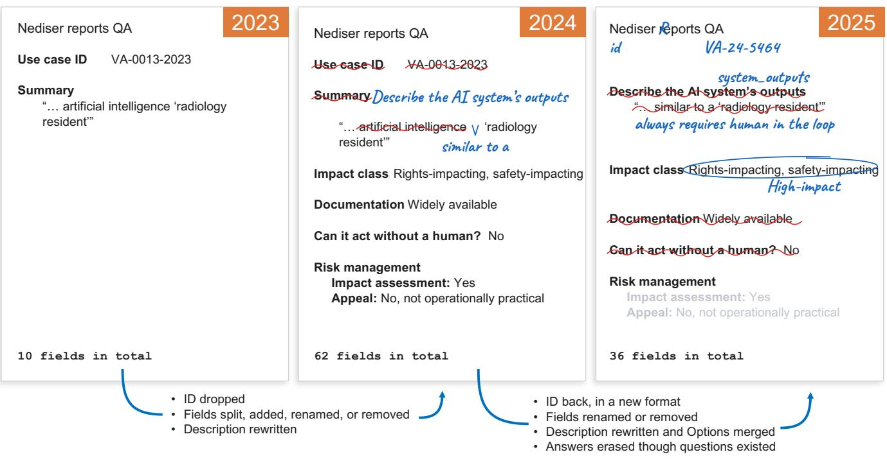
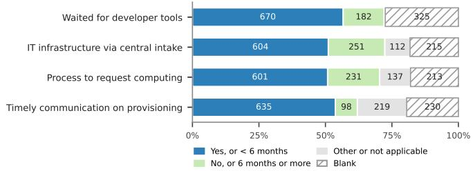
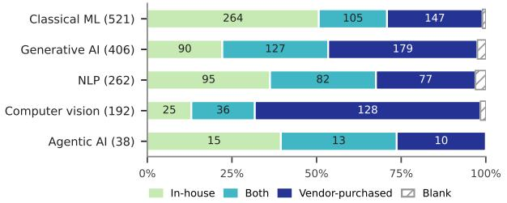
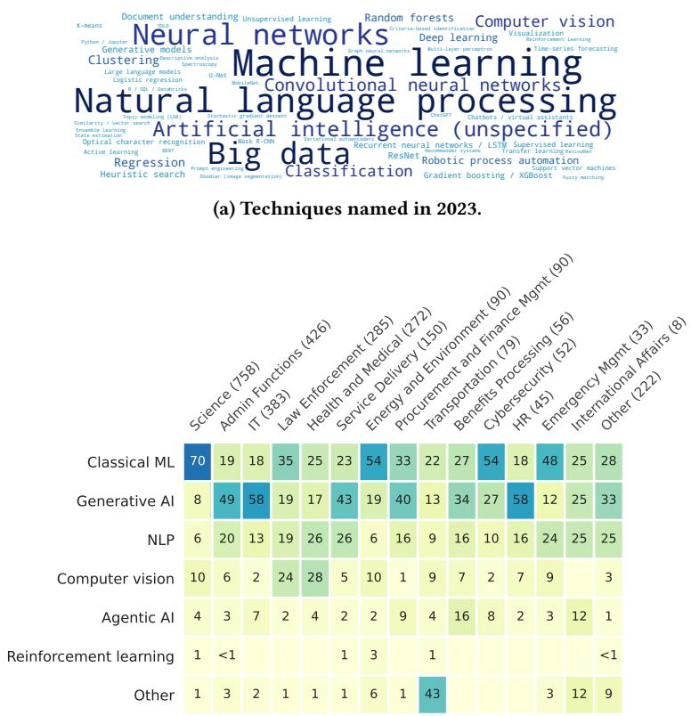
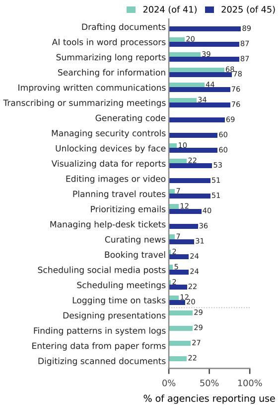
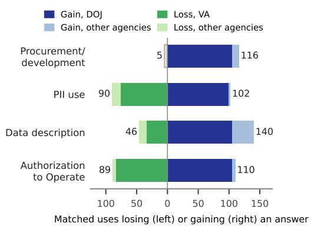
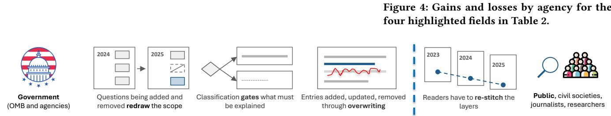
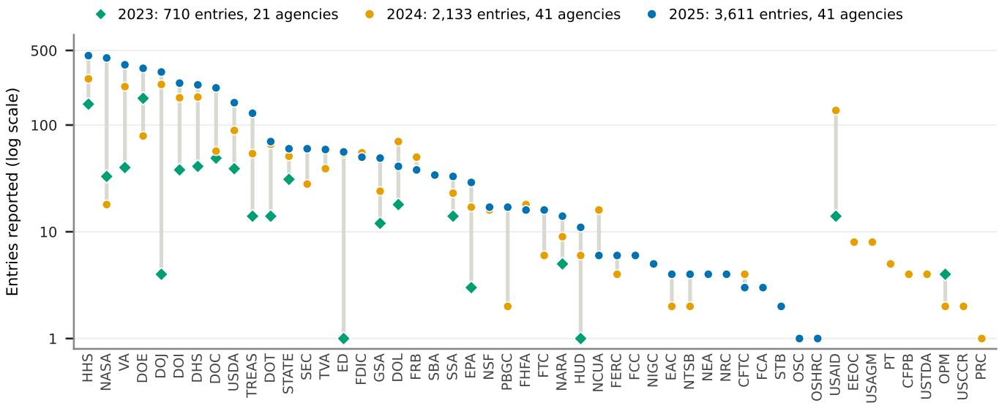
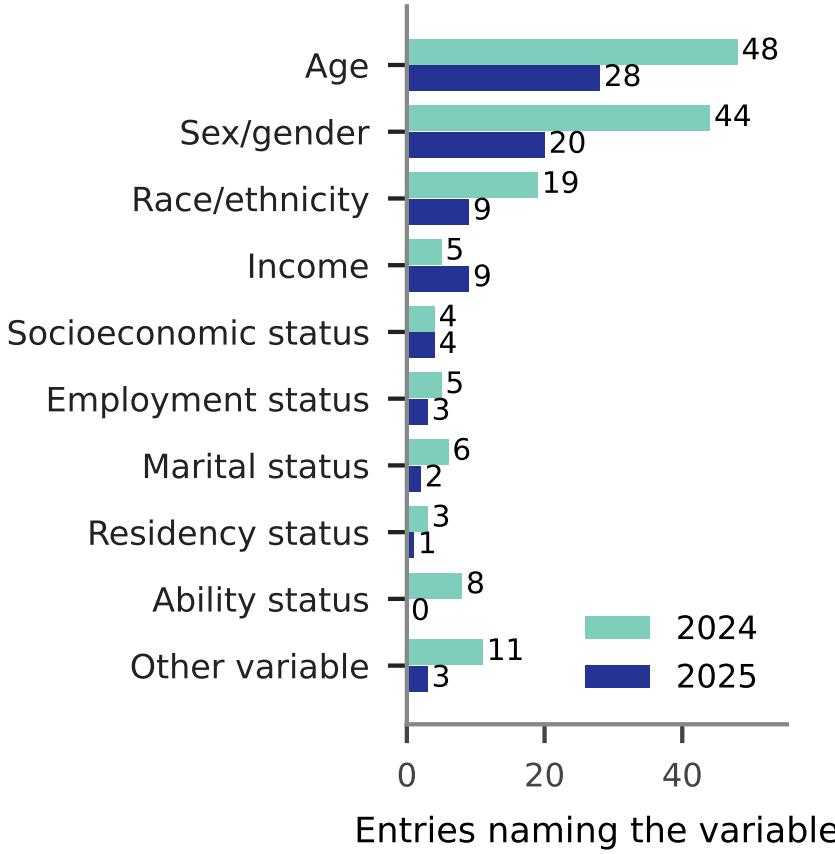

# Palimpsestic Accountability in the US Federal AI Inventories

Dipto Das College of Computing and Information Science Cornell University Ithaca, New York, United States dd749@cornell.edu

Aditya Vashistha College of Computing and Information Science Cornell University Ithaca, New York, United States adityav@cornell.edu

Syed Ishtiaque Ahmed   
Department of Computer Science   
University of Toronto   
Toronto, Ontario, Canada   
ishtiaque@cs.toronto.edu

Shion Guha Faculty of Information University of Toronto Toronto, Ontario, Canada shion.guha@utoronto.ca

  
Figure 1: A palimpsest is a manuscript scraped and written over, with traces of earlier text still visible. One AI use case reported across three releases (2023–2025) of the US Federal AI Use Case Inventory, where each release writes over the last. Annotations show what changed in the entry from the previous release.

## Abstract

An AI inventory is a structured, often public record in which a government or organization lists and describes the AI systems it uses or plans to use. Studies of single AI inventory releases describe what systems do but say little about how they are governed over time. We linked entries across three releases of the US Federal AI Use Case Inventory (2023–2025), compared answers only where both releases required them, and analyzed governance accounts through a dual deductive-inductive approach, guided by the Algorithmic Decision-Making Adapted for the Public Sector (ADMAPS) framework. As the inventory grew from 710 to 3,611 entries from 2023 to 2025, fewer required answers were left blank, but accountability was rewritten through three mechanisms. Each release redrew the scope of the questions; agency-assigned classifications gated what was reported; and answers were also overwritten, with gains and losses concentrated in single agencies and little account of human oversight and judgment. These findings show that each release redraws the boundary of accountability and leaves the public to re-stitch the records, a condition we term palimpsestic accountability. We recommend versioned records, reasons for every reclassifica tion, public files that distinguish kinds of missing answers, and oversight documented as conditions to improve public sector AI accountability.

## CCS Concepts

• Social and professional topics → Governmental regulations; • Applied computing → E-government; • Human-centered computing → Empirical studies in collaborative and social computing.

## Keywords

AI Register, Use Case Inventory, the United States Federal Govern ment, Public-Sector, Palimpsestic Accountability

## ACM Reference Format:

Dipto Das, Syed Ishtiaque Ahmed, Aditya Vashistha, and Shion Guha. 2026. Palimpsestic Accountability in the US Federal AI Inventories. In . ACM, New York, NY, USA, 19 pages. https://doi.org/10.1145/nnnnnnn.nnnnnnn

## 1 Introduction

Governments, companies, and international organizations have published hundreds of guidelines committing artificial intelligence (AI) to principles like fairness, accountability, and transparency (FAccT) [12, 33]. While FAccT research has advanced documentation practices (e.g., datasheets and model cards [26, 50]), AI inventory (or register) is a key way governments extend these practices in the public sector. An AI use case inventory is a structured, often public record in which a government or organization lists its current and planned AI use cases and describes each one’s purpose, technical properties, context, and governance [52, 62]. In the United States (US), a 2020 census found 157 AI use cases across 64 of the 142 federal agencies [21]. An Executive Order and the Advancing American AI Act subsequently required agencies to inventory their AI use cases [60, 65]. When the Ofice of Management and Budget (OMB) released the consolidated 2025 inventory, news coverage reported that the number of federal AI uses had more than doubled in a year [3, 37]. Under current OMB guidance, each inventory entry is an agency’s answers to a questionnaire about one AI use, including its purpose, outputs, lifecycle stage, impact classification, and risk-management practices. Some of these questions were required for every entry, whereas others were only for certain ones (e.g., whether a use case had an impact assessment or appeal process).

Prior research has mostly examined public AI registers one release at a time [14, 16, 52, 66]. Such studies can show what a register discloses or omits, but not whether its transparency and silence persist, deepen, or move between releases. In the US context, research has mostly raised concerns about unpublished inventories, inaccurate data, and blank fields [6, 81]. Others have used the reported cases in the inventories to gauge Federal AI adoption [87] or compared diferent AI policies [2, 46]. However, after three releases of the US AI inventory, we know comparatively little about how algorithmic decision-making fits into federal agency bureaucracies and the people who carry it out, or how agencies’ accounts of the same AI uses change over time.

In this paper, we conducted a longitudinal mixed-methods study of the US Federal AI Use Case Inventory across three reporting cycles (2023–2025), examining what it tells the public about algorith mic decision-making in federal agencies and how agencies classified, justified, and described the same AI as reporting requirements changed. We linked entries describing the same systems across years, and combined descriptive statistics with a dual deductiveinductive qualitative analysis, conceptually sensitized by the Algorithmic Decision Making Adapted for the Public Sector (ADMAPS) framework [71]. Beyond an overview of all entries, we focused on the uses federal policy prioritized for scrutiny and required further governance-related information and justification.

We found that each release redrew the scopes of questions that agencies were asked, and classification rules gated what information was reported. About one in six (44 of 272) AI uses classified as “rights-impacting" or “safety-impacting" in 2024 fell outside the “High Impact" (HI) category in 2025, which exempted them from reporting impact assessments, monitoring, and appeals, and most gave no reason or a template sentence. Answers were also overwritten. For four questions required of the same AI use cases in both 2024 and 2025, one agency contributed 89% of the answers that newly appeared in 2025, and another accounted for 84% of those that disappeared, so whether an entry gained or lost information depended more on which agency reported it than on the AI system it described. Entries often named who could review or correct an output, but rarely explained how human oficers weighed that output against other evidence, and fewer than one in five high-impact uses reported established operator training. We describe this process through the metaphor of a palimpsest, a manuscript page scraped and written over (as in Figure 1), on which traces of the earlier writing remain partly legible [20]. Based on our findings, we propose the term palimpsestic accountability to describe how the accountability an inventory supports depends not only on what each release discloses, but also on whether its successive accounts remain identifiable, traceable, and connected. Overall, this paper makes three contributions:

• First, we provide an empirical account of the US Federal AI Use Case Inventory, answering what it discloses about algorithmic decision-making in the public sector and how its accounts changed across releases. Because the inventories lack persistent identifiers, we linked the same AI uses across releases by combining automated matching with manual review, and publish the linked dataset (available upon the paper’s acceptance) to support future longitudinal analyses.

• Second, we propose the concept of “palimpsestic accountability" to describe how successive releases shift the work ofreconnecting accounts from agencies to the public.

• Third, we ofer recommendations for public AI inventories, such as persistent identifiers and documented revisions, explanations whenever a use is reclassified, guides that distinguish kinds of missing answers, and accounts of conditions supporting human oversight.

## 2 Literature Review

In this section, we first discuss how various documentation artifacts materialize algorithmic accountability. Then, we focus on AI

inventory, a type of accountability artifact, and discuss how it has been used and examined across contexts, ranging from global to national to municipal governments.

## 2.1 Documentation as Algorithmic Accountability Artifacts: The Case of AI Inventory

Documentation artifacts (e.g., datasheets [26], model cards [50]) are one of the main ways to make algorithmic accountability concrete. Public sector institutions scale this documentation logic from a single model or dataset to an institution or a government’s entire portfolio of algorithmic systems, and publish various algorithmic accountability artifacts, such as AI registers/inventories [77], internal audit reports [69], and impact assessments [83]. In this paper, we focus on AI inventories, which are standardized, often public lists in which governments describe the AI systems they use, usually including each system’s name, purpose, responsible units, data, and technical capacities, among other information (see Table 3 in Appendix A.1 for example fields the US reported).

However, making a system’s properties visible does not by itself make it understandable [4], and more information does not necessarily increase trust [39]. Disclosures are situated communications whose content, format, and intention shape what audiences can know [23, 54]. The sections on limitations and evaluation being the least completed in these documents [44] underscores this concern. Such reporting gaps often stem from weak incentives, scarce resources, a lack of good-faith participation, and poor integration with organizational workflows [75, 86].

Moreover, documentation does not inherently make the systems accountable to the public. For example, these documentation artifacts often record metrics (e.g., “impact"), which sometimes become an organizationally legible metric without representing how people experience and evaluate this construct [15, 49]. Claims of scale or completeness can hide the complex coordination of humans, organizations, and technologies behind these artifacts [43], along with questions like how its data are produced and whose labor they depend on [18, 73]. Reading datasets and disclosure datasets critically reveals the classificatory and political choices they encode [67, 68]. For example, the Digital Services Act (DSA) Transparency Database, one of the European Union (EU)’s major accountability artifacts, allows discretion over what to disclose [35] to coordinate reporting among entities with varied organizational practices. Such flexibility can create inconsistencies across reporting periods [30, 78], and often goes unreconciled with harmonized templates [80]. Moreover, the underlying classificatory logics may also change over time [9]. For example, in the US context, the “rights-impacting" and “safety impacting" AI were consolidated into “high-impact" AI [25], which raises questions about how agencies applied the new category to particular uses. Scholars emphasize that classifications never sort every case cleanly [9], and hard-to-classify AI systems sit at the edges [28], which this paper dubs “classification boundary". Their risks, impacts, outcomes, etc. may be reported with diferent levels of detail depending on their quantifiability [34]. Recent work brings the temporal concerns to AI documentation: deprecated datasets often continue to circulate without standardized identification and communication [45], and deployed models can change without corresponding updates [1].

## 2.2 Public AI Registers around the World and the US AI Use Case Inventory

Since Amsterdam and Helsinki launched some of the first municipal registers in 2020 [24, 31], similar initiatives have emerged in French cities [63], Chile [41], the UK [66, 88], Canada [55], and other municipal and national governments [79]. A 2024 report for the Global Partnership on AI identified 69 active public algorithm repositories worldwide [62]. While registers are presented as a way to establish AI as a transparent and trustworthy public service [24], scholars have warned that they can decontextualize and depoliticize systems whose harms in the digital welfare state were already documented [11]. Empirical studies found selective disclosure, limited access, and immature, highly variable register-management practices in Dutch organizations [52, 74], and surfaced issues, such as wrongful benefit denials, that a register entry itself did not reveal [17]. A comparative study of Chinese and British AI registers showed that registers can serve functions ranging from public disclosure to pre-market approval and regulatory coordination, depending on their design [66]. Across 72 countries, registers share a descriptive core but rarely request information about appeals, risks, or external evaluation [14]. Most of these studies analyzed one register at a time. Peljto et al.’s finding that two German platforms published no update obligations and did not version their entries [64] suggests why change across releases has been dificult to study.

Research on the US Federal AI Use Case Inventory has focused mainly on implementation and completeness, finding that roughly half or more of federal agencies had not published the required inventories [42] and that 15 of the 20 inventories the Government Accountability Ofice reviewed contained incomplete or inaccurate data [81]. Nearly half of agencies’ compliance plans for OMB’s 2024 memorandum did not explain how their inventories would be comprehensive [82], and civil society reviews have documented inconsistent and blank risk designations [5, 6]. Others have used the inventory to gauge federal adoption itself [87]. While these studies assessed each inventory release as a snapshot, they leave an open question about what happens to an AI use’s accounts when the same agency reports it under revised questionnaires in diferent releases. Lurie et al.’s work is the closest precedent addressing this temporal question. They triangulated the AI Use Case Inventory with two other “federal AI transparency regimes" [46], namely system-ofrecords notices and information collection requests. They matched 2024 entries to 2025 entries. They highlighted that the absence of persistent identifiers, uneven granularity, and the annual reporting cycle make it dificult to track systems across regimes and over time. Whereas their object was disclosure fragmented across three regimes, we look into a single regime, i.e., AI Inventory, fragmenting against itself over time, by re-describing the same use cases from one release to the next.

A sociotechnical reading of these accounts can surface how a system and its description are arranged with people, rules, and organizational routines, as highlighted by prior work in the public sector contexts like social benefits [22, 70], child welfare [36, 72], homelessness services [51], policing [76], higher education [47], etc. Hence, we draw on the ADMAPS framework [71], synthesized from public administration, science and technology studies, and human-computer interaction scholarship, to examine these accounts. Instead of treating public sector algorithms as stand-alone technical artifacts, it examines the intersection of three dimensions: bureaucratic processes (resources and constraints, administration and training, and laws and policies), algorithmic decision-making (relevant data, types of decision support, and the degree of uncertainty), and human discretion (professional expertise, value judgments, and heuristic decision-making). Das and colleagues used it to show that Canada’s federal AI Register foregrounds technical capabilities and eficiency while leaving human discretion, training, and uncertainty management largely unaccounted for [16]. We transfer and extend that single-release analysis to the American context, attending to how changes in reporting rules, descriptions of algorithmic roles, and representations of human judgment together shape what the public can examine over time.

## 3 Methods

To trace how the US AI use case inventories described the same systems across its 2023, 2024, and 2025 releases, we first collected data and reconstructed comparable questions and records (Section 3.1), and then measured the answers quantitatively and read selected entries closely (Section 3.2).

## 3.1 Data Collection and Preprocessing

3.1.1 Data Sources and Research Scope. We used the oficial inventories maintained by OMB. The 2023 and 2024 consolidated files came from OMB’s 2024 inventory repository1, and the 2025 files came from its 2025 repository2, as of April 2026. Each row of a release, dubbed an entry, describes one AI use case. The files contained 710 entries with 10 fields in 2023, 2,133 entries with 62 fields in 2024, and 3,611 entries with 36 fields in 2025 (Appendix B, Fig. 6). The 2025 release also included a separate inventory of commercialof-the-shelf (COTS) AI, recording whether each agency used those for some of the common tasks. We included this file in our comparison of reporting arrangements, but excluded it from entry-based analysis because it describes agencies’ practices in aggregate rather than by individual use case.

3.1.2 Comparing Questions and Requirements across Years. For each year, we examined the annual submission instructions, data dictionaries3, released schemas, and policy documents referenced in those materials. Reading them together allowed us to distinguish what agencies were asked to submit from what appeared in the consolidated public files. Because each release asked diferent questions, we first mapped each question to its counterparts in other years (Table 3 in Appendix A.1). We found that the questions across years changed in several ways. While some new questions were introduced, some existing ones were removed, renamed, split, merged4, or moved to a separate file (Table 4 in Appendix A.1).

A use case’s lifecycle stage and impact classification often decided which questions that entry had to answer. Per OMB guidance, the impact classification determined whether a use case had to answer governance questions, such as impact assessment and appeals. For example, in the 2025 inventory, a use case labeled “Presumed High-Impact, but Not High-Impact" (PHIN) had to provide a written justification of why it did not meet the HI definition despite being deemed rights- or safety-impacting in the previous year, whereas one labeled not-HI did not. For each entry (i.e., a use case) and question, we then determined whether that year’s rules required an answer. For each entry, we labeled each question as required, not required, optional, or unspecified (see examples in Table 5 in Appendix A.2). The 2023 release did not include a data dictionary, so we could not determine which questions an agency had to answer, and compared requirements only between 2024 and 2025.

In addition, we also labeled every answer into one of six states: (i) Present (any substantive answer), (ii) No (an explicit negative; e.g., identifying a use case as “not HI"), (iii) Not applicable (e.g., some questions not being applicable for use cases that are not HI), (iv) Blank (e.g., empty cells, null), (v) Unknown (e.g., an agency explicitly describing the answer to be determined), or (vi) Withheld (e.g., an answer being redacted for legal or cybersecurity reasons) (detail in App A.3).

3.1.3 Matching the Same Uses across Releases. To analyze how an AI use case changed over the years, we needed a mechanism to track it. However, the 2024 file had no ID column. Though the 2023 and 2025 files had an ID column, their formats difered across years and agencies: "<agency>-NNNN-2023" in 2023 and mostly "<agency>-N" in 2025, while 704 entries that year had none. Moreover, AI use cases were named diferently across releases (see Figure 1). Because each inventory contains many entries, manual matching was not possible either. We therefore adopted a mixedmethod approach. First, we linked entries whose identifiers or titles matched exactly, applying four rules in order: (1) identical identifiers; (2) identical titles; (3) identical titles with diferent bureaus5; and (4) titles in which one began with the other6. Second, for the remaining entries, we scored every possible pair on the similarity of their titles, descriptions, and bureaus, and used the Hungarian algorithm to propose the best match for each entry [13, 32]. Third, the first author reviewed the proposed pairs with high similarity scores and marked each as accept, reject, or uncertain (see examples in Table 1). Appendix A.4 and Table 6 provide details on text normalization, score weights, thresholds, and counts. Together, the exact and accepted matches yielded 254 matched pairs between 2023 and 2024, 1,332 between 2024 and 2025, 227 between 2023 and 2025, and 150 across all three years. We did not assume entries without an accepted match were new or discontinued uses, since a use could also go unlinked if it was renamed, merged, split, or moved between bureaus beyond what our rules for matching could detect.

3.1.4 The Linked Dataset. These steps produced the linked dataset on which all later analyses relied. It contains (1) the 6,454 entries, each with its agency, lifecycle stage, and impact classification as reported and as grouped for comparison across years, plus the requirement label and response state of every question; and (2) the accepted matches, each with the rule or similarity scores that proposed it and, for fuzzy matches, the review decision.

## 3.2 Data Analysis

3.2.1 Quantitative Analysis. First, our quantitative analyses describe what agencies reported about their AI uses across the annual inventory releases, using visualizations and descriptive statistics.

Second, we examined how the lifecycle stages and impact classifications of the same uses changed over time. A use’s lifecycle stage is where the agency reported it in its development, from planning to retirement. We grouped the 2024 and 2025 stages into four common stages: pre-deployment (2024’s Initiated and Acqui sition and/or Development, 2025’s Pre-deployment); pilot (2024’s Implementation and Assessment, 2025’s Pilot); deployed (2024’s Operation and Maintenance, 2025’s Deployed); and retired (Retired in both years). The 2023 inventory ofered no fixed options, so agencies described stages in their own words. A use’s impact classification is the agency’s determination of whether the use’s outputs could significantly afect people’s rights or safety, which decided whether it had to answer the governance questions. The 2023 inventory did not report impact classifications. The options were rights-impacting, safety-impacting, both, or neither in 2024, and HI, PHIN, or not HI in 2025. We cross-tabulated each matched use’s stage and impact classifications in 2024 versus 2025 (Table 8 and Figure 7 in Appendix B).

Third, we examined how agencies answered the same questions from one year to the next. We followed columns that recurred between 2024 and 2025. For each use found in both years, we recorded whether an answer to each column was required in both years, in only one of them, or in neither. We compared answers only among uses that had to answer in both years, because a blank answer to a question a use no longer had to answer reflects a change in the rules rather than an undisclosed answer. For example, of the 1,332 matched uses, 548 had to report their procurement method in both years, but only 26 had to report on impact assessment.

3.2.2 Qualitative Analysis. The counts show whether an answer remained available, but not what it said or how an agency’s account ofa use changed. We therefore read two sets ofentries closely, using the ADMAPS framework [71] to organize what they said about the organization, the algorithm, and the people involved. The first set consisted of the 171 matched uses that were deployed in both 2024 and 2025 and classified as rights- and/or safety-impacting in 2024. The second set included all 110 entries in the 2025 PHIN category, 109 of which provided a justification. The two sets overlap in 13 entries. We chose these sets for further qualitative analyses because they hold the inventory’s most detailed accounts of governance. The first set had to answer governance questions such as whether the use had an impact assessment, independent review, and ongoing monitoring; whether it could operate without human involvement; and whether people were notified and could appeal or opt out. The second set required justifications of re-classifications (e.g., from rights/safety-impacting, both, or none to HI, PHIN, or not HI, as previously described in Sec. 3.1.2). Because these two sets cover only the use cases with the most governance obligations, we also read these entries’ answers to other fields, such as data descriptions and benefits.

We used a dual deductive-inductive approach, commonly used in research at the intersection of computing and human, organizational, and social factors (e.g., [27, 38, 53]). ADMAPS served as “sensitizing concepts" [8]: it directed our reading to how each entry described the organization around the system (bureaucratic processes, such as resources, training, and policies), the system’s role (algorithmic decision-making, such as its data, outputs, and limitations), and the people who used its outputs (human discretion, such as who reviewed outputs, with what expertise, and on what basis). These dimensions conceptually overlap with many of the inventories’ questions. The first author inductively coded each entry and matched-pair, refining the codes through discussions with the other three authors and recording disagreements in analytic memos until resolution. We then grouped these codes into the three mechanisms that organize our results. Following guidance for collaborative interpretive analysis [48], we did not calculate inter-coder reliability.

## 3.3 Limitations

This study has several limitations. First, our analysis draws on agencies’ public accounts of their AI uses, not direct observation of their practices. Second, our matches depend on scoring rules and thresholds that we set. Because no benchmark exists for matching entries across releases of public-sector AI inventories, we adapted general record-linkage methods, as [46] did. Manual review of proposed pairs reduced false matches, but use cases that were substantially renamed or changed may have remained unmatched. Third, we deliberately focused our close reading on HI and PHIN uses, where the inventory requires the fullest governance accounts. Lower-impact uses, which make up most entries, may describe their systems and oversight diferently, and other frameworks could foreground aspects ADMAPS did not.

## 4 Results

Our analysis found that from 2023 to 2025, the US federal AI use case inventories widened visibility into the range of federal AI uses while narrowing visibility into how any particular use was reclassified, described, or overseen. We organize the results by the three mechanisms through which accountability was rewritten across releases: redrawing the questions, gating uses by impact, and overwriting earlieranswers. Within each, we report what the releases disclosed about the ADMAPS dimensions and their aspects (e.g., resources and constraints within bureaucratic processes).

## 4.1 Redrawing: Questions Added, Removed, and Reformatted

As noted earlier, each release changed the number of questions (10 in 2023, 62 in 2024, and 36 in 2025) and how it asked them (see

Table 1: Examples of review decisions on proposed matches. Scores are similarity scores between 0 and 1.
<table><tr><td>Years</td><td>Earlier title</td><td>Later title</td><td>(Overall, Title, Desc.) sim- ilarity</td><td>Human review</td></tr><tr><td>2024-25</td><td>Taxpayer 90 (Palantir prototype)</td><td>Taxpayer 90</td><td>(0.51, 0.62, 0.00)</td><td>Accept</td></tr><tr><td>2024-25</td><td>Climate Change Assessment Tool</td><td>DHS Asset Assessment Tool</td><td>(0.48, 0.51, 0.18)</td><td>Reject</td></tr><tr><td>2023-24</td><td>NIH Grants Virtual Assistant</td><td>NBS Virtual Assistant</td><td>(0.56, 0.64, 0.08)</td><td>Uncertain</td></tr></table>

Tables 3 and 4 in Appendix A.1). In the last two years, the inventory added questions on training and classification justification, removed questions on computing resources, documentation, and human involvement, and reformatted those on AI techniques, development routes, and COTS AI tools.

4.1.1 Removal ofQuestions about Resources, Documentation, and Human Involvement. Many entries, regardless of year, justified AI use by the staf time it would save. However, the 2025 inventory removed the questions about the resources and constraints, such as personnel, tools, budgets, or computing capacity that agencies committed, lacked, or redirected to sustain it. Entries described ofices “already operating lean" (DOJ-0353), staf “overburdened by manual document handling" (USDA-070), and AI adopted be cause “with limited staf, we use AI to summarize incoming public complaints" (DOJ-0315). Only the 2024 inventory asked about the organizational resources behind AI uses. Its four questions, asked of use cases in development or later lifecycle stages that did not rely solely on a COTS AI, covered: (i) how long the use had waited for basic computing and developer tools; (ii) whether its information technology (IT) infrastructure was centrally provisioned; (iii) whether it had a process to request computing resources7; and (iv) whether communication about provisioning had been timely. Figure 2a shows that about one in five entries reported no centralized intake or no process to request, indicating uneven access to computing resources. DOJ left all four questions blank for its 189 entries. With these questions removed altogether, a 2025 entry can claim that AI relieves a stafing shortage while falling outside the scope of ac countability regarding the resources that AI use case itself requires and constraints it imposes.

The 2025 inventory also removed two 2024 questions that asked about a system in use. The first asked whether documentation such as performance metrics and intended use was available for review: only 17.2% of 2024 entries reported complete documentation, 31.9% limited documentation, and 16.3% none. The second asked whether the AI could act without direct human involvement, to which more than 60% answered “no". Removing both these questions left the 2025 inventory with no question about how well a system was documented and whether a person stood between its outputs and their efects. Since an AI system cannot be held legally liable, that person becomes the point where responsibility and accountability for that AI use would rest [10], but becomes illegible from the latest inventory.

4.1.2 Reformating of Question Framing and Answer Types, Options, and Arrangements. Both 2024 and 2025 asked whether a use was developed in-house, by contractors or vendors, or through a combination, with slightly diferent wording and eligibility. After reformatting, among entries required to answer, blank responses fell from about one in five in 2024 to under 3% in 2025. That helped us to see how the shares for all three development routes increased: inhouse (31.8% to 34.1%), contractor (35.3% to 37.3%), and combination (11.7% to 26.1%) between 2024 and 2025. Among the 425 matched uses that answered in both years, the share with any in-house involvement rose from 60.0% to 77.4%. Because the 2025 options were reworded and additional questions about specific AI techniques were asked (more on that in the next paragraph), we could get more granular transparency into the government’s in-house technical capability as well as its reliance on and collaboration with vendors (see Figure 2b).

In 2023, agencies were asked to name techniques in their own words (see a word cloud in Figure 3a); in 2024, they were not asked this question at all; and in 2025, they were asked to choose techniques from a fixed list, such as classical machine learning (ML), generative AI, natural language processing (NLP), computer vision, and agentic AI. The share of entries reporting a technique rose from 44.4% in 2023 to 99.3% in 2025. In 2025, agencies also reported the entries’ application domains/topics from a fixed list (e.g., science, IT). AI techniques clustered by these topics (Figure 3b): classical ML accounted for 70.2% of science entries and more than half of energy and environment (54.4%) and cybersecurity (53.8%) entries; generative AI accounted for more than half of IT (58.2%) and human resources-related (57.8%) entries; and computer vision was most common in health and medical (27.9%) and law enforcement (24.2%) entries. However, the 2025 options, such as “classical ML” or computer vision, say less about how a system works than 2023’s descriptions, which named methods such as convolutional neural networks or regression.

The commercial AI question moved from individual uses to agencies. In 2024, each use-case entry asked whether the use was one of 19 listed commercial AI tasks (e.g., summarizing a long report, searching for information). In 2025, a separate file asked each agency whether it used commercial AI for each of 20 tasks, without describing any individual use. Among the 14 tasks listed in both years, the share of agencies reporting each task increased (Figure 3c): for example, 86.7% of agencies reported using COTS AI to summarize long reports in 2025, compared with 39.0% in 2024. Some of this rise is expected and typical considering the increasing adoption of AI in workplaces [7]. However, some of it likely follows from the new format, since an agency could answer yes as a blanket once rather than enter each use. More importantly, the move left the most widespread federal AI without a use-level account. For example, though 37 of 45 agencies named Microsoft Copilot in the 2025 file, the COTS report asked nothing about these uses’ data, oversight, etc.

  
(a) 2024 resource questions for AI in development/later.

  
(b) 2025 development route by AI techniques.

Figure 2: Information about AI use cases’ development routes from the 2024 and 2025 inventories.  
  
(b) AI techniques’ percentages by topic areas in 2025.

  
(c) % agencies using COTS AI in tasks.  
Figure 3: AI techniques and commercial AI tasks reported in the inventories.

## 4.2 Gating: Disclosure Tied to the Use Case Category

Not all use cases had to answer all questions. In 2025, questions on training, testing, monitoring, and appeals applied only to deployed HI uses, and a written justification applied only to PHIN uses. That means an entry’s classification determined which governance questions it had to answer, so a change in classification could add or remove those questions.

4.2.1 Reclassifications Rarely Explained. Most matched use cases maintained an equivalent classification between 2024 and 2025, but those that moved out of the highest category were rarely explained. Of the 272 matched uses that were rights- or safety-impacting in 2024, 228 (83.8%) became HI in 2025, 16 became PHIN, and 28 became not HI. Of the 1,045 matched uses that were neither rightsnor safety-impacting in 2024, 902 (86.3%) became not HI (Figure 7 in Appendix). A move to PHIN required a justification, but a move directly to not-HI did not, and 18 of the 28 such uses, including all of the Department of Veterans Afairs (VA)’s, gave none. Thus, the reclassifications, which relieved these use cases from answering the governance questions, were the least explained.

Even where a justification was required, it rarely addressed the particular use. We identified four ways the PHIN use cases justified their classification. First, some simply recited the definition. All 32 DOJ entries did this and used the same sentence: “Does not produce an output that serves as a principal basis for decisions or actions with legal, material, binding, or significant efect on any of the individuals or entities identified in OMB-25-21." For example, LexisNexis Accurint (DOJ-0019) described its outputs identically in both years, yet moved from rights-impacting to PHIN with this sentence, and the impact assessment question it had left blank in 2024 no longer applied in 2025. Second, some justifications foregrounded the people who use the output, for example, a Department of Homeland Security (DHS) use case (DHS-2729) stated that its results “can only be utilized for investigative leads and cannot be utilized as a determining factor for any enforcement action", without saying how analysts weigh a match. Third, some narrowed the use, as Customs and Border Protection’s facial matching for airline check-in (DHS-2417) was “an option for travelers, not a requirement." Finally, some entries deferred the determination. For example, several Department of Energy entries stated “In development stage and impact has not been determined." Overall, the 109 justifications contained only 69 distinct texts, suggesting that many reporting agencies might have assessed broad genres of use cases, but often not individual ones.

4.2.2 Uneven Classifications and Risk Accounts. Sometimes similar use cases received diferent classifications. For example, PATTERN (DOJ-0160), rights-impacting in both of its 2024 entries, appeared twice in 2025. While both entries output recidivism risk scores, the Federal Bureau of Prisons did not classify it as HI, whereas the Ofice ofJustice Programs did. Similarly, Vivid iq (VA-24-3213) and Vivid E80/E90/E95 (VA-24-3254) were both rights- and safetyimpacting in 2024 and reported the same output in 2025. However, only Vivid iq was HI in the latter year, and neither entry explained the reason behind such diference in their classifications.

Only HI use cases had to report potential impacts, safeguards, and human oversight, which serve as institutional means of managing the degree ofuncertainty in algorithmic decisions [29, 49]. However, 102 (44.9%) ofthe deployed HI entries in 2025 left the question about potential impacts blank (94 of them from VA). The entries that answered described uncertainty in four types of accounts: deferring, proceduralizing, routing, and naming. Deferring accounts said that impacts would be identified later, even for systems already in use: the AI-Assisted Resume Screening Tool (DHS-2556) stated that “potential impacts will be identified during AI Impact Assessment." Proceduralizing accounts simply named a governance process instead of explaining it: many DOJ entries answered every safeguard by saying this: “the case owner relied on DOJ AI governance practices to evaluate impacts and risks". Routing accounts named an error and assigned it to people, sending it to a “manual resolution queue" processed by “authorized and trained personnel." Through such routing, human discretion is expected to absorb algorithmic uncertainty. Finally, naming accounts identified errors without saying who would catch them: the Passenger Security Assessment Model (DHS-2389) reported risks include “false positives and negatives [...] algorithmic bias may disproportionately target certain types of travelers and crossing behaviors”, but did not say who reviews a flagged traveler or how a missed detection would be noticed.

The 2025 inventory’s only question about preparing the people who act on AI outputs was also applicable to HI use cases and was answered just as thinly. It asked whether the agency had established suficient and periodic training for the AIs’ operators, a matter of administration and training. Of these, only 18.1% reported established training, mostly from DHS and the Social Security Administration (SSA). Conversely, every DOJ entry reported training in progress, and every VA entry left the question blank. Even where training was established, entries did not say what operators were taught about interpreting or overriding AI outputs.

4.2.3 Motivations at the Classification Boundary. The classification asked whether a use afected rights or safety, but agencies justified AI mostly by eficiency, in terms of gains in time, cost, workload, accuracy, or consistency, whereas only a few use cases mentioned equity or fairness (Table 7 in Appendix A.5). When entries mentioned the public, they usually presented eficiency as the route to it: faster processing would mean quicker access to services, benefits, or security. These value judgments fell outside what the classification asked, so the question that gated disclosure and the reasons agencies gave for AI rarely met.

Even entries that acknowledged a tension between eficiency and rights/safety presented the two as compatible without saying how. Hurricane Score (DHS-2408) “supports more consistent and eficient case reviews [...] while maintaining individualized assessments". However, it also conceded that an inaccurate score “might lead to stricter or more lenient [...] requirements for an individual." Similarly, the Transportation Security Administration (TSA)’s PreCheck Touchless Identity Solution (DHS-345) promised “increasing the speed of security checks while maintaining a high degree of safety for all passengers." Only a few use cases, such as TSA’s Automated Target Recognition (DHS-131), named a rights-related goal such as “reduc[ing] privacy concerns".

Entries also difered in the type of decision support their outputs provided. Many scored, ranked, matched, or flagged cases. Such outputs act as a heuristic for deciding which cases staf examine first and how closely. SSA’s Quick Disability Determinations Model8 identifies cases where a favorable determination “is highly likely and medical evidence is readily available," so that these straightforward cases can be decided quickly. Conversely, the Pre-Efectuation Review and Targeted Denial Review models8 flag claims with a “high likelihood of error" for closer review. A second type of decision support helps enforce laws and policies established by authorities. For example, the Biometrics Enrollment Tool (DHS-14) checks a fingerprint quality score against thresholds set “to align with FBI9 specifications." Almost half of the triaging tools in the inventory were classified as HI. For the rest, a human still makes each final decision. However, by deciding which cases receive a quick decision and which receive scrutiny, it shapes outcomes before any person reviews the case.

## 4.3 Overwriting: Same Systems, Rewritten Answers

Even when a use stayed in the inventory, and a question stayed the same, its answer could change in the following release, which replaced rather than amended the earlier account.

4.3.1 Authorization-related Answers Reversed. We found that agencies often changed their answers about whether a use required an authority to operate (ATO), the security approval a federal information system needs. Both 2024 and 2025 inventories asked this question, and fewer than half of the entries required to answer it did so in either year (46.2% in 2024 and 46.0% in 2025). Among matched uses, these answers shifted at the agency level (Table 2, Figure 4): DOJ moved from leaving every answer blank to answering every entry, accounting for 105 of the 110 new answers, while VA did the opposite, accounting for 84 of the 89 new blanks. The Department of the Interior moved from mostly yes (75.4%) to mostly no (88.4%), with 52 matched uses changing from yes to no. Because an ATO could belong to a larger system, these answers could not show whether the AI itself had been reviewed, or whether a reversal reflected a new process or a diferent interpretation of the question by the responsible agency.

4.3.2 More Responses but Less Specified Data. Across releases, more entries answered the questions about the relevant data behind algorithmic decision-making, but their answers ofered little details. We focused on three questions: (i) data description, (ii) demographic variables used by an AI, and (iii) whether it used PII. Among entries required to answer, PII use rose from 14.5% in 2024 to 22.8% in 2025, and blank answers about demographic variables fell from 57.6% to 34.5%. However, fewer blanks did not mean more detail: only 65 entries in 2024 and 36 in 2025 named the demographic variables they used, most often age and sex/gender (Figure 8 in App. B). Many answers ofered a generic assurance.10

For matched uses, whether an answer appeared or disappeared depended mostly on the reporting agency.11 Of 548 matched uses, 140 (25.5%) gained a data description, and 46 lost one; of 485 entries required to report PII, 102 gained an answer and 90 lost one (Table 2). DOJ accounted for 105 of the data-description gains and 100 of the PII gains: it left the PII question blank for all of the 2024 entries that had to answer it, and blank for none in 2025. VA accounted for 34 of the data-description losses and 76 of the PII losses: it answered the PII question for nearly all of its 2024 entries and left it blank for all 159 in 2025. A detailed account could thus be overwritten by a blank. In 2024, VA’s Care Assessment Needs Score, one of VA’s AI use cases in 2024, described its data as “Patient demographics, medical conditions, laboratory results, medications, health care utilization, social determinants of health, social history, vital signs" and named race or ethnicity, sex or gender, age, and socioeconomic status as model features, and explicitly stated that it did not involve PII. Its 2025 entry (VA-24-5501) left all three questions blank. A reader of the 2025 inventory would therefore know less about this system’s data than a reader of the 2024 one, although nothing indicates that the system changed.

4.3.3 Repositioning and Reframing AI’s Roles. Overwriting also changed where entries placed human discretion, especially professional expertise, relative to the AI. Because the inventories rarely asked who acts on AI outputs or with what expertise, its role had to be read from narratives, and could change between releases even when the questions did not. For example, in 2024, Nediser (VA-24-5464) compared its role to that of “a Radiology resident who provides draft reports that the Attending Radiologist reviews," casting the system as a junior member of the profession. Its 2025 account replaced this analogy with a system that “always requires human in the loop," moving expertise from the AI back to an un named human without any stated change to the system.

Such repositioning also rewrote accounts of an AI’s uncertainty and recourse. Moreover, existing laws and authorities could override some OMB reporting requirements and withhold certain fields of some Department of Labor (DOL) entries from public reporting (e.g., DOL-26, DOL-44). In 2024, Hurricane Score (DHS-2408) identified two sources of uncertainty, false positives and bias, and addressed both “through error analysis during model testing and model performance monitoring." Its 2025 account mentioned only false positives, repositioned the score “as one of many factors" in case management, dropped country of origin from its demographic features, and changed its answer on contesting an outcome from an established fallback and escalation process to an appeal precluded by law. None of these revisions was explained, and a reader of the 2025 inventory alone would have no sign that a diferent account had existed a year earlier.

## 5 Discussion

Our study suggests that successive US Federal AI inventories offered visibility into the range of federal AI uses while poorly describing how any particular use was reclassified or described. We conceptualize this process through the metaphor of a palimpsest– a manuscript page scraped and written over, on which traces of the earlier writing remain partly legible [20]. Following Dillon’s use of “palimpsestic" for this layering [19], we propose the term “palimpsestic accountability." It means that the accountability an inventory supports depends not only on what each release discloses, but also on whether the layers of successive accounts can still be identified, separated, and connected. We identify three mechanisms, redrawing, gating, and overwriting, through which the government prepared the releases, leaving the public to reconnect the layers through re-stitching (see Figure 5). In the following subsections, we first theorize how these mechanisms wrote over the inventory and then discuss what they imply for public AI inventories.

## 5.1 Theorizing Palimpsestic Accountability

First, redrawing changed the proverbial page itself. The 2024 inventory followed OMB memo M-24-10, whereas the 2025 inventory followed M-25-21, issued under the new administration [57, 61]. The latter release removed the questions on resources even as entries justified AI by saved staf time, replaced free-text descriptions of techniques with fixed choices, and moved commercial AI products to a separate inventory detached from individual uses. Without a record of these changes, readers cannot tell whether an agency’s practice changed or only the questions it was asked.

Table 2: Matched use cases’ required response transition.
<table><tr><td></td><td></td><td></td><td></td><td>Both</td><td>Both</td><td></td></tr><tr><td>Field</td><td>n</td><td>Gain</td><td>Loss</td><td>answered</td><td>blank</td><td>Other</td></tr><tr><td>Procurement/development*</td><td>548</td><td>116</td><td>5</td><td>425</td><td>2</td><td>0</td></tr><tr><td>PIIδ use</td><td>485</td><td>102</td><td>90</td><td>289</td><td>3</td><td>1</td></tr><tr><td>Data description*</td><td>548</td><td>140</td><td>46</td><td>294</td><td>8</td><td>60</td></tr><tr><td>Custom-code status</td><td>485</td><td>110</td><td>3</td><td>372</td><td>0</td><td>0</td></tr><tr><td>Authorization to Operate</td><td>548</td><td>110</td><td>89</td><td>349</td><td>0</td><td>0</td></tr><tr><td>ATO system name</td><td>231</td><td>0</td><td>19</td><td>212</td><td>0</td><td>0</td></tr><tr><td>Impact assessment*</td><td>26</td><td>0</td><td>9</td><td>17</td><td>0</td><td>0</td></tr><tr><td>Independent review</td><td>26</td><td>0</td><td>9</td><td>17</td><td>0</td><td>0</td></tr><tr><td>Ongoing monitoring</td><td>26</td><td>1</td><td>9</td><td>16</td><td>0</td><td>0</td></tr><tr><td>Appeal/contestation</td><td>26</td><td>1</td><td>9</td><td>7</td><td>0</td><td>9</td></tr></table>

∗Question scope, response options, or eligibility changed, so the comparison does not assume identical constructs. � PII = Personally identifiable information.

  
Figure 5: Mechanisms through which the US Federal AI Use Case Inventory is constructed (left) and construed (right). The government redraws, gates, and overwrites the inventory, and the public has to re-stitch it.

Second, gating tied bureaucratic rules to accounts of algorithmic decision-making and associated human factors. In 2025, questions on training, testing, monitoring, and appeals applied only to deployed HI uses, and a justification only to PHIN use cases [58, 59]. A reclassification could thus remove a whole layer of governance disclosure without any answer being rewritten. Though classifications shape what institutions make visible [9], the inventory asked the least explanation where the classification moved the most: a use that moved directly from “rights-impacting" to “not-HI" owed no justification at all, and many required justifications repeated template text rather than addressing the particular use. Triage scores could also shift discretion upstream while the decision remained formally human and outside that gated disclosure. As policy researchers underscore: “the determination that requires the most explanation is the one that comes with the least” [85].

Third, overwriting rewrote entries one agency at a time, adding information in some and erasing it in others. Detailed answers in one release could become blanks in the next. Despite the con cern of oversight policies often presuming capacities that reviewers lack [29], accounts of human discretion were overwritten in ways that obscured some systems’ inaccuracies and biases, without any stated changes to the systems. Overwriting also continued between releases. As later news confirmed, DHS’s July 2026 update retired four uses, including Hurricane Score [85], and after the April 2026 deadline, VA completed its risk-management responses for most uses and moved the others to categories that no longer required them [84]. However, the consolidated record curated and published by the OMB could not distinguish an unanswered question from an agency’s pending update, or a completed answer from a reclassification that ended the requirement.

Finally, the inventory left re-stitching to the public. With no identifiers carried from one release to the next, we pieced continuity together from titles, bureaus, and descriptions and manually reviewed fuzzy-matched candidate pairs. While traceability is often described as a principle for operationalizing accountability [40], under the current arrangement of how the OMB publishes the US Federal government’s AI use case inventory, it became a task for the readers.

## 5.2 Implications for Public AI Inventories

A governance answer could disappear because the question was removed, because the use was reclassified out of it, because the agency left it blank, or because the use itself changed. The latest release would look the same in all four cases, though only the last reflects a change in what the government does with AI. To address this, we propose guidelines for palimpsestic accountability, with four recommendations for OMB and reporting Federal agencies. First, the inventory should preserve its own history. Each release should carry persistent public identifiers, explicit links for renamed, merged, split, or moved entries, and a change log of added, removed, or reworded questions, answer options, and eligibility rules, while revised answers and retired entries remain visible with their periods of being functional and reconciled with individual agencies’ ongoing updates. Second, explanation requirements should follow the classification boundary: whenever a use crosses into or out of a rights-, safety-, or HI category, its entry should state the previous and new categories, the responsible ofice, the evidence considered, and whether the system, the criteria, or the record changed.

Third, public files should distinguish a blank required answer from a pending update, an ended requirement, an answer withheld by law, and an explicit not applicable, and should mark statements shared across an agency’s entries as such. Fourth, federal agencies should document human oversight as a set of conditions, including when review occurs, what evidence reviewers receive, whether they can reject an output, what training and time they have, and how afected people can contest an outcome. Overall, palimpsestic accountability aims to make each revision legible as a recorded change to an earlier account and not as an isolated account.

These recommendations also apply beyond the US. The EU’s DSA Transparency Database has been inconsistent across reporting periods [30, 80], and German register platforms neither keep earlier versions nor require updates [64]. Canada’s second AI Register, due by the end of 2026, will replace its 2025 minimum viable product (MVP) [55, 56]. Without persistent identifiers or a record ofchanged fields, we expect the same mechanisms: scopes redrawn beyond the MVP, disclosure gated by updated classifications, and MVP entries overwritten. As registers accumulate releases, palimpsestic accountability calls for reading AI use cases as traceable series, and not snapshots.

## 6 Conclusion

This paper traced the US Federal AI Use Case Inventory across three releases (2023–2025), focusing on how the record is written over successive reporting cycles. We showed that reclassifications and the conditions of human involvement were rarely explained in case-specific terms. To address how each release writes over the last, leaving the public to reconnect its accounts, we proposed palimpsestic accountability and ofered recommendations. While our analysis relies only on documentary accounts, future research engaging civil servants involved in these AI uses and their afected communities could explain how AI use cases are reclassified or safeguards change.

## References

[1] Sophia Abraham and Ben Bucknall. 2026. Silent Updates: Measuring and Closing the Post-Deployment Disclosure Gap. arXiv:2608.11803 [cs.CY] https://arxiv. org/abs/2608.11803

[2] Sacha Alanoca, Shira Gur-Arieh, Tom Zick, and Kevin Klyman. 2025. Comparing apples to oranges: A taxonomy for navigating the global landscape of AI regula tion. In Proceedings ofthe 2025 ACM Conference on Fairness, Accountability, and Transparency. 914–937.

[3] Jack Aldane. 2026. Number of AI Use Cases in the US Federal Government More Than Doubles in a Year, Oficial Figures Show. Global Government Forum. [Accessed: September 28, 2026].

[4] Mike Ananny and Kate Crawford. 2018. Seeing without knowing: Limitations of the transparency ideal and its application to algorithmic accountability. new media & society 20, 3 (2018), 973–989.

[5] Quinn Anex-Ries. 2025. Exploring the 2024 Federal AI Invento ries: Key Improvements, Trends, and Continued Inconsistencies. https://cdt.org/insights/exploring-the-2024-federal-ai-inventories-keyimprovements-trends-and-continued-inconsistencies/.

[6] Quinn Anex-Ries. 2026. One-Year Retrospective on the Federal Government’s Implementation of Updated AI Guidance: Accelerating Usage with Incomplete Safeguards. https://cdt.org/insights/one-year-retrospective-on-the-federalgovernments-implementation-of-updated-ai-guidance-accelerating-usagewith-incomplete-safeguards/.

[7] Salomé Baslandze, Zachary Edwards, John Graham, Ty McClure, Brent H Meyer, Michael Sparks, Sonya R Waddell, and Daniel Weitz. 2026. Artificial intelligence, productivity, and the workforce: Evidence from corporate executives. Technical Report. National Bureau of Economic Research.

[8] Glenn A Bowen. 2006. Grounded theory and sensitizing concepts. International journal ofqualitative methods 5, 3 (2006), 12–23.

[9] Geofrey C Bowker and Susan Leigh Star. 2000. Sorting things out: Classification and its consequences. MIT press.

[10] Joanna J Bryson, Mihailis E Diamantis, and Thomas D Grant. 2017. Of, for, and by the people: the legal lacuna of synthetic persons. Artificial Intelligence and Law 25, 3 (2017), 273–291.

[11] Corinne Cath and Fieke Jansen. 2022. Dutch Comfort: The Limits of AI Governance through Municipal Registers. Techné: Research in Philosophy and Technology 26, 3 (2022), 395–412. doi:10.5840/techne202323172

[12] Nicholas Kluge Corrêa, Camila Galvão, James William Santos, Carolina Del Pino, Edson Pontes Pinto, Camila Barbosa, Diogo Massmann, Rodrigo Mambrini, Luiza Galvão, Edmund Terem, et al. 2023. Worldwide AI ethics: A review of 200 guidelines and recommendations for AI governance. Patterns 4, 10 (2023)

[13] David F Crouse. 2016. On implementing 2D rectangular assignment algorithms. IEEE Trans. Aerospace Electron. Systems 52, 4 (2016), 1679–1696.

[14] Dipto Das and Shion Guha. 2026. A Global Comparison of Schemas, Transparency, and Interoperability in Public-Sector AI Registers and Inventories. In Proceedings ofthe Inaugural ACM Conference on Digital Transformation (DXConf’26). Association for Computing Machinery, Ann Arbor, MI, USA. doi:10.1145/3847238.3849037

[15] Dipto Das, Matthew Tamura, Syed Ishtiaque Ahmed, and Shion Guha. 2026. “Is This Not Enough?”: Asymmetries in Institutional Accountability and Collective Sensemaking in the Case of Canada’s Algorithmic Visa Triage System. In Proceedings ofthe ACM SIGCAS/SIGCHI Conference on Computing and Sustainable Societies (Virtual Event, 2026-07-27/2026-07-31) (COMPASS ’26). Association for Computing Machinery, New York, NY, USA. doi:10.1145/3811242.3819106

[16] Dipto Das, Christelle Tessono, Syed Ishtiaque Ahmed, and Shion Guha. 2026. Bureaucratic Silences: What the Canadian AI Register Reveals, Omits, and Obscures. In Proceedings of the 2026 ACM Conference on Fairness, Accountability, and Transparency (FAccT ’26) (Montréal, Canada) (FAccT ’26). Association for Computing Machinery, New York, NY, USA. doi:10.1145/3805689.3812336

[17] Íñigo de Troya, Maurus Enbergs, Neelke Doorn, and Roel Dobbe. 2026. Coconstructing Sociotechnical AI Governance: Participatory System Mapping Using Algorithm Registers. arXiv:2608.12166 [cs.CY] https://arxiv.org/abs/2608.12166

[18] Emily Denton, Alex Hanna, Razvan Amironesei, Andrew Smart, and Hilary Nicole. 2021. On the genealogy of machine learning datasets: A critical history of ImageNet. Big Data & Society 8, 2 (2021), 20539517211035955.

[19] Sarah Dillon. 2005. Reinscribing De Quincey’s Palimpsest: The Significance of the Palimpsest in Contemporary Literary and Cultural Studies. Textual Practice 19, 3 (2005), 243–263.

[20] Sarah Dillon. 2007. The Palimpsest: Literature, Criticism, Theory. Continuum, London and New York

[21] David Freeman Engstrom, Daniel E. Ho, Catherine M. Sharkey, and Mariano-Florentino Cuéllar. 2020. Government by Algorithm: Artificial Intelligence in Federal Administrative Agencies. Report submitted to the Administrative Conference of the United States. Administrative Conference of the United States. https://www.acus.gov/document/government-algorithm-artificialintelligence-federal-administrative-agencies

[22] Virginia Eubanks. 2018. Automating inequality: How high-tech tools profile, police, and punish the poor. Macmillan+ ORM.

[23] Florian Eyert and Paola Lopez. 2023. Rethinking transparency as a communicative constellation. In Proceedings ofthe 2023 ACM Conference on Fairness, Accountability, and Transparency. 444–454.

[24] Luciano Floridi. 2020. Artificial Intelligence as a Public Service: Learning from Amsterdam and Helsinki. Philosophy & Technology 33, 4 (2020), 541–546. doi:10. 1007/s13347-020-00434-3

[25] Sorelle A. Friedler and Andrew D. Selbst. 2025. The OMB Artificial Intelligence Memoranda. Berkeley Technology Law Journal 40, 4 (2025), 1237–1268.

[26] Timnit Gebru, Jamie Morgenstern, Briana Vecchione, Jennifer Wortman Vaughan, Hanna Wallach, Hal Daumé III, and Kate Crawford. 2021. Datasheets for datasets. Commun. ACM 64, 12 (2021), 86–92.

[27] Göran Goldkuhl. 2024. Aspects of E-Government Interoperation: Case Study Research for Discovery Beyond Interoperability as Layered Capability. ACM SIGMIS Database: the DATABASE for Advances in Information Systems 55, 4 (2024), 53–79.

[28] Delaram Golpayegani, Harshvardhan J. Pandit, and Dave Lewis. 2023. To Be High-Risk, or Not To Be—Semantic Specifications and Implications of the AI Act’s High-Risk AI Applications and Harmonised Standards. In Proceedings of the 2023 ACM Conference on Fairness, Accountability, and Transparency (FAccT ’23). ACM, 905–915. doi:10.1145/3593013.3594050

[29] Ben Green. 2022. The flaws of policies requiring human oversight of government algorithms. Computer Law & Security Review 45 (2022), 105681.

[30] Samuel Groesch, Alena Birrer, Natascha Just, and Florian Saurwein. 2025. Big data, small answers: How the DSA Transparency Database falls short of its regulatory objectives. Telecommunications Policy (2025), 103088.

[31] M Haataja, L van de Fliert, and P Rautio. 2020. Public AI Registers: Realising AI transparency and civic participation in government use of AI. Whitepaper Version 1 (2020).

[32] Matthew A Jaro. 1989. Advances in record-linkage methodology as applied to matching the 1985 census of Tampa, Florida. Journal ofthe American Statistical association 84, 406 (1989), 414–420.

[33] Anna Jobin, Marcello Ienca, and Efy Vayena. 2019. The global landscape of A ethics guidelines. Nature machine intelligence 1, 9 (2019), 389–399.

[34] Margot E. Kaminski. 2023. Regulating the Risks of AI. Boston University Law Review 103, 5 (2023), 1347–1410. https://www.bu.edu/bulawreview/files/2023/ 11/KAMINSKI.pdf

[35] Rishabh Kaushal, Jacob Van De Kerkhof, Catalina Goanta, Gerasimos Spanakis, and Adriana Iamnitchi. 2024. Automated transparency: A legal and empirica analysis of the digital services act transparency database. In Proceedings of the 2024 ACM Conference on Fairness, Accountability, and Transparency. 1121–1132.

[36] Anna Kawakami, Venkatesh Sivaraman, Hao-Fei Cheng, Logan Stapleton, Yanghuidi Cheng, Diana Qing, Adam Perer, Zhiwei Steven Wu, Haiyi Zhu, and Kenneth Holstein. 2022. Improving Human-AI Partnerships in Child Welfare: Understanding Worker Practices, Challenges, and Desires for Algorith mic Decision Support. In Proceedings of the 2022 CHI Conference on Human Factors in Computing Systems (CHI ’22). ACM, New Orleans, LA, USA, 1–18. doi:10.1145/3491102.3517439

[37] Alexandra Kelley. 2026. Agencies Report over 3,000 AI Use Cases in 2025. https://www.nextgov.com/artificial-intelligence/2026/04/agencies-reportover-3000-ai-use-cases-2025/412898/. [Accessed: September 28, 2026].

[38] Charles Kiene, Sohyeon Hwang, Carl Colglazier, Nathan TeBlunthuis, Aaron Shaw, and Benjamin Mako Hill. 2026. The relational origins of rules in online communities. Proceedings ofthe ACM on Human-Computer Interaction 10, 6 (2026), 1–34.

[39] René F Kizilcec. 2016. How much information? Efects of transparency on trust in an algorithmic interface. In Proceedings ofthe 2016 CHI conference on human factors in computing systems. 2390–2395.

[40] Joshua A Kroll. 2021. Outlining traceability: A principle for operationalizing accountability in computing systems. In Proceedings of the 2021 ACM Conference on fairness, accountability, and transparency. 758–771.

[41] José Pablo Lapostol Piderit, Romina Garrido Iglesias, and María Paz Hermosilla Cornejo. 2023. Algorithmic Transparency from the South: Examining the State of Algorithmic Transparency in Chile’s Public Administration Algorithms. In Proceedings of the 2023 ACM Conference on Fairness, Accountability, and Transparency (FAccT ’23). ACM, 227–235. doi:10.1145/3593013.3593991

[42] Christie Lawrence, Isaac Cui, and Daniel Ho. 2023. The bureaucratic challenge to AI governance: An empirical assessment of implementation at US federal agencies. In Proceedings of the 2023 AAAI/ACM Conference on AI, Ethics, and Society. 606–652.

[43] Charlotte P Lee, Paul Dourish, and Gloria Mark. 2006. The human infrastructure of cyberinfrastructure. In Proceedings of the 2006 20th anniversary conference on Computer supported cooperative work. 483–492.

[44] Weixin Liang, Nazneen Rajani, Xinyu Yang, Ezinwanne Ozoani, Eric Wu, Yiqun Chen, Daniel Scott Smith, and James Zou. 2024. Systematic Analysis of 32,111 AI Model Cards Characterizes Documentation Practice in AI. Nature Machine Intelligence 6 (2024), 744–753. doi:10.1038/s42256-024-00857-z Preprint: arXiv:2402.05160, “What’s documented in AI? Systematic Analysis of 32K AI Model Cards”.

[45] Alexandra Sasha Luccioni, Frances Corry, Hamsini Sridharan, Mike Ananny, Jason Schultz, and Kate Crawford. 2022. A Framework for Deprecating Datasets: Standardizing Documentation, Identification, and Communication. In Proceedings ofthe 2022 ACM Conference on Fairness, Accountability, and Transparency (FAccT ’22). ACM, Seoul, Republic of Korea, 199–212. doi:10.1145/3531146.3533086

[46] Emma Lurie, Emma Fauser, Qing He, Danaé Metaxa, and Sorelle A Friedler. 2026. Triangulating Across US Federal AI Transparency Regimes. arXiv preprint arXiv:2607.29540 (2026).

[47] Kelly McConvey and Shion Guha. 2024. " This is not a data problem": Algorithms and Power in Public Higher Education in Canada. In Proceedings ofthe 2024 CHI Conference on Human Factors in Computing Systems. 1–14.

[48] Nora McDonald, Sarita Schoenebeck, and Andrea Forte. 2019. Reliability and inter-rater reliability in qualitative research: Norms and guidelines for CSCW and HCI practice. Proceedings ofthe ACM on human-computer interaction 3, CSCW (2019), 1–23.

[49] Jacob Metcalf, Emanuel Moss, Elizabeth Anne Watkins, Ranjit Singh, and Madeleine Clare Elish. 2021. Algorithmic Impact Assessments and Accountability: The Co-construction of Impacts. In Proceedings ofthe 2021 ACM Conference on Fairness, Accountability, and Transparency (FAccT ’21). ACM, 735–746. doi:10.1145/3442188.3445935

[50] Margaret Mitchell, Simone Wu, Andrew Zaldivar, Parker Barnes, Lucy Vasserman, Ben Hutchinson, Elena Spitzer, Inioluwa Deborah Raji, and Timnit Gebru. 2019. Model cards for model reporting. In Proceedings of the conference on fairness, accountability, and transparency. 220–229.

[51] Erina Seh-Young Moon, Devansh Saxena, Dipto Das, and Shion Guha. 2025. The Datafication of Care in Public Homelessness Services. In Proceedings ofthe 2025 CHI Conference on Human Factors in Computing Systems. 1–16.

[52] Esther Nieuwenhuizen. 2024. Algorithm Registers: A Box-Ticking Exercise or Meaningful Tool for Transparency? Information Polity 29, 4 (2024), 415–433.

[53] Alexander Nolte, Linda Bailey Hayden, and James D Herbsleb. 2020. How to support newcomers in scientific hackathons-an action research study on expert mentoring. Proceedings of the ACM on Human-Computer Interaction 4, CSCW1 (2020), 1–23.

[54] Chris Norval, Kristin Cornelius, Jennifer Cobbe, and Jatinder Singh. 2022. Disclosure by Design: Designing information disclosures to support meaningful transparency and accountability. In Proceedings of the 2022 ACM Conference on Fairness, Accountability, and Transparency. 679–690.

[55] Government of Canada. 2025. Government of Canada AI Register (Minimum Viable Product) - GC AI Register (MVP). https://open.canada.ca/data/en/dataset/ fcbc0200-79ba-4fa4-94a6-00e32facea6b/resource/369f6f34-148a-42ed-b581- 8c164e941a89. [Accessed: December 16, 2025].

[56] Government of Canada. 2026. National Action Plan on Open Government Commitment. https://search.open.canada.ca/nap6//record/2026-06,C03.3.4. [Accessed: Nov 2, 2026].

[57] Ofice of Management and Budget. 2025. MEMORANDUM FOR THE HEADS OF EXECUTIVE DEPARTMENTS AND AGENCIES. https: //www.whitehouse.gov/wp-content/uploads/2025/02/M-25-21-Accelerating-Federal-Use-of-AI-through-Innovation-Governance-and-Public-Trust.pdf. [Accessed: June 12, 2026].

[58] Ofice of Management and Budget. 2026. Guidance on 2025 Agency Artificial In telligence Reporting. https://fedscoop.com/wp-content/uploads/sites/5/2026/04/ Guidance-on-2025-Agency-Artificial-Intelligence-Reporting-FINAL-3.pdf. [Accessed: April 25, 2026].

[59] Ofice of the Federal Chief Information Oficer. 2026. 2025 Federal Agency AI Use Case Inventory. https://github.com/ombegov/2025-Federal-Agency-AI-Use-Case-Inventory. [Accessed: April 25, 2026].

[60] Executive Ofice of the President. 2020. Promoting the Use of Trustworthy Artificial Intelligence in the Federal Government. https: //www.federalregister.gov/documents/2020/12/08/2020-27065/promotingthe-use-of-trustworthy-artificial-intelligence-in-the-federal-government. [Accessed: June 12, 2026].

[61] Ofice of Management and Budget. 2024. Advancing Governance, Innovation, and Risk Management for Agency Use of Artificial Intelligence. Memorandum M-24-10. https://www.whitehouse.gov/wp-content/uploads/2024/03/M-24-10- Advancing-Governance-Innovation-and-Risk-Management-for-Agency-Useof-Artificial-Intelligence.pdf March 28, 2024.

[62] Global Partnership on Artificial Intelligence. 2024. Algorithmic Transparency in the Public Sector: A state-of-the-art report ofalgorithmic transparency instruments. https://wp.oecd.ai/app/uploads/2025/05/algorithmic-transparency-inthe-public-sector.pdf. [Accessed: Dec 28, 2025].

[63] Open Government Partnership. 2021. Building Public Algorithm Registers: Lessons Learned from the French Approach. https://www.opengovpartnership. org/stories/building-public-algorithm-registers-lessons-learned-from-thefrench-approach/. [Accessed: June 11, 2026].

[64] Iman Peljto, Xenia Heilmann, and Mattia Cerrato. 2026. Are Algorithm Registers Transparent? Perspectives from Germany. arXiv:2606.02347 [cs.CY] https:// arxiv.org/abs/2606.02347

[65] Gary C. Peters. 2021. Advancing American AI Act. https://www.congress.gov/ bill/117th-congress/senate-bill/1353/text. [Accessed: June 12, 2026].

[66] Yulu Pi, Wenlong Li, and Jatinder Singh. 2026. Understanding the Role of Algorithm Registers in AI Governance Through Comparative Analysis of China and the UK. arXiv preprint arXiv:2606.00035 (2026).

[67] Lindsay Poirier. 2021. Reading datasets: Strategies for interpreting the politics of data signification. Big Data & Society 8, 2 (2021), 20539517211029322.

[68] Lindsay Poirier. 2022. Accountable data: The politics and pragmatics of disclosure datasets. In Proceedings ofthe 2022 ACM Conference on Fairness, Accountability, and Transparency. 1446–1456

[69] Inioluwa Deborah Raji, Andrew Smart, Rebecca N White, Margaret Mitchell, Timnit Gebru, Ben Hutchinson, Jamila Smith-Loud, Daniel Theron, and Parker Barnes. 2020. Closing the AI accountability gap: Defining an end-to-end framework for internal algorithmic auditing. In Proceedings of the 2020 conference on fairness, accountability, and transparency. 33–44.

[70] Joanna Redden, Jessica Brand, Ina Sander, Harry Warne, A Grant, and D White. 2022. Automating public services: Learning from cancelled systems. Cardif, UK: Data Justice Lab, CardifUniversity 30 (2022).

[71] Devansh Saxena, Karla Badillo-Urquiola, Pamela J Wisniewski, and Shion Guha. 2021. A framework of high-stakes algorithmic decision-making for the public sector developed through a case study of child-welfare. Proceedings of the ACM on Human-Computer Interaction 5, CSCW2 (2021), 1–41.

[72] Devansh Saxena, Erina Seh-Young Moon, Aryan Chaurasia, Yixin Guan, and Shion Guha. 2023. Rethinking" Risk" in Algorithmic Systems Through A Computational Narrative Analysis of Casenotes in Child-Welfare. In Proceedings ofthe 2023 CHI conference on human factors in computing systems. 1–19.

[73] Morgan Klaus Scheuerman, Allison Woodruf, and Jed R Brubaker. 2025. How Data Workers Shape Datasets: The Role of Positionality in Data Collection and

Annotation for Computer Vision. Proceedings of the ACM on Human-Computer Interaction 9, 7 (2025), 1–42.

[74] Nena Schuitemaker, Martijn van Vliet, Sjaak Brinkkemper, Inge van de Weerd, and Sergio España. 2024. Realizing the Accountability of Algorithms in the Public Sector: A Reference Method for Managing Algorithm Registers. In Enterprise, Business-Process and Information Systems Modeling (BPMDS 2024, EMMSAD 2024) (Lecture Notes in Business Information Processing, Vol. 511). Springer, 325–340. doi:10.1007/978-3-031-61007-3\_24

[75] Andrew D. Selbst. 2021. An Institutional View ofAlgorithmic Impact Assessments. Harvard Journal of Law & Technology 35, 1 (2021), 117. https://papers.ssrn.com/ sol3/papers.cfm?abstract\_id=3867634

[76] Friso Selten, Marcel Robeer, and Stephan Grimmelikhuijsen. 2023. ‘Just like I thought’: Street-level Bureaucrats Trust AI Recommendations if They Confirm Their Professional Judgment. Public Administration Review 83, 2 (2023), 263–278. doi:10.1111/puar.13602

[77] Ushnish Sengupta. 2022. Algorithm registers as an infrastructural element for transparent government. Artificial intelligence in the city: Building civic engagement and public trust (2022), 68.

[78] Gautam Kishore Shahi, Benedetta Tessa, Amaury Trujillo, and Stefano Cresci. 2025. A Year of the DSA Transparency Database: What It (Does Not) Reveal About Platform Moderation During the 2024 European Parliament Election. In Workshop Proceedings ofthe 19th International AAAIConference on Web and Social Media (ICWSM). https://workshop-proceedings.icwsm.org/pdf/2025\_08.pdf arXiv:2504.06976.

[79] Renée Sieber, Ana Brandusescu, and Jonathan van Geuns. 2026. Building AI Governance in Municipalities from the Ground Up.

[80] Amaury Trujillo, Benedetta Tessa, and Stefano Cresci. 2026. Disarranged Harmo nization of Transparency Reporting by Social Media Platforms Under the Digital Services Act. arXiv:2605.17655 https://arxiv.org/abs/2605.17655

[81] U.S. Government Accountability Ofice. 2023. Artificial Intelligence: Agencies Have Begun Implementation but Need to Complete Key Requirements. Technical Report GAO-24-105980. U.S. Government Accountability Ofice. https://www. gao.gov/products/gao-24-105980 Published and publicly released December 12, 2023.

[82] Jennifer Wang, Mirac Suzgun, Caroline Meinhardt, Daniel Zhang, Kazia Nowacki, and Daniel E. Ho. 2025. Assessing the Implementation of Federal AI Leadership and Compliance Mandates. White Paper. Stanford HAI and RegLab. https://www.acus.gov/sites/default/files/documents/HAI-RegLab-White-Paper-Federal-AI-Leadership-and-Compliance.pdf

[83] Elizabeth Anne Watkins, Emanuel Moss, Jacob Metcalf, Ranjit Singh, and Madeleine Clare Elish. 2021. Governing algorithmic systems with impact assessments: Six observations. In Proceedings ofthe 2021 AAAI/ACM Conference on AI, Ethics, and Society. 1010–1022.

[84] Lindsey Wilkinson. 2026. AI Risk Management Deadline Hits Federal Agencies. Not All Were Ready. https://fedscoop.com/federal-agencies-ai-inventory-riskmanagement-deadline/. [Accessed: September 28, 2026].

[85] Lindsey Wilkinson. 2026. Homeland Security’s Updated AI Inventory Raises More Questions than It Answers. https://fedscoop.com/dhs-updated-ai-inventoryrisk-management-high-impact/. [Accessed: September 28, 2026].

[86] Amy Winecof and Miranda Bogen. 2025. Improving governance outcomes through AI documentation: Bridging theory and practice. In Proceedings ofthe 2025 CHI Conference on Human Factors in Computing Systems. 1–18.

[87] Valerie Wirtschafter. 2025. Assessing the state of AI adoption across the fed eral government. https://www.brookings.edu/articles/assessing-the-state-of-aiadoption-across-the-federal-government/. [Accessed: September 29, 2026].

[88] Miri Zilka, Carolyn Ashurst, Luke Chambers, Ellen P. Goodman, Pamela Ug wudike, and Marion Oswald. 2023. Exploring Police Perspectives on Algorithmic Transparency: A Qualitative Analysis of Police Interviews in the UK. In Proceedings ofthe 3rd ACM Conference on Equity and Access in Algorithms, Mechanisms, and Optimization (EAAMO ’23). ACM, 1–19. doi:10.1145/3617694.3623246

## A Data Processing Details

## A.1 Fields in Each Release

Table 3 lists the fields in each public release, which grew from 10 in 2023 to 62 in 2024 and fell to 36 in 2025. Fields asking about the same concept share a row, numbers give each field’s position in its file, and a dash means the release did not ask about the concept. The 2023 and 2025 files use short column names, whereas the 2024 file uses the full question text. The last column gives the kind of change described in the Methods. Of the 26 concepts that appear in more than one release, 8 appear in all three, 2 only in 2023 and 2025, and 16 only in 2024 and 2025.

Table 3: Fields in each public release of the US Federal AI Use Case Inventory.
<table><tr><td>2023 (10 fields)</td><td>2024 (62 fields)</td><td>2025 (36 fields)</td><td>Change</td></tr><tr><td colspan="4">Identification and organization</td></tr><tr><td>1 Use_Case_ID</td><td></td><td>3 id</td><td>Not in the 2024 public file</td></tr><tr><td>5 Title</td><td>1 Use Case Name</td><td>4 use_case_name</td><td>Renamed</td></tr><tr><td>10 Department</td><td>2 Agency</td><td>2 agency_name 1</td><td>Renamed</td></tr><tr><td>2 Department_Code</td><td>3 Agency Abbreviation</td><td>agency</td><td>Renamed</td></tr><tr><td>3 Agency</td><td>4 Bureau</td><td>5 agency_bureau</td><td>Renamed</td></tr><tr><td>4 Office</td><td></td><td></td><td>Removed</td></tr><tr><td></td><td></td><td>6 contact_email 7 is_withheld</td><td>Introduced Introduced</td></tr><tr><td colspan="4">Purpose and design</td></tr><tr><td>6 Summary</td><td>8 What is the intended purpose and expected benefits of the AI?</td><td>13 problem_solved</td><td>Split (2024 and 2025)</td></tr><tr><td>6 Summary</td><td>9 Describe the AI system's outputs.</td><td>14 benefits 15 system_outputs</td><td>Split (2024); renamed (2025)</td></tr><tr><td></td><td>5 Use Case Topic Area 6 Other (Use Case Topic Area)</td><td>11 topic_area</td><td>Introduced (2024); options changed and "Other" text</td></tr><tr><td></td><td></td><td></td><td>dropped (2025)</td></tr><tr><td>8 Techniques</td><td></td><td>12 classification</td><td>Removed (2024); added as a fixed classification (2025)</td></tr><tr><td>一</td><td>7 Is the AI use case found in the below list of general commercial AI products and services?</td><td></td><td>Moved to the separate commercial-product inventory (2025)</td></tr><tr><td colspan="4">Lifecycle and classification</td></tr><tr><td>7 Development_Stage</td><td>10 Stage of Development 12 Date Initiated</td><td>8 development_stage</td><td>Options changed Removed</td></tr><tr><td></td><td>13 Date when Acquisition and/or Development began 14 Date Implemented</td><td></td><td></td></tr><tr><td></td><td>15 Date Retired</td><td>16 operational_date</td><td>Introduced</td></tr><tr><td></td><td>11 Is the AI use case rights-impacting, safety-impacting, both, or neither?</td><td>9 is_high_impact</td><td>Merged into one high-impact category</td></tr><tr><td colspan="4"></td></tr><tr><td>Procurement</td><td>16 Was the AI system involved in this use case developed (or is it to be developed) under</td><td>17 contracting_usage</td><td>Options changed: "purchased</td></tr><tr><td></td><td>contract(s) or in-house? 17 Provide the Procurement Instrument Identifier(s) (PIID) of the contract(s) used.</td><td>18 vendor_name</td><td>from a vendor" Reframed: contract identifier</td></tr><tr><td colspan="4">Public-facing services</td></tr><tr><td></td><td>18 Is this AI use case supporting a High-Impact Service Provider (HISP) public-facing service? 19 Which HISP is the AI use case supporting?</td><td></td><td>Removed</td></tr><tr><td></td><td>20 Which public-facing service is the AI use case supporting? 21 Does this AI use case disseminate information to the public? 22 How is the agency ensuring compliance with Information Quality Act guidelines, if</td><td></td><td>Removed</td></tr><tr><td colspan="4">Data and privacy</td></tr><tr><td></td><td>23 Does this AI use case involve personally identifiable information (PII) that is maintained by the agency?</td><td>23 has_pii</td><td>Renamed</td></tr><tr><td></td><td>24 Has the Senior Agency Official for Privacy (SAOP) assessed the privacy risks associated with this AI use case? 25 Do you have access to an enterprise data catalog or agency-wide data repository that</td><td>24 pia_url</td><td>Replaced: privacy review became a PIA link; not compared Replaced: catalog access became</td></tr><tr><td></td><td>enables you to identify whether or not the necessary datasets exist and are ready to develop your use case? 26 If Other, please explain.</td><td></td><td>a catalog link; not compared</td></tr><tr><td></td><td>27 Describe any agency-owned data used to train, fine-tune, and/or evaluate performance of the model(s) used in this use case. 28 Is there available documentation for the model training and evaluation data that</td><td>21 data_description</td><td>Reworded: any data, not only agency-owned Removed</td></tr><tr><td></td><td>demonstrates the degree to which it is appropriate to be used in analysis or for making predictions? 29 Which, if any, demographic variables does the AI use case explicitly use as model</td><td></td><td></td></tr><tr><td></td><td>features? 30 If Other, please explain.</td><td></td><td>Options changed; "Other" text dropped</td></tr><tr><td colspan="4">Code and authorization</td></tr><tr><td></td><td>31 Does this project include custom-developed code?</td><td>26 has_custom_code</td><td>Renamed</td></tr><tr><td>9 Source_Code</td><td>32 Does the agency have access to the code associated with the AI use case? 33 If the code is open-source, provide the link for the publicly available source code.</td><td>27 code_ur1</td><td>Removed Renamed</td></tr><tr><td></td><td>34 Does this AI use case have an associated Authority to Operate (ATO) for an AI system?</td><td>19 have_ato</td><td>Renamed</td></tr><tr><td colspan="4">Computing resources and internal sharing</td></tr><tr><td></td><td>36 How long have you waited for the necessary developer tools to implement the AI use case? 37 For this AI use case, is the required IT infrastructure provisioned via a centralized</td><td></td><td>Removed</td></tr><tr><td></td><td>intake form or process inside the agency? 38 If Other, please explain.</td><td></td><td></td></tr><tr><td></td><td>39 Do you have a process in place to request access to computing resources for model training and development of the AI involved in this use case? 40 If Other, please explain.</td><td></td><td></td></tr><tr><td></td><td>41 Has communication regarding the provisioning of your requested resources been timely? 42 If Other, please explain.</td><td></td><td></td></tr><tr><td></td><td>43 How are existing data science tools, libraries, data products, and internally-developed AI infrastructure being re-used for the current AI use case?</td><td></td><td></td></tr><tr><td>agency?</td><td>44 Has information regarding the AI use case, including performance metrics and intended use of the model, been made available for review and feedback within the</td><td></td><td></td></tr><tr><td colspan="4">Risk-management practices (required only of rights- or safety-impacting uses in 2024 and of deployed high-impact uses in 2025)</td></tr><tr><td></td><td>45 Has your agency requested an extension to implement the minimum risk management practices for this AI use case?</td><td></td><td>Removed</td></tr><tr><td></td><td>46 Has an AI impact assessment been conducted for this AI use case? 47 Has the AI use case been tested in operational or real-world environments to</td><td>29 hi_assessment_completed 28 hi testing conducted</td><td>Options changed Reworded: pre-deployment</td></tr><tr><td></td><td>understand the performance and impact it may have on affected individuals or communities?</td><td></td><td>testing</td></tr><tr><td></td><td>48 What are the key risks from using the AI for this particular use case and how were they identified? 49 Has an independent evaluation of the AI use case been conducted?</td><td>30 hi_potential_impacts</td><td>Reworded: potential impacts Reworded: "review"</td></tr><tr><td></td><td>50 Is there a process to monitor performance of the AI system's functionality and changes to its impact on rights or safety as part of the post-deployment plan for the</td><td>31 hi_independent_review 32 hi_ongoing_monitoring</td><td>Options changed</td></tr><tr><td></td><td>AI use case? 51 For this particular use case, can the AI carry out a decision or action without direct</td><td></td><td>Removed</td></tr><tr><td></td><td>human involvement that could result in a significant impact on rights or safety? 52 If Other, please explain.</td><td></td><td></td></tr><tr><td></td><td></td><td>33 hi_training_established</td><td>Introduced</td></tr><tr><td></td><td>53 How is the agency providing reasonable and timely notice regarding the use of AI</td><td>34 hi_failsafe_presence</td><td>Introduced Removed</td></tr><tr><td></td><td>when people interact with an AI-enabled service as a result of this AI use case? 54 If Other, please explain.</td><td></td><td></td></tr><tr><td></td><td>55 Is the AI used to significantly influence or inform decisions or actions that could have an adverse or negative impact on specific individuals or groups?</td><td></td><td>Removed</td></tr><tr><td></td><td>56 What steps has the agency taken to detect and mitigate significant disparities in the model's performance across demographic groups for this AI use case? 57 What steps has the agency taken to consult and incorporate feedback from groups</td><td></td><td>Removed</td></tr><tr><td></td><td>affected by this AI use case? 58 If Other, please explain.</td><td>36 hi_public_consultation</td><td>Reworded: end users and the public</td></tr><tr><td></td><td>59 Is there an established fallback and escalation process for this AI use case in the event that an impacted individual or group would like to appeal or contest the AI system's outcome?</td><td>35 hi_appeal_process</td><td>Reworded: appeal process; explanation dropped</td></tr><tr><td></td><td>60 If No, please explain. 61 Where practicable and consistent with applicable law and governmentwide policy, is there an established mechanism for individuals to opt-out from the AI functionality in favor of a human alternative?</td><td></td><td>Removed</td></tr></table>

Table 4: How the inventory’s questions changed across releases, with an example of each.
<table><tr><td>Change</td><td>What happened</td><td>Example</td></tr><tr><td>Introduced</td><td>A later release asked a question with no earlier counterpart.</td><td>2025 asked whether operators of high-impact (HI) uses had been trained.</td></tr><tr><td>Removed</td><td>An earlier question had no later counterpart.</td><td>2024 asked whether a use could act without human involvement; 2025 did not.</td></tr><tr><td>Renamed</td><td>The same question appeared under a different field name.</td><td>2024 Bureau became 2025 agency_bureau.</td></tr><tr><td>Split</td><td>One question became two or more.</td><td>The 2023 summary became separate 2024 questions on purpose and benefits and on outputs; 2025 then split purpose and benefits into the problem addressed and the expected benefits.</td></tr><tr><td>Merged</td><td>Two or more questions or categories became one.</td><td>2024 distinguished rights- and safety-impacting categories; 2025 combined them into a single HI category.</td></tr><tr><td>Moved</td><td>A question left the use-case file for a separate one.</td><td>2024 asked whether each use was a common commercial AI product; 2025 reported such products in the separate COTS inventory.</td></tr></table>

## A.2 Labeling Whether an Entry Had to Answer

We read each year’s data dictionary alongside OMB guidance to find which entries each question applied to. Most conditions depended on an entry’s lifecycle stage, its impact classification, or whether it relied solely on a listed commercial product. We labeled each question for each entry as required, not required, optional, or unspecified. A label describes the requirement, not the answer: an entry labeled required could still leave the question blank. Table 5 shows how we applied these rules to one VA entry and to two 2024 entries whose label we could not determine.

Table 5: Worked examples of how we decided whether an entry had to answer a question.
<table><tr><td>Entry</td><td>Question</td><td>Why</td><td>Label</td></tr><tr><td>VA, GE Logiq E10 (VA-24-204), 2025</td><td>How the use was procured</td><td>Required of pilot and deployed uses; this use was deployed (it answered &quot;Vendor Purchased&quot;).</td><td>Requiredª</td></tr><tr><td>Same entry</td><td>Whether the use involves PII</td><td>Required of pilot and deployed uses; the entry left it blank.</td><td>Requireda</td></tr><tr><td>Same entry</td><td>Whether an impact assessment was completed</td><td>Required only of deployed high-impact uses; this use was classified as not high-impact.</td><td>Not requiredb</td></tr><tr><td>Same entry</td><td>Link to public source code</td><td>The data dictionary required it of no entry.</td><td>Optionalc</td></tr><tr><td>NASA, Enhanced AutoNav for Perseverance Rover on Mars, 2024</td><td>Whether the use involves PII</td><td>Required of uses in implementation or operation; the entry&#x27;s stage, &quot;In production,&quot; Unspecifiedd was not one of the inventory&#x27;s five stages.</td><td></td></tr><tr><td>Commerce, GitHub Copilot for Code Modernization, 2024</td><td>Whether the use involves PII</td><td>Required of uses in operation unless built solely from a listed commercial product; the entry left the commercial-product question blank, so we could not tell whether it was exempt.</td><td>Unspecifiedd</td></tr></table>

� Required: that year’s rules required the entry to answer, whether or not it did;  
� not required: the entry’s own answers placed it outside a conditional requirement;  
� optional: the data dictionary required the question of no entry;  
� unspecified: a missing or nonstandard answer kept us from deciding, such as a stage that did not match the year’s options.

## A.3 Response Classification

After normalizing whitespace, case, and typographic dashes, the classifier applied field-specific overrides and listed response tokens. Blank covered empty values and the placeholders [], {}, null, and nan; Not applicable, the tokens na, n/a, n.a., not applicable, and not-applicable; Unknown, “unknown,” “undetermined,” “to be determined,” “tbd,” “not available,” and the exact answer Unknown, see "Comments" field; and Withheld, standalone withholding and redaction notices such as “withheld,” “not publicly releasable,” “REDACTED,” and “Redacted for cybersecurity purposes.” No covered “no,” “false,” “none,” “none of the above,” and responses beginning with “no ” or “no -.” All other non-blank responses were Present, so an answer beginning with “N/A” and continuing with an explanation remained Present unless it matched another rule. The classifier did not judge the content of any response.

Of the 12 columns that recurred between 2024 and 2025, Table 2 reports 10. No matched use had to give a source-code link in both years, and the 2024 contract identifiers and the 2025 vendor names asked for diferent information. In Table 2, Other counts changes that involved an Unknown, Not applicable, Withheld, or Invalid answer; we counted these as neither gains nor losses. Before counting distinct justifications for PHIN classifications, we standardized characters and spacing; the 109 justifications contained 69 distinct texts.

## A.4 Record Linkage

We compared entries only within the same agency, using canonical agency codes and treating DOS and STATE as one agency. Comparison strings were whitespace-collapsed, lowercased, and reduced to ASCII letters and digits; the original values were kept for review. For titles, we also removed standalone “AI” and “artificial intelligence,” inventory annotations, and leading “Renamed:” markers, and kept both the full title and the names on either side of a “Previously:” marker as aliases. For identifiers and bureaus, we also replaced ampersands with “and” and removed “the,” “of,” “for,” “a,” and “an.”

Deterministic matching then took, in order and among still-unmatched records, (1) agency–identifier matches; (2) agency–title-alias matches; (3) repeated exact titles told apart by equivalent bureau labels (equal after normalization, one label of at least three characters contained in the other, or one label’s token set contained in the other’s); and (4) pairs in which one title alias began with the other and the shorter alias had at least 40 characters. Every deterministic match had to be unique in both directions. Because the 2024 file had no identifier column and the 2023 and 2025 identifiers used diferent formats, no accepted link came from identifiers (Table 6).

For the remaining records, title and bureau scores combined character-sequence similarity (�, from Python’s difflib.SequenceMatcher) token-set Jaccard overlap (�, shared tokens over their union), and token containment (�, shared tokens over the smaller set) as 0.45� + 0.35� + 0.20�, taking the highest-scoring pair of title aliases. Description scores compared the normalized token sets of the 2023 summary, the combined 2024 purpose-and-benefits and output fields, and the combined 2025 problem, benefits, and output fields as 0.60� + 0.40�. The composite score was

$$
S = 0 . 7 2 S _ { \mathrm { t i t l e } } + 0 . 2 0 S _ { \mathrm { d e s c r i p t i o n } } + 0 . 0 8 S _ { \mathrm { b u r e a u } } .\tag{1}
$$

Empty comparisons contributed zero, without redistributing their weights. An exact normalized title-alias match raised � to at least 0.98, and an exact nonempty normalized identifier match set it to 1.00. These scores ranked candidates; they are not calibrated match probabilities

Maximum-weight Hungarian assignment produced one-to-one candidates within each agency. A candidate pair advanced to author review ${ \mathrm { i f } } S \geq 0 .$ 48 and either $S _ { \mathrm { t i t l e } } \geq 0 . 5 0 $ , or both $S _ { \mathrm { t i t l e } } \geq 0 . 3 5$ and $S _ { \mathrm { d e s c r i p t i o n } } \geq 0 . 4 5 .$ . Only accepted candidates entered the panels alongside deterministic matches (Table 6). Joining the 2023–2024 and 2024–2025 links through the same 2024 entry followed 150 uses across all three releases: 143 agreed with a direct 2023–2025 link, 6 had no direct link, and 1 conflicted with its direct link.

Table 6: Deterministic matches by method, candidate-review decisions, and accepted links. We constructed the three panels separately. No deterministic match came from an identifier.
<table><tr><td></td><td colspan="3">Deterministic</td><td colspan="4">Candidate review</td><td></td></tr><tr><td>Panel</td><td>Title</td><td>Title + bureau</td><td>Title prefix</td><td>Reviewed</td><td>Accepted</td><td>Rejected</td><td>Uncertain</td><td>Total links</td></tr><tr><td>2023-2024</td><td>210</td><td>0</td><td>2</td><td>44</td><td>42</td><td>1</td><td>1</td><td>254</td></tr><tr><td>2024-2025</td><td>1,126</td><td>18</td><td>18</td><td>186</td><td>170</td><td>16</td><td>0</td><td>1,332</td></tr><tr><td>2023-2025</td><td>187</td><td>0</td><td>2</td><td>43</td><td>38</td><td>5</td><td>0</td><td>227</td></tr></table>

## A.5 Keyword Search of Benefits

For the values that agencies claimed, we searched the 2,821 non-blank 2025 answers about benefits, among entries required to answer, with the case-insensitive patterns in Table 7. An answer could match more than one value.

Table 7: Keyword patterns for the values claimed in 2025 benefits. An asterisk matches any word ending.
<table><tr><td>Value</td><td>Patterns</td><td>Answers (%)</td></tr><tr><td>Efficiency</td><td>efficien*, productiv*, cost(s), cost sav*, time sav*, time-consuming, workload, streamlin*, faster, quicker, accelerat*; save(s) or saving(s) + time, money, hours, staff, or cost(s); reduc* (the) + time, cost(s), manual, workload, effort, burden, labor, or hours; manual + effort, work, review, process*, labor, or task(s)</td><td>1,260 (44.7)</td></tr><tr><td>Accuracy or consistency</td><td>accura*, consisten* (not &quot;consistent with&quot;), error(s)</td><td>424 (15.0)</td></tr><tr><td>Access to services</td><td>access to, accessib*, customer service, customer experience, service to the public</td><td>160 (5.7)</td></tr><tr><td>Safety or security</td><td>safety, safer, security</td><td>173 (6.1)</td></tr><tr><td>Equity or fairness</td><td>equit* (not “equity price&quot;), fair*</td><td>13 (0.5)</td></tr></table>

## B Supplementary Results

This section reports the lifecycle cross-tabulation described in the Methods, PII use and the demographic variables entries named (Figure ??), and figures behind counts reported in the Results. Most uses deployed in 2024 remained deployed in 2025 (450 of 584, 77.1%), whereas 128 of the 543 uses in pre-deployment in 2024 (23.6%) were retired by 2025 (Table 8)

Table 8: Lifecycle stage of the 1,332 matched uses in 2024 (rows) and 2025 (columns).
<table><tr><td></td><td colspan="5">2025 stage</td><td></td></tr><tr><td>2024 stage</td><td>Pre- deployment</td><td>Pilot</td><td>Deployed</td><td>Retired</td><td>Unknown/ other</td><td>Total</td></tr><tr><td>Pre-deployment</td><td>269</td><td>51</td><td>75</td><td>128</td><td>20</td><td>543</td></tr><tr><td>Pilot</td><td>21</td><td>62</td><td>51</td><td>29</td><td>8</td><td>171</td></tr><tr><td>Deployed</td><td>16</td><td>5</td><td>450</td><td>80</td><td>33</td><td>584</td></tr><tr><td>Retired</td><td>0</td><td>1</td><td>2</td><td>21</td><td>2</td><td>26</td></tr><tr><td>Unknown/other</td><td>7</td><td>0</td><td>1</td><td>0</td><td>0</td><td>8</td></tr><tr><td>Total</td><td>313</td><td>119</td><td>579</td><td>258</td><td>63</td><td>1,332</td></tr></table>

Stages are grouped into four common stages as described in the Methods. Unknown/other covers blank stages and stages that matched none of the year’s options

Figure 6: Number of AI use cases reported by diferent departments and agencies in diferent years.
<table><tr><td colspan="5">2025 classification</td></tr><tr><td></td><td>HI</td><td>PHIN</td><td>Not-HI</td><td>Blank</td></tr><tr><td>2oasst 2itio</td><td>Rights (n=102)</td><td>78</td><td>14 10</td><td>0</td></tr><tr><td>Safety (n=17)</td><td>11</td><td>2</td><td>4</td><td>0</td></tr><tr><td>Both (n=153)</td><td>139</td><td>0</td><td>14</td><td>0</td></tr><tr><td>Neither (n=1,045)</td><td>13</td><td>44</td><td>902</td><td>86</td></tr><tr><td>Blank or other (n=15)</td><td>8</td><td>1</td><td>6</td><td>0</td></tr></table>

Figure 7: Impact classification transition between 2024 and 2025 among matched uses.

  
Figure 8: Demographic variables named as model features.