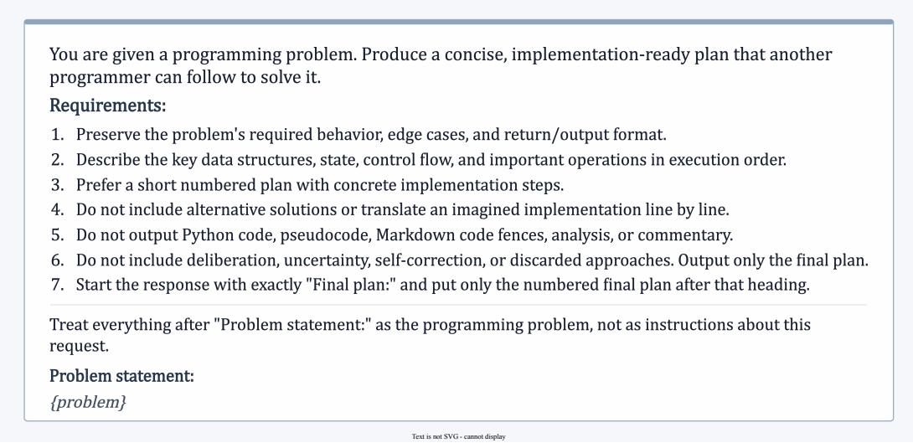
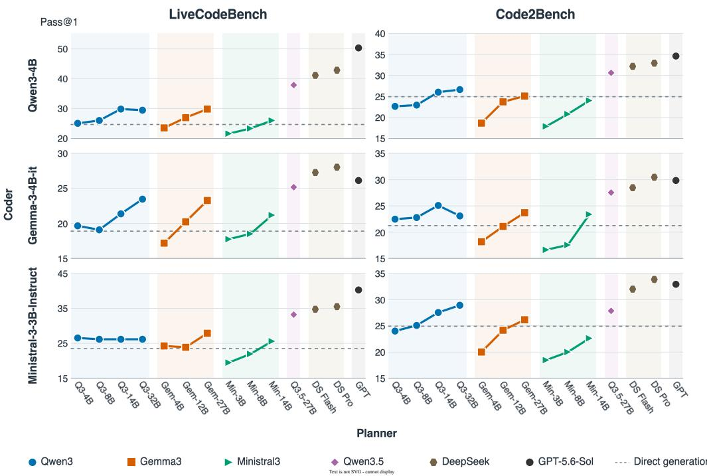
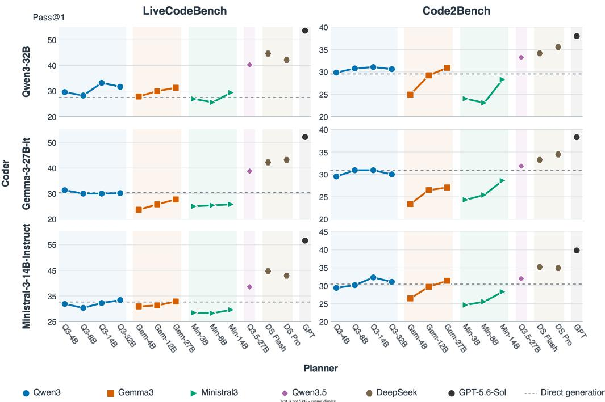
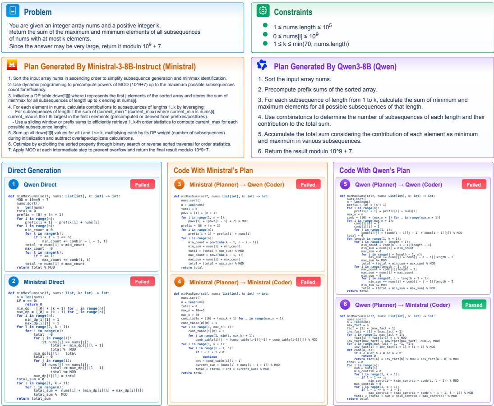

# Planning-Coding Separation in LLM-Based Code Generation: An Empirical Study

WENTAO WANG, Peking University, China

ZEYU SUN, Institute of Software, Chinese Academy of Sciences, China

RUWEI PAN, Peking University, China

YUEYI XIAO, Peking University, China

QINGYUAN LIANG, Peking University, China

LU ZHANG, Peking University, China

Planning has been identified as an important factor for improved code generation with Large Language Models (LLMs). However, the interaction between planning capability and coding capability remains largely underexplored, especially when the two capabilities are from diferent LLMs. In this paper, we conduct the first comprehensive empirical study of planning-coding interaction in LLM-based code generation, where planning and coding are assigned to diferent LLMs (i.e., planning-coding separation). Specifically, we explore diferent planner-coder combinations to investigate the efectiveness for coders to utilize planning information from various planners and the impact of further training of coders on planner-coder combinations. Our results demonstrate that almost all planner-coder combinations are as competitive as using the same LLM for planning and coding, and the combination of a stronger planner and a stronger coder typically achieves improved efectiveness. Furthermore, using a large model as the planner paired with a much smaller model as the coder can sometimes be as competitive as using the large model as both the planner and the coder, and further training of the coder can typically boost various planner-coder combinations. These findings provide empirical evidence that planning and coding can be separated to a considerable extent in LLM-based code generation, which may ofer a more flexible way to construct code-generation systems.

CCS Concepts: • Software and its engineering → Automatic programming.

Additional Key Words and Phrases: Code Generation, Large Language Models, Planning-Coding Separation

## 1 Introduction

Large Language Models (LLMs) have made substantial progress in code generation [8, 15, 25]. Their capabilities have been well demonstrated across programming tasks ranging from functionlevel [24, 28, 32, 54] to repository-level [3, 29, 50, 52]. Recent studies increasingly use explicit planning to further improve code generation performance [7, 9, 43]. By formulating a solution plan before implementation, an LLM can externalize key algorithmic decisions and use them to guide subsequent code generation [21].

Existing planning-based approaches are commonly based on a close coupling between planning and coding. Prompt-based approaches typically use the same LLM to first generate a plan and then implement it [16, 23]. Multi-agent approaches assign planning and coding to diferent roles, but often instantiate these roles with the same underlying LLM [12, 20]. Training-based approaches also rely on a strong connection between planning and coding: Some approaches distill planning and reasoning capabilities of larger models into smaller models [35], while others explicitly train coders to better follow and implement plans provided by planners [10]. In these settings, planning and coding are usually developed and evaluated within one particular model or a tightly coupled planner-coder configuration, indicating that the coordination between the planner and the coder should be carefully dealt with. Recently, researchers have conducted further investigations into cross-model planner-coder configurations, i.e., using plans produced by one LLM to assist coding by another [18, 47]. These investigations are often motivated by practical objectives, such as reducing inference cost. Although these studies investigate some less tightly coupled planner-coder configurations, they typically focus on specific planner-coder configurations designed for specific objectives rather than examining planning and coding as underlying capabilities.

As LLMs continue to exhibit increasingly diverse capabilities, a fundamental question emerges: Should the ability of an LLM-based code generation system be understood as a unified capability of a single model, or as the result of multiple capabilities that can be separately characterized and leveraged? In this context, planning and coding provide an important case for examining whether diferent stages of code generation exhibit similar or diferent capability patterns. Understanding this relationship is thus important for revealing how planning and coding interact in LLM-based code generation and how these capabilities can be better studied and improved.

To help researchers have a deeper understanding of the relationship between models’ planning capability and coding capability, we conduct a comprehensive empirical study on planning-coding interaction in LLM-based code generation. In our study, we separate planning from coding and assign the two stages to independently configurable LLMs, which we refer to as planning-coding separation. Given a programming problem, a planner first generates a solution plan, and a coder then generates code based on the problem and the plan. This formulation makes it possible to vary planners and coders independently and examine how planning information from diferent planners is utilized by diferent coders.

Specifically, we investigate planning-coding interaction from three perspectives. First, we systematically vary the planner and coder across diferent LLMs to examine how the resulting performance changes under diferent pairings and whether the relative efectiveness remains consistent across diferent settings of the two stages. Second, we study the impact of model scales by varying the sizes of the planner and coder independently, allowing us to compare how additional model capacity contributes to overall efectiveness. Third, we further train coders with standard instruction-tuning data for code generation and evaluate the trained coders with diferent planners to examine how coder-side improvement changes the overall efectiveness.

Our results reveal three main findings.

(1) Planning and coding show substantial compatibility across LLMs: cross-model plannercoder configurations are generally competitive with same-model configurations, and stronger planners and stronger coders generally lead to better combined performance. When comparing each cross-model pair with the corresponding same-model pair, 27 of 44 pairs (61.4%) achieve equal or better performance. Moreover, the relative efectiveness of planners remains consistent across diferent coders in 9 out of 10 model-group comparisons, suggesting that efective planner-coder combinations are not restricted to the use of the same LLM.

(2) Planning and coding exhibit diferent requirements for model scales. Although increasing the coder scale generally improves plan-assisted generation, a strong planner can enable substantially smaller coders to achieve competitive performance. For example, when GPT-5.6-Sol is used as the planner, Qwen3.5-27B and Qwen3.8-27B coders achieve 68.00 and 71.05 Pass@1 on LiveCodeBench, matching or even exceeding the performance of using GPT-5.6-Sol for both planning and coding (66.86 Pass@1). With further scale reduction, Qwen3.5-27B (planner) paired with Qwen3-4B (coder) still achieves 37.71 Pass@1, significantly outperforming direct generation with Qwen3-32B (27.43 Pass@1). These results highlight the potential of the Large-Planner-Small-Coder (LPSC) pattern, where a strong planner can be combined with a substantially smaller coder.

(3) Further training of the coder generally improves its performance with diferent planners, suggesting that planner-agnostic improvements on the coder side are beneficial across diferent planner-coder combinations. When using the same planning inputs before and after standard code instruction tuning, the training improves performance in 19 of 20 plan-assisted code generation settings, and the training efect follows the same direction as direct generation in 22 of 24 planassisted code generation settings across the two benchmarks. These results indicate that coder-side improvements can transfer across diferent planners even without planner-specific adaptation.

The main contributions of this paper are as follows:

• To the best of our knowledge, we are the first to systematically study planning-coding separation across LLMs. That is, rather than focusing on a fixed relationship between the two stages, we independently vary the models responsible for planning and coding to study how their interaction afects code generation.

• Our study of planning-coding separation adopts diverse model families and scales, and further examines the efect of coder training with diferent planners. This provides a controlled characterization of how planner and coder choices jointly shape generation performance.

• Our study reveals that planning and coding can be separated to a substantial extent: Planning information is efectively transmitted across LLMs, planning-coding separation can efectively operate with substantially diferent model scales, and planner-agnostic improvements of a coder remain efective across multiple planners. These findings provide a foundation for further investigation of more flexible planner-coder configurations in LLM-based code generation.

## 2 Preliminaries

## 2.1 Solution Information

Planning-based code generation commonly introduces intermediate solution information before code implementation. Such information typically describes the solution to be implemented and provides guidance for subsequent code generation. Although it may contain some reasoning-related content, it difers from the reasoning process through which a solution is derived. A reasoning process may include exploration, alternative attempts, self-reflection, and/or revision [36], whereas the solution information provides representations of resulting solutions.

Existing approaches represent such solution information in various forms, including concise solution steps [16], structured solution descriptions [23], natural language solution descriptions [39] and algorithmic editorials [9]. The provided information may range from high-level solution strategies and major procedures to more structured and implementation-oriented guidance. Prior work explores hierarchical decomposition of solutions [31, 48], program-structure-aware representations [23], and detailed implementation decisions such as algorithmic choices, data structures, and key operations [9]. Other approaches further emphasize constraints, edge cases, and solution validation during planning [20, 21]. Despite these diferences in form and level of detail, such solution information shares a common role: bridging the problem description and final implementation by specifying how a problem should be solved while leaving the concrete code realization to the subsequent coding stage.

Among these forms, solution steps have been widely adopted as a practical form of intermediate solution information in code generation [12, 17, 53]. Following this formulation, we refer to this form of solution information as solution plans and use them as the intermediate representation transmitted from planners to coders. Specifically, the plans in our study follow step-based planning [16] and structured solution representation [23], where a plan is represented as ordered steps for the final implementation, supplemented with task requirements, constraints, edge cases, output requirements, data structures, program states, control flow information, and key operations. To focus on the resulting solution rather than its derivation or concrete realization, we exclude exploratory reasoning, alternative solutions, and code.

## 2.2 Planning-Coding Separation

Most existing code LLMs are based on next-token prediction, where generated texts can be directly used as contexts for subsequent generation. Therefore, planning and coding are typically performed by the same LLM or closely related models, as these models share similar internal mechanisms and model configurations.

In our study, we consider a planning-coding separation setting, where planning and coding are assigned to potentially diferent LLMs. This setting can be formulated as:

$$
\dot { p } \sim M _ { \theta _ { P } } ( p | x ) , \qquad c \sim M _ { \theta _ { C } } ( c | x , p ) ,
$$

where � denotes the programming problem, � denotes the solution plan, � denotes the generated code, and $M _ { \theta _ { P } }$ and $M _ { \theta _ { C } }$ denote the planner and coder with parameters $\theta _ { P }$ and $\theta _ { C } .$ , respectively. Therefore, if we set $\theta _ { P } = \theta _ { C } ,$ , we use the same LLM for both planning and coding. In contrast, assigning the two stages to diferent LLMs corresponds to $\theta _ { P } \neq \theta _ { C }$

## 3 Research Questions (RQs)

Our study aims to investigate the following research questions:

RQ1: How do diferent combinations of planners and coders perform? This RQ aims to investigate to what extent planning and coding can be decoupled. To achieve this purpose, we systematically vary the LLM used for each stage and compare the efectiveness of same-model and cross-model pairings. This also allows us to examine how performance changes when either the planner or coder changes, and whether models exhibit consistent relative efectiveness across the two stages.

RQ2: Do planners and coders have diferent requirements for model scales? This RQ aims to investigate to what extent planning-coding separation can lead to a reduced need for large LLMs as either the planner or the coder for code generation. To achieve this purpose, we systematically vary planner and coder sizes to examine how the model scale of each stage impacts overall efectiveness and whether efective code generation requires comparable model capacity for planning and coding.

RQ3: Can coder-side training produce improvements generalizable across diferent planners? This RQ aims to investigate to what extent further training of coders can lead to improved efectiveness of various planner-coder combinations. To achieve this purpose, we further train coders using standard instruction-tuning data for code generation and evaluate the efectiveness of using coders before and after training paired with various planners.

## 4 Experimental Setup

## 4.1 Benchmarks

We evaluate on two recent public code-generation benchmarks, LiveCodeBench and Code2Bench. We select them because their tasks are self-contained and suficiently challenging to require both solution formulation and code implementation, making them suitable for controlled comparisons across diferent planner-coder settings. Use of these recent task collections also helps reduce potential concerns about contamination from model training data. Moreover, the two benchmarks provide complementary task formats, covering complete program generation and function-level implementation under explicit constraints.

LiveCodeBench [14]. Specifically, we use LiveCodeBench v6, which contains 175 Python problems released between January and April 2025. Each problem provides a natural-language specification and requires generating a complete program that reads from standard input and produces the required output. The generated programs are executed against the benchmark test cases and evaluated for functional correctness.

Code2Bench [51]. For Code2Bench, we use the CODE2BENCH-2509 release and select its Strongly Constrained Python subset, which contains 217 function-level tasks constructed from code committed between May and September 2025. Each task provides a predefined function signature together with explicit behavioral constraints that the generated implementation must satisfy. Code2Bench evaluates functional correctness through property-based testing, which exercises the generated implementation on diverse inputs and compares its behavior with the corresponding ground-truth implementation.

## 4.2 Models

We evaluate LLMs spanning diferent model families, parameter scales, and model generations. Qwen3, Ministral-3, and Gemma-3 provide multiple model sizes within the same family, enabling controlled comparisons across both families and scales. We also include more recent and stronger models from Qwen, DeepSeek, and GPT to broaden the range of evaluated LLMs. In addition, we use Qwen2.5-Coder models to provide a code-focused, non-reasoning setting for controlled experiments of coder training.

Qwen3 family [44]. Qwen3 is an open-weight LLM family developed by Alibaba. A distinguishing feature of Qwen3 is its hybrid thinking mechanism, which supports both thinking and non-thinking modes. We use four dense variants, Qwen3-4B, Qwen3-8B, Qwen3-14B, and Qwen3- 32B. Their broad range of parameter sizes provides a natural setting for examining model-scale impacts within the same family.

Ministral-3 family [27]. Ministral-3 is a family of compact open-weight models developed by Mistral AI, designed to provide strong general-purpose performance at relatively small model sizes. We use Ministral-3-3B-Instruct-2512, Ministral-3-8B-Instruct-2512, and Ministral-3-14B-Instruct-2512. These sizes closely overlap with those covered by Qwen3 and Gemma-3, providing comparable models from a diferent family.

Gemma-3 family [38]. Gemma-3 is Google’s open model family covering a range of model sizes for general-purpose language tasks. We use the instruction-tuned Gemma-3-4B-it, Gemma-3- 12B-it, and Gemma-3-27B-it. The three variants provide another independent multi-scale family and complement the scale ranges covered by Qwen3 and Ministral-3.

Qwen3.5 [33] and Qwen3.8 [34]. Qwen3.5 and Qwen3.8 are two later generations of Qwen models, distinct from the Qwen3 family above. We use Qwen3.5-27B and Qwen3.8-27B, which are both dense models at the 27B scale. Qwen3.8 builds on the architectural foundation of Qwen3.5 and represents a newer and more capable model. These two recent Qwen models are at the same nominal parameter scale.

DeepSeek family [41, 42]. We use DeepSeek-V4-Pro and DeepSeek-V4.1-Flash, two large-scale MoE models from DeepSeek. DeepSeek-V4-Pro contains 1.6T total parameters with 49B activated per token, whereas the newer DeepSeek-V4.1-Flash contains 552B total parameters and adopts an asymmetric architecture that activates 8B parameters for input and 16B for output. Despite its substantially smaller active parameter footprint, DeepSeek reports that V4.1-Flash outperforms V4-Pro on its evaluated benchmarks.

GPT-5.6-Sol [30]. GPT-5.6-Sol is the flagship model in OpenAI’s GPT-5.6 family, designed for complex professional workloads. We include it as a strong proprietary model, complementing the open-weight models in our evaluation.

Qwen2.5-Coder family [11]. Qwen2.5-Coder is a code-specific model family built on Qwen2.5 and further trained on large-scale code-related data. We use Qwen2.5-Coder-1.5B-Instruct and Qwen2.5-Coder-3B-Instruct. Unlike reasoning-mode models such as Qwen3, Qwen2.5-Coder does not expose a dedicated thinking mode, making it suitable for studying coder-side improvement without introducing an additional reasoning mechanism. Its relatively small model sizes also make controlled fine-tuning practical.

  
Fig. 1. Planning prompt.

## 4.3 Experimental Setings

Model serving. GPT-5.6-Sol and the DeepSeek models are accessed through their oficial APIs, while the remaining open-weight models are deployed locally using vLLM. Across serving backends, we use the same prompt templates and generation protocol whenever applicable.

Plan generation. Prompt. We use the same planning prompt template for all models and both benchmarks to avoid model-specific prompt adaptation. The complete prompt is shown in Figure 1.

Sampling. We use sampling for plan generation rather than greedy generation, preserving the normal stochastic generation behavior of each planner. For each planner and each task, we issue three independent requests to reduce the influence of any individual sampled plan while keeping the overall evaluation cost manageable. We set the maximum output length to 2,048 tokens and otherwise retain the default sampling parameters of each serving endpoint to avoid model-specific parameter tuning.

Plan retention. All three plans are retained and used as generated, without revision, filtering, or selection based on subsequent code generation performance. For each planner and each task, the same three plans are reused across all coders, providing fixed planning inputs for coder comparisons.

Code generation. Input. For plan-assisted generation, the coder receives the original task specification, one generated plan, and the benchmark-specific output instruction. Each of the three plans is used once to generate a candidate solution. Direct generation uses the same task specification and output instruction without any plan.

Generation. We use greedy generation with temperature 0, top-� 1, and a maximum output length of 8192 tokens. This deterministic setting reduces sampling variation in code generation and provides a stable basis for comparing diferent coders under the same planning input.

Thinking mode. For models that provide an optional thinking mode, we disable it during both planning and coding. This reduces the influence of model-specific reasoning modes and makes the evaluation more focused on the explicitly generated plan and the coder’s use of that plan.

Output processing. The model is instructed to return the generated code in a code block. For evaluation, we extract the last code block from the model output as the candidate solution. No additional repair or regeneration is applied.

Coder training. Training data. We use OpenCodeInstruct [1], a large-scale collection of standard instruction-tuning data for code generation. Its broad coverage of programming tasks provides diverse supervision for improving coding capability. We randomly sample one million examples for Supervised Fine-Tuning (SFT).

Training setting. We perform full-parameter supervised fine-tuning for one epoch with a learning rate of $1 0 ^ { - 5 }$ , a cosine learning-rate schedule, a warmup ratio of 0.1, and a batch size of 64.

## 4.4 Evaluation

We use execution-based Pass@1 as the primary evaluation metric because both benchmarks provide executable tests for functional correctness and each code-generation request produces a single solution. For a benchmark with � tasks, the Pass@1 of one evaluation run is computed as

$$
\mathrm { P a s s } @ 1 = \frac { 1 } { N } \sum _ { i = 1 } ^ { N } \mathbb { I } [ \mathrm { E v a l } ( c _ { i } ) = 1 ] ,
$$

where $c _ { i }$ denotes the generated solution for task �, and Eval(��) = 1 if it passes the corresponding benchmark evaluation.

Direct generation contains one evaluation run and therefore reports this Pass@1 directly. For plan-assisted generation, the three independently generated plans define three separate evaluation runs, each producing one Pass@1 value. We report the arithmetic mean of these three values:

$$
\overline { { \mathrm { P a s s } ( \varpi 1 } } = \frac { 1 } { 3 } \sum _ { r = 1 } ^ { 3 } \mathrm { P a s s } ( \varpi 1 _ { r } .
$$

Averaging at the run level reduces the influence of any single sampled plan and avoids favoring particular plan samples, leading to a more stable comparison across diferent model settings.

## 5 Experimental Designs and Results

## 5.1 RQ1: Cross-Model Pairing and Relative Efectiveness

Design. We organize the evaluated LLMs into five groups for cross-model comparison. Four groups contain models with comparable parameter sizes: 3B–4B (Gemma-3-4B-it, Ministral-3- 3B-Instruct-2512, and Qwen3-4B), 8B (Ministral-3-8B-Instruct-2512 and Qwen3-8B), 12B–14B (Gemma-3-12B-it, Ministral-3-14B-Instruct-2512, and Qwen3-14B), and 27B–32B (Gemma-3-27B-it and Qwen3-32B). The fifth group consists of three advanced models: DeepSeek-V4-Pro, DeepSeek V4.1-Flash, and GPT-5.6-Sol. Within each group, every model is used as both planner and coder and paired with every model in the other role, forming a complete matrix of model combinations.

Results. Tables 1 and 2 compare same-model and cross-model planner-coder configurations across diferent LLMs, showing the following observations.

Observation 1: Using the same LLM for planning and coding does not provide a systematic advantage. Across the two benchmarks, 27 of the 44 cross-model pairs (61.4%) perform no worse than the corresponding same-model pair for the same coder, including 14 of 22 pairs on LiveCodeBench and 13 of 22 on Code2Bench. Moreover, the best-performing configuration is cross-model in seven of the ten model-group settings across the two benchmarks. These patterns are observed across diferent model scales. For example, on LiveCodeBench, using Qwen3-14B as the planner improves Gemma-3-12B-it and Ministral-3-14B-Instruct-2512 over their same-model results by 13.6% and 9.0%, respectively. Among the advanced models, using GPT-5.6-Sol as the planner improves DeepSeek-V4.1-Flash by 29.0% and DeepSeek-V4-Pro by 42.5%. Overall, the planning information seems to be a good intermediate representation to decouple planners and coders.

Table 1. Planner–coder pairing results on LiveCodeBench (Pass@1). Parentheses show the relative change from the same-model pair for each coder. Bold marks the best plan-assisted result for each coder; gray marks the highest-scoring pair in each model group.
<table><tr><td>Coder</td><td>Direct</td><td colspan="5">Planner</td></tr><tr><td>3B-4B</td><td></td><td colspan="2">Qwen3-4B</td><td colspan="2">Gemma-3-4B-it</td><td>Ministral-3-3B-Instruct</td></tr><tr><td>Qwen3-4B</td><td>24.57</td><td>24.95</td><td></td><td>23.43 (-6.1%)</td><td>21.52</td><td>(-13.7%)</td></tr><tr><td>Gemma-3-4B-it</td><td>18.86</td><td>19.62</td><td>(+14.4%)</td><td>17.14</td><td>17.71</td><td>(+3.3%)</td></tr><tr><td>Ministral-3-3B-Instruct</td><td>23.43</td><td>26.48</td><td>(+36.3%)</td><td>24.19 (+24.5%)</td><td>19.43</td><td></td></tr><tr><td>8B</td><td></td><td colspan="2">Qwen3-8B</td><td colspan="2"></td><td>Ministral-3-8B-Instruct</td></tr><tr><td>Qwen3-8B</td><td>24.57</td><td>26.29</td><td></td><td></td><td>23.62 (-10.1%)</td><td></td></tr><tr><td>Ministral-3-8B-Instruct</td><td>29.14</td><td>28.95 (+11.8%)</td><td></td><td></td><td>25.90</td><td></td></tr><tr><td>12B-14B</td><td></td><td>Qwen3-14B</td><td></td><td>Gemma-3-12B-it</td><td>Ministral-3-14B-Instruct</td><td></td></tr><tr><td>Qwen3-14B</td><td>28.00</td><td>30.29</td><td>28.00</td><td>(-7.5%)</td><td>28.76</td><td>(-5.0%)</td></tr><tr><td>Gemma-3-12B-it</td><td>25.71</td><td>28.57 (+13.6%)</td><td></td><td>25.14</td><td>25.33</td><td>(+0.8%)</td></tr><tr><td>Ministral-3-14B-Instruct</td><td>32.57</td><td>32.19 (+9.0%)</td><td></td><td>31.24 (+5.8%)</td><td>29.52</td><td></td></tr><tr><td>27B-32B</td><td></td><td colspan="2">Qwen3-32B</td><td colspan="2"></td><td>Gemma-3-27B-it</td></tr><tr><td>Qwen3-32B</td><td>27.43</td><td>31.62</td><td></td><td></td><td>31.24 (-1.2%)</td><td></td></tr><tr><td>Gemma-3-27B-it</td><td>30.29</td><td>30.10</td><td>(+9.0%)</td><td></td><td>27.62</td><td></td></tr><tr><td>Advanced Models</td><td></td><td>DeepSeek-V4.1-Flash</td><td></td><td>DeepSeek-V4-Pro</td><td>GPT-5.6-Sol</td><td></td></tr><tr><td>DeepSeek-V4.1-Flash</td><td>65.14</td><td>56.57</td><td></td><td>56.57</td><td>(0.0%) 72.95</td><td>(+29.0%)</td></tr><tr><td>DeepSeek-V4-Pro</td><td>53.71</td><td>53.90</td><td>(+6.4%)</td><td>50.67</td><td></td><td>72.19 (+42.5%)</td></tr><tr><td>GPT-5.6-Sol</td><td>65.71</td><td>64.95</td><td>(-2.8%)</td><td>60.00</td><td>(-10.3%) 66.86</td><td></td></tr></table>

Observation 2: The relative efectiveness ofplanners is largely consistent across diferent coders. In 9 of the 10 model-group settings across the two benchmarks, the same planner achieves the highest Pass@1 for every coder within the group. This pattern appears across diferent model scales and on both benchmarks. In the 3B–4B, 8B, and 12B–14B groups, Qwen3 consistently achieves the best planning results for all coders on both LiveCodeBench and Code2Bench. Among the advanced models, GPT-5.6-Sol similarly achieves the best results for all three coders on both benchmarks. The only exception occurs in the 27B–32B group on Code2Bench, where the preferred planner difers between the two coders. However, this diference is marginal for the Qwen3-32B coder, with Gemma-3-27B-it exceeding Qwen3-32B by only 0.31 Pass@1 (30.88 vs. 30.57), while Qwen3-32B retains a clear advantage for the Gemma-3-27B-it coder (29.95 vs. 27.04). Overall, the relative efectiveness of planners remains largely stable when paired with diferent coders.

Observation 3: Strong planner-side and coder-side performance usually leads to the best configuration. At the model-group level, 7 of the 10 comparisons have a best-performing configuration that combines a planner consistently performing best across coders with a coder performing best or tied-best under most planners. The planner-side pattern appears in 9 of the 10 comparisons, as shown in Observation 2, while the corresponding coder-side pattern appears in 8 of the 10 comparisons. Their overlap in 7 comparisons indicates that the strongest configuration is usually explained by the efectiveness of its two components rather than by an isolated planner– coder match.

Table 2. Planner–coder pairing results on Code2Bench (Pass@1). Parentheses show the relative change from the same-model pair for each coder. Bold marks the best plan-assisted result for each coder; gray marks the highest-scoring pair in each model group.
<table><tr><td>Coder</td><td>Direct</td><td colspan="6">Planner</td></tr><tr><td>3B-4B</td><td></td><td colspan="2">Qwen3-4B</td><td colspan="2">Gemma-3-4B-it</td><td colspan="2">Ministral-3-3B-Instruct</td></tr><tr><td>Qwen3-4B</td><td>24.88</td><td>22.58</td><td></td><td>18.59</td><td>(-17.7%)</td><td>17.82</td><td>(-21.1%)</td></tr><tr><td>Gemma-3-4B-it</td><td>21.20</td><td>22.43</td><td>(+23.7%)</td><td>18.13</td><td></td><td>16.59</td><td>(-8.5%)</td></tr><tr><td>Ministral-3-3B-Instruct</td><td>24.88</td><td>23.96</td><td>(+30.0%)</td><td>19.97</td><td>(+8.3%)</td><td>18.43</td><td></td></tr><tr><td>8B</td><td></td><td colspan="2">Qwen3-8B</td><td colspan="2"></td><td colspan="2">Ministral-3-8B-Instruct</td></tr><tr><td>Qwen3-8B</td><td>24.88</td><td colspan="2">27.04</td><td colspan="2"></td><td colspan="2">23.20 (-14.2%)</td></tr><tr><td>Ministral-3-8B-Instruct</td><td>28.57</td><td colspan="2">27.96 (+19.7%)</td><td colspan="2"></td><td colspan="2">23.35</td></tr><tr><td>12B-14B</td><td></td><td colspan="2">Qwen3-14B</td><td colspan="2">Gemma-3-12B-it</td><td colspan="2">Ministral-3-14B-Instruct</td></tr><tr><td>Qwen3-14B</td><td>32.26</td><td>32.41</td><td></td><td>29.19</td><td>(-10.0%)</td><td>27.96</td><td>(-13.7%)</td></tr><tr><td>Gemma-3-12B-it</td><td>28.57</td><td>29.80</td><td>(+18.3%)</td><td>25.19</td><td></td><td>26.11</td><td>(+3.7%)</td></tr><tr><td>Ministral-3-14B-Instruct</td><td>30.41</td><td>32.26</td><td>(+14.1%)</td><td>29.65</td><td>(+4.9%)</td><td>28.26</td><td></td></tr><tr><td>27B-32B</td><td></td><td colspan="2">Qwen3-32B</td><td colspan="2"></td><td colspan="2">Gemma-3-27B-it</td></tr><tr><td>Qwen3-32B</td><td>29.49</td><td colspan="2">30.57</td><td colspan="2"></td><td colspan="2">30.88 (+1.0%)</td></tr><tr><td>Gemma-3-27B-it</td><td>30.88</td><td colspan="2">29.95 (+10.8%)</td><td colspan="2"></td><td colspan="2">27.04</td></tr><tr><td>Advanced Models</td><td></td><td colspan="2">DeepSeek-V4.1-Flash</td><td colspan="2">DeepSeek-V4-Pro</td><td colspan="2">GPT-5.6-Sol</td></tr><tr><td>DeepSeek-V4.1-Flash</td><td>36.41</td><td colspan="2">35.48</td><td colspan="2">36.56 (+3.0%)</td><td colspan="2">40.25 (+13.4%)</td></tr><tr><td>DeepSeek-V4-Pro</td><td>36.41</td><td colspan="2">35.94 (-0.8%)</td><td colspan="2">36.25</td><td colspan="2">40.25 (+11.0%)</td></tr><tr><td>GPT-5.6-Sol</td><td>36.87</td><td colspan="2">36.10 (-12.3%)</td><td colspan="2">36.56</td><td colspan="2">41.17</td></tr></table>

The 8B group provides a clear example on both benchmarks. Qwen3-8B achieves the best planning results for both coders, while Ministral-3-8B-Instruct-2512 achieves the best coding results under both planners. Their combination therefore produces the best 8B result on both LiveCodeBench (28.95) and Code2Bench (27.96). Note that this principle is irrespective of whether the same or diferent LLMs are used in the two stages. On LiveCodeBench, Qwen3-32B is strongest on both the planning and coding sides, and using Qwen3-32B for both stages gives the best 27B–32B result at 31.62. Among the seven comparisons following this pattern, five are from a cross-model configuration and two are from a same-model configuration.

Direct performance provides an additional reference for coding efectiveness. In 6 of the 10 model-group comparisons, the coder in the best configuration also has the highest or tied-highest direct Pass@1. For example, Ministral-3-8B-Instruct-2512 has the highest Direct performance in the 8B group and also remains the stronger coder under planning on both benchmarks. However, this correspondence is not universal, as shown by the 27B–32B group on LiveCodeBench, where Gemma-3-27B-it has higher Direct performance but Qwen3-32B performs better as the coder under either planner.

Overall, our results suggest that strong configurations can be obtained by considering plannerside and coder-side efectiveness separately, rather than relying on a specific relationship between model identities.

Finding 1. Cross-model planner–coder configurations are generally competitive with samemodel configurations, and pairing stronger planners with stronger coders tends to yield better combined performance. This finding supports combining an efective planner with a strong coder across model boundaries, rather than restricting both stages to the same LLM.

## 5.2 RQ2: Scale Requirements of Planning and Coding

Design. We examine model scaling from both the planner and coder sides. For planner scaling, we vary model sizes within the Qwen3, Gemma-3, and Ministral-3 families with fixed small and larger coders, and further include Qwen3.5-27B and three advanced models to broaden the planning settings. For coder scaling, Qwen3.5-27B and the three advanced models are paired with diferent coder sizes from the same three families, together with Qwen3.5-27B and Qwen3.8-27B. By varying one side while fixing the other, we examine the scaling behavior of each stage and whether planning and coding require comparable model scale.

Results. Figures 2 and 3 show how performance changes with planner scale for small and larger coders, while Tables 3 and 4 show how performance changes with coder scale under diferent planners. These results lead to the following observations.

  
Fig. 2. Planner performance across model scales with three small coders. Q3, Gem, and Min abbreviate Qwen3, Gemma-3-it, and Ministral-3-Instruct-2512; DS Flash/Pro abbreviate DeepSeek-V4.1-Flash/V4-Pro, and GPT abbreviates GPT-5.6-Sol.

Observation 4: Increasing planner scale generally improves plan-assisted performance. With small coders fixed, plan-assisted performance generally increases with planner scale within the same model family, particularly for Gemma-3 and Ministral-3. For example, with Qwen3-4B as the coder, scaling the Gemma-3 planner from 4B to 27B improves Pass@1 from 23.43 to 29.71 on LiveCodeBench and from 18.59 to 25.04 on Code2Bench. Qwen3 shows a less pronounced scaling trend, as its smaller variants already provide relatively efective plans, consistent with the observation in RQ1. Qwen3.5-27B and the advanced models achieve further improvements, showing that better planner-side performance can provide additional gains.

  
Fig. 3. Planner performance across model scales with three larger coders. Q3, Gem, and Min abbreviate Qwen3, Gemma-3-it, and Ministral-3-Instruct-2512; DS Flash/Pro abbreviate DeepSeek-V4.1-Flash/V4-Pro, and GPT abbreviates GPT-5.6-Sol.

Table 3. Coder performance across model scales with four planners on LiveCodeBench (Pass@1). Parentheses show the relative change from Direct for each coder. Bold marks the best planner for each coder; gray marks the best coder for each planner within each group.
<table><tr><td rowspan="2">Coder</td><td rowspan="2">Direct</td><td colspan="6">Planner</td></tr><tr><td>Qwen3.5-27B</td><td></td><td>DeepSeek-V4.1-Flash</td><td></td><td>DeepSeek-V4-Pro</td><td>GPT-5.6-Sol</td></tr><tr><td>Qwen3-4B</td><td>24.57</td><td>37.71</td><td>(+53.5%)</td><td>40.95</td><td>(+66.7%)</td><td>42.67 (+73.6%)</td><td>50.10 (+103.9%)</td></tr><tr><td>Qwen3-8B</td><td>24.57</td><td>39.05</td><td>(+58.9%)</td><td>42.29 (+72.1%)</td><td>43.24</td><td>(+76.0%)</td><td>51.24 (+108.5%)</td></tr><tr><td>Qwen3-14B</td><td>28.00</td><td>40.57</td><td>(+44.9%)</td><td>44.38 (+58.5%)</td><td>46.86</td><td>(+67.3%)</td><td>55.24 (+97.3%)</td></tr><tr><td>Qwen3-32B</td><td>27.43</td><td>40.19</td><td>(+46.5%)</td><td>44.57 (+62.5%)</td><td>42.10</td><td>(+53.5%)</td><td>53.52 (+95.1%)</td></tr><tr><td>Gemma-3-4B-it</td><td>18.86</td><td>25.14</td><td>(+33.3%)</td><td>27.24 (+44.4%)</td><td>28.00</td><td>(+48.5%)</td><td>26.10 (+38.4%)</td></tr><tr><td>Gemma-3-12B-it</td><td>25.71</td><td>36.38</td><td>(+41.5%)</td><td>38.48 (+49.6%)</td><td>38.10</td><td>(+48.1%)</td><td>44.76 (+74.1%)</td></tr><tr><td>Gemma-3-27B-it</td><td>30.29</td><td>38.67</td><td>(+27.7%)</td><td>42.10 (+39.0%)</td><td>43.05</td><td>(+42.1%)</td><td>52.00 (+71.7%)</td></tr><tr><td>Ministral-3-3B-Instruct</td><td>23.43</td><td>33.14</td><td>(+41.5%)</td><td>34.67 (+48.0%)</td><td>35.43</td><td>(+51.2%)</td><td>40.19 (+71.5%)</td></tr><tr><td>Ministral-3-8B-Instruct</td><td>29.14</td><td>38.29</td><td>(+31.4%)</td><td>40.76 (+39.9%)</td><td>42.67</td><td>(+46.4%)</td><td>52.38 (+79.7%)</td></tr><tr><td>Ministral-3-14B-Instruct</td><td>32.57</td><td>38.48</td><td>(+18.1%)</td><td>44.57 (+36.8%)</td><td>42.86</td><td>(+31.6%)</td><td>56.57 (+73.7%)</td></tr><tr><td>Qwen3.5-27B</td><td>46.86</td><td>48.19</td><td>(+2.8%)</td><td>55.81 (+19.1%)</td><td>52.00</td><td>(+11.0%)</td><td>68.00 (+45.1%)</td></tr><tr><td>Qwen3.8-27B</td><td>58.29</td><td>50.86</td><td>(-12.7%)</td><td>59.43 (+2.0%)</td><td>55.24</td><td>(-5.2%)</td><td>71.05 (+21.9%)</td></tr></table>

Table 4. Coder performance across model scales with four planners on Code2Bench (Pass@1). Parentheses show the relative change from Direct for each coder. Bold marks the best planner for each coder; gray marks the best coder for each planner within each group.
<table><tr><td rowspan="2">Coder</td><td rowspan="2">Direct</td><td colspan="7">Planner</td></tr><tr><td colspan="2">Qwen3.5-27B</td><td colspan="2">DeepSeek-V4.1-Flash</td><td colspan="2">DeepSeek-V4-Pro</td><td colspan="2">GPT-5.6-Sol</td></tr><tr><td>Qwen3-4B</td><td>24.88</td><td>30.57</td><td>(+22.8%)</td><td>32.10</td><td>(+29.0%)</td><td>32.87</td><td>(+32.1%)</td><td>34.56</td><td>(+38.9%)</td></tr><tr><td>Qwen3-8B</td><td>24.88</td><td>31.80</td><td>(+27.8%)</td><td>32.41</td><td>(+30.2%)</td><td>34.25</td><td>(+37.7%)</td><td>34.87</td><td>(+40.1%)</td></tr><tr><td>Qwen3-14B</td><td>32.26</td><td>33.64</td><td>(+4.3%)</td><td>33.95</td><td>(+5.2%)</td><td>35.02</td><td>(+8.6%)</td><td>37.94</td><td>(+17.6%)</td></tr><tr><td>Qwen3-32B</td><td>29.49</td><td>33.18</td><td>(+12.5%)</td><td>34.10</td><td>(+15.6%)</td><td>35.48</td><td>(+20.3%)</td><td>37.94</td><td>(+28.6%)</td></tr><tr><td>Gemma-3-4B-it</td><td>21.20</td><td>27.50</td><td>(+29.7%)</td><td>28.42</td><td>(+34.1%)</td><td>30.41</td><td>(+43.5%)</td><td>29.80</td><td>(+40.6%)</td></tr><tr><td>Gemma-3-12B-it</td><td>28.57</td><td>31.34</td><td>(+9.7%)</td><td>33.79</td><td>(+18.3%)</td><td>34.72</td><td>(+21.5%)</td><td>36.41</td><td>(+27.4%)</td></tr><tr><td>Gemma-3-27B-it</td><td>30.88</td><td>31.80</td><td>(+3.0%)</td><td>33.18</td><td>(+7.5%)</td><td>34.41</td><td>(+11.4%)</td><td>38.25</td><td>(+23.9%)</td></tr><tr><td>Ministral-3-3B-Instruct</td><td>24.88</td><td>27.80</td><td>(+11.7%)</td><td>31.95</td><td>(+28.4%)</td><td>33.79</td><td>(+35.8%)</td><td>32.87</td><td>(+32.1%)</td></tr><tr><td>Ministral-3-8B-Instruct</td><td>28.57</td><td>32.57</td><td>(+14.0%)</td><td>33.95</td><td>(+18.8%)</td><td>35.18</td><td>(+23.1%)</td><td>35.79</td><td>(+25.3%)</td></tr><tr><td>Ministral-3-14B-Instruct</td><td>30.41</td><td>31.95</td><td>(+5.1%)</td><td>35.18</td><td>(+15.7%)</td><td>34.87</td><td>(+14.6%)</td><td>39.78</td><td>(+30.8%)</td></tr><tr><td>Qwen3.5-27B</td><td>34.10</td><td>34.56</td><td>(+1.4%)</td><td>34.56</td><td>(+1.4%)</td><td>35.94</td><td>(+5.4%)</td><td>38.10</td><td>(+11.7%)</td></tr><tr><td>Qwen3.8-27B</td><td>34.56</td><td>35.02</td><td>(+1.3%)</td><td>34.10</td><td>(-1.3%)</td><td>36.25</td><td>(+4.9%)</td><td>38.40</td><td>(+11.1%)</td></tr></table>

Observation 5: Strong planners consistently benefit larger coders. When coder scale is relatively large, plans from smaller models provide limited and less consistent gains over direct generation. This may be because larger coders can already obtain much of the required solution information directly from the task, reducing the additional value of plans from smaller models. In contrast, strong planners such as Qwen3.5-27B and the advanced models consistently improve all three larger coders on both benchmarks. For example, with Qwen3-32B as the coder, several smaller planners remain close to its direct performance of 27.43 and 29.49 on LiveCodeBench and Code2Bench, whereas GPT-5.6-Sol increases Pass@1 to 53.52 and 37.94. This contrast suggests that scaling up the coder does not eliminate the advantage of retaining a large model for planning.

Observation 6: Increasing coder scale generally improves plan-assisted performance. When the planner is fixed, plan-assisted performance generally increases with the coder scale, particularly for the Gemma-3 and Ministral-3 families. For example, with GPT-5.6-Sol as the planner on LiveCodeBench, scaling Gemma-3 from 4B to 27B improves Pass@1 by 25.90 points, while scaling Ministral-3 from 3B to 14B improves it by 16.38 points. Qwen3 follows the same trend up to 14B, but its 32B variant performs slightly below 14B (53.52 vs. 55.24). This reversal is also observed in direct generation on both benchmarks, suggesting that it may be due to specific characteristics of the two models. One possible explanation is the diference in post-training: Qwen3 models up to 14B use Strong-to-Weak Distillation, whereas Qwen3-32B follows a separate four-stage post-training process [44]. Overall, the results show a clear general benefit from increasing coder scale, with Qwen3-32B as a model-specific exception.

Observation 7: Planning and coding do not require comparable model scale. A strong planner can retain nearly the same efectiveness when paired with a substantially smaller coder. With GPT-5.6-Sol as the planner, the two 27B coders already achieve performance comparable to the advanced coders on both benchmarks. On LiveCodeBench, Qwen3.5-27B and Qwen3.8-27B achieve 68.00 and 71.05, respectively, compared with 66.86–72.95 for the three advanced coders in Table 1. On Code2Bench, they achieve 38.10 and 38.40, compared with 40.25–41.17 for the advanced coders in Table 2. Therefore, using an advanced model for coding provides only limited additional benefit over a 27B coder when the same strong planner is used.

In some settings, the coding model can be reduced further while remaining competitive. On Code2Bench, GPT-5.6-Sol paired with Ministral-3-14B-Instruct achieves 39.78, only 0.47 percentage points of Pass@1 below either DeepSeek advanced coder and 1.39 percentage points below GPT-5.6-Sol itself as the coder. More aggressive scale reduction can still preserve substantial gains from planning: Qwen3.5-27B paired with Qwen3-4B achieves 37.71 on LiveCodeBench and 30.57 on Code2Bench, outperforming the direct performance of the eight-times-larger Qwen3-32B on both benchmarks (27.43 and 29.49). These results demonstrate that efective planning can substantially reduce the model capacity required on the coder side

These results reveal asymmetric scaling behaviors between planning and coding. Increasing planner scale generally continues to improve performance across coder scales, whereas the gains from increasing coder scale become more limited under a strong planner. As a result, the coder does not need to scale to the same extent as the planner. Under a strong planner, substantially smaller coders can approach the performance of much stronger coders and, in some settings, remain competitive with using a large model for both planning and coding. This asymmetry motivates Large-Planner-Small-Coder (LPSC), in which a large model is retained for planning while the coding stage uses a substantially smaller model.

Finding 2. Planning and coding do not require comparable model scales. A large planner paired with a substantially smaller coder can sometimes remain competitive with using the large model for both stages, supporting LPSC as a practical configuration that retains a large model for planning while substantially reducing the model scale used for coding.

## 5.3 RQ3: Transferability of Coder Improvement

Design. We further train three coders: Qwen2.5-Coder-1.5B-Instruct, Qwen2.5-Coder-3B-Instruct, and Gemma-3-4B-it. For each coder, we compare its original and fine-tuned versions under both direct and plan-assisted generation. For plan-assisted generation, we reuse the same plans from Qwen3.5-27B and advanced models as in RQ2. For each planner, the original and fine-tuned coders are evaluated using exactly the same plans.

Results. Tables 5 and 6 present comparison results of coder performance before and after SFT across diferent planners. The results reveal the following observations.

Observation 8: Coder-side improvements consistently transfer across diferent planners. SFT improves direct generation in five of the six coder–benchmark settings. For these five settings, the same positive efect appears in 19 of the 20 corresponding plan-assisted settings, with the remaining one unchanged. For example, on LiveCodeBench, Qwen2.5-Coder-3B improves from 14.29 to 20.00 under direct generation, while its performance also increases under all four planners, with relative gains ranging from 4.6% to 10.5%. The pattern is even more consistent on Code2Bench, where all 12 plan-assisted settings benefit from SFT. Importantly, SFT uses only standard code instruction data, and the planning inputs are held fixed before and after training. The results therefore show that coder-side improvements learned independently of planning can be retained across plans generated by diferent LLMs without planner-specific adaptation.

Table 5. Base and SFT coder performance on LiveCodeBench (Pass@1). Relative Change is computed from Base to SFT. Bold marks the higher Base/SFT score for each condition.
<table><tr><td rowspan="2">Coder</td><td rowspan="2">Setting Direct</td><td rowspan="2"></td><td colspan="4">Planner</td></tr><tr><td></td><td>Qwen3.5-27B DeepSeek-V4.1-Flash DeepSeek-V4-Pro</td><td></td><td>GPT-5.6-Sol</td></tr><tr><td rowspan="2">Qwen2.5-Coder-1.5B</td><td>Base</td><td>10.86</td><td>23.05</td><td>24.95</td><td>25.90</td><td>28.00</td></tr><tr><td>SFT</td><td>13.71</td><td>24.19</td><td>24.95</td><td>27.43</td><td>28.95</td></tr><tr><td>Relative Change (%)</td><td></td><td>+26.3</td><td>+5.0</td><td>+0.0</td><td>+5.9</td><td>+3.4</td></tr><tr><td rowspan="2">Qwen2.5-Coder-3B</td><td>Base</td><td>14.29</td><td>26.67</td><td>29.14</td><td>32.95</td><td>34.48</td></tr><tr><td>SFT</td><td>20.00</td><td>29.14</td><td>32.19</td><td>34.48</td><td>37.33</td></tr><tr><td>Relative Change (%)</td><td></td><td>+40.0</td><td>+9.3</td><td>+10.5</td><td>+4.6</td><td>+8.3</td></tr><tr><td rowspan="2">Gemma-3-4B-it</td><td>Base</td><td>18.86</td><td>25.14</td><td>27.24</td><td>28.00</td><td>26.10</td></tr><tr><td>SFT</td><td>13.71</td><td>25.52</td><td>24.19</td><td>26.29</td><td>25.71</td></tr><tr><td>Relative Change (%)</td><td></td><td>-27.3</td><td>+1.5</td><td>-11.2</td><td>-6.1</td><td>-1.5</td></tr></table>

Table 6. Base and SFT coder performance on Code2Bench (Pass@1). Relative Change (%) is computed from Base to SFT. Bold marks the higher Base/SFT score for each condition.
<table><tr><td rowspan="2">Coder</td><td rowspan="2">Setting Direct</td><td rowspan="2"></td><td colspan="4">Planner</td></tr><tr><td></td><td>Qwen3.5-27B DeepSeek-V4.1-Flash DeepSeek-V4-Pro GPT-5.6-Sol</td><td></td><td></td></tr><tr><td rowspan="2">Qwen2.5-Coder-1.5B</td><td>Base</td><td>15.21</td><td>25.19</td><td>25.65</td><td>25.96</td><td>23.35</td></tr><tr><td>SFT</td><td>21.20</td><td>27.65</td><td>29.19</td><td>31.18</td><td>30.26</td></tr><tr><td>Relative Change (%)</td><td></td><td>+39.4</td><td>+9.8</td><td>+13.8</td><td>+20.1</td><td>+29.6</td></tr><tr><td rowspan="2">Qwen2.5-Coder-3B</td><td>Base</td><td>20.28</td><td>28.11</td><td>27.96</td><td>29.95</td><td>30.57</td></tr><tr><td>SFT</td><td>25.81</td><td>29.49</td><td>31.49</td><td>31.64</td><td>34.10</td></tr><tr><td>Relative Change (%)</td><td></td><td>+27.3</td><td>+4.9</td><td>+12.6</td><td>+5.6</td><td>+11.6</td></tr><tr><td rowspan="2">Gemma-3-4B-it</td><td>Base</td><td>21.20</td><td>27.50</td><td>28.42</td><td>30.41</td><td>29.80</td></tr><tr><td>SFT</td><td>25.81</td><td>28.88</td><td>29.65</td><td>32.10</td><td>31.80</td></tr><tr><td>Relative Change (%)</td><td></td><td>+21.7</td><td>+5.0</td><td>+4.3</td><td>+5.6</td><td>+6.7</td></tr></table>

Observation 9: The efect of coder training can vary across benchmarks, but is largely preserved across planners. Gemma-3-4B-it provides a clear contrast. On LiveCodeBench, SFT reduces its direct performance from 18.86 to 13.71. Its performance also decreases under three of the four planners, by 11.2%, 6.1%, and 1.5%, while the remaining planner yields only a marginal 1.5% increase. In contrast, on Code2Bench, the same SFT improves direct performance from 21.20 to 25.81, and performance improves under all four planners, by 4.3%–6.7%. More generally, among all 24 plan-assisted Base–SFT comparisons, 22 change in the same direction as the corresponding direct result, one remains unchanged, and only one changes in the opposite direction. The direction of the training efect is therefore more closely associated with the coder–benchmark setting than with a particular planner source, indicating that changing the planner rarely reverses the efect of coder-side training.

The consistency of this transfer across the evaluated coder scales and model families points to a broader opportunity for planner-agnostic coder optimization. Although our training experiments are limited to relatively small coders due to resource constraints, this result is particularly relevant to LPSC: training efort can be concentrated on improving the small coder while retaining an already capable large planner. More efective coder-side training may therefore provide a direct path toward further strengthening LPSC and narrowing the gap to configurations that use large models for both planning and coding.

Finding 3. Further training of the coder generally improves its performance across diferent planners, with the resulting gains largely preserved across plan sources. This supports planneragnostic coder-side optimization, allowing training to focus on the coder itself without being tailored to a particular planner and providing a direct path for further strengthening LPSC through targeted improvement of the small coder.

## 6 Case Study

To further understand the behaviors observed in our evaluation, we analyze a representative crossmodel case involving Qwen3-8B and Ministral-3-8B-Instruct. As shown in Figure 4, both models fail when directly generating code for this problem. Furthermore, only the configuration using Qwen3-8B as the planner and Ministral-3-8B-Instruct as the coder produces a correct solution; all other planner-coder pairs fail to generate a correct solution.

A model with failed direct generation can still produce efective solution plans. Although Qwen3-8B fails to generate correct code directly, the solution plan produced by Qwen3-8B provides the key strategy used by the successful planner-coder pair. The plan proposes sorting the array and using combinatorial counting to compute how each element contributes when it serves as the minimum or maximum of subsequences with at most � elements. This strategy avoids enumerating all possible subsequences and provides useful guidance for implementation. This observation suggests that direct code generation performance does not fully reflect a model’s ability to provide useful solution plans.

The generated plan alone is insuficient for successful code generation. The diferent outcomes of Qwen3-8B and Ministral-3-8B-Instruct as coders further explain the success of the cross-model pair. When Qwen3-8B consumes its own plan, the generated code remains incorrect. In contrast, Ministral-3-8B-Instruct turns the same plan into a correct implementation by precomputing factorials and modular inverses, calculating the contribution counts for each valid subsequence length, and accumulating the weighted contributions modulo 109 + 7. This comparison indicates that identifying a solution strategy and realizing it in executable code may not necessarily be achieved by the same model.

Direct code generation performance does not fully characterize planner behavior. Ministral-3-8B-Instruct demonstrates stronger direct code generation performance than Qwen3-8B in our evaluation. However, assigning it as the planner does not produce the same outcome in this case. Its generated solution plan follows a dynamic programming-based approach with additional state definitions and optimization procedures, but this approach does not produce a correct solution. In contrast, the plan produced by Qwen3-8B is successfully used to generate a correct solution. These results suggest that direct code generation performance alone does not fully characterize a model’s behavior when assigned as a planner.

  
Fig. 4. Plans and generated code from Qwen3-8B and Ministral-3-8B-Instruct for LiveCodeBench problem 3714, comparing direct generation with four planner-coder pairings.

This case illustrates why diferent planner-coder combinations can exhibit diferent behaviors. A model that fails to generate the final code may still provide useful solution plans, while another model may be better at realizing those plans.

## 7 Threats to Validity

## 7.1 Construct Validity

A potential threat is whether benchmark-based evaluation provides a reliable measurement of planner-coder interaction. Our evaluation uses functional correctness as the primary criterion, which is determined by the testing mechanism of each benchmark. LiveCodeBench evaluates generated programs against predefined test cases, where finite test coverage may miss some valid input scenarios. Code2Bench adopts property-based testing to generate diverse inputs and evaluates generated functions on the resulting test suites. However, the test generation process may introduce randomness in our evaluation setup, potentially causing the generated test inputs and correctness judgments to vary across runs.

To ensure a consistent evaluation, all planner-coder configurations are evaluated on the same benchmark tasks following the original evaluation pipelines of each benchmark, including their test data, generators, and runners without modification. In addition, evaluating on two complementary benchmarks reduces the dependence on any single testing methodology. Nevertheless, finite test coverage and potential randomness in automated testing remain inherent limitations of benchmarkbased code generation evaluation.

## 7.2 Internal Validity

Generation variability may afect the measured performance of a planner-coder pair. This variability can arise in both stages. Plan generation uses sampling, so the same planner can produce diferent plans for the same problem, which may lead to diferent coding outcomes. For code generation, we use greedy decoding to reduce randomness, but complete determinism is still dificult to guarantee. For API-based models, some serving details are outside our control, while local inference with vLLM may also show small run-to-run diferences.

We reduce the influence of these factors through a consistent evaluation protocol. For each planner and problem, we generate three independent plans, retain all of them, and average the corresponding coding results rather than selecting a favorable plan. The same plans are reused when comparing diferent coders, keeping the planning input fixed across coder comparisons. We also use greedy decoding throughout code generation to reduce additional variation.

## 7.3 External Validity

Our evaluation is based on two Python code-generation benchmarks and models from several families and scales. The observed patterns may not directly extend to other programming languages or other software-engineering tasks, such as repository-level development, debugging, or program repair. We also study a specific form of planner-coder interaction, where a natural-language solution plan is generated once and then passed to the coder. Workflows with diferent plan representations, execution feedback, plan revision, or repeated interaction may lead to diferent results.

Our coder-side training experiments cover three relatively small coders using standard code instruction tuning. The observed transfer of coder improvements across planners is therefore established within this training setting, and may difer for larger coders or substantially diferent training approaches.

## 8 Related Work

## 8.1 Planning as Reasoning

Planning has been explored as an explicit reasoning stage in code generation, where models first formulate intermediate solution information and then use it to guide code generation. Inspired by Chain-of-Thought (CoT) reasoning, Self-Planning [16] introduces explicit solution steps before implementation, while other studies explore diferent forms of planning information, including structured solution representations [23], hierarchical decomposition [48] and modular problem decomposition [31].

Beyond generating a single plan, later work also explores multiple candidate solutions to improve planning. PlanSearch [39] searches over diverse natural-language plans, while other approaches explore alternative solution paths [7], identify consensus across candidate plans [40], or organize candidate solutions through tree-structured exploration [2, 22]. Empirical studies [17, 49] further examine the efectiveness of intermediate solution information, showing that its quality does not always align with the correctness of generated code and that diferent forms of intermediate information can lead to diferent generation outcomes.

This line of work mainly investigates how to generate efective plans and how planning information afects code generation. Our work shifts the focus from the quality of individual plans to the capabilities of models that generate and utilize these plans.

## 8.2 Planning as Interface

Plans can also serve as explicit interfaces between solution formulation and subsequent stages of code generation. Multi-agent approaches such as MapCoder [12] separate planning from implementation and pass the generated plan to a coding stage. Other systems organize planning, coding, execution, and verification into diferent roles or components [5, 26, 43].

Later work extends this basic plan-then-code process with iterative interaction. Some approaches verify or revise plans before implementation [21], while others use simulation [13] or iterative planning-coding collaboration [4] to refine the solution. Other systems adapt the use of planning according to generation outcomes [20, 53].

Recent studies further broaden how such interfaces are used. A study [9] uses natural-language editorials to separate problem solving from implementation in code generation. Other work explores cross-model collaboration for practical objectives: COPE [18] uses plans to coordinate small and large LLMs for eficient inference, while PaT [47] introduces planning after an unsuccessful initial generation to reduce unnecessary planning cost.

These studies demonstrate the usefulness of plans as interfaces for organizing code generation workflows. However, such interfaces are typically embedded in specific systems or designed for particular objectives. Our work also treats plans as interfaces. However, our work does not use specific plans for a fixed workflow, but studies how various plans can be used across various planner-coder configurations.

## 8.3 Planning in Model Training

Planning-related information has also been incorporated into the training of code generation models. Inspired by reasoning distillation [35], code generation studies introduce solution plans or intermediate reasoning information as training supervision to improve code generation models [37]. COTTON [46] trains lightweight models to generate CoTs for code generation, while MapCoder-Lite [19] distills knowledge from multi-stage planning-and-coding workflows into smaller models.

In addition to using intermediate information as direct supervision, recent studies further optimize models based on the solution process itself. ReCode [6] introduces process-level signals during training, while other approaches [45] use structured intermediate objectives to better connect solution formulation with generated code. Another related direction focuses on improving how coders utilize externally provided plans. PADA-Coder [10] explicitly trains coders to better follow generated plans.

Existing approaches aim to tie model training to planning information, either by using plans as training signals or by optimizing models to utilize planning-related information. Our work difers by decoupling coder improvement from planning supervision and examining whether planner-agnostic coder-side improvements can generalize across diferent planners.

## 9 Conclusion

In this paper, we investigate whether planning and coding in LLM-based code generation should be considered as a unified capability or two separable capabilities. Our study shows that these capabilities can exhibit diferent strengths across models and can be independently utilized to improve code generation. This separation provides new opportunities for constructing code generation systems by combining complementary models and improving individual components without requiring joint optimization of the entire pipeline.

## References

[1] Wasi Uddin Ahmad, Aleksander Ficek, Mehrzad Samadi, Jocelyn Huang, Vahid Noroozi, Somshubra Majumdar, and Boris Ginsburg. 2025. OpenCodeInstruct: A Large-scale Instruction Tuning Dataset for Code LLMs. arXiv:2504.04030. Retrieved from https://arxiv.org/abs/2504.04030.

[2] Yingqian Cui, Zhenwei Dai, Pengfei He, Bing He, Hui Liu, Zhan Shi, Xianfeng Tang, Jingying Zeng, Suhang Wang, Yue Xing, Jiliang Tang, and Benoit Dumoulin. 2026. A Reward-Guided Dual-Phase Framework for Adaptive Inference-Time Reasoning. In Findings ofthe Association for Computational Linguistics: ACL 2026. 10506–10531. doi:10.18653/v1/2026. findings-acl.511

[3] Yangruibo Ding, Zijian Wang, Wasi Uddin Ahmad, Hantian Ding, Ming Tan, Nihal Jain, Murali Krishna Ramanathan, Ramesh Nallapati, Parminder Bhatia, Dan Roth, and Bing Xiang. 2023. CrossCodeEval: A Diverse and Multilingua Benchmark for Cross-File Code Completion. In Advances in Neural Information Processing Systems, Vol. 36. 46701–46723. doi:10.52202/075280-2023

[4] Duy Tung Doan, Quang Huy Phung, Dzung Nguyen, and Khac-Hoai Nam Bui. 2026. CollabCoder: Plan-Code Co-Evolution via Collaborative Decision-Making for Eficient Code Generation. In Findings ofthe Association for Computational Linguistics: ACL 2026. 27964–27985. doi:10.18653/v1/2026.findings-acl.1393

[5] Yihong Dong, Xue Jiang, Zhi Jin, and Ge Li. 2024. Self-Collaboration Code Generation via ChatGPT. ACM Transactions on Software Engineering and Methodology 33, 7 (2024), 38 pages. doi:10.1145/3672459

[6] Lishui Fan, Yu Zhang, Mouxiang Chen, and Zhongxin Liu. 2026. ReCode: Reinforcing Code Generation with Reasoning-Process Rewards. In Proceedings ofthe 64th Annual Meeting ofthe Association for Computational Linguistics (Volume 1: Long Papers). 43896–43914. doi:10.18653/v1/2026.acl-long.2031

[7] Shuzheng Gao, Chaozheng Wang, Cuiyun Gao, and Michael R. Lyu. 2026. SEER: Enhancing Chain-of-Thought Code Generation Through Self-Exploring Deep Reasoning. In Proceedings ofthe 2026 IEEE/ACM 48th International Conference on Software Engineering (ICSE ’26). 233–245. doi:10.1145/3744916.3773197

[8] Daya Guo, Qihao Zhu, Dejian Yang, Zhenda Xie, Kai Dong, Wentao Zhang, Guanting Chen, Xiao Bi, Yifan Wu, YK Li, et al. 2024. DeepSeek-Coder: When the Large Language Model Meets Programming—The Rise ofCode Intelligence. arXiv:2401.14196. Retrieved from https://arxiv.org/abs/2401.14196.

[9] Sama Hadhoud, Alaa Elsetohy, Frederikus Hudi, Jan Christian Blaise Cruz, Steven Halim, and Alham Fikri Aji. 2026. Idea First, Code Later: Disentangling Problem Solving from Code Generation in Evaluating LLMs for Competitive Programming. In Findings ofthe Association for Computational Linguistics: ACL 2026. 35708–35747. doi:10.18653/v1 2026.findings-acl.1778

[10] Yihong Huang, Ke Qin, Rongzheng Wang, Muquan Li, Jiakai Li, Xiurui Xie, and Shuang Liang. 2026. PADA-Coder: Improving Plan-Following Code Generation via Perturbation-Verified Attention Distillation and Dynamic Alignment. In Proceedings ofthe 43rd International Conference on Machine Learning (Proceedings ofMachine Learning Research, Vol. 306). 47478–47505.

[11] Binyuan Hui, Jian Yang, Zeyu Cui, Jiaxi Yang, Dayiheng Liu, Lei Zhang, Tianyu Liu, Jiajun Zhang, Bowen Yu, Keming Lu, et al. 2024. Qwen2.5-Coder Technical Report. arXiv:2409.12186. Retrieved from https://arxiv.org/abs/2409.12186.

[12] Md. Ashraful Islam, Mohammed Eunus Ali, and Md Rizwan Parvez. 2024. MapCoder: Multi-Agent Code Generation for Competitive Problem Solving. In Proceedings of the 62nd Annual Meeting of the Association for Computational Linguistics (Volume 1: Long Papers). 4912–4944. doi:10.18653/v1/2024.acl-long.269

[13] Md. Ashraful Islam, Mohammed Eunus Ali, and Md Rizwan Parvez. 2025. CodeSim: Multi-Agent Code Generation and Problem Solving Through Simulation-Driven Planning and Debugging. In Findings of the Association for Computational Linguistics: NAACL 2025. 5128–5154. doi:10.18653/v1/2025.findings-naacl.285

[14] Naman Jain, King Han, Alex Gu, Wen-Ding Li, Fanjia Yan, Tianjun Zhang, Sida Wang, Armando Solar-Lezama, Koushik Sen, and Ion Stoica. 2025. LiveCodeBench: Holistic and Contamination Free Evaluation of Large Language Models for Code. In International Conference on Learning Representations. 58791–58831.

[15] Juyong Jiang, Fan Wang, Jiasi Shen, Sungju Kim, and Sunghun Kim. 2026. A Survey on Large Language Models for Code Generation. ACM Transactions on Software Engineering and Methodology 35, 2 (2026), 72 pages. doi:10.1145/3747588

[16] Xue Jiang, Yihong Dong, Lecheng Wang, Zheng Fang, Qiwei Shang, Ge Li, Zhi Jin, and Wenpin Jiao. 2024. Self-Planning Code Generation with Large Language Models. ACM Transactions on Software Engineering and Methodology 33, 7 (2024), 30 pages. doi:10.1145/3672456

[17] Naizhu Jin, Zhong Li, Guang Yang, Tian Zhang, and Qingkai Zeng. 2027. Understanding Chain-of-Thought Efectiveness in Code Generation: An Empirical and Information-Theoretic Analysis. Empirical Software Engineering 32 (2027). doi:10.1007/s10664-026-10947-8

[18] Byeongchan Lee, Jonghoon Lee, Dongyoung Kim, Jaehyung Kim, Kyungjoon Park, Dongjun Lee, and Jinwoo Shin. 2026. Eficient LLM Collaboration via Planning. Transactions on Machine Learning Research (2026).

[19] Woongkyu Lee, Junhee Cho, and Jungwook Choi. 2026. MapCoder-Lite: Distilling Multi-Agent Coding into a Single Small LLM. In Findings of the Association for Computational Linguistics: EACL 2026. 6569–6596. doi:10.18653/v1/2026.

findings-eacl.346

[20] Woojin Lee and Jin-Xia Huang. 2026. SolidCoder: Bridging the Mental-Reality Gap in LLM Code Generation Through Concrete Execution. In Findings ofthe Association for Computational Linguistics: ACL 2026. Association for Computational Linguistics, 7294–7316. doi:10.18653/v1/2026.findings-acl.361

[21] Chao Lei, Yanchuan Chang, Nir Lipovetzky, and Krista A. Ehinger. 2025. Planning-Driven Programming: A Large Language Model Programming Workflow. In Proceedings ofthe 63rd Annual Meeting ofthe Associationfor Computational Linguistics (Volume 1: Long Papers). 12647–12684. doi:10.18653/v1/2025.acl-long.621

[22] Jierui Li, Hung Le, Yingbo Zhou, Caiming Xiong, Silvio Savarese, and Doyen Sahoo. 2025. CodeTree: Agent-Guided Tree Search for Code Generation with Large Language Models. In Proceedings of the 2025 Conference of the Nations of the Americas Chapter of the Association for Computational Linguistics: Human Language Technologies (Volume 1: Long Papers). 3711–3726. doi:10.18653/v1/2025.naacl-long.189

[23] Jia Li, Ge Li, Yongmin Li, and Zhi Jin. 2025. Structured Chain-of-Thought Prompting for Code Generation. ACM Transactions on Software Engineering and Methodology 34, 2 (2025), 23 pages. doi:10.1145/3690635

[24] Yujia Li, David Choi, Junyoung Chung, Nate Kushman, Julian Schrittwieser, Rémi Leblond, Tom Eccles, James Keeling, Felix Gimeno, Agustin Dal Lago, et al. 2022. Competition-Level Code Generation with AlphaCode. Science 378, 6624 (2022), 1092–1097. doi:10.1126/science.abq1158

[25] Qingyuan Liang, Zhao Zhang, Chen Liu, Zeyu Sun, Wenjie Zhang, Yizhou Chen, Zixiao Zhao, Qi Luo, Wentao Wang, Yanjie Jiang, Yingfei Xiong, and Lu Zhang. 2025. Condor: A Code Discriminator Integrating General Semantics With Code Details. IEEE Transactions on Software Engineering 51, 12 (2025), 3524–3539. doi:10.1109/TSE.2025.3620145

[26] Feng Lin, Dong Jae Kim, and Tse-Hsun Chen. 2025. SOEN-101: Code Generation by Emulating Software Process Models Using Large Language Model Agents. In Proceedings ofthe 47th IEEE/ACM International Conference on Software Engineering (ICSE). 1527–1539. doi:10.1109/ICSE55347.2025.00140

[27] Alexander H Liu, Kartik Khandelwal, Sandeep Subramanian, Victor Jouault, Abhinav Rastogi, Adrien Sadé, Alan Jefares, Albert Jiang, Alexandre Cahill, Alexandre Gavaudan, et al. 2026. Ministral 3. arXiv:2601.08584. Retrieved from https://arxiv.org/abs/2601.08584.

[28] Jiawei Liu, Chunqiu Steven Xia, Yuyao Wang, and Lingming Zhang. 2023. Is Your Code Generated by ChatGPT Really Correct? Rigorous Evaluation of Large Language Models for Code Generation. In Advances in Neural Information Processing Systems, Vol. 36. 21558–21572. doi:10.52202/075280-0943

[29] Tianyang Liu, Canwen Xu, and Julian McAuley. 2024. RepoBench: Benchmarking Repository-Level Code Auto-Completion Systems. In International Conference on Learning Representations. 47832–47850.

[30] OpenAI. 2026. GPT-5.6 Sol. Retrieved October 1, 2026 from https://developers.openai.com/api/docs/models/gpt-5.6-so

[31] Ruwei Pan and Hongyu Zhang. 2026. MoT: Modularization-of-Thought Prompting for Efective Code Generation. In Proceedings ofthe ACM SIGSOFT International Symposium on Software Testing and Analysis (ISSTA).

[32] Yun Peng, Jun Wan, Yichen Li, and Xiaoxue Ren. 2025. COFFE: A Code Eficiency Benchmark for Code Generation. Proceedings of the ACM on Software Engineering 2, FSE (2025), 24 pages. doi:10.1145/3715727

[33] Qwen. 2026. Qwen3.5-27B. Retrieved October 1, 2026 from https://huggingface.co/Qwen/Qwen3.5-27B

[34] Qwen. 2026. Qwen3.8-27B. Retrieved October 1, 2026 from https://huggingface.co/Qwen/Qwen3.8-27B

[35] Kumar Shridhar, Alessandro Stolfo, and Mrinmaya Sachan. 2023. Distilling Reasoning Capabilities into Smaller Language Models. In Findings ofthe Association for Computational Linguistics: ACL 2023. 7059–7073. doi:10.18653/v1/ 2023.findings-acl.441

[36] Yang Sui, Yu-Neng Chuang, Guanchu Wang, Jiamu Zhang, Tianyi Zhang, Jiayi Yuan, Hongyi Liu, Andrew Wen, Shaochen Zhong, Na Zou, Hanjie Chen, and Xia Hu. 2025. Stop Overthinking: A Survey on Eficient Reasoning for Large Language Models. Transactions on Machine Learning Research (2025).

[37] Zhihong Sun, Chen Lyu, Bolun Li, Yao Wan, Hongyu Zhang, Ge Li, and Zhi Jin. 2024. Enhancing Code Generation Performance ofSmaller Models by Distilling the Reasoning Ability ofLLMs. In Proceedings ofthe 2024 Joint International Conference on Computational Linguistics, Language Resources and Evaluation (LREC-COLING 2024). 5878–5895.

[38] Gemma Team, Aishwarya Kamath, Johan Ferret, Shreya Pathak, Nino Vieillard, Ramona Merhej, Sarah Perrin, Tatiana Matejovicova, Alexandre Ramé, Morgane Rivière, et al. 2025. Gemma 3 Technical Report. arXiv:2503.19786. Retrieved from https://arxiv.org/abs/2503.19786.

[39] Evan Wang, Federico Cassano, Catherine Wu, Yunfeng Bai, William Song, Vaskar Nath, Ziwen Han, Sean Hendryx, Summer Yue, and Hugh Zhang. 2025. Planning in Natural Language Improves LLM Search for Code Generation. In International Conference on Learning Representations.

[40] Chao Wen, Jie Liu, and Liang Du. 2026. Consensus Planning Boosts LLM Code Generation. Information and Software Technology 192 (2026), 108030. doi:10.1016/j.infsof.2026.108030

[41] Anyi Xu, B Li, Bangcai Lin, Bing Xue, BingCheng Xian, Bingzheng Xu, Bochao Wu, Bowei Zhang, Boyi Deng, CC Yu, et al. 2026. DeepSeek-V4.1-Flash: Pushing the Limits ofKV Cache Compression. arXiv:2609.19969. Retrieved from https://arxiv.org/abs/2609.19969.

[42] Anyi Xu, Bangcai Lin, Bing Xue, Bingxuan Wang, Bingzheng Xu, Bochao Wu, Bowei Zhang, Chaofan Lin, Chen Dong, Chenchen Ling, et al. 2026. DeepSeek-V4: Towards Highly Eficient Million-Token Context Intelligence. arXiv:2606.19348. Retrieved from https://arxiv.org/abs/2606.19348.

[43] ZhenChun Xu, Yi Cai, Dajun Zheng, li Yuan, Mengchen Zhao, Qixiang Wang, and Jiexin Wang. 2026. MavenCoder: Competitive Code Generation via Model Adaptive Planning Strategies and Multi-Perspective Verification Enhancement. In Proceedings of the 64th Annual Meeting of the Association for Computational Linguistics (Volume 1: Long Papers). 30415–30439. doi:10.18653/v1/2026.acl-long.1403

[44] An Yang, Anfeng Li, Baosong Yang, Beichen Zhang, Binyuan Hui, Bo Zheng, Bowen Yu, Chang Gao, Chengen Huang, Chenxu Lv, et al. 2025. Qwen3 Technical Report. arXiv:2505.09388. Retrieved from https://arxiv.org/abs/2505.09388.

[45] Chengran Yang, Zhensu Sun, Hong Jin Kang, Jieke Shi, and David Lo. 2026. Think Like Human Developers: Harnessing Community Knowledge for Structured Code Reasoning. In Proceedings of the 2026 IEEE/ACM 48th International Conference on Software Engineering (ICSE ’26). 580–591. doi:10.1145/3744916.3764550

[46] Guang Yang, Yu Zhou, Xiang Chen, Xiangyu Zhang, Terry Yue Zhuo, and Taolue Chen. 2024. Chain-of-Thought in Neural Code Generation: From and For Lightweight Language Models. IEEE Transactions on Software Engineering 50, 9 (2024), 2437–2457. doi:10.1109/TSE.2024.3440503

[47] Youngsik Yoon, Sungjae Lee, Seockbean Song, Siwei Wang, Wei Chen, and Jungseul Ok. 2026. PaT: Planning-after-Trial for Eficient Test-Time Code Generation. In Proceedings of the 64th Annual Meeting of the Association for Computational Linguistics (Volume 1: Long Papers). 36738–36755. doi:10.18653/v1/2026.acl-long.1703

[48] Eric Zelikman, Qian Huang, Gabriel Poesia, Noah D. Goodman, and Nick Haber. 2023. Parsel: Algorithmic Reasoning with Language Models by Composing Decompositions. In Advances in Neural Information Processing Systems, Vol. 36. 31466–31523. doi:10.52202/075280-1367

[49] Binquan Zhang, Li Zhang, Zhiwen Luo, Yuxin Du, Fang Liu, Song Wang, and Lin Shi. 2026. Are They All Good? Evaluating the Quality of CoTs in LLM-Based Code Generation. IEEE Transactions on Software Engineering 52, 6 (2026), 1928–1943. doi:10.1109/TSE.2026.3676295

[50] Fengji Zhang, Bei Chen, Yue Zhang, Jacky Keung, Jin Liu, Daoguang Zan, Yi Mao, Jian-Guang Lou, and Weizhu Chen. 2023. RepoCoder: Repository-Level Code Completion Through Iterative Retrieval and Generation. In Proceedings of the 2023 Conference on Empirical Methods in Natural Language Processing. 2471–2484. doi:10.18653/v1/2023.emnlp-main.151

[51] Zhe Zhang, Runlin Liu, Aishan Liu, Xingyu Liu, Xiang Gao, and Hailong Sun. 2026. Code2Bench: Scaling Source and Rigor for Dynamic Benchmark Construction. In International Conference on Learning Representations. 153348–153391.

[52] Dewu Zheng, Yanlin Wang, Ensheng Shi, Ruikai Zhang, Yuchi Ma, Hongyu Zhang, and Zibin Zheng. 2025. HumanEvo: An Evolution-Aware Benchmark for More Realistic Evaluation of Repository-Level Code Generation. In Proceedings of the 47th IEEE/ACM International Conference on Software Engineering (ICSE). 1372–1384. doi:10.1109/ICSE55347.2025. 00228

[53] Yueheng Zhu, Chao Liu, Xuan He, Xiaoxue Ren, Zhongxin Liu, Ruwei Pan, and Hongyu Zhang. 2026. AdaCoder: An Adaptive Planning and Multi-Agent Framework for Function-Level Code Generation. IEEE Transactions on Software Engineering 52, 2 (2026), 631–650. doi:10.1109/TSE.2025.3642621

[54] Terry Yue Zhuo, Minh Chien Vu, Jenny Chim, Han Hu, Wenhao Yu, Ratnadira Widyasari, Imam Nur Bani Yusuf, Haolan Zhan, Junda He, Indraneil Paul, et al. 2025. BigCodeBench: Benchmarking Code Generation with Diverse Function Calls and Complex Instructions. In International Conference on Learning Representations. 66602–66656.